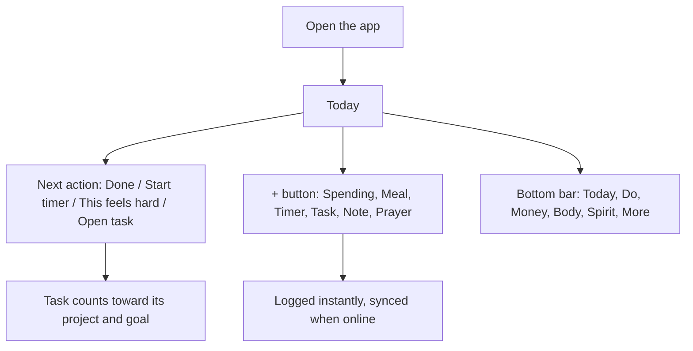
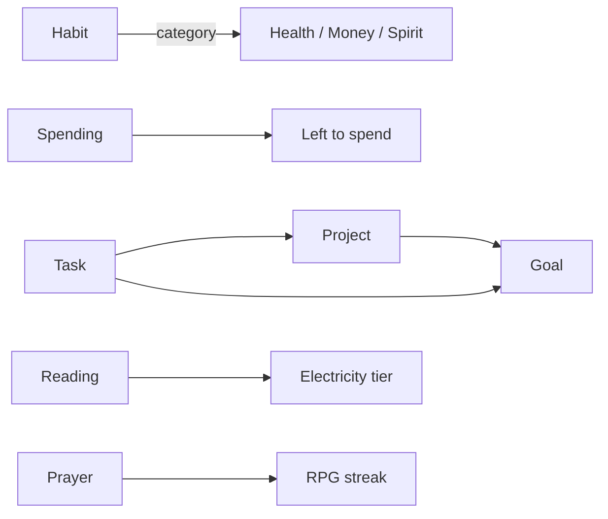

# Life OS — full project record

## 1. Header

| | |
|---|---|
| **Project** | Life OS (repo `life-os-foundation`, GitHub `Nofal-Amr/life-os-foundation`, public) |
| **Date of this record** | 2026-11-18 |
| **Commit** | `3284249` on `main` |
| **Status** | Live and in daily use by the owner; being prepared for the general public. Website shipped first; native Android app paused. |
| **Live URL** | https://lifeos0.vercel.app (Vercel, auto-deploys from `main`) |
| **Stack** | TypeScript, React 19, TanStack Start/Router, TanStack Query, Tailwind CSS 4, shadcn/Radix UI, Vite, Nitro (server), Supabase (Postgres, Auth, Realtime, Storage, Edge Functions), Vitest, Playwright; Android web-view app in Java (built without Gradle); native Android app in Kotlin + Jetpack Compose (Gradle); Wear OS app in Kotlin; iOS shell in Swift (early). |

Life OS is one person's calm, honest operating system for the day: tasks and projects, money until payday, body (food, gym, health), faith (prayer times, azkar, Qibla, Quran verse signs), calendar, notes and ideas, Work (attendance, sheets, pay) and Study (timetable, exams), and **Life Connect** (a SIM phone paired with a main phone: calls, SMS, music, battery). Product rules: **real data only** (no invented scores), **no streaks, guilt or verdicts**, no medical/financial advice, ADHD-friendly (one clear next action, short forms), English and Arabic (RTL).

---

## 2. Progress and plan

### What works (verified, 2026-11-18)

- Website live; `/`, `/projects`, `/work`, `/study` return 200. CI on `main` green (web types/unit tests/lint, Android web-view Java tests + build, native app unit tests + build, Vercel).
- Vitest: all suites pass except two known local-only failures (see Errors).
- **Tasks, projects, goals, habits, calendar, notes/ideas, reflect/review, money (accounts, transactions, recurring, categories, payday), body (food, gym, health), Spirit (prayer times by country method, azkar, tasbih, Qibla, prayer wake-up alarm via the phone's Clock app), insights, relationships, reminders, resources, week view, import a plan.**
- **Work space** (PR 78–83, 90): attendance (clock in/out, sheets, corrections incl. removing a single wrong tap), Tasks/Projects/Notes/Ideas/Calendar tabs; projects moved into Work/Study leave personal Projects and show in the space's **Projects** tab (33/33 headless checks, 375/1280 px, en/ar).
- **Study space** (PR 84): timetable, courses, exams, "Make my schedule" from a screenshot via any AI chat (paste answer → preview → add) or on-device OCR; `.ics` import.
- **Close the day** evening ritual (PR 80). **Arabic** across the app, ~1,300 strings (PR 81).
- **Android web-view app, three builds** (PR 89): Full (`life-os-full.apk`), Standard (`life-os-debug.apk`), Global (`life-os-global.apk`, no Life Connect; Play-store candidate). Permissions per build verified with `aapt2 dump permissions`.
- **Life Connect** (Full/Standard): calls ring on the main phone with Answer/Decline/Mute; SMS forwarding with reply (Full only; one-time codes stay on the SIM phone unless enabled); find my phone; music remote as a real media session with the main phone's volume keys controlling the SIM phone's volume (PR 87); SIM phone battery on the main phone with alerts at 20% and 10% (PR 88); crash on changing a setting fixed (PR 86); forwarded texts keep their real sender (PR 92). Verified on the Android emulator against the real Supabase relay with a stand-in for the other phone.
- Wear OS app (prayer tile, Qibla) builds; native Kotlin app builds.

### What's broken / known limits

- SMS forwarding needs the **Full** build; Google Play Protect blocks it when installed from a file manager (workaround: `adb install`, or Play Protect off for one install).
- A Life Connect message older than 90 s is dropped, so a main phone in deep sleep can miss a text (needs push messaging; not built).
- After an app update, Life Connect restarts only when the app is opened (Android blocks starting the service from the background). **unverified** on the owner's phones.
- Song/app name on the music remote needs notification access on the SIM phone (Full build only).
- Media Play/Pause hardware key on the main phone isn't routed to the remote player (volume keys are). Seen on the emulator.
- Texts forwarded on 17–18 Nov stay merged in one "sim" thread on the main phone; their real number was never sent.
- Two local-only test failures (Windows path in `signing.test.mjs`; `jsdom` missing locally for `.test.tsx`). CI passes.

### In progress / waiting on the owner

- **PR 74** (Work excuses, incentives and allowances): needs the owner's written OK on migrations `20261117140000_work_excuses.sql` and `20261117150000_work_pay_items.sql` (production DB is read-only without it).
- **Native app catch-up** (paused since 2026-11-12): behind the website since late October; has no Life Connect. Owner asked for Full/Standard/Global versions of the native app too: needs a Kotlin port of Life Connect. Awaiting go-ahead.
- Owner data fix: remove the wrong 9:12 tap on 17 Nov in Work → Sheets.
- Battery drain of the Full app on the SIM phone: estimated 2–6%/day, **unverified** (owner to read Settings → Battery after a day).
- Real-phone checks of PR 87 (music session), PR 88 (battery), PR 89 (Global build), PR 92 (SMS sender) and PR 93 (no flicker after a save): **unverified** on the owner's POCO / S25 Ultra (emulator only; PR 93 can't be reproduced in demo mode).

### Next steps

1. Owner to-dos: fill `src/lib/legal.ts`; Supabase leaked-password protection + PKCE; Google Calendar client ID (`VITE_GOOGLE_CLIENT_ID`); production domain; base salary in Work → People; `/login` for claude-mem.
2. Approve/decline PR 74 migrations.
3. Play Store readiness for the Global build: release signing key, app bundle (AAB) instead of APK, store listing.
4. Website plan: error tracking (needs OK for an outside service), prayer-anchored day timeline, purchase goals tied to payday, remaining short Arabic labels, InBody input, photos next to to-dos (owner decision).
5. Life Connect: if battery cost is high, lengthen the 25 s heartbeat; longer term, push messages (Firebase) — needs owner OK.
6. Native app: catch up to the website, then Life Connect + three versions.

---

## 3. Build and run

### Prerequisites

- Node.js 22+ (CI uses 22; works on 24), npm (a `bun.lock` also exists; Vercel installs with bun).
- For Android: Android SDK (build-tools 35.x, platform android-35), JDK 17+ (Android Studio's bundled JBR works). The web-view app is built **without Gradle** by `mobile/android/build.mjs` (aapt2, javac, d8, zipalign, apksigner). Native and Wear apps use Gradle 8.11.1 (wrapper distribution expected under `~/.gradle/wrapper/dists`).
- A Supabase project (Postgres + Auth + Realtime + Storage). Schema is in `supabase/migrations/` (apply in order).

### Install / run / test / build

```bash
npm install                      # or: bun install
npm run dev                      # copies OCR assets, starts Vite dev server
npm test                         # vitest run (unit tests)
npm run lint                     # eslint (includes prettier check)
npx tsc --noEmit                 # type check
npm run test:e2e                 # playwright
NITRO_PRESET=node-server npm run build   # production build (Vercel uses its own preset)

npm run test:android             # plain-Java tests for the web-view app
npm run build:android            # Standard  -> mobile/android/build/life-os-debug.apk
npm run build:android:full       # Full      -> life-os-full.apk
npm run build:android:global     # Global    -> life-os-global.apk (no Life Connect)
npm run build:android:release    # (also :full:release, :global:release) needs a release keystore
npm run build:native             # Kotlin/Compose app -> life-os-native.apk
npm run build:wear               # Wear OS app       -> life-os-wear.apk
```

Install on a phone: `adb install -r mobile/android/build/life-os-full.apk`. Demo mode without an account: set localStorage `lifeos:demo` = `1` (or "Try the demo").

### Deploy

- Website: merge to `main` → Vercel builds and deploys https://lifeos0.vercel.app. Always via pull request; never push to `main` directly; never force-push (repo is connected to Lovable).
- Database: migrations in `supabase/migrations/`; applied to production only with the owner's written approval of the exact SQL.
- Android: APKs are sideloaded; release builds need `LIFEOS_KEYSTORE` etc. (see `docs/android-release-signing.md`).

### Environment variable names (values never included)

| Name | Where | Purpose |
|---|---|---|
| `SUPABASE_URL`, `SUPABASE_PUBLISHABLE_KEY`, `SUPABASE_PROJECT_ID` | `.env`, server | Supabase project (publishable key is public by design) |
| `VITE_SUPABASE_URL`, `VITE_SUPABASE_PUBLISHABLE_KEY`, `VITE_SUPABASE_PROJECT_ID` | `.env`, browser | same, for the client bundle |
| `SUPABASE_SERVICE_ROLE_KEY` | server only | admin access for server routes (secret) |
| `VITE_GOOGLE_CLIENT_ID` | `.env` (optional) | Google sign-in without the Supabase redirect |
| `LOVABLE_CRON_SECRET`, `LOVABLE_CRON_SECRET_PREVIOUS` | server | authenticates scheduled jobs (secret) |
| `LIFEOS_KEYSTORE`, `LIFEOS_KEYSTORE_PASSWORD`, `LIFEOS_KEY_ALIAS`, `LIFEOS_KEY_PASSWORD` | Android release builds | release signing (secret; keystore must live outside the repo) |
| `LIFEOS_FULL`, `LIFEOS_GLOBAL`, `LIFEOS_RELEASE`, `SKIP_WEB` | Android build | build variant switches |
| `ANDROID_HOME` / `ANDROID_SDK_ROOT`, `ANDROID_PLATFORM`, `ANDROID_BUILD_TOOLS`, `JAVA_HOME` | Android build | toolchain overrides |
| `NITRO_PRESET` | build | server preset (`node-server` locally) |
| `LIFE_OS_MOBILE`, `CI`, `PROD` | build/test | flags |

---

## 4. Architecture and code map

### How the parts connect

```
Browser / Android web view ──► TanStack Start app (src/)
   routes (src/routes) ─► components (src/components) ─► data layer (src/data, React Query)
                                                          │
                                                          ▼
                                     Supabase: Postgres (RLS per user), Auth, Storage,
                                     Realtime (Life Connect relay), Edge Functions
Android web-view app (mobile/android, Java) ── loads the web app, exposes `window.LifeOSNative`
   bridge (src/lib/native.ts ⇄ MainActivity.java): reminders, widgets, prayer alarms,
   health, spending, camera/OCR, Work clock-in, Life Connect.
Life Connect: SIM phone ConnectService ⇄ Supabase Realtime broadcast (AES-GCM sealed,
   channel derived from the account secret) ⇄ main phone ConnectService.
Native app (mobile/native, Kotlin/Compose) ── talks to Supabase directly (sync engine).
Wear OS app (mobile/wear) ── standalone prayer tile/Qibla, computes times on the watch.
```

- **`src/routes/`** — file-based routes (TanStack Router). `_authenticated/*` are signed-in pages; `routeTree.gen.ts` is generated.
- **`src/components/`** — UI: `ui/` (shadcn primitives), `app/` (Life OS components: lists, dialogs, cards, spaces, work, projects, Life Connect, etc.).
- **`src/data/`** — one module per domain: Supabase queries/mutations, React Query keys, pure rules (e.g. `work/rules.ts`, `spaces.ts`, `scheduleImport.ts`), demo seed (`demoSeed.ts`, demo mode runs entirely in localStorage).
- **`src/lib/`** — utilities: i18n (`i18n.ts`, Arabic in `i18n.ar.ts`), dates, OCR (`ocr.ts`, tesseract on-device), native bridge (`native.ts`), legal text, semantics/colour tones.
- **`src/hooks/`** — preferences, modules (enabled areas), auth.
- **`src/integrations/supabase/`** — clients (browser, server), auth middleware, generated DB types.
- **`supabase/`** — `migrations/` (schema, RLS policies, functions), `config.toml`, tests.
- **`mobile/android/`** — web-view app: `AndroidManifest.xml` (with `full:` and `connect:` markers for the build variants), `build.mjs`, `signing.mjs`, Java sources in `src/app/lifeos/`, plain-Java tests in `test/`.
- **`mobile/native/`** — Kotlin/Compose app (`app.lifeos.kt`): `core/` (network, sync), `data/`, `feature/*` screens.
- **`mobile/wear/`** — Wear OS app. **`mobile/ios/`** — Swift shell (early).
- **`second-brain/`** — Obsidian vault: Handoff (start here), Decisions, features, workflows, competitor notes, brand.
- **`docs/`** — owner handbook, research/benchmarks, audits, screenshots, specs.
- **`.github/workflows/`** — CI. **`scripts/`** — build helpers (OCR assets).

### Every tracked file

Descriptions are taken from each file's own leading comment or title; "—" means the file has none.

#### Project root

| File | What it does |
|---|---|
| `.env` | — |
| `.env.example` | — |
| `.gitignore` | — |
| `.prettierignore` | — |
| `.prettierrc` | — |
| `AGENTS.md` | Rules for any agent working here |
| `CLAUDE.md` | — |
| `PROGRESS.md` | Life OS: progress |
| `README.md` | Life OS |
| `bun.lock` | binary / skipped |
| `bunfig.toml` | — |
| `components.json` | — |
| `eslint.config.js` | — |
| `package.json` | — |
| `playwright.config.ts` | End-to-end checks of the signed-out app (the intro page and sign-in), run against the dev server. Signed-in screens need a real account, so they are covered by unit tests of their data instead. Uses t… |
| `roadmap.md` | Life OS roadmap |
| `tsconfig.json` | — |
| `vite.config.ts` | @lovable.dev/vite-tanstack-config already includes the following — do NOT add them manually or the app will break with duplicate plugins: - TanStack devtools (dev-only, first), tanstackStart, viteReac… |

#### `.claude/`

| File | What it does |
|---|---|
| `.claude/agents/task-executor.md` | — |
| `.claude/launch.json` | — |
| `.claude/skills/life-os/SKILL.md` | Life OS: how the owner wants work done |
| `.claude/skills/life-os/references/decisions.md` | Owner decisions (newest first) |
| `.claude/skills/life-os/references/repo-notes.md` | Repo notes (practical) |

#### `.github/`

| File | What it does |
|---|---|
| `.github/workflows/ci.yml` | — |
| `.github/workflows/ios.yml` | — |

#### `.lovable/`

| File | What it does |
|---|---|
| `.lovable/plan/combined-life-os-interface-pass-2026-09-19.md` | Combined Life OS interface pass |
| `.lovable/plan/corrective-quality-pass-2026-09-19.md` | Corrective quality pass |
| `.lovable/plan/dashboard-system-restyle-and-task-inline-creation-2026-09-18.md` | Dashboard System Restyle and Task Inline Creation |
| `.lovable/plan/finance-module-for-life-os-2026-09-19.md` | Finance module for Life OS |
| `.lovable/plan/five-destination-consolidation-2026-09-19.md` | Five-destination consolidation |
| `.lovable/plan/today-dashboard-2026-09-19.md` | Today dashboard |
| `.lovable/project.json` | — |

#### `docs/`

| File | What it does |
|---|---|
| `docs/MASTER_SPEC.md` | Life OS — Master Build Spec |
| `docs/android-release-signing.md` | Android release signing |
| `docs/audits/PHASE_0_AUDIT.md` | Life OS — Phase 0 audit report |
| `docs/audits/PHASE_0_GAP_ANALYSIS.md` | Phase 0 gap analysis — repository against the Master Build Specification |
| `docs/owner/README.md` | Running Life OS yourself |
| `docs/owner/notes/autonomous-workflow.md` | — |
| `docs/owner/notes/competitive-benchmark.md` | — |
| `docs/owner/notes/core-rules.md` | — |
| `docs/owner/notes/hosting.md` | — |
| `docs/owner/notes/how-to-adhd.md` | — |
| `docs/owner/notes/inspiration-not-copy.md` | — |
| `docs/owner/notes/master-spec-is-roadmap.md` | — |
| `docs/owner/notes/native-taste.md` | — |
| `docs/owner/notes/oct-decisions.md` | — |
| `docs/owner/notes/original-vision.md` | — |
| `docs/owner/notes/prayer-alarm.md` | — |
| `docs/owner/notes/supabase-access.md` | — |
| `docs/owner/notes/wear-build.md` | — |
| `docs/phase1/EXECUTION_PROMPT.md` | Phase 1 — execution instructions (owner's text, verbatim) |
| `docs/phase1/PROGRESS.md` | Phase 1 progress |
| `docs/plan-markdown.md` | Plan markdown |
| `docs/research/2026-11-12-competitive-benchmark.md` | Life OS — competitive benchmark |
| `docs/research/2026-11-12-prayer-azkar-benchmark.md` | Spirit: prayer, azkar and Quran benchmark |
| `docs/research/2026-11-13-relationships-benchmark.md` | Relationships: benchmark (2026-11-13) |
| `docs/research/competitive-benchmark-brief.md` | Master spec, section 10 — Competitive benchmark (mandatory) |
| `docs/screenshots/2026-11-15-compact-mobile/after-dashboard-1280.png` | binary / skipped |
| `docs/screenshots/2026-11-15-compact-mobile/after-dashboard-375.png` | binary / skipped |
| `docs/screenshots/2026-11-15-compact-mobile/after-finance-1280.png` | binary / skipped |
| `docs/screenshots/2026-11-15-compact-mobile/after-finance-375.png` | binary / skipped |
| `docs/screenshots/2026-11-15-compact-mobile/after-health-1280.png` | binary / skipped |
| `docs/screenshots/2026-11-15-compact-mobile/after-health-375.png` | binary / skipped |
| `docs/screenshots/2026-11-15-compact-mobile/after-settings-1280.png` | binary / skipped |
| `docs/screenshots/2026-11-15-compact-mobile/after-settings-375.png` | binary / skipped |
| `docs/screenshots/2026-11-15-compact-mobile/after-spirit-1280.png` | binary / skipped |
| `docs/screenshots/2026-11-15-compact-mobile/after-spirit-375.png` | binary / skipped |
| `docs/screenshots/2026-11-15-compact-mobile/after-spirit-android-375.png` | binary / skipped |
| `docs/screenshots/2026-11-15-compact-mobile/after-spirit-bottom-375.png` | binary / skipped |
| `docs/screenshots/2026-11-15-compact-mobile/after-spirit-list-375.png` | binary / skipped |
| `docs/screenshots/2026-11-15-compact-mobile/after-tasks-1280.png` | binary / skipped |
| `docs/screenshots/2026-11-15-compact-mobile/after-tasks-375.png` | binary / skipped |
| `docs/screenshots/2026-11-15-compact-mobile/before-dashboard-1280.png` | binary / skipped |
| `docs/screenshots/2026-11-15-compact-mobile/before-dashboard-375.png` | binary / skipped |
| `docs/screenshots/2026-11-15-compact-mobile/before-finance-1280.png` | binary / skipped |
| `docs/screenshots/2026-11-15-compact-mobile/before-finance-375.png` | binary / skipped |
| `docs/screenshots/2026-11-15-compact-mobile/before-health-1280.png` | binary / skipped |
| `docs/screenshots/2026-11-15-compact-mobile/before-health-375.png` | binary / skipped |
| `docs/screenshots/2026-11-15-compact-mobile/before-settings-1280.png` | binary / skipped |
| `docs/screenshots/2026-11-15-compact-mobile/before-settings-375.png` | binary / skipped |
| `docs/screenshots/2026-11-15-compact-mobile/before-spirit-1280.png` | binary / skipped |
| `docs/screenshots/2026-11-15-compact-mobile/before-spirit-375.png` | binary / skipped |
| `docs/screenshots/2026-11-15-compact-mobile/before-spirit-bottom-375.png` | binary / skipped |
| `docs/screenshots/2026-11-15-compact-mobile/before-spirit-list-375.png` | binary / skipped |
| `docs/screenshots/2026-11-15-compact-mobile/before-tasks-1280.png` | binary / skipped |
| `docs/screenshots/2026-11-15-compact-mobile/before-tasks-375.png` | binary / skipped |
| `docs/security/2026-11-12-security-audit.md` | Life OS pre-launch security audit |
| `docs/superpowers/plans/2026-10-21-work-attendance.md` | Work attendance and monthly pay sheet — Implementation Plan |
| `docs/superpowers/specs/2026-10-21-work-attendance-design.md` | Work: attendance and the monthly pay sheet (design) |
| `docs/superpowers/specs/2026-10-23-native-android-design.md` | Life OS native Android app — design and migration plan |
| `docs/superpowers/specs/2026-11-12-today-tasks-navigation-redesign.md` | Today, Tasks and navigation: redesign draft |
| `docs/superpowers/specs/2026-11-13-google-calendar-sync-design.md` | Google Calendar sync: design |
| `docs/superpowers/specs/2026-11-13-relationships-design.md` | Relationships: design (2026-11-13) |
| `docs/superpowers/specs/2026-11-17-simplify-before-adding.md` | Simplify before adding: screens and flows |

#### `e2e/`

| File | What it does |
|---|---|
| `e2e/intro.e2e.ts` | Collects console errors and uncaught page errors for the whole test. |

#### `mobile/`

| File | What it does |
|---|---|
| `mobile/android/AndroidManifest.xml` | — |
| `mobile/android/build.mjs` | Builds the Life OS Android APK without Gradle or Capacitor, using only the Android SDK command-line tools (aapt2, d8, zipalign, apksigner) and a JDK. npm run build:android -> mobile/android/build/life… |
| `mobile/android/res/drawable/ic_launcher_background.xml` | — |
| `mobile/android/res/drawable/ic_launcher_foreground.xml` | A quiet ring with a single cyan arc: the at-a-glance ring motif. |
| `mobile/android/res/drawable/ic_media_next.xml` | Next track. |
| `mobile/android/res/drawable/ic_media_pause.xml` | Pause. |
| `mobile/android/res/drawable/ic_media_play.xml` | Play. |
| `mobile/android/res/drawable/ic_media_prev.xml` | Previous track (Life Connect music remote). |
| `mobile/android/res/drawable/ic_media_vol_down.xml` | Volume down. |
| `mobile/android/res/drawable/ic_media_vol_up.xml` | Volume up. |
| `mobile/android/res/drawable/ic_stat_battery.xml` | A battery, for the SIM phone's low-battery alert. |
| `mobile/android/res/drawable/ic_stat_music.xml` | Status bar note for the music remote. |
| `mobile/android/res/drawable/ic_stat_prayer.xml` | Monochrome crescent for the status bar. |
| `mobile/android/res/drawable/widget_bg.xml` | The widget card: dark, slightly see-through, rounded like the system widgets. |
| `mobile/android/res/drawable/widget_button.xml` | Today widget buttons: a soft see-through pill. |
| `mobile/android/res/drawable/widget_header.xml` | — |
| `mobile/android/res/drawable/widget_next.xml` | Highlights the next prayer's time. |
| `mobile/android/res/drawable/widget_progress.xml` | Time passed between the last prayer and the next. |
| `mobile/android/res/layout/widget_money.xml` | — |
| `mobile/android/res/layout/widget_next.xml` | — |
| `mobile/android/res/layout/widget_prayers.xml` | — |
| `mobile/android/res/layout/widget_quick.xml` | — |
| `mobile/android/res/layout/widget_today.xml` | — |
| `mobile/android/res/mipmap-anydpi-v26/ic_launcher.xml` | — |
| `mobile/android/res/values/widget_styles.xml` | — |
| `mobile/android/res/xml/widget_money_info.xml` | — |
| `mobile/android/res/xml/widget_next_info.xml` | — |
| `mobile/android/res/xml/widget_prayers_info.xml` | — |
| `mobile/android/res/xml/widget_quick_info.xml` | — |
| `mobile/android/res/xml/widget_today_info.xml` | — |
| `mobile/android/signing.mjs` | How the Android APK is signed. Kept apart from build.mjs so it can be tested (mobile/android/signing.test.mjs). Debug builds (the default) are for the owner's own phone: debuggable, and signed with th… |
| `mobile/android/signing.test.mjs` | Tests for `signing` |
| `mobile/android/src/app/lifeos/AuthCallbackGate.java` | Sign-in results come back to the app through lifeos://auth-callback. Any web page or app can open that link, so on its own it would let a stranger sign this phone in to *their* account (and receive wh… |
| `mobile/android/src/app/lifeos/BatteryRules.java` | When the SIM phone's battery is worth telling the main phone about, and when the main phone should say it's running low. Plain Java (no Android classes), so it is tested in mobile/android/test. |
| `mobile/android/src/app/lifeos/BootReceiver.java` | Alarms are cleared on reboot; put the stored reminders back, and Life Connect. |
| `mobile/android/src/app/lifeos/CallAlert.java` | The main phone's side of Life Connect: rings like a call when the SIM phone does, with Decline and Mute, and leaves a "missed call" behind if nobody picked up. |
| `mobile/android/src/app/lifeos/CallControl.java` | The SIM phone's side of Decline / Mute from the main phone. |
| `mobile/android/src/app/lifeos/CallStateReceiver.java` | The SIM phone's side of Life Connect: when a call comes in, tells the main phone who's calling; when it's picked up or ends, says so, so the main phone stops ringing (and shows a missed call if nobody… |
| `mobile/android/src/app/lifeos/CaptureProvider.java` | Hands the camera app a place to save a photo (and the page a way to read it back): content://app.lifeos.capture/<name>.jpg, backed by a file in this app's cache. Only names this app made are allowed, … |
| `mobile/android/src/app/lifeos/Compass.java` | The phone's compass for the Qibla finder, read natively because the web's orientation events point at magnetic north. This adds the magnetic declination for where you are (Android's built-in World Mag… |
| `mobile/android/src/app/lifeos/ConnectActionReceiver.java` | Decline / Mute on a forwarded call, or Reply to a forwarded SMS: tells the SIM phone. |
| `mobile/android/src/app/lifeos/ConnectConfig.java` | Life Connect settings for this phone, handed over by the web app: its role ("sim" sends calls, "main" rings), the account's shared secret, and the Supabase project to relay through. Everything that cr… |
| `mobile/android/src/app/lifeos/ConnectEcho.java` | Life Connect messages go out through the relay's broadcast endpoint, and the relay hands each one to every phone listening, the sender included. Each message carries the sender's role ("main" or "sim"… |
| `mobile/android/src/app/lifeos/ConnectLog.java` | The main phone's record of what Life Connect passed on: SMS from the SIM phone, replies sent, and calls with how they ended. Kept in a file on this phone only (it can hold one-time codes), newest last… |
| `mobile/android/src/app/lifeos/ConnectSender.java` | Sends one sealed Life Connect message through Supabase Realtime's broadcast endpoint. |
| `mobile/android/src/app/lifeos/ConnectService.java` | Life Connect, always on while a role is set: keeps one Realtime connection open so the main phone rings when the SIM phone gets a call, and the SIM phone hears "decline" / "mute" back. Shows a quiet o… |
| `mobile/android/src/app/lifeos/CrashLog.java` | Keeps the last crash on the phone, so it can be copied from Settings and sent on. Nothing leaves the phone by itself. Also reads Android's own record of why the app last stopped (crash, freeze, killed… |
| `mobile/android/src/app/lifeos/FindPhone.java` | Find my phone, on the phone being looked for: rings the alarm sound at full volume (it plays even on silent or vibrate) and/or blinks the torch, for a minute, or until Stop, or until someone picks the… |
| `mobile/android/src/app/lifeos/FindTiming.java` | Find my phone's timing and volume decisions, kept free of Android so they can be tested. |
| `mobile/android/src/app/lifeos/HealthReader.java` | — |
| `mobile/android/src/app/lifeos/IncomingCallActivity.java` | Full-screen "incoming call" on the main phone (also over the lock screen), like a real call: who's calling the SIM phone, with "Answer on …" (picks up on the SIM phone, heard there or on earbuds conne… |
| `mobile/android/src/app/lifeos/MainActivity.java` | — |
| `mobile/android/src/app/lifeos/MediaAlert.java` | The main phone's side of the music remote. What's playing on the SIM phone becomes a media session here, so it shows up like any player: in the phone's media controls, on the lock screen and on the wa… |
| `mobile/android/src/app/lifeos/MediaRemote.java` | The SIM phone's side of the Life Connect music remote: play, pause, skip and volume for whatever is playing here (Spotify, YouTube Music, anything with a media session), sent from the main phone. Play… |
| `mobile/android/src/app/lifeos/MoreWidgets.java` | More home-screen widgets, fed by the same data as the Today widget (setTodayWidget): the one next action, quick adds, and what's left to spend. Each just shows the last figures it was given. |
| `mobile/android/src/app/lifeos/NotificationTidy.java` | Keeps Life OS's notifications from piling up. Android drops an app's new notifications once it has about 50 showing, and a long pile buries the next prayer. So: - reminders for the same thing share on… |
| `mobile/android/src/app/lifeos/PeerBattery.java` | The SIM phone's battery on the main phone. The SIM phone sends its percentage and whether it's charging whenever either changes; the main phone keeps the last reading (shown on the Life Connect card a… |
| `mobile/android/src/app/lifeos/PrayerActionReceiver.java` | A "In jamaah" / "On time" / "Clutch" button on a prayer notification. Logs the prayer without opening the app: the log waits here until the app next opens and saves it to your account; the widget show… |
| `mobile/android/src/app/lifeos/PrayerWidget.java` | Home-screen prayer widget. The web app hands over prayer times and what's logged (setWidgetData); this draws them, counts down to the next prayer live, and refreshes itself at each prayer time and eve… |
| `mobile/android/src/app/lifeos/RealtimeSocket.java` | A small WebSocket client for Supabase Realtime (Phoenix protocol), enough to join one broadcast channel and hear its messages. Reconnects on its own with a growing pause, and straight away when kicked… |
| `mobile/android/src/app/lifeos/ReminderReceiver.java` | Shows one reminder; tapping it opens the app on the given page. |
| `mobile/android/src/app/lifeos/ReminderSlots.java` | Which notification a reminder shares, and how long it stays (plain Java, so it's tested without a phone). Used by NotificationTidy and ReminderReceiver. |
| `mobile/android/src/app/lifeos/Reminders.java` | Schedules the reminders the web app hands over (see src/lib/native.ts). The list is stored so it can be restored after the phone restarts. |
| `mobile/android/src/app/lifeos/SmsAlert.java` | SMS through Life Connect. On the main phone: shows each SMS the SIM phone got, with a Reply box. On the SIM phone: sends your reply as a real SMS. |
| `mobile/android/src/app/lifeos/SmsFilter.java` | Which SMS Life Connect sends on to the main phone. One-time codes (OTPs, verification and login codes) stay on the SIM phone unless you switch "Include one-time codes" on yourself; it is off by defaul… |
| `mobile/android/src/app/lifeos/SmsReceiver.java` | Life Connect on the SIM phone: each SMS that arrives is sent on to the main phone (encrypted, never stored), unless you turned SMS forwarding off — or it's a one-time code and you chose not to forward… |
| `mobile/android/src/app/lifeos/SpendingActionReceiver.java` | "Log it" / "Not spending" on a spending notification. |
| `mobile/android/src/app/lifeos/SpendingListener.java` | Watches notifications from the bank and wallet apps (and SMS senders) you chose, and turns spending into a "Log it?" question. Everything else is passed over: other apps are only noted by name so you … |
| `mobile/android/src/app/lifeos/SpendingParser.java` | Reads a bank or wallet message on the phone and keeps only what's needed to log spending: the amount, the currency and (if it says) where. Anything that looks like a one-time code is dropped before it… |
| `mobile/android/src/app/lifeos/SpendingStore.java` | Spending picked up from bank notifications, waiting for a yes or no: "Spent 250 EGP at Carrefour?" with Log it / Not spending. Only the amount, currency, shop and app name are kept — never the message… |
| `mobile/android/src/app/lifeos/TimerNotice.java` | The ongoing "timer running" notification, with a live clock from its start. |
| `mobile/android/src/app/lifeos/TodayWidget.java` | Home-screen "Today" widget: left to spend, spent today, tasks due and the next one, plus + Task / + Spending / Capture that open the app straight into adding. The web app hands over the figures (setTo… |
| `mobile/android/src/app/lifeos/WakeAlarm.java` | Checks for a wake-up alarm set in the phone's own Clock app (e.g. "Wake-up for Fajr", 10 minutes before). Plain Java so it can be tested off the phone. |
| `mobile/android/src/app/lifeos/WorkClock.java` | Clocking in or out at work: the phone's fingerprint (or its screen lock) confirms it's the owner, then one location reading. Android only tells us "it was the owner"; no fingerprint data ever reaches … |
| `mobile/android/test.mjs` | Runs the plain-Java tests in mobile/android/test (no phone needed): npm run test:android |
| `mobile/android/test/AuthCallbackGateTest.java` | A sign-in result is only taken right after the app started a sign-in. |
| `mobile/android/test/BatteryRulesTest.java` | The SIM phone's battery: what gets sent, and one low alert per threshold per discharge. |
| `mobile/android/test/ConnectEchoTest.java` | Life Connect: a phone ignores its own messages that the relay sends back. |
| `mobile/android/test/FindTimingTest.java` | Find my phone: when the torch is on, when it stops, and whether the alarm volume goes back. |
| `mobile/android/test/ReminderSlotsTest.java` | Reminders for the same thing share one notification, so they can't pile up. |
| `mobile/android/test/SmsFilterTest.java` | One-time codes stay on the SIM phone unless you chose to forward them. |
| `mobile/android/test/SpendingParserTest.java` | Off-phone check of SpendingParser: run with `npm run test:android`. Plain Java, no test framework; exits non-zero on the first failure. |
| `mobile/android/test/WakeAlarmTest.java` | Wake-up alarm: which times are accepted and what label the Clock app gets. |
| `mobile/ios/LifeOS/Assets.xcassets/AppIcon.appiconset/Contents.json` | — |
| `mobile/ios/LifeOS/Assets.xcassets/AppIcon.appiconset/icon-1024.png` | binary / skipped |
| `mobile/ios/LifeOS/Assets.xcassets/Contents.json` | — |
| `mobile/ios/LifeOS/Assets.xcassets/LaunchBackground.colorset/Contents.json` | — |
| `mobile/ios/LifeOS/LifeOSApp.swift` | The Life OS iPhone app: the live web app in a native shell, with the phone-only pieces (notifications, sign-in, saving files) done natively. |
| `mobile/ios/LifeOS/NativeBridge.swift` | The iPhone side of `window.LifeOSNative`, the same bridge the Android app offers, so the web app needs no iPhone-specific code. JavaScript posts messages; the few answers it needs synchronously (can i… |
| `mobile/ios/LifeOS/Reminders.swift` | Local notifications from the web app's reminder list (prayers, tasks, your own reminders). Each call replaces what was scheduled before, like the Android app. iOS keeps at most 64 pending, so the soon… |
| `mobile/ios/LifeOS/SignIn.swift` | Google (and other providers) through the system's sign-in sheet. It finishes at lifeos://auth-callback, the same address the Android app uses, and hands that URL back so the site's /auth page can comp… |
| `mobile/ios/LifeOS/WebView.swift` | The web app in a WKWebView. Only the Life OS site loads inside; every other link opens in Safari, and Google sign-in goes through the system's sign-in sheet (Google doesn't allow it inside web views). |
| `mobile/ios/README.md` | Life OS for iPhone |
| `mobile/ios/project.yml` | XcodeGen spec for the Life OS iPhone app. Generate the Xcode project on a Mac with: brew install xcodegen && xcodegen |
| `mobile/native/.gitignore` | — |
| `mobile/native/app/build.gradle.kts` | — |
| `mobile/native/app/src/main/AndroidManifest.xml` | — |
| `mobile/native/app/src/main/assets/azkar.json` | — |
| `mobile/native/app/src/main/java/app/lifeos/kt/AppViewModel.kt` | App-wide state for the shell: who's signed in, where the data is, and look-and-feel settings. |
| `mobile/native/app/src/main/java/app/lifeos/kt/LifeOsApp.kt` | — |
| `mobile/native/app/src/main/java/app/lifeos/kt/MainActivity.kt` | — |
| `mobile/native/app/src/main/java/app/lifeos/kt/core/auth/CallbackGate.kt` | Sign-in results come back through lifeosnative://auth-callback. Any web page or app can open that link, so on its own it would let a stranger sign this phone in to *their* account (and receive what yo… |
| `mobile/native/app/src/main/java/app/lifeos/kt/core/common/Common.kt` | The coroutine scope that lives as long as the app (sync, session). |
| `mobile/native/app/src/main/java/app/lifeos/kt/core/database/DatabaseModule.kt` | — |
| `mobile/native/app/src/main/java/app/lifeos/kt/core/database/LifeOsDatabase.kt` | One row of any synced table, kept as the server's JSON. |
| `mobile/native/app/src/main/java/app/lifeos/kt/core/datastore/AppSettings.kt` | — |
| `mobile/native/app/src/main/java/app/lifeos/kt/core/datastore/Seams.kt` | The session as sync and token refresh need it; SessionStore on the phone, a fake in tests. |
| `mobile/native/app/src/main/java/app/lifeos/kt/core/datastore/SessionStore.kt` | A signed-in session. [expiresAt] is in epoch seconds. |
| `mobile/native/app/src/main/java/app/lifeos/kt/core/designsystem/Charts.kt` | A series with fewer than two points shows a plain "not enough data yet", never a fake chart. |
| `mobile/native/app/src/main/java/app/lifeos/kt/core/designsystem/Components.kt` | — |
| `mobile/native/app/src/main/java/app/lifeos/kt/core/designsystem/Haptics.kt` | Touch feedback with meaning, through the phone's own haptics engine (so it respects the system's vibration setting and feels native on every phone). - [tick]: a choice changed (chip, tab, toggle, step… |
| `mobile/native/app/src/main/java/app/lifeos/kt/core/designsystem/Identity.kt` | The web's EntityIdentity: an icon name (lucide) and a colour token stored on projects, goals, habits and capabilities, shown here with the nearest native icon so something made on the website looks th… |
| `mobile/native/app/src/main/java/app/lifeos/kt/core/designsystem/Pickers.kt` | — |
| `mobile/native/app/src/main/java/app/lifeos/kt/core/designsystem/SyncStatus.kt` | What the top bar needs to show where the data is. Provided by the app shell. |
| `mobile/native/app/src/main/java/app/lifeos/kt/core/designsystem/Theme.kt` | The web app's tokens (src/styles.css), converted from OKLCH. |
| `mobile/native/app/src/main/java/app/lifeos/kt/core/model/Models.kt` | One class per Supabase table, as the web app's generated types describe them (src/integrations/supabase/types.ts). Unknown columns are ignored when reading and kept when saving (see LocalStore), so th… |
| `mobile/native/app/src/main/java/app/lifeos/kt/core/network/NetworkModule.kt` | — |
| `mobile/native/app/src/main/java/app/lifeos/kt/core/network/SupabaseApi.kt` | Supabase Auth (GoTrue). |
| `mobile/native/app/src/main/java/app/lifeos/kt/core/network/TokenProvider.kt` | Hands OkHttp a token the server accepts: refreshed shortly before it expires, or once after a 401. A refused refresh signs out; a failed connection doesn't (the next try refreshes). |
| `mobile/native/app/src/main/java/app/lifeos/kt/core/sync/SyncEngine.kt` | A server table copied to the phone. [conflict] is the unique key an upsert matches on, so a row made here offline and one made on the website for the same day (a prayer, a health log) become one row, … |
| `mobile/native/app/src/main/java/app/lifeos/kt/core/sync/SyncWorker.kt` | Syncs every half hour while there's a connection, even with the app closed. |
| `mobile/native/app/src/main/java/app/lifeos/kt/core/vault/Vault.kt` | What a locked note holds inside: its real title and text. |
| `mobile/native/app/src/main/java/app/lifeos/kt/core/vault/VaultCrypto.kt` | Locked notes: encrypted on the phone, so the server (and anyone who ever copied its database) only holds unreadable text. - Key: PBKDF2-SHA256 from the person's passphrase, 310,000 rounds, salted per … |
| `mobile/native/app/src/main/java/app/lifeos/kt/data/AccountRepository.kt` | Signing in and out. Another account's data never mixes with this one's. |
| `mobile/native/app/src/main/java/app/lifeos/kt/data/DemoSeed.kt` | Sample data for demo mode, ported from the website's src/data/demoSeed.ts so both show the same believable month, dated around today. It stays on the phone; demo mode never syncs. |
| `mobile/native/app/src/main/java/app/lifeos/kt/data/HolidayRepository.kt` | — |
| `mobile/native/app/src/main/java/app/lifeos/kt/data/LocalStore.kt` | Typed reading and writing over the phone's copy of every table. Saved here at once, sent when it can be. Saving merges onto the stored row, so columns the app doesn't model yet are never lost. |
| `mobile/native/app/src/main/java/app/lifeos/kt/data/Repositories.kt` | — |
| `mobile/native/app/src/main/java/app/lifeos/kt/data/logic/BodyLogic.kt` | The web app's Body rules (src/data/food.ts, health.ts, stats.ts): every figure is what was logged, added up; nothing is estimated or judged. |
| `mobile/native/app/src/main/java/app/lifeos/kt/data/logic/CalendarLogic.kt` | The web's Calendar (src/routes/_authenticated/calendar.tsx, data/calendarLayout.ts, data/holidays.ts): everything with a date, from real rows only. |
| `mobile/native/app/src/main/java/app/lifeos/kt/data/logic/DoLogic.kt` | Ported from src/data/habitCategories.ts, plans.ts and LinkedProgress. |
| `mobile/native/app/src/main/java/app/lifeos/kt/data/logic/FoodLibrary.kt` | Generated from the website's src/data/foodLibrary.ts: reference figures from public food composition tables (rounded), not measurements. Anything added from here is a normal food in the person's own l… |
| `mobile/native/app/src/main/java/app/lifeos/kt/data/logic/MoneyLogic.kt` | The web app's rules (src/data/finance.ts), line for line: amounts are signed (money out is negative), a balance is the opening balance plus everything moved, and "left to spend" is what's liquid minus… |
| `mobile/native/app/src/main/java/app/lifeos/kt/data/logic/NoteLogic.kt` | `#work`, `#مشروع`, `#plan-2026`: a label typed in the note's text. |
| `mobile/native/app/src/main/java/app/lifeos/kt/data/logic/PrayerLogic.kt` | The five prayers, as prayer_logs names them. |
| `mobile/native/app/src/main/java/app/lifeos/kt/data/logic/SpiritLogic.kt` | The web's Spirit rules (src/data/spirit.ts, week.ts, azkar.ts, lib/qibla.ts). |
| `mobile/native/app/src/main/java/app/lifeos/kt/data/logic/TaskLogic.kt` | Ported from the web app (src/data/tasks.ts, focus.ts, stuck.ts and the dashboard). Late things are "from earlier", never red or "overdue". |
| `mobile/native/app/src/main/java/app/lifeos/kt/data/logic/TodayLogic.kt` | Ported from src/data/todayRing.ts, hub.ts, daySummary.ts and the dashboard. Every figure is a count of stored rows; nothing is scored or judged. |
| `mobile/native/app/src/main/java/app/lifeos/kt/feature/auth/GoogleSignIn.kt` | Whether this build knows the Google client ID; without it, Google sign-in goes through the website. |
| `mobile/native/app/src/main/java/app/lifeos/kt/feature/auth/SignInScreen.kt` | — |
| `mobile/native/app/src/main/java/app/lifeos/kt/feature/body/BodyMeals.kt` | — |
| `mobile/native/app/src/main/java/app/lifeos/kt/feature/body/BodyScreen.kt` | — |
| `mobile/native/app/src/main/java/app/lifeos/kt/feature/body/BodyViewModel.kt` | — |
| `mobile/native/app/src/main/java/app/lifeos/kt/feature/calendar/CalendarScreen.kt` | — |
| `mobile/native/app/src/main/java/app/lifeos/kt/feature/calendar/CalendarSheets.kt` | — |
| `mobile/native/app/src/main/java/app/lifeos/kt/feature/calendar/CalendarViewModel.kt` | — |
| `mobile/native/app/src/main/java/app/lifeos/kt/feature/money/MoneyPages.kt` | — |
| `mobile/native/app/src/main/java/app/lifeos/kt/feature/money/MoneyScreen.kt` | — |
| `mobile/native/app/src/main/java/app/lifeos/kt/feature/money/MoneyViewModel.kt` | — |
| `mobile/native/app/src/main/java/app/lifeos/kt/feature/more/MoreScreen.kt` | — |
| `mobile/native/app/src/main/java/app/lifeos/kt/feature/more/Tools.kt` | — |
| `mobile/native/app/src/main/java/app/lifeos/kt/feature/notes/NotesScreen.kt` | — |
| `mobile/native/app/src/main/java/app/lifeos/kt/feature/spirit/SpiritScreen.kt` | — |
| `mobile/native/app/src/main/java/app/lifeos/kt/feature/spirit/SpiritTools.kt` | — |
| `mobile/native/app/src/main/java/app/lifeos/kt/feature/spirit/SpiritViewModel.kt` | — |
| `mobile/native/app/src/main/java/app/lifeos/kt/feature/tasks/DoPages.kt` | — |
| `mobile/native/app/src/main/java/app/lifeos/kt/feature/tasks/DoScreen.kt` | — |
| `mobile/native/app/src/main/java/app/lifeos/kt/feature/tasks/DoViewModel.kt` | — |
| `mobile/native/app/src/main/java/app/lifeos/kt/feature/tasks/TaskEditor.kt` | — |
| `mobile/native/app/src/main/java/app/lifeos/kt/feature/today/TodayParts.kt` | — |
| `mobile/native/app/src/main/java/app/lifeos/kt/feature/today/TodayScreen.kt` | — |
| `mobile/native/app/src/main/java/app/lifeos/kt/feature/today/TodaySheets.kt` | — |
| `mobile/native/app/src/main/java/app/lifeos/kt/feature/today/TodayViewModel.kt` | — |
| `mobile/native/app/src/main/java/app/lifeos/kt/navigation/LifeOsShell.kt` | — |
| `mobile/native/app/src/main/res/drawable/ic_launcher_background.xml` | — |
| `mobile/native/app/src/main/res/drawable/ic_launcher_foreground.xml` | A quiet ring with a single cyan arc: the at-a-glance ring motif. |
| `mobile/native/app/src/main/res/mipmap-anydpi-v26/ic_launcher.xml` | — |
| `mobile/native/app/src/main/res/values-night/themes.xml` | — |
| `mobile/native/app/src/main/res/values/themes.xml` | — |
| `mobile/native/app/src/test/java/app/lifeos/kt/core/auth/CallbackGateTest.kt` | — |
| `mobile/native/app/src/test/java/app/lifeos/kt/core/network/SessionCallbackTest.kt` | — |
| `mobile/native/app/src/test/java/app/lifeos/kt/core/sync/SyncEngineTest.kt` | The phone's database, in memory. |
| `mobile/native/app/src/test/java/app/lifeos/kt/core/vault/VaultCryptoTest.kt` | — |
| `mobile/native/app/src/test/java/app/lifeos/kt/data/logic/LogicTest.kt` | — |
| `mobile/native/build.gradle.kts` | — |
| `mobile/native/build.mjs` | Builds the native phone app (Kotlin, Gradle) and copies it next to the other APKs: mobile/android/build/life-os-native.apk |
| `mobile/native/gradle.properties` | — |
| `mobile/native/settings.gradle.kts` | The native Life OS phone app (Kotlin + Jetpack Compose). It installs beside the web-view app in ../android until it covers enough to replace it. |
| `mobile/native/tools/azkar-export.cjs` | Usage: node mobile/native/tools/azkar-export.cjs src/data/azkar.ts mobile/native/app/src/main/assets/azkar.json Reads src/data/azkar.ts and writes the azkar texts, tasbih phrases and targets as JSON, … |
| `mobile/wear/.gitignore` | — |
| `mobile/wear/app/build.gradle.kts` | — |
| `mobile/wear/app/src/main/AndroidManifest.xml` | — |
| `mobile/wear/app/src/main/java/app/lifeos/wear/Labels.java` | Names and times as the watch shows them, in the watch's language. |
| `mobile/wear/app/src/main/java/app/lifeos/wear/MainActivity.java` | The watch app: the next prayer, today's times, and the Qibla. Times are worked out on the watch from its saved place, so it works offline and without signing in. |
| `mobile/wear/app/src/main/java/app/lifeos/wear/NextPrayerComplicationService.java` | "Next prayer" for a slot on any watch face: the prayer's name and time. Sent as a timeline through to tomorrow, so it changes at each prayer by itself. |
| `mobile/wear/app/src/main/java/app/lifeos/wear/PrayerDay.java` | One day's prayer times at the saved place, worked out on the watch with the same method the phone app uses (adhan). No network, no account. |
| `mobile/wear/app/src/main/java/app/lifeos/wear/PrayerTileService.java` | The "Prayer times" tile: the next prayer and its time, and the one after. It carries a timeline through to tomorrow's Fajr, so it moves on to the next prayer by itself without waking the app. |
| `mobile/wear/app/src/main/java/app/lifeos/wear/QiblaActivity.java` | The Qibla on the wrist: an arrow that points to it while the watch is held flat, using the watch's compass corrected to true north. For reference only. |
| `mobile/wear/app/src/main/java/app/lifeos/wear/WearPrefs.java` | The watch's own settings: where it is, and how times are worked out. |
| `mobile/wear/app/src/main/res/drawable/ic_launcher_background.xml` | — |
| `mobile/wear/app/src/main/res/drawable/ic_launcher_foreground.xml` | A quiet ring with a single cyan arc: the at-a-glance ring motif. |
| `mobile/wear/app/src/main/res/drawable/ic_stat_prayer.xml` | Monochrome crescent for the status bar. |
| `mobile/wear/app/src/main/res/drawable/tile_preview.xml` | Preview in the tile picker: the next prayer on a dark round face. |
| `mobile/wear/app/src/main/res/mipmap-anydpi-v26/ic_launcher.xml` | — |
| `mobile/wear/app/src/main/res/raw/keep.xml` | Method names are looked up by name (Labels.method), so keep them. |
| `mobile/wear/app/src/main/res/values-ar/strings.xml` | — |
| `mobile/wear/app/src/main/res/values/strings.xml` | — |
| `mobile/wear/app/src/test/java/app/lifeos/wear/PrayerDayTest.java` | The watch must give the same times as the phone app. The expected values come from the phone's adhan.js (4.4.6) for the same places and dates, in UTC. |
| `mobile/wear/build.gradle.kts` | — |
| `mobile/wear/build.mjs` | Builds the watch app (Gradle) and copies it next to the phone APKs: mobile/android/build/life-os-wear.apk |
| `mobile/wear/gradle.properties` | — |
| `mobile/wear/settings.gradle.kts` | The Life OS watch app (Wear OS 3+, e.g. Galaxy Watch 4 and newer). Separate from the phone app, which builds without Gradle (see ../android). |

#### `public/`

| File | What it does |
|---|---|
| `public/apple-touch-icon.png` | binary / skipped |
| `public/exercises.json` | — |
| `public/favicon.ico` | binary / skipped |
| `public/favicon.svg` | binary / skipped |
| `public/icon-192.png` | binary / skipped |
| `public/icon-512.png` | binary / skipped |
| `public/icon-maskable-512.png` | binary / skipped |
| `public/manifest.webmanifest` | — |
| `public/robots.txt` | — |
| `public/sw.js` | Life OS service worker: lets the installed web app (iPhone "Add to Home Screen", or any browser install) open without a connection. - Built files under /assets/ have hashed names, so they are cached o… |

#### `scripts/`

| File | What it does |
|---|---|
| `scripts/ocr-assets.mjs` | Copies the on-device engines into public/ so they're served by the app itself — no CDN, works offline and inside the Android app: - public/ocr: the photo reader (tesseract.js); - public/ai: llama.cpp … |

#### `second-brain/`

| File | What it does |
|---|---|
| `second-brain/Architecture/Android app.md` | Android app |
| `second-brain/Architecture/Hosting and deploy.md` | Hosting and deploy |
| `second-brain/Architecture/Offline and sync.md` | Offline and sync |
| `second-brain/Architecture/Stack.md` | Stack |
| `second-brain/Architecture/Supabase and security.md` | Supabase and security |
| `second-brain/Architecture/Testing.md` | Testing |
| `second-brain/Brand/Logo - status.md` | Logo: parked (2026-11-15) |
| `second-brain/Brand/logo/concepts/a-symbol.svg` | binary / skipped |
| `second-brain/Brand/logo/concepts/b-symbol.svg` | binary / skipped |
| `second-brain/Brand/logo/concepts/c-symbol.svg` | binary / skipped |
| `second-brain/Brand/logo/concepts/concepts.png` | binary / skipped |
| `second-brain/Brand/logo/concepts/concepts.svg` | binary / skipped |
| `second-brain/Brand/logo/concepts/d-nun.svg` | binary / skipped |
| `second-brain/Brand/logo/concepts/e-mihrab.svg` | binary / skipped |
| `second-brain/Brand/logo/concepts/f-hilal.svg` | binary / skipped |
| `second-brain/Brand/logo/concepts/g-sprout.svg` | binary / skipped |
| `second-brain/Brand/logo/concepts/h-life-arc.svg` | binary / skipped |
| `second-brain/Brand/logo/concepts/i-two-leaves.svg` | binary / skipped |
| `second-brain/Brand/logo/concepts/j-qalam-nun.svg` | binary / skipped |
| `second-brain/Brand/logo/concepts/k-measure.svg` | binary / skipped |
| `second-brain/Brand/logo/concepts/l-alif.svg` | binary / skipped |
| `second-brain/Brand/logo/concepts/m-flame.svg` | binary / skipped |
| `second-brain/Brand/logo/concepts/n-nun-motion.svg` | binary / skipped |
| `second-brain/Brand/logo/concepts/o-alif-bowl.svg` | binary / skipped |
| `second-brain/Brand/logo/concepts/p-lam-lockup.svg` | binary / skipped |
| `second-brain/Brand/logo/concepts/p-lam.svg` | binary / skipped |
| `second-brain/Brand/logo/concepts/q-check.png` | binary / skipped |
| `second-brain/Brand/logo/concepts/q-nun-lockup.svg` | binary / skipped |
| `second-brain/Brand/logo/concepts/round2.png` | binary / skipped |
| `second-brain/Brand/logo/concepts/round2.svg` | binary / skipped |
| `second-brain/Brand/logo/concepts/round3.png` | binary / skipped |
| `second-brain/Brand/logo/concepts/round3.svg` | binary / skipped |
| `second-brain/Brand/logo/concepts/round4.png` | binary / skipped |
| `second-brain/Brand/logo/concepts/round4.svg` | binary / skipped |
| `second-brain/Brand/logo/concepts/round5.png` | binary / skipped |
| `second-brain/Brand/logo/concepts/round5.svg` | binary / skipped |
| `second-brain/Brand/logo/concepts/round6.png` | binary / skipped |
| `second-brain/Brand/logo/concepts/round6.svg` | binary / skipped |
| `second-brain/Cloud session 2026-11-16.md` | Cloud session, 2026-11-16 |
| `second-brain/Competitor - Azka Qibla Finder.md` | Competitor: Azka Qibla Finder (a friend's app) |
| `second-brain/Current and ideas.md` | Current and ideas |
| `second-brain/Data/Data model.md` | Data model |
| `second-brain/Data/Migrations.md` | Migrations |
| `second-brain/Decisions.md` | Decisions |
| `second-brain/Features.md` | Features |
| `second-brain/Features/Calendar.md` | Calendar |
| `second-brain/Features/Capabilities.md` | Capabilities |
| `second-brain/Features/Daily review.md` | Daily review |
| `second-brain/Features/Food.md` | Food |
| `second-brain/Features/Goals.md` | Goals |
| `second-brain/Features/Habits.md` | Habits |
| `second-brain/Features/Health.md` | Health |
| `second-brain/Features/Hub and character sheet.md` | Hub and character sheet |
| `second-brain/Features/Intro page.md` | Intro page |
| `second-brain/Features/Money.md` | Money |
| `second-brain/Features/Notes.md` | Notes |
| `second-brain/Features/Projects.md` | Projects |
| `second-brain/Features/Quick add.md` | Quick add |
| `second-brain/Features/Reminders.md` | Reminders |
| `second-brain/Features/Resources and electricity.md` | Resources and electricity |
| `second-brain/Features/Samsung Health.md` | Samsung Health |
| `second-brain/Features/Settings.md` | Settings |
| `second-brain/Features/Spirit and prayers.md` | Spirit and prayers |
| `second-brain/Features/Tasks.md` | Tasks |
| `second-brain/Features/Time tracking.md` | Time tracking |
| `second-brain/Features/Today.md` | Today |
| `second-brain/Features/Usage insights.md` | Usage insights |
| `second-brain/Features/Week.md` | Week |
| `second-brain/Features/Work.md` | Work (attendance and the monthly pay sheet) |
| `second-brain/Handoff - next session.md` | Handoff for the next session |
| `second-brain/Home.md` | Life OS second brain |
| `second-brain/Ideas backlog.md` | Ideas backlog |
| `second-brain/Launch videos.md` | Launch videos |
| `second-brain/Life OS map.canvas` | — |
| `second-brain/Principles/Design system.md` | Design system |
| `second-brain/Principles/Motion.md` | Motion |
| `second-brain/Principles/Product rules.md` | Product rules |
| `second-brain/Principles/Skins - Serious and RPG.md` | Skins: Serious and RPG |
| `second-brain/Roadmap and known issues.md` | Roadmap and known issues |
| `second-brain/Sessions/2026-11-17 - Simplify, handbook, Settings.md` | Session 2026-11-17: simplify, handbook, Settings |
| `second-brain/Sessions/2026-11-17 - Work fixes, Gym plan, verse signs, holidays.md` | Session 2026-11-17 (part 2): Work fixes, Gym plan, verse signs, holidays |
| `second-brain/Sessions/2026-11-18 - Life Connect fixes, three builds, space projects.md` | Session 2026-11-18 (part 2): Life Connect fixes, three builds, space projects |
| `second-brain/Vision/Competitors and ADHD apps.md` | Competitors and ADHD apps (Oct 2026) |
| `second-brain/Vision/Enterprise and business.md` | Enterprise and business (vision, not built) |
| `second-brain/Vision/Original plan - Real-life RPG operating system.md` | LIFE OS — REAL-LIFE RPG OPERATING SYSTEM |
| `second-brain/Vision/Original plan vs today.md` | Original plan vs today |
| `second-brain/Vision/Reference - karim-coder life-os.md` | Reference: karim-coder/life-os |
| `second-brain/Workflows.md` | Workflows |
| `second-brain/Workflows/Add a meter reading.md` | Add a meter reading |
| `second-brain/Workflows/Finish the next action.md` | Finish the next action |
| `second-brain/Workflows/Import Samsung Health data.md` | Import Samsung Health data |
| `second-brain/Workflows/Log a prayer.md` | Log a prayer |
| `second-brain/Workflows/Log spending.md` | Log spending |
| `second-brain/Workflows/Make a launch video.md` | Make a launch video |
| `second-brain/Workflows/Release web and Android.md` | Release web and Android |
| `second-brain/Workflows/Run a migration.md` | Run a migration |
| `second-brain/Workflows/Sign in with Google.md` | Sign in with Google |
| `second-brain/Workflows/Tick a habit.md` | Tick a habit |
| `second-brain/Workflows/Work offline.md` | Work offline |

#### `src/`

| File | What it does |
|---|---|
| `src/components/app/AnimatedNumber.tsx` | A figure that rolls when it changes: the old value slides up and out, the new one slides in from below. The first render is still. Under reduced motion the global rule removes the movement and keeps a… |
| `src/components/app/AppLayout.tsx` | — |
| `src/components/app/AreaHabits.tsx` | — |
| `src/components/app/AzkarSession.tsx` | — |
| `src/components/app/BreathingReset.tsx` | 4-4-6-2: a longer out-breath settles the body. Four rounds is about a minute. |
| `src/components/app/CaptureBox.tsx` | Type it how you'd say it: "120 lunch" logs spending, "+500 bonus" income, anything else becomes a task ("call mom tomorrow" is due tomorrow). The line under the box says what Enter will save. |
| `src/components/app/CheckIn.tsx` | — |
| `src/components/app/CloseTheDay.tsx` | — |
| `src/components/app/ConfirmDialog.tsx` | — |
| `src/components/app/CrashReportCard.tsx` | Android only: if Life OS crashed or froze, shows what Android recorded so it can be copied and sent on. Nothing is sent by itself. Hidden when there's nothing to show. |
| `src/components/app/CurrencyCombobox.tsx` | — |
| `src/components/app/DailyNote.tsx` | — |
| `src/components/app/DateNav.tsx` | Shows which date is being logged. Future dates are never selectable. |
| `src/components/app/DatePicker.tsx` | — |
| `src/components/app/DaySummary.tsx` | What changed today, in one card: only lines for things actually logged. Nothing is scored or judged; it is a receipt of the day. |
| `src/components/app/DeleteAccountCard.tsx` | — |
| `src/components/app/DemoBanner.tsx` | Shown on every page in demo mode: what it is, and how to leave. |
| `src/components/app/Details.tsx` | — |
| `src/components/app/EntityIdentity.tsx` | — |
| `src/components/app/ExportDataCard.tsx` | Everything you've logged, as one Excel file you keep. |
| `src/components/app/FillupDialog.tsx` | — |
| `src/components/app/FindPhoneControl.test.tsx` | @vitest-environment jsdom |
| `src/components/app/FindPhoneControl.tsx` | — |
| `src/components/app/FocusDialog.tsx` | — |
| `src/components/app/FoodLibraryDialog.tsx` | Everyday foods with typical figures, so the library doesn't start empty. Whatever is added becomes a normal entry you can edit or delete. |
| `src/components/app/FoodSetup.tsx` | — |
| `src/components/app/FormDialog.tsx` | — |
| `src/components/app/GoalPlanDialog.tsx` | — |
| `src/components/app/GoogleCalendarCard.tsx` | Google Calendar sync controls: the full card for Settings and a compact bar for the Calendar page. Until the owner sets up the Google client and the database change, both just say "Not set up yet". |
| `src/components/app/HabitDots.tsx` | The last two weeks of a habit as a row of dots: filled where it was logged, an empty ring otherwise. The count beside it is plain: logged days out of the days shown. |
| `src/components/app/Holidays.tsx` | — |
| `src/components/app/HubCard.tsx` | — |
| `src/components/app/LanguageCard.tsx` | English or Arabic for this device; Arabic also turns the layout right-to-left. |
| `src/components/app/LegalPage.tsx` | A plain, readable page for the privacy policy and terms. |
| `src/components/app/LifeConnectCard.tsx` | — |
| `src/components/app/LinkedProgress.tsx` | A thin bar for "done of total"; nothing is drawn without a real total. |
| `src/components/app/ListRow.test.tsx` | @vitest-environment jsdom |
| `src/components/app/ListRow.tsx` | — |
| `src/components/app/LocalAi.tsx` | — |
| `src/components/app/MigrationNotice.tsx` | What each new column powers, in plain words. |
| `src/components/app/ModuleDisabled.tsx` | Shown when a page belongs to a module the user switched off. |
| `src/components/app/MoneyBreakdown.tsx` | — |
| `src/components/app/MoreOptions.test.tsx` | @vitest-environment jsdom |
| `src/components/app/MoreOptions.tsx` | Short forms: the few fields that make the thing come first; everything else sits behind "More options". Nothing is removed, only folded. `setCount` says how many folded fields already hold something, … |
| `src/components/app/MoreSections.tsx` | — |
| `src/components/app/MusicRemote.tsx` | — |
| `src/components/app/Navigation.tsx` | — |
| `src/components/app/OnThisDay.tsx` | — |
| `src/components/app/Onboarding.tsx` | — |
| `src/components/app/PageHeader.tsx` | — |
| `src/components/app/PhotoReader.tsx` | "Read from photo": take or pick a photo, read it on the phone, and offer what it found as chips — nothing is filled in until you tap one. kind "number": a meter, odometer or display; "receipt": total … |
| `src/components/app/PlansDialog.tsx` | — |
| `src/components/app/PrayerDayList.test.tsx` | @vitest-environment jsdom |
| `src/components/app/PrayerLog.tsx` | — |
| `src/components/app/PrayerReminders.tsx` | — |
| `src/components/app/PriorityBadge.tsx` | A priority's colour and its word together; low priority shows nothing. |
| `src/components/app/ProjectCover.tsx` | — |
| `src/components/app/QiblaFinder.tsx` | — |
| `src/components/app/QuickAdd.tsx` | — |
| `src/components/app/QuickAddTask.tsx` | — |
| `src/components/app/QuickAddTransaction.tsx` | — |
| `src/components/app/QuickMeals.tsx` | — |
| `src/components/app/ReflectSheet.tsx` | — |
| `src/components/app/ReminderDialog.tsx` | — |
| `src/components/app/ResourceUsage.tsx` | — |
| `src/components/app/ResourcesSummary.tsx` | — |
| `src/components/app/SamsungHealthCard.tsx` | — |
| `src/components/app/SamsungImport.tsx` | Imports a Samsung Health data download: the .zip, or the CSV files from its folder. JSON files and pictures in the download are skipped. Shows what was found before anything is saved. |
| `src/components/app/SectionBoundary.tsx` | Keeps one part of a page from taking the whole app down: if anything inside throws while drawing, this part says so and the rest keeps working. |
| `src/components/app/SectionTabs.tsx` | — |
| `src/components/app/SemanticBadge.tsx` | — |
| `src/components/app/Shortcuts.tsx` | — |
| `src/components/app/ShrinkIt.tsx` | — |
| `src/components/app/SpendingInbox.tsx` | — |
| `src/components/app/SplitAcrossDays.tsx` | — |
| `src/components/app/StatCards.tsx` | — |
| `src/components/app/States.tsx` | — |
| `src/components/app/StuckHelper.tsx` | — |
| `src/components/app/SyncIndicator.tsx` | — |
| `src/components/app/Tasbih.tsx` | — |
| `src/components/app/TaskSteps.tsx` | — |
| `src/components/app/Timer.tsx` | — |
| `src/components/app/TodayCounts.tsx` | — |
| `src/components/app/TodayFocus.tsx` | — |
| `src/components/app/TodayLog.tsx` | — |
| `src/components/app/TodayRing.tsx` | — |
| `src/components/app/TodayWidgetSync.tsx` | Keeps the home-screen Today widget up to date (Android app only): left to spend, spent today, tasks due today or overdue with the first one, and the one next action for the Next widget. Mounted once i… |
| `src/components/app/TopUpDialog.tsx` | — |
| `src/components/app/UniversalSearch.tsx` | — |
| `src/components/app/UsageInsights.tsx` | — |
| `src/components/app/UserAvatar.tsx` | — |
| `src/components/app/VehicleCard.tsx` | — |
| `src/components/app/WakeAlarm.tsx` | — |
| `src/components/app/WatchCard.tsx` | — |
| `src/components/app/WeekReview.tsx` | — |
| `src/components/app/WeeklyReset.tsx` | Ticks are a per-device convenience, kept for the week they belong to. |
| `src/components/app/WorkdayCostCard.tsx` | — |
| `src/components/app/calendar/TimeGrid.tsx` | — |
| `src/components/app/canvas/CanvasBoard.tsx` | — |
| `src/components/app/canvas/CanvasList.tsx` | — |
| `src/components/app/food/FoodPlan.tsx` | — |
| `src/components/app/food/FoodThumb.tsx` | Words in a food's name and the picture that fits them, first match wins. |
| `src/components/app/gym/ExerciseLibrary.tsx` | — |
| `src/components/app/gym/ExerciseMedia.tsx` | — |
| `src/components/app/gym/RoutineDialogs.tsx` | — |
| `src/components/app/projects/ProjectsView.tsx` | — |
| `src/components/app/relationships/PersonForm.tsx` | — |
| `src/components/app/relationships/PersonSheet.tsx` | — |
| `src/components/app/relationships/RelationshipMap.test.tsx` | @vitest-environment jsdom |
| `src/components/app/relationships/RelationshipMap.tsx` | — |
| `src/components/app/relationships/RelationshipsToday.tsx` | — |
| `src/components/app/relationships/RuleEditor.tsx` | — |
| `src/components/app/relationships/personFormHelpers.ts` | — |
| `src/components/app/relationships/useRelationships.ts` | — |
| `src/components/app/spaces/CalendarSpacesCard.tsx` | — |
| `src/components/app/spaces/SpaceTabs.tsx` | — |
| `src/components/app/work/ClockCard.tsx` | — |
| `src/components/app/work/MonthSheetView.tsx` | — |
| `src/components/app/work/MyMonth.tsx` | — |
| `src/components/app/work/PeopleAdmin.tsx` | — |
| `src/components/app/work/PlacesAdmin.tsx` | — |
| `src/components/app/work/RulesEditor.tsx` | — |
| `src/components/app/work/SheetsAdmin.tsx` | — |
| `src/components/app/work/WhatsAppImport.tsx` | — |
| `src/components/app/work/WorkSettingsCard.tsx` | Settings → Work: make a company (you're its owner) or join one with a code. |
| `src/components/app/work/useMonthSheet.ts` | — |
| `src/components/ui/accordion.tsx` | — |
| `src/components/ui/alert-dialog.tsx` | — |
| `src/components/ui/alert.tsx` | — |
| `src/components/ui/aspect-ratio.tsx` | — |
| `src/components/ui/avatar.tsx` | — |
| `src/components/ui/badge.tsx` | — |
| `src/components/ui/breadcrumb.tsx` | — |
| `src/components/ui/button.tsx` | — |
| `src/components/ui/calendar.tsx` | — |
| `src/components/ui/card.tsx` | — |
| `src/components/ui/carousel.tsx` | — |
| `src/components/ui/chart.tsx` | Format: { THEME_NAME: CSS_SELECTOR } |
| `src/components/ui/checkbox.tsx` | — |
| `src/components/ui/collapsible.tsx` | — |
| `src/components/ui/command.tsx` | — |
| `src/components/ui/context-menu.tsx` | — |
| `src/components/ui/dialog.tsx` | — |
| `src/components/ui/drawer.tsx` | — |
| `src/components/ui/dropdown-menu.tsx` | — |
| `src/components/ui/form.tsx` | — |
| `src/components/ui/hover-card.tsx` | — |
| `src/components/ui/input-otp.tsx` | — |
| `src/components/ui/input.tsx` | — |
| `src/components/ui/label.tsx` | — |
| `src/components/ui/menubar.tsx` | — |
| `src/components/ui/navigation-menu.tsx` | — |
| `src/components/ui/pagination.tsx` | — |
| `src/components/ui/popover.tsx` | — |
| `src/components/ui/progress.tsx` | — |
| `src/components/ui/radio-group.tsx` | — |
| `src/components/ui/resizable.tsx` | — |
| `src/components/ui/scroll-area.tsx` | — |
| `src/components/ui/select.tsx` | — |
| `src/components/ui/separator.tsx` | — |
| `src/components/ui/sheet.tsx` | — |
| `src/components/ui/sidebar.tsx` | — |
| `src/components/ui/skeleton.tsx` | — |
| `src/components/ui/slider.tsx` | — |
| `src/components/ui/sonner.tsx` | — |
| `src/components/ui/switch.tsx` | — |
| `src/components/ui/table.tsx` | — |
| `src/components/ui/tabs.tsx` | — |
| `src/components/ui/textarea.tsx` | — |
| `src/components/ui/toggle-group.tsx` | — |
| `src/components/ui/toggle.tsx` | — |
| `src/components/ui/tooltip.tsx` | — |
| `src/data/azkar.test.ts` | Tests for `azkar` |
| `src/data/azkar.ts` | Morning and evening azkar (from Hisn al-Muslim), the tasbih counter's phrases, and the plain record of what was read (dhikr_logs). Texts are written without tashkeel, except Ayat al-Kursi, which carri… |
| `src/data/backup.test.ts` | Tests for `backup` |
| `src/data/backup.ts` | A full backup of your Life OS as one file, and putting it back. Backup: every row of your own tables (row-level security returns only yours), as JSON. Restore: rows are written back by their id, so re… |
| `src/data/calendarLayout.test.ts` | Tests for `calendarLayout` |
| `src/data/calendarLayout.ts` | Placing timed items on a day's time grid (Week and Day views): minutes from midnight for top and height, and side-by-side columns where items overlap, the way Google Calendar lays them out. |
| `src/data/canvas.test.ts` | Tests for `canvas` |
| `src/data/canvas.ts` | Canvas: a free space for thinking in boxes and lines (mind maps, flows). A canvas is an ordinary row in `notes`, tagged `canvas`, whose body holds the cards and lines as JSON after a fixed prefix. So … |
| `src/data/capabilities.ts` | — |
| `src/data/capture.test.ts` | A Thursday. |
| `src/data/capture.ts` | One line, understood: "120 lunch" is spending, "+500 bonus" is income, "call mom tomorrow" is a task due tomorrow. Plain rules, no guessing beyond what's typed — the preview always shows what it will … |
| `src/data/closeDay.test.ts` | Tests for `closeDay` |
| `src/data/closeDay.ts` | Closing the day: the open tasks dated today or earlier, so the user can move them to tomorrow in one tap instead of letting them pile up. Nothing is judged; a moved task is just a task with a new date… |
| `src/data/connectLog.test.ts` | Tests for `connectLog` |
| `src/data/connectLog.ts` | Grouping Life Connect's log (SMS in, replies out, calls) for the Messages page. The log itself lives on the phone; this only arranges it. |
| `src/data/dailyNotes.test.ts` | Tests for `dailyNotes` |
| `src/data/dailyNotes.ts` | Daily notes, like Obsidian's: one note per day, titled with the date, that you just open and type into. They are ordinary rows in `notes`, marked by a `daily:YYYY-MM-DD` tag, so no table change is nee… |
| `src/data/daySummary.test.ts` | Tests for `daySummary` |
| `src/data/daySummary.ts` | The daily log: one line per kind of thing actually logged on a day. Nothing is scored or judged — it is a receipt of the day, built from stored rows. |
| `src/data/demoSeed.ts` | Sample data for demo mode: a believable month of someone using Life OS, dated around today so every screen has something real-looking to show. Only used in demo mode; never sent anywhere. |
| `src/data/enums.ts` | — |
| `src/data/events.ts` | — |
| `src/data/evidence.ts` | — |
| `src/data/exerciseLibrary.ts` | The exercise library: 876 exercises with their equipment, the muscles they work and how to do them, from free-exercise-db (public domain, https://github.com/yuhonas/free-exercise-db). The text ships w… |
| `src/data/exportData.test.ts` | Tests for `exportData` |
| `src/data/exportData.ts` | Everything you've logged, as one Excel file: a sheet per area. Rows come straight from your own tables (row-level security returns only yours); ids that point at another row also get a readable name c… |
| `src/data/finance.test.ts` | Tests for `finance` |
| `src/data/finance.ts` | — |
| `src/data/focus.test.ts` | Tests for `focus` |
| `src/data/focus.ts` | Today's focus list: what to do, grouped by when, in plain words. Late things are "from earlier", never red or "overdue". |
| `src/data/food.test.ts` | Tests for `food` |
| `src/data/food.ts` | — |
| `src/data/foodLibrary.test.ts` | Tests for `foodLibrary` |
| `src/data/foodLibrary.ts` | A starter list of everyday foods with typical values, so a food library doesn't have to be typed from scratch. These are **reference figures** from public food composition tables (rounded), not measur… |
| `src/data/formExtras.test.ts` | Tests for `formExtras` |
| `src/data/formExtras.ts` | How many of a form's folded ("More options") fields hold something other than the default. Used to show "3 set" and to open the fold when editing. |
| `src/data/fuel.test.ts` | Tests for `fuel` |
| `src/data/fuel.ts` | A vehicle's fuel, worked out from your own fill-ups and odometer readings. - Consumption comes from full-to-full fills: the distance between two full tanks divided by the litres put in after the first… |
| `src/data/game.test.ts` | Tests for `game` |
| `src/data/game.ts` | The honest game layer for the RPG skin. Everything comes from what was logged — no random rewards, no estimated meters: - achievements, each with the day it was actually earned; - titles by level; - d… |
| `src/data/goalHabits.test.ts` | Tests for `goalHabits` |
| `src/data/goalPlan.test.ts` | Tests for `goalPlan` |
| `src/data/goalPlan.ts` | From a goal to dated steps: the steps you list are spread, in order, over the weeks between today and the goal's date, so each week holds a similar share of the work. Nothing is guessed: a step's time… |
| `src/data/goals.ts` | — |
| `src/data/googleSync/engine.test.ts` | Tests for `engine` |
| `src/data/googleSync/engine.ts` | Two-way sync of one Google calendar with Life OS events. 1. Pull what changed in Google (incremental with a sync token; a full pull from 30 days ago the first time or when Google says the token expire… |
| `src/data/googleSync/fakes.ts` | In-memory Google and Life OS for the sync engine's tests. |
| `src/data/googleSync/mapping.test.ts` | Tests for `mapping` |
| `src/data/googleSync/mapping.ts` | Google Calendar ⇄ Life OS event mapping. Pure functions, no I/O. All-day events: Google gives a date (end date exclusive); Life OS stores times, so an all-day event becomes local midnight → 23:59 of t… |
| `src/data/googleSync/types.ts` | Shapes shared by the sync engine, the real Google client and the tests. |
| `src/data/gym.test.ts` | Tests for `gym` |
| `src/data/gym.ts` | Gym: workouts made of sets (exercise, weight, reps). Everything shown is what was logged — the last time you did an exercise, your heaviest set, the reps at a weight. No scores, no estimated maxes, no… |
| `src/data/gymApi.ts` | Reading and saving Gym rows. The tables come from supabase/migrations/20261116120000_gym.sql; until that is applied a database answers "table not found", which `isMissingTable` recognises so the page … |
| `src/data/gymRoutines.test.ts` | Tests for `gymRoutines` |
| `src/data/gymRoutines.ts` | Gym's plan side: routines ("Push day, Sun and Wed: bench 3 × 8 at 60 kg"). A routine is what you mean to do; a workout is what you did. Starting a routine fills the log with its plan, and you change i… |
| `src/data/habitCategories.test.ts` | Tests for `habitCategories` |
| `src/data/habitCategories.ts` | Which part of life a habit belongs to. A habit shows up in that area (Health habits on the Health page, and so on). Until you choose one, the category is guessed from the name; the guess is only ever … |
| `src/data/habits.test.ts` | Tests for `habits` |
| `src/data/habits.ts` | — |
| `src/data/health.ts` | — |
| `src/data/healthSamples.test.ts` | Tests for `healthSamples` |
| `src/data/healthSamples.ts` | Samsung Health data, read on the phone through Health Connect and stored in health_samples so the website shows it too. One row per Health Connect record; re-syncing the same record updates it instead… |
| `src/data/holidays.test.ts` | Tests for `holidays` |
| `src/data/holidays.ts` | Holidays, opt-in, per device: - public holidays for a country you choose, from the free Nager.Date service (only the country code and year are sent), cached on the device; - Islamic occasions worked o… |
| `src/data/hub.test.ts` | Tests for `hub` |
| `src/data/hub.ts` | The life hub: one line per life dimension, from real rows only. Serious skin: counts for the last 7 days ("12 of 35 prayers"). RPG skin (opt-in): the same rows as XP, levels, a 0–100 stat per dimensio… |
| `src/data/insights.test.ts` | Tests for `insights` |
| `src/data/insights.ts` | History and insights from what was logged — counts, never scores: - month by month per area; - which daily figures went together (with how many days it's based on, and never a claim that one causes th… |
| `src/data/links.test.ts` | Tests for `links` |
| `src/data/links.ts` | How tasks, projects and goals connect. Everything is derived from the links tasks already carry (project_id, goal_id); nothing is estimated. |
| `src/data/mealPlan.test.ts` | Tests for `mealPlan` |
| `src/data/mealPlan.ts` | Food's plan side: a weekly menu ("Sunday breakfast: oat bowl"), recipes and a rough cost on each food. The plan is what you mean to eat; the log is what you ate. "Ate it" copies a planned food into th… |
| `src/data/modules.ts` | Per-user module choices. Nothing here stores data — it only decides which parts of the app are shown. Turning a module off never deletes rows. |
| `src/data/navGroups.test.ts` | Tests for `navGroups` |
| `src/data/navGroups.ts` | — |
| `src/data/noteTemplates.ts` | Ready-made starting points for a note. A template only fills in the new note — it's an ordinary note afterwards, edited like any other. |
| `src/data/notes.test.ts` | Tests for `notes` |
| `src/data/notes.ts` | — |
| `src/data/planImport.test.ts` | Tests for `planImport` |
| `src/data/planImport.ts` | Creates what a plan markdown describes (see src/lib/planMarkdown.ts): the goal, its projects, their tasks and steps, habits and a note, through the usual create functions. Tasks carry both their proje… |
| `src/data/plans.test.ts` | Tests for `plans` |
| `src/data/plans.ts` | Ready-made plans: a project with its tasks spread over the days from today. Starting one only creates ordinary tasks — change, move or delete any of them afterwards. |
| `src/data/prayerNames.test.ts` | Tests for `prayerNames` |
| `src/data/prayerWidget.test.ts` | Tests for `prayerWidget` |
| `src/data/prayerWidget.ts` | What the Android prayer widget shows, worked out here (the widget can't compute prayer times itself): the place, and for yesterday, today and tomorrow each prayer's name and time plus how it was logge… |
| `src/data/preferences.ts` | — |
| `src/data/profile.ts` | — |
| `src/data/projects.ts` | — |
| `src/data/reflections.test.ts` | Tests for `reflections` |
| `src/data/reflections.ts` | Quick reflections: one thing at a time, whenever it happens. Good things, hard things and gratitude are added as lines to that day's review, so the day's review is the compiled day. Ideas and notes go… |
| `src/data/relationships.test.ts` | Tests for `relationships` |
| `src/data/relationships.ts` | Relationships: the people in your life, how they connect to you, when you last spoke, and which reminders you want. Everything here is pure: the reminder rules, the check-in rhythm, birthdays and the … |
| `src/data/relationshipsApi.ts` | Reading and saving Relationships rows. The tables come from supabase/migrations/20261113120000_relationships.sql; until that is applied a database answers "table not found", which `isMissingTable` rec… |
| `src/data/relationshipsDemo.ts` | Demo people for Relationships: a believable family with a father's side and a mother's side, a few friends, dated contacts and one rule. Demo mode only. |
| `src/data/reminders.test.ts` | Tests for `reminders` |
| `src/data/reminders.ts` | Phone reminders, worked out here and handed to the Android app, which schedules them as notifications (see src/lib/native.ts). |
| `src/data/resourceUsage.test.ts` | Tests for `resourceUsage` |
| `src/data/resourceUsage.ts` | Usage of a resource per day or per month, from its readings. Each gap between two readings is spread evenly over the time it covers, so readings taken every few days still give a fair daily figure. A … |
| `src/data/resources.test.ts` | Tests for `resources` |
| `src/data/resources.ts` | — |
| `src/data/reviews.test.ts` | Tests for `reviews` |
| `src/data/reviews.ts` | — |
| `src/data/rpgShop.ts` | The RPG skin's shop: rewards you set yourself, bought with gold. |
| `src/data/samsungExport.test.ts` | Tests for `samsungExport` |
| `src/data/samsungExport.ts` | Reads a Samsung Health data download ("Download personal data" in Samsung Health's settings). The download is a folder of CSVs, one per data type, each starting with a metadata line, then a header row… |
| `src/data/scheduleImport.test.ts` | Tests for `scheduleImport` |
| `src/data/scheduleImport.ts` | A class schedule from text: the answer an AI chat gives when you show it a screenshot of your timetable (with SCHEDULE_PROMPT), or the text the phone reads from the screenshot itself. Life OS sends no… |
| `src/data/search.test.ts` | Tests for `search` |
| `src/data/search.ts` | Search across everything you've logged. Matching is plain text: case, accents and Arabic letter variants are ignored (أ/إ/آ → ا, ة → ه, ى → ي), and a title that starts with the query ranks above one t… |
| `src/data/settingsSections.test.ts` | Tests for `settingsSections` |
| `src/data/settingsSections.ts` | — |
| `src/data/spaces.move.test.ts` | Tests for `spaces.move` |
| `src/data/spaces.test.ts` | Tests for `spaces` |
| `src/data/spaces.ts` | Work and Study as spaces of their own: their own tasks, notes, ideas and calendar, built on the rows Life OS already has. No new tables. - Tasks live in one project per space (made the first time you … |
| `src/data/spirit.test.ts` | Tests for `spirit` |
| `src/data/spirit.ts` | — |
| `src/data/stats.test.ts` | Tests for `stats` |
| `src/data/stats.ts` | Derived facts for the "at a glance" cards. Everything here is computed from rows the user already stored — no targets, scores or verdicts. Every ring has a real stored denominator; every series return… |
| `src/data/storageBuckets.test.ts` | Tests for `storageBuckets` |
| `src/data/stuck.test.ts` | Tests for `stuck` |
| `src/data/stuck.ts` | Tasks that have been waiting a long time without moving: the ones an ADHD brain tends to build a "Wall of Awful" around (the idea is from How to ADHD: each time a task is put off, it gets heavier to f… |
| `src/data/study.test.ts` | Tests for `study` |
| `src/data/study.ts` | Student mode: courses, the weekly timetable, and assignments/exams. Includes a reader for the .ics calendar file most university portals export, turning repeating classes into timetable slots and one-… |
| `src/data/tariff.test.ts` | Tests for `tariff` |
| `src/data/tariff.ts` | Tiered electricity pricing, stored per meter in resources.tariff. Each tier covers consumption up to `max` kWh in a billing month. A bill in tier k is priced progressively over tiers chainFrom..k, eac… |
| `src/data/tasks.test.ts` | Tests for `tasks` |
| `src/data/tasks.ts` | — |
| `src/data/time.test.ts` | Tests for `time` |
| `src/data/time.ts` | Time tracking: activities you define and time entries against an activity or a task. The entry with no ended_at is the running timer (one per user). Totals are plain sums of logged minutes; nothing is… |
| `src/data/todayRing.test.ts` | Tests for `todayRing` |
| `src/data/todayRing.ts` | Today's ring: one segment per area, each a real "done of planned today" fraction from stored rows. There is no combined score; the centre only adds the counts up. |
| `src/data/together.ts` | Together: shared spaces for family or friends, joined with a 6-letter code. A space has a shared calendar and shared lists — only what members put in it; nobody sees anyone's own Life OS data. Access … |
| `src/data/userReminders.test.ts` | Tests for `userReminders` |
| `src/data/userReminders.ts` | Reminders that aren't tasks: "call the bank at 3", "take the bins out every Thursday". A repeating reminder keeps one row; its next time is worked out from the first one, so nothing piles up. |
| `src/data/week.test.ts` | Tests for `week` |
| `src/data/week.ts` | The Week view: counts of real rows per day. Every figure is "logged of scheduled" with a stored denominator — no scores, no composite percentages. Where a task sits in the week: - Done: on the day it … |
| `src/data/weekAhead.test.ts` | Tests for `weekAhead` |
| `src/data/weekAhead.ts` | Week, looking ahead: the next seven days, each with what is due, what is on, and which bills are expected. Only real rows; a bill is a projection until it is logged, and says so. |
| `src/data/widgets.test.ts` | Tests for `widgets` |
| `src/data/widgets.ts` | What the home-screen widgets show as the one next thing to do. |
| `src/data/work/api.test.ts` | Tests for `api` |
| `src/data/work/api.ts` | The work side's data: companies, members, places, clock events, corrections and leave (Supabase, row-level security per company), and the bridge from those rows to the rules engine. |
| `src/data/work/drop.test.ts` | The 17 November 2026 day as it was stored: in 8:27, a wrong clock-out at 9:12, back in at 9:44, out at 4:00 (Cairo), with the admin's corrections. |
| `src/data/work/place.test.ts` | Tests for `place` |
| `src/data/work/place.ts` | Is a location reading at one of the company's places? Phone GPS is often 20–40 m off indoors, so a reading counts as inside when its distance minus its accuracy is within the place's radius; readings … |
| `src/data/work/rules.test.ts` | Tests for `rules` |
| `src/data/work/rules.ts` | The work side's rules engine: clock events, leave and corrections in, the month's attendance and pay sheet out. It is the only place pay is worked out. Every number comes from the company's rules — HR… |
| `src/data/work/sheetExport.test.ts` | Tests for `sheetExport` |
| `src/data/work/sheetExport.ts` | The monthly sheet as rows (for Excel), laid out like the example sheet: one row per day, then the minutes, the counts and the money. |
| `src/data/work/time.test.ts` | Tests for `time` |
| `src/data/work/time.ts` | The ISO moment for a local "HH:mm" on `day` in a time zone (summer time included). |
| `src/data/work/whatsappImport.test.ts` | Tests for `whatsappImport` |
| `src/data/work/whatsappImport.ts` | A stopgap for past days: reads a WhatsApp chat export where people post "in" and "out" (in English or Arabic), and turns it into clock-in and clock-out times per person and day. An admin checks the re… |
| `src/data/workdayCost.test.ts` | Tests for `workdayCost` |
| `src/data/workdayCost.ts` | What going to work costs: logged spending in the categories you choose (fuel, transport, food out…) on your workdays, over the last N days. Only real transactions count; recurring costs that weren't l… |
| `src/data/workload.test.ts` | Tests for `workload` |
| `src/data/workload.ts` | What today holds: the open work due today and the times typed on it, next to the time actually left in the day. Facts only — no target, no score; the person decides what to move. |
| `src/data/zeppExport.test.ts` | Tests for `zeppExport` |
| `src/data/zeppExport.ts` | Reads a Zepp Life (formerly Mi Fit) data export: CSV files such as ACTIVITY_*.csv, SLEEP_*.csv and HEARTRATE_AUTO_*.csv. The export arrives as a password-protected .zip by email, so the CSVs are picke… |
| `src/hooks/use-mobile.tsx` | — |
| `src/hooks/useAppearance.tsx` | How the app looks, beyond light and dark: text size and accent colour. Both are per device (like the theme) and apply instantly, offline. |
| `src/hooks/useAuth.tsx` | — |
| `src/hooks/useModules.ts` | The modules this user chose to see. Defaults to everything. |
| `src/hooks/usePreferences.ts` | — |
| `src/hooks/useTheme.tsx` | — |
| `src/hooks/useWakeAlarm.ts` | — |
| `src/hooks/useXp.ts` | — |
| `src/integrations/supabase/auth-attacher.ts` | This file is automatically generated. Do not edit it directly. |
| `src/integrations/supabase/auth-middleware.ts` | This file is automatically generated. Do not edit it directly. |
| `src/integrations/supabase/client.server.ts` | This file is automatically generated. Do not edit it directly. Server-side Supabase client with service role key - bypasses RLS. Use this for admin operations in server functions and server routes onl… |
| `src/integrations/supabase/client.ts` | This file is automatically generated. Do not edit it directly. |
| `src/integrations/supabase/cron-auth.ts` | This file is automatically generated. Do not edit it directly. |
| `src/integrations/supabase/previewAuthStorage.ts` | This file is automatically generated. Do not edit it directly. |
| `src/integrations/supabase/types.ts` | — |
| `src/lib/accent.test.ts` | Tests for `accent` |
| `src/lib/accent.ts` | Picking an accent from the phone wallpaper. Android hands back the wallpaper's primary, secondary and tertiary colours. The primary is often a muted beige or grey (the average of the picture), so we t… |
| `src/lib/analytics.ts` | Private usage analytics: which screens and actions get used, and how long screens stay open. Events go only to the user's own ux_events rows (RLS), never to a third party, and can be switched off in S… |
| `src/lib/date.ts` | — |
| `src/lib/dates.ts` | date-fns `format`, in the reader's language: Arabic month and weekday names when the app is in Arabic. Digits and machine patterns ("yyyy-MM-dd") come out the same in both languages, so stored keys ne… |
| `src/lib/demo.test.ts` | Tests for `demo` |
| `src/lib/demo.ts` | Demo mode: Life OS with sample data and no account. Every database request (Supabase REST) is answered from an in-browser copy of the sample data, so every screen can be tried and tested without signi… |
| `src/lib/error-capture.ts` | Captures the original Error out-of-band so server.ts can recover the stack when h3 has already swallowed the throw into a generic 500 Response. |
| `src/lib/error-page.ts` | — |
| `src/lib/focus.test.ts` | Tests for `focus` |
| `src/lib/focus.ts` | Focus sessions: a timer with a planned length, and optionally a habit to tick when it finishes. The time itself is an ordinary time entry; this only remembers the plan, on this device, while the sessi… |
| `src/lib/format.test.ts` | Tests for `format` |
| `src/lib/format.ts` | — |
| `src/lib/geolocation.ts` | True when the app is running inside an embedded frame (preview, iframe). |
| `src/lib/google/api.server.ts` | The real Google calls, over fetch. Server only: it handles tokens. |
| `src/lib/google/oauth.test.ts` | Tests for `oauth` |
| `src/lib/google/oauth.ts` | Google OAuth pieces with no secrets: scopes, the consent URL, config checks. |
| `src/lib/google/pkce.test.ts` | Tests for `pkce` |
| `src/lib/google/pkce.ts` | PKCE (RFC 7636, S256) for the Google connect flow. Runs in the browser. |
| `src/lib/google/secrets.server.ts` | Server-only secrets for Google Calendar sync. - Refresh tokens are sealed with AES-256-GCM before they reach the database. The user id is the associated data, so a sealed token only opens for the acco… |
| `src/lib/google/secrets.test.ts` | Tests for `secrets` |
| `src/lib/google/store.server.ts` | The sync engine's Life OS side, on Supabase under the signed-in user's own token (RLS applies). |
| `src/lib/googleCalendar.functions.ts` | Google Calendar sync: the server functions the browser calls. Every one needs a signed-in user and talks to the database with that user's own token, so row-level security applies. Tokens never leave t… |
| `src/lib/googleIdentity.test.ts` | Tests for `googleIdentity` |
| `src/lib/googleIdentity.ts` | "Sign in with Google" without the Supabase redirect. Google Identity Services (GIS) hands the page an ID token directly, and Supabase verifies it with signInWithIdToken. Nothing navigates through *.su… |
| `src/lib/i18n.ar.ts` | Arabic phrases, keyed by the English text exactly as it appears in the app. Missing phrases stay in English. Keep translations short and plain. |
| `src/lib/i18n.test.ts` | Tests for `i18n` |
| `src/lib/i18n.ts` | Language: English (default) or Arabic, chosen per device in Settings. Translation is by phrase: the English text is the key, so anything not in the dictionary simply stays English. The shared building… |
| `src/lib/legal.ts` | Details the privacy policy and terms show. The owner fills these in before the pages go live; until then the pages say plainly that they're a draft. |
| `src/lib/liveNotes.ts` | How often an open daily note checks for edits from your other devices. |
| `src/lib/localAi.test.ts` | Tests for `localAi` |
| `src/lib/localAi.ts` | On-device AI: a small open model (Qwen2.5 0.5B Instruct, ~400 MB) run by llama.cpp compiled to WebAssembly (wllama), entirely on this device. The model is downloaded once, only when you turn it on in … |
| `src/lib/lovable-error-reporting.ts` | — |
| `src/lib/native.ts` | Bridge to the Android shell (mobile/android MainActivity, "LifeOSNative"). Every function is a no-op on the website, so callers never need to check. |
| `src/lib/ocr.test.ts` | Tests for `ocr` |
| `src/lib/ocr.ts` | Reading numbers and receipts from a photo, on the device: tesseract.js, served from /ocr (see scripts/ocr-assets.mjs), so no image ever leaves the phone and it works offline. Always shown to you to co… |
| `src/lib/offline-owner.test.ts` | Tests for `offline-owner` |
| `src/lib/offline-recovery.test.ts` | Tests for `offline-recovery` |
| `src/lib/offline.ts` | Offline mode for Life OS (web and Android). Sits in front of window.fetch for Supabase REST calls (/rest/v1/*): - Reads (GET/HEAD) are cached in IndexedDB and served from there whenever the network is… |
| `src/lib/offlineSession.test.ts` | Tests for `offlineSession` |
| `src/lib/planMarkdown.test.ts` | Tests for `planMarkdown` |
| `src/lib/planMarkdown.ts` | Life OS plan markdown: a goal, its projects and tasks, habits and notes, written as plain markdown that any AI chat (or a person) can produce. The format is documented in docs/plan-markdown.md. The pa… |
| `src/lib/planPrompts.ts` | Ready-made prompts to paste into your own AI chat (ChatGPT, Claude or any other). Life OS never calls an AI service itself: you copy the prompt, the chat answers in plan markdown, and you paste the an… |
| `src/lib/prayer.ts` | — |
| `src/lib/prayerClock.test.ts` | Tests for `prayerClock` |
| `src/lib/prayerClock.ts` | The small clock at the top of Spirit: which prayer is next, how long until it, and today's Hijri date. Pure functions, so they test without a clock. |
| `src/lib/prayerMethod.test.ts` | Tests for `prayerMethod` |
| `src/lib/prayerMethod.ts` | The calculation method a country's own authority uses, so Spirit can suggest it when the saved one differs (owner's decision: the method follows the country; Egypt uses the Egyptian General Authority)… |
| `src/lib/qibla.test.ts` | Tests for `qibla` |
| `src/lib/qibla.ts` | Qibla direction and phone heading. The phone's heading comes from its full orientation, not just the compass angle, so it works both lying flat (the top edge points the way) and held up like a camera … |
| `src/lib/security-headers.test.ts` | Tests for `security-headers` |
| `src/lib/security-headers.ts` | Headers added to every server response: - no framing by other sites (clickjacking), - no MIME sniffing, - no <base> or plugin injection, - only this site's origin in the Referer sent to other sites, -… |
| `src/lib/semantics.ts` | One colour language for the whole app. Tones map to theme tokens so both light and dark stay correct, and every use keeps its text label. |
| `src/lib/session.test.ts` | Tests for `session` |
| `src/lib/session.ts` | The signed-in user for gating pages, without needing the network. getSession reads the stored session, but when the access token has expired it tries to refresh, which fails offline. In that case the … |
| `src/lib/supabase-helpers.ts` | Always derive the owner id from the authenticated session — never from client-provided input. |
| `src/lib/utils.ts` | — |
| `src/lib/wakeAlarm.test.ts` | Tests for `wakeAlarm` |
| `src/lib/wakeAlarm.ts` | Wake-up alarms before a prayer, set in the phone's own Clock app (owner's decision: mainly to wake for Fajr; not the adhan and not a reminder). Settings live on this device, because the alarm is on th… |
| `src/lib/xlsx.test.ts` | Tests for `xlsx` |
| `src/lib/xlsx.ts` | A small Excel (.xlsx) writer: enough for exporting tables, no dependency. An .xlsx file is a zip of XML parts. The zip here is "stored" (not compressed), which every spreadsheet app opens. Cells are n… |
| `src/lib/zip.test.ts` | Builds a zip with one stored and one deflated file, the two methods the reader supports. |
| `src/lib/zip.ts` | Minimal zip reader for imports (Samsung Health downloads). Handles stored and deflated entries using the browser's DecompressionStream, so no dependency is needed. Not a general-purpose zip library. |
| `src/migrations.test.ts` | Tests for `migrations` |
| `src/repoHygiene.test.ts` | Committed files matching the given paths or patterns. |
| `src/routeTree.gen.ts` | eslint-disable |
| `src/router.tsx` | — |
| `src/routes/README.md` | Routes |
| `src/routes/__root.tsx` | — |
| `src/routes/_authenticated/calendar.tsx` | — |
| `src/routes/_authenticated/canvas.tsx` | — |
| `src/routes/_authenticated/capabilities.tsx` | — |
| `src/routes/_authenticated/dashboard.tsx` | — |
| `src/routes/_authenticated/finance.accounts.tsx` | — |
| `src/routes/_authenticated/finance.categories.tsx` | — |
| `src/routes/_authenticated/finance.index.tsx` | — |
| `src/routes/_authenticated/finance.recurring.tsx` | — |
| `src/routes/_authenticated/finance.transactions.tsx` | — |
| `src/routes/_authenticated/finance.tsx` | — |
| `src/routes/_authenticated/food.tsx` | — |
| `src/routes/_authenticated/goals.tsx` | — |
| `src/routes/_authenticated/google-calendar.callback.tsx` | Google sends people back here after its consent screen. |
| `src/routes/_authenticated/gym.tsx` | — |
| `src/routes/_authenticated/habits.tsx` | — |
| `src/routes/_authenticated/health.tsx` | — |
| `src/routes/_authenticated/import-plan.tsx` | — |
| `src/routes/_authenticated/insights.tsx` | — |
| `src/routes/_authenticated/messages.tsx` | — |
| `src/routes/_authenticated/notes.tsx` | — |
| `src/routes/_authenticated/projects.tsx` | — |
| `src/routes/_authenticated/quests.tsx` | — |
| `src/routes/_authenticated/relationships.tsx` | — |
| `src/routes/_authenticated/reminders.tsx` | — |
| `src/routes/_authenticated/resources.tsx` | — |
| `src/routes/_authenticated/review.tsx` | — |
| `src/routes/_authenticated/route.tsx` | — |
| `src/routes/_authenticated/settings.tsx` | — |
| `src/routes/_authenticated/spirit.tsx` | — |
| `src/routes/_authenticated/study.tsx` | — |
| `src/routes/_authenticated/tasks.tsx` | — |
| `src/routes/_authenticated/time.tsx` | — |
| `src/routes/_authenticated/together.tsx` | — |
| `src/routes/_authenticated/week.tsx` | — |
| `src/routes/_authenticated/work.tsx` | — |
| `src/routes/auth.tsx` | — |
| `src/routes/auth.update-password.tsx` | — |
| `src/routes/index.tsx` | — |
| `src/routes/privacy.tsx` | — |
| `src/routes/terms.tsx` | — |
| `src/server.ts` | — |
| `src/start.ts` | — |
| `src/styles.css` | — |

#### `supabase/`

| File | What it does |
|---|---|
| `supabase/config.toml` | — |
| `supabase/migrations/20260913063939_5f076397-c00f-4e03-9e54-71681f8a972b.sql` | Enums |
| `supabase/migrations/20260913063948_a18c2c33-fd5c-4e4a-85c6-304c2aea2708.sql` | — |
| `supabase/migrations/20260918221231_370159bb-6c3e-4b68-8310-45d718034431.sql` | — |
| `supabase/migrations/20260919063326_8c5357b9-adce-4325-9dcf-1fa6ebd6edc3.sql` | Additive column on profiles |
| `supabase/migrations/20260919063355_42458121-0820-4c0d-bea9-5d45b3441631.sql` | — |
| `supabase/migrations/20260919073410_a413ea1c-9f4c-4ad8-a949-cbfe8ba44ed1.sql` | — |
| `supabase/migrations/20260919081724_9d5df1d3-d41d-42cf-8832-b046654446ac.sql` | Idempotent record of the finance schema (objects already exist in the database). |
| `supabase/migrations/20260919090529_f9b11025-70ec-44e7-8a31-f7c1e59ee258.sql` | — |
| `supabase/migrations/20260921062632_cad9af0f-c68c-429e-9e06-861dd29f06cc.sql` | Task scheduling and estimate units |
| `supabase/migrations/20260921130000_account_counts_toward_spendable.sql` | Accounts can be tracked without counting toward "left to spend before payday" (for example a home fund kept apart from personal money). |
| `supabase/migrations/20260921140000_week_prayers_notes_health_skins.sql` | One migration for this batch so it can be applied in a single SQL run. |
| `supabase/migrations/20260921170000_time_tracking.sql` | Time tracking: activities you define (Gaming, Reading, ...) and time entries against an activity or a task. An entry with no ended_at is the running timer; there is at most one per user. |
| `supabase/migrations/20260921220000_habit_categories.sql` | Habit categories: which part of life a habit belongs to (health, money, work, spirit, home, mind, people, other), so it can show up there. Empty means "not chosen yet"; the app guesses from the name u… |
| `supabase/migrations/20260923080000_avatars_bucket.sql` | Profile pictures live in a private storage bucket. Without it, "Replace picture" fails with "Bucket not found". |
| `supabase/migrations/20260923170000_any_week_start.sql` | Any day can start the week (Saturday, Sunday and Monday stay the usual choices). |
| `supabase/migrations/20260923180000_delete_my_account.sql` | Lets a signed-in person delete their own account and everything stored for it. Runs as the function owner so it can remove the login itself, but only ever for auth.uid(): there is no argument, so nobo… |
| `supabase/migrations/20260925100000_reminders_fuel_repeat_food.sql` | Reminders, vehicle fuel, task time and repeat, food preferences, Clutch, and energy in the daily review. Every new table is private to its owner. |
| `supabase/migrations/20260925140000_vehicle_estimate_task_energy.sql` | A vehicle's own "a full tank lasts about … km", task energy for "match my energy" on Today, and tighter execute rights on trigger helpers. |
| `supabase/migrations/20261008120000_dhikr_logs.sql` | Azkar and tasbih: a plain record of what was read, private to its owner. kind: 'morning' / 'evening' (a finished azkar session) or 'tasbih' (a counter session; label is the dhikr, count how many). |
| `supabase/migrations/20261008150000_life_connect_key.sql` | Life Connect: one random secret per account, shared by that account's own phones (row-level security already limits user_preferences to its owner). The phones derive the relay channel name and the enc… |
| `supabase/migrations/20261008170000_together.sql` | Together: small shared spaces ("pods") for family or friends, joined with a 6-letter invite code. A space holds only what its members put in it — a shared calendar and shared lists. Nothing from anyon… |
| `supabase/migrations/20261008200000_rpg_shop.sql` | RPG skin: a shop of rewards you set yourself ("coffee out: 30 gold"), bought with gold earned from real XP. Private to each user. |
| `supabase/migrations/20261008220000_study.sql` | Student mode: courses, a weekly timetable, and assignments/exams. Private to each user, like everything else. |
| `supabase/migrations/20261017090000_sunnah_prayers.sql` | The sunnah of Fajr and Witr can be logged alongside the five prayers. |
| `supabase/migrations/20261021120000_work.sql` | Work: companies (work spaces) where people clock in and out at places the admin marks, and get a monthly attendance and pay sheet. Separate from the personal app: nothing here reads anyone's personal … |
| `supabase/migrations/20261113120000_relationships.sql` | Relationships: the people in your life, how they connect, when you last spoke, and the rules for which reminders you want. Every row is private to its owner; links, interactions and rules can only poi… |
| `supabase/migrations/20261113120100_google_calendar_sync.sql` | Google Calendar sync. NOT APPLIED: needs the owner's written approval first. google_calendar_connections: one row per person who connected Google Calendar. The refresh token is encrypted on the server… |
| `supabase/migrations/20261113120200_notes_realtime.sql` | Instant note sync across devices (daily notes). NOT APPLIED: needs the owner's approval. Lets Supabase Realtime send "a note changed" events for public.notes. Row-level security still decides who rece… |
| `supabase/migrations/20261114090000_habit_goals.sql` | NOT APPLIED. Needs the owner's approval of this exact SQL (staging first). Lets a habit count toward a goal, the way a task already can (tasks.goal_id). Optional: existing habits keep goal_id = null a… |
| `supabase/migrations/20261114100000_project_images_private.sql` | Project covers: private, like avatars, with the size and type limits the app already shows (src/data/projects.ts). Security audit M1. The app reads covers through signed URLs only, so nothing needs pu… |
| `supabase/migrations/20261114110000_prayer_duha.sql` | Duha can be logged alongside the five, like the sunnah of Fajr and Witr. Only widens the list of allowed names: every existing row still passes. Roll back (first remove any Duha logs, or the check fai… |
| `supabase/migrations/20261116120000_gym.sql` | Gym: workouts and their sets. Every row is private to its owner, and a set can only belong to one of your own workouts. Applied to production on 2026-11-17 with the owner's OK. Before that, the Gym pa… |
| `supabase/migrations/20261117120000_food_gym_plans.sql` | Food and Gym get a plan side next to the doing side. Applied to production on 2026-11-17 with the owner's OK ("yes food and gym plans"). |
| `supabase/migrations/20261117130000_work_annual_leave_days.sql` | Each worker's paid vacation days a year, set by HR / the company's admins. Applied to production on 2026-11-17 with the owner's OK ("YES TO BOTH"). |
| `supabase/tests/work_rls_check.sql` | One-off check of the work tables' access rules. Run it inside a transaction that is rolled back (nothing stays): BEGIN; <this file>; ROLLBACK; Two throwaway users: A makes a company, B joins it. |


---

## 5. Version history

### Tags

- `android-2026-10-08` — 2026-10-08

### `git log --all --date=short --pretty=format:'%h %ad %s'`

```
3284249 2026-11-18 Progress and second brain: Life Connect fixes, three builds, space projects (PRs 86-93)
8fc07c6 2026-11-18 Merge pull request #93 from Nofal-Amr/fix/offline-stale-after-save
b8f3fcd 2026-11-18 Offline layer: update the device copy before answering a save
1668477 2026-11-18 Merge pull request #92 from Nofal-Amr/fix/connect-sms-sender
61cfff3 2026-11-18 Life Connect: forwarded SMS keep their sender
9564f59 2026-11-18 Merge pull request #91 from Nofal-Amr/docs/project-full
74aad27 2026-11-18 PROJECT_FULL.md: the whole project in one file
1572c60 2026-11-18 Merge pull request #90 from Nofal-Amr/fix/space-projects
23fa4ed 2026-11-18 Merge main into fix/space-projects
5437c21 2026-11-18 Merge pull request #89 from Nofal-Amr/feat/android-global-build
cc1ccfe 2026-11-18 Work and Study get a Projects tab; moved projects leave personal Projects
25c4b2e 2026-11-18 Android: a Global build for the Play Store, with no Life Connect
b647405 2026-11-18 Merge pull request #88 from Nofal-Amr/feat/connect-sim-battery
f226aa0 2026-11-18 Life Connect: the SIM phone's battery on the main phone, with low alerts
316710a 2026-11-18 Merge pull request #87 from Nofal-Amr/fix/connect-music-session
40d3481 2026-11-18 Life Connect music remote: a real media session on the main phone
00855ca 2026-11-18 Merge pull request #86 from Nofal-Amr/fix/connect-restart-crash
2622e18 2026-11-18 Life Connect: close the old connection off the main thread
1a65f83 2026-11-18 Merge pull request #85 from Nofal-Amr/docs/second-brain-2026-11-18
ad9d047 2026-11-18 Format PROGRESS.md
4ee2b35 2026-11-18 Progress summary and second brain for 2026-11-18
86b269d 2026-11-18 Merge pull request #84 from Nofal-Amr/feat/study-schedule-from-screenshot
03d9f77 2026-11-18 Study: make your schedule from a screenshot, with any AI or on the phone
3d82b13 2026-11-18 Merge pull request #83 from Nofal-Amr/feat/move-to-space
01f33d5 2026-11-18 Move a project into Work or Study, with its tasks and subtasks
620f2b6 2026-11-18 Merge pull request #82 from Nofal-Amr/fix/work-corrections
8bd7799 2026-11-18 Work sheets: remove a wrong tap mid-day; correction form opens fresh
90699ee 2026-11-17 Merge pull request #81 from Nofal-Amr/feat/arabic-everywhere
a31ae28 2026-11-17 Arabic across the app: about 1,300 more strings, and Arabic dates
8e1e5fb 2026-11-17 Merge pull request #80 from Nofal-Amr/feat/evening-ritual
532ed37 2026-11-17 Close the day: move what's still open to tomorrow, with undo
5df4981 2026-11-17 Merge pull request #79 from Nofal-Amr/feat/notes-canvas
4209438 2026-11-17 Merge remote-tracking branch 'origin/main' into feat/notes-canvas
bc1c537 2026-11-17 Merge pull request #78 from Nofal-Amr/feat/work-study-spaces
16262e1 2026-11-17 Spaces: keep the tab list with the data, not the components
14d6d2d 2026-11-17 Format the new Arabic strings
fd4d01b 2026-11-17 Notes: a canvas for mind maps and flow thinking
8153eb8 2026-11-17 Work and Study as spaces: tasks, notes, ideas and calendar
cd06a56 2026-11-17 Merge pull request #77 from Nofal-Amr/feat/settings-icons
0b2bb35 2026-11-17 Merge pull request #76 from Nofal-Amr/feat/plan-photos
423bf21 2026-11-17 Settings: an icon beside each part, like the website's navigation
5c92862 2026-11-17 Photos beside exercises and foods; the how-to plays like a GIF
d891d3b 2026-11-17 Merge pull request #75 from Nofal-Amr/feat/food-plan
b1484be 2026-11-17 Food: a plan side (weekly menu, recipes, rough cost, Ate it, Markdown import)
767f56a 2026-11-17 Work: incentives, transport allowance and other money added to pay
75fb250 2026-11-17 Work: excuses, so a late arrival or early leave with an excuse doesn't count
fc19045 2026-11-17 Merge pull request #73 from Nofal-Amr/fix/connect-find-echo
86c3812 2026-11-17 Life Connect: a phone ignores its own messages coming back from the relay
e58c568 2026-11-17 Merge pull request #72 from Nofal-Amr/fix/work-pay-formula
01cda53 2026-11-17 Work: show how each pay line comes to its amount, plus total deductions and additions
b40b144 2026-11-17 Merge pull request #71 from Nofal-Amr/fix/work-pay-breakdown
0c48620 2026-11-17 Work: separate pay lines, and the clock card shows corrected taps
b20ade0 2026-11-17 Merge pull request #70 from Nofal-Amr/docs/handoff-vacation-apk
e8b30a3 2026-11-17 Handoff: vacation allowance done, APK sent
f155531 2026-11-17 Merge pull request #69 from Nofal-Amr/feat/work-vacation-allowance
c9d920a 2026-11-17 Work: paid vacation days a year for each worker
ace1702 2026-11-17 Merge pull request #68 from Nofal-Amr/docs/session-2026-11-17b
4870f01 2026-11-17 Second brain: session 2026-11-17 part 2 (Work fixes, Gym plan, verse signs, Egypt holidays)
bf8012b 2026-11-17 Merge pull request #67 from Nofal-Amr/fix/egypt-holidays
185c632 2026-11-17 Merge pull request #66 from Nofal-Amr/fix/azkar-ayah-marks
e2af7c7 2026-11-17 Merge pull request #65 from Nofal-Amr/feat/food-gym-plans
32ceaab 2026-11-17 Holidays: fill in Egypt's missing Islamic days off
44d37d5 2026-11-17 Azkar: the numbered end-of-verse sign after every Quran verse
5d13df1 2026-11-17 Gym: a plan side (routines), an exercise library with how-to, and today's routine filled into the log
68fde61 2026-11-17 Merge pull request #64 from Nofal-Amr/fix/work-future-holidays
5cea1e5 2026-11-17 Work: no absences for days still to come; official holidays in the rules
4a2d8ce 2026-11-17 Merge pull request #63 from Nofal-Amr/fix/work-clock-corrections
a947fcc 2026-11-17 Work: keep every tap on the card; the sheet lists taps between first in and last out
a7d809e 2026-11-17 Work: clock card shows corrections; admins can remove a wrong clock-out
807313b 2026-11-17 Merge pull request #62 from Nofal-Amr/docs/session-2026-11-17
7b3a2c8 2026-11-17 Second brain: session 2026-11-17 (prompts, answers, edits), next steps and decisions
0df3a20 2026-11-17 Merge pull request #61 from Nofal-Amr/ux/settings-list
6ce07b3 2026-11-17 Settings: satisfy the strict type checks
727a6f4 2026-11-17 Settings: a short list that opens one part at a time
a8c514c 2026-11-17 Merge pull request #60 from Nofal-Amr/spirit/quran-tashkeel
32d2a85 2026-11-17 Spirit: Al-Ikhlas, Al-Falaq and An-Nas with full tashkeel
f406af3 2026-11-17 Merge pull request #59 from Nofal-Amr/docs/simplify-plan
c1f24d0 2026-11-17 Plan: simplify before adding (screens and flows), for the owner's approval
1d867de 2026-11-17 Merge pull request #58 from Nofal-Amr/docs/owner-handbook
7925e1f 2026-11-17 Repo hygiene: allow the owner's own life-os rules (Markdown only)
f660758 2026-11-17 Owner handbook: run Life OS without an AI; rules and decisions in the repo
a268b05 2026-11-17 Merge pull request #57 from Nofal-Amr/docs/cloud-session-2026-11-16
f946b78 2026-11-17 Second brain: the cloud session's work of 2026-11-16, why the apps lag, S25 clock-in
5d2015f 2026-11-16 Merge pull request #56 from Nofal-Amr/docs/sync-2026-11-16
9fda64d 2026-11-16 Second brain: Duha live, compact phone layout, calmer Today, logo parked
5449e2f 2026-11-16 Merge pull request #48 from Nofal-Amr/ux/today-calm
9f13db7 2026-11-16 Merge pull request #55 from Nofal-Amr/work/late-after-ten
4b78edb 2026-11-16 Work: a day's penalty is 5% and its day counts as overtime from clock-in
255bee6 2026-11-16 Merge pull request #54 from Nofal-Amr/body/gym
b0b2a23 2026-11-16 Merge main into body/gym
d625628 2026-11-16 Merge pull request #53 from Nofal-Amr/work/late-cycle
4197397 2026-11-16 Merge remote-tracking branch 'origin/main' into body/gym
581d899 2026-11-16 Merge remote-tracking branch 'origin/main' into work/late-cycle
640de76 2026-11-16 Merge pull request #52 from Nofal-Amr/today/workload
7a414c6 2026-11-16 Body: Gym tab for workouts, sets and progress
59c5671 2026-11-16 Work: a tolerance in minutes for each late step
c5b666f 2026-11-16 Merge remote-tracking branch 'origin/main' into work/late-cycle
0dec9a4 2026-11-16 Merge remote-tracking branch 'origin/main' into today/workload
97653c6 2026-11-16 Merge pull request #51 from Nofal-Amr/goals/plan
7aaf379 2026-11-16 Work: a late ladder can end in a day's penalty and start again
b14637d 2026-11-16 Today: show the work due today next to the time left
3c1abeb 2026-11-16 Goals: plan the steps from a goal to its date
d6039ac 2026-11-16 Merge pull request #50 from Nofal-Amr/work/whatsapp-test-options
1614f94 2026-11-16 Merge pull request #49 from Nofal-Amr/work/whatsapp-import
3059685 2026-11-16 Work: WhatsApp options per company, off by default
32c317e 2026-11-16 Work: read WhatsApp messages copied without a year
61595da 2026-11-16 Work: import past days from a WhatsApp chat export
aef716e 2026-11-15 Today: one compact People list, no second Coming up
d8daf40 2026-11-15 Merge pull request #47 from Nofal-Amr/ui/compact-mobile
36b3e67 2026-11-15 Compact phone layout: one even prayer list, tighter shared cards
407dfa2 2026-11-15 Merge pull request #46 from Nofal-Amr/feat/duha-on
63ef963 2026-11-15 Spirit: show Duha for real accounts now the database accepts it
40989a7 2026-11-15 Merge pull request #45 from Nofal-Amr/docs/handoff-db-applied
4e62737 2026-11-15 Handoff: all five pending migrations are applied
733ccf3 2026-11-15 Merge pull request #44 from Nofal-Amr/docs/handoff-db-status
15ba45b 2026-11-15 Handoff: relationships and habit_goals are applied; three migrations left for the owner
f2352f0 2026-11-14 Merge pull request #43 from Nofal-Amr/spirit/duha
88d2723 2026-11-14 Spirit: Duha prayer beside the sunnah of Fajr and Witr
c7b2dc4 2026-11-14 Merge pull request #42 from Nofal-Amr/docs/handoff-security-2026-11-14
4d25a25 2026-11-14 Merge remote-tracking branch 'origin/main' into docs/handoff-security-2026-11-14
1864f02 2026-11-14 Merge pull request #41 from Nofal-Amr/security/project-images-private
d83cbfe 2026-11-14 Merge pull request #40 from Nofal-Amr/security/android-release-signing
13b4723 2026-11-14 Handoff: security fixes of 2026-11-14 and what waits on the owner
9003b45 2026-11-14 Merge pull request #39 from Nofal-Amr/security/native-signin-gate
6a15755 2026-11-14 Storage: migration to make project covers private with size and type limits (audit M1)
e0306ad 2026-11-14 Merge pull request #38 from Nofal-Amr/docs/phase1-superseded
7ff2862 2026-11-14 Merge pull request #37 from Nofal-Amr/chore/migration-versions
3ceeb56 2026-11-14 Android: release builds that are not debuggable and use the owner's key (audit M4)
a73ab75 2026-11-14 Native app: accept only sign-in results the app asked for (audit M5)
41fcaa4 2026-11-14 Docs: mark the Phase 1 progress and instruction files as superseded
a0f35ff 2026-11-14 Migrations: give each pending file its own version number
6639771 2026-11-13 Merge pull request #36 from Nofal-Amr/security/audit-2026-11-report
41f85ce 2026-11-13 Merge pull request #32 from Nofal-Amr/spirit/wake-up-alarm
c842226 2026-11-13 Merge remote-tracking branch 'origin/main' into fix/wake-up-alarm
8f0721d 2026-11-13 Merge pull request #30 from Nofal-Amr/spirit/method-privacy
9c490e7 2026-11-13 Merge remote-tracking branch 'origin/main' into fix/wake-up-alarm
f78d913 2026-11-13 Merge remote-tracking branch 'origin/main' into fix/method-privacy
4b52b22 2026-11-13 Merge pull request #35 from Nofal-Amr/docs/handoff-simplification
b408887 2026-11-13 Merge pull request #34 from Nofal-Amr/ux/goal-links
0fdc96e 2026-11-13 Merge pull request #31 from Nofal-Amr/ux/week-ahead
f1bdf17 2026-11-13 Merge pull request #29 from Nofal-Amr/ux/nav-groups
796f271 2026-11-13 Merge pull request #28 from Nofal-Amr/ux/short-forms
cdbefd6 2026-11-13 Merge pull request #27 from Nofal-Amr/spirit/after-prayer-azkar
8d5c66d 2026-11-13 Merge pull request #33 from Nofal-Amr/docs/spirit-benchmark
5e6709d 2026-11-13 Handoff: web simplification steps and the four open PRs
f9e60eb 2026-11-13 Goals show the habits that count toward them (needs a one-time DB update)
1196dfe 2026-11-13 Research: Spirit benchmark against prayer, azkar and Quran apps
9fba54d 2026-11-13 Spirit: wake-up alarm beside each prayer, set in the phone's Clock app
2e82932 2026-11-13 Week looks ahead: the next seven days, and a Plan button on each day
ab86360 2026-11-13 Spirit: show the calculation method, suggest the local one, say where data goes
2a38816 2026-11-13 Navigation in three groups: Plan, Library and Shared
03e780b 2026-11-13 Security audit report: pre-launch review of web, database and Android
20a22d4 2026-11-13 Short forms: the name first, everything else under "More options"
80d5e6e 2026-11-13 WIP: first audit fixes (already merged as #19)
2795367 2026-11-13 Spirit: azkar after each prayer, offered right after it
4919e9f 2026-11-13 Spirit: next prayer with time left, and today's Hijri date
c4f1e18 2026-11-13 Merge pull request #24 from Nofal-Amr/claude/relationships-graph-bea1b0
395ce31 2026-11-13 Merge origin/main into relationships
9c2fb53 2026-11-13 Merge pull request #23 from Nofal-Amr/claude/google-calendar-sync-13d44b
b103e60 2026-11-13 Merge pull request #26 from Nofal-Amr/merge/at-a-glance
0b7630b 2026-11-13 Relationships: move form helpers out of the component file so lint has no warnings
e59ef6b 2026-11-13 Merge pull request #25 from Nofal-Amr/claude/plan-markdown-import
405ec95 2026-11-13 Plan markdown importer with AI prompt presets
f948451 2026-11-13 Google Calendar sync: Settings card, Calendar bar, callback page and privacy section; shows "Not set up yet" until keys and DB exist
4e15a76 2026-11-13 Merge origin/main into relationships
382746e 2026-11-13 Relationships: people map, person sheet, rule editor and Today card (demo-only until the migration is approved)
fa73f27 2026-11-13 Merge pull request #22 from Nofal-Amr/claude/daily-notes-plan-import-c01fba
8a6a014 2026-11-13 Migration (not applied) to add notes to Supabase Realtime for instant sync
e884214 2026-11-13 Merge origin/main into google-calendar-sync
52f8879 2026-11-13 Merge main (Find my phone) into the at-a-glance merge
830c109 2026-11-13 Format azkar-export with Prettier and note the at-a-glance merge in the handoff
43e2ec4 2026-11-13 Merge pull request #21 from Nofal-Amr/feat/connect-find-phone
357edb4 2026-11-13 Life Connect: Find my phone (ring loudly even on silent, or flash)
2443f66 2026-11-13 Daily notes: Notes opens on today's note, saves as you type, syncs across devices
c44d735 2026-11-13 WIP Relationships: research, design, migration (not applied), rules engine with tests, map, sheet, rule editor, Today card (unverified)
c6aae3a 2026-11-13 Google Calendar sync: design, migration (not applied), sync engine, server functions (WIP, no UI yet)
1c98193 2026-11-13 Merge at-a-glance: native Kotlin app and Life Connect music remote
da4f4b0 2026-11-13 Merge pull request #20 from Nofal-Amr/chore/format-and-ci
a4c45b1 2026-11-13 Format the code with Prettier so the lint check can run on every pull request
9da03d2 2026-11-13 Merge remote-tracking branch 'origin/phase1/ci' into chore/format-and-ci
368bcaf 2026-11-13 Merge pull request #19 from Nofal-Amr/security/android-signin-otp-deps
a76d4ca 2026-11-13 Security: Android sign-in links only after the app starts a sign-in; one-time codes stay on the SIM phone by default; patched dependencies
a166601 2026-11-13 Merge pull request #18 from Nofal-Amr/spirit/next-prayer-hijri-v2
78371c6 2026-11-13 Spirit: next prayer with time left, and today's Hijri date
7352ec8 2026-11-13 Merge pull request #17 from Nofal-Amr/ux/one-row
31e7b56 2026-11-13 Merge remote-tracking branch 'origin/main' into ux/one-row
805fcf4 2026-11-13 One row pattern across lists: Tasks, Habits, Projects and Money
b2f85f4 2026-11-13 Merge pull request #16 from Nofal-Amr/docs/autonomous-workflow
7278646 2026-11-13 Docs: agents work on their own with checks as the gate; ask only for irreversible steps
d1a095c 2026-11-12 Merge pull request #4 from Nofal-Amr/phase1/agent-rules-and-docs
f8d6416 2026-11-12 Docs: agent rules without phases, keep the Lovable notice, note that main deploys live
0a9b96d 2026-11-12 Merge remote-tracking branch 'origin/main' into phase1/agent-rules-and-docs
70e90b7 2026-11-12 Merge pull request #5 from Nofal-Amr/phase1/remove-agent-tooling
c883cc6 2026-11-12 Merge pull request #3 from Nofal-Amr/phase1/lint
c9e684e 2026-11-12 Merge pull request #1 from Nofal-Amr/claude/elegant-hypatia-1enej8
b66a920 2026-11-12 Merge pull request #15 from Nofal-Amr/docs/competitive-benchmark
502b2b4 2026-11-12 Merge pull request #13 from Nofal-Amr/ux/today-focus
ce68c2b 2026-11-12 Merge pull request #12 from Nofal-Amr/feat/legal-pages
e4df7a9 2026-11-12 Merge pull request #11 from Nofal-Amr/fix/csp
23c38df 2026-11-12 Merge pull request #9 from Nofal-Amr/fix/offline-per-user
006dc31 2026-11-12 Merge pull request #8 from Nofal-Amr/ux/redesign-draft
453437c 2026-11-12 Merge pull request #7 from Nofal-Amr/ux/add-button
78d8da4 2026-11-12 Merge pull request #6 from Nofal-Amr/ux/quick-add-unsorted
71ac306 2026-11-12 Merge pull request #10 from Nofal-Amr/fix/offline-keep-rejected
c600058 2026-11-12 Merge pull request #14 from Nofal-Amr/ux/reflect
dbeb7f0 2026-11-12 Research: Spirit benchmark against prayer, azkar and Quran apps
a780f77 2026-11-12 Docs: competitive benchmark against 14 products, and the benchmark brief (spec section 10)
e6c604e 2026-11-12 Merge branch 'ux/reflect' into preview/all
6dda318 2026-11-12 Reflect: capture a good thing, a hard thing, an idea, one at a time
40774d7 2026-11-12 Merge branch 'feat/legal-pages' into preview/all
cc97e81 2026-11-12 Merge branch 'fix/csp' into preview/all
b072e30 2026-11-12 Merge branch 'fix/offline-keep-rejected' into preview/all
4ea718e 2026-11-12 Today, simplified: one thing to do, one list, one row of Log tiles
df67af8 2026-11-12 Merge branch 'ux/add-button' into ux/today-focus
01e2a8a 2026-11-12 Privacy policy and terms pages, linked from the landing and sign-in pages
44a48c2 2026-11-12 A script policy for every page, so injected scripts can't run
6572679 2026-11-12 Format the sync chip and offline tests
09359df 2026-11-12 Refused changes are kept until you choose, not silently dropped
dec12f4 2026-11-12 Offline copy belongs to one account: no data shown to the next user
2b6e0ea 2026-11-12 Docs: redesign draft for Today, Tasks and navigation (from the UX audit)
672e30c 2026-11-12 The + button moves into the navigation, so it never covers a row
48333f7 2026-11-12 Quick-added tasks show up: Unsorted on Today, and a Now view on Tasks
45dff5f 2026-11-11 Docs: progress file with the fourth round of 1.1 decisions
6fab45c 2026-11-11 Docs: progress file with the third round of 1.1 decisions
4aba982 2026-11-11 Docs: progress file with the second round of 1.1 decisions and the hook report
a42f7c2 2026-11-11 Lint: say at each suppression what happens to it in 1.3
2884bca 2026-11-10 Remove committed agent hooks, the bundled binary and third-party agent skills (S13)
ea818e1 2026-11-10 Docs: progress file during 1.1
da3fa46 2026-11-10 CI: check the web app and both Android apps on every pull request
02b9190 2026-11-10 Lint: list the files exempt from the fast-refresh export rule
ea5db4c 2026-11-10 Lint: fix the two errors and the three hook-dependency warnings
699eee1 2026-11-10 Docs: correct README and AGENTS.md, add agent rules and an executor definition
ca66ca8 2026-11-10 Docs: progress file at the 1.0 checkpoint
65c69fa 2026-11-10 Docs: gap analysis of the repository against the Master Build Specification
8ee291f 2026-11-10 Docs: add the Master Build Specification
5a33d52 2026-11-10 Docs: link the 1.0 pull request in the progress file
333cdfc 2026-11-10 Docs: Phase 0 audit report and Phase 1 progress record
568df72 2026-10-24 Handoff: note the Life Connect music remote
8a1e2ec 2026-10-24 Life Connect: a music remote for the SIM phone
88ba18c 2026-10-24 Native Calendar at website parity, remade: day, week, month, schedule
d0e622c 2026-10-24 Native Spirit at website parity, remade: prayers, azkar, tasbih, Qibla
f83f9fa 2026-10-24 Native Body at website parity, remade: day log, meals with food library, medication, trends
6a576e3 2026-10-23 Native Money at website parity, remade: overview, accounts with pockets, transactions, recurring, categories
ee5a6c9 2026-10-23 Native Do at website parity: Tasks, Projects, Goals, Habits, Capabilities as swipeable tabs
ee601b0 2026-10-23 Native Today at website parity, remade: ring, next action with Focus/timer/stuck help, prayers with sunnah and Jumu'ah, check-in, strips, overview; demo mode
f682e84 2026-10-23 Plan: widgets, notes, prayer and Google sign-in additions
bba1767 2026-10-23 Native app phase 1: Hilt/Retrofit/Room architecture, refined flows, locked notes
78ee90f 2026-10-23 Native Android app: design and migration plan
a96aa35 2026-10-23 Native app: the old app's sections, all offline
2b3ede9 2026-10-23 Native Android app (Kotlin + Compose): offline-first Tasks
3f09e7b 2026-10-23 Widgets: send the next action to the Next widget
7b263de 2026-10-22 Handoff note; demo money signs; widgets (Android side)
8bd792a 2026-10-22 Demo mode, a Google/Skylight-style calendar, and Today puts the next action first
2ce9a4a 2026-10-22 Notes: an open note fills the whole page on every screen, nothing of the list behind it
3cf7f16 2026-10-22 Android: survive WebView renderer crashes; Android 16 target, edge to edge, predictive back; page transitions
acac6c4 2026-10-21 fix(work): offer clock-out after midnight when the clock-in was last night
cc12c9f 2026-10-21 feat(work): Arabic and the vault note
791c179 2026-10-21 feat(work): admin screens (people, places, rules, sheets, corrections, leave)
e187177 2026-10-21 feat(work): work page, clocking in, joining
e765d21 2026-10-21 feat(work): data module
3e7a9f5 2026-10-21 feat(work): companies, places, clock events, corrections, leaves (applied, types regenerated)
2247c30 2026-10-21 feat(work): migration and access check (not applied yet)
b893d2b 2026-10-21 feat(work): month sheet view and Excel export
ff9e46a 2026-10-21 feat(work): fingerprint and location check on Android
195cebb 2026-10-21 feat(work): place checks
a89e83b 2026-10-21 feat(work): rules engine with the ADO preset
d4eb35f 2026-10-21 Plan: work attendance and the monthly pay sheet
7a8b288 2026-10-21 Design approved: rules are a builder, the example sheet is a preset
59941d9 2026-10-21 Design: outside-radius setting, penalty ladder by occurrence, day penalty after 10:00
bc885e2 2026-10-21 Design: work attendance and the monthly pay sheet (draft for approval)
cc96108 2026-10-21 Notifications don't pile up anymore; a Messages page for Life Connect
f53beb0 2026-10-21 Vault: competitor and ADHD app research; plan vs today as of 21 Oct
1704d7b 2026-10-21 Life Connect: "Answer on POCO" from the main phone and the watch
dafc8c8 2026-10-21 Arabic: the prayer screens and Today
97a3a04 2026-10-21 Week: a weekly reset that works on your real tasks
85cf5c6 2026-10-21 Watch app: prayer-times tile, watch-face slot and Qibla
9e8c5fb 2026-10-21 Help with tasks that have been waiting a long time
aa9790b 2026-10-21 Stop Life Connect freezing the app; Ayat al-Kursi with tashkeel
f7decd3 2026-10-17 Prayers: log the sunnah of Fajr and Witr, outlined in colour
64ca794 2026-10-15 Update TanStack Start to 1.169.1 (fixes CVE-2026-102989)
07b39ec 2026-10-15 Life Connect: ring on the watch, and don't miss calls
cbf58a7 2026-10-08 Arabic: a language switch, right-to-left layout and an Arabic font
4376abf 2026-10-08 Ready-made plans, and Today in two columns on wide screens
1ae256d 2026-10-08 History & insights, and holidays
294042c 2026-10-08 Today widget, voice input, focus lock, shortcuts, note templates, backup
ca8c122 2026-10-08 On-device AI: suggested first steps, and tasks pulled out of a note
6cb8102 2026-10-08 Read meters, odometer and receipts from a photo, on the phone
8a13709 2026-10-08 Android: a standard build Play Protect allows, and a Full build
9e89f0e 2026-10-08 Student mode: courses, timetable (with .ics import), assignments and exams
721168a 2026-10-08 RPG skin: titles, quests, bosses, achievements, streak shields, gold shop
e52917c 2026-10-08 Together: shared calendar and lists with family or friends
a41b28f 2026-10-08 Quick capture, water reminders, and what going to work costs
9fb389a 2026-10-08 Spending from bank notifications, SMS and a call screen in Life Connect, sunrise
846cc5d 2026-10-08 Life Connect: calls to the SIM phone ring on the main phone
42bec44 2026-10-08 Qibla: true north, a fresh GPS fix each time, upright mode, calibration
f1ae6ed 2026-10-08 Spirit: morning and evening azkar, a tasbih, and a Qibla finder
71e1950 2026-10-08 Opens offline, recurring costs counted every time, top-ups from today's meter
b429430 2026-09-25 Prayer widget, and log prayers straight from the notification
0758e5b 2026-09-25 Readings can be edited and deleted; "inbox" says "Unsorted"
091402d 2026-09-25 Second brain: mark the reference-app ideas that shipped
daf7553 2026-09-25 iPhone app: a native shell around the web app
ba05adc 2026-09-25 Installable on iPhone: web app manifest, home-screen tags, offline shell
549ed1b 2026-09-25 More health apps: Zepp Life import, and a guide for the rest
b8408f8 2026-09-25 Focus sessions: a set time on one thing, ending with a chime
30965bb 2026-09-25 Food setup: your cuisines and usual foods, offered first
2461c09 2026-09-25 Match my energy: tasks say what they need, Today fits your check-in
3584614 2026-09-25 Prepaid meters: balances below zero, and top-ups in one step
0116ec0 2026-09-25 Fuel for vehicles, and spending totals that add up
8377545 2026-09-25 Tasks: a time of day, and repeating tasks
906c4a0 2026-09-25 Today: count tiles, coloured priorities; "From earlier" on Tasks too
567eb04 2026-09-25 Today's focus: the rest of the day, grouped and one tap to tick
e0c01d7 2026-09-25 Reminders for anything that isn't a task
6e3f6b1 2026-09-25 Check-in, 1-minute reset, On this day, review energy, recurring total
f750c21 2026-09-25 Database: reminders, fuel fill-ups, task time and repeat, food likes, review energy
23d4ed0 2026-09-25 Prayers: Clutch status and reminder, Jumu'ah on Fridays
0e71c87 2026-09-25 Search everything, and export all your data to Excel
ed89393 2026-09-25 Today ring, habit dots, usage charts, Accounts tab, meal-aware foods, rant to points
d20fa68 2026-09-23 Google sign-in without the supabase.co address
984733f 2026-09-23 Your picture in the phone header opens Profile & Settings
aed49b5 2026-09-23 Delete your account, a fuller daily log, and quick fixes from the notes
ce3b893 2026-09-23 Add tasks a list at a time, and stop the + covering the page
80da983 2026-09-23 Calmer pages, appearance you control, and an app that opens offline
8cc8b72 2026-09-21 Projects and goals connect, habits live where they belong, XP in the RPG skin
4fd16fa 2026-09-21 Intro page, calmer design system, one mobile menu
cf2ddd8 2026-09-21 Food you can log in a tap, a quick-add button everywhere, instant open
b8f816a 2026-09-21 Native date picker, safer timers, tasks in Time, quiet background sync
74ca5a1 2026-09-21 Time tracking with timers for activities and tasks; prayer-time alert
9b95803 2026-09-21 Health history, watch steps, sleep in charts, Body in the hub, past readings
0648c50 2026-09-21 Electricity tiers for prepaid meters, shown as you add a reading
af96427 2026-09-21 Samsung import: one step file per download, no duplicate rows, real errors
5f89c01 2026-09-21 Samsung import: read pedometer_day_summary; list picked files when none match
e6046a9 2026-09-21 Samsung import: don't filter the file picker by type
e8e5985 2026-09-21 Import a Samsung Health data download
d8959eb 2026-09-21 Task reminders, and reminders on by default
9951441 2026-09-21 Samsung Health: daily step totals via Health Connect, and diagnostics
d013fdd 2026-09-21 Serious hub uses the RPG card and bar layout with plain counts
6180285 2026-09-21 Samsung Health: show what the phone sent and what is in the way
17a605f 2026-09-21 Say when the database needs updating; merge offline upserts correctly
fb00a58 2026-09-21 Set the theme with ScriptOnce instead of a raw inline script
9b1162e 2026-09-21 Life hub with Serious/RPG skins, private usage log, smoother pages
127fc2d 2026-09-21 At-a-glance rings you can act on
d812c74 2026-09-21 Electricity tiers 1-7 with Egypt's official rates, editable per meter
9c1bbd8 2026-09-21 Notes like Google Keep; times on transactions
4df66d2 2026-09-21 Prayer statuses, stats and reminders; Samsung Health via Health Connect
8126bbc 2026-09-21 Week: tasks sit where they were done, early work, splitting, week start
9cd45c5 2026-09-21 Add a Week view after the Stitch cadence screens, and a More tab
f0f2b85 2026-09-21 Money: prominent left to spend, quick add buttons, separate accounts
784adfd 2026-09-21 Fix Google sign-in doing nothing on return to the Android app
43addef 2026-09-21 Keep eslint out of the APK build folder; format new files
c403918 2026-09-21 Drop Apple sign-in; it needs a paid Apple Developer account
719f080 2026-09-21 Add Google and Apple sign-in, with a browser hand-off in the Android app
07d7922 2026-09-21 Add offline mode with a local copy and a sync queue
6c21149 2026-09-21 Show a readable message instead of [object Object] for Supabase and offline errors
553d0a9 2026-09-21 Add native Android app shell without Capacitor
5f652bd 2026-09-21 Restyle light and dark themes after the Stitch design systems
03478da 2026-09-21 Polish at-a-glance stat cards and destination pages
6046762 2026-09-21 Add at-a-glance rings and trend charts to each destination
0f16db2 2026-09-21 Connected `life-os-foundation
730d80c 2026-09-21 Changes
ef8d006 2026-09-21 Work in progress
6d4c63b 2026-09-21 Regenerated DB types
1bdd9b3 2026-09-21 Work in progress
9419585 2026-09-21 Connect to Supabase project
a99a90c 2026-09-20 Implemented health tier logging
3caf028 2026-09-20 Changes
cdcf308 2026-09-20 Changes
abbbde3 2026-09-20 Changes
27d946b 2026-09-20 Changes
32cb7c5 2026-09-20 Changes
9c1a3e3 2026-09-20 Changes
7f4a64e 2026-09-20 Changes
58f009c 2026-09-20 Changes
1ac7459 2026-09-20 Changes
eb1f9c3 2026-09-20 Changes
5ccd371 2026-09-20 Changes
f3b2360 2026-09-20 Changes
4ebb22a 2026-09-20 Changes
e5a4837 2026-09-20 Changes
8dba2e8 2026-09-20 Changes
84630e0 2026-09-20 Changes
e28ac57 2026-09-20 Changes
8e7a3f4 2026-09-20 Changes
b5520fd 2026-09-20 Changes
02f4fa2 2026-09-20 Changes
a37c925 2026-09-20 Changes
29fa023 2026-09-20 Changes
41a8352 2026-09-20 Changes
6b82095 2026-09-20 Changes
7bcc37d 2026-09-20 Changes
e65c4d4 2026-09-20 Work in progress
0183ac7 2026-09-19 Added first-run onboarding
20bb693 2026-09-19 Changes
8668e65 2026-09-19 Changes
c77425d 2026-09-19 Changes
897898f 2026-09-19 Changes
18e6c02 2026-09-19 Changes
08ef461 2026-09-19 Changes
1f93f6c 2026-09-19 Changes
57d9590 2026-09-19 Changes
a338ed0 2026-09-19 Changes
ca17ff2 2026-09-19 Changes
80bea61 2026-09-19 Changes
98e9581 2026-09-19 Changes
72cb427 2026-09-19 Work in progress
0b7d791 2026-09-19 Rebuilt Today page layout
b07e743 2026-09-19 Changes
128145e 2026-09-19 Changes
f344a90 2026-09-19 Changes
c106f31 2026-09-19 Changes
aa857ea 2026-09-19 Changes
963a13d 2026-09-19 Changes
52226df 2026-09-19 Changes
0912627 2026-09-19 Changes
a92a8ed 2026-09-19 Changes
00284b2 2026-09-19 Changes
5d0b23e 2026-09-19 Changes
7c374e6 2026-09-19 Made today medication tappable
1d6cb80 2026-09-19 Changes
ba1a619 2026-09-19 Changes
6ae100e 2026-09-19 Changes
ada3e63 2026-09-19 Changes
beb8974 2026-09-19 Changes
afe456b 2026-09-19 Changes
d80580b 2026-09-19 Changes
d19eaf8 2026-09-19 Changes
7c500b3 2026-09-19 Changes
a32429a 2026-09-19 Changes
6e699e3 2026-09-19 Changes
2352fb0 2026-09-19 Added steps & rebuilt Today
71b07db 2026-09-19 Changes
832fbdc 2026-09-19 Changes
e6f0f8f 2026-09-19 Changes
cbc5b5b 2026-09-19 Changes
52e1ffc 2026-09-19 Changes
1b9d2df 2026-09-19 Changes
11fb1c1 2026-09-19 Changes
ea2a7c6 2026-09-19 Changes
fa55164 2026-09-19 Changes
dd69d84 2026-09-19 Work in progress
69594c8 2026-09-19 Unified 5-place navigation
f9dfcf4 2026-09-19 Changes
c38f30c 2026-09-19 Changes
40814e7 2026-09-19 Changes
404a5df 2026-09-19 Changes
4c731cf 2026-09-19 Changes
d6f396d 2026-09-19 Changes
6385ddc 2026-09-19 Changes
f6affa9 2026-09-19 Consolidated nav to 5 sections
b4d036f 2026-09-19 Changes
9a69cea 2026-09-19 Built icon picker dialog
1ca839f 2026-09-19 Changes
968dfd3 2026-09-19 Changes
243f0de 2026-09-19 Changes
2decd9e 2026-09-19 Changes
11054d8 2026-09-19 Changes
4af98c7 2026-09-19 Changes
c723baa 2026-09-19 Changes
5792a4a 2026-09-19 Changes
cd88785 2026-09-19 Changes
14cf41b 2026-09-19 Added pocket data + UI
bff7a5b 2026-09-19 Changes
a56c072 2026-09-19 Changes
59bfe16 2026-09-19 Changes
195caba 2026-09-19 Changes
2a84198 2026-09-19 Changes
768ad94 2026-09-19 Changes
19f5cc6 2026-09-19 Changes
4e9174d 2026-09-19 Work in progress
b1f437e 2026-09-19 Fixed project cover overflow
6bf9c04 2026-09-19 Changes
542fe95 2026-09-19 Changes
f6ce349 2026-09-19 Changes
790e6c7 2026-09-19 Changes
b312630 2026-09-19 Changes
fa8a23e 2026-09-19 Changes
ca52362 2026-09-19 Changes
141c604 2026-09-19 Changes
91c0067 2026-09-19 Ignored background task
2b56be5 2026-09-19 Changes
ceb7f09 2026-09-19 Work in progress
1c5b80c 2026-09-19 Unified layout & wired flows
28aab07 2026-09-19 Changes
bf1b1bf 2026-09-19 Changes
a095150 2026-09-19 Changes
5a8bab2 2026-09-19 Changes
692eddb 2026-09-19 Wired identity/recurrence flow
a4b314d 2026-09-19 Changes
18922ca 2026-09-19 Changes
2cb4952 2026-09-19 Changes
1ff2e7b 2026-09-19 Changes
dbb2641 2026-09-19 Changes
e921672 2026-09-19 Changes
b6b9c27 2026-09-19 Changes
dddeef2 2026-09-19 Changes
f28e06c 2026-09-19 Aligned Today with AppLayout
ee1fb41 2026-09-19 Changes
e87cdc6 2026-09-19 Work in progress
fd81b31 2026-09-19 Implemented Today view dashboard
e7d0ab9 2026-09-19 Changes
8939820 2026-09-19 Changes
8303ea6 2026-09-19 Rebuilt dashboard as daily screen
ec24a3a 2026-09-19 Changes
a2c6885 2026-09-19 Built Finance module
c70f834 2026-09-19 Changes
3dd83bd 2026-09-19 Changes
041f310 2026-09-19 Changes
616fce4 2026-09-19 Changes
6fdf68b 2026-09-19 Changes
70a6483 2026-09-19 Changes
47335f8 2026-09-19 Changes
5d244a1 2026-09-19 Changes
f9594b0 2026-09-19 Changes
9ad5b41 2026-09-19 Changes
e520e0a 2026-09-19 Changes
0ce8ba8 2026-09-19 Changes
e72a96e 2026-09-19 Changes
a665f7c 2026-09-19 Changes
1223a4b 2026-09-19 Changes
60515f8 2026-09-19 Changes
b84a29a 2026-09-19 Changes
278f51f 2026-09-19 Explored existing patterns
80edfc6 2026-09-19 Changes
8111d7f 2026-09-19 Work in progress
7c3894f 2026-09-19 Added color semantics and UI
6f702b4 2026-09-19 Changes
19b207a 2026-09-19 Changes
5998292 2026-09-19 Changes
63a21fe 2026-09-19 Changes
981df78 2026-09-19 Changes
cc2fa76 2026-09-19 Changes
1a944d9 2026-09-19 Changes
c733c74 2026-09-19 Fixed form reset & enhanced
69075f9 2026-09-19 Changes
ac35935 2026-09-19 Changes
f337396 2026-09-19 Changes
9b7161f 2026-09-19 Changes
6aadda8 2026-09-19 Changes
f57e39d 2026-09-19 Changes
e6a34a8 2026-09-19 Changes
3af9c94 2026-09-19 Changes
181746e 2026-09-19 Changes
5954d82 2026-09-19 Added Settings, Spirit, Health
e10f70c 2026-09-19 Changes
06497c3 2026-09-19 Changes
2e7c10e 2026-09-19 Changes
f3e4c78 2026-09-19 Changes
0f3796f 2026-09-19 Changes
cee8b6a 2026-09-19 Changes
8ce3c34 2026-09-19 Changes
0e4b2f7 2026-09-19 Changes
3e92234 2026-09-19 Changes
d4106dd 2026-09-19 Changes
b35c12d 2026-09-19 Changes
d270da9 2026-09-19 Changes
aaafd3e 2026-09-19 Changes
232024f 2026-09-18 Applied dashboard theme fixes
e808111 2026-09-18 Changes
a669d67 2026-09-18 Changes
da987d1 2026-09-18 Changes
d72aead 2026-09-18 Changes
7d46045 2026-09-18 Changes
a05a044 2026-09-18 Changes
bbf1101 2026-09-18 Changes
ca964a1 2026-09-18 Redesigned dashboard + theme
98f53e9 2026-09-18 Changes
cb16159 2026-09-18 Added capabilities & evidence
45a2974 2026-09-18 Changes
4620293 2026-09-18 Changes
ff5c6d4 2026-09-18 Changes
0fa5ee4 2026-09-18 Changes
844af1e 2026-09-18 Changes
d986d0a 2026-09-18 Changes
2358347 2026-09-18 Changes
7f64a0a 2026-09-18 Changes
92681da 2026-09-13 Audited Life OS foundation
5c58ef5 2026-09-13 Changes
ff370e6 2026-09-13 Set up Life OS foundation
56e2237 2026-09-13 Changes
7c16a7f 2026-09-13 Changes
5076958 2026-09-13 Changes
1ebe3f8 2026-09-13 Changes
0803d68 2026-09-13 Changes
e9f7653 2026-09-13 Changes
7bf973f 2026-09-13 Changes
ad0feab 2026-09-13 Changes
667ad9a 2026-09-13 Changes
a39f820 2026-09-13 Changes
156cfa4 2026-09-13 Changes
6e12d51 2026-09-13 Changes
d700100 2026-09-13 Changes
8b270dc 2026-09-13 Changes
a567aba 2026-09-13 Add project README
584f7e4 2026-09-13 Enabled built-in Supabase
f4aa939 2026-09-13 Changes
0d93e0f 2026-09-13 Audited Life OS Foundation
924f52b 2026-09-13 Changes
271f411 2026-09-13 Drafted Life OS foundation plan
8a5daf5 2026-09-13 Changes
5081cd0 2026-09-08 template: tanstack_start_ts_current-7da8770d11d6
```

---

## 6. Decision log

### Key decisions (curated; "rejected" reconstructed — marked *unsure* where not recorded)

| Date | Decision | Why | Rejected |
|---|---|---|---|
| 2026-10-08 | Two Android builds: Standard and Full | Play Protect blocks sideloaded apps asking for SMS / notification access | One build with everything (unusable for most people) |
| 2026-10 | SMS spending via bank notifications the user ticks, each confirmed; never read OTPs | Privacy; accuracy | Reading all SMS automatically |
| 2026-10 | On-device OCR (tesseract) for photos | Privacy: photos never leave the phone | Cloud OCR (*unsure* which service was considered) |
| 2026-11-12 | Ship the website first; native app paused until the web design is approved; stay with Kotlin | Focus; one design to finish | Flutter; iPhone choice deferred (KMP vs React Native) |
| 2026-11-12 | Benchmark every audit against 14 products; never merge apps | Keep Life OS's own identity (faith + payday money + one-line capture) | Becoming "Notion + Todoist + TickTick + Sunsama" |
| 2026-11-12 | Prayer wake-up alarm sets an alarm in the phone's Clock app | Reliable wake-up; adhan only postponed | Replacing the adhan; an in-app alarm (*unsure*) |
| 2026-11-12 | Strict CSP with per-request nonces | Security | Looser CSP |
| 2026-11-13 | Work autonomously; merge green PRs; ask only for DB writes, deletion, money, secrets, irreversible steps | Sessions stalled waiting for answers | Asking per step |
| 2026-11-13 | `at-a-glance` merged into `main`; branch left unchanged afterwards | One line of history | Rewriting/deleting it |
| 2026-11-18 | Work and Study as spaces without new tables (flags in `user_preferences.enabled_modules`) | No migration needed | New tables (needs DB approval) |
| 2026-11-18 | Move whole projects (with tasks) into a space; they leave personal Projects; spaces get a Projects tab | Owner report | Badge-only marking (first version, PR 83) |
| 2026-11-18 | Study schedule from a screenshot via the user's own AI chat + paste, or on-device OCR | Life OS sends nothing to an AI | Built-in cloud AI call |
| 2026-11-18 | Admins can remove a single wrong tap (`drop:<time>` correction) | Fix slips without DB change | Editing raw taps |
| 2026-11-18 | Close the day from 6 pm, moving unfinished tasks to tomorrow, with Undo | ADHD-friendly evening reset | Auto-move without asking (*unsure*) |
| 2026-11-18 | Music remote as a real media session with remote volume (idea from KDE Connect) | Android shows only 3 notification buttons; volume keys should work | 5-button notification (PR before 87) |
| 2026-11-18 | SIM phone battery sent on change, alerts at 20%/10% once per discharge | Owner ask; KDE Connect principle | Periodic polling (*unsure*) |
| 2026-11-18 | Third Android build "Global" with no Life Connect | Google Play restricts call-log permissions | Shipping Standard to Play |
| 2026-11-18 | Life Connect stays on an always-open Realtime connection for now | Works without Google services | Firebase push (deferred; needs owner OK) |

### All recorded decisions (from `second-brain/Decisions.md`)

- **No Capacitor** — The Android app is a hand-built WebView (aapt2/javac/d8). Smaller, no Gradle, full control of the bridge. See [[Android app]].  
  *Rejected / replaced:* not recorded (*unsure*)
- **Vercel, not Lovable** — Deploys from `main`. See [[Hosting and deploy]].  
  *Rejected / replaced:* not recorded (*unsure*)
- **Redesign in place** — Kept the two Stitch looks; unified radii and cards, Hanken Grotesk, 12px floor, one mobile menu (bottom bar "More"), sliding tab underline. See [[Design system]].  
  *Rejected / replaced:* not recorded (*unsure*)
- **Derived links over new columns** — Projects ↔ goals come from task links, so no migration was needed. See [[Data model#Links (derived, no extra columns)]].  
  *Rejected / replaced:* not recorded (*unsure*)
- **Guess, then let the user choose** — Habit categories are guessed from names and marked "(guessed)". See [[Habits]].  
  *Rejected / replaced:* not recorded (*unsure*)
- **Games are opt-in** — XP, levels and streaks only in the RPG skin, each explained. See [[Skins - Serious and RPG]].  
  *Rejected / replaced:* not recorded (*unsure*)
- **Conservative security headers** — No script CSP yet (needs nonces for the inline theme script); everything else on. See [[Supabase and security]].  
  *Rejected / replaced:* not recorded (*unsure*)
- **Script CSP with nonces (2026-11-12)** — Branch `fix/csp`: per-request nonce, `strict-dynamic`, production only. Replaces the conservative headers above once merged.  
  *Rejected / replaced:* Replaces the conservative headers above once merged
- **Ship the web first, calm and simple (2026-11-12)** — Native app paused until the owner approves the web design. Today shows one next action plus Log tiles; one + button; Reflect compiles single lines into the daily review. See [[Handoff - next session]].  
  *Rejected / replaced:* not recorded (*unsure*)
- **Benchmark every audit against 14 products (2026-11-12)** — Learn principles, never merge apps: lead with faith, payday money and one-line capture; make areas opt-in; goals drive daily actions; evening ritual. Full report: `docs/research/2026-11-12-competitive-benchmark.md` (branch `docs/competitive-benchmark`).  
  *Rejected / replaced:* not recorded (*unsure*)
- **Prayer wake-up alarms on the phone's own clock (2026-11-12)** — The alarm is a wake-up aid, mainly for a sleepy Fajr. It is **not** a replacement for the adhan: adhan sounds are only postponed (not for now) and stay on the roadmap. Beside each prayer (including Shurooq) one tap sets an alarm in the phone's Clock app, a few minutes before the prayer (default 10, chosen with a slider; for example 20 for Shurooq). "I am sleepy, open the app, tap the Fajr alarm." Android only, via the app bridge; the plain website says it needs the Android app. See [[Competitor - Azka Qibla Finder]].  
  *Rejected / replaced:* not recorded (*unsure*)
- **Relationships as a people graph (2026-11-13)** — Obsidian-style map with "Me" at the centre: closest, family, relatives. Picking a person makes their side glow, and nothing hides. Each person has a check-in cadence, a contact log, a goal, a birthday and basic info. Reminder rules are editable by group or person, with exceptions (for example "no birthday reminders for cousins, except X"). Calm, with no scores. Session: relationships.  
  *Rejected / replaced:* not recorded (*unsure*)
- **Daily notes first, markdown plans in (2026-11-13)** — Notes opens on today's dated note, which autosaves and syncs live across devices. A documented plan-markdown format (goal, then projects, then tasks with dates, priority and weeks) plus an importer with a preview. A copyable prompt makes ChatGPT or Claude output that format, for example the 4-week career plan. Sessions: notes-and-import; Google Calendar sync in gcal-sync (needs the owner's Google OAuth client).  
  *Rejected / replaced:* not recorded (*unsure*)
- **at-a-glance merged into main (2026-11-13)** — The owner approved it, so the native app and the music remote move onto main. Session: merge-at-a-glance.  
  *Rejected / replaced:* not recorded (*unsure*)
- **Duha live for real accounts (2026-11-15)** — The owner asked Claude to run the `prayer_duha` migration; applied and checked (the prayer log constraint allows `duha`). PR #46 switched `DUHA_IN_DATABASE` on.  
  *Rejected / replaced:* not recorded (*unsure*)
- **Logo direction, parked (2026-11-15)** — The **life** part of the life-and-death cycle (also energy, power), from Arabic calligraphy, readable in English, not a literal plant. Owner liked the swelling pen-stroke ن with a diamond nuqta; wants an English link (ل = L candidate). Parked by the owner; see [[Logo - status]].  
  *Rejected / replaced:* not recorded (*unsure*)
- **Simplify before adding (2026-11-17)** — Before new vision-plan features, check that everything works and make the app calm, even with every area on. The order is in `docs/superpowers/specs/2026-11-17-simplify-before-adding.md`. Week + Calendar become **Plan**; Daily review + Insights become **Review**; the "4 of 12" ring moves from Today to Review.  
  *Rejected / replaced:* not recorded (*unsure*)
- **Areas as segments (2026-11-17, idea)** — Each area (Work, Spirit…) gets its own tasks, notes and the rest. Needs an `area` column (DB change, ask first).  
  *Rejected / replaced:* not recorded (*unsure*)
- **Gym (2026-11-17)** — Gym stays inside Body. Tables applied with the owner's OK. Wanted next: plan, then log, and Galaxy Watch workouts via Health Connect.  
  *Rejected / replaced:* not recorded (*unsure*)
- **Quran text (2026-11-17)** — Quran passages carry full standard tashkeel, from Tanzil's text, never typed by hand.  
  *Rejected / replaced:* not recorded (*unsure*)
- **Everything on GitHub (2026-11-17)** — The owner must be able to continue without any AI: `docs/owner/README.md`, with the rules in `.claude/skills/life-os/`.  
  *Rejected / replaced:* not recorded (*unsure*)
- **Plan side and doing side (2026-11-17)** — Food and Gym each have a **plan** (what you mean to do) and a **log** (what happened), plus a `.md` import like Import a plan. Tables applied with the owner's OK (`20261117120000_food_gym_plans.sql`). Gym is built (#65); Food's plan side is next. Planned vs logged is shown side by side, never scored.  
  *Rejected / replaced:* not recorded (*unsure*)
- **Exercise library (2026-11-17)** — Gym uses free-exercise-db (public domain, 876 exercises with steps and photos), not a typed list. Text ships with the app; photos load on tap from the source, pinned to one commit. English first.  
  *Rejected / replaced:* not recorded (*unsure*)
- **Work: corrections and holidays (2026-11-17)** — Admin corrections win over raw taps everywhere, the clock card included. A wrong tap can be removed (the original stays stored). Every tap shows; pay is first in → last out. Days still to come are never "absent". Company official holidays live in the rules JSON. The day-penalty size is the company's setting (VONKAI is at 30 = 3.33%; the owner wants 5% = 20, and sets it).  
  *Rejected / replaced:* not recorded (*unsure*)
- **Quran verse signs (2026-11-17)** — Each verse ends with its number in ornate brackets (﴿١﴾); the basmala sits on its own line when it isn't a numbered verse.  
  *Rejected / replaced:* not recorded (*unsure*)
- **Egypt holidays (2026-11-17)** — Nager.Date is the source, with its decree-shifted dates (moved to Thursday). Egypt's missing Islamic days (Eid al-Fitr, Arafah) are filled in from Umm al-Qura as expected dates. Don't guess the Thursday shift for future years.  
  *Rejected / replaced:* not recorded (*unsure*)
- **InBody (2026-11-17, next)** — InBody results go into `health_samples` (`source: "inbody"`), no new table.  
  *Rejected / replaced:* not recorded (*unsure*)
- **Work and Study as spaces, no new tables (2026-11-18)** — Work and Study each have Tasks, Notes, Ideas and Calendar tabs. Tasks live in one project per space, notes and ideas carry the `work`/`study` (+`idea`) tags. The main calendar shows or hides each space (Settings → Calendar), stored as `calendar:hide-work` / `calendar:hide-study` in `enabled_modules`. Work is an opt-in module and shows without a company. (PR 78)  
  *Rejected / replaced:* not recorded (*unsure*)
- **Move whole projects into a space (2026-11-18)** — A project (with every task and subtask) can be moved to Work or Study and back: Projects ⋯ menu, or "Bring in a project" in the space's Tasks tab. Stored as `space:<work|study>:<projectId>` in `enabled_modules`; no task is touched, so moving back is lossless. Moving in switches the space on. (PR 83)  
  *Rejected / replaced:* not recorded (*unsure*)
- **Study schedule from a screenshot, the user's own AI (2026-11-18)** — Like Bring a plan: copy a prompt, paste it with the screenshot into any AI chat, paste the answer back, check the list, add. Life OS sends nothing to an AI. "Read it on this phone" uses the on-device reader (tesseract) for clean lists; grids are better read by the AI chat. Format: `CLASS | weekday | HH:MM | HH:MM | course | room` and `EXAM | YYYY-MM-DD | HH:MM | course | name`. (PR 84)  
  *Rejected / replaced:* not recorded (*unsure*)
- **Attendance: admins can remove any single tap (2026-11-18)** — A wrong tap mid-day (e.g. out 9:12, in 9:44) is removed with a correction whose value is `drop:<time>` (no DB change). The sheet, clock card and Excel all read it via `tapCorrection`. (PR 82)  
  *Rejected / replaced:* not recorded (*unsure*)
- **Evening ritual (2026-11-18)** — "Close the day" from 6 pm on Today and in the daily review: tick what's done, move the rest to tomorrow, with Undo. (PR 80)  
  *Rejected / replaced:* not recorded (*unsure*)
- **Three Android builds (2026-11-18)** — Full (the owner's: Life Connect + SMS and notification reading), Standard (Life Connect without SMS/notification reading) and Global (no Life Connect at all; the one for Google Play and other stores). Manifest markers `full:` and `connect:` decide what each build keeps. The native app will get the same split once it has Life Connect. (PR 89)  
  *Rejected / replaced:* not recorded (*unsure*)
- **Life Connect: sender role in its own field (2026-11-18)** — Every Life Connect message names the sending phone in `by` ("main" or "sim"). `from` belongs to the payload (an SMS's number). Older apps that put the role in `from` are still understood. (PR 92)  
  *Rejected / replaced:* not recorded (*unsure*)
- **Life Connect: music remote and battery (2026-11-18)** — The remote is a system media player (like KDE Connect's), so the lock screen, notification shade and volume keys control the SIM phone. The SIM phone's battery shows on the main phone with alerts at 20% and 10%, no more until it climbs back past 25%; charging clears the alert. Real readings only, no estimates. (PRs 87, 88)  
  *Rejected / replaced:* not recorded (*unsure*)
- **Space projects (2026-11-18)** — A project belongs to one place: personal Projects, Work or Study. Projects shows a small "In Work: N projects" link instead of listing them twice. (PR 90)  
  *Rejected / replaced:* instead of listing them twice
- **Offline layer: device copy first, then answer (2026-11-18)** — A write that succeeds online updates the device copy before the app is told it's done, so the re-read after a save never shows old data. (PR 93)  
  *Rejected / replaced:* not recorded (*unsure*)

---

## 7. Errors and fixes

### Key bugs (curated)

| Bug | Cause | Fix |
|---|---|---|
| App crashed when changing a Life Connect setting (e.g. one-time codes); Phone and watch page crashed on every open | Settings change restarted `ConnectService`, which closed the TLS socket on the main thread → `NetworkOnMainThreadException` | Close the socket on its own thread (`RealtimeSocket.closeQuietly`) — PR 86 |
| Music remote volume "didn't work" | Android shows only 3 of a MediaStyle notification's 5 buttons; no media session | Real `MediaSession` with remote `VolumeProvider`, custom volume actions — PR 87 |
| Song name not shown on the main phone | SIM phone lacked notification access; no step asked for it | "Show what's playing" step in the SIM checklist — PR 87 |
| Removed clock-in still showed in history; "Set clock in time" didn't show until toggling | Correction couldn't remove a single mid-day tap; form state reused across days | `drop:<iso>` correction; form keyed per user/day with prefilled time — PR 82 |
| Moved project still in personal Projects | List didn't filter by space | `ProjectsView({space})` — PR 90 |
| Every forwarded SMS showed under one sender ("sim" thread, first contact's name) and replies went nowhere | `ConnectSender` wrote the phone role into `from`, overwriting the SMS's number (since 17 Nov) | Role travels in its own `by` field; `ConnectEcho.senderRole`; replies to "sim"/"main" skipped — PR 92. Texts from 17–18 Nov can't be repaired |
| A just-logged prayer flicked back to "Log", then returned | `handleWrite` answered before the IndexedDB copy was updated; the re-read after the save served the stale copy | Await `mirrorOnlineWrite`; upserts match on `on_conflict` columns — PR 93 (all lists) |
| Vercel deploys failing across all code (Oct 2026) | Dependency CVE block (*partly unsure*) | Bump the flagged package |
| Time ranges reversed in Arabic | RTL reordering | `dir="ltr"` on time ranges |
| Local-only test failures | Windows path in `signing.test.mjs`; `jsdom` not installed locally | Not a product bug; CI passes |

### All commits mentioning a fix, crash or bug

- `3284249` 2026-11-18 **Progress and second brain: Life Connect fixes, three builds, space projects (PRs 86-93)** — (no details in the commit; cause *unsure*)
- `8fc07c6` 2026-11-18 **Merge pull request #93 from Nofal-Amr/fix/offline-stale-after-save** — Offline layer: no flicker back to old data after a save
- `1668477` 2026-11-18 **Merge pull request #92 from Nofal-Amr/fix/connect-sms-sender** — Life Connect: forwarded SMS keep their sender
- `74aad27` 2026-11-18 **PROJECT_FULL.md: the whole project in one file** — Header, progress and plan, build and run (env var names only), architecture and a map of every tracked file, version history (git log --all and tags), decision log, errors and fixes, and the full text of every tracked text file. Images, fonts and lockfiles are listed by name. Secret-looking values are redacted (.env values, the Supabase publishable key fallback, the debug keystore password).
- `1572c60` 2026-11-18 **Merge pull request #90 from Nofal-Amr/fix/space-projects** — Work and Study: a Projects tab; moved projects leave personal Projects
- `23fa4ed` 2026-11-18 **Merge main into fix/space-projects** — # Conflicts: # src/lib/i18n.ar.ts
- `316710a` 2026-11-18 **Merge pull request #87 from Nofal-Amr/fix/connect-music-session** — Life Connect: music remote as a real player, with volume keys
- `00855ca` 2026-11-18 **Merge pull request #86 from Nofal-Amr/fix/connect-restart-crash** — Life Connect: fix crash when changing a setting
- `2622e18` 2026-11-18 **Life Connect: close the old connection off the main thread** — Changing any Life Connect setting (one-time codes, SMS, phone name) restarts ConnectService, whose onStartCommand runs on the main thread and closed the open TLS socket there. Closing TLS writes to the network, so Android threw NetworkOnMainThreadException and the app crashed; reopening Phone and watch re-sent the settings and crashed again. The close now runs on its own thread.
- `620f2b6` 2026-11-18 **Merge pull request #82 from Nofal-Amr/fix/work-corrections** — Work sheets: remove a wrong tap mid-day; correction form opens fresh
- `fc19045` 2026-11-17 **Merge pull request #73 from Nofal-Amr/fix/connect-find-echo** — Life Connect: Find rings or flashes only the other phone
- `e58c568` 2026-11-17 **Merge pull request #72 from Nofal-Amr/fix/work-pay-formula** — Work: pay lines show hours × rate, total deductions and additions
- `b40b144` 2026-11-17 **Merge pull request #71 from Nofal-Amr/fix/work-pay-breakdown** — Work: separate pay lines; clock card shows corrected taps
- `4870f01` 2026-11-17 **Second brain: session 2026-11-17 part 2 (Work fixes, Gym plan, verse signs, Egypt holidays)** — Session log with the owner's prompts and the answers, the next steps in the handoff, and today's decisions.
- `bf8012b` 2026-11-17 **Merge pull request #67 from Nofal-Amr/fix/egypt-holidays** — Holidays: fill in Egypt's missing Eid al-Fitr and Arafah
- `185c632` 2026-11-17 **Merge pull request #66 from Nofal-Amr/fix/azkar-ayah-marks** — Azkar: numbered end-of-verse sign after every Quran verse
- `68fde61` 2026-11-17 **Merge pull request #64 from Nofal-Amr/fix/work-future-holidays** — Work: no absences for future days; official holidays
- `4a2d8ce` 2026-11-17 **Merge pull request #63 from Nofal-Amr/fix/work-clock-corrections** — Work: corrections on the clock card, remove a wrong clock-out, several taps a day
- `3c1abeb` 2026-11-16 **Goals: plan the steps from a goal to its date** — The vision's core: a goal broken into dated steps that add up. On a goal, Plan steps takes one step per line, with an optional time at the end ("Read chapter 1 · 45m", "1h 30m", Arabic too), and spreads them in order over the weeks until the goal's date, balanced by the typed times. Each step becomes a task linked to the goal, starting on its week's first day and due on its last. With the hours a …
- `c7b2dc4` 2026-11-14 **Merge pull request #42 from Nofal-Amr/docs/handoff-security-2026-11-14** — Handoff: security fixes of 2026-11-14 and what waits on the owner
- `d83cbfe` 2026-11-14 **Merge pull request #40 from Nofal-Amr/security/android-release-signing** — Android: release builds that are not debuggable and use the owner's key (audit M4)
- `13b4723` 2026-11-14 **Handoff: security fixes of 2026-11-14 and what waits on the owner** — Claude-Session: https://claude.ai/code/session_01AwBWSp6GRouZ1n6YMmnKF4
- `3ceeb56` 2026-11-14 **Android: release builds that are not debuggable and use the owner's key (audit M4)** — Every WebView APK was built with --debug-mode and signed with the shared debug key, including copies given to other people. Anyone with the phone and a USB cable could copy the app's data or drive its bridge. - mobile/android/signing.mjs decides the signing: debug builds as before; --release builds drop --debug-mode and sign with the key named in LIFEOS_KEYSTORE / LIFEOS_KEYSTORE_PASSWORD. A relea…
- `c842226` 2026-11-13 **Merge remote-tracking branch 'origin/main' into fix/wake-up-alarm** — # Conflicts: # src/lib/i18n.ar.ts # src/routes/_authenticated/spirit.tsx
- `9c490e7` 2026-11-13 **Merge remote-tracking branch 'origin/main' into fix/wake-up-alarm** — # Conflicts: # src/lib/i18n.ar.ts
- `f78d913` 2026-11-13 **Merge remote-tracking branch 'origin/main' into fix/method-privacy** — # Conflicts: # src/lib/i18n.ar.ts
- `03e780b` 2026-11-13 **Security audit report: pre-launch review of web, database and Android** — Covers preview/all and the code merged since (Google Calendar, Relationships, notes realtime, plan importer, find-phone and music remote). Two High findings were fixed in #19; this adds the report with five open Medium items (one needs the owner's approval of exact SQL), Low items, what was verified and what could not be checked. No code or database changes.
- `80d5e6e` 2026-11-13 **WIP: first audit fixes (already merged as #19)** — (no details in the commit; cause *unsure*)
- `2443f66` 2026-11-13 **Daily notes: Notes opens on today's note, saves as you type, syncs across devices** — Daily notes are ordinary notes tagged daily:YYYY-MM-DD with a fixed id per user and day, so no table change is needed. Edits from other devices arrive by a 4 s poll, or at once through Supabase Realtime when notes is added to the realtime publication. Last write wins, with a short 'Updated on another device' line. Reflect ideas and notes show in the day. Demo tabs now pick up each other's changes.
- `a4c45b1` 2026-11-13 **Format the code with Prettier so the lint check can run on every pull request** — Formatting only (eslint --fix on the files ESLint checks); no behaviour change. Merged with the CI workflow from phase1/ci so both land together.
- `e4df7a9` 2026-11-12 **Merge pull request #11 from Nofal-Amr/fix/csp** — A script policy for every page, so injected scripts can't run
- `23c38df` 2026-11-12 **Merge pull request #9 from Nofal-Amr/fix/offline-per-user** — Offline copy belongs to one account: no data shown to the next user
- `71ac306` 2026-11-12 **Merge pull request #10 from Nofal-Amr/fix/offline-keep-rejected** — Refused changes are kept until you choose, not silently dropped
- `cc97e81` 2026-11-12 **Merge branch 'fix/csp' into preview/all** — (no details in the commit; cause *unsure*)
- `b072e30` 2026-11-12 **Merge branch 'fix/offline-keep-rejected' into preview/all** — (no details in the commit; cause *unsure*)
- `da3fa46` 2026-11-10 **CI: check the web app and both Android apps on every pull request** — Adds .github/workflows/ci.yml with three jobs: - Web: type check, unit tests, and ESLint with --max-warnings 0 (which includes the Prettier formatting check). - Android native app: unit tests and a debug build with Gradle 8.11.1. - Android WebView app: the plain-Java tests and the command-line build. Runs on pull_request and on pushes to main. Read-only permissions, no secrets, nothing signed or u…
- `ea5db4c` 2026-11-10 **Lint: fix the two errors and the three hook-dependency warnings** — - samsungExport.ts: write the byte-order mark as \uFEFF instead of the invisible character itself. Same character, same behaviour. - notes.tsx: memoise the notes list so the labels memo stops recomputing on every render. - together.tsx: read events.data into a local before the memo; the rule counted the type reference as a dependency on the whole query object. - previewAuthStorage.ts and auth.tsx:…
- `3cf7f16` 2026-10-22 **Android: survive WebView renderer crashes; Android 16 target, edge to edge, predictive back; page transitions** — - The page's renderer crashing or being closed for memory used to take the whole app down with no report. Now the app notes it, drops the dead WebView and reopens the screen fresh (tested on an emulator with DevTools Page.crash: the app stays up and reloads). - The crash report also lists system kills and other stop reasons, page JavaScript errors and these recoveries. - Target Android 16 (API 36)…
- `acac6c4` 2026-10-21 **fix(work): offer clock-out after midnight when the clock-in was last night** — (no details in the commit; cause *unsure*)
- `aa9790b` 2026-10-21 **Stop Life Connect freezing the app; Ayat al-Kursi with tashkeel** — - Life Connect no longer holds Android's call, SMS or button broadcasts while it sends. Holding them (up to 45 s for the repeated ring) made Android treat Life OS as frozen and close it, and kept "answered" and "ended" from arriving, so the main phone kept ringing. Sends now run on their own threads, several at once. - Settings shows recent app stops (crashes, freezes) from Android's own record, t…
- `64ca794` 2026-10-15 **Update TanStack Start to 1.169.1 (fixes CVE-2026-102989)** — Vercel blocks deploys of @tanstack/react-start below 1.168.60 for a cross-site scripting vulnerability; this is why every deploy failed. React Router and the router plugin move to the matching release.
- `8a13709` 2026-10-08 **Android: a standard build Play Protect allows, and a Full build** — Google Play Protect's fraud protection blocks sideloaded apps (installed from WhatsApp, a browser or a file manager) that ask for SMS access or notification access — so the last APK wouldn't install. - Standard (life-os-debug.apk): everything except SMS forwarding and spending from bank notifications; installs like before. - Full (npm run build:android:full → life-os-full.apk): adds those two; ins…
- `42bec44` 2026-10-08 **Qibla: true north, a fresh GPS fix each time, upright mode, calibration** — - In the Android app the heading now comes from the phone's rotation sensor, corrected from magnetic to true north with Android's built-in World Magnetic Model for where you are (about 5° in Egypt) — the Qibla bearing is measured from true north, so this was the main error. No internet needed. - Location: a fresh GPS fix every time the finder opens (works offline), shown with its accuracy; the sav…
- `0758e5b` 2026-09-25 **Readings can be edited and deleted; "inbox" says "Unsorted"** — - Every resource card (electricity, water, internet, vehicles) has a "Readings (N) · edit or delete" list: fix a value or when it was taken, or delete it with Undo. - The Today tile and the multi-task note say "Unsorted" (tasks with no day or project yet), matching the rest of the app, not "inbox".
- `0116ec0` 2026-09-25 **Fuel for vehicles, and spending totals that add up** — - Home and bills: a Vehicle kind (and a "Car" starter). Fill-ups take the odometer, 92/95/80/diesel, price per litre and litres or what you paid (the third is worked out), whether you filled to full, and can be logged as spending from an account in the same step. - The card shows km left before the next fill (your tank size times your real km per litre, or your own "a full tank lasts about … km" u…
- `aed49b5` 2026-09-23 **Delete your account, a fuller daily log, and quick fixes from the notes** — - Delete account in Settings: a typed confirmation, then pictures, every row and the login are removed, and the device is wiped. Needs the delete_my_account SQL function. - The daily log now lists medication taken, meter readings, food calories, income, and what the money went on. - Quick add: Enter starts a new task line; Ctrl+Enter or the button adds them all. - Accent from a photo when the phon…
- `784adfd` 2026-09-21 **Fix Google sign-in doing nothing on return to the Android app** — The app was still on /auth when Google handed back, so loading /auth#access_token=... was a same-page fragment jump and Supabase never read the tokens. Each return now gets a unique query, forcing a full load. Sign-in failures are now shown instead of being swallowed, and WebView console output goes to logcat (tag LifeOS, tokens redacted).
- `6c21149` 2026-09-21 **Show a readable message instead of [object Object] for Supabase and offline errors** — Also fixes a strict-index typecheck error in vite.config.ts.
- `553d0a9` 2026-09-21 **Add native Android app shell without Capacitor** — A small Java WebView activity serves the static web bundle from inside the APK on a private https origin. It uses the same Supabase backend as the website, so data syncs. npm run build:android builds and signs a debug APK with only the Android SDK tools and a JDK (no Gradle).
- `6046762` 2026-09-21 **Add at-a-glance rings and trend charts to each destination** — Rings use only stored denominators: prayers out of 5, doses taken out of doses scheduled, task steps done out of steps, quota left out of the quota amount, and days since payday out of the days in the cycle. Trends plot logged history only: meter cost per day, sleep hours and score, weekly spending by category, and tasks completed per week. A series with fewer than two points shows "Not enough dat…
- `b1f437e` 2026-09-19 **Fixed project cover overflow** — X-Lovable-Edit-ID: edt-c51fa78c-3599-48aa-ac2c-826493468f01
- `c733c74` 2026-09-19 **Fixed form reset & enhanced** — X-Lovable-Edit-ID: edt-bc789816-7504-45c0-979b-9136243b7031
- `232024f` 2026-09-18 **Applied dashboard theme fixes** — X-Lovable-Edit-ID: edt-8f4a4137-05c0-4a58-aef4-c71385d76d10

---

## 8. Full source code

Every tracked text file, in full. Secret-looking values are replaced with `[REDACTED]`.

### Skipped (binary, images, fonts, lockfiles) — names only

- `bun.lock`
- `docs/screenshots/2026-11-15-compact-mobile/after-dashboard-1280.png`
- `docs/screenshots/2026-11-15-compact-mobile/after-dashboard-375.png`
- `docs/screenshots/2026-11-15-compact-mobile/after-finance-1280.png`
- `docs/screenshots/2026-11-15-compact-mobile/after-finance-375.png`
- `docs/screenshots/2026-11-15-compact-mobile/after-health-1280.png`
- `docs/screenshots/2026-11-15-compact-mobile/after-health-375.png`
- `docs/screenshots/2026-11-15-compact-mobile/after-settings-1280.png`
- `docs/screenshots/2026-11-15-compact-mobile/after-settings-375.png`
- `docs/screenshots/2026-11-15-compact-mobile/after-spirit-1280.png`
- `docs/screenshots/2026-11-15-compact-mobile/after-spirit-375.png`
- `docs/screenshots/2026-11-15-compact-mobile/after-spirit-android-375.png`
- `docs/screenshots/2026-11-15-compact-mobile/after-spirit-bottom-375.png`
- `docs/screenshots/2026-11-15-compact-mobile/after-spirit-list-375.png`
- `docs/screenshots/2026-11-15-compact-mobile/after-tasks-1280.png`
- `docs/screenshots/2026-11-15-compact-mobile/after-tasks-375.png`
- `docs/screenshots/2026-11-15-compact-mobile/before-dashboard-1280.png`
- `docs/screenshots/2026-11-15-compact-mobile/before-dashboard-375.png`
- `docs/screenshots/2026-11-15-compact-mobile/before-finance-1280.png`
- `docs/screenshots/2026-11-15-compact-mobile/before-finance-375.png`
- `docs/screenshots/2026-11-15-compact-mobile/before-health-1280.png`
- `docs/screenshots/2026-11-15-compact-mobile/before-health-375.png`
- `docs/screenshots/2026-11-15-compact-mobile/before-settings-1280.png`
- `docs/screenshots/2026-11-15-compact-mobile/before-settings-375.png`
- `docs/screenshots/2026-11-15-compact-mobile/before-spirit-1280.png`
- `docs/screenshots/2026-11-15-compact-mobile/before-spirit-375.png`
- `docs/screenshots/2026-11-15-compact-mobile/before-spirit-bottom-375.png`
- `docs/screenshots/2026-11-15-compact-mobile/before-spirit-list-375.png`
- `docs/screenshots/2026-11-15-compact-mobile/before-tasks-1280.png`
- `docs/screenshots/2026-11-15-compact-mobile/before-tasks-375.png`
- `mobile/ios/LifeOS/Assets.xcassets/AppIcon.appiconset/icon-1024.png`
- `public/apple-touch-icon.png`
- `public/favicon.ico`
- `public/favicon.svg`
- `public/icon-192.png`
- `public/icon-512.png`
- `public/icon-maskable-512.png`
- `second-brain/Brand/logo/concepts/a-symbol.svg`
- `second-brain/Brand/logo/concepts/b-symbol.svg`
- `second-brain/Brand/logo/concepts/c-symbol.svg`
- `second-brain/Brand/logo/concepts/concepts.png`
- `second-brain/Brand/logo/concepts/concepts.svg`
- `second-brain/Brand/logo/concepts/d-nun.svg`
- `second-brain/Brand/logo/concepts/e-mihrab.svg`
- `second-brain/Brand/logo/concepts/f-hilal.svg`
- `second-brain/Brand/logo/concepts/g-sprout.svg`
- `second-brain/Brand/logo/concepts/h-life-arc.svg`
- `second-brain/Brand/logo/concepts/i-two-leaves.svg`
- `second-brain/Brand/logo/concepts/j-qalam-nun.svg`
- `second-brain/Brand/logo/concepts/k-measure.svg`
- `second-brain/Brand/logo/concepts/l-alif.svg`
- `second-brain/Brand/logo/concepts/m-flame.svg`
- `second-brain/Brand/logo/concepts/n-nun-motion.svg`
- `second-brain/Brand/logo/concepts/o-alif-bowl.svg`
- `second-brain/Brand/logo/concepts/p-lam-lockup.svg`
- `second-brain/Brand/logo/concepts/p-lam.svg`
- `second-brain/Brand/logo/concepts/q-check.png`
- `second-brain/Brand/logo/concepts/q-nun-lockup.svg`
- `second-brain/Brand/logo/concepts/round2.png`
- `second-brain/Brand/logo/concepts/round2.svg`
- `second-brain/Brand/logo/concepts/round3.png`
- `second-brain/Brand/logo/concepts/round3.svg`
- `second-brain/Brand/logo/concepts/round4.png`
- `second-brain/Brand/logo/concepts/round4.svg`
- `second-brain/Brand/logo/concepts/round5.png`
- `second-brain/Brand/logo/concepts/round5.svg`
- `second-brain/Brand/logo/concepts/round6.png`
- `second-brain/Brand/logo/concepts/round6.svg`

### .claude/agents/task-executor.md

```markdown
---
name: task-executor
description: Carries out one written, already-approved task. Mechanical work only. Has file and shell tools and no connectors.
tools: Read, Edit, Write, Bash, Glob, Grep
model: sonnet
---

You carry out one written, already-approved task in the Life OS repository. The session that started you
reviews your diff, re-runs every check itself, and does all commits and pushes.

- Change only the files the task names. If the task needs anything else, stop and report.
- Use no connector or MCP tool, even if one is available.
- Do not commit, push, switch branches, merge, deploy or install new dependencies.
- Do not touch `supabase/`, `src/lib/offline.ts`, sign-in code, signing config or `mobile/ios`.
- Never print or copy values from `.env` or any key, token or user data.
- Run `npx tsc --noEmit`, `npx vitest run` and `npx eslint .` and report the real output.
- Report what you changed, what you did not do, and anything you could not verify.
```

### .claude/launch.json

```json
{
  "version": "0.0.1",
  "configurations": [
    {
      "name": "web",
      "runtimeExecutable": "npm",
      "runtimeArgs": [
        "run",
        "dev",
        "--",
        "--port",
        "5173"
      ],
      "port": 5173
    },
    {
      "name": "web-alt",
      "runtimeExecutable": "npm",
      "runtimeArgs": [
        "run",
        "dev",
        "--",
        "--port",
        "5174",
        "--strictPort"
      ],
      "port": 5174
    }
  ]
}
```

### .claude/skills/life-os/SKILL.md

```markdown
---
name: life-os
description: The owner's working rules for Life OS, the calm-first personal operating system covering tasks, money, body, Spirit (prayer and azkar), calendar, notes and Life Connect. It is the React/TanStack website on Vercel, the Kotlin native Android app, the Java web-view app and the Wear OS app. Use this skill at the start of ANY work in the life-os-foundation repo or its worktrees (lo-ux, lo-dev, lo-build, .claude/worktrees/*): building features, fixing bugs, UX or design work, audits, research, Android builds, pushes, pull requests and database changes. Also use it when the user mentions Life OS, Spirit, prayer times, azkar, Today, Reflect, Life Connect, the native app or the second brain, even if they don't name the skill. It holds the product rules (real data only, no streaks or verdicts), the git, push and database safety rules, the mandatory competitive benchmark, and the owner's standing product decisions.
---

# Life OS: how the owner wants work done

Life OS is one person's calm, honest operating system for the day: tasks, money until payday, body, faith (prayer, azkar, Qibla), calendar, notes, and Life Connect (a SIM phone paired with the main phone). The owner is getting it ready for the general public. Their bar is "maturity level top notch, smooth, easy to adapt, no security concerns, ready for marketing and user adoption, not a mess of features on a page".

Read `second-brain/Handoff - next session.md` first. Its top section says what is in progress, which branches exist and what comes next. The owner wants a new session to read it and keep going without asking again. Before ending a session, update it.

## 1. Product rules: they define the product

Every screen, string and colour must pass these rules.

- **Real data only.** Show numbers and trends from rows the user actually logged. Never invent scores, targets, percentages or composite indices.
  - A chart with fewer than 2 points shows "not enough data yet".
  - A ring needs a real stored denominator.
- **No streaks, no guilt, no verdicts.**
  - No loss framing ("you missed 3").
  - No "you're doing great".
  - Colour never judges good or bad, and never carries meaning on its own.
  - Use calm, factual, gain-framed wording.
- **No medical, health or financial advice.**
- **Gaming is opt-in.** The RPG skin may show XP, levels and quests, derived transparently from real rows. It has no random loot and no estimated energy or focus meters. The Serious skin is the default and follows every rule above.
- **ADHD-first.** The owner's reference is How to ADHD (Jessica McCabe): tiny first steps, less friction, external reminders, and rewarding starting. The real problem is stuck tasks, not missing features.
- **Simple, not a feature pile.**
  - One clear next action. Short forms with "More options".
  - Areas the user can switch off. Settings that stay short, with sub-pages.
  - Asking whether a feature is needed comes before asking how to add it.
- **Never copy other apps.** Take principles, adapt them in Life OS's own voice, and say what was adapted and why. This includes a friend's app the owner shares. If a borrowed idea conflicts with a rule above, ask the owner instead of silently adopting or dropping it.

## 2. Safety rules: the owner set these, so don't bend them

- **Work autonomously, with one gate at the end** (owner's decision, 2026-11-13). Don't stop to ask about routine steps: editing, installing packages, running checks, committing, pushing your own branch, opening a pull request. A session that waits for an answer stalls overnight.
  - **The loop for every change:** produce, check, fix, repeat until green, with **at most 3 attempts**. If it still fails after 3, stop and report what failed and why.
  - **Green means all of these pass:**
    - `npx tsc --noEmit`;
    - `npx vitest run`;
    - `npx eslint` on the files you touched;
    - the production build (`NITRO_PRESET=node-server npm run build`);
    - a headless demo run of the pages you touched at 375 px and desktop width, with no console errors;
    - for Android changes, `npm run test:android` / `build:android` / `build:native`.
  - **When green:** push the branch, open the pull request (description: what changed, the check results, screenshots for UI), then merge it with `gh pr merge --merge`. The owner approved merging green pull requests (2026-11-13). Check that the live site deploys (lifeos0.vercel.app returns 200) and report.
- **Still always ask the owner first:**
  - any database write or migration;
  - deleting data or user-visible content;
  - spending money;
  - changing secrets or keys;
  - anything that can't be undone.
- **Never push directly to `main`; always go through a pull request.** `main` auto-deploys to https://lifeos0.vercel.app (Vercel, not Lovable).
- **No force-push, and never rewrite pushed history.** The repo is connected to Lovable, so rewriting history loses the owner's project history.
- **The `at-a-glance` branch stays unchanged.**
- **One branch and one pull request per concern.** Branch from `origin/main`. Demo mode is localStorage `lifeos:demo`=`1`.
- **The production database is read-only.**
  - No SQL that writes, and no migrations, without the owner's written approval of that exact statement. Staging comes first.
  - Write the migration file, explain it in plain words, and wait.
- **Don't use the Supabase, Vercel or Lovable connectors** for changes. **Don't re-enable the agent hooks** (`.claude/settings.local.json`, `.codex/hooks.json`).
- **Privacy:**
  - Never read one-time codes (OTPs).
  - Don't send account data to third parties.
  - On-device processing is preferred: photo reading, the AI assistant.
- **Files other people send** (APKs and the like): put them in an isolated scratch folder and inspect them without running them. Run them only on the emulator, and only after the owner says yes. Never install them on the owner's phone.

## 3. Mandatory in every product audit: the competitive benchmark

Benchmark against Notion, ClickUp, Amazing Marvin, Lunatask, Griply, Todoist, TickTick, Things 3, Sunsama, Motion, Morgen, Structured, Tiimo and Timestripe. For Spirit, also the prayer apps: Muslim Pro, Athan, Pillars, Mawaqit, Sajda, Prayer Now and Hisn al-Muslim.

The deliverable has:

- a matrix and a 1–10 scorecard;
- advantages, weaknesses, unnecessary complexity and differentiation;
- the patterns to adopt;
- answers to the strategy questions;
- a positioning map;
- a roadmap with essentials kept apart from optional items.

Use official sources with dates, and label estimates as estimates.

The owner's own words on the goal: "I don't want Claude to conclude that Life OS should become Notion plus Todoist plus TickTick plus Sunsama." Lead with what nobody else combines: faith, payday money and one-line capture, in one honest day.

The brief is `docs/research/competitive-benchmark-brief.md`. The past results are `docs/research/2026-11-12-*.md`.

## 4. Standing product decisions: don't re-ask these

`references/decisions.md` lists them with dates. The ones most likely to matter:

- **The master spec is a roadmap of future features,** not a restart of phases.
- **Ship the website first.** The native Kotlin app (`mobile/native`) is paused until the owner approves the web design. Stay with Kotlin, not Flutter. Decide on iPhone later, between Kotlin Multiplatform and React Native.
- **Prayer wake-up alarm:**
  - One tap beside a prayer (mainly Fajr, also Shurooq and the others) sets an alarm in the phone's own Clock app, N minutes before the prayer (a slider, default 10).
  - It is a **wake-up aid, not a replacement for the adhan**. Adhan sounds are only postponed.
- **No paywall and no ads on worship, ever.** If a paid plan ever exists, it charges for power features: sync, export, AI reading of receipts and photos, Life Connect.
- **Spirit:**
  - The calculation method follows the country (Egypt uses Egyptian).
  - Prayer tracking stays guilt-free.
  - Azkar are offered at the right moment.
- **Reflect:** one line at a time (good, hard, grateful, idea, note), compiled into the daily review.
- **Auto-spending** reads only notifications from the bank apps the user ticks, and asks the user to confirm each one. The watch is Wear OS only.

## 5. How to talk to the owner

- **Write plain words.** The owner reads on a phone over Remote Control: short, concrete, no jargon. Give a recommendation, not a survey of options.
- **Terse or all-caps messages** are usually urgency, not cancellation. If one could mean either, ask.
- **Keep the second brain current.** It lives in `second-brain/`, an Obsidian vault: Handoff, Decisions.md and competitor notes. Memory notes are in `~/.claude/projects/C--Users-ASUS-030T-life-os-foundation/memory/`.
- **Big separate pieces of work go to their own session,** with a brief that points here.

`references/repo-notes.md` has the practical how-to: worktrees, CRLF, headless checks, Android builds and the emulator.
```

### .claude/skills/life-os/references/decisions.md

```markdown
# Owner decisions (newest first)

The full record is in `second-brain/Decisions.md` and the memory notes. This is the working summary.

## 2026-11-12

- **Get ready to ship to the general public.** Today shows one next action plus Log tiles (Prayer, Mood, Meal, Spending, Medication). There is one + button in the navigation. Unsorted tasks show on Today.
- **Reflect:** good, hard, grateful, idea and note, one line at a time. Good, hard and grateful lines go into that day's review. Ideas and notes go to Notes, tagged.
- **The competitive benchmark is mandatory in every audit.** See SKILL.md section 3.
- **Prayer wake-up alarm** in the phone's Clock app. It is not a replacement for the adhan; adhan sounds are postponed.
- **Native app:** stay on Kotlin rather than Flutter. The native app is paused until the web design is approved.
- **Never paywall or advertise worship.**
- **The master spec is a list of future features, not a restart.**

## 2026-10-23

- **Native Kotlin and Compose app,** offline-first (Room, sync). Copy the website, critique it, then refine it. The website is the floor, not the ceiling. Elegant, smooth, with haptics.
- **Pain points, in order:** offline loading, fingerprint clock-in, adding a site from your location.

## 2026-10-21

- **How to ADHD** is the reference for helping with stuck tasks.
- **The Wear OS app** lives in `mobile/wear`.

## 2026-10-08

- **Auto-spending** reads only notifications from bank apps the user ticks. Never read OTPs, and confirm each entry.
- **Photo reading** (meters, odometer, receipts) happens on the device, and the user confirms the number.
- **Watch:** Wear OS only. Student mode is in the app; an enterprise version is only a vision doc for now.
- **Gaming is an honest, opt-in layer:**
  - achievements, quests and titles;
  - projects as bosses, with HP from real tasks;
  - a shop of rewards the user defines.

  No random loot and no estimated energy.

- **Sharing with family and friends** uses invite codes and careful RLS (row-level security in the database). The AI assistant runs on the device only.
- **Calm-first stays.** RPG is an opt-in skin.
```

### .claude/skills/life-os/references/repo-notes.md

```markdown
# Repo notes (practical)

## Layout

- **Main checkout:** `C:\Users\ASUS 030T\life-os-foundation`, on the `at-a-glance` branch, which must not change. Do the work in worktrees:
  - `../lo-ux`: `preview/all`, the combined preview, with a dev server on port 5175;
  - `../lo-dev` and `../lo-build`;
  - `.claude/worktrees/*`.

  `node_modules` is linked to the main checkout.

- **Branching:** every change branches from `origin/main` and goes through its own pull request. `preview/all` is old; don't use it.
- **Web:** TanStack Start and Router, React, Vite, Tailwind v4, shadcn/Radix, and Supabase through the offline wrapper in `src/lib/offline.ts`.
  - Demo mode is localStorage `lifeos:demo`=`1`; offline mode is off in demo.
  - The production CSP uses nonces, so don't add inline scripts.
- **Android:**
  - `mobile/android`: the Java web-view app (`app.lifeos`). Its JS bridge is `LifeOSNative`, in `MainActivity.java`. Build with `npm run build:android` and test with `npm run test:android`.
  - `mobile/native`: Kotlin and Compose (`app.lifeos.kt`). Build with `npm run build:native`.
  - `mobile/wear`: Wear OS. Build with `npm run build:wear`. It needs the `JAVA_TOOL_OPTIONS` tmpdir workaround, which `build.mjs` sets.
- **Database:** Supabase project `albrfuugjiimogrtepql`. It is read-only for agents; see the safety rules.

## Gotchas

- **Never run `git worktree remove --force` on a worktree whose `node_modules` is a junction.** It follows the junction and empties the shared `node_modules` that every worktree uses; this happened on 2026-11-12. Delete the junction first, in PowerShell: `[System.IO.Directory]::Delete("<wt>\node_modules", $false)`, which removes only the link. Then check that `Test-Path <wt>\node_modules` is False before removing the worktree. Don't use `cmd //c rmdir` from Git Bash: its quoting fails silently, and the shared modules were wiped twice on 2026-11-12/13. Better still, create scratch worktrees under `.claude/worktrees/`, which need no junction because packages resolve through the parent folder. To repair: `bun install --frozen-lockfile` in the main checkout, then in any worktree with extra dependencies.
- **Worktrees under `.claude/worktrees/`** find packages through the parent folder's `node_modules`.
- **Line endings:** `core.autocrlf=true`, so files in worktrees are CRLF. Scripted string replacements must convert `\n` to `\r\n`, or use the Edit tool.
- **Python** is `py -3` on this PC; Node works for scripts too.
- **Headless browser checks:** Playwright with `chromium.launch({ channel: "msedge" })`, with the script run from inside the worktree so it resolves `playwright`.
- **Production build check:** `NITRO_PRESET=node-server npm run build`, then `PORT=5180 node .output/server/index.mjs`.
- **Emulator:**
  - The AVD is `Pixel_8_Pro_API_35`, and adb is at `%LOCALAPPDATA%\Android\Sdk\platform-tools\adb.exe`.
  - Use `adb emu geo fix <lon> <lat>` for location (Cairo: `31.2357 30.0444`).
  - Shrink screenshots before reading them.
- **Vercel deploy failures across all code** usually mean a dependency CVE block; bump the flagged package. Keep the bun minimum release age of one day in mind.
```

### .env

```
SUPABASE_PROJECT_ID=[REDACTED]
SUPABASE_PUBLISHABLE_KEY=[REDACTED]
SUPABASE_URL=[REDACTED]
VITE_SUPABASE_PROJECT_ID=[REDACTED]
VITE_SUPABASE_PUBLISHABLE_KEY=[REDACTED]
VITE_SUPABASE_URL=[REDACTED]
```

### .env.example

```
# Google sign-in without the Supabase redirect (optional).
# The Web OAuth client ID from Google Cloud -> APIs & Services -> Credentials.
# It is public (it names the app to Google). Leave empty to keep the redirect flow.
VITE_GOOGLE_CLIENT_ID=
```

### .github/workflows/ci.yml

```yaml
name: CI

# Checks every pull request and every push to main: the web app (types, unit
# tests, lint) and both Android apps (build, unit tests). Nothing is signed,
# uploaded or deployed, and no secrets are used.
#
# Actions are pinned to a full commit; the comment after each gives the release.
on:
  pull_request:
  push:
    branches: [main]

permissions:
  contents: read

concurrency:
  group: ci-${{ github.workflow }}-${{ github.ref }}
  cancel-in-progress: true

jobs:
  web:
    name: Web (types, unit tests, lint)
    runs-on: ubuntu-24.04
    timeout-minutes: 15
    steps:
      - uses: actions/checkout@3d3c42e5aac5ba805825da76410c181273ba90b1 # v7.0.1
        with:
          persist-credentials: false
      - uses: actions/setup-node@949feb2413d6458794dcd2491c4babbbce0c15c1 # v7.1.0
        with:
          node-version: 22
      - uses: oven-sh/setup-bun@0c5077e51419868618aeaa5fe8019c62421857d6 # v2.2.0
        with:
          bun-version: 1.4.4
      - name: Install dependencies
        id: install
        run: bun install --frozen-lockfile
      - name: Type check
        run: ./node_modules/.bin/tsc --noEmit
      # The next two still run when an earlier check fails, so one run shows everything.
      - name: Unit tests
        if: ${{ !cancelled() && steps.install.outcome == 'success' }}
        run: ./node_modules/.bin/vitest run
      - name: Lint (includes the formatting check)
        if: ${{ !cancelled() && steps.install.outcome == 'success' }}
        run: ./node_modules/.bin/eslint . --max-warnings 0

  android-native:
    name: Android native app (unit tests, build)
    runs-on: ubuntu-24.04
    timeout-minutes: 30
    steps:
      - uses: actions/checkout@3d3c42e5aac5ba805825da76410c181273ba90b1 # v7.0.1
        with:
          persist-credentials: false
      - uses: actions/setup-java@77dd5b2ce225ea11469928ac317850245a74ae78 # v6.2.0
        with:
          distribution: temurin
          java-version: 17
      # The project has no Gradle wrapper; this installs the version it is built with.
      - uses: gradle/actions/setup-gradle@8da46b539cd8fe6ab27ca75128919a18d757604c # v6.4.1
        with:
          gradle-version: 8.11.1
          cache-disabled: true
      - name: Unit tests and debug build
        working-directory: mobile/native
        run: gradle --no-daemon :app:testDebugUnitTest :app:assembleDebug

  android-webview:
    name: Android WebView app (Java tests, build)
    runs-on: ubuntu-24.04
    timeout-minutes: 30
    env:
      ANDROID_PLATFORM: android-36
    steps:
      - uses: actions/checkout@3d3c42e5aac5ba805825da76410c181273ba90b1 # v7.0.1
        with:
          persist-credentials: false
      - uses: actions/setup-java@77dd5b2ce225ea11469928ac317850245a74ae78 # v6.2.0
        with:
          distribution: temurin
          java-version: 17
      - uses: actions/setup-node@949feb2413d6458794dcd2491c4babbbce0c15c1 # v7.1.0
        with:
          node-version: 22
      - name: Java tests
        run: node mobile/android/test.mjs
      - uses: oven-sh/setup-bun@0c5077e51419868618aeaa5fe8019c62421857d6 # v2.2.0
        with:
          bun-version: 1.4.4
      - name: Install dependencies
        run: bun install --frozen-lockfile
      - name: Install the Android platform the build compiles against
        run: |
          "$ANDROID_HOME/cmdline-tools/latest/bin/sdkmanager" "platforms;$ANDROID_PLATFORM"
      # Builds the web bundle and packages it. The APK is not kept.
      - name: Build
        run: node mobile/android/build.mjs
```

### .github/workflows/ios.yml

```yaml
name: iOS app

# Compiles the iPhone app on a GitHub-hosted Mac whenever its code changes,
# so it's checked without a Mac of our own. Nothing is signed or uploaded.
on:
  push:
    paths:
      - "mobile/ios/**"
      - ".github/workflows/ios.yml"
  workflow_dispatch:

permissions:
  contents: read

jobs:
  build:
    runs-on: macos-26
    timeout-minutes: 30
    steps:
      - uses: actions/checkout@v4
      - name: Xcode version
        run: xcodebuild -version
      - name: Generate the Xcode project
        working-directory: mobile/ios
        run: |
          brew install xcodegen
          xcodegen generate
      - name: Build for the simulator
        working-directory: mobile/ios
        run: |
          xcodebuild \
            -project LifeOS.xcodeproj \
            -scheme LifeOS \
            -sdk iphonesimulator \
            -destination 'generic/platform=iOS Simulator' \
            CODE_SIGNING_ALLOWED=NO \
            build
```

### .gitignore

```
# Logs
logs
*.log
npm-debug.log*
yarn-debug.log*
yarn-error.log*
pnpm-debug.log*
lerna-debug.log*

node_modules
dist
dist-ssr
.output
.vinxi
.tanstack/**
.nitro
*.local

# Wrangler / Cloudflare
.wrangler/
.dev.vars

# Editor directories and files
.vscode/*
!.vscode/extensions.json
.idea
.DS_Store
*.suo
*.ntvs*
*.njsproj
*.sln
*.sw?

# Environment
.env
.env.*
!.env.example
mobile/android/build/

# Playwright
test-results/
playwright-report/

# On-device OCR engine, copied from node_modules (scripts/ocr-assets.mjs)
public/ocr/
public/ai/

# Local Vercel build output
.vercel/

# Per-machine agent settings (hooks, permissions)
.claude/settings.local.json
```

### .lovable/plan/combined-life-os-interface-pass-2026-09-19.md

```markdown
# Combined Life OS interface pass

## Goal
Unify the app around one reliable shared layout, add expressive but consistent entity identity, improve money capture and recurring schedules, and keep Today focused on real daily value.

## 1. Shared layout and navigation
- Remove the Dashboard exception so every signed-in page uses the same sidebar, mobile header, content bounds, and bottom navigation.
- Move the persisted light/dark switch into the shared layout for desktop and mobile; remove Dashboard’s duplicate header switch and floating navigation.
- Keep the main mobile destinations in the bottom bar and expose every remaining route through the mobile menu. Add direct Money links for Overview, Transactions, Recurring costs, and Categories in shared navigation.
- Audit page shells, grids, list rows, text containers, and fixed quick-add controls with `minmax(0,1fr)`, `min-w-0`, and viewport-safe offsets so nothing clips at mobile, approximately 1150px, or desktop widths.

## 2. Shared icon and colour language
- Use the live generated database types for the existing `icon` and `color` fields; no schema migration.
- Build one reusable searchable Lucide icon picker with a curated set spanning work, study, home, money, health, food, travel, fitness, technology, hobbies, and family.
- Build the colour choice into the same control using a small semantic preset palette that works in light and dark themes. Store the selected icon name and colour value; validate unknown saved values and render a neutral fallback icon.
- Add the picker to create/edit flows for projects, goals, capabilities, habits, accounts, and money categories, including inline-created items where applicable.
- Render the identity consistently in entity lists, relevant headings/cards, Today task context, task relationship choices/chips, transaction category chips/rows, account rows, and recurring-cost context.
- Remove the existing visible habit streak and streak metadata copy so the app remains gain-framed and compliant with the permanent no-streak rule.

## 3. Money controls and formatting
- Add inline editing for expected net pay and safety buffer on Money Overview, using the same payday record as Settings and refreshing the availability figure immediately after save.
- Add an inline “New category” flow inside fast money capture and transaction editing; create, refresh, and auto-select the category without leaving the form.
- Put EGP first in the suggested currencies, add KWD, QAR, BHD, OMR, JOD, MAD, TND, and DZD, and replace the closed selector with a searchable ISO 4217 currency field that also accepts a valid three-letter code outside the suggestions.
- Validate custom currency codes with `Intl.NumberFormat`; keep plain-number mode available.
- Display money with zero to two decimals, preserving two digits only when a fractional amount exists. Keep `0.00` guidance, `step="0.01"`, and exact two-decimal editing behavior in amount-entry and transaction-edit fields.

## 4. Flexible recurring costs
- Use the live typed `interval_count`, `interval_unit`, and `next_due_at` fields; no database changes.
- Replace fixed frequency selection with “Every [N] [day/week/month/year]”, excluding hours.
- On create/edit, write the custom interval fields and keep legacy `frequency`, `next_due_date`, and `next_due_at` synchronized for existing readers and rows.
- Advance Log and Skip by `interval_count × interval_unit`; Log still creates exactly one signed expense transaction first, while Skip creates none.
- Update recurring labels, sorting, forecasting, and Today’s coming-up calculation to use the synchronized due date safely for old and new rows.

## 5. Today inside the shared layout
- Retain and refine the existing real-data Today implementation rather than reintroducing executive-system theatre.
- Remove its duplicate wordmark/avatar/theme/navigation shell and fit its content inside the shared page width.
- Keep the requested order: prayers first; up to three priority-ranked open tasks; liquid balance and payday; dimension-ordered coming-up items; today’s health state; compact quick logs; gain-framed “Today so far”.
- Preserve one-tap prayer logging with On time/Later, missing-setup prompts, quick task and expense dialogs, medication visibility, and neutral zero-data states.
- Show saved entity icons/colours only where they add context, without bars, invented scores, or implied analysis.

## 6. Verification and roadmap
- Confirm generated types match the live fields before implementation and avoid migrations.
- Add focused tests for money formatting, ISO currency validation, custom interval advancement, and legacy interval compatibility.
- Run the project typecheck/build and inspect the latest preview error log.
- Test authenticated interactions in both themes at mobile, about 1150px, and desktop: shared navigation, every Money destination, theme switching from non-Dashboard pages, dialogs, inline creation, recurring Log/Skip, and horizontal overflow.
- Update `roadmap.md` with the unified layout, icon/colour system, money improvements, flexible recurrence, Today integration, and no-streak cleanup.

## Technical notes
- Existing row ownership and session-derived writes remain unchanged.
- New reusable presentation pieces will live with the existing shared app controls; entity data modules will accept only the new live fields.
- Fixed quick-add controls will share viewport-safe positioning above the mobile bottom bar and avoid stacking collisions.
- Colour remains paired with names/status text and never carries meaning alone.
```

### .lovable/plan/corrective-quality-pass-2026-09-19.md

```markdown
# Corrective quality pass

## Goal
Finish the remaining display and input corrections without rebuilding working features or changing existing data relationships, authentication, or table schema.

## Changes

### 1. Money display and editing
- Keep the shared money formatter at 0–2 displayed decimal places and extend its tests to cover whole, one-decimal, trailing-zero, two-decimal, signed, and currency values.
- Audit every displayed balance, transaction, recurring cost, budget, pay figure, and account amount so it uses the shared formatter.
- Preserve two-decimal amount entry and edit behavior, including transaction edits and other money forms.

### 2. Project cover images
- Use the existing nullable `projects.image_url` field; do not add or alter table columns.
- Add a private project-images storage bucket with owner-only file access, matching the existing avatar privacy model. This is storage configuration and access policy only, not a project-table migration.
- Add reusable project-cover upload, signed display URL, replace, and remove behavior with image validation, stable aspect ratios, loading/error fallback, and no broken-image icon.
- Keep image selection optional and retain each project’s icon and colour as the fallback identity.
- Show covers on the project’s substantial cards; compact task selectors, chips, and Today links continue using the icon/colour identity.

### 3. Consistent day-first date controls
- Add shared accessible date and date-time picker controls using the existing calendar UI, with visible `dd/mm/yyyy` dates and pointer-safe popovers.
- Replace every native date control found in Tasks, Goals, Projects, transaction filters/editing, recurring costs, Calendar events, Daily Review, and Settings.
- Preserve stored `yyyy-MM-dd` dates and existing local date-time conversion behavior so sorting, recurrence, and timezone handling do not change.
- Keep existing display preferences for read-only dates; date-entry controls themselves remain consistently day-first.

### 4. Focused page audit and corrections
- Inspect Today, Projects, Tasks, Habits, Goals, Capabilities, Notes, Calendar, Daily Review, Health, Spirit, all Money pages, Settings, and authentication at mobile, approximately 1150px, and desktop widths.
- Correct only observed issues: overflow, missing `min-w-0`, unstable grids, wrapping, unreadable theme states, inconsistent forms, weak empty states, duplicate controls, and isolated raw controls where a shared component exists.
- Verify shared navigation reaches every route and remains the only navigation/theme system.
- Verify the icon/colour picker and neutral fallbacks across project, goal, capability, habit, account, and category forms and their lists, cards, selectors, chips, Today references, and transaction/task relations.
- Remove any remaining XP, streak, loss-framed, fake-analysis, theatrical, or unsupported achievement language. Keep habits factual: entries logged, logged today, and recent activity.

### 5. Today screen safeguards
- Preserve the existing order: prayers, up to three next tasks, Money, Coming up, Health, Quick logs, Today so far.
- Confirm the zero-task state still leaves prayer, money/setup, upcoming, health, and quick-log value visible.
- Recheck all figures against current rows and derived calculations, and preserve `dimension_order` sorting for Coming up.

### 6. Type and compatibility audit
- Reconcile the generated database types with the current live schema, including icon/colour fields, `projects.image_url`, and recurring interval fields.
- Do not create duplicate columns or table migrations.
- Preserve null compatibility for all existing records and re-run recurrence helper tests.

## Verification
- Run focused unit tests for money formatting, date conversion, and recurrence advancement.
- Run TypeScript checks and the production build.
- Use an authenticated browser session to exercise modified create/edit flows, project cover upload/display/remove, two-decimal money editing, and every replaced date picker.
- Visit every major route in light and dark themes at 390px, about 1150px, and 1440px; check overflow, clipping, navigation, dialogs, empty/populated states, console errors, and broken images.
- Confirm no native date-entry UI remains, no visible `mm/dd/yyyy` remains in app-controlled date entry, and all Money routes remain reachable.
- Update `roadmap.md` only with work actually completed and verified.
```

### .lovable/plan/dashboard-system-restyle-and-task-inline-creation-2026-09-18.md

```markdown
# Dashboard System Restyle and Task Inline Creation

## What will change

- Restyle only `/dashboard` as a premium executive briefing using real tasks, projects, goals, capabilities, evidence, profile, and account data.
- Add a persisted light/dark theme toggle. Light remains the default; semantic global colors adapt so existing pages stay readable without changing their layouts.
- Add inline “New project” and “New capability” flows inside the existing task form, creating and selecting each item without closing the form.

## Dashboard structure

- Header with LIFE OS status, greeting, date, profile avatar, and sun/moon toggle.
- Primary Directive from the highest-priority incomplete task, ordered by due date then priority; optional project, goal, rationale, and due-based stakes only when real data exists.
- Honest System Observation empty state with no generated analysis.
- Capability Readout from the capability with the highest real evidence count.
- Up Next queue from the next 2–3 incomplete tasks.
- Dashboard-only four-item floating navigation dock using existing destinations.
- Calm empty states when required data is absent.

## Technical details

- Define light and dark semantic tokens in the existing global stylesheet and load Inter through document head links.
- Persist the theme in local storage and apply it to the document root after hydration, with accessible toggle labeling and reduced-motion support.
- Keep database schema, authentication, RLS, routes, and existing page structure unchanged.
- Reuse existing project/capability creation functions and invalidate their query caches after inline creation.
- Verify the dashboard at desktop and mobile sizes, toggle persistence, real-data rendering, inline creation behavior, and current build/runtime diagnostics.
```

### .lovable/plan/finance-module-for-life-os-2026-09-19.md

```markdown
# Finance module for Life OS

A money area that answers one question at a glance: how much can I spend before payday. Everything comes from what you actually enter — no sample figures, no advice, no scores.

## What you'll get

**Finance page** (new item in the navigation)
- One big number at the top: total liquid balance across your active non-credit accounts.
- A calm status line underneath: "You have X to spend before payday", or if your committed costs are bigger than what's available, "Committed costs exceed available funds before payday by X". Factual wording, no alarm styling.
- Payday countdown: days remaining and the date. If you haven't set a payday, a single "Set up payday" button appears instead — no invented dates.
- Accounts list with balances worked out live from your opening balance plus every transaction.
- Upcoming recurring costs, each with one-tap **Log** (creates the real transaction and moves the due date forward) and **Skip** (just moves the date forward).
- Recent transactions grouped by date, with a full list, filters and editing.
- A quick-add money button on the Finance page and on the Dashboard.

**Fast money entry** — amount and category in the fewest taps: the amount field is focused immediately, your last-used account and category are pre-selected, and your most-used categories appear as one-tap chips. Expense/income chosen with a two-way toggle; the sign is always shown with a text label ("out"/"in"), never colour alone.

**Categories** — add, edit and remove expense and income categories with an optional monthly budget and a colour. On your first visit with no categories, you'll be offered a starter set (Groceries, Rent, Transport, Eating out, Utilities, Subscriptions, Health, Salary) to accept, edit or delete. These are empty labels only — no amounts.

**Recurring costs** — manage the name, amount, frequency, category, account and next due date; log or skip each one.

**Settings → Finance** — payday (day of the month), expected net amount, safety buffer, and your currency. All start empty; the countdown and the before-payday figure show a setup prompt until you fill them in.

Empty states everywhere say nothing is logged yet. Both light and dark themes.

## Assumption to confirm

There is no currency setting in your preferences yet, and I won't guess one. I'll add a currency field to the Settings → Finance section; until you pick one, amounts show as plain numbers with no symbol, formatted with your existing number/date preferences.

## Technical notes

1. **Types**: the live database already types all five finance tables and the enums in `src/integrations/supabase/types.ts` — verified against the live schema, so no regeneration is needed. No table is created, altered or dropped.
2. **Idempotent migration**: one new migration file mirroring the live finance schema — `create type ... exception when duplicate_object` DO blocks for the five enums, `create table if not exists` for the five tables, GRANTs, `alter table ... enable row level security`, `drop policy if exists` + `create policy` for owner-only CRUD on each, and `drop trigger if exists` + `create trigger` for `set_updated_at`. Adds the single nullable `currency` column to `user_preferences` with `add column if not exists`. Safe to re-run against the existing objects.
3. **Data layer** `src/data/finance.ts`: typed rows, `queryOptions` per table (`accountsQuery`, `financeCategoriesQuery`, `transactionsQuery`, `recurringCostsQuery`, `paydayConfigQuery`), CRUD helpers deriving `user_id` from the session via `currentUserId()`, plus pure helpers: `accountBalance(account, transactions)`, `liquidBalance`, `nextPayday(config)`, `advanceDate(date, frequency)`, `availableBeforePayday(...)`, `logRecurringCost(cost)` (insert signed negative transaction + advance `next_due_date` in one flow), `skipRecurringCost(cost)`, `seedStarterCategories()`.
4. **Money formatting** in `src/lib/format.ts`: `formatMoney(value, prefs)` using `Intl.NumberFormat` with the stored currency code when present, plain grouped decimals when not; `formatSignedMoney` returns amount plus an "in"/"out" label. `usePreferences` exposes `fmtMoney`/`fmtSignedMoney` and `currency`; `src/data/preferences.ts` gains `currency` in `PreferencesInput`.
5. **Routes**: `src/routes/_authenticated/finance.tsx` (overview + transactions + accounts, tabbed), `finance.categories.tsx`? — no: a single `finance.tsx` page with sections plus `finance.transactions.tsx`, `finance.categories.tsx`, `finance.recurring.tsx` leaf routes, and `finance.tsx` becoming a layout with `finance.index.tsx` holding the overview. Each leaf gets its own `head()` metadata. Nav link added to `NAV_ITEMS`.
6. **Components**: `src/components/app/QuickAddTransaction.tsx` following the existing `QuickAddTask` dialog/FAB pattern; reuse `PageHeader`, `FormDialog`, `ConfirmDialog`, `EmptyState`/`LoadingState`/`ErrorState`, `SemanticBadge`. `src/lib/semantics.ts` gains `transactionKindTone`/label and a tone for the before-payday status (`positive` when funds remain, `warning` when committed costs exceed them — never `danger`).
7. **Dashboard**: add a quick-add money action alongside the existing quick-add task; no other dashboard changes.
8. **Delete guards**: deleting an account with transactions warns with the count in `ConfirmDialog`; deleting a category warns that linked transactions keep their amount but lose the category.
9. `roadmap.md`: correct the table count (14 tables) and add a Finance section.
```

### .lovable/plan/five-destination-consolidation-2026-09-19.md

```markdown
# Five-destination consolidation

## Goal
Make Life OS learnable around five primary places—Today, Do, Money, Body, and Spirit—without removing features, changing stored data, or breaking existing URLs.

## Navigation and grouping
- Replace the current destination list in the desktop sidebar, mobile menu, and bottom bar with exactly five primary links: Today (`/dashboard`), Do (`/tasks`), Money (`/finance`), Body (`/health`), and Spirit (`/spirit`).
- Add one shared, horizontally scrollable section-tab pattern:
  - Do: Tasks, Projects, Goals, Habits, Capabilities.
  - Money: Overview, Transactions, Recurring, Categories, Resources.
  - Body: Health, Food.
- Keep every existing route and bookmark working. The primary links land on the most-used page in each section; existing child URLs remain their own pages under the matching tabs.
- Put Calendar, Notes, and Daily Review in a collapsed secondary Tools disclosure. Put Settings behind the signed-in avatar/profile block. Keep disclosures collapsed by default unless the current page belongs to them.
- Use the same navigation model in the desktop sidebar and mobile sheet; keep the mobile bottom bar to the five labeled destinations only.

## Today
- Keep prayer logging high and compact.
- Present the daily areas in the user’s saved dimension order, mapping Spirit, Do, Money, and Body to the closest saved life dimension while preserving stable fallback ordering.
- Do shows the top three open tasks and a factual overdue count.
- Money keeps liquid balance, payday, and the real tap-through availability breakdown.
- Body shows today’s health status, calories, and scheduled medication state.
- Coming up combines due-soon tasks, projects, goals, recurring costs due by payday, and quota projections, with each row linking to its source.
- Every empty section gets one neutral sentence and one direct action. Quick logs and Today so far remain at the end.

## Consistency and complexity
- Reuse the shared page header, section tabs, dialogs, buttons, states, and identity visuals.
- Remove duplicate floating add controls where a page header already supplies the same primary action, leaving one clear add action per page.
- Keep primary views concise; existing advanced fields remain in edit dialogs.
- Preserve light/dark tokens and mobile-safe overflow behavior.

## Verification
- Confirm all prior destinations remain reachable: Today, Tasks, Projects, Goals, Habits, Capabilities/Evidence, Money Overview, Transactions, Recurring Costs, Categories, Resources, Health, Food, Spirit, Calendar, Notes, Daily Review, and Settings.
- Run existing tests, inspect the latest build diagnostics, and exercise the five destinations plus tabs/tools/profile access at mobile, about 1150px, and desktop in both themes.
- Update `roadmap.md` with the completed information-architecture pass.

## Technical notes
- No database migration or generated-type change is expected because this pass only reorganizes existing routes and presentation.
- Existing route files and URLs remain authoritative; shared tabs group them visually rather than moving or deleting routes.
```

### .lovable/plan/today-dashboard-2026-09-19.md

```markdown
# Today dashboard

## What will change
- Replace the current dashboard with a daily “Today” screen using only saved data.
- Remove System Observation, Capability Readout, directive language, rationale/stakes language, capability progress, and the old floating dashboard controls.
- Keep the page useful even with no tasks by always showing prayer, money, and quick-log access.

## Screen structure
1. Keep the compact Life OS header, today’s date, greeting, avatar, and theme switch.
2. Show today’s five prayers near the top with saved-location prayer times, one-tap prayed/unprayed logging, and the existing On time/Later choices. If prayer setup is missing, show the existing Settings action instead of invented times.
3. Show “Next up” with the highest-priority open task and no more than two additional tasks, plus quick task capture. Selection remains deterministic from due date and priority, without implying analysis.
4. Show Money with the real derived liquid balance and configured payday countdown. If payday is not configured, show “Set up payday”.
5. Show one combined “Coming up” list for tasks due today/tomorrow, recurring costs due by payday, and today’s untaken scheduled medication entries.
6. Show today’s Health log state with a one-tap path to enter or update it.
7. Add a compact Quick logs row for prayer, expense, health, and task actions.
8. End with “Today so far”, counting only today’s completed tasks, logged prayers, expenses, and health entry. Show “Nothing logged yet today” when every count is zero.

## Priority order
- Preserve the required answers-first sequence above.
- Use `dimension_order` to sort items inside “Coming up” by their life dimension, then by date/time. This keeps the daily anchor order stable while respecting the user’s saved priorities where mixed life areas meet.

## Interaction and presentation
- Reuse the current prayer, task, money, health, preference, formatting, badge, dialog, button, card, loading, and error patterns.
- Keep all numbers derived from existing rows; no analysis copy, scores, streaks, penalties, advice, or failure tallies.
- Use calm gain-framed copy, accessible labels and tap targets, design tokens, and both themes.
- Replace fixed dashboard action buttons with in-flow actions, constrain every grid/text column with `minmax(0,1fr)` / `min-w-0`, and test mobile plus the reported ~1150px width.

## Verification
- Check type/build diagnostics after implementation.
- Test the rendered dashboard at mobile, 1150px, and desktop widths, including overflow and reachable actions.
- Update `roadmap.md` with the completed Today dashboard work.
```

### .lovable/project.json

```json
{
  "schemaVersion": 1,
  "template": "tanstack_start_ts_current",
  "revision": "tanstack_start_ts_current-7da8770d11d6"
}
```

### .prettierignore

```
node_modules
dist
.output
.vinxi
pnpm-lock.yaml
package-lock.json
bun.lock
routeTree.gen.ts
```

### .prettierrc

```
{
  "printWidth": 100,
  "semi": true,
  "singleQuote": false,
  "trailingComma": "all"
}
```

### AGENTS.md

```markdown
> [!IMPORTANT]
> This project is connected to [Lovable](https://lovable.dev). Avoid rewriting
> published git history — force pushing, or rebasing/amending/squashing commits
> that are already pushed — as it rewrites history on Lovable's side and the
> user will likely lose their project history.
>
> Commits you push to the connected branch sync back to Lovable and show up in
> the editor, so keep the branch in a working state.

# Rules for any agent working here

Life OS is a calm, honest personal operating system. `main` deploys automatically to the live
site (https://lifeos0.vercel.app), so everything that reaches `main` is live within minutes.

**Read these first:**

- `second-brain/Handoff - next session.md`: what is in progress and what comes next.
- `second-brain/Decisions.md`: the owner's decisions.
- `docs/MASTER_SPEC.md`: a roadmap of future features. It is not a sequence of phases to restart.
- `docs/owner/README.md`: how the project runs (deploys, database, phone builds) and the owner's
  to-do list. The full working rules are in `.claude/skills/life-os/`.

## Safety

- **Work on your own, and let the checks be the gate.** Don't stop to ask about routine steps.
  Each change loops through produce, check and fix, at most 3 attempts. Green means type check,
  unit tests, lint on the touched files, the production build and a headless demo run all pass.
  When green, open a pull request with the results and merge it. If still red after 3 attempts,
  stop and report. Never push directly to `main`.
- **Always ask the owner first** before any database write, deleting data, spending money,
  changing secrets, or anything that can't be undone.
- **The production database is read-only.** Never run SQL that writes, and never apply a
  migration, without the owner's written approval of that exact statement. Staging comes first.
- **Connector or MCP tools** (Supabase, Vercel, Lovable) are off limits unless the owner's task
  names them.
- **No secrets, keystores or user data** in code, logs, tests or commits. Never read one-time codes
  (OTPs).
- **One branch and pull request per concern.** Every change ships with a test that fails without
  it.
- **Never rewrite pushed history.** No force-push, and no rebasing, amending or squashing commits
  that are already pushed.

## Product rules

- **Real data only.** No invented scores, targets or percentages.
- **No streaks, guilt or good/bad colour verdicts.** Use calm, factual wording.
- **No medical, health or financial advice.**
- **Simple over more features.** Other apps are inspiration, never something to copy.
- **Benchmark every product audit against the competition.** See
  `docs/research/competitive-benchmark-brief.md`.
```

### CLAUDE.md

```markdown
@AGENTS.md
```

### PROGRESS.md

```markdown
# Life OS: progress

_Updated 2026-11-18. The detailed, always-current handoff is
[`second-brain/Handoff - next session.md`](second-brain/Handoff%20-%20next%20session.md);
decisions are in [`second-brain/Decisions.md`](second-brain/Decisions.md)._

## Current state

- **Website** is live at https://lifeos0.vercel.app and auto-deploys from `main`
  (TanStack Start + React Query + Tailwind, Supabase backend).
- **Android apps**, all built from `main` on 2026-11-18:

  | App                                    | File                 | Version |
  | -------------------------------------- | -------------------- | ------- |
  | Standard phone app (web view)          | `life-os-debug.apk`  | 0.3.1   |
  | Full phone app (adds bank-SMS reading) | `life-os-full.apk`   | 0.3.1   |
  | Global phone app (no Life Connect)     | `life-os-global.apk` | 0.3.1   |
  | Native Kotlin/Compose app              | `life-os-native.apk` | 0.2     |
  | Wear OS watch app                      | `life-os-wear.apk`   | 1.0     |

- **Checks on `main`:** CI green; 584 unit tests pass (the only local failure is
  `mobile/android/signing.test.mjs`, which needs the release key).
- **Open pull requests:** one, #74 (Work excuses, incentives and allowances), waiting on
  database approval.

## Done (most recent first)

- **#93** Lists no longer flick back to old data right after a save (the prayer "Log" flicker).
- **#92** Forwarded texts keep their real sender (they had all merged into one "sim" thread).
- **#91** `PROJECT_FULL.md`: the whole project in one file, secrets removed.
- **#90** Work and Study have a Projects tab; a moved project leaves personal Projects.
- **#89** Three Android builds: Full, Standard and Global (no Life Connect, for app stores).
- **#88** The SIM phone's battery shows on the main phone, with alerts at 20% and 10%.
- **#87** Life Connect music remote works as a real player, volume keys included.
- **#86** Life Connect no longer crashes when a setting is changed.
- **#85** This progress file and the second brain for 2026-11-18.
- **#84** Study → Timetable → "Make my schedule". The user shows a screenshot to any AI chat
  with our prompt and pastes the answer back. They can also read the screenshot on the phone
  instead. They check a preview before anything is added.
- **#83** Move a whole project, with its tasks and subtasks, into Work or Study and back.
- **#82** Work attendance:
  - Admins can remove any single wrong clock-in or clock-out tap.
  - The correction form opens fresh for each day, with the time already filled in.
  - Full Work test: 55 of 55 checks pass.
- **#81** Arabic across the app: about 1,300 strings and Arabic dates. A sweep of 38 pages
  showed no errors and no overflow.
- **#80** Close the day: from 6 pm, move unfinished tasks to tomorrow, with Undo.
- **#78** Work and Study as their own spaces (Tasks, Notes, Ideas and Calendar tabs).
- **Earlier in November:**
  - Simplified web design.
  - Owner handbook.
  - Security audit fixes.
  - Strict CSP.
  - Legal pages.
  - Spirit: prayer wake-up alarm, next prayer and Hijri date, Quran verse signs.
  - Egypt holidays.
  - Food and gym plans.
  - Native app screens at parity with the website: Body, Spirit and Calendar.

## In progress / waiting

- **#74 (Work excuses, incentives and allowances):** it needs the owner's written OK on two
  migrations:
  - `20261117140000_work_excuses.sql`
  - `20261117150000_work_pay_items.sql`
- **Native app catch-up:**
  - The native app has been paused since 2026-11-12.
  - It is missing what the website gained since late October, plus fingerprint clock-in
    and the workplace location.
  - It needs the owner's go-ahead.
- **Phone checks for the owner:** #87, #88, #89, #92 and #93 are only tested on the emulator.
  Also check the Full app's battery use on the POCO after a day (more than 5% → lengthen the
  heartbeat).
- **One data fix for the owner:** remove the wrong 9:12 tap on 17 Nov in Work → Sheets.
- **Local branches kept for reference:** some are behind `main` and some have no pull request.
  Any branch with commits that weren't on GitHub was pushed on 2026-11-18.

## Next steps

1. **Owner to-dos:**
   - Fill in `src/lib/legal.ts`.
   - Turn on Supabase leaked-password protection and PKCE.
   - Add a Google Calendar client ID.
   - Pick a production domain.
   - Enter the base salary in Work → People.
   - Run `/login` so claude-mem can save memories again.
2. **Approve or decline the #74 migrations.**
3. **Plan items, in order:**
   - Website error tracking (needs the OK to use an outside service).
   - A day timeline built around prayer times.
   - Purchase goals tied to payday.
   - The remaining short Arabic labels.
   - InBody input.
   - Photos next to to-dos (needs an owner decision).
4. **Native app:** catch up to the website once the owner approves, then add Life Connect and
   the Full / Standard / Global builds.
5. **Optional:** make the Global build ready for Google Play (release key and AAB).

## Ground rules (short version)

- **Real data only.** No streaks, scores or verdicts.
- **The production database is read-only** without the owner's written OK on the exact SQL.
- **Every change goes through a branch and a pull request.** No force-push, since the repo is
  connected to Lovable. The `at-a-glance` branch stays unchanged.
- **The full rules** are in the `life-os` skill and in `AGENTS.md`.
```

### README.md

````markdown
# Life OS

A multi-user life-management product: tasks, projects, goals, habits, notes, calendar, money,
health, study, work and shared spaces. Data and sign-in are on Supabase, with row-level security
on every table.

## What is in this repository

| Path              | What it is                                                                                               |
| ----------------- | -------------------------------------------------------------------------------------------------------- |
| `src/`            | The web app: TanStack Start, React 19, TypeScript, Tailwind 4.                                           |
| `mobile/native/`  | The native Android app (`app.lifeos.kt`): Kotlin and Jetpack Compose. This is the long-term Android app. |
| `mobile/android/` | The older Android app (`app.lifeos`), which shows the web app in a WebView. Security fixes only.         |
| `mobile/wear/`    | The Wear OS app.                                                                                         |
| `mobile/ios/`     | The iPhone shell.                                                                                        |
| `supabase/`       | Database migrations and SQL checks.                                                                      |
| `e2e/`            | Playwright checks of the signed-out pages.                                                               |
| `docs/`           | Specification (a roadmap of future features), audits and research.                                       |

## Working on the web app

You need Node.js and [Bun](https://bun.sh). `bun.lock` is the lockfile.

```sh
bun install
bun run dev
```

Build-time settings are read from `.env`; `.env.example` lists the optional ones.

| Command            | What it does                                               |
| ------------------ | ---------------------------------------------------------- |
| `bun run dev`      | Starts the development server.                             |
| `bun run build`    | Builds the web app.                                        |
| `bun run lint`     | Runs ESLint, which includes the Prettier formatting check. |
| `bun run format`   | Formats the code with Prettier.                            |
| `bun run test`     | Runs the unit tests (Vitest).                              |
| `npx tsc --noEmit` | Type-checks the code.                                      |
| `bun run test:e2e` | Runs the Playwright checks. Needs Chrome installed.        |

## Working on the Android apps

Both need a JDK 17 and the Android SDK.

| Command                 | What it does                                                                                                                          |
| ----------------------- | ------------------------------------------------------------------------------------------------------------------------------------- |
| `bun run build:native`  | Runs the native app's unit tests and builds it. Needs Gradle 8.11.1, which Android Studio downloads when the project is first opened. |
| `bun run build:android` | Builds the WebView app with the SDK command-line tools.                                                                               |
| `bun run test:android`  | Runs the WebView app's plain-Java tests.                                                                                              |
| `bun run build:wear`    | Builds the Wear OS app.                                                                                                               |

## Changes

Work goes through pull requests into `main`. Every merge to `main` deploys to
https://lifeos0.vercel.app through Vercel. Agents working in this repository follow `AGENTS.md`.
````

### bunfig.toml

```toml
[install]
saveTextLockfile = true
# 24h supply-chain guard: skip package versions published less than a day ago.
minimumReleaseAge = 86400
# Each entry bypasses the 24h guard for one package — confirm with the user
# before adding any.
minimumReleaseAgeExcludes = ["@lovable.dev/vite-tanstack-config", "@lovable.dev/mcp-js", "@lovable.dev/email-js", "@lovable.dev/webhooks-js"]
```

### components.json

```json
{
  "$schema": "https://ui.shadcn.com/schema.json",
  "style": "new-york",
  "rsc": false,
  "tsx": true,
  "tailwind": {
    "css": "src/styles.css",
    "baseColor": "slate",
    "cssVariables": true,
    "prefix": ""
  },
  "iconLibrary": "lucide",
  "rtl": false,
  "aliases": {
    "components": "@/components",
    "utils": "@/lib/utils",
    "ui": "@/components/ui",
    "lib": "@/lib",
    "hooks": "@/hooks"
  },
  "registries": {}
}
```

### docs/MASTER_SPEC.md

```markdown
> **Status of this document.** Product target and reference only. Its sections were written at different times: phase numbers collide, section 2 predates the Phase 0 audit, and existing modules (Work, Together, Study, Finance, Resources, Life Connect) are not yet covered.
> **Precedence:** per-phase execution prompts define scope and win any conflict with this document. If they conflict, ask the owner.
> **Third-party and platform claims** (passkey APIs, Play Console rules, Vercel terms, payment-provider country support) are unverified until checked.

# Life OS — Master Build Spec

## 0. Your role and how to work
You are the lead engineer and product designer for Life OS. Work in phases, in order.
- Start every phase by inspecting the relevant code and schema. Do not assume; confirm the stack, folder structure and existing patterns from the repo.
- Before any database migration, destructive change or large refactor: explain the plan, list risks, and wait for my approval.
- Never break existing user data. All migrations must be reversible and tested on a staging Supabase project first.
- Write tests alongside features. A feature without tests is not done.
- Small, focused commits with clear messages. One feature per branch/PR.
- When requirements are ambiguous, ask one precise question instead of guessing.
- At the end of each phase, give me: what was built, what was tested, known issues, and what's next.

## 1. Product vision
Life OS is a pro-level life-management platform. Its core purpose: take yearly and longer-term goals and break them into realistic daily actions that add up, so that by the end of the period the user has achieved what they set out to do, while the app actively keeps goals realistic and prevents overplanning.

Goal types: purchases, relationships, courses, work, self-upgrades, health, spiritual.
Audience: individuals first (mass adoption), then families, colleges and enterprises.
Design target: mature, calm, fast, pro-grade UX on par with Linear, Things 3 and Hevy.

## 2. Current state (verify against the repo)
- Repo: github.com/Nofal-Amr/life-os-foundation
- Web frontend: self-hosted, live on `main` (confirm framework, likely React + Vite + TypeScript + Tailwind + shadcn/ui)
- Backend: own Supabase project "life-os-foundation" (migrated off Lovable Cloud; schema, auth and data restored)
- Auth: Google sign-in (Apple removed)
- Native Android app syncing via the same Supabase account (confirm language/toolkit)
- Offline mode with a sync queue
- Week/cadence screen built but not live, pending a real-data check
- Planned: life-dimension indices based on Maslow's hierarchy, Health module, Spirit module, Serious/RPG skins

## 3. Phase 0 — Audit (no code changes)
Produce a written audit report covering:
1. Architecture map: web, Android, Supabase, data flow, sync queue.
2. Security: every table's RLS policies; any path where one user could read or write another user's data; auth edge cases on web and Android; exposed keys.
3. Schema review: can it support everything in this spec without painful migrations? Propose the target schema.
4. Offline sync: races, duplicate writes, conflict handling between devices, failure recovery.
5. Web vs Android consistency: logic, data handling and UX mismatches.
6. Code quality, test coverage, performance hotspots.
Deliver a prioritized fix list (critical / high / medium / low).

## 4. Phase 1 — Foundation
- Fix all critical and high audit findings.
- Multi-tenant-ready schema: `organizations`, `memberships`, roles; every user-owned row has `user_id` and optional `org_id`. RLS enforces it.
- Robust sync: idempotent writes (client-generated IDs), per-record versioning, a defined conflict policy, retry with backoff, tests for multi-device edits.
- Test setup: unit, integration (against a local/staging Supabase) and end-to-end for core flows.
- CI on GitHub: lint, typecheck, tests on every PR.
- Error monitoring and structured logging on web and Android.
- Staging environment separate from production.

## 5. Phase 2 — Design system and UX foundation
Principles: calm by default, one primary action per screen, progressive disclosure, speed as a feature (<100 ms response), undo instead of confirm dialogs, density only where it earns it.

Build:
- Design tokens: semantic colors, 4/8 pt spacing, type scale, radius, elevation, motion durations and easing.
- Dark mode as a first-class theme.
- Typography: Inter + IBM Plex Sans Arabic; tabular numerals for weights, times and money.
- Full RTL support from day one using logical CSS properties; Arabic and English.
- Skins: Serious and RPG as token sets over the same components.
- One icon set (Lucide), one illustration style.
- Component library with Storybook; visual regression tests.
- Motion: 150–250 ms transitions, spring easing, shared-element transitions; respect reduce-motion.
- States: skeleton loaders, teaching empty states, actionable error messages, quiet offline indicator.
- Accessibility: 4.5:1 contrast, 48 dp touch targets, screen-reader labels, full keyboard support.

Interactions:
- Web: command palette (Ctrl/Cmd+K), keyboard shortcuts with a `?` cheat sheet, drag-to-reschedule, natural-language quick add ("call mom every Friday 8pm", "gym Mon Wed Sat").
- Android: swipe to complete/snooze, long-press quick actions, haptics on meaningful moments, home-screen widgets (Today, next prayer, Poco battery, start workout), Quick Settings tile, Android 16 Live Updates for timers and active calls.
- Both: optimistic UI on every write.

Flagship: redesign the Today screen end to end first; it becomes the reference for every other screen.

## 6. Phase 3 — Core goal engine
- Hierarchy: goal → quarter → month → week → daily action. Goals can be yearly or multi-year.
- Templates per goal type:
  - Purchase → savings schedule and milestones
  - Relationship → contact cadence
  - Course → lessons per week
  - Health → sessions per week
  - Work/self-upgrade → milestones and recurring practice
- Effort estimate for every goal and action.
- Capacity budget: user-defined available time/energy per day; the engine refuses or warns when commitments exceed capacity.
- Realism check: learn the user's actual completion rate and show it honestly ("you complete ~60% of planned items"); adjust future plans accordingly.
- Built-in buffer on every plan.
- Rebalancing: missed work is re-spread across remaining time, not piled up. Each goal shows a status: on track / at risk / not realistic, with a suggested fix.
- Progress views: per goal, per life dimension (Maslow-based indices), per year.

## 7. Phase 4 — Focus and ADHD-friendly guardrails
Designed for users with inattentive ADHD and overplanning tendencies:
- Hard daily cap of about 3 "must do" items; everything else is optional.
- Overplanning warnings ("this week is 140% of your capacity").
- Minimum-viable-day mode for low-energy days.
- Very low-friction capture from anywhere.
- No punishing streaks; reward consistency gently.
- Eisenhower Matrix for daily tasks, with automatic protected time for important-not-urgent work (where long-term goals live).

## 8. Phase 5 — Health & Gym
Learn from Strong, Hevy, Fitbod, MacroFactor, MyFitnessPal and Mealime.

Workout logging:
- Exercise library with instructions and target muscles.
- Sets, reps, weight, RPE; each set pre-filled from last time.
- Rest timer on the lock screen (Live Update), supersets, warm-up sets, plate calculator.
- PR detection, per-exercise history charts, saved templates.
- Fully offline logging.

Progression:
- Progressive-overload suggestions, weekly volume per muscle group, recovery map, deload weeks.

Plans and scheduling:
- Program templates: full body 3x, upper/lower, push/pull/legs, beginner plans.
- Plan adapts to the days the user can actually train; missed sessions are rebalanced.
- Sessions placed as protected blocks around work and prayer times, including travel time and gym opening hours.
- Reminders; optional geofenced gym check-in; gym-bag reminder the night before.
- One-tap "start next workout"; a minimum-session option (20 minutes counts).

Nutrition and meal prep:
- Food log with barcode scanning, saved meals, macros.
- Local Egyptian food database (ful, ta'meya, koshari, etc.).
- Weekly meal-prep planner → auto-generated scaled shopping list → scheduled prep session.

Body and health data:
- Smoothed weight trend, measurements, private progress photos.
- Android Health Connect sync (steps, sleep, heart rate; Samsung Health feeds into it).

Ramadan mode: workout timing around iftar, suhoor meal planning, lighter training during fasting.

Safety: pain or injury inputs direct the user to a doctor or physiotherapist; the app coaches training, not medical issues.

## 9. Phase 6 — Family and relationships
- People as first-class entities: relationship type, target cadence, notes.
- Cadence goals (e.g. call mom weekly, relatives monthly, date night every two weeks, one-on-one time with each child weekly, family outing monthly).
- "Time since last contact" with overdue people surfaced gently.
- One-tap call/interaction logging with optional notes.
- Date-night planner: idea list, restaurant wishlist, booking reminders, "plan it for me".
- Kids' activity bank tagged by child, age, cost, duration, indoor/outdoor; "pick one for Saturday"; per-child milestones and memory log.
- Important dates: birthdays, anniversaries, school events, with early reminders.
- Optional post-activity reflection ("how did it feel?").
- Warm tone: "It's been a while since you spoke with Dad", never "Task overdue".
- Shared family calendar (later phase).
- Tables: `people`, `relationship_cadences`, `interactions`, `activity_ideas`, `important_dates`, all linked to `goals` and `tasks`.
- Family and children's data is private by default with strict RLS.

## 10. Phase 7 — Spirit
- Accurate prayer-time calculation by location, with selectable calculation method.
- Prayer alarms with reliable exact-alarm scheduling.
- Prayer-aware scheduling across all modules.
- Automation: silence phones at prayer time and restore afterwards.

## 11. Phase 8 — Device sync (Poco ↔ S25 Ultra)
Architecture:
- Device agent: foreground service on the controlled phone (Poco, HyperOS).
- Command and state protocol: FCM high-priority data messages for delivery; Supabase tables for state, commands and acknowledgements.
- Dashboard on the controlling phone (S25 Ultra).

Status sync:
- Battery %, charging state, temperature, estimated time left, ringer mode, all volume streams, network/Wi-Fi, signal, last seen.

Alerts:
- Low battery at user-set thresholds, charging complete, device offline.

Call mirroring (fix the current bug):
- On the Poco, listen with TelephonyCallback for RINGING, OFFHOOK and IDLE; send each event with a `call_id`.
- On the S25, show a CallStyle notification using `call_id` as the notification ID.
- On OFFHOOK or IDLE, cancel the notification immediately and stop any manual ringtone/vibration.
- Safety net: `setTimeoutAfter(45000)` on the notification.
- Write tests for the full call-state flow before anything else in this phase.

Remote control:
- Ringer/vibrate/silent (requires Do Not Disturb access), per-stream volume (AudioManager), media play/pause/skip (NotificationListenerService + media sessions), find-my-phone (loud ring overriding silent).

Automation rules:
- Prayer time → silence both phones, restore after.
- Battery below threshold → notify and enable battery saver where possible.
- Call answered on either phone → silence the other.

Reliability:
- In-app HyperOS setup checklist: Autostart, battery "No restrictions", lock in recents, DND access, notification access.

Security:
- Explicit device pairing, signed and expiring commands with replay protection, RLS so only the user's own paired devices can command each other, persistent "controllable by [device]" notification on the controlled phone, acknowledgement with real state for every command.

Play Store compliance:
- Call-log and related permissions are restricted; prepare the permissions declaration for the cross-device call-sync use case before public release.

## 12. Phase 9 — Existing backlog
- Ship the Week/cadence screen after a real-data check.
- Serious/RPG skins switch.
- Private usage analytics (minimal data, consent-based, no third-party trackers by default).
- UX pass across web and Android using the Phase 2 design system.
- Electricity tiered-rates feature with correct tier logic, edge cases and tests.
- Notes redesign.
- Life-dimension indices based on Maslow's hierarchy.

## 13. Phase 10 — Mass adoption
- Landing page that explains the value in seconds, with real screenshots.
- Two-minute onboarding that builds the user's first yearly goal with them.
- Goal and program templates so no one starts from a blank screen.
- PWA support, performance budget (fast first load), SEO basics.
- Arabic and English, full RTL.
- Privacy policy, data export, account deletion.

## 14. Phase 11 — Enterprise and college
- College: semester planning, course and assignment tracking, deadline-aware goal breakdown, cohorts.
- Enterprise: team and shared goals, roles and permissions, admin dashboard, SSO, org-level analytics.

## 15. Non-functional requirements
- Performance: <100 ms interaction response; optimistic UI; no blocking spinners on common actions.
- Offline-first on Android and web.
- Security and privacy by default: strict RLS everywhere, least-privilege permissions, sensitive data (health, family, children) private by default.
- Accessibility to WCAG 2.1 AA.
- Internationalization: Arabic and English from the start.
- Observability: error monitoring, structured logs, health checks.

## 16. Definition of done (every feature)
- Works on web and Android where applicable, online and offline.
- RLS verified; no cross-user data access.
- Tests written and passing in CI.
- Matches the design system; light, dark, RTL and both skins checked.
- Empty, loading, error and offline states handled.
- Documented in the repo (what it does, how it works, how to test).

Start with Phase 0. Do not change any code until I approve the audit report.

## Phase 9 — Document intelligence pipeline (shared by Medical, Vehicle, Receipts)
One reusable pipeline: capture → AI extraction → validation → user review → save.

Capture:
- Camera scan with auto-crop and enhancement, image or PDF upload, and Android "share to Life OS".
- Files go to a private Supabase Storage bucket, under a per-user path, with storage RLS.

Extraction:
- A Supabase Edge Function sends the document plus a task-specific system prompt and a strict JSON schema to the Claude API, using structured output or tool use. The API key never reaches the client.
- Prompts live in the repo, versioned (e.g. `prompts/lab_report_v1.md`), each with its own schema.
- Model choice by task: a fast, cheap model for receipts and fuel slips; a stronger model for lab reports and medical notes.

Validation:
- Validate every response against the schema (e.g. zod).
- Reject and retry once on invalid JSON.
- Every field carries a confidence value; unreadable fields come back as null and are never guessed.

Review:
- Nothing is saved automatically. A review screen shows the extracted fields next to the original image, highlights low-confidence fields, and lets the user correct them.
- Corrections are stored to improve prompts later.

Quality:
- A fixtures folder of sample documents (anonymized) with expected outputs.
- Extraction tests run in CI whenever a prompt changes.

Consent and cost:
- Explicit opt-in before any document is sent to an AI provider, with a clear explanation of where it goes. Optional redaction of name and ID numbers before sending.
- Rate limits per user, caching of results, and usage tracking.

## Phase 10 — Medical history
Profiles:
- One medical profile per person (self, children, parents), linked to the `people` table.

Records:
- Conditions, medications (name, dose, schedule), allergies, vaccinations, surgeries, doctor visits, prescriptions, imaging reports, insurance details, doctor contacts.

Lab results:
- Each test is stored as its own row: test name, value, unit, the report's reference range, flag, date, lab.
- Units are normalized so the same test can be charted over time across different labs.
- Trend charts per test, e.g. hemoglobin across two years.

Reading the report:
- The AI extracts the values *and* the notes and comments printed under the results as separate fields.
- It gives a short plain-language explanation of each test in Arabic or English.

Reminders:
- Medication and refill reminders, appointment reminders, vaccination schedules for children.

Doctor-visit prep:
- One tap generates a clean PDF summary (current medications, allergies, recent labs with trends) to show a doctor.

Safety rules (hard requirements):
- Explanations are educational only: no diagnosis, no treatment or medication-change advice.
- Flags are based only on the reference range printed on the report, never on general assumptions.
- Values marked critical or far outside range show "contact your doctor promptly", prominently.
- Every explanation screen carries a short "not medical advice; discuss with your doctor" note.

Privacy (highest sensitivity tier):
- Strict RLS, encryption at rest, a separate biometric or PIN lock for the medical section.
- Explicit per-record sharing only, an access audit log, and zero analytics on medical content.
- Before public release, review data-protection law for health data: Egypt's Personal Data Protection Law (Law 151 of 2020), and GDPR if there are EU users.

## Phase 11 — Vehicle history
Vehicles:
- Make, model, year, plate, fuel type, purchase date and price, optional VIN.

Odometer:
- Quick odometer entry; the app learns average km per day to predict upcoming services.

Service log (by km and date):
- Oil and filter changes, air and cabin filters, tires (rotation and replacement), brakes, battery, coolant, spark plugs, timing belt, AC service.
- Each entry records parts, labor, cost, workshop and odometer reading.

Service intervals:
- Configurable rules per item, "every X km or Y months, whichever comes first".
- Reminders when a service is due soon by km *or* time.

Fuel log:
- Liters, cost and odometer → consumption (L/100 km), cost per km, and monthly fuel spend.

Receipts:
- Scan a workshop or fuel receipt → extract workshop, date, odometer, line items (parts and labor), and total → automatically suggest service-log entries for review.

Documents and expiry:
- Car license renewal, insurance, inspections and warranty, with expiry reminders.

Costs:
- Total cost of ownership, cost per km, and spend by category, linked to the budget and purchase goals in the goal engine.

Resale:
- Export the full service history as a PDF.

## General receipts
- Any receipt can be scanned and categorized (groceries, medical, car, home, gym), linked to purchase goals and budgets.
- Itemized extraction where available, and warranty tracking for electronics and appliances.

## Phase 1A — Launch readiness (top priority: production-grade for mass adoption)
Principle: ship a focused, secure, polished v1 (goal engine, Today, Health & Gym, prayer, accounts and subscriptions). Other modules ship in later releases.

Security:
- Use OWASP ASVS (web) and OWASP MASVS (Android) as checklists; track every item.
- Strict RLS on every table and storage bucket; automated tests that attempt cross-user reads and writes and must fail.
- Service-role key only in Edge Functions; no secrets in the frontend bundle or APK; GitHub secret scanning.
- WAF, rate limiting on auth and AI endpoints, bot protection on sign-up, security headers (CSP, HSTS).
- Dependabot and vulnerability scanning; pinned dependency versions.
- Android: Keystore for keys, encrypted local storage, R8 obfuscation, Play Integrity API for sensitive actions.
- Encryption at rest, point-in-time backups with a tested restore, audit log for sensitive actions.
- Account deletion in-app and on the web; full data export.
- Professional penetration test before public launch; responsible-disclosure page.
- Privacy policy, terms, consent flows; Egypt's data-protection law and GDPR compliance.

Authentication (fingerprint login):
- Passkeys as the primary sign-in on web and Android, with Google sign-in as the stable fallback and email as recovery.
- Web: Supabase JS passkey methods (experimental opt-in). Android: Credential Manager runs the ceremony; Supabase issues challenges and verifies.
- Publish assetlinks.json on the production domain; fix the relying-party domain before enabling passkeys.
- Multiple passkeys per account; users can list, rename and remove them.
- BiometricPrompt app unlock on Android with device-PIN fallback and an inactivity timeout.
- Step-up fingerprint approval for medical records, device remote control, billing, data export and account deletion.
- Device and session management: see active sessions, sign out other devices; refresh-token rotation.
- Organization policy: admins can require passkeys or 2FA and revoke member devices.
- All auth code behind one internal module so beta API changes stay contained.

Subscriptions:
- Plans: Free, Pro, Family, Organization (per seat for enterprise and college).
- Web: a merchant of record (Polar or Paddle; confirm Egypt seller support during onboarding).
- Local Egyptian payments: Paymob or Fawry (cards, wallets, cash points); verify recurring billing.
- Android: Google Play Billing for in-app digital subscriptions.
- One entitlements layer (RevenueCat or own table) so every platform checks a single "plan" status.

Native Android app:
- Kotlin, Jetpack Compose, Material 3, standard Gradle build.
- Room (local DB), WorkManager (sync), FCM (push).
- Feature-parity checklist against web, plus widgets, Live Updates and the device-sync agent.
- Register an organization Play Console account (D-U-N-S) to skip the closed-testing requirement for new personal accounts.
- Staged rollouts, crash reporting, in-app update prompts.

Hosting and infrastructure:
- Move the frontend from Vercel (the Hobby plan doesn't allow commercial use) to Cloudflare Pages/Workers; keep Vercel live until the new host is verified, then switch DNS.
- Supabase Pro: separate staging and production projects, point-in-time recovery, connection pooling, read replicas when needed, monitoring and alerts.
- Status page, incident-response plan, uptime targets.

Not now: no Rust rewrite. Revisit a shared Rust core (goal engine, scheduling, sync compiled to WebAssembly and called from Kotlin) only once those engines are stable.
```

### docs/android-release-signing.md

````markdown
# Android release signing

Builds you give to other people must be **release builds**, signed with your own key. Debug builds
are debuggable: anyone with the phone and a USB cable can copy the app's data. Debug builds also
use a key every Android developer has (security audit M4).

| Build | Command | Output | Use |
|---|---|---|---|
| WebView app, debug | `npm run build:android` | `life-os-debug.apk` | Your own phone |
| WebView app, release | `npm run build:android:release` | `life-os-release.apk` | Anyone else |
| WebView app, Full, release | `npm run build:android:full:release` | `life-os-full-release.apk` | Anyone else, installed from a computer |
| Native app | `npm run build:native` | `life-os-native.apk` | Signed with your key when the variables below are set |

The key and its passwords never go in the repository. The build reads them from environment
variables, and refuses a keystore stored inside the repository folder.

## 1. Create the key (once)

In PowerShell, outside the repository folder:

```powershell
mkdir $env:USERPROFILE\lifeos-keys
cd $env:USERPROFILE\lifeos-keys
keytool -genkeypair -v -keystore lifeos-release.jks -alias lifeos -keyalg RSA -keysize 4096 -validity 10000
```

`keytool` comes with Android Studio, in `C:\Program Files\Android\Android Studio\jbr\bin`. It asks
for a password and for a name. Use a long password and store it in a password manager.

## 2. Back it up

Copy `lifeos-release.jks` and its password to two places you control, for example an encrypted
USB stick and your password manager.

If you lose the key, no installed copy of the app can ever be updated again. Everyone would have to
uninstall it and install a new one.

## 3. Build with it

Set the variables in the PowerShell window you build from:

```powershell
$env:LIFEOS_KEYSTORE = "$env:USERPROFILE\lifeos-keys\lifeos-release.jks"
$env:LIFEOS_KEYSTORE_PASSWORD = Read-Host "Keystore password"
npm run build:android:release
```

Two variables are optional:
- `LIFEOS_KEY_ALIAS`, if you didn't use `lifeos`.
- `LIFEOS_KEY_PASSWORD`, if the key has its own password.

## 4. Certificate fingerprints

Print the fingerprint of your key:

```powershell
keytool -list -v -keystore $env:LIFEOS_KEYSTORE -alias lifeos
```

| Where the app comes from | Fingerprint to use (for example in `assetlinks.json`) |
|---|---|
| Installed from an APK file | The SHA-256 of **your key**, from the command above |
| Installed from Google Play with Play App Signing | The SHA-256 of **Google's app signing key**: Play Console, then Test and release, then App integrity. Your key is then only the upload key. |

## 5. The one-time switch for existing installs

Android refuses to update an app with a new key. Anyone who installed a debug build has to switch
once:

1. Open the old app online, so everything has synced.
2. Uninstall it.
3. Install the release build and sign in.

Data kept only on the phone is lost in step 2. That includes Life Connect pairing, the SMS log and
local settings. Pair Life Connect again after installing.
````

### docs/audits/PHASE_0_AUDIT.md

````markdown
# Life OS — Phase 0 audit report

Read-only audit of `Nofal-Amr/life-os-foundation` at `f682e84` (the working branch is identical to `main`) and the live Supabase project. Nothing in the repository, database or deployments was changed.

**What I could not inspect:**
- **Master Build Specification:** it is not in the repository and was not attached, so deliverable 10 is provisional only.
- **Vercel:** the connector returned 403 for the team scope, and the sandbox blocked fetching the public site. Deployed headers, environment variables and deploy settings are unverified.
- **Android and iOS:** the apps were read, not built or run. Kotlin/Java tests and Playwright E2E were not executed (no SDK or browser target here).
- **Supabase Auth settings:** redirect allow-list, token lifetimes and rate limits are not readable through SQL.
- **RLS behaviour:** assessed from live policy and grant metadata, not by cross-user tests. The one existing RLS script inserts into `auth.users`, so I did not run it against production.

## 1. Executive summary

- **Row-level security is sound.** All 51 public tables have RLS enabled with policies, the anonymous role has no policies, and no service-role key appears in the repo or is used by any code.
- **No Critical security vulnerability was confirmed.** The most serious are two High issues in the mobile sign-in hand-off, which passes full sessions through custom URL schemes.
- **The schema cannot be rebuilt from the repo.** This is the one Critical finding, and it is architectural. Five tables, many columns, a bucket and a function exist only in the live database, and migration history does not match the files.
- **Sync is the weakest subsystem.** Web and native Android use two unrelated engines. Neither detects conflicts, and both can silently lose writes.
- **Code health is reasonable.** 295 unit tests in 62 files pass, and `tsc --noEmit` is clean. Lint fails with 10,235 errors, 10,233 of them formatting.
- **There is no web CI and `main` is unprotected.** The only workflow compiles the iOS shell.

**Recommendation:** the foundation is suitable to keep, but it needs foundational corrections before more features: schema source of truth, sync protocol, and mobile auth hand-off.

## 2. Current verified architecture

```
 Web (TanStack Start + React 19, SSR shell, client-only data)
   supabase-js, implicit flow, session in localStorage
   src/lib/offline.ts: fetch interceptor -> IndexedDB response cache + outbox
        |
        |  same bundle, built with LIFE_OS_MOBILE=1
        v
 Android WebView app  app.lifeos 0.3.1  (Java, hand-built, no Gradle)
   serves bundle from APK assets at https://app.lifeos.local
   JS bridge LifeOSNative: reminders, widgets, Health Connect,
   fingerprint clock-in, SMS/call relay ("Life Connect"), spending inbox
        |
 Android native app   app.lifeos.kt 0.2  (Kotlin, Compose, Hilt, Room)
   Room table synced_rows (raw JSON + dirty/deleted flags), 17 of 51 tables
   SyncEngine: push dirty rows (upsert) -> pull whole table, every sync
        |
 iOS shell (WKWebView -> live site)     Wear OS app (prayer tile, no network)
        |
        v
 Supabase project (eu-central-1, Postgres 17)
   PostgREST + RLS: 51 tables, 22 functions, 13 callable SECURITY DEFINER RPCs
   Auth: email/password + Google (8 accounts, 0 MFA factors)
   Storage: avatars (private), project-images (public)
   Realtime: broadcast only, used by Life Connect with the anon key
   Edge Functions: none.  pg_cron: none.  Server functions in the app: none.
```

Hosting is Vercel from `main` according to `second-brain/Architecture/Hosting and deploy.md`; I could not verify it.

## 3. Critical security findings

None reach Critical. Security vulnerabilities are listed below, most severe first.

**S1 · High · Confirmed in code, not exploited — sessions leave the browser through custom URL schemes**
- **Evidence:** `src/lib/googleIdentity.ts:92` puts the access and refresh tokens in a `lifeos://` or `lifeosnative://` link. `src/routes/auth.tsx:69` triggers this for any visitor to `/auth?handoff=android|native`.
- **Problem:** any installed app can register the same scheme and receive the link.
- **Impact:** full, refreshable account takeover, including health, finance and the Life Connect key.
- **Fix:** PKCE code flow with verified Android App Links, or native Credential Manager sign-in only (it already exists in `feature/auth/GoogleSignIn.kt`).
- **Depends on / risks:** a real release signing key (S3), Supabase redirect allow-list, and an `assetlinks.json` on the web domain. Installed apps must keep working during the switch.

**S2 · High · Confirmed in code, not exploited — apps accept any session handed to them**
- **Evidence:** `mobile/android/src/app/lifeos/MainActivity.java:222` forwards any `lifeos://auth-callback` fragment into `/auth`. The native app does the same at `MainActivity.kt:60`, decodes the token without verifying it (`SupabaseApi.kt:76`), and clears local rows if the user differs (`AccountRepository.kt:48`).
- **Problem:** no check that the app started the sign-in.
- **Impact:** a web link can sign the phone into an attacker's account, so the victim records data there. In the native app it also wipes unsynced changes or forces sign-out.
- **Fix:** same as S1, plus reject callbacks with no pending request and never clear unsent rows silently.
- **Depends on / risks:** fix together with S1. The project's own notes already list this.

**S3 · High (release-blocking) · Confirmed — both Android apps are signed with debug keys**
- **Evidence:** `mobile/native/app/build.gradle.kts:55` uses the debug signing config for release. `mobile/android/build.mjs:183` generates a debug keystore with the standard password.
- **Impact:** no trustworthy update chain, and App Links (the S1 fix) cannot be verified.
- **Fix:** a dedicated release key held outside the repo.
- **Depends on / risks:** changing the key means existing installs must be reinstalled once.

**S4 · Medium · Probable (code-traced, not reproduced) — web offline data is not tied to a user**
- **Evidence:** the cache key has no user id (`src/lib/offline.ts:137`). Queued writes drop their token and replay with whichever token is current (`:530`, `:612`). Clearing happens only on the sign-out button (`src/hooks/useAuth.tsx:62`), not when a session ends otherwise, including the hand-off's local sign-out at `src/routes/auth.tsx:84`.
- **Impact:** on a shared browser the next user can be shown the previous user's cached rows, and queued writes can land in the wrong account.
- **Fix:** namespace the store by user id, stamp outbox entries, clear on any user change.

**S5 · Medium · Confirmed design; brute-force feasibility unverified — weak invite codes**
- **Evidence:** `new_pod_code` and `new_work_code` make 6-character codes with `random()`. `join_pod` and `join_work_org` have no attempt limit or expiry, and work orgs have no member cap. Every member can read `work_orgs.invite_code` (policy `work_orgs_select`).
- **Impact:** any signed-in account can guess its way into a company and see its name, rules and workplace coordinates.
- **Fix:** longer cryptographic codes, expiry, throttling, admin approval for work orgs.

**S6 · Medium · Confirmed — attendance evidence is whatever the client sends**
- **Evidence:** `work_events.at`, location, `verified` and `mock` come from the client (`src/data/work/api.ts:226`). The server only stamps `user_id` and `created_at`.
- **Impact:** a member can post fabricated clock-ins that feed the pay sheet.
- **Fix:** server-side geofence and time checks, optionally device attestation. This is partly a product decision.

**S7 · Medium · Confirmed in live metadata — `project-images` bucket is public and unlimited**
- **Evidence:** `storage.buckets` shows `public = true` with no size or MIME limit. No migration creates it, and the code expects signed URLs (`src/data/projects.ts:39`).
- **Impact:** any object URL is readable without sign-in, and users can upload any file of any size. It holds 0 objects today.
- **Fix:** make it private, add limits, record it in a migration.

**S8 · Medium · Confirmed — Life Connect's secret lives on the server**
- **Evidence:** `user_preferences.connect_key` (migration `20261008150000`) derives both the channel and the AES key. Messages go over public Realtime broadcast with the anon key (`ConnectSender.java:83`), and one-time codes are forwarded by default (`ConnectConfig.java:86`).
- **Impact:** anyone who reads that row, including via S1, can read forwarded SMS and send SMS from the SIM phone.
- **Fix:** pair devices directly so the key never reaches the server, use authorised private channels, default code forwarding to off.

**S9 · Medium · Confirmed — secrets and data stored unencrypted on the phone**
- **Evidence:** tokens in plain DataStore (`SessionStore.kt:67`), all synced rows as JSON in an unencrypted Room database, Life Connect secret in SharedPreferences. `allowBackup` is off in both apps, which helps.
- **Fix:** Keystore-wrapped storage for the session; consider database encryption.

**S10 · Medium · Confirmed in code, deployment unverified — no script CSP**
- **Evidence:** `src/lib/security-headers.ts:14` restricts framing only.
- **Impact:** any XSS yields the session, and inside the WebView app also the SMS bridge.
- **Fix:** nonce-based script policy.

**S11 · Low · Confirmed — ownership of linked rows is not always checked**
- **Evidence:** live policies `evidence_insert_own` and `transactions_update_own` check only `user_id`. The same holds for `goals`, `recurring_costs` and `time_entries`.
- **Impact:** a user who learns another user's row id can attach rows to it. Ids are unguessable, so exposure is small.
- **Fix:** composite foreign keys or ownership checks.

**S12 · Low · Confirmed by advisor — auth hardening gaps**
- Leaked-password protection is off ([remediation](https://supabase.com/docs/guides/auth/password-security#password-strength-and-leaked-password-protection)).
- No MFA is offered.
- The 8-character rule is client-side only (the password-update page has none).
- The advisor also flags 13 callable SECURITY DEFINER functions ([lint 0029](https://supabase.com/docs/guides/database/database-linter?lint=0029_authenticated_security_definer_function_executable)); I reviewed them and each is scoped to `auth.uid()` with a pinned `search_path`.

**S13 · Low · Confirmed — repository hygiene**
- `.env` is tracked despite `.gitignore`. It holds only the anon key (verified `role=anon`); a pattern scan found no other secrets.
- `.claude/settings.local.json` and `.codex/hooks.json` auto-run a committed third-party script on every agent edit, and a Windows binary is committed under `.agents/`.

## 4. High-priority architectural findings

**A1 · Critical · Architectural · Confirmed — the database is not reproducible from the repo**
- **Evidence:** no migration creates `resources`, `resource_readings`, `account_pockets`, `foods`, `food_logs`, the `resource_kind` enum, `rls_auto_enable`, or columns such as `tasks.parent_task_id` and `user_preferences.enabled_modules`. Migration `20260921062632` alters `resources`, so a fresh rebuild fails. The live history lists 12 migrations against 25 files, with different version numbers. Live policies on `tasks`, `transactions` and `evidence` differ from the files.
- **Cause:** migrations are pasted by hand into the SQL editor (`second-brain/Data/Migrations.md`), and `types.ts` is hand-edited.
- **Impact:** no staging or test database, no recovery from the repo, no reviewable schema changes. The clients compensate by stripping unknown columns from writes (`src/lib/offline.ts:645`), which loses fields.
- **Fix:** generate a baseline from the live schema, mark it applied on production, move to CLI migrations with a staging database, generate types.
- **Risks:** the baseline must be repaired into history, never re-run.

**A2 · High · Architectural · Confirmed — two sync engines, no conflict detection**
- **Evidence:** web replays queued HTTP calls; native upserts the whole stored row (`SyncEngine.kt:146`). Neither compares versions.
- **Schema gaps:** 17 tables have no `updated_at`, `activities` and `time_entries` have the column but no trigger, and no table has `deleted_at`.
- **Impact:** a stale phone overwrites newer web edits. Editing a row deleted elsewhere resurrects it.

**A3 · High · Architectural · Confirmed — writes can be lost by design**
- **Web, rejected writes:** a server-rejected queued write is dropped after one transient message (`src/lib/offline.ts:636`).
- **Web, conflicting inserts:** replayed inserts are forced to ignore duplicates, so a conflicting offline insert vanishes (`:619`).
- **Web, stuck queue:** a 401 or 5xx blocks the whole queue with no limit (`:635`), and all reads then come from cache.
- **Native:** one refused row blocks its whole table every sync (`SyncEngine.kt:112`).

**A4 · High · Architectural · Confirmed in code; cost at scale probable — native pull downloads everything**
- **Evidence:** every sync reads all rows of 17 tables by offset (`SyncEngine.kt:160`). Sync runs on every resume and every save (`LocalStore.kt:40`).
- **Impact:** cost grows with history. Offset paging can skip rows, which are then deleted locally until the next sync (`LifeOsDatabase.kt:71`).

**A5 · High · Architectural · Confirmed — five clients, duplicated logic, no shared contract**
- Web, two Android apps, a Wear app and an iOS shell.
- Business rules are written separately in TypeScript (`src/data`) and Kotlin (`data/logic`).
- The native app handles rows as untyped JSON.

**A6 · Medium · Architectural · Confirmed — no delivery gate**
- No web or Android CI, no branch protection, no pull requests in the repo's history.
- Lint currently fails.

## 5. Database and synchronization review

| Area | Verified state |
|---|---|
| RLS coverage | 51 of 51 tables enabled, each with policies; own-rows or membership checks |
| Functions | 22, all with pinned `search_path`; anon cannot execute any SECURITY DEFINER function |
| Grants | Default Supabase grants to anon and authenticated on every table; RLS is the only barrier |
| Sync columns | `updated_at` on 34 tables, `deleted_at` on none, no version or device columns |
| Indexes | 32 foreign keys unindexed, 12 unused indexes |
| Policy cost | 136 policies re-evaluate `auth.uid()` per row; one duplicate policy pair on `work_places` |
| Migration readiness | Not ready (A1) |
| RLS tests | One manual script, work tables only |

Conflict handling as implemented:

| Case | Web | Native |
|---|---|---|
| Same row edited on two devices | Last replay wins per changed columns | Last push wins, whole row |
| Edit against a deleted row | Edit silently matches nothing | Row is re-created |
| Server rejects a write | Dropped with a message | Table blocked until fixed |
| Delete propagation | Hard delete | Hard delete, inferred from full pull |

## 6. Web and Android consistency

| Capability | Web | WebView app | Native app |
|---|---|---|---|
| Today, tasks, money, body, prayers, notes, habits, calendar | Yes | Yes | Yes (simplified) |
| Work, Study, Together, Insights, Daily review, Messages | Yes | Yes | No (opens website, per the hand-off note) |
| Food, Resources, Time tracking, Settings, Week, finance sub-pages | Yes | Yes | No |
| Locked notes | Shown as locked only | Shown as locked only | Yes |
| Widgets, reminders, Health Connect, fingerprint clock-in | No | Yes | No |
| Tables available offline | Whatever was viewed | Whatever was viewed | 17 fixed tables |

The native column for the last two feature rows is inferred from its 17 synced tables and screen list, not from running the app. The iOS shell loads the live site with a small notification and file bridge.

## 7. Technical debt and performance

- **Tests:** unit tests cover pure logic well. Signed-in screens have no E2E coverage, and sync conflict behaviour is barely tested (8 web tests, one Kotlin file).
- **Size:** about 60,700 lines of TypeScript; six route files exceed 1,000 lines.
- **Lint:** 38 non-formatting issues, mostly component-export warnings.
- **Docs:** `README.md` and `AGENTS.md` describe Lovable hosting, while the project notes say Vercel.
- **Tooling clutter:** about 350 design-tool files are committed twice (`.agents/`, `.claude/skills/`).
- **Performance:** fine at the current size (8 accounts). A4 and the per-row policy evaluation are the items that will not scale.

## 8. Proposed target architecture

**Schema and environments**
- Baseline migration from the live database, CLI-managed migrations, a staging database.
- Generated types for TypeScript and Kotlin.

**One sync contract for every client**
- Every synced table gets a server-set `updated_at`, a `deleted_at` tombstone and client-generated ids.
- Pull is incremental from a cursor.
- Push carries the base version, so the server can report a conflict instead of overwriting.
- Local stores are scoped to the user id.
- Failed writes go to a visible quarantine, not the bin.

**Auth**
- PKCE, verified App Links, native Google sign-in, encrypted session storage.

**Multi-user modules (Work, Together)**
- Joins, invites and attendance validation move into server functions.

**Delivery**
- CI running lint, types, unit tests, RLS tests and Gradle tests.
- Protected `main` and a real signing key.

**Migration considerations**
- All column additions are nullable with defaults, then backfilled.
- Tombstones change delete behaviour, so installed apps that still hard-delete must keep working during a transition window.

## 9. Prioritized implementation roadmap

1. **Phase 1 — foundation and exposure**
   - Baseline schema, staging database and CI gate (A1, A6).
   - Auth hand-off and signing (S1, S2, S3).
   - User-scoped offline store (S4), private bucket (S7), invite hardening (S5), leaked-password protection (S12).
2. **Phase 2 — sync contract**
   - Server columns and triggers, incremental pull, conflict reporting.
   - Both clients moved to it, with tests (A2, A3, A4).
3. **Phase 3 — consolidation**
   - One Android app, shared rules, server-side Work validation (A5, S6, S8).
4. **Phase 4 — hardening**
   - CSP, encrypted storage, policy and index tuning, signed-in E2E tests (S9, S10, S11).

Phase 2 depends on Phase 1's staging database. The App Links fix depends on the signing key.

## 10. Outstanding questions and decisions requiring your input

1. Can you provide the Master Build Specification? The gap analysis cannot be done without it. The repo's own plans (`docs/superpowers/specs/`, `second-brain/Vision/`) are the nearest substitute.
2. Which Android app is the target: native Kotlin replacing the WebView app, or both kept?
3. Is Life OS personal, or a multi-user product? This sets the severity of S5 and S6 and the scope of Work and Together.
4. Sync: build the contract in-house or adopt an existing engine, and what should win in a conflict?
5. Should Life Connect keep forwarding SMS one-time codes?
6. Is iOS in scope?
7. Will you authorise Vercel access for the team scope, and a staging Supabase database for RLS and sync tests?
8. Is the Lovable connection still live, or can its files and README text be retired?

**Recommendation:** continue on this foundation, but only after the Phase 1 corrections and the Phase 2 sync contract. Building more features on the current sync and auth hand-off would compound the two largest risks.

Phase 0 is complete. I have made no code changes and will wait for your explicit approval before starting Phase 1. I can also turn this report into a shareable page if you want one.
````

### docs/audits/PHASE_0_GAP_ANALYSIS.md

```markdown
# Phase 0 gap analysis — repository against the Master Build Specification

This is deliverable 10 of the Phase 0 audit. It measures `main` at `f682e84` and the live Supabase
project against `docs/MASTER_SPEC.md` as written. It changes nothing and proposes no scope: Phase 1
scope is `docs/phase1/EXECUTION_PROMPT.md`.

## How to read it

- **Basis.** Files on `main`, plus live database metadata gathered read-only in Phase 0. Each row
  names the file or object that supports it.
- **Not included.** The `at-a-glance` branch (8 commits ahead of `main`) is not measured. It
  rebuilds most native screens, so native rows below understate what exists on that branch.
- **Not run.** Android apps were read, not built or run. "Built" means the code is present, not
  that it was seen working.
- **Status words.** Built · Partly · Not built · Different approach (the feature exists but not the
  way the specification describes).
- Specification sections are cited by their heading text, because several phase numbers are used
  twice.

## Summary

1. **The specification's product core does not exist yet.** There is no goal engine: no goal
   hierarchy, capacity budget, realism check or rebalancing. Goals are a flat list with a progress
   percentage.
2. **The foundation items are almost all open.** No organizations model, no per-record versioning,
   no CI for web or Android, no error monitoring, no staging. This matches the audit.
3. **Much of the "planned" list is already built**, in a first form: skins, prayers, health logs,
   the Week screen, electricity tiers, an onboarding flow, a landing page, Arabic and right-to-left
   layout.
4. **Several built modules have no place in the specification**: Work attendance and pay sheets,
   Together, Finance, Resources, time tracking, Study (partly), and Life Connect in its current
   form.
5. **Three areas are built differently from the specification**: document reading (on-device, not
   a server call to an AI provider), device sync (Supabase Realtime, not FCM), and the Android app
   (two apps, not one).
6. **Nothing exists for** medical records, vehicle service history, family and relationships,
   workout logging, passkeys, subscriptions, or the launch-readiness security list beyond RLS.

## Section by section

### "Phase 1 — Foundation" and "Non-functional requirements"

| Requirement | Status | Evidence | Gap |
|---|---|---|---|
| Critical and high audit findings fixed | Not built | `docs/audits/PHASE_0_AUDIT.md` | A1, S1–S3, A2–A5 all open |
| `organizations`, `memberships`, roles; `org_id` on user rows | Not built | No such tables. `org_id` exists only on the six `work_*` tables | Work and Together each have their own membership model (`work_members`, `pod_members`) |
| Idempotent writes with client ids | Partly | Web adds ids to queued inserts (`src/lib/offline.ts:503`); native uses `newId()` (`data/Repositories.kt:26`) | Not uniform; upserts on natural keys behave differently |
| Per-record versioning, conflict policy | Not built | No version column on any table | Audit A2 |
| Retry with backoff | Partly | Web retries every 30 s with no backoff (`src/lib/offline.ts:766`); native uses WorkManager retry | Audit A3 |
| Multi-device edit tests | Not built | One Kotlin file, eight web tests, none across devices | |
| Unit tests | Built | 295 tests in 62 files pass | |
| Integration tests against a staging database | Not built | One manual SQL script for the work tables | |
| End-to-end tests for core flows | Partly | `e2e/intro.e2e.ts`, public pages only | No signed-in coverage |
| CI: lint, type check, tests on every pull request | Not built | Only `.github/workflows/ios.yml` | Audit A6 |
| Error monitoring, structured logging | Not built | No monitoring library in either app | WebView app keeps a local crash log only (`CrashLog.java`) |
| Staging environment | Not built | One Supabase project | |
| Offline-first on web and Android | Partly | `src/lib/offline.ts`; `core/sync/SyncEngine.kt` | Two engines; native covers 17 of 51 tables |
| WCAG 2.1 AA | Unverified | Not assessed in Phase 0 | |

### "Phase 2 — Design system and UX foundation"

| Requirement | Status | Evidence | Gap |
|---|---|---|---|
| Design tokens | Partly | `src/styles.css`; `core/designsystem/Theme.kt` | Defined separately per platform |
| Dark mode | Built | `src/hooks/useTheme.tsx`; `values-night/themes.xml` | |
| Inter and IBM Plex Sans Arabic | Different approach | `package.json` ships Hanken Grotesk and Noto Arabic | Fonts differ from the specification |
| Tabular numerals | Built | `tabular-nums` in 63 files | |
| Arabic and English, right-to-left | Partly | `src/lib/i18n.ts`, `src/lib/i18n.ar.ts` | Arabic covers part of the web app; the native app has no Arabic strings |
| Serious and RPG skins | Built | `user_preferences.skin`; `src/components/app/HubCard.tsx:88` | Implemented as branches in components, not token sets |
| Lucide icons | Built | `lucide-react` in `package.json` | |
| Storybook, visual regression tests | Not built | No Storybook in the repo | |
| Reduced-motion support | Built | `src/styles.css:329` | |
| Skeleton, empty and error states | Built | `src/components/app/States.tsx` | |
| Command palette (Ctrl/Cmd+K) | Built | `src/components/app/UniversalSearch.tsx:78` | |
| Shortcut cheat sheet | Partly | `src/components/app/Shortcuts.tsx` | `?` binding not verified |
| Drag to reschedule | Not built | No drag handling in `src` | |
| Natural-language quick add | Partly | `src/data/capture.ts` | Coverage of repeating phrases not verified |
| Android swipe, haptics | Partly | `core/designsystem/Components.kt:53`, `Haptics.kt` | |
| Android widgets | Different approach | Five widgets in the WebView app (`MoreWidgets.java`, `PrayerWidget.java`, `TodayWidget.java`) | None in the native app |
| Quick Settings tile, Live Updates | Not built | No `TileService`; no promoted notifications | |
| Optimistic writes | Partly | `onMutate` in several web components | Not on every write |

### "Phase 3 — Core goal engine" and "Phase 4 — Focus and ADHD-friendly guardrails"

| Requirement | Status | Evidence | Gap |
|---|---|---|---|
| Goal → quarter → month → week → day | Not built | `goals` has name, status, progress, target date | No hierarchy tables or logic |
| Templates per goal type | Partly | Ready-made project plans in `src/data/plans.ts` | Not tied to goal types |
| Effort estimates | Partly | `tasks.estimated_minutes`, `tasks.energy` | None on goals |
| Capacity budget and overplanning warnings | Not built | Only `energyCapacity` for matching tasks to a check-in (`src/data/tasks.ts:44`) | |
| Realism check, buffer, rebalancing, goal status | Not built | Nothing found | |
| Progress per life dimension | Partly | `src/data/hub.ts` ("follow Maslow loosely") | Not a per-goal or per-year view |
| Daily cap of about three must-do items | Not built | Nothing found | |
| Minimum-viable-day mode | Partly | "Match my energy" on Today; `StuckHelper.tsx`, `ShrinkIt.tsx` | |
| Low-friction capture | Built | `CaptureBox.tsx`, quick-add widget, voice input | |
| No punishing streaks | Partly | Streaks appear only in the RPG skin (`HubCard.tsx:150`) | |
| Eisenhower matrix, protected time | Not built | Priority labels only (`src/data/focus.ts:38`) | |

### "Phase 5 — Health & Gym"

| Requirement | Status | Evidence | Gap |
|---|---|---|---|
| Workout logging, progression, programs | Not built | Workouts appear only as imported samples (`src/data/game.ts:138`) | The whole gym feature set |
| Food log with macros, saved meals | Built | `foods`, `food_logs`; `src/routes/_authenticated/food.tsx` | |
| Barcode scanning, Egyptian food database, meal prep | Not built | No barcode code; one Egyptian dish in a test only | |
| Weight, measurements | Partly | `body_stats`, `health_logs` | No smoothed trend, no photos |
| Health Connect sync | Different approach | `HealthReader.java` in the WebView app | Not in the native app |
| Ramadan mode, injury routing | Not built | Nothing found | |

### "Phase 6 — Family and relationships"

Not built. None of `people`, `relationship_cadences`, `interactions`, `activity_ideas` or
`important_dates` exists. The nearest feature is Together (`pods`, `pod_events`, `pod_lists`), a
shared calendar and lists for a small group, which the specification does not mention.

### "Phase 7 — Spirit"

| Requirement | Status | Evidence | Gap |
|---|---|---|---|
| Prayer times by location and method | Built | `adhan` in web, native and watch; `prayer_settings` | |
| Exact-alarm prayer reminders | Different approach | `Reminders.java` in the WebView app | The native app has reminders but "no ringing yet" (`second-brain/Handoff - next session.md`) |
| Prayer-aware scheduling across modules | Not built | Nothing found | |
| Silence phones at prayer time | Not built | No ringer or Do Not Disturb control | |

### "Phase 8 — Device sync (Poco ↔ S25 Ultra)"

| Requirement | Status | Evidence | Gap |
|---|---|---|---|
| Foreground agent | Built | `ConnectService.java` | In the WebView app only |
| FCM delivery, Supabase tables for state and commands | Different approach | Supabase Realtime broadcast (`ConnectSender.java:83`, `RealtimeSocket.java`); no tables | No Firebase in the repo |
| Battery, ringer, volume, network status | Not built | Nothing found | |
| Call mirroring with `TelephonyCallback` and `CallStyle` | Different approach | `CallStateReceiver.java` uses the phone-state broadcast; `IncomingCallActivity.java` shows a full-screen activity | The specification's fix is not implemented |
| Ringer, volume, media control, find my phone | Not built | A music remote exists only on `at-a-glance` | |
| Explicit pairing, signed and expiring commands | Different approach | One account secret seals messages; 90-second age limit and replay check (`ConnectConfig.java`, `ConnectService.java:156`) | No per-device pairing; audit S8 |
| SMS forwarding | Built, not in the specification | `SmsReceiver.java` | One-time codes forwarded by default |
| Play permission declaration | Not built | | |

### "Phase 9 — Existing backlog", "Phase 10 — Mass adoption", "Phase 11 — Enterprise and college"

| Requirement | Status | Evidence | Gap |
|---|---|---|---|
| Week screen | Built | `src/routes/_authenticated/week.tsx`, in navigation | "Real-data check" not verified |
| Skins switch | Built | Settings; `user_preferences.skin` | |
| Private, consent-based analytics | Partly | `ux_events`, `src/lib/analytics.ts` | No consent step found |
| Electricity tiers with tests | Built | `src/data/tariff.ts`, `tariff.test.ts` | |
| Notes redesign | Unverified | Notes exist; "redesign" has no stated target | |
| Landing page | Built | `src/routes/index.tsx` | |
| Onboarding that builds a first yearly goal | Different approach | `Onboarding.tsx` picks modules | No goal-building step |
| PWA, SEO basics | Partly | `public/manifest.webmanifest`, `public/sw.js`, `robots.txt` | No performance budget |
| Privacy policy | Not built | No such page | |
| Data export, account deletion | Built on web | `ExportDataCard.tsx`; `delete_my_account()` | Neither is in the native app |
| College: courses, assignments | Partly | `courses`, `class_sessions`, `study_items` | No semesters or cohorts |
| Enterprise: teams, roles, admin, SSO | Partly | `work_orgs`, `work_members` roles | Attendance only; no shared goals, no SSO |

### "Phase 9 — Document intelligence pipeline", "Phase 10 — Medical history", "Phase 11 — Vehicle history", "General receipts"

| Requirement | Status | Evidence | Gap |
|---|---|---|---|
| Server-side extraction through an AI provider | Different approach | On-device text recognition (`src/lib/ocr.ts`) and an optional on-device model (`src/lib/localAi.ts`) | No Edge Functions, no provider call, no schema validation, no review screen as specified |
| Medical profiles, lab results, records | Not built | Only `medications`, `medication_logs` | |
| Medication reminders | Not built | Not found in the reminder code | |
| Vehicles | Partly | `resources` of kind `vehicle`; `fuel_fillups`; `src/data/fuel.ts` | No make, model, plate or documents |
| Fuel log and consumption | Built | `src/data/fuel.ts`, `fuel.test.ts` | |
| Service log, intervals, expiry reminders, cost of ownership | Not built | Nothing found | |
| Receipt scanning to categories | Partly | `PhotoReader.tsx`; spending inbox from bank notifications | No itemised extraction or warranties |
| PDF export | Not built | No PDF library | |

### "Phase 1A — Launch readiness"

| Requirement | Status | Evidence | Gap |
|---|---|---|---|
| RLS on every table and bucket | Partly | 51 of 51 tables; `avatars` private | `project-images` is public (audit S7) |
| Automated cross-user tests | Not built | | In Phase 1.2 |
| Service-role key only on the server | Built | Not in the repo; `supabaseAdmin` never imported | |
| Secret scanning, Dependabot | Not built | No configuration in `.github/` | Enabled-in-settings state unverified |
| Rate limiting, bot protection, CSP | Not built | CSP restricts framing only (`src/lib/security-headers.ts:14`) | Audit S10 |
| Android: Keystore, encrypted storage | Partly | Vault key in Keystore (`core/vault/Vault.kt`) | Session and database unencrypted (audit S9) |
| R8 | Built | `isMinifyEnabled = true` in `mobile/native/app/build.gradle.kts` | Release signed with the debug key (audit S3) |
| Play Integrity, audit log, penetration test, legal pages | Not built | | |
| Backups with a tested restore | Unverified | Not readable from here | |
| Passkeys, app unlock, step-up approval, session management | Not built | `BiometricPrompt` is used only for locked notes | |
| Subscriptions and entitlements | Not built | No billing code | |
| Native app: Kotlin, Compose, Room, WorkManager | Built | `mobile/native` | |
| FCM, crash reporting, in-app updates | Not built | | |
| Hosting move to Cloudflare | Not built | Hosting is Vercel per project notes; unverified | Out of Phase 1 scope |

## In the repository but not in the specification

| Module | What it is | Evidence |
|---|---|---|
| Work | Companies, geofenced clock-in, corrections, leave, monthly pay sheet with a rules builder | `work_*` tables; `src/data/work/` |
| Together | Shared calendar and lists for up to 12 people, joined by code | `pods` and four related tables |
| Finance | Accounts, pockets, categories, transactions, recurring costs, payday planning | `src/data/finance.ts` |
| Resources | Meters, quotas and prepaid balances with tariffs | `resources`, `resource_readings` |
| Time tracking | Activities and a running timer | `activities`, `time_entries` |
| Capabilities and evidence | Skills with proof linked to tasks and goals | `capabilities`, `evidence` |
| Daily review, habits, projects, calendar, notes | The original core | Base migration |
| Locked notes | Notes encrypted on the phone | `core/vault/` |
| RPG shop and quests | Rewards bought with earned points | `rpg_rewards`, `rpg_purchases` |
| Watch app, iPhone shell | Prayer tile and Qibla; a web shell | `mobile/wear`, `mobile/ios` |
| WebView Android app | The app most features run in today | `mobile/android` |

The owner's notes after the audit: Work, Study, Finance, Resources and Together are kept; Life
Connect is frozen apart from the one-time-code default.

## Where the specification and the Phase 1 execution scope differ

The execution prompt wins each of these. They are listed so the specification can be revised.

| Specification says | Execution scope says |
|---|---|
| Phase 1 fixes all critical and high findings | A2, A3, A4 and A5 are deferred to later phases |
| Phase 1 delivers robust sync | No sync work in Phase 1 |
| Phase 1 adds `organizations` and `org_id` | Not in Phase 1; to be planned with the sync columns as one schema pass, after checking whether every table needs it |
| Phase 1 adds error monitoring | Not listed in Phase 1 |
| Passkeys, subscriptions and the hosting move are "top priority" | All three are explicitly not approved for Phase 1 |
| The native app gets widgets and the device-sync agent | Native is the long-term app; the WebView app gets security fixes only, and Life Connect is frozen |

## Defects in the specification itself

1. **Phase numbers collide.** Phases 9, 10 and 11 each appear twice, and "Phase 1A" sits beside
   Phase 1.
2. **A stale instruction.** "Start with Phase 0. Do not change any code until I approve the audit
   report" appears mid-document and contradicts every later phase.
3. **"Current state" is out of date.** There are two Android apps, a watch app and an iPhone
   shell; email and password sign-in is in use beside Google; there are two sync engines; skins,
   prayers, health logs, the Week screen and electricity tiers are already built. The web stack is
   TanStack Start, not Vite alone.
4. **Existing modules are missing** (table above).
5. **No single order.** "Phase 1A is top priority" and its v1 list conflict with the numbered
   sequence.
6. **Its Phase 1 overlaps the execution phases** (table above).
7. **Third-party claims are stated as fact** (next section).
8. **Open choices are written as plans**: Polar or Paddle, RevenueCat or an own table, and FCM for
   device sync when the code uses Supabase Realtime.

Two further points found while writing this:

9. **"Encryption at rest" is ambiguous.** It could mean the database host's disk encryption or
   encryption by the app before upload. Locked notes already do the second.
10. **Sending documents to an AI provider reverses a current property.** Today nothing a user
    scans leaves the device. The specification's consent step covers this, but the change should
    be a stated decision.

## Third-party and platform claims

Checked on 2026-11-10 by web search. "Verified" means an official page supported it.

| Claim in the specification | Status | Note |
|---|---|---|
| Supabase JS has passkey methods behind an experimental opt-in | Verified | Beta announced 2026-05-28; needs `supabase-js` 2.105 or later and `auth.experimental.passkey`. Method names differ between Supabase's own pages. [Docs](https://supabase.com/docs/guides/auth/passkeys), [changelog](https://supabase.com/changelog/46458-passkeys-for-supabase-auth-beta) |
| Android: Credential Manager runs the ceremony, Supabase verifies | Unverified | The Supabase pages found cover JavaScript and Flutter; no Kotlin reference was found |
| Vercel Hobby does not allow commercial use | Verified | [Hobby plan](https://vercel.com/docs/plans/hobby), [fair use guidelines](https://vercel.com/docs/limits/fair-use-guidelines) |
| New personal Play accounts must run a closed test; organization accounts skip it | Partly verified | Google's help page confirms 12 testers for 14 days for personal accounts created after 2023-11-13. The organization exemption and the D-U-N-S detail came from third-party pages only. [Google help](https://support.google.com/googleplay/android-developer/answer/14151465) |
| Polar supports sellers in Egypt | Unverified | The country list could not be read from this environment. The owner's adviser reports having checked it. [Polar list](https://polar.sh/docs/merchant-of-record/supported-countries) |
| Paddle supports sellers in Egypt | Unverified | Paddle lists Egypt as a country buyers can pay from, which is a different question. [Paddle list](https://developer.paddle.com/concepts/sell/supported-countries-locales) |
| Paymob and Fawry support recurring billing | Unverified | Not checked |
| Android 16 Live Updates for timers and calls | Partly verified | The full behaviour arrived in Android 16 QPR1, not the first stable release, and needs a declared permission. Official developer pages were not among the results |
| Call-log permissions are restricted on Play | Unverified | Not checked; consistent with the WebView app's "Full build" note in `mobile/android/AndroidManifest.xml` |
| `TelephonyCallback`, `CallStyle`, `setTimeoutAfter` exist as described | Unverified | Not checked against Android documentation |
| Egypt's Law 151 of 2020 governs personal data | Unverified | Needs legal review, as the specification itself says |

## What this means for the specification's next revision

- Decide the order once: foundation, sync contract with one schema pass, consolidation, hardening,
  then passkeys, subscriptions and hosting, then the v1 feature modules.
- Add the existing modules with a status for each.
- Rewrite "Current state" from the audit.
- Turn the open choices into a decisions list.
- Before planning `org_id`, decide how it relates to `work_orgs` and `pods`.
```

### docs/owner/README.md

````markdown
# Running Life OS yourself

This folder is for you, the owner, and for anyone (person or AI) who continues the work. Everything
needed to keep building Life OS is in this repository; nothing depends on one PC or one AI.

| File                                                                  | What it holds                                                                                    |
| --------------------------------------------------------------------- | ------------------------------------------------------------------------------------------------ |
| [`rules`](../../.claude/skills/life-os/SKILL.md)                      | The product rules and safety rules every change must follow.                                     |
| [`decisions`](../../.claude/skills/life-os/references/decisions.md)   | Your decisions, newest first, so nobody asks again.                                              |
| [`repo notes`](../../.claude/skills/life-os/references/repo-notes.md) | Practical traps on the Windows PC (worktrees, line endings, emulator).                           |
| [`notes/`](notes/)                                                    | Longer background notes: the original vision, ADHD reference, hosting, prayer alarm, benchmark.  |
| [`../../second-brain/`](../../second-brain/)                          | The Obsidian vault: handoff, decisions, competitors, brand, vision. Open the folder in Obsidian. |
| [`../MASTER_SPEC.md`](../MASTER_SPEC.md)                              | The roadmap of future features (a list, not an order to restart).                                |

The rules are kept as a Claude skill in `.claude/skills/life-os/` (plain Markdown you can read), so any
Claude session in this repo picks them up. `AGENTS.md` points other AI tools here.

## Where things live

| Part                                 | Where                                                                      | How it goes live                                                                                     |
| ------------------------------------ | -------------------------------------------------------------------------- | ---------------------------------------------------------------------------------------------------- |
| Website                              | `src/` (React, TanStack Start)                                             | Every merge into `main` deploys to https://lifeos0.vercel.app (Vercel).                              |
| Database                             | Supabase project `albrfuugjiimogrtepql`; changes in `supabase/migrations/` | You apply each migration yourself (below). Nothing applies automatically.                            |
| Old Android app (`app.lifeos`)       | `mobile/android/` (Java, shows the website)                                | Build an APK and install it. It carries **a copy** of the website, so rebuild after website changes. |
| Native Android app (`app.lifeos.kt`) | `mobile/native/` (Kotlin)                                                  | Paused until the web design is approved.                                                             |
| Watch                                | `mobile/wear/`                                                             | Build an APK.                                                                                        |

## Making a change (the loop)

1. Install once: Node.js 22, [Bun](https://bun.sh), Git, and Android Studio for the apps.
2. `git switch main && git pull`, then `git switch -c my-change`.
3. `bun install`, then `bun run dev` and open the address it prints. Demo mode: open the browser
   console and run `localStorage.setItem("lifeos:demo", "1")`, then reload.
4. Make the change. Before pushing, all of these must pass:
   - `npx tsc --noEmit`
   - `bun run test`
   - `bun run lint` (`bun run format` fixes formatting)
5. `git push -u origin my-change`, open a pull request on GitHub, wait for the checks to go green,
   then merge. Vercel deploys `main` in a minute or two.

Never force-push and never rewrite history that is already on GitHub (the repo is linked to
Lovable). Keep `main` working: it is the live site.

## Changing the database

1. Write a new file in `supabase/migrations/`, named `YYYYMMDDHHMMSS_what.sql`. Every table needs
   row-level security with one policy per action, like the existing files.
2. Try it on a staging project first if you have one.
3. Apply it: Supabase dashboard → project → SQL Editor → paste the file → Run. Or with the
   Supabase CLI: `supabase db push`.
4. Regenerate the types: `supabase gen types typescript --project-id albrfuugjiimogrtepql > src/integrations/supabase/types.ts`.
5. Dashboard → Advisors → Security: check nothing new shows up.

**Waiting now:** `supabase/migrations/20261116120000_gym.sql` (Gym). Until it is applied, Gym says
it needs a one-time update.

## Building the phone apps

```sh
bun run build:android        # mobile/android/build/life-os-debug.apk  (installs from a file)
bun run build:android:full   # life-os-full.apk  (SMS + notifications; install with adb)
bun run build:wear           # life-os-wear.apk
bun run build:native         # life-os-native.apk
```

Install on a phone over USB: `adb install -r mobile/android/build/life-os-debug.apk`.
Debug builds are for your own phones. Anything given to other people must be a release build
signed with your key: see [`../android-release-signing.md`](../android-release-signing.md).

## Your to-do list (only you can do these)

- **Gym migration:** apply `20261116120000_gym.sql` (above).
- **Android release key:** create it (signing guide steps 1–2). Then it can be stored as a GitHub
  secret so GitHub builds a fresh APK on every merge that installs over the old one.
- **Google sign-in and Calendar:** add `GOOGLE_CLIENT_ID`, `GOOGLE_CLIENT_SECRET`, `GOOGLE_TOKEN_KEY`
  in Vercel → Project → Settings → Environment Variables.
- **Legal pages:** fill in `src/lib/legal.ts` (name, contact, country).
- **Supabase → Authentication → leaked-password protection:** turn it on.
- **A real domain** for launch (needed for Android App Links and the sign-in hardening, audit M2/M3).

## Working with an AI again

Point it at this file and at `second-brain/Handoff - next session.md`. The handoff's top section
says what is in progress; update it at the end of every session.
````

### docs/owner/notes/autonomous-workflow.md

```markdown
Owner said "accept everything and merge" (2026-11-13) after sessions stalled overnight waiting on approval prompts.

**The rule now:** don't stop to ask about routine steps (editing, installing, checks, commits, pushes, PRs).

- Loop: produce, check, fix, at most 3 attempts.
- Green means tsc, vitest, eslint on touched files, the production build, a headless demo of touched pages, and the Android builds/tests when touched.
- When green: push, open the PR with check results and screenshots, merge it, and verify the live deploy.

**Still ask first:** DB writes or migrations, deleting data, spending money, secrets, and anything irreversible.

**Why:** the per-push approval made 3 sessions sit idle for 20 hours.

**How to apply:**

- Permissions in `~/.claude/settings.json` allow git push and gh pr create/merge, and deny force-push.
- `gh auth setup-git` is done, so git pushes as Nofal-Amr.
- This replaces the earlier "ask before every push" rule. See [core-rules](core-rules.md).
```

### docs/owner/notes/competitive-benchmark.md

```markdown
Every Life OS product audit must include a competitive benchmark against Notion, ClickUp, Amazing Marvin, Lunatask, Griply, Todoist, TickTick, Things 3, Sunsama, Motion, Morgen, Structured, Tiimo, Timestripe (more allowed): matrix, 1–10 scorecard, advantages/weaknesses/complexity/differentiation lists, patterns, strategy, roadmap. Official sources with dates; label estimates vs observed.

**Why:** Owner (2026-11-12) wants Life OS judged against the market, explicitly NOT turned into "Notion + Todoist + TickTick + Sunsama" — learn principles, avoid inheriting all-in-one complexity.

**How to apply:** Brief saved as docs/research/competitive-benchmark-brief.md (branch docs/competitive-benchmark); first result docs/research/2026-11-12-competitive-benchmark.md. Key takeaways: lead with faith + payday money + one-line capture; make areas opt-in (Marvin); goals must drive daily actions (Griply); evening ritual (Sunsama). See [core-rules](core-rules.md), [inspiration-not-copy](inspiration-not-copy.md).
```

### docs/owner/notes/core-rules.md

```markdown
Life OS core rules, as the user states them in prompts: real data only, no streaks, no loss-framed mechanics, gain-framed wording, no medical/health/financial advice, calm factual tone, and skins change presentation never numbers. No invented scores, targets, composite percentages, "you're doing great" language, or good/bad colour verdicts. Numbers and trends only. A chart series with fewer than 2 points shows a plain "not enough data yet" state, never a fake chart. Ring/donut charts need a real stored denominator.

**Why:** the user keeps the app calm and honest. Earlier passes already stripped streaks, XP and loss-framed copy (see `roadmap.md`).

**How to apply:** AGENTS.md only holds the Lovable git-history notice, so these rules have to come from the user's prompt or this memory. Check every new UI string and colour choice against them. Colour never carries meaning alone and is never a verdict. Propose a plan before coding when the user asks for one.

**RPG skin: wanted (2026-09-21).** The user wants a Serious/RPG skin switch. "NO RPG SWITCH" in one message meant "it's missing", not "don't build it"; they then wrote "RPG SWITCH IS NOT PRESENT". Serious (the default) keeps every rule above. The opt-in RPG skin may show XP, levels and streaks, but only derived transparently from real logged rows, never invented or punitive. Ask before assuming a terse all-caps message is a cancellation. Maslow life indices (0–100 per dimension) exist only in the RPG skin, each with a "how this is worked out" breakdown; the Serious hub shows real counts per dimension.

Related: [supabase-access](supabase-access.md)
```

### docs/owner/notes/hosting.md

```markdown
The Life OS website is live at https://lifeos0.vercel.app, deployed by Vercel automatically on every push to `main` of github.com/Nofal-Amr/life-os-foundation (GitHub "Production" deployments). The user corrected me: it is not updated through Lovable, even though README/AGENTS.md and `.lovable/` still mention Lovable.

Traps: the repo's GitHub homepage `life-os-foundation-rouge.vercel.app` returns DEPLOYMENT_NOT_FOUND; per-deployment `*-nofal-amr.vercel.app` URLs sit behind Vercel login; `life-os-foundation.vercel.app` is someone else's site. Verify deploys by opening lifeos0.vercel.app.

Related: [supabase-access](supabase-access.md)

APKs: owner approved (2026-10-08) publishing them as a GitHub prerelease on the public repo — tag android-2026-10-08, refresh with `gh release upload android-2026-10-08 <apks> --clobber`. Two builds: life-os-debug.apk (standard, installs from WhatsApp) and life-os-full.apk (SMS + notification listener; Play Protect blocks sideloading it, install via adb). SendUserFile upload times out for ~10 MB APKs.

Vercel blocks deploys whose dependencies have known CVEs (build log: "Build cache cleared after a dependency security block"). That broke every deploy 8–15 Oct 2026 (@tanstack/react-start 1.168.32, CVE-2026-102989); fixed by bumping to 1.169.1 (commit 64ca794). If deploys fail again for all code, suspect this first and ask the owner for the build log. bun has minimum-release-age 1 day, so pick versions at least a day old. The Vercel connector is signed into another account, so it can't read these logs.
```

### docs/owner/notes/how-to-adhd.md

```markdown
On 2026-10-21 the owner said to use **How to ADHD** (YouTube channel, Jessica McCabe) as "a good helper": its strategies are the reference for how Life OS should help with ADHD. Same day they said the app "didn't help at all": a task (kaitech) had sat untouched for over a month, and the gaming/enterprise layers did nothing for it.

**How to apply:** when designing help for starting/finishing tasks, lean on the channel's well-known ideas (Wall of Awful — emotional build-up around avoided tasks; make the first step tiny; body doubling; externalise time and reminders; reduce friction; lower the bar; reward starting, not just finishing). Use them as ideas in Life OS's own calm voice, not copied wording ([inspiration-not-copy](inspiration-not-copy.md)). Stay within [core-rules](core-rules.md): no guilt, no streaks, no invented numbers.
```

### docs/owner/notes/inspiration-not-copy.md

```markdown
When the user shares another app (e.g. karim-coder/life-os, the habit-ring competitor video), take ideas and make Life OS better; don't copy features, look or wording wholesale. Stay true to the vision built at the start plus the modifications agreed since.

**Why:** the user said "don't copy blindly… just take inspiration" and "stay true to the vision we built at the start with the modifications" (2026-09-25).

Firm decisions stay firm (ADHD-first, real data only, no shame). When a borrowed idea contradicts one of them but still looks worth having (e.g. his Today's focus list, his graphics), **ask the user before adopting it** instead of silently dropping or copying it.

**How to apply:** filter every borrowed idea through [core-rules](core-rules.md) (real data only, no scores/streaks, no good/bad colours, calm, ADHD-friendly, RPG skin optional) and [original-vision](original-vision.md). Say what was adapted and why. The review of karim-coder/life-os lives in `second-brain/Vision/Reference - karim-coder life-os.md`.
```

### docs/owner/notes/master-spec-is-roadmap.md

```markdown
When the owner pastes the Master Build Spec (goal engine, Gym, Family, Medical, Vehicle, Receipts, document pipeline, etc.), it is a plan of features to add later. Don't restart Phase 0 or re-run audits because of it.

**Why:** On 2026-11-12 the owner said "no need with phases etc, the previous prompt was just a plan ahead for features to be added". The spec is already in the repo as docs/MASTER_SPEC.md, with the Phase 0 audit and gap analysis done.

**How to apply:** Treat it as reference for future features; continue the current work (Phase 1 PRs, UX audit fixes, native app). See [native-taste](native-taste.md) and the session handoff.
```

### docs/owner/notes/native-taste.md

```markdown
For the native Kotlin app (mobile/native) the owner wants: **copy the website's features and structure, critique them as a very picky user with refined taste, then refine and improve** — not a simplified port. "An opportunity to remake everything good rather than accept the website, but not be worse than it": the website is the floor (every feature and fact must be there), the design can and should be rethought. Elegant, smooth UI with meaningful haptics is preferred. They called earlier versions "severely low and basic" and "very far from the website".

**Why:** the web-view app felt like a website and failed offline; the owner wants a premium native experience at full feature parity (2026-10-23).

**How to apply:** before building a screen, open the website in demo mode (localStorage `lifeos:demo=1`, 375 px) and read its route/component code; port every section and its logic exactly (src/data/*.ts rules, wording, no-verdict colours), then improve layout, motion and haptics. Test every flow on the emulator and fix friction before showing it. Keep [core-rules](core-rules.md) (no streaks/verdicts/invented numbers). Plan: docs/superpowers/specs/2026-10-23-native-android-design.md.
```

### docs/owner/notes/oct-decisions.md

```markdown
Decided 2026-10-08 by the owner:

- Auto spending: read only notifications from bank/wallet apps the user ticks (NotificationListener), confirm each ("Log 250 EGP?"). Owner explicitly asked that OTPs are never read: drop anything with OTP/code/verification/رمز/كود, require amount+currency+spend word, never store raw text.
- Photo reading (meters, odometer, receipts): on-device only (free, offline); user always confirms the number.
- Watch: Wear OS only (Galaxy Watch 4+); skip Tizen and Apple Watch for now.
- Student/enterprise: modes inside the one app; Student mode built now (timetable, courses, assignments, exams); enterprise is a vision doc only for later.
- Also requested same day: azkar sabah/masaa with counts as reminders + loggable, electronic tasbih, Qibla finder that works held upright (camera/AR like Google's), Arabic language support.

**Why:** owner answered these directly; they set scope for the next builds.
**How to apply:** don't re-ask these; see [core-rules](core-rules.md) for data rules.

More decisions 2026-10-08:

- Gaming mode: "honest game layer" — RPG stays an opt-in skin; add achievements, titles, daily/weekly quests, projects as bosses (HP from real tasks), streak shields, level-up moment, gold from real actions spent in a shop of user-defined rewards. NO random loot, NO estimated energy/focus meters.
- Friends/family sharing: build now (shared calendar + shared lists via 6-letter invite code; careful RLS).
- AI assistant: on-device only (no server/Claude API).
- "Workday cost" = cost of going to work (fuel, transport, food out on workdays), per day and per month.
- Life Connect SMS: forward one-time codes by default, with a switch to keep them on the SIM phone.
```

### docs/owner/notes/original-vision.md

```markdown
The user's original plan (shared 2026-09-22) is an RPG-first product: character with Life Level/XP/title, 8 attributes (Health, Fitness, Mind, Career, Money, Relationships, Discipline, Lifestyle), Gold + System Shop with dual-lock real rewards, Energy/Focus/Time resources, quests, boss battles with HP, loot chests with rarity, achievements, titles, equipment, seasons, anti-farming, best next action, future simulator, AI assistant. Full text: `second-brain/Vision/Original plan - Real-life RPG operating system.md`; gap analysis: `second-brain/Vision/Original plan vs today.md`.

**Why:** the app as built drifted calm-first (Serious default, RPG opt-in skin). Several plan items (estimated Energy/Focus, random loot, projections) conflict with [core-rules](core-rules.md) unless designed transparently.

**How to apply:** before building gamification, check which way the user decided the RPG-first vs calm-first question (grilling open as of 2026-09-22); don't silently drop plan items or silently break the real-data rule.

Update 2026-10-08: decided — calm-first stays; RPG is an opt-in honest game layer (see [oct-decisions](oct-decisions.md)). No random loot or estimated energy/focus.
```

### docs/owner/notes/prayer-alarm.md

```markdown
Owner decision (2026-11-12):

- **Adhan sounds are postponed (not now), not dropped.** The alarm does NOT replace the adhan; they are different things.
- **Wanted:** beside each prayer (Fajr, Shurooq, Dhuhr, Asr, Maghrib, Isha), one tap sets an alarm on the phone's own Clock app. The alarm is set a chosen number of minutes before the prayer time (default 10). The offset comes from a slider in Spirit settings, and Shurooq could use, for example, 20.
- The alarm is a wake-up aid, mainly for Fajr. The use case: "I am sleepy, open the app, click the Fajr alarm" and it's done.

**Why:** the owner wants the phone's real alarm clock (reliable, loud, snooze), not an in-app ringer.

**How to apply:**

- Android: use `AlarmClock.ACTION_SET_ALARM` with HOUR/MINUTES/MESSAGE and `EXTRA_SKIP_UI` (needs the `com.android.alarm.permission.SET_ALARM` permission).
- In the WebView app, expose it through the `LifeOSNative` bridge in `mobile/android/src/app/lifeos/MainActivity.java`.
- Show the button only when the bridge exists. Plain web can't set a phone alarm, so say "available in the Android app".
- Learn from other apps; discard their bad parts. See [inspiration-not-copy](inspiration-not-copy.md) and [competitive-benchmark](competitive-benchmark.md).
```

### docs/owner/notes/supabase-access.md

```markdown
The Life OS database is Supabase project `albrfuugjiimogrtepql` ("life-os-foundation", eu-central-1). Since 2026-09-25 the Supabase connector (`mcp__7830882e…__execute_sql`, `apply_migration`, `generate_typescript_types`, `get_advisors`) reaches it. The Lovable MCP still can't (`database_not_managed`). The other project in the same org, `jvgxldhshbyyuftjgfrw`, is dar-alekram, not Life OS.

Schema facts worth knowing:

- `resource_kind` is `meter` | `quota` | `vehicle` (vehicle added 2026-09-25 with `fuel_fillups`).
- `body_stats` is one upserted row per user, with no weight history.
- Tables use a `set_updated_at` trigger and one RLS policy per operation (`<table>_select_own`, …).
- `prayer_logs.status` allows jamaah, on_time, clutch, late, missed.

**Why:** the old note said the DB was unreachable; that stopped being true and cost a detour.

**How to apply:** read-only queries are fine to check state. Applying migrations to the live DB needs the user's explicit OK each time; write the file in `supabase/migrations/` first, then apply, verify, and regenerate `src/integrations/supabase/types.ts`. Run the security advisor after DDL.

Related: [core-rules](core-rules.md)
```

### docs/owner/notes/wear-build.md

```markdown
Since 2026-10-21 the Wear OS app lives in `mobile/wear` (Gradle 8.11.1 from ~/.gradle/wrapper/dists, AGP 8.9.1, Java, adhan-java 1.2.1, androidx tiles 1.4.1 / protolayout 1.2.1 / complications 1.2.1). Same applicationId as the phone app (`app.lifeos`), signed with the debug key. `npm run build:wear` runs its unit test and copies a shrunk release APK to `mobile/android/build/life-os-wear.apk` (the phone build's clean step keeps it).

**Why the workaround:** Gradle on this PC fails with "Unable to establish loopback connection" unless `JAVA_TOOL_OPTIONS=-Djdk.net.unixdomain.tmpdir="<plain folder>"` is set; build.mjs sets it to `mobile/wear/.gradle/tmp`. `local.properties` needs forward slashes (backslashes are escapes).

**How to apply:** no Wear emulator image is installed, so watch behaviour is only verified by the JVM test (`PrayerDayTest` checks times against the phone's adhan.js). Tell the owner it's untested on a real watch. The phone app still builds without Gradle ([hosting](hosting.md) has the release flow).
```

### docs/phase1/EXECUTION_PROMPT.md

```markdown
> [!WARNING]
> **Superseded on 2026-11-13.** Phase 1 as planned here was overtaken: its pull requests are all
> merged, and the owner has since dropped the phase plan. Do not act on the "current state" or
> "waiting on the owner" lists below. The current rules are in `AGENTS.md`; current work is in
> `second-brain/Handoff - next session.md`. Kept as a record of the decisions made.

# Phase 1 — execution instructions (owner's text, verbatim)

This file records the owner's Phase 1 instructions and follow-up answers exactly as given, so a
fresh session can resume from files alone. It is the only definition of Phase 1 scope. Where it
conflicts with `docs/MASTER_SPEC.md`, this file wins and the owner is asked.

Bracketed text such as `[FINAL DOMAIN]` is unfilled template text in the original. Those values
are still open; see `PROGRESS.md`.

---

## Message 1 — Phase 1 instructions

PHASE 1 — EXECUTION INSTRUCTIONS

Life OS: Delivery Foundation, Schema Source of Truth and Auth Exposure

I approve your Phase 0 audit and authorize Phase 1 only, limited to the scope below.

Inputs
- Your Phase 0 audit report. If it is not already in the repo, save it unchanged as docs/audits/PHASE_0_AUDIT.md (documentation-only commit, own branch).
- The Master Build Specification, which I have added at docs/MASTER_SPEC.md.
- Re-inspect the repository and branch at the start of every sub-phase. Do not rely on memory of the audit.

Approved scope (audit finding IDs)
A1, A6, S1, S2, S3, S4, S5, S7, S12, the repository hygiene items in S13, and the small S8 default change in 1.4.

Not approved, do not start
A2, A3, A4 (Phase 2 sync contract); A5, S6, the S8 redesign (Phase 3); S9, S10, S11 (Phase 4); the design system, goal engine, feature modules, passkeys, subscriptions, hosting migration, Rust, iOS.

Decisions
1. Master spec: deliver your deliverable-10 gap analysis as docs/audits/PHASE_0_GAP_ANALYSIS.md as the first step.
2. Android target: the native Kotlin app (app.lifeos.kt) is the long-term app. The WebView app (app.lifeos) receives security fixes only until the native app reaches parity. No new features in it.
3. Life OS is a multi-user product for the public. Treat S5 and S6 as real risks and all stored data as other people's data.
4. Sync approach is undecided. Phase 2 begins with a design comparison (build vs adopt, conflict policy per entity type). Do nothing on sync now.
5. Life Connect: default one-time-code forwarding to off. No other change.
6. iOS is out of scope. Do not touch the iOS shell.
7. Staging: [I HAVE CREATED / I AUTHORIZE YOU TO GUIDE ME THROUGH CREATING] a separate Supabase project. Never create billable resources yourself. Never copy production data into staging; production holds real people's health and finance data, so use synthetic seed data only.
8. Lovable is no longer used. README.md and AGENTS.md may be corrected to match reality.
9. Production domain: [FINAL DOMAIN]. Needed for Android App Links.

Operating rules
1. One branch and pull request per concern, small commits. Do not merge to main, deploy, or change anything in production without my explicit approval.
2. Production database is read-only unless I approve a specific statement. For every migration, show: the SQL, a rollback script, affected tables, expected effect on existing rows, and risks. Confirm a verified backup exists first.
3. Use expand/contract. Never drop or rewrite a structure in the same release that replaces it.
4. Never expose secrets or user data in code, logs, tests, commits or reports. Keystores and passwords never enter the repo. I generate keys; you write instructions and wire the config to read from outside the repo.
5. Every change ships with tests that fail without the change.
6. Stay inside the approved scope. No unrelated refactors, no new dependencies without justification.
7. If something is inaccessible or unverifiable, say so. Do not assume.
8. Existing user data must not be lost or altered. Prove it with before/after checks.
9. Before editing anything, read the committed agent hook scripts (.claude/settings.local.json, .codex/hooks.json and the script they run) and tell me what they do. If they do anything beyond local formatting or linting, stop and wait for my decision.
10. At every checkpoint, update docs/phase1/PROGRESS.md (decisions made, current state, next step) so a fresh session can resume from files alone.

Sub-phases (stop at each checkpoint and wait for my approval)

1.0 Preparation
- Save the audit, write the gap analysis, report on the hook scripts.

1.1 Delivery gate (A6, S13)
- First, one formatting-only PR applying the project's configured formatter to the whole codebase, with no logic changes, listed in .git-blame-ignore-revs. Do it while no other branches are open.
- Resolve or justify the 38 non-formatting lint issues.
- GitHub Actions: lint, tsc --noEmit and unit tests for web; Gradle build and unit tests for the native Android app (and the WebView build if practical).
- Correct README.md and AGENTS.md. Replace the tracked .env with .env.example, but first confirm how the host supplies build-time variables so the deployed build does not break, and tell me what to set at the host.
- Tell me exactly which branch-protection settings to enable once CI exists. I will enable them.
Checkpoint: CI green on a pull request.

1.2 Schema source of truth (A1)
- Generate a baseline migration from the live schema via read-only access: tables, enums, functions, triggers, policies, grants, storage buckets and storage policies.
- Prove it: build an empty database from the baseline and diff it against live. The diff must be empty, or every difference explained.
- Give me a plan to reconcile production's migration history (12 applied vs 25 files): mark the baseline as applied, never re-run it, archive (do not delete) the legacy files. Wait for my approval before touching production's migration history.
- Build staging from the baseline with synthetic seed data.
- Move to CLI-managed migrations and generate TypeScript types from the schema. Leave the client-side column stripping (src/lib/offline.ts) alone and note it for Phase 2.
- Tests on staging: every public table has RLS enabled; anon has no access; every SECURITY DEFINER function pins search_path; and two-user tests (user A cannot read, update or delete user B's rows) for every table and storage bucket, built so they fail if a policy is removed. Retire the manual script that writes into auth.users.
Checkpoint: empty diff, staging running, tests passing.

1.3 Mobile sign-in and signing (S3, S1, S2)
- Design note first, for my approval. Constraints: Google blocks OAuth inside embedded WebViews, and the native app already has Credential Manager sign-in (feature/auth/GoogleSignIn.kt). Preferred direction: the native app uses Credential Manager only and the lifeosnative:// hand-off is removed; the WebView app uses PKCE with verified Android App Links, so the code verifier never leaves the app.
- Release signing: wire both Android builds to a release keystore read from outside the repo and remove the debug-keystore generation in mobile/android/build.mjs. Give me step-by-step instructions to generate and back up the key. Tell me which certificate fingerprint is needed for sideloaded builds and which for Play-distributed builds (Play App Signing).
- Host /.well-known/assetlinks.json on the production domain.
- Callback validation: reject any auth callback with no pending request created by this app. Never clear unsynced local data on a user switch without explicit user confirmation.
- Web: switch to PKCE. Verify email confirmation, password reset and Google sign-in end to end, including when the link is opened on a different device from the one that started it.
- You cannot read Supabase Auth settings. Give me a checklist (redirect allow-list, token lifetimes, rate limits, email confirmation, leaked-password protection) to read from the dashboard and paste back before you change anything.
- Existing installs must reinstall once because the key changes. Give me the cutover sequence so nobody is locked out.
- Test on staging first, then production with a dedicated test account.
Checkpoint: demo on a real device; the old hand-off URL no longer yields a session.

1.4 Data-exposure fixes (S4, S5, S7, S8 default, S12)
- S4: namespace the web offline store (cache and outbox) by user id, stamp queued writes with their user, and refuse replay or clear on any user change, including session expiry and the hand-off sign-out. Minimal change; the sync rewrite is Phase 2.
- S5: longer cryptographically random invite codes, expiry, per-user attempt throttling, a member cap for work orgs, restrict who can read work_orgs.invite_code, and rotate existing codes. Ask me before adding admin approval for work-org joins (my inclination is yes).
- S7: make project-images private, add size and MIME limits, record it in a migration, confirm the code uses signed URLs.
- S8: default one-time-code forwarding to off in ConnectConfig.java. Nothing else.
- S12: enable leaked-password protection and server-side password rules where the plan allows; tell me what to change in the dashboard and verify the result.
Checkpoint: each fix with its test, on staging and then production.

Definition of done for each fix
Traceable to a finding ID; tests that fail without it; verified on staging with before/after evidence; existing data proven intact; documented with how to roll it back.

Final report
1. Findings fixed (ID, evidence, test, PR).
2. Migrations applied, with rollback status.
3. CI and test results.
4. Findings not completed, with reasons.
5. New risks discovered.
6. Settings or keys I must change myself.
7. Decisions needed before Phase 2, starting with the sync design.

STOP after the report. Do not begin Phase 2 until I explicitly approve it.

---

## Message 2 — answers before starting 1.0

Answers for Phase 1:

1. Hooks: I have disabled them locally. Still read the scripts they referenced and report what they do. Do not re-enable them; any removal from the repo goes through the S13 cleanup in 1.1.

2. Specification: it is now in the repo at docs/MASTER_SPEC.md. Its phase numbers do not match the execution phases. Treat the spec as the product target and the Phase 1 execution prompt as the only definition of scope. If they conflict, the execution prompt wins and you ask me.

3. Staging: [I have created it at <project ref, no keys> / guide me through creating it]. Never copy production data into it.

4. Production domain: [DOMAIN] (not needed until 1.3).

Begin with 1.0 only, and stop at that checkpoint. also save a progress .md across contexts
```

### docs/phase1/PROGRESS.md

```markdown
> [!WARNING]
> **Superseded on 2026-11-13.** Phase 1 as planned here was overtaken: its pull requests are all
> merged, and the owner has since dropped the phase plan. Do not act on the "current state" or
> "waiting on the owner" lists below. The current rules are in `AGENTS.md`; current work is in
> `second-brain/Handoff - next session.md`. Kept as a record of the decisions made.

# Phase 1 progress

Read this first when resuming. Scope and rules are in `EXECUTION_PROMPT.md` (owner's text,
verbatim). The audit this phase acts on is `../audits/PHASE_0_AUDIT.md`; the specification is
`../MASTER_SPEC.md`; the comparison between the two is `../audits/PHASE_0_GAP_ANALYSIS.md`.

Last updated: 2026-11-11, during 1.1 (four 1.1 pull requests open; fourth round of decisions recorded).

## Where things stand

| Sub-phase | State |
|---|---|
| 1.0 Preparation | **Approved by the owner.** The owner will merge its pull request after reading the gap analysis. |
| 1.1 Delivery gate (A6, S13) | **In progress.** Lint, CI and documentation pull requests are open. The formatting pull request, the hygiene cleanup and the `.env` change are not started; see "1.1 state". |
| 1.2 Schema source of truth (A1) | Not started. Needs the staging answer. |
| 1.3 Mobile sign-in and signing (S3, S1, S2) | Not started. Needs the production domain. |
| 1.4 Data-exposure fixes (S4, S5, S7, S8 default, S12) | Not started. |

**Next step:** the owner merges in the order below. After the lint and removal pull requests are
on `main`, make the formatting-only pull request from that `main`. Then update the CI branch and,
last, do the `.env` change once the owner confirms the Vercel variables.

## Waiting on the owner

1. **Merges, in this order:** pull request 1 (1.0 documents), 4 (README, rules, executor), 3
   (lint), 5 (removal). The owner smoke-tests the Notes and Together pages on pull request 3's
   preview before merging it. **The formatting pull request is neither prepared nor pushed until
   all four are on `main` and the owner says go.** After it merges, the CI branch is updated and
   pull request 2 merges last. CI-based branch protection is turned on
   once CI is green on `main`.
2. **A check on the owner's machine:** whether `.impeccable` exists in the user profile folder or
   in the repository folder, and which operating system the owner uses (left unfilled in the
   owner's message). See "Hook report". Merging pull request 5 does not wait for this.
3. **Vercel build-time variables.** The owner confirms they are set for Production and Preview
   before the tracked `.env` is replaced. That change is last in 1.1.
4. **Connectors.** Left unfilled in three owner messages. Supabase, Lovable and Vercel were still
   listed in the session on 2026-11-11. The instruction is not to use any of the three; none was
   used in 1.1. The owner disconnects Lovable and Vercel now and Supabase before 1.2.
5. **Staging (decision 7).** Needed for 1.2: the staging project ref (no keys), or a request to be
   guided through creating it.
6. **Production domain (decision 9).** Needed for 1.3.

## 1.1 state

Owner's decisions for 1.1 (2026-11-10):

- Nothing that needs a connector is delegated. The owner is disconnecting the Supabase connector
  until 1.2 and the Lovable connector for good. No connector was used in 1.1 except GitHub, for
  pull requests.
- One branch per pull request, named `phase1/<topic>`. No force-push, no merge, no direct push to
  `main`. The owner is enabling protection on `main` (require pull requests, block force-push).
- Run `tsc`, `vitest` and `eslint` before every commit; never rely on a subagent's report.
- CI must trigger on `pull_request`, pin actions to full commits, use minimal permissions and no
  secrets. The owner sees the workflow files before they merge.
- The `.env` change is last in 1.1 and only after the owner confirms the Vercel variables.

Owner's decisions, second round (2026-11-10):

- `at-a-glance` stays open. (Superseded on 2026-11-11: it is not rebased or merged in Phase 1;
  see "Notes for later phases".)
- Formatting scope: the design-tool folders are removed first; `mobile/ios/`, `second-brain/`,
  `.lovable/` and the three documents saved unchanged (`docs/MASTER_SPEC.md`,
  `docs/audits/PHASE_0_AUDIT.md`, `docs/phase1/EXECUTION_PROMPT.md`) are excluded. `.lovable/` is
  not deleted yet.
- The formatting pull request must prove it has no logic change: a second formatter run changes
  nothing, `tsc` and the unit tests are unchanged, and the build output is equivalent where
  practical.
- The 33 export warnings keep their per-file exception list. The executor is not used for the
  moves; it is saved for 1.2 (for example test scaffolding).

Owner's decisions, third round (2026-11-11):

- `skills-lock.json` removal approved. The CI cache entry stays as it is.
- **The music remote must not merge to `main` until S8 is redesigned in Phase 3.**
- Pull request 3 is accepted without a regression test for its two behaviour-preserving changes
  (documented exception to operating rule 5, below).
- The formatting pull request is prepared after pull requests 1, 4, 3 and 5 are merged and is
  pushed only on the owner's go-ahead. 1.1 stops at its checkpoint after it.
- No change to the Lovable build package now; the facts are recorded below for the hosting phase.

`at-a-glance`, commit by commit (the branch is not to be changed):

| Commit | What | Part |
|---|---|---|
| `ee601b0` | Native Today, demo mode | Native screens |
| `ee5a6c9` | Native Do | Native screens |
| `6a576e3` | Native Money | Native screens |
| `f83f9fa` | Native Body | Native screens |
| `d0e622c` | Native Spirit | Native screens |
| `88ba18c` | Native Calendar | Native screens |
| `8a1e2ec` | Life Connect music remote (12 WebView app files, 3 website files) | Music remote |
| `568df72` | Hand-off note that describes the remote | Music remote |

The six native commits come first and touch only `mobile/native/` and three notes files. Commit
`88ba18c` is therefore a fast-forward of `main` that contains the screens and none of the remote.
The screens still carry what was reported earlier: 12 more tables in the native sync list, a
demo mode with a placeholder session, and coarse location.

Exception to operating rule 5 (pull request 3):

- `src/routes/_authenticated/notes.tsx` (notes list memoised) and
  `src/routes/_authenticated/together.tsx` (`events.data` read into a local) have no test that
  fails without the change. Both are written to behave identically. No unit test renders those
  pages and the repository has no component-test library; adding one is a new dependency.
- Cover in place: type check, the existing 295 unit tests, the lint step, and the owner's manual
  check of both pages on the preview.
- Planned for Phase 4 (hardening), next to the signed-in end-to-end tests: a component-test
  setup as a justified development dependency (a DOM environment and a React testing library for
  Vitest), with first tests for these two pages. It moves into Phase 2 if Phase 2 rewrites the
  Notes or Together pages. There is no sub-phase 1.5; an earlier owner message named one by
  mistake.

The Lovable build package (`@lovable.dev/vite-tanstack-config` 2.20.0, MIT, a development
dependency):

- What it provides: the `defineConfig` used by `vite.config.ts`. It assembles the whole build
  setup: TanStack Start, the React plugin, Tailwind, path aliases (`@`), `VITE_*` variable
  injection, the server build through Nitro (its default target is Cloudflare when Nitro detects
  no host), development tools and error logging, and behaviour for Lovable's own preview sandbox.
  It also writes a `.lovable/output.json` file into the build output.
- Does the build require it: yes. `vite.config.ts` imports nothing else, so the web build and the
  WebView app's bundle both fail without it. No application code imports it.
- What replacing it involves: a hand-written `vite.config.ts` that lists the same plugins
  directly. They are already installed (`vite`, `@vitejs/plugin-react`, `@tailwindcss/vite`,
  `vite-tsconfig-paths`, `@tanstack/react-start`, `nitro`). The work is choosing the Nitro target
  for the host explicitly, keeping the `LIFE_OS_MOBILE` single-page mode for the WebView app,
  then proving the build output and a preview deployment behave the same. After that the package,
  its `bunfig.toml` exceptions and the `.lovable/` folder can go.
- Related leftover, separate from the package: `src/integrations/supabase/previewAuthStorage.ts`
  and its use in `client.ts` pass sign-in storage to Lovable's editor when the app runs inside
  Lovable's preview. 1.3 decides whether it stays.

Technical debt recorded:

- `eslint.config.js` lists 25 files exempt from `react-refresh/only-export-components` (33
  warnings). This list is the only record of them. The rule affects hot reload in development
  only. To clear it, split each file's non-component exports into their own file and remove the
  file from the list.
- Two lint suppressions in sign-in code: `src/routes/auth.tsx` (removed with the hand-off in 1.3)
  and `src/integrations/supabase/previewAuthStorage.ts` (Lovable's preview sign-in storage; 1.3
  decides whether the file stays).

Findings reported to the owner on 2026-11-11:

- **Music remote and S8.** On `at-a-glance` the music remote sends and receives through
  `ConnectSender` with the same Life Connect configuration as the SMS relay. It therefore uses
  the channel and key that finding S8 describes. Anyone able to read `user_preferences.connect_key`
  could also control playback and volume on the SIM phone and see what is playing.
- **`.lovable/`.** Nothing in the repository's build, deploy or configuration files reads the
  folder. The build still depends on the `@lovable.dev/vite-tanstack-config` package, which uses a
  folder of the same name inside the build output; that is unrelated to the committed folder.
  Vercel's own settings could not be read.
- **CI.** First run on pull request 2: WebView job and native Android job passed; the web job
  passed install, types and unit tests and failed lint, as expected until lint and formatting
  merge. No job uploads an artifact. The Bun setup action saves its own download to the
  repository's private Actions cache.

Done so far:

- **Removal** (`phase1/remove-agent-tooling`): deletes `.claude/settings.local.json` (now
  git-ignored), `.codex/hooks.json`, `.agents/`, `.claude/skills/`, the four
  `.claude/agents/impeccable-*.md` files and `skills-lock.json`. Adds `src/repoHygiene.test.ts`,
  which fails if any of them, or any executable, is committed again.

- **Lint** (`phase1/lint`): the 38 non-formatting issues are at 0. Three fixed, two suppressed
  with the reason beside the line (both in sign-in code that 1.3 replaces), and the 33
  fast-refresh export warnings listed as per-file exceptions in `eslint.config.js`. The owner
  had expected those 33 to be fixed by moving exports; that was not done because the executor
  could not be loaded (below). It remains available as a later task; the exception list then
  shrinks.
- **CI** (`phase1/ci`): `.github/workflows/ci.yml` with three jobs: web (types, unit tests, lint
  with `--max-warnings 0`), native Android (unit tests, debug build), WebView Android (Java tests,
  build). Its lint step stays red until the formatting and lint pull requests are merged.
- **Documentation** (`phase1/agent-rules-and-docs`): README and `AGENTS.md` corrected, `CLAUDE.md`
  added (imports `AGENTS.md`), `.claude/agents/phase1-executor.md` added.

Executor findings:

- A subagent definition's `tools` list is an allow-list; connectors are excluded unless listed.
- The definition format cannot deny single shell commands. A `disallowedTools` entry such as
  `Bash(git push *)` removes the whole shell tool. Deny rules in settings do work at command
  level but apply to the main session too. A hook in the definition could block commands for
  that subagent only; none was added, given the owner's position on hooks.
- Definitions are read when a session starts. `phase1-executor` could not be used in the session
  that created it, so nothing was delegated in 1.1 so far. A new session will have it once the
  documentation pull request is merged.

Formatting analysis (not started; `prettier --check .` on `main`):

- 317 files would change: 142 under `.agents/` and `.claude/` (the design tool, due for removal),
  92 under `src/`, 61 under `second-brain/`, 5 under `.lovable/`, 3 under `docs/superpowers/`,
  3 under `mobile/ios/`, and 11 others (build scripts, `public/`, `e2e/`, `roadmap.md`,
  `AGENTS.md`).
- Choices put to the owner, since decided (see the second round above): (1) remove the design-tool folders first, so 142 files are deleted
  instead of formatted; (2) exclude `mobile/ios/`, since iOS is not to be touched; (3) exclude the
  three documents saved "unchanged" or "verbatim" (`docs/MASTER_SPEC.md`,
  `docs/audits/PHASE_0_AUDIT.md`, `docs/phase1/EXECUTION_PROMPT.md`); (4) format or exclude the
  owner's notes in `second-brain/` and `.lovable/`.
- `at-a-glance` overlaps the formatter in three files only: `src/components/app/LifeConnectCard.tsx`,
  `src/lib/native.ts` and `second-brain/Handoff - next session.md`. Its Kotlin and Java files are
  not formatted by Prettier.
- The formatting pull request must be generated last among the source-changing ones, from the
  `main` of that moment, so it cannot conflict with them.

Read-only items delivered before 1.1 (2026-11-10):

- `at-a-glance` summary: no schema, deployment or dependency changes. It adds 12 tables to the
  native app's sync list (17 to 29), a demo mode with a placeholder session, coarse location in
  the native app, and a Life Connect music remote in the WebView app and website. `tsc` and the
  295 unit tests pass on it; Kotlin tests were not run. It is a fast-forward of `main`.
- Hook scripts: static text scan of the committed Windows binary shows calls to
  `impeccable.style/api`, an update check, telemetry with opt-out switches, and an OpenAI
  image path used when `OPENAI_API_KEY` is set. Which of these `hook` triggers is unknown; the
  binary was not run. Recommendation: remove in the hygiene cleanup, with the four
  `.claude/agents/impeccable-*.md` files.

## Decisions made so far

- Hooks: the owner disabled them locally. They are not to be re-enabled. Removing them from the
  repository belongs to the S13 cleanup in 1.1.
- The specification is the product target. `EXECUTION_PROMPT.md` is the only definition of scope
  and wins any conflict; conflicts are raised with the owner.
- The specification was committed as the owner wrote it, with the owner's status header. Its body
  is not to be edited in 1.0; the owner will revise it after reading the gap analysis.
- Android: the native Kotlin app (`app.lifeos.kt`) is the long-term app. The WebView app
  (`app.lifeos`) gets security fixes only.
- Life OS is a multi-user public product. All stored data is other people's data.
- Sync is out of scope for Phase 1. iOS is out of scope.
- Lovable is no longer used.
- Existing modules: Work, Study, Finance, Resources and Together are kept. Life Connect is frozen
  apart from the one-time-code default. The owner will confirm any change.

## Notes for later phases (not Phase 1)

- Plan `org_id` and the sync columns as one schema pass in Phase 2. Before that, decide whether
  `org_id` belongs on every table, given that Work and Together already have their own membership
  models (`work_members`, `pod_members`).
- The owner's intended order: foundation (Phase 1), sync contract with the schema pass (Phase 2),
  consolidation (Phase 3), hardening (Phase 4), then passkeys, subscriptions and the hosting move,
  then the v1 feature modules.
- Leave the client-side column stripping in `src/lib/offline.ts` alone in Phase 1; it is a Phase 2
  item.
- **`at-a-glance` stays unmerged, all of it** (owner, 2026-11-11). The six native-screen commits
  wait for Phase 2 because they add 12 tables to the native sync engine, which has the problems in
  findings A2, A3 and A4, and they add coarse location, which needs a privacy review first. The
  music remote waits for the S8 redesign in Phase 3. This replaces the earlier plan to rebase the
  branch after the formatting pull request.
- **The Phase 2 sync design must cover all 29 tables from the start**: the 17 synced on `main` and
  the 12 that `at-a-glance` adds.
- Component-test setup: Phase 4, or Phase 2 if it rewrites the Notes or Together pages.
- Replacing `@lovable.dev/vite-tanstack-config` belongs to the hosting-move phase. No action
  before then. The facts are under "1.1 state".

## Hook report (operating rule 9)

`.claude/settings.local.json` and `.codex/hooks.json` both run `impeccable hook` after every Edit
or Write and again when the agent stops. Read from the files on `main` at `f682e84`; the binary was
never executed, only its embedded text was read.

What runs:

- The script (`.claude/skills/impeccable/scripts/impeccable`, identical under `.agents/`, plus
  `impeccable.cmd` for Windows) is a launcher. It runs a compiled program: first the one committed
  next to it, then one in `~/.impeccable`, then one on `PATH`.
- Only a Windows program is committed (`bin/windows-x64/impeccable.exe`, 14.7 MB, built from Rust,
  version 0.1.5). On Windows the launcher runs it directly. On other systems it downloads one from
  `github.com/pbakaus/impeccable` releases into `~/.impeccable/bin/<version>/`, checking it only
  against a checksum fetched from the same place.
- The program's hook code reads the edit event, skips files that are not UI files, scans UI files
  against design rules and returns findings to the agent. One mode can block an edit before it
  lands.

Network calls:

- The launcher: none on Windows, because the committed program is found first. Elsewhere, one
  download from GitHub.
- The program contains an HTTP client. Its text ties network use to: a design "roll" command (a
  GET to `impeccable.style/api/roll`), an anonymous telemetry ping for that command (skipped when
  `DO_NOT_TRACK` or `IMPECCABLE_NO_TELEMETRY` is set), an update check (off with
  `IMPECCABLE_NO_UPDATE_CHECK`), and OpenAI image generation when `OPENAI_API_KEY` is set and the
  image command is run.
- The hook code's own text contains no address. Whether `hook` also triggers the update check
  could not be determined without running the program.

Writes outside the repository:

- The launcher writes to `~/.impeccable/bin/` only when it downloads, which it would not do on
  Windows.
- The program keeps an update-check cache file (`update-check.json`); its location was not
  determined. Inside the repository it writes under `.impeccable/`. No such folder is committed.

Could it have run on the owner's machine: yes. The owner works on Windows, the Windows program is
committed, and both hook files point at it. Any Claude Code or Codex session in this repository on
that machine, before the hooks were disabled, would have run it on every edit. The hook files are
present in the oldest commit in the local (shallow) history that touches them, dated 2026-10-08.
A check the owner can do: see whether `.impeccable` exists in the user profile folder or in the
repository folder.

In the cloud container used for this work the launcher cannot run: it is committed without the
executable bit, no Linux program is shipped, and `~/.impeccable` does not exist.

## New since the audit

- **`at-a-glance` is 8 commits ahead of `main`** (`568df72`, dated 2026-10-23 and 2026-10-24),
  about 11,300 added lines across 68 files. It rebuilds the native app's Today, Do, Money, Body,
  Spirit and Calendar screens "at website parity" and adds a Life Connect music remote to the
  WebView app and website. The audit and the gap analysis cover `main` only, so:
  - both understate the native app as it exists on that branch;
  - the music remote is a new feature in the WebView app, which is now limited to security fixes,
    and it extends Life Connect, which is now frozen;
  - 1.1 asks for the formatting pull request "while no other branches are open". This branch is
    open and would conflict heavily with a whole-codebase format.
  Nothing on it has been reviewed for security.
- The specification's phase numbers collide and several of its statements about the current state
  are out of date. The gap analysis lists ten such defects.
- Third-party claims in the specification were checked by web search on 2026-11-10. Verified:
  Supabase passkeys are in beta behind an opt-in; Vercel Hobby is non-commercial. Partly verified:
  the Play closed-testing rule. Not verified: Polar and Paddle seller support for Egypt. Details
  and links are in the gap analysis.
- The local clone is shallow (50 commits). Full history is needed for the blame-ignore work in
  1.1 and should be fetched then.

## Branches and pull requests

| Concern | Branch | Pull request | State |
|---|---|---|---|
| 1.0 preparation documents | `claude/elegant-hypatia-1enej8` | [Nofal-Amr/life-os-foundation#1](https://github.com/Nofal-Amr/life-os-foundation/pull/1) | Open, approved, the owner merges it |
| 1.1 CI | `phase1/ci` | [Nofal-Amr/life-os-foundation#2](https://github.com/Nofal-Amr/life-os-foundation/pull/2) | Open |
| 1.1 lint | `phase1/lint` | [Nofal-Amr/life-os-foundation#3](https://github.com/Nofal-Amr/life-os-foundation/pull/3) | Open |
| 1.1 README, agent rules, executor | `phase1/agent-rules-and-docs` | [Nofal-Amr/life-os-foundation#4](https://github.com/Nofal-Amr/life-os-foundation/pull/4) | Open; merge after pull request 1 |
| 1.1 removal of hooks and design tool | `phase1/remove-agent-tooling` | [Nofal-Amr/life-os-foundation#5](https://github.com/Nofal-Amr/life-os-foundation/pull/5) | Open |
| 1.1 formatting | not created | | After pull requests 3 and 5 merge |
| 1.1 `.env` | not created | | Last; after the owner confirms Vercel |

Commits on that branch, in order: audit with the progress record, pull request link, the
specification, the gap analysis, this progress update. The audit shares its commit with the two
`docs/phase1` files; that commit was already pushed when the owner asked for separate commits, and
pushed history is not rewritten.

## Environment notes for whoever resumes

- Production Supabase project: `life-os-foundation` in `eu-central-1`. Treat it as read-only.
  Phase 0 ran metadata and aggregate-count queries only. Nothing in 1.0 touched it.
- Vercel could not be read (the connector returned 403 for the team scope). How the host supplies
  build-time variables is therefore still unverified, and 1.1 must confirm it before the tracked
  `.env` is replaced.
- The cloud container cannot reach most public sites and has no Android SDK. Android builds and
  device checks have to run in CI or on the owner's machine.
- Web checks that do run here: `npx vitest run`, `npx tsc --noEmit`, `npx eslint .`. Install
  with `npm install --no-save --no-package-lock --ignore-scripts` after `bun install` if the
  proxy refuses some packages.
```

### docs/plan-markdown.md

````markdown
# Plan markdown

A simple way to write a plan that Life OS can import: a goal, its projects and tasks, habits and notes. Any AI chat (ChatGPT, Claude or another) can write it, and so can you.

Import it at **Projects → Import a plan** (`/import-plan`). Paste or upload the markdown, look over the preview, untick anything you don't want, choose when Week 1 starts, and press **Create**. Life OS doesn't call any AI service. You paste the prompt into your own chat.

## The format

| Write                                          | Becomes                                                                                    |
| ---------------------------------------------- | ------------------------------------------------------------------------------------------ |
| `# Goal: Land a data role @2026-12-11 #career` | The goal, with its deadline and area. Only one goal per plan. A plain `# Title` works too. |
| Text right under the goal                      | The goal's description                                                                     |
| `Deadline: 2026-12-11`, `Area: #career`        | Also set the goal's deadline and area                                                      |
| `## Project: Portfolio !high`                  | A project. Any `##` heading that isn't Habits, Notes or a week is a project.               |
| Text right under a project                     | The project's description                                                                  |
| `### Week 1` (or `## Week 1`)                  | A week section. Its tasks are due on the last day of that week.                            |
| `- [ ] Task`                                   | A task. `- [x]` is a task already done. `-`, `*`, `+` and `1.` bullets work too.           |
| Indented `- [ ] Step`                          | A step of the task above it                                                                |
| Indented text under a task                     | The task's description                                                                     |
| `## Habits` with `- Read 20 pages daily`       | Habits. Write `weekly` for a weekly one; daily is the default.                             |
| `## Notes`                                     | Everything under it becomes one note, tagged `plan`                                        |

On a task, project or goal line:

| Token                                | Meaning                                                                                                 |
| ------------------------------------ | ------------------------------------------------------------------------------------------------------- |
| `@2026-11-20`                        | Due on that date. Only YYYY-MM-DD is read.                                                              |
| `@d10`                               | Day 10 of the plan, where day 1 is the start date you choose                                            |
| `!low` `!medium` `!high` `!critical` | Priority (`!urgent` means critical)                                                                     |
| `#career`                            | An area. The goal's first area becomes its category, and task areas are kept in the task's description. |
| `~30m` `~2h` `~1d`                   | Estimate (a day is 8 hours)                                                                             |

### Dates are never guessed

- A date that isn't an exact YYYY-MM-DD, such as `@20/11/2026`, `@tomorrow` or `@2026-02-30`, is left out. You see a warning with its line number.
- "Week N" and `@dN` only become dates from the start date you pick in the importer.
  - Week 1 runs from the start date to six days later.
  - A task in Week N is due on that week's last day, and starts on its first day.
- Without a start date they stay undated.

### How things are linked

- Every task is linked to the goal and to its project.
- Projects show "Part of the goal: …" in their description. Projects have no goal field, so the tasks are the link.
- Unticking a project in the preview unticks its tasks too. A step is only made if its task is.

## Prompt: make a plan

Copy this into your AI chat, fill in the brackets, then paste the answer into the importer.

```text
You are helping me plan in Life OS, a calm personal planner. Make me a realistic plan.

My goal: [WRITE YOUR GOAL]
Deadline: [YYYY-MM-DD]
Hours I can give per week: [NUMBER]
What I already have or know: [OPTIONAL]

Fit the work into the hours per week I gave. Split it into a few projects, each with tasks grouped by week. Add at most three habits that support the goal.

Answer ONLY with the plan in this markdown format, nothing before or after it:

# Goal: <the goal> @<deadline as YYYY-MM-DD> #<area>
<one or two sentences on what done looks like>

## Project: <project name> !<low|medium|high|critical>
### Week 1
- [ ] <task, starting with a verb> ~<estimate like 30m or 2h>
  - [ ] <optional small first step>
### Week 2
- [ ] <task> @d10 ~1h

## Habits
- <habit> daily
- <habit> weekly

## Notes
<anything worth remembering: resources, links, advice>

Rules:
- Dates are YYYY-MM-DD only. Use "### Week N" sections or "@dN" (day N of the plan, day 1 = start) instead of guessing calendar dates.
- One task per line, starting with "- [ ] ". Keep tasks small enough to start in one sitting.
- Use "!high" only for the few tasks that matter most.
- Areas are single words after "#", like #career or #health.
```

## Prompt: turn a checklist into a plan

```text
Turn the checklist below into Life OS plan markdown. Keep my wording where you can, don't add tasks I didn't ask for, and group related items into projects. Keep any dates I wrote, as YYYY-MM-DD.

Checklist:
[PASTE YOUR CHECKLIST HERE]

Answer ONLY with the plan in this markdown format, nothing before or after it:

# Goal: <the goal> @<deadline as YYYY-MM-DD> #<area>
<one or two sentences on what done looks like>

## Project: <project name> !<low|medium|high|critical>
### Week 1
- [ ] <task, starting with a verb> ~<estimate like 30m or 2h>
  - [ ] <optional small first step>
### Week 2
- [ ] <task> @d10 ~1h

## Habits
- <habit> daily
- <habit> weekly

## Notes
<anything worth remembering: resources, links, advice>

Rules:
- Dates are YYYY-MM-DD only. Use "### Week N" sections or "@dN" (day N of the plan, day 1 = start) instead of guessing calendar dates.
- One task per line, starting with "- [ ] ". Keep tasks small enough to start in one sitting.
- Use "!high" only for the few tasks that matter most.
- Areas are single words after "#", like #career or #health.
```

## Example: a 4-week career plan

```markdown
# Goal: Land a junior data analyst role #career

Ready to apply with a portfolio, a sharp CV and steady applications.

## Project: Skills refresh !high

### Week 1

- [ ] Finish the SQL joins and window functions course ~4h
  - [ ] Watch the first lesson
- [ ] Do 10 practice queries on a public dataset ~2h

### Week 2

- [ ] Build one dashboard in Power BI ~3h #portfolio

## Project: Portfolio

### Week 2

- [ ] Pick two datasets for case studies ~1h

### Week 3

- [ ] Write case study 1 with charts and findings ~4h !high
- [ ] Write case study 2 ~4h
- [ ] Publish both on GitHub ~1h

## Project: Applications

### Week 1

- [ ] Update the CV with numbers from past work ~2h !high
- [ ] Refresh the LinkedIn headline and about ~1h

### Week 4

- [ ] Apply to 10 roles that fit ~5h
- [ ] Ask two people for a referral ~30m
- [ ] Prepare answers for five common interview questions ~2h

## Habits

- Practice SQL for 30 minutes daily
- Review applications and follow up weekly

## Notes

Free datasets: Kaggle, data.gov.
Keep each case study to one page of findings.
```

This sample is also behind the importer's **Try a sample** button, and the tests import it (`src/data/planImport.test.ts`). It makes 1 goal, 3 projects, 13 tasks (one of them a step), 2 habits and 1 note.

## Code

- Parser: `src/lib/planMarkdown.ts`
- Prompts and the sample: `src/lib/planPrompts.ts`
- Import: `src/data/planImport.ts`
- Page: `src/routes/_authenticated/import-plan.tsx`
````

### docs/research/2026-11-12-competitive-benchmark.md

````markdown
# Life OS — competitive benchmark

Date: 12 November 2026. Research and analysis only; no product code changed.

## How to read this

| Label | Meaning |
|---|---|
| **Verified** | Read on the product's own site or help centre on 12 Nov 2026 (links in Sources). |
| **Observed** | Seen working in Life OS in demo mode, on `main` and on the local `ux/` branches. |
| **Estimate** | My judgement from official material and the product's reputation, not from hands-on use. **Every competitor score is an estimate.** I had no accounts for them. |

What was not done: no competitor was used hands-on, no user testing, no screen readers.

Life OS evidence comes from:
- the UX audit of 11 Nov 2026 (28 screens measured at phone and desktop sizes);
- this week's work on the `ux/` branches;
- the code.

Its demo data is small. A real account after months of use will be denser.

---

## 1. Who actually competes

No product covers Life OS's whole scope. Its scope is tasks, projects, goals and habits, plus money, body, food, medication, prayer and azkar, calendar, notes, study, shared spaces, work attendance and Android phone linking.

| Group | Products | Relation to Life OS |
|---|---|---|
| **Whole-life systems** | **Lunatask**, **Griply**, Timestripe | Closest in intent. They connect daily actions to life areas. None has money, prayer or health logging. |
| **All-in-one workspaces** | Notion, ClickUp | They compete for the "one place for everything" slot, through flexible pages and databases. They are built for work and teams, and you build your own system. |
| **Task execution** | Todoist, TickTick, Things 3 | The bar for capture and everyday task handling. TickTick is the most relevant: it combines tasks, habits, calendar, focus and an Eisenhower matrix in one app. |
| **Daily planning** | Sunsama, Motion, Morgen, Structured | They set the bar for "what do I do today". They plan the day for you, place tasks on a calendar, or show the day as a timeline. |
| **Neurodivergent-friendly planning** | Tiimo, Amazing Marvin | The closest to Life OS's ADHD-aware principles: visible time, one thing at a time, and features you switch on only when needed. |

Life OS's realistic rivals are **Lunatask and Griply** (whole life), **TickTick** (breadth done coherently) and, for its ADHD users, **Tiimo and Marvin**.

The others matter as **specialists that set the bar** in one capability each. A user who picks Life OS is usually choosing it *instead of three apps*: a task app, a budget app and a prayer app.

### Positioning map

```
                    Broad scope (many life areas)
                              ▲
              Notion ●        │        ● Life OS (today)
              ClickUp ●       │   ● Lunatask
                              │        ● Griply
   You build    ◄─────────────┼─────────────►   Ready-made,
   the system                 │  ● TickTick       opinionated
                 ● Marvin     │      ● Timestripe
                              │  ● Todoist   ● Sunsama
                  ● Morgen    │  ● Things 3  ● Tiimo
                     ● Motion │      ● Structured
                              ▼
                    Narrow scope (tasks / time)
```

Life OS sits where few products do: **broad and ready-made**. That is its opportunity, and also why it can feel crowded. Notion and ClickUp avoid that crowding by making the user build the system; Life OS has to avoid it through restraint.

---

## 2. What each one teaches (verified facts, then the lesson)

**Todoist** (verified; help article updated 11 Nov 2026)
- Quick Add understands:
  - plain-language dates ("every other Tuesday");
  - `#Project /Section`, `%label` and `p1`–`p3` priorities;
  - deadlines in `{braces}`.
- **Q** opens Quick Add, and the desktop app has a global shortcut.
- Free: 5 projects and 3 filters. Pro: $5/month billed yearly.
- *Lesson:* the most common action is one keystroke and one line, and the syntax grows with you without ever being required.

**TickTick** (verified)
- Tasks, a calendar (year, month, week, agenda, multi-day), habit tracker, Pomodoro, Eisenhower matrix, countdowns and widgets.
- Free: 9 lists, 5 habits. Premium: $49.99/year.
- *Lesson:* breadth works when every feature is a separate tab with the same task model underneath, not cards stacked on one home screen.

**Things 3** (verified)
- Apple only.
- One-time prices: Mac $49.99, iPhone $9.99, iPad $19.99.
- Inbox, Today with **This Evening**, Upcoming, Anytime, Someday, Areas, and Projects with headings.
- *Lesson:* a few fixed lists with clear meanings, plus extreme visual calm.

**Sunsama** (verified)
- There is no free plan, by design. Pro is $17/month billed yearly.
- The planning assistant drafts your day from your notes, theme and rules. It shows every change and lets you undo each one.
- **Shutdown**:
  - reviews the day;
  - drafts your highlights;
  - asks for a short reflection with an emoji;
  - rolls unfinished tasks over.
- *Lesson:* start-of-day and end-of-day **rituals** turn planning into a habit, and every automated change stays visible and undoable.

**Motion** (verified)
- Auto-scheduling places tasks on your calendar in this order:
  1. ASAP tasks;
  2. hard deadlines (even outside working hours);
  3. soft deadlines;
  4. priority.
- It also respects working hours and splits tasks into chunks.
- It reschedules whenever anything changes.
- Pro AI: $19/seat/month; no free plan shown.
- *Lesson:* remove repeated decisions ("when do I do this?"), not add AI for its own sake.

**Amazing Marvin** (verified)
- Any feature can be turned on or off; it has more than 300 settings.
- Anti-procrastination tools:
  - Super Focus (one task at a time);
  - Task Jar (picks a task at random);
  - Procrastination Wizard;
  - Pomodoro.
- $8/month; no free plan.
- *Lesson:* complexity is **opt-in**. The default app is small, and power users switch features on.

**Notion** (verified)
- Home is a set of sections (Upcoming events, Recents, Favorites and others) that you can hide, reorder and resize.
- Free plan: unlimited pages for one person. Plus: $10/month. Notion Calendar is included free.
- *Lesson:* a flexible product stays calm because its home lets *you* hide sections, not because it shows less.

**ClickUp** (verified)
- Free Forever: unlimited tasks, 5 Spaces, 100 automation actions a month.
- *Lesson (estimate):* an example to avoid for individuals. Enormous breadth, with complexity that is visible everywhere.

**Lunatask** (verified)
- It covers:
  - tasks, prioritised for you with Must/Should/Want or an Eisenhower matrix;
  - habits;
  - mood and journaling;
  - notes;
  - a personal relationship manager with reconnect reminders.
- It claims **end-to-end encryption**, no in-app analytics or tracking, and asks only for an email address.
- Free: 2 life areas, 7 habits, 30 relationships. Premium: $6/month billed yearly.
- *Lesson:* the closest whole-life rival, and its privacy story is stronger than Life OS's.

**Griply** (verified)
- One hierarchy: **Vision → Life areas → Goals → Subgoals → Projects → Tasks and habits**. Habits link to the goals they serve.
- A single insights dashboard shows goal progress and habit trends.
- Free: 2 goals, 2 habits, 5 projects. Premium: $49.99/year or $149.99 lifetime.
- *Lesson:* the "whole life" idea only means something when daily actions visibly roll up into life goals.

**Tiimo** (verified)
- Built by and for neurodivergent people (ADHD and autism).
- A visual timeline, colours and icons, a countdown timer.
- AI breaks a messy brain-dump into steps with time estimates.
- Also: routines, mood tracking and reflection, and widgets.
- Free version on iOS and Android.
- *Lesson:* time shown as space, and starting made easy.

**Structured** (verified via App Store listing; prices vary by region)
- Free: a drag-and-drop timeline and an inbox.
- Pro adds:
  - calendar and Reminders sync;
  - routines;
  - an AI that drafts your day;
  - Replan, which moves missed tasks.
- *Lesson:* the day as one timeline is instantly understood.

**Morgen** (verified)
- A unified calendar across Google, Outlook, iCloud and Fastmail, task integrations, and an AI planner for time blocking.
- $15/month billed yearly; 14-day trial.

**Timestripe** (prices unverified: the official site didn't load; aggregators list a free Basic plan and Pro at about $5/month)
- Planning across time "horizons", from day to year.
- *Lesson:* goals at several time scales on one screen.

---

## 3. Feature comparison matrix

Ratings: **E** excellent, **G** good, **B** basic, **W** weak, **–** missing, **n/a** not applicable.
- Life OS ratings are **observed**.
- Competitor ratings are **estimates** from official material.
- Execution quality counts, not only whether a feature exists.

| Dimension | Life OS | Lunatask | Griply | TickTick | Todoist | Things 3 | Sunsama | Motion | Marvin | Notion | Tiimo |
|---|---|---|---|---|---|---|---|---|---|---|---|
| Product clarity | W→G¹ | G | G | G | E | E | E | G | B | B | E |
| Navigation | B | G | G | G | E | E | G | B | B | B | G |
| Home experience | W→G¹ | G | G | G | G | E | E | G | B | B | E |
| Ease of use | B | G | G | G | E | E | G | B | B | B | E |
| Task capture | G² | G | B | E | E | E | G | G | G | B | G |
| Projects | B | B | G | G | G | E | B | G | G | E | – |
| Goals | B | B | E | – | – | – | B | B | B | B | – |
| Habits | G | G | G | G | – | – | – | – | G | B | B |
| Calendar | B³ | G | G | E | B | B | E | E | G | G | G |
| Life areas | G | E | E | – | – | B | – | – | B | B | – |
| Finance | **E**⁴ | – | – | – | – | – | – | – | – | B | – |
| Health and food | G | B | – | – | – | – | – | – | – | B | B |
| Spiritual practice | **E**⁵ | – | – | – | – | – | – | – | – | – | – |
| Notes | B | G | – | B | – | B | B | – | B | E | – |
| Reflection and review | G⁶ | G | B | – | – | – | E | – | B | B | G |
| Personalisation | B | G | B | G | G | B | G | G | E | E | G |
| Mobile UX | B→G¹ | G | G | E | E | E | B | B | B | B | E |
| Offline | **G**⁷ | G | B | G | G | E | B | B | G | B | G |
| Consistency | B | G | G | G | E | E | G | B | B | G | G |
| Privacy | G⁸ | **E** | B | B | B | G | B | B | B | B | B |
| Arabic and RTL | **G**⁹ | – | – | B | B | – | – | – | – | B | – |
| Accessibility | B | B | B | G | G | G | B | B | B | G | G |

Notes:
1. On `main` the audit measured Today at 4.1 phone screens and 61 controls. The local `ux/today-focus` branch takes it to 1.9 screens. Not yet live.
2. One line understands spending ("85 lunch"), income ("+500 bonus") and tasks with a day ("call mom tomorrow"), including Arabic digits. It has no syntax for project, priority or repeats. Since this week's fix, quick-added tasks appear on Today.
3. Life OS shows tasks, events, prayers and holidays. It doesn't sync Google or Outlook calendars; it only imports `.ics` files for study.
4. "Left to spend before payday" with an explanation, recurring costs, accounts and pockets. No competitor here has finance.
5. Prayer times, logging, Sunnah and Witr, azkar, tasbih and Qibla. Unique in this group.
6. Daily review. The local `ux/reflect` branch adds one-line capture of good things, hard things, gratitude, ideas and notes, compiled into the day.
7. Offline-first on Android and the web. Two fixes on local branches stop data showing to the wrong user and stop rejected changes being lost.
8. Data is limited to its owner and there are no third-party trackers. It is not end-to-end encrypted, and the Phase 0 audit still has open items on mobile sign-in.
9. Arabic and right-to-left are built in. Most competitors are English-first.

---

## 4. Scorecard (1–10)

Competitor scores are **estimates**. Life OS is scored as it is on `main` today, with the local branches' effect in brackets.

| | Breadth | Depth | Usability | Cohesion | Maturity |
|---|---|---|---|---|---|
| **Life OS** | **9** | 5 | 4 (6) | 4 (6) | 4 (5) |
| Lunatask | 7 | 6 | 7 | 7 | 7 |
| Griply | 5 | 6 | 7 | 8 | 6 |
| TickTick | 7 | 7 | 8 | 7 | 9 |
| Todoist | 4 | 9 | 9 | 8 | 10 |
| Things 3 | 3 | 8 | 10 | 10 | 10 |
| Sunsama | 4 | 8 | 8 | 9 | 8 |
| Motion | 5 | 7 | 6 | 6 | 7 |
| Amazing Marvin | 8 | 8 | 5 | 6 | 7 |
| Notion | 8 | 7 | 5 | 6 | 9 |
| Tiimo | 4 | 6 | 9 | 8 | 7 |

What drives each Life OS score:
- **Breadth 9:** nothing else spans tasks, money, health, prayer, study and shared spaces.
- **Depth 5:** money and spirit are deep; calendar, notes and projects are basic; there's no goal-to-day breakdown yet (spec phase 3).
- **Usability 4:** the audit found:
  - a long Today;
  - six actions on every row;
  - a 14-field task form;
  - 12 px text on two-thirds of Today.
- **Cohesion 4:** sections share components, but goals, habits and life areas don't visibly feed each other. Ten tools sit in one flat list.
- **Maturity 4:** no CI on `main` yet, open sign-in hand-off findings, no error tracking, schema not reproducible from the repo.

| Overall | Life OS |
|---|---|
| UX | **4/10** today, about 6 once the local branches merge |
| Functionality | **7/10**: wide, uneven depth |
| Cohesion | **4/10** |
| Competitive position | **Unique scope, weakest polish.** Nobody offers this combination, but each specialist does its own part more smoothly. |

---

## 5. Winning and losing

### Life OS advantages (keep and sharpen)
1. **Faith built in.** Prayer times, logging, azkar, tasbih and Qibla next to tasks and money. No competitor here has it. For Muslim users it's a reason to choose Life OS on its own.
2. **Money that answers a real question.** "How much can I spend before payday", with the working shown. Whole-life rivals have no finance at all.
3. **One-line capture across areas.** "85 lunch" logs spending and "call mom tomorrow" makes a task. Todoist parses tasks only.
4. **Honest, calm numbers.** Only your own entries, "not enough data yet" instead of invented scores, and no streak pressure unless you choose the RPG look.
5. **ADHD-aware basics:** one next action, stuck-task help, "This feels hard", and energy-aware ordering.
6. **Offline-first and Arabic/RTL**: rare among these products, and important for its first market.

### Competitive weaknesses (others are clearly better)
1. **Everyday polish.** Todoist and Things make the commonest action effortless. Life OS still shows everything at once.
2. **Planning the day.** Sunsama, Motion, Structured and Tiimo help you decide *when*. Life OS shows lists, but has no day timeline, no rituals and no rescheduling help.
3. **Goals that drive the day.** Griply's chain from vision down to daily actions makes "whole life" meaningful. Life OS goals sit beside the tasks rather than above them.
4. **Calendar sync.** Every planning product syncs Google or Outlook; Life OS doesn't.
5. **Trust and privacy story.** Lunatask's end-to-end encryption and "no analytics" are simple promises. Life OS is private by design, but can't yet say "even we can't read it".

### Unnecessary complexity (effort without equal value)
1. On `main`, Today repeats tasks three times and shows four count tiles plus a "Last 7 days" card. (Fixed on `ux/today-focus`.)
2. Ten tools in one flat list, including Messages, which is shown to users without a second phone.
3. Capabilities, a fifth concept beside tasks, projects, goals and habits.
4. Every row shows every action; Recurring shows each cost twice.
5. Forms ask every question up front: 14 for a task, 7 plus colours for a habit.
6. Reminders are a separate tool, so you have to classify something before you can capture it.

### Differentiation opportunities
1. **Prayer-aware days.** Plan tasks around prayer times automatically. Motion schedules around meetings; nobody schedules around Salah.
2. **"Can I afford it?" goals.** Purchase goals tied to the payday figure ("Laptop: 400 a month, on track for March"). Finance and goals together, which no competitor can do.
3. **A ritual that compiles the day.** Morning: one next action and the Log tiles. Evening: Reflect compiles good, hard, grateful, ideas and money spent into one page. Like Sunsama's shutdown, but for a whole life.
4. **Simple first, more when wanted.** Marvin's opt-in model applied to whole sections. New users see Today, Do and one more area; Money, Body, Spirit, Study and Work join when chosen.
5. **Honest realism.** Show your actual completion rate and warn before over-planning ("this week is 140% of what you usually finish"). Spec phases 3–4. No competitor here is this candid.

---

## 6. Design patterns worth adopting

| # | Pattern | Seen in | Why it works | Fit for Life OS |
|---|---|---|---|---|
| 1 | **One-line capture with an optional grammar** (`#project`, `p1`, "every Friday") | Todoist | The fast path never asks a question; the syntax is there when you want it. | **Adopt.** Extend `parseCapture` with project, priority and repeats, and keep the preview. |
| 2 | **Opening and closing rituals** | Sunsama | A fixed moment to decide and to let go lowers the daily load. | **Adopt, lightly.** Evening Reflect plus "move unfinished to tomorrow"; morning is Today itself. |
| 3 | **Features you switch on** | Marvin; Notion's Home sections | The default stays small; power is there for whoever wants it. | **Adopt.** The module switches exist; make them the onboarding question and show tools only once enabled. |
| 4 | **Vision → area → goal → action chain** | Griply | Daily effort visibly adds up to something. | **Adopt.** Show which goal each task or habit serves, and goal progress from linked work. |
| 5 | **The day as a timeline** | Structured, Tiimo | Time made visible helps ADHD users the most. | **Adapt.** A Day view: prayers as fixed anchors, events, and tasks you drop in. |
| 6 | **Undoable automation** | Sunsama, Motion | Help that you can see and reverse gets trusted. | **Adopt for any planning help.** Show what moved and allow undo, never silent changes. |
| 7 | **Fixed lists with clear meanings** (Today, This Evening, Upcoming, Someday) | Things 3 | Each list means one thing, so there's nothing to configure. | **Adapt.** "Later today" and "Someday" for Unsorted. |

**Avoid copying:**
- Notion's build-it-yourself blank page.
- ClickUp's everything-visible density.
- Motion's fully automatic calendar (it takes away control, and is costly to build well).
- Gamified streak pressure (against Life OS's rules).
- Sunsama's no-free-plan model (wrong for mass adoption in Egypt).

---

## 7. Strategy: answers to the ten questions

1. **From Notion:** a home whose sections the user can hide, and flexibility that's earned rather than imposed.
2. **From Todoist:** make capture one line, with optional grammar, everywhere.
3. **From TickTick:** breadth survives when each area is its own clear tab sharing one task model. Don't stack it all on the home screen.
4. **From Sunsama:** rituals at the start and end of the day, with every automated change visible and undoable.
5. **From Marvin:** features are opt-in; the default app is small.
6. **From Motion:** remove repeated scheduling decisions, but suggest rather than move things silently.
7. **From Griply, Timestripe and Tiimo:** daily actions roll up to life goals, and time is shown as space for ADHD users.
8. **Avoid copying:**
   - blank-page building;
   - visible density;
   - fully automatic calendars;
   - streak pressure;
   - paywalling the basics.
9. **Keep unique:**
   - faith built in;
   - payday-aware money;
   - one-line capture across areas;
   - honest numbers;
   - Arabic first;
   - offline-first.
10. **Why choose Life OS over two or three apps:** one place where today's task, today's money and today's prayers sit side by side. Planning respects prayer times and payday, which no pair of specialist apps can do together.

---

## 8. Prioritised roadmap

### Essential (needed to compete)
1. **Finish the simplification already in progress.** Today (done locally), one way of handling rows, short forms, grouped navigation, readable text. It fixes "weakness 1" and most of "unnecessary complexity".
2. **Opt-in areas at sign-up.** Ask "What do you want help with?" and show only those sections. (Pattern 3)
3. **Goals that show their actions.** Link habits to goals and show each goal's progress from linked work. (Pattern 4)
4. **Evening ritual.** Reflect (done locally), plus "move unfinished to tomorrow" and a one-screen summary of the day. (Pattern 2)
5. **Fix the trust basics:**
   - the open audit items (sign-in hand-off, signing keys, invite codes, public bucket);
   - error tracking;
   - a public, plain privacy promise.

### Strong next steps
6. **Capture grammar:** project, priority and repeats. (Pattern 1)
7. **Day timeline anchored on prayer times.** (Pattern 5, differentiation 1)
8. **Purchase goals tied to payday.** (Differentiation 2)
9. **Google and Outlook calendar sync**, read-only first.

### Optional, later
10. Planning suggestions, always shown as undoable changes.
11. End-to-end encryption for sensitive areas (health, medical, journal).
12. Over-planning warnings from your real completion rate. (Spec phases 3–4)

**The recommendation in one line:** don't add areas. Make the ones Life OS has calm, connected and trustworthy, and lead with what no one else can do: faith, money and tasks in one honest day.

---

## Sources (all read 12 Nov 2026)

- Todoist pricing: <https://todoist.com/pricing>
- Todoist Quick Add (updated 11 Nov 2026): <https://www.todoist.com/help/articles/use-task-quick-add-in-todoist-va4Lhpzz>
- TickTick Premium: <https://ticktick.com/about/upgrade>
- TickTick features: <https://ticktick.com/features>
- Things 3: <https://culturedcode.com/things/>
- Things 3 App Store listings: <https://apps.apple.com/us/app/things-3/id904280696>, <https://apps.apple.com/us/app/things-3/id904237743>
- Sunsama pricing: <https://www.sunsama.com/pricing>
- Sunsama daily planning: <https://help.sunsama.com/docs/daily-planning>
- Sunsama shutdown and highlights: <https://help.sunsama.com/docs/usage-guides/daily-highlights>
- Motion pricing: <https://www.usemotion.com/pricing>
- Motion auto-scheduling: <https://www.usemotion.com/help/time-management/auto-scheduling.md>
- Amazing Marvin pricing: <https://amazingmarvin.com/pricing/>
- Amazing Marvin home page: <https://amazingmarvin.com/>
- Notion pricing: <https://www.notion.com/pricing>
- Notion Home and My Tasks: <https://www.notion.com/help/home-and-my-tasks>
- ClickUp pricing: <https://clickup.com/pricing>
- Lunatask pricing: <https://lunatask.app/pricing>
- Lunatask home page: <https://lunatask.app/>
- Griply pricing: <https://griply.app/pricing>
- Griply home page: <https://griply.app/>
- Tiimo pricing: <https://www.tiimoapp.com/pricing>
- Tiimo home page: <https://www.tiimoapp.com/>
- Morgen pricing: <https://www.morgen.so/pricing>
- Structured App Store listing (regional prices vary): <https://apps.apple.com/app/structured-daily-planner/id1499198946>
- Timestripe, aggregator only (official site didn't load): <https://www.capterra.com/p/10016105/Timestripe/pricing/>
````

### docs/research/2026-11-12-prayer-azkar-benchmark.md

````markdown
# Spirit: prayer, azkar and Quran benchmark

Date: 12 November 2026. This follows the method in `competitive-benchmark-brief.md` (spec section 10) and goes deeper than section 5 of `2026-11-12-competitive-benchmark.md`, which rated Spirit "excellent" only because no planning app has a Spirit section at all. This report compares Spirit with the apps Muslims actually use for prayer.

## How to read this

| Label | Meaning |
|---|---|
| **Verified** | Read on the official App Store listing or the product's own site on 12 Nov 2026 (links in Sources). |
| **Reported** | Found only in third-party trackers, press or reviews. Named as such. |
| **Observed** | Seen in the Life OS code on `main` (`src/routes/_authenticated/spirit.tsx`, `src/components/app/*`, `src/data/spirit.ts`, `src/data/azkar.ts`) and in `mobile/native`. |
| **Estimate** | My judgement. **Every competitor score is an estimate.** No competitor was installed or used. |

What was not done:
- no competitor app was installed;
- no hands-on accuracy test against a mosque timetable;
- no store download figures from a paid source (Sensor Tower, AppMagic).

App Store prices vary by country, and the same listing often shows several overlapping tiers, so prices below are the US listing unless stated.

The owner also sent a friend's prayer app, Azka Qibla Finder. Section 9 covers what it taught.

Updated 13 Nov 2026:
- added the friend's app and the owner's decisions on alarms;
- the implementation log now links the pull requests.

---

## 1. Who competes

| Group | Products | What they are |
|---|---|---|
| **All-in-one Muslim apps** | Muslim Pro, Athan (IslamicFinder), Sajda, Prayer Now, Salatuk, Al-Moazin | Prayer times, adhan, Qibla, Quran, duas, calendar, often a community feed. Most are funded by ads and subscriptions. |
| **Calm, privacy-first prayer apps** | **Pillars**, **Mawaqit**, Athan Utility | Few features, no ads. Pillars charges for extras; Mawaqit is free and runs on donations; Athan Utility does its calculations on the device. |
| **Mosque-linked times** | **Mawaqit** | The mosque publishes its own adhan and iqamah times, and the app shows them. It's the most accurate answer to "when does *my* mosque pray?" |
| **Azkar specialists** | Hisn Elmoslem (open source, on F-Droid), many "Adhkar" apps | The Hisn al-Muslim book with a counter for each zikr. The best ones are ad-free; many others are full of ads. |
| **Quran specialists** | Quran.com apps, Tarteel, Ayah | Reading and listening (Quran.com, free). Memorisation with AI that catches mistakes (Tarteel, paid). A clean mushaf reader (Ayah). |

**For the Egyptian and Arabic market:**
- **Salatuk (Masarat)** and **Prayer Now (App Rocks)** are the big installed bases.
  - 42matters reports Salatuk at 50M+ Google Play downloads and Prayer Now at 10M+.
  - Another tracker shows Salatuk at 10M+, so the figures disagree. Both are reported, not verified.
- **Al-Moazin** is also listed at 10M+ (reported).
- **WeMuslim** appeared as a top lifestyle app in Egypt on an undated chart (reported).
- Muslim Pro is the global leader: 601K ratings on the US App Store (verified).

**Where Spirit sits.** Spirit is not trying to be a Quran app or a community. Its realistic rivals are the calm prayer trackers (**Pillars**, Mawaqit's prayer side) and the azkar counters. For an Egyptian user, the incumbent it must be good enough to replace is Salatuk or Prayer Now.

Its unique position: **prayer is part of the same day as your tasks, money and health.** None of the apps in this report can do that.

```
                     Many features (Quran, community, store…)
                                   ▲
              Muslim Pro ●         │
          Athan (IF) ●  ● Prayer Now
                 Salatuk ●  ● Sajda│
                  Al-Moazin ●      │        ● Mawaqit
  Ads, tracking ◄──────────────────┼──────────────────►  No ads, private
                                   │   ● Pillars
                                   │       ● Life OS Spirit
                                   │   ● Hisn Elmoslem   ● Athan Utility
                                   ▼
                      Few features (prayer / azkar only)
```

---

## 2. What each one teaches

**Muslim Pro** (verified, App Store US)
- Its features include:
  - adhan notifications and an adhan alarm that can wake you for Fajr;
  - Quran text and audio, with offline Quran in Premium;
  - a Hijri calendar;
  - a Ramadan companion with suhoor and iftar times and an iftar countdown;
  - duas and a tasbih;
  - a prayer and fasting tracker **with streaks**;
  - "Quests" that award points;
  - a halal places finder and a community feed;
  - an Apple Watch app.
- Pricing: free with ads. Premium is $34.99/year on the description; the listing also shows tiers from $0.99 to $59.99.
- Privacy label: **location and identifiers are "used to track you"**, and name, email, phone, photos and device ID are "linked to you".
- In November 2020, Motherboard reported that Muslim Pro sent location data to the broker X-Mode. The company denied selling data to the US military but ended the relationship (Al Jazeera, 17–18 Nov 2020).
- *Lesson:* breadth and gamification win installs, but the faith app with the most users is also the one users trust least. That gap is Life OS's opening.

**Pillars** (verified, App Store US)
- It includes:
  - a prayer tracker with on time, late and missed;
  - early or late Asr by madhab, and several calculation methods;
  - **a pause for menstruation**;
  - a fasting tracker that records missed fasts, their reasons and when they were made up;
  - "Smart Qibla" with calibration;
  - home and lock screen widgets;
  - a notification for each prayer, which you can switch off.
- "Local mosque prayer times" is listed as coming soon.
- No ads: "adverts don't belong on a Prayer app". The privacy label lists identifiers, usage and diagnostics, none linked to you.
- Premium adds themes and Apple Watch, at $49.99–59.99 a year or $11.99 a month. One review says the home-screen widget became paid.
- Rated 4.8 from 5.6K ratings.
- *Lesson:* the closest product to Spirit's spirit. Few features, beautiful, private, and it respects real life. The menstruation pause and the qada log for missed fasts are care, not features.

**Mawaqit** (verified, App Store US and mawaqit.net)
- The mosque's own salah and **iqamah** times, updated live when the imam changes them.
- Azan with several muezzin voices and pre-notification times.
- Imsak and iftar times, a Qibla compass, and a Hijri calendar you can download as a PDF.
- Quran and azkar.
- Widgets, Apple Watch, CarPlay, Garmin and Home Assistant.
- Free, no ads, open source, run by a non-profit on donations.
- Privacy label: "Data Not Collected". In 21 languages, including Arabic. Rated 4.9.
- *Lesson:* accuracy means "matches my mosque", not "matches an algorithm". The iqamah time is what people actually plan around.

**Athan by IslamicFinder** (reported; the App Store page refused the request with HTTP 429)
- Free with ads. Remove Ads is about $3.99, and Premium is about $11.99/year (one listing; a tracker says $9.99).
- Extra adhan audio is a paid feature.
- Treat these details as reported.

**Sajda** (verified, App Store listing snippets)
- It shows:
  - "scholar-approved" times, **a countdown to the next prayer**, and adhan with **before-prayer and iqamah reminders**;
  - Qibla by compass or map;
  - widgets and a prayer calendar;
  - an Apple Watch widget;
  - a Duha prayer tracker.
- It describes itself as ad-free, with in-app purchases.
- *Lesson:* a countdown and a reminder before the iqamah are now the baseline.

**Salatuk (Masarat)** (verified, App Store listing; installs reported)
- Automatic location, Qibla and "a large number of calculation methods".
- The developer itself says the times may be off in some countries and tells users to adjust them by hand to match official sources.
- iOS plays four takbeers instead of the full adhan when the app is closed.
- Reviews mention having to correct the times by hand.
- *Lesson:* even the incumbents get local times wrong. **Per-prayer minute adjustments are a must**, and so is a clear note of which method is in use.

**Prayer Now** (verified, App Store listing)
- In English, Arabic and French.
- Azkar for the morning, the evening, **before sleep and after prayer**, to read or listen to.
- Customisable widgets with prayer times and the Hijri calendar.
- The listing's last notes are only bug fixes, with a 2022 copyright.
- *Lesson:* Arabic users expect after-prayer and sleep azkar, not only morning and evening.

**Al-Moazin** (verified, App Store listing)
- GPS times with Umm al-Qura, **Egyptian General Survey Authority**, Karachi, ISNA and MWL.
- A Hijri calendar, a digital Qibla and a Fajr alarm.
- Wear OS support is claimed only by a third-party site (unverified).

**Athan Utility** (verified, App Store listing)
- 12 calculation methods, Shafi or Hanafi.
- Calculated on the device, with no ads and no data collected.
- Widgets and Apple Watch.
- *Lesson:* "nothing leaves your phone" is a simple promise users understand.

**Hisn Elmoslem** (reported: F-Droid and a Google Play mirror)
- All of Hisn al-Muslim.
- A counter that vibrates when a zikr is finished, plus a free tasbih with an endless or countdown counter.
- Count with the volume buttons.
- Ad-free and open source. Rated about 4.95, updated 11 Mar 2026.
- *Lesson:* the gold standard for azkar is plain text, a big count, a vibration when you finish, and no distraction.

**Quran.com apps** (verified on quran.com/apps and the App Store)
- Free, ad-free reading. Quran Audio, released 27 Feb 2026, has offline downloads, playlists, khatma tracking and verse-synced text.
- The Android app is open source. Its ad status is reported differently by different blogs.
- *Lesson:* never build a Quran reader. Link to one.

**Tarteel** (verified, support centre and App Store)
- AI that catches recitation and memorisation mistakes, including tashkeel, is a Premium feature.
- Prices vary widely by listing, from $5.99 to $19.99 a month.
- There is a discounted plan for people in financial need.
- *Lesson:* a specialist moat Life OS should not chase.

**Ayah** (verified, App Store listing)
- A clean Quran reader with verse-by-verse audio highlighting, tafsir and translations.
- Free with in-app purchases.

---

## 3. Feature matrix

Ratings: **E** excellent, **G** good, **B** basic, **W** weak, **–** missing.
- Spirit's ratings are **observed** in the code.
- Competitor ratings are **estimates** from their listings.

| Capability | Spirit (web) | Muslim Pro | Pillars | Mawaqit | Athan (IF) | Sajda | Salatuk | Prayer Now | Hisn Elmoslem |
|---|---|---|---|---|---|---|---|---|---|
| Prayer-time calculation | G¹ | G | G | **E**² | G | G | G | G | – |
| Choice of method and madhab | G¹ | G | G | n/a² | G | G | G | G | – |
| Per-prayer minute adjustment | **–** | G | B | n/a | G | B | G | G | – |
| Next-prayer countdown | **–**³ | G | G | G | G | G | G | G | – |
| Adhan and notifications | W⁴ | E | G | E | E | G | G | G | – |
| Pre-adhan and iqamah reminder | –⁴ | B | B | **E** | B | G | B | B | – |
| Widgets | W⁵ | G | G | G | G | G | G | G | – |
| Watch | W⁶ | G | G | G | B | G | B | B | – |
| Prayer log | **E**⁷ | G (streaks) | G | B | B | B | – | B | – |
| Logging without guilt | **E**⁸ | W | G | n/a | n/a | n/a | n/a | n/a | n/a |
| Menstruation pause | **–** | – | **G** | – | – | – | – | – | – |
| Qada (making up missed prayers) | – | B | G (fasts) | – | – | – | – | – | – |
| Morning and evening azkar with counter | **E**⁹ | G | – | B | B | G | – | G | **E** |
| After-prayer azkar | **–** | G | – | B | B | G | – | G | E |
| Sleep and other daily azkar | **–** | G | – | B | B | G | – | G | E |
| Tasbih | G¹⁰ | G | – | – | G | G | – | G | G |
| Qibla | G¹¹ | G | G | G | G | E | G | G | – |
| Quran | **–** | E | – | G | G | G | – | G | – |
| Hijri date and calendar | B¹² | G | – | G | G | G | B | G | – |
| Ramadan (imsak, iftar, fasting log) | **–** | E | G (fasts) | G | G | G | B | G | – |
| Arabic and RTL | G¹³ | G | B | G | G | G | **E** | **E** | **E** |
| Offline | **G**¹⁴ | B | G | G | B | G | G | G | E |
| No ads | **E** | W | E | E | W | G | W? | W? | E |
| Privacy | G¹⁵ | **W**¹⁶ | G | **E** | B | B | ? | ? | E |
| Calm design | **G** | W | **E** | G | W | G | B | B | G |
| Link to the rest of the day | **E**¹⁷ | – | – | – | – | – | – | – | – |

Notes:
1. On-device calculation with the `adhan` library: 12 methods (MWL, Egyptian, Karachi, Umm al-Qura, Dubai, Moonsighting, ISNA, Kuwait, Qatar, Singapore, Turkey, Tehran) and Shafi or Hanafi Asr. But **onboarding defaults to Muslim World League** (`Onboarding.tsx:59`) even for Egyptian users, and the Spirit page never says which method it is using.
2. Mawaqit shows what each mosque publishes, rather than calculating.
3. A "Next" tag on the row, but no time remaining. After Isha the `next` value is `"none"`, so the tag disappears until midnight.
4. Notifications exist only in the Android wrapper app (`PrayerReminders.tsx`). On the web, Spirit says "Prayer reminders arrive as notifications in the Life OS Android app". There's no adhan audio and no iqamah offset.
5. Android home-screen widget in the old web-view app (`prayerWidget.ts`). None on the web, and planned for native.
6. A Wear OS project exists (`npm run build:wear`). Not shipped to users.
7. Seven rows (the Sunnah of Fajr, the five, Witr), with five statuses (in jamaah, on time, clutch, late, missed), Jumu'ah on Fridays, a sunrise row, any past day, and logging from the notification button.
8. "N of 5" and "N of 35 over the last seven days", with no streaks, scores or verdicts (Life OS rules).
9. 20 azkar from Hisn al-Muslim, with tap-to-count cards, a vibration, auto-scroll to the next one, progress kept on the device, and "Log as read" for book readers. Ayat al-Kursi has full Madinah-mushaf tashkeel.
10. Eight phrases, targets of 33/99/100/1000, and the daily total saved.
11. Compass and map with the direction; it works offline once the location is saved.
12. Hijri dates are used for Islamic holidays on the calendar (`holidays.ts`, Umm al-Qura via `Intl`), but **the Spirit page doesn't show today's Hijri date**.
13. Arabic interface and RTL; azkar texts in Arabic with a proper Arabic font.
14. The web's offline layer and the native Room database.
15. Only you can read your data (row-level security); no third-party trackers. Not end-to-end encrypted. City lookup goes to Open-Meteo or BigDataCloud only when you search.
16. The App Store privacy label says it tracks you; the 2020 X-Mode report.
17. Prayer is a tile on Today, prayers appear on the Calendar, and Spirit habits live on Spirit. But tasks aren't planned around prayer times yet.

---

## 4. Scorecard (1–10)

All competitor scores are **estimates** from their listings and reputation. Spirit is scored on `main` today.

| | Accuracy and trust in the times | Reminders | Azkar and tasbih | Tracking without guilt | Calm and privacy | Arabic | Breadth | **Overall (estimate)** |
|---|---|---|---|---|---|---|---|---|
| **Life OS Spirit (web)** | 6 | **2** | 7 | **9** | 8 | 7 | 5 | **6** |
| Muslim Pro | 7 | 9 | 7 | 4 | 3 | 7 | **10** | 7 |
| Pillars | 7 | 7 | 1 | 8 | **9** | 4 | 4 | 7 |
| Mawaqit | **9** | 9 | 5 | 2 | **9** | 8 | 7 | **8** |
| Athan (IslamicFinder) | 7 | 8 | 5 | 3 | 4 | 6 | 8 | 6 |
| Sajda | 7 | 8 | 6 | 4 | 7 | 6 | 7 | 7 |
| Salatuk | 6 | 7 | 2 | 1 | 5 | **9** | 4 | 6 |
| Prayer Now | 7 | 8 | 7 | 2 | 5 | **9** | 7 | 7 |
| Hisn Elmoslem | n/a | 3 | **9** | n/a | 9 | **9** | 3 | 7 (azkar only) |

Why Spirit scores what it does:
- **Accuracy 6.** The calculation itself is sound (the same `adhan` library many apps use). But the default method is wrong for Egypt, the method used isn't shown, and times can't be adjusted by a few minutes to match the local mosque.
- **Reminders 2.** On the website, nothing rings. This is the biggest single gap: a prayer app that doesn't remind you can't replace the user's current one.
- **Azkar 7.** The morning and evening azkar are as good as Hisn Elmoslem's. After-prayer and sleep azkar are missing.
- **Tracking without guilt 9.** The best in this group: honest counts, no streaks, Sunnah and Witr, and a status that covers real life ("clutch", "late"). It misses a menstruation pause, which Pillars has.
- **Calm and privacy 8.** No ads and no trackers. It loses points for not saying so on the page.
- **Breadth 5.** By choice there's no Quran, no community and no Ramadan mode yet.

**Competitive position:** Spirit already has **the best prayer log and the calmest azkar counter** of any all-in-one app. It is **not yet a prayer app someone could switch to**, because it doesn't ring, doesn't count down and doesn't show the Hijri date. Those are cheap to fix on the web, except ringing.

---

## 5. Where Spirit is behind

1. **No reminders on the web.** Every competitor rings, most with a choice of adhan, and Sajda and Mawaqit also remind you before the iqamah. A web app can't ring reliably in the background without Web Push (a service worker and a server that sends). The Android app already does it.
2. **No time remaining to the next prayer.** It is the first line of every competitor's home screen.
3. **No Hijri date on Spirit.** Every Arabic-market app shows it at the top.
4. **The method isn't visible, and Egyptians get the wrong default.** Users can't check why Spirit differs from their mosque. Egypt's official method is the Egyptian General Authority of Survey (`Egyptian` in `adhan`), but onboarding picks Muslim World League.
5. **No per-prayer adjustment** ("+2 min to Maghrib to match my mosque"). Salatuk's developer tells users to adjust by hand; Spirit has no way to.
6. **Only morning and evening azkar.** After-prayer, sleep and waking azkar are expected (Prayer Now, Hisn Elmoslem, Muslim Pro).
7. **No menstruation pause.** The days show as gaps or "missed". For half of the users, that is a quiet form of guilt.
8. **No Ramadan mode:** imsak and iftar times, and a log of fasts and missed fasts.
9. **No Quran**, and no link to a good Quran reader.

---

## 6. Where Spirit can win

Spirit shouldn't become Muslim Pro. It should be **the prayer app that understands the rest of your day.**

1. **Prayer-aware Today.** Today's next action already sits next to the Prayer tile. Add "Asr in 40 min" to that tile, and the day reads as one: the next task fits before the next prayer. No prayer app knows your tasks.
2. **The day timeline anchored on prayers** (benchmark pattern 5). The prayers are fixed points, and tasks fall into the gaps between them, a rhythm Muslims already plan by ("after Asr"). Later, the capture line could understand "after Asr" as a time.
3. **Guilt-free by design, said out loud.** No streaks, no points, no "you missed 3". Plus a **menstruation pause** that hides the five for those days and leaves the counts honest ("Paused 5 days"). It's Pillars' idea, done with Life OS's rules.
4. **Private by default, said out loud.** "Prayer times are calculated on your device. Your location and prayer record are never shared or sold." That is true today and a direct answer to the Muslim Pro story.
5. **Azkar fitted to the moment.** After each prayer, offer the after-prayer azkar. In the morning and evening, offer the right set (`azkarTimeAt` already chooses). It's one tap from the prayer row, with no extra screen to manage.
6. **Accuracy you can check.** Show the method in use, suggest the local one, and allow small per-prayer adjustments. Later, an optional "my mosque's iqamah" offset for the reminder, which is what Mawaqit's users value.
7. **Ramadan without clutter.** For that month only, the iftar countdown takes the place of the next-prayer line, and fasts are logged like prayers.

---

## 7. Roadmap

### Essential (needed for someone to switch to Spirit)

| # | Item | Where | Needs a DB change? |
|---|---|---|---|
| E1 | **Next prayer and time left, plus today's Hijri date**, at the top of Spirit's Prayers tab. After Isha, count down to tomorrow's Fajr. | Spirit (web) | No |
| E2 | **After-prayer azkar** in the Azkar tab, with the same counter cards. The set comes from Hisn al-Muslim. | Spirit (web) | No for counting. Logging them would need `dhikr_logs.kind` to allow `'after_prayer'`: it currently allows only `('morning','evening','tasbih')`. |
| E3 | **Show the calculation method, and suggest the local one.** "Times: Muslim World League · Shafi". If the saved place is in Egypt and the method isn't Egyptian, suggest switching. | Spirit (web) | No (it writes the existing `calc_method`) |
| E4 | **Per-prayer minute adjustments** (−15 to +15). | Spirit settings | **Yes**: new nullable `prayer_settings.adjustments jsonb`. Needs approval of the exact SQL; staging first. |
| E5 | **Wake-up alarm before a prayer** (owner's decision, 13 Nov). One tap beside Fajr, Sunrise or any prayer sets a one-off alarm in the phone's own Clock app, N minutes before (default 10, with an optional value per prayer). It is a wake-up aid, not the adhan. | Spirit plus the Android bridge | No |
| E5b | **Reminders on the web** through Web Push, plus adhan sounds and a pre-iqamah reminder in the native app. **Postponed** by the owner ("not for now"); kept on the roadmap. | Platform | Yes, plus a server sender |
| E6 | **Plain privacy line on Spirit.** | Spirit (web) | No |

### Strong next steps
- **Menstruation pause:** a date range that pauses the five. Needs a table or a settings column; DB approval.
- Sleep and waking azkar.
- The Prayer tile on Today shows the time left (outside Spirit; after `web-simplify` lands).
- Native app: adhan choice and a pre-iqamah reminder, the widget, and a Wear OS tile (spec in `docs/superpowers/specs/2026-10-23-native-android-design.md`).
- Ramadan mode: imsak and iftar, plus a fasting log.

### Optional, later
- A link out to a Quran reader (Quran.com) rather than building one.
- A day timeline anchored on prayers (shared with the general roadmap).
- Mosque iqamah times (Mawaqit-style). This depends on a data source; never scrape.
- A Qada log for missed prayers and fasts.

**Deliberately not doing:**
- streaks and "Quests";
- a community feed;
- a halal places finder;
- in-app Quran memorisation AI;
- ads of any kind;
- selling or sharing location.

---

## 8. Implementation log

The first essentials go on their own branches, in Spirit only, so they don't clash with the `web-simplify` session. Each is tested and checked headless in demo mode. None is pushed without the owner's OK.

| Item | Pull request | State on 13 Nov |
|---|---|---|
| E1 Next prayer with the time left, and the Hijri date | [#18](https://github.com/Nofal-Amr/life-os-foundation/pull/18) | Merged, live |
| E2 After-prayer azkar, offered in the half hour after a prayer | [#27](https://github.com/Nofal-Amr/life-os-foundation/pull/27) | Green, waiting to merge |
| E3 + E6 The method line, the local-method suggestion and the privacy line | [#30](https://github.com/Nofal-Amr/life-os-foundation/pull/30) | Open |
| E5 Wake-up alarm in the phone's Clock app | [#32](https://github.com/Nofal-Amr/life-os-foundation/pull/32) | Open |

- #27 and #30 both add Arabic strings at the end of `src/lib/i18n.ar.ts`. Whichever merges second needs a one-line conflict fix.
- E4 (per-prayer minute adjustments) needs a new `prayer_settings` column, which needs the owner's approval of the exact SQL.
- Logging after-prayer azkar would need `dhikr_logs.kind` widened. Not requested.

### Still open from the benchmark and the friend's app
- A progress bar from the last prayer to the next, under the countdown, in Spirit and on the Today Prayer tile.
- Before-sleep and waking azkar sets.
- A meaning and transliteration toggle on the azkar cards. This needs carefully checked texts.
- An offline note that says what still works.
- A menstruation pause.

---

## 9. The owner's prayer app (research input)

**Azka Qibla Finder**, the owner's friend's app (Expo/React Native, `com.hajjumrah.ar` 1.0.0).

How it was examined:
- The APK was first read statically: the manifest, permissions and the text in its JavaScript bundle.
- With the owner's OK it was then run once on the Android emulator, with Cairo set as the location, and uninstalled afterwards.
- It was never installed on a real phone.

The full notes are in `second-brain/Competitor - Azka Qibla Finder.md`. Only principles are taken here, never its art, text or branding.

What it does well:
- **No account and no server.** Everything stays on the phone, with a clear "erase my data".
- **Offline city packs,** so prayer times work on first run with no connection.
- **A next-prayer hero card,** with a countdown and a progress bar from the last prayer to the next.
- **Azkar cards** with the Arabic, an optional transliteration, the meaning, the source and a count chip, with tap to count. It has five sets: morning, evening, after prayer, before sleep and on waking.
- An **offline banner that says what still works**.
- Four home-screen widgets: the next prayer, the times, an overview and the Qibla.

What it gets wrong, which Life OS should avoid:
- The **location permission and a paywall come before any value**.
- It puts **ads under the prayer times** and **charges for worship habits** (tasbeeh, azkar reminders).
- Its **default is Umm al-Qura even in Cairo**: Isha is about 10 minutes off and Fajr about 6 minutes off, against the Egyptian method.
- The azkar count resets when you switch tabs, and one choice is split over two segmented rows.
- Settings is one endless page.
- On x86 devices it crashes on launch (`libexpo-av.so` is missing), which is worth telling the friend.

Its estimated scores, on the scale in section 4:
- accuracy 5 (wrong default for Egypt);
- reminders 7;
- azkar 7;
- tracking –;
- calm and privacy 6 (private data, but ads);
- Arabic 8;
- breadth 7.

What changed in Life OS because of it:
- The local-method suggestion (#30) answers its wrong default.
- The after-prayer set keeps its count for the day and after each prayer (#27).
- One set picker (#27).
- The owner's rule stays: **no paywall and no ads on worship, ever**.

Still to take:
- the progress bar;
- the waking and sleep azkar sets;
- the meaning and transliteration toggles;
- the offline note;
- offline city lookup.

---

## Sources (all read 12 Nov 2026)

- Muslim Pro, App Store US: <https://apps.apple.com/US/app/id388389451>
- Muslim Pro and X-Mode, Al Jazeera, 17 Nov 2020: <https://www.aljazeera.com/news/2020/11/17/report-us-military-buying-location-data-on-popular-muslim-apps>; denial, 18 Nov 2020: <https://www.aljazeera.com/news/2020/11/18/muslim-pro-app-denies-selling-user-data-to-us-military>
- Pillars, App Store US: <https://apps.apple.com/us/app/-/id1559086853>
- Mawaqit, App Store US: <https://apps.apple.com/us/app/id1460522683>; site: <https://mawaqit.net/>
- Athan (IslamicFinder), App Store (refused with HTTP 429; prices from listing snippets): <https://apps.apple.com/app/id505858403>; price tracker (reported): <https://apppricinglab.com/iap/apple/505858403>
- Sajda, App Store: <https://apps.apple.com/us/app/-/id517254891>
- Salatuk, App Store: <https://apps.apple.com/us/app/id686077611>
- Prayer Now, App Store: <https://apps.apple.com/us/app/-/id1081440836>
- Al-Moazin, App Store: <https://apps.apple.com/us/app/al-moazin/id637678038>
- Athan Utility, App Store: <https://apps.apple.com/gb/app/athan-utility/id1076108131>
- Hisn Elmoslem, F-Droid: <https://f-droid.org/en/packages/com.hassaneltantawy.hisnelmoslem>
- Quran.com apps: <https://quran.com/apps>; Quran Audio, App Store: <https://apps.apple.com/us/app/id6759504275>
- Tarteel Premium, support centre: <https://support.tarteel.ai/en/articles/12414460-what-features-do-i-unlock-with-tarteel-premium>; App Store: <https://apps.apple.com/app/tarteel/id1391009396>
- Ayah, App Store: <https://apps.apple.com/se/app/ayah-quran-app/id706037876?l=en>
- Egypt install figures (reported): <https://42matters.com/most-popular-lifestyle-apps-egypt>
````

### docs/research/2026-11-13-relationships-benchmark.md

```markdown
# Relationships: benchmark (2026-11-13)

What comparable products do for "keep in touch with the people who matter", what Life OS
learns from them, and what it avoids. Sources were retrieved on 2026-11-13. Vendor claims are
labelled as vendor claims. Facts I couldn't confirm from an official page are marked
_(third-party)_.

## The owner's ask, in short

The ask, in the owner's words:

- an Obsidian-style graph of people, with **Me** in the middle;
- family branches out to relatives;
- clicking Father makes **his side glow**, with everyone still present;
- check-ins with a chosen rhythm, a contact log, a goal per person, birthdays;
- **editable rules** such as "don't remind me of my cousin's birthday".

## What each product does

| Product | Keep-in-touch rhythm | Birthdays | Interaction log | Graph or map | Rules you can edit | Notes |
|---|---|---|---|---|---|---|
| **Monica** (open source, monicahq.com) | "Stay in touch": an alert about one person at an interval you pick | Yes, plus anniversaries; email reminders | Yes: calls, activities, gifts, debts, journal | No | Per person only | The official site says it doesn't rank relationships, recommend friends or insert ads. v3 rebuild was announced "before the end of 2026". |
| **Dex** (getdex.com) | Per-contact frequency of 1 month to 1 year (docs) | Manual or imported | Yes, with calendar and email sync | No | Per contact; caps at **5 keep-in-touch notifications a day** (docs) | Daily digest at 08:30 and a Sunday weekly digest (docs). |
| **Clay → Mesh** (App Store: "formerly known as Clay") | 2026 update: **reconnect cadences on groups** (weekly, monthly, quarterly, annual) _(third-party, What's New)_ | Requested per person or per group _(third-party)_ | Yes, via sync | No | Group-level cadence | Nexus AI assistant reads your network. |
| **Covve** (help.covve.com) | "In touch": for example every 3 months; dismissing doesn't stop the next one | Synced from the address book | Light | No | Per contact | Lists missed reminders, which you act on, reschedule or dismiss. |
| **UpHabit** (uphabit.com) | Pre-set or custom intervals; snooze | Custom reminders for birthdays and milestones | Conversation notes | No | Per contact | Now aimed at businesses and teams. |
| **Nat** (nat.app) _(third-party)_ | Finds people you've "been out of sync with" from Gmail and Calendar | Not confirmed | From email metadata | No | No | Reads your inbox metadata; no free plan. |
| **Obsidian graph view** (obsidian.md/help) | n/a | n/a | n/a | Force graph; hovering a node **lights up its links**; local graph with a depth setting | Filters and groups | A community plugin (Intuitive Graph Navigation) adds a **click to lock** highlight, because hover-only highlighting is fragile. |
| **FamilySearch** (familysearch.org help) | n/a | Records only | n/a | Fan chart up to 7 generations; landscape and portrait views with the person in the centre | n/a | No landscape view on mobile. |
| **Kinship diagrams** (Lucid template guide; RelaTree on the App Store) | n/a | RelaTree stores birthdays | n/a | **Ego-centred**: everyone labelled by their relation to "Ego" | n/a | Lucid advises tagging each shape with its relation to Ego once the chart gets crowded. |

Sources:

- Monica: [monicahq.com](https://monicahq.com/), [new-feature blog](https://monicahq.com/blog/category/new-feature?page=2).
- Dex: [Stay Informed docs](https://getdex.com/docs/workflows/stay-informed), [Dex core](https://guidev3.getdex.com/dex-core), [Dex vs Monica, 2026-07-07](https://getdex.com/blog/dex-vs-monica/) (a competitor's page).
- Mesh/Clay: [App Store](https://apps.apple.com/us/app/mesh-contacts-crm/id1463073824), [What's New](https://library.me.sh/hc/en-us/sections/6655291907995-What-s-New).
- Covve: [help: In touch](https://help.covve.com/doc/in-touch-stay-in-touch-with-your-most-important-contacts-and-keep-them-warm-for-when-you-need-them-most).
- UpHabit: [uphabit.com](https://uphabit.com/), [App Store](https://apps.apple.com/us/app/id1335632832).
- Nat: [Product Hunt](https://www.producthunt.com/p/nat-ai/nat).
- Obsidian: [Graph view help](https://obsidian.md/help/plugins/graph), [Intuitive Graph Navigation](https://community.obsidian.md/plugins/intuitive-graph-navigation).
- FamilySearch: [tree views](https://www.familysearch.org/en/blog/family-tree-views), [fan chart help](https://www.familysearch.org/help/helpcenter/article/how-do-i-use-the-fan-chart-view-in-family-tree).
- Kinship: [Lucid kinship guide](https://app.lucid.co/diagram/family-tree/make-a-kinship-diagram-online).

## What nobody combines

- The personal CRMs (Monica, Dex, Mesh, Covve, UpHabit, Nat) are **lists with timers**. None
  shows people as a map of how they connect to you.
- The graph and tree tools (Obsidian, FamilySearch, kinship diagrams) are **maps with no
  rhythm**: no check-ins and no reminders.
- No product found lets you write **rules with exceptions in plain words** ("no cousin
  birthdays, except Sara"). Mesh comes closest with group cadences.

Life OS can be the calm one in the middle: a map of *your* people, and one quiet line in Today
when it's been a while.

## What to learn (adapted, not copied)

1. **A rhythm per person: Monica, Covve, UpHabit.** In Life OS this is "check in every 3 days /
   2 weeks / month", chosen in words, with no score.
2. **Group-level defaults: Mesh.** Life OS rules apply to a circle ("family") or a relation
   ("cousins"), and a person-level rule beats a group rule.
3. **A daily cap: Dex.** Today shows at most **3** check-ins, oldest first. A long list feels
   like debt, which the ADHD-first rule forbids.
4. **A dismissal is not a failure: Covve.** "Not now" quietly moves the check-in to tomorrow.
   Nothing is ever marked "missed".
5. **Click to lock the highlight: the Obsidian plugin.** Selecting a person keeps their side lit
   until you tap empty space or press Escape, so it works on a phone, where there is no hover.
6. **The person in the centre: FamilySearch and kinship diagrams.** Me sits in the middle and
   everyone is labelled by their relation to me ("Father", "Cousin").
7. **No ranking: Monica's stated principle.** Life OS has no relationship score, no health
   bar and no "strength" percentage. Progress is the dated log and your own notes.

## What to avoid

- **Reading inboxes and calendars to infer closeness (Nat, Dex sync).** It breaks the
  on-device, real-data rule and turns a guess into a judgement. Only contacts the user logs count.
- **Physics that keeps moving (default Obsidian).** A drifting graph is hard to tap on a phone,
  and people move every time you open it. Life OS uses a **calm, fixed layout**: rings that
  are the same every time.
- **Pop-ups on select.** The owner said "glow, not pop up". The person sheet opens only when
  you ask for details.
- **AI assistants and paywalls (Mesh, Nat).** Neither is needed for a core that is a list and a
  map.
- **Overdue counters and red badges.** Wording is always "last call 12 days ago", never
  "overdue" or "neglected".

## Decisions for Life OS

- A home-made SVG graph with a deterministic radial layout, so it adds **no new dependency**.
  `react-force-graph` with three.js weighs hundreds of kB, and `d3-force` adds about 30 kB and
  makes the layout move. Rings and angular sectors give each family branch its own wedge, so
  "father's side" is a real place on screen.
- A list view of the same data with the same select-to-glow, for screen readers and small
  screens.
- Rules are typed: scope (everyone, circle, relation or person), topic (birthdays, check-ins
  or both), action (remind or stay quiet), and exceptions. They read back as one sentence.
```

### docs/research/competitive-benchmark-brief.md

```markdown
# Master spec, section 10 — Competitive benchmark (mandatory)

Added by the owner on 12 November 2026 as a mandatory part of every product audit, not an
optional afterthought. To be appended to `docs/MASTER_SPEC.md` once that file is on `main`
(it is on pull request 1). The first run is `2026-11-12-competitive-benchmark.md`.

## 10. Competitive Benchmark — Compare Life OS Against Market Leaders

Conduct a serious competitive analysis of Life OS against established market-leading
applications. Do not evaluate Life OS in isolation: establish where it stands, what
competitors do better and worse, what they miss, and where Life OS can build a meaningful
advantage.

### A. Competitors

- **All-in-one workspaces and personal systems:** Notion, ClickUp, Amazing Marvin, Lunatask,
  Griply.
- **Task management and everyday execution:** Todoist, TickTick, Things 3.
- **Daily planning and time management:** Sunsama, Motion, Morgen, Structured.
- **Life planning and personal development:** Tiimo, Timestripe.

Others may be added. Explain which compete as a complete system and which are specialists.

### B. Compare the actual products, not feature lists

For each competitor, compare:

- navigation and information architecture;
- the dashboard or home screen;
- visual hierarchy and information density;
- learning and onboarding;
- capture and quick actions;
- tasks, projects and goals;
- habits and routines;
- calendar and time;
- notes and knowledge;
- finance and personal life;
- personalisation;
- mobile and desktop;
- search;
- empty states;
- accessibility and consistency;
- privacy, data ownership and export;
- free tier and pricing.

Pay particular attention to how each one handles complexity. Verify findings through official
documentation, screenshots, demos and hands-on exploration where possible; don't repeat
marketing claims.

### C. Comparison matrix

Rate each capability as **excellent, good, basic, weak, missing or not applicable**, judging
execution quality as well as presence. Cover these dimensions:

- product clarity;
- navigation;
- home experience;
- ease of use;
- tasks, projects, goals and habits;
- calendar;
- life areas;
- finance;
- health;
- notes;
- personalisation;
- mobile UX;
- performance;
- consistency;
- privacy;
- accessibility.

### D. Scorecard (1–10)

Score each product, with evidence, on:

- breadth;
- depth;
- usability;
- cohesion;
- maturity.

Also give overall UX, functionality, cohesion and competitive-position scores. Don't inflate
Life OS. Label untested competitors' scores as evidence-based estimates.

### E. Four lists

1. Life OS advantages.
2. Competitive weaknesses.
3. Unnecessary complexity.
4. Differentiation opportunities.

More features is not an advantage in itself.

### F. Design patterns

Identify specific interaction patterns worth learning from, explain why each works, and
whether it adapts to Life OS. Don't copy blindly.

### G. Strategy

Answer:

1. What to learn from Notion?
2. What to learn from Todoist?
3. What to learn from TickTick?
4. What to learn from Sunsama?
5. What to learn from Marvin?
6. What to learn from Motion?
7. What to learn from the best life-planning applications?
8. What to deliberately avoid copying?
9. Which capabilities should remain unique to Life OS?
10. What would make someone choose Life OS over two or three specialist applications?

The goal is a coherent personal operating system that combines the strongest ideas **without
inheriting the complexity of an oversized all-in-one application**. Life OS must not become
"Notion + Todoist + TickTick + Sunsama".

### H. Deliverable

- A positioning map.
- A feature matrix.
- A UX and functionality scorecard.
- The five strongest patterns to adopt.
- The five biggest weaknesses to address.
- The five most promising differentiation opportunities.
- A prioritised roadmap, separating essential competitive improvements from optional
  features.

Use current information and official sources, with links and dates. Never invent features,
pricing or capabilities. Separate verified facts, direct observations and estimates. The
recommendation must explain how Life OS becomes a **better** product, not one with more
features.
```

### docs/security/2026-11-12-security-audit.md

````markdown
# Life OS pre-launch security audit

**Dates:** 12–13 November 2026
**Code audited:** `preview/all` at `e6c604e` (now merged to `main`), then `origin/main` at `c4f1e18`. The second pass adds Google Calendar sync (#23), Relationships (#24), notes realtime (#22), the plan importer (#25), and the find-my-phone and music-remote bridge (#21, #26).
**Method:** OWASP Top 10 (2025) as the checklist, the VibeSec secure-coding guide, and the `security-review` method: trace each input to where it is used, then drop anything that isn't a concrete, exploitable problem. The live database was checked read-only: the Supabase security advisor plus `SELECT`s on `pg_policies`, `pg_class`, `storage.buckets` and role grants. Nothing was written to it.

## Summary

| Rank     | Open                            | Fixed                                                |
| -------- | ------------------------------- | ---------------------------------------------------- |
| Critical | 0                               | 0                                                    |
| High     | 0                               | 2 (in #19) + 1 critical dependency advisory (in #19) |
| Medium   | 5 (one needs a database change) | 0                                                    |
| Low      | 14                              | 0                                                    |

The fundamentals are solid:

- Every table in the live database has row-level security, and every policy is tied to the signed-in user or to Together/Work membership.
- The `security definer` functions take no user id and act only for `auth.uid()`.
- The website runs a nonce-based script policy.
- No secrets are in the client bundle or the git history. Only the public Supabase key is.
- The new Google Calendar code is well built.

The work left before marketing is the five Medium items, mostly sign-in hardening for the phone apps and one storage setting.

**Verified** means I followed the code path end to end, or saw it in the live database. **Suspected** means the pattern is known to be exploitable, but I didn't reproduce it.

---

## Fixed in this audit (merged as #19)

### H1. Any link could sign the Android app into a stranger's account. Fixed. _Verified._

- **Evidence:**
  - `mobile/android/AndroidManifest.xml:84-89`: the exported `lifeos://auth-callback` filter.
  - `MainActivity.callbackUrl` (before the fix): loaded any `#access_token=…` straight into `/auth`.
  - `@supabase/auth-js` `GoTrueClient._getSessionFromURL` (flow type `implicit`): accepts any valid token pair found in the URL.
- **Exploit:** an attacker creates their own Life OS account and puts a link to `lifeos://auth-callback#access_token=<theirs>&refresh_token=<theirs>&…` on a web page or in a message. The victim taps it and their app is silently signed into the attacker's account. Everything the victim logs next (money, health, notes, prayer) goes to the attacker. Worse: if the attacker's account has a Life Connect key and the victim opens Settings, the victim's SIM phone starts relaying its SMS and calls to the attacker.
- **Fix:**
  - The new class `AuthCallbackGate.java` makes the app accept a sign-in result only within 30 minutes of the app itself opening Google sign-in (`/auth/v1/authorize` or `/auth?handoff=android`), and only once.
  - Wired in at `MainActivity.java` `callbackUrl` / `takeSignIn` / `shouldOverrideUrlLoading`.
  - Tests: `mobile/android/test/AuthCallbackGateTest.java`.

### H2. Life Connect forwarded one-time codes by default. Fixed. _Verified._

- **Evidence:** `ConnectConfig.java` `optBoolean("codes", true)` and `LifeConnectCard.tsx` `useState(true)` / `readLocal(CODES_KEY, "1")`, both before the fix.
- **Exploit:**
  - Bank and login OTPs went to a second device and into its Messages log.
  - Anyone holding the account's session (a stolen phone, or an XSS) can read `user_preferences.connect_key`. With it, they can follow the relay channel and get every OTP live. That is a direct path from a Life OS account to a bank account.
  - It also breaks the owner's rule "never read OTPs".
- **Fix:**
  - New `SmsFilter.java`, with `CODES_DEFAULT = false`.
  - The web default is now off (`forwardsOneTimeCodes` in `src/lib/native.ts`).
  - Forwarding codes is now a choice the user makes.
  - Tests: `mobile/android/test/SmsFilterTest.java`, `src/lib/lifeConnect.test.ts`.

### Dependencies (merged in #19)

- `shell-quote` critical advisory: fixed by override `^1.11.0`.
- `seroval` script and code injection (used in server-rendered pages): fixed by override `~1.6.12`.
- Also updated: `launch-editor`, `source-map-js`, and vitest `^5.0.3`.
- Checked: server-rendered pages still come out with a nonce and router data.

---

## Medium (open)

### M1. The `project-images` storage bucket is public, with no size or type limit. _Verified (live database)._

- **Evidence:**
  - `storage.buckets`: `project-images` has `public = true` and no `file_size_limit` or `allowed_mime_types`. It was created outside the repo. Its object policies are owner-only (`supabase/migrations/…_f9b11025….sql` lines with `project_images_*_own`).
  - The app already uses signed URLs (`src/data/projects.ts:39`), so public access is never needed.
  - The type and size checks happen only in the browser (`src/data/projects.ts:46-52`).
- **Exploit:**
  - Anyone who learns a cover's path (`<user id>/<project id>/cover-<time>.<ext>`) can read it forever, with no sign-in. Paths leak through shared screenshots, logs and old signed links.
  - Any user can bypass the app and upload any file type of any size to a public URL on the project's Supabase domain. That makes it free hosting for phishing pages or large files. _Suspected: depends on how Supabase serves HTML and SVG._
- **Fix:** needs your approval. This is a one-line database change and the app needs no code change:

```sql
-- Make project covers private, like avatars, and enforce the limits the app already shows.
update storage.buckets
set public = false,
    file_size_limit = 5242880,               -- 5 MB
    allowed_mime_types = array['image/png', 'image/jpeg', 'image/webp']
where id = 'project-images';
```

### M2. On the website, a link can sign a visitor into someone else's account (login CSRF). _Verified in library code, not reproduced live._

- **Evidence:** `src/integrations/supabase/client.ts:13-18` doesn't set `flowType`, so the default `implicit` applies. With `detectSessionInUrl`, any page load with `#access_token=…&refresh_token=…` replaces the current session (`GoTrueClient._getSessionFromURL`).
- **Exploit:** the same as H1, on the web. A link to `https://lifeos0.vercel.app/auth#access_token=<attacker>…` puts the victim in the attacker's account. If they don't notice, what they type next is the attacker's to read. It is less serious than H1 because Life Connect only runs in the app.
- **Fix:** no database change, but it changes how every sign-in finishes, so I didn't do it in this pass. It needs testing on a real phone.
  - Set `auth: { flowType: "pkce" }`. `client.ts` is Lovable-generated, so set it there or through Lovable.
  - The app's `/auth` page then calls `supabase.auth.setSession()` itself, only for the gated `lifeos://` hand-off.
  - Google's own button (`signInWithIdToken`) is unaffected.

### M3. Sign-in tokens go to the phone apps through custom URL schemes that any app can claim. _Suspected._

- **Evidence:**
  - `src/lib/googleIdentity.ts:92-110` (`handoffUrl`) and `src/routes/auth.tsx:82-86` put the full `access_token` and `refresh_token` in `lifeos://auth-callback#…` or `lifeosnative://auth-callback#…`.
  - The redirect flow does the same through Supabase (`auth.tsx`, `redirectTo: ANDROID_CALLBACK`).
- **Exploit:** a malicious app installed on the same phone registers `lifeos://` (or `lifeosnative://`). Android may route the link to it, or show a chooser the user taps wrongly. That app now holds a refresh token and has full, lasting access to the account.
- **Fix:**
  - Hand off a one-time code instead of the tokens, with a PKCE verifier the app created before opening the browser. The app swaps the code for a session, so an intercepted code is useless.
  - Better still, use an Android App Link (`https://lifeos0.vercel.app/app-callback`, verified with `/.well-known/assetlinks.json`) so no other app can claim it.
  - No database change needed.

### M4. The Android APKs given to people are debuggable and signed with a debug key. _Verified._

- **Evidence:**
  - `mobile/android/build.mjs:137` uses `--debug-mode` for every build, including `--full`, which makes the app `android:debuggable`.
  - `MainActivity.java:194-196` then turns on WebView debugging.
  - The signing key is `~/.android/debug.keystore` with password `android` (`build.mjs:183-229`).
- **Exploit:** anyone with the unlocked phone and a USB cable (repair shop, a family member, theft) can:
  - run `adb shell run-as app.lifeos` and copy the session, the Life Connect key and the SMS log;
  - or open `chrome://inspect` and drive the `LifeOSNative` bridge, for example to send SMS from the SIM phone.

  A debug key also can't safely sign Play Store builds or protect updates.

- **Fix:** add a release mode to `build.mjs`: no `--debug-mode`, and a real release key kept outside the repo. Use it for anything given to other people. Keep debug builds for the owner's own testing. The owner has to create the key.

### M5. The native Kotlin app accepts sign-in links it didn't ask for. _Verified; the app is paused and not shipped._

- **Evidence:** `mobile/native/app/src/main/java/app/lifeos/kt/MainActivity.kt:60-66` takes any `lifeosnative://auth-callback#…` (manifest line 35).
- **Exploit:** the same as H1, for the native app.
- **Fix:** port `AuthCallbackGate` before the native app ships: record when sign-in starts, and accept a result once within the time window. Fixing M3 (PKCE) removes the problem entirely.

---

## Low (open)

| #   | Finding                                                                                                 | Evidence                                                                | Fix                                                                                                                                                |
| --- | ------------------------------------------------------------------------------------------------------- | ----------------------------------------------------------------------- | -------------------------------------------------------------------------------------------------------------------------------------------------- |
| L1  | Leaked-password protection is off                                                                       | Supabase advisor `auth_leaked_password_protection`                      | Dashboard → Auth → Passwords → turn on the leaked-password check.                                                                                  |
| L2  | Invite codes for Together and Work: 6 characters from `random()`, no attempt limit                      | `together.sql:162`, `work.sql:266`, `join_pod` / `join_work_org`        | Use `extensions.gen_random_bytes`, 8+ characters, and a per-user attempt counter. Low while there are few spaces.                                  |
| L3  | `anon` and `authenticated` hold `TRUNCATE`, `TRIGGER` and `REFERENCES` on every public table            | `information_schema.role_table_grants`                                  | Not reachable through the API (row-level security applies; PostgREST has no TRUNCATE). Optional SQL below.                                         |
| L4  | The web-view bridge is added to every frame, but `trusted()` checks only the main page's host           | `MainActivity.java:126`, `965`, `417`                                   | No iframes today. If one is ever added, check `getUrl()` on the UI thread, or use `WebViewCompat.addWebMessageListener` with an origin allow-list. |
| L5  | A few bridge methods skip `trusted()`: `canNotify`, `healthStatus`, `compassDeclination`, `stopCompass` | `MainActivity.java:956`, `961`, `1087`, `1124`                          | They only read state, but add `trusted()` for consistency.                                                                                         |
| L6  | Pages inside the APK carry no script policy (assets are served by `shouldInterceptRequest`)             | `MainActivity.openAsset`                                                | Add a strict CSP `<meta>` to the APK's `index.html`. The bridge turns any XSS there into SMS sending.                                              |
| L7  | The website doesn't send its own HSTS header                                                            | `src/lib/security-headers.ts:15`                                        | Vercel adds HSTS on `*.vercel.app`. Add `Strict-Transport-Security` before using a custom domain.                                                  |
| L8  | The exact GPS position is sent to BigDataCloud for a place name                                         | `src/data/spirit.ts:208`                                                | Round to 2 decimals (about 1 km) before sending, and name the service in the privacy page.                                                         |
| L9  | The on-device AI model downloads from Hugging Face `main`, not a pinned revision                        | `src/lib/localAi.ts:12`, `51`                                           | Pin a commit or revision so the file can't change under users. It runs sandboxed in WebAssembly.                                                   |
| L10 | Work clock-in trust fields are set by the phone (`verified`, `mock`, coordinates)                       | `work.sql:58-63`                                                        | Expected for a phone app. Tell admins that location is "as reported by the phone".                                                                 |
| L11 | Native app tokens sit in plain DataStore                                                                | `SessionStore.kt:69-70`                                                 | `allowBackup="false"` already. Wrap them with an Android Keystore key before launch.                                                               |
| L12 | Life Connect keeps running after sign-out (its key and role stay on the phone)                          | `useAuth.tsx:63`, `ConnectConfig`                                       | On sign-out, call `lifeConnect.configure({ role: "off" })` and clear `ConnectLog`.                                                                 |
| L13 | Dev and build tooling advisories (brace-expansion, minimatch, Vite 8.1.5 dev server); Zod 3 memory DoS  | `bun audit`: 6 high, 6 moderate, 1 low, none in shipped code except Zod | Upgrade Vite past 8.1.5 and ESLint deps when convenient. Zod 4 is a bigger upgrade; the server inputs already cap lengths.                         |
| L14 | Relationships policies have no `TO authenticated` (they apply to every role)                            | `relationships.sql:77-100`                                              | Harmless (`auth.uid()` is null for anon). Add `TO authenticated` next time this file changes.                                                      |

Optional hardening SQL for L3, for the owner's approval (not needed for launch):

```sql
-- PostgREST never needs these; table access stays exactly as today.
revoke truncate, trigger, references on all tables in schema public from anon, authenticated;
```

---

## New code reviewed in the second pass: no issues found

- **Google Calendar (#23):**
  - The OAuth `state` is HMAC-signed, tied to the user and expires in 10 minutes. PKCE S256 keeps the verifier in `sessionStorage`.
  - The refresh token is sealed with AES-256-GCM, using the user id as associated data, so it can't be swapped between accounts.
  - Only minimal scopes are requested.
  - Every server function uses `requireSupabaseAuth` and the user's own token, so row-level security applies. There is no service-role use.
  - Its tables aren't in production yet. The migration's policies are owner-only.
- **Relationships (#24):** live in production. Row-level security is on, and every link, interaction and rule must point at your own people.
- **Notes realtime (#22):** the subscription is filtered by `user_id` and Realtime enforces row-level security. It only triggers a re-read. The migration isn't applied yet.
- **Plan importer (#25):** Markdown is parsed to plain text, rendered by React without HTML, and saved through the normal data layer.
- **Find my phone and music remote (#21, #26):**
  - Bridge methods check `trusted()` and allow-list their actions.
  - Relay messages are sealed with AES-GCM, expire after 90 seconds and are de-duplicated.
  - Notification intents are explicit and immutable.

## Verified as good

- Row-level security is on for all public tables in production. No policy is `true`, and none is open to anon.
- The 13 `security definer` functions use `search_path = ''`, take no user id, are revoked from `anon`, and answer only for `auth.uid()`. The advisor warnings about them are expected.
- `delete_my_account` deletes only the caller's rows.
- The `avatars` bucket is private, with size and type limits and per-user folders.
- The website's script policy is nonce-based with `strict-dynamic`. It also sets `frame-ancestors 'none'`, `nosniff`, `X-Frame-Options DENY`, a strict referrer policy and a narrow permissions policy.
- No `dangerouslySetInnerHTML` except the stock shadcn chart style. No `eval`, no open redirects, no redirect parameters.
- No secrets in the bundle or git history. `.env` holds only public values. The service-role client is server-only and unused by the app.
- The offline cache and outbox are keyed per user, and sign-out clears them.
- The Android manifest exports only the launcher activity, the Health Connect alias (permission-guarded), the SMS receiver (`BROADCAST_SMS`) and the notification listener (`BIND_NOTIFICATION_LISTENER_SERVICE`). The file provider isn't exported. `allowBackup="false"`.
- The WebView has file and content access off, camera and microphone requests denied, and external links sent to the browser.
- `saveFile` limits file types, cleans file names and caps the size.
- Life Connect: a 256-bit key, a derived channel name, AES-GCM, a 90-second freshness window and replay protection.
- Auto-spending reads only the bank apps the user ticks. The wear app holds no account data.

## What I could not check

- **Supabase Auth settings:** email confirmation, minimum password length, the redirect URL allow-list, rate limits. These live in the dashboard, which I'm not allowed to use.
- **Vercel:** environment variables, headers and HSTS on the live domain, and the deploy-blocking rules.
- **Real phones:** H1 and H2 were checked by unit tests and a full APK build, not on a device. M3 interception wasn't tried.
- **Browser hydration after the `seroval` upgrade:** I checked the server output. The browser pane refused the local page. #19's headless demo reportedly covered this, but I didn't see it run.
- **How Supabase serves HTML and SVG from a public bucket** (M1's second half).
- **Elsewhere:** the iOS app, GitHub release files, and the Google Cloud OAuth client settings (redirect URIs, consent screen).

## What needs the owner

1. **Approve the M1 SQL** (make `project-images` private). This is the only database change that matters for launch.
2. **Turn on leaked-password protection** in the Supabase dashboard (L1).
3. **Create a release signing key** (M4), so I or another session can add a release build.
4. **Decide on M2 and M3** (PKCE sign-in for web and app). I recommend doing them together in one branch, tested on a phone.
````

### docs/superpowers/plans/2026-10-21-work-attendance.md

```markdown
# Work attendance and monthly pay sheet — Implementation Plan

> **For agentic workers:** REQUIRED SUB-SKILL: Use superpowers:subagent-driven-development (recommended) or superpowers:executing-plans to implement this plan task-by-task. Steps use checkbox (`- [ ]`) syntax for tracking.

**Goal:** A work space in Life OS where a company's people clock in and out with fingerprint + location at places the admin marks, and get a monthly attendance and pay sheet computed from HR-made rules (the ADO sheet is one preset).

**Architecture:** A pure TypeScript rules engine (`src/data/work/rules.ts`) turns clock events, leaves and corrections into a month sheet; it is the only place pay is computed. Supabase tables scoped by company with row-level security hold the data; joining copies Together's invite-code pattern. The Android app adds one bridge call that does the fingerprint prompt and a single location reading; the web app does everything else.

**Tech Stack:** TanStack Start + React 19 + TanStack Query, Supabase (Postgres + RLS), Vitest, the no-Gradle Android build (`mobile/android/build.mjs`, platform `android.hardware.biometrics.BiometricPrompt`), existing `src/lib/xlsx.ts`.

**Spec:** `docs/superpowers/specs/2026-10-21-work-attendance-design.md`

## Global Constraints

- Rules are a builder: no calculation may hard-code the example's numbers; the ADO sheet is the preset `ADO_PRESET` only.
- Location is read only at a clock-in/out or attempt. No background location.
- No fingerprint data is stored or sent; the app records only `verified: "biometric" | "credential"`.
- Clock events are never edited or deleted; changes are `work_corrections` rows, shown on the sheet.
- Salaries readable only by the owner, admins, and the member themself (enforced by RLS, not the UI).
- Work data earns no XP and doesn't appear on Today or insights.
- Clock-in only from the Android app; the website shows records and sheets.
- Applying the migration to the live database needs Amr's explicit OK first (project `albrfuugjiimogrtepql`).
- UI copy in English with Arabic in `src/lib/i18n.ar.ts`; plain, calm wording; no scores.
- Defaults: radius 50 m (20–500), accuracy refused when worse than 100 m, currency EGP, time zone Africa/Cairo, money rounded to the nearest pound per line.

## Review Focus

1. **Clock-out after midnight** belongs to the clock-in's day — test `belongs to the day it started` (Task 1).
2. **Several in/out pairs in a day** — first in and last out count — test `uses first in and last out` (Task 1).
3. **Corrections override events but keep the original** — test `a correction replaces the time and is marked` (Task 1).
4. **Offline events arrive late and out of order** — the sheet sorts by `at`, not insert order — test `orders events by time, not arrival` (Task 1).
5. **A member reading another member's salary or events** — RLS check in the migration's rolled-back test block (Task 2).

---

### Task 1: Rules engine and the ADO preset

**Files:**
- Create: `src/data/work/rules.ts`
- Test: `src/data/work/rules.test.ts`

**Interfaces:**
- Produces:
  - `type Clock = "HH:mm"` strings; `type LeaveType = { id: string; name: string; percent: number }`
  - `type LateStep = { after: string; penalty: { kind: "ladder"; minutes: number[]; thenAdd: number } | { kind: "day" } }`
  - `type WorkRules = { timezone: string; currency: string; workDays: number[] /* 0=Sun */; dayStart: string; dayEnd: string; graceMinutes: number; lateSteps: LateStep[]; overtime: { beforeStart: boolean; afterEnd: boolean; dayOffAllOvertime: boolean; minimumMinutes: number }; rate: { kind: "fixed"; perHour: number } | { kind: "fromSalary" }; earlyLeaveCounted: boolean; leaveTypes: LeaveType[]; dayPenaltyDivisor: number; absenceFromTotal: boolean; outsideRadius: "refuse" | "refuseAndRecord" | "allowWithReason" }`
  - `const ADO_PRESET: WorkRules`
  - `type ClockEvent = { kind: "in" | "out"; at: string /* ISO */; placeKind?: "office" | "site" }`
  - `type Correction = { day: string; field: "in" | "out"; at: string | null; reason: string }`
  - `type Leave = { day: string; typeId: string }`
  - `type DayRow = { day: string; weekday: number; kind: "work" | "off" | "leave" | "holiday"; in: string | null; out: string | null; late: number; penalty: number; dayPenalty: boolean; earlyLeave: number; overtime: number; site: boolean; corrected: ("in" | "out")[]; note: "no-clock-out" | "absent-unexplained" | null; leaveTypeId: string | null }`
  - `type MonthSheet = { rows: DayRow[]; totals: { late: number; penalty: number; earlyLeave: number; overtime: number; dayPenalties: number; siteDays: number; leaves: Record<string, number> }; money: { base: number; ratePerHour: number; deductions: number; overtimePay: number; leaveDeductions: number; dayPenaltyDeductions: number; total: number } }`
  - `function monthSheet(input: { rules: WorkRules; month: string /* yyyy-MM */; baseSalary: number; overtimeRate?: number | null; events: ClockEvent[]; corrections: Correction[]; leaves: Leave[]; holidays: string[] }): MonthSheet`

`ADO_PRESET` values (from the example sheet): timezone `Africa/Cairo`, currency `EGP`, workDays `[0,1,2,3,4]`, dayStart `08:00`, dayEnd `16:30`, graceMinutes `0`, lateSteps `[{ after: "09:00", penalty: { kind: "ladder", minutes: [120, 150, 180], thenAdd: 30 } }, { after: "10:00", penalty: { kind: "day" } }]`, overtime `{ beforeStart: true, afterEnd: true, dayOffAllOvertime: true, minimumMinutes: 0 }`, rate `{ kind: "fixed", perHour: 47 }`, earlyLeaveCounted `true`, leaveTypes `[{ id: "with", name: "Leave with permission", percent: 5 }, { id: "without", name: "Leave without permission", percent: 7 }, { id: "annual", name: "Annual leave", percent: 0 }]`, dayPenaltyDivisor `30`, absenceFromTotal `true`, outsideRadius `"refuseAndRecord"`.

Day rules the engine applies (the spec's, generalised):
- Times are read in `rules.timezone`. An event belongs to the local date of the day's first clock-in; a clock-out up to 12 h after a clock-in on the previous date belongs to that date.
- Late = minutes after `dayStart + graceMinutes`, unless the arrival is after a `lateStep.after` — then the latest matching step applies instead: `ladder` gives `minutes[n-1]` for the month's nth ladder occurrence (`minutes.at(-1) + thenAdd × (n − minutes.length)` beyond the list), `day` sets `dayPenalty` (no late, no ladder count).
- Overtime = minutes before `dayStart` (if `beforeStart`) + after `dayEnd` (if `afterEnd`); on a day off with a clock-in, all worked minutes (if `dayOffAllOvertime`); amounts below `minimumMinutes` count 0.
- Early leave = minutes before `dayEnd` on a work day (if `earlyLeaveCounted`).
- Money: rate = member `overtimeRate` ?? rules fixed `perHour` ?? `base ÷ (work days in month × day length in hours)`; deductions = round((late + penalty + earlyLeave) ÷ 60 × rate); overtimePay = round(overtime ÷ 60 × rate); leaveDeductions = Σ round(base × percent ÷ 100) per leave day; dayPenaltyDeductions = round(base ÷ dayPenaltyDivisor) × days; total = base − deductions + overtimePay − dayPenaltyDeductions − (absenceFromTotal ? leaveDeductions : 0).
- A work day with no clock-in, no leave and not a holiday → `note: "absent-unexplained"`, not deducted. A clock-in with no clock-out → `note: "no-clock-out"`, no overtime, no early leave.

- [ ] **Step 1: Write the failing tests** — fixture `ADO_SEPTEMBER` in the test file: Amr's September 2026 sheet as events (local Cairo times, 1–30 Sep), base 9,500, leaves `2026-09-02: with`, `2026-09-20: annual`, `2026-09-21: annual`, and the Saturday 19 Sep times 08:41–14:47 (the sheet printed them on the 20 Sep row).
  - `reproduces the ADO September sheet`: `totals.late === 276`, `totals.penalty === 450`, `totals.overtime === 1627`, `money.deductions === 569`, `money.overtimePay === 1274`, `money.leaveDeductions === 475`, `money.total === 9730`.
  - `ladder counts occurrences in the month`: the rows for 6, 8, 17 Sep have penalty 120, 150, 180 and late 0.
  - `after 10:00 costs a day`: a 10:05 arrival → `dayPenalty: true`, `dayPenaltyDeductions === round(9500 / 30)`, ladder count unchanged.
  - `belongs to the day it started`: in 2026-09-14 20:00, out 2026-09-15 01:30 → one row for the 14th, overtime counts to 01:30.
  - `uses first in and last out`: in 08:00, out 12:00, in 13:00, out 17:00 → in 08:00, out 17:00.
  - `a correction replaces the time and is marked`: an `out` correction at 16:30 on a no-clock-out day → `out` 16:30, `corrected: ["out"]`, note null.
  - `orders events by time, not arrival`: the same events shuffled give the same sheet.
  - `uses the salary rate when there is no fixed rate`: `rate: { kind: "fromSalary" }`, 22 work days × 8.5 h → `ratePerHour === 9500 / (22 * 8.5)`.
  - `marks unexplained absence without deducting`: an empty work day → note `absent-unexplained`, total unchanged.
- [ ] **Step 2:** Run `npx vitest run src/data/work/rules.test.ts` — Expected: FAIL (module missing).
- [ ] **Step 3:** Implement `src/data/work/rules.ts` with the exports above (date-fns + `Intl.DateTimeFormat` with `timeZone` for local times; no new dependency).
- [ ] **Step 4:** Run `npx vitest run src/data/work/rules.test.ts` — Expected: 9 passed.
- [ ] **Step 5:** Commit `feat(work): rules engine with the ADO preset`.

### Task 2: Database (migration, policies, types)

**Files:**
- Create: `supabase/migrations/20261021120000_work.sql`
- Modify: `src/integrations/supabase/types.ts` (regenerated)

**Interfaces:**
- Produces tables (all `id uuid pk default gen_random_uuid()` unless noted, `created_at timestamptz default now()`):
  - `work_orgs(name text 1–60, invite_code text unique ^[A-HJ-NP-Z2-9]{6}$, rules jsonb not null, created_by uuid)`
  - `work_members(org_id, user_id, display_name 1–40, role text in ('owner','admin','member') default 'member', base_salary numeric default 0, overtime_rate numeric null, place_ids uuid[] null, joined_at; pk (org_id, user_id))`
  - `work_places(org_id, name 1–60, kind text in ('office','site'), latitude double precision, longitude double precision, radius_m int check 20–500 default 50)`
  - `work_events(org_id, user_id default auth.uid(), kind text in ('in','out','attempt'), at timestamptz, place_id uuid null, latitude, longitude, accuracy_m real, distance_m real, verified text in ('biometric','credential'), mock boolean default false, sent_late boolean default false, reason text null ≤ 300)`
  - `work_corrections(org_id, user_id /* whose day */, day date, field text in ('in','out','leave'), value text null /* ISO time or leave type id */, reason text 1–300, made_by uuid default auth.uid())`
  - `work_leaves(org_id, user_id, day date, type_id text, status text in ('requested','approved') default 'requested', note text null; unique (org_id, user_id, day))`
  - Functions (SECURITY DEFINER, `search_path = ''`, only about `auth.uid()`): `is_work_member(org uuid) → boolean`, `is_work_admin(org uuid) → boolean` (owner or admin), `create_work_org(org_name text, my_name text, rules jsonb) → uuid` (creator becomes owner), `join_work_org(code text, my_name text) → uuid`, `renew_work_code(org uuid) → text` (admins).
- Policies:
  - orgs: select member; update admin; delete owner.
  - members: select own row or admin; update/delete admin (owner row can't be demoted by an admin); insert only through the functions.
  - places, leaves (approve), corrections: select member (corrections and leaves: own or admin); write admin; members insert their own leave requests (`status = 'requested'`).
  - events: insert own rows only (`user_id = auth.uid()` and member); select own or admin; **no update or delete policy**.

- [ ] **Step 1:** Write the migration, following `20261008170000_together.sql` (code generator, revokes, grants).
- [ ] **Step 2:** Write the rolled-back check block at the end of the file (commented, for running once): as user A create an org; as user B join it; assert B can't select A's `work_members` row salary nor A's events, can't update an event, can't insert an event with A's `user_id`; A (owner) can select both.
- [ ] **Step 3:** **Stop and ask Amr for OK to apply.** Then apply with the Supabase connector (`apply_migration`), run the check block via `execute_sql` inside `BEGIN … ROLLBACK`, and confirm every assertion passed.
- [ ] **Step 4:** Regenerate types (`generate_typescript_types`) into `src/integrations/supabase/types.ts`; `npx tsc --noEmit -p .` passes.
- [ ] **Step 5:** Commit `feat(work): companies, places, clock events, corrections, leaves`.

### Task 3: Place checks

**Files:**
- Create: `src/data/work/place.ts`
- Test: `src/data/work/place.test.ts`

**Interfaces:**
- Produces: `type Reading = { latitude: number; longitude: number; accuracy: number }`, `type PlaceLike = { id: string; name: string; latitude: number; longitude: number; radius_m: number; kind: "office" | "site" }`, `function distanceMeters(a, b): number` (haversine, R = 6 371 000), `function checkPlace(reading: Reading, places: PlaceLike[]): { status: "inside"; place: PlaceLike; distance: number } | { status: "outside"; nearest: PlaceLike | null; distance: number | null } | { status: "unclear" }`; `function parsePlaceInput(text: string): { latitude: number; longitude: number } | null` (accepts "30.0444, 31.2357" and Google Maps links with `@lat,lng` or `q=lat,lng`).

- [ ] **Step 1: Tests** — `distanceMeters` Cairo Tower ↔ Tahrir ≈ 1 200 m (±50); `inside when distance minus accuracy is within the radius` (distance 70, accuracy 30, radius 50 → inside); `outside names the nearest place and distance`; `unclear above 100 m accuracy`; `parses coordinates and maps links`.
- [ ] **Step 2:** Run → FAIL. **Step 3:** Implement. **Step 4:** Run → 5 passed. **Step 5:** Commit `feat(work): place checks`.

### Task 4: Work data module

**Files:**
- Create: `src/data/work/api.ts`
- Test: `src/data/work/api.test.ts` (pure helpers only)

**Interfaces:**
- Consumes: Task 1 types, Task 2 tables/functions, `unwrap`/`currentUserId` from `@/lib/supabase-helpers`.
- Produces:
  - `workKeys = { orgs: ["work_orgs"], members: ["work_members"], places: ["work_places"], events: (month) => ["work_events", month], corrections: …, leaves: … }`
  - queries: `workOrgsQuery()`, `workMembersQuery(orgId)`, `workPlacesQuery(orgId)`, `workEventsQuery(orgId, month)`, `workCorrectionsQuery(orgId, month)`, `workLeavesQuery(orgId, month)`
  - mutations: `createWorkOrg(name, myName)` (passes `ADO_PRESET` as rules), `joinWorkOrg(code, myName)`, `renewWorkCode(orgId)`, `saveRules(orgId, rules)`, `savePlace(orgId, place)`, `deletePlace(id)`, `saveMember(orgId, userId, patch)`, `recordEvent(input)`, `addCorrection(input)`, `requestLeave(input)`, `approveLeave(id)`
  - `function readRules(json: unknown): WorkRules` — fills any missing field from `ADO_PRESET` so older saved rules keep working.
  - `function sheetInputFor(member, rules, month, events, corrections, leaves, holidays)` — maps rows to `monthSheet` input (events of kind `attempt` excluded; leave corrections become leaves).
- [ ] **Step 1: Tests** — `readRules fills missing fields from the preset`; `attempts never reach the sheet`; `a leave correction becomes a leave`. **Step 2–4** run fail/implement/pass. **Step 5:** Commit `feat(work): data module`.

### Task 5: Android: fingerprint and one location reading

**Files:**
- Create: `mobile/android/src/app/lifeos/WorkClock.java`
- Modify: `mobile/android/AndroidManifest.xml` (add `android.permission.USE_BIOMETRIC`), `mobile/android/src/app/lifeos/MainActivity.java` (bridge `workCheck(String json)`), `src/lib/native.ts` (`nativeRequest` method union gains `"workCheck"`; `export function workCheck(title: string): Promise<WorkCheck>`)

**Interfaces:**
- Produces: `type WorkCheck = { ok: true; verified: "biometric" | "credential"; latitude: number; longitude: number; accuracy: number; mock: boolean; at: number } | { ok: false; reason: "cancelled" | "no-lock" | "no-permission" | "no-location" }`
- Behaviour: `BiometricPrompt` with title = `title`, authenticators `BIOMETRIC_STRONG | DEVICE_CREDENTIAL` on API 30+; on API 28–29 a negative button "Use PIN" opening `KeyguardManager.createConfirmDeviceCredentialIntent`; then request `ACCESS_FINE_LOCATION` if missing and take one reading with `LocationManager.getCurrentLocation` (fused → gps → network, 20 s timeout; API < 30: `requestSingleUpdate`); `mock` from `Location.isMock()` (API 31+) else `isFromMockProvider()`. Nothing stored natively.
- [ ] **Step 1:** Implement `WorkClock` and the bridge; reply through `__lifeOSNativeCallback` like `listen`.
- [ ] **Step 2:** `npm run build:android` — Expected: `APK ready`. (No phone here: the device check is Amr's.)
- [ ] **Step 3:** Commit `feat(work): fingerprint and location check on Android`.

### Task 6: Work page for members, and joining

**Files:**
- Create: `src/routes/_authenticated/work.tsx`, `src/components/app/work/ClockCard.tsx`, `src/components/app/work/WorkSettingsCard.tsx`
- Modify: `src/routes/_authenticated/settings.tsx` (add `WorkSettingsCard`), `src/components/app/Navigation.tsx` (`/work` in TOOLS, shown only when `workOrgsQuery()` has a company)

**Interfaces:**
- Consumes: Tasks 3–5.
- Behaviour:
  - Settings → Work: "Make a test company" (name + your name) or "Join with a code".
  - Work page: company name; **Clock in / Clock out** (Android) or "Clock in from the Life OS app on your phone" (web); today's record; this month's sheet (Task 8 component) for yourself.
  - Clock flow: `workCheck("Clock in at <company>")` → `checkPlace` → inside: `recordEvent({ kind, place_id, … })`; outside: per `rules.outsideRadius` — `refuse`: message only; `refuseAndRecord`: ask for a reason, record `kind: "attempt"`; `allowWithReason`: ask for a reason, record the clock event with `reason`; unclear: "Location isn't clear here, step outside or near a window". Mock → recorded with `mock: true` and a note to the user that the admin will see it.
  - Offline: the existing offline layer queues the insert; set `sent_late` when `navigator.onLine` was false at the tap.
- [ ] **Step 1:** Build the screens; `npx tsc --noEmit -p .` passes.
- [ ] **Step 2:** In the browser preview (signed in as a test account Amr provides, or skip if none), the web shows the "use the phone" message; build passes (`npm run build`).
- [ ] **Step 3:** Commit `feat(work): work page, clocking in, joining`.

### Task 7: Admin: people, places, rules, attempts, corrections, leave

**Files:**
- Create: `src/components/app/work/PeopleAdmin.tsx`, `PlacesAdmin.tsx`, `RulesEditor.tsx`, `AttemptsList.tsx`, `CorrectionDialog.tsx`, `LeaveAdmin.tsx`
- Modify: `src/routes/_authenticated/work.tsx` (admin tabs: People, Places, Rules, Sheets)

**Interfaces:**
- Consumes: Task 4 mutations, Task 1 `WorkRules`/`ADO_PRESET`.
- Behaviour:
  - People: invite code with renew; each member's name, role (owner can make admins), base salary, own overtime rate, allowed places.
  - Places: add by "use where I am now" (`requestDeviceLocation`) or pasting coordinates / a maps link (`parsePlaceInput`); name, office/site, radius slider 20–500 (default 50); an "Open in Maps" link to check the pin. (No embedded map in this version.)
  - Rules editor: every `WorkRules` field as a form; late steps as a list (time → ladder minutes or "a day"); leave types (name, %); outside-radius choice; "Start from the ADO example" fills `ADO_PRESET`.
  - Attempts: date, person, distance, reason; "Count it" adds an `in`/`out` correction with the reason.
  - Corrections: from a sheet row, change in/out or mark leave, reason required.
  - Leave: approve requests.
- [ ] **Step 1:** Build; `npx tsc --noEmit -p .` passes. **Step 2:** Commit `feat(work): admin screens`.

### Task 8: The monthly sheet and Excel export

**Files:**
- Create: `src/components/app/work/MonthSheetView.tsx`, `src/data/work/sheetExport.ts`
- Test: `src/data/work/sheetExport.test.ts`

**Interfaces:**
- Consumes: `MonthSheet` (Task 1).
- Produces: `function sheetRows(sheet: MonthSheet, labels: (text: string) => string, fmt: { time: (iso: string) => string; date: (day: string) => string }): Cell[][]` (title row with company and person, header, one row per day, the totals and money lines in the example's order) and `exportSheets(sheets: { person: string; sheet: MonthSheet }[], company: string, month: string): Uint8Array` via `buildXlsx` (one worksheet per person).
- View: the example's layout — columns date, day, in, out, late, penalty, early leave, overtime; coloured rows for off days, leave, work on a day off, notes; corrected cells with a small mark and the corrections list below; totals and money; RTL in Arabic.
- [ ] **Step 1: Tests** — `sheet rows follow the example's order` (header labels, 30 day rows, totals line values 276/450/1627, money lines 569/1274/475/9730); `one worksheet per person`.
- [ ] **Step 2–4:** fail → implement → pass. **Step 5:** Commit `feat(work): month sheet view and Excel export`.

### Task 9: Arabic, notes, ship

**Files:**
- Modify: `src/lib/i18n.ar.ts`; Create: `second-brain/Features/Work.md`

- [ ] **Step 1:** Arabic for every new string (`t()` / primitives), no duplicate keys (`npx tsc --noEmit -p .`).
- [ ] **Step 2:** Feature note in the vault (what it does, the rules builder, privacy rules).
- [ ] **Step 3:** `npx vitest run` all pass; `npm run build`; `npm run build:android` and `build:android:full`.
- [ ] **Step 4:** Commit, push to `at-a-glance` and `main`, upload APKs to release `android-2026-10-08`, check the Vercel deploy.
```

### docs/superpowers/specs/2026-10-21-work-attendance-design.md

```markdown
# Work: attendance and the monthly pay sheet (design)

Status: **approved by Amr, 21 Oct 2026** ("start building")

## Why

Life OS is getting a **work side**, separate from the personal app, that could later be sold as paid "pro" levels to businesses. Amr hasn't started a business yet, so the first piece is one he can prove on himself: **clocking in and out with a fingerprint at a marked place, and the monthly attendance and pay sheet that comes out of it**. He runs a test company where he is both the admin and the only staff member.

His example is the sheet his own office (ADO Consult) uses: check-in and check-out per day, late minutes, penalties, overtime, leave with or without permission, office vs site days, and the month's money (base salary, deductions, overtime pay). It is an **example of how a company might work, not fixed rules**: every rule is a setting.

## Goals

1. **A work space (organisation)** that is separate from personal data. A person's prayers, health, money and diary are never visible to the work space; the work space sees only what's inside it.
2. **Places**: the admin marks the office and sites on a map, each with a radius (default 50 m).
3. **Clock in / clock out** in the Android app: the phone's fingerprint (or its screen lock) confirms it's the phone's owner, and one location reading confirms they're at a marked place.
4. **Rules as settings**, with the example sheet as the ready-made starting point.
5. **The monthly sheet** per person, like the example: in Arabic (right to left) or English, exportable to Excel.
6. **Admin corrections** (a forgotten clock-out, a leave day) that stay visible as corrections.

## Not now (later phases)

- Invoices and expenses for clients (phase 2), shared schedules and project deadlines for a team (phase 3).
- Paid tiers, subscriptions and billing; company sign-in (SSO); iPhone.
- Paying salaries, payslips sent to staff, tax.

## Must never happen

- Location read at any time other than the moment someone clocks in or out. No tracking through the day.
- Fingerprints stored or sent anywhere. Android only answers "it's the owner"; that yes/no is all the app gets.
- An admin change that isn't visible as a change.
- Scores, rankings or "productivity" ratings of people (the plan's rule: no employee surveillance).
- Work data mixed into the personal app's numbers (XP, Today, insights), or personal data visible to an admin.

## How it works

### Setting up
- Settings → **Work** → "Make a test company" (or "Join with a code"). Making one makes you its **owner**.
- Roles: **owner** (everything, including deleting the company), **admin** (people, places, rules, corrections, everyone's sheets), **member** (clocks in and out, sees only their own sheet).
- People join with an invite code, like Together. Each member has: name, base salary, and optionally their own overtime rate.

### Places
- The admin drops a pin (map or "use where I am now"), names it, picks **office** or **site**, and sets a radius (default 50 m, 20–500 m).
- A member can clock in at any of the company's places unless the admin limits them to some.

### Clocking in and out
1. Tap **Clock in** (or **Clock out**).
2. Fingerprint prompt. If the phone has no fingerprint, its PIN or pattern works instead, and the record says which was used.
3. One fresh location reading (up to ~20 s).
4. Inside a place → saved with the time, the place, the distance and how accurate the reading was.
5. Outside → "You're 140 m from Office". What happens next is a company setting (decided by Amr):
   - **Refuse and record the attempt** (default): it doesn't count as a clock-in, but the attempt is kept with its time, distance and a reason the member types ("at the client's office"). The admin sees attempts and can turn one into a clock-in, which is recorded as a correction.
   - **Refuse**: nothing is kept.
   - **Allow with a reason**: it counts, marked "outside" for the admin.
6. GPS is often 20–40 m off indoors, so a reading counts as inside when (distance − accuracy) ≤ radius. Weak readings (accuracy worse than 100 m) are refused with "Location isn't clear here, step outside or near a window" instead of guessing.
7. **Faked location**: Android flags mock locations. Such a clock-in is saved but marked for the admin.
8. **No internet**: the event is saved on the phone with its real time and place, and sent once online (the app's offline layer already does this for other data). It's marked "sent later".
9. Clocking in only works in the Android app (fingerprint + location). The website shows records and sheets but can't clock in.

### Rules (per company, all editable; defaults from the example sheet)

> [!important] Rule making, not fixed rules (Amr, 21 Oct)
> Everything below is an **example** of rules HR can make. The rules part is a small rule builder (thresholds, ladders by occurrence, rates, percentages, what counts as a day off), with the example sheet saved as one ready-made preset. Nothing in the calculation may assume these particular numbers.
| Setting | Default (from the example) |
|---|---|
| Work days | Sunday to Thursday (Friday, Saturday off) |
| Workday | 08:00 to 16:30 |
| Grace before counting late | 0 minutes |
| Late minutes | minutes after the start time |
| Penalties for very late arrival | by how many times it happened this month; after 10:00 a whole day (see below) |
| Overtime | minutes before the start time + minutes after the end time; a whole day worked on a day off counts entirely as overtime |
| Overtime rate | a fixed amount per hour (example: 47 EGP), or base salary ÷ the month's working hours |
| Late and penalty deduction | per hour, at the overtime rate by default |
| Leave with permission | 5% of base salary per day |
| Leave without permission | 7% of base salary per day |
| Whether absence deductions come off the total | yes (the example sheet left one out by mistake) |
| Money rounding | to the nearest pound, as in the example |
| Currency, time zone | EGP, Africa/Cairo |

- **Penalties (decided by Amr): HR sets the formula, by occurrence.** HR sets what counts as an occurrence (default: arriving after 09:00, i.e. 60 minutes late) and a ladder of penalty minutes for the 1st, 2nd, 3rd… occurrence in the month (default from the example: 120, 150, 180, then +30 each). On a penalty day the late minutes aren't counted again (as in the example). The count starts again each month. In the example sheet this gives exactly its numbers: 9:59 (1st) → 120, 9:20 (2nd) → 150, 9:21 (3rd) → 180.
- **A day's penalty for arriving very late (decided by Amr):** arriving after a second time (default **10:00**) costs a whole day instead of the occurrence ladder. HR sets the time and what a day costs; the default is one day's pay = base salary ÷ 30 *(my call; it's a setting)*. Such days are listed on the sheet as "day penalty".
- HR can add more steps the same way (a time → penalty minutes, or → a day), so other companies' rules fit too.
- A day's **first clock-in and last clock-out** count. A clock-out after midnight belongs to the day of its clock-in.
- **Site days**: a day whose clock-in was at a place marked "site" counts as a site day. The sheet shows the count.
- **Leave**: the admin marks a day as leave with or without permission; the member can ask for it, the admin approves.
- **Holidays**: the app's holiday list (opt-in per country) marks public holidays as days off.

### Corrections
- The admin can add or change a time or mark a leave, with a reason. The original stays stored; the sheet shows corrected cells with a small mark, and a list of corrections sits under the sheet.

### The monthly sheet
- One per person per calendar month, laid out like the example: date, day, in, out, late, penalties, overtime. Weekend, leave and work-on-a-day-off rows are coloured. Then the totals: late + penalty time, overtime hours, leave days with and without permission, site days, each money line, and the total.
- Arabic (right to left) or English, following the app's language.
- **Export to Excel** (the app already exports .xlsx), one sheet per person.
- A member sees their own sheet; admins and the owner see everyone's.

## Constraints

- **Data**: Supabase with row-level security. New tables (company, members, places, rules, clock events, corrections, leaves) each tied to a company and readable only by its members according to role. Applying the migration to the live database needs Amr's OK first.
- **Android**: the fingerprint prompt is part of Android itself (`BiometricPrompt`, Android 9+), so the current no-Gradle build can use it. Location uses the same one-shot reading the Qibla uses.
- **Calculations** live in one tested module (the rules → the sheet), checked against the example sheet's numbers.
- **Separate from the personal side**: work events earn no XP and don't appear on Today, unless Amr later asks for that.
- Follows the product rules: real data only, nothing estimated, no scores of people.

## Decided by Amr
- First user: himself, as owner and only member of a test company.
- Places marked by the admin with a radius, e.g. 50 m.
- Fingerprint + location at clock-in.
- A monthly sheet like his office's example; rules are settings, not fixed.
- Later: sold as pro levels; invoices, expenses, schedules and project deadlines.

## My calls (Amr can change these)
- Location counts when (distance − accuracy) ≤ radius; readings worse than 100 m are refused.
- The phone's PIN or pattern is allowed when there's no fingerprint, and recorded as such.
- Clocking in is Android-only.
- First clock-in and last clock-out per day; after midnight belongs to the previous day.
- Absence deductions come off the total by default (one setting).
- Salaries are visible to the owner and admins, and to each member for themselves only.
- Work data stays out of XP and Today.
- **No clock-out**: the day shows "no clock-out", counts as present, and gets no overtime until the admin corrects it.
- **Leaving early** (before the end time on a work day): its own "left early" column, deducted like late minutes. It can be switched off.
- **A work day with no clock-in and no leave marked** is listed as "absent, not explained" for the admin to decide (leave with or without permission). It isn't deducted automatically.
- **Overtime minimum**: none by default (the example counts single minutes). It's a setting.
- **Where it lives**: a **Work** page in the menu once you're in a company. It shows the clock in/out button, today's record and your month; admins also get People, Places, Rules and Sheets. Settings → Work makes or joins a company.

## Answered by Amr (21 Oct)
1. **Outside the radius**: customisable; default "refuse but record the attempt with a reason".
2. **Penalties**: HR sets the formula; by default the nth occurrence in the month gives a growing penalty (120, 150, 180…).
3. **After 10:00**: a whole day's penalty (time and cost are settings).
```

### docs/superpowers/specs/2026-10-23-native-android-design.md

````markdown
# Life OS native Android app — design and migration plan

Date: 2026-10-23 · Owner decisions in **bold** · Builder's calls marked *(call)*

## Why

The web-view Android app fails offline (black screen, "trying to load") and feels like a
website. The first native pass (`mobile/native`, v0.1) fixed offline loading but is, in the
owner's words, "severely low and basic". The owner wants:

- **A 100% native app (no WebView, no PWA) that matches or beats the web app's UI, animations
  and features.**
- **Everything migrated, and refined, not simplified.**
- **Android features where they are better than the web: premium haptics, gestures, widgets,
  notifications.**

## Goals

1. Feature parity with every page of the web app (inventory below), on a phone, offline.
2. Feels premium: motion, haptics, gestures, typography and spacing at least as good as the web.
3. Every Android-only feature of the old app is ported (SMS/notification spending, widgets,
   prayer and reminder notifications, call alerts, Life Connect, Work clock with fingerprint and
   location, watch link).
4. Opens instantly with or without internet; never loses a change made offline.

## Non-goals

- A new backend. Supabase (tables, row-level security, 8 RPCs) stays as is; the web app keeps
  working unchanged beside the native one.
- iOS.
- Server-side AI (owner decision: on-device only).

## Anti-goals (a failure even if it works)

From the owner's standing rules:
- Invented numbers, scores, targets, or composite percentages. Real logged data only.
- Streaks, loss framing, guilt ("31 days late" in red is a verdict and must go).
  Colour never carries meaning alone and is never good/bad.
- Medical or financial advice. Calm, factual, gain-framed wording.
- Skins change presentation, never numbers. RPG stays opt-in.
- Reading one-time codes from SMS/notifications (owner rule for spending capture).
- Losing data during the switch from the v0.1 native app or from the old app.

## Constraints

- Kotlin 2.0.21, AGP 8.9.1, compileSdk 35, minSdk 26 (what this PC already builds with).
- Builds with `npm run build:native` (Gradle, no Android Studio needed).
- AGENTS.md: never rewrite pushed history; keep `main` working (it deploys the website).
- The v0.1 native app is installed on the owner's phone: the database must migrate, not reset.

## Stack (owner-specified)

| Concern | Choice |
|---|---|
| UI | Jetpack Compose, Material 3 |
| Architecture | MVVM: `ViewModel` exposes one `StateFlow<UiState>`; screens are stateless |
| Async | Coroutines + Flow |
| Network | Retrofit + OkHttp (+ kotlinx.serialization) against Supabase REST (PostgREST) and Auth (GoTrue) |
| Local | Room (synced data), DataStore (session, settings) |
| DI | Hilt |
| Background | WorkManager (sync), AlarmManager (exact prayer/reminder times) |

## Package structure

```
app.lifeos.kt
├─ LifeOsApp.kt                 @HiltAndroidApp
├─ MainActivity.kt              single activity, edge to edge, splash
├─ navigation/                  type-safe routes, bottom bar, transitions
├─ core/
│  ├─ designsystem/             tokens, theme, type, motion, haptics, components
│  ├─ network/                  Retrofit services, auth interceptor + authenticator
│  ├─ database/                 Room db, DAOs, migrations
│  ├─ datastore/                session + app settings
│  ├─ sync/                     SyncEngine, SyncWorker, connectivity trigger
│  ├─ model/                    @Serializable domain models (one per table)
│  └─ common/                   dates, money formatting, result types
├─ data/                        one repository per area (TaskRepository, MoneyRepository…)
└─ feature/
   ├─ auth/  today/  tasks/  projects/  goals/  habits/  money/  body/  food/  resources/
   ├─ spirit/  calendar/  notes/  study/  reminders/  messages/  work/  insights/
   ├─ together/  quests/  review/  week/  time/  settings/  search/
   └─ each: XScreen.kt (UI), XViewModel.kt (state), components/
```

## Data layer

- **Transport and cache (kept from v0.1):** every synced table is mirrored on the phone in
  Room (`synced_rows`: table, id, JSON, dirty, deleted, stamp). Screens only read Room.
- **Typed on top *(call)*:** repositories decode rows into `@Serializable` models with
  kotlinx.serialization (`ignoreUnknownKeys`), so a new server column never breaks the app and
  50 tables don't need 50 hand-written Room schemas. Heavy queries (tasks, transactions) get
  indexed typed tables if profiling shows a need.
- **Writes:** a repository writes the row to Room as dirty, then asks the SyncEngine to run.
- **SyncEngine:** push dirty rows (deletes, then upserts grouped by key set, using each table's
  unique key: `user_id,log_date`, `habit_id,log_date`, …), then pull (paged, `select=*`).
  One table failing never blocks the others. Runs on launch, resume, network regained, after
  each write, and every 30 min via WorkManager.
- **Auth:** OkHttp interceptor adds `apikey` + bearer; an `Authenticator` refreshes on 401
  once. Session in DataStore (migrated from v0.1's SharedPreferences, so no re-sign-in).
  Offline never signs you out.
- **RPCs:** `create_pod`, `join_pod`, `renew_pod_code`, `rename_me_in_pod`, `create_work_org`,
  `join_work_org`, `renew_work_code`, `delete_my_account`. These need the internet; the UI says so.
- **Logic ported, not reinvented:** `src/data/*.ts` holds the rules (balances, payday, prayer
  status, reminders' repeats, week view, stuck helper, insights…). Each is ported to Kotlin with
  its tests ported too, so the numbers match the website exactly.

## Design system (UI translation)

- **Tokens** from `src/styles.css`: background, card, primary, muted, border, the 5 chart
  colours and 8 entity colours, light and dark. Radius 12 dp cards, 8 dp controls.
- **Type:** Hanken Grotesk (Google downloadable font, system fallback), Noto Sans Arabic for
  Arabic. Tabular numbers for money and counts.
- **Components** mapped from the web (`src/components/app`): PageHeader (large title that
  collapses on scroll), SectionTabs (Do: Tasks/Projects/Goals/Habits…), StatCards, TodayRing
  (only with a real stored denominator), AnimatedNumber, HabitDots, PriorityBadge,
  EntityIdentity (icon + colour), DatePicker/DateNav, ConfirmDialog → bottom sheet,
  FormDialog → full-height sheet, States (loading skeleton, empty, error), QuickAdd (FAB menu).
- **Motion:** shared-axis transitions between pages, container transform from a card to its
  detail, spring list animations (`animateItem`), number roll-ups, predictive back.
- **Haptics *(Android-first)*:** one `Haptics` helper: `tick` (chip/toggle), `confirm`
  (task done, prayer logged, payment saved), `reject` (blocked action), `longPress`
  (menus), `gestureThreshold` (swipe passes the action point). Respects the system setting.
- **Gestures *(Android-first)*:** swipe a task right to finish, left to plan/delete (with undo
  snackbar); pull to refresh; long-press for quick actions; drag to reorder where the web does.
- **Material You *(call)*:** brand colours by default; an option in Settings to use the
  wallpaper's colours.

## Android-only features (ported from `mobile/android`)

Prayer notifications with log buttons, reminders (exact alarms), home-screen widgets (Today,
Next, Quick add, Money, Prayer), bank notification spending capture (ticked apps only, never
OTPs, confirm each), SMS spending (Full build only), call alerts and Life Connect, Work clock
(BiometricPrompt + location + mock-location check), focus lock, Qibla compass, timer
notification, Health Connect reading, Wear OS data link, crash report.

## Feature inventory (web → native)

| Web page | Native | Phase |
|---|---|---|
| Sign in / onboarding | Auth, onboarding | 1 |
| Today (dashboard, 1286 lines) | Today | 2 |
| Tasks, steps, stuck helper, focus | Do › Tasks, task detail | 2 |
| Projects, Goals, Capabilities, Habits | Do tabs | 3 |
| Money: overview, transactions, accounts, categories, recurring, payday | Money tabs | 4 |
| Health, Food, body stats, medication, Samsung/Zepp import | Body tabs | 5 |
| Resources (electricity, water, internet, vehicle, fuel) | Money › Resources | 5 |
| Spirit: prayers, sunnah, azkar, tasbih, Qibla, prayer settings | Spirit | 6 |
| Calendar (day/week/month/schedule), Week, Time | Calendar, Week, Time | 7 |
| Notes (checklists, colours, pins, templates) | Notes | 7 |
| Reminders | Reminders + alarms | 6 |
| Study (courses, timetable, assignments, exams) | Study | 8 |
| Work (clock, month sheet, places, people, rules, leaves) | Work | 8 |
| Together (pods, shared lists/events), Messages | Together, Messages | 9 |
| Insights, Daily review, Weekly reset, Quests (RPG), search | as named | 9 |
| Settings (all cards), export, delete account, language | Settings | 9 |
| Widgets, spending capture, Life Connect, watch | Android features | 10 |

## Roadmap

Each phase ends with: builds, unit tests for ported logic, run on the emulator in airplane
mode and online, screenshots beside the web app (demo mode, 375 px) for the owner, commit.

1. **Foundation:** Gradle deps (Hilt, Retrofit, OkHttp, serialization, Navigation, DataStore,
   WorkManager, splash), package restructure, Hilt modules, Retrofit services, session in
   DataStore with migration, SyncEngine + worker, design system (tokens, type, haptics,
   components), navigation shell with transitions. Old screens keep working on the new core.
2. **Today + Do › Tasks at full parity** (the screens used most).
3. Do: Projects, Goals, Capabilities, Habits.
4. Money, all tabs.
5. Body (health, food, medication), Resources.
6. Spirit (all), Reminders + notifications.
7. Calendar, Week, Time, Notes.
8. Study, Work.
9. Together, Messages, Insights, Review, Quests, Search, Settings.
10. Widgets, spending capture, Life Connect, watch link; then the native app takes the
    `app.lifeos` id and replaces the web-view app (with a data hand-over).

## Left to the builder

Exact component APIs, animation curves within the motion rules above, whether a heavy table
gets a typed Room entity, and test structure.

## Added 2026-10-23 (owner requests during phase 1)

- **Notes:** labels/#tags, a remembered focus ("only #Work" when opening Notes), search,
  checklists, and locked notes encrypted on the phone (done in phase 1). Later: focus switches
  on by itself while clocked in at work (Work phase); the web app opens locked notes with the
  same passphrase (WebCrypto PBKDF2 + AES-GCM, format `lifeos-vault:v1:`).
- **Spirit:** sunrise shown small under Fajr; Isha suggested points across the time from Isha
  to the next Fajr: first third (best), half (if needed), until Fajr (only if necessary).
- **Google sign-in:** Android's account picker (Credential Manager) → Supabase `id_token`
  grant. Needs `GOOGLE_WEB_CLIENT_ID` in `.env` and an Android OAuth client in Google Cloud.

## Widgets (phase 10, interactive, Jetpack Glance)

Each acts in place (no app launch) and saves to the phone's database first, like the app.

| Widget | Shows | Acts |
|---|---|---|
| Prayer | today's five with times, the next highlighted, Isha points | tap a prayer → In jamaah / On time / Late |
| Next action | the one next task | Done (with haptic), Tomorrow |
| Tasks | today's list | tick a task |
| Habits | today's daily habits | tap to mark; RPG skin also shows its streak |
| Money | left to spend, spent today | + opens a quick amount pad |
| Calendar | the next few items, today and tomorrow | tap opens the day |
| Work clock | clocked in/out, hours today | Clock in/out → fingerprint prompt (small activity), with location check |
| Quick note | one-tap note, focus label applied | opens a tiny note sheet |

Android 15+ widget features used where available: generated previews in the picker,
resizable layouts, Material You colours, and haptics on in-widget actions.
````

### docs/superpowers/specs/2026-11-12-today-tasks-navigation-redesign.md

````markdown
# Today, Tasks and navigation: redesign draft

Status: **draft for the owner's decision.** Nothing here is built. It turns
items 3 to 8 of the UX audit (11 November 2026) into one design, so the web
and the native Android app can be built once, to the same plan.

## Why

The audit found that the app is calm to look at but busy to use:

- Today is 4.1 phone screens long with 61 controls, and shows the same tasks
  up to three times.
- Every row shows every action (six on a task).
- New task asks 14 questions before the task exists.
- Tasks opens with an empty chart.
- Ten tools sit in one flat list.

The five sections and the quick paths (typed capture, one-tap logging, Next
action) are the strengths, and stay exactly as they are.

## Goals

- Today fits on about two phone screens and answers one question: what do I
  do now?
- Each thing appears once.
- Every row works the same way in every section.
- A new task, habit or project needs only its name.
- Nothing is deleted. Everything that moves still has a place you can reach.

## Not goals

- No new features, data, tables or services.
- No visual restyle. Colours, type face and cards stay; only sizes change
  where the audit measured a problem.
- Quests and the RPG look are untouched.

## Would make this a failure

- Logging anything daily (a prayer, spending, a habit, a meal) takes more
  taps than today.
- A number appears that isn't from your own entries, or a streak or score
  appears outside the RPG look.
- A saved link stops working. Moved pages keep their old addresses as
  redirects.

---

## 1. Navigation

### Phone bottom bar

Done already on `ux/add-button`: the **+** is part of the bar, in the middle.

```
 Today   Do   Money   [ + ]   Body   Spirit   More
```

Seven items is tight at 375 px but fits, with labels at 12 px.

**Decision for the owner (D1).** The audit suggests five items: Today, Do,
+, Money, More, with Body and Spirit at the top of More. My recommendation
is the opposite: **keep Body and Spirit on the bar.** Prayers are logged five
times a day, and moving Spirit adds a tap to the most frequent action in the
app. The app records its own screen visits (`ux_events`); your counts there
would settle it.

### More, grouped

```
 Plan       Calendar · Week · Daily review · Insights
 Library    Notes · Study
 Shared     Together · Work · Messages      (each only when in use)
 ─────────
 Settings
```

- **Messages** shows only once Life Connect is set up. **Work** already shows
  only for members of a company.
- **Theme** and **Sign out** move into Settings. The header keeps the theme
  button.
- On desktop, the side menu has the same three groups under the five
  sections.

### Section tabs

| Section | Tabs now | Tabs after |
|---|---|---|
| Today | Today, Week, Time | none (Week goes to Plan; Time folds into the task timer, history under Insights) |
| Do | Tasks, Projects, Goals, Habits, Capabilities | Tasks, Projects, Goals, Habits (Capabilities becomes a part of each goal) |
| Money | Overview, Accounts, Home and bills, Transactions, Recurring, Categories | Overview, Transactions, Accounts, Recurring, Home and bills (Categories opens from Transactions) |
| Body | Health, Food | unchanged |
| Spirit | its own pill switcher | the same tab style as every other section |

Where a tab row is still wider than the screen, the last tab fades at the
edge, so it's clear the row scrolls.

Old addresses (`/week`, `/time`, `/capabilities`, `/finance/categories`)
redirect to the new place.

---

## 2. Today

### Now (phone, top to bottom)

Date and ring · Next action (5 buttons) · four count tiles · Today's focus
(three groups) · Last 7 days · mood and energy · prayers · medication ·
health log · calories · money · Coming up · Today so far.

### After

```
┌───────────────────────────────────────┐
│ Thursday, 12 November         ( 4/12 )│  date, greeting, the ring
│ Good morning, Demo                    │
├───────────────────────────────────────┤
│ NEXT ACTION                           │
│ Finish the kaitech proposal           │
│ Moved 3 times since 13 Oct.           │
│ [   Done   ]                   [ … ]  │  … = Focus, Start timer,
├───────────────────────────────────────┤      This feels hard, Open
│ From earlier                          │
│ ○ Book dentist appointment   3 days ago│
│ Today                                 │
│ ○ Write the summary paragraph   11:00 │
│ Unsorted                              │
│ ○ Call the electricity company        │
│ ○ Buy printer ink                     │
├───────────────────────────────────────┤
│ LOG                                   │
│ [Prayer] [Mood] [Meal] [Money]        │  each opens its quick panel
├───────────────────────────────────────┤
│ Today so far ▸                        │  one line; tap to open
└───────────────────────────────────────┘
```

- **One list.** From earlier, Today, Unsorted. A circle completes, the row
  opens. The Unsorted group is already built on `ux/quick-add-unsorted`.
- **Coming up** (the next three days) goes to Week, which is where you look
  ahead.
- **The four count tiles** go. Each count is now visible as the list itself.
- **Last 7 days** moves to Insights.
- **Mood, energy, prayers, medication, health, calories and money** become one
  row of four Log buttons. The prayer button shows the next prayer's name and
  time, so the daily glance stays.
- **Bills due** stay in the list, as they are now.

Target: under two phone screens and about 20 controls, down from 4.1 and 61.

**Decision for the owner (D2).** Which four Log buttons? I propose Prayer,
Mood, Meal and Money, shown only for sections you have turned on, with the
next prayer time on the Prayer button. Medication would show as a fifth
button only on days with doses due.

---

## 3. Rows: one pattern everywhere

```
 ○  Title of the thing                       …
    Due Thu · Work: Q4 report
```

- **Tap the row** to open it (edit).
- **One primary action** on the left: the circle for a task, Log for a habit
  or prayer, Log or Skip for a recurring cost.
- **"…"** holds everything else: timer, This feels hard, Duplicate, Delete.
- Delete is never visible by default. After deleting, Undo appears for a
  few seconds, as it does now.
- Tap targets are at least 44 px on phones.

Where this applies: Tasks, Projects, Habits, Transactions, Recurring,
Accounts and Categories. Recurring keeps one list, not two.

---

## 4. Tasks

```
 Tasks                                [ New task ]
 [Now] Upcoming  Overdue  Unsorted  Done  All
 ○ Finish the kaitech proposal              …
   6 Nov · Work: Q4 report · Waiting 38 days
 ○ Write the summary paragraph              …
   Today 11:00 · Work: Q4 report · 1 of 2 steps
```

- **List first.** The "Tasks completed per week" chart moves to Insights.
- **Now** is the default view: from earlier, today and unsorted. Already built
  on `ux/quick-add-unsorted`.
- **New task** asks for Title, Due and Project. **More options** opens the
  other eleven fields: status, priority, start, latest date, time, repeat,
  estimate, energy, goal, capability and description. No field is removed.
- New habit and new project work the same way: the name first, then icon and
  colour under More options.

---

## 5. Week, looking ahead

The audit found that Week looks back ("what was due and what you logged"),
while people open it to plan.

```
 This week                     ‹  9 – 15 Nov  ›
 Thu 12   ○ Write the summary paragraph  11:00
          Prayer times · 2 events
 Fri 13   (nothing yet)              [ + plan ]
 Sat 14   ○ Renew car licence
 ...
 Weekly reset  ▸  4 steps, 1 done
```

- **The next seven days**, each with its tasks, events and bills.
- **Plan a task** onto a day: tap **+ plan** on that day and pick from Unsorted
  or Upcoming. On desktop you can also drag a task onto a day.
- **The weekly reset** collapses to one line. Its steps open in place instead
  of sending you to another page.
- **What you logged last week** moves to Insights.

**Decision for the owner (D3).** Should Week be the forward plan above, or
stay a review? The native Week page waits for this answer.

---

## 6. Text size

- Body text is 16 px on phones and 14 px on desktop.
- 12 px is only for labels of two or three words.
- The eight one-off sizes go, leaving five sizes in total.
- Do this after sections 2 and 3, otherwise pages get longer before they get
  shorter.

---

## Order of work

1. **Ready on branches:** the two P0 fixes (`ux/quick-add-unsorted`,
   `ux/add-button`).
2. Rows (section 3), with component tests first, since there are none for the
   interface yet.
3. Today (section 2) and Tasks (section 4).
4. Navigation regroup and redirects (section 1).
5. Week (section 5), once D3 is answered.
6. Text sizes (section 6).

Each step is its own branch and pull request.

**The native app follows this design, not the current website.** Its Today, Do
and Money screens on `at-a-glance` copy today's layout. They are updated
after the web version of each step is approved, so the two never drift.

## Open decisions

| # | Question | My recommendation |
|---|---|---|
| D1 | Body and Spirit: on the bottom bar, or under More? | Keep them on the bar |
| D2 | Which Log buttons on Today? | Prayer, Mood, Meal, Money (+ Medication on dose days) |
| D3 | Week: plan ahead, or review? | Plan ahead; the review moves to Insights |
| D4 | Reminders: their own tool, or a kind of task? | A task with "ring at" set; the ringing stays |
````

### docs/superpowers/specs/2026-11-13-google-calendar-sync-design.md

```markdown
# Google Calendar sync: design

Date: 2026-11-13. Status: built behind "Not set up yet". It switches on once the owner creates
the Google OAuth client and approves the database change below.

## What the person gets

- In **Settings → Google Calendar** or on the **Calendar** page: "Connect Google Calendar".
- After Google's consent screen, they pick:
  - which Google calendars to show in Life OS (default: their main one);
  - which one new Life OS events go to (default: their main one, or "none" for read-only).

  Nothing syncs until they press "Start syncing".
- **Two-way sync of events.**
  - Events from the chosen calendars appear in Life OS as ordinary events.
  - Events made, edited or deleted in Life OS go to Google.
  - Edits made in Google come back.
- **When it syncs:** each time the Calendar page opens (if the last sync was more than 10 minutes
  ago), and when the person taps "Sync now". There are no webhooks: Google push channels need a
  public HTTPS endpoint that is renewed every week, plus a job queue. A pull on open is enough for
  one person's calendar and costs nothing on Vercel.
- **Disconnect.** It revokes Life OS's access at Google and forgets the tokens. The person
  chooses one of two things:
  - **Keep the copied events** (the default): they stay as normal Life OS events.
  - **Remove the events copied from Google:** only events that came *from* Google. Events the
    person made in Life OS always stay.

## Not in this version (later, if the owner wants it)

- **Tasks with a due time in a "Life OS" calendar.** Tasks only have a `due_date`, a day with no
  time, so they would all be all-day events and would crowd the Google calendar. Add it once tasks
  can carry a time, as a one-way push into a calendar called "Life OS" that is created on demand.
- **Recurring-series editing.** Google sends each repeat as its own occurrence
  (`singleEvents=true`), so editing one in Life OS changes that occurrence only. Editing the whole
  series stays in Google.

## Security and privacy

- **Scopes:** `calendar.events` (read and write events) plus `calendar.calendarlist.readonly` (the
  names of calendars for the picker), and `openid email` to show which account is connected.
  - Life OS never asks for full `calendar` access.
  - `calendarlist.readonly` is narrower than `calendar.readonly`, which would also allow reading
    every calendar's settings and sharing.
- **Tokens stay on the server.**
  - The OAuth code is exchanged on the server with the client secret.
  - The refresh token is encrypted with AES-256-GCM using `GOOGLE_TOKEN_KEY`, a server-only
    environment variable. The user id is the associated data, so a stored token can't be moved to
    another account.
  - Access tokens are never stored: each sync gets a fresh one and drops it.
  - The browser never sees a token. It sees only the account email, the calendar names and the
    last sync time.
- **The flow is tied to the browser and the account that started it.**
  - The `state` is HMAC-signed and carries the user id, a random nonce and a 10-minute expiry.
  - PKCE (S256): the verifier stays in that tab's `sessionStorage`.
  - Google's callback lands on a Life OS page. That page sends the code, the state and the verifier
    to a signed-in server function. The server checks that the state's user is the signed-in user,
    so a code stolen from the URL is useless.
- **Database:** two new tables. Row-level security means each person reaches only their own rows
  (see the migration).
- **Privacy page:** a section says plainly what is read, what is written, where tokens live, and
  how to disconnect.
- **Demo mode** never calls Google. It shows "Not set up yet".

## How sync works (`src/data/googleSync/`)

The engine is plain TypeScript. Google and the database are passed in as interfaces, so the whole
thing is unit-tested against a fake Google.

**Per chosen calendar**

1. **Pull.**
   - The first time: `events.list` with `singleEvents=true` and `timeMin` set to 30 days ago.
     Every page is read, and the final page's `nextSyncToken` is saved.
   - After that: `events.list?syncToken=…`, which returns only what changed.
   - **410 Gone** (the token expired): the saved token is dropped and a full pull runs again.
2. **For each Google event:**
   - **Cancelled:** delete the linked Life OS event, if there is one.
   - **New:** create a Life OS event and a link row (`origin = google`).
   - **Linked and changed** (the etag differs): apply the conflict rule.
3. **Push, but only to the calendar chosen for new events:**
   - A Life OS event changed since the last sync (`updated_at` is later than the link's
     `lifeos_synced_at`): patch it in Google, with `If-Match: etag`. A 412 response means Google
     changed it too, so the conflict rule decides.
   - A Life OS event with no link, starting within the window (30 days ago onwards): insert it
     into Google, then add a link (`origin = lifeos`).
   - A link whose Life OS event was deleted (`event_id` set to null by the foreign key): delete it
     in Google, then drop the link.

**Conflict rule**

When both sides changed since the last sync, **the most recent edit wins**: Google's `updated`
against Life OS's `updated_at`. On a tie, Google wins. It is simple, predictable and easy to
explain, and nothing is merged field by field.

**Read-only calendars**

On calendars the person can only read (a shared holiday calendar, for example), Life OS never
pushes. Google's copy wins on the next change.

**Mapping**

| Google | Life OS `events` |
|---|---|
| `summary` (empty → "(No title)") | `title` |
| `description` | `description` |
| `start.dateTime` / `end.dateTime` | `start_at` / `end_at` |
| `start.date` (all-day) | `start_at` = local midnight in the calendar's time zone; `end_at` = 23:59 of the last day (Google's end date is exclusive) |

A Life OS event with no end goes to Google with an end one hour after the start, because Google
requires an end.

## Server pieces

- **Server functions** (`src/lib/googleCalendar.functions.ts`). They all need the user signed in
  (`requireSupabaseAuth`), and every database call uses the user's own token, so row-level
  security applies. No service-role key is needed.
  - `status`
  - `startConnect`
  - `finishConnect`
  - `listCalendars`
  - `saveChoice`
  - `syncNow`
  - `disconnect`
- **Callback page:** `/google-calendar/callback`.
- **Environment variables (Vercel, server only):**
  - `GOOGLE_CLIENT_ID`
  - `GOOGLE_CLIENT_SECRET`
  - `GOOGLE_TOKEN_KEY` (32 random bytes, base64)
  - `GOOGLE_REDIRECT_URI` (optional; the default is `https://lifeos0.vercel.app/google-calendar/callback`)

  If any required variable is missing, `status` returns `configured: false` and the UI shows "Not
  set up yet".

## Database change (needs the owner's approval; not applied)

`supabase/migrations/20261113120100_google_calendar_sync.sql`

- **`google_calendar_connections`:** one row per person. It holds:
  - the account email;
  - the encrypted refresh token;
  - the granted scopes;
  - the chosen calendars;
  - the sync tokens per calendar;
  - the last sync time, and the last error in plain words.
- **`google_event_links`:** one row per synced event. It holds:
  - `event_id`, which is set to null when the Life OS event is deleted;
  - the calendar id;
  - the Google event id and its etag;
  - Google's `updated` time;
  - `lifeos_synced_at`, all-day or not, and `origin`.

Both tables: RLS on, owner-only select, insert, update and delete. Rows are removed with the
account (`on delete cascade`).
```

### docs/superpowers/specs/2026-11-13-relationships-design.md

```markdown
# Relationships: design (2026-11-13)

Research: `docs/research/2026-11-13-relationships-benchmark.md`.

## What it is

Relationships is a ninth area at `/relationships`. It opens on a map of the
people in your life:

- **Me** in the centre;
- closest people on the first ring, family on the second and relatives further out;
- every person always drawn.

Tapping someone (Father, for example) makes **their side glow** and dims the rest, but
nothing disappears and nothing pops up. A separate "Details" button opens the person sheet.

## Principles (Life OS rules applied)

- **Real data only.** "Last contact" is the newest interaction the user logged. There is no
  closeness score, health bar or percentage.
- **Calm wording.** Use "Check in with Ahmed · last call 12 days ago". Never use "overdue",
  "neglected" or "you missed". "Not now" moves an item to tomorrow and nothing is counted.
- **Never a pile.** Today shows at most **3** check-ins (oldest contact first) and any
  birthdays within the next 3 days.
- **Opt-in area.** It is off until the user turns on **Relationships** in Settings → Areas (it is on in
  the demo). This also means no request reaches a database that doesn't have the tables yet.

## The map

The layout is deterministic: no physics, the same every time, and easy to tap on a phone.

1. Build a tree outward from Me with a breadth-first search over the links. A person with no
   link to anyone hangs off Me.
2. **Ring** = the circle's base ring (closest 1, family 2, friends 2, relatives 3, work 3), and
   always at least one ring further out than the person they hang from. So Father (closest) →
   Uncle (relative, ring 3) → Cousin (ring 4).
3. **Angle**: Me owns the full circle. Each child gets a wedge of its parent's wedge in
   proportion to the number of leaves below it. So Father's side is one wedge and Mother's side
   is another.
4. **Lines** are the stored links, labelled by kind: parent, child, sibling, spouse, cousin,
   friend, colleague or other. They are tinted per kind, and each also carries its text label.

**Selecting a person** lights up:

- the person;
- everyone on their branch (their side);
- their direct links;
- the path back to Me.

The rest drops to about 25% opacity, with a 200 ms opacity transition. Tap empty space or press
Escape to clear. The selection stays until cleared (as in Obsidian's click-lock plugin), so it
works with touch.

**Pan and zoom:**

- drag to pan;
- the wheel or a pinch to zoom;
- buttons for zoom in, zoom out and fit, for keyboard and accessibility.

The SVG has `touch-action: none`.

**List view.** A Map / List switch. The list shows the same people grouped by circle, with the
same select-to-glow, and each row is a real button. This is the accessible alternative.

## The person sheet

The sheet holds:

- name, relation to me ("Father", "Cousin") and circle;
- birthday (day and month, year optional) and phone;
- notes;
- **check-in rhythm**: none, every 3 days, every week, every 2 weeks, every month or every 3
  months;
- **goal**: free text, for example "Visit once a month and help with the garden";
- **log**: one tap each for Called, Messaged, Visited and Met, plus a note. It is shown as a
  dated list, and that list *is* the progress;
- **links**: the people this person is connected to, with the kind of link.

## Rules

Each rule reads back as one sentence: *"Don't remind me of birthdays for cousins, except
Sara."*

| Part | Options |
|---|---|
| Applies to | everyone · a circle (closest, family, relatives, friends, work) · a relation (father, cousin…) · one person |
| What | birthdays · check-ins · both |
| Does | remind me · stay quiet |
| Except | any number of people |

**Evaluation**, for one person and one topic:

1. Take the rules whose topic matches and whose scope includes the person, leaving out rules
   that list the person as an exception.
2. The most specific rule wins: person, then relation, then circle, then everyone. On a tie,
   the newest rule wins.
3. With no rule, **remind** is the default.

A birthday item fires when allowed and the birthday falls within 0–3 days. A check-in item
fires when allowed, a rhythm is set, and the days since the last contact (or since the rhythm
was set, if nothing is logged) are at least the rhythm. 29 February birthdays fall on
28 February in non-leap years.

## Today

A small "People" card in Today (under the Log tiles) lists the items that fire. Each item has:

- **Logged a call**: adds an interaction today, and the item goes away.
- **Make a task**: "Call Ahmed" or "Congratulate Ahmed", due today.
- **Not now**: moves it to tomorrow, on this device only.

## Data (migration `20261113120000_relationships.sql`, waiting for approval)

Every table has `user_id` and RLS that limits each user to their own rows. Links and
interactions can only point at people the user owns.

- `people`: `is_me`, `name`, `relation`, `circle`, `birthday_month`, `birthday_day`,
  `birth_year`, `phone`, `notes`, `goal`, `checkin_every_days`, `checkin_since`.
- `person_links`: `from_person`, `to_person`, `kind`. It means "from is <kind> of to".
- `person_interactions`: `person_id`, `kind` (call, message, visit, met, note), `occurred_on`,
  `note`.
- `relationship_rules`: `scope_type`, `scope_value`, `topic`, `action`, `except_person_ids`.

The existing "Together" tables are shared spaces with other accounts, not a contact list, so
they aren't reused.

## Out of scope for now

- Importing phone contacts.
- Native notifications for check-ins.
- Shared family trees.
- Kinship inference ("your father's brother is your uncle"). Relation labels are chosen by hand.
```

### docs/superpowers/specs/2026-11-17-simplify-before-adding.md

```markdown
# Simplify before adding: screens and flows

Status: **for the owner's approval.** Nothing here is built yet. No new features, no database
changes. Every feature stays reachable; what changes is _when_ and _where_ it shows.

## Why

The owner (2026-11-17): the app "seems too crowded"; check that every feature works and works well
before adding more from the vision plan.

## What was checked (2026-11-17, live site, demo mode)

- **All 31 pages open** at phone (375 px) and desktop width with no errors, no crashes and no
  sideways scrolling. 535 unit tests pass in CI.
- **Core flows work:** one-line capture, task, spending and prayer logging save and come back.
- **But the app is busy.** Phone page lengths, in screens (812 px each):

| Page         | Screens | What makes it long             |
| ------------ | ------- | ------------------------------ |
| Settings     | **10**  | 22 cards on one page           |
| Insights     | 5       | five reports stacked           |
| Transactions | 4.4     | every day of the month at once |
| Health       | 3.7     | habits, log, charts, history   |
| Quests       | 3.4     | five sections (RPG look only)  |
| Spirit       | 2.8     | four tabs plus "At a glance"   |
| Work         | 2.5     | five tabs plus "Your month"    |
| Today        | 2.2     | eight blocks                   |

- **The menu:** five sections, 14 tools under More, and tabs inside sections. About 31
  destinations for a new user who wanted a to-do list and prayer times.
- **Flow problem found:** capture "call the plumber tomorrow" from Do: it saves, then disappears,
  because Do opens on "Now" and the task is in "Upcoming". Nothing says where it went.

The benchmark (`docs/research/2026-11-12-competitive-benchmark.md`) already said why this matters:
Todoist and Things win on everyday polish; ClickUp's everything-visible density is the thing to
avoid; Marvin keeps the default app small and lets people switch power on. Its one-line
recommendation still holds: **don't add areas; make the ones Life OS has calm, connected and
trustworthy.**

## The rule for every screen

1. **One job per screen.** If a screen needs a second heading to explain itself, the second part
   moves to its own page or tab.
2. **A new account starts small:** Today, Do, and the areas the person picked. Everything else is
   off until switched on, and switching on is one tap from where it would be useful.
3. **Every action says what happened and where it went** ("Added to Upcoming · Show").
4. **History and charts live in Insights**, not on top of working lists.
5. **About two phone screens at most** for any main page before "Show more".

## The changes, in order

Each is one branch and one pull request, checked green at 375 px and desktop.

1. **Settings becomes a short list** (10 screens → 1). Rows that open their own page:
   Profile · Areas · Prayer · Money · Body · Phone and watch (Life Connect, watch, bank
   notifications) · Work · Calendar and holidays · Language and look · Your data (export, crash
   reports, delete account). Cards for areas that are off don't show.
2. **Capture always confirms.** After any add, a short message names where it went, with "Show".
   Fixes the plumber case everywhere at once.
3. **Do opens on its list.** The "Tasks completed per week" chart moves to Insights.
4. **Choose your areas at sign-up** (benchmark essential #2). "What do you want help with?" Tasks
   is always on; Money, Body, Spirit, Study, Work, People are ticks. More shows only what is on.
5. **More gets shorter** (14 → about 8 for someone with everything on):
   - Week and Calendar become one **Plan** (week ahead, with the calendar a tap away).
   - Daily review and Insights become one **Review** (today's review first, history below).
   - Relationships and Together become **People** (your people; shared lists inside).
   - Messages shows only once Life Connect is set up; Quests only in the RPG look; Import a plan
     moves into the + menu; Time moves into a task's focus timer.
6. **Today keeps four blocks:** Next action · Today's list (overdue and today only; "coming up"
   lives in Plan) · Log tiles · **one** helpful card at a time (a birthday, the workload line, a
   stuck task), not all of them. The "4 of 12" ring and counters move to Review, since the ring
   mixes tasks, habits and prayers into one number.
7. **Long pages fold:** Insights shows one report at a time (tabs); Transactions shows this week
   with "Earlier"; Health puts history behind "Show history".
8. **Then** the evening ritual (move unfinished to tomorrow, plus the day in one screen), which
   the benchmark calls essential.

Only after these: new vision-plan features, one at a time, each asking first "does this need its
own place, or does it fit an existing one?"

## Would make this a failure

- Logging anything daily takes more taps than today.
- A feature someone uses becomes unreachable, or an old link breaks (moved pages redirect).
- A new number appears that isn't from the person's own entries.

## Questions for the owner

| #   | Question                                                                  | Recommendation                                                    |
| --- | ------------------------------------------------------------------------- | ----------------------------------------------------------------- |
| Q1  | Approve the order above?                                                  | Yes; Settings and capture feedback first (most felt, least risk). |
| Q2  | Merge Week + Calendar into Plan, and Daily review + Insights into Review? | Yes.                                                              |
| Q3  | Move the "4 of 12" ring off Today?                                        | Yes; it's the only mixed number on Today.                         |
| Q4  | Existing accounts: keep every area they have on, or ask them once?        | Keep what's on; offer "Tidy up areas" once.                       |
```

### e2e/intro.e2e.ts

```ts
import { expect, test, type Page } from "@playwright/test";

/** Collects console errors and uncaught page errors for the whole test. */
function trackErrors(page: Page) {
  const errors: string[] = [];
  page.on("console", (message) => {
    if (message.type() === "error") errors.push(message.text());
  });
  page.on("pageerror", (error) => errors.push(error.message));
  return errors;
}

test.describe("intro page (signed out)", () => {
  test("shows the pitch and a single primary action", async ({ page }) => {
    const errors = trackErrors(page);
    await page.goto("/");

    await expect(
      page.getByRole("heading", { level: 1, name: /Your day, money, body and prayers/ }),
    ).toBeVisible();
    await expect(page.getByRole("link", { name: "Get started" }).first()).toBeVisible();
    await expect(page.getByRole("link", { name: "Sign in" }).first()).toBeVisible();
    await expect(page).toHaveTitle(/Life OS/);
    expect(errors).toEqual([]);
  });

  test("the section picker switches panels by click and by arrow keys", async ({ page }) => {
    await page.goto("/");
    const tabs = page.getByRole("tablist", { name: "Sections of Life OS" });
    const panel = page.getByRole("tabpanel");

    await expect(tabs.getByRole("tab", { name: "Today" })).toHaveAttribute("aria-selected", "true");
    await expect(panel.getByRole("heading")).toHaveText("One next step, not a wall of lists");

    await tabs.getByRole("tab", { name: "Money" }).click();
    await expect(panel.getByRole("heading")).toHaveText("What you can still spend before payday");

    await page.keyboard.press("ArrowRight");
    await expect(tabs.getByRole("tab", { name: "Body" })).toBeFocused();
    await expect(tabs.getByRole("tab", { name: "Body" })).toHaveAttribute("aria-selected", "true");

    // Wraps around from the last tab to the first.
    await page.keyboard.press("ArrowRight");
    await page.keyboard.press("ArrowRight");
    await expect(tabs.getByRole("tab", { name: "Today" })).toHaveAttribute("aria-selected", "true");
  });

  test("Get started opens the sign-up form", async ({ page }) => {
    await page.goto("/");
    await page.getByRole("link", { name: "Get started" }).first().click();

    await expect(page).toHaveURL(/\/auth\?mode=signup/);
    await expect(page.getByRole("tab", { name: "Sign up" })).toHaveAttribute(
      "data-state",
      "active",
    );
    await expect(page.getByRole("button", { name: "Create account" })).toBeVisible();
    // New passwords need 8+ characters.
    await expect(page.getByLabel("Password")).toHaveAttribute("minlength", "8");
  });

  test("never scrolls sideways", async ({ page }) => {
    await page.goto("/");
    await expect(page.getByRole("heading", { level: 1 })).toBeVisible();
    const overflow = await page.evaluate(
      () => document.documentElement.scrollWidth - document.documentElement.clientWidth,
    );
    expect(overflow).toBeLessThanOrEqual(0);
  });
});

test.describe("sign-in page", () => {
  test("sign-in does not force the new-password minimum on existing accounts", async ({ page }) => {
    await page.goto("/auth");
    await expect(page.getByRole("tab", { name: "Sign in" })).toHaveAttribute(
      "data-state",
      "active",
    );
    await expect(page.getByLabel("Password")).not.toHaveAttribute("minlength", /.*/);
    await expect(page.getByRole("button", { name: "Continue with Google" })).toBeVisible();
  });

  test("the title links back to the intro page", async ({ page }) => {
    await page.goto("/auth");
    await page.getByRole("link", { name: "Life OS" }).click();
    await expect(page).toHaveURL(/\/$/);
  });
});

test.describe("protected pages", () => {
  for (const path of ["/dashboard", "/finance", "/health", "/notes", "/settings"]) {
    test(`${path} sends a signed-out visitor to sign in`, async ({ page }) => {
      await page.goto(path);
      await expect(page).toHaveURL(/\/auth/);
    });
  }
});
```

### eslint.config.js

```js
import js from "@eslint/js";
import eslintPluginPrettier from "eslint-plugin-prettier/recommended";
import globals from "globals";
import reactHooks from "eslint-plugin-react-hooks";
import reactRefresh from "eslint-plugin-react-refresh";
import tseslint from "typescript-eslint";

export default tseslint.config(
  { ignores: ["dist", ".output", ".vinxi", "mobile/android/build"] },
  {
    extends: [js.configs.recommended, ...tseslint.configs.recommended],
    files: ["**/*.{ts,tsx}"],
    languageOptions: {
      ecmaVersion: 2020,
      globals: globals.browser,
    },
    plugins: {
      "react-hooks": reactHooks,
      "react-refresh": reactRefresh,
    },
    rules: {
      ...reactHooks.configs.recommended.rules,
      "no-restricted-imports": [
        "error",
        {
          paths: [
            {
              name: "server-only",
              message:
                "TanStack Start does not use the Next.js `server-only` package. Rename the module to `*.server.ts` or mark it with `@tanstack/react-start/server-only`.",
            },
          ],
        },
      ],
      "react-refresh/only-export-components": ["warn", { allowConstantExport: true }],
      "@typescript-eslint/no-unused-vars": "off",
    },
  },
  {
    // react-refresh/only-export-components only affects hot reload while developing: a file
    // that exports a component and something else reloads the whole page instead of the one
    // component. These files already did that when the lint gate was added. New files are
    // still checked. Do not add to these lists; remove a file once its exports are split.
    files: [
      // shadcn/ui components: the generator puts the variants or hook next to the component.
      "src/components/ui/badge.tsx",
      "src/components/ui/button.tsx",
      "src/components/ui/form.tsx",
      "src/components/ui/navigation-menu.tsx",
      "src/components/ui/sidebar.tsx",
      "src/components/ui/toggle.tsx",
      // A context provider with the hook that reads it.
      "src/hooks/useAppearance.tsx",
      "src/hooks/useAuth.tsx",
      "src/hooks/useTheme.tsx",
      // App components that also export a hook or helper.
      "src/components/app/EntityIdentity.tsx",
      "src/components/app/Holidays.tsx",
      "src/components/app/HubCard.tsx",
      "src/components/app/LocalAi.tsx",
      "src/components/app/MoneyBreakdown.tsx",
      "src/components/app/OnThisDay.tsx",
      "src/components/app/PrayerLog.tsx",
      "src/components/app/PrayerReminders.tsx",
      "src/components/app/Shortcuts.tsx",
      "src/components/app/SpendingInbox.tsx",
      "src/components/app/TaskSteps.tsx",
      "src/components/app/Timer.tsx",
      "src/components/app/TodayRing.tsx",
      "src/components/app/UniversalSearch.tsx",
      "src/components/app/UserAvatar.tsx",
      "src/components/app/work/MyMonth.tsx",
    ],
    rules: { "react-refresh/only-export-components": "off" },
  },
  eslintPluginPrettier,
);
```

### mobile/android/AndroidManifest.xml

```xml
<?xml version="1.0" encoding="utf-8"?>
<manifest xmlns:android="http://schemas.android.com/apk/res/android"
    package="app.lifeos"
    android:versionCode="4"
    android:versionName="0.3.1">

    <uses-sdk android:minSdkVersion="26" android:targetSdkVersion="36" />

    <uses-permission android:name="android.permission.INTERNET" />
    <!-- Work: the fingerprint / screen-lock prompt when clocking in. -->
    <uses-permission android:name="android.permission.USE_BIOMETRIC" />
    <uses-permission android:name="android.permission.ACCESS_COARSE_LOCATION" />
    <!-- GPS works offline: the Qibla finder takes a fresh fix each time. -->
    <uses-permission android:name="android.permission.ACCESS_FINE_LOCATION" />

    <!-- Prayer reminders -->
    <uses-permission android:name="android.permission.POST_NOTIFICATIONS" />
    <uses-permission android:name="android.permission.RECEIVE_BOOT_COMPLETED" />

    <!-- connect:start  Life Connect: left out of the Global build (Play Store).
         Only asked for when you turn it on. The SIM phone sees
         incoming calls and their number, can end a call, and looks up names;
         the main phone keeps a connection open to ring. -->
    <uses-permission android:name="android.permission.READ_PHONE_STATE" />
    <uses-permission android:name="android.permission.READ_CALL_LOG" />
    <uses-permission android:name="android.permission.ANSWER_PHONE_CALLS" />
    <uses-permission android:name="android.permission.READ_CONTACTS" />
    <!-- full:start  SMS forwarding: only in the Full build (Play Protect blocks
         sideloaded apps that ask for SMS access). -->
    <uses-permission android:name="android.permission.RECEIVE_SMS" />
    <uses-permission android:name="android.permission.SEND_SMS" />
    <!-- full:end -->
    <uses-permission android:name="android.permission.USE_FULL_SCREEN_INTENT" />
    <uses-permission android:name="android.permission.FOREGROUND_SERVICE" />
    <uses-permission android:name="android.permission.FOREGROUND_SERVICE_REMOTE_MESSAGING" />
    <uses-permission android:name="android.permission.REQUEST_IGNORE_BATTERY_OPTIMIZATIONS" />
    <uses-permission android:name="android.permission.WAKE_LOCK" />
    <!-- connect:end -->
    <uses-permission android:name="android.permission.USE_EXACT_ALARM" />
    <uses-permission android:name="android.permission.SCHEDULE_EXACT_ALARM" android:maxSdkVersion="32" />
    <!-- Wake-up alarms (e.g. before Fajr) set in the phone's own Clock app. -->
    <uses-permission android:name="com.android.alarm.permission.SET_ALARM" />

    <!-- Samsung Health, read through Health Connect (Android 14+) -->
    <uses-permission android:name="android.permission.health.READ_STEPS" />
    <uses-permission android:name="android.permission.health.READ_SLEEP" />
    <uses-permission android:name="android.permission.health.READ_HEART_RATE" />
    <uses-permission android:name="android.permission.health.READ_WEIGHT" />
    <uses-permission android:name="android.permission.health.READ_EXERCISE" />
    <uses-permission android:name="android.permission.health.READ_ACTIVE_CALORIES_BURNED" />

    <!-- Lets the Samsung Health diagnostics see these apps (Android 11+ package visibility). -->
    <queries>
        <package android:name="com.sec.android.app.shealth" />
        <package android:name="com.google.android.apps.healthdata" />
        <!-- The watch companion apps, to open from Settings → Your watch. -->
        <package android:name="com.samsung.android.app.watchmanager" />
        <package android:name="com.google.android.apps.wear.companion" />
        <package android:name="com.google.android.wearable.app" />
    </queries>

    <!-- App names for the spending app picker (names only). -->
    <queries>
        <intent>
            <action android:name="android.intent.action.MAIN" />
            <category android:name="android.intent.category.LAUNCHER" />
        </intent>
        <!-- The Clock app, for wake-up alarms. -->
        <intent>
            <action android:name="android.intent.action.SET_ALARM" />
        </intent>
    </queries>

    <application
        android:label="Life OS"
        android:icon="@mipmap/ic_launcher"
        android:roundIcon="@mipmap/ic_launcher"
        android:allowBackup="false"
        android:theme="@android:style/Theme.DeviceDefault.DayNight"
        android:enableOnBackInvokedCallback="true">
        <activity
            android:name=".MainActivity"
            android:exported="true"
            android:launchMode="singleTask"
            android:configChanges="orientation|screenSize|screenLayout|keyboardHidden|smallestScreenSize|uiMode"
            android:windowSoftInputMode="adjustResize">
            <intent-filter>
                <action android:name="android.intent.action.MAIN" />
                <category android:name="android.intent.category.LAUNCHER" />
            </intent-filter>
            <!-- Google/Apple sign-in returns here from the browser. -->
            <intent-filter>
                <action android:name="android.intent.action.VIEW" />
                <category android:name="android.intent.category.DEFAULT" />
                <category android:name="android.intent.category.BROWSABLE" />
                <data android:scheme="lifeos" android:host="auth-callback" />
            </intent-filter>
        </activity>

        <!-- Health Connect shows this when you ask why Life OS reads health data. -->
        <activity-alias
            android:name="ViewPermissionUsageActivity"
            android:exported="true"
            android:targetActivity=".MainActivity"
            android:permission="android.permission.START_VIEW_PERMISSION_USAGE">
            <intent-filter>
                <action android:name="android.intent.action.VIEW_PERMISSION_USAGE" />
                <category android:name="android.intent.category.HEALTH_PERMISSIONS" />
            </intent-filter>
        </activity-alias>

        <receiver android:name=".ReminderReceiver" android:exported="false" />
        <!-- Where the camera saves a photo for the on-device photo reader. -->
        <provider
            android:name=".CaptureProvider"
            android:authorities="app.lifeos.capture"
            android:exported="false"
            android:grantUriPermissions="true" />
        <receiver android:name=".PrayerActionReceiver" android:exported="false" />
        <!-- connect:start  Life Connect -->
        <service
            android:name=".ConnectService"
            android:exported="false"
            android:foregroundServiceType="remoteMessaging" />
        <receiver android:name=".ConnectActionReceiver" android:exported="false" />
        <!-- full:start -->
        <receiver
            android:name=".SmsReceiver"
            android:exported="true"
            android:permission="android.permission.BROADCAST_SMS">
            <intent-filter>
                <action android:name="android.provider.Telephony.SMS_RECEIVED" />
            </intent-filter>
        </receiver>
        <!-- full:end -->
        <activity
            android:name=".IncomingCallActivity"
            android:exported="false"
            android:excludeFromRecents="true"
            android:launchMode="singleTop"
            android:showWhenLocked="true"
            android:turnScreenOn="true"
            android:theme="@android:style/Theme.Material.NoActionBar" />
        <!-- connect:end -->
        <!-- full:start  Spending from bank notifications (needs Notification access):
             only in the Full build, for the same reason. -->
        <service
            android:name=".SpendingListener"
            android:exported="true"
            android:label="Life OS"
            android:permission="android.permission.BIND_NOTIFICATION_LISTENER_SERVICE">
            <intent-filter>
                <action android:name="android.service.notification.NotificationListenerService" />
            </intent-filter>
        </service>
        <!-- full:end -->
        <receiver android:name=".SpendingActionReceiver" android:exported="false" />
        <!-- connect:start -->
        <receiver android:name=".CallStateReceiver" android:exported="false">
            <intent-filter>
                <action android:name="android.intent.action.PHONE_STATE" />
            </intent-filter>
        </receiver>
        <!-- connect:end -->
        <!-- Home-screen Today widget. -->
        <receiver android:name=".TodayWidget" android:exported="false" android:label="Today">
            <intent-filter>
                <action android:name="android.appwidget.action.APPWIDGET_UPDATE" />
            </intent-filter>
            <meta-data
                android:name="android.appwidget.provider"
                android:resource="@xml/widget_today_info" />
        </receiver>
        <!-- Home-screen prayer widget. -->
        <receiver android:name=".MoreWidgets$NextAction" android:exported="false" android:label="Next action">
            <intent-filter>
                <action android:name="android.appwidget.action.APPWIDGET_UPDATE" />
            </intent-filter>
            <meta-data android:name="android.appwidget.provider" android:resource="@xml/widget_next_info" />
        </receiver>
        <receiver android:name=".MoreWidgets$QuickAdd" android:exported="false" android:label="Quick add">
            <intent-filter>
                <action android:name="android.appwidget.action.APPWIDGET_UPDATE" />
            </intent-filter>
            <meta-data android:name="android.appwidget.provider" android:resource="@xml/widget_quick_info" />
        </receiver>
        <receiver android:name=".MoreWidgets$Money" android:exported="false" android:label="Left to spend">
            <intent-filter>
                <action android:name="android.appwidget.action.APPWIDGET_UPDATE" />
            </intent-filter>
            <meta-data android:name="android.appwidget.provider" android:resource="@xml/widget_money_info" />
        </receiver>
        <receiver android:name=".PrayerWidget" android:exported="false" android:label="Prayer times">
            <intent-filter>
                <action android:name="android.appwidget.action.APPWIDGET_UPDATE" />
            </intent-filter>
            <meta-data
                android:name="android.appwidget.provider"
                android:resource="@xml/widget_prayers_info" />
        </receiver>
        <receiver android:name=".BootReceiver" android:exported="false">
            <intent-filter>
                <action android:name="android.intent.action.BOOT_COMPLETED" />
            </intent-filter>
        </receiver>
    </application>
</manifest>
```

### mobile/android/build.mjs

```js
// Builds the Life OS Android APK without Gradle or Capacitor, using only the
// Android SDK command-line tools (aapt2, d8, zipalign, apksigner) and a JDK.
//
//   npm run build:android               -> mobile/android/build/life-os-debug.apk
//   npm run build:android:full          -> mobile/android/build/life-os-full.apk
//   npm run build:android:release       -> mobile/android/build/life-os-release.apk
//   npm run build:android:full:release  -> mobile/android/build/life-os-full-release.apk
//   npm run build:android:global        -> mobile/android/build/life-os-global.apk
//   npm run build:android:global:release -> mobile/android/build/life-os-global-release.apk
//
// Debug builds are for your own phone only: they are debuggable and signed
// with the standard debug key. Anything given to other people must be a
// release build, signed with your own key (see mobile/android/signing.mjs and
// docs/android-release-signing.md).
//
// The standard build leaves out everything between <!-- full:start --> and
// <!-- full:end --> in the manifest (SMS access, notification access): Google
// Play Protect blocks sideloaded apps that ask for those. The Full build keeps
// them and is meant to be installed from a computer (adb install).
//
// The Global build is the one for the Play Store and the public: it also
// leaves out everything between <!-- connect:start --> and <!-- connect:end -->
// (Life Connect: call log, phone state, answering calls, contacts, the
// always-on connection), so the app asks for nothing Life Connect needs.
//
// Env overrides: ANDROID_HOME, JAVA_HOME, ANDROID_PLATFORM (e.g. android-34),
// ANDROID_BUILD_TOOLS (e.g. 35.0.0), SKIP_WEB=1 to reuse an existing web build.
import { execFileSync } from "node:child_process";
import {
  cpSync,
  existsSync,
  mkdirSync,
  readFileSync,
  readdirSync,
  rmSync,
  writeFileSync,
} from "node:fs";
import { homedir } from "node:os";
import { delimiter, dirname, join, relative } from "node:path";
import { fileURLToPath } from "node:url";

import { signingPlan } from "./signing.mjs";

const here = dirname(fileURLToPath(import.meta.url));
const root = join(here, "..", "..");
const out = join(here, "build");
const full = process.argv.includes("--full") || process.env.LIFEOS_FULL === "1";
const global = process.argv.includes("--global") || process.env.LIFEOS_GLOBAL === "1";
if (full && global) throw new Error("Pick one: --full (your own phones) or --global (Play Store).");
const release = process.argv.includes("--release") || process.env.LIFEOS_RELEASE === "1";
const win = process.platform === "win32";

const sdk =
  process.env.ANDROID_HOME ||
  process.env.ANDROID_SDK_ROOT ||
  (win
    ? join(process.env.LOCALAPPDATA ?? "", "Android", "Sdk")
    : join(homedir(), "Android", "Sdk"));
const javaHome =
  process.env.JAVA_HOME &&
  existsSync(join(process.env.JAVA_HOME, "bin", win ? "javac.exe" : "javac"))
    ? process.env.JAVA_HOME
    : win
      ? "C:\\Program Files\\Android\\Android Studio\\jbr"
      : "/opt/android-studio/jbr";

const latest = (dir, prefix = "") =>
  readdirSync(dir)
    .filter((name) => name.startsWith(prefix) && /^[\w.-]*\d$/.test(name) && !name.includes("ext"))
    .sort((a, b) => a.localeCompare(b, undefined, { numeric: true }))
    .pop();

const platform = process.env.ANDROID_PLATFORM || "android-36";
const buildTools = process.env.ANDROID_BUILD_TOOLS || latest(join(sdk, "build-tools"));
const bt = (tool) => join(sdk, "build-tools", buildTools, tool + (win ? ".exe" : ""));
// d8 and apksigner ship as jars behind .bat/.sh wrappers; call the jars directly
// so paths with spaces work everywhere.
const btJar = (name) => join(sdk, "build-tools", buildTools, "lib", name + ".jar");
const jdk = (tool) => join(javaHome, "bin", tool + (win ? ".exe" : ""));
const androidJar = join(sdk, "platforms", platform, "android.jar");

// Decided first, so a release build without its key stops before any work.
const debugKeystore = join(homedir(), ".android", "debug.keystore");
const signing = signingPlan({ release, full, global, env: process.env, root, debugKeystore });

for (const [label, path] of [
  ["Android SDK", sdk],
  ["android.jar", androidJar],
  ["aapt2", bt("aapt2")],
  ["javac", jdk("javac")],
]) {
  if (!existsSync(path)) throw new Error(`${label} not found at ${path}`);
}

const run = (cmd, args, opts = {}) => {
  console.log(
    `> ${relative(root, cmd) || cmd} ${args.map((a) => (a.includes(" ") ? `"${a}"` : a)).join(" ")}`,
  );
  execFileSync(cmd, args, { stdio: "inherit", cwd: root, ...opts });
};

// 1. Static single-page web bundle.
if (process.env.SKIP_WEB !== "1") {
  // The on-device photo reader's engine goes into the APK too (works offline).
  run(process.execPath, [join(root, "scripts", "ocr-assets.mjs")]);
  run(process.execPath, [join(root, "node_modules", "vite", "bin", "vite.js"), "build"], {
    env: { ...process.env, LIFE_OS_MOBILE: "1" },
  });
}
const web = join(root, "dist", "client");
if (!existsSync(join(web, "index.html")))
  throw new Error("dist/client/index.html missing; the web build failed.");

// Clear the contents rather than the folder, which Windows may hold open.
if (existsSync(out)) {
  // Keep the other builds' finished APKs (standard, Full, native and the watch app
  // share this folder).
  for (const entry of readdirSync(out)) {
    if (/^life-os-(debug|full|global|wear|native)\.apk$/.test(entry)) continue;
    rmSync(join(out, entry), { recursive: true, force: true });
  }
}
const dirs = ["res", "classes", "dex", "assets/www", "gen"].map((d) => join(out, d));
dirs.forEach((d) => mkdirSync(d, { recursive: true }));
const [resOut, classesOut, dexOut, wwwOut, genOut] = dirs;
cpSync(web, wwwOut, { recursive: true });

/**
 * The manifest for this build: the Full one as is, the standard one without the
 * full-only parts, the Global one without those and without Life Connect.
 */
function manifestPath() {
  const source = readFileSync(join(here, "AndroidManifest.xml"), "utf8");
  if (full) return join(here, "AndroidManifest.xml");
  let stripped = source.replace(/[ \t]*<!-- full:start[\s\S]*?<!-- full:end -->\r?\n?/g, "");
  if (/RECEIVE_SMS|NotificationListenerService/.test(stripped)) {
    throw new Error(
      "Full-only parts of the manifest aren't all inside full:start/full:end markers",
    );
  }
  if (global) {
    stripped = stripped.replace(/[ \t]*<!-- connect:start[\s\S]*?<!-- connect:end -->\r?\n?/g, "");
    if (
      /READ_CALL_LOG|READ_PHONE_STATE|ANSWER_PHONE_CALLS|READ_CONTACTS|ConnectService|CallStateReceiver/.test(
        stripped,
      )
    ) {
      throw new Error(
        "Life Connect parts of the manifest aren't all inside connect:start/connect:end markers",
      );
    }
  }
  const target = join(out, global ? "AndroidManifest.global.xml" : "AndroidManifest.standard.xml");
  writeFileSync(target, stripped);
  return target;
}

// 2. Resources and manifest.
const compiled = join(resOut, "res.zip");
run(bt("aapt2"), ["compile", "--dir", join(here, "res"), "-o", compiled]);
const unsigned = join(out, "unsigned.apk");
run(bt("aapt2"), [
  "link",
  "-o",
  unsigned,
  "-I",
  androidJar,
  "--manifest",
  manifestPath(),
  // R.java, so Java code can refer to resources (e.g. the notification icon).
  "--java",
  genOut,
  "--auto-add-overlay",
  // Debug builds only: lets chrome://inspect attach to the WebView. Release
  // builds leave it out, so the app is not debuggable.
  ...(signing.debuggable ? ["--debug-mode"] : []),
  compiled,
]);

// 3. Java -> dex.
const sources = [];
const walk = (dir) =>
  readdirSync(dir, { withFileTypes: true }).forEach((e) =>
    e.isDirectory()
      ? walk(join(dir, e.name))
      : e.name.endsWith(".java") && sources.push(join(dir, e.name)),
  );
walk(join(here, "src"));
walk(genOut);
// core-lambda-stubs lets javac compile lambdas against android.jar.
run(jdk("javac"), [
  "-source",
  "8",
  "-target",
  "8",
  "-Xlint:-options",
  "-bootclasspath",
  [androidJar, join(sdk, "build-tools", buildTools, "core-lambda-stubs.jar")].join(delimiter),
  "-d",
  classesOut,
  ...sources,
]);
const classFiles = [];
const walkClasses = (dir) =>
  readdirSync(dir, { withFileTypes: true }).forEach((e) =>
    e.isDirectory()
      ? walkClasses(join(dir, e.name))
      : e.name.endsWith(".class") && classFiles.push(join(dir, e.name)),
  );
walkClasses(classesOut);
run(jdk("java"), [
  "-cp",
  btJar("d8"),
  "com.android.tools.r8.D8",
  "--release",
  "--min-api",
  "26",
  "--lib",
  androidJar,
  "--output",
  dexOut,
  ...classFiles,
]);

// 4. Add classes.dex and the web bundle, then align and sign. (Assets go in via
// jar rather than aapt2 -A, which writes backslash paths on Windows.)
run(jdk("jar"), ["-uf", unsigned, "-C", dexOut, "classes.dex", "-C", out, "assets"]);
const aligned = join(out, "aligned.apk");
run(bt("zipalign"), ["-f", "-p", "4", unsigned, aligned]);

// Standard Android debug key for debug builds (the same one Android Studio
// uses); release builds use the key named in the environment.
if (!release && !existsSync(debugKeystore)) {
  mkdirSync(dirname(debugKeystore), { recursive: true });
  run(jdk("keytool"), [
    "-genkeypair",
    "-v",
    "-keystore",
    debugKeystore,
    "-storepass",
    "android",
    "-alias",
    "androiddebugkey",
    "-keypass",
    "android",
    "-keyalg",
    "RSA",
    "-keysize",
    "2048",
    "-validity",
    "10000",
    "-dname",
    "CN=Android Debug,O=Android,C=US",
  ]);
}
const apk = join(out, signing.apkName);
run(jdk("java"), [
  "-jar",
  btJar("apksigner"),
  "sign",
  "--ks",
  signing.keystore,
  "--ks-pass",
  signing.storePass,
  "--ks-key-alias",
  signing.alias,
  "--key-pass",
  signing.keyPass,
  "--out",
  apk,
  aligned,
]);
run(jdk("java"), ["-jar", btJar("apksigner"), "verify", apk]);
console.log(`\nAPK ready: ${relative(root, apk)}`);
```

### mobile/android/res/drawable/ic_launcher_background.xml

```xml
<?xml version="1.0" encoding="utf-8"?>
<vector xmlns:android="http://schemas.android.com/apk/res/android"
    android:width="108dp"
    android:height="108dp"
    android:viewportWidth="108"
    android:viewportHeight="108">
    <path android:fillColor="#0A0C10" android:pathData="M0,0h108v108h-108z" />
</vector>
```

### mobile/android/res/drawable/ic_launcher_foreground.xml

```xml
<?xml version="1.0" encoding="utf-8"?>
<!-- A quiet ring with a single cyan arc: the at-a-glance ring motif. -->
<vector xmlns:android="http://schemas.android.com/apk/res/android"
    android:width="108dp"
    android:height="108dp"
    android:viewportWidth="108"
    android:viewportHeight="108">
    <path
        android:pathData="M54,36a18,18 0,1 1,0 36a18,18 0,1 1,0 -36"
        android:strokeWidth="5"
        android:strokeColor="#33FFFFFF"
        android:fillColor="#00000000" />
    <path
        android:pathData="M54,36a18,18 0,0 1,18 18"
        android:strokeWidth="5"
        android:strokeLineCap="round"
        android:strokeColor="#30D5C8"
        android:fillColor="#00000000" />
</vector>
```

### mobile/android/res/drawable/ic_media_next.xml

```xml
<?xml version="1.0" encoding="utf-8"?>
<!-- Next track. -->
<vector xmlns:android="http://schemas.android.com/apk/res/android"
    android:width="24dp"
    android:height="24dp"
    android:viewportWidth="24"
    android:viewportHeight="24">
    <path
        android:fillColor="#FFFFFFFF"
        android:pathData="M6,18l8.5,-6L6,6v12zM16,6v12h2V6h-2z" />
</vector>
```

### mobile/android/res/drawable/ic_media_pause.xml

```xml
<?xml version="1.0" encoding="utf-8"?>
<!-- Pause. -->
<vector xmlns:android="http://schemas.android.com/apk/res/android"
    android:width="24dp"
    android:height="24dp"
    android:viewportWidth="24"
    android:viewportHeight="24">
    <path
        android:fillColor="#FFFFFFFF"
        android:pathData="M6,19h4V5H6v14zM14,5v14h4V5h-4z" />
</vector>
```

### mobile/android/res/drawable/ic_media_play.xml

```xml
<?xml version="1.0" encoding="utf-8"?>
<!-- Play. -->
<vector xmlns:android="http://schemas.android.com/apk/res/android"
    android:width="24dp"
    android:height="24dp"
    android:viewportWidth="24"
    android:viewportHeight="24">
    <path
        android:fillColor="#FFFFFFFF"
        android:pathData="M8,5v14l11,-7z" />
</vector>
```

### mobile/android/res/drawable/ic_media_prev.xml

```xml
<?xml version="1.0" encoding="utf-8"?>
<!-- Previous track (Life Connect music remote). -->
<vector xmlns:android="http://schemas.android.com/apk/res/android"
    android:width="24dp"
    android:height="24dp"
    android:viewportWidth="24"
    android:viewportHeight="24">
    <path
        android:fillColor="#FFFFFFFF"
        android:pathData="M6,6h2v12H6zM9.5,12l8.5,6V6z" />
</vector>
```

### mobile/android/res/drawable/ic_media_vol_down.xml

```xml
<?xml version="1.0" encoding="utf-8"?>
<!-- Volume down. -->
<vector xmlns:android="http://schemas.android.com/apk/res/android"
    android:width="24dp"
    android:height="24dp"
    android:viewportWidth="24"
    android:viewportHeight="24">
    <path
        android:fillColor="#FFFFFFFF"
        android:pathData="M18.5,12c0,-1.77 -1.02,-3.29 -2.5,-4.03v8.05c1.48,-0.73 2.5,-2.25 2.5,-4.02zM5,9v6h4l5,5V4L9,9H5z" />
</vector>
```

### mobile/android/res/drawable/ic_media_vol_up.xml

```xml
<?xml version="1.0" encoding="utf-8"?>
<!-- Volume up. -->
<vector xmlns:android="http://schemas.android.com/apk/res/android"
    android:width="24dp"
    android:height="24dp"
    android:viewportWidth="24"
    android:viewportHeight="24">
    <path
        android:fillColor="#FFFFFFFF"
        android:pathData="M3,9v6h4l5,5V4L7,9H3zM16.5,12c0,-1.77 -1.02,-3.29 -2.5,-4.03v8.05c1.48,-0.73 2.5,-2.25 2.5,-4.02zM14,3.23v2.06c2.89,0.86 5,3.54 5,6.71s-2.11,5.85 -5,6.71v2.06c4.01,-0.91 7,-4.49 7,-8.77s-2.99,-7.86 -7,-8.77z" />
</vector>
```

### mobile/android/res/drawable/ic_stat_battery.xml

```xml
<?xml version="1.0" encoding="utf-8"?>
<!-- A battery, for the SIM phone's low-battery alert. -->
<vector xmlns:android="http://schemas.android.com/apk/res/android"
    android:width="24dp"
    android:height="24dp"
    android:viewportWidth="24"
    android:viewportHeight="24">
    <path
        android:fillColor="#FFFFFFFF"
        android:pathData="M9,2h6v2h1.5A1.5,1.5 0,0 1,18 5.5v15A1.5,1.5 0,0 1,16.5 22h-9A1.5,1.5 0,0 1,6 20.5v-15A1.5,1.5 0,0 1,7.5 4H9V2zM8,6v14h8V6H8zM9,16h6v3H9z" />
</vector>
```

### mobile/android/res/drawable/ic_stat_music.xml

```xml
<?xml version="1.0" encoding="utf-8"?>
<!-- Status bar note for the music remote. -->
<vector xmlns:android="http://schemas.android.com/apk/res/android"
    android:width="24dp"
    android:height="24dp"
    android:viewportWidth="24"
    android:viewportHeight="24">
    <path
        android:fillColor="#FFFFFFFF"
        android:pathData="M12,3v10.55c-0.59,-0.34 -1.27,-0.55 -2,-0.55 -2.21,0 -4,1.79 -4,4s1.79,4 4,4 4,-1.79 4,-4V7h4V3h-6z" />
</vector>
```

### mobile/android/res/drawable/ic_stat_prayer.xml

```xml
<?xml version="1.0" encoding="utf-8"?>
<!-- Monochrome crescent for the status bar. -->
<vector xmlns:android="http://schemas.android.com/apk/res/android"
    android:width="24dp"
    android:height="24dp"
    android:viewportWidth="24"
    android:viewportHeight="24">
    <path
        android:fillColor="#FFFFFFFF"
        android:pathData="M12.3,2A10,10 0,1 0,21.7 15.1A8,8 0,1 1,12.3 2z" />
</vector>
```

### mobile/android/res/drawable/widget_bg.xml

```xml
<?xml version="1.0" encoding="utf-8"?>
<!-- The widget card: dark, slightly see-through, rounded like the system widgets. -->
<shape xmlns:android="http://schemas.android.com/apk/res/android" android:shape="rectangle">
    <solid android:color="#E6111418" />
    <corners android:radius="24dp" />
</shape>
```

### mobile/android/res/drawable/widget_button.xml

```xml
<?xml version="1.0" encoding="utf-8"?>
<!-- Today widget buttons: a soft see-through pill. -->
<shape xmlns:android="http://schemas.android.com/apk/res/android" android:shape="rectangle">
    <solid android:color="#26FFFFFF" />
    <corners android:radius="18dp" />
</shape>
```

### mobile/android/res/drawable/widget_header.xml

```xml
<?xml version="1.0" encoding="utf-8"?>
<shape xmlns:android="http://schemas.android.com/apk/res/android" android:shape="rectangle">
    <solid android:color="#33000000" />
    <corners android:topLeftRadius="24dp" android:topRightRadius="24dp"
        android:bottomLeftRadius="0dp" android:bottomRightRadius="0dp" />
</shape>
```

### mobile/android/res/drawable/widget_next.xml

```xml
<?xml version="1.0" encoding="utf-8"?>
<!-- Highlights the next prayer's time. -->
<shape xmlns:android="http://schemas.android.com/apk/res/android" android:shape="rectangle">
    <solid android:color="#30D5C8" />
    <corners android:radius="8dp" />
</shape>
```

### mobile/android/res/drawable/widget_progress.xml

```xml
<?xml version="1.0" encoding="utf-8"?>
<!-- Time passed between the last prayer and the next. -->
<layer-list xmlns:android="http://schemas.android.com/apk/res/android">
    <item android:id="@android:id/background">
        <shape android:shape="rectangle">
            <solid android:color="#33FFFFFF" />
            <corners android:radius="4dp" />
        </shape>
    </item>
    <item android:id="@android:id/progress">
        <clip>
            <shape android:shape="rectangle">
                <solid android:color="#30D5C8" />
                <corners android:radius="4dp" />
            </shape>
        </clip>
    </item>
</layer-list>
```

### mobile/android/res/layout/widget_money.xml

```xml
<?xml version="1.0" encoding="utf-8"?>
<LinearLayout xmlns:android="http://schemas.android.com/apk/res/android"
    android:id="@+id/money_root"
    android:layout_width="match_parent"
    android:layout_height="match_parent"
    android:background="@drawable/widget_bg"
    android:orientation="vertical"
    android:gravity="center_vertical"
    android:paddingStart="16dp"
    android:paddingTop="10dp"
    android:paddingEnd="16dp"
    android:paddingBottom="10dp">
    <TextView android:layout_width="wrap_content" android:layout_height="wrap_content" android:text="Left to spend" android:textColor="#99FFFFFF" android:textSize="11sp" />
    <TextView android:id="@+id/money_left" android:layout_width="wrap_content" android:layout_height="wrap_content" android:maxLines="1" android:text="—" android:textColor="#FFFFFF" android:textSize="22sp" android:textStyle="bold" />
    <TextView android:id="@+id/money_spent" android:layout_width="wrap_content" android:layout_height="wrap_content" android:maxLines="1" android:text="" android:textColor="#99FFFFFF" android:textSize="11sp" />
</LinearLayout>
```

### mobile/android/res/layout/widget_next.xml

```xml
<?xml version="1.0" encoding="utf-8"?>
<LinearLayout xmlns:android="http://schemas.android.com/apk/res/android"
    android:id="@+id/next_root"
    android:layout_width="match_parent"
    android:layout_height="match_parent"
    android:background="@drawable/widget_bg"
    android:orientation="vertical"
    android:gravity="center_vertical"
    android:paddingStart="16dp"
    android:paddingTop="10dp"
    android:paddingEnd="16dp"
    android:paddingBottom="10dp">
    <TextView android:layout_width="wrap_content" android:layout_height="wrap_content" android:text="Next" android:textColor="#9930D5C8" android:textSize="11sp" android:textStyle="bold" />
    <TextView android:id="@+id/next_title" android:layout_width="match_parent" android:layout_height="wrap_content" android:ellipsize="end" android:maxLines="2" android:text="Nothing to do right now" android:textColor="#FFFFFF" android:textSize="17sp" android:textStyle="bold" />
    <TextView android:id="@+id/next_detail" android:layout_width="match_parent" android:layout_height="wrap_content" android:maxLines="1" android:ellipsize="end" android:text="Open Life OS to add a task" android:textColor="#99FFFFFF" android:textSize="12sp" />
</LinearLayout>
```

### mobile/android/res/layout/widget_prayers.xml

```xml
<?xml version="1.0" encoding="utf-8"?>
<!--
  Home-screen prayer widget: place and Hijri date, the next prayer with a live
  countdown and how far through the wait you are, then the five times with the
  next one highlighted and a dot under each prayer you've logged.
  Only RemoteViews-safe views are used.
-->
<LinearLayout xmlns:android="http://schemas.android.com/apk/res/android"
    android:id="@+id/widget_root"
    android:layout_width="match_parent"
    android:layout_height="match_parent"
    android:background="@drawable/widget_bg"
    android:orientation="vertical">

    <LinearLayout
        android:layout_width="match_parent"
        android:layout_height="wrap_content"
        android:background="@drawable/widget_header"
        android:gravity="center_vertical"
        android:orientation="horizontal"
        android:paddingStart="16dp"
        android:paddingTop="10dp"
        android:paddingEnd="16dp"
        android:paddingBottom="10dp">

        <TextView
            android:id="@+id/place"
            android:layout_width="0dp"
            android:layout_height="wrap_content"
            android:layout_weight="1"
            android:ellipsize="end"
            android:maxLines="1"
            android:textColor="#FFFFFF"
            android:textSize="14sp" />

        <TextView
            android:id="@+id/hijri"
            android:layout_width="wrap_content"
            android:layout_height="wrap_content"
            android:maxLines="1"
            android:textColor="#B3FFFFFF"
            android:textSize="13sp" />
    </LinearLayout>

    <LinearLayout
        android:layout_width="match_parent"
        android:layout_height="wrap_content"
        android:gravity="center_vertical"
        android:orientation="horizontal"
        android:paddingStart="16dp"
        android:paddingTop="12dp"
        android:paddingEnd="16dp">

        <TextView
            android:id="@+id/next_name"
            android:layout_width="0dp"
            android:layout_height="wrap_content"
            android:layout_weight="1"
            android:maxLines="1"
            android:textColor="#FFFFFF"
            android:textSize="20sp" />

        <TextView
            android:layout_width="wrap_content"
            android:layout_height="wrap_content"
            android:text="in "
            android:textColor="#B3FFFFFF"
            android:textSize="13sp" />

        <Chronometer
            android:id="@+id/countdown"
            android:layout_width="wrap_content"
            android:layout_height="wrap_content"
            android:textColor="#FFFFFF"
            android:textSize="14sp" />
    </LinearLayout>

    <ProgressBar
        android:id="@+id/progress"
        style="@android:style/Widget.ProgressBar.Horizontal"
        android:layout_width="match_parent"
        android:layout_height="8dp"
        android:layout_marginStart="16dp"
        android:layout_marginTop="8dp"
        android:layout_marginEnd="16dp"
        android:max="1000"
        android:progressDrawable="@drawable/widget_progress" />

    <FrameLayout
        android:layout_width="match_parent"
        android:layout_height="1dp"
        android:layout_marginStart="16dp"
        android:layout_marginTop="12dp"
        android:layout_marginEnd="16dp"
        android:background="#26FFFFFF" />

    <LinearLayout
        android:layout_width="match_parent"
        android:layout_height="wrap_content"
        android:orientation="horizontal"
        android:paddingStart="8dp"
        android:paddingTop="8dp"
        android:paddingEnd="8dp"
        android:paddingBottom="10dp">

        <LinearLayout style="@style/WidgetCell" android:id="@+id/cell0">
            <TextView android:id="@+id/name0" style="@style/WidgetName" />
            <TextView android:id="@+id/time0" style="@style/WidgetTime" />
            <TextView android:id="@+id/mark0" style="@style/WidgetMark" />
        </LinearLayout>
        <LinearLayout style="@style/WidgetCell" android:id="@+id/cell1">
            <TextView android:id="@+id/name1" style="@style/WidgetName" />
            <TextView android:id="@+id/time1" style="@style/WidgetTime" />
            <TextView android:id="@+id/mark1" style="@style/WidgetMark" />
        </LinearLayout>
        <LinearLayout style="@style/WidgetCell" android:id="@+id/cell2">
            <TextView android:id="@+id/name2" style="@style/WidgetName" />
            <TextView android:id="@+id/time2" style="@style/WidgetTime" />
            <TextView android:id="@+id/mark2" style="@style/WidgetMark" />
        </LinearLayout>
        <LinearLayout style="@style/WidgetCell" android:id="@+id/cell3">
            <TextView android:id="@+id/name3" style="@style/WidgetName" />
            <TextView android:id="@+id/time3" style="@style/WidgetTime" />
            <TextView android:id="@+id/mark3" style="@style/WidgetMark" />
        </LinearLayout>
        <LinearLayout style="@style/WidgetCell" android:id="@+id/cell4">
            <TextView android:id="@+id/name4" style="@style/WidgetName" />
            <TextView android:id="@+id/time4" style="@style/WidgetTime" />
            <TextView android:id="@+id/mark4" style="@style/WidgetMark" />
        </LinearLayout>
    </LinearLayout>
</LinearLayout>
```

### mobile/android/res/layout/widget_quick.xml

```xml
<?xml version="1.0" encoding="utf-8"?>
<LinearLayout xmlns:android="http://schemas.android.com/apk/res/android"
    android:layout_width="match_parent"
    android:layout_height="match_parent"
    android:background="@drawable/widget_bg"
    android:orientation="horizontal"
    android:padding="8dp">
    <TextView
        android:id="@+id/quick_task"
        android:layout_width="0dp"
        android:layout_height="match_parent"
        android:layout_weight="1"
        android:layout_marginStart="3dp"
        android:layout_marginEnd="3dp"
        android:background="@drawable/widget_button"
        android:gravity="center"
        android:text="+ Task"
        android:textColor="#FFFFFF"
        android:textSize="14sp"
        android:textStyle="bold" />
    <TextView
        android:id="@+id/quick_money"
        android:layout_width="0dp"
        android:layout_height="match_parent"
        android:layout_weight="1"
        android:layout_marginStart="3dp"
        android:layout_marginEnd="3dp"
        android:background="@drawable/widget_button"
        android:gravity="center"
        android:text="+ Spending"
        android:textColor="#FFFFFF"
        android:textSize="14sp"
        android:textStyle="bold" />
    <TextView
        android:id="@+id/quick_note"
        android:layout_width="0dp"
        android:layout_height="match_parent"
        android:layout_weight="1"
        android:layout_marginStart="3dp"
        android:layout_marginEnd="3dp"
        android:background="@drawable/widget_button"
        android:gravity="center"
        android:text="+ Note"
        android:textColor="#FFFFFF"
        android:textSize="14sp"
        android:textStyle="bold" />
</LinearLayout>
```

### mobile/android/res/layout/widget_today.xml

```xml
<?xml version="1.0" encoding="utf-8"?>
<!--
  Home-screen "Today" widget: what's left to spend and spent today, tasks due
  with the next one, and one-tap adds. Only RemoteViews-safe views.
-->
<LinearLayout xmlns:android="http://schemas.android.com/apk/res/android"
    android:id="@+id/today_root"
    android:layout_width="match_parent"
    android:layout_height="match_parent"
    android:background="@drawable/widget_bg"
    android:orientation="vertical"
    android:paddingStart="16dp"
    android:paddingTop="12dp"
    android:paddingEnd="16dp"
    android:paddingBottom="10dp">

    <LinearLayout
        android:layout_width="match_parent"
        android:layout_height="wrap_content"
        android:orientation="horizontal">

        <LinearLayout
            android:layout_width="0dp"
            android:layout_height="wrap_content"
            android:layout_weight="1"
            android:orientation="vertical">

            <TextView
                android:layout_width="wrap_content"
                android:layout_height="wrap_content"
                android:text="Left to spend"
                android:textColor="#99FFFFFF"
                android:textSize="11sp" />

            <TextView
                android:id="@+id/today_left"
                android:layout_width="wrap_content"
                android:layout_height="wrap_content"
                android:maxLines="1"
                android:text="—"
                android:textColor="#FFFFFF"
                android:textSize="20sp"
                android:textStyle="bold" />
        </LinearLayout>

        <LinearLayout
            android:layout_width="0dp"
            android:layout_height="wrap_content"
            android:layout_weight="1"
            android:gravity="end"
            android:orientation="vertical">

            <TextView
                android:layout_width="wrap_content"
                android:layout_height="wrap_content"
                android:text="Spent today"
                android:textColor="#99FFFFFF"
                android:textSize="11sp" />

            <TextView
                android:id="@+id/today_spent"
                android:layout_width="wrap_content"
                android:layout_height="wrap_content"
                android:maxLines="1"
                android:text="—"
                android:textColor="#FFFFFF"
                android:textSize="20sp" />
        </LinearLayout>
    </LinearLayout>

    <TextView
        android:id="@+id/today_tasks"
        android:layout_width="match_parent"
        android:layout_height="wrap_content"
        android:layout_marginTop="6dp"
        android:ellipsize="end"
        android:maxLines="2"
        android:text="Open Life OS once to fill this in."
        android:textColor="#DDFFFFFF"
        android:textSize="13sp" />

    <LinearLayout
        android:layout_width="match_parent"
        android:layout_height="0dp"
        android:layout_marginTop="8dp"
        android:layout_weight="1"
        android:gravity="bottom"
        android:orientation="horizontal">

        <TextView
            android:id="@+id/today_add_task"
            style="@style/WidgetButton"
            android:text="+ Task" />

        <TextView
            android:id="@+id/today_add_money"
            style="@style/WidgetButton"
            android:layout_marginStart="6dp"
            android:text="+ Spending" />

        <TextView
            android:id="@+id/today_add_capture"
            style="@style/WidgetButton"
            android:layout_marginStart="6dp"
            android:text="Capture" />
    </LinearLayout>
</LinearLayout>
```

### mobile/android/res/mipmap-anydpi-v26/ic_launcher.xml

```xml
<?xml version="1.0" encoding="utf-8"?>
<adaptive-icon xmlns:android="http://schemas.android.com/apk/res/android">
    <background android:drawable="@drawable/ic_launcher_background" />
    <foreground android:drawable="@drawable/ic_launcher_foreground" />
    <monochrome android:drawable="@drawable/ic_launcher_foreground" />
</adaptive-icon>
```

### mobile/android/res/values/widget_styles.xml

```xml
<?xml version="1.0" encoding="utf-8"?>
<resources>
    <style name="WidgetCell">
        <item name="android:layout_width">0dp</item>
        <item name="android:layout_height">wrap_content</item>
        <item name="android:layout_weight">1</item>
        <item name="android:gravity">center_horizontal</item>
        <item name="android:orientation">vertical</item>
    </style>

    <style name="WidgetName">
        <item name="android:layout_width">wrap_content</item>
        <item name="android:layout_height">wrap_content</item>
        <item name="android:maxLines">1</item>
        <item name="android:textColor">#CCFFFFFF</item>
        <item name="android:textSize">13sp</item>
    </style>

    <style name="WidgetTime">
        <item name="android:layout_width">wrap_content</item>
        <item name="android:layout_height">wrap_content</item>
        <item name="android:layout_marginTop">4dp</item>
        <item name="android:paddingStart">8dp</item>
        <item name="android:paddingEnd">8dp</item>
        <item name="android:paddingTop">2dp</item>
        <item name="android:paddingBottom">2dp</item>
        <item name="android:maxLines">1</item>
        <item name="android:textColor">#FFFFFF</item>
        <item name="android:textSize">15sp</item>
        <item name="android:textStyle">bold</item>
    </style>

    <style name="WidgetMark">
        <item name="android:layout_width">wrap_content</item>
        <item name="android:layout_height">wrap_content</item>
        <item name="android:layout_marginTop">2dp</item>
        <item name="android:textSize">10sp</item>
        <item name="android:textColor">#30D5C8</item>
    </style>
    <!-- A pill button on the Today widget. -->
    <style name="WidgetButton">
        <item name="android:layout_width">0dp</item>
        <item name="android:layout_height">36dp</item>
        <item name="android:layout_weight">1</item>
        <item name="android:background">@drawable/widget_button</item>
        <item name="android:gravity">center</item>
        <item name="android:maxLines">1</item>
        <item name="android:textColor">#FFFFFF</item>
        <item name="android:textSize">13sp</item>
    </style>
</resources>
```

### mobile/android/res/xml/widget_money_info.xml

```xml
<?xml version="1.0" encoding="utf-8"?>
<appwidget-provider xmlns:android="http://schemas.android.com/apk/res/android"
    android:minWidth="110dp"
    android:minHeight="60dp"
    android:targetCellWidth="2"
    android:targetCellHeight="1"
    android:minResizeWidth="110dp"
    android:minResizeHeight="40dp"
    android:resizeMode="horizontal|vertical"
    android:updatePeriodMillis="0"
    android:initialLayout="@layout/widget_money"
    android:previewLayout="@layout/widget_money"
    android:widgetCategory="home_screen" />
```

### mobile/android/res/xml/widget_next_info.xml

```xml
<?xml version="1.0" encoding="utf-8"?>
<appwidget-provider xmlns:android="http://schemas.android.com/apk/res/android"
    android:minWidth="250dp"
    android:minHeight="60dp"
    android:targetCellWidth="4"
    android:targetCellHeight="1"
    android:minResizeWidth="110dp"
    android:minResizeHeight="40dp"
    android:resizeMode="horizontal|vertical"
    android:updatePeriodMillis="0"
    android:initialLayout="@layout/widget_next"
    android:previewLayout="@layout/widget_next"
    android:widgetCategory="home_screen" />
```

### mobile/android/res/xml/widget_prayers_info.xml

```xml
<?xml version="1.0" encoding="utf-8"?>
<appwidget-provider xmlns:android="http://schemas.android.com/apk/res/android"
    android:minWidth="250dp"
    android:minHeight="110dp"
    android:targetCellWidth="4"
    android:targetCellHeight="2"
    android:minResizeWidth="220dp"
    android:minResizeHeight="100dp"
    android:resizeMode="horizontal|vertical"
    android:updatePeriodMillis="1800000"
    android:initialLayout="@layout/widget_prayers"
    android:previewLayout="@layout/widget_prayers"
    android:widgetCategory="home_screen" />
```

### mobile/android/res/xml/widget_quick_info.xml

```xml
<?xml version="1.0" encoding="utf-8"?>
<appwidget-provider xmlns:android="http://schemas.android.com/apk/res/android"
    android:minWidth="180dp"
    android:minHeight="50dp"
    android:targetCellWidth="3"
    android:targetCellHeight="1"
    android:minResizeWidth="110dp"
    android:minResizeHeight="40dp"
    android:resizeMode="horizontal|vertical"
    android:updatePeriodMillis="0"
    android:initialLayout="@layout/widget_quick"
    android:previewLayout="@layout/widget_quick"
    android:widgetCategory="home_screen" />
```

### mobile/android/res/xml/widget_today_info.xml

```xml
<?xml version="1.0" encoding="utf-8"?>
<appwidget-provider xmlns:android="http://schemas.android.com/apk/res/android"
    android:minWidth="250dp"
    android:minHeight="110dp"
    android:targetCellWidth="4"
    android:targetCellHeight="2"
    android:minResizeWidth="220dp"
    android:minResizeHeight="100dp"
    android:resizeMode="horizontal|vertical"
    android:updatePeriodMillis="0"
    android:initialLayout="@layout/widget_today"
    android:previewLayout="@layout/widget_today"
    android:widgetCategory="home_screen" />
```

### mobile/android/signing.mjs

```js
// How the Android APK is signed. Kept apart from build.mjs so it can be tested
// (mobile/android/signing.test.mjs).
//
// Debug builds (the default) are for the owner's own phone: debuggable, and
// signed with the standard Android debug key.
//
// Release builds (--release) are for anything given to other people: not
// debuggable, and signed with the owner's release key. The key and its
// passwords stay outside the repository and are read from the environment:
//   LIFEOS_KEYSTORE           path to the keystore file
//   LIFEOS_KEYSTORE_PASSWORD  keystore password
//   LIFEOS_KEY_ALIAS          key alias (default: lifeos)
//   LIFEOS_KEY_PASSWORD       key password (default: the keystore password)
// See docs/android-release-signing.md.
import { isAbsolute, relative, resolve } from "node:path";

/** Debug key, the same one Android Studio uses. Never for anything given to others. */
export const DEBUG_KEY = {
  alias: "androiddebugkey",
  password: "[REDACTED]",
};

/**
 * What to sign with. Throws with a readable message when a release build is
 * missing its key, or the key sits inside the repository.
 *
 * Passwords are returned as apksigner "env:" references, so they never appear
 * in the command line the build prints.
 */
export function signingPlan({ release, full, global = false, env, root, debugKeystore }) {
  const variant = full ? "-full" : global ? "-global" : "";
  const name = `life-os${variant}${release ? "-release" : variant ? "" : "-debug"}.apk`;
  if (!release) {
    return {
      debuggable: true,
      keystore: debugKeystore,
      alias: DEBUG_KEY.alias,
      storePass: `pass:${DEBUG_KEY.password}`,
      keyPass: `pass:${DEBUG_KEY.password}`,
      apkName: name,
    };
  }
  const missing = ["LIFEOS_KEYSTORE", "LIFEOS_KEYSTORE_PASSWORD"].filter((key) => !env[key]);
  if (missing.length) {
    throw new Error(
      `A release build needs ${missing.join(" and ")}. See docs/android-release-signing.md.`,
    );
  }
  const keystore = resolve(env.LIFEOS_KEYSTORE);
  const inside = relative(resolve(root), keystore);
  if (!inside.startsWith("..") && !isAbsolute(inside)) {
    throw new Error(
      "The release keystore is inside the repository. Keep it outside, so it can never be committed.",
    );
  }
  return {
    debuggable: false,
    keystore,
    alias: env.LIFEOS_KEY_ALIAS || "lifeos",
    storePass: "env:LIFEOS_KEYSTORE_PASSWORD",
    keyPass: env.LIFEOS_KEY_PASSWORD ? "env:LIFEOS_KEY_PASSWORD" : "env:LIFEOS_KEYSTORE_PASSWORD",
    apkName: name,
  };
}
```

### mobile/android/signing.test.mjs

```js
import { describe, expect, it } from "vitest";

import { signingPlan } from "./signing.mjs";

const root = "/work/life-os";
const debugKeystore = "/home/me/.android/debug.keystore";

describe("Android signing", () => {
  it("debug builds stay debuggable with the debug key", () => {
    const plan = signingPlan({ release: false, full: false, env: {}, root, debugKeystore });
    expect(plan.debuggable).toBe(true);
    expect(plan.keystore).toBe(debugKeystore);
    expect(plan.apkName).toBe("life-os-debug.apk");
    expect(signingPlan({ release: false, full: true, env: {}, root, debugKeystore }).apkName).toBe(
      "life-os-full.apk",
    );
  });

  it("the Global (Play Store) build gets its own file names", () => {
    const plan = (release) =>
      signingPlan({
        release,
        full: false,
        global: true,
        env: { LIFEOS_KEYSTORE: "/keys/lifeos.jks", LIFEOS_KEYSTORE_PASSWORD: "secret" },
        root,
        debugKeystore,
      });
    expect(plan(false).apkName).toBe("life-os-global.apk");
    expect(plan(true).apkName).toBe("life-os-global-release.apk");
  });

  it("release builds are not debuggable and use the owner's key", () => {
    const env = { LIFEOS_KEYSTORE: "/keys/lifeos.jks", LIFEOS_KEYSTORE_PASSWORD: "secret" };
    const plan = signingPlan({ release: true, full: true, env, root, debugKeystore });
    expect(plan.debuggable).toBe(false);
    expect(plan.keystore).toBe("/keys/lifeos.jks");
    expect(plan.alias).toBe("lifeos");
    expect(plan.apkName).toBe("life-os-full-release.apk");
  });

  it("never puts a password on the command line", () => {
    const env = {
      LIFEOS_KEYSTORE: "/keys/lifeos.jks",
      LIFEOS_KEYSTORE_PASSWORD: "secret",
      LIFEOS_KEY_PASSWORD: "other",
    };
    const plan = signingPlan({ release: true, full: false, env, root, debugKeystore });
    expect(plan.storePass).toBe("env:LIFEOS_KEYSTORE_PASSWORD");
    expect(plan.keyPass).toBe("env:LIFEOS_KEY_PASSWORD");
    expect(JSON.stringify(plan)).not.toContain("secret");
    expect(JSON.stringify(plan)).not.toContain("other");
  });

  it("refuses a release build with no key", () => {
    expect(() => signingPlan({ release: true, full: false, env: {}, root, debugKeystore })).toThrow(
      /LIFEOS_KEYSTORE and LIFEOS_KEYSTORE_PASSWORD/,
    );
  });

  it("refuses a keystore kept inside the repository", () => {
    const env = { LIFEOS_KEYSTORE: `${root}/keys/lifeos.jks`, LIFEOS_KEYSTORE_PASSWORD: "x" };
    expect(() => signingPlan({ release: true, full: false, env, root, debugKeystore })).toThrow(
      /inside the repository/,
    );
  });
});
```

### mobile/android/src/app/lifeos/AuthCallbackGate.java

```java
package app.lifeos;

/**
 * Sign-in results come back to the app through lifeos://auth-callback. Any web
 * page or app can open that link, so on its own it would let a stranger sign
 * this phone in to *their* account (and receive what you log next). The app
 * only accepts a sign-in result shortly after it sent you off to sign in, and
 * only once.
 *
 * Plain Java (no Android classes), so it is tested in mobile/android/test.
 */
final class AuthCallbackGate {
    /** How long a sign-in in the browser may take. */
    static final long WINDOW_MS = 30L * 60 * 1000;

    private AuthCallbackGate() {}

    /**
     * Whether leaving the app for this address starts a sign-in: Supabase's
     * Google redirect (/auth/v1/authorize) or the website's sign-in page opened
     * for the app (/auth?handoff=android).
     */
    static boolean startsSignIn(String path, String handoff) {
        if (path == null) return false;
        if (path.endsWith("/auth/v1/authorize")) return true;
        return ("/auth".equals(path) || "/auth/".equals(path)) && "android".equals(handoff);
    }

    /** Whether a callback arriving at now belongs to the sign-in started at startedAt (0: none). */
    static boolean accepts(long startedAt, long now) {
        return startedAt > 0 && now >= startedAt && now - startedAt <= WINDOW_MS;
    }
}
```

### mobile/android/src/app/lifeos/BatteryRules.java

```java
package app.lifeos;

/**
 * When the SIM phone's battery is worth telling the main phone about, and
 * when the main phone should say it's running low. Plain Java (no Android
 * classes), so it is tested in mobile/android/test.
 */
final class BatteryRules {
    /** Low-battery alerts, lowest last: one each per discharge. */
    static final int[] LOW = {20, 10};
    /** Above this (or charging) the alerts are ready to fire again. */
    static final int REARM = 25;
    /** "No alert sent yet" for the current discharge. */
    static final int NONE = 101;

    private BatteryRules() {}

    /** Send when the percentage or charging changes; nothing for the same reading again. */
    static boolean worthSending(int lastLevel, boolean lastCharging, int level, boolean charging) {
        if (level < 0 || level > 100) return false;
        return level != lastLevel || charging != lastCharging;
    }

    /**
     * The alert to show now (20 or 10), or 0 for none. lastAlerted is the lowest
     * threshold already alerted in this discharge (NONE if none).
     */
    static int alertFor(int level, boolean charging, int lastAlerted) {
        if (charging || level < 0) return 0;
        int alert = 0;
        for (int threshold : LOW) {
            if (level <= threshold && lastAlerted > threshold) alert = threshold;
        }
        return alert;
    }

    /** What to remember after this reading: reset when charging or back above REARM. */
    static int nextLastAlerted(int level, boolean charging, int lastAlerted) {
        if (charging || level > REARM) return NONE;
        int alert = alertFor(level, charging, lastAlerted);
        return alert == 0 ? lastAlerted : alert;
    }
}
```

### mobile/android/src/app/lifeos/BootReceiver.java

```java
package app.lifeos;

import android.content.BroadcastReceiver;
import android.content.Context;
import android.content.Intent;

/** Alarms are cleared on reboot; put the stored reminders back, and Life Connect. */
public class BootReceiver extends BroadcastReceiver {
    @Override
    public void onReceive(Context context, Intent intent) {
        if (!Intent.ACTION_BOOT_COMPLETED.equals(intent.getAction())) return;
        Reminders.restore(context);
        ConnectService.sync(context);
    }
}
```

### mobile/android/src/app/lifeos/CallAlert.java

```java
package app.lifeos;

import android.app.Notification;
import android.app.NotificationChannel;
import android.app.NotificationManager;
import android.app.PendingIntent;
import android.content.Context;
import android.content.Intent;
import android.media.AudioAttributes;
import android.media.RingtoneManager;

import org.json.JSONObject;

/**
 * The main phone's side of Life Connect: rings like a call when the SIM
 * phone does, with Decline and Mute, and leaves a "missed call" behind if
 * nobody picked up.
 */
final class CallAlert {
    static final String CHANNEL_RING = "connect_calls";
    static final String CHANNEL_INFO = "connect_info";
    static final int RING_ID = 7201;
    private static final int MISSED_ID = 7202;

    private CallAlert() {}

    static void ensureChannels(Context context) {
        NotificationManager manager = context.getSystemService(NotificationManager.class);
        NotificationChannel ring = new NotificationChannel(
            CHANNEL_RING, "Calls from your SIM phone", NotificationManager.IMPORTANCE_HIGH);
        ring.setDescription("Rings when your SIM phone gets a call.");
        ring.setSound(RingtoneManager.getDefaultUri(RingtoneManager.TYPE_RINGTONE),
            new AudioAttributes.Builder()
                .setUsage(AudioAttributes.USAGE_NOTIFICATION_RINGTONE)
                .setContentType(AudioAttributes.CONTENT_TYPE_SONIFICATION)
                .build());
        ring.enableVibration(true);
        ring.setVibrationPattern(new long[] {0, 800, 600, 800, 600});
        ring.setLockscreenVisibility(Notification.VISIBILITY_PUBLIC);
        manager.createNotificationChannel(ring);
        NotificationChannel info = new NotificationChannel(
            CHANNEL_INFO, "Missed calls from your SIM phone", NotificationManager.IMPORTANCE_DEFAULT);
        manager.createNotificationChannel(info);
    }

    private static String who(JSONObject message) {
        String name = message.optString("name", "");
        String number = message.optString("number", "");
        if (!name.isEmpty()) return name;
        return number.isEmpty() ? "Unknown number" : number;
    }

    /** The call ringing here now, so repeats of the same call don't ring twice. */
    private static volatile String ringingCall = null;
    /** Its SIM phone's name, for "Answer on …" once muted. */
    private static volatile String ringingDevice = null;

    static void ring(Context context, JSONObject message) {
        String call = message.optString("call", "");
        if (!call.isEmpty() && call.equals(ringingCall)) return;
        ringingCall = call.isEmpty() ? null : call;
        ConnectLog.call(context, message);
        ensureChannels(context);
        String device = message.optString("device", "your SIM phone");
        ringingDevice = device;
        String number = message.optString("number", "");
        Notification.Builder builder = new Notification.Builder(context, CHANNEL_RING)
            .setSmallIcon(R.drawable.ic_stat_prayer)
            .setContentTitle(who(message))
            .setContentText("Calling " + device + (number.isEmpty() || who(message).equals(number) ? "" : " · " + number))
            .setCategory(Notification.CATEGORY_CALL)
            // Not "ongoing": watches (Galaxy Watch, Wear OS) never show ongoing
            // notifications, and the call should ring on the wrist too.
            .setAutoCancel(false)
            .setTimeoutAfter(90_000)
            .setContentIntent(open(context))
            .setFullScreenIntent(callScreen(context, message), true);
        // Plain actions rather than Android's call style, so the button can
        // say where the call is picked up: "Answer on POCO". They show on the
        // watch too.
        builder.addAction(action(context, "answer", answerLabel(device), 3))
            .addAction(action(context, "decline", "Decline", 1))
            .addAction(action(context, "mute", "Mute", 2));
        Notification notification = builder.build();
        // Keep ringing until answered, declined or muted, like a call.
        notification.flags |= Notification.FLAG_INSISTENT;
        context.getSystemService(NotificationManager.class).notify(RING_ID, notification);
    }

    /** "Answer on POCO": the call is picked up on the SIM phone. */
    static String answerLabel(String device) {
        return "Answer on " + (device == null || device.isEmpty() ? "SIM phone" : device);
    }

    /** Muted here: keep showing the call, without the sound. */
    static void silence(Context context, String title, String text) {
        Notification notification = new Notification.Builder(context, CHANNEL_INFO)
            .setSmallIcon(R.drawable.ic_stat_prayer)
            .setContentTitle(title)
            .setContentText(text)
            .setCategory(Notification.CATEGORY_CALL)
            .setOnlyAlertOnce(true)
            .setTimeoutAfter(90_000)
            .addAction(action(context, "answer", answerLabel(ringingDevice), 3))
            .addAction(action(context, "decline", "Decline", 1))
            .build();
        context.getSystemService(NotificationManager.class).notify(RING_ID, notification);
    }

    static void answered(Context context, JSONObject message) {
        ringingCall = null;
        ConnectLog.callOutcome(context, message.optString("call"), "answered");
        context.getSystemService(NotificationManager.class).cancel(RING_ID);
        IncomingCallActivity.close();
    }

    static void ended(Context context, JSONObject message) {
        NotificationManager manager = context.getSystemService(NotificationManager.class);
        manager.cancel(RING_ID);
        IncomingCallActivity.close();
        ringingCall = null;
        ConnectLog.callOutcome(context, message.optString("call"),
            message.optBoolean("missed") ? "missed" : "ended");
        if (!message.optBoolean("missed")) return;
        ensureChannels(context);
        NotificationTidy.beforePost(context, CHANNEL_INFO, MISSED_ID);
        manager.notify(MISSED_ID, new Notification.Builder(context, CHANNEL_INFO)
            .setSmallIcon(R.drawable.ic_stat_prayer)
            .setContentTitle("Missed call: " + who(message))
            .setContentText("On " + message.optString("device", "your SIM phone"))
            .setCategory(Notification.CATEGORY_MISSED_CALL)
            .setAutoCancel(true)
            .build());
    }

    static void test(Context context, JSONObject message) {
        ensureChannels(context);
        context.getSystemService(NotificationManager.class).notify(MISSED_ID,
            new Notification.Builder(context, CHANNEL_INFO)
                .setSmallIcon(R.drawable.ic_stat_prayer)
                .setContentTitle("Life Connect works")
                .setContentText("Test from " + message.optString("device", "your other phone"))
                .setAutoCancel(true)
                .setTimeoutAfter(15_000)
                .build());
    }

    /** The full-screen call screen, over the lock screen too. */
    private static PendingIntent callScreen(Context context, JSONObject message) {
        String number = message.optString("number", "");
        Intent intent = new Intent(context, IncomingCallActivity.class)
            .addFlags(Intent.FLAG_ACTIVITY_NEW_TASK | Intent.FLAG_ACTIVITY_NO_USER_ACTION)
            .putExtra("who", who(message))
            .putExtra("number", number)
            .putExtra("device", message.optString("device", "your SIM phone"));
        return PendingIntent.getActivity(context, 7205, intent,
            PendingIntent.FLAG_UPDATE_CURRENT | PendingIntent.FLAG_IMMUTABLE);
    }

    private static PendingIntent open(Context context) {
        Intent intent = new Intent(context, MainActivity.class).addFlags(Intent.FLAG_ACTIVITY_NEW_TASK);
        return PendingIntent.getActivity(context, 7204, intent,
            PendingIntent.FLAG_UPDATE_CURRENT | PendingIntent.FLAG_IMMUTABLE);
    }

    private static Notification.Action action(Context context, String what, String label, int code) {
        return new Notification.Action.Builder(null, label, actionIntent(context, what, code)).build();
    }

    private static PendingIntent actionIntent(Context context, String what, int code) {
        Intent intent = new Intent(context, ConnectActionReceiver.class).setAction("app.lifeos.CONNECT_" + what);
        return PendingIntent.getBroadcast(context, 7210 + code, intent,
            PendingIntent.FLAG_UPDATE_CURRENT | PendingIntent.FLAG_IMMUTABLE);
    }
}
```

### mobile/android/src/app/lifeos/CallControl.java

```java
package app.lifeos;

import android.Manifest;
import android.content.Context;
import android.content.SharedPreferences;
import android.content.pm.PackageManager;
import android.media.AudioManager;
import android.telecom.TelecomManager;
import android.util.Log;

/** The SIM phone's side of Decline / Mute from the main phone. */
final class CallControl {
    private static final String KEY_MUTED = "muted_ring";

    private CallControl() {}

    @SuppressWarnings("deprecation")
    static void decline(Context context) {
        if (context.checkSelfPermission(Manifest.permission.ANSWER_PHONE_CALLS) != PackageManager.PERMISSION_GRANTED) {
            Log.w("LifeOS", "Life Connect: no permission to end calls");
            return;
        }
        try {
            context.getSystemService(TelecomManager.class).endCall();
        } catch (Exception e) {
            Log.w("LifeOS", "Life Connect: couldn't end the call");
        }
    }

    /**
     * Picks up the ringing call. The sound goes wherever this phone sends call
     * audio: earbuds or a car if one is connected, otherwise its earpiece.
     */
    @SuppressWarnings("deprecation")
    static void answer(Context context) {
        if (context.checkSelfPermission(Manifest.permission.ANSWER_PHONE_CALLS) != PackageManager.PERMISSION_GRANTED) {
            Log.w("LifeOS", "Life Connect: no permission to answer calls");
            return;
        }
        try {
            context.getSystemService(TelecomManager.class).acceptRingingCall(android.telecom.VideoProfile.STATE_AUDIO_ONLY);
        } catch (Exception e) {
            Log.w("LifeOS", "Life Connect: couldn't answer the call");
        }
    }

    /** Silences the ringtone; it comes back when the call ends (see unmute). */
    static void mute(Context context) {
        try {
            context.getSystemService(TelecomManager.class).silenceRinger();
            return;
        } catch (Exception ignored) {
            // Only the default phone app may; fall back to muting the ring volume.
        }
        try {
            context.getSystemService(AudioManager.class)
                .adjustStreamVolume(AudioManager.STREAM_RING, AudioManager.ADJUST_MUTE, 0);
            prefs(context).edit().putBoolean(KEY_MUTED, true).apply();
        } catch (Exception e) {
            Log.w("LifeOS", "Life Connect: couldn't mute the ringtone");
        }
    }

    static void unmute(Context context) {
        if (!prefs(context).getBoolean(KEY_MUTED, false)) return;
        prefs(context).edit().remove(KEY_MUTED).apply();
        try {
            context.getSystemService(AudioManager.class)
                .adjustStreamVolume(AudioManager.STREAM_RING, AudioManager.ADJUST_UNMUTE, 0);
        } catch (Exception ignored) {
            // Nothing to restore.
        }
    }

    private static SharedPreferences prefs(Context context) {
        return context.getSharedPreferences(ConnectConfig.PREFS, Context.MODE_PRIVATE);
    }
}
```

### mobile/android/src/app/lifeos/CallStateReceiver.java

```java
package app.lifeos;

import android.Manifest;
import android.content.BroadcastReceiver;
import android.content.Context;
import android.content.Intent;
import android.content.SharedPreferences;
import android.content.pm.PackageManager;
import android.database.Cursor;
import android.net.Uri;
import android.provider.ContactsContract;
import android.telephony.TelephonyManager;

import org.json.JSONObject;

/**
 * The SIM phone's side of Life Connect: when a call comes in, tells the main
 * phone who's calling; when it's picked up or ends, says so, so the main
 * phone stops ringing (and shows a missed call if nobody answered).
 */
public class CallStateReceiver extends BroadcastReceiver {
    private static final String KEY_STATE = "last_state";
    private static final String KEY_NUMBER = "last_number";
    private static final String KEY_NAME = "last_name";
    private static final String KEY_SENT = "ring_sent_at";
    private static final String KEY_CALL = "call_id";
    /** How often, and for how long, a ringing call is announced again. */
    private static final long RESEND_EVERY_MS = 5_000;
    private static final long RESEND_FOR_MS = 45_000;

    @Override
    public void onReceive(Context context, Intent intent) {
        if (!TelephonyManager.ACTION_PHONE_STATE_CHANGED.equals(intent.getAction())) return;
        ConnectConfig config = ConnectConfig.load(context);
        if (config == null || !"sim".equals(config.role)) return;

        String state = intent.getStringExtra(TelephonyManager.EXTRA_STATE);
        @SuppressWarnings("deprecation")
        String number = intent.getStringExtra(TelephonyManager.EXTRA_INCOMING_NUMBER);
        SharedPreferences prefs = context.getSharedPreferences(ConnectConfig.PREFS, Context.MODE_PRIVATE);
        String previous = prefs.getString(KEY_STATE, TelephonyManager.EXTRA_STATE_IDLE);
        JSONObject message = new JSONObject();
        try {
            message.put("device", config.device);
            if (TelephonyManager.EXTRA_STATE_RINGING.equals(state)) {
                boolean canSeeNumbers = context.checkSelfPermission(Manifest.permission.READ_CALL_LOG)
                    == PackageManager.PERMISSION_GRANTED;
                // Android sends RINGING twice when it can share the number: once
                // without it, then with it. Wait for the one with the number.
                if (number == null && canSeeNumbers) return;
                long sentAt = prefs.getLong(KEY_SENT, 0);
                if (TelephonyManager.EXTRA_STATE_RINGING.equals(previous)
                    && System.currentTimeMillis() - sentAt < 60_000) return;
                String name = number == null ? null : contactName(context, number);
                String callId = java.util.UUID.randomUUID().toString();
                prefs.edit()
                    .putString(KEY_CALL, callId)
                    .putString(KEY_STATE, state)
                    .putString(KEY_NUMBER, number == null ? "" : number)
                    .putString(KEY_NAME, name == null ? "" : name)
                    .putLong(KEY_SENT, System.currentTimeMillis())
                    .apply();
                message.put("type", "ring").put("call", callId)
                    .put("number", number == null ? "" : number).put("name", name == null ? "" : name);
                announceWhileRinging(context, config, message, callId);
                return;
            } else if (TelephonyManager.EXTRA_STATE_OFFHOOK.equals(state)) {
                prefs.edit().putString(KEY_STATE, state).apply();
                if (!TelephonyManager.EXTRA_STATE_RINGING.equals(previous)) return; // an outgoing call
                message.put("type", "answered").put("call", prefs.getString(KEY_CALL, ""));
            } else if (TelephonyManager.EXTRA_STATE_IDLE.equals(state)) {
                prefs.edit().putString(KEY_STATE, state).apply();
                CallControl.unmute(context);
                if (TelephonyManager.EXTRA_STATE_IDLE.equals(previous)) return;
                message.put("type", "ended").put("call", prefs.getString(KEY_CALL, ""))
                    .put("missed", TelephonyManager.EXTRA_STATE_RINGING.equals(previous))
                    .put("number", prefs.getString(KEY_NUMBER, ""))
                    .put("name", prefs.getString(KEY_NAME, ""));
            } else {
                return;
            }
        } catch (Exception e) {
            return;
        }
        ConnectSender.send(config, message, null);
    }

    /**
     * Sends the ring now and again every few seconds while this same call is
     * still ringing (up to 45 s), holding the CPU awake meanwhile. The main
     * phone rings once per call, so repeats only help one that was offline.
     * Returns at once: the broadcast must not be held (see above).
     */
    private void announceWhileRinging(Context context, ConnectConfig config, JSONObject message, String callId) {
        Context app = context.getApplicationContext();
        android.os.PowerManager.WakeLock lock = app.getSystemService(android.os.PowerManager.class)
            .newWakeLock(android.os.PowerManager.PARTIAL_WAKE_LOCK, "lifeos:ring");
        lock.acquire(RESEND_FOR_MS + 10_000);
        ConnectSender.run(() -> {
            SharedPreferences prefs = app.getSharedPreferences(ConnectConfig.PREFS, Context.MODE_PRIVATE);
            long until = System.currentTimeMillis() + RESEND_FOR_MS;
            try {
                while (System.currentTimeMillis() < until) {
                    boolean stillRinging = callId.equals(prefs.getString(KEY_CALL, ""))
                        && TelephonyManager.EXTRA_STATE_RINGING.equals(prefs.getString(KEY_STATE, ""));
                    if (!stillRinging) break;
                    ConnectSender.sendNow(config, new JSONObject(message.toString()));
                    Thread.sleep(RESEND_EVERY_MS);
                }
            } catch (Exception ignored) {
                // Stop announcing.
            } finally {
                if (lock.isHeld()) lock.release();
            }
        });
    }

    private static String contactName(Context context, String number) {
        if (context.checkSelfPermission(Manifest.permission.READ_CONTACTS) != PackageManager.PERMISSION_GRANTED) {
            return null;
        }
        Uri uri = Uri.withAppendedPath(ContactsContract.PhoneLookup.CONTENT_FILTER_URI, Uri.encode(number));
        try (Cursor cursor = context.getContentResolver().query(
            uri, new String[] { ContactsContract.PhoneLookup.DISPLAY_NAME }, null, null, null)) {
            if (cursor != null && cursor.moveToFirst()) return cursor.getString(0);
        } catch (Exception ignored) {
            // No name then.
        }
        return null;
    }
}
```

### mobile/android/src/app/lifeos/CaptureProvider.java

```java
package app.lifeos;

import android.content.ContentProvider;
import android.content.ContentValues;
import android.database.Cursor;
import android.database.MatrixCursor;
import android.net.Uri;
import android.os.ParcelFileDescriptor;
import android.provider.OpenableColumns;

import java.io.File;
import java.io.FileNotFoundException;

/**
 * Hands the camera app a place to save a photo (and the page a way to read
 * it back): content://app.lifeos.capture/<name>.jpg, backed by a file in
 * this app's cache. Only names this app made are allowed, and only while the
 * camera intent holds the URI permission we grant it.
 */
public class CaptureProvider extends ContentProvider {
    static final String AUTHORITY = "app.lifeos.capture";

    static File dir(android.content.Context context) {
        File dir = new File(context.getCacheDir(), "captures");
        //noinspection ResultOfMethodCallIgnored
        dir.mkdirs();
        return dir;
    }

    static Uri newPhoto(android.content.Context context) {
        // Old captures go first; a photo is only needed until the page reads it.
        File[] old = dir(context).listFiles();
        if (old != null) for (File file : old) if (System.currentTimeMillis() - file.lastModified() > 3_600_000) file.delete();
        String name = "photo-" + System.currentTimeMillis() + ".jpg";
        return Uri.parse("content://" + AUTHORITY + "/" + name);
    }

    private File fileFor(Uri uri) throws FileNotFoundException {
        String name = uri.getLastPathSegment();
        if (name == null || !name.matches("photo-\\d+\\.jpg")) throw new FileNotFoundException(String.valueOf(uri));
        return new File(dir(getContext()), name);
    }

    static long sizeOf(android.content.Context context, Uri uri) {
        String name = uri.getLastPathSegment();
        if (name == null || !name.matches("photo-\\d+\\.jpg")) return 0;
        return new File(dir(context), name).length();
    }

    @Override
    public ParcelFileDescriptor openFile(Uri uri, String mode) throws FileNotFoundException {
        File file = fileFor(uri);
        int flags = mode.contains("w")
            ? ParcelFileDescriptor.MODE_WRITE_ONLY | ParcelFileDescriptor.MODE_CREATE | ParcelFileDescriptor.MODE_TRUNCATE
            : ParcelFileDescriptor.MODE_READ_ONLY;
        return ParcelFileDescriptor.open(file, flags);
    }

    @Override
    public Cursor query(Uri uri, String[] projection, String selection, String[] args, String sort) {
        MatrixCursor cursor = new MatrixCursor(new String[] { OpenableColumns.DISPLAY_NAME, OpenableColumns.SIZE });
        try {
            File file = fileFor(uri);
            cursor.addRow(new Object[] { file.getName(), file.length() });
        } catch (FileNotFoundException ignored) {
            // Empty.
        }
        return cursor;
    }

    @Override
    public String getType(Uri uri) {
        return "image/jpeg";
    }

    @Override
    public boolean onCreate() {
        return true;
    }

    @Override
    public Uri insert(Uri uri, ContentValues values) {
        return null;
    }

    @Override
    public int delete(Uri uri, String selection, String[] args) {
        return 0;
    }

    @Override
    public int update(Uri uri, ContentValues values, String selection, String[] args) {
        return 0;
    }
}
```

### mobile/android/src/app/lifeos/Compass.java

```java
package app.lifeos;

import android.content.Context;
import android.hardware.GeomagneticField;
import android.hardware.Sensor;
import android.hardware.SensorEvent;
import android.hardware.SensorEventListener;
import android.hardware.SensorManager;
import android.webkit.WebView;

import java.util.Locale;

/**
 * The phone's compass for the Qibla finder, read natively because the web's
 * orientation events point at magnetic north. This adds the magnetic
 * declination for where you are (Android's built-in World Magnetic Model,
 * no internet needed), so the heading is against true north — the north
 * the Qibla bearing is measured from.
 *
 * Calls window.__lifeOSCompass(heading, accuracyDegrees, calibration):
 * heading 0–360 from true north; accuracyDegrees from the sensor or -1;
 * calibration 0 (unreliable) to 3 (high).
 */
final class Compass implements SensorEventListener {
    private final SensorManager sensors;
    private final WebView webView;
    private final float[] rotation = new float[9];
    private final float[] remapped = new float[9];
    private final float[] orientation = new float[3];
    private float declination;
    private int calibration = 3;
    private long lastSent;
    private boolean running;
    /** "auto" picks by how the phone is held; "flat" or "upright" forces it. */
    private volatile String mode = "auto";

    Compass(Context context, WebView webView) {
        this.sensors = (SensorManager) context.getSystemService(Context.SENSOR_SERVICE);
        this.webView = webView;
    }

    /** Starts (or moves) the compass; false if the phone has no rotation sensor. */
    boolean start(double latitude, double longitude) {
        declination = new GeomagneticField(
            (float) latitude, (float) longitude, 0f, System.currentTimeMillis()).getDeclination();
        if (running) return true;
        Sensor rotationSensor = sensors.getDefaultSensor(Sensor.TYPE_ROTATION_VECTOR);
        if (rotationSensor == null) return false;
        sensors.registerListener(this, rotationSensor, SensorManager.SENSOR_DELAY_GAME);
        Sensor magnet = sensors.getDefaultSensor(Sensor.TYPE_MAGNETIC_FIELD);
        if (magnet != null) sensors.registerListener(this, magnet, SensorManager.SENSOR_DELAY_UI);
        running = true;
        return true;
    }

    void setMode(String mode) {
        if ("auto".equals(mode) || "flat".equals(mode) || "upright".equals(mode)) this.mode = mode;
    }

    void stop() {
        if (!running) return;
        sensors.unregisterListener(this);
        running = false;
    }

    float declination() {
        return declination;
    }

    @Override
    public void onSensorChanged(SensorEvent event) {
        if (event.sensor.getType() == Sensor.TYPE_MAGNETIC_FIELD) {
            calibration = event.accuracy;
            return;
        }
        long now = System.currentTimeMillis();
        if (now - lastSent < 50) return;
        lastSent = now;

        SensorManager.getRotationMatrixFromVector(rotation, event.values);
        SensorManager.getOrientation(rotation, orientation);
        double pitch = Math.toDegrees(orientation[1]);
        float[] matrix = rotation;
        // Held up rather than lying flat: measure where the back of the phone
        // faces, which stays steady where the flat reading would swing.
        boolean upright = "upright".equals(mode) || ("auto".equals(mode) && Math.abs(pitch) > 50);
        if (upright) {
            SensorManager.remapCoordinateSystem(rotation, SensorManager.AXIS_X, SensorManager.AXIS_Z, remapped);
            SensorManager.getOrientation(remapped, orientation);
            matrix = remapped;
        }
        double azimuth = Math.toDegrees(orientation[0]);
        double heading = ((azimuth + declination) % 360 + 360) % 360;
        double accuracy = event.values.length > 4 && event.values[4] >= 0 ? Math.toDegrees(event.values[4]) : -1;
        String script = String.format(Locale.ROOT,
            "window.__lifeOSCompass&&window.__lifeOSCompass(%.1f,%.1f,%d,%s)",
            heading, accuracy, calibration, matrix == remapped ? "true" : "false");
        webView.post(() -> webView.evaluateJavascript(script, null));
    }

    @Override
    public void onAccuracyChanged(Sensor sensor, int accuracy) {
        if (sensor.getType() == Sensor.TYPE_MAGNETIC_FIELD) calibration = accuracy;
    }
}
```

### mobile/android/src/app/lifeos/ConnectActionReceiver.java

```java
package app.lifeos;

import android.app.NotificationManager;
import android.content.BroadcastReceiver;
import android.content.Context;
import android.content.Intent;

import org.json.JSONObject;

/** Decline / Mute on a forwarded call, or Reply to a forwarded SMS: tells the SIM phone. */
public class ConnectActionReceiver extends BroadcastReceiver {
    private void reply(Context context, Intent intent, ConnectConfig config) {
        android.os.Bundle results = android.app.RemoteInput.getResultsFromIntent(intent);
        CharSequence text = results == null ? null : results.getCharSequence(SmsAlert.KEY_REPLY);
        String to = intent.getStringExtra("to");
        String who = intent.getStringExtra("who");
        if (text == null || text.length() == 0 || to == null) return;
        String body = text.toString();
        Context app = context.getApplicationContext();
        try {
            ConnectSender.send(config, new JSONObject().put("type", "reply").put("to", to).put("body", body),
                ok -> SmsAlert.replied(app, to, who == null ? to : who, body, ok));
        } catch (Exception ignored) {
            // Nothing sent.
        }
    }

    @Override
    public void onReceive(Context context, Intent intent) {
        String action = intent.getAction();
        if (action == null || !action.startsWith("app.lifeos.CONNECT_")) return;
        String what = action.substring("app.lifeos.CONNECT_".length());
        // Stop on a find works on either phone, and needs nothing sent.
        if ("findstop".equals(what)) {
            FindPhone.stop(context);
            return;
        }
        ConnectConfig config = ConnectConfig.load(context);
        if (config == null || !"main".equals(config.role)) return;
        if ("reply".equals(what)) {
            reply(context, intent, config);
            return;
        }
        if ("media_dismiss".equals(what)) {
            MediaAlert.release(context);
            return;
        }
        if (what.startsWith("media_")) {
            // The music remote: the SIM phone acts, then sends back what's playing.
            MediaAlert.send(context, what.substring("media_".length()), 0);
            return;
        }
        if (!"decline".equals(what) && !"mute".equals(what) && !"answer".equals(what)) return;

        if ("decline".equals(what) || "answer".equals(what)) {
            context.getSystemService(NotificationManager.class).cancel(CallAlert.RING_ID);
            IncomingCallActivity.close();
        } else {
            CallAlert.silence(context, "Muted", "The call is still ringing on your SIM phone.");
        }
        try {
            ConnectSender.send(config, new JSONObject().put("type", what), null);
        } catch (Exception ignored) {
            // Nothing sent.
        }
    }
}
```

### mobile/android/src/app/lifeos/ConnectConfig.java

```java
package app.lifeos;

import android.content.Context;
import android.content.SharedPreferences;
import android.util.Base64;

import org.json.JSONObject;

import java.nio.charset.StandardCharsets;
import java.security.MessageDigest;
import java.security.SecureRandom;

import javax.crypto.Cipher;
import javax.crypto.spec.GCMParameterSpec;
import javax.crypto.spec.SecretKeySpec;

/**
 * Life Connect settings for this phone, handed over by the web app: its role
 * ("sim" sends calls, "main" rings), the account's shared secret, and the
 * Supabase project to relay through.
 *
 * Everything that crosses the relay is sealed with AES-GCM under a key
 * derived from the secret, and the channel name is derived from it too, so
 * only phones signed in to the same account can read or even find it.
 */
final class ConnectConfig {
    static final String PREFS = "connect";
    private static final String KEY_JSON = "config";
    /** Messages older than this are ignored (replays, or a phone that slept through them). */
    static final long MAX_AGE_MS = 90_000;

    final String role;
    final String url;
    final String anonKey;
    final String device;
    /** SIM phone: send each SMS on to the main phone. */
    final boolean forwardSms;
    /** ...including one-time codes (off by default: those stay on the SIM phone). */
    final boolean forwardCodes;
    private final String secret;

    private ConnectConfig(String role, String secret, String url, String anonKey, String device,
                          boolean forwardSms, boolean forwardCodes) {
        this.role = role;
        this.secret = secret;
        this.url = url;
        this.anonKey = anonKey;
        this.device = device;
        this.forwardSms = forwardSms;
        this.forwardCodes = forwardCodes;
    }

    /** Stores what the web app sent; returns false if it isn't usable. */
    static boolean save(Context context, String json) {
        try {
            JSONObject value = new JSONObject(json);
            String role = value.optString("role", "off");
            if (!role.matches("off|sim|main")) return false;
            if (!"off".equals(role)) {
                if (!value.optString("secret").matches("[0-9a-f]{64}")) return false;
                if (!value.optString("url").startsWith("https://")) return false;
                if (value.optString("anonKey").isEmpty()) return false;
            }
            prefs(context).edit().putString(KEY_JSON, value.toString()).apply();
            return true;
        } catch (Exception e) {
            return false;
        }
    }

    /** The saved settings, or null when Life Connect is off on this phone. */
    static ConnectConfig load(Context context) {
        try {
            JSONObject value = new JSONObject(prefs(context).getString(KEY_JSON, "{}"));
            String role = value.optString("role", "off");
            if (!"sim".equals(role) && !"main".equals(role)) return null;
            return new ConnectConfig(
                role,
                value.getString("secret"),
                value.getString("url").replaceAll("/+$", ""),
                value.getString("anonKey"),
                value.optString("device", "SIM phone"),
                value.optBoolean("sms", true),
                value.optBoolean("codes", SmsFilter.CODES_DEFAULT));
        } catch (Exception e) {
            return null;
        }
    }

    static String roleOf(Context context) {
        ConnectConfig config = load(context);
        return config == null ? "off" : config.role;
    }

    /** The SIM phone's name as it last introduced itself (main phone only). */
    static void savePeer(Context context, String name) {
        String trimmed = name.trim();
        if (trimmed.isEmpty() || trimmed.length() > 40) return;
        if (trimmed.equals(prefs(context).getString("peer", ""))) return;
        prefs(context).edit().putString("peer", trimmed).apply();
    }

    static String peer(Context context) {
        return prefs(context).getString("peer", "");
    }

    private static SharedPreferences prefs(Context context) {
        return context.getSharedPreferences(PREFS, Context.MODE_PRIVATE);
    }

    /** The relay channel: derived from the secret, so it can't be guessed. */
    String topic() {
        return "lifeconnect-" + hex(sha256("topic:" + secret)).substring(0, 40);
    }

    private byte[] aesKey() {
        return sha256("key:" + secret);
    }

    /** Seals a message: base64(iv | ciphertext+tag). */
    String seal(JSONObject message) throws Exception {
        byte[] iv = new byte[12];
        new SecureRandom().nextBytes(iv);
        Cipher cipher = Cipher.getInstance("AES/GCM/NoPadding");
        cipher.init(Cipher.ENCRYPT_MODE, new SecretKeySpec(aesKey(), "AES"), new GCMParameterSpec(128, iv));
        byte[] body = cipher.doFinal(message.toString().getBytes(StandardCharsets.UTF_8));
        byte[] out = new byte[iv.length + body.length];
        System.arraycopy(iv, 0, out, 0, iv.length);
        System.arraycopy(body, 0, out, iv.length, body.length);
        return Base64.encodeToString(out, Base64.NO_WRAP);
    }

    /** Opens a sealed message; null if it isn't ours, was tampered with, or is stale. */
    JSONObject open(String sealed) {
        try {
            byte[] data = Base64.decode(sealed, Base64.NO_WRAP);
            if (data.length < 13 + 16) return null;
            Cipher cipher = Cipher.getInstance("AES/GCM/NoPadding");
            cipher.init(Cipher.DECRYPT_MODE, new SecretKeySpec(aesKey(), "AES"), new GCMParameterSpec(128, data, 0, 12));
            byte[] plain = cipher.doFinal(data, 12, data.length - 12);
            JSONObject message = new JSONObject(new String(plain, StandardCharsets.UTF_8));
            long age = System.currentTimeMillis() - message.optLong("at", 0);
            if (age > MAX_AGE_MS || age < -MAX_AGE_MS) return null;
            return message;
        } catch (Exception e) {
            return null;
        }
    }

    private static byte[] sha256(String text) {
        try {
            return MessageDigest.getInstance("SHA-256").digest(text.getBytes(StandardCharsets.UTF_8));
        } catch (Exception e) {
            throw new IllegalStateException(e);
        }
    }

    private static String hex(byte[] bytes) {
        StringBuilder out = new StringBuilder();
        for (byte b : bytes) out.append(String.format("%02x", b));
        return out.toString();
    }
}
```

### mobile/android/src/app/lifeos/ConnectEcho.java

```java
package app.lifeos;

/**
 * Life Connect messages go out through the relay's broadcast endpoint, and the
 * relay hands each one to every phone listening, the sender included. Each
 * message carries the sender's role ("main" or "sim") in its own field, "by",
 * so a phone can tell its own message coming back and leave it alone (pressing
 * Find on the main phone must not ring the main phone too).
 *
 * The role used to go in "from", which an SMS also uses for the number it came
 * from: every forwarded SMS then showed as from "sim" and replies went nowhere.
 */
final class ConnectEcho {
    /** The field that names the sending phone's role. */
    static final String FIELD = "by";

    private ConnectEcho() {}

    /**
     * The sending phone's role: "by", or for apps from before it, "from" when it
     * holds a role (an SMS's "from" is a phone number or a name, never a role).
     */
    static String senderRole(String by, String from) {
        if (by != null && !by.isEmpty()) return by;
        if ("main".equals(from) || "sim".equals(from)) return from;
        return "";
    }

    /** Whether a message from `from` is this phone's own, coming back. */
    static boolean isOwn(String from, String role) {
        return from != null && !from.isEmpty() && from.equals(role);
    }
}
```

### mobile/android/src/app/lifeos/ConnectLog.java

```java
package app.lifeos;

import android.content.Context;

import org.json.JSONArray;
import org.json.JSONObject;

import java.io.File;
import java.nio.charset.StandardCharsets;
import java.nio.file.Files;

/**
 * The main phone's record of what Life Connect passed on: SMS from the SIM
 * phone, replies sent, and calls with how they ended. Kept in a file on this
 * phone only (it can hold one-time codes), newest last, trimmed to the last
 * 60 days and 400 entries. Life OS shows it on the Messages page.
 */
final class ConnectLog {
    private static final String FILE = "connect-log.json";
    private static final int MAX = 400;
    private static final long KEEP_MS = 60L * 24 * 60 * 60_000;

    private ConnectLog() {}

    /** An SMS that came in on the SIM phone. */
    static void sms(Context context, JSONObject message) {
        try {
            add(context, entry("sms", message.optLong("smsAt", System.currentTimeMillis()))
                .put("number", message.optString("from"))
                .put("name", message.optString("name"))
                .put("body", message.optString("body"))
                .put("device", message.optString("device")));
        } catch (Exception ignored) {
            // Not logged.
        }
    }

    /** A reply sent through the SIM phone (sent = it reached the SIM phone). */
    static void sent(Context context, String to, String who, String body, boolean sent) {
        try {
            add(context, entry("sent", System.currentTimeMillis())
                .put("number", to).put("name", who == null || who.equals(to) ? "" : who)
                .put("body", body).put("ok", sent));
        } catch (Exception ignored) {
            // Not logged.
        }
    }

    /** A call started ringing; later calls() updates how it ended. */
    static void call(Context context, JSONObject message) {
        try {
            add(context, entry("call", System.currentTimeMillis())
                .put("call", message.optString("call"))
                .put("number", message.optString("number"))
                .put("name", message.optString("name"))
                .put("device", message.optString("device"))
                .put("outcome", "ringing"));
        } catch (Exception ignored) {
            // Not logged.
        }
    }

    /** "answered", "missed" or "ended" (declined or hung up before answering). */
    static synchronized void callOutcome(Context context, String callId, String outcome) {
        if (callId == null || callId.isEmpty()) return;
        try {
            JSONArray all = load(context);
            for (int i = all.length() - 1; i >= 0; i--) {
                JSONObject item = all.getJSONObject(i);
                if (!"call".equals(item.optString("kind")) || !callId.equals(item.optString("call"))) continue;
                String current = item.optString("outcome");
                // "answered" stays answered when the call later ends.
                if ("answered".equals(current) && "ended".equals(outcome)) return;
                item.put("outcome", outcome);
                save(context, all);
                return;
            }
        } catch (Exception ignored) {
            // Left as it was.
        }
    }

    static synchronized String read(Context context) {
        return load(context).toString();
    }

    static synchronized void clear(Context context) {
        new File(context.getFilesDir(), FILE).delete();
    }

    private static JSONObject entry(String kind, long at) {
        try {
            return new JSONObject().put("kind", kind).put("at", at);
        } catch (Exception e) {
            return new JSONObject();
        }
    }

    private static synchronized void add(Context context, JSONObject item) {
        try {
            JSONArray all = load(context);
            all.put(item);
            long oldest = System.currentTimeMillis() - KEEP_MS;
            JSONArray kept = new JSONArray();
            int start = Math.max(0, all.length() - MAX);
            for (int i = start; i < all.length(); i++) {
                JSONObject entry = all.getJSONObject(i);
                if (entry.optLong("at") >= oldest) kept.put(entry);
            }
            save(context, kept);
        } catch (Exception ignored) {
            // Not logged.
        }
    }

    private static JSONArray load(Context context) {
        try {
            File file = new File(context.getFilesDir(), FILE);
            if (!file.exists()) return new JSONArray();
            return new JSONArray(new String(Files.readAllBytes(file.toPath()), StandardCharsets.UTF_8));
        } catch (Exception e) {
            return new JSONArray();
        }
    }

    private static void save(Context context, JSONArray all) throws Exception {
        File file = new File(context.getFilesDir(), FILE);
        File temp = new File(context.getFilesDir(), FILE + ".tmp");
        Files.write(temp.toPath(), all.toString().getBytes(StandardCharsets.UTF_8));
        if (!temp.renameTo(file)) {
            Files.write(file.toPath(), all.toString().getBytes(StandardCharsets.UTF_8));
            temp.delete();
        }
    }
}
```

### mobile/android/src/app/lifeos/ConnectSender.java

```java
package app.lifeos;

import android.util.Log;

import org.json.JSONArray;
import org.json.JSONObject;

import java.io.OutputStream;
import java.net.HttpURLConnection;
import java.net.URL;
import java.nio.charset.StandardCharsets;
import java.util.concurrent.ExecutorService;
import java.util.concurrent.Executors;

/** Sends one sealed Life Connect message through Supabase Realtime's broadcast endpoint. */
final class ConnectSender {
    private static final ExecutorService POOL = Executors.newCachedThreadPool();

    private ConnectSender() {}

    /**
     * Sends in the background; done (may be null) runs afterwards with whether
     * it went. Never blocks the caller, so it's safe from a broadcast receiver.
     */
    static void send(ConnectConfig config, JSONObject message, Callback done) {
        POOL.execute(() -> {
            boolean ok = false;
            try {
                ok = sendNow(config, message);
            } catch (Exception ignored) {
                // Reported as not sent.
            }
            if (done != null) {
                try {
                    done.finished(ok);
                } catch (Exception ignored) {
                    // A failing callback must not take the app down.
                }
            }
        });
    }

    /** Runs work on the sender's threads (for the SIM phone's repeated ring). */
    static void run(Runnable work) {
        POOL.execute(work);
    }

    interface Callback {
        void finished(boolean ok);
    }

    /** Sends, trying again twice if the network hiccups. */
    static boolean sendNow(ConnectConfig config, JSONObject message) {
        for (int attempt = 0; attempt < 3; attempt++) {
            if (sendOnce(config, message)) return true;
            try {
                Thread.sleep(1500L * (attempt + 1));
            } catch (InterruptedException e) {
                return false;
            }
        }
        return false;
    }

    private static boolean sendOnce(ConnectConfig config, JSONObject message) {
        HttpURLConnection connection = null;
        try {
            message.put("at", System.currentTimeMillis());
            // Which phone sent it, so it can ignore it when the relay sends it back.
            // Its own field: an SMS's "from" is the number it came from.
            message.put(ConnectEcho.FIELD, config.role);
            // A one-off id, so a copied message can't be played back.
            message.put("n", java.util.UUID.randomUUID().toString());
            JSONObject payload = new JSONObject().put("d", config.seal(message));
            JSONObject item = new JSONObject()
                .put("topic", config.topic())
                .put("event", "lc")
                .put("payload", payload);
            byte[] body = new JSONObject().put("messages", new JSONArray().put(item)).toString()
                .getBytes(StandardCharsets.UTF_8);

            connection = (HttpURLConnection) new URL(config.url + "/realtime/v1/api/broadcast").openConnection();
            connection.setRequestMethod("POST");
            connection.setConnectTimeout(10_000);
            connection.setReadTimeout(10_000);
            connection.setDoOutput(true);
            connection.setRequestProperty("Content-Type", "application/json");
            connection.setRequestProperty("apikey", config.anonKey);
            connection.setRequestProperty("Authorization", "Bearer " + config.anonKey);
            try (OutputStream out = connection.getOutputStream()) {
                out.write(body);
            }
            int status = connection.getResponseCode();
            if (status >= 300) Log.w("LifeOS", "Life Connect send failed: " + status);
            return status < 300;
        } catch (Exception e) {
            Log.w("LifeOS", "Life Connect send failed: " + e.getClass().getSimpleName());
            return false;
        } finally {
            if (connection != null) connection.disconnect();
        }
    }
}
```

### mobile/android/src/app/lifeos/ConnectService.java

```java
package app.lifeos;

import android.app.Notification;
import android.app.NotificationChannel;
import android.app.NotificationManager;
import android.app.PendingIntent;
import android.app.Service;
import android.content.Context;
import android.content.Intent;
import android.content.pm.ServiceInfo;
import android.net.ConnectivityManager;
import android.net.Network;
import android.net.Uri;
import android.os.Build;
import android.os.IBinder;
import android.os.PowerManager;

import org.json.JSONObject;

/**
 * Life Connect, always on while a role is set: keeps one Realtime connection
 * open so the main phone rings when the SIM phone gets a call, and the SIM
 * phone hears "decline" / "mute" back. Shows a quiet ongoing notification,
 * as Android requires for anything that keeps running.
 */
public class ConnectService extends Service {
    static final String CHANNEL_STATUS = "connect_status";
    private static final int STATUS_ID = 7200;

    static volatile boolean connected;

    private RealtimeSocket socket;
    private ConnectConfig config;
    private ConnectivityManager.NetworkCallback networkCallback;
    private android.content.BroadcastReceiver screenOn;
    /** SIM phone: follows the battery, to show it on the main phone. */
    private android.content.BroadcastReceiver battery;

    /** Starts or stops the service to match the saved role. */
    static void sync(Context context) {
        if (!inBuild(context)) return;
        Intent intent = new Intent(context, ConnectService.class);
        if (ConnectConfig.load(context) == null) {
            context.stopService(intent);
            return;
        }
        try {
            context.startForegroundService(intent);
        } catch (Exception e) {
            // Not allowed from the background right now; it starts with the app or after a reboot.
        }
    }

    /** False in the Global (Play Store) build, which leaves Life Connect out. */
    static boolean inBuild(Context context) {
        try {
            context.getPackageManager().getServiceInfo(
                new android.content.ComponentName(context, ConnectService.class), 0);
            return true;
        } catch (Exception e) {
            return false;
        }
    }

    @Override
    public void onCreate() {
        super.onCreate();
        CrashLog.install(this);
        NotificationManager manager = getSystemService(NotificationManager.class);
        NotificationChannel status = new NotificationChannel(
            CHANNEL_STATUS, "Life Connect", NotificationManager.IMPORTANCE_MIN);
        status.setDescription("Shown while Life Connect is on.");
        status.setShowBadge(false);
        manager.createNotificationChannel(status);
        CallAlert.ensureChannels(this);
        FindPhone.ensureChannel(this);
    }

    @Override
    public int onStartCommand(Intent intent, int flags, int startId) {
        config = ConnectConfig.load(this);
        if (config == null) {
            stopSelf();
            return START_NOT_STICKY;
        }
        Notification notification = statusNotification();
        if (Build.VERSION.SDK_INT >= 34) {
            startForeground(STATUS_ID, notification, ServiceInfo.FOREGROUND_SERVICE_TYPE_REMOTE_MESSAGING);
        } else {
            startForeground(STATUS_ID, notification);
        }
        if (socket != null) socket.stop();
        socket = new RealtimeSocket(config.url, config.anonKey, config.topic(), new RealtimeSocket.Listener() {
            @Override
            public void onMessage(String sealed) {
                handle(sealed);
            }

            @Override
            public void onConnected(boolean isConnected) {
                connected = isConnected;
                // Just (re)connected: the main phone gets the battery straight away.
                ConnectConfig current = config;
                if (isConnected && current != null && "sim".equals(current.role)) {
                    PeerBattery.sendNow(ConnectService.this, current);
                }
            }
        });
        socket.start();
        watchBattery();
        watchNetwork();
        watchScreen();
        return START_STICKY;
    }

    private Notification statusNotification() {
        Intent open = new Intent(this, MainActivity.class)
            .setAction(Intent.ACTION_VIEW)
            .setData(Uri.parse("lifeos://open/settings"));
        PendingIntent tap = PendingIntent.getActivity(this, 7203, open,
            PendingIntent.FLAG_UPDATE_CURRENT | PendingIntent.FLAG_IMMUTABLE);
        String text = "main".equals(config.role)
            ? "Rings here when your SIM phone gets a call."
            : "Sends this phone's calls to your main phone.";
        String battery = "main".equals(config.role) ? PeerBattery.summary(this) : null;
        if (battery != null) {
            String peer = ConnectConfig.peer(this);
            text = (peer.isEmpty() ? "SIM phone" : peer) + " battery " + battery + ". " + text;
        }
        Notification.Builder builder = new Notification.Builder(this, CHANNEL_STATUS)
            .setSmallIcon(R.drawable.ic_stat_prayer)
            .setContentTitle("Life Connect is on")
            .setContentText(text)
            .setContentIntent(tap)
            .setOngoing(true);
        if ("main".equals(config.role)) {
            // One tap to bring up the music remote for the SIM phone.
            Intent music = new Intent(this, ConnectActionReceiver.class).setAction("app.lifeos.CONNECT_media_status");
            builder.addAction(new Notification.Action.Builder(null, "Music on SIM phone",
                PendingIntent.getBroadcast(this, 7240, music, PendingIntent.FLAG_UPDATE_CURRENT | PendingIntent.FLAG_IMMUTABLE)).build());
        }
        return builder.build();
    }

    /** SIM phone: send the battery to the main phone whenever it changes. */
    private void watchBattery() {
        stopBattery();
        if (config == null || !"sim".equals(config.role)) return;
        try {
            battery = PeerBattery.watch(this, config);
        } catch (Exception e) {
            battery = null;
        }
    }

    private void stopBattery() {
        if (battery == null) return;
        try {
            unregisterReceiver(battery);
        } catch (Exception ignored) {
            // Already gone.
        }
        battery = null;
    }

    /** Main phone: the Life Connect notification shows the SIM phone's battery. */
    private void refreshStatus() {
        try {
            getSystemService(NotificationManager.class).notify(STATUS_ID, statusNotification());
        } catch (Exception ignored) {
            // Shown again on the next start.
        }
    }

    /** Screen turned on: if the connection dropped while asleep, reconnect now. */
    private void watchScreen() {
        if (screenOn != null) return;
        screenOn = new android.content.BroadcastReceiver() {
            @Override
            public void onReceive(Context context, Intent intent) {
                if (socket != null && !connected) socket.kick();
            }
        };
        android.content.IntentFilter filter = new android.content.IntentFilter(Intent.ACTION_SCREEN_ON);
        filter.addAction(Intent.ACTION_USER_PRESENT);
        try {
            if (Build.VERSION.SDK_INT >= 33) {
                registerReceiver(screenOn, filter, Context.RECEIVER_NOT_EXPORTED);
            } else {
                registerReceiver(screenOn, filter);
            }
        } catch (Exception e) {
            screenOn = null;
        }
    }

    /** Network came back: reconnect now instead of waiting out the pause. */
    private void watchNetwork() {
        if (networkCallback != null) return;
        ConnectivityManager connectivity = getSystemService(ConnectivityManager.class);
        networkCallback = new ConnectivityManager.NetworkCallback() {
            @Override
            public void onAvailable(Network network) {
                if (socket != null && !connected) socket.kick();
            }
        };
        try {
            connectivity.registerDefaultNetworkCallback(networkCallback);
        } catch (Exception ignored) {
            networkCallback = null;
        }
    }

    private void handle(String sealed) {
        ConnectConfig current = config;
        if (current == null) return;
        JSONObject message = current.open(sealed);
        if (message == null || !fresh(message.optString("n"))) return;
        // The relay sends this phone's own messages back too: leave those alone.
        String role = ConnectEcho.senderRole(message.optString(ConnectEcho.FIELD, ""), message.optString("from", ""));
        if (ConnectEcho.isOwn(role, current.role)) return;
        // Wake the CPU long enough to ring or act.
        PowerManager.WakeLock lock = getSystemService(PowerManager.class)
            .newWakeLock(PowerManager.PARTIAL_WAKE_LOCK, "lifeos:connect");
        lock.acquire(10_000);
        try {
            String type = message.optString("type");
            // Remember the other phone's name, for "Find POCO".
            String peer = message.optString("device", "");
            if ("main".equals(current.role) && !peer.isEmpty()) ConnectConfig.savePeer(this, peer);
            // Find my phone works both ways.
            if ("find".equals(type)) {
                FindPhone.start(this, message.optBoolean("ring", true), message.optBoolean("flash", false),
                    "main".equals(current.role) ? peer : "your main phone");
                return;
            }
            if ("find_stop".equals(type)) {
                FindPhone.stop(this);
                return;
            }
            if ("main".equals(current.role)) {
                switch (type) {
                    case "ring": CallAlert.ring(this, message); break;
                    case "answered": CallAlert.answered(this, message); break;
                    case "ended": CallAlert.ended(this, message); break;
                    case "test": CallAlert.test(this, message); break;
                    case "sms": SmsAlert.show(this, message); break;
                    case "media_state": MediaAlert.show(this, message); break;
                    case "battery":
                        PeerBattery.received(this, message);
                        refreshStatus();
                        break;
                    case "spend":
                        SpendingStore.add(this, message.optDouble("amount"), message.optString("currency"),
                            message.optString("merchant"), message.optString("source"),
                            message.optLong("spentAt", System.currentTimeMillis()));
                        break;
                    default: break;
                }
            } else {
                switch (type) {
                    case "answer": CallControl.answer(this); break;
                    case "decline": CallControl.decline(this); break;
                    case "mute": CallControl.mute(this); break;
                    case "reply": SmsAlert.send(this, message); break;
                    case "media": MediaRemote.handle(this, current, message); break;
                    default: break;
                }
            }
        } finally {
            if (lock.isHeld()) lock.release();
        }
    }

    /** Ids seen in the last few minutes; a repeat is a replay and is ignored. */
    private final java.util.LinkedHashSet<String> seenIds = new java.util.LinkedHashSet<>();

    private synchronized boolean fresh(String id) {
        if (id == null || id.isEmpty()) return false;
        if (!seenIds.add(id)) return false;
        while (seenIds.size() > 200) seenIds.remove(seenIds.iterator().next());
        return true;
    }

    @Override
    public void onDestroy() {
        if (socket != null) socket.stop();
        socket = null;
        connected = false;
        stopBattery();
        if (screenOn != null) {
            try {
                unregisterReceiver(screenOn);
            } catch (Exception ignored) {
                // Already gone.
            }
            screenOn = null;
        }
        if (networkCallback != null) {
            try {
                getSystemService(ConnectivityManager.class).unregisterNetworkCallback(networkCallback);
            } catch (Exception ignored) {
                // Already gone.
            }
            networkCallback = null;
        }
        super.onDestroy();
    }

    @Override
    public IBinder onBind(Intent intent) {
        return null;
    }
}
```

### mobile/android/src/app/lifeos/CrashLog.java

```java
package app.lifeos;

import android.app.ActivityManager;
import android.app.ApplicationExitInfo;
import android.content.Context;
import android.os.Build;

import org.json.JSONArray;
import org.json.JSONObject;

import java.io.ByteArrayOutputStream;
import java.io.File;
import java.io.FileOutputStream;
import java.io.InputStream;
import java.io.PrintWriter;
import java.io.StringWriter;
import java.nio.charset.StandardCharsets;
import java.nio.file.Files;

/**
 * Keeps the last crash on the phone, so it can be copied from Settings and
 * sent on. Nothing leaves the phone by itself. Also reads Android's own record
 * of why the app last stopped (crash, freeze, killed for memory), which
 * catches freezes too.
 */
final class CrashLog {
    private static final String FILE = "last-crash.txt";
    private static final String NOTES = "app-notes.txt";
    private static final int MAX_NOTES = 30;
    private static final int MAX_TRACE = 6000;
    private static volatile boolean installed;

    private CrashLog() {}

    static void install(Context context) {
        if (installed) return;
        installed = true;
        File file = new File(context.getApplicationContext().getFilesDir(), FILE);
        Thread.UncaughtExceptionHandler previous = Thread.getDefaultUncaughtExceptionHandler();
        Thread.setDefaultUncaughtExceptionHandler((thread, error) -> {
            try (FileOutputStream out = new FileOutputStream(file)) {
                StringWriter trace = new StringWriter();
                error.printStackTrace(new PrintWriter(trace));
                String text = "Crashed " + new java.util.Date() + " on thread " + thread.getName()
                    + "\nAndroid " + Build.VERSION.RELEASE + ", " + Build.MANUFACTURER + " " + Build.MODEL
                    + "\n\n" + trim(trace.toString());
                out.write(text.getBytes(StandardCharsets.UTF_8));
            } catch (Exception ignored) {
                // Nothing more we can do while crashing.
            }
            if (previous != null) previous.uncaughtException(thread, error);
        });
    }

    /** Something the app recovered from (the page renderer dying), kept for the report. */
    static void note(Context context, String text) {
        append(context, new java.util.Date() + " — " + text);
    }

    /** A JavaScript error from the page. */
    static void webError(Context context, String text) {
        append(context, new java.util.Date() + " — page error: " + (text.length() > 400 ? text.substring(0, 400) : text));
    }

    private static synchronized void append(Context context, String line) {
        try {
            File file = new File(context.getApplicationContext().getFilesDir(), NOTES);
            java.util.List<String> lines = new java.util.ArrayList<>();
            if (file.exists()) lines.addAll(Files.readAllLines(file.toPath(), StandardCharsets.UTF_8));
            lines.add(line.replace('\n', ' '));
            while (lines.size() > MAX_NOTES) lines.remove(0);
            Files.write(file.toPath(), lines, StandardCharsets.UTF_8);
        } catch (Exception ignored) {
            // Not kept.
        }
    }

    /** The saved crash plus the last few exits Android recorded, as JSON. */
    static String report(Context context) {
        JSONObject report = new JSONObject();
        try {
            File file = new File(context.getFilesDir(), FILE);
            report.put("crash", file.exists() ? new String(Files.readAllBytes(file.toPath()), StandardCharsets.UTF_8) : "");
            File notes = new File(context.getFilesDir(), NOTES);
            report.put("notes", notes.exists() ? new String(Files.readAllBytes(notes.toPath()), StandardCharsets.UTF_8) : "");
            JSONArray exits = new JSONArray();
            if (Build.VERSION.SDK_INT >= 30) {
                ActivityManager manager = context.getSystemService(ActivityManager.class);
                boolean traced = false;
                for (ApplicationExitInfo exit : manager.getHistoricalProcessExitReasons(null, 0, 6)) {
                    String reason = reasonName(exit.getReason());
                    if (reason == null) continue; // ordinary exits
                    JSONObject item = new JSONObject()
                        .put("at", exit.getTimestamp())
                        .put("reason", reason)
                        .put("description", exit.getDescription() == null ? "" : exit.getDescription());
                    // The freeze trace says what was stuck; the newest one is enough.
                    if (!traced && exit.getReason() == ApplicationExitInfo.REASON_ANR) {
                        try (InputStream in = exit.getTraceInputStream()) {
                            if (in != null) item.put("trace", trim(readMain(in)));
                        } catch (Exception ignored) {
                            // No trace kept.
                        }
                        traced = true;
                    }
                    exits.put(item);
                }
            }
            report.put("exits", exits);
            report.put("device", Build.MANUFACTURER + " " + Build.MODEL + ", Android " + Build.VERSION.RELEASE);
        } catch (Exception ignored) {
            // Whatever was gathered.
        }
        return report.toString();
    }

    static void clear(Context context) {
        new File(context.getFilesDir(), FILE).delete();
        new File(context.getFilesDir(), NOTES).delete();
    }

    private static String reasonName(int reason) {
        switch (reason) {
            case ApplicationExitInfo.REASON_CRASH: return "crash";
            case ApplicationExitInfo.REASON_CRASH_NATIVE: return "native crash";
            case ApplicationExitInfo.REASON_ANR: return "froze (not responding)";
            case ApplicationExitInfo.REASON_LOW_MEMORY: return "closed for memory";
            case ApplicationExitInfo.REASON_EXCESSIVE_RESOURCE_USAGE: return "closed for battery use";
            case ApplicationExitInfo.REASON_INITIALIZATION_FAILURE: return "failed to start";
            case ApplicationExitInfo.REASON_SIGNALED: return "stopped by the system";
            case ApplicationExitInfo.REASON_DEPENDENCY_DIED: return "a part it needs stopped (e.g. WebView)";
            case ApplicationExitInfo.REASON_OTHER: return "stopped (other)";
            case ApplicationExitInfo.REASON_UNKNOWN: return "stopped (unknown)";
            case ApplicationExitInfo.REASON_FREEZER: return "frozen in the background";
            default: return null;
        }
    }

    /** From an ANR dump, just the part about the main thread and ours. */
    private static String readMain(InputStream in) throws Exception {
        ByteArrayOutputStream bytes = new ByteArrayOutputStream();
        byte[] buffer = new byte[8192];
        int read;
        while ((read = in.read(buffer)) > 0 && bytes.size() < 400_000) bytes.write(buffer, 0, read);
        String dump = bytes.toString("UTF-8");
        StringBuilder kept = new StringBuilder();
        for (String block : dump.split("\n\n")) {
            if (block.startsWith("\"main\"") || block.contains("app.lifeos")) kept.append(block).append("\n\n");
        }
        return kept.length() > 0 ? kept.toString() : dump;
    }

    private static String trim(String text) {
        return text.length() > MAX_TRACE ? text.substring(0, MAX_TRACE) + "\n…" : text;
    }
}
```

### mobile/android/src/app/lifeos/FindPhone.java

```java
package app.lifeos;

import android.app.Notification;
import android.app.NotificationChannel;
import android.app.NotificationManager;
import android.app.PendingIntent;
import android.content.BroadcastReceiver;
import android.content.Context;
import android.content.Intent;
import android.content.IntentFilter;
import android.hardware.camera2.CameraCharacteristics;
import android.hardware.camera2.CameraManager;
import android.media.AudioAttributes;
import android.media.AudioManager;
import android.media.MediaPlayer;
import android.media.RingtoneManager;
import android.net.Uri;
import android.os.Build;
import android.os.Handler;
import android.os.Looper;
import android.os.PowerManager;
import android.os.SystemClock;
import android.util.Log;

/**
 * Find my phone, on the phone being looked for: rings the alarm sound at
 * full volume (it plays even on silent or vibrate) and/or blinks the torch,
 * for a minute, or until Stop, or until someone picks the phone up.
 */
final class FindPhone {
    static final String CHANNEL = "connect_find";
    static final int NOTIFICATION_ID = 7230;
    private static final String TAG = "LifeOS";

    private static final Handler MAIN = new Handler(Looper.getMainLooper());

    private static Context app;
    private static long startedAt;
    private static boolean active;
    private static MediaPlayer player;
    private static int originalVolume = -1;
    private static int raisedVolume = -1;
    private static String torchId;
    private static boolean torchLit;
    private static PowerManager.WakeLock wake;
    private static BroadcastReceiver pickedUp;

    private FindPhone() {}

    static void ensureChannel(Context context) {
        NotificationChannel channel = new NotificationChannel(
            CHANNEL, "Find this phone", NotificationManager.IMPORTANCE_HIGH);
        channel.setDescription("Shown while your other phone is looking for this one.");
        // The sound comes from the alarm player, so it rings even on silent.
        channel.setSound(null, null);
        channel.enableVibration(false);
        channel.setLockscreenVisibility(Notification.VISIBILITY_PUBLIC);
        channel.setBypassDnd(true);
        context.getSystemService(NotificationManager.class).createNotificationChannel(channel);
    }

    /** Starts a find (any find already going is replaced). from: who is looking, for the text. */
    static void start(Context context, boolean ring, boolean flash, String from) {
        if (!FindTiming.anything(ring, flash)) return;
        Context appContext = context.getApplicationContext();
        MAIN.post(() -> begin(appContext, ring, flash, from));
    }

    /** Stops a find, if one is going. Safe from any thread. */
    static void stop(Context context) {
        MAIN.post(FindPhone::end);
    }

    private static void begin(Context context, boolean ring, boolean flash, String from) {
        end();
        app = context;
        active = true;
        startedAt = SystemClock.elapsedRealtime();
        PowerManager power = context.getSystemService(PowerManager.class);
        wake = power.newWakeLock(PowerManager.PARTIAL_WAKE_LOCK, "lifeos:find");
        wake.acquire(FindTiming.DURATION_MS + 5_000);

        ensureChannel(context);
        context.getSystemService(NotificationManager.class).notify(NOTIFICATION_ID, notification(context, ring, flash, from));
        if (ring) ring(context);
        if (flash) torchId = torch(context);
        Log.i(TAG, "Find: started (ring=" + ring + ", flash=" + flash + ", torch=" + (torchId != null) + ")");
        watchPickUp(context);
        MAIN.post(TICK);
    }

    private static final Runnable TICK = new Runnable() {
        @Override
        public void run() {
            if (!active) return;
            long elapsed = SystemClock.elapsedRealtime() - startedAt;
            if (FindTiming.timedOut(elapsed)) {
                Log.i(TAG, "Find: a minute passed, stopping");
                end();
                return;
            }
            if (torchId != null) setTorch(FindTiming.torchOn(elapsed));
            MAIN.postDelayed(this, FindTiming.TICK_MS);
        }
    };

    private static void ring(Context context) {
        AudioManager audio = context.getSystemService(AudioManager.class);
        try {
            originalVolume = audio.getStreamVolume(AudioManager.STREAM_ALARM);
            raisedVolume = audio.getStreamMaxVolume(AudioManager.STREAM_ALARM);
            audio.setStreamVolume(AudioManager.STREAM_ALARM, raisedVolume, 0);
        } catch (Exception e) {
            Log.w(TAG, "Find: couldn't raise the alarm volume: " + e.getClass().getSimpleName());
            originalVolume = -1;
        }
        Uri sound = RingtoneManager.getDefaultUri(RingtoneManager.TYPE_ALARM);
        if (sound == null) sound = RingtoneManager.getDefaultUri(RingtoneManager.TYPE_RINGTONE);
        try {
            MediaPlayer media = new MediaPlayer();
            media.setAudioAttributes(new AudioAttributes.Builder()
                .setUsage(AudioAttributes.USAGE_ALARM)
                .setContentType(AudioAttributes.CONTENT_TYPE_SONIFICATION)
                .build());
            media.setDataSource(context, sound);
            media.setLooping(true);
            media.setWakeMode(context, PowerManager.PARTIAL_WAKE_LOCK);
            media.prepare();
            media.start();
            player = media;
        } catch (Exception e) {
            Log.w(TAG, "Find: couldn't play the alarm sound: " + e.getClass().getSimpleName());
        }
    }

    /** The back camera's flash, or null if this phone has none. */
    private static String torch(Context context) {
        try {
            CameraManager cameras = context.getSystemService(CameraManager.class);
            for (String id : cameras.getCameraIdList()) {
                Boolean has = cameras.getCameraCharacteristics(id).get(CameraCharacteristics.FLASH_INFO_AVAILABLE);
                if (Boolean.TRUE.equals(has)) return id;
            }
            Log.i(TAG, "Find: no flash on this phone, ringing only");
        } catch (Exception e) {
            Log.w(TAG, "Find: couldn't reach the flash: " + e.getClass().getSimpleName());
        }
        return null;
    }

    private static void setTorch(boolean on) {
        if (torchId == null || app == null || on == torchLit) return;
        try {
            app.getSystemService(CameraManager.class).setTorchMode(torchId, on);
            torchLit = on;
        } catch (Exception e) {
            // The camera is in use by another app, or went away: stop flashing.
            Log.w(TAG, "Find: flash stopped: " + e.getClass().getSimpleName());
            torchId = null;
        }
    }

    /** Unlocking the phone or turning its screen on means it was found. */
    private static void watchPickUp(Context context) {
        pickedUp = new BroadcastReceiver() {
            @Override
            public void onReceive(Context c, Intent intent) {
                if (!active) return;
                if (FindTiming.screenStops(SystemClock.elapsedRealtime() - startedAt)) {
                    Log.i(TAG, "Find: picked up (" + intent.getAction() + "), stopping");
                    end();
                }
            }
        };
        IntentFilter filter = new IntentFilter(Intent.ACTION_SCREEN_ON);
        filter.addAction(Intent.ACTION_USER_PRESENT);
        try {
            if (Build.VERSION.SDK_INT >= 33) {
                context.registerReceiver(pickedUp, filter, Context.RECEIVER_NOT_EXPORTED);
            } else {
                context.registerReceiver(pickedUp, filter);
            }
        } catch (Exception e) {
            pickedUp = null;
        }
    }

    private static void end() {
        MAIN.removeCallbacks(TICK);
        boolean was = active;
        active = false;
        if (player != null) {
            try {
                player.stop();
            } catch (Exception ignored) {
                // Already stopped.
            }
            player.release();
            player = null;
        }
        if (app != null) {
            if (originalVolume >= 0) {
                try {
                    AudioManager audio = app.getSystemService(AudioManager.class);
                    int target = FindTiming.restoreTo(originalVolume, raisedVolume,
                        audio.getStreamVolume(AudioManager.STREAM_ALARM));
                    if (target >= 0) audio.setStreamVolume(AudioManager.STREAM_ALARM, target, 0);
                } catch (Exception ignored) {
                    // Volume left as it is.
                }
            }
            setTorch(false);
            if (pickedUp != null) {
                try {
                    app.unregisterReceiver(pickedUp);
                } catch (Exception ignored) {
                    // Already gone.
                }
            }
            app.getSystemService(NotificationManager.class).cancel(NOTIFICATION_ID);
        }
        pickedUp = null;
        originalVolume = -1;
        raisedVolume = -1;
        torchId = null;
        torchLit = false;
        if (wake != null && wake.isHeld()) wake.release();
        wake = null;
        if (was) Log.i(TAG, "Find: stopped");
    }

    private static Notification notification(Context context, boolean ring, boolean flash, String from) {
        String doing = ring && flash ? "Ringing and flashing" : ring ? "Ringing" : "Flashing";
        String who = from == null || from.isEmpty() ? "your other phone" : from;
        Intent stopIntent = new Intent(context, ConnectActionReceiver.class).setAction("app.lifeos.CONNECT_findstop");
        PendingIntent stop = PendingIntent.getBroadcast(context, 7231, stopIntent,
            PendingIntent.FLAG_UPDATE_CURRENT | PendingIntent.FLAG_IMMUTABLE);
        return new Notification.Builder(context, CHANNEL)
            .setSmallIcon(R.drawable.ic_stat_prayer)
            .setContentTitle("Here I am")
            .setContentText(doing + " so you can find this phone. Asked from " + who + ".")
            .setCategory(Notification.CATEGORY_ALARM)
            .setTimeoutAfter(FindTiming.DURATION_MS)
            .setDeleteIntent(stop)
            .setContentIntent(stop)
            .addAction(new Notification.Action.Builder(null, "Stop", stop).build())
            .build();
    }
}
```

### mobile/android/src/app/lifeos/FindTiming.java

```java
package app.lifeos;

/** Find my phone's timing and volume decisions, kept free of Android so they can be tested. */
final class FindTiming {
    /** How long a find lasts before it stops on its own. */
    static final long DURATION_MS = 60_000;
    /** One flash cycle: on for the first half, off for the second (about 2 Hz). */
    static final long FLASH_PERIOD_MS = 500;
    /** How often the torch is checked. */
    static final long TICK_MS = 125;
    /** The screen turning on this soon after the start is the notification, not a person. */
    static final long SCREEN_GRACE_MS = 3_000;

    private FindTiming() {}

    static boolean torchOn(long elapsedMs) {
        if (elapsedMs < 0) return false;
        return elapsedMs % FLASH_PERIOD_MS < FLASH_PERIOD_MS / 2;
    }

    static boolean timedOut(long elapsedMs) {
        return elapsedMs >= DURATION_MS;
    }

    static boolean screenStops(long elapsedMs) {
        return elapsedMs >= SCREEN_GRACE_MS;
    }

    /**
     * The alarm volume to put back when a find ends, or -1 to leave it.
     * original: before the find (-1 if it was never raised); raised: what the
     * find set; current: what it is now. If the person changed it meanwhile,
     * their choice stays.
     */
    static int restoreTo(int original, int raised, int current) {
        if (original < 0 || original == raised) return -1;
        if (current != raised) return -1;
        return original;
    }

    static boolean anything(boolean ring, boolean flash) {
        return ring || flash;
    }
}
```

### mobile/android/src/app/lifeos/HealthReader.java

```java
package app.lifeos;

import android.content.Context;
import android.content.pm.PackageManager;
import android.content.pm.PackageInfo;
import android.health.connect.AggregateRecordsGroupedByPeriodResponse;
import android.health.connect.AggregateRecordsRequest;
import android.health.connect.HealthConnectException;
import android.health.connect.LocalTimeRangeFilter;
import android.health.connect.datatypes.DataOrigin;
import android.health.connect.HealthConnectManager;
import android.health.connect.ReadRecordsRequestUsingFilters;
import android.health.connect.ReadRecordsResponse;
import android.health.connect.TimeInstantRangeFilter;
import android.health.connect.datatypes.ActiveCaloriesBurnedRecord;
import android.health.connect.datatypes.ExerciseSessionRecord;
import android.health.connect.datatypes.HeartRateRecord;
import android.health.connect.datatypes.Record;
import android.health.connect.datatypes.SleepSessionRecord;
import android.health.connect.datatypes.StepsRecord;
import android.health.connect.datatypes.WeightRecord;
import android.os.Build;
import android.os.OutcomeReceiver;

import org.json.JSONArray;
import org.json.JSONObject;

import java.time.Duration;
import java.time.Instant;
import java.time.LocalDate;
import java.time.LocalDateTime;
import java.time.Period;
import java.time.ZoneId;
import java.util.Set;
import java.util.TreeSet;
import java.util.ArrayList;
import java.util.List;
import java.util.concurrent.Executor;
import java.util.concurrent.Executors;
import java.util.concurrent.atomic.AtomicInteger;

/**
 * Reads Samsung Health data through Health Connect, which is built into
 * Android 14 and later. Samsung Health writes to Health Connect once its
 * "Health Connect" sync is switched on in Samsung Health's settings.
 */
final class HealthReader {
    static final String[] PERMISSIONS = {
        "android.permission.health.READ_STEPS",
        "android.permission.health.READ_SLEEP",
        "android.permission.health.READ_HEART_RATE",
        "android.permission.health.READ_WEIGHT",
        "android.permission.health.READ_EXERCISE",
        "android.permission.health.READ_ACTIVE_CALORIES_BURNED",
    };

    interface Done {
        void finish(JSONObject result);
    }

    private HealthReader() {}

    static boolean supported() {
        return Build.VERSION.SDK_INT >= 34;
    }

    static List<String> missing(Context context) {
        List<String> missing = new ArrayList<>();
        for (String permission : PERMISSIONS) {
            if (context.checkSelfPermission(permission) != PackageManager.PERMISSION_GRANTED) missing.add(permission);
        }
        return missing;
    }

    /** "unsupported", "needs_permission" or "ready". */
    static String status(Context context) {
        if (!supported()) return "unsupported";
        return missing(context).size() == PERMISSIONS.length ? "needs_permission" : "ready";
    }

    /** Reads the last `days` days of every granted type, then calls `done` once. */
    static void read(Context context, int days, Done done) {
        JSONObject result = new JSONObject();
        if (!supported()) {
            put(result, "error", "Samsung Health needs Android 14 or later on this phone.");
            done.finish(result);
            return;
        }
        HealthConnectManager manager = context.getSystemService(HealthConnectManager.class);
        Instant end = Instant.now();
        TimeInstantRangeFilter range = new TimeInstantRangeFilter.Builder()
            .setStartTime(end.minus(Duration.ofDays(days)))
            .setEndTime(end)
            .build();
        JSONArray samples = new JSONArray();
        JSONArray errors = new JSONArray();
        List<String> missing = missing(context);

        List<Class<? extends Record>> types = new ArrayList<>();
        if (!missing.contains(PERMISSIONS[0])) types.add(StepsRecord.class);
        if (!missing.contains(PERMISSIONS[1])) types.add(SleepSessionRecord.class);
        if (!missing.contains(PERMISSIONS[2])) types.add(HeartRateRecord.class);
        if (!missing.contains(PERMISSIONS[3])) types.add(WeightRecord.class);
        if (!missing.contains(PERMISSIONS[4])) types.add(ExerciseSessionRecord.class);
        if (!missing.contains(PERMISSIONS[5])) types.add(ActiveCaloriesBurnedRecord.class);

        put(result, "missing", new JSONArray(missing));
        if (types.isEmpty()) {
            put(result, "samples", samples);
            done.finish(result);
            return;
        }

        Executor executor = Executors.newSingleThreadExecutor();
        boolean stepsAllowed = types.contains(StepsRecord.class);
        JSONObject diagnostics = diagnostics(context, missing);
        JSONArray daily = new JSONArray();
        AtomicInteger left = new AtomicInteger(types.size() + (stepsAllowed ? 1 : 0));
        Runnable after = () -> {
            if (left.decrementAndGet() != 0) return;
            // Steps per day: the higher of Health Connect's daily total and the
            // biggest single-device total (phone or watch), since the daily total
            // can leave out a device that isn't top of Health Connect's priority list.
            JSONArray out = new JSONArray();
            JSONObject counts = new JSONObject();
            java.util.Map<String, java.util.Map<Integer, Long>> byDevice = new java.util.HashMap<>();
            ZoneId zone = ZoneId.systemDefault();
            for (int i = 0; i < samples.length(); i++) {
                JSONObject sample = samples.optJSONObject(i);
                String kind = sample.optString("kind");
                put(counts, kind, counts.optInt(kind) + 1);
                if ("steps".equals(kind)) {
                    String day = Instant.parse(sample.optString("start_at")).atZone(zone).toLocalDate().toString();
                    int device = sample.optInt("_device");
                    byDevice.computeIfAbsent(day, k -> new java.util.HashMap<>())
                        .merge(device, sample.optLong("value"), Long::sum);
                    continue;
                }
                out.put(sample);
            }
            java.util.Map<String, JSONObject> dayTotals = new java.util.TreeMap<>();
            for (int i = 0; i < daily.length(); i++) {
                JSONObject day = daily.optJSONObject(i);
                dayTotals.put(day.optString("external_id").replace("day-", ""), day);
            }
            JSONObject deviceTotals = new JSONObject();
            for (java.util.Map.Entry<String, java.util.Map<Integer, Long>> entry : byDevice.entrySet()) {
                long best = 0;
                for (long total : entry.getValue().values()) best = Math.max(best, total);
                put(deviceTotals, entry.getKey(), new JSONObject(entry.getValue()).toString());
                JSONObject day = dayTotals.get(entry.getKey());
                if (day == null) {
                    LocalDate date = LocalDate.parse(entry.getKey());
                    dayTotals.put(entry.getKey(), sample("steps", best, "count",
                        date.atStartOfDay(zone).toInstant(), date.plusDays(1).atStartOfDay(zone).toInstant(),
                        "health-connect", "day-" + entry.getKey()));
                } else if (best > day.optLong("value")) {
                    put(day, "value", best);
                }
            }
            for (JSONObject day : dayTotals.values()) out.put(day);
            put(diagnostics, "stepsByDevice", deviceTotals);
            put(diagnostics, "records30d", counts);
            put(result, "samples", out);
            put(result, "errors", errors);
            put(result, "diagnostics", diagnostics);
            done.finish(result);
        };
        for (Class<? extends Record> type : types) {
            readType(manager, type, range, executor, samples, errors, after);
        }
        if (stepsAllowed) dailySteps(manager, days, executor, daily, diagnostics, errors, after);
    }

    /** Steps per local day via Health Connect's aggregate API. */
    private static void dailySteps(
        HealthConnectManager manager,
        int days,
        Executor executor,
        JSONArray daily,
        JSONObject diagnostics,
        JSONArray errors,
        Runnable after
    ) {
        LocalDateTime start = LocalDate.now().minusDays(days).atStartOfDay();
        LocalDateTime end = LocalDate.now().plusDays(1).atStartOfDay();
        LocalTimeRangeFilter filter = new LocalTimeRangeFilter.Builder().setStartTime(start).setEndTime(end).build();
        AggregateRecordsRequest<Long> request = new AggregateRecordsRequest.Builder<Long>(filter)
            .addAggregationType(StepsRecord.STEPS_COUNT_TOTAL)
            .build();
        try {
            manager.aggregateGroupByPeriod(request, Period.ofDays(1), executor,
                new OutcomeReceiver<List<AggregateRecordsGroupedByPeriodResponse<Long>>, HealthConnectException>() {
                    @Override
                    public void onResult(List<AggregateRecordsGroupedByPeriodResponse<Long>> periods) {
                        long total = 0;
                        for (AggregateRecordsGroupedByPeriodResponse<Long> period : periods) {
                            Long steps = period.get(StepsRecord.STEPS_COUNT_TOTAL);
                            if (steps == null || steps <= 0) continue;
                            total += steps;
                            ZoneId zone = ZoneId.systemDefault();
                            Instant dayStart = period.getStartTime().atZone(zone).toInstant();
                            Instant dayEnd = period.getEndTime().atZone(zone).toInstant();
                            synchronized (daily) {
                                daily.put(sample("steps", steps, "count", dayStart, dayEnd,
                                    "health-connect",
                                    "day-" + period.getStartTime().toLocalDate()));
                            }
                        }
                        put(diagnostics, "stepDays", daily.length());
                        put(diagnostics, "stepTotal", total);
                        stepSources(manager, filter, executor, diagnostics, after);
                    }

                    @Override
                    public void onError(HealthConnectException error) {
                        synchronized (errors) {
                            errors.put("Daily steps: " + error.getMessage());
                        }
                        after.run();
                    }
                });
        } catch (RuntimeException error) {
            synchronized (errors) {
                errors.put("Daily steps: " + error.getMessage());
            }
            after.run();
        }
    }

    /** Which apps the step totals came from (for the diagnostics only). */
    private static void stepSources(
        HealthConnectManager manager,
        LocalTimeRangeFilter filter,
        Executor executor,
        JSONObject diagnostics,
        Runnable after
    ) {
        AggregateRecordsRequest<Long> request = new AggregateRecordsRequest.Builder<Long>(filter)
            .addAggregationType(StepsRecord.STEPS_COUNT_TOTAL)
            .build();
        try {
            manager.aggregate(request, executor,
                new OutcomeReceiver<android.health.connect.AggregateRecordsResponse<Long>, HealthConnectException>() {
                    @Override
                    public void onResult(android.health.connect.AggregateRecordsResponse<Long> response) {
                        Set<String> origins = new TreeSet<>();
                        for (DataOrigin origin : response.getDataOrigins(StepsRecord.STEPS_COUNT_TOTAL)) {
                            origins.add(origin.getPackageName());
                        }
                        put(diagnostics, "stepSources", new JSONArray(origins));
                        after.run();
                    }

                    @Override
                    public void onError(HealthConnectException error) {
                        put(diagnostics, "stepSources", "error: " + error.getMessage());
                        after.run();
                    }
                });
        } catch (RuntimeException error) {
            put(diagnostics, "stepSources", "error: " + error.getMessage());
            after.run();
        }
    }

    /** Device and Health Connect facts, for working out why nothing arrives. */
    private static JSONObject diagnostics(Context context, List<String> missing) {
        JSONObject json = new JSONObject();
        put(json, "android", Build.VERSION.RELEASE + " (API " + Build.VERSION.SDK_INT + ")");
        put(json, "device", Build.MANUFACTURER + " " + Build.MODEL);
        String[] modules = {
            "com.google.android.healthconnect.controller",
            "com.android.healthconnect.controller",
            "com.google.android.apps.healthdata",
            "com.sec.android.app.shealth",
        };
        JSONObject versions = new JSONObject();
        for (String name : modules) {
            try {
                PackageInfo info = context.getPackageManager().getPackageInfo(name, 0);
                put(versions, name, info.versionName == null ? "installed" : info.versionName);
            } catch (Exception notInstalled) {
                // Not on this device.
            }
        }
        put(json, "packages", versions);
        JSONArray granted = new JSONArray();
        for (String permission : PERMISSIONS) {
            if (!missing.contains(permission)) granted.put(permission.substring(permission.lastIndexOf('.') + 1));
        }
        put(json, "granted", granted);
        return json;
    }

    private static <T extends Record> void readType(
        HealthConnectManager manager,
        Class<T> type,
        TimeInstantRangeFilter range,
        Executor executor,
        JSONArray samples,
        JSONArray errors,
        Runnable after
    ) {
        ReadRecordsRequestUsingFilters<T> request =
            new ReadRecordsRequestUsingFilters.Builder<>(type).setTimeRangeFilter(range).setPageSize(5000).build();
        try {
            readRecords(manager, type, request, executor, samples, errors, after);
        } catch (RuntimeException error) {
            // e.g. SecurityException thrown straight away: report it instead of never answering.
            synchronized (errors) {
                errors.put(type.getSimpleName() + ": " + error.getMessage());
            }
            after.run();
        }
    }

    private static <T extends Record> void readRecords(
        HealthConnectManager manager,
        Class<T> type,
        ReadRecordsRequestUsingFilters<T> request,
        Executor executor,
        JSONArray samples,
        JSONArray errors,
        Runnable after
    ) {
        manager.readRecords(request, executor, new OutcomeReceiver<ReadRecordsResponse<T>, HealthConnectException>() {
            @Override
            public void onResult(ReadRecordsResponse<T> response) {
                synchronized (samples) {
                    for (T record : response.getRecords()) addSample(samples, record);
                }
                after.run();
            }

            @Override
            public void onError(HealthConnectException error) {
                synchronized (errors) {
                    errors.put(type.getSimpleName() + ": " + error.getMessage());
                }
                after.run();
            }
        });
    }

    private static void addSample(JSONArray samples, Record record) {
        String id = record.getMetadata().getId();
        String source = record.getMetadata().getDataOrigin().getPackageName();
        if (record instanceof StepsRecord) {
            StepsRecord r = (StepsRecord) record;
            JSONObject steps = sample("steps", r.getCount(), "count", r.getStartTime(), r.getEndTime(), source, id);
            put(steps, "_device", r.getMetadata().getDevice().getType());
            samples.put(steps);
        } else if (record instanceof SleepSessionRecord) {
            SleepSessionRecord r = (SleepSessionRecord) record;
            long minutes = Duration.between(r.getStartTime(), r.getEndTime()).toMinutes();
            samples.put(sample("sleep", minutes, "min", r.getStartTime(), r.getEndTime(), source, id));
        } else if (record instanceof HeartRateRecord) {
            HeartRateRecord r = (HeartRateRecord) record;
            if (r.getSamples().isEmpty()) return;
            double sum = 0;
            for (HeartRateRecord.HeartRateSample s : r.getSamples()) sum += s.getBeatsPerMinute();
            samples.put(sample("heart_rate", sum / r.getSamples().size(), "bpm", r.getStartTime(), r.getEndTime(), source, id));
        } else if (record instanceof WeightRecord) {
            WeightRecord r = (WeightRecord) record;
            samples.put(sample("weight", r.getWeight().getInGrams() / 1000.0, "kg", r.getTime(), null, source, id));
        } else if (record instanceof ExerciseSessionRecord) {
            ExerciseSessionRecord r = (ExerciseSessionRecord) record;
            long minutes = Duration.between(r.getStartTime(), r.getEndTime()).toMinutes();
            samples.put(sample("exercise", minutes, "min", r.getStartTime(), r.getEndTime(), source, id));
        } else if (record instanceof ActiveCaloriesBurnedRecord) {
            ActiveCaloriesBurnedRecord r = (ActiveCaloriesBurnedRecord) record;
            samples.put(sample("active_calories", r.getEnergy().getInCalories() / 1000.0, "kcal", r.getStartTime(), r.getEndTime(), source, id));
        }
    }

    private static JSONObject sample(String kind, double value, String unit, Instant start, Instant end, String source, String id) {
        JSONObject json = new JSONObject();
        put(json, "kind", kind);
        put(json, "value", value);
        put(json, "unit", unit);
        put(json, "start_at", start.toString());
        put(json, "end_at", end == null ? JSONObject.NULL : end.toString());
        put(json, "source", source);
        put(json, "external_id", id);
        return json;
    }

    private static void put(JSONObject json, String key, Object value) {
        try {
            json.put(key, value);
        } catch (Exception ignored) {
            // Keys are fixed strings; this can't fail.
        }
    }
}
```

### mobile/android/src/app/lifeos/IncomingCallActivity.java

```java
package app.lifeos;

import android.app.Activity;
import android.content.Intent;
import android.graphics.Color;
import android.graphics.Typeface;
import android.graphics.drawable.GradientDrawable;
import android.os.Bundle;
import android.util.TypedValue;
import android.view.Gravity;
import android.widget.Button;
import android.widget.LinearLayout;
import android.widget.TextView;

import java.lang.ref.WeakReference;

/**
 * Full-screen "incoming call" on the main phone (also over the lock screen),
 * like a real call: who's calling the SIM phone, with "Answer on …" (picks up
 * on the SIM phone, heard there or on earbuds connected to it), Decline and Mute.
 */
public class IncomingCallActivity extends Activity {
    private static volatile WeakReference<IncomingCallActivity> current = new WeakReference<>(null);

    /** The call was answered, ended or declined: close the screen if it's up. */
    static void close() {
        IncomingCallActivity activity = current.get();
        if (activity != null) activity.runOnUiThread(activity::finish);
    }

    @Override
    protected void onCreate(Bundle savedInstanceState) {
        super.onCreate(savedInstanceState);
        setShowWhenLocked(true);
        setTurnScreenOn(true);
        current = new WeakReference<>(this);

        Intent intent = getIntent();
        String who = intent.getStringExtra("who");
        String number = intent.getStringExtra("number");
        String device = intent.getStringExtra("device");

        LinearLayout root = new LinearLayout(this);
        root.setOrientation(LinearLayout.VERTICAL);
        root.setGravity(Gravity.CENTER_HORIZONTAL);
        root.setBackgroundColor(Color.rgb(10, 12, 16));
        int pad = dp(28);
        root.setPadding(pad, dp(96), pad, dp(56));

        root.addView(text("Calling " + (device == null ? "your SIM phone" : device), 15, Color.argb(170, 255, 255, 255), false));
        TextView name = text(who == null ? "Unknown number" : who, 34, Color.WHITE, true);
        name.setPadding(0, dp(16), 0, dp(6));
        root.addView(name);
        if (number != null && !number.isEmpty() && !number.equals(who)) {
            root.addView(text(number, 17, Color.argb(170, 255, 255, 255), false));
        }

        LinearLayout spacer = new LinearLayout(this);
        root.addView(spacer, new LinearLayout.LayoutParams(1, 0, 1f));

        // Picks up on the SIM phone; talk there, or on earbuds connected to it.
        Button answer = button(CallAlert.answerLabel(device), Color.rgb(22, 92, 62));
        LinearLayout.LayoutParams wide = new LinearLayout.LayoutParams(LinearLayout.LayoutParams.MATCH_PARENT, dp(64));
        wide.setMargins(dp(8), 0, dp(8), 0);
        root.addView(answer, wide);
        root.addView(text("The sound comes from " + (device == null ? "your SIM phone" : device)
            + ", or earbuds connected to it.", 13, Color.argb(150, 255, 255, 255), false));

        LinearLayout buttons = new LinearLayout(this);
        buttons.setOrientation(LinearLayout.HORIZONTAL);
        buttons.setPadding(0, dp(20), 0, 0);
        Button decline = button("Decline", Color.rgb(64, 22, 26));
        Button mute = button("Mute", Color.rgb(36, 40, 48));
        LinearLayout.LayoutParams half = new LinearLayout.LayoutParams(0, dp(64), 1f);
        half.setMargins(dp(8), 0, dp(8), 0);
        buttons.addView(decline, half);
        buttons.addView(mute, new LinearLayout.LayoutParams(half));
        root.addView(buttons, new LinearLayout.LayoutParams(LinearLayout.LayoutParams.MATCH_PARENT,
            LinearLayout.LayoutParams.WRAP_CONTENT));

        answer.setOnClickListener(view -> {
            act("answer");
            finish();
        });
        decline.setOnClickListener(view -> {
            act("decline");
            finish();
        });
        mute.setOnClickListener(view -> {
            act("mute");
            mute.setText("Muted");
            mute.setEnabled(false);
        });
        setContentView(root);
    }

    private void act(String what) {
        sendBroadcast(new Intent(this, ConnectActionReceiver.class).setAction("app.lifeos.CONNECT_" + what));
    }

    private TextView text(String value, int sp, int color, boolean bold) {
        TextView view = new TextView(this);
        view.setText(value);
        view.setTextColor(color);
        view.setTextSize(TypedValue.COMPLEX_UNIT_SP, sp);
        view.setGravity(Gravity.CENTER);
        if (bold) view.setTypeface(Typeface.DEFAULT_BOLD);
        return view;
    }

    private Button button(String label, int background) {
        Button button = new Button(this);
        button.setText(label);
        button.setTextColor(Color.WHITE);
        button.setTextSize(TypedValue.COMPLEX_UNIT_SP, 17);
        button.setAllCaps(false);
        GradientDrawable shape = new GradientDrawable();
        shape.setColor(background);
        shape.setCornerRadius(dp(32));
        button.setBackground(shape);
        return button;
    }

    private int dp(int value) {
        return Math.round(value * getResources().getDisplayMetrics().density);
    }

    @Override
    protected void onDestroy() {
        if (current.get() == this) current = new WeakReference<>(null);
        super.onDestroy();
    }
}
```

### mobile/android/src/app/lifeos/MainActivity.java

```java
package app.lifeos;

import android.Manifest;
import android.app.Activity;
import android.content.ContentValues;
import android.content.Intent;
import android.content.pm.PackageManager;
import android.content.res.Configuration;
import android.app.NotificationManager;
import android.app.WallpaperColors;
import android.app.WallpaperManager;
import android.os.Build;
import android.provider.Settings;
import android.graphics.Color;
import android.net.Uri;
import android.os.Bundle;
import android.os.Environment;
import android.provider.MediaStore;
import android.util.Base64;
import android.view.View;
import android.view.Window;
import android.util.Log;
import android.webkit.ConsoleMessage;
import android.webkit.GeolocationPermissions;
import android.webkit.JavascriptInterface;
import android.webkit.ValueCallback;
import android.webkit.PermissionRequest;
import android.webkit.WebChromeClient;
import android.webkit.WebResourceRequest;
import android.webkit.WebResourceResponse;
import android.webkit.WebSettings;
import android.webkit.WebView;
import android.webkit.WebViewClient;

import java.io.File;
import java.io.FileOutputStream;
import java.io.IOException;
import java.io.InputStream;
import java.io.OutputStream;
import java.util.HashMap;
import java.util.Map;

import org.json.JSONObject;

/**
 * Life OS for Android: a WebView that runs the same React app as the website.
 *
 * The web bundle ships inside the APK (assets/www) and is served from a private
 * https origin, so it loads instantly and needs no server. Data syncs because
 * the app talks to the same Supabase backend as the website.
 */
public class MainActivity extends Activity {
    private static final String APP_HOST = "app.lifeos.local";
    private static final String APP_URL = "https://" + APP_HOST + "/";
    private static final int LOCATION_REQUEST = 1;
    private static final int NOTIFICATION_REQUEST = 2;
    private static final int HEALTH_REQUEST = 3;
    private static final int FILE_REQUEST = 4;
    private static final int CONNECT_REQUEST = 6;
    private static final int VOICE_REQUEST = 7;
    /** The page's request id waiting for speech-to-text. */
    private String pendingVoiceId;
    /** Lets the web app know it runs inside this shell (see src/routes/auth.tsx). */
    private static final String UA_MARKER = "LifeOSAndroid";
    private static final String CALLBACK_SCHEME = "lifeos";

    private WebView webView;
    private String pendingGeoOrigin;
    private GeolocationPermissions.Callback pendingGeoCallback;
    /** The host of the page on screen; the bridge only answers the app's own pages. */
    private volatile String currentHost = APP_HOST;
    /** Pending <input type="file"> request from the page. */
    private ValueCallback<Uri[]> fileCallback;
    /** Where the camera was asked to save, for a capture="environment" picker. */
    private Uri cameraOutput;
    /** The Qibla finder's compass, while it's open. */
    private Compass compass;

    @Override
    protected void onCreate(Bundle savedInstanceState) {
        super.onCreate(savedInstanceState);
        CrashLog.install(this);
        requestWindowFeature(Window.FEATURE_NO_TITLE);
        applySystemBars();

        webView = new WebView(this);
        int canvas = isNightMode() ? Color.rgb(10, 12, 16) : Color.rgb(248, 249, 251);
        webView.setBackgroundColor(canvas);
        // Edge to edge (required from Android 15): the window draws behind the
        // status and navigation bars, and the page is padded clear of them and
        // of the keyboard (adjustResize no longer applies edge to edge).
        android.widget.FrameLayout root = new android.widget.FrameLayout(this);
        root.setBackgroundColor(canvas);
        root.addView(webView, new android.widget.FrameLayout.LayoutParams(
            android.view.ViewGroup.LayoutParams.MATCH_PARENT, android.view.ViewGroup.LayoutParams.MATCH_PARENT));
        if (android.os.Build.VERSION.SDK_INT >= 30) {
            getWindow().setDecorFitsSystemWindows(false);
            root.setOnApplyWindowInsetsListener((view, insets) -> {
                android.graphics.Insets bars = insets.getInsets(
                    android.view.WindowInsets.Type.systemBars() | android.view.WindowInsets.Type.displayCutout());
                android.graphics.Insets ime = insets.getInsets(android.view.WindowInsets.Type.ime());
                view.setPadding(bars.left, bars.top, bars.right, Math.max(bars.bottom, ime.bottom));
                return android.view.WindowInsets.CONSUMED;
            });
        }
        setContentView(root);
        setUpPredictiveBack();

        WebSettings settings = webView.getSettings();
        settings.setJavaScriptEnabled(true);
        settings.setDomStorageEnabled(true);
        settings.setDatabaseEnabled(true);
        settings.setGeolocationEnabled(true);
        settings.setAllowFileAccess(false);
        settings.setAllowContentAccess(false);
        settings.setMediaPlaybackRequiresUserGesture(true);
        // An app, not a web page: no pinch or double-tap zoom. Text size is a
        // setting inside the app instead.
        settings.setSupportZoom(false);
        settings.setBuiltInZoomControls(false);
        settings.setDisplayZoomControls(false);
        settings.setTextZoom(100);
        settings.setUserAgentString(settings.getUserAgentString() + " " + UA_MARKER);

        webView.setWebViewClient(new AppClient());
        webView.addJavascriptInterface(new NativeBridge(), "LifeOSNative");
        Reminders.ensureChannel(this);
        webView.setWebChromeClient(new WebChromeClient() {
            @Override
            public boolean onConsoleMessage(ConsoleMessage message) {
                // Visible with: adb logcat -s LifeOS
                Log.i("LifeOS", message.messageLevel() + " " + message.message());
                if (message.messageLevel() == ConsoleMessage.MessageLevel.ERROR) {
                    CrashLog.webError(MainActivity.this, message.message() + " (" + message.sourceId() + ":" + message.lineNumber() + ")");
                }
                return true;
            }

            /** Lets <input type="file"> open the phone's file picker (e.g. Samsung Health downloads). */
            @Override
            public boolean onShowFileChooser(WebView view, ValueCallback<Uri[]> callback, FileChooserParams params) {
                if (fileCallback != null) fileCallback.onReceiveValue(null);
                fileCallback = callback;
                cameraOutput = null;
                Intent intent = params.createIntent();
                if (params.getMode() == FileChooserParams.MODE_OPEN_MULTIPLE) {
                    intent.putExtra(Intent.EXTRA_ALLOW_MULTIPLE, true);
                }
                // A photo the page wants taken now (the photo reader): offer the camera
                // first, saving into our own provider, with the gallery as the other choice.
                if (params.isCaptureEnabled() && acceptsImages(params)) {
                    cameraOutput = CaptureProvider.newPhoto(MainActivity.this);
                    Intent camera = new Intent(android.provider.MediaStore.ACTION_IMAGE_CAPTURE)
                        .putExtra(android.provider.MediaStore.EXTRA_OUTPUT, cameraOutput)
                        .addFlags(Intent.FLAG_GRANT_WRITE_URI_PERMISSION | Intent.FLAG_GRANT_READ_URI_PERMISSION);
                    camera.setClipData(android.content.ClipData.newRawUri("photo", cameraOutput));
                    Intent chooser = Intent.createChooser(intent, "Photo");
                    chooser.putExtra(Intent.EXTRA_INITIAL_INTENTS, new Intent[] { camera });
                    intent = chooser;
                }
                try {
                    startActivityForResult(intent, FILE_REQUEST);
                } catch (Exception noPicker) {
                    fileCallback = null;
                    callback.onReceiveValue(null);
                    return false;
                }
                return true;
            }

            /** No camera or microphone for web pages. */
            @Override
            public void onPermissionRequest(PermissionRequest request) {
                request.deny();
            }

            @Override
            public void onGeolocationPermissionsShowPrompt(String origin, GeolocationPermissions.Callback callback) {
                if (hasLocationPermission()) {
                    callback.invoke(origin, true, false);
                    return;
                }
                pendingGeoOrigin = origin;
                pendingGeoCallback = callback;
                // Precise (GPS) works without internet, e.g. for the Qibla; the
                // phone still lets you choose approximate instead.
                requestPermissions(new String[] {
                    Manifest.permission.ACCESS_FINE_LOCATION, Manifest.permission.ACCESS_COARSE_LOCATION
                }, LOCATION_REQUEST);
            }
        });

        // Debug builds can be inspected from chrome://inspect on a PC.
        if ((getApplicationInfo().flags & android.content.pm.ApplicationInfo.FLAG_DEBUGGABLE) != 0) {
            WebView.setWebContentsDebuggingEnabled(true);
        }

        String callback = callbackUrl(getIntent());
        if (callback != null) webView.loadUrl(callback);
        else if (!restored(savedInstanceState)) webView.loadUrl(APP_URL);
    }

    @Override
    protected void onNewIntent(Intent intent) {
        super.onNewIntent(intent);
        String callback = callbackUrl(intent);
        Log.i("LifeOS", "callback intent: " + (intent.getData() == null ? "none" : redact(intent.getData().toString())));
        if (callback != null) webView.loadUrl(callback);
    }

    /** Keeps tokens out of the log. */
    private static String redact(String url) {
        return url.replaceAll("(access_token|refresh_token|provider_token|provider_refresh_token|code)=[^&#]+", "$1=…");
    }

    /**
     * Google/Apple sign-in finishes in the phone's browser and returns to
     * lifeos://auth-callback?code=...#access_token=... . Hand the query and
     * fragment to the web app's /auth page, which completes the session.
     */
    private String callbackUrl(Intent intent) {
        if (intent == null || intent.getData() == null) return null;
        Uri data = intent.getData();
        if (!CALLBACK_SCHEME.equals(data.getScheme())) return null;
        if ("open".equals(data.getHost())) {
            String path = data.getEncodedPath();
            String query = data.getEncodedQuery();
            return APP_URL + (path == null ? "" : path.replaceFirst("^/", ""))
                + (query == null ? "" : "?" + query);
        }
        // Only a sign-in this app started, and only once (see AuthCallbackGate):
        // otherwise any link could sign the app in to someone else's account.
        if (!takeSignIn()) {
            Log.w("LifeOS", "sign-in link ignored: no sign-in was started from the app");
            return null;
        }
        String query = data.getEncodedQuery();
        String fragment = data.getEncodedFragment();
        // A unique query forces a full page load. The app is usually already on
        // /auth, and a URL that differs only in its #fragment would just scroll
        // the page, so Supabase would never read the returned tokens.
        return APP_URL + "auth?return=" + System.currentTimeMillis()
            + (query != null ? "&" + query : "")
            + (fragment != null ? "#" + fragment : "");
    }

    private static final String AUTH_PREFS = "auth";
    private static final String KEY_SIGN_IN_AT = "signInStartedAt";

    /** Notes that the app just sent you to the browser to sign in (kept if Android closes the app meanwhile). */
    private void noteSignInStarted() {
        getSharedPreferences(AUTH_PREFS, MODE_PRIVATE).edit()
            .putLong(KEY_SIGN_IN_AT, System.currentTimeMillis()).apply();
    }

    /** Whether a sign-in result is expected now; using it up, so a second link is ignored. */
    private boolean takeSignIn() {
        android.content.SharedPreferences prefs = getSharedPreferences(AUTH_PREFS, MODE_PRIVATE);
        long startedAt = prefs.getLong(KEY_SIGN_IN_AT, 0);
        prefs.edit().remove(KEY_SIGN_IN_AT).apply();
        return AuthCallbackGate.accepts(startedAt, System.currentTimeMillis());
    }

    /** Set when the page's renderer died: its state is worth nothing, start fresh. */
    private boolean rendererGone;

    /** Puts back the page's history after a rotation or restart; false if there was none. */
    private boolean restored(Bundle state) {
        if (state == null) return false;
        android.webkit.WebBackForwardList list = webView.restoreState(state);
        return list != null && list.getSize() > 0;
    }

    @Override
    protected void onSaveInstanceState(Bundle outState) {
        super.onSaveInstanceState(outState);
        if (!rendererGone) webView.saveState(outState);
    }

    private Object backCallback;
    private boolean backRegistered;

    /**
     * Predictive back (Android 13+, the default from Android 16): while the
     * page has somewhere to go back to, back steps back inside the app;
     * otherwise the system shows its "back to home" peek animation.
     */
    private void setUpPredictiveBack() {
        if (android.os.Build.VERSION.SDK_INT < 33) return;
        backCallback = (android.window.OnBackInvokedCallback) () -> {
            if (webView != null && webView.canGoBack()) webView.goBack();
            updateBackCallback();
        };
    }

    void updateBackCallback() {
        if (android.os.Build.VERSION.SDK_INT < 33 || backCallback == null || webView == null) return;
        boolean want = webView.canGoBack();
        if (want == backRegistered) return;
        android.window.OnBackInvokedDispatcher dispatcher = getOnBackInvokedDispatcher();
        android.window.OnBackInvokedCallback callback = (android.window.OnBackInvokedCallback) backCallback;
        if (want) dispatcher.registerOnBackInvokedCallback(android.window.OnBackInvokedDispatcher.PRIORITY_DEFAULT, callback);
        else dispatcher.unregisterOnBackInvokedCallback(callback);
        backRegistered = want;
    }

    @Override
    public void onBackPressed() {
        if (webView.canGoBack()) webView.goBack();
        else super.onBackPressed();
    }

    @Override
    protected void onActivityResult(int requestCode, int resultCode, Intent data) {
        super.onActivityResult(requestCode, resultCode, data);
        if (requestCode == VOICE_REQUEST) {
            String id = pendingVoiceId;
            pendingVoiceId = null;
            String text = "";
            if (resultCode == RESULT_OK && data != null) {
                java.util.ArrayList<String> results =
                    data.getStringArrayListExtra(android.speech.RecognizerIntent.EXTRA_RESULTS);
                if (results != null && !results.isEmpty()) text = results.get(0);
            }
            if (id != null) {
                webView.evaluateJavascript(
                    "window.__lifeOSNativeCallback && window.__lifeOSNativeCallback("
                        + JSONObject.quote(id) + "," + JSONObject.quote(text) + ")",
                    null);
            }
            return;
        }
        if (requestCode != FILE_REQUEST || fileCallback == null) return;
        Uri[] picked = null;
        // The camera saved straight into our provider (it returns no data).
        if (resultCode == RESULT_OK && cameraOutput != null
            && (data == null || data.getData() == null && data.getClipData() == null)
            && CaptureProvider.sizeOf(this, cameraOutput) > 0) {
            picked = new Uri[] { cameraOutput };
        } else if (resultCode == RESULT_OK && data != null) {
            if (data.getClipData() != null) {
                picked = new Uri[data.getClipData().getItemCount()];
                for (int i = 0; i < picked.length; i++) picked[i] = data.getClipData().getItemAt(i).getUri();
            } else if (data.getData() != null) {
                picked = new Uri[] { data.getData() };
            }
        }
        fileCallback.onReceiveValue(picked);
        fileCallback = null;
    }

    @Override
    public void onRequestPermissionsResult(int requestCode, String[] permissions, int[] results) {
        if (requestCode == CONNECT_REQUEST) {
            webView.evaluateJavascript("window.dispatchEvent(new Event('life-os-connect'))", null);
            return;
        }
        if (requestCode == NOTIFICATION_REQUEST || requestCode == HEALTH_REQUEST) {
            // Let the page re-check what it is now allowed to do.
            String event = requestCode == HEALTH_REQUEST ? "life-os-health-permissions" : "life-os-notification-permissions";
            webView.evaluateJavascript("window.dispatchEvent(new Event('" + event + "'))", null);
            return;
        }
        if (requestCode != LOCATION_REQUEST || pendingGeoCallback == null) return;
        boolean granted = hasLocationPermission();
        pendingGeoCallback.invoke(pendingGeoOrigin, granted, false);
        pendingGeoCallback = null;
        pendingGeoOrigin = null;
    }

    private static boolean acceptsImages(WebChromeClient.FileChooserParams params) {
        String[] types = params.getAcceptTypes();
        if (types == null || types.length == 0) return true;
        for (String type : types) if (type == null || type.isEmpty() || type.startsWith("image/")) return true;
        return false;
    }

    private boolean hasLocationPermission() {
        return checkSelfPermission(Manifest.permission.ACCESS_COARSE_LOCATION) == PackageManager.PERMISSION_GRANTED;
    }

    private boolean isNightMode() {
        int mode = getResources().getConfiguration().uiMode & Configuration.UI_MODE_NIGHT_MASK;
        return mode == Configuration.UI_MODE_NIGHT_YES;
    }

    /** Status and navigation bar icons readable on the device theme's canvas. */
    @SuppressWarnings("deprecation")
    private void applySystemBars() {
        Window window = getWindow();
        boolean night = isNightMode();
        int canvas = night ? Color.rgb(10, 12, 16) : Color.rgb(248, 249, 251);
        window.getDecorView().setBackgroundColor(canvas);
        if (android.os.Build.VERSION.SDK_INT >= 30) {
            android.view.WindowInsetsController controller = window.getInsetsController();
            if (controller != null) {
                int light = android.view.WindowInsetsController.APPEARANCE_LIGHT_STATUS_BARS
                    | android.view.WindowInsetsController.APPEARANCE_LIGHT_NAVIGATION_BARS;
                controller.setSystemBarsAppearance(night ? 0 : light, light);
            }
            if (android.os.Build.VERSION.SDK_INT < 35) {
                window.setStatusBarColor(canvas);
                window.setNavigationBarColor(canvas);
            }
        } else {
            window.setStatusBarColor(canvas);
            window.setNavigationBarColor(canvas);
            int flags = 0;
            if (!night) flags |= View.SYSTEM_UI_FLAG_LIGHT_STATUS_BAR | View.SYSTEM_UI_FLAG_LIGHT_NAVIGATION_BAR;
            window.getDecorView().setSystemUiVisibility(flags);
        }
    }

    private final class AppClient extends WebViewClient {
        @Override
        public void onPageStarted(WebView view, String url, android.graphics.Bitmap favicon) {
            currentHost = Uri.parse(url).getHost();
        }

        @Override
        public void doUpdateVisitedHistory(WebView view, String url, boolean isReload) {
            updateBackCallback();
        }

        /**
         * The page's renderer crashed or was closed for memory. Without this,
         * Android closes the whole app and leaves no crash report. Instead:
         * note it, drop the dead WebView and start the screen again.
         */
        @Override
        public boolean onRenderProcessGone(WebView view, android.webkit.RenderProcessGoneDetail detail) {
            boolean crashed = detail != null && detail.didCrash();
            CrashLog.note(MainActivity.this, crashed
                ? "The page crashed (WebView renderer). Life OS reopened it."
                : "The page was closed to free memory (WebView renderer). Life OS reopened it.");
            if (view == webView) {
                rendererGone = true;
                if (view.getParent() instanceof android.view.ViewGroup) ((android.view.ViewGroup) view.getParent()).removeView(view);
                view.destroy();
                recreate();
            }
            return true;
        }

        @Override
        public boolean shouldOverrideUrlLoading(WebView view, WebResourceRequest request) {
            Uri url = request.getUrl();
            if (APP_HOST.equals(url.getHost())) return false;
            // Leaving to sign in: the result may come back through lifeos://auth-callback.
            // (mailto:, tel: and other opaque links have no query to read.)
            if (url.isHierarchical()
                && AuthCallbackGate.startsSignIn(url.getPath(), url.getQueryParameter("handoff"))) {
                noteSignInStarted();
            }
            // Links that leave the app open in the browser.
            try {
                startActivity(new Intent(Intent.ACTION_VIEW, url));
            } catch (Exception ignored) {
                // No app can handle it; stay put.
            }
            return true;
        }

        @Override
        public WebResourceResponse shouldInterceptRequest(WebView view, WebResourceRequest request) {
            Uri url = request.getUrl();
            if (!APP_HOST.equals(url.getHost())) return null;

            String path = url.getPath();
            if (path == null || path.isEmpty() || path.equals("/")) path = "/index.html";
            WebResourceResponse asset = openAsset(path);
            // Client-side routes (e.g. /tasks) fall back to the app shell.
            if (asset == null && !lastSegment(path).contains(".")) asset = openAsset("/index.html");
            return asset;
        }
    }

    private WebResourceResponse openAsset(String path) {
        try {
            InputStream stream = getAssets().open("www" + path);
            WebResourceResponse response = new WebResourceResponse(mimeType(path), "utf-8", stream);
            Map<String, String> headers = new HashMap<>();
            headers.put("Cache-Control", path.startsWith("/assets/") ? "max-age=31536000, immutable" : "no-cache");
            response.setResponseHeaders(headers);
            return response;
        } catch (IOException missing) {
            return null;
        }
    }

    private static String lastSegment(String path) {
        int slash = path.lastIndexOf('/');
        return slash >= 0 ? path.substring(slash + 1) : path;
    }

    private static String mimeType(String path) {
        String p = path.toLowerCase();
        if (p.endsWith(".html")) return "text/html";
        if (p.endsWith(".js") || p.endsWith(".mjs")) return "text/javascript";
        if (p.endsWith(".css")) return "text/css";
        if (p.endsWith(".json") || p.endsWith(".map")) return "application/json";
        if (p.endsWith(".svg")) return "image/svg+xml";
        if (p.endsWith(".png")) return "image/png";
        if (p.endsWith(".jpg") || p.endsWith(".jpeg")) return "image/jpeg";
        if (p.endsWith(".webp")) return "image/webp";
        if (p.endsWith(".ico")) return "image/x-icon";
        if (p.endsWith(".woff2")) return "font/woff2";
        if (p.endsWith(".woff")) return "font/woff";
        if (p.endsWith(".txt")) return "text/plain";
        if (p.endsWith(".wasm")) return "application/wasm";
        return "application/octet-stream";
    }

    /** Called from the web app via window.LifeOSNative (see src/lib/native.ts). */
    @Override
    protected void onPause() {
        super.onPause();
        MediaAlert.onState = null;
        // The compass only runs while the Qibla finder is on screen.
        if (compass != null) compass.stop();
    }

    @Override
    protected void onResume() {
        super.onResume();
        // While the app is open, a new music state from the SIM phone updates the remote on the page.
        MediaAlert.onState = () -> runOnUiThread(() -> {
            if (webView != null) webView.evaluateJavascript("window.dispatchEvent(new Event('life-os-connect-media'))", null);
        });
    }

    /** What each Life Connect role needs from Android (SMS only in the Full build). */
    private String[] connectPermissions(String role) {
        if ("sim".equals(role)) {
            java.util.List<String> list = new java.util.ArrayList<>(java.util.Arrays.asList(
                Manifest.permission.READ_PHONE_STATE,
                Manifest.permission.READ_CALL_LOG,
                Manifest.permission.ANSWER_PHONE_CALLS,
                Manifest.permission.READ_CONTACTS,
                Manifest.permission.POST_NOTIFICATIONS));
            if (declares(Manifest.permission.RECEIVE_SMS)) {
                list.add(Manifest.permission.RECEIVE_SMS);
                list.add(Manifest.permission.SEND_SMS);
            }
            return list.toArray(new String[0]);
        }
        return new String[] { Manifest.permission.POST_NOTIFICATIONS };
    }

    /** Whether this build's manifest asks for a permission (the Full build has more). */
    private boolean declares(String permission) {
        try {
            String[] requested = getPackageManager()
                .getPackageInfo(getPackageName(), PackageManager.GET_PERMISSIONS).requestedPermissions;
            if (requested == null) return false;
            for (String item : requested) if (permission.equals(item)) return true;
        } catch (Exception ignored) {
            // Treat as not declared.
        }
        return false;
    }

    /** Whether this build has the notification listener (Full build only). */
    private boolean hasSpendingListener() {
        try {
            getPackageManager().getServiceInfo(new android.content.ComponentName(this, SpendingListener.class), 0);
            return true;
        } catch (Exception e) {
            return false;
        }
    }

    private boolean granted(String permission) {
        return checkSelfPermission(permission) == PackageManager.PERMISSION_GRANTED;
    }

    private final class NativeBridge {
        /**
         * Life Connect settings from the web app: {role, secret, url, anonKey,
         * device}. Starts or stops the background connection to match.
         */
        @JavascriptInterface
        public boolean setConnect(String json) {
            if (!trusted() || json == null || json.length() > 4000) return false;
            if (!ConnectConfig.save(MainActivity.this, json)) return false;
            ConnectService.sync(MainActivity.this);
            return true;
        }

        /** Asks Android for what this phone's role needs. */
        @JavascriptInterface
        public void requestConnectPermissions() {
            if (!trusted()) return;
            String role = ConnectConfig.roleOf(MainActivity.this);
            java.util.List<String> missing = new java.util.ArrayList<>();
            for (String permission : connectPermissions(role)) {
                if (!granted(permission)) missing.add(permission);
            }
            if (missing.isEmpty()) return;
            runOnUiThread(() -> requestPermissions(missing.toArray(new String[0]), CONNECT_REQUEST));
        }

        @JavascriptInterface
        public String connectStatus() {
            if (!trusted()) return "{}";
            try {
                String role = ConnectConfig.roleOf(MainActivity.this);
                org.json.JSONObject status = new org.json.JSONObject()
                    .put("role", role)
                    .put("connected", ConnectService.connected)
                    .put("phone", granted(Manifest.permission.READ_PHONE_STATE))
                    .put("callLog", granted(Manifest.permission.READ_CALL_LOG))
                    .put("answer", granted(Manifest.permission.ANSWER_PHONE_CALLS))
                    .put("contacts", granted(Manifest.permission.READ_CONTACTS))
                    .put("notifications", granted(Manifest.permission.POST_NOTIFICATIONS))
                    .put("sms", granted(Manifest.permission.RECEIVE_SMS) && granted(Manifest.permission.SEND_SMS))
                    .put("fullScreen", android.os.Build.VERSION.SDK_INT < 34
                        || getSystemService(android.app.NotificationManager.class).canUseFullScreenIntent())
                    .put("battery", getSystemService(android.os.PowerManager.class)
                        .isIgnoringBatteryOptimizations(getPackageName()))
                    .put("peerBattery", PeerBattery.last(MainActivity.this))
                    .put("brand", android.os.Build.MANUFACTURER.toLowerCase(java.util.Locale.ROOT))
                    .put("media", hasNotificationAccess())
                    .put("peer", ConnectConfig.peer(MainActivity.this));
                return status.toString();
            } catch (Exception e) {
                return "{}";
            }
        }

        /** Sends a test to the other phone; true if the relay took it. */
        @JavascriptInterface
        public void connectTest() {
            if (!trusted()) return;
            ConnectConfig config = ConnectConfig.load(MainActivity.this);
            if (config == null) return;
            try {
                ConnectSender.send(config,
                    new org.json.JSONObject().put("type", "test").put("device", config.device),
                    ok -> runOnUiThread(() -> webView.evaluateJavascript(
                        "window.dispatchEvent(new CustomEvent('life-os-connect-test',{detail:" + ok + "}))", null)));
            } catch (Exception ignored) {
                // Nothing sent.
            }
        }

        /**
         * Find my phone: asks the other phone to ring loudly and/or flash.
         * The result comes back as a 'life-os-connect-find' event.
         */
        @JavascriptInterface
        public void connectFind(boolean ring, boolean flash) {
            if (!trusted() || !FindTiming.anything(ring, flash)) return;
            sendFind(new org.json.JSONObject(), ring, flash);
        }

        @JavascriptInterface
        public void connectFindStop() {
            if (!trusted()) return;
            sendFind(null, false, false);
        }

        /**
         * A one-off wake-up alarm in the phone's own Clock app (e.g. before
         * Fajr). Not a prayer reminder or adhan. Set silently when the Clock
         * app allows it; otherwise its alarm screen opens, filled in.
         * Returns false when the phone has no Clock app that takes alarms.
         */
        @JavascriptInterface
        public boolean setAlarm(int hour, int minute, String label) {
            if (!trusted() || !WakeAlarm.validTime(hour, minute)) return false;
            Intent intent = new Intent(android.provider.AlarmClock.ACTION_SET_ALARM)
                    .putExtra(android.provider.AlarmClock.EXTRA_HOUR, hour)
                    .putExtra(android.provider.AlarmClock.EXTRA_MINUTES, minute)
                    .putExtra(android.provider.AlarmClock.EXTRA_MESSAGE, WakeAlarm.label(label))
                    .putExtra(android.provider.AlarmClock.EXTRA_VIBRATE, true)
                    .addFlags(Intent.FLAG_ACTIVITY_NEW_TASK);
            if (intent.resolveActivity(getPackageManager()) == null) return false;
            runOnUiThread(() -> {
                try {
                    startActivity(new Intent(intent).putExtra(android.provider.AlarmClock.EXTRA_SKIP_UI, true));
                } catch (Exception silent) {
                    try {
                        startActivity(intent);
                    } catch (Exception ignored) {
                        // No Clock app took it after all.
                    }
                }
            });
            return true;
        }

        private void sendFind(org.json.JSONObject find, boolean ring, boolean flash) {
            ConnectConfig config = ConnectConfig.load(MainActivity.this);
            if (config == null) return;
            String kind = find == null ? "stop" : "find";
            try {
                org.json.JSONObject message = find == null
                    ? new org.json.JSONObject().put("type", "find_stop")
                    : find.put("type", "find").put("ring", ring).put("flash", flash);
                if ("sim".equals(config.role)) message.put("device", config.device);
                ConnectSender.send(config, message,
                    ok -> runOnUiThread(() -> webView.evaluateJavascript(
                        "window.dispatchEvent(new CustomEvent('life-os-connect-find',{detail:{kind:'"
                            + kind + "',ok:" + ok + "}}))", null)));
            } catch (Exception ignored) {
                // Nothing sent.
            }
        }

        /* ----------------------------- spending from bank notifications */

        /** Music remote (main phone): toggle, play, pause, next, previous, vol_up, vol_down, vol_set (level), status. */
        @JavascriptInterface
        public void connectMedia(String action, int level) {
            if (!trusted() || action == null || !action.matches("toggle|play|pause|next|previous|vol_up|vol_down|vol_set|status")) return;
            MediaAlert.send(MainActivity.this, action, level);
        }

        /** The last music state heard from the SIM phone, as JSON ("{}" if none yet). */
        @JavascriptInterface
        public String connectMediaState() {
            return trusted() ? MediaAlert.last(MainActivity.this) : "{}";
        }

        /** Life Connect's SMS and calls on this phone (the Messages page), as JSON. */
        @JavascriptInterface
        public String connectLog() {
            if (!trusted()) return "[]";
            return ConnectLog.read(MainActivity.this);
        }

        @JavascriptInterface
        public void clearConnectLog() {
            if (trusted()) ConnectLog.clear(MainActivity.this);
        }

        /** Reply to an SMS from the Messages page: sent as an SMS by the SIM phone. */
        @JavascriptInterface
        public boolean connectReply(String to, String who, String body) {
            if (!trusted() || to == null || to.isEmpty() || body == null || body.trim().isEmpty() || body.length() > 1600) {
                return false;
            }
            ConnectConfig config = ConnectConfig.load(MainActivity.this);
            if (config == null || !"main".equals(config.role)) return false;
            try {
                String text = body.trim();
                ConnectSender.send(config, new org.json.JSONObject().put("type", "reply").put("to", to).put("body", text),
                    ok -> ConnectLog.sent(MainActivity.this, to, who, text, ok));
                return true;
            } catch (Exception e) {
                return false;
            }
        }

        /**
         * Work: fingerprint (or screen lock) + one location reading, for
         * clocking in or out. {id, title}; the answer comes back through
         * __lifeOSNativeCallback(id) as WorkClock's JSON.
         */
        @JavascriptInterface
        public void workCheck(String json) {
            if (!trusted()) return;
            try {
                JSONObject args = new JSONObject(json);
                String id = args.getString("id");
                String title = args.optString("title", "Clock in");
                runOnUiThread(() -> WorkClock.check(MainActivity.this, title, payload -> runOnUiThread(() ->
                    webView.evaluateJavascript(
                        "window.__lifeOSNativeCallback && window.__lifeOSNativeCallback("
                            + JSONObject.quote(id) + "," + JSONObject.quote(payload) + ")",
                        null))));
            } catch (Exception ignored) {
                // Bad request.
            }
        }

        /** The last crash and recent app exits, for Settings to show and copy. */
        @JavascriptInterface
        public String crashReport() {
            if (!trusted()) return "{}";
            return CrashLog.report(MainActivity.this);
        }

        @JavascriptInterface
        public void clearCrashReport() {
            if (trusted()) CrashLog.clear(MainActivity.this);
        }

        /** Which optional features this build has: {sms, spending}. */
        @JavascriptInterface
        public String buildFeatures() {
            if (!trusted()) return "{}";
            try {
                return new org.json.JSONObject()
                    .put("sms", declares(Manifest.permission.RECEIVE_SMS))
                    .put("spending", hasSpendingListener())
                    .put("connect", ConnectService.inBuild(MainActivity.this))
                    .toString();
            } catch (Exception e) {
                return "{}";
            }
        }

        @JavascriptInterface
        public String spendingStatus() {
            if (!trusted()) return "{}";
            try {
                String enabled = android.provider.Settings.Secure.getString(
                    getContentResolver(), "enabled_notification_listeners");
                boolean access = enabled != null && enabled.contains(getPackageName() + "/");
                return new org.json.JSONObject()
                    .put("access", access)
                    .put("watch", SpendingStore.watch(MainActivity.this))
                    .put("seen", SpendingStore.seen(MainActivity.this))
                    .toString();
            } catch (Exception e) {
                return "{}";
            }
        }

        @JavascriptInterface
        public void setSpendingWatch(String json) {
            if (!trusted() || json == null || json.length() > 20_000) return;
            SpendingStore.setWatch(MainActivity.this, json);
        }

        private boolean hasNotificationAccess() {
            String enabled = android.provider.Settings.Secure.getString(
                getContentResolver(), "enabled_notification_listeners");
            return enabled != null && enabled.contains(getPackageName() + "/");
        }

        @JavascriptInterface
        public void openNotificationAccess() {
            if (!trusted()) return;
            runOnUiThread(() -> startActivity(new Intent("android.settings.ACTION_NOTIFICATION_LISTENER_SETTINGS")));
        }

        /** Spending waiting for an answer or for the app to write it to Money. */
        @JavascriptInterface
        public String pendingSpending() {
            return trusted() ? SpendingStore.pending(MainActivity.this) : "[]";
        }

        /** status: "log", "dismiss" or "done". */
        @JavascriptInterface
        public void resolveSpending(String id, String status) {
            if (!trusted() || id == null || status == null) return;
            if (!status.matches("log|dismiss|done")) return;
            SpendingStore.resolve(MainActivity.this, id, status);
        }

        /** Android 14+: let the call screen show over the lock screen. */
        @JavascriptInterface
        public void openFullScreenSettings() {
            if (!trusted()) return;
            runOnUiThread(() -> {
                try {
                    startActivity(new Intent("android.settings.MANAGE_APP_USE_FULL_SCREEN_INTENT")
                        .setData(Uri.parse("package:" + getPackageName())));
                } catch (Exception e) {
                    startActivity(new Intent(android.provider.Settings.ACTION_APP_NOTIFICATION_SETTINGS)
                        .putExtra(android.provider.Settings.EXTRA_APP_PACKAGE, getPackageName()));
                }
            });
        }

        /** Opens Galaxy Wearable (or the Wear OS / Pixel Watch app); false if none. */
        @JavascriptInterface
        public boolean openWatchCompanion() {
            if (!trusted()) return false;
            for (String pkg : new String[] {
                "com.samsung.android.app.watchmanager",
                "com.google.android.apps.wear.companion",
                "com.google.android.wearable.app",
            }) {
                Intent launch = getPackageManager().getLaunchIntentForPackage(pkg);
                if (launch == null) continue;
                runOnUiThread(() -> {
                    try {
                        startActivity(launch.addFlags(Intent.FLAG_ACTIVITY_NEW_TASK));
                    } catch (Exception ignored) {
                        // Not openable after all.
                    }
                });
                return true;
            }
            return false;
        }

        /** Xiaomi/POCO/Redmi: open the Autostart list (call events need it). */
        @JavascriptInterface
        public void openAutostartSettings() {
            if (!trusted()) return;
            runOnUiThread(() -> {
                Intent[] tries = {
                    new Intent().setComponent(new android.content.ComponentName(
                        "com.miui.securitycenter", "com.miui.permcenter.autostart.AutoStartManagementActivity")),
                    new Intent(android.provider.Settings.ACTION_APPLICATION_DETAILS_SETTINGS)
                        .setData(Uri.parse("package:" + getPackageName())),
                };
                for (Intent intent : tries) {
                    try {
                        startActivity(intent);
                        return;
                    } catch (Exception next) {
                        // Try the next one.
                    }
                }
            });
        }

        /** Lets Life Connect keep its connection while the phone sleeps. */
        @JavascriptInterface
        public void openBatterySettings() {
            if (!trusted()) return;
            runOnUiThread(() -> {
                try {
                    startActivity(new Intent(android.provider.Settings.ACTION_REQUEST_IGNORE_BATTERY_OPTIMIZATIONS)
                        .setData(Uri.parse("package:" + getPackageName())));
                } catch (Exception e) {
                    startActivity(new Intent(android.provider.Settings.ACTION_IGNORE_BATTERY_OPTIMIZATION_SETTINGS));
                }
            });
        }

        /**
         * Speech to text with the phone's own recogniser (Google or Samsung):
         * {id, lang}. The text comes back through __lifeOSNativeCallback(id).
         * Life OS never records audio itself.
         */
        @JavascriptInterface
        public void listen(String json) {
            if (!trusted()) return;
            try {
                JSONObject args = new JSONObject(json);
                String id = args.getString("id");
                String lang = args.optString("lang", "");
                Intent intent = new Intent(android.speech.RecognizerIntent.ACTION_RECOGNIZE_SPEECH)
                    .putExtra(android.speech.RecognizerIntent.EXTRA_LANGUAGE_MODEL,
                        android.speech.RecognizerIntent.LANGUAGE_MODEL_FREE_FORM)
                    .putExtra(android.speech.RecognizerIntent.EXTRA_PROMPT, "Say it");
                if (!lang.isEmpty()) intent.putExtra(android.speech.RecognizerIntent.EXTRA_LANGUAGE, lang);
                runOnUiThread(() -> {
                    try {
                        pendingVoiceId = id;
                        startActivityForResult(intent, VOICE_REQUEST);
                    } catch (Exception none) {
                        pendingVoiceId = null;
                        webView.evaluateJavascript(
                            "window.__lifeOSNativeCallback && window.__lifeOSNativeCallback("
                                + JSONObject.quote(id) + ",'')", null);
                    }
                });
            } catch (Exception ignored) {
                // Bad request.
            }
        }

        /**
         * Focus lock: pins the screen to Life OS (Android's app pinning) until
         * the focus session ends. Leaving early is always possible (hold Back
         * and Recents), so it's a nudge, not a trap.
         */
        @JavascriptInterface
        public void focusLock(boolean on) {
            if (!trusted()) return;
            runOnUiThread(() -> {
                try {
                    if (on) startLockTask();
                    else stopLockTask();
                } catch (Exception ignored) {
                    // Pinning off in settings, or not pinned.
                }
            });
        }

        /** Qibla finder: true-north heading from the phone's sensors (see Compass). */
        @JavascriptInterface
        public boolean startCompass(double latitude, double longitude, String mode) {
            if (!trusted()) return false;
            if (Double.isNaN(latitude) || Math.abs(latitude) > 90 || Math.abs(longitude) > 180) return false;
            if (compass == null) compass = new Compass(MainActivity.this, webView);
            compass.setMode(mode);
            return compass.start(latitude, longitude);
        }

        @JavascriptInterface
        public void setCompassMode(String mode) {
            if (trusted() && compass != null) compass.setMode(mode);
        }

        @JavascriptInterface
        public float compassDeclination() {
            return compass == null ? 0f : compass.declination();
        }

        @JavascriptInterface
        public void stopCompass() {
            if (compass != null) compass.stop();
        }

        private boolean trusted() {
            return APP_HOST.equals(currentHost);
        }

        /**
         * Saves an export (Excel or CSV) the web app built into Downloads.
         * Only the app's own pages may call it, only export file types, and
         * at most 20 MB. Returns where it went, or "" if it couldn't.
         */
        @JavascriptInterface
        public String saveFile(String name, String base64, String mime) {
            if (!trusted() || name == null || base64 == null || mime == null) return "";
            if (!mime.equals("application/vnd.openxmlformats-officedocument.spreadsheetml.sheet")
                && !mime.equals("text/csv") && !mime.equals("application/json")) return "";
            String safe = name.replaceAll("[^A-Za-z0-9._ -]", "_");
            if (safe.isEmpty() || safe.length() > 100 || safe.startsWith(".")) safe = "life-os-export";
            byte[] bytes;
            try {
                bytes = Base64.decode(base64, Base64.DEFAULT);
            } catch (IllegalArgumentException e) {
                return "";
            }
            if (bytes.length == 0 || bytes.length > 50 * 1024 * 1024) return "";
            try {
                if (Build.VERSION.SDK_INT >= 29) {
                    ContentValues values = new ContentValues();
                    values.put(MediaStore.Downloads.DISPLAY_NAME, safe);
                    values.put(MediaStore.Downloads.MIME_TYPE, mime);
                    values.put(MediaStore.Downloads.IS_PENDING, 1);
                    Uri uri = getContentResolver().insert(MediaStore.Downloads.EXTERNAL_CONTENT_URI, values);
                    if (uri == null) return "";
                    try (OutputStream out = getContentResolver().openOutputStream(uri)) {
                        if (out == null) return "";
                        out.write(bytes);
                    }
                    values.clear();
                    values.put(MediaStore.Downloads.IS_PENDING, 0);
                    getContentResolver().update(uri, values, null, null);
                    return "Downloads/" + safe;
                }
                // Android 8-9: the app's own Downloads folder needs no permission.
                File dir = getExternalFilesDir(Environment.DIRECTORY_DOWNLOADS);
                if (dir == null) return "";
                File file = new File(dir, safe);
                try (FileOutputStream out = new FileOutputStream(file)) {
                    out.write(bytes);
                }
                return file.getAbsolutePath();
            } catch (Exception e) {
                Log.w("LifeOS", "saveFile failed", e);
                return "";
            }
        }

/**
         * Two sets of phone colours as JSON: "wallpaper" (the picture own
         * colours) and "system" (Android Material You palette). The web app
         * picks the most colourful of each and fits it to the theme.
         */
        @JavascriptInterface
        public String systemAccent() {
            if (!trusted()) return "";
            StringBuilder wallpaper = new StringBuilder();
            StringBuilder system = new StringBuilder();
            try {
                if (Build.VERSION.SDK_INT >= 27) {
                    WallpaperManager manager = WallpaperManager.getInstance(MainActivity.this);
                    WallpaperColors colors = manager.getWallpaperColors(WallpaperManager.FLAG_SYSTEM);
                    if (colors == null) colors = manager.getWallpaperColors(WallpaperManager.FLAG_LOCK);
                    if (colors != null) {
                        append(wallpaper, colors.getPrimaryColor());
                        append(wallpaper, colors.getSecondaryColor());
                        append(wallpaper, colors.getTertiaryColor());
                    }
                }
                if (Build.VERSION.SDK_INT >= 31) {
                    append(system, getColor(android.R.color.system_accent1_400));
                    append(system, getColor(android.R.color.system_accent2_400));
                    append(system, getColor(android.R.color.system_accent3_400));
                }
            } catch (Exception e) {
                // Whatever was collected is still usable.
            }
            return "{\"wallpaper\":\"" + wallpaper + "\",\"system\":\"" + system + "\"}";
        }

        private void append(StringBuilder out, android.graphics.Color color) {
            if (color != null) append(out, color.toArgb());
        }

        private void append(StringBuilder out, int color) {
            if (out.length() > 0) out.append(",");
            out.append(String.format("#%06X", 0xFFFFFF & color));
        }

        /** What the home-screen prayer widget shows (see src/data/prayerWidget.ts). */
        @JavascriptInterface
        public void setWidgetData(String json) {
            if (!trusted() || json == null || json.length() > 200_000) return;
            getSharedPreferences(PrayerWidget.PREFS, MODE_PRIVATE)
                .edit().putString(PrayerWidget.KEY_DATA, json).apply();
            PrayerWidget.refresh(MainActivity.this);
        }

        /** What the home-screen Today widget shows: {left, spent, tasks} as text. */
        @JavascriptInterface
        public void setTodayWidget(String json) {
            if (!trusted() || json == null || json.length() > 8000) return;
            getSharedPreferences(PrayerWidget.PREFS, MODE_PRIVATE)
                .edit().putString(TodayWidget.KEY_DATA, json).apply();
            TodayWidget.refresh(MainActivity.this);
            MoreWidgets.refreshAll(MainActivity.this);
        }

        /** Prayers logged from notification buttons; handing them over clears them. */
        @JavascriptInterface
        public String takePendingPrayerLogs() {
            if (!trusted()) return "[]";
            return PrayerActionReceiver.take(MainActivity.this);
        }

        @JavascriptInterface
        public boolean canNotify() {
            if (Build.VERSION.SDK_INT >= 33
                && checkSelfPermission(Manifest.permission.POST_NOTIFICATIONS) != PackageManager.PERMISSION_GRANTED) {
                return false;
            }
            return getSystemService(NotificationManager.class).areNotificationsEnabled();
        }

        @JavascriptInterface
        public void requestNotifications() {
            if (!trusted()) return;
            runOnUiThread(() -> {
                if (Build.VERSION.SDK_INT >= 33
                    && checkSelfPermission(Manifest.permission.POST_NOTIFICATIONS) != PackageManager.PERMISSION_GRANTED) {
                    requestPermissions(new String[] { Manifest.permission.POST_NOTIFICATIONS }, NOTIFICATION_REQUEST);
                } else {
                    startActivity(new Intent(Settings.ACTION_APP_NOTIFICATION_SETTINGS)
                        .putExtra(Settings.EXTRA_APP_PACKAGE, getPackageName()));
                }
            });
        }

        /** Ongoing notification with a live clock while a timer runs; empty title clears it. */
        @JavascriptInterface
        public void showTimer(String title, double startedAt) {
            if (!trusted()) return;
            if (title == null || title.isEmpty()) TimerNotice.clear(MainActivity.this);
            else TimerNotice.show(MainActivity.this, title, (long) startedAt);
        }

        @JavascriptInterface
        public void scheduleReminders(String json) {
            if (!trusted()) return;
            Reminders.replaceAll(MainActivity.this, json);
        }

        @JavascriptInterface
        public String healthStatus() {
            return HealthReader.status(MainActivity.this);
        }

        /** Opens Health Connect: "home" for its main screen, "app" for Life OS's permissions. */
        @JavascriptInterface
        public void openHealthSettings(String which) {
            if (!trusted() || !HealthReader.supported()) return;
            Intent intent = "app".equals(which)
                ? new Intent("android.health.connect.action.MANAGE_HEALTH_PERMISSIONS")
                    .putExtra(Intent.EXTRA_PACKAGE_NAME, getPackageName())
                : new Intent("android.health.connect.action.HEALTH_HOME_SETTINGS");
            runOnUiThread(() -> {
                try {
                    startActivity(intent);
                } catch (Exception missing) {
                    startActivity(new Intent("android.health.connect.action.HEALTH_HOME_SETTINGS"));
                }
            });
        }

        @JavascriptInterface
        public void requestHealth() {
            if (!trusted() || !HealthReader.supported()) return;
            runOnUiThread(() -> requestPermissions(HealthReader.PERMISSIONS, HEALTH_REQUEST));
        }

        @JavascriptInterface
        public void readHealth(String json) {
            if (!trusted()) return;
            String id;
            int days;
            try {
                JSONObject args = new JSONObject(json);
                id = args.getString("id");
                days = Math.max(1, Math.min(365, args.optInt("days", 30)));
            } catch (Exception bad) {
                return;
            }
            HealthReader.read(MainActivity.this, days, result -> runOnUiThread(() ->
                webView.evaluateJavascript(
                    "window.__lifeOSNativeCallback && window.__lifeOSNativeCallback("
                        + JSONObject.quote(id) + "," + JSONObject.quote(result.toString()) + ")",
                    null)));
        }
    }
}
```

### mobile/android/src/app/lifeos/MediaAlert.java

```java
package app.lifeos;

import android.app.Notification;
import android.app.NotificationChannel;
import android.app.NotificationManager;
import android.app.PendingIntent;
import android.content.Context;
import android.content.Intent;
import android.graphics.drawable.Icon;
import android.media.MediaMetadata;
import android.media.VolumeProvider;
import android.media.session.MediaSession;
import android.media.session.PlaybackState;
import android.os.Handler;
import android.os.Looper;

import org.json.JSONObject;

/**
 * The main phone's side of the music remote. What's playing on the SIM phone
 * becomes a media session here, so it shows up like any player: in the
 * phone's media controls, on the lock screen and on the watch, with Previous,
 * Play/Pause, Next and volume buttons. The session's volume is the SIM
 * phone's music volume, so this phone's own volume keys turn it up and down
 * while the controls are showing. The last state also feeds the remote on
 * the Life Connect card.
 */
final class MediaAlert {
    static final String CHANNEL = "connect_media";
    static final int ID = 7206;
    private static final String KEY_STATE = "media_state";

    /** Tells the web view a new state arrived (set by MainActivity while it's open). */
    static volatile Runnable onState;

    private static final String VOL_DOWN = "vol_down";
    private static final String VOL_UP = "vol_up";
    private static MediaSession session;
    private static RemoteVolume volume;

    private MediaAlert() {}

    static void ensureChannel(Context context) {
        NotificationChannel channel = new NotificationChannel(CHANNEL, "Music on your SIM phone", NotificationManager.IMPORTANCE_LOW);
        channel.setDescription("Controls for what's playing on your SIM phone.");
        channel.setShowBadge(false);
        channel.setSound(null, null);
        context.getSystemService(NotificationManager.class).createNotificationChannel(channel);
    }

    /** A state from the SIM phone: keep it, and show or refresh the controls. */
    static void show(Context context, JSONObject state) {
        context.getSharedPreferences(ConnectConfig.PREFS, Context.MODE_PRIVATE).edit()
            .putString(KEY_STATE, state.toString())
            .apply();
        Runnable listener = onState;
        if (listener != null) listener.run();
        ensureChannel(context);

        boolean playing = state.optBoolean("playing");
        String device = state.optString("device", "your SIM phone");
        String title = state.optString("title", "");
        String artist = state.optString("artist", "");
        String app = state.optString("app", "");
        int volume = state.optInt("volume");
        int max = Math.max(1, state.optInt("max", 15));
        String heading = !title.isEmpty() ? title : playing ? "Playing on " + device : "Paused on " + device;
        StringBuilder detail = new StringBuilder();
        if (!artist.isEmpty()) detail.append(artist);
        if (!app.isEmpty()) detail.append(detail.length() > 0 ? " · " : "").append(app);
        if (!title.isEmpty()) detail.append(detail.length() > 0 ? " · " : "").append("on ").append(device);
        detail.append(detail.length() > 0 ? " · " : "").append("Volume ").append(Math.round(volume * 100f / max)).append("%");

        MediaSession media = session(context, device, playing, title, artist, app, volume, max);
        Notification notification = new Notification.Builder(context, CHANNEL)
            .setSmallIcon(R.drawable.ic_stat_music)
            .setContentTitle(heading)
            .setContentText(detail.toString())
            .setContentIntent(open(context))
            .setVisibility(Notification.VISIBILITY_PUBLIC)
            .setOnlyAlertOnce(true)
            .setShowWhen(false)
            .setCategory(Notification.CATEGORY_TRANSPORT)
            .setDeleteIntent(broadcast(context, "dismiss", 6))
            .setStyle(new Notification.MediaStyle()
                .setMediaSession(media.getSessionToken())
                .setShowActionsInCompactView(1, 2, 3))
            .addAction(action(context, "vol_down", R.drawable.ic_media_vol_down, "Volume down", 1))
            .addAction(action(context, "previous", R.drawable.ic_media_prev, "Previous", 2))
            .addAction(action(context, "toggle", playing ? R.drawable.ic_media_pause : R.drawable.ic_media_play, playing ? "Pause" : "Play", 3))
            .addAction(action(context, "next", R.drawable.ic_media_next, "Next", 4))
            .addAction(action(context, "vol_up", R.drawable.ic_media_vol_up, "Volume up", 5))
            .build();
        context.getSystemService(NotificationManager.class).notify(ID, notification);
    }

    /**
     * The stand-in player for the SIM phone: commands from the media controls
     * (here, the lock screen, the watch) go to the SIM phone, and so do this
     * phone's volume keys while it is the active player.
     */
    private static synchronized MediaSession session(Context context, String device, boolean playing,
                                                     String title, String artist, String app, int level, int max) {
        Context appContext = context.getApplicationContext();
        if (session == null) {
            session = new MediaSession(appContext, "LifeConnectRemote");
            session.setCallback(new MediaSession.Callback() {
                @Override public void onPlay() { send(appContext, "play", 0); }
                @Override public void onPause() { send(appContext, "pause", 0); }
                @Override public void onSkipToNext() { send(appContext, "next", 0); }
                @Override public void onSkipToPrevious() { send(appContext, "previous", 0); }
                @Override public void onStop() { send(appContext, "pause", 0); }
                @Override public void onCustomAction(String action, android.os.Bundle extras) {
                    if (VOL_DOWN.equals(action) || VOL_UP.equals(action)) send(appContext, action, 0);
                }
            }, new Handler(Looper.getMainLooper()));
            session.setSessionActivity(open(appContext));
        }
        int clamped = Math.max(0, Math.min(max, level));
        if (volume == null || volume.getMaxVolume() != max) {
            volume = new RemoteVolume(appContext, max, clamped);
            session.setPlaybackToRemote(volume);
        } else {
            volume.setCurrentVolume(clamped);
        }
        session.setMetadata(new MediaMetadata.Builder()
            .putString(MediaMetadata.METADATA_KEY_TITLE, !title.isEmpty() ? title : (playing ? "Playing" : "Paused") + " on " + device)
            .putString(MediaMetadata.METADATA_KEY_ARTIST, !artist.isEmpty() ? artist : device)
            .putString(MediaMetadata.METADATA_KEY_ALBUM, app.isEmpty() ? device : app + " on " + device)
            .build());
        session.setPlaybackState(new PlaybackState.Builder()
            .setActions(PlaybackState.ACTION_PLAY | PlaybackState.ACTION_PAUSE | PlaybackState.ACTION_PLAY_PAUSE
                | PlaybackState.ACTION_SKIP_TO_NEXT | PlaybackState.ACTION_SKIP_TO_PREVIOUS)
            .addCustomAction(new PlaybackState.CustomAction.Builder(VOL_DOWN, "Volume down", R.drawable.ic_media_vol_down).build())
            .addCustomAction(new PlaybackState.CustomAction.Builder(VOL_UP, "Volume up", R.drawable.ic_media_vol_up).build())
            .setState(playing ? PlaybackState.STATE_PLAYING : PlaybackState.STATE_PAUSED,
                PlaybackState.PLAYBACK_POSITION_UNKNOWN, playing ? 1f : 0f)
            .build());
        session.setActive(true);
        return session;
    }

    /** The controls were swiped away: stop standing in as a player (and taking the volume keys). */
    static synchronized void release(Context context) {
        if (session != null) {
            session.setActive(false);
            session.release();
        }
        session = null;
        volume = null;
        context.getSystemService(NotificationManager.class).cancel(ID);
    }

    /** The SIM phone's music volume, moved by this phone's volume keys and sliders. */
    private static final class RemoteVolume extends VolumeProvider {
        private final Context context;

        RemoteVolume(Context context, int max, int level) {
            super(VolumeProvider.VOLUME_CONTROL_ABSOLUTE, max, level);
            this.context = context;
        }

        @Override
        public void onSetVolumeTo(int level) {
            int clamped = Math.max(0, Math.min(getMaxVolume(), level));
            setCurrentVolume(clamped);
            send(context, "vol_set", clamped);
        }

        @Override
        public void onAdjustVolume(int direction) {
            if (direction == 0) return;
            int next = Math.max(0, Math.min(getMaxVolume(), getCurrentVolume() + (direction > 0 ? 1 : -1)));
            setCurrentVolume(next);
            send(context, direction > 0 ? VOL_UP : VOL_DOWN, 0);
        }
    }

    /** The last state heard from the SIM phone, with when it came; "{}" if none. */
    static String last(Context context) {
        return context.getSharedPreferences(ConnectConfig.PREFS, Context.MODE_PRIVATE).getString(KEY_STATE, "{}");
    }

    /** Sends one command to the SIM phone. */
    static void send(Context context, String action, int level) {
        ConnectConfig config = ConnectConfig.load(context);
        if (config == null || !"main".equals(config.role)) return;
        try {
            JSONObject message = new JSONObject().put("type", "media").put("action", action);
            if ("vol_set".equals(action)) message.put("level", level);
            ConnectSender.send(config, message, null);
        } catch (Exception ignored) {
            // Nothing sent.
        }
    }

    private static Notification.Action action(Context context, String what, int icon, String label, int code) {
        return new Notification.Action.Builder(Icon.createWithResource(context, icon), label, broadcast(context, what, code)).build();
    }

    private static PendingIntent broadcast(Context context, String what, int code) {
        Intent intent = new Intent(context, ConnectActionReceiver.class).setAction("app.lifeos.CONNECT_media_" + what);
        return PendingIntent.getBroadcast(context, 7230 + code, intent, PendingIntent.FLAG_UPDATE_CURRENT | PendingIntent.FLAG_IMMUTABLE);
    }

    private static PendingIntent open(Context context) {
        Intent intent = new Intent(context, MainActivity.class)
            .setAction(Intent.ACTION_VIEW)
            .setData(android.net.Uri.parse("lifeos://open/settings"))
            .addFlags(Intent.FLAG_ACTIVITY_NEW_TASK);
        return PendingIntent.getActivity(context, 7229, intent, PendingIntent.FLAG_UPDATE_CURRENT | PendingIntent.FLAG_IMMUTABLE);
    }
}
```

### mobile/android/src/app/lifeos/MediaRemote.java

```java
package app.lifeos;

import android.content.ComponentName;
import android.content.Context;
import android.content.pm.PackageManager;
import android.media.AudioManager;
import android.media.MediaMetadata;
import android.media.session.MediaController;
import android.media.session.MediaSessionManager;
import android.media.session.PlaybackState;
import android.os.Handler;
import android.os.Looper;
import android.os.SystemClock;
import android.util.Log;
import android.view.KeyEvent;

import org.json.JSONObject;

import java.util.ArrayList;
import java.util.List;

/**
 * The SIM phone's side of the Life Connect music remote: play, pause, skip
 * and volume for whatever is playing here (Spotify, YouTube Music, anything
 * with a media session), sent from the main phone.
 *
 * Playback and volume work in every build: media keys go to the app that's
 * playing, and the music volume needs no permission. What's playing (song,
 * artist, app) needs notification access, which only the Full build asks
 * for; without it the main phone sees "Playing" or "Paused" and the volume.
 *
 * Track changes are only reported for half an hour after the main phone last
 * used the remote, so the relay stays quiet the rest of the time.
 */
final class MediaRemote {
    private static final long WATCH_MS = 30 * 60_000L;
    private static final long REPORT_GAP_MS = 1_200L;

    private static volatile long watchUntil = 0;
    private static volatile long lastReport = 0;
    private static volatile boolean reportQueued = false;
    private static MediaSessionManager.OnActiveSessionsChangedListener sessionsListener;
    private static final List<MediaController> watched = new ArrayList<>();
    private static final MediaController.Callback CALLBACK = new MediaController.Callback() {
        @Override
        public void onPlaybackStateChanged(PlaybackState state) {
            changed();
        }

        @Override
        public void onMetadataChanged(MediaMetadata metadata) {
            changed();
        }
    };
    private static Context appContext;

    private MediaRemote() {}

    /** A command from the main phone: {action: toggle|play|pause|next|previous|vol_up|vol_down|vol_set|status, level?}. */
    static void handle(Context context, ConnectConfig config, JSONObject message) {
        appContext = context.getApplicationContext();
        watchUntil = SystemClock.elapsedRealtime() + WATCH_MS;
        startWatching(appContext);
        AudioManager audio = context.getSystemService(AudioManager.class);
        MediaController controller = active(context);
        String action = message.optString("action");
        try {
            switch (action) {
                case "toggle":
                    if (controller != null) {
                        if (playing(controller)) controller.getTransportControls().pause();
                        else controller.getTransportControls().play();
                    } else {
                        key(audio, KeyEvent.KEYCODE_MEDIA_PLAY_PAUSE);
                    }
                    break;
                case "play":
                    if (controller != null) controller.getTransportControls().play();
                    else key(audio, KeyEvent.KEYCODE_MEDIA_PLAY);
                    break;
                case "pause":
                    if (controller != null) controller.getTransportControls().pause();
                    else key(audio, KeyEvent.KEYCODE_MEDIA_PAUSE);
                    break;
                case "next":
                    if (controller != null) controller.getTransportControls().skipToNext();
                    else key(audio, KeyEvent.KEYCODE_MEDIA_NEXT);
                    break;
                case "previous":
                    if (controller != null) controller.getTransportControls().skipToPrevious();
                    else key(audio, KeyEvent.KEYCODE_MEDIA_PREVIOUS);
                    break;
                case "vol_up":
                    audio.adjustStreamVolume(AudioManager.STREAM_MUSIC, AudioManager.ADJUST_RAISE, 0);
                    break;
                case "vol_down":
                    audio.adjustStreamVolume(AudioManager.STREAM_MUSIC, AudioManager.ADJUST_LOWER, 0);
                    break;
                case "vol_set": {
                    int max = audio.getStreamMaxVolume(AudioManager.STREAM_MUSIC);
                    int level = Math.max(0, Math.min(max, message.optInt("level", audio.getStreamVolume(AudioManager.STREAM_MUSIC))));
                    audio.setStreamVolume(AudioManager.STREAM_MUSIC, level, 0);
                    break;
                }
                case "status":
                default:
                    break;
            }
        } catch (Exception e) {
            Log.w("LifeOS", "Life Connect: media " + action + " failed");
        }
        // Report once the player has had a moment to react.
        ConnectSender.run(() -> {
            try {
                Thread.sleep("status".equals(action) ? 0 : 700);
            } catch (InterruptedException ignored) {
                return;
            }
            report(appContext, config);
        });
    }

    /** Sends what's playing and the volume to the main phone. */
    static void report(Context context, ConnectConfig config) {
        if (context == null || config == null) return;
        lastReport = SystemClock.elapsedRealtime();
        try {
            AudioManager audio = context.getSystemService(AudioManager.class);
            JSONObject state = new JSONObject()
                .put("type", "media_state")
                .put("device", config.device)
                .put("volume", audio.getStreamVolume(AudioManager.STREAM_MUSIC))
                .put("max", audio.getStreamMaxVolume(AudioManager.STREAM_MUSIC));
            MediaController controller = active(context);
            if (controller != null) {
                MediaMetadata meta = controller.getMetadata();
                state.put("known", true)
                    .put("playing", playing(controller))
                    .put("title", meta == null ? "" : text(meta.getString(MediaMetadata.METADATA_KEY_TITLE)))
                    .put("artist", meta == null ? "" : text(firstNonEmpty(meta.getString(MediaMetadata.METADATA_KEY_ARTIST), meta.getString(MediaMetadata.METADATA_KEY_ALBUM_ARTIST))))
                    .put("app", label(context, controller.getPackageName()));
            } else {
                state.put("known", false).put("playing", audio.isMusicActive());
            }
            ConnectSender.send(config, state, null);
        } catch (Exception e) {
            Log.w("LifeOS", "Life Connect: couldn't report media state");
        }
    }

    /** A track or play state changed here: tell the main phone, at most about once a second, while it's watching. */
    private static void changed() {
        if (SystemClock.elapsedRealtime() > watchUntil || reportQueued) return;
        Context context = appContext;
        ConnectConfig config = context == null ? null : ConnectConfig.load(context);
        if (config == null || !"sim".equals(config.role)) return;
        long wait = Math.max(0, REPORT_GAP_MS - (SystemClock.elapsedRealtime() - lastReport));
        reportQueued = true;
        new Handler(Looper.getMainLooper()).postDelayed(() -> {
            reportQueued = false;
            ConnectSender.run(() -> report(context, config));
        }, wait);
    }

    /** Follows the media sessions here (Full build, with notification access), so track changes can be reported. */
    private static synchronized void startWatching(Context context) {
        if (sessionsListener != null) return;
        try {
            MediaSessionManager manager = context.getSystemService(MediaSessionManager.class);
            ComponentName listener = new ComponentName(context, SpendingListener.class);
            sessionsListener = controllers -> {
                synchronized (MediaRemote.class) {
                    for (MediaController old : watched) old.unregisterCallback(CALLBACK);
                    watched.clear();
                    if (controllers != null) {
                        for (MediaController controller : controllers) {
                            controller.registerCallback(CALLBACK, new Handler(Looper.getMainLooper()));
                            watched.add(controller);
                        }
                    }
                }
                changed();
            };
            manager.addOnActiveSessionsChangedListener(sessionsListener, listener, new Handler(Looper.getMainLooper()));
            sessionsListener.onActiveSessionsChanged(manager.getActiveSessions(listener));
        } catch (SecurityException e) {
            // No notification access (the standard build): commands still work, without track names.
            sessionsListener = null;
        } catch (Exception e) {
            sessionsListener = null;
        }
    }

    /** The session that's playing, else the most recent one; null without notification access. */
    private static MediaController active(Context context) {
        try {
            MediaSessionManager manager = context.getSystemService(MediaSessionManager.class);
            List<MediaController> list = manager.getActiveSessions(new ComponentName(context, SpendingListener.class));
            for (MediaController controller : list) if (playing(controller)) return controller;
            return list.isEmpty() ? null : list.get(0);
        } catch (Exception e) {
            return null;
        }
    }

    private static boolean playing(MediaController controller) {
        PlaybackState state = controller.getPlaybackState();
        return state != null && state.getState() == PlaybackState.STATE_PLAYING;
    }

    /** Without notification access: a media key goes to whichever app is playing. */
    private static void key(AudioManager audio, int code) {
        audio.dispatchMediaKeyEvent(new KeyEvent(KeyEvent.ACTION_DOWN, code));
        audio.dispatchMediaKeyEvent(new KeyEvent(KeyEvent.ACTION_UP, code));
    }

    private static String label(Context context, String pkg) {
        try {
            PackageManager pm = context.getPackageManager();
            return pm.getApplicationLabel(pm.getApplicationInfo(pkg, 0)).toString();
        } catch (Exception e) {
            return "";
        }
    }

    private static String firstNonEmpty(String a, String b) {
        return a != null && !a.isEmpty() ? a : b;
    }

    private static String text(String value) {
        return value == null ? "" : value;
    }
}
```

### mobile/android/src/app/lifeos/MoreWidgets.java

```java
package app.lifeos;

import android.app.PendingIntent;
import android.appwidget.AppWidgetManager;
import android.appwidget.AppWidgetProvider;
import android.content.ComponentName;
import android.content.Context;
import android.content.Intent;
import android.net.Uri;
import android.widget.RemoteViews;

import org.json.JSONObject;

/**
 * More home-screen widgets, fed by the same data as the Today widget
 * (setTodayWidget): the one next action, quick adds, and what's left to
 * spend. Each just shows the last figures it was given.
 */
final class MoreWidgets {
    private MoreWidgets() {}

    static void refreshAll(Context context) {
        refresh(context, NextAction.class);
        refresh(context, QuickAdd.class);
        refresh(context, Money.class);
    }

    private static void refresh(Context context, Class<? extends AppWidgetProvider> provider) {
        AppWidgetManager manager = AppWidgetManager.getInstance(context);
        int[] ids = manager.getAppWidgetIds(new ComponentName(context, provider));
        if (ids.length == 0) return;
        RemoteViews views;
        if (provider == NextAction.class) views = nextAction(context);
        else if (provider == QuickAdd.class) views = quickAdd(context);
        else views = money(context);
        manager.updateAppWidget(ids, views);
    }

    static JSONObject data(Context context) {
        try {
            return new JSONObject(context.getSharedPreferences(PrayerWidget.PREFS, Context.MODE_PRIVATE)
                .getString(TodayWidget.KEY_DATA, "{}"));
        } catch (Exception e) {
            return new JSONObject();
        }
    }

    static RemoteViews nextAction(Context context) {
        RemoteViews views = new RemoteViews(context.getPackageName(), R.layout.widget_next);
        JSONObject data = data(context);
        views.setTextViewText(R.id.next_title, data.optString("next", "Nothing to do right now"));
        views.setTextViewText(R.id.next_detail, data.optString("nextDetail", "Open Life OS to add a task"));
        views.setOnClickPendingIntent(R.id.next_root, open(context, "/dashboard", 7311));
        return views;
    }

    static RemoteViews quickAdd(Context context) {
        RemoteViews views = new RemoteViews(context.getPackageName(), R.layout.widget_quick);
        views.setOnClickPendingIntent(R.id.quick_task, open(context, "/dashboard?quick=task", 7321));
        views.setOnClickPendingIntent(R.id.quick_money, open(context, "/dashboard?quick=money", 7322));
        views.setOnClickPendingIntent(R.id.quick_note, open(context, "/dashboard?quick=capture", 7323));
        return views;
    }

    static RemoteViews money(Context context) {
        RemoteViews views = new RemoteViews(context.getPackageName(), R.layout.widget_money);
        JSONObject data = data(context);
        views.setTextViewText(R.id.money_left, data.optString("left", "—"));
        views.setTextViewText(R.id.money_spent, "Spent today " + data.optString("spent", "—"));
        views.setOnClickPendingIntent(R.id.money_root, open(context, "/finance", 7331));
        return views;
    }

    private static PendingIntent open(Context context, String path, int code) {
        Intent intent = new Intent(context, MainActivity.class)
            .setAction(Intent.ACTION_VIEW)
            .setData(Uri.parse("lifeos://open" + path))
            .addFlags(Intent.FLAG_ACTIVITY_NEW_TASK | Intent.FLAG_ACTIVITY_SINGLE_TOP);
        return PendingIntent.getActivity(context, code, intent,
            PendingIntent.FLAG_UPDATE_CURRENT | PendingIntent.FLAG_IMMUTABLE);
    }

    /** "Next action": the one thing to do now. */
    public static class NextAction extends AppWidgetProvider {
        @Override
        public void onUpdate(Context context, AppWidgetManager manager, int[] ids) {
            manager.updateAppWidget(ids, nextAction(context));
        }
    }

    /** "Quick add": task, spending, note. */
    public static class QuickAdd extends AppWidgetProvider {
        @Override
        public void onUpdate(Context context, AppWidgetManager manager, int[] ids) {
            manager.updateAppWidget(ids, quickAdd(context));
        }
    }

    /** "Left to spend": money left before payday, and spent today. */
    public static class Money extends AppWidgetProvider {
        @Override
        public void onUpdate(Context context, AppWidgetManager manager, int[] ids) {
            manager.updateAppWidget(ids, money(context));
        }
    }
}
```

### mobile/android/src/app/lifeos/NotificationTidy.java

```java
package app.lifeos;

import android.app.Notification;
import android.app.NotificationManager;
import android.content.Context;
import android.service.notification.StatusBarNotification;

import java.util.ArrayList;
import java.util.List;

/**
 * Keeps Life OS's notifications from piling up. Android drops an app's new
 * notifications once it has about 50 showing, and a long pile buries the next
 * prayer. So:
 * - reminders for the same thing share one notification (a prayer's "before",
 *   "now" and "last minutes" replace each other; one water reminder at a time);
 * - a new prayer reminder clears the previous prayer's;
 * - water and task reminders expire on their own;
 * - past {@link #MAX_SHOWN}, the oldest ones go first.
 */
final class NotificationTidy {
    static final int MAX_SHOWN = 20;

    private NotificationTidy() {}

    /** Before posting `id` on `channel`: clear what it replaces and keep the total down. */
    static void beforePost(Context context, String channel, int id) {
        NotificationManager manager = context.getSystemService(NotificationManager.class);
        StatusBarNotification[] shown;
        try {
            shown = manager.getActiveNotifications();
        } catch (Exception e) {
            return;
        }
        List<StatusBarNotification> removable = new ArrayList<>();
        for (StatusBarNotification item : shown) {
            Notification notification = item.getNotification();
            if (item.getId() == id) continue;
            boolean ongoing = (notification.flags & (Notification.FLAG_ONGOING_EVENT
                | Notification.FLAG_FOREGROUND_SERVICE)) != 0;
            if (ongoing || item.getId() == CallAlert.RING_ID) continue;
            // Only one prayer reminder at a time: the newest prayer wins.
            if (Reminders.CHANNEL_ID.equals(channel) && Reminders.CHANNEL_ID.equals(notification.getChannelId())) {
                manager.cancel(item.getTag(), item.getId());
                continue;
            }
            removable.add(item);
        }
        // Leave room for the one being posted.
        int over = removable.size() - (MAX_SHOWN - 1);
        if (over <= 0) return;
        removable.sort((a, b) -> Long.compare(a.getPostTime(), b.getPostTime()));
        for (int i = 0; i < over; i++) manager.cancel(removable.get(i).getTag(), removable.get(i).getId());
    }
}
```

### mobile/android/src/app/lifeos/PeerBattery.java

```java
package app.lifeos;

import android.app.Notification;
import android.app.NotificationChannel;
import android.app.NotificationManager;
import android.app.PendingIntent;
import android.content.BroadcastReceiver;
import android.content.Context;
import android.content.Intent;
import android.content.IntentFilter;
import android.content.SharedPreferences;
import android.net.Uri;
import android.os.BatteryManager;

import org.json.JSONObject;

/**
 * The SIM phone's battery on the main phone. The SIM phone sends its
 * percentage and whether it's charging whenever either changes; the main
 * phone keeps the last reading (shown on the Life Connect card and in the
 * Life Connect notification) and says once at 20% and once at 10% that the
 * SIM phone is running low, ready again after it charges.
 */
final class PeerBattery {
    static final String CHANNEL = "connect_battery";
    private static final int ALERT_ID = 7207;
    private static final String KEY_LEVEL = "peer_battery_level";
    private static final String KEY_CHARGING = "peer_battery_charging";
    private static final String KEY_AT = "peer_battery_at";
    private static final String KEY_ALERTED = "peer_battery_alerted";

    private static int sentLevel = -1;
    private static boolean sentCharging;

    private PeerBattery() {}

    /* ---------------------------------------------------------- SIM phone */

    /** Starts following this phone's battery; returns the receiver to unregister later. */
    static BroadcastReceiver watch(Context context, ConnectConfig config) {
        BroadcastReceiver receiver = new BroadcastReceiver() {
            @Override
            public void onReceive(Context c, Intent intent) {
                report(config, intent, false);
            }
        };
        // Battery changes are sticky: registering also hands over the current reading.
        context.registerReceiver(receiver, new IntentFilter(Intent.ACTION_BATTERY_CHANGED));
        return receiver;
    }

    /** Sends the current reading now (e.g. just connected), even if it hasn't changed. */
    static void sendNow(Context context, ConnectConfig config) {
        Intent sticky = context.registerReceiver(null, new IntentFilter(Intent.ACTION_BATTERY_CHANGED));
        if (sticky != null) report(config, sticky, true);
    }

    private static synchronized void report(ConnectConfig config, Intent intent, boolean always) {
        int raw = intent.getIntExtra(BatteryManager.EXTRA_LEVEL, -1);
        int scale = intent.getIntExtra(BatteryManager.EXTRA_SCALE, 100);
        if (raw < 0 || scale <= 0) return;
        int level = Math.round(raw * 100f / scale);
        int status = intent.getIntExtra(BatteryManager.EXTRA_STATUS, -1);
        boolean charging = status == BatteryManager.BATTERY_STATUS_CHARGING
            || status == BatteryManager.BATTERY_STATUS_FULL;
        if (!always && !BatteryRules.worthSending(sentLevel, sentCharging, level, charging)) return;
        sentLevel = level;
        sentCharging = charging;
        try {
            ConnectSender.send(config, new JSONObject()
                .put("type", "battery")
                .put("level", level)
                .put("charging", charging)
                .put("device", config.device), null);
        } catch (Exception ignored) {
            // Sent with the next change.
        }
    }

    /* --------------------------------------------------------- main phone */

    /** A reading from the SIM phone: keep it, and alert if it just ran low. */
    static void received(Context context, JSONObject message) {
        int level = message.optInt("level", -1);
        if (level < 0 || level > 100) return;
        boolean charging = message.optBoolean("charging");
        SharedPreferences prefs = prefs(context);
        int alerted = prefs.getInt(KEY_ALERTED, BatteryRules.NONE);
        int alert = BatteryRules.alertFor(level, charging, alerted);
        prefs.edit()
            .putInt(KEY_LEVEL, level)
            .putBoolean(KEY_CHARGING, charging)
            .putLong(KEY_AT, System.currentTimeMillis())
            .putInt(KEY_ALERTED, BatteryRules.nextLastAlerted(level, charging, alerted))
            .apply();
        NotificationManager manager = context.getSystemService(NotificationManager.class);
        if (charging) manager.cancel(ALERT_ID);
        if (alert == 0) return;
        ensureChannel(context);
        String device = message.optString("device", "Your SIM phone");
        Intent open = new Intent(context, MainActivity.class)
            .setAction(Intent.ACTION_VIEW)
            .setData(Uri.parse("lifeos://open/settings"))
            .addFlags(Intent.FLAG_ACTIVITY_NEW_TASK);
        Notification notification = new Notification.Builder(context, CHANNEL)
            .setSmallIcon(R.drawable.ic_stat_battery)
            .setContentTitle(device + " battery is at " + level + "%")
            .setContentText(alert <= 10 ? "Charge it soon to keep getting its calls here." : "Running low. Calls keep coming here while it has charge.")
            .setContentIntent(PendingIntent.getActivity(context, 7208, open,
                PendingIntent.FLAG_UPDATE_CURRENT | PendingIntent.FLAG_IMMUTABLE))
            .setCategory(Notification.CATEGORY_STATUS)
            .setAutoCancel(true)
            .build();
        manager.notify(ALERT_ID, notification);
    }

    /** The last reading for the web view: {level, charging, at}, or "{}" before the first. */
    static JSONObject last(Context context) {
        SharedPreferences prefs = prefs(context);
        JSONObject out = new JSONObject();
        int level = prefs.getInt(KEY_LEVEL, -1);
        if (level < 0) return out;
        try {
            out.put("level", level)
                .put("charging", prefs.getBoolean(KEY_CHARGING, false))
                .put("at", prefs.getLong(KEY_AT, 0));
        } catch (Exception ignored) {
            // Empty.
        }
        return out;
    }

    /** "64%, charging" for the Life Connect notification; null before the first reading. */
    static String summary(Context context) {
        SharedPreferences prefs = prefs(context);
        int level = prefs.getInt(KEY_LEVEL, -1);
        if (level < 0) return null;
        return level + "%" + (prefs.getBoolean(KEY_CHARGING, false) ? ", charging" : "");
    }

    private static void ensureChannel(Context context) {
        NotificationChannel channel = new NotificationChannel(
            CHANNEL, "SIM phone battery", NotificationManager.IMPORTANCE_DEFAULT);
        channel.setDescription("Says when your SIM phone's battery runs low (20% and 10%).");
        context.getSystemService(NotificationManager.class).createNotificationChannel(channel);
    }

    private static SharedPreferences prefs(Context context) {
        return context.getSharedPreferences(ConnectConfig.PREFS, Context.MODE_PRIVATE);
    }
}
```

### mobile/android/src/app/lifeos/PrayerActionReceiver.java

```java
package app.lifeos;

import android.app.Notification;
import android.app.NotificationManager;
import android.content.BroadcastReceiver;
import android.content.Context;
import android.content.Intent;
import android.content.SharedPreferences;

import org.json.JSONArray;
import org.json.JSONObject;

/**
 * A "In jamaah" / "On time" / "Clutch" button on a prayer notification.
 * Logs the prayer without opening the app: the log waits here until the app
 * next opens and saves it to your account; the widget shows it at once.
 */
public class PrayerActionReceiver extends BroadcastReceiver {
    static final String PREFS = "pending_prayers";
    static final String KEY_LIST = "list";

    @Override
    public void onReceive(Context context, Intent intent) {
        String date = intent.getStringExtra("date");
        String name = intent.getStringExtra("name");
        String status = intent.getStringExtra("status");
        String label = intent.getStringExtra("label");
        int notificationId = intent.getIntExtra("notification", 0);
        if (date == null || name == null || status == null) return;
        if (!status.matches("jamaah|on_time|clutch|late|missed|read")) return;
        if (!name.matches("fajr|dhuhr|asr|maghrib|isha|azkar_morning|azkar_evening")) return;

        SharedPreferences prefs = context.getSharedPreferences(PREFS, Context.MODE_PRIVATE);
        try {
            JSONArray list = new JSONArray(prefs.getString(KEY_LIST, "[]"));
            JSONObject log = new JSONObject();
            log.put("date", date);
            log.put("name", name);
            log.put("status", status);
            log.put("at", System.currentTimeMillis());
            list.put(log);
            prefs.edit().putString(KEY_LIST, list.toString()).apply();
        } catch (Exception ignored) {
            return;
        }
        PrayerWidget.markLogged(context, date, name, status);

        // Swap the reminder for a short confirmation that clears itself.
        NotificationManager manager = context.getSystemService(NotificationManager.class);
        manager.cancel(notificationId);
        Reminders.ensureChannel(context);
        Notification done = new Notification.Builder(context, Reminders.CHANNEL_ID)
            .setSmallIcon(R.drawable.ic_stat_prayer)
            .setContentTitle((label == null ? "Prayer" : label) + " logged")
            .setContentText(PrayerWidget.label(status))
            .setOnlyAlertOnce(true)
            .setTimeoutAfter(4000)
            .setAutoCancel(true)
            .build();
        manager.notify(notificationId, done);
    }

    /** Hands the waiting logs to the app and forgets them. */
    static String take(Context context) {
        SharedPreferences prefs = context.getSharedPreferences(PREFS, Context.MODE_PRIVATE);
        String list = prefs.getString(KEY_LIST, "[]");
        prefs.edit().remove(KEY_LIST).apply();
        return list;
    }

    /** Whether a log for this prayer is waiting to be saved. */
    static boolean isPending(Context context, String date, String name) {
        try {
            JSONArray list = new JSONArray(
                context.getSharedPreferences(PREFS, Context.MODE_PRIVATE).getString(KEY_LIST, "[]"));
            for (int i = 0; i < list.length(); i++) {
                JSONObject log = list.getJSONObject(i);
                if (date.equals(log.optString("date")) && name.equals(log.optString("name"))) return true;
            }
        } catch (Exception ignored) {
            // Nothing waiting.
        }
        return false;
    }
}
```

### mobile/android/src/app/lifeos/PrayerWidget.java

```java
package app.lifeos;

import android.app.AlarmManager;
import android.app.PendingIntent;
import android.appwidget.AppWidgetManager;
import android.appwidget.AppWidgetProvider;
import android.content.ComponentName;
import android.content.Context;
import android.content.Intent;
import android.content.SharedPreferences;
import android.graphics.Color;
import android.icu.text.SimpleDateFormat;
import android.icu.util.ULocale;
import android.net.Uri;
import android.os.SystemClock;
import android.widget.RemoteViews;

import org.json.JSONArray;
import org.json.JSONObject;

import java.util.ArrayList;
import java.util.Date;
import java.util.List;
import java.util.Locale;

/**
 * Home-screen prayer widget. The web app hands over prayer times and what's
 * logged (setWidgetData); this draws them, counts down to the next prayer
 * live, and refreshes itself at each prayer time and every 15 minutes.
 */
public class PrayerWidget extends AppWidgetProvider {
    static final String PREFS = "widget";
    static final String KEY_DATA = "prayers";
    private static final String ACTION_TICK = "app.lifeos.WIDGET_TICK";

    private static final int[] NAMES = {R.id.name0, R.id.name1, R.id.name2, R.id.name3, R.id.name4};
    private static final int[] TIMES = {R.id.time0, R.id.time1, R.id.time2, R.id.time3, R.id.time4};
    private static final int[] MARKS = {R.id.mark0, R.id.mark1, R.id.mark2, R.id.mark3, R.id.mark4};

    @Override
    public void onUpdate(Context context, AppWidgetManager manager, int[] ids) {
        refresh(context);
    }

    @Override
    public void onReceive(Context context, Intent intent) {
        if (ACTION_TICK.equals(intent.getAction())) refresh(context);
        else super.onReceive(context, intent);
    }

    /** Redraws every Life OS prayer widget from the stored data. */
    static void refresh(Context context) {
        AppWidgetManager manager = AppWidgetManager.getInstance(context);
        int[] ids = manager.getAppWidgetIds(new ComponentName(context, PrayerWidget.class));
        if (ids.length == 0) return;
        RemoteViews views = render(context);
        manager.updateAppWidget(ids, views);
    }

    private static final class Prayer {
        final String key;
        final String label;
        final long at;
        final String status;
        final String date;

        Prayer(JSONObject json, String date) {
            this.key = json.optString("key");
            this.label = json.optString("label");
            this.at = json.optLong("at");
            this.status = json.isNull("status") ? null : json.optString("status", null);
            this.date = date;
        }
    }

    private static RemoteViews render(Context context) {
        RemoteViews views = new RemoteViews(context.getPackageName(), R.layout.widget_prayers);
        views.setOnClickPendingIntent(R.id.widget_root, openApp(context, "/spirit"));
        views.setTextViewText(R.id.hijri, hijriToday());

        String raw = context.getSharedPreferences(PREFS, Context.MODE_PRIVATE).getString(KEY_DATA, null);
        List<List<Prayer>> days = new ArrayList<>();
        String place = "Open Life OS to set up";
        try {
            JSONObject data = new JSONObject(raw == null ? "{}" : raw);
            place = data.optString("place", place);
            JSONArray list = data.optJSONArray("days");
            for (int d = 0; list != null && d < list.length(); d++) {
                JSONObject day = list.getJSONObject(d);
                JSONArray prayers = day.getJSONArray("prayers");
                List<Prayer> row = new ArrayList<>();
                for (int p = 0; p < prayers.length(); p++) row.add(new Prayer(prayers.getJSONObject(p), day.optString("date")));
                days.add(row);
            }
        } catch (Exception ignored) {
            // No data yet: an empty widget that opens the app.
        }
        views.setTextViewText(R.id.place, place);

        long now = System.currentTimeMillis();
        Prayer next = null;
        Prayer previous = null;
        List<Prayer> shownDay = null;
        for (List<Prayer> day : days) {
            for (Prayer prayer : day) {
                if (prayer.at > now && next == null) {
                    next = prayer;
                    shownDay = day;
                } else if (prayer.at <= now) {
                    previous = prayer;
                }
            }
        }

        if (next == null || shownDay == null) {
            views.setTextViewText(R.id.next_name, "Prayer times");
            views.setProgressBar(R.id.progress, 1000, 0, false);
            for (int i = 0; i < 5; i++) {
                views.setTextViewText(NAMES[i], "");
                views.setTextViewText(TIMES[i], "");
                views.setTextViewText(MARKS[i], "");
            }
            return views;
        }

        views.setTextViewText(R.id.next_name, next.label);
        views.setChronometer(R.id.countdown, SystemClock.elapsedRealtime() + (next.at - now), null, true);
        views.setChronometerCountDown(R.id.countdown, true);
        if (previous != null && next.at > previous.at) {
            int progress = (int) (1000L * (now - previous.at) / (next.at - previous.at));
            views.setProgressBar(R.id.progress, 1000, Math.max(0, Math.min(1000, progress)), false);
        } else {
            views.setProgressBar(R.id.progress, 1000, 0, false);
        }

        java.text.DateFormat clock = android.text.format.DateFormat.getTimeFormat(context);
        for (int i = 0; i < 5 && i < shownDay.size(); i++) {
            Prayer prayer = shownDay.get(i);
            boolean isNext = prayer == next;
            views.setTextViewText(NAMES[i], prayer.label);
            views.setTextViewText(TIMES[i], clock.format(new Date(prayer.at)).replace(" AM", "").replace(" PM", ""));
            views.setInt(TIMES[i], "setBackgroundResource", isNext ? R.drawable.widget_next : 0);
            views.setTextColor(TIMES[i], isNext ? Color.parseColor("#0A0C10") : Color.WHITE);
            // A dot under each prayer that's logged; a ring for one logged as missed.
            String mark = prayer.status == null ? "" : "missed".equals(prayer.status) ? "○" : "●";
            views.setTextViewText(MARKS[i], mark);
            views.setTextColor(MARKS[i], "missed".equals(prayer.status) ? Color.parseColor("#80FFFFFF") : Color.parseColor("#30D5C8"));
        }

        scheduleTick(context, Math.min(next.at + 1000, now + 15 * 60_000L));
        return views;
    }

    /** "12 Rabiʻ II 1448", from the Umm al-Qura calendar. */
    private static String hijriToday() {
        try {
            SimpleDateFormat format = new SimpleDateFormat("d MMMM y", new ULocale("en@calendar=islamic-umalqura"));
            return format.format(new Date());
        } catch (Exception e) {
            return "";
        }
    }

    private static PendingIntent openApp(Context context, String path) {
        Intent open = new Intent(context, MainActivity.class)
            .setAction(Intent.ACTION_VIEW)
            .setData(Uri.parse("lifeos://open" + path))
            .addFlags(Intent.FLAG_ACTIVITY_NEW_TASK | Intent.FLAG_ACTIVITY_SINGLE_TOP);
        return PendingIntent.getActivity(context, 7101, open,
            PendingIntent.FLAG_UPDATE_CURRENT | PendingIntent.FLAG_IMMUTABLE);
    }

    private static void scheduleTick(Context context, long at) {
        Intent tick = new Intent(context, PrayerWidget.class).setAction(ACTION_TICK);
        PendingIntent pending = PendingIntent.getBroadcast(context, 7102, tick,
            PendingIntent.FLAG_UPDATE_CURRENT | PendingIntent.FLAG_IMMUTABLE);
        AlarmManager alarms = context.getSystemService(AlarmManager.class);
        // Inexact is fine: the countdown itself runs live on the widget.
        alarms.set(AlarmManager.RTC, at, pending);
    }

    /* ------------------------- shared with the receivers ------------------------- */

    /** Marks a prayer as logged in the stored widget data, so it shows at once. */
    static void markLogged(Context context, String date, String name, String status) {
        SharedPreferences prefs = context.getSharedPreferences(PREFS, Context.MODE_PRIVATE);
        try {
            JSONObject data = new JSONObject(prefs.getString(KEY_DATA, "{}"));
            JSONArray days = data.optJSONArray("days");
            for (int d = 0; days != null && d < days.length(); d++) {
                JSONObject day = days.getJSONObject(d);
                if (!date.equals(day.optString("date"))) continue;
                JSONArray prayers = day.getJSONArray("prayers");
                for (int p = 0; p < prayers.length(); p++) {
                    JSONObject prayer = prayers.getJSONObject(p);
                    if (name.equals(prayer.optString("key"))) prayer.put("status", status);
                }
            }
            prefs.edit().putString(KEY_DATA, data.toString()).apply();
        } catch (Exception ignored) {
            // Nothing stored yet.
        }
        refresh(context);
    }

    /** Whether the stored data already has this prayer logged. */
    static boolean isLogged(Context context, String date, String name) {
        try {
            JSONObject data = new JSONObject(
                context.getSharedPreferences(PREFS, Context.MODE_PRIVATE).getString(KEY_DATA, "{}"));
            JSONArray days = data.optJSONArray("days");
            for (int d = 0; days != null && d < days.length(); d++) {
                JSONObject day = days.getJSONObject(d);
                if (!date.equals(day.optString("date"))) continue;
                JSONArray prayers = day.getJSONArray("prayers");
                for (int p = 0; p < prayers.length(); p++) {
                    JSONObject prayer = prayers.getJSONObject(p);
                    if (name.equals(prayer.optString("key")) && !prayer.isNull("status")) return true;
                }
            }
        } catch (Exception ignored) {
            // Unknown: treat as not logged.
        }
        return false;
    }

    static String label(String status) {
        switch (status) {
            case "jamaah": return "In jamaah";
            case "on_time": return "On time";
            case "clutch": return "Clutch";
            case "late": return "Late";
            case "read": return "Read them";
            default: return status.toLowerCase(Locale.ROOT);
        }
    }
}
```

### mobile/android/src/app/lifeos/RealtimeSocket.java

```java
package app.lifeos;

import android.util.Base64;
import android.util.Log;

import org.json.JSONObject;

import java.io.ByteArrayOutputStream;
import java.io.DataInputStream;
import java.io.IOException;
import java.io.InputStream;
import java.io.OutputStream;
import java.net.Socket;
import java.nio.charset.StandardCharsets;
import java.security.SecureRandom;

import javax.net.ssl.SSLSocket;
import javax.net.ssl.SSLSocketFactory;

/**
 * A small WebSocket client for Supabase Realtime (Phoenix protocol), enough
 * to join one broadcast channel and hear its messages. Reconnects on its own
 * with a growing pause, and straight away when kicked (network came back).
 */
final class RealtimeSocket {
    interface Listener {
        /** A broadcast's payload "d" field (a sealed Life Connect message). */
        void onMessage(String sealed);

        void onConnected(boolean connected);
    }

    private static final int MAX_FRAME = 1 << 20;
    private static final long HEARTBEAT_MS = 25_000;

    private final String host;
    private final String anonKey;
    private final String topic;
    private final Listener listener;
    private final SecureRandom random = new SecureRandom();
    private volatile boolean running;
    private volatile Socket socket;
    private Thread thread;
    private int ref = 0;

    RealtimeSocket(String url, String anonKey, String topic, Listener listener) {
        this.host = url.replaceFirst("^https://", "").replaceAll("/.*$", "");
        this.anonKey = anonKey;
        this.topic = topic;
        this.listener = listener;
    }

    synchronized void start() {
        if (running) return;
        running = true;
        thread = new Thread(this::loop, "life-connect");
        thread.setDaemon(true);
        thread.start();
    }

    synchronized void stop() {
        running = false;
        closeQuietly();
        if (thread != null) thread.interrupt();
    }

    /** Drop the current connection so the loop reconnects now (e.g. network back). */
    void kick() {
        closeQuietly();
        if (thread != null) thread.interrupt();
    }

    /**
     * Closes the current connection on its own thread: closing a TLS socket
     * writes to the network, which Android forbids on the main thread (the
     * service restarts on the main thread whenever a setting changes).
     */
    private void closeQuietly() {
        Socket current = socket;
        if (current == null) return;
        Thread closer = new Thread(() -> {
            try {
                current.close();
            } catch (IOException ignored) {
                // Already gone.
            }
        }, "life-connect-close");
        closer.setDaemon(true);
        closer.start();
    }

    private void loop() {
        long pause = 2_000;
        while (running) {
            Thread heartbeat = null;
            try {
                SSLSocket ssl = (SSLSocket) SSLSocketFactory.getDefault().createSocket(host, 443);
                ssl.setSoTimeout((int) (HEARTBEAT_MS * 3));
                ssl.startHandshake();
                socket = ssl;
                InputStream in = ssl.getInputStream();
                OutputStream out = ssl.getOutputStream();
                handshake(in, out);
                send(out, join());
                listener.onConnected(true);
                pause = 2_000;
                heartbeat = startHeartbeat(out);
                read(new DataInputStream(in), out);
            } catch (Exception e) {
                if (running) Log.i("LifeOS", "Life Connect reconnecting: " + e.getClass().getSimpleName());
            } finally {
                if (heartbeat != null) heartbeat.interrupt();
                closeQuietly();
                socket = null;
                listener.onConnected(false);
            }
            if (!running) break;
            try {
                Thread.sleep(pause);
            } catch (InterruptedException ignored) {
                // Kicked: reconnect now.
                pause = 2_000;
                continue;
            }
            pause = Math.min(pause * 2, 15_000);
        }
    }

    private void handshake(InputStream in, OutputStream out) throws IOException {
        byte[] nonce = new byte[16];
        random.nextBytes(nonce);
        String key = Base64.encodeToString(nonce, Base64.NO_WRAP);
        String request = "GET /realtime/v1/websocket?apikey=" + anonKey + "&vsn=1.0.0 HTTP/1.1\r\n"
            + "Host: " + host + "\r\n"
            + "Upgrade: websocket\r\n"
            + "Connection: Upgrade\r\n"
            + "Sec-WebSocket-Key: " + key + "\r\n"
            + "Sec-WebSocket-Version: 13\r\n\r\n";
        out.write(request.getBytes(StandardCharsets.US_ASCII));
        out.flush();
        StringBuilder headers = new StringBuilder();
        int matched = 0;
        while (matched < 4) {
            int b = in.read();
            if (b < 0) throw new IOException("closed during handshake");
            headers.append((char) b);
            matched = (b == '\r' || b == '\n') ? matched + 1 : 0;
            if (headers.length() > 8192) throw new IOException("handshake too long");
        }
        if (!headers.toString().startsWith("HTTP/1.1 101")) throw new IOException("handshake refused");
    }

    private String join() throws Exception {
        JSONObject config = new JSONObject()
            .put("broadcast", new JSONObject().put("self", false).put("ack", false))
            .put("presence", new JSONObject().put("key", ""))
            .put("private", false);
        return new JSONObject()
            .put("topic", "realtime:" + topic)
            .put("event", "phx_join")
            .put("payload", new JSONObject().put("config", config).put("access_token", anonKey))
            .put("ref", String.valueOf(++ref))
            .toString();
    }

    private Thread startHeartbeat(OutputStream out) {
        Thread beat = new Thread(() -> {
            try {
                while (!Thread.currentThread().isInterrupted()) {
                    Thread.sleep(HEARTBEAT_MS);
                    send(out, new JSONObject()
                        .put("topic", "phoenix")
                        .put("event", "heartbeat")
                        .put("payload", new JSONObject())
                        .put("ref", String.valueOf(++ref))
                        .toString());
                }
            } catch (Exception ignored) {
                // Interrupted or the socket closed; the read loop reconnects.
            }
        }, "life-connect-heartbeat");
        beat.setDaemon(true);
        beat.start();
        return beat;
    }

    private void read(DataInputStream in, OutputStream out) throws Exception {
        ByteArrayOutputStream message = new ByteArrayOutputStream();
        while (running) {
            int b0 = in.readUnsignedByte();
            int b1 = in.readUnsignedByte();
            boolean fin = (b0 & 0x80) != 0;
            int opcode = b0 & 0x0F;
            long length = b1 & 0x7F;
            if (length == 126) length = in.readUnsignedShort();
            else if (length == 127) length = in.readLong();
            if (length < 0 || length > MAX_FRAME) throw new IOException("frame too large");
            byte[] mask = null;
            if ((b1 & 0x80) != 0) {
                mask = new byte[4];
                in.readFully(mask);
            }
            byte[] data = new byte[(int) length];
            in.readFully(data);
            if (mask != null) for (int i = 0; i < data.length; i++) data[i] ^= mask[i % 4];

            switch (opcode) {
                case 0x0: // continuation
                case 0x1: // text
                    message.write(data);
                    if (message.size() > MAX_FRAME) throw new IOException("message too large");
                    if (fin) {
                        handle(new String(message.toByteArray(), StandardCharsets.UTF_8));
                        message.reset();
                    }
                    break;
                case 0x8: // close
                    throw new IOException("closed by server");
                case 0x9: // ping
                    frame(out, 0xA, data);
                    break;
                default: // pong, binary: ignore
                    break;
            }
        }
    }

    private void handle(String text) {
        try {
            JSONObject message = new JSONObject(text);
            if (!"broadcast".equals(message.optString("event"))) return;
            if (!("realtime:" + topic).equals(message.optString("topic"))) return;
            JSONObject outer = message.optJSONObject("payload");
            JSONObject inner = outer == null ? null : outer.optJSONObject("payload");
            String sealed = inner == null ? null : inner.optString("d", null);
            if (sealed != null) listener.onMessage(sealed);
        } catch (Exception ignored) {
            // Not a message for us.
        }
    }

    private void send(OutputStream out, String text) throws IOException {
        frame(out, 0x1, text.getBytes(StandardCharsets.UTF_8));
    }

    /** Client frames must be masked. */
    private synchronized void frame(OutputStream out, int opcode, byte[] data) throws IOException {
        ByteArrayOutputStream frame = new ByteArrayOutputStream();
        frame.write(0x80 | opcode);
        if (data.length < 126) {
            frame.write(0x80 | data.length);
        } else if (data.length < 65536) {
            frame.write(0x80 | 126);
            frame.write(data.length >> 8);
            frame.write(data.length & 0xFF);
        } else {
            frame.write(0x80 | 127);
            for (int i = 7; i >= 0; i--) frame.write((int) ((long) data.length >> (8 * i)) & 0xFF);
        }
        byte[] mask = new byte[4];
        random.nextBytes(mask);
        frame.write(mask);
        for (int i = 0; i < data.length; i++) frame.write(data[i] ^ mask[i % 4]);
        out.write(frame.toByteArray());
        out.flush();
    }
}
```

### mobile/android/src/app/lifeos/ReminderReceiver.java

```java
package app.lifeos;

import android.app.Notification;
import android.app.NotificationManager;
import android.app.PendingIntent;
import android.content.BroadcastReceiver;
import android.content.Context;
import android.content.Intent;
import android.net.Uri;

/** Shows one reminder; tapping it opens the app on the given page. */
public class ReminderReceiver extends BroadcastReceiver {
    /** "Asr", or "Jumu'ah" for Dhuhr on a Friday, for the confirmation. */
    private static String prayerLabel(String name, String date) {
        if ("azkar_morning".equals(name)) return "Morning azkar";
        if ("azkar_evening".equals(name)) return "Evening azkar";
        try {
            java.time.LocalDate day = java.time.LocalDate.parse(date);
            if ("dhuhr".equals(name) && day.getDayOfWeek() == java.time.DayOfWeek.FRIDAY) return "Jumu'ah";
        } catch (Exception ignored) {
            // Fall through to the plain name.
        }
        return name.isEmpty() ? "Prayer" : Character.toUpperCase(name.charAt(0)) + name.substring(1);
    }

    @Override
    public void onReceive(Context context, Intent intent) {
        Reminders.ensureChannel(context);
        String id = intent.getStringExtra("id");
        String prayerDate = intent.getStringExtra("prayer_date");
        String prayerName = intent.getStringExtra("prayer_name");
        // Logged since this was scheduled (from a notification or the widget): stay quiet.
        if (prayerDate != null && prayerName != null
            && (PrayerWidget.isLogged(context, prayerDate, prayerName)
                || PrayerActionReceiver.isPending(context, prayerDate, prayerName))) {
            return;
        }
        // Reminders for the same thing share one notification (see NotificationTidy).
        String slot = ReminderSlots.slot(id);
        int notificationId = slot.hashCode();
        Intent open = new Intent(context, MainActivity.class)
            .setAction(Intent.ACTION_VIEW)
            .setData(Uri.parse("lifeos://open" + intent.getStringExtra("path")))
            .addFlags(Intent.FLAG_ACTIVITY_NEW_TASK | Intent.FLAG_ACTIVITY_SINGLE_TOP);
        PendingIntent tap = PendingIntent.getActivity(
            context, id == null ? 0 : id.hashCode(), open,
            PendingIntent.FLAG_UPDATE_CURRENT | PendingIntent.FLAG_IMMUTABLE);

        String channel = intent.getStringExtra("channel");
        if (channel == null) channel = Reminders.CHANNEL_ID;
        Notification.Builder builder = new Notification.Builder(context, channel)
            .setSmallIcon(R.drawable.ic_stat_prayer)
            .setContentTitle(intent.getStringExtra("title"))
            .setContentText(intent.getStringExtra("body"))
            .setCategory(Notification.CATEGORY_REMINDER)
            .setContentIntent(tap)
            .setAutoCancel(true);

        // Prayer reminders: log it right from the notification.
        String actions = intent.getStringExtra("prayer_actions");
        if (prayerDate != null && prayerName != null && actions != null && !actions.isEmpty()) {
            String label = intent.getStringExtra("title");
            String[] statuses = actions.split(",");
            for (int i = 0; i < statuses.length; i++) {
                Intent log = new Intent(context, PrayerActionReceiver.class)
                    .putExtra("date", prayerDate)
                    .putExtra("name", prayerName)
                    .putExtra("status", statuses[i])
                    .putExtra("label", prayerLabel(prayerName, prayerDate))
                    .putExtra("notification", notificationId);
                PendingIntent pending = PendingIntent.getBroadcast(
                    context, notificationId * 4 + i, log,
                    PendingIntent.FLAG_UPDATE_CURRENT | PendingIntent.FLAG_IMMUTABLE);
                builder.addAction(new Notification.Action.Builder(
                    null, PrayerWidget.label(statuses[i]), pending).build());
            }
        }
        long lifetime = ReminderSlots.lifetime(slot);
        if (lifetime > 0) builder.setTimeoutAfter(lifetime);
        NotificationTidy.beforePost(context, channel, notificationId);
        context.getSystemService(NotificationManager.class).notify(notificationId, builder.build());
    }
}
```

### mobile/android/src/app/lifeos/ReminderSlots.java

```java
package app.lifeos;

/**
 * Which notification a reminder shares, and how long it stays (plain Java, so
 * it's tested without a phone). Used by NotificationTidy and ReminderReceiver.
 */
final class ReminderSlots {
    private static final long HOUR = 60 * 60_000L;

    private ReminderSlots() {}

    /**
     * The notification a reminder uses, from its id: "2026-10-21-asr-now" and
     * "2026-10-21-asr-clutch" share "2026-10-21-asr"; every water reminder is "water".
     */
    static String slot(String id) {
        if (id == null || id.isEmpty()) return "reminder";
        if (id.startsWith("water-")) return "water";
        if (id.startsWith("tasks-")) return "tasks-digest";
        if (id.startsWith("task-")) {
            // task-<uuid>-<at>: one per task.
            int cut = id.lastIndexOf('-');
            return cut > "task-".length() ? id.substring(0, cut) : id;
        }
        int azkar = id.indexOf("-azkar-");
        if (azkar > 0) return "azkar" + id.substring(azkar + "-azkar".length());
        if (id.endsWith("-now")) return id.substring(0, id.length() - "-now".length());
        if (id.endsWith("-clutch")) return id.substring(0, id.length() - "-clutch".length());
        return id;
    }

    /** How long a reminder stays before it clears itself; 0 = until dismissed or replaced. */
    static long lifetime(String slot) {
        if ("water".equals(slot)) return 2 * HOUR;
        if (slot.startsWith("task") || slot.startsWith("class-")) return 12 * HOUR;
        if (slot.startsWith("azkar")) return 6 * HOUR;
        return 0;
    }
}
```

### mobile/android/src/app/lifeos/Reminders.java

```java
package app.lifeos;

import android.app.AlarmManager;
import android.app.NotificationChannel;
import android.app.NotificationManager;
import android.app.PendingIntent;
import android.content.Context;
import android.content.Intent;
import android.content.SharedPreferences;
import android.os.Build;

import org.json.JSONArray;
import org.json.JSONObject;

/**
 * Schedules the reminders the web app hands over (see src/lib/native.ts).
 * The list is stored so it can be restored after the phone restarts.
 */
final class Reminders {
    static final String CHANNEL_ID = "prayers";
    static final String TASKS_CHANNEL_ID = "tasks";
    private static final String PREFS = "reminders";
    private static final String KEY_LIST = "list";

    private Reminders() {}

    /** Replaces all scheduled reminders with the given JSON list. */
    static void replaceAll(Context context, String json) {
        SharedPreferences prefs = context.getSharedPreferences(PREFS, Context.MODE_PRIVATE);
        cancel(context, prefs.getString(KEY_LIST, "[]"));
        prefs.edit().putString(KEY_LIST, json).apply();
        schedule(context, json);
    }

    /** Re-arms the stored list, e.g. after a reboot. */
    static void restore(Context context) {
        schedule(context, context.getSharedPreferences(PREFS, Context.MODE_PRIVATE).getString(KEY_LIST, "[]"));
    }

    static void ensureChannel(Context context) {
        if (Build.VERSION.SDK_INT < 26) return;
        NotificationManager manager = context.getSystemService(NotificationManager.class);
        if (manager.getNotificationChannel(CHANNEL_ID) == null) {
            NotificationChannel channel =
                new NotificationChannel(CHANNEL_ID, "Prayer reminders", NotificationManager.IMPORTANCE_HIGH);
            channel.setDescription("A reminder before each prayer you haven't logged yet.");
            manager.createNotificationChannel(channel);
        }
        if (manager.getNotificationChannel(TASKS_CHANNEL_ID) == null) {
            NotificationChannel channel =
                new NotificationChannel(TASKS_CHANNEL_ID, "Task reminders", NotificationManager.IMPORTANCE_DEFAULT);
            channel.setDescription("What's due each day, at the time you choose.");
            manager.createNotificationChannel(channel);
        }
    }

    private static void schedule(Context context, String json) {
        AlarmManager alarms = context.getSystemService(AlarmManager.class);
        long now = System.currentTimeMillis();
        try {
            JSONArray list = new JSONArray(json);
            for (int i = 0; i < list.length(); i++) {
                JSONObject item = list.getJSONObject(i);
                long at = item.getLong("at");
                if (at <= now) continue;
                PendingIntent pending = pendingFor(context, item);
                boolean exact = Build.VERSION.SDK_INT < 31 || alarms.canScheduleExactAlarms();
                if (exact) alarms.setExactAndAllowWhileIdle(AlarmManager.RTC_WAKEUP, at, pending);
                else alarms.setAndAllowWhileIdle(AlarmManager.RTC_WAKEUP, at, pending);
            }
        } catch (Exception ignored) {
            // A malformed list schedules nothing.
        }
    }

    private static void cancel(Context context, String json) {
        AlarmManager alarms = context.getSystemService(AlarmManager.class);
        try {
            JSONArray list = new JSONArray(json);
            for (int i = 0; i < list.length(); i++) alarms.cancel(pendingFor(context, list.getJSONObject(i)));
        } catch (Exception ignored) {
            // Nothing to cancel.
        }
    }

    private static PendingIntent pendingFor(Context context, JSONObject item) {
        Intent intent = new Intent(context, ReminderReceiver.class);
        intent.putExtra("id", item.optString("id"));
        intent.putExtra("title", item.optString("title"));
        intent.putExtra("body", item.optString("body"));
        intent.putExtra("path", item.optString("path", "/"));
        intent.putExtra("channel", item.optString("channel", CHANNEL_ID));
        JSONObject prayer = item.optJSONObject("prayer");
        if (prayer != null) {
            intent.putExtra("prayer_date", prayer.optString("date"));
            intent.putExtra("prayer_name", prayer.optString("name"));
            JSONArray actions = prayer.optJSONArray("actions");
            StringBuilder list = new StringBuilder();
            for (int i = 0; actions != null && i < actions.length() && i < 3; i++) {
                if (list.length() > 0) list.append(",");
                list.append(actions.optString(i));
            }
            intent.putExtra("prayer_actions", list.toString());
        }
        return PendingIntent.getBroadcast(
            context,
            item.optString("id").hashCode(),
            intent,
            PendingIntent.FLAG_UPDATE_CURRENT | PendingIntent.FLAG_IMMUTABLE);
    }
}
```

### mobile/android/src/app/lifeos/SmsAlert.java

```java
package app.lifeos;

import android.Manifest;
import android.app.Notification;
import android.app.NotificationChannel;
import android.app.NotificationManager;
import android.app.PendingIntent;
import android.app.Person;
import android.app.RemoteInput;
import android.content.Context;
import android.content.Intent;
import android.content.pm.PackageManager;
import android.telephony.SmsManager;
import android.util.Log;

import org.json.JSONObject;

import java.util.ArrayList;

/**
 * SMS through Life Connect. On the main phone: shows each SMS the SIM phone
 * got, with a Reply box. On the SIM phone: sends your reply as a real SMS.
 */
final class SmsAlert {
    static final String CHANNEL = "connect_sms";
    static final String KEY_REPLY = "reply";

    private SmsAlert() {}

    private static int idFor(String from) {
        return 7400 + Math.abs((from == null ? "" : from).hashCode() % 500);
    }

    static void show(Context context, JSONObject message) {
        ConnectLog.sms(context, message);
        NotificationManager manager = context.getSystemService(NotificationManager.class);
        NotificationChannel channel = new NotificationChannel(
            CHANNEL, "SMS from your SIM phone", NotificationManager.IMPORTANCE_HIGH);
        manager.createNotificationChannel(channel);

        String from = message.optString("from");
        String name = message.optString("name");
        String who = name.isEmpty() ? (from.isEmpty() ? "Unknown" : from) : name;
        Person sender = new Person.Builder().setName(who).setKey(from).build();
        Person me = new Person.Builder().setName("You").build();
        Notification.MessagingStyle style = new Notification.MessagingStyle(me)
            .addMessage(message.optString("body"), message.optLong("smsAt", System.currentTimeMillis()), sender);

        Intent replyIntent = new Intent(context, ConnectActionReceiver.class)
            .setAction("app.lifeos.CONNECT_reply")
            .putExtra("to", from)
            .putExtra("who", who);
        PendingIntent replyPending = PendingIntent.getBroadcast(context, idFor(from), replyIntent,
            PendingIntent.FLAG_UPDATE_CURRENT | PendingIntent.FLAG_MUTABLE);
        Notification.Action reply = new Notification.Action.Builder(null, "Reply", replyPending)
            .addRemoteInput(new RemoteInput.Builder(KEY_REPLY).setLabel("Reply from " + message.optString("device", "SIM phone")).build())
            .setAllowGeneratedReplies(true)
            .build();

        Notification notification = new Notification.Builder(context, CHANNEL)
            .setSmallIcon(R.drawable.ic_stat_prayer)
            .setStyle(style)
            .setCategory(Notification.CATEGORY_MESSAGE)
            .setSubText("on " + message.optString("device", "your SIM phone"))
            .setAutoCancel(true)
            .addAction(reply)
            .build();
        NotificationTidy.beforePost(context, CHANNEL, idFor(from));
        manager.notify(idFor(from), notification);
    }

    /** After a reply: update the conversation so it shows what was sent. */
    static void replied(Context context, String to, String who, String text, boolean sent) {
        ConnectLog.sent(context, to, who, text, sent);
        NotificationManager manager = context.getSystemService(NotificationManager.class);
        Notification notification = new Notification.Builder(context, CHANNEL)
            .setSmallIcon(R.drawable.ic_stat_prayer)
            .setContentTitle(sent ? "Sent to " + who : "Couldn't send to " + who)
            .setContentText(text)
            .setOnlyAlertOnce(true)
            .setTimeoutAfter(8000)
            .setAutoCancel(true)
            .build();
        manager.notify(idFor(to), notification);
    }

    /** On the SIM phone: send the reply as an SMS. */
    static void send(Context context, JSONObject message) {
        if (context.checkSelfPermission(Manifest.permission.SEND_SMS) != PackageManager.PERMISSION_GRANTED) {
            Log.w("LifeOS", "Life Connect: no permission to send SMS");
            return;
        }
        String to = message.optString("to");
        String body = message.optString("body");
        if (to.isEmpty() || body.isEmpty() || body.length() > 1600) return;
        // Texts forwarded between 17 and 18 Nov 2026 lost their number ("sim"): nothing to reply to.
        if ("sim".equals(to) || "main".equals(to)) return;
        try {
            SmsManager sms = context.getSystemService(SmsManager.class);
            ArrayList<String> parts = sms.divideMessage(body);
            if (parts.size() == 1) sms.sendTextMessage(to, null, body, null, null);
            else sms.sendMultipartTextMessage(to, null, parts, null, null);
        } catch (Exception e) {
            Log.w("LifeOS", "Life Connect: SMS not sent");
        }
    }
}
```

### mobile/android/src/app/lifeos/SmsFilter.java

```java
package app.lifeos;

import java.util.regex.Pattern;

/**
 * Which SMS Life Connect sends on to the main phone. One-time codes (OTPs,
 * verification and login codes) stay on the SIM phone unless you switch
 * "Include one-time codes" on yourself; it is off by default.
 *
 * Plain Java (no Android classes), so it is tested in mobile/android/test.
 */
final class SmsFilter {
    /** Off unless you turn it on. */
    static final boolean CODES_DEFAULT = false;

    private static final Pattern CODE = Pattern.compile(
        "(?i)\\b(otp|one[- ]?time|verification|passcode|password|code)\\b|رمز|كود|كلمة السر|كلمة المرور|التحقق");

    private SmsFilter() {}

    static boolean looksLikeCode(String body) {
        return body != null && CODE.matcher(body).find();
    }

    static boolean forwards(boolean includeCodes, String body) {
        return includeCodes || !looksLikeCode(body);
    }
}
```

### mobile/android/src/app/lifeos/SmsReceiver.java

```java
package app.lifeos;

import android.Manifest;
import android.content.BroadcastReceiver;
import android.content.Context;
import android.content.Intent;
import android.content.pm.PackageManager;
import android.provider.Telephony;
import android.telephony.SmsMessage;

import org.json.JSONObject;

import java.util.LinkedHashMap;
import java.util.Map;

/**
 * Life Connect on the SIM phone: each SMS that arrives is sent on to the main
 * phone (encrypted, never stored), unless you turned SMS forwarding off — or
 * it's a one-time code and you chose not to forward those.
 */
public class SmsReceiver extends BroadcastReceiver {
    @Override
    public void onReceive(Context context, Intent intent) {
        if (!Telephony.Sms.Intents.SMS_RECEIVED_ACTION.equals(intent.getAction())) return;
        ConnectConfig config = ConnectConfig.load(context);
        if (config == null || !"sim".equals(config.role) || !config.forwardSms) return;
        SmsMessage[] parts = Telephony.Sms.Intents.getMessagesFromIntent(intent);
        if (parts == null || parts.length == 0) return;

        // A long SMS arrives in parts; join them per sender.
        Map<String, StringBuilder> bySender = new LinkedHashMap<>();
        long at = System.currentTimeMillis();
        for (SmsMessage part : parts) {
            if (part == null) continue;
            String from = part.getDisplayOriginatingAddress();
            if (from == null) from = "";
            bySender.computeIfAbsent(from, key -> new StringBuilder()).append(part.getDisplayMessageBody());
            at = part.getTimestampMillis();
        }

        // Sent on the sender threads, not by holding this broadcast (holding it
        // long makes Android treat the app as frozen).
        long sentAt = at;
        Context app = context.getApplicationContext();
        ConnectSender.run(() -> {
            try {
                for (Map.Entry<String, StringBuilder> entry : bySender.entrySet()) {
                    String body = entry.getValue().toString();
                    if (!SmsFilter.forwards(config.forwardCodes, body)) continue;
                    String from = entry.getKey();
                    String name = contactName(app, from);
                    ConnectSender.sendNow(config, new JSONObject()
                        .put("type", "sms")
                        .put("from", from)
                        .put("name", name == null ? "" : name)
                        .put("body", body.length() > 3000 ? body.substring(0, 3000) : body)
                        .put("smsAt", sentAt)
                        .put("device", config.device));
                }
            } catch (Exception ignored) {
                // Nothing more to do.
            }
        });
    }

    static String contactName(Context context, String number) {
        if (number == null || number.isEmpty()) return null;
        if (context.checkSelfPermission(Manifest.permission.READ_CONTACTS) != PackageManager.PERMISSION_GRANTED) {
            return null;
        }
        android.net.Uri uri = android.net.Uri.withAppendedPath(
            android.provider.ContactsContract.PhoneLookup.CONTENT_FILTER_URI, android.net.Uri.encode(number));
        try (android.database.Cursor cursor = context.getContentResolver().query(
            uri, new String[] { android.provider.ContactsContract.PhoneLookup.DISPLAY_NAME }, null, null, null)) {
            if (cursor != null && cursor.moveToFirst()) return cursor.getString(0);
        } catch (Exception ignored) {
            // No name.
        }
        return null;
    }
}
```

### mobile/android/src/app/lifeos/SpendingActionReceiver.java

```java
package app.lifeos;

import android.content.BroadcastReceiver;
import android.content.Context;
import android.content.Intent;

/** "Log it" / "Not spending" on a spending notification. */
public class SpendingActionReceiver extends BroadcastReceiver {
    @Override
    public void onReceive(Context context, Intent intent) {
        String id = intent.getStringExtra("id");
        String status = intent.getStringExtra("status");
        if (id == null || !("log".equals(status) || "dismiss".equals(status))) return;
        SpendingStore.resolve(context, id, status);
    }
}
```

### mobile/android/src/app/lifeos/SpendingListener.java

```java
package app.lifeos;

import android.app.Notification;
import android.content.pm.ApplicationInfo;
import android.content.pm.PackageManager;
import android.os.Bundle;
import android.service.notification.NotificationListenerService;
import android.service.notification.StatusBarNotification;

import org.json.JSONObject;

/**
 * Watches notifications from the bank and wallet apps (and SMS senders) you
 * chose, and turns spending into a "Log it?" question. Everything else is
 * passed over: other apps are only noted by name so you can pick them, and a
 * message is read only far enough to see it's spending — one-time codes are
 * dropped unread (see SpendingParser). On the SIM phone of a Life Connect
 * pair, the question goes to the main phone instead.
 */
public class SpendingListener extends NotificationListenerService {
    @Override
    public void onNotificationPosted(StatusBarNotification sbn) {
        try {
            handle(sbn);
        } catch (Exception ignored) {
            // Never let one odd notification stop the listener.
        }
    }

    private void handle(StatusBarNotification sbn) {
        String pkg = sbn.getPackageName();
        if (pkg == null || pkg.equals(getPackageName())) return;
        SpendingStore.noteSeen(this, pkg, label(pkg));
        if (!SpendingStore.watches(this, pkg)) return;

        Notification notification = sbn.getNotification();
        if ((notification.flags & Notification.FLAG_GROUP_SUMMARY) != 0) return;
        Bundle extras = notification.extras;
        String title = text(extras.getCharSequence(Notification.EXTRA_TITLE));
        String body = text(extras.getCharSequence(Notification.EXTRA_BIG_TEXT));
        if (body.isEmpty()) body = text(extras.getCharSequence(Notification.EXTRA_TEXT));
        if (body.isEmpty()) return;

        boolean sms = SpendingStore.isMessagingApp(pkg);
        if (sms && !SpendingStore.senderAllowed(this, title)) return;

        SpendingParser.Spend spend = SpendingParser.parse(sms ? body : title + "\n" + body);
        if (spend == null) return;
        String fingerprint = pkg + ":" + Integer.toHexString((title + body).hashCode());
        if (SpendingStore.recentlyHandled(this, fingerprint)) return;

        String source = sms ? title : label(pkg);
        long at = sbn.getPostTime();
        ConnectConfig connect = ConnectConfig.load(this);
        if (connect != null && "sim".equals(connect.role)) {
            try {
                ConnectSender.send(connect, new JSONObject()
                    .put("type", "spend")
                    .put("amount", spend.amount)
                    .put("currency", spend.currency)
                    .put("merchant", spend.merchant == null ? "" : spend.merchant)
                    .put("source", source)
                    .put("spentAt", at), ok -> {
                        // The relay was down: ask here instead, so nothing is lost.
                        if (!ok) SpendingStore.add(this, spend.amount, spend.currency, spend.merchant, source, at);
                    });
            } catch (Exception e) {
                SpendingStore.add(this, spend.amount, spend.currency, spend.merchant, source, at);
            }
            return;
        }
        SpendingStore.add(this, spend.amount, spend.currency, spend.merchant, source, at);
    }

    private String label(String pkg) {
        try {
            PackageManager pm = getPackageManager();
            ApplicationInfo info = pm.getApplicationInfo(pkg, 0);
            return String.valueOf(pm.getApplicationLabel(info));
        } catch (Exception e) {
            return pkg;
        }
    }

    private static String text(CharSequence value) {
        return value == null ? "" : value.toString().trim();
    }
}
```

### mobile/android/src/app/lifeos/SpendingParser.java

```java
package app.lifeos;

import java.util.Locale;
import java.util.regex.Matcher;
import java.util.regex.Pattern;

/**
 * Reads a bank or wallet message on the phone and keeps only what's needed
 * to log spending: the amount, the currency and (if it says) where. Anything
 * that looks like a one-time code is dropped before it's even read, and money
 * coming in is ignored. Plain Java so it can be tested off the phone.
 */
final class SpendingParser {
    static final class Spend {
        final double amount;
        final String currency;
        final String merchant;

        Spend(double amount, String currency, String merchant) {
            this.amount = amount;
            this.currency = currency;
            this.merchant = merchant;
        }
    }

    /** One-time codes, passwords, verification: never read past this. */
    private static final Pattern SECRET = Pattern.compile(
        "(?i)\\b(otp|one[- ]?time|verification|verify|passcode|password|pin\\b|security code|auth(entication)? code|code)"
            + "|رمز|كود|كلمة السر|كلمة المرور|التحقق|لمرة واحدة|الرقم السري");

    private static final Pattern SPEND = Pattern.compile(
        "(?i)\\b(debited|debit|purchase[d]?|spent|paid|payment|withdrawn|withdrawal|pos\\b|charged|transfer(red)? to|sent|cash out)"
            + "|خصم|شراء|دفع|سحب|تحويل إلى|تم تحويل|مشتريات");

    private static final Pattern INCOME = Pattern.compile(
        "(?i)\\b(credited|received|deposit(ed)?|refund(ed)?|incoming transfer|salary)"
            + "|إيداع|استلام|تم إضافة|أضيف|استرداد|وارد|راتب");

    private static final String CURRENCY =
        "(EGP|E\\.?G\\.?P|L\\.?E\\.?|USD|US\\$|\\$|EUR|€|SAR|AED|GBP|£|جنيه(?:ا)?|ج\\.?م\\.?|ريال|درهم|دولار)";
    private static final String NUMBER = "(\\d{1,3}(?:,\\d{3})+(?:\\.\\d{1,2})?|\\d+(?:\\.\\d{1,2})?)";
    private static final Pattern AMOUNT_AFTER = Pattern.compile(CURRENCY + "\\s*" + NUMBER);
    private static final Pattern AMOUNT_BEFORE = Pattern.compile(NUMBER + "\\s*" + CURRENCY);
    /** An amount right after these words is a balance, not the spending. */
    private static final Pattern BALANCE_BEFORE = Pattern.compile(
        "(?i)(balance|bal\\.?|available|avl\\.?|limit|رصيد|الرصيد|المتاح|الحد)[^\\d]{0,20}$");

    private static final Pattern MERCHANT = Pattern.compile(
        // (?U): Java's \b only knows Arabic letters as letters in Unicode mode.
        "(?iU)(?:\\bat\\b|\\bto\\b|\\bfrom merchant\\b|لدى|عند|إلى|الى|في)\\s+([^\\n,.;:]{2,40}?)"
            + "(?=\\s+(?:on|at|using|via|with|card|بتاريخ|يوم|في|ببطاقة|بطاقة|رصيد|الرصيد)\\b|[,.;:\\n]|$)");

    private SpendingParser() {}

    /** The spending in a message, or null if it isn't clearly money going out. */
    static Spend parse(String raw) {
        if (raw == null || raw.isEmpty() || raw.length() > 2000) return null;
        String text = normaliseDigits(raw);
        if (SECRET.matcher(text).find()) return null;
        if (!SPEND.matcher(text).find()) return null;
        if (INCOME.matcher(text).find() && !SPEND.matcher(firstClause(text)).find()) return null;

        Double amount = null;
        String currency = null;
        int earliest = Integer.MAX_VALUE;
        for (Pattern pattern : new Pattern[] { AMOUNT_AFTER, AMOUNT_BEFORE }) {
            Matcher m = pattern.matcher(text);
            while (m.find()) {
                if (BALANCE_BEFORE.matcher(text.substring(0, m.start())).find()) continue;
                if (m.start() >= earliest) break;
                boolean currencyFirst = pattern == AMOUNT_AFTER;
                String number = currencyFirst ? m.group(2) : m.group(1);
                String code = currencyFirst ? m.group(1) : m.group(2);
                double value;
                try {
                    value = Double.parseDouble(number.replace(",", ""));
                } catch (NumberFormatException e) {
                    continue;
                }
                if (value <= 0 || value > 10_000_000) continue;
                amount = value;
                currency = currencyCode(code);
                earliest = m.start();
                break;
            }
        }
        if (amount == null) return null;
        return new Spend(amount, currency, merchant(text));
    }

    private static String firstClause(String text) {
        int stop = text.indexOf('.');
        return stop > 0 ? text.substring(0, stop) : text;
    }

    private static String merchant(String text) {
        Matcher m = MERCHANT.matcher(text);
        while (m.find()) {
            String name = m.group(1).trim();
            if (name.matches(".*\\d{4,}.*")) continue; // a card or account number
            if (name.length() < 2) continue;
            return name;
        }
        return null;
    }

    static String currencyCode(String raw) {
        String value = raw.toUpperCase(Locale.ROOT).replace(".", "");
        if (value.startsWith("EG") || value.equals("LE") || raw.startsWith("جنيه") || raw.startsWith("ج")) return "EGP";
        if (value.contains("$") || value.equals("USD") || raw.equals("دولار")) return "USD";
        if (value.equals("EUR") || value.equals("€")) return "EUR";
        if (value.equals("SAR") || raw.equals("ريال")) return "SAR";
        if (value.equals("AED") || raw.equals("درهم")) return "AED";
        if (value.equals("GBP") || value.equals("£")) return "GBP";
        return value;
    }

    /** Arabic-Indic digits and separators to plain ones. */
    static String normaliseDigits(String text) {
        StringBuilder out = new StringBuilder(text.length());
        for (char c : text.toCharArray()) {
            if (c >= '٠' && c <= '٩') out.append((char) ('0' + (c - '٠')));
            else if (c >= '۰' && c <= '۹') out.append((char) ('0' + (c - '۰')));
            else if (c == '٫') out.append('.');
            else if (c == '٬') out.append(',');
            else out.append(c);
        }
        return out.toString();
    }
}
```

### mobile/android/src/app/lifeos/SpendingStore.java

```java
package app.lifeos;

import android.app.Notification;
import android.app.NotificationChannel;
import android.app.NotificationManager;
import android.app.PendingIntent;
import android.content.Context;
import android.content.Intent;
import android.content.SharedPreferences;

import org.json.JSONArray;
import org.json.JSONObject;

import java.util.Locale;
import java.util.UUID;

/**
 * Spending picked up from bank notifications, waiting for a yes or no:
 * "Spent 250 EGP at Carrefour?" with Log it / Not spending. Only the amount,
 * currency, shop and app name are kept — never the message itself. The
 * app collects the answered ones when it opens and writes them to Money.
 */
final class SpendingStore {
    static final String PREFS = "spending";
    static final String CHANNEL = "spending";
    private static final String KEY_PENDING = "pending";
    private static final String KEY_WATCH = "watch";
    private static final String KEY_SEEN = "seen";
    private static final String KEY_RECENT = "recent";

    /** SMS apps: only messages from the senders you list count. */
    static final String[] MESSAGING_APPS = {
        "com.google.android.apps.messaging",
        "com.samsung.android.messaging",
        "com.android.mms",
        "com.android.messaging",
    };

    private SpendingStore() {}

    private static SharedPreferences prefs(Context context) {
        return context.getSharedPreferences(PREFS, Context.MODE_PRIVATE);
    }

    static boolean isMessagingApp(String pkg) {
        for (String app : MESSAGING_APPS) if (app.equals(pkg)) return true;
        return false;
    }

    /* ------------------------------------------------------------ watch list */

    /** {packages: [...], senders: [...]} as chosen in Settings. */
    static JSONObject watch(Context context) {
        try {
            return new JSONObject(prefs(context).getString(KEY_WATCH, "{}"));
        } catch (Exception e) {
            return new JSONObject();
        }
    }

    static void setWatch(Context context, String json) {
        try {
            JSONObject value = new JSONObject(json);
            JSONObject clean = new JSONObject()
                .put("packages", value.optJSONArray("packages") == null ? new JSONArray() : value.optJSONArray("packages"))
                .put("senders", value.optJSONArray("senders") == null ? new JSONArray() : value.optJSONArray("senders"));
            prefs(context).edit().putString(KEY_WATCH, clean.toString()).apply();
        } catch (Exception ignored) {
            // Keep the old list.
        }
    }

    static boolean watches(Context context, String pkg) {
        JSONArray packages = watch(context).optJSONArray("packages");
        for (int i = 0; packages != null && i < packages.length(); i++) {
            if (pkg.equals(packages.optString(i))) return true;
        }
        return false;
    }

    /** For an SMS app: is this sender one of yours (e.g. "CIB", "InstaPay")? */
    static boolean senderAllowed(Context context, String title) {
        if (title == null) return false;
        String sender = title.toLowerCase(Locale.ROOT);
        JSONArray senders = watch(context).optJSONArray("senders");
        for (int i = 0; senders != null && i < senders.length(); i++) {
            String name = senders.optString(i).trim().toLowerCase(Locale.ROOT);
            if (!name.isEmpty() && sender.contains(name)) return true;
        }
        return false;
    }

    /* ---------------------------------------------------------- seen apps */

    /** Remembers which apps post notifications (name only), to choose from in Settings. */
    static void noteSeen(Context context, String pkg, String label) {
        try {
            JSONObject seen = new JSONObject(prefs(context).getString(KEY_SEEN, "{}"));
            if (seen.has(pkg)) return;
            if (seen.length() >= 60) return;
            seen.put(pkg, label);
            prefs(context).edit().putString(KEY_SEEN, seen.toString()).apply();
        } catch (Exception ignored) {
            // Not important.
        }
    }

    static JSONObject seen(Context context) {
        try {
            return new JSONObject(prefs(context).getString(KEY_SEEN, "{}"));
        } catch (Exception e) {
            return new JSONObject();
        }
    }

    /** True if this exact message was handled in the last while (apps re-post). */
    static boolean recentlyHandled(Context context, String fingerprint) {
        try {
            JSONArray recent = new JSONArray(prefs(context).getString(KEY_RECENT, "[]"));
            for (int i = 0; i < recent.length(); i++) if (fingerprint.equals(recent.optString(i))) return true;
            JSONArray next = new JSONArray().put(fingerprint);
            for (int i = 0; i < recent.length() && i < 30; i++) next.put(recent.optString(i));
            prefs(context).edit().putString(KEY_RECENT, next.toString()).apply();
        } catch (Exception ignored) {
            // Treat as new.
        }
        return false;
    }

    /* ------------------------------------------------------------- pending */

    static synchronized void add(Context context, double amount, String currency, String merchant, String source, long at) {
        try {
            JSONArray list = new JSONArray(prefs(context).getString(KEY_PENDING, "[]"));
            String id = UUID.randomUUID().toString();
            JSONObject item = new JSONObject()
                .put("id", id)
                .put("amount", amount)
                .put("currency", currency)
                .put("merchant", merchant == null ? "" : merchant)
                .put("source", source == null ? "" : source)
                .put("at", at)
                .put("status", "new");
            JSONArray next = new JSONArray().put(item);
            for (int i = 0; i < list.length() && i < 49; i++) next.put(list.get(i));
            prefs(context).edit().putString(KEY_PENDING, next.toString()).apply();
            notifyAsk(context, item);
        } catch (Exception ignored) {
            // Dropped.
        }
    }

    static synchronized String pending(Context context) {
        return prefs(context).getString(KEY_PENDING, "[]");
    }

    /** status: "log" (yes), "dismiss" (no) or "done" (written to Money). */
    static synchronized void resolve(Context context, String id, String status) {
        try {
            JSONArray list = new JSONArray(prefs(context).getString(KEY_PENDING, "[]"));
            JSONArray next = new JSONArray();
            for (int i = 0; i < list.length(); i++) {
                JSONObject item = list.getJSONObject(i);
                if (!id.equals(item.optString("id"))) {
                    next.put(item);
                } else if ("log".equals(status)) {
                    next.put(item.put("status", "log"));
                }
                // "dismiss" and "done" drop it.
            }
            prefs(context).edit().putString(KEY_PENDING, next.toString()).apply();
            context.getSystemService(NotificationManager.class).cancel(notificationId(id));
        } catch (Exception ignored) {
            // Nothing to change.
        }
    }

    private static int notificationId(String id) {
        return 7300 + Math.abs(id.hashCode() % 1000);
    }

    private static void notifyAsk(Context context, JSONObject item) throws Exception {
        NotificationManager manager = context.getSystemService(NotificationManager.class);
        manager.createNotificationChannel(new NotificationChannel(
            CHANNEL, "Spending from bank notifications", NotificationManager.IMPORTANCE_DEFAULT));
        String id = item.getString("id");
        String amount = String.format(Locale.ROOT, "%,.2f", item.getDouble("amount")).replace(".00", "");
        String merchant = item.optString("merchant");
        String title = "Spent " + amount + " " + item.optString("currency")
            + (merchant.isEmpty() ? "?" : " at " + merchant + "?");
        String source = item.optString("source");
        Intent open = new Intent(context, MainActivity.class)
            .setAction(Intent.ACTION_VIEW)
            .setData(android.net.Uri.parse("lifeos://open/finance"));
        Notification notification = new Notification.Builder(context, CHANNEL)
            .setSmallIcon(R.drawable.ic_stat_prayer)
            .setContentTitle(title)
            .setContentText((source.isEmpty() ? "" : "From " + source + ". ") + "Log it to Money?")
            .setContentIntent(PendingIntent.getActivity(context, notificationId(id), open,
                PendingIntent.FLAG_UPDATE_CURRENT | PendingIntent.FLAG_IMMUTABLE))
            .setAutoCancel(true)
            .addAction(action(context, id, "log", "Log it"))
            .addAction(action(context, id, "dismiss", "Not spending"))
            .build();
        NotificationTidy.beforePost(context, CHANNEL, notificationId(id));
        manager.notify(notificationId(id), notification);
    }

    private static Notification.Action action(Context context, String id, String status, String label) {
        Intent intent = new Intent(context, SpendingActionReceiver.class)
            .putExtra("id", id)
            .putExtra("status", status);
        int code = notificationId(id) * 2 + ("log".equals(status) ? 0 : 1);
        PendingIntent pending = PendingIntent.getBroadcast(context, code, intent,
            PendingIntent.FLAG_UPDATE_CURRENT | PendingIntent.FLAG_IMMUTABLE);
        return new Notification.Action.Builder(null, label, pending).build();
    }
}
```

### mobile/android/src/app/lifeos/TimerNotice.java

```java
package app.lifeos;

import android.app.Notification;
import android.app.NotificationChannel;
import android.app.NotificationManager;
import android.app.PendingIntent;
import android.content.Context;
import android.content.Intent;
import android.net.Uri;

/** The ongoing "timer running" notification, with a live clock from its start. */
final class TimerNotice {
    private static final String CHANNEL_ID = "timer";
    private static final int ID = 7001;

    private TimerNotice() {}

    static void show(Context context, String title, long startedAt) {
        NotificationManager manager = context.getSystemService(NotificationManager.class);
        if (manager.getNotificationChannel(CHANNEL_ID) == null) {
            NotificationChannel channel =
                new NotificationChannel(CHANNEL_ID, "Running timer", NotificationManager.IMPORTANCE_LOW);
            channel.setDescription("Shows what you're timing while a timer runs.");
            channel.setShowBadge(false);
            manager.createNotificationChannel(channel);
        }
        Intent open = new Intent(context, MainActivity.class)
            .setAction(Intent.ACTION_VIEW)
            .setData(Uri.parse("lifeos://open/time"))
            .addFlags(Intent.FLAG_ACTIVITY_SINGLE_TOP);
        PendingIntent tap = PendingIntent.getActivity(
            context, ID, open, PendingIntent.FLAG_UPDATE_CURRENT | PendingIntent.FLAG_IMMUTABLE);
        Notification notification = new Notification.Builder(context, CHANNEL_ID)
            .setSmallIcon(R.drawable.ic_stat_prayer)
            .setContentTitle(title)
            .setContentText("Timer running · tap to stop it in Life OS")
            .setWhen(startedAt)
            .setShowWhen(true)
            .setUsesChronometer(true)
            .setOngoing(true)
            .setCategory(Notification.CATEGORY_STOPWATCH)
            .setContentIntent(tap)
            .build();
        manager.notify(ID, notification);
    }

    static void clear(Context context) {
        context.getSystemService(NotificationManager.class).cancel(ID);
    }
}
```

### mobile/android/src/app/lifeos/TodayWidget.java

```java
package app.lifeos;

import android.app.PendingIntent;
import android.appwidget.AppWidgetManager;
import android.appwidget.AppWidgetProvider;
import android.content.ComponentName;
import android.content.Context;
import android.content.Intent;
import android.net.Uri;
import android.widget.RemoteViews;

import org.json.JSONObject;

/**
 * Home-screen "Today" widget: left to spend, spent today, tasks due and the
 * next one, plus + Task / + Spending / Capture that open the app straight
 * into adding. The web app hands over the figures (setTodayWidget) whenever
 * they change; the widget just shows the last ones it was given.
 */
public class TodayWidget extends AppWidgetProvider {
    static final String KEY_DATA = "today";

    @Override
    public void onUpdate(Context context, AppWidgetManager manager, int[] ids) {
        refresh(context);
    }

    static void refresh(Context context) {
        AppWidgetManager manager = AppWidgetManager.getInstance(context);
        int[] ids = manager.getAppWidgetIds(new ComponentName(context, TodayWidget.class));
        if (ids.length == 0) return;
        manager.updateAppWidget(ids, render(context));
    }

    private static RemoteViews render(Context context) {
        RemoteViews views = new RemoteViews(context.getPackageName(), R.layout.widget_today);
        views.setOnClickPendingIntent(R.id.today_root, open(context, "/dashboard", 7301));
        views.setOnClickPendingIntent(R.id.today_add_task, open(context, "/dashboard?quick=task", 7302));
        views.setOnClickPendingIntent(R.id.today_add_money, open(context, "/dashboard?quick=money", 7303));
        views.setOnClickPendingIntent(R.id.today_add_capture, open(context, "/dashboard?quick=capture", 7304));
        try {
            JSONObject data = new JSONObject(
                context.getSharedPreferences(PrayerWidget.PREFS, Context.MODE_PRIVATE).getString(KEY_DATA, "{}"));
            if (data.has("left")) views.setTextViewText(R.id.today_left, data.optString("left"));
            if (data.has("spent")) views.setTextViewText(R.id.today_spent, data.optString("spent"));
            if (data.has("tasks")) views.setTextViewText(R.id.today_tasks, data.optString("tasks"));
        } catch (Exception ignored) {
            // Nothing handed over yet.
        }
        return views;
    }

    private static PendingIntent open(Context context, String path, int code) {
        Intent intent = new Intent(context, MainActivity.class)
            .setAction(Intent.ACTION_VIEW)
            .setData(Uri.parse("lifeos://open" + path))
            .addFlags(Intent.FLAG_ACTIVITY_NEW_TASK | Intent.FLAG_ACTIVITY_SINGLE_TOP);
        return PendingIntent.getActivity(context, code, intent,
            PendingIntent.FLAG_UPDATE_CURRENT | PendingIntent.FLAG_IMMUTABLE);
    }
}
```

### mobile/android/src/app/lifeos/WakeAlarm.java

```java
package app.lifeos;

/**
 * Checks for a wake-up alarm set in the phone's own Clock app (e.g. "Wake-up
 * for Fajr", 10 minutes before). Plain Java so it can be tested off the phone.
 */
public final class WakeAlarm {
    private WakeAlarm() {}

    /** Longest label passed to the Clock app. */
    public static final int MAX_LABEL = 60;

    /** A real time of day. */
    public static boolean validTime(int hour, int minute) {
        return hour >= 0 && hour <= 23 && minute >= 0 && minute <= 59;
    }

    /** The label as the Clock app gets it: trimmed, single line, not too long. */
    public static String label(String raw) {
        if (raw == null) return "Life OS";
        String clean = raw.replaceAll("[\\r\\n\\t]+", " ").trim();
        if (clean.isEmpty()) return "Life OS";
        return clean.length() > MAX_LABEL ? clean.substring(0, MAX_LABEL) : clean;
    }
}
```

### mobile/android/src/app/lifeos/WorkClock.java

```java
package app.lifeos;

import android.Manifest;
import android.app.Activity;
import android.app.KeyguardManager;
import android.content.pm.PackageManager;
import android.hardware.biometrics.BiometricManager;
import android.hardware.biometrics.BiometricPrompt;
import android.location.Location;
import android.location.LocationListener;
import android.location.LocationManager;
import android.os.Build;
import android.os.CancellationSignal;
import android.os.Handler;
import android.os.Looper;

import org.json.JSONObject;

/**
 * Clocking in or out at work: the phone's fingerprint (or its screen lock)
 * confirms it's the owner, then one location reading. Android only tells us
 * "it was the owner"; no fingerprint data ever reaches the app. Location is
 * read only here, at the moment of clocking, never in the background.
 */
final class WorkClock {
    static final int LOCATION_REQUEST = 7801;
    private static final long LOCATION_TIMEOUT_MS = 20_000;

    interface Reply {
        void send(String json);
    }

    private WorkClock() {}

    static void check(Activity activity, String title, Reply reply) {
        if (activity.checkSelfPermission(Manifest.permission.ACCESS_FINE_LOCATION) != PackageManager.PERMISSION_GRANTED
            && activity.checkSelfPermission(Manifest.permission.ACCESS_COARSE_LOCATION) != PackageManager.PERMISSION_GRANTED) {
            activity.requestPermissions(new String[] {
                Manifest.permission.ACCESS_FINE_LOCATION, Manifest.permission.ACCESS_COARSE_LOCATION,
            }, LOCATION_REQUEST);
            reply.send(failure("no-permission"));
            return;
        }
        if (Build.VERSION.SDK_INT < 29) {
            reply.send(failure("unsupported"));
            return;
        }
        KeyguardManager keyguard = activity.getSystemService(KeyguardManager.class);
        if (keyguard == null || !keyguard.isDeviceSecure()) {
            reply.send(failure("no-lock"));
            return;
        }
        BiometricPrompt.Builder builder = new BiometricPrompt.Builder(activity).setTitle(title);
        if (Build.VERSION.SDK_INT >= 30) {
            builder.setAllowedAuthenticators(
                BiometricManager.Authenticators.BIOMETRIC_STRONG | BiometricManager.Authenticators.DEVICE_CREDENTIAL);
        } else {
            builder.setDeviceCredentialAllowed(true);
        }
        builder.build().authenticate(new CancellationSignal(), activity.getMainExecutor(),
            new BiometricPrompt.AuthenticationCallback() {
                @Override
                public void onAuthenticationSucceeded(BiometricPrompt.AuthenticationResult result) {
                    String verified = "biometric";
                    if (Build.VERSION.SDK_INT >= 30
                        && result.getAuthenticationType() == BiometricPrompt.AUTHENTICATION_RESULT_TYPE_DEVICE_CREDENTIAL) {
                        verified = "credential";
                    }
                    locate(activity, verified, reply);
                }

                @Override
                public void onAuthenticationError(int code, CharSequence message) {
                    reply.send(failure(code == BiometricPrompt.BIOMETRIC_ERROR_NO_DEVICE_CREDENTIAL ? "no-lock" : "cancelled"));
                }
            });
    }

    /** One fresh reading: fused, then GPS, then network; gives up after 20 s. */
    @SuppressWarnings({ "MissingPermission", "deprecation" })
    private static void locate(Activity activity, String verified, Reply reply) {
        LocationManager manager = activity.getSystemService(LocationManager.class);
        String provider = null;
        for (String candidate : new String[] { "fused", LocationManager.GPS_PROVIDER, LocationManager.NETWORK_PROVIDER }) {
            try {
                if (manager.getAllProviders().contains(candidate) && manager.isProviderEnabled(candidate)) {
                    provider = candidate;
                    break;
                }
            } catch (Exception ignored) {
                // Try the next one.
            }
        }
        if (provider == null) {
            reply.send(failure("no-location"));
            return;
        }
        Handler handler = new Handler(Looper.getMainLooper());
        boolean[] done = { false };
        Runnable timeout = () -> {
            if (done[0]) return;
            done[0] = true;
            reply.send(failure("no-location"));
        };
        handler.postDelayed(timeout, LOCATION_TIMEOUT_MS);
        java.util.function.Consumer<Location> got = location -> {
            if (done[0]) return;
            done[0] = true;
            handler.removeCallbacks(timeout);
            reply.send(location == null ? failure("no-location") : success(location, verified));
        };
        try {
            if (Build.VERSION.SDK_INT >= 30) {
                CancellationSignal cancel = new CancellationSignal();
                handler.postDelayed(cancel::cancel, LOCATION_TIMEOUT_MS);
                manager.getCurrentLocation(provider, cancel, activity.getMainExecutor(), got::accept);
            } else {
                manager.requestSingleUpdate(provider, new LocationListener() {
                    @Override
                    public void onLocationChanged(Location location) {
                        got.accept(location);
                    }
                }, Looper.getMainLooper());
            }
        } catch (Exception e) {
            got.accept(null);
        }
    }

    @SuppressWarnings("deprecation")
    private static String success(Location location, String verified) {
        try {
            boolean mock = Build.VERSION.SDK_INT >= 31 ? location.isMock() : location.isFromMockProvider();
            return new JSONObject()
                .put("ok", true)
                .put("verified", verified)
                .put("latitude", location.getLatitude())
                .put("longitude", location.getLongitude())
                .put("accuracy", location.hasAccuracy() ? location.getAccuracy() : 9999)
                .put("mock", mock)
                .put("at", System.currentTimeMillis())
                .toString();
        } catch (Exception e) {
            return failure("no-location");
        }
    }

    private static String failure(String reason) {
        return "{\"ok\":false,\"reason\":\"" + reason + "\"}";
    }
}
```

### mobile/android/test.mjs

```js
// Runs the plain-Java tests in mobile/android/test (no phone needed):
//   npm run test:android
import { execFileSync } from "node:child_process";
import { existsSync, mkdtempSync, readdirSync } from "node:fs";
import { tmpdir } from "node:os";
import { dirname, join } from "node:path";
import { fileURLToPath } from "node:url";

const win = process.platform === "win32";
const javaHome =
  process.env.JAVA_HOME ||
  (win ? "C:\\Program Files\\Android\\Android Studio\\jbr" : "/opt/android-studio/jbr");
const bin = (tool) => join(javaHome, "bin", tool + (win ? ".exe" : ""));
if (!existsSync(bin("javac"))) throw new Error(`javac not found under ${javaHome}`);

const here = dirname(fileURLToPath(import.meta.url));
const out = mkdtempSync(join(tmpdir(), "lifeos-java-"));
// Only classes with no Android dependencies are tested here.
const sources = [
  "SpendingParser",
  "ReminderSlots",
  "AuthCallbackGate",
  "SmsFilter",
  "FindTiming",
  "WakeAlarm",
  "ConnectEcho",
  "BatteryRules",
].map((name) => join(here, `src/app/lifeos/${name}.java`));
const tests = readdirSync(join(here, "test")).filter((name) => name.endsWith("Test.java"));

execFileSync(
  bin("javac"),
  ["-encoding", "UTF-8", "-d", out, ...sources, ...tests.map((t) => join(here, "test", t))],
  {
    stdio: "inherit",
  },
);
for (const test of tests) {
  execFileSync(bin("java"), ["-cp", out, `app.lifeos.${test.replace(/\.java$/, "")}`], {
    stdio: "inherit",
  });
}
```

### mobile/android/test/AuthCallbackGateTest.java

```java
package app.lifeos;

/** A sign-in result is only taken right after the app started a sign-in. */
public class AuthCallbackGateTest {
    private static void check(boolean condition, String what) {
        if (!condition) throw new AssertionError(what);
    }

    public static void main(String[] args) {
        long start = 1_700_000_000_000L;
        // No sign-in started: a link from a web page or another app is ignored.
        check(!AuthCallbackGate.accepts(0, start), "no sign-in started");
        // Back from the browser within the window: taken.
        check(AuthCallbackGate.accepts(start, start + 60_000), "back after a minute");
        check(AuthCallbackGate.accepts(start, start + AuthCallbackGate.WINDOW_MS), "back at the edge");
        // Too late, or a clock that went backwards: ignored.
        check(!AuthCallbackGate.accepts(start, start + AuthCallbackGate.WINDOW_MS + 1), "too late");
        check(!AuthCallbackGate.accepts(start, start - 1), "before it started");

        // What counts as starting a sign-in.
        check(AuthCallbackGate.startsSignIn("/auth/v1/authorize", null), "Supabase Google redirect");
        check(AuthCallbackGate.startsSignIn("/auth", "android"), "website sign-in for the app");
        check(!AuthCallbackGate.startsSignIn("/auth", null), "plain website sign-in page");
        check(!AuthCallbackGate.startsSignIn("/privacy", "android"), "another page");
        check(!AuthCallbackGate.startsSignIn(null, "android"), "no path");
        System.out.println("AuthCallbackGate: all passed");
    }
}
```

### mobile/android/test/BatteryRulesTest.java

```java
package app.lifeos;

/** The SIM phone's battery: what gets sent, and one low alert per threshold per discharge. */
public class BatteryRulesTest {
    private static void check(boolean condition, String what) {
        if (!condition) throw new AssertionError(what);
    }

    public static void main(String[] args) {
        int none = BatteryRules.NONE;

        check(BatteryRules.worthSending(-1, false, 64, false), "first reading is sent");
        check(!BatteryRules.worthSending(64, false, 64, false), "same reading isn't sent again");
        check(BatteryRules.worthSending(64, false, 63, false), "a new percentage is sent");
        check(BatteryRules.worthSending(63, false, 63, true), "plugging in is sent");
        check(!BatteryRules.worthSending(63, false, 140, false), "nonsense level isn't sent");

        check(BatteryRules.alertFor(21, false, none) == 0, "no alert above 20%");
        check(BatteryRules.alertFor(20, false, none) == 20, "alert at 20%");
        check(BatteryRules.alertFor(19, false, 20) == 0, "20% alert only once");
        check(BatteryRules.alertFor(10, false, 20) == 10, "alert again at 10%");
        check(BatteryRules.alertFor(9, false, 10) == 0, "10% alert only once");
        check(BatteryRules.alertFor(8, false, none) == 10, "jumping below 10% gives the 10% alert");
        check(BatteryRules.alertFor(15, true, none) == 0, "no alert while charging");

        check(BatteryRules.nextLastAlerted(20, false, none) == 20, "remembers the 20% alert");
        check(BatteryRules.nextLastAlerted(22, false, 20) == 20, "small rise keeps it");
        check(BatteryRules.nextLastAlerted(30, false, 20) == none, "back above 25% re-arms");
        check(BatteryRules.nextLastAlerted(15, true, 10) == none, "charging re-arms");
        System.out.println("BatteryRules: all passed");
    }
}
```

### mobile/android/test/ConnectEchoTest.java

```java
package app.lifeos;

/** Life Connect: a phone ignores its own messages that the relay sends back. */
public class ConnectEchoTest {
    private static void check(boolean condition, String what) {
        if (!condition) throw new AssertionError(what);
    }

    public static void main(String[] args) {
        check(ConnectEcho.isOwn("main", "main"), "the main phone's own Find comes back: ignore it");
        check(ConnectEcho.isOwn("sim", "sim"), "the SIM phone's own Find comes back: ignore it");
        check(!ConnectEcho.isOwn("sim", "main"), "Find from the SIM phone rings the main phone");
        check(!ConnectEcho.isOwn("main", "sim"), "Find from the main phone rings the SIM phone");
        check(!ConnectEcho.isOwn("", "main"), "an older app sends no role: act on it");
        check(!ConnectEcho.isOwn(null, "sim"), "no role at all: act on it");
        check(ConnectEcho.senderRole("sim", "+201001234567").equals("sim"), "role comes from \"by\"");
        check(ConnectEcho.senderRole("", "+201001234567").isEmpty(), "an SMS number is never a role");
        check(ConnectEcho.senderRole("", "Wafarha").isEmpty(), "a sender name is never a role");
        check(ConnectEcho.senderRole("", "main").equals("main"), "older app: role in \"from\"");
        check(ConnectEcho.senderRole(null, null).isEmpty(), "nothing at all: no role");
        check(!ConnectEcho.isOwn(ConnectEcho.senderRole("sim", "+201001234567"), "main"),
            "an SMS from the SIM phone shows on the main phone");
        System.out.println("ConnectEcho ok");
    }
}
```

### mobile/android/test/FindTimingTest.java

```java
package app.lifeos;

/** Find my phone: when the torch is on, when it stops, and whether the alarm volume goes back. */
public class FindTimingTest {
    private static void check(boolean condition, String what) {
        if (!condition) throw new AssertionError(what);
    }

    public static void main(String[] args) {
        // About 2 flashes a second: on for the first half of each 500 ms.
        check(FindTiming.torchOn(0), "on at the start");
        check(FindTiming.torchOn(249), "still on just before half way");
        check(!FindTiming.torchOn(250), "off at half way");
        check(!FindTiming.torchOn(499), "off at the end of the cycle");
        check(FindTiming.torchOn(500), "on again for the next cycle");
        check(FindTiming.torchOn(10_100), "on later on");
        check(!FindTiming.torchOn(-1), "off before it started");
        int flips = 0;
        boolean last = false;
        for (long t = 0; t < 1000; t += FindTiming.TICK_MS) {
            boolean on = FindTiming.torchOn(t);
            if (on && !last) flips++;
            last = on;
        }
        check(flips == 2, "two flashes in one second, got " + flips);

        // Stops on its own after a minute.
        check(!FindTiming.timedOut(59_999), "still going before a minute");
        check(FindTiming.timedOut(FindTiming.DURATION_MS), "stops at a minute");
        check(FindTiming.DURATION_MS == 60_000, "a minute long");

        // The screen turning on stops it, but not in the first moments, when
        // the notification itself may light the screen.
        check(!FindTiming.screenStops(500), "the notification lighting the screen");
        check(FindTiming.screenStops(FindTiming.SCREEN_GRACE_MS), "someone picked it up");

        // The alarm volume goes back to what it was, unless the person changed it meanwhile.
        check(FindTiming.restoreTo(3, 7, 7) == 3, "back to 3 after raising to 7");
        check(FindTiming.restoreTo(3, 7, 5) == -1, "changed during the find: left alone");
        check(FindTiming.restoreTo(7, 7, 7) == -1, "already at max: nothing to do");
        check(FindTiming.restoreTo(-1, 7, 7) == -1, "never raised: nothing to do");

        // At least one of ring or flash.
        check(FindTiming.anything(true, false), "ring only");
        check(FindTiming.anything(false, true), "flash only");
        check(!FindTiming.anything(false, false), "neither");
        System.out.println("FindTiming: all passed");
    }
}
```

### mobile/android/test/ReminderSlotsTest.java

```java
package app.lifeos;

/** Reminders for the same thing share one notification, so they can't pile up. */
public class ReminderSlotsTest {
    private static void same(String expected, String actual) {
        if (!expected.equals(actual)) throw new AssertionError("expected " + expected + " but got " + actual);
    }

    public static void main(String[] args) {
        // A prayer's three reminders replace each other.
        same("2026-10-21-asr", ReminderSlots.slot("2026-10-21-asr"));
        same("2026-10-21-asr", ReminderSlots.slot("2026-10-21-asr-now"));
        same("2026-10-21-asr", ReminderSlots.slot("2026-10-21-asr-clutch"));
        // One water reminder at a time; one per task; one daily digest.
        same("water", ReminderSlots.slot("water-2026-10-21-600"));
        same("water", ReminderSlots.slot("water-2026-10-22-720"));
        same("task-3f2a-b1", ReminderSlots.slot("task-3f2a-b1-1729500000000"));
        same("tasks-digest", ReminderSlots.slot("tasks-2026-10-21"));
        same("azkar-morning", ReminderSlots.slot("2026-10-21-azkar-morning"));
        same("reminder", ReminderSlots.slot(null));
        // Water and tasks clear themselves; prayers stay until replaced.
        if (ReminderSlots.lifetime("water") <= 0) throw new AssertionError("water should expire");
        if (ReminderSlots.lifetime("task-x") <= 0) throw new AssertionError("tasks should expire");
        if (ReminderSlots.lifetime("2026-10-21-asr") != 0) throw new AssertionError("prayers stay");
        System.out.println("ReminderSlots: all passed");
    }
}
```

### mobile/android/test/SmsFilterTest.java

```java
package app.lifeos;

/** One-time codes stay on the SIM phone unless you chose to forward them. */
public class SmsFilterTest {
    private static void check(boolean condition, String what) {
        if (!condition) throw new AssertionError(what);
    }

    public static void main(String[] args) {
        check(!SmsFilter.CODES_DEFAULT, "codes are off by default");
        check(!SmsFilter.forwards(SmsFilter.CODES_DEFAULT, "Your OTP is 482913"), "OTP kept by default");
        check(!SmsFilter.forwards(false, "Your verification code: 1234"), "verification code kept");
        check(!SmsFilter.forwards(false, "رمز التحقق الخاص بك 5521"), "Arabic code kept");
        check(SmsFilter.forwards(false, "See you at 7 at the cafe"), "ordinary SMS forwarded");
        check(SmsFilter.forwards(true, "Your OTP is 482913"), "forwarded when you turned codes on");
        check(SmsFilter.forwards(false, null), "empty SMS forwarded");
        System.out.println("SmsFilter: all passed");
    }
}
```

### mobile/android/test/SpendingParserTest.java

```java
package app.lifeos;

/**
 * Off-phone check of SpendingParser: run with `npm run test:android`.
 * Plain Java, no test framework; exits non-zero on the first failure.
 */
public class SpendingParserTest {
    private static int failures = 0;

    private static void spend(String text, double amount, String currency, String merchant) {
        SpendingParser.Spend s = SpendingParser.parse(text);
        if (s == null || Math.abs(s.amount - amount) > 0.001 || !currency.equals(s.currency)
            || (merchant == null ? s.merchant != null : !merchant.equals(s.merchant))) {
            failures++;
            System.out.println("FAIL spend: " + text + "\n  got " + (s == null ? "null"
                : s.amount + " " + s.currency + " @ " + s.merchant));
        }
    }

    private static void ignored(String text) {
        if (SpendingParser.parse(text) != null) {
            failures++;
            System.out.println("FAIL should ignore: " + text);
        }
    }

    public static void main(String[] args) {
        // Spending, English.
        spend("Your card ending 1234 was debited with EGP 250.00 at CARREFOUR MAADI on 08/10. Available balance EGP 5,120.50",
            250.0, "EGP", "CARREFOUR MAADI");
        spend("Purchase of 1,299.99 EGP at Amazon.eg using card **4567. Bal: 3,000 EGP", 1299.99, "EGP", "Amazon");
        spend("You have sent EGP 500 to Ahmed Ali via InstaPay.", 500.0, "EGP", "Ahmed Ali");
        spend("POS purchase USD 12.50 at NETFLIX.COM", 12.5, "USD", "NETFLIX");
        // Spending, Arabic (and Arabic digits).
        spend("تم خصم ٣٥٠ جنيه من حسابك لدى فودافون كاش. الرصيد المتاح ١٢٠٠ جنيه", 350.0, "EGP", "فودافون كاش");
        spend("عملية شراء بمبلغ 75.5 ج.م عند طلبات بتاريخ 08/10", 75.5, "EGP", "طلبات");
        // Never: one-time codes.
        ignored("Your OTP for the purchase of EGP 250 at CARREFOUR is 482913. Do not share it.");
        ignored("رمز التحقق الخاص بك لعملية شراء بمبلغ 250 جنيه هو 4829");
        ignored("Use code 123456 to verify your payment of EGP 99");
        // Never: money coming in.
        ignored("Your account was credited with EGP 10,200 salary.");
        ignored("تم إيداع 500 جنيه في حسابك");
        // Never: no currency, or no spending word.
        ignored("Your order 12345 has shipped.");
        ignored("Reminder: your balance is EGP 3,000.");

        if (failures > 0) {
            System.out.println(failures + " failed");
            System.exit(1);
        }
        System.out.println("SpendingParser: all passed");
    }
}
```

### mobile/android/test/WakeAlarmTest.java

```java
package app.lifeos;

/** Wake-up alarm: which times are accepted and what label the Clock app gets. */
public class WakeAlarmTest {
    private static void check(boolean condition, String what) {
        if (!condition) throw new AssertionError(what);
    }

    public static void main(String[] args) {
        check(WakeAlarm.validTime(0, 0), "midnight");
        check(WakeAlarm.validTime(4, 27), "before Fajr");
        check(WakeAlarm.validTime(23, 59), "last minute of the day");
        check(!WakeAlarm.validTime(24, 0), "no hour 24");
        check(!WakeAlarm.validTime(-1, 10), "no negative hour");
        check(!WakeAlarm.validTime(5, 60), "no minute 60");

        check(WakeAlarm.label("  Wake-up for Fajr ").equals("Wake-up for Fajr"), "trimmed");
        check(WakeAlarm.label("a\nb").equals("a b"), "one line");
        check(WakeAlarm.label(null).equals("Life OS"), "a default when missing");
        check(WakeAlarm.label("   ").equals("Life OS"), "a default when blank");
        check(WakeAlarm.label("x".repeat(100)).length() == WakeAlarm.MAX_LABEL, "kept short");
        System.out.println("WakeAlarmTest passed");
    }
}
```

### mobile/ios/LifeOS/Assets.xcassets/AppIcon.appiconset/Contents.json

```json
{
  "images" : [
    { "filename" : "icon-1024.png", "idiom" : "universal", "platform" : "ios", "size" : "1024x1024" }
  ],
  "info" : { "author" : "xcode", "version" : 1 }
}
```

### mobile/ios/LifeOS/Assets.xcassets/Contents.json

```json
{ "info" : { "author" : "xcode", "version" : 1 } }
```

### mobile/ios/LifeOS/Assets.xcassets/LaunchBackground.colorset/Contents.json

```json
{
  "colors" : [
    { "color" : { "color-space" : "srgb", "components" : { "alpha" : "1.000", "blue" : "0.063", "green" : "0.047", "red" : "0.039" } }, "idiom" : "universal" }
  ],
  "info" : { "author" : "xcode", "version" : 1 }
}
```

### mobile/ios/LifeOS/LifeOSApp.swift

```swift
import SwiftUI
import UserNotifications

/// The Life OS iPhone app: the live web app in a native shell, with the
/// phone-only pieces (notifications, sign-in, saving files) done natively.
@main
struct LifeOSApp: App {
  @UIApplicationDelegateAdaptor private var delegate: AppDelegate
  @State private var shell = Shell()

  var body: some Scene {
    WindowGroup {
      WebView(shell: shell)
        .ignoresSafeArea(.container, edges: .bottom)
        .background(Color("LaunchBackground"))
        .onOpenURL { url in shell.open(url) }
    }
  }
}

/// Where tapped notifications and `lifeos://open/<path>` links send the web view.
@Observable
final class Shell {
  static let site = URL(string: "https://lifeos0.vercel.app")!

  /// The page the web view should show next; the view clears it once loaded.
  var pending: URL? = Shell.site.appending(path: "dashboard")

  func open(_ url: URL) {
    if url.scheme == "lifeos", url.host() == "open" {
      pending = Shell.site.appending(path: String(url.path().drop(while: { $0 == "/" })))
    } else if url.scheme == "https", url.host() == Shell.site.host() {
      pending = url
    }
  }

  /// A path inside the app, e.g. "/spirit" from a prayer reminder.
  func open(path: String) {
    pending = Shell.site.appending(path: String(path.drop(while: { $0 == "/" })))
  }
}

final class AppDelegate: NSObject, UIApplicationDelegate, UNUserNotificationCenterDelegate {
  func application(
    _ application: UIApplication,
    didFinishLaunchingWithOptions launchOptions: [UIApplication.LaunchOptionsKey: Any]? = nil
  ) -> Bool {
    UNUserNotificationCenter.current().delegate = self
    return true
  }

  /// Show reminders even while the app is open.
  nonisolated func userNotificationCenter(
    _ center: UNUserNotificationCenter,
    willPresent notification: UNNotification
  ) async -> UNNotificationPresentationOptions {
    [.banner, .sound, .list]
  }

  /// Tapping a reminder opens the page it points at.
  nonisolated func userNotificationCenter(
    _ center: UNUserNotificationCenter,
    didReceive response: UNNotificationResponse
  ) async {
    let path = response.notification.request.content.userInfo["path"] as? String ?? "/dashboard"
    await MainActor.run {
      if let url = URL(string: "lifeos://open\(path)") {
        UIApplication.shared.open(url)
      }
    }
  }
}
```

### mobile/ios/LifeOS/NativeBridge.swift

```swift
import UIKit
import UserNotifications
import WebKit

/// The iPhone side of `window.LifeOSNative`, the same bridge the Android app
/// offers, so the web app needs no iPhone-specific code. JavaScript posts
/// messages; the few answers it needs synchronously (can it notify?) are kept
/// in `window.__lifeOSiOS` and refreshed from here.
final class NativeBridge: NSObject, WKScriptMessageHandler {
  static let channel = "lifeos"

  weak var webView: WKWebView?

  /// Injected before the page's own scripts run.
  static let shim = """
    (() => {
      const post = (method, args) =>
        window.webkit?.messageHandlers?.\(channel)?.postMessage({ method, args: args ?? {} });
      const state = (window.__lifeOSiOS = window.__lifeOSiOS || { canNotify: false });
      window.LifeOSNative = {
        canNotify: () => state.canNotify,
        requestNotifications: () => post("requestNotifications"),
        scheduleReminders: (json) => post("scheduleReminders", { json }),
        saveFile: (name, base64, mime) => {
          post("saveFile", { name, base64, mime });
          return "the share sheet";
        },
        showTimer: () => {},
        systemAccent: () => "",
      };
      post("hello");
    })();
    """

  func userContentController(
    _ controller: WKUserContentController,
    didReceive message: WKScriptMessage
  ) {
    // Only the Life OS site's own page may use the bridge.
    guard message.frameInfo.isMainFrame,
          message.frameInfo.securityOrigin.host == Shell.site.host(),
          let body = message.body as? [String: Any],
          let method = body["method"] as? String
    else { return }
    let args = body["args"] as? [String: Any] ?? [:]

    switch method {
    case "hello":
      Task { await publishNotificationState() }
    case "requestNotifications":
      Task {
        _ = try? await UNUserNotificationCenter.current()
          .requestAuthorization(options: [.alert, .sound, .badge])
        await publishNotificationState()
      }
    case "scheduleReminders":
      if let json = args["json"] as? String { Task { await Reminders.replaceAll(json: json) } }
    case "saveFile":
      if let name = args["name"] as? String,
         let base64 = args["base64"] as? String,
         let data = Data(base64Encoded: base64) {
        share(name: name, data: data)
      }
    default:
      break
    }
  }

  private func publishNotificationState() async {
    let settings = await UNUserNotificationCenter.current().notificationSettings()
    let allowed = settings.authorizationStatus == .authorized || settings.authorizationStatus == .provisional
    _ = try? await webView?.evaluateJavaScript("window.__lifeOSiOS.canNotify = \(allowed)")
  }

  /// Exports go through the share sheet, where "Save to Files" is one tap.
  private func share(name: String, data: Data) {
    let safe = name.replacingOccurrences(of: "[^A-Za-z0-9._ -]", with: "_", options: .regularExpression)
    guard data.count <= 20 * 1024 * 1024, !safe.isEmpty else { return }
    let url = FileManager.default.temporaryDirectory.appending(path: safe)
    do {
      try data.write(to: url, options: .atomic)
    } catch {
      return
    }
    guard let presenter = webView?.window?.rootViewController else { return }
    let sheet = UIActivityViewController(activityItems: [url], applicationActivities: nil)
    sheet.popoverPresentationController?.sourceView = webView
    presenter.present(sheet, animated: true)
  }
}
```

### mobile/ios/LifeOS/Reminders.swift

```swift
import Foundation
import UserNotifications

/// Local notifications from the web app's reminder list (prayers, tasks,
/// your own reminders). Each call replaces what was scheduled before, like
/// the Android app. iOS keeps at most 64 pending, so the soonest 60 are used.
enum Reminders {
  private static let prefix = "lifeos-"

  struct Item: Decodable {
    let id: String
    /// Epoch milliseconds.
    let at: Double
    let title: String
    let body: String
    let path: String
  }

  static func replaceAll(json: String) async {
    let center = UNUserNotificationCenter.current()
    guard let data = json.data(using: .utf8),
          let items = try? JSONDecoder().decode([Item].self, from: data)
    else { return }

    let pending = await center.pendingNotificationRequests()
    center.removePendingNotificationRequests(
      withIdentifiers: pending.map(\.identifier).filter { $0.hasPrefix(prefix) }
    )

    let now = Date()
    let upcoming = items
      .map { (item: $0, date: Date(timeIntervalSince1970: $0.at / 1000)) }
      .filter { $0.date > now }
      .sorted { $0.date < $1.date }
      .prefix(60)

    for (item, date) in upcoming {
      let content = UNMutableNotificationContent()
      content.title = item.title
      content.body = item.body
      content.sound = .default
      content.userInfo = ["path": item.path]
      let parts = Calendar.current.dateComponents([.year, .month, .day, .hour, .minute, .second], from: date)
      let trigger = UNCalendarNotificationTrigger(dateMatching: parts, repeats: false)
      try? await center.add(UNNotificationRequest(identifier: prefix + item.id, content: content, trigger: trigger))
    }
  }
}
```

### mobile/ios/LifeOS/SignIn.swift

```swift
import AuthenticationServices
import UIKit

/// Google (and other providers) through the system's sign-in sheet. It
/// finishes at lifeos://auth-callback, the same address the Android app uses,
/// and hands that URL back so the site's /auth page can complete the session.
final class SignIn: NSObject, ASWebAuthenticationPresentationContextProviding {
  private var session: ASWebAuthenticationSession?

  /// The callback URL, or nil if the person closed the sheet.
  func start(_ url: URL) async -> URL? {
    // Ask Supabase to come back to the app rather than the website.
    var components = URLComponents(url: url, resolvingAgainstBaseURL: false)
    var items = (components?.queryItems ?? []).filter { $0.name != "redirect_to" }
    items.append(URLQueryItem(name: "redirect_to", value: "lifeos://auth-callback"))
    components?.queryItems = items
    let authorize = components?.url ?? url

    return await withCheckedContinuation { continuation in
      // The scheme-string form works back to iOS 17.0 (the newer
      // `callback:` form needs 17.4).
      let session = ASWebAuthenticationSession(
        url: authorize,
        callbackURLScheme: "lifeos"
      ) { callback, _ in
        continuation.resume(returning: callback)
      }
      session.presentationContextProvider = self
      session.prefersEphemeralWebBrowserSession = false
      self.session = session
      if !session.start() {
        self.session = nil
        continuation.resume(returning: nil)
      }
    }
  }

  nonisolated func presentationAnchor(for session: ASWebAuthenticationSession) -> ASPresentationAnchor {
    MainActor.assumeIsolated {
      UIApplication.shared.connectedScenes
        .compactMap { $0 as? UIWindowScene }
        .flatMap(\.windows)
        .first(where: \.isKeyWindow) ?? ASPresentationAnchor()
    }
  }
}
```

### mobile/ios/LifeOS/WebView.swift

```swift
import SwiftUI
import WebKit

/// The web app in a WKWebView. Only the Life OS site loads inside; every
/// other link opens in Safari, and Google sign-in goes through the system's
/// sign-in sheet (Google doesn't allow it inside web views).
struct WebView: UIViewRepresentable {
  let shell: Shell

  func makeCoordinator() -> Coordinator { Coordinator(shell: shell) }

  func makeUIView(context: Context) -> WKWebView {
    let configuration = WKWebViewConfiguration()
    configuration.limitsNavigationsToAppBoundDomains = true
    configuration.websiteDataStore = .default()
    configuration.allowsInlineMediaPlayback = true
    // Lets the site recognise the iPhone app, as "LifeOSAndroid" does on Android.
    configuration.applicationNameForUserAgent = "LifeOSiOS"

    let bridge = NativeBridge()
    context.coordinator.bridge = bridge
    configuration.userContentController.add(bridge, name: NativeBridge.channel)
    configuration.userContentController.addUserScript(
      WKUserScript(source: NativeBridge.shim, injectionTime: .atDocumentStart, forMainFrameOnly: true)
    )

    let view = WKWebView(frame: .zero, configuration: configuration)
    view.navigationDelegate = context.coordinator
    view.uiDelegate = context.coordinator
    view.allowsBackForwardNavigationGestures = true
    view.isOpaque = false
    view.backgroundColor = .clear
    view.scrollView.contentInsetAdjustmentBehavior = .never
    bridge.webView = view
    return view
  }

  func updateUIView(_ view: WKWebView, context: Context) {
    guard let url = shell.pending else { return }
    shell.pending = nil
    view.load(URLRequest(url: url))
  }

  final class Coordinator: NSObject, WKNavigationDelegate, WKUIDelegate {
    let shell: Shell
    var bridge: NativeBridge?
    private let signIn = SignIn()

    init(shell: Shell) { self.shell = shell }

    func webView(
      _ webView: WKWebView,
      decidePolicyFor action: WKNavigationAction
    ) async -> WKNavigationActionPolicy {
      guard let url = action.request.url else { return .cancel }
      if url.host() == Shell.site.host() { return .allow }

      // Supabase's Google sign-in: run it in the system sheet, then hand the
      // session back to the site's /auth page, as the Android app does.
      if url.host()?.hasSuffix(".supabase.co") == true, url.path().contains("/auth/v1/authorize") {
        if let callback = await signIn.start(url) { shell.open(authCallback(callback)) }
        return .cancel
      }
      if url.scheme == "lifeos" {
        shell.open(url)
        return .cancel
      }
      // Anything else (links out, mail, phone) belongs in the system apps.
      await UIApplication.shared.open(url)
      return .cancel
    }

    /// lifeos://auth-callback?code=…#access_token=… → the site's /auth page.
    private func authCallback(_ callback: URL) -> URL {
      var components = URLComponents(url: Shell.site.appending(path: "auth"), resolvingAgainstBaseURL: false)!
      let incoming = URLComponents(url: callback, resolvingAgainstBaseURL: false)
      components.queryItems = (incoming?.queryItems ?? []) + [URLQueryItem(name: "return", value: UUID().uuidString)]
      components.fragment = incoming?.fragment
      return components.url ?? Shell.site
    }

    /// `window.open` / target=_blank: keep site pages here, send the rest out.
    func webView(
      _ webView: WKWebView,
      createWebViewWith configuration: WKWebViewConfiguration,
      for action: WKNavigationAction,
      windowFeatures: WKWindowFeatures
    ) -> WKWebView? {
      if let url = action.request.url {
        if url.host() == Shell.site.host() { webView.load(action.request) } else { UIApplication.shared.open(url) }
      }
      return nil
    }
  }
}
```

### mobile/ios/README.md

````markdown
# Life OS for iPhone

A native shell around the live web app (lifeos0.vercel.app), like the Android
app, with the phone-only parts done natively:

- **Sign-in**: Google and other providers run in the system sign-in sheet
  (Google doesn't allow sign-in inside web views) and come back through
  `lifeos://auth-callback`, the same address the Android app uses.
- **Notifications**: prayer, task and your own reminders are scheduled as
  local notifications from the same list the Android app gets (the soonest 60;
  iOS keeps 64 at most). Tapping one opens its page.
- **Exports**: "Export to Excel" opens the share sheet (Save to Files).
- **Offline**: the site is an app-bound domain, so its service worker works
  inside the app and pages open without a connection.
- The site recognises the app by `LifeOSiOS` in the user agent.

Not yet: Apple Health (HealthKit), widgets, and the Live Activity for timers.

## Build and run (needs a Mac with Xcode 26)

```sh
brew install xcodegen
cd mobile/ios
xcodegen generate
open LifeOS.xcodeproj
```

In Xcode: select the LifeOS target → Signing & Capabilities → pick your team
(a free Apple ID works for your own phone), then Run on your iPhone.

Every change under `mobile/ios/` is also compiled on GitHub's Macs by
`.github/workflows/ios.yml`, without signing.

## Putting it on the App Store

Needs an Apple Developer account (99 USD a year): archive in Xcode, upload,
then submit in App Store Connect. Apple reviews apps that wrap a website more
strictly, so the native parts above matter.
````

### mobile/ios/project.yml

```yaml
# XcodeGen spec for the Life OS iPhone app.
# Generate the Xcode project on a Mac with:  brew install xcodegen && xcodegen
name: LifeOS
options:
  bundleIdPrefix: app.lifeos
  deploymentTarget:
    iOS: "17.0"
  createIntermediateGroups: true
settings:
  base:
    SWIFT_VERSION: "6.0"
    SWIFT_DEFAULT_ACTOR_ISOLATION: MainActor
    SWIFT_APPROACHABLE_CONCURRENCY: YES
    SWIFT_STRICT_CONCURRENCY: complete
    ENABLE_USER_SCRIPT_SANDBOXING: YES
    TARGETED_DEVICE_FAMILY: "1"
targets:
  LifeOS:
    type: application
    platform: iOS
    sources:
      - path: LifeOS
    info:
      path: LifeOS/Info.plist
      properties:
        CFBundleDisplayName: Life OS
        CFBundleShortVersionString: "0.1.0"
        CFBundleVersion: "1"
        UILaunchScreen:
          UIColorName: LaunchBackground
        UISupportedInterfaceOrientations:
          - UIInterfaceOrientationPortrait
        UIUserInterfaceStyle: Automatic
        ITSAppUsesNonExemptEncryption: false
        # Service workers (offline) and full storage in WKWebView need the
        # site listed as an app-bound domain.
        WKAppBoundDomains:
          - lifeos0.vercel.app
        CFBundleURLTypes:
          - CFBundleURLName: app.lifeos.ios
            CFBundleURLSchemes:
              - lifeos
    settings:
      base:
        PRODUCT_BUNDLE_IDENTIFIER: app.lifeos.ios
        ASSETCATALOG_COMPILER_APPICON_NAME: AppIcon
        CODE_SIGN_STYLE: Automatic
        INFOPLIST_KEY_NSCameraUsageDescription: Take a photo to attach, such as a receipt or a profile picture.
        INFOPLIST_KEY_NSPhotoLibraryUsageDescription: Choose a photo to attach, such as a profile picture.
```

### mobile/native/.gitignore

```
.gradle/
build/
local.properties
```

### mobile/native/app/build.gradle.kts

```kotlin
plugins {
    id("com.android.application")
    id("org.jetbrains.kotlin.android")
    id("org.jetbrains.kotlin.plugin.compose")
    id("org.jetbrains.kotlin.plugin.serialization")
    id("com.google.devtools.ksp")
    id("com.google.dagger.hilt.android")
}

// The Supabase address and publishable key the web app uses (../../.env).
// Both are public by design; row-level security protects the data.
val env: Map<String, String> = rootProject.file("../../.env").let { file ->
    if (!file.exists()) emptyMap()
    else file.readLines()
        .mapNotNull { line -> line.split("=", limit = 2).takeIf { it.size == 2 } }
        .associate { (key, value) -> key.trim() to value.trim().removeSurrounding("\"") }
}

android {
    namespace = "app.lifeos.kt"
    compileSdk = 35

    defaultConfig {
        // Its own id, so it installs beside the web-view app (app.lifeos).
        applicationId = "app.lifeos.kt"
        minSdk = 26
        targetSdk = 35
        versionCode = 2
        versionName = "0.2"
        buildConfigField("String", "SUPABASE_URL", "\"${env["VITE_SUPABASE_URL"].orEmpty()}\"")
        buildConfigField("String", "SUPABASE_KEY", "\"${env["VITE_SUPABASE_PUBLISHABLE_KEY"].orEmpty()}\"")
        // Google's Web client ID (the one in Supabase → Auth → Google). Empty: Google sign-in goes through the website.
        buildConfigField("String", "GOOGLE_WEB_CLIENT_ID", "\"${(env["GOOGLE_WEB_CLIENT_ID"] ?: env["VITE_GOOGLE_CLIENT_ID"]).orEmpty()}\"")
    }

    buildFeatures {
        compose = true
        buildConfig = true
    }

    compileOptions {
        sourceCompatibility = JavaVersion.VERSION_17
        targetCompatibility = JavaVersion.VERSION_17
    }
    kotlinOptions {
        jvmTarget = "17"
    }

    // Release key for anything given to other people, read from outside the repository
    // (docs/android-release-signing.md). Without it, release builds are signed with the debug
    // key and are for your own phone only.
    val releaseKeystore = System.getenv("LIFEOS_KEYSTORE")?.takeIf { it.isNotBlank() }
    signingConfigs {
        if (releaseKeystore != null) {
            create("release") {
                storeFile = file(releaseKeystore)
                storePassword = System.getenv("LIFEOS_KEYSTORE_PASSWORD")
                keyAlias = System.getenv("LIFEOS_KEY_ALIAS") ?: "lifeos"
                keyPassword = System.getenv("LIFEOS_KEY_PASSWORD") ?: System.getenv("LIFEOS_KEYSTORE_PASSWORD")
            }
        }
    }

    buildTypes {
        release {
            isMinifyEnabled = true
            isShrinkResources = true
            proguardFiles(getDefaultProguardFile("proguard-android-optimize.txt"))
            signingConfig = if (releaseKeystore != null) {
                signingConfigs.getByName("release")
            } else {
                logger.warn("LIFEOS_KEYSTORE is not set: release build signed with the debug key, for your own phone only.")
                signingConfigs.getByName("debug")
            }
        }
    }

    lint {
        abortOnError = false
    }
}

dependencies {
    implementation("androidx.core:core-ktx:1.15.0")
    implementation("androidx.core:core-splashscreen:1.0.1")
    implementation("androidx.activity:activity-compose:1.9.3")
    implementation("androidx.lifecycle:lifecycle-runtime-compose:2.8.7")
    implementation("androidx.lifecycle:lifecycle-viewmodel-compose:2.8.7")
    implementation("androidx.lifecycle:lifecycle-process:2.8.7")
    // Fingerprint (Work clock-in, locked notes).
    implementation("androidx.biometric:biometric:1.1.0")
    implementation("androidx.navigation:navigation-compose:2.8.4")

    implementation(platform("androidx.compose:compose-bom:2024.12.01"))
    implementation("androidx.compose.ui:ui")
    implementation("androidx.compose.material3:material3")
    implementation("androidx.compose.material:material-icons-extended")

    // Dependency injection.
    implementation("com.google.dagger:hilt-android:2.52")
    ksp("com.google.dagger:hilt-compiler:2.52")
    implementation("androidx.hilt:hilt-navigation-compose:1.2.0")
    implementation("androidx.hilt:hilt-work:1.2.0")
    ksp("androidx.hilt:hilt-compiler:1.2.0")

    // Sign in with Google through Android's own account picker.
    implementation("androidx.credentials:credentials:1.3.0")
    implementation("androidx.credentials:credentials-play-services-auth:1.3.0")
    implementation("com.google.android.libraries.identity.googleid:googleid:1.1.1")

    // Supabase's REST and auth endpoints.
    implementation("com.squareup.okhttp3:okhttp:4.12.0")
    implementation("com.squareup.retrofit2:retrofit:2.11.0")
    implementation("com.squareup.retrofit2:converter-kotlinx-serialization:2.11.0")
    implementation("org.jetbrains.kotlinx:kotlinx-serialization-json:1.7.3")

    // Everything is stored on the phone first; Supabase is synced in the background.
    implementation("androidx.room:room-runtime:2.6.1")
    implementation("androidx.room:room-ktx:2.6.1")
    ksp("androidx.room:room-compiler:2.6.1")
    implementation("androidx.datastore:datastore-preferences:1.1.1")
    implementation("androidx.work:work-runtime-ktx:2.9.1")

    // Prayer times: the same library the web and watch apps use.
    implementation("com.batoulapps.adhan:adhan:1.2.1")

    testImplementation("junit:junit:4.13.2")
    testImplementation("org.jetbrains.kotlinx:kotlinx-coroutines-test:1.7.3")
    testImplementation("com.squareup.okhttp3:mockwebserver:4.12.0")
    // The real org.json; Android's is only a stub in JVM tests.
    testImplementation("org.json:json:20240303")
}
```

### mobile/native/app/src/main/AndroidManifest.xml

```xml
<?xml version="1.0" encoding="utf-8"?>
<manifest xmlns:android="http://schemas.android.com/apk/res/android"
    xmlns:tools="http://schemas.android.com/tools">

    <uses-permission android:name="android.permission.INTERNET" />
    <uses-permission android:name="android.permission.ACCESS_NETWORK_STATE" />
    <!-- Prayer times and the Qibla: a coarse position is plenty. -->
    <uses-permission android:name="android.permission.ACCESS_COARSE_LOCATION" />

    <application
        android:name=".LifeOsApp"
        android:allowBackup="false"
        android:enableOnBackInvokedCallback="true"
        android:icon="@mipmap/ic_launcher"
        android:roundIcon="@mipmap/ic_launcher"
        android:label="@string/app_name"
        android:supportsRtl="true"
        android:theme="@style/Theme.LifeOs">

        <activity
            android:name=".MainActivity"
            android:exported="true"
            android:launchMode="singleTask"
            android:theme="@style/Theme.LifeOs.Starting"
            android:windowSoftInputMode="adjustResize">
            <intent-filter>
                <action android:name="android.intent.action.MAIN" />
                <category android:name="android.intent.category.LAUNCHER" />
            </intent-filter>
            <!-- Google sign-in finishes on the website and comes back here. -->
            <intent-filter>
                <action android:name="android.intent.action.VIEW" />
                <category android:name="android.intent.category.DEFAULT" />
                <category android:name="android.intent.category.BROWSABLE" />
                <data android:scheme="lifeosnative" android:host="auth-callback" />
            </intent-filter>
        </activity>

        <!-- WorkManager starts with Hilt's worker factory (LifeOsApp), not on its own. -->
        <provider
            android:name="androidx.startup.InitializationProvider"
            android:authorities="${applicationId}.androidx-startup"
            android:exported="false"
            tools:node="merge">
            <meta-data
                android:name="androidx.work.WorkManagerInitializer"
                android:value="androidx.startup"
                tools:node="remove" />
        </provider>
    </application>
</manifest>
```

### mobile/native/app/src/main/assets/azkar.json

```json
{
 "azkar": [
  {
   "id": "kursi",
   "title": "Ayat al-Kursi",
   "text": "اللَّهُ لَا إِلَهَ إِلَّا هُوَ الْحَيُّ الْقَيُّومُ ۚ لَا تَأْخُذُهُ سِنَةٌ وَلَا نَوْمٌ ۚ لَهُ مَا فِي السَّمَاوَاتِ وَمَا فِي الْأَرْضِ ۗ مَنْ ذَا الَّذِي يَشْفَعُ عِنْدَهُ إِلَّا بِإِذْنِهِ ۚ يَعْلَمُ مَا بَيْنَ أَيْدِيهِمْ وَمَا خَلْفَهُمْ ۖ وَلَا يُحِيطُونَ بِشَيْءٍ مِنْ عِلْمِهِ إِلَّا بِمَا شَاءَ ۚ وَسِعَ كُرْسِيُّهُ السَّمَاوَاتِ وَالْأَرْضَ ۖ وَلَا يَئُودُهُ حِفْظُهُمَا ۚ وَهُوَ الْعَلِيُّ الْعَظِيمُ ﴿٢٥٥﴾",
   "count": 1,
   "source": "Al-Baqarah 2:255"
  },
  {
   "id": "ikhlas",
   "title": "Al-Ikhlas",
   "text": "بِسْمِ اللَّهِ الرَّحْمَٰنِ الرَّحِيمِ\nقُلْ هُوَ اللَّهُ أَحَدٌ ﴿١﴾ اللَّهُ الصَّمَدُ ﴿٢﴾ لَمْ يَلِدْ وَلَمْ يُولَدْ ﴿٣﴾ وَلَمْ يَكُنْ لَهُ كُفُوًا أَحَدٌ ﴿٤﴾",
   "count": 3,
   "source": "Al-Ikhlas 112:1–4"
  },
  {
   "id": "falaq",
   "title": "Al-Falaq",
   "text": "بِسْمِ اللَّهِ الرَّحْمَٰنِ الرَّحِيمِ\nقُلْ أَعُوذُ بِرَبِّ الْفَلَقِ ﴿١﴾ مِنْ شَرِّ مَا خَلَقَ ﴿٢﴾ وَمِنْ شَرِّ غَاسِقٍ إِذَا وَقَبَ ﴿٣﴾ وَمِنْ شَرِّ النَّفَّاثَاتِ فِي الْعُقَدِ ﴿٤﴾ وَمِنْ شَرِّ حَاسِدٍ إِذَا حَسَدَ ﴿٥﴾",
   "count": 3,
   "source": "Al-Falaq 113:1–5"
  },
  {
   "id": "nas",
   "title": "An-Nas",
   "text": "بِسْمِ اللَّهِ الرَّحْمَٰنِ الرَّحِيمِ\nقُلْ أَعُوذُ بِرَبِّ النَّاسِ ﴿١﴾ مَلِكِ النَّاسِ ﴿٢﴾ إِلَٰهِ النَّاسِ ﴿٣﴾ مِنْ شَرِّ الْوَسْوَاسِ الْخَنَّاسِ ﴿٤﴾ الَّذِي يُوَسْوِسُ فِي صُدُورِ النَّاسِ ﴿٥﴾ مِنَ الْجِنَّةِ وَالنَّاسِ ﴿٦﴾",
   "count": 3,
   "source": "An-Nas 114:1–6"
  },
  {
   "id": "mulk",
   "title": "The dominion is Allah's",
   "morning": "أصبحنا وأصبح الملك لله، والحمد لله، لا إله إلا الله وحده لا شريك له، له الملك وله الحمد وهو على كل شيء قدير، رب أسألك خير ما في هذا اليوم وخير ما بعده، وأعوذ بك من شر ما في هذا اليوم وشر ما بعده، رب أعوذ بك من الكسل وسوء الكبر، رب أعوذ بك من عذاب في النار وعذاب في القبر",
   "evening": "أمسينا وأمسى الملك لله، والحمد لله، لا إله إلا الله وحده لا شريك له، له الملك وله الحمد وهو على كل شيء قدير، رب أسألك خير ما في هذه الليلة وخير ما بعدها، وأعوذ بك من شر ما في هذه الليلة وشر ما بعدها، رب أعوذ بك من الكسل وسوء الكبر، رب أعوذ بك من عذاب في النار وعذاب في القبر",
   "count": 1
  },
  {
   "id": "bika",
   "title": "By You we live",
   "morning": "اللهم بك أصبحنا، وبك أمسينا، وبك نحيا، وبك نموت، وإليك النشور",
   "evening": "اللهم بك أمسينا، وبك أصبحنا، وبك نحيا، وبك نموت، وإليك المصير",
   "count": 1
  },
  {
   "id": "sayyid",
   "title": "Sayyid al-Istighfar",
   "text": "اللهم أنت ربي لا إله إلا أنت، خلقتني وأنا عبدك، وأنا على عهدك ووعدك ما استطعت، أعوذ بك من شر ما صنعت، أبوء لك بنعمتك علي، وأبوء بذنبي فاغفر لي فإنه لا يغفر الذنوب إلا أنت",
   "count": 1
  },
  {
   "id": "afini",
   "title": "Wellbeing",
   "text": "اللهم عافني في بدني، اللهم عافني في سمعي، اللهم عافني في بصري، لا إله إلا أنت. اللهم إني أعوذ بك من الكفر والفقر، وأعوذ بك من عذاب القبر، لا إله إلا أنت",
   "count": 3
  },
  {
   "id": "alim",
   "title": "Knower of the unseen",
   "text": "اللهم عالم الغيب والشهادة فاطر السماوات والأرض، رب كل شيء ومليكه، أشهد أن لا إله إلا أنت، أعوذ بك من شر نفسي، ومن شر الشيطان وشركه، وأن أقترف على نفسي سوءا أو أجره إلى مسلم",
   "count": 1
  },
  {
   "id": "bismillah",
   "title": "In the name of Allah",
   "text": "بسم الله الذي لا يضر مع اسمه شيء في الأرض ولا في السماء وهو السميع العليم",
   "count": 3
  },
  {
   "id": "radeetu",
   "title": "Content with Allah",
   "text": "رضيت بالله ربا، وبالإسلام دينا، وبمحمد صلى الله عليه وسلم نبيا",
   "count": 3
  },
  {
   "id": "hasbi",
   "title": "Allah is enough for me",
   "text": "حسبي الله لا إله إلا هو عليه توكلت وهو رب العرش العظيم",
   "count": 7
  },
  {
   "id": "hayy",
   "title": "O Ever-Living",
   "text": "يا حي يا قيوم برحمتك أستغيث، أصلح لي شأني كله، ولا تكلني إلى نفسي طرفة عين",
   "count": 1
  },
  {
   "id": "fitra",
   "title": "Upon the fitrah",
   "morning": "أصبحنا على فطرة الإسلام، وعلى كلمة الإخلاص، وعلى دين نبينا محمد صلى الله عليه وسلم، وعلى ملة أبينا إبراهيم حنيفا مسلما وما كان من المشركين",
   "evening": "أمسينا على فطرة الإسلام، وعلى كلمة الإخلاص، وعلى دين نبينا محمد صلى الله عليه وسلم، وعلى ملة أبينا إبراهيم حنيفا مسلما وما كان من المشركين",
   "count": 1
  },
  {
   "id": "ilman",
   "title": "Beneficial knowledge",
   "morning": "اللهم إني أسألك علما نافعا، ورزقا طيبا، وعملا متقبلا",
   "count": 1
  },
  {
   "id": "kalimat",
   "title": "Perfect words of Allah",
   "evening": "أعوذ بكلمات الله التامات من شر ما خلق",
   "count": 3
  },
  {
   "id": "adada",
   "title": "As many as His creation",
   "morning": "سبحان الله وبحمده عدد خلقه ورضا نفسه وزنة عرشه ومداد كلماته",
   "count": 3
  },
  {
   "id": "tahlil",
   "title": "La ilaha illallah",
   "text": "لا إله إلا الله وحده لا شريك له، له الملك وله الحمد وهو على كل شيء قدير",
   "count": 10
  },
  {
   "id": "subhan",
   "title": "SubhanAllah wa bihamdih",
   "text": "سبحان الله وبحمده",
   "count": 100
  },
  {
   "id": "salawat",
   "title": "Salawat",
   "text": "اللهم صل وسلم على نبينا محمد",
   "count": 10
  }
 ],
 "tasbihPhrases": [
  "سبحان الله",
  "الحمد لله",
  "الله أكبر",
  "لا إله إلا الله",
  "أستغفر الله",
  "سبحان الله وبحمده",
  "لا حول ولا قوة إلا بالله",
  "اللهم صل وسلم على نبينا محمد"
 ],
 "tasbihTargets": [
  33,
  99,
  100,
  1000
 ]
}
```

### mobile/native/app/src/main/java/app/lifeos/kt/AppViewModel.kt

```kotlin
package app.lifeos.kt

import androidx.lifecycle.ViewModel
import androidx.lifecycle.viewModelScope
import app.lifeos.kt.core.datastore.AppSettings
import app.lifeos.kt.core.datastore.SessionState
import app.lifeos.kt.core.designsystem.SyncStatus
import app.lifeos.kt.core.network.sessionFromCallbackFragment
import app.lifeos.kt.core.sync.SyncEngine
import app.lifeos.kt.data.AccountRepository
import app.lifeos.kt.data.LocalStore
import dagger.hilt.android.lifecycle.HiltViewModel
import javax.inject.Inject
import kotlinx.coroutines.flow.SharingStarted
import kotlinx.coroutines.flow.StateFlow
import kotlinx.coroutines.flow.combine
import kotlinx.coroutines.flow.map
import kotlinx.coroutines.flow.stateIn
import kotlinx.coroutines.launch

/** App-wide state for the shell: who's signed in, where the data is, and look-and-feel settings. */
@HiltViewModel
class AppViewModel @Inject constructor(
    private val account: AccountRepository,
    private val sync: SyncEngine,
    store: LocalStore,
    settings: AppSettings,
) : ViewModel() {
    val session: StateFlow<SessionState> = account.state

    val syncStatus: StateFlow<SyncStatus> = combine(sync.state, store.pending) { state, pending ->
        SyncStatus(state, pending, sync::request)
    }.stateIn(viewModelScope, SharingStarted.Eagerly, SyncStatus(syncNow = sync::request))

    val dynamicColor = settings.dynamicColor.stateIn(viewModelScope, SharingStarted.Eagerly, false)
    val haptics = settings.haptics.stateIn(viewModelScope, SharingStarted.Eagerly, true)

    fun syncNow() = sync.request()

    val isDemo: StateFlow<Boolean> = account.state.map { (it as? SessionState.SignedIn)?.session?.userId == app.lifeos.kt.data.DemoSeed.USER }
        .stateIn(viewModelScope, SharingStarted.Eagerly, false)
    fun resetDemo() = viewModelScope.launch { account.resetDemo() }
    fun exitDemo() = viewModelScope.launch { account.signOut() }

    /** lifeosnative://auth-callback#access_token=… from the website after Google sign-in. Returns false if unreadable. */
    fun handleGoogleCallback(fragment: String?): Boolean {
        val fresh = fragment?.let(::sessionFromCallbackFragment) ?: return false
        viewModelScope.launch { account.signedIn(fresh) }
        return true
    }
}
```

### mobile/native/app/src/main/java/app/lifeos/kt/LifeOsApp.kt

```kotlin
package app.lifeos.kt

import android.app.Application
import android.net.ConnectivityManager
import android.net.Network
import androidx.hilt.work.HiltWorkerFactory
import androidx.work.Configuration
import app.lifeos.kt.core.sync.SyncEngine
import app.lifeos.kt.core.sync.SyncWorker
import app.lifeos.kt.core.vault.Vault
import androidx.lifecycle.Lifecycle
import androidx.lifecycle.LifecycleEventObserver
import androidx.lifecycle.ProcessLifecycleOwner
import dagger.hilt.android.HiltAndroidApp
import javax.inject.Inject

@HiltAndroidApp
class LifeOsApp : Application(), Configuration.Provider {
    @Inject lateinit var workerFactory: HiltWorkerFactory
    @Inject lateinit var sync: SyncEngine
    @Inject lateinit var vault: Vault

    override val workManagerConfiguration: Configuration
        get() = Configuration.Builder().setWorkerFactory(workerFactory).build()

    override fun onCreate() {
        super.onCreate()
        SyncWorker.schedule(this)
        // Locked notes close as soon as the app leaves the screen.
        ProcessLifecycleOwner.get().lifecycle.addObserver(LifecycleEventObserver { _, event -> if (event == Lifecycle.Event.ON_STOP) vault.lock() })
        // Back online: send what was saved on the phone meanwhile.
        getSystemService(ConnectivityManager::class.java).registerDefaultNetworkCallback(
            object : ConnectivityManager.NetworkCallback() {
                override fun onAvailable(network: Network) = sync.request()
            },
        )
    }
}
```

### mobile/native/app/src/main/java/app/lifeos/kt/MainActivity.kt

```kotlin
package app.lifeos.kt

import android.content.Intent
import android.os.Bundle
import android.util.Log
import android.widget.Toast
import androidx.fragment.app.FragmentActivity
import androidx.activity.compose.setContent
import androidx.activity.enableEdgeToEdge
import androidx.activity.viewModels
import androidx.compose.animation.Crossfade
import androidx.compose.runtime.CompositionLocalProvider
import androidx.compose.runtime.getValue
import androidx.core.splashscreen.SplashScreen.Companion.installSplashScreen
import androidx.lifecycle.compose.collectAsStateWithLifecycle
import app.lifeos.kt.core.auth.PendingSignIn
import app.lifeos.kt.core.datastore.SessionState
import app.lifeos.kt.core.designsystem.LifeOsTheme
import app.lifeos.kt.core.designsystem.LocalHapticsEnabled
import app.lifeos.kt.feature.auth.SignInScreen
import app.lifeos.kt.navigation.LifeOsShell
import dagger.hilt.android.AndroidEntryPoint

@AndroidEntryPoint
class MainActivity : FragmentActivity() {
    private val app: AppViewModel by viewModels()

    override fun onCreate(savedInstanceState: Bundle?) {
        // The splash stays only until the phone's session store has opened (milliseconds).
        installSplashScreen().setKeepOnScreenCondition { app.session.value is SessionState.Loading }
        super.onCreate(savedInstanceState)
        enableEdgeToEdge()
        handleCallback(intent)
        setContent {
            val session by app.session.collectAsStateWithLifecycle()
            val dynamicColor by app.dynamicColor.collectAsStateWithLifecycle()
            val haptics by app.haptics.collectAsStateWithLifecycle()
            LifeOsTheme(dynamicColor = dynamicColor) {
                CompositionLocalProvider(LocalHapticsEnabled provides haptics) {
                    Crossfade(targetState = session is SessionState.SignedIn, label = "session") { signedIn ->
                        when {
                            signedIn -> LifeOsShell(app)
                            session is SessionState.SignedOut -> SignInScreen()
                            else -> Unit
                        }
                    }
                }
            }
        }
    }

    override fun onNewIntent(intent: Intent) {
        super.onNewIntent(intent)
        handleCallback(intent)
    }

    override fun onResume() {
        super.onResume()
        app.syncNow()
    }

    private fun handleCallback(intent: Intent?) {
        val data = intent?.data ?: return
        if (data.scheme != "lifeosnative" || data.host != "auth-callback") return
        setIntent(Intent(intent).setData(null))
        // Only a sign-in this app started, and only once (see CallbackGate): otherwise any link
        // could sign the app in to someone else's account.
        if (!PendingSignIn(this).take()) {
            Log.w("LifeOS", "sign-in link ignored: no sign-in was started from the app")
            return
        }
        if (!app.handleGoogleCallback(data.encodedFragment)) {
            Toast.makeText(this, "Google sign-in didn't finish. Please try again.", Toast.LENGTH_LONG).show()
        }
    }
}
```

### mobile/native/app/src/main/java/app/lifeos/kt/core/auth/CallbackGate.kt

```kotlin
package app.lifeos.kt.core.auth

import android.content.Context

/**
 * Sign-in results come back through lifeosnative://auth-callback. Any web page or app can open
 * that link, so on its own it would let a stranger sign this phone in to *their* account (and
 * receive what you log next). The app accepts a sign-in result only shortly after it sent you to
 * the browser to sign in, and only once. Same rule as the web-view app's AuthCallbackGate.
 */
object CallbackGate {
    /** How long a sign-in in the browser may take. */
    const val WINDOW_MS = 30L * 60 * 1000

    /** Whether a callback arriving at [now] belongs to the sign-in started at [startedAt] (0: none). */
    fun accepts(startedAt: Long, now: Long): Boolean =
        startedAt > 0 && now >= startedAt && now - startedAt <= WINDOW_MS
}

/** Remembers that the app sent you to sign in, kept if Android closes the app meanwhile. */
class PendingSignIn(context: Context) {
    private val prefs = context.applicationContext.getSharedPreferences(PREFS, Context.MODE_PRIVATE)

    fun start(now: Long = System.currentTimeMillis()) {
        prefs.edit().putLong(KEY, now).apply()
    }

    /** True once for a callback within the window of a sign-in this app started. Clears it either way. */
    fun take(now: Long = System.currentTimeMillis()): Boolean {
        val startedAt = prefs.getLong(KEY, 0L)
        prefs.edit().remove(KEY).apply()
        return CallbackGate.accepts(startedAt, now)
    }

    private companion object {
        const val PREFS = "auth_gate"
        const val KEY = "signInStartedAt"
    }
}
```

### mobile/native/app/src/main/java/app/lifeos/kt/core/common/Common.kt

```kotlin
package app.lifeos.kt.core.common

import java.text.NumberFormat
import java.time.Instant
import java.time.LocalDate
import java.time.OffsetDateTime
import java.time.ZoneId
import java.time.format.DateTimeFormatter
import java.util.Currency
import javax.inject.Qualifier

/** The coroutine scope that lives as long as the app (sync, session). */
@Qualifier
@Retention(AnnotationRetention.BINARY)
annotation class ApplicationScope

fun nowIso(): String = Instant.now().toString()

/** A server timestamp (timestamptz) as a date on this phone, or null. */
fun localDateOf(timestamp: String?, zone: ZoneId = ZoneId.systemDefault()): LocalDate? = runCatching {
    OffsetDateTime.parse(timestamp).atZoneSameInstant(zone).toLocalDate()
}.getOrNull()

fun instantOf(timestamp: String?): Instant? = runCatching { OffsetDateTime.parse(timestamp).toInstant() }.getOrNull()

/** "Today", "Yesterday", "Tomorrow", "Mon 27 Oct", or with the year when it isn't this one. */
fun friendlyDate(date: LocalDate, today: LocalDate = LocalDate.now()): String = when (date) {
    today -> "Today"
    today.minusDays(1) -> "Yesterday"
    today.plusDays(1) -> "Tomorrow"
    else -> date.format(DateTimeFormatter.ofPattern(if (date.year == today.year) "EEE d MMM" else "d MMM yyyy"))
}

fun friendlyDate(iso: String?, today: LocalDate = LocalDate.now()): String? =
    iso?.let { runCatching { LocalDate.parse(it.take(10)) }.getOrNull() }?.let { friendlyDate(it, today) }

/**
 * Money in the account's currency (Settings on the website), or a plain
 * number when none is set. Negative values keep their minus sign.
 */
class MoneyFormatter(currencyCode: String?, private val locale: java.util.Locale = java.util.Locale.getDefault()) {
    private val code = currencyCode?.takeIf { it.isNotBlank() }

    /**
     * As the web's formatMoney: decimals only when there's a fraction, and
     * then always two; a code without a symbol is spaced from the number
     * ("EGP 13,439", "-EGP 600").
     */
    fun format(value: Double): String {
        val rounded = Math.round(value * 100) / 100.0
        val digits = if (rounded % 1.0 == 0.0) 0 else 2
        val format = if (code != null) {
            NumberFormat.getCurrencyInstance(locale).apply { runCatching { currency = Currency.getInstance(code) } }
        } else {
            NumberFormat.getNumberInstance(locale)
        }
        format.minimumFractionDigits = digits
        format.maximumFractionDigits = digits
        return format.format(rounded).replace(Regex("^(-?)([A-Z]{3})(?=\\d)"), "$1$2" + NBSP)
    }

    /** The same, kept for older call sites. */
    fun short(value: Double): String = format(value)

    private companion object {
        const val NBSP = ' '
    }
}
```

### mobile/native/app/src/main/java/app/lifeos/kt/core/database/DatabaseModule.kt

```kotlin
package app.lifeos.kt.core.database

import android.content.Context
import androidx.room.Room
import app.lifeos.kt.core.common.ApplicationScope
import dagger.Module
import dagger.Provides
import dagger.hilt.InstallIn
import dagger.hilt.android.qualifiers.ApplicationContext
import dagger.hilt.components.SingletonComponent
import javax.inject.Singleton
import kotlinx.coroutines.CoroutineScope
import kotlinx.coroutines.Dispatchers
import kotlinx.coroutines.SupervisorJob

@Module
@InstallIn(SingletonComponent::class)
object DatabaseModule {
    @Provides
    @Singleton
    fun database(@ApplicationContext context: Context): LifeOsDatabase =
        Room.databaseBuilder(context, LifeOsDatabase::class.java, LifeOsDatabase.NAME)
            .addMigrations(LifeOsDatabase.ADD_ROWS, LifeOsDatabase.TASKS_INTO_ROWS)
            .build()

    @Provides
    fun rows(db: LifeOsDatabase): RowDao = db.rows()

    @Provides
    @Singleton
    @ApplicationScope
    fun applicationScope(): CoroutineScope = CoroutineScope(SupervisorJob() + Dispatchers.Default)
}
```

### mobile/native/app/src/main/java/app/lifeos/kt/core/database/LifeOsDatabase.kt

```kotlin
package app.lifeos.kt.core.database

import android.content.ContentValues
import android.database.sqlite.SQLiteDatabase
import androidx.room.Dao
import androidx.room.Database
import androidx.room.Entity
import androidx.room.Query
import androidx.room.RoomDatabase
import androidx.room.Transaction
import androidx.room.Upsert
import androidx.room.migration.Migration
import androidx.sqlite.db.SupportSQLiteDatabase
import kotlinx.coroutines.flow.Flow
import org.json.JSONObject

/** One row of any synced table, kept as the server's JSON. */
@Entity(tableName = "synced_rows", primaryKeys = ["tbl", "id"])
data class RowEntity(
    val tbl: String,
    val id: String,
    val json: String,
    /** Changed on this phone and not yet on the server. */
    val dirty: Boolean = false,
    /** Deleted on this phone; removed from the server on the next sync. */
    val deleted: Boolean = false,
    /** When it last changed here; a row edited mid-send stays dirty. */
    val stamp: String = "",
)

@Dao
abstract class RowDao {
    @Query("SELECT * FROM synced_rows WHERE tbl = :tbl AND deleted = 0")
    abstract fun observe(tbl: String): Flow<List<RowEntity>>

    @Query("SELECT * FROM synced_rows WHERE tbl = :tbl AND id = :id")
    abstract suspend fun get(tbl: String, id: String): RowEntity?

    @Query("SELECT COUNT(*) FROM synced_rows WHERE dirty = 1")
    abstract fun observePending(): Flow<Int>

    @Query("SELECT * FROM synced_rows WHERE tbl = :tbl AND dirty = 1")
    abstract suspend fun pending(tbl: String): List<RowEntity>

    @Upsert
    abstract suspend fun upsert(row: RowEntity)

    @Upsert
    abstract suspend fun upsertAll(rows: List<RowEntity>)

    @Query("UPDATE synced_rows SET dirty = 0 WHERE tbl = :tbl AND id = :id AND stamp = :stamp")
    abstract suspend fun markSent(tbl: String, id: String, stamp: String)

    @Query("DELETE FROM synced_rows WHERE tbl = :tbl AND id = :id")
    abstract suspend fun remove(tbl: String, id: String)

    @Query("DELETE FROM synced_rows WHERE tbl = :tbl AND id IN (:ids)")
    abstract suspend fun removeAll(tbl: String, ids: List<String>)

    @Query("SELECT id FROM synced_rows WHERE tbl = :tbl AND dirty = 1")
    abstract suspend fun dirtyIds(tbl: String): List<String>

    @Query("SELECT id FROM synced_rows WHERE tbl = :tbl AND dirty = 0")
    abstract suspend fun cleanIds(tbl: String): List<String>

    @Query("DELETE FROM synced_rows")
    abstract suspend fun clear()

    /** The server's rows win, except over changes this phone hasn't sent yet. */
    @Transaction
    open suspend fun replaceFromServer(tbl: String, rows: List<RowEntity>) {
        val dirty = dirtyIds(tbl).toSet()
        upsertAll(rows.filter { it.id !in dirty })
        val onServer = rows.mapTo(HashSet()) { it.id }
        cleanIds(tbl).filter { it !in onServer }.chunked(500).forEach { removeAll(tbl, it) }
    }
}

@Database(entities = [RowEntity::class], version = 3, exportSchema = false)
abstract class LifeOsDatabase : RoomDatabase() {
    abstract fun rows(): RowDao

    companion object {
        const val NAME = "lifeos.db"

        /** 0.1 → 0.1.1: the other tables arrive. */
        val ADD_ROWS = object : Migration(1, 2) {
            override fun migrate(db: SupportSQLiteDatabase) {
                db.execSQL(
                    "CREATE TABLE IF NOT EXISTS `synced_rows` (`tbl` TEXT NOT NULL, `id` TEXT NOT NULL, " +
                        "`json` TEXT NOT NULL, `dirty` INTEGER NOT NULL, `deleted` INTEGER NOT NULL, " +
                        "`stamp` TEXT NOT NULL, PRIMARY KEY(`tbl`, `id`))",
                )
            }
        }

        /** 0.1.1 → 0.2: tasks move into the shared store, unsent changes and all. */
        val TASKS_INTO_ROWS = object : Migration(2, 3) {
            override fun migrate(db: SupportSQLiteDatabase) {
                db.query(
                    "SELECT id, title, description, status, priority, dueDate, dueTime, parentTaskId, " +
                        "completedAt, updatedAt, dirty, deleted FROM tasks",
                ).use { c ->
                    while (c.moveToNext()) {
                        fun text(i: Int): Any = if (c.isNull(i)) JSONObject.NULL else c.getString(i)
                        val json = JSONObject()
                            .put("id", c.getString(0))
                            .put("title", c.getString(1))
                            .put("description", text(2))
                            .put("status", c.getString(3))
                            .put("priority", c.getString(4))
                            .put("due_date", text(5))
                            .put("due_time", text(6))
                            .put("parent_task_id", text(7))
                            .put("completed_at", text(8))
                            .put("updated_at", c.getString(9))
                        val values = ContentValues().apply {
                            put("tbl", "tasks")
                            put("id", c.getString(0))
                            put("json", json.toString())
                            put("dirty", c.getInt(10))
                            put("deleted", c.getInt(11))
                            put("stamp", c.getString(9))
                        }
                        db.insert("synced_rows", SQLiteDatabase.CONFLICT_REPLACE, values)
                    }
                }
                db.execSQL("DROP TABLE IF EXISTS tasks")
            }
        }
    }
}
```

### mobile/native/app/src/main/java/app/lifeos/kt/core/datastore/AppSettings.kt

```kotlin
package app.lifeos.kt.core.datastore

import android.content.Context
import androidx.datastore.core.DataStore
import androidx.datastore.preferences.SharedPreferencesMigration
import androidx.datastore.preferences.core.Preferences
import androidx.datastore.preferences.core.booleanPreferencesKey
import androidx.datastore.preferences.core.edit
import androidx.datastore.preferences.core.longPreferencesKey
import androidx.datastore.preferences.core.stringPreferencesKey
import androidx.datastore.preferences.preferencesDataStore
import dagger.hilt.android.qualifiers.ApplicationContext
import javax.inject.Inject
import javax.inject.Singleton
import kotlinx.coroutines.flow.Flow
import kotlinx.coroutines.flow.first
import kotlinx.coroutines.flow.map

private val Context.appSettings: DataStore<Preferences> by preferencesDataStore(
    name = "app_settings",
    // 0.1's "owner" (whose data is on the phone) and "sync" (when it last synced).
    produceMigrations = { context ->
        listOf(SharedPreferencesMigration(context, "owner"), SharedPreferencesMigration(context, "sync"))
    },
)

/** Settings that belong to this phone, not the account. */
@Singleton
class AppSettings @Inject constructor(@ApplicationContext context: Context) : SyncClock {
    private val store = context.appSettings

    /** The account whose data is on this phone; another account's sign-in clears it first. */
    suspend fun owner(): String? = store.data.first()[OWNER]
    suspend fun setOwner(userId: String?) = store.edit { if (userId == null) it.remove(OWNER) else it[OWNER] = userId }

    override val lastSynced: Flow<Long?> = store.data.map { it[LAST_SYNCED] }
    override suspend fun setLastSynced(millis: Long) {
        store.edit { it[LAST_SYNCED] = millis }
    }

    /** Material You: the wallpaper's colours instead of Life OS's own. Off by default. */
    val dynamicColor: Flow<Boolean> = store.data.map { it[DYNAMIC_COLOR] ?: false }
    suspend fun setDynamicColor(on: Boolean) = store.edit { it[DYNAMIC_COLOR] = on }

    /** Touch feedback on actions. On by default; the phone's own setting still applies. */
    val haptics: Flow<Boolean> = store.data.map { it[HAPTICS] ?: true }
    suspend fun setHaptics(on: Boolean) = store.edit { it[HAPTICS] = on }

    /** Notes: the label Notes opens on ("only #Work"), or null for everything. */
    val notesFocus: Flow<String?> = store.data.map { it[NOTES_FOCUS] }
    suspend fun setNotesFocus(label: String?) = store.edit { if (label == null) it.remove(NOTES_FOCUS) else it[NOTES_FOCUS] = label }

    /** The locked-notes key, wrapped by a fingerprint-only hardware key; null when fingerprint unlock is off. */
    val vaultWrapped: Flow<String?> = store.data.map { it[VAULT_WRAPPED] }
    suspend fun setVaultWrapped(value: String?) = store.edit { if (value == null) it.remove(VAULT_WRAPPED) else it[VAULT_WRAPPED] = value }

    /** A running focus session as JSON (startedAt, minutes, habit to tick); null when none. */
    val focusSession: Flow<String?> = store.data.map { it[FOCUS_SESSION] }
    suspend fun setFocusSession(json: String?) = store.edit { if (json == null) it.remove(FOCUS_SESSION) else it[FOCUS_SESSION] = json }

    /** "Not today" on a stuck task: task id → the day it was hidden. */
    val stuckSnoozes: Flow<String?> = store.data.map { it[STUCK_SNOOZE] }
    suspend fun setStuckSnoozes(json: String) = store.edit { it[STUCK_SNOOZE] = json }

    suspend fun clearAccountData() = store.edit {
        it.remove(OWNER)
        it.remove(LAST_SYNCED)
        it.remove(NOTES_FOCUS)
        it.remove(VAULT_WRAPPED)
    }

    private companion object {
        val OWNER = stringPreferencesKey("userId")
        val LAST_SYNCED = longPreferencesKey("lastSynced")
        val DYNAMIC_COLOR = booleanPreferencesKey("dynamicColor")
        val HAPTICS = booleanPreferencesKey("haptics")
        val NOTES_FOCUS = stringPreferencesKey("notesFocus")
        val VAULT_WRAPPED = stringPreferencesKey("vaultWrapped")
        val FOCUS_SESSION = stringPreferencesKey("focusSession")
        val STUCK_SNOOZE = stringPreferencesKey("stuckSnooze")
    }
}
```

### mobile/native/app/src/main/java/app/lifeos/kt/core/datastore/Seams.kt

```kotlin
package app.lifeos.kt.core.datastore

import dagger.Binds
import dagger.Module
import dagger.hilt.InstallIn
import dagger.hilt.components.SingletonComponent
import kotlinx.coroutines.flow.Flow

/** The session as sync and token refresh need it; SessionStore on the phone, a fake in tests. */
interface SessionSource {
    fun current(): Session?
    suspend fun save(session: Session)
    suspend fun clear()
}

/** When the phone last synced; AppSettings on the phone, a fake in tests. */
interface SyncClock {
    val lastSynced: Flow<Long?>
    suspend fun setLastSynced(millis: Long)
}

@Module
@InstallIn(SingletonComponent::class)
abstract class SeamsModule {
    @Binds abstract fun session(store: SessionStore): SessionSource
    @Binds abstract fun clock(settings: AppSettings): SyncClock
}
```

### mobile/native/app/src/main/java/app/lifeos/kt/core/datastore/SessionStore.kt

```kotlin
package app.lifeos.kt.core.datastore

import android.content.Context
import androidx.datastore.core.DataStore
import androidx.datastore.preferences.SharedPreferencesMigration
import androidx.datastore.preferences.core.Preferences
import androidx.datastore.preferences.core.edit
import androidx.datastore.preferences.core.longPreferencesKey
import androidx.datastore.preferences.core.stringPreferencesKey
import androidx.datastore.preferences.preferencesDataStore
import app.lifeos.kt.core.common.ApplicationScope
import dagger.hilt.android.qualifiers.ApplicationContext
import javax.inject.Inject
import javax.inject.Singleton
import kotlinx.coroutines.CoroutineScope
import kotlinx.coroutines.flow.SharingStarted
import kotlinx.coroutines.flow.StateFlow
import kotlinx.coroutines.flow.first
import kotlinx.coroutines.flow.map
import kotlinx.coroutines.flow.stateIn
import kotlinx.coroutines.runBlocking

/** A signed-in session. [expiresAt] is in epoch seconds. */
data class Session(
    val accessToken: String,
    val refreshToken: String,
    val expiresAt: Long,
    val userId: String,
    val email: String?,
)

sealed interface SessionState {
    /** The phone's store is still opening (a few milliseconds; the splash covers it). */
    data object Loading : SessionState
    data object SignedOut : SessionState
    data class SignedIn(val session: Session) : SessionState
}

// 0.1 kept these in SharedPreferences; the migration moves them over, so nobody signs in again.
private val Context.sessionStore: DataStore<Preferences> by preferencesDataStore(
    name = "session_store",
    produceMigrations = { context -> listOf(SharedPreferencesMigration(context, "session")) },
)

/**
 * The session, kept on the phone. Being offline never signs you out: only the
 * server refusing the refresh token does, or you choosing to.
 */
@Singleton
class SessionStore @Inject constructor(
    @ApplicationContext context: Context,
    @ApplicationScope scope: CoroutineScope,
) : SessionSource {
    private val store = context.sessionStore

    val state: StateFlow<SessionState> = store.data
        .map { prefs -> prefs.toSession()?.let(SessionState::SignedIn) ?: SessionState.SignedOut }
        .stateIn(scope, SharingStarted.Eagerly, SessionState.Loading)

    /** The current session for OkHttp's threads; waits for the store the first time. */
    override fun current(): Session? = when (val now = state.value) {
        is SessionState.SignedIn -> now.session
        SessionState.SignedOut -> null
        SessionState.Loading -> runBlocking { store.data.first().toSession() }
    }

    override suspend fun save(session: Session) {
        store.edit {
            it[ACCESS] = session.accessToken
            it[REFRESH] = session.refreshToken
            it[EXPIRES_AT] = session.expiresAt
            it[USER_ID] = session.userId
            if (session.email != null) it[EMAIL] = session.email else it.remove(EMAIL)
        }
    }

    override suspend fun clear() {
        store.edit { it.clear() }
    }

    private fun Preferences.toSession(): Session? {
        return Session(
            accessToken = this[ACCESS] ?: return null,
            refreshToken = this[REFRESH] ?: return null,
            expiresAt = this[EXPIRES_AT] ?: 0,
            userId = this[USER_ID] ?: return null,
            email = this[EMAIL],
        )
    }

    private companion object {
        val ACCESS = stringPreferencesKey("access")
        val REFRESH = stringPreferencesKey("refresh")
        val EXPIRES_AT = longPreferencesKey("expiresAt")
        val USER_ID = stringPreferencesKey("userId")
        val EMAIL = stringPreferencesKey("email")
    }
}
```

### mobile/native/app/src/main/java/app/lifeos/kt/core/designsystem/Charts.kt

```kotlin
package app.lifeos.kt.core.designsystem

import androidx.compose.animation.core.Animatable
import androidx.compose.animation.core.tween
import androidx.compose.foundation.Canvas
import androidx.compose.foundation.gestures.detectTapGestures
import androidx.compose.foundation.layout.Column
import androidx.compose.foundation.layout.Row
import androidx.compose.foundation.layout.Spacer
import androidx.compose.foundation.layout.fillMaxWidth
import androidx.compose.foundation.layout.height
import androidx.compose.foundation.layout.padding
import androidx.compose.material.icons.Icons
import androidx.compose.material.icons.outlined.Insights
import androidx.compose.material3.MaterialTheme
import androidx.compose.material3.Text
import androidx.compose.runtime.Composable
import androidx.compose.runtime.LaunchedEffect
import androidx.compose.runtime.getValue
import androidx.compose.runtime.mutableStateOf
import androidx.compose.runtime.remember
import androidx.compose.runtime.setValue
import androidx.compose.ui.Alignment
import androidx.compose.ui.Modifier
import androidx.compose.ui.geometry.CornerRadius
import androidx.compose.ui.geometry.Offset
import androidx.compose.ui.geometry.Size
import androidx.compose.ui.input.pointer.pointerInput
import androidx.compose.ui.text.style.TextAlign
import androidx.compose.ui.unit.dp

/** A series with fewer than two points shows a plain "not enough data yet", never a fake chart. */
const val MIN_POINTS = 2

/**
 * Bars for a short run of periods (weeks, days). They grow in when shown; tap
 * a bar to read its exact value. Labels sit under the first, middle and last
 * bars so they never crowd.
 */
@Composable
fun BarChart(values: List<Pair<String, Double>>, format: (Double) -> String, modifier: Modifier = Modifier, height: androidx.compose.ui.unit.Dp = 120.dp) {
    val haptics = rememberHaptics()
    val grow = remember { Animatable(0f) }
    LaunchedEffect(values) { grow.snapTo(0f); grow.animateTo(1f, tween(600)) }
    var selected by remember(values) { mutableStateOf(values.lastIndex) }
    val max = (values.maxOfOrNull { it.second } ?: 0.0).coerceAtLeast(1.0)
    val bar = MaterialTheme.colorScheme.primary
    val dim = MaterialTheme.colorScheme.primary.copy(alpha = 0.35f)
    Column(modifier.fillMaxWidth()) {
        values.getOrNull(selected)?.let { (label, value) ->
            Row(verticalAlignment = Alignment.Bottom) {
                Text(format(value), style = MaterialTheme.typography.titleLarge.merge(Numbers))
                Spacer(Modifier.padding(start = 6.dp))
                Muted(label, style = MaterialTheme.typography.bodySmall)
            }
        }
        Spacer(Modifier.height(8.dp))
        Canvas(
            Modifier
                .fillMaxWidth()
                .height(height)
                .pointerInput(values) {
                    detectTapGestures { offset ->
                        val slot = size.width / values.size
                        val index = (offset.x / slot).toInt().coerceIn(0, values.lastIndex)
                        if (index != selected) haptics.tick()
                        selected = index
                    }
                },
        ) {
            val slot = size.width / values.size
            val width = slot * 0.62f
            values.forEachIndexed { index, (_, value) ->
                val h = (value / max).toFloat() * size.height * grow.value
                val left = index * slot + (slot - width) / 2
                drawRoundRect(
                    color = if (index == selected) bar else dim,
                    topLeft = Offset(left, size.height - h.coerceAtLeast(if (value > 0) 3f else 0f)),
                    size = Size(width, h.coerceAtLeast(if (value > 0) 3f else 0f)),
                    cornerRadius = CornerRadius(6f, 6f),
                )
            }
        }
        Row(Modifier.fillMaxWidth().padding(top = 6.dp)) {
            val marks = setOf(0, values.lastIndex / 2, values.lastIndex)
            values.forEachIndexed { index, (label, _) ->
                Text(
                    if (index in marks) label else "",
                    style = MaterialTheme.typography.labelSmall,
                    color = MaterialTheme.colorScheme.onSurfaceVariant,
                    textAlign = TextAlign.Center,
                    maxLines = 1,
                    modifier = Modifier.weight(1f),
                )
            }
        }
    }
}

@Composable
fun NotEnoughData(hint: String) {
    Column(Modifier.fillMaxWidth().padding(vertical = 18.dp), horizontalAlignment = Alignment.CenterHorizontally) {
        IconBadge(Icons.Outlined.Insights, size = 40.dp)
        Spacer(Modifier.height(8.dp))
        Text("Not enough data yet", style = MaterialTheme.typography.titleSmall)
        Muted(hint, style = MaterialTheme.typography.bodySmall)
    }
}

/**
 * Stacked bars: one bar per period, split by series (largest at the base).
 * Tap a bar to read that period's total and its parts; a legend sits below.
 */
@Composable
fun StackedBarChart(
    labels: List<String>,
    series: List<Pair<String, String>>,
    values: List<Map<String, Double>>,
    format: (Double) -> String,
    modifier: Modifier = Modifier,
    height: androidx.compose.ui.unit.Dp = 140.dp,
) {
    val haptics = rememberHaptics()
    val grow = remember { Animatable(0f) }
    LaunchedEffect(values) { grow.snapTo(0f); grow.animateTo(1f, tween(650)) }
    var selected by remember(values) { mutableStateOf(values.lastIndex) }
    val palette = LifeTheme.colors.chart
    val colors = series.mapIndexed { index, (key, _) -> key to if (key == "other") MaterialTheme.colorScheme.outline else palette[index % palette.size] }.toMap()
    val totals = values.map { it.values.sum() }
    val max = (totals.maxOrNull() ?: 0.0).coerceAtLeast(1.0)
    Column(modifier.fillMaxWidth()) {
        totals.getOrNull(selected)?.let { total ->
            Row(verticalAlignment = Alignment.Bottom) {
                Text(format(total), style = MaterialTheme.typography.titleLarge.merge(Numbers))
                Spacer(Modifier.padding(start = 6.dp))
                Muted(labels[selected], style = MaterialTheme.typography.bodySmall)
            }
        }
        Spacer(Modifier.height(8.dp))
        Canvas(
            Modifier.fillMaxWidth().height(height).pointerInput(values) {
                detectTapGestures { offset ->
                    val index = (offset.x / (size.width / values.size)).toInt().coerceIn(0, values.lastIndex)
                    if (index != selected) haptics.tick()
                    selected = index
                }
            },
        ) {
            val slot = size.width / values.size
            val width = slot * 0.62f
            values.forEachIndexed { index, parts ->
                val left = index * slot + (slot - width) / 2
                var top = size.height
                val alpha = if (index == selected) 1f else 0.45f
                val ordered = series.map { it.first }.filter { (parts[it] ?: 0.0) > 0 }
                ordered.forEachIndexed { i, key ->
                    val h = ((parts[key] ?: 0.0) / max).toFloat() * size.height * grow.value
                    top -= h
                    val last = i == ordered.lastIndex
                    drawRoundRect(
                        color = (colors[key] ?: palette[0]).copy(alpha = alpha),
                        topLeft = Offset(left, top),
                        size = Size(width, h + if (last) 0f else 1f),
                        cornerRadius = if (last) CornerRadius(6f, 6f) else CornerRadius.Zero,
                    )
                }
            }
        }
        Row(Modifier.fillMaxWidth().padding(top = 6.dp)) {
            val marks = setOf(0, labels.lastIndex / 2, labels.lastIndex)
            labels.forEachIndexed { index, label ->
                Text(if (index in marks) label else "", style = MaterialTheme.typography.labelSmall, color = MaterialTheme.colorScheme.onSurfaceVariant, textAlign = TextAlign.Center, maxLines = 1, modifier = Modifier.weight(1f))
            }
        }
        Spacer(Modifier.height(10.dp))
        // The legend doubles as the selected week's breakdown.
        val parts = values.getOrNull(selected).orEmpty()
        for ((key, name) in series) {
            Row(Modifier.fillMaxWidth().padding(vertical = 3.dp), verticalAlignment = Alignment.CenterVertically) {
                Dot(colors[key] ?: palette[0], size = 8.dp)
                Spacer(Modifier.padding(start = 8.dp))
                Text(name, style = MaterialTheme.typography.bodyMedium, modifier = Modifier.weight(1f))
                Text(parts[key]?.let(format) ?: "—", style = MaterialTheme.typography.bodyMedium.merge(Numbers), color = if (parts[key] == null) MaterialTheme.colorScheme.onSurfaceVariant else MaterialTheme.colorScheme.onSurface)
            }
        }
    }
}

/**
 * A line through dated values (e.g. hours slept each night), drawn to scale
 * in time so gaps show as gaps. Tap anywhere to read the nearest point.
 */
@Composable
fun TrendLine(
    points: List<Pair<java.time.LocalDate, Double>>,
    from: java.time.LocalDate,
    to: java.time.LocalDate,
    format: (Double) -> String,
    modifier: Modifier = Modifier,
    color: androidx.compose.ui.graphics.Color = MaterialTheme.colorScheme.primary,
    height: androidx.compose.ui.unit.Dp = 120.dp,
) {
    val haptics = rememberHaptics()
    val grow = remember { Animatable(0f) }
    LaunchedEffect(points) { grow.snapTo(0f); grow.animateTo(1f, tween(700)) }
    var selected by remember(points) { mutableStateOf(points.lastIndex) }
    val span = java.time.temporal.ChronoUnit.DAYS.between(from, to).coerceAtLeast(1).toFloat()
    val lo = (points.minOfOrNull { it.second } ?: 0.0)
    val hi = (points.maxOfOrNull { it.second } ?: 1.0)
    val pad = ((hi - lo) * 0.2).coerceAtLeast(0.5)
    val min = lo - pad
    val max = hi + pad
    val fmt = java.time.format.DateTimeFormatter.ofPattern("EEE d MMM")
    val grid = MaterialTheme.colorScheme.outlineVariant
    Column(modifier.fillMaxWidth()) {
        points.getOrNull(selected)?.let { (date, value) ->
            Row(verticalAlignment = Alignment.Bottom) {
                Text(format(value), style = MaterialTheme.typography.titleLarge.merge(Numbers))
                Spacer(Modifier.padding(start = 6.dp))
                Muted(date.format(fmt), style = MaterialTheme.typography.bodySmall)
            }
        }
        Spacer(Modifier.height(8.dp))
        Canvas(
            Modifier.fillMaxWidth().height(height).pointerInput(points) {
                detectTapGestures { offset ->
                    val index = points.indices.minByOrNull { i ->
                        kotlin.math.abs(java.time.temporal.ChronoUnit.DAYS.between(from, points[i].first) / span * size.width - offset.x)
                    } ?: return@detectTapGestures
                    if (index != selected) haptics.tick()
                    selected = index
                }
            },
        ) {
            fun x(date: java.time.LocalDate) = java.time.temporal.ChronoUnit.DAYS.between(from, date) / span * size.width
            fun y(value: Double) = (size.height - ((value - min) / (max - min)).toFloat() * size.height)
            for (line in 0..2) drawLine(grid, Offset(0f, size.height * line / 2f), Offset(size.width, size.height * line / 2f), strokeWidth = 1f)
            val visible = (points.size * grow.value).toInt().coerceAtLeast(if (points.isEmpty()) 0 else 1)
            for (i in 1 until visible) {
                drawLine(color, Offset(x(points[i - 1].first), y(points[i - 1].second)), Offset(x(points[i].first), y(points[i].second)), strokeWidth = 5f, cap = androidx.compose.ui.graphics.StrokeCap.Round)
            }
            for (i in 0 until visible) {
                val c = Offset(x(points[i].first), y(points[i].second))
                drawCircle(color, radius = if (i == selected) 11f else 6f, center = c)
                if (i == selected) drawCircle(androidx.compose.ui.graphics.Color.White, radius = 5f, center = c)
            }
        }
        Row(Modifier.fillMaxWidth().padding(top = 6.dp)) {
            val short = java.time.format.DateTimeFormatter.ofPattern("d MMM")
            Text(from.format(short), style = MaterialTheme.typography.labelSmall, color = MaterialTheme.colorScheme.onSurfaceVariant, modifier = Modifier.weight(1f))
            Text(to.format(short), style = MaterialTheme.typography.labelSmall, color = MaterialTheme.colorScheme.onSurfaceVariant)
        }
    }
}
```

### mobile/native/app/src/main/java/app/lifeos/kt/core/designsystem/Components.kt

```kotlin
package app.lifeos.kt.core.designsystem

import androidx.compose.animation.AnimatedVisibility
import androidx.compose.animation.animateColorAsState
import androidx.compose.animation.fadeIn
import androidx.compose.animation.fadeOut
import androidx.compose.animation.slideInVertically
import androidx.compose.animation.slideOutVertically
import androidx.compose.animation.core.Animatable
import androidx.compose.animation.core.RepeatMode
import androidx.compose.animation.core.Spring
import androidx.compose.animation.core.animateFloat
import androidx.compose.animation.core.animateFloatAsState
import androidx.compose.animation.core.infiniteRepeatable
import androidx.compose.animation.core.rememberInfiniteTransition
import androidx.compose.animation.core.spring
import androidx.compose.animation.core.tween
import androidx.compose.foundation.ExperimentalFoundationApi
import androidx.compose.foundation.background
import androidx.compose.foundation.border
import androidx.compose.foundation.combinedClickable
import androidx.compose.foundation.interaction.MutableInteractionSource
import androidx.compose.foundation.interaction.collectIsPressedAsState
import androidx.compose.foundation.layout.Arrangement
import androidx.compose.foundation.layout.Box
import androidx.compose.foundation.layout.Column
import androidx.compose.foundation.layout.ColumnScope
import androidx.compose.foundation.layout.PaddingValues
import androidx.compose.foundation.layout.Row
import androidx.compose.foundation.layout.RowScope
import androidx.compose.foundation.layout.Spacer
import androidx.compose.foundation.layout.WindowInsets
import androidx.compose.foundation.layout.fillMaxSize
import androidx.compose.foundation.layout.fillMaxWidth
import androidx.compose.foundation.layout.height
import androidx.compose.foundation.layout.padding
import androidx.compose.foundation.layout.offset
import androidx.compose.foundation.layout.statusBarsPadding
import androidx.compose.foundation.layout.size
import androidx.compose.foundation.lazy.LazyColumn
import androidx.compose.foundation.lazy.LazyListScope
import androidx.compose.foundation.lazy.LazyListState
import androidx.compose.foundation.lazy.rememberLazyListState
import androidx.compose.foundation.shape.CircleShape
import androidx.compose.foundation.shape.RoundedCornerShape
import androidx.compose.material.icons.Icons
import androidx.compose.material.icons.filled.Check
import androidx.compose.material3.ExperimentalMaterial3Api
import androidx.compose.material3.FilterChip
import androidx.compose.material3.FilterChipDefaults
import androidx.compose.material3.Icon
import androidx.compose.material3.TopAppBar
import androidx.compose.material3.MaterialTheme
import androidx.compose.material3.Scaffold
import androidx.compose.material3.SwipeToDismissBox
import androidx.compose.material3.SwipeToDismissBoxValue
import androidx.compose.material3.Text
import androidx.compose.material3.TextButton
import androidx.compose.material3.TopAppBarDefaults
import androidx.compose.material3.pulltorefresh.PullToRefreshBox
import androidx.compose.material3.rememberSwipeToDismissBoxState
import androidx.compose.material3.ripple
import androidx.compose.runtime.Composable
import androidx.compose.runtime.LaunchedEffect
import androidx.compose.runtime.getValue
import androidx.compose.runtime.remember
import androidx.compose.runtime.derivedStateOf
import androidx.compose.runtime.snapshotFlow
import androidx.compose.ui.Alignment
import androidx.compose.ui.Modifier
import androidx.compose.ui.draw.clip
import androidx.compose.ui.geometry.Offset
import androidx.compose.ui.geometry.Size
import androidx.compose.ui.graphics.Brush
import androidx.compose.ui.graphics.Color
import androidx.compose.ui.graphics.StrokeCap
import androidx.compose.ui.graphics.graphicsLayer
import androidx.compose.ui.graphics.vector.ImageVector
import androidx.compose.ui.text.TextStyle
import androidx.compose.ui.text.style.TextAlign
import androidx.compose.ui.text.style.TextOverflow
import androidx.compose.ui.unit.Dp
import androidx.compose.ui.unit.dp
import androidx.compose.foundation.Canvas
import androidx.compose.ui.graphics.drawscope.Stroke
import kotlinx.coroutines.flow.distinctUntilChanged

/**
 * A page: the title and an optional line under it start the content, and the
 * title slides into a slim top bar once you scroll past it (no tall empty
 * header). Pull to refresh; the sync status sits in the top bar's actions.
 */
@OptIn(ExperimentalMaterial3Api::class)
@Composable
fun LifePage(
    title: String,
    modifier: Modifier = Modifier,
    subtitle: String? = null,
    navigationIcon: @Composable () -> Unit = {},
    actions: @Composable RowScope.() -> Unit = {},
    floatingActionButton: @Composable () -> Unit = {},
    refreshing: Boolean = false,
    onRefresh: (() -> Unit)? = null,
    listState: LazyListState = rememberLazyListState(),
    contentPadding: PaddingValues = PaddingValues(start = 16.dp, end = 16.dp, top = 0.dp, bottom = 112.dp),
    content: LazyListScope.() -> Unit,
) {
    val scrolled by remember { derivedStateOf { listState.firstVisibleItemIndex > 0 || listState.firstVisibleItemScrollOffset > 56 } }
    val barColor by animateColorAsState(
        if (scrolled) MaterialTheme.colorScheme.surfaceContainer else MaterialTheme.colorScheme.background,
        tween(200),
        label = "bar",
    )
    Scaffold(
        modifier = modifier,
        containerColor = MaterialTheme.colorScheme.background,
        contentWindowInsets = WindowInsets(0),
        floatingActionButton = floatingActionButton,
    ) { padding ->
        val list = @Composable {
            LazyColumn(
                state = listState,
                modifier = Modifier.fillMaxSize(),
                contentPadding = contentPadding,
                verticalArrangement = Arrangement.spacedBy(8.dp),
            ) {
                item(key = "page-title") {
                    val topInset = if (LocalStatusBarHandled.current) Modifier else Modifier.statusBarsPadding()
                    Column(topInset.padding(top = 12.dp, bottom = 8.dp)) {
                        // Tool pages: the way back sits above the title.
                        Box(Modifier.offset(x = (-12).dp)) { navigationIcon() }
                        Row(verticalAlignment = Alignment.Top) {
                            Column(Modifier.weight(1f).padding(start = 4.dp, top = 2.dp)) {
                                Text(title, style = MaterialTheme.typography.headlineLarge, maxLines = 2, overflow = TextOverflow.Ellipsis)
                                if (subtitle != null) Muted(subtitle)
                            }
                            Row(content = actions)
                        }
                    }
                }
                content()
            }
        }
        Box(Modifier.padding(padding).fillMaxSize()) {
            if (onRefresh != null) PullToRefreshBox(isRefreshing = refreshing, onRefresh = onRefresh) { list() } else list()
            // At the top, the title row carries the actions itself (no empty bar); a slim bar
            // floats in over the content once the title has scrolled away, so nothing jumps.
            AnimatedVisibility(scrolled, enter = fadeIn(tween(160)) + slideInVertically { -it / 2 }, exit = fadeOut(tween(120)) + slideOutVertically { -it / 2 }) {
                TopAppBar(
                    title = { Text(title, maxLines = 1, overflow = TextOverflow.Ellipsis, style = MaterialTheme.typography.titleLarge) },
                    navigationIcon = navigationIcon,
                    actions = actions,
                    colors = TopAppBarDefaults.topAppBarColors(containerColor = barColor, scrolledContainerColor = barColor),
                    windowInsets = if (LocalStatusBarHandled.current) WindowInsets(0) else TopAppBarDefaults.windowInsets,
                )
            }
        }
    }
}

/** True when something above the page (the demo bar) already sits under the status bar. */
val LocalStatusBarHandled = androidx.compose.runtime.staticCompositionLocalOf { false }

/** A card. It gives a little under the finger and ticks when tapped. */
@OptIn(ExperimentalFoundationApi::class)
@Composable
fun LifeCard(
    modifier: Modifier = Modifier,
    onClick: (() -> Unit)? = null,
    onLongClick: (() -> Unit)? = null,
    contentPadding: PaddingValues = PaddingValues(16.dp),
    color: Color = MaterialTheme.colorScheme.surfaceContainer,
    content: @Composable ColumnScope.() -> Unit,
) {
    val haptics = rememberHaptics()
    val interaction = remember { MutableInteractionSource() }
    val pressed by interaction.collectIsPressedAsState()
    val scale by animateFloatAsState(if (pressed && onClick != null) 0.975f else 1f, spring(dampingRatio = 0.7f, stiffness = Spring.StiffnessMediumLow), label = "press")
    val shape = MaterialTheme.shapes.large
    var base = modifier
        .fillMaxWidth()
        .graphicsLayer {
            scaleX = scale
            scaleY = scale
        }
        .clip(shape)
        .background(color)
        .border(1.dp, MaterialTheme.colorScheme.outlineVariant, shape)
    if (onClick != null || onLongClick != null) {
        base = base.combinedClickable(
            interactionSource = interaction,
            indication = ripple(),
            onClick = { haptics.tick(); onClick?.invoke() },
            onLongClick = onLongClick?.let { { haptics.longPress(); it() } },
        )
    }
    Column(base.padding(contentPadding), content = content)
}

@Composable
fun SectionHeader(title: String, modifier: Modifier = Modifier, action: String? = null, onAction: (() -> Unit)? = null) {
    Row(modifier.fillMaxWidth().padding(start = 4.dp, top = 12.dp), verticalAlignment = Alignment.CenterVertically) {
        Text(title, style = MaterialTheme.typography.titleSmall, color = MaterialTheme.colorScheme.onSurfaceVariant, modifier = Modifier.weight(1f))
        if (action != null && onAction != null) TextButton(onClick = onAction) { Text(action) }
    }
}

/** Small caps-free label above a value, as the web's stat cards. */
@Composable
fun Eyebrow(text: String, modifier: Modifier = Modifier, color: Color = MaterialTheme.colorScheme.onSurfaceVariant) {
    Text(text, style = MaterialTheme.typography.labelMedium, color = color, modifier = modifier)
}

@Composable
fun Muted(text: String, modifier: Modifier = Modifier, maxLines: Int = Int.MAX_VALUE, style: TextStyle = MaterialTheme.typography.bodyMedium) {
    Text(text, style = style, color = MaterialTheme.colorScheme.onSurfaceVariant, modifier = modifier, maxLines = maxLines, overflow = TextOverflow.Ellipsis)
}

/**
 * A number that rolls to its new value. While it moves it shows rounded
 * figures; at rest it shows exactly [format] of the real value.
 */
@Composable
fun AnimatedNumber(value: Double, format: (Double) -> String, style: TextStyle, modifier: Modifier = Modifier, color: Color = Color.Unspecified) {
    val animated = remember { Animatable(value.toFloat()) }
    LaunchedEffect(value) { animated.animateTo(value.toFloat(), tween(durationMillis = 650)) }
    val shown = if (animated.isRunning) format(animated.value.toDouble()) else format(value)
    Text(shown, style = style.merge(Numbers), modifier = modifier, color = color, maxLines = 1)
}

/** A ring for a fraction with a real stored denominator (never an invented target). */
@Composable
fun ProgressRing(fraction: Float, modifier: Modifier = Modifier, size: Dp = 56.dp, stroke: Dp = 6.dp, color: Color = MaterialTheme.colorScheme.primary) {
    val sweep by animateFloatAsState(fraction.coerceIn(0f, 1f), spring(dampingRatio = 0.85f, stiffness = Spring.StiffnessLow), label = "ring")
    val track = MaterialTheme.colorScheme.surfaceContainerHighest
    Canvas(modifier.size(size)) {
        val width = stroke.toPx()
        val inset = width / 2
        val arc = Size(this.size.width - width, this.size.height - width)
        drawArc(track, 0f, 360f, false, Offset(inset, inset), arc, style = Stroke(width))
        drawArc(color, -90f, 360f * sweep, false, Offset(inset, inset), arc, style = Stroke(width, cap = StrokeCap.Round))
    }
}

/** A round tinted badge holding an icon (EntityIdentity on the web). */
@Composable
fun IconBadge(icon: ImageVector, tint: Color = MaterialTheme.colorScheme.primary, modifier: Modifier = Modifier, size: Dp = 36.dp) {
    Box(modifier.size(size).clip(CircleShape).background(tint.copy(alpha = 0.12f)), contentAlignment = Alignment.Center) {
        Icon(icon, contentDescription = null, tint = tint, modifier = Modifier.size(size * 0.55f))
    }
}

@Composable
fun EmptyState(icon: ImageVector, title: String, body: String? = null, modifier: Modifier = Modifier, action: (@Composable () -> Unit)? = null) {
    Column(modifier.fillMaxWidth().padding(vertical = 40.dp, horizontal = 24.dp), horizontalAlignment = Alignment.CenterHorizontally) {
        IconBadge(icon, size = 56.dp)
        Spacer(Modifier.height(14.dp))
        Text(title, style = MaterialTheme.typography.titleMedium, textAlign = TextAlign.Center)
        if (body != null) {
            Spacer(Modifier.height(4.dp))
            Text(body, style = MaterialTheme.typography.bodyMedium, color = MaterialTheme.colorScheme.onSurfaceVariant, textAlign = TextAlign.Center)
        }
        if (action != null) {
            Spacer(Modifier.height(16.dp))
            action()
        }
    }
}

/** A shimmering placeholder while the phone's database opens (a few milliseconds, usually). */
@Composable
fun Skeleton(modifier: Modifier = Modifier, height: Dp = 72.dp) {
    val transition = rememberInfiniteTransition(label = "shimmer")
    val x by transition.animateFloat(-1f, 2f, infiniteRepeatable(tween(1100), RepeatMode.Restart), label = "x")
    val base = MaterialTheme.colorScheme.surfaceContainerHigh
    val light = MaterialTheme.colorScheme.surfaceContainer
    Box(
        modifier.fillMaxWidth().height(height).clip(MaterialTheme.shapes.large).background(
            Brush.linearGradient(listOf(base, light, base), start = Offset(x * 600f, 0f), end = Offset(x * 600f + 600f, 0f)),
        ),
    )
}

/** A choice chip that ticks when it changes. */
@Composable
fun SelectChip(selected: Boolean, label: String, onClick: () -> Unit, modifier: Modifier = Modifier, leadingIcon: ImageVector? = null) {
    val haptics = rememberHaptics()
    FilterChip(
        selected = selected,
        onClick = { haptics.tick(); onClick() },
        label = { Text(label) },
        modifier = modifier,
        leadingIcon = when {
            selected -> ({ Icon(Icons.Filled.Check, null, Modifier.size(FilterChipDefaults.IconSize)) })
            leadingIcon != null -> ({ Icon(leadingIcon, null, Modifier.size(FilterChipDefaults.IconSize)) })
            else -> null
        },
        shape = MaterialTheme.shapes.small,
    )
}

/**
 * Swipe a row to act on it: right for [start] (e.g. finish), left for [end]
 * (e.g. plan for tomorrow). The row springs back; the action runs. A tick
 * marks the point where letting go acts.
 */
@OptIn(ExperimentalMaterial3Api::class)
@Composable
fun SwipeActions(
    start: SwipeAction?,
    end: SwipeAction?,
    modifier: Modifier = Modifier,
    content: @Composable RowScope.() -> Unit,
) {
    val haptics = rememberHaptics()
    val state = rememberSwipeToDismissBoxState(
        confirmValueChange = { value ->
            when (value) {
                SwipeToDismissBoxValue.StartToEnd -> start?.let { haptics.confirm(); it.onSwipe() }
                SwipeToDismissBoxValue.EndToStart -> end?.let { haptics.confirm(); it.onSwipe() }
                SwipeToDismissBoxValue.Settled -> Unit
            }
            false
        },
        positionalThreshold = { it * 0.35f },
    )
    LaunchedEffect(state) {
        snapshotFlow { state.targetValue }.distinctUntilChanged().collect { if (it != SwipeToDismissBoxValue.Settled) haptics.threshold() }
    }
    SwipeToDismissBox(
        state = state,
        modifier = modifier,
        enableDismissFromStartToEnd = start != null,
        enableDismissFromEndToStart = end != null,
        backgroundContent = {
            val action = if (state.dismissDirection == SwipeToDismissBoxValue.StartToEnd) start else end
            if (action != null) {
                val armed = state.targetValue != SwipeToDismissBoxValue.Settled
                val tint by animateFloatAsState(if (armed) 1f else 0.55f, label = "armed")
                Box(
                    Modifier.fillMaxSize().clip(MaterialTheme.shapes.large).background(action.color.copy(alpha = 0.14f + 0.1f * tint)).padding(horizontal = 22.dp),
                    contentAlignment = if (state.dismissDirection == SwipeToDismissBoxValue.StartToEnd) Alignment.CenterStart else Alignment.CenterEnd,
                ) {
                    Row(verticalAlignment = Alignment.CenterVertically, horizontalArrangement = Arrangement.spacedBy(8.dp)) {
                        Icon(action.icon, contentDescription = null, tint = action.color, modifier = Modifier.graphicsLayer { scaleX = 0.85f + 0.25f * tint; scaleY = 0.85f + 0.25f * tint })
                        Text(action.label, color = action.color, style = MaterialTheme.typography.labelLarge)
                    }
                }
            }
        },
        content = content,
    )
}

data class SwipeAction(val label: String, val icon: ImageVector, val color: Color, val onSwipe: () -> Unit)

/** The round dot used for tiny status marks (e.g. "saved on this phone"). */
@Composable
fun Dot(color: Color, modifier: Modifier = Modifier, size: Dp = 6.dp) {
    Box(modifier.size(size).background(color, RoundedCornerShape(50)))
}
```

### mobile/native/app/src/main/java/app/lifeos/kt/core/designsystem/Haptics.kt

```kotlin
package app.lifeos.kt.core.designsystem

import android.os.Build
import android.view.HapticFeedbackConstants
import android.view.View
import androidx.compose.runtime.Composable
import androidx.compose.runtime.Stable
import androidx.compose.runtime.remember
import androidx.compose.runtime.staticCompositionLocalOf
import androidx.compose.ui.platform.LocalView

/**
 * Touch feedback with meaning, through the phone's own haptics engine (so it
 * respects the system's vibration setting and feels native on every phone).
 *
 * - [tick]: a choice changed (chip, tab, toggle, stepper).
 * - [confirm]: something was saved or finished (task done, prayer logged, payment saved).
 * - [reject]: the action can't happen (empty title, nothing to undo).
 * - [longPress]: a menu or drag started.
 * - [threshold]: a swipe passed the point where letting go acts.
 */
@Stable
class Haptics(private val view: View, private val enabled: () -> Boolean) {
    fun tick() = perform(if (Build.VERSION.SDK_INT >= 34) HapticFeedbackConstants.SEGMENT_TICK else HapticFeedbackConstants.CLOCK_TICK)
    fun confirm() = perform(if (Build.VERSION.SDK_INT >= 30) HapticFeedbackConstants.CONFIRM else HapticFeedbackConstants.VIRTUAL_KEY)
    fun reject() = perform(if (Build.VERSION.SDK_INT >= 30) HapticFeedbackConstants.REJECT else HapticFeedbackConstants.LONG_PRESS)
    fun longPress() = perform(HapticFeedbackConstants.LONG_PRESS)
    fun threshold() = perform(
        if (Build.VERSION.SDK_INT >= 34) HapticFeedbackConstants.GESTURE_THRESHOLD_ACTIVATE
        else if (Build.VERSION.SDK_INT >= 30) HapticFeedbackConstants.GESTURE_START else HapticFeedbackConstants.VIRTUAL_KEY,
    )

    private fun perform(constant: Int) {
        if (enabled()) view.performHapticFeedback(constant)
    }
}

/** Whether the app's own haptics switch is on (Settings); provided at the root. */
val LocalHapticsEnabled = staticCompositionLocalOf { true }

@Composable
fun rememberHaptics(): Haptics {
    val view = LocalView.current
    val enabled = LocalHapticsEnabled.current
    return remember(view, enabled) { Haptics(view) { enabled } }
}
```

### mobile/native/app/src/main/java/app/lifeos/kt/core/designsystem/Identity.kt

```kotlin
package app.lifeos.kt.core.designsystem

import androidx.compose.foundation.background
import androidx.compose.foundation.border
import androidx.compose.foundation.clickable
import androidx.compose.foundation.layout.Arrangement
import androidx.compose.foundation.layout.Box
import androidx.compose.foundation.layout.Column
import androidx.compose.foundation.layout.ExperimentalLayoutApi
import androidx.compose.foundation.layout.FlowRow
import androidx.compose.foundation.layout.size
import androidx.compose.foundation.layout.padding
import androidx.compose.foundation.shape.CircleShape
import androidx.compose.foundation.shape.RoundedCornerShape
import androidx.compose.material.icons.Icons
import androidx.compose.material.icons.automirrored.outlined.Send
import androidx.compose.material.icons.automirrored.outlined.ShowChart
import androidx.compose.material.icons.automirrored.outlined.TrendingUp
import androidx.compose.material.icons.automirrored.outlined.MenuBook
import androidx.compose.material.icons.automirrored.outlined.DirectionsWalk
import androidx.compose.material.icons.automirrored.outlined.DirectionsBike
import androidx.compose.material.icons.outlined.*
import androidx.compose.material3.Icon
import androidx.compose.material3.MaterialTheme
import androidx.compose.runtime.Composable
import androidx.compose.ui.Alignment
import androidx.compose.ui.Modifier
import androidx.compose.ui.draw.clip
import androidx.compose.ui.graphics.Color
import androidx.compose.ui.graphics.vector.ImageVector
import androidx.compose.ui.unit.Dp
import androidx.compose.ui.unit.dp

/**
 * The web's EntityIdentity: an icon name (lucide) and a colour token stored
 * on projects, goals, habits and capabilities, shown here with the nearest
 * native icon so something made on the website looks the same in the app.
 */
val IDENTITY_ICONS: Map<String, ImageVector> = mapOf(
    "briefcase-business" to Icons.Outlined.BusinessCenter, "briefcase" to Icons.Outlined.Work, "target" to Icons.Outlined.TrackChanges,
    "list-checks" to Icons.Outlined.Checklist, "clipboard-list" to Icons.Outlined.Assignment, "presentation" to Icons.Outlined.CoPresent,
    "handshake" to Icons.Outlined.Handshake, "megaphone" to Icons.Outlined.Campaign, "mail" to Icons.Outlined.Mail, "send" to Icons.AutoMirrored.Outlined.Send,
    "printer" to Icons.Outlined.Print, "folder" to Icons.Outlined.Folder, "calendar-days" to Icons.Outlined.CalendarMonth, "clock" to Icons.Outlined.Schedule,
    "timer" to Icons.Outlined.Timer, "alarm-clock" to Icons.Outlined.Alarm, "hourglass" to Icons.Outlined.HourglassEmpty, "settings-2" to Icons.Outlined.Settings,
    "wallet" to Icons.Outlined.AccountBalanceWallet, "banknote" to Icons.Outlined.Payments, "coins" to Icons.Outlined.Toll, "piggy-bank" to Icons.Outlined.Savings,
    "credit-card" to Icons.Outlined.CreditCard, "landmark" to Icons.Outlined.AccountBalance, "receipt" to Icons.Outlined.Receipt, "calculator" to Icons.Outlined.Calculate,
    "trending-up" to Icons.AutoMirrored.Outlined.TrendingUp, "candlestick-chart" to Icons.Outlined.CandlestickChart, "scale" to Icons.Outlined.Balance,
    "tag" to Icons.Outlined.Sell, "ticket" to Icons.Outlined.ConfirmationNumber, "gift" to Icons.Outlined.CardGiftcard, "home" to Icons.Outlined.Home,
    "building-2" to Icons.Outlined.Apartment, "door-open" to Icons.Outlined.DoorFront, "key" to Icons.Outlined.Key, "zap" to Icons.Outlined.Bolt,
    "plug" to Icons.Outlined.Power, "lightbulb" to Icons.Outlined.Lightbulb, "battery-charging" to Icons.Outlined.BatteryChargingFull,
    "droplet" to Icons.Outlined.WaterDrop, "shower" to Icons.Outlined.Shower, "flame" to Icons.Outlined.LocalFireDepartment, "thermometer" to Icons.Outlined.Thermostat,
    "air-vent" to Icons.Outlined.Air, "fan" to Icons.Outlined.Air, "snowflake" to Icons.Outlined.AcUnit, "refrigerator" to Icons.Outlined.Kitchen,
    "sofa" to Icons.Outlined.Weekend, "armchair" to Icons.Outlined.Chair, "bed" to Icons.Outlined.Bed, "lamp" to Icons.Outlined.Light, "table" to Icons.Outlined.TableRestaurant,
    "wallpaper" to Icons.Outlined.Wallpaper, "paint-roller" to Icons.Outlined.FormatPaint, "hammer" to Icons.Outlined.Hardware, "wrench" to Icons.Outlined.Build,
    "recycle" to Icons.Outlined.Recycling, "box" to Icons.Outlined.Inventory2, "shopping-basket" to Icons.Outlined.ShoppingBasket, "shopping-cart" to Icons.Outlined.ShoppingCart,
    "shopping-bag" to Icons.Outlined.ShoppingBag, "store" to Icons.Outlined.Store, "package" to Icons.Outlined.Inventory, "truck" to Icons.Outlined.LocalShipping,
    "shirt" to Icons.Outlined.Checkroom, "glasses" to Icons.Outlined.Visibility, "watch" to Icons.Outlined.Watch, "scissors" to Icons.Outlined.ContentCut,
    "heart-pulse" to Icons.Outlined.MonitorHeart, "heart" to Icons.Outlined.FavoriteBorder, "pill" to Icons.Outlined.Medication, "syringe" to Icons.Outlined.Vaccines,
    "stethoscope" to Icons.Outlined.MedicalServices, "hospital" to Icons.Outlined.LocalHospital, "microscope" to Icons.Outlined.Biotech, "flask-conical" to Icons.Outlined.Science,
    "bone" to Icons.Outlined.Healing, "brain-cog" to Icons.Outlined.Psychology, "activity" to Icons.AutoMirrored.Outlined.ShowChart, "life-buoy" to Icons.Outlined.Support,
    "cigarette" to Icons.Outlined.SmokingRooms, "dumbbell" to Icons.Outlined.FitnessCenter, "bike" to Icons.AutoMirrored.Outlined.DirectionsBike,
    "footprints" to Icons.AutoMirrored.Outlined.DirectionsWalk, "person-standing" to Icons.Outlined.Accessibility, "waves" to Icons.Outlined.Waves,
    "trophy" to Icons.Outlined.EmojiEvents, "medal" to Icons.Outlined.MilitaryTech, "award" to Icons.Outlined.WorkspacePremium, "ruler" to Icons.Outlined.Straighten,
    "salad" to Icons.Outlined.RiceBowl, "utensils" to Icons.Outlined.Restaurant, "chef-hat" to Icons.Outlined.OutdoorGrill, "soup" to Icons.Outlined.SoupKitchen,
    "beef" to Icons.Outlined.LunchDining, "drumstick" to Icons.Outlined.LunchDining, "fish" to Icons.Outlined.SetMeal, "egg" to Icons.Outlined.EggAlt,
    "milk" to Icons.Outlined.LocalDrink, "wheat" to Icons.Outlined.Grass, "sandwich" to Icons.Outlined.LunchDining, "pizza-slice" to Icons.Outlined.LocalPizza,
    "apple" to Icons.Outlined.Eco, "grape" to Icons.Outlined.Eco, "carrot" to Icons.Outlined.Eco, "cookie" to Icons.Outlined.Cookie, "cake" to Icons.Outlined.Cake,
    "ice-cream" to Icons.Outlined.Icecream, "croissant" to Icons.Outlined.BakeryDining, "coffee" to Icons.Outlined.Coffee, "plane" to Icons.Outlined.Flight,
    "plane-takeoff" to Icons.Outlined.FlightTakeoff, "plane-landing" to Icons.Outlined.FlightLand, "tickets-plane" to Icons.Outlined.AirplaneTicket, "hotel" to Icons.Outlined.Hotel,
    "car-taxi" to Icons.Outlined.LocalTaxi, "caravan" to Icons.Outlined.RvHookup, "sailboat" to Icons.Outlined.Sailing, "car" to Icons.Outlined.DirectionsCar,
    "fuel" to Icons.Outlined.LocalGasStation, "bus" to Icons.Outlined.DirectionsBus, "train" to Icons.Outlined.Train, "ship" to Icons.Outlined.DirectionsBoat,
    "luggage" to Icons.Outlined.Luggage, "map" to Icons.Outlined.Map, "map-pinned" to Icons.Outlined.LocationOn, "compass" to Icons.Outlined.Explore, "globe" to Icons.Outlined.Public,
    "tent" to Icons.Outlined.Cabin, "anchor" to Icons.Outlined.Anchor, "umbrella" to Icons.Outlined.Umbrella, "graduation-cap" to Icons.Outlined.School,
    "book-open" to Icons.AutoMirrored.Outlined.MenuBook, "book-marked" to Icons.Outlined.BookmarkBorder, "library" to Icons.Outlined.LocalLibrary, "school" to Icons.Outlined.School,
    "notebook" to Icons.Outlined.Book, "pen-tool" to Icons.Outlined.Draw, "newspaper" to Icons.Outlined.Newspaper, "backpack" to Icons.Outlined.Backpack,
    "laptop" to Icons.Outlined.Laptop, "monitor" to Icons.Outlined.Monitor, "code-2" to Icons.Outlined.Code, "cpu" to Icons.Outlined.Memory, "database" to Icons.Outlined.Storage,
    "hard-drive" to Icons.Outlined.Storage, "wifi" to Icons.Outlined.Wifi, "signal" to Icons.Outlined.SignalCellularAlt, "smartphone" to Icons.Outlined.Smartphone,
    "phone" to Icons.Outlined.Phone, "gauge" to Icons.Outlined.Speed, "bot" to Icons.Outlined.SmartToy, "mouse-pointer-2" to Icons.Outlined.Mouse, "cloud" to Icons.Outlined.Cloud,
    "shield-check" to Icons.Outlined.VerifiedUser, "gamepad-2" to Icons.Outlined.SportsEsports, "music" to Icons.Outlined.MusicNote, "guitar" to Icons.Outlined.MusicNote,
    "headphones" to Icons.Outlined.Headphones, "palette" to Icons.Outlined.Palette, "brush" to Icons.Outlined.Brush, "camera" to Icons.Outlined.PhotoCamera,
    "video" to Icons.Outlined.Videocam, "film" to Icons.Outlined.Movie, "tv" to Icons.Outlined.Tv, "puzzle" to Icons.Outlined.Extension, "blocks" to Icons.Outlined.Widgets,
    "party-popper" to Icons.Outlined.Celebration, "users" to Icons.Outlined.Groups, "baby" to Icons.Outlined.ChildCare, "hand-heart" to Icons.Outlined.VolunteerActivism,
    "trees" to Icons.Outlined.Forest, "leaf" to Icons.Outlined.Eco, "flower-2" to Icons.Outlined.LocalFlorist, "mountain" to Icons.Outlined.Landscape, "wind" to Icons.Outlined.Air,
    "sun" to Icons.Outlined.WbSunny, "sunrise" to Icons.Outlined.WbTwilight, "moon" to Icons.Outlined.DarkMode, "star" to Icons.Outlined.StarOutline, "bird" to Icons.Outlined.FlutterDash,
    "dog" to Icons.Outlined.Pets, "paw-print" to Icons.Outlined.Pets, "feather" to Icons.Outlined.Air, "sparkles" to Icons.Outlined.AutoAwesome, "infinity" to Icons.Outlined.AllInclusive,
    "circle" to Icons.Outlined.Circle,
)

/** A small set to choose from in the app; anything else stays as it was set on the web. */
val PICKER_ICONS = listOf(
    "briefcase", "target", "home", "wallet", "heart-pulse", "dumbbell", "footprints", "book-open", "graduation-cap", "moon",
    "users", "car", "plane", "utensils", "code-2", "palette", "music", "leaf", "star", "sparkles",
)

/** The eight identity colours, by the web's names. */
val IDENTITY_COLORS = listOf("blue", "teal", "green", "amber", "coral", "rose", "violet", "slate")

/** A stored colour: "var(--entity-blue)", "blue", "chart-2" or "#hex"; null when unset. */
@Composable
fun identityColor(stored: String?): Color? {
    if (stored.isNullOrBlank()) return null
    val colors = LifeTheme.colors
    val name = stored.removePrefix("var(--entity-").removePrefix("var(--").removeSuffix(")").removePrefix("entity-")
    colors.entity[name]?.let { return it }
    Regex("chart-(\\d)").find(name)?.let { m -> colors.chart.getOrNull(m.groupValues[1].toInt() - 1)?.let { return it } }
    return runCatching { Color(android.graphics.Color.parseColor(stored)) }.getOrNull()
}

fun identityIcon(stored: String?): ImageVector = IDENTITY_ICONS[stored] ?: Icons.Outlined.Circle

/** The icon in a softly tinted square, as the web's EntityIcon. */
@Composable
fun EntityIcon(icon: String?, color: String?, fallback: ImageVector = Icons.Outlined.Folder, size: Dp = 38.dp) {
    val tint = identityColor(color) ?: MaterialTheme.colorScheme.primary
    Box(Modifier.size(size).clip(RoundedCornerShape(size * 0.3f)).background(tint.copy(alpha = 0.15f)), contentAlignment = Alignment.Center) {
        Icon(IDENTITY_ICONS[icon] ?: fallback, null, tint = tint, modifier = Modifier.size(size * 0.52f))
    }
}

/** Choose an icon and a colour; both can be left unset. */
@OptIn(ExperimentalLayoutApi::class)
@Composable
fun IdentityPicker(icon: String?, color: String?, set: (icon: String?, color: String?) -> Unit) {
    val haptics = rememberHaptics()
    val tint = identityColor(color) ?: MaterialTheme.colorScheme.primary
    Column {
        Eyebrow("Icon")
        FlowRow(horizontalArrangement = Arrangement.spacedBy(8.dp), verticalArrangement = Arrangement.spacedBy(8.dp)) {
            for (name in (listOfNotNull(icon?.takeIf { it !in PICKER_ICONS }) + PICKER_ICONS)) {
                val on = icon == name
                Box(
                    Modifier.size(42.dp).clip(RoundedCornerShape(12.dp))
                        .background(if (on) tint.copy(alpha = 0.18f) else Color.Transparent)
                        .border(1.dp, if (on) tint else MaterialTheme.colorScheme.outline, RoundedCornerShape(12.dp))
                        .clickable { haptics.tick(); set(if (on) null else name, color) },
                    contentAlignment = Alignment.Center,
                ) { Icon(identityIcon(name), name, tint = if (on) tint else MaterialTheme.colorScheme.onSurfaceVariant, modifier = Modifier.size(22.dp)) }
            }
        }
        Eyebrow("Colour", Modifier.padding(top = 12.dp, bottom = 6.dp))
        FlowRow(horizontalArrangement = Arrangement.spacedBy(10.dp)) {
            for (name in IDENTITY_COLORS) {
                val c = LifeTheme.colors.entity.getValue(name)
                val stored = "var(--entity-$name)"
                val on = color == stored || color == name
                Box(
                    Modifier.size(34.dp).clip(CircleShape).background(c)
                        .border(if (on) 3.dp else 0.dp, MaterialTheme.colorScheme.onSurface, CircleShape)
                        .clickable { haptics.tick(); set(icon, if (on) null else stored) },
                )
            }
        }
    }
}
```

### mobile/native/app/src/main/java/app/lifeos/kt/core/designsystem/Pickers.kt

```kotlin
package app.lifeos.kt.core.designsystem

import androidx.compose.foundation.layout.Arrangement
import androidx.compose.foundation.layout.Column
import androidx.compose.foundation.layout.ExperimentalLayoutApi
import androidx.compose.foundation.layout.FlowRow
import androidx.compose.material.icons.Icons
import androidx.compose.material.icons.outlined.CalendarMonth
import androidx.compose.material3.AlertDialog
import androidx.compose.material3.DatePicker
import androidx.compose.material3.DatePickerDialog
import androidx.compose.material3.ExperimentalMaterial3Api
import androidx.compose.material3.SnackbarDuration
import androidx.compose.material3.SnackbarResult
import androidx.compose.material3.Text
import androidx.compose.material3.TextButton
import androidx.compose.material3.TimePicker
import androidx.compose.material3.rememberDatePickerState
import androidx.compose.material3.rememberTimePickerState
import androidx.compose.runtime.Composable
import androidx.compose.runtime.getValue
import androidx.compose.runtime.mutableStateOf
import androidx.compose.runtime.remember
import androidx.compose.runtime.rememberCoroutineScope
import androidx.compose.runtime.setValue
import androidx.compose.ui.platform.LocalContext
import androidx.compose.ui.unit.dp
import app.lifeos.kt.core.common.friendlyDate
import androidx.compose.foundation.clickable
import androidx.compose.foundation.layout.fillMaxWidth
import androidx.compose.foundation.layout.padding
import androidx.compose.material.icons.outlined.ChevronLeft
import androidx.compose.material.icons.outlined.ChevronRight
import androidx.compose.ui.draw.clip
import androidx.compose.material3.MaterialTheme
import java.time.Instant
import java.time.LocalDate
import java.time.LocalTime
import java.time.ZoneOffset
import kotlinx.coroutines.launch

/**
 * "Done. Undo" for ten seconds: long enough to notice and reach. Returns a
 * function that shows the message and runs [undo] if it's tapped.
 */
@Composable
fun rememberUndo(): (message: String, undo: () -> Unit) -> Unit {
    val snackbar = LocalSnackbar.current
    val scope = rememberCoroutineScope()
    val haptics = rememberHaptics()
    return remember(snackbar, scope) {
        { message, undo ->
            scope.launch {
                snackbar.currentSnackbarData?.dismiss()
                val result = snackbar.showSnackbar(message, actionLabel = "Undo", withDismissAction = true, duration = SnackbarDuration.Long)
                if (result == SnackbarResult.ActionPerformed) {
                    haptics.tick()
                    undo()
                }
            }
        }
    }
}

/** A plain message, e.g. "Saved on this phone". */
@Composable
fun rememberToast(): (String) -> Unit {
    val snackbar = LocalSnackbar.current
    val scope = rememberCoroutineScope()
    return remember(snackbar, scope) {
        { message -> scope.launch { snackbar.currentSnackbarData?.dismiss(); snackbar.showSnackbar(message) } }
    }
}

/**
 * Quick date choices as chips (Today, Tomorrow, Next week, No date) plus
 * "Pick a date…" for anything else. [value] is yyyy-MM-dd or null.
 */
@OptIn(ExperimentalLayoutApi::class)
@Composable
fun DateChoice(value: String?, onChange: (String?) -> Unit, allowNone: Boolean = true, past: Boolean = false, extra: @Composable () -> Unit = {}) {
    val today = LocalDate.now()
    // Things already done (spending) look back; plans look ahead.
    val quick = if (past) listOf("Today" to today, "Yesterday" to today.minusDays(1)) else listOf("Today" to today, "Tomorrow" to today.plusDays(1), "Next week" to today.plusWeeks(1))
    var picking by remember { mutableStateOf(false) }
    val custom = value != null && quick.none { it.second.toString() == value }
    FlowRow(horizontalArrangement = Arrangement.spacedBy(8.dp), verticalArrangement = Arrangement.spacedBy(4.dp)) {
        for ((label, date) in quick) SelectChip(value == date.toString(), label, { onChange(date.toString()) })
        if (allowNone) SelectChip(value == null, "No date", { onChange(null) })
        SelectChip(custom, if (custom) friendlyDate(value) ?: value!! else "Pick a date…", { picking = true }, leadingIcon = Icons.Outlined.CalendarMonth)
        extra()
    }
    if (picking) {
        PickDate(initial = value?.let { runCatching { LocalDate.parse(it) }.getOrNull() } ?: today, dismiss = { picking = false }) { onChange(it.toString()) }
    }
}

@OptIn(ExperimentalMaterial3Api::class)
@Composable
fun PickDate(initial: LocalDate, dismiss: () -> Unit, pick: (LocalDate) -> Unit) {
    val haptics = rememberHaptics()
    val state = rememberDatePickerState(initialSelectedDateMillis = initial.atStartOfDay().toInstant(ZoneOffset.UTC).toEpochMilli())
    DatePickerDialog(
        onDismissRequest = dismiss,
        confirmButton = {
            TextButton(onClick = {
                state.selectedDateMillis?.let { pick(Instant.ofEpochMilli(it).atZone(ZoneOffset.UTC).toLocalDate()) }
                haptics.tick()
                dismiss()
            }) { Text("Choose") }
        },
        dismissButton = { TextButton(onClick = dismiss) { Text("Cancel") } },
    ) { DatePicker(state = state) }
}

@OptIn(ExperimentalMaterial3Api::class)
@Composable
fun PickTime(initial: LocalTime, dismiss: () -> Unit, pick: (LocalTime) -> Unit) {
    val haptics = rememberHaptics()
    val is24 = android.text.format.DateFormat.is24HourFormat(LocalContext.current)
    val state = rememberTimePickerState(initial.hour, initial.minute, is24)
    AlertDialog(
        onDismissRequest = dismiss,
        confirmButton = {
            TextButton(onClick = { haptics.tick(); pick(LocalTime.of(state.hour, state.minute)); dismiss() }) { Text("Choose") }
        },
        dismissButton = { TextButton(onClick = dismiss) { Text("Cancel") } },
        text = { Column { TimePicker(state = state) } },
    )
}

/** ‹ Today › : step a day either way, or tap the date to jump. Never past [today]. */
@Composable
fun DayBar(date: LocalDate, today: LocalDate, set: (LocalDate) -> Unit) {
    val haptics = rememberHaptics()
    var picking by remember { mutableStateOf(false) }
    androidx.compose.foundation.layout.Row(
        androidx.compose.ui.Modifier.fillMaxWidth().padding(horizontal = 8.dp),
        verticalAlignment = androidx.compose.ui.Alignment.CenterVertically,
    ) {
        androidx.compose.material3.IconButton(onClick = { haptics.tick(); set(date.minusDays(1)) }) {
            androidx.compose.material3.Icon(Icons.Outlined.ChevronLeft, "Previous day")
        }
        Text(
            friendlyDate(date, today).let { if (it == "Today" || it == "Yesterday") "$it · ${date.format(java.time.format.DateTimeFormatter.ofPattern("EEE d MMM"))}" else it },
            style = MaterialTheme.typography.titleSmall,
            textAlign = androidx.compose.ui.text.style.TextAlign.Center,
            modifier = androidx.compose.ui.Modifier.weight(1f).clip(MaterialTheme.shapes.medium).clickable { picking = true }.padding(vertical = 10.dp),
        )
        androidx.compose.material3.IconButton(onClick = { haptics.tick(); set(date.plusDays(1)) }, enabled = date < today) {
            androidx.compose.material3.Icon(Icons.Outlined.ChevronRight, "Next day")
        }
        if (date != today) TextButton(onClick = { haptics.tick(); set(today) }) { Text("Today") }
    }
    if (picking) PickDate(date, dismiss = { picking = false }) { if (!it.isAfter(today)) set(it) }
}
```

### mobile/native/app/src/main/java/app/lifeos/kt/core/designsystem/SyncStatus.kt

```kotlin
package app.lifeos.kt.core.designsystem

import androidx.compose.animation.core.LinearEasing
import androidx.compose.animation.core.RepeatMode
import androidx.compose.animation.core.animateFloat
import androidx.compose.animation.core.infiniteRepeatable
import androidx.compose.animation.core.rememberInfiniteTransition
import androidx.compose.animation.core.tween
import androidx.compose.material.icons.Icons
import androidx.compose.material.icons.outlined.CloudDone
import androidx.compose.material.icons.outlined.CloudOff
import androidx.compose.material.icons.outlined.CloudSync
import androidx.compose.material.icons.outlined.ErrorOutline
import androidx.compose.material.icons.outlined.Science
import androidx.compose.material3.Badge
import androidx.compose.material3.BadgedBox
import androidx.compose.material3.Icon
import androidx.compose.material3.IconButton
import androidx.compose.material3.MaterialTheme
import androidx.compose.material3.SnackbarHostState
import androidx.compose.material3.Text
import androidx.compose.runtime.Composable
import androidx.compose.runtime.getValue
import androidx.compose.runtime.rememberCoroutineScope
import androidx.compose.runtime.staticCompositionLocalOf
import androidx.compose.ui.Modifier
import androidx.compose.ui.graphics.graphicsLayer
import app.lifeos.kt.core.sync.SyncState
import java.text.DateFormat
import java.util.Date
import kotlinx.coroutines.launch

/** What the top bar needs to show where the data is. Provided by the app shell. */
data class SyncStatus(val state: SyncState = SyncState(), val pending: Int = 0, val syncNow: () -> Unit = {})

val LocalSyncStatus = staticCompositionLocalOf { SyncStatus() }
val LocalSnackbar = staticCompositionLocalOf { SnackbarHostState() }

/** Says plainly where the data is: on the server, or only on this phone so far. */
fun syncLine(sync: SyncState, pending: Int): String {
    if (sync.demo) return "Demo · sample data on this phone only"
    val waiting = if (pending > 0) " · $pending ${if (pending == 1) "change" else "changes"} saved on this phone" else ""
    return when {
        sync.running -> "Syncing…"
        sync.error != null -> sync.error + waiting
        sync.offline -> "Offline$waiting"
        sync.lastSynced != null -> "Synced at " + DateFormat.getTimeInstance(DateFormat.SHORT).format(Date(sync.lastSynced)) + waiting
        else -> "Not synced yet$waiting"
    }
}

/** A cloud in the top bar: done, syncing (pulsing), offline, or a problem; a count of unsent changes. Tap to sync and see details. */
@Composable
fun SyncAction() {
    val status = LocalSyncStatus.current
    val snackbar = LocalSnackbar.current
    val scope = rememberCoroutineScope()
    val haptics = rememberHaptics()
    val spin = rememberInfiniteTransition(label = "sync")
    val pulse by spin.animateFloat(0.35f, 1f, infiniteRepeatable(tween(700, easing = LinearEasing), RepeatMode.Reverse), label = "pulse")
    val sync = status.state
    IconButton(onClick = {
        haptics.tick()
        status.syncNow()
        scope.launch {
            snackbar.currentSnackbarData?.dismiss()
            snackbar.showSnackbar(syncLine(sync, status.pending))
        }
    }) {
        // Demo never syncs, so a count of "unsent" changes would mean nothing there.
        BadgedBox(badge = { if (status.pending > 0 && !sync.demo) Badge { Text("${status.pending}") } }) {
            when {
                sync.demo -> Icon(Icons.Outlined.Science, "Demo", tint = MaterialTheme.colorScheme.onSurfaceVariant)
                sync.running -> Icon(Icons.Outlined.CloudSync, "Syncing", Modifier.graphicsLayer { alpha = pulse })
                sync.error != null -> Icon(Icons.Outlined.ErrorOutline, "Sync problem", tint = MaterialTheme.colorScheme.onSurfaceVariant)
                sync.offline -> Icon(Icons.Outlined.CloudOff, "Offline", tint = MaterialTheme.colorScheme.onSurfaceVariant)
                else -> Icon(Icons.Outlined.CloudDone, "Synced", tint = MaterialTheme.colorScheme.onSurfaceVariant)
            }
        }
    }
}
```

### mobile/native/app/src/main/java/app/lifeos/kt/core/designsystem/Theme.kt

```kotlin
package app.lifeos.kt.core.designsystem

import android.os.Build
import androidx.compose.foundation.isSystemInDarkTheme
import androidx.compose.foundation.shape.RoundedCornerShape
import androidx.compose.material3.ColorScheme
import androidx.compose.material3.MaterialTheme
import androidx.compose.material3.Shapes
import androidx.compose.material3.Typography
import androidx.compose.material3.darkColorScheme
import androidx.compose.material3.dynamicDarkColorScheme
import androidx.compose.material3.dynamicLightColorScheme
import androidx.compose.material3.lightColorScheme
import androidx.compose.runtime.Composable
import androidx.compose.runtime.CompositionLocalProvider
import androidx.compose.runtime.Immutable
import androidx.compose.runtime.staticCompositionLocalOf
import androidx.compose.ui.graphics.Color
import androidx.compose.ui.platform.LocalContext
import androidx.compose.ui.text.TextStyle
import androidx.compose.ui.text.font.FontWeight
import androidx.compose.ui.unit.dp
import androidx.compose.ui.unit.sp

// The web app's tokens (src/styles.css), converted from OKLCH.

private val Light = lightColorScheme(
    primary = Color(0xFF0284C7),
    onPrimary = Color.White,
    primaryContainer = Color(0xFFE0EFF8),
    onPrimaryContainer = Color(0xFF0B4F78),
    secondary = Color(0xFF0E7C78),
    onSecondary = Color.White,
    secondaryContainer = Color(0xFFE0EFF8),
    onSecondaryContainer = Color(0xFF0B4F78),
    tertiary = Color(0xFF6A5AE0),
    background = Color(0xFFF8F9FB),
    onBackground = Color(0xFF141B2D),
    surface = Color(0xFFF8F9FB),
    onSurface = Color(0xFF141B2D),
    surfaceContainerLowest = Color.White,
    surfaceContainerLow = Color(0xFFFCFCFD),
    surfaceContainer = Color.White,
    surfaceContainerHigh = Color(0xFFF4F6F9),
    surfaceContainerHighest = Color(0xFFEDF0F4),
    surfaceVariant = Color(0xFFF1F3F7),
    onSurfaceVariant = Color(0xFF5F6E86),
    outline = Color(0x1F141B2D),
    outlineVariant = Color(0x0F141B2D),
    error = Color(0xFFB4383A),
    inverseSurface = Color(0xFF1E2433),
    inverseOnSurface = Color(0xFFF1F4F8),
)

private val Dark = darkColorScheme(
    primary = Color(0xFF3CC6C4),
    onPrimary = Color(0xFF0E1014),
    primaryContainer = Color(0xFF173A3D),
    onPrimaryContainer = Color(0xFFBFF0EE),
    secondary = Color(0xFF5BB8E8),
    onSecondary = Color(0xFF0E1014),
    secondaryContainer = Color(0xFF173A3D),
    onSecondaryContainer = Color(0xFFBFF0EE),
    tertiary = Color(0xFF9D8CFF),
    background = Color(0xFF0E1014),
    onBackground = Color(0xFFF1F4F8),
    surface = Color(0xFF0E1014),
    onSurface = Color(0xFFF1F4F8),
    surfaceContainerLowest = Color(0xFF0B0D10),
    surfaceContainerLow = Color(0xFF14171D),
    surfaceContainer = Color(0xFF191C24),
    surfaceContainerHigh = Color(0xFF20242E),
    surfaceContainerHighest = Color(0xFF282D38),
    surfaceVariant = Color(0xFF20242E),
    onSurfaceVariant = Color(0xFF97A3B6),
    outline = Color(0x24FFFFFF),
    outlineVariant = Color(0x12FFFFFF),
    error = Color(0xFFE0524A),
    inverseSurface = Color(0xFFF1F4F8),
    inverseOnSurface = Color(0xFF14171D),
)

/**
 * Colours beyond Material's roles: the five chart series (checked for
 * colour-blind separation) and the eight entity colours projects and
 * categories pick from. Colour never carries meaning alone.
 */
@Immutable
data class LifeColors(
    val chart: List<Color>,
    val entity: Map<String, Color>,
    /** The recessed well behind a stat's number. */
    val well: Color,
)

private val LightLife = LifeColors(
    chart = listOf(Color(0xFF2563A8), Color(0xFF1F948C), Color(0xFF6A3FD0), Color(0xFFC98A2E), Color(0xFFC94A7C)),
    entity = mapOf(
        "blue" to Color(0xFF1F78C8), "teal" to Color(0xFF13827D), "green" to Color(0xFF2E8A4E), "amber" to Color(0xFFB7862B),
        "coral" to Color(0xFFC8603F), "rose" to Color(0xFFC24A63), "violet" to Color(0xFF7A55C8), "slate" to Color(0xFF66748A),
    ),
    well = Color(0xFFF5F7FA),
)

private val DarkLife = LifeColors(
    chart = listOf(Color(0xFF6AA8F0), Color(0xFF4FD1C5), Color(0xFFA88BFA), Color(0xFFF0B45A), Color(0xFFF07AA8)),
    entity = mapOf(
        "blue" to Color(0xFF6AB0F5), "teal" to Color(0xFF4FC9C2), "green" to Color(0xFF6CC98C), "amber" to Color(0xFFE8B860),
        "coral" to Color(0xFFF09070), "rose" to Color(0xFFF07A93), "violet" to Color(0xFFB39AF5), "slate" to Color(0xFF9AA6B8),
    ),
    well = Color(0xFF14171D),
)

val LocalLifeColors = staticCompositionLocalOf { LightLife }

object LifeTheme {
    val colors: LifeColors @Composable get() = LocalLifeColors.current
}

/** Tabular figures, so amounts and counts line up and don't jitter while they animate. */
val Numbers = TextStyle(fontFeatureSettings = "tnum")

private val LifeTypography = Typography().let { base ->
    base.copy(
        displaySmall = base.displaySmall.copy(fontWeight = FontWeight.SemiBold, letterSpacing = (-0.5).sp),
        headlineLarge = base.headlineLarge.copy(fontWeight = FontWeight.SemiBold, letterSpacing = (-0.5).sp),
        headlineMedium = base.headlineMedium.copy(fontWeight = FontWeight.SemiBold, letterSpacing = (-0.4).sp),
        headlineSmall = base.headlineSmall.copy(fontWeight = FontWeight.SemiBold, letterSpacing = (-0.3).sp),
        titleLarge = base.titleLarge.copy(fontWeight = FontWeight.SemiBold, letterSpacing = (-0.2).sp),
        titleMedium = base.titleMedium.copy(fontWeight = FontWeight.SemiBold),
        titleSmall = base.titleSmall.copy(fontWeight = FontWeight.SemiBold),
        labelLarge = base.labelLarge.copy(fontWeight = FontWeight.Medium),
        labelMedium = base.labelMedium.copy(fontWeight = FontWeight.Medium, letterSpacing = 0.2.sp),
    )
}

/** 8 dp controls, 12–16 dp cards, as on the web. */
private val LifeShapes = Shapes(
    extraSmall = RoundedCornerShape(6.dp),
    small = RoundedCornerShape(8.dp),
    medium = RoundedCornerShape(12.dp),
    large = RoundedCornerShape(16.dp),
    extraLarge = RoundedCornerShape(28.dp),
)

@Composable
fun LifeOsTheme(dynamicColor: Boolean = false, content: @Composable () -> Unit) {
    val dark = isSystemInDarkTheme()
    val scheme: ColorScheme = when {
        dynamicColor && Build.VERSION.SDK_INT >= Build.VERSION_CODES.S ->
            if (dark) dynamicDarkColorScheme(LocalContext.current) else dynamicLightColorScheme(LocalContext.current)
        dark -> Dark
        else -> Light
    }
    CompositionLocalProvider(LocalLifeColors provides if (dark) DarkLife else LightLife) {
        MaterialTheme(colorScheme = scheme, typography = LifeTypography, shapes = LifeShapes, content = content)
    }
}
```

### mobile/native/app/src/main/java/app/lifeos/kt/core/model/Models.kt

```kotlin
package app.lifeos.kt.core.model

import kotlinx.serialization.SerialName
import kotlinx.serialization.Serializable

/*
 * One class per Supabase table, as the web app's generated types describe them
 * (src/integrations/supabase/types.ts). Unknown columns are ignored when
 * reading and kept when saving (see LocalStore), so the server can grow
 * without breaking the app. Columns the server requires have non-null defaults.
 */

/** Every synced row has an id. */
interface Row {
    val id: String
}

@Serializable
data class Task(
    override val id: String,
    val title: String,
    val description: String? = null,
    val status: String = "inbox",
    val priority: String = "medium",
    @SerialName("due_date") val dueDate: String? = null,
    @SerialName("due_time") val dueTime: String? = null,
    @SerialName("start_date") val startDate: String? = null,
    @SerialName("max_date") val maxDate: String? = null,
    @SerialName("parent_task_id") val parentTaskId: String? = null,
    @SerialName("project_id") val projectId: String? = null,
    @SerialName("goal_id") val goalId: String? = null,
    @SerialName("capability_id") val capabilityId: String? = null,
    @SerialName("estimated_minutes") val estimatedMinutes: Int? = null,
    @SerialName("estimate_unit") val estimateUnit: String? = null,
    val energy: Int? = null,
    val repeat: String? = null,
    val position: Int = 0,
    @SerialName("postponed_count") val postponedCount: Int = 0,
    @SerialName("last_postponed_at") val lastPostponedAt: String? = null,
    @SerialName("original_due_date") val originalDueDate: String? = null,
    @SerialName("completed_at") val completedAt: String? = null,
    @SerialName("created_at") val createdAt: String? = null,
    @SerialName("updated_at") val updatedAt: String? = null,
) : Row

@Serializable
data class Account(
    override val id: String,
    val name: String,
    val type: String = "checking",
    @SerialName("opening_balance") val openingBalance: Double = 0.0,
    val currency: String? = null,
    val active: Boolean = true,
    val icon: String? = null,
    val color: String? = null,
    @SerialName("counts_toward_spendable") val countsTowardSpendable: Boolean = true,
) : Row

@Serializable
data class Transaction(
    override val id: String,
    @SerialName("account_id") val accountId: String,
    /** Signed: expenses are negative, as the web app stores them. */
    val amount: Double,
    val kind: String = "expense",
    @SerialName("category_id") val categoryId: String? = null,
    @SerialName("pocket_id") val pocketId: String? = null,
    val date: String,
    @SerialName("occurred_time") val occurredTime: String? = null,
    val description: String? = null,
) : Row

@Serializable
data class FinanceCategory(
    override val id: String,
    val name: String,
    val kind: String = "expense",
    val icon: String? = null,
    val color: String? = null,
    @SerialName("monthly_budget") val monthlyBudget: Double? = null,
) : Row

@Serializable
data class PrayerLog(
    override val id: String,
    @SerialName("prayer_date") val prayerDate: String,
    @SerialName("prayer_name") val prayerName: String,
    val status: String? = null,
    val completed: Boolean = true,
    @SerialName("on_time") val onTime: Boolean? = null,
) : Row

@Serializable
data class PrayerSettings(
    override val id: String,
    val latitude: Double? = null,
    val longitude: Double? = null,
    val city: String? = null,
    @SerialName("calc_method") val calcMethod: String? = null,
    @SerialName("asr_school") val asrSchool: String? = null,
) : Row

@Serializable
data class HealthLog(
    override val id: String,
    @SerialName("log_date") val logDate: String,
    @SerialName("sleep_hours") val sleepHours: Double? = null,
    val mood: Int? = null,
    @SerialName("water_ok") val waterOk: Boolean? = null,
    val trained: Boolean? = null,
    val note: String? = null,
    @SerialName("stress_level") val stressLevel: Int? = null,
    @SerialName("sleep_score") val sleepScore: Int? = null,
    @SerialName("heart_rate_avg") val heartRateAvg: Double? = null,
    @SerialName("food_quality") val foodQuality: Int? = null,
    @SerialName("food_categories") val foodCategories: List<String>? = null,
    @SerialName("sleep_source") val sleepSource: String? = null,
    @SerialName("sleep_start_at") val sleepStartAt: String? = null,
    @SerialName("sleep_end_at") val sleepEndAt: String? = null,
    @SerialName("time_in_bed_minutes") val timeInBedMinutes: Int? = null,
    @SerialName("actual_sleep_minutes") val actualSleepMinutes: Int? = null,
    @SerialName("deep_sleep_minutes") val deepSleepMinutes: Int? = null,
    @SerialName("rem_sleep_minutes") val remSleepMinutes: Int? = null,
    @SerialName("light_sleep_minutes") val lightSleepMinutes: Int? = null,
    @SerialName("awake_minutes") val awakeMinutes: Int? = null,
    @SerialName("sleep_latency_minutes") val sleepLatencyMinutes: Int? = null,
    @SerialName("blood_oxygen_avg") val bloodOxygenAvg: Double? = null,
    @SerialName("respiratory_rate_avg") val respiratoryRateAvg: Double? = null,
) : Row {
    /** Minutes asleep: the precise figure when there is one, else the older hours field. */
    val sleepMinutes: Int? get() = actualSleepMinutes ?: sleepHours?.let { Math.round(it * 60).toInt() }
}

@Serializable
data class Medication(
    override val id: String,
    val name: String,
    val dosage: String? = null,
    val notes: String? = null,
    val active: Boolean = true,
    @SerialName("schedule_times") val scheduleTimes: List<String>? = null,
) : Row

@Serializable
data class Habit(
    override val id: String,
    val name: String,
    val description: String? = null,
    val frequency: String = "daily",
    val target: Int = 1,
    val active: Boolean = true,
    val category: String? = null,
    val icon: String? = null,
    val color: String? = null,
) : Row

@Serializable
data class HabitLog(
    override val id: String,
    @SerialName("habit_id") val habitId: String,
    @SerialName("log_date") val logDate: String,
) : Row

@Serializable
data class Note(
    override val id: String,
    val title: String = "",
    val body: String? = null,
    val pinned: Boolean = false,
    val archived: Boolean = false,
    val color: String? = null,
    val tags: List<String> = emptyList(),
    /** When set, the note is a checklist and body is unused (as on the web). */
    val checklist: List<ChecklistItem>? = null,
    @SerialName("updated_at") val updatedAt: String? = null,
) : Row

@Serializable
data class Reminder(
    override val id: String,
    val title: String,
    val note: String? = null,
    @SerialName("remind_at") val remindAt: String,
    val repeat: String = "none",
    @SerialName("done_at") val doneAt: String? = null,
) : Row

@Serializable
data class CalendarEvent(
    override val id: String,
    val title: String,
    val description: String? = null,
    @SerialName("start_at") val startAt: String,
    @SerialName("end_at") val endAt: String? = null,
) : Row

@Serializable
data class Project(
    override val id: String,
    val name: String,
    val description: String? = null,
    val status: String = "active",
    val priority: String = "medium",
    @SerialName("due_date") val dueDate: String? = null,
    @SerialName("start_date") val startDate: String? = null,
    val icon: String? = null,
    val color: String? = null,
    @SerialName("image_url") val imageUrl: String? = null,
) : Row

@Serializable
data class Goal(
    override val id: String,
    val name: String,
    val description: String? = null,
    val status: String = "active",
    val progress: Double = 0.0,
    @SerialName("project_id") val projectId: String? = null,
    @SerialName("target_date") val targetDate: String? = null,
    val icon: String? = null,
    val color: String? = null,
    val category: String? = null,
) : Row

@Serializable
data class UserPreferences(
    override val id: String,
    val currency: String? = null,
    val skin: String = "serious",
    @SerialName("time_format") val timeFormat: String = "24h",
    @SerialName("week_start") val weekStart: Int = 1,
    @SerialName("enabled_modules") val enabledModules: List<String> = emptyList(),
    @SerialName("dimension_order") val dimensionOrder: List<String>? = null,
    @SerialName("unit_system") val unitSystem: String = "metric",
    @SerialName("food_prefs") val foodPrefs: kotlinx.serialization.json.JsonObject? = null,
) : Row

@Serializable
data class ChecklistItem(val id: String, val text: String, val done: Boolean = false)

@Serializable
data class RecurringCost(
    override val id: String,
    val name: String,
    /** Signed like transactions: what leaves the account is negative. */
    val amount: Double,
    val active: Boolean = true,
    val frequency: String = "monthly",
    @SerialName("interval_count") val intervalCount: Int = 1,
    @SerialName("interval_unit") val intervalUnit: String? = null,
    @SerialName("next_due_date") val nextDueDate: String,
    @SerialName("next_due_at") val nextDueAt: String? = null,
    @SerialName("account_id") val accountId: String? = null,
    @SerialName("category_id") val categoryId: String? = null,
) : Row

@Serializable
data class AccountPocket(
    override val id: String,
    @SerialName("account_id") val accountId: String,
    val name: String,
    val kind: String = "cash",
    @SerialName("opening_balance") val openingBalance: Double = 0.0,
) : Row

@Serializable
data class PaydayConfig(
    override val id: String,
    val schedule: String = "monthly",
    @SerialName("pay_day") val payDay: Int? = null,
    @SerialName("anchor_date") val anchorDate: String? = null,
    @SerialName("interval_weeks") val intervalWeeks: Int? = null,
    @SerialName("safety_buffer") val safetyBuffer: Double? = null,
    @SerialName("expected_net_amount") val expectedNetAmount: Double? = null,
) : Row

@Serializable
data class MedicationLog(
    override val id: String,
    @SerialName("medication_id") val medicationId: String,
    @SerialName("log_date") val logDate: String,
    @SerialName("time_slot") val timeSlot: String,
    val taken: Boolean = true,
) : Row

@Serializable
data class FoodLog(
    override val id: String,
    @SerialName("food_id") val foodId: String? = null,
    @SerialName("created_at") val createdAt: String? = null,
    @SerialName("log_date") val logDate: String,
    val name: String? = null,
    val meal: String? = null,
    /** Already multiplied by servings, as the web app stores it. */
    val calories: Double = 0.0,
    val servings: Double = 1.0,
    @SerialName("protein_g") val proteinG: Double? = null,
    @SerialName("carbs_g") val carbsG: Double? = null,
    @SerialName("fat_g") val fatG: Double? = null,
) : Row

@Serializable
data class DailyReview(
    override val id: String,
    @SerialName("review_date") val reviewDate: String,
    val mood: Int? = null,
    val energy: Int? = null,
    val wins: String? = null,
    val challenges: String? = null,
    val gratitude: String? = null,
    @SerialName("tomorrow_focus") val tomorrowFocus: String? = null,
) : Row

@Serializable
data class Profile(
    override val id: String,
    @SerialName("display_name") val displayName: String? = null,
) : Row

@Serializable
data class TimeEntry(
    override val id: String,
    @SerialName("started_at") val startedAt: String,
    @SerialName("ended_at") val endedAt: String? = null,
    @SerialName("task_id") val taskId: String? = null,
    @SerialName("activity_id") val activityId: String? = null,
    val label: String? = null,
    val note: String? = null,
) : Row

@Serializable
data class Capability(
    override val id: String,
    val name: String,
    val description: String? = null,
    val icon: String? = null,
    val color: String? = null,
    @SerialName("created_at") val createdAt: String? = null,
) : Row

/** Append-only: one row per finished task, linking it to what it built. */
@Serializable
data class Evidence(
    override val id: String,
    @SerialName("task_id") val taskId: String? = null,
    @SerialName("capability_id") val capabilityId: String? = null,
    @SerialName("project_id") val projectId: String? = null,
    @SerialName("goal_id") val goalId: String? = null,
    val note: String? = null,
    @SerialName("created_at") val createdAt: String? = null,
) : Row

@Serializable
data class BodyStats(
    override val id: String,
    @SerialName("height_cm") val heightCm: Double? = null,
    @SerialName("weight_kg") val weightKg: Double? = null,
    @SerialName("target_weight_kg") val targetWeightKg: Double? = null,
    @SerialName("updated_at") val updatedAt: String? = null,
) : Row

@Serializable
data class Food(
    override val id: String,
    val name: String,
    /** Per serving. */
    val calories: Double = 0.0,
    @SerialName("serving_label") val servingLabel: String? = null,
    @SerialName("serving_grams") val servingGrams: Double? = null,
    @SerialName("protein_g") val proteinG: Double? = null,
    @SerialName("carbs_g") val carbsG: Double? = null,
    @SerialName("fat_g") val fatG: Double? = null,
    val icon: String? = null,
) : Row

/** A finished azkar session (kind morning/evening) or a saved tasbih count (kind tasbih, label = the phrase). */
@Serializable
data class DhikrLog(
    override val id: String,
    @SerialName("log_date") val logDate: String,
    val kind: String,
    val count: Int,
    val label: String? = null,
    @SerialName("created_at") val createdAt: String? = null,
) : Row
```

### mobile/native/app/src/main/java/app/lifeos/kt/core/network/NetworkModule.kt

```kotlin
package app.lifeos.kt.core.network

import app.lifeos.kt.BuildConfig
import dagger.Module
import dagger.Provides
import dagger.hilt.InstallIn
import dagger.hilt.components.SingletonComponent
import java.util.concurrent.TimeUnit
import javax.inject.Named
import javax.inject.Singleton
import kotlinx.serialization.json.Json
import okhttp3.MediaType.Companion.toMediaType
import okhttp3.OkHttpClient
import retrofit2.Retrofit
import retrofit2.converter.kotlinx.serialization.asConverterFactory

@Module
@InstallIn(SingletonComponent::class)
object NetworkModule {

    /** Reads what the server sends (new columns are fine) and writes nulls explicitly (a cleared field). */
    @Provides
    @Singleton
    fun json(): Json = Json {
        ignoreUnknownKeys = true
        coerceInputValues = true
        encodeDefaults = true
        explicitNulls = true
    }

    private fun retrofit(client: OkHttpClient, json: Json): Retrofit = Retrofit.Builder()
        .baseUrl(BuildConfig.SUPABASE_URL.trimEnd('/') + "/")
        .client(client)
        .addConverterFactory(json.asConverterFactory("application/json".toMediaType()))
        .build()

    private fun baseClient() = OkHttpClient.Builder()
        .connectTimeout(10, TimeUnit.SECONDS)
        .readTimeout(30, TimeUnit.SECONDS)

    /** Sign-in and refresh: the publishable key only. */
    @Provides
    @Singleton
    @Named("auth")
    fun authClient(): OkHttpClient = baseClient().addInterceptor(SupabaseInterceptor(BuildConfig.SUPABASE_KEY, null)).build()

    @Provides
    @Singleton
    fun authApi(@Named("auth") client: OkHttpClient, json: Json): AuthApi = retrofit(client, json).create(AuthApi::class.java)

    @Provides
    @Singleton
    fun restApi(tokens: TokenProvider, json: Json): RestApi {
        val client = baseClient()
            .addInterceptor(SupabaseInterceptor(BuildConfig.SUPABASE_KEY, tokens))
            .authenticator(SupabaseAuthenticator(tokens))
            .build()
        return retrofit(client, json).create(RestApi::class.java)
    }
}
```

### mobile/native/app/src/main/java/app/lifeos/kt/core/network/SupabaseApi.kt

```kotlin
package app.lifeos.kt.core.network

import app.lifeos.kt.core.datastore.Session
import java.util.Base64
import kotlinx.serialization.SerialName
import kotlinx.serialization.Serializable
import kotlinx.serialization.json.Json
import kotlinx.serialization.json.JsonArray
import kotlinx.serialization.json.JsonElement
import kotlinx.serialization.json.JsonObject
import kotlinx.serialization.json.jsonObject
import kotlinx.serialization.json.jsonPrimitive
import kotlinx.serialization.json.longOrNull
import retrofit2.Response
import retrofit2.http.Body
import retrofit2.http.DELETE
import retrofit2.http.GET
import retrofit2.http.Header
import retrofit2.http.POST
import retrofit2.http.Path
import retrofit2.http.Query
import retrofit2.http.QueryMap

/** Supabase Auth (GoTrue). */
interface AuthApi {
    @POST("auth/v1/token")
    suspend fun token(@Query("grant_type") grantType: String, @Body body: JsonObject): TokenResponse
}

/** Supabase's tables and functions (PostgREST). Row-level security limits every call to your own rows. */
interface RestApi {
    @GET("rest/v1/{table}")
    suspend fun select(@Path("table") table: String, @QueryMap query: Map<String, String>): JsonArray

    /** Inserts or updates, matching on [onConflict]; only the columns sent are written. */
    @POST("rest/v1/{table}")
    suspend fun upsert(
        @Path("table") table: String,
        @Query("on_conflict") onConflict: String,
        @Header("Prefer") prefer: String,
        @Body rows: JsonArray,
    ): Response<Unit>

    @DELETE("rest/v1/{table}")
    suspend fun delete(@Path("table") table: String, @Query("id") idFilter: String, @Header("Prefer") prefer: String): Response<Unit>

    @POST("rest/v1/rpc/{function}")
    suspend fun rpc(@Path("function") function: String, @Body args: JsonObject): JsonElement
}

@Serializable
data class TokenResponse(
    @SerialName("access_token") val accessToken: String,
    @SerialName("refresh_token") val refreshToken: String,
    @SerialName("expires_at") val expiresAt: Long? = null,
    @SerialName("expires_in") val expiresIn: Long = 3600,
    val user: AuthUser,
) {
    fun toSession() = Session(
        accessToken = accessToken,
        refreshToken = refreshToken,
        expiresAt = expiresAt ?: (System.currentTimeMillis() / 1000 + expiresIn),
        userId = user.id,
        email = user.email,
    )
}

@Serializable
data class AuthUser(val id: String, val email: String? = null)

/**
 * The website's hand-back after Google sign-in:
 * lifeosnative://auth-callback#access_token=…&refresh_token=…&expires_in=… .
 * The user comes from the token's own claims.
 */
fun sessionFromCallbackFragment(fragment: String, json: Json = Json { ignoreUnknownKeys = true }): Session? {
    val params = fragment.split("&").mapNotNull { part ->
        val pair = part.split("=", limit = 2)
        if (pair.size == 2) pair[0] to java.net.URLDecoder.decode(pair[1], "UTF-8") else null
    }.toMap()
    val access = params["access_token"] ?: return null
    val refresh = params["refresh_token"] ?: return null
    val claims = runCatching {
        json.parseToJsonElement(String(Base64.getUrlDecoder().decode(access.split(".")[1]))).jsonObject
    }.getOrNull() ?: return null
    val userId = claims["sub"]?.jsonPrimitive?.content ?: return null
    val expiresAt = params["expires_at"]?.toLongOrNull()
        ?: params["expires_in"]?.toLongOrNull()?.let { System.currentTimeMillis() / 1000 + it }
        ?: claims["exp"]?.jsonPrimitive?.longOrNull
        ?: 0
    return Session(access, refresh, expiresAt, userId, claims["email"]?.jsonPrimitive?.content)
}
```

### mobile/native/app/src/main/java/app/lifeos/kt/core/network/TokenProvider.kt

```kotlin
package app.lifeos.kt.core.network

import app.lifeos.kt.core.datastore.Session
import app.lifeos.kt.core.datastore.SessionSource
import javax.inject.Inject
import javax.inject.Singleton
import kotlinx.coroutines.runBlocking
import kotlinx.serialization.json.JsonPrimitive
import kotlinx.serialization.json.buildJsonObject
import okhttp3.Authenticator
import okhttp3.Interceptor
import okhttp3.Request
import okhttp3.Response
import okhttp3.Route
import retrofit2.HttpException

/**
 * Hands OkHttp a token the server accepts: refreshed shortly before it
 * expires, or once after a 401. A refused refresh signs out; a failed
 * connection doesn't (the next try refreshes).
 */
@Singleton
class TokenProvider @Inject constructor(
    private val session: SessionSource,
    private val auth: AuthApi,
) {
    private val lock = Any()

    /** The session just refreshed here, used until the stored one catches up. */
    @Volatile private var refreshed: Session? = null

    private fun currentSession(): Session? {
        val stored = session.current() ?: return null
        val recent = refreshed
        return if (recent != null && recent.userId == stored.userId && recent.expiresAt > stored.expiresAt) recent else stored
    }

    /** Called on OkHttp's threads. Null when signed out. */
    fun token(rejected: String? = null): String? = synchronized(lock) {
        val current = currentSession() ?: return null
        // Another call already refreshed past the token that was turned down.
        if (rejected != null && current.accessToken != rejected) return current.accessToken
        if (rejected == null && current.expiresAt - 60 > System.currentTimeMillis() / 1000) return current.accessToken
        val response = try {
            runBlocking { auth.token("refresh_token", buildJsonObject { put("refresh_token", JsonPrimitive(current.refreshToken)) }) }
        } catch (e: HttpException) {
            if (e.code() == 400 || e.code() == 401) {
                runBlocking { session.clear() }
                refreshed = null
                return null
            }
            throw java.io.IOException("Token refresh failed (${e.code()})", e)
        }
        val next = response.toSession()
        runBlocking { session.save(next) }
        refreshed = next
        next.accessToken
    }
}

/** Adds Supabase's key and the bearer token to every request. */
class SupabaseInterceptor(private val key: String, private val tokens: TokenProvider?) : Interceptor {
    override fun intercept(chain: Interceptor.Chain): Response {
        val token = tokens?.token() ?: key
        return chain.proceed(
            chain.request().newBuilder()
                .header("apikey", key)
                .header("Authorization", "Bearer $token")
                .header("Accept", "application/json")
                .build(),
        )
    }
}

/** On a 401, refresh once and try again. */
class SupabaseAuthenticator(private val tokens: TokenProvider) : Authenticator {
    override fun authenticate(route: Route?, response: Response): Request? {
        if (response.priorResponse != null) return null
        val rejected = response.request.header("Authorization")?.removePrefix("Bearer ")
        val token = tokens.token(rejected = rejected) ?: return null
        return response.request.newBuilder().header("Authorization", "Bearer $token").build()
    }
}
```

### mobile/native/app/src/main/java/app/lifeos/kt/core/sync/SyncEngine.kt

```kotlin
package app.lifeos.kt.core.sync

import app.lifeos.kt.core.common.ApplicationScope
import app.lifeos.kt.core.database.RowDao
import app.lifeos.kt.core.database.RowEntity
import app.lifeos.kt.core.datastore.SessionSource
import app.lifeos.kt.core.datastore.SyncClock
import app.lifeos.kt.core.network.RestApi
import java.io.IOException
import javax.inject.Inject
import javax.inject.Singleton
import kotlinx.coroutines.CoroutineScope
import kotlinx.coroutines.Dispatchers
import kotlinx.coroutines.flow.MutableStateFlow
import kotlinx.coroutines.flow.StateFlow
import kotlinx.coroutines.flow.first
import kotlinx.coroutines.launch
import kotlinx.coroutines.sync.Mutex
import kotlinx.coroutines.sync.withLock
import kotlinx.serialization.json.Json
import kotlinx.serialization.json.JsonArray
import kotlinx.serialization.json.JsonObject
import kotlinx.serialization.json.JsonPrimitive
import kotlinx.serialization.json.jsonObject
import kotlinx.serialization.json.jsonPrimitive
import retrofit2.HttpException
import retrofit2.Response

/**
 * A server table copied to the phone. [conflict] is the unique key an upsert
 * matches on, so a row made here offline and one made on the website for the
 * same day (a prayer, a health log) become one row, not an error.
 */
data class SyncedTable(val name: String, val conflict: String = "id")

/** Every table the app keeps on the phone. Add one here to have it offline. */
val SYNCED_TABLES = listOf(
    SyncedTable("user_preferences", "user_id"),
    SyncedTable("tasks"),
    SyncedTable("projects"),
    SyncedTable("capabilities"),
    SyncedTable("evidence"),
    SyncedTable("goals"),
    SyncedTable("habits"),
    SyncedTable("habit_logs", "habit_id,log_date"),
    SyncedTable("accounts"),
    SyncedTable("finance_categories"),
    SyncedTable("transactions"),
    SyncedTable("payday_config"),
    SyncedTable("recurring_costs"),
    SyncedTable("account_pockets"),
    SyncedTable("prayer_settings", "user_id"),
    SyncedTable("prayer_logs", "user_id,prayer_date,prayer_name"),
    SyncedTable("health_logs", "user_id,log_date"),
    SyncedTable("medications"),
    SyncedTable("medication_logs", "medication_id,log_date,time_slot"),
    SyncedTable("food_logs"),
    SyncedTable("foods"),
    SyncedTable("dhikr_logs"),
    SyncedTable("body_stats", "user_id"),
    SyncedTable("daily_reviews", "user_id,review_date"),
    SyncedTable("profiles", "user_id"),
    SyncedTable("time_entries"),
    SyncedTable("notes"),
    SyncedTable("reminders"),
    SyncedTable("events"),
)

data class SyncState(
    val running: Boolean = false,
    /** Epoch millis of the last finished sync, kept across launches. */
    val lastSynced: Long? = null,
    /** The last try couldn't reach the server. */
    val offline: Boolean = false,
    /** The server refused something; shown so it never fails silently. */
    val error: String? = null,
    /** Demo mode: sample data on this phone only; nothing is sent. */
    val demo: Boolean = false,
)

class ServerRefused(val code: Int, message: String) : IOException(message)

/**
 * Sends this phone's changes, then takes the server's copy. Screens only ever
 * read the phone's database, so they never wait on the network.
 */
@Singleton
class SyncEngine @Inject constructor(
    private val api: RestApi,
    private val rows: RowDao,
    private val session: SessionSource,
    private val settings: SyncClock,
    private val json: Json,
    @ApplicationScope private val scope: CoroutineScope,
) {
    private val lock = Mutex()
    private val _state = MutableStateFlow(SyncState())
    val state: StateFlow<SyncState> = _state
    @Volatile private var again = false

    init {
        scope.launch { _state.value = _state.value.copy(lastSynced = settings.lastSynced.first()) }
    }

    /** Starts a sync; asked during one, it runs once more right after. */
    fun request() {
        if (lock.isLocked) {
            again = true
            return
        }
        scope.launch(Dispatchers.IO) {
            do {
                again = false
                run()
            } while (again && !_state.value.offline)
        }
    }

    /** One full sync. Returns false when it couldn't reach the server. */
    suspend fun run(): Boolean = lock.withLock {
        val userId = session.current()?.userId ?: return@withLock true
        if (userId == app.lifeos.kt.data.DemoSeed.USER) {
            _state.value = SyncState(demo = true)
            return@withLock true
        }
        _state.value = _state.value.copy(running = true)
        try {
            // One table failing (a column the server doesn't have yet) doesn't stop the others.
            var refused: ServerRefused? = null
            for (table in SYNCED_TABLES) {
                try {
                    push(table, userId)
                    pull(table)
                } catch (e: HttpException) {
                    if (e.code() == 401) throw e
                    refused = ServerRefused(e.code(), "The server refused ${table.name} (${e.code()}).")
                } catch (e: ServerRefused) {
                    if (e.code == 401) throw e
                    refused = e
                }
            }
            val now = System.currentTimeMillis()
            settings.setLastSynced(now)
            _state.value = SyncState(lastSynced = now, error = refused?.message)
            true
        } catch (e: HttpException) {
            _state.value = _state.value.copy(offline = false, error = "Sign-in needed again (${e.code()}).")
            true
        } catch (e: IOException) {
            _state.value = _state.value.copy(offline = true, error = null)
            false
        } finally {
            _state.value = _state.value.copy(running = false)
        }
    }

    private suspend fun push(table: SyncedTable, userId: String) {
        val pending = rows.pending(table.name)
        for (row in pending.filter { it.deleted }) {
            api.delete(table.name, "eq.${row.id}", "return=minimal").orThrow()
            rows.remove(table.name, row.id)
        }
        val changed = pending.filter { !it.deleted }.map { row ->
            val body = json.parseToJsonElement(row.json).jsonObject.toMutableMap()
            body.remove("created_at")
            body.remove("updated_at")
            body["user_id"] = JsonPrimitive(userId)
            row to JsonObject(body)
        }
        // PostgREST wants the same keys on every row of one request.
        for (group in changed.groupBy { (_, body) -> body.keys.sorted().joinToString(",") }.values) {
            api.upsert(table.name, table.conflict, "resolution=merge-duplicates,return=minimal", JsonArray(group.map { it.second })).orThrow()
            group.forEach { (row, _) -> rows.markSent(table.name, row.id, row.stamp) }
        }
    }

    private suspend fun pull(table: SyncedTable) {
        val all = mutableListOf<RowEntity>()
        var offset = 0
        while (true) {
            val page = api.select(table.name, mapOf("select" to "*", "order" to "id", "limit" to "$PAGE", "offset" to "$offset"))
            for (element in page) {
                val id = element.jsonObject["id"]?.jsonPrimitive?.content ?: continue
                all += RowEntity(table.name, id, element.toString())
            }
            if (page.size < PAGE) break
            offset += PAGE
        }
        rows.replaceFromServer(table.name, all)
    }

    private fun Response<Unit>.orThrow() {
        if (!isSuccessful) throw ServerRefused(code(), "The server refused a change (${code()}).")
    }

    private companion object {
        const val PAGE = 1000
    }
}
```

### mobile/native/app/src/main/java/app/lifeos/kt/core/sync/SyncWorker.kt

```kotlin
package app.lifeos.kt.core.sync

import android.content.Context
import androidx.hilt.work.HiltWorker
import androidx.work.Constraints
import androidx.work.CoroutineWorker
import androidx.work.ExistingPeriodicWorkPolicy
import androidx.work.NetworkType
import androidx.work.PeriodicWorkRequestBuilder
import androidx.work.WorkManager
import androidx.work.WorkerParameters
import dagger.assisted.Assisted
import dagger.assisted.AssistedInject
import java.util.concurrent.TimeUnit

/** Syncs every half hour while there's a connection, even with the app closed. */
@HiltWorker
class SyncWorker @AssistedInject constructor(
    @Assisted context: Context,
    @Assisted params: WorkerParameters,
    private val engine: SyncEngine,
) : CoroutineWorker(context, params) {

    override suspend fun doWork(): Result = if (engine.run()) Result.success() else Result.retry()

    companion object {
        fun schedule(context: Context) {
            val request = PeriodicWorkRequestBuilder<SyncWorker>(30, TimeUnit.MINUTES)
                .setConstraints(Constraints.Builder().setRequiredNetworkType(NetworkType.CONNECTED).build())
                .build()
            WorkManager.getInstance(context).enqueueUniquePeriodicWork("sync", ExistingPeriodicWorkPolicy.KEEP, request)
        }
    }
}
```

### mobile/native/app/src/main/java/app/lifeos/kt/core/vault/Vault.kt

```kotlin
package app.lifeos.kt.core.vault

import android.os.Build
import android.security.keystore.KeyGenParameterSpec
import android.security.keystore.KeyPermanentlyInvalidatedException
import android.security.keystore.KeyProperties
import app.lifeos.kt.core.datastore.AppSettings
import app.lifeos.kt.core.datastore.SessionSource
import java.security.KeyStore
import java.util.Base64
import javax.crypto.Cipher
import javax.crypto.KeyGenerator
import javax.crypto.SecretKey
import javax.crypto.spec.GCMParameterSpec
import javax.crypto.spec.SecretKeySpec
import javax.inject.Inject
import javax.inject.Singleton
import kotlinx.coroutines.Dispatchers
import kotlinx.coroutines.flow.Flow
import kotlinx.coroutines.flow.MutableStateFlow
import kotlinx.coroutines.flow.StateFlow
import kotlinx.coroutines.flow.first
import kotlinx.coroutines.flow.map
import kotlinx.coroutines.withContext
import kotlinx.serialization.Serializable
import kotlinx.serialization.json.Json

/** What a locked note holds inside: its real title and text. */
@Serializable
data class Sealed(val title: String, val body: String)

/**
 * The key to locked notes, held only in memory while unlocked; it's dropped
 * when the app leaves the screen. Fingerprint unlock keeps a copy wrapped by
 * a key in the phone's secure hardware that only opens after a fingerprint.
 */
@Singleton
class Vault @Inject constructor(
    private val settings: AppSettings,
    private val session: SessionSource,
) {
    private val json = Json { ignoreUnknownKeys = true }
    @Volatile private var key: SecretKey? = null
    private val _unlocked = MutableStateFlow(false)
    val unlocked: StateFlow<Boolean> = _unlocked

    val fingerprintEnabled: Flow<Boolean> = settings.vaultWrapped.map { it != null }

    /**
     * Opens the vault with a passphrase. [check] is any locked note's text:
     * if given, the passphrase must open it. Without one (the first locked
     * note), any passphrase becomes the vault's.
     */
    suspend fun unlock(passphrase: CharArray, check: String?): Boolean = withContext(Dispatchers.Default) {
        val userId = session.current()?.userId ?: return@withContext false
        val candidate = VaultCrypto.deriveKey(passphrase, userId)
        if (check != null) {
            try {
                VaultCrypto.decrypt(candidate, check)
            } catch (e: VaultCrypto.WrongKey) {
                return@withContext false
            }
        }
        key = candidate
        _unlocked.value = true
        true
    }

    fun lock() {
        key = null
        _unlocked.value = false
    }

    fun seal(title: String, body: String): String =
        VaultCrypto.encrypt(requireNotNull(key) { "Vault is locked" }, json.encodeToString(Sealed.serializer(), Sealed(title, body)))

    /** The note's real title and text, or null while locked or when it doesn't open. */
    fun open(sealed: String): Sealed? {
        val k = key ?: return null
        return runCatching { json.decodeFromString(Sealed.serializer(), VaultCrypto.decrypt(k, sealed)) }.getOrNull()
    }

    /* ----------------------------- Fingerprint ---------------------------- */

    /** A cipher for the fingerprint prompt that, once approved, wraps the open vault's key. */
    fun enrolCipher(): Cipher = Cipher.getInstance(TRANSFORMATION).apply { init(Cipher.ENCRYPT_MODE, hardwareKey(create = true)) }

    suspend fun finishEnrol(approved: Cipher) {
        val raw = requireNotNull(key) { "Vault is locked" }.encoded
        val wrapped = approved.doFinal(raw)
        settings.setVaultWrapped(b64.encodeToString(approved.iv) + "." + b64.encodeToString(wrapped))
    }

    /** A cipher for the fingerprint prompt that unwraps the key; null if fingerprint unlock isn't set up (or was reset). */
    suspend fun unlockCipher(): Cipher? {
        val stored = settings.vaultWrapped.first() ?: return null
        val iv = unb64.decode(stored.substringBefore("."))
        return try {
            Cipher.getInstance(TRANSFORMATION).apply { init(Cipher.DECRYPT_MODE, hardwareKey(create = false) ?: return null, GCMParameterSpec(128, iv)) }
        } catch (e: KeyPermanentlyInvalidatedException) {
            // A fingerprint was added or removed on the phone: the passphrase is needed again.
            disableFingerprint()
            null
        }
    }

    suspend fun finishUnlock(approved: Cipher): Boolean {
        val stored = settings.vaultWrapped.first() ?: return false
        val raw = runCatching { approved.doFinal(unb64.decode(stored.substringAfter("."))) }.getOrNull() ?: return false
        key = SecretKeySpec(raw, "AES")
        _unlocked.value = true
        return true
    }

    suspend fun disableFingerprint() {
        settings.setVaultWrapped(null)
        runCatching { keyStore().deleteEntry(ALIAS) }
    }

    private fun keyStore() = KeyStore.getInstance("AndroidKeyStore").apply { load(null) }

    private fun hardwareKey(create: Boolean): SecretKey? {
        (keyStore().getKey(ALIAS, null) as? SecretKey)?.let { return it }
        if (!create) return null
        val spec = KeyGenParameterSpec.Builder(ALIAS, KeyProperties.PURPOSE_ENCRYPT or KeyProperties.PURPOSE_DECRYPT)
            .setBlockModes(KeyProperties.BLOCK_MODE_GCM)
            .setEncryptionPaddings(KeyProperties.ENCRYPTION_PADDING_NONE)
            .setKeySize(256)
            .setUserAuthenticationRequired(true)
            .setInvalidatedByBiometricEnrollment(true)
            .apply { if (Build.VERSION.SDK_INT >= 30) setUserAuthenticationParameters(0, KeyProperties.AUTH_BIOMETRIC_STRONG) }
            .build()
        return KeyGenerator.getInstance(KeyProperties.KEY_ALGORITHM_AES, "AndroidKeyStore").apply { init(spec) }.generateKey()
    }

    private companion object {
        const val ALIAS = "lifeos_vault"
        const val TRANSFORMATION = "AES/GCM/NoPadding"
        val b64: Base64.Encoder = Base64.getUrlEncoder().withoutPadding()
        val unb64: Base64.Decoder = Base64.getUrlDecoder()
    }
}
```

### mobile/native/app/src/main/java/app/lifeos/kt/core/vault/VaultCrypto.kt

```kotlin
package app.lifeos.kt.core.vault

import java.security.MessageDigest
import java.security.SecureRandom
import java.util.Base64
import javax.crypto.AEADBadTagException
import javax.crypto.Cipher
import javax.crypto.SecretKey
import javax.crypto.SecretKeyFactory
import javax.crypto.spec.GCMParameterSpec
import javax.crypto.spec.PBEKeySpec
import javax.crypto.spec.SecretKeySpec

/**
 * Locked notes: encrypted on the phone, so the server (and anyone who ever
 * copied its database) only holds unreadable text.
 *
 * - Key: PBKDF2-SHA256 from the person's passphrase, 310,000 rounds, salted
 *   per account. The passphrase never leaves the phone and can't be recovered.
 * - Each note: AES-256-GCM with a fresh 12-byte IV; GCM also detects tampering.
 * - Format: `lifeos-vault:v1:<iv>.<ciphertext>` (base64url), chosen so the web
 *   app can open the same notes with WebCrypto later.
 */
object VaultCrypto {
    const val PREFIX = "lifeos-vault:v1:"
    /** What the server sees as the title of a locked note. */
    const val LOCKED_TITLE = "Locked note"
    private const val ROUNDS = 310_000
    private val random = SecureRandom()
    private val b64 = Base64.getUrlEncoder().withoutPadding()
    private val unb64 = Base64.getUrlDecoder()

    fun isLocked(body: String?): Boolean = body?.startsWith(PREFIX) == true

    /** Slow on purpose (a fraction of a second): it's what makes guessing passphrases expensive. */
    fun deriveKey(passphrase: CharArray, userId: String): SecretKey {
        val salt = MessageDigest.getInstance("SHA-256").digest("lifeos-vault-v1:$userId".toByteArray())
        val spec = PBEKeySpec(passphrase, salt, ROUNDS, 256)
        try {
            val bytes = SecretKeyFactory.getInstance("PBKDF2WithHmacSHA256").generateSecret(spec).encoded
            return SecretKeySpec(bytes, "AES")
        } finally {
            spec.clearPassword()
        }
    }

    fun encrypt(key: SecretKey, plaintext: String): String {
        val iv = ByteArray(12).also(random::nextBytes)
        val cipher = Cipher.getInstance("AES/GCM/NoPadding").apply { init(Cipher.ENCRYPT_MODE, key, GCMParameterSpec(128, iv)) }
        return PREFIX + b64.encodeToString(iv) + "." + b64.encodeToString(cipher.doFinal(plaintext.toByteArray()))
    }

    /** Throws [WrongKey] when the passphrase is wrong (or the text was changed). */
    fun decrypt(key: SecretKey, sealed: String): String {
        require(isLocked(sealed)) { "Not a locked note" }
        val (iv, data) = sealed.removePrefix(PREFIX).split(".", limit = 2).let { unb64.decode(it[0]) to unb64.decode(it[1]) }
        val cipher = Cipher.getInstance("AES/GCM/NoPadding").apply { init(Cipher.DECRYPT_MODE, key, GCMParameterSpec(128, iv)) }
        return try {
            String(cipher.doFinal(data))
        } catch (e: AEADBadTagException) {
            throw WrongKey()
        }
    }

    class WrongKey : Exception("That passphrase doesn't open this note.")
}
```

### mobile/native/app/src/main/java/app/lifeos/kt/data/AccountRepository.kt

```kotlin
package app.lifeos.kt.data

import app.lifeos.kt.core.database.RowDao
import app.lifeos.kt.core.database.RowEntity
import app.lifeos.kt.core.datastore.SessionState
import kotlinx.serialization.json.jsonPrimitive
import app.lifeos.kt.core.datastore.AppSettings
import app.lifeos.kt.core.datastore.Session
import app.lifeos.kt.core.datastore.SessionStore
import app.lifeos.kt.core.network.AuthApi
import app.lifeos.kt.core.sync.SyncEngine
import app.lifeos.kt.core.vault.Vault
import javax.inject.Inject
import javax.inject.Singleton
import kotlinx.serialization.json.JsonPrimitive
import kotlinx.serialization.json.buildJsonObject

/** Signing in and out. Another account's data never mixes with this one's. */
@Singleton
class AccountRepository @Inject constructor(
    private val auth: AuthApi,
    private val session: SessionStore,
    private val settings: AppSettings,
    private val rows: RowDao,
    private val sync: SyncEngine,
    private val vault: Vault,
) {
    val state = session.state

    /** Throws retrofit2.HttpException (400 = wrong email or password) or IOException (offline). */
    suspend fun signIn(email: String, password: String) {
        val body = buildJsonObject {
            put("email", JsonPrimitive(email))
            put("password", JsonPrimitive(password))
        }
        signedIn(auth.token("password", body).toSession())
    }

    /** A Google ID token from Android's account picker, checked by Supabase against [nonce]. */
    suspend fun signInWithGoogle(idToken: String, nonce: String) {
        val body = buildJsonObject {
            put("provider", JsonPrimitive("google"))
            put("id_token", JsonPrimitive(idToken))
            put("nonce", JsonPrimitive(nonce))
        }
        signedIn(auth.token("id_token", body).toSession())
    }

    suspend fun signedIn(fresh: Session) {
        val owner = settings.owner()
        if (owner != null && owner != fresh.userId) rows.clear()
        settings.setOwner(fresh.userId)
        session.save(fresh)
        sync.request()
    }

    /** Demo mode: the website's sample month, on this phone only. Leaving it (sign out) forgets it. */
    suspend fun startDemo() {
        rows.clear()
        for ((table, list) in DemoSeed.seed()) {
            rows.upsertAll(list.map { row -> RowEntity(table, row["id"]!!.jsonPrimitive.content, row.toString()) })
        }
        settings.setOwner(DemoSeed.USER)
        session.save(Session("demo", "demo", Long.MAX_VALUE / 2, DemoSeed.USER, null))
    }

    /** Back to the sample month as it was. */
    suspend fun resetDemo() = startDemo()

    val isDemo: Boolean get() = (session.state.value as? SessionState.SignedIn)?.session?.userId == DemoSeed.USER

    /** Signs out and forgets everything on this phone. */
    suspend fun signOut() {
        vault.lock()
        vault.disableFingerprint()
        session.clear()
        rows.clear()
        settings.clearAccountData()
    }
}
```

### mobile/native/app/src/main/java/app/lifeos/kt/data/DemoSeed.kt

```kotlin
package app.lifeos.kt.data

import java.time.LocalDate
import java.time.LocalDateTime
import java.time.ZoneId
import java.time.ZonedDateTime
import kotlinx.serialization.json.JsonArray
import kotlinx.serialization.json.JsonElement
import kotlinx.serialization.json.JsonNull
import kotlinx.serialization.json.JsonObject
import kotlinx.serialization.json.JsonPrimitive

/**
 * Sample data for demo mode, ported from the website's src/data/demoSeed.ts
 * so both show the same believable month, dated around today. It stays on
 * the phone; demo mode never syncs.
 */
object DemoSeed {
    const val USER = "00000000-0000-4000-8000-00000000de30"

    private var counter = 0
    private fun id(prefix: String) = "${prefix.padEnd(8, '0').take(8)}-0000-4000-8000-${(++counter).toString().padStart(12, '0')}"

    private fun json(value: Any?): JsonElement = when (value) {
        null -> JsonNull
        is JsonElement -> value
        is String -> JsonPrimitive(value)
        is Number -> JsonPrimitive(value)
        is Boolean -> JsonPrimitive(value)
        is List<*> -> JsonArray(value.map(::json))
        is Map<*, *> -> JsonObject(value.entries.associate { (k, v) -> k.toString() to json(v) })
        else -> JsonPrimitive(value.toString())
    }

    fun seed(today: LocalDate = LocalDate.now(), zone: ZoneId = ZoneId.systemDefault()): Map<String, List<JsonObject>> {
        counter = 0
        val now = ZonedDateTime.now(zone)
        fun day(offset: Long) = today.plusDays(offset).toString()
        fun iso(offset: Long, time: String) = LocalDateTime.parse("${day(offset)}T$time:00").atZone(zone).toOffsetDateTime().toString()
        fun stamp(offset: Long = 0) = now.plusDays(offset).toOffsetDateTime().toString()
        fun base(vararg fields: Pair<String, Any?>): JsonObject =
            JsonObject(mapOf("user_id" to json(USER), "created_at" to json(stamp(-40)), "updated_at" to json(stamp(-1))) + fields.associate { it.first to json(it.second) })

        val work = id("project")
        val home = id("project")
        val fit = id("goal")

        val taskDefaults = mapOf(
            "status" to "todo", "priority" to "medium", "postponed_count" to 0, "description" to null, "due_date" to null, "due_time" to null,
            "energy" to null, "estimated_minutes" to null, "estimate_unit" to null, "project_id" to null, "goal_id" to null, "capability_id" to null,
            "parent_task_id" to null, "repeat" to null, "start_date" to null, "max_date" to null, "original_due_date" to null, "last_postponed_at" to null,
            "completed_at" to null,
        )
        val taskSpecs: List<Map<String, Any?>> = listOf(
            mapOf("title" to "Send the quarterly report to Ahmed", "due_date" to day(0), "due_time" to "11:00", "priority" to "high", "project_id" to work, "energy" to 2),
            mapOf("title" to "Renew car licence", "due_date" to day(2), "priority" to "medium", "project_id" to home),
            mapOf("title" to "Book dentist appointment", "due_date" to day(-3), "priority" to "medium", "energy" to 1),
            mapOf("title" to "Prepare slides for Sunday meeting", "due_date" to day(3), "due_time" to "09:00", "priority" to "high", "project_id" to work, "energy" to 3),
            mapOf("title" to "Call the electricity company about the meter", "status" to "inbox"),
            mapOf("title" to "Buy a birthday gift for Mona", "due_date" to day(5), "priority" to "low"),
            // A task that has waited over a month (the stuck-task helper picks it up).
            mapOf("title" to "Finish the kaitech proposal", "priority" to "high", "project_id" to work, "created_at" to stamp(-38), "updated_at" to stamp(-30), "postponed_count" to 3, "original_due_date" to day(-30), "due_date" to day(-6)),
            mapOf("title" to "Pay the internet bill", "status" to "completed", "completed_at" to stamp(-1), "due_date" to day(-1)),
            mapOf("title" to "Clean the desk", "status" to "completed", "completed_at" to stamp(0), "due_date" to day(0)),
        )
        val tasks = taskSpecs.mapIndexed { index, spec ->
            base(*(taskDefaults + mapOf("id" to id("task"), "position" to index) + spec).toList().toTypedArray())
        }.toMutableList()
        // Two small steps under the report.
        val report = tasks[0]
        fun step(vararg fields: Pair<String, Any?>) = JsonObject(report + fields.associate { it.first to json(it.second) })
        tasks += step("id" to id("task"), "title" to "Pull last quarter's numbers", "parent_task_id" to report["id"], "status" to "completed", "completed_at" to stamp(0), "due_time" to null, "position" to 0)
        tasks += step("id" to id("task"), "title" to "Write the summary paragraph", "parent_task_id" to report["id"], "due_time" to null, "position" to 1)

        val wallet = id("account")
        val bank = id("account")
        val food = id("categry")
        val transport = id("categry")
        val bills = id("categry")
        val salary = id("categry")
        val moves = mutableListOf<Map<String, Any?>>()
        for (back in 0 until 25) {
            if (back % 2 == 0) moves += mapOf("kind" to "expense", "amount" to 85 + (back * 37) % 140, "category_id" to food, "account_id" to wallet, "description" to if (back % 4 != 0) "Lunch" else "Groceries", "date" to day(-back.toLong()))
            if (back % 3 == 0) moves += mapOf("kind" to "expense", "amount" to 40 + (back * 13) % 60, "category_id" to transport, "account_id" to wallet, "description" to "Uber", "date" to day(-back.toLong()))
        }
        moves += mapOf("kind" to "income", "amount" to 9500, "category_id" to salary, "account_id" to bank, "description" to "Salary", "date" to day(-20))
        moves += mapOf("kind" to "expense", "amount" to 650, "category_id" to bills, "account_id" to bank, "description" to "Electricity", "date" to day(-12))
        // Stored like the app stores them: spending is negative.
        val transactions = moves.map { row ->
            val amount = (row["amount"] as Number).toDouble()
            base(*(mapOf("id" to id("txn"), "occurred_time" to null, "pocket_id" to null) + row + mapOf("amount" to if (row["kind"] == "expense") -amount else amount)).toList().toTypedArray())
        }

        val habits = listOf(
            Triple("Read 10 pages", "book-open", "chart-2"),
            Triple("Walk 30 minutes", "footprints", "chart-1"),
            Triple("No phone after 11pm", "moon", "chart-3"),
        ).map { (name, icon, color) -> base("id" to id("habit"), "active" to true, "frequency" to "daily", "target" to 1, "category" to null, "description" to null, "name" to name, "icon" to icon, "color" to color) }
        val habitLogs = mutableListOf<JsonObject>()
        habits.forEachIndexed { index, habit ->
            for (back in 0 until 20) if ((back + index) % (index + 2) != 0) habitLogs += base("id" to id("hlog"), "habit_id" to habit["id"], "log_date" to day(-back.toLong()))
        }

        val names = listOf("fajr", "dhuhr", "asr", "maghrib", "isha")
        val statuses = listOf("on_time", "jamaah", "on_time", "late", "on_time", "clutch", "on_time")
        val prayerLogs = mutableListOf<JsonObject>()
        for (back in 1 until 21) {
            names.forEachIndexed { index, name ->
                if ((back * 3 + index) % 11 == 0) return@forEachIndexed // a few not logged
                val status = statuses[(back + index) % statuses.size]
                prayerLogs += base("id" to id("prayer"), "prayer_date" to day(-back.toLong()), "prayer_name" to name, "status" to status, "completed" to true, "on_time" to (status != "late"))
            }
        }
        prayerLogs += base("id" to id("prayer"), "prayer_date" to day(0), "prayer_name" to "fajr", "status" to "on_time", "completed" to true, "on_time" to true)

        val healthLogs = (0 until 14).map { back ->
            base("id" to id("health"), "log_date" to day(-back.toLong()), "sleep_hours" to 6 + ((back * 7) % 25) / 10.0, "mood" to 3 + back % 3, "trained" to (back % 3 == 0), "water_ok" to (back % 2 == 0), "note" to null)
        }

        // Native demo extras (the web demo has none): a medication schedule, a weight and a few meals,
        // so every part of Body can be tried. Food figures come from the reference list.
        val vitD = id("med")
        val iron = id("med")
        val eggs = id("food")
        val ful = id("food")
        val tea = id("food")
        val foods = listOf(
            base("id" to eggs, "name" to "Egg, boiled", "serving_label" to "1 large (50 g)", "serving_grams" to 50, "calories" to 72, "protein_g" to 6.3, "carbs_g" to 0.4, "fat_g" to 5, "icon" to null),
            base("id" to ful, "name" to "Ful sandwich", "serving_label" to "1 baladi sandwich", "serving_grams" to 150, "calories" to 300, "protein_g" to 12, "carbs_g" to 50, "fat_g" to 6, "icon" to null),
            base("id" to tea, "name" to "Tea with sugar", "serving_label" to "1 cup", "serving_grams" to null, "calories" to 35, "protein_g" to 0, "carbs_g" to 9, "fat_g" to 0, "icon" to null),
        )
        val foodLogs = listOf(
            base("id" to id("flog"), "food_id" to ful, "name" to "Ful sandwich", "log_date" to day(0), "meal" to "breakfast", "servings" to 1, "calories" to 300, "protein_g" to 12, "carbs_g" to 50, "fat_g" to 6, "created_at" to stamp(0)),
            base("id" to id("flog"), "food_id" to tea, "name" to "Tea with sugar", "log_date" to day(0), "meal" to "breakfast", "servings" to 1, "calories" to 35, "protein_g" to 0, "carbs_g" to 9, "fat_g" to 0, "created_at" to stamp(0)),
            base("id" to id("flog"), "food_id" to eggs, "name" to "Egg, boiled", "log_date" to day(-1), "meal" to "breakfast", "servings" to 2, "calories" to 144, "protein_g" to 12.6, "carbs_g" to 0.8, "fat_g" to 10, "created_at" to stamp(-1)),
            base("id" to id("flog"), "food_id" to null, "name" to "Koshari", "log_date" to day(-1), "meal" to "lunch", "servings" to 1, "calories" to 450, "protein_g" to null, "carbs_g" to null, "fat_g" to null, "created_at" to stamp(-1)),
        )
        val medications = listOf(
            base("id" to vitD, "name" to "Vitamin D", "dosage" to "1 capsule", "schedule_times" to listOf("09:00"), "notes" to null, "active" to true),
            base("id" to iron, "name" to "Iron", "dosage" to null, "schedule_times" to listOf("09:00", "21:00"), "notes" to "With food", "active" to true),
        )
        val medicationLogs = listOf(base("id" to id("mlog"), "medication_id" to vitD, "log_date" to day(0), "time_slot" to "09:00", "taken" to true))

        return mapOf(
            "user_preferences" to listOf(
                base(
                    "id" to id("prefs"), "onboarding_completed_at" to stamp(-40),
                    "enabled_modules" to listOf("do", "money", "body", "spirit", "habits", "notes", "calendar", "study", "food", "resources"),
                    "skin" to "serious", "currency" to "EGP", "date_format" to "d MMM yyyy", "time_format" to "12h", "unit_system" to "metric",
                    "week_start" to 6, "dimension_order" to null, "food_prefs" to null, "connect_key" to null,
                ),
            ),
            "profiles" to listOf(base("id" to id("profile"), "display_name" to "Demo", "avatar_url" to null)),
            "projects" to listOf(
                base("id" to work, "name" to "Work: Q4 report", "status" to "active", "priority" to "high", "icon" to "briefcase", "color" to "chart-1", "due_date" to day(10), "start_date" to day(-20), "description" to null, "image_url" to null),
                base("id" to home, "name" to "Home admin", "status" to "active", "priority" to "medium", "icon" to "home", "color" to "chart-2", "due_date" to null, "start_date" to null, "description" to null, "image_url" to null),
            ),
            "goals" to listOf(base("id" to fit, "name" to "Run 5 km without stopping", "status" to "active", "progress" to 40, "target_date" to day(45), "icon" to "footprints", "color" to "chart-3", "category" to "body", "description" to null, "image_url" to null, "project_id" to null)),
            "tasks" to tasks,
            "habits" to habits,
            "habit_logs" to habitLogs,
            "accounts" to listOf(
                base("id" to wallet, "name" to "Wallet", "type" to "cash", "opening_balance" to 2400, "active" to true, "counts_toward_spendable" to true, "currency" to "EGP", "icon" to "wallet", "color" to null),
                base("id" to bank, "name" to "Bank", "type" to "checking", "opening_balance" to 6200, "active" to true, "counts_toward_spendable" to true, "currency" to "EGP", "icon" to "landmark", "color" to null),
            ),
            "finance_categories" to listOf(
                base("id" to food, "name" to "Food", "kind" to "expense", "icon" to "utensils", "color" to "chart-2", "monthly_budget" to 3000),
                base("id" to transport, "name" to "Transport", "kind" to "expense", "icon" to "car", "color" to "chart-1", "monthly_budget" to 1200),
                base("id" to bills, "name" to "Bills", "kind" to "expense", "icon" to "receipt", "color" to "chart-4", "monthly_budget" to null),
                base("id" to salary, "name" to "Salary", "kind" to "income", "icon" to "banknote", "color" to "chart-3", "monthly_budget" to null),
            ),
            "transactions" to transactions,
            "recurring_costs" to listOf(
                base("id" to id("recur"), "name" to "Internet", "amount" to -450, "active" to true, "frequency" to "monthly", "interval_count" to 1, "interval_unit" to null, "next_due_date" to day(8), "next_due_at" to null, "account_id" to bank, "category_id" to bills),
                base("id" to id("recur"), "name" to "Gym", "amount" to -600, "active" to true, "frequency" to "monthly", "interval_count" to 1, "interval_unit" to null, "next_due_date" to day(4), "next_due_at" to null, "account_id" to bank, "category_id" to null),
            ),
            "payday_config" to listOf(base("id" to id("payday"), "schedule" to "monthly", "pay_day" to today.plusDays(10).dayOfMonth, "expected_net_amount" to 9500, "safety_buffer" to 500, "anchor_date" to null, "interval_weeks" to null)),
            "prayer_settings" to listOf(base("id" to id("pset"), "latitude" to 30.0444, "longitude" to 31.2357, "city" to "Cairo", "calc_method" to "Egyptian", "asr_school" to "shafi")),
            "prayer_logs" to prayerLogs,
            "health_logs" to healthLogs,
            "medications" to medications,
            "medication_logs" to medicationLogs,
            "foods" to foods,
            "food_logs" to foodLogs,
            "body_stats" to listOf(base("id" to id("body"), "height_cm" to 178, "weight_kg" to 76.5, "target_weight_kg" to null, "birthdate" to null, "notes" to null, "updated_at" to stamp(-3))),
            "notes" to listOf(
                base("id" to id("note"), "title" to "Ideas for the weekend", "body" to "Visit the Grand Egyptian Museum\nTry the new koshary place\nCall grandma", "tags" to listOf("Ideas"), "pinned" to true, "archived" to false, "color" to null, "checklist" to null),
                base("id" to id("note"), "title" to "Meeting: budget review", "body" to "Who: Ahmed, Sara\n\nWhat was decided: cut travel by 10%\n\nWhat I have to do: update the sheet by Thursday", "tags" to listOf("Meeting"), "pinned" to false, "archived" to false, "color" to "blue", "checklist" to null),
                base("id" to id("note"), "title" to "Groceries", "body" to null, "tags" to listOf("Lists"), "pinned" to false, "archived" to false, "color" to null, "checklist" to listOf(mapOf("id" to "a", "text" to "Milk", "done" to true), mapOf("id" to "b", "text" to "Eggs", "done" to false), mapOf("id" to "c", "text" to "Bread", "done" to false))),
            ),
            "events" to listOf(
                base("id" to id("event"), "title" to "Team stand-up", "description" to null, "start_at" to iso(0, "10:00"), "end_at" to iso(0, "10:30")),
                base("id" to id("event"), "title" to "Lunch with Omar", "description" to "Zamalek", "start_at" to iso(1, "14:00"), "end_at" to iso(1, "15:30")),
                base("id" to id("event"), "title" to "Gym", "description" to null, "start_at" to iso(2, "19:00"), "end_at" to iso(2, "20:00")),
                base("id" to id("event"), "title" to "Client call", "description" to null, "start_at" to iso(0, "15:00"), "end_at" to iso(0, "16:00")),
                base("id" to id("event"), "title" to "Mona's birthday", "description" to null, "start_at" to iso(5, "00:00"), "end_at" to null),
            ),
            "daily_reviews" to listOf(base("id" to id("review"), "review_date" to day(0), "energy" to 3, "mood" to 4, "wins" to null, "challenges" to null, "gratitude" to null, "tomorrow_focus" to null)),
        )
    }
}
```

### mobile/native/app/src/main/java/app/lifeos/kt/data/HolidayRepository.kt

```kotlin
package app.lifeos.kt.data

import android.content.Context
import app.lifeos.kt.data.logic.Holiday
import app.lifeos.kt.data.logic.islamicDays
import dagger.hilt.android.qualifiers.ApplicationContext
import java.time.LocalDate
import java.util.concurrent.TimeUnit
import javax.inject.Inject
import javax.inject.Singleton
import kotlinx.coroutines.Dispatchers
import kotlinx.coroutines.flow.MutableStateFlow
import kotlinx.coroutines.flow.StateFlow
import kotlinx.coroutines.withContext
import kotlinx.serialization.Serializable
import kotlinx.serialization.builtins.ListSerializer
import kotlinx.serialization.json.Json
import okhttp3.OkHttpClient
import okhttp3.Request

@Serializable
data class HolidaySettings(val country: String? = null, val islamic: Boolean = false, val hidden: List<String> = emptyList())

@Serializable
private data class Nager(val date: String, val name: String, val localName: String? = null)

@Serializable
data class Country(val countryCode: String, val name: String)

@Serializable
private data class Cached(val date: String, val name: String, val localName: String? = null, val kind: String)

/**
 * Holidays, opt-in and kept on this phone, as the web keeps them per device:
 * public holidays for a chosen country from the free Nager.Date service (only
 * the country code and year are sent, with no account data), cached so they
 * show offline; Islamic occasions worked out on the phone.
 */
@Singleton
class HolidayRepository @Inject constructor(@ApplicationContext context: Context) {
    private val prefs = context.getSharedPreferences("holidays", Context.MODE_PRIVATE)
    private val json = Json { ignoreUnknownKeys = true }
    // A plain client: nothing from the Life OS session goes to a third party.
    private val http = OkHttpClient.Builder().callTimeout(10, TimeUnit.SECONDS).build()

    private val _settings = MutableStateFlow(readSettings())
    val settings: StateFlow<HolidaySettings> = _settings
    private val _holidays = MutableStateFlow<List<Holiday>>(emptyList())
    val holidays: StateFlow<List<Holiday>> = _holidays

    private fun readSettings(): HolidaySettings =
        runCatching { json.decodeFromString(HolidaySettings.serializer(), prefs.getString("settings", null)!!) }.getOrDefault(HolidaySettings())

    suspend fun update(change: (HolidaySettings) -> HolidaySettings) {
        val next = change(_settings.value)
        prefs.edit().putString("settings", json.encodeToString(HolidaySettings.serializer(), next)).apply()
        _settings.value = next
        refresh()
    }

    /** This year's and next year's, hidden ones left out. Offline and uncached, Islamic days still show. */
    suspend fun refresh(year: Int = LocalDate.now().year) {
        val s = _settings.value
        val list = mutableListOf<Holiday>()
        for (y in listOf(year, year + 1)) {
            s.country?.let { list += runCatching { publicHolidays(y, it) }.getOrDefault(emptyList()) }
            if (s.islamic) list += withContext(Dispatchers.Default) { islamicDays(y) }
        }
        val hidden = s.hidden.toSet()
        _holidays.value = list.filter { "${it.date}|${it.name}" !in hidden }.sortedBy { it.date }
    }

    /** Every holiday for the settings, hidden ones included, for the settings list. */
    suspend fun all(year: Int = LocalDate.now().year): List<Holiday> {
        val s = _settings.value
        val list = mutableListOf<Holiday>()
        for (y in listOf(year, year + 1)) {
            s.country?.let { list += runCatching { publicHolidays(y, it) }.getOrDefault(emptyList()) }
            if (s.islamic) list += withContext(Dispatchers.Default) { islamicDays(y) }
        }
        return list.sortedBy { it.date }
    }

    private suspend fun publicHolidays(year: Int, country: String): List<Holiday> {
        val key = "cache:$country:$year"
        prefs.getString(key, null)?.let { cached ->
            return json.decodeFromString(ListSerializer(Cached.serializer()), cached).map { Holiday(LocalDate.parse(it.date), it.name, it.localName, it.kind) }
        }
        val body = withContext(Dispatchers.IO) {
            http.newCall(Request.Builder().url("https://date.nager.at/api/v3/PublicHolidays/$year/$country").build()).execute().use { if (it.isSuccessful) it.body?.string() else null }
        } ?: return emptyList()
        val list = json.decodeFromString(ListSerializer(Nager.serializer()), body).map {
            Cached(it.date, it.name, it.localName?.takeIf { local -> local != it.name }, "public")
        }
        prefs.edit().putString(key, json.encodeToString(ListSerializer(Cached.serializer()), list)).apply()
        return list.map { Holiday(LocalDate.parse(it.date), it.name, it.localName, it.kind) }
    }

    suspend fun countries(): List<Country> = withContext(Dispatchers.IO) {
        prefs.getString("countries", null)?.let { return@withContext json.decodeFromString(ListSerializer(Country.serializer()), it).sortedBy { c -> c.name } }
        val body = http.newCall(Request.Builder().url("https://date.nager.at/api/v3/AvailableCountries").build()).execute().use { if (it.isSuccessful) it.body?.string() else null }
            ?: return@withContext emptyList()
        prefs.edit().putString("countries", body).apply()
        json.decodeFromString(ListSerializer(Country.serializer()), body).sortedBy { it.name }
    }
}
```

### mobile/native/app/src/main/java/app/lifeos/kt/data/LocalStore.kt

```kotlin
package app.lifeos.kt.data

import app.lifeos.kt.core.common.nowIso
import app.lifeos.kt.core.database.RowDao
import app.lifeos.kt.core.database.RowEntity
import app.lifeos.kt.core.model.Row
import app.lifeos.kt.core.sync.SyncEngine
import javax.inject.Inject
import javax.inject.Singleton
import kotlinx.coroutines.Dispatchers
import kotlinx.coroutines.flow.Flow
import kotlinx.coroutines.flow.flowOn
import kotlinx.coroutines.flow.map
import kotlinx.serialization.KSerializer
import kotlinx.serialization.json.Json
import kotlinx.serialization.json.JsonObject
import kotlinx.serialization.json.jsonObject

/**
 * Typed reading and writing over the phone's copy of every table. Saved here
 * at once, sent when it can be. Saving merges onto the stored row, so columns
 * the app doesn't model yet are never lost.
 */
@Singleton
class LocalStore @Inject constructor(
    private val dao: RowDao,
    private val sync: SyncEngine,
    private val json: Json,
) {
    val pending: Flow<Int> = dao.observePending()

    fun <T> observe(table: String, serializer: KSerializer<T>): Flow<List<T>> = dao.observe(table)
        .map { rows -> rows.mapNotNull { row -> runCatching { json.decodeFromString(serializer, row.json) }.getOrNull() } }
        .flowOn(Dispatchers.Default)

    suspend fun <T : Row> save(table: String, serializer: KSerializer<T>, value: T) {
        val stored = dao.get(table, value.id)?.let { json.parseToJsonElement(it.json).jsonObject } ?: JsonObject(emptyMap())
        val merged = JsonObject(stored + json.encodeToJsonElement(serializer, value).jsonObject)
        dao.upsert(RowEntity(table, value.id, merged.toString(), dirty = true, stamp = nowIso()))
        sync.request()
    }

    suspend fun delete(table: String, id: String) {
        val stored = dao.get(table, id) ?: return
        dao.upsert(stored.copy(dirty = true, deleted = true, stamp = nowIso()))
        sync.request()
    }
}
```

### mobile/native/app/src/main/java/app/lifeos/kt/data/Repositories.kt

```kotlin
package app.lifeos.kt.data

import app.lifeos.kt.core.common.nowIso
import app.lifeos.kt.core.model.Account
import app.lifeos.kt.core.model.BodyStats
import app.lifeos.kt.core.model.DhikrLog
import app.lifeos.kt.core.model.Food
import app.lifeos.kt.core.model.AccountPocket
import app.lifeos.kt.core.model.DailyReview
import app.lifeos.kt.core.model.FoodLog
import app.lifeos.kt.core.model.MedicationLog
import app.lifeos.kt.core.model.PaydayConfig
import app.lifeos.kt.core.model.Profile
import app.lifeos.kt.core.model.RecurringCost
import app.lifeos.kt.core.model.TimeEntry
import app.lifeos.kt.core.model.CalendarEvent
import app.lifeos.kt.core.model.Capability
import app.lifeos.kt.core.model.Evidence
import app.lifeos.kt.data.logic.nextRepeatDate
import app.lifeos.kt.data.logic.STARTER_CATEGORIES
import app.lifeos.kt.data.logic.advanceDate
import app.lifeos.kt.data.logic.legacyFrequency
import app.lifeos.kt.data.logic.recurringInterval
import app.lifeos.kt.core.model.FinanceCategory
import app.lifeos.kt.core.model.Goal
import app.lifeos.kt.core.model.Habit
import app.lifeos.kt.core.model.HabitLog
import app.lifeos.kt.core.model.HealthLog
import app.lifeos.kt.core.model.Medication
import app.lifeos.kt.core.model.Note
import app.lifeos.kt.core.model.PrayerLog
import app.lifeos.kt.core.model.PrayerSettings
import app.lifeos.kt.core.model.Project
import app.lifeos.kt.core.model.Reminder
import app.lifeos.kt.core.model.Task
import app.lifeos.kt.core.model.Transaction
import app.lifeos.kt.core.model.UserPreferences
import java.util.UUID
import javax.inject.Inject
import javax.inject.Singleton
import kotlinx.coroutines.flow.Flow
import kotlinx.coroutines.flow.first
import kotlinx.coroutines.flow.map
import kotlin.math.abs

fun newId(): String = UUID.randomUUID().toString()

@Singleton
class TaskRepository @Inject constructor(private val store: LocalStore) {
    val tasks: Flow<List<Task>> = store.observe("tasks", Task.serializer())

    suspend fun add(title: String, dueDate: String?, projectId: String? = null, parentTaskId: String? = null) =
        save(Task(id = newId(), title = title.trim(), dueDate = dueDate, projectId = projectId, parentTaskId = parentTaskId))

    /**
     * Finishing a task (as the web does): its evidence is logged, and a
     * repeating one hands its repeat on to a new task on the next date.
     * Returns what was created, so Undo can take it all back.
     */
    suspend fun setDone(task: Task, done: Boolean): Created {
        val created = mutableListOf<Pair<String, String>>()
        if (!done) {
            save(task.copy(status = "todo", completedAt = null))
            return Created(created)
        }
        val repeat = task.repeat?.takeIf { task.parentTaskId == null }
        save(task.copy(status = "completed", completedAt = nowIso(), repeat = if (repeat != null) null else task.repeat))
        val evidence = Evidence(newId(), taskId = task.id, capabilityId = task.capabilityId, projectId = task.projectId, goalId = task.goalId)
        store.save("evidence", Evidence.serializer(), evidence)
        created += "evidence" to evidence.id
        if (repeat != null) {
            val next = Task(
                id = newId(), title = task.title, description = task.description, status = "todo", priority = task.priority,
                dueDate = nextRepeatDate(task.dueDate ?: java.time.LocalDate.now().toString(), repeat), dueTime = task.dueTime, repeat = repeat,
                projectId = task.projectId, capabilityId = task.capabilityId, goalId = task.goalId,
                estimatedMinutes = task.estimatedMinutes, estimateUnit = task.estimateUnit, energy = task.energy,
            )
            save(next)
            created += "tasks" to next.id
        }
        return Created(created)
    }

    /** Takes back what finishing created (Undo). */
    suspend fun discard(created: Created) = created.rows.forEach { (table, id) -> store.delete(table, id) }

    /** A copy starts clean: no dates, no completion, no move history; its steps come along. */
    suspend fun duplicate(task: Task, steps: List<Task>): Task {
        val copy = Task(
            id = newId(), title = task.title, description = task.description, status = if (task.status == "completed") "todo" else task.status,
            priority = task.priority, projectId = task.projectId, capabilityId = task.capabilityId, goalId = task.goalId,
            estimatedMinutes = task.estimatedMinutes, estimateUnit = task.estimateUnit ?: "minutes", energy = task.energy,
        )
        save(copy)
        steps.forEachIndexed { index, step ->
            save(Task(id = newId(), title = step.title, status = "todo", parentTaskId = copy.id, position = index, estimatedMinutes = step.estimatedMinutes, projectId = copy.projectId))
        }
        return copy
    }

    /** A new due date; moving it later is recorded as information only, as the web app does. */
    suspend fun moveTo(task: Task, date: String?) = save(postponed(task, date))

    suspend fun save(task: Task) = store.save("tasks", Task.serializer(), task)
    suspend fun delete(task: Task) = store.delete("tasks", task.id)
    suspend fun restore(task: Task) = store.save("tasks", Task.serializer(), task)
}

/** The web app's postponementPatch: a count, when it last moved, and the date it was first meant for. */
fun postponed(task: Task, nextDue: String?): Task {
    val previous = task.dueDate
    if (nextDue == null || previous == null || nextDue <= previous) return task.copy(dueDate = nextDue)
    return task.copy(
        dueDate = nextDue,
        postponedCount = task.postponedCount + 1,
        lastPostponedAt = nowIso(),
        originalDueDate = task.originalDueDate ?: previous,
    )
}

@Singleton
class PlanRepository @Inject constructor(private val store: LocalStore) {
    val projects: Flow<List<Project>> = store.observe("projects", Project.serializer())
    val goals: Flow<List<Goal>> = store.observe("goals", Goal.serializer())
    val habits: Flow<List<Habit>> = store.observe("habits", Habit.serializer())
    val habitLogs: Flow<List<HabitLog>> = store.observe("habit_logs", HabitLog.serializer())

    suspend fun save(project: Project) = store.save("projects", Project.serializer(), project)
    suspend fun delete(project: Project) = store.delete("projects", project.id)
    suspend fun save(goal: Goal) = store.save("goals", Goal.serializer(), goal)
    suspend fun delete(goal: Goal) = store.delete("goals", goal.id)
    suspend fun save(habit: Habit) = store.save("habits", Habit.serializer(), habit)
    suspend fun delete(habit: Habit) = store.delete("habits", habit.id)

    /** A ready-made plan: an ordinary project and its dated tasks, from today. */
    suspend fun startPlan(plan: app.lifeos.kt.data.logic.Plan, start: java.time.LocalDate): Int {
        val tasks = app.lifeos.kt.data.logic.planTasks(plan, start)
        val project = Project(newId(), plan.name, description = plan.summary, status = "active", startDate = start.toString(), dueDate = tasks.lastOrNull()?.second, icon = plan.icon)
        save(project)
        tasks.forEachIndexed { i, (title, due) -> store.save("tasks", Task.serializer(), Task(newId(), title, status = "todo", dueDate = due, projectId = project.id, position = i)) }
        return tasks.size
    }

    /** Marks a habit done for a day if it isn't already (a finished focus session ticks it). */
    suspend fun markHabitDone(habit: Habit, date: String) {
        if (habitLogs.first().none { it.habitId == habit.id && it.logDate == date }) store.save("habit_logs", HabitLog.serializer(), HabitLog(newId(), habit.id, date))
    }

    /** Marks a habit for a day, or clears the mark. */
    suspend fun toggleHabit(habit: Habit, date: String, logs: List<HabitLog>) {
        val existing = logs.firstOrNull { it.habitId == habit.id && it.logDate == date }
        if (existing != null) store.delete("habit_logs", existing.id)
        else store.save("habit_logs", HabitLog.serializer(), HabitLog(newId(), habit.id, date))
    }
}

@Singleton
class MoneyRepository @Inject constructor(private val store: LocalStore) {
    val accounts: Flow<List<Account>> = store.observe("accounts", Account.serializer())
    val transactions: Flow<List<Transaction>> = store.observe("transactions", Transaction.serializer())
    val categories: Flow<List<FinanceCategory>> = store.observe("finance_categories", FinanceCategory.serializer())
    val pockets: Flow<List<AccountPocket>> = store.observe("account_pockets", AccountPocket.serializer())
    val recurring: Flow<List<RecurringCost>> = store.observe("recurring_costs", RecurringCost.serializer())
    val payday: Flow<PaydayConfig?> = store.observe("payday_config", PaydayConfig.serializer()).map { it.firstOrNull() }

    suspend fun save(transaction: Transaction) = store.save("transactions", Transaction.serializer(), transaction)
    suspend fun delete(transaction: Transaction) = store.delete("transactions", transaction.id)
    suspend fun save(account: Account) = store.save("accounts", Account.serializer(), account)
    suspend fun delete(account: Account) = store.delete("accounts", account.id)
    suspend fun save(pocket: AccountPocket) = store.save("account_pockets", AccountPocket.serializer(), pocket)
    suspend fun delete(pocket: AccountPocket) = store.delete("account_pockets", pocket.id)
    suspend fun save(category: FinanceCategory) = store.save("finance_categories", FinanceCategory.serializer(), category)
    suspend fun delete(category: FinanceCategory) = store.delete("finance_categories", category.id)
    suspend fun save(cost: RecurringCost) = store.save("recurring_costs", RecurringCost.serializer(), cost)
    suspend fun delete(cost: RecurringCost) = store.delete("recurring_costs", cost.id)
    suspend fun save(config: PaydayConfig) = store.save("payday_config", PaydayConfig.serializer(), config)

    /**
     * As the web's logRecurringCost: an expense, then the cost moves to its next
     * date. Paid early, it's dated today (nothing is ever logged in the future);
     * paid late, it keeps the date it was due.
     */
    suspend fun logRecurring(cost: RecurringCost, accountId: String, today: String = java.time.LocalDate.now().toString()): Created {
        val transaction = Transaction(
            id = newId(),
            accountId = accountId,
            amount = -abs(cost.amount),
            kind = "expense",
            categoryId = cost.categoryId,
            date = minOf(cost.nextDueDate.take(10), today),
            description = cost.name,
        )
        store.save("transactions", Transaction.serializer(), transaction)
        skipRecurring(cost)
        return Created(listOf("transactions" to transaction.id))
    }

    /** Moves the cost to its next date; nothing is logged. */
    suspend fun skipRecurring(cost: RecurringCost) {
        val (count, unit) = recurringInterval(cost)
        val next = advanceDate(cost.nextDueDate, count, unit)
        store.save("recurring_costs", RecurringCost.serializer(), cost.copy(nextDueDate = next, nextDueAt = "${next}T00:00:00", frequency = legacyFrequency(unit, count)))
    }

    /** The web's starter labels, skipping any name already there. */
    suspend fun addStarterCategories(existing: List<FinanceCategory>) {
        val names = existing.map { it.name.lowercase() }.toSet()
        for ((name, kind) in STARTER_CATEGORIES) {
            if (name.lowercase() !in names) store.save("finance_categories", FinanceCategory.serializer(), FinanceCategory(newId(), name, kind))
        }
    }

    suspend fun remove(created: Created) = created.rows.forEach { (table, id) -> store.delete(table, id) }
}

@Singleton
class BodyRepository @Inject constructor(private val store: LocalStore) {
    val healthLogs: Flow<List<HealthLog>> = store.observe("health_logs", HealthLog.serializer())
    val medications: Flow<List<Medication>> = store.observe("medications", Medication.serializer())
    val foods: Flow<List<Food>> = store.observe("foods", Food.serializer())
    val bodyStats: Flow<BodyStats?> = store.observe("body_stats", BodyStats.serializer()).map { it.firstOrNull() }

    suspend fun save(log: HealthLog) = store.save("health_logs", HealthLog.serializer(), log)
    suspend fun save(medication: Medication) = store.save("medications", Medication.serializer(), medication)
    suspend fun save(food: Food) = store.save("foods", Food.serializer(), food)
    suspend fun delete(food: Food) = store.delete("foods", food.id)
    suspend fun save(log: FoodLog) = store.save("food_logs", FoodLog.serializer(), log)
    suspend fun delete(log: FoodLog) = store.delete("food_logs", log.id)
    suspend fun save(stats: BodyStats) = store.save("body_stats", BodyStats.serializer(), stats.copy(updatedAt = nowIso()))

    /** As on the web, a medication's daily taken records go with it. */
    suspend fun delete(medication: Medication, logs: List<MedicationLog>) {
        logs.filter { it.medicationId == medication.id }.forEach { store.delete("medication_logs", it.id) }
        store.delete("medications", medication.id)
    }
}

@Singleton
class SpiritRepository @Inject constructor(private val store: LocalStore) {
    val settings: Flow<PrayerSettings?> = store.observe("prayer_settings", PrayerSettings.serializer()).map { it.firstOrNull() }
    val logs: Flow<List<PrayerLog>> = store.observe("prayer_logs", PrayerLog.serializer())
    val dhikr: Flow<List<DhikrLog>> = store.observe("dhikr_logs", DhikrLog.serializer())

    /** Place, method and Asr school; one row per person, as the web upserts it. */
    suspend fun save(settings: PrayerSettings) = store.save("prayer_settings", PrayerSettings.serializer(), settings)

    suspend fun logDhikr(date: String, kind: String, count: Int, label: String? = null): DhikrLog {
        val log = DhikrLog(newId(), date, kind, count, label, nowIso())
        store.save("dhikr_logs", DhikrLog.serializer(), log)
        return log
    }

    suspend fun delete(log: DhikrLog) = store.delete("dhikr_logs", log.id)

    /** Records how a prayer was prayed, or clears it with null; older columns kept in step as the web app does. */
    suspend fun setStatus(date: String, prayer: String, status: String?, logs: List<PrayerLog>) {
        val existing = logs.firstOrNull { it.prayerDate == date && it.prayerName == prayer }
        if (status == null) {
            existing?.let { store.delete("prayer_logs", it.id) }
            return
        }
        val log = (existing ?: PrayerLog(newId(), date, prayer)).copy(
            status = status,
            completed = status != "missed",
            onTime = when (status) {
                "late" -> false
                "missed" -> null
                else -> true
            },
        )
        store.save("prayer_logs", PrayerLog.serializer(), log)
    }
}

@Singleton
class PlannerRepository @Inject constructor(private val store: LocalStore) {
    val events: Flow<List<CalendarEvent>> = store.observe("events", CalendarEvent.serializer())
    val reminders: Flow<List<Reminder>> = store.observe("reminders", Reminder.serializer())
    val notes: Flow<List<Note>> = store.observe("notes", Note.serializer())

    suspend fun save(reminder: Reminder) = store.save("reminders", Reminder.serializer(), reminder)
    suspend fun save(note: Note) = store.save("notes", Note.serializer(), note)
    suspend fun deleteNote(note: Note) = store.delete("notes", note.id)
    suspend fun save(event: CalendarEvent) = store.save("events", CalendarEvent.serializer(), event)
    suspend fun delete(event: CalendarEvent) = store.delete("events", event.id)
}

@Singleton
class PreferencesRepository @Inject constructor(private val store: LocalStore) {
    val preferences: Flow<UserPreferences?> = store.observe("user_preferences", UserPreferences.serializer()).map { it.firstOrNull() }

    /** The usual foods and cuisines (the web's food_prefs), kept beside the other preferences. */
    suspend fun saveFoodPrefs(current: UserPreferences?, value: kotlinx.serialization.json.JsonObject) =
        store.save("user_preferences", UserPreferences.serializer(), (current ?: UserPreferences(newId())).copy(foodPrefs = value))
}

@Singleton
class TodayRepository @Inject constructor(private val store: LocalStore) {
    val pockets: Flow<List<AccountPocket>> = store.observe("account_pockets", AccountPocket.serializer())
    val recurring: Flow<List<RecurringCost>> = store.observe("recurring_costs", RecurringCost.serializer())
    val payday: Flow<PaydayConfig?> = store.observe("payday_config", PaydayConfig.serializer()).map { it.firstOrNull() }
    val medicationLogs: Flow<List<MedicationLog>> = store.observe("medication_logs", MedicationLog.serializer())
    val foodLogs: Flow<List<FoodLog>> = store.observe("food_logs", FoodLog.serializer())
    val reviews: Flow<List<DailyReview>> = store.observe("daily_reviews", DailyReview.serializer())
    val profile: Flow<Profile?> = store.observe("profiles", Profile.serializer()).map { it.firstOrNull() }

    /** Marks a scheduled dose taken, or not (the web keeps one row per medicine, day and time). */
    suspend fun setDose(medicationId: String, date: String, slot: String, taken: Boolean, logs: List<MedicationLog>) {
        val existing = logs.firstOrNull { it.medicationId == medicationId && it.logDate == date && it.timeSlot == slot }
        store.save("medication_logs", MedicationLog.serializer(), (existing ?: MedicationLog(newId(), medicationId, date, slot)).copy(taken = taken))
    }

    /** The two-tap check-in: only mood and/or energy, so a written review for the day is never overwritten. */
    suspend fun saveCheckIn(date: String, reviews: List<DailyReview>, change: (DailyReview) -> DailyReview) {
        val existing = reviews.firstOrNull { it.reviewDate == date } ?: DailyReview(newId(), date)
        store.save("daily_reviews", DailyReview.serializer(), change(existing))
    }
}

@Singleton
class TimerRepository @Inject constructor(private val store: LocalStore) {
    val entries: Flow<List<TimeEntry>> = store.observe("time_entries", TimeEntry.serializer())
    val running: Flow<TimeEntry?> = entries.map { list -> list.filter { it.endedAt == null }.maxByOrNull { it.startedAt } }

    /** Starts timing; whatever was running stops first (one timer at a time, as on the web). */
    suspend fun start(taskId: String?, label: String, all: List<TimeEntry>) {
        all.filter { it.endedAt == null }.forEach { store.save("time_entries", TimeEntry.serializer(), it.copy(endedAt = nowIso())) }
        store.save("time_entries", TimeEntry.serializer(), TimeEntry(newId(), startedAt = nowIso(), taskId = taskId, label = label))
    }

    suspend fun stop(entry: TimeEntry) = store.save("time_entries", TimeEntry.serializer(), entry.copy(endedAt = nowIso()))
}

/** What an action created, so Undo can remove it again. */
data class Created(val rows: List<Pair<String, String>>)

@Singleton
class CapabilityRepository @Inject constructor(private val store: LocalStore) {
    val capabilities: Flow<List<Capability>> = store.observe("capabilities", Capability.serializer())
    val evidence: Flow<List<Evidence>> = store.observe("evidence", Evidence.serializer())

    suspend fun save(capability: Capability) = store.save("capabilities", Capability.serializer(), capability)
    suspend fun delete(capability: Capability) = store.delete("capabilities", capability.id)

    /** "What did this build?": the evidence row for a finished task, with a capability and note. */
    suspend fun linkEvidence(task: Task, capabilityId: String?, note: String?, all: List<Evidence>) {
        val existing = all.firstOrNull { it.taskId == task.id }
        store.save("evidence", Evidence.serializer(), (existing ?: Evidence(newId(), taskId = task.id, projectId = task.projectId, goalId = task.goalId)).copy(capabilityId = capabilityId, note = note))
    }
}
```

### mobile/native/app/src/main/java/app/lifeos/kt/data/logic/BodyLogic.kt

```kotlin
package app.lifeos.kt.data.logic

import app.lifeos.kt.core.model.Food
import app.lifeos.kt.core.model.FoodLog
import app.lifeos.kt.core.model.HealthLog
import app.lifeos.kt.core.model.Medication
import app.lifeos.kt.core.model.MedicationLog
import java.time.LocalDate
import java.time.LocalTime
import kotlin.math.max
import kotlin.math.roundToInt

// The web app's Body rules (src/data/food.ts, health.ts, stats.ts): every
// figure is what was logged, added up; nothing is estimated or judged.

val MEALS = listOf("breakfast" to "Breakfast", "lunch" to "Lunch", "dinner" to "Dinner", "snack" to "Snack")

/** The meal that fits the time of day, so logging needs no extra tap. */
fun mealForTime(time: LocalTime = LocalTime.now()): String = when (time.hour) {
    in 4..10 -> "breakfast"
    in 11..15 -> "lunch"
    in 17..21 -> "dinner"
    else -> "snack"
}

data class Totals(val calories: Double, val protein: Double, val carbs: Double, val fat: Double)

fun dayTotals(logs: List<FoodLog>) = Totals(
    logs.sumOf { it.calories },
    logs.sumOf { it.proteinG ?: 0.0 },
    logs.sumOf { it.carbsG ?: 0.0 },
    logs.sumOf { it.fatG ?: 0.0 },
)

/** A library food as a log: its figures copied and scaled by servings. */
fun logFromFood(food: Food, servings: Double, date: String, meal: String?, id: String, createdAt: String) = FoodLog(
    id = id,
    foodId = food.id,
    createdAt = createdAt,
    logDate = date,
    name = food.name,
    meal = meal,
    calories = food.calories * servings,
    servings = servings,
    proteinG = food.proteinG?.times(servings),
    carbsG = food.carbsG?.times(servings),
    fatG = food.fatG?.times(servings),
)

/**
 * Recently and often logged foods, for one-tap chips. [logs] newest first;
 * foods had at [meal] count three times as much.
 */
fun suggestedFoods(foods: List<Food>, logs: List<FoodLog>, limit: Int = 8, meal: String? = null): List<Food> {
    val score = mutableMapOf<String, Double>()
    logs.forEachIndexed { index, log ->
        val id = log.foodId ?: return@forEachIndexed
        val recency = max(0, 200 - index) / 100.0
        val weight = if (meal != null && log.meal == meal) 3.0 else 1.0
        score.merge(id, (1 + recency) * weight, Double::plus)
    }
    return foods.sortedWith(compareByDescending<Food> { score[it.id] ?: 0.0 }.thenBy { it.name.lowercase() }).take(limit)
}

/** Typed-in entries (no library food) logged before, newest first, one per name. */
fun recentOneOffs(logs: List<FoodLog>, limit: Int = 6): List<FoodLog> {
    val seen = mutableSetOf<String>()
    return logs.sortedByDescending { it.createdAt ?: it.logDate }
        .filter { log ->
            val name = log.name?.trim()?.lowercase()
            log.foodId == null && !name.isNullOrEmpty() && seen.add(name)
        }
        .take(limit)
}

/** Scheduled doses on [date] and how many are marked taken; null when nothing is scheduled. */
fun dosesOn(medications: List<Medication>, logs: List<MedicationLog>, date: String): Pair<Int, Int>? {
    val scheduled = medications.filter { it.active }.flatMap { med -> med.scheduleTimes.orEmpty().distinct().map { "${med.id}|$it" } }
    if (scheduled.isEmpty()) return null
    val taken = logs.filter { it.logDate == date && it.taken }.map { "${it.medicationId}|${it.timeSlot}" }.toSet()
    return scheduled.count { it in taken } to scheduled.size
}

fun bmi(heightCm: Double?, weightKg: Double?): Double? {
    if (heightCm == null || weightKg == null || heightCm <= 0 || weightKg <= 0) return null
    val m = heightCm / 100
    return weightKg / (m * m)
}

/** "7h 30m", "45m"; "—" when unknown. */
fun formatDuration(minutes: Int?): String {
    if (minutes == null) return "—"
    if (minutes <= 0) return "0m"
    val h = minutes / 60
    val m = minutes % 60
    return when {
        h > 0 && m > 0 -> "${h}h ${m}m"
        h > 0 -> "${h}h"
        else -> "${m}m"
    }
}

/**
 * Sleep per night over the last [days] days, oldest first. Unlike the web's
 * series (which reads only the older sleep_hours field and so misses nights
 * entered as hours + minutes), this takes the precise minutes when present.
 */
fun sleepSeries(logs: List<HealthLog>, days: Int, today: LocalDate): List<Pair<LocalDate, Double>> {
    val from = today.minusDays((days - 1).toLong()).toString()
    val to = today.toString()
    return logs.filter { it.logDate in from..to && it.sleepMinutes != null }
        .map { LocalDate.parse(it.logDate) to it.sleepMinutes!! / 60.0 }
        .sortedBy { it.first }
}

fun sleepScoreSeries(logs: List<HealthLog>, days: Int, today: LocalDate): List<Pair<LocalDate, Double>> {
    val from = today.minusDays((days - 1).toLong()).toString()
    val to = today.toString()
    return logs.filter { it.logDate in from..to && it.sleepScore != null }
        .map { LocalDate.parse(it.logDate) to it.sleepScore!!.toDouble() }
        .sortedBy { it.first }
}

/** What 1 and 5 mean on each scale, in the web's words. */
val SCALE_ENDS = mapOf(
    "stress" to ("1 · calm" to "5 · very stressed"),
    "mood" to ("1 · low" to "5 · great"),
    "food" to ("1 · didn't eat well" to "5 · ate well"),
)

/** The web's scaleTone: high stress and low mood or food read as a warning, never a verdict. */
fun scaleTone(kind: String, value: Int): String = when (kind) {
    "stress" -> when { value >= 5 -> "danger"; value >= 4 -> "warning"; value <= 2 -> "positive"; else -> "neutral" }
    else -> when { value <= 1 -> "danger"; value <= 2 -> "warning"; value >= 4 -> "positive"; else -> "neutral" }
}

const val KG_PER_LB = 0.45359237

fun weightToDisplay(kg: Double?, imperial: Boolean): Double? = kg?.let { ((if (imperial) it / KG_PER_LB else it) * 10).roundToInt() / 10.0 }

fun weightToStored(value: Double?, imperial: Boolean): Double? = value?.let { if (imperial) it * KG_PER_LB else it }
```

### mobile/native/app/src/main/java/app/lifeos/kt/data/logic/CalendarLogic.kt

```kotlin
package app.lifeos.kt.data.logic

import app.lifeos.kt.core.common.instantOf
import app.lifeos.kt.core.model.CalendarEvent
import app.lifeos.kt.core.model.Goal
import app.lifeos.kt.core.model.HealthLog
import app.lifeos.kt.core.model.Project
import app.lifeos.kt.core.model.RecurringCost
import app.lifeos.kt.core.model.Task
import java.time.LocalDate
import java.time.LocalDateTime
import java.time.LocalTime
import java.time.ZoneId
import java.time.chrono.HijrahDate
import java.time.temporal.ChronoField
import java.time.temporal.ChronoUnit
import kotlin.math.abs
import kotlin.math.max
import kotlin.math.min

// The web's Calendar (src/routes/_authenticated/calendar.tsx, data/calendarLayout.ts,
// data/holidays.ts): everything with a date, from real rows only.

enum class Source(val label: String) {
    Events("Events"), Tasks("Tasks"), Projects("Projects"), Goals("Goals"), Costs("Recurring costs"), Health("Health logs"), Holidays("Holidays"),
}

/** Where tapping an item goes; events open their own editor. */
sealed interface Target {
    data class Event(val event: CalendarEvent) : Target
    data class TaskT(val id: String) : Target
    data object ProjectsT : Target
    data object GoalsT : Target
    data object CostsT : Target
    data object HealthT : Target
    data object None : Target
}

data class CalItem(
    val id: String,
    val source: Source,
    val date: LocalDate,
    val title: String,
    val detail: String,
    /** Timed items sit on the Day/Week grid; the rest go in the all-day strip. */
    val start: LocalDateTime? = null,
    val end: LocalDateTime? = null,
    val projected: Boolean = false,
    val done: Boolean = false,
    val icon: String? = null,
    val color: String? = null,
    val target: Target = Target.None,
)

data class Holiday(val date: LocalDate, val name: String, val localName: String?, val kind: String)

fun calendarItems(
    events: List<CalendarEvent>,
    tasks: List<Task>,
    projects: List<Project>,
    goals: List<Goal>,
    costs: List<RecurringCost>,
    health: List<HealthLog>,
    holidays: List<Holiday>,
    money: (Double) -> String,
    zone: ZoneId = ZoneId.systemDefault(),
): List<CalItem> {
    val list = mutableListOf<CalItem>()
    for (event in events) {
        val start = instantOf(event.startAt)?.atZone(zone)?.toLocalDateTime() ?: continue
        val end = instantOf(event.endAt)?.atZone(zone)?.toLocalDateTime()
        // A midnight start with no end reads as an all-day event, as on the web.
        val allDay = start.toLocalTime() == LocalTime.MIDNIGHT && end == null
        list += CalItem("event-${event.id}", Source.Events, start.toLocalDate(), event.title, "Event", if (allDay) null else start, if (allDay) null else end, target = Target.Event(event))
    }
    for (task in tasks) {
        val due = task.dueDate?.let { runCatching { LocalDate.parse(it.take(10)) }.getOrNull() } ?: continue
        if (task.parentTaskId != null) continue
        val project = projects.firstOrNull { it.id == task.projectId }
        val open = task.isOpen()
        val at = task.dueTime?.let { runCatching { LocalTime.parse(it.take(8)) }.getOrNull() }?.let { due.atTime(it) }
        list += CalItem(
            "task-${task.id}", Source.Tasks, due, if (open) task.title else "✓ ${task.title}",
            listOfNotNull("Task", project?.name, "done".takeIf { !open }).joinToString(" · "),
            start = at, done = !open, icon = project?.icon, color = project?.color, target = Target.TaskT(task.id),
        )
    }
    for (project in projects) {
        val due = project.dueDate?.let { runCatching { LocalDate.parse(it.take(10)) }.getOrNull() } ?: continue
        list += CalItem("project-${project.id}", Source.Projects, due, project.name, "Project due", icon = project.icon, color = project.color, target = Target.ProjectsT)
    }
    for (goal in goals) {
        val due = goal.targetDate?.let { runCatching { LocalDate.parse(it.take(10)) }.getOrNull() } ?: continue
        list += CalItem("goal-${goal.id}", Source.Goals, due, goal.name, "Goal target", icon = goal.icon, color = goal.color, target = Target.GoalsT)
    }
    for (cost in costs) {
        if (!cost.active) continue
        val due = runCatching { LocalDate.parse(cost.nextDueDate.take(10)) }.getOrNull() ?: continue
        list += CalItem("cost-${cost.id}", Source.Costs, due, cost.name, "Recurring cost · projected · ${money(abs(cost.amount))}", projected = true, target = Target.CostsT)
    }
    for (log in health) {
        val day = runCatching { LocalDate.parse(log.logDate) }.getOrNull() ?: continue
        list += CalItem("health-${log.id}", Source.Health, day, "Health logged", "Health log", target = Target.HealthT)
    }
    for (holiday in holidays) {
        list += CalItem(
            "holiday-${holiday.date}-${holiday.name}", Source.Holidays, holiday.date, holiday.name,
            if (holiday.kind == "islamic") "${holiday.localName ?: "Islamic occasion"} · expected" else holiday.localName ?: "Public holiday",
        )
    }
    return list
}

/** The seven days of [day]'s week, starting on [weekStartsOn] (0 = Sunday, as the web stores it). */
fun weekDays(day: LocalDate, weekStartsOn: Int): List<LocalDate> {
    val dow = day.dayOfWeek.value % 7 // Sunday = 0
    val first = day.minusDays(((dow - weekStartsOn + 7) % 7).toLong())
    return (0L..6L).map { first.plusDays(it) }
}

/** Every day the month grid shows: whole weeks from the one holding the 1st to the one holding the last day. */
fun monthGrid(month: LocalDate, weekStartsOn: Int): List<LocalDate> {
    val first = weekDays(month.withDayOfMonth(1), weekStartsOn).first()
    val last = weekDays(month.withDayOfMonth(month.lengthOfMonth()), weekStartsOn).last()
    return generateSequence(first) { it.plusDays(1) }.takeWhile { !it.isAfter(last) }.toList()
}

/* ------------------------------ time grid ------------------------------ */

data class Block(val id: String, val top: Int, val height: Int, val column: Int, val columns: Int)

/** Items with no end, or very short ones, still get a block this tall (minutes). */
const val MIN_MINUTES = 30
private const val DAY_MINUTES = 24 * 60

/** Minutes from midnight for top and height, side by side where items overlap (the web's layoutTimed). */
fun layoutTimed(items: List<Triple<String, LocalDateTime, LocalDateTime?>>, day: LocalDate): List<Block> {
    val midnight = day.atStartOfDay()
    val spans = items.map { (id, start, end) ->
        val top = max(0, ChronoUnit.MINUTES.between(midnight, start).toInt())
        val endMinutes = end?.let { ChronoUnit.MINUTES.between(midnight, it).toInt() } ?: top
        val bottom = min(DAY_MINUTES, max(endMinutes, top + MIN_MINUTES))
        Triple(id, min(top, DAY_MINUTES - MIN_MINUTES), bottom)
    }.sortedWith(compareBy<Triple<String, Int, Int>> { it.second }.thenByDescending { it.third })

    val blocks = mutableListOf<Block>()
    var group = mutableListOf<Pair<Triple<String, Int, Int>, Int>>()
    var groupEnd = -1
    fun flush() {
        val columns = max(1, (group.maxOfOrNull { it.second } ?: 0) + 1)
        for ((span, column) in group) blocks += Block(span.first, span.second, span.third - span.second, column, columns)
        group = mutableListOf()
    }
    for (span in spans) {
        if (group.isNotEmpty() && span.second >= groupEnd) flush()
        var column = 0
        while (group.any { it.second == column && it.first.third > span.second }) column++
        group += span to column
        groupEnd = if (group.size == 1) span.third else max(groupEnd, span.third)
    }
    if (group.isNotEmpty()) flush()
    return blocks
}

/* ------------------------------- holidays ------------------------------- */

private val ISLAMIC = listOf(
    Triple(1, 1, "Islamic New Year" to "رأس السنة الهجرية"),
    Triple(1, 10, "Ashura" to "عاشوراء"),
    Triple(3, 12, "Mawlid an-Nabi" to "المولد النبوي"),
    Triple(9, 1, "Ramadan begins" to "أول رمضان"),
    Triple(10, 1, "Eid al-Fitr" to "عيد الفطر"),
    Triple(12, 9, "Day of Arafah" to "يوم عرفة"),
    Triple(12, 10, "Eid al-Adha" to "عيد الأضحى"),
)

/**
 * Islamic occasions in a Gregorian year, from the Umm al-Qura Hijri calendar
 * on the phone (offline). Lunar dates can move a day with the moon sighting,
 * so they're shown as expected.
 */
fun islamicDays(year: Int): List<Holiday> {
    val out = mutableListOf<Holiday>()
    var date = LocalDate.of(year, 1, 1)
    while (date.year == year) {
        val hijri = runCatching { HijrahDate.from(date) }.getOrNull()
        if (hijri != null) {
            val month = hijri.get(ChronoField.MONTH_OF_YEAR)
            val day = hijri.get(ChronoField.DAY_OF_MONTH)
            ISLAMIC.firstOrNull { it.first == month && it.second == day }?.let { (_, _, names) -> out += Holiday(date, names.first, names.second, "islamic") }
        }
        date = date.plusDays(1)
    }
    return out
}
```

### mobile/native/app/src/main/java/app/lifeos/kt/data/logic/DoLogic.kt

```kotlin
package app.lifeos.kt.data.logic

import app.lifeos.kt.core.model.Goal
import app.lifeos.kt.core.model.HabitLog
import app.lifeos.kt.core.model.Task
import java.time.LocalDate

// Ported from src/data/habitCategories.ts, plans.ts and LinkedProgress.

/* ------------------------------- habits ------------------------------- */

val HABIT_CATEGORIES = listOf(
    "health" to "Health", "money" to "Money", "work" to "Work", "spirit" to "Spirit",
    "home" to "Home", "mind" to "Mind", "people" to "People", "other" to "Other",
)

// Checked in this order, so "Water the plants" is Home before "water" is Health.
private val KEYWORDS = listOf(
    "spirit" to listOf("pray", "prayer", "salah", "salat", "quran", "qur'an", "adhkar", "azkar", "dhikr", "dua", "fast", "fasting", "sadaqa", "charity", "tahajjud", "sunnah"),
    "home" to listOf("plant", "plants", "clean", "tidy", "dishes", "laundry", "cook", "cooking", "vacuum", "bed making", "make the bed", "declutter", "groceries"),
    "money" to listOf("save", "saving", "savings", "budget", "spend", "spending", "invest", "expense", "expenses", "money", "no-spend", "bills"),
    "people" to listOf("call", "family", "friend", "friends", "mom", "mum", "dad", "parents", "grandma", "grandpa", "visit", "kids", "wife", "husband"),
    "mind" to listOf("read", "reading", "book", "books", "journal", "journaling", "meditate", "meditation", "learn", "learning", "study", "language", "duolingo", "gratitude", "write", "writing", "course"),
    "work" to listOf("work", "code", "coding", "email", "emails", "inbox", "deep work", "focus", "plan the day", "plan my day", "portfolio", "project", "client", "clients"),
    "health" to listOf("walk", "walking", "run", "running", "gym", "workout", "exercise", "stretch", "stretching", "yoga", "water", "drink", "sleep", "bed", "steps", "vitamin", "vitamins", "medicine", "meds", "swim", "cycle", "cycling", "bike", "diet", "fruit", "vegetables", "protein", "weight", "push-ups", "pushups", "sugar"),
)

/** A best guess from the habit's name; "other" when nothing matches. Only ever a suggestion. */
fun guessHabitCategory(name: String): String {
    val text = name.lowercase()
    for ((category, words) in KEYWORDS) {
        if (words.any { Regex("(^|[^a-z])${Regex.escape(it)}([^a-z]|$)").containsMatchIn(text) }) return category
    }
    return "other"
}

/** The chosen category, or the guess while none is chosen. */
fun habitCategory(name: String, stored: String?): String = stored?.takeIf { s -> HABIT_CATEGORIES.any { it.first == s } } ?: guessHabitCategory(name)

/** The last [days] days of a habit, oldest first: whether each was logged. */
fun dayDots(logs: List<HabitLog>, habitId: String, today: LocalDate, days: Int = 14): List<Pair<LocalDate, Boolean>> {
    val logged = logs.filter { it.habitId == habitId }.map { it.logDate }.toSet()
    return (days - 1 downTo 0).map { back -> today.minusDays(back.toLong()).let { it to (it.toString() in logged) } }
}

/* --------------------------- linked progress --------------------------- */

/** A real done-of-total; nothing is drawn without a total. */
data class Count(val done: Int, val total: Int)

/** A project's own top-level tasks (cancelled ones don't count). */
fun projectProgress(tasks: List<Task>, projectId: String): Count {
    val own = tasks.filter { it.projectId == projectId && it.parentTaskId == null && it.status != "cancelled" }
    return Count(own.count { it.status == "completed" }, own.size)
}

/** Tasks linked to a goal (cancelled ones don't count). */
fun goalProgress(tasks: List<Task>, goalId: String): Count {
    val own = tasks.filter { it.goalId == goalId && it.parentTaskId == null && it.status != "cancelled" }
    return Count(own.count { it.status == "completed" }, own.size)
}

/** Goals reached through a project: the goal itself, or the goals of its tasks. */
fun projectGoals(tasks: List<Task>, goals: List<Goal>, projectId: String): List<Goal> {
    val viaTasks = tasks.filter { it.projectId == projectId }.mapNotNull { it.goalId }.toSet()
    return goals.filter { it.projectId == projectId || it.id in viaTasks }
}

val PROJECT_STATUSES = listOf("planning" to "Planning", "active" to "Active", "on_hold" to "On hold", "completed" to "Completed", "archived" to "Archived")
val GOAL_STATUSES = listOf("not_started" to "Not started", "active" to "Active", "completed" to "Completed", "archived" to "Archived")

/* -------------------------------- plans -------------------------------- */

/** A ready-made plan: a project with its tasks spread over the days from today. Starting one only creates ordinary tasks. */
data class Plan(val id: String, val name: String, val summary: String, val days: Int, val icon: String, val steps: List<Pair<Int, String>>)

private fun repeatSteps(from: Int, to: Int, every: Int, title: (Int) -> String): List<Pair<Int, String>> {
    val out = mutableListOf<Pair<Int, String>>()
    var day = from
    var n = 1
    while (day <= to) { out += day to title(n); day += every; n++ }
    return out
}

val PLANS: List<Plan> = listOf(
    Plan(
        "fit-30", "Get moving in 30 days", "Walks that grow, three short workouts a week, and a check at the end.", 30, "dumbbell",
        listOf(0 to "Note how you feel and your weight today") +
            repeatSteps(0, 29, 2) { n -> "Walk ${10 + minOf(n, 10) * 2} minutes" } +
            repeatSteps(1, 29, 3) { n -> "Short workout #$n (15 min)" } +
            listOf(29 to "Look back: what got easier?"),
    ),
    Plan(
        "language-60", "Language basics in 60 days", "15 minutes a day, a weekly review, and a short conversation at the end.", 60, "globe",
        listOf(0 to "Pick the app or book, and the 15-minute slot") +
            repeatSteps(0, 59, 1) { n -> "15 minutes practice (session $n)" }.filterIndexed { i, _ -> i % 7 != 6 } +
            repeatSteps(6, 59, 7) { n -> "Weekly review #$n: words and phrases" } +
            listOf(59 to "Have a 5-minute conversation"),
    ),
    Plan(
        "declutter-7", "Declutter the home in 7 days", "One area a day, with a bag to give away at the end.", 7, "home",
        listOf(
            0 to "Clear the entrance and shoes", 1 to "Clear the kitchen counters", 2 to "One wardrobe: give away what you didn't wear in a year",
            3 to "Bathroom cabinet: throw out expired things", 4 to "Papers: file or bin", 5 to "Desk and cables", 6 to "Drop off the give-away bag",
        ),
    ),
    Plan(
        "exam-14", "Exam prep in 14 days", "Topics split over the days, practice papers, and a rest day before.", 14, "graduation-cap",
        listOf(0 to "List every topic and what's weakest") +
            repeatSteps(1, 9, 1) { n -> "Study topic block $n (2 × 45 min)" } +
            listOf(10 to "Practice paper 1, timed", 11 to "Go over mistakes from paper 1", 12 to "Practice paper 2, timed", 13 to "Light review only, sleep early"),
    ),
    Plan(
        "ramadan", "Get ready for Ramadan (2 weeks)", "Shift sleep, ease into fasting, plan Quran and give early.", 14, "moon",
        listOf(
            0 to "Set a Quran plan (how many pages a day)", 1 to "Make up any missed fasts", 3 to "Fast a voluntary day (Monday or Thursday)",
            5 to "Move bedtime 30 minutes earlier", 7 to "Plan suhoor and iftar shopping", 9 to "Fast a voluntary day",
            11 to "Decide your sadaqah and give part now", 13 to "Clean and prepare the prayer space",
        ),
    ),
    Plan(
        "book-month", "Read a book in a month", "Pick it, then a little every day with a weekly check.", 30, "book-open",
        listOf(0 to "Choose the book and where you'll read") +
            repeatSteps(1, 28, 1) { n -> "Read 20 pages (day $n)" }.filterIndexed { i, _ -> i % 7 != 6 } +
            repeatSteps(7, 28, 7) { n -> "Week $n: write 3 lines on what stuck" } +
            listOf(29 to "Finish and note the one idea to keep"),
    ),
)

/** The dated tasks a plan creates from [start], in day order. */
fun planTasks(plan: Plan, start: LocalDate): List<Pair<String, String>> =
    plan.steps.sortedBy { it.first }.map { (day, title) -> title to start.plusDays(day.toLong()).toString() }
```

### mobile/native/app/src/main/java/app/lifeos/kt/data/logic/FoodLibrary.kt

```kotlin
package app.lifeos.kt.data.logic

// Generated from the website's src/data/foodLibrary.ts: reference figures from public
// food composition tables (rounded), not measurements. Anything added from here is a
// normal food in the person's own library, which they can edit or delete.

data class LibraryFood(val name: String, val servingLabel: String, val servingGrams: Double?, val calories: Double, val proteinG: Double, val carbsG: Double, val fatG: Double, val group: String)

val FOOD_LIBRARY: List<LibraryFood> = listOf(
    LibraryFood("White rice, steamed", "100 g", 100.0, 130.0, 2.7, 28.0, 0.3, "Grains"),
    LibraryFood("Brown rice, steamed", "100 g", 100.0, 123.0, 2.7, 26.0, 1.0, "Grains"),
    LibraryFood("Pasta, boiled", "100 g", 100.0, 158.0, 5.8, 31.0, 0.9, "Grains"),
    LibraryFood("Baladi bread", "1 loaf (90 g)", 90.0, 250.0, 8.5, 51.0, 1.4, "Grains"),
    LibraryFood("Toast bread", "1 slice (30 g)", 30.0, 80.0, 2.7, 14.0, 1.0, "Grains"),
    LibraryFood("Oats, dry", "100 g", 100.0, 389.0, 17.0, 66.0, 7.0, "Grains"),
    LibraryFood("Koshari, plain", "300 g plate", 300.0, 450.0, 14.0, 83.0, 7.0, "Grains"),
    LibraryFood("Chicken breast, cooked", "100 g", 100.0, 165.0, 31.0, 0.0, 3.6, "Protein"),
    LibraryFood("Chicken thigh, cooked", "100 g", 100.0, 209.0, 26.0, 0.0, 11.0, "Protein"),
    LibraryFood("Beef mince, cooked", "100 g", 100.0, 250.0, 26.0, 0.0, 15.0, "Protein"),
    LibraryFood("Fish fillet, grilled", "100 g", 100.0, 145.0, 23.0, 0.0, 5.0, "Protein"),
    LibraryFood("Tuna, canned in water", "100 g", 100.0, 116.0, 26.0, 0.0, 1.0, "Protein"),
    LibraryFood("Egg, boiled", "1 large (50 g)", 50.0, 72.0, 6.3, 0.4, 5.0, "Protein"),
    LibraryFood("Ful medames", "100 g", 100.0, 110.0, 7.6, 19.0, 0.5, "Protein"),
    LibraryFood("Lentils, cooked", "100 g", 100.0, 116.0, 9.0, 20.0, 0.4, "Protein"),
    LibraryFood("Falafel (taameya), fried", "1 piece (25 g)", 25.0, 83.0, 3.3, 5.5, 5.5, "Protein"),
    LibraryFood("Milk, full fat", "100 ml", 100.0, 61.0, 3.2, 4.8, 3.3, "Dairy"),
    LibraryFood("Yoghurt, plain", "100 g", 100.0, 61.0, 3.5, 4.7, 3.3, "Dairy"),
    LibraryFood("White cheese", "30 g", 30.0, 80.0, 5.0, 1.0, 6.0, "Dairy"),
    LibraryFood("Roumy cheese", "30 g", 30.0, 117.0, 7.5, 0.4, 9.5, "Dairy"),
    LibraryFood("Banana", "1 medium (120 g)", 120.0, 107.0, 1.3, 27.0, 0.4, "Fruit and vegetables"),
    LibraryFood("Apple", "1 medium (180 g)", 180.0, 94.0, 0.5, 25.0, 0.3, "Fruit and vegetables"),
    LibraryFood("Orange", "1 medium (150 g)", 150.0, 71.0, 1.3, 18.0, 0.2, "Fruit and vegetables"),
    LibraryFood("Dates", "3 pieces (24 g)", 24.0, 68.0, 0.5, 18.0, 0.1, "Fruit and vegetables"),
    LibraryFood("Potato, boiled", "100 g", 100.0, 87.0, 2.0, 20.0, 0.1, "Fruit and vegetables"),
    LibraryFood("Mixed salad, no dressing", "100 g", 100.0, 20.0, 1.0, 4.0, 0.2, "Fruit and vegetables"),
    LibraryFood("Molokhia, cooked", "200 g bowl", 200.0, 120.0, 6.0, 10.0, 6.0, "Fruit and vegetables"),
    LibraryFood("Olive oil", "1 tablespoon (14 g)", 14.0, 124.0, 0.0, 0.0, 14.0, "Extras"),
    LibraryFood("Sugar", "1 teaspoon (4 g)", 4.0, 16.0, 0.0, 4.0, 0.0, "Extras"),
    LibraryFood("Peanut butter", "1 tablespoon (16 g)", 16.0, 94.0, 4.0, 3.0, 8.0, "Extras"),
    LibraryFood("Tea with sugar", "1 cup", null, 35.0, 0.0, 9.0, 0.0, "Extras"),
    LibraryFood("Coffee, black", "1 cup", null, 2.0, 0.2, 0.0, 0.0, "Extras"),
    LibraryFood("Soft drink", "330 ml can", 330.0, 139.0, 0.0, 35.0, 0.0, "Extras"),
    LibraryFood("Crisps", "30 g bag", 30.0, 160.0, 2.0, 15.0, 10.0, "Extras"),
    LibraryFood("Ful sandwich", "1 baladi sandwich", 150.0, 300.0, 12.0, 50.0, 6.0, "Sandwiches"),
    LibraryFood("Taameya sandwich", "1 baladi sandwich", 150.0, 350.0, 11.0, 45.0, 14.0, "Sandwiches"),
    LibraryFood("White cheese sandwich", "1 baladi sandwich", 140.0, 330.0, 15.0, 48.0, 9.0, "Sandwiches"),
    LibraryFood("Chicken shawarma sandwich", "1 sandwich", 200.0, 450.0, 25.0, 45.0, 18.0, "Sandwiches"),
    LibraryFood("Feteer meshaltet", "1 slice (100 g)", 100.0, 390.0, 7.0, 40.0, 23.0, "Egyptian dishes"),
    LibraryFood("Halawa", "30 g", 30.0, 160.0, 4.0, 15.0, 9.5, "Egyptian dishes"),
    LibraryFood("Mahshi", "200 g", 200.0, 290.0, 5.0, 45.0, 10.0, "Egyptian dishes"),
    LibraryFood("Kofta, grilled", "100 g", 100.0, 250.0, 18.0, 4.0, 18.0, "Egyptian dishes"),
    LibraryFood("Fattah", "300 g plate", 300.0, 550.0, 25.0, 60.0, 23.0, "Egyptian dishes"),
    LibraryFood("Rice with vermicelli", "100 g", 100.0, 150.0, 3.0, 28.0, 3.0, "Egyptian dishes"),
    LibraryFood("Hummus", "100 g", 100.0, 166.0, 8.0, 14.0, 10.0, "Egyptian dishes"),
    LibraryFood("Burger", "1 single burger", 150.0, 450.0, 25.0, 35.0, 23.0, "Takeaway"),
    LibraryFood("Pizza", "1 slice (100 g)", 100.0, 270.0, 11.0, 33.0, 10.0, "Takeaway"),
    LibraryFood("Chicken fried rice", "250 g", 250.0, 420.0, 18.0, 55.0, 14.0, "Takeaway"),
    LibraryFood("Sushi roll", "6 pieces", 150.0, 250.0, 9.0, 45.0, 4.0, "Takeaway"),
    LibraryFood("Mixed nuts", "30 g", 30.0, 180.0, 5.0, 6.0, 16.0, "Extras"),
)

/** Where each library food usually belongs: cuisines (none = everyday, offered to everyone) and meals. */
private val TAGS: Map<String, Pair<List<String>, List<String>>> = mapOf(
    "White rice, steamed" to (listOf<String>() to listOf("lunch", "dinner")),
    "Brown rice, steamed" to (listOf<String>() to listOf("lunch", "dinner")),
    "Pasta, boiled" to (listOf<String>("western") to listOf("lunch", "dinner")),
    "Baladi bread" to (listOf<String>("egyptian") to listOf("breakfast", "lunch", "dinner")),
    "Toast bread" to (listOf<String>() to listOf("breakfast")),
    "Oats, dry" to (listOf<String>("western") to listOf("breakfast")),
    "Koshari, plain" to (listOf<String>("egyptian") to listOf("lunch", "dinner")),
    "Chicken breast, cooked" to (listOf<String>() to listOf("lunch", "dinner")),
    "Chicken thigh, cooked" to (listOf<String>() to listOf("lunch", "dinner")),
    "Beef mince, cooked" to (listOf<String>() to listOf("lunch", "dinner")),
    "Fish fillet, grilled" to (listOf<String>() to listOf("lunch", "dinner")),
    "Tuna, canned in water" to (listOf<String>() to listOf("lunch", "dinner", "snack")),
    "Egg, boiled" to (listOf<String>() to listOf("breakfast", "snack")),
    "Ful medames" to (listOf<String>("egyptian", "middle_eastern") to listOf("breakfast", "dinner")),
    "Lentils, cooked" to (listOf<String>("egyptian", "middle_eastern") to listOf("lunch", "dinner")),
    "Falafel (taameya), fried" to (listOf<String>("egyptian", "middle_eastern") to listOf("breakfast", "dinner")),
    "Milk, full fat" to (listOf<String>() to listOf("breakfast", "snack")),
    "Yoghurt, plain" to (listOf<String>() to listOf("breakfast", "snack")),
    "White cheese" to (listOf<String>("egyptian", "middle_eastern") to listOf("breakfast", "dinner")),
    "Roumy cheese" to (listOf<String>("egyptian") to listOf("breakfast", "dinner")),
    "Banana" to (listOf<String>() to listOf("breakfast", "snack")),
    "Apple" to (listOf<String>() to listOf("snack")),
    "Orange" to (listOf<String>() to listOf("snack")),
    "Dates" to (listOf<String>("egyptian", "middle_eastern") to listOf("snack", "breakfast")),
    "Potato, boiled" to (listOf<String>() to listOf("lunch", "dinner")),
    "Mixed salad, no dressing" to (listOf<String>() to listOf("lunch", "dinner")),
    "Molokhia, cooked" to (listOf<String>("egyptian") to listOf("lunch", "dinner")),
    "Olive oil" to (listOf<String>() to listOf("lunch", "dinner")),
    "Sugar" to (listOf<String>() to listOf("breakfast", "snack")),
    "Peanut butter" to (listOf<String>("western") to listOf("breakfast", "snack")),
    "Tea with sugar" to (listOf<String>() to listOf("breakfast", "snack")),
    "Coffee, black" to (listOf<String>() to listOf("breakfast", "snack")),
    "Soft drink" to (listOf<String>() to listOf("lunch", "dinner", "snack")),
    "Crisps" to (listOf<String>() to listOf("snack")),
    "Ful sandwich" to (listOf<String>("egyptian") to listOf("breakfast")),
    "Taameya sandwich" to (listOf<String>("egyptian") to listOf("breakfast")),
    "White cheese sandwich" to (listOf<String>("egyptian") to listOf("breakfast", "dinner")),
    "Chicken shawarma sandwich" to (listOf<String>("egyptian", "middle_eastern") to listOf("lunch", "dinner")),
    "Feteer meshaltet" to (listOf<String>("egyptian") to listOf("breakfast", "dinner")),
    "Halawa" to (listOf<String>("egyptian", "middle_eastern") to listOf("breakfast", "dinner")),
    "Mahshi" to (listOf<String>("egyptian", "middle_eastern") to listOf("lunch", "dinner")),
    "Kofta, grilled" to (listOf<String>("egyptian", "middle_eastern") to listOf("lunch", "dinner")),
    "Fattah" to (listOf<String>("egyptian") to listOf("lunch")),
    "Rice with vermicelli" to (listOf<String>("egyptian") to listOf("lunch", "dinner")),
    "Hummus" to (listOf<String>("middle_eastern") to listOf("lunch", "dinner", "snack")),
    "Burger" to (listOf<String>("western") to listOf("lunch", "dinner")),
    "Pizza" to (listOf<String>("western") to listOf("lunch", "dinner")),
    "Chicken fried rice" to (listOf<String>("asian") to listOf("lunch", "dinner")),
    "Sushi roll" to (listOf<String>("asian") to listOf("lunch", "dinner")),
    "Mixed nuts" to (listOf<String>() to listOf("snack")),
)

val CUISINES = listOf("egyptian" to "Egyptian", "middle_eastern" to "Middle Eastern", "western" to "Western", "asian" to "Asian")

/** Library foods typical at a meal for the chosen cuisines; everyday foods always count. Cuisine dishes first. */
fun suggestionsFor(meal: String, cuisines: List<String>): List<LibraryFood> = FOOD_LIBRARY
    .filter { food ->
        val (foodCuisines, meals) = TAGS[food.name] ?: return@filter false
        meal in meals && (foodCuisines.isEmpty() || foodCuisines.any { it in cuisines })
    }
    .sortedBy { if (TAGS[it.name]?.first.isNullOrEmpty()) 1 else 0 }

/** Library entries not already in the person's own library, matched by name. */
fun libraryNotYetAdded(existing: List<String>): List<LibraryFood> {
    val have = existing.map { it.trim().lowercase() }.toSet()
    return FOOD_LIBRARY.filter { it.name.lowercase() !in have }
}
```

### mobile/native/app/src/main/java/app/lifeos/kt/data/logic/MoneyLogic.kt

```kotlin
package app.lifeos.kt.data.logic

import app.lifeos.kt.core.model.Account
import app.lifeos.kt.core.model.AccountPocket
import app.lifeos.kt.core.model.PaydayConfig
import app.lifeos.kt.core.model.RecurringCost
import app.lifeos.kt.core.model.Transaction
import java.time.LocalDate
import java.time.temporal.ChronoUnit
import kotlin.math.abs
import kotlin.math.min

// The web app's rules (src/data/finance.ts), line for line: amounts are signed
// (money out is negative), a balance is the opening balance plus everything
// moved, and "left to spend" is what's liquid minus what's already committed
// before payday minus the buffer the person chose.

fun accountBalance(account: Account, transactions: List<Transaction>, pockets: List<AccountPocket> = emptyList()): Double =
    account.openingBalance +
        pockets.filter { it.accountId == account.id }.sumOf { it.openingBalance } +
        transactions.filter { it.accountId == account.id }.sumOf { it.amount }

/** Active, non-credit accounts that count toward spending (a home fund can be left out). */
fun liquidBalance(accounts: List<Account>, transactions: List<Transaction>, pockets: List<AccountPocket> = emptyList()): Double = accounts
    .filter { it.active && it.type != "credit" && it.countsTowardSpendable }
    .sumOf { accountBalance(it, transactions, pockets) }

/** Money kept apart from left to spend (e.g. a home fund). */
fun separateBalance(accounts: List<Account>, transactions: List<Transaction>, pockets: List<AccountPocket> = emptyList()): Double = accounts
    .filter { it.active && it.type != "credit" && !it.countsTowardSpendable }
    .sumOf { accountBalance(it, transactions, pockets) }

/** Spent on dates starting with [prefix]: a day (2026-10-23) or a month (2026-10). */
fun spentDuring(transactions: List<Transaction>, prefix: String): Double = transactions
    .filter { it.kind == "expense" && it.date.startsWith(prefix) }
    .sumOf { abs(it.amount) }

/** The stored amount for a kind: expenses negative, as the web app saves them. */
fun signedAmount(magnitude: Double, kind: String): Double = if (kind == "expense") -abs(magnitude) else abs(magnitude)

/* ------------------------------- payday ------------------------------- */

fun hasPaydaySetup(config: PaydayConfig?): Boolean = when {
    config == null -> false
    config.schedule == "monthly" -> config.payDay != null
    else -> config.anchorDate != null && config.intervalWeeks != null
}

private fun inMonth(base: LocalDate, day: Int): LocalDate = base.withDayOfMonth(min(day, base.lengthOfMonth()))

/** The next payday on or after [from], or null when nothing is set up. */
fun nextPayday(config: PaydayConfig?, from: LocalDate = LocalDate.now()): LocalDate? {
    if (config == null || !hasPaydaySetup(config)) return null
    if (config.schedule == "monthly") {
        val thisMonth = inMonth(from, config.payDay!!)
        return if (!thisMonth.isBefore(from)) thisMonth else inMonth(from.plusMonths(1), config.payDay)
    }
    val weeks = config.intervalWeeks!!
    var date = LocalDate.parse(config.anchorDate!!.take(10))
    if (weeks <= 0) return if (!date.isBefore(from)) date else null
    while (date.isBefore(from)) date = date.plusWeeks(weeks.toLong())
    return date
}

/** The most recent payday on or before [from], or null. */
fun previousPayday(config: PaydayConfig?, from: LocalDate = LocalDate.now()): LocalDate? {
    if (config == null || !hasPaydaySetup(config)) return null
    if (config.schedule == "monthly") {
        val thisMonth = inMonth(from, config.payDay!!)
        return if (!thisMonth.isAfter(from)) thisMonth else inMonth(from.minusMonths(1), config.payDay)
    }
    val weeks = config.intervalWeeks!!
    if (weeks <= 0) return null
    val previous = nextPayday(config, from)?.minusWeeks(weeks.toLong()) ?: return null
    return if (!previous.isAfter(from)) previous else null
}

fun daysUntil(date: LocalDate, from: LocalDate = LocalDate.now()): Long = ChronoUnit.DAYS.between(from, date)

/* --------------------------- recurring costs --------------------------- */

fun recurringInterval(cost: RecurringCost): Pair<Int, String> {
    val count = maxOf(1, cost.intervalCount)
    if (cost.intervalUnit != null && cost.intervalUnit != "hour") return count to cost.intervalUnit
    return when (cost.frequency) {
        "daily" -> 1 to "day"
        "weekly" -> 1 to "week"
        "yearly" -> 1 to "year"
        else -> 1 to "month"
    }
}

fun advanceDate(date: String, count: Int, unit: String): String {
    val d = LocalDate.parse(date.take(10))
    return when (unit) {
        "day" -> d.plusDays(count.toLong())
        "week" -> d.plusWeeks(count.toLong())
        "year" -> d.plusYears(count.toLong())
        else -> d.plusMonths(count.toLong())
    }.toString()
}

/** A recurring cost and every date it falls due before payday. */
data class UpcomingCost(val cost: RecurringCost, val dates: List<String>, val total: Double)

/** Active costs due on or before [before], each counted every time it comes round (a weekly 600 four times is 2,400). */
fun upcomingCostsBefore(costs: List<RecurringCost>, before: LocalDate?): List<UpcomingCost> {
    if (before == null) return emptyList()
    val last = before.toString()
    return costs.filter { it.active && it.nextDueDate <= last }.map { cost ->
        val (count, unit) = recurringInterval(cost)
        val dates = mutableListOf<String>()
        var date = cost.nextDueDate.take(10)
        while (date <= last && dates.size < 400) {
            dates += date
            date = advanceDate(date, count, unit)
        }
        UpcomingCost(cost, dates, abs(cost.amount) * dates.size)
    }.sortedBy { it.cost.nextDueDate }
}

data class BeforePayday(val liquid: Double, val committed: Double, val buffer: Double, val available: Double, val upcoming: List<UpcomingCost>)

fun availableBeforePayday(
    accounts: List<Account>,
    transactions: List<Transaction>,
    costs: List<RecurringCost>,
    payday: LocalDate?,
    safetyBuffer: Double?,
    pockets: List<AccountPocket> = emptyList(),
): BeforePayday {
    val liquid = liquidBalance(accounts, transactions, pockets)
    val upcoming = upcomingCostsBefore(costs, payday)
    val committed = upcoming.sumOf { it.total }
    val buffer = safetyBuffer ?: 0.0
    return BeforePayday(liquid, committed, buffer, liquid - committed - buffer, upcoming)
}

/** Kept for screens that only need the plain figure. */
fun leftToSpend(accounts: List<Account>, transactions: List<Transaction>): Double = liquidBalance(accounts, transactions)

/* -------------------------- the Money overview -------------------------- */

private val DAYS_PER_UNIT = mapOf("day" to 1.0, "week" to 7.0, "month" to 365.25 / 12, "year" to 365.25)

/** A cost's size per month (its amount spread over its own interval); 0 when paused. */
fun monthlyEquivalent(cost: RecurringCost): Double {
    if (!cost.active) return 0.0
    val (count, unit) = recurringInterval(cost)
    val days = (DAYS_PER_UNIT[unit] ?: 30.4375) * count
    return if (days > 0) (cost.amount * (365.25 / 12)) / days else 0.0
}

/** The web's legacy frequency for an interval, kept in step when a date rolls on. */
fun legacyFrequency(unit: String, count: Int): String = when {
    count == 1 && unit == "day" -> "daily"
    count == 1 && unit == "week" -> "weekly"
    count == 1 && unit == "month" -> "monthly"
    count == 1 && unit == "year" -> "yearly"
    else -> "custom"
}

fun pocketBalance(pocket: AccountPocket, transactions: List<Transaction>): Double =
    pocket.openingBalance + transactions.filter { it.pocketId == pocket.id }.sumOf { it.amount }

/** How far through the payday cycle today is: days since the last payday, of the days between paydays. */
data class PaydayCycle(val start: LocalDate, val end: LocalDate, val elapsed: Long, val total: Long)

fun paydayCycle(config: PaydayConfig?, today: LocalDate = LocalDate.now()): PaydayCycle? {
    if (config == null || !hasPaydaySetup(config)) return null
    // Strictly after today, so a payday that is today opens a new cycle.
    val end = nextPayday(config, today.plusDays(1)) ?: return null
    val start = if (config.schedule == "monthly") previousPayday(config, today) else (config.intervalWeeks ?: 0).takeIf { it > 0 }?.let { end.minusWeeks(it.toLong()) }
    if (start == null || start.isAfter(today)) return null
    val total = ChronoUnit.DAYS.between(start, end)
    if (total <= 0) return null
    return PaydayCycle(start, end, ChronoUnit.DAYS.between(start, today), total)
}

/** Money out per week (from Monday) by category: the five largest kept, the rest as "Other". */
data class WeeklySpend(val weeks: List<LocalDate>, val series: List<Pair<String, String>>, val values: List<Map<String, Double>>)

fun weeklySpendByCategory(transactions: List<Transaction>, categories: List<app.lifeos.kt.core.model.FinanceCategory>, today: LocalDate, count: Int = 8, top: Int = 5): WeeklySpend {
    val current = today.with(java.time.temporal.TemporalAdjusters.previousOrSame(java.time.DayOfWeek.MONDAY))
    val weeks = (0 until count).map { current.minusWeeks((count - 1 - it).toLong()) }
    val inWindow = weeks.toSet()
    val names = categories.associate { it.id to it.name }
    val byWeek = mutableMapOf<LocalDate, MutableMap<String, Double>>()
    val totals = mutableMapOf<String, Double>()
    val labels = mutableMapOf<String, String>()
    for (t in transactions.filter { it.kind == "expense" }) {
        val week = runCatching { LocalDate.parse(t.date.take(10)) }.getOrNull()?.with(java.time.temporal.TemporalAdjusters.previousOrSame(java.time.DayOfWeek.MONDAY)) ?: continue
        if (week !in inWindow) continue
        val key = t.categoryId ?: "uncategorised"
        labels[key] = t.categoryId?.let { names[it] ?: "Removed category" } ?: "Uncategorised"
        byWeek.getOrPut(week) { mutableMapOf() }.merge(key, abs(t.amount), Double::plus)
        totals.merge(key, abs(t.amount), Double::plus)
    }
    val ranked = totals.entries.sortedByDescending { it.value }
    val kept = ranked.take(top).map { it.key }.toSet()
    val series = ranked.take(top).map { it.key to labels.getValue(it.key) } + if (ranked.size > top) listOf("other" to "Other") else emptyList()
    val values = weeks.map { w -> (byWeek[w] ?: emptyMap<String, Double>()).entries.groupBy({ if (it.key in kept) it.key else "other" }, { it.value }).mapValues { it.value.sum() } }
    // Drop leading weeks with nothing, so a new person doesn't see a row of empty bars.
    val first = values.indexOfFirst { it.isNotEmpty() }
    return if (first == -1) WeeklySpend(emptyList(), series, emptyList()) else WeeklySpend(weeks.drop(first), series, values.drop(first))
}

/** The web's starter labels: names only, no amounts. */
val STARTER_CATEGORIES = listOf("Groceries" to "expense", "Rent" to "expense", "Transport" to "expense", "Eating out" to "expense", "Utilities" to "expense", "Subscriptions" to "expense", "Health" to "expense", "Salary" to "income")
```

### mobile/native/app/src/main/java/app/lifeos/kt/data/logic/NoteLogic.kt

```kotlin
package app.lifeos.kt.data.logic

import app.lifeos.kt.core.model.Note

/** `#work`, `#مشروع`, `#plan-2026`: a label typed in the note's text. */
private val HASHTAG = Regex("""(?<![\p{L}\p{N}_])#([\p{L}\p{N}_-]{1,32})""")

/** Labels written as #words in [text], without the #, in the order they appear. */
fun hashtagsIn(text: String): List<String> = HASHTAG.findAll(text).map { it.groupValues[1] }.distinct().toList()

/**
 * The labels a note is saved with: the ones chosen, plus any #word in an
 * unlocked note's text. A locked note's text is never read for labels, so
 * nothing in it ends up readable on the server.
 */
fun labelsFor(chosen: List<String>, body: String, locked: Boolean): List<String> {
    val all = if (locked) chosen else chosen + hashtagsIn(body)
    return all.map { it.trim().removePrefix("#") }.filter { it.isNotEmpty() }.distinctBy { it.lowercase() }
}

/** Every label in use, most used first, as the web's label filter shows them. */
fun allLabels(notes: List<Note>): List<String> = notes.filter { !it.archived }
    .flatMap { note -> note.tags.distinctBy { it.lowercase() } }
    .groupingBy { it }.eachCount()
    .entries.sortedWith(compareByDescending<Map.Entry<String, Int>> { it.value }.thenBy { it.key.lowercase() })
    .map { it.key }

/** Notes shown for a label (null: all) and search text; pinned first, then newest. */
fun filterNotes(notes: List<Note>, label: String?, search: String, searchable: (Note) -> String): List<Note> = notes
    .filter { !it.archived }
    .filter { label == null || it.tags.any { tag -> tag.equals(label, ignoreCase = true) } }
    .filter { search.isBlank() || searchable(it).contains(search.trim(), ignoreCase = true) }
    .sortedWith(compareByDescending<Note> { it.pinned }.thenByDescending { it.updatedAt ?: "" })
```

### mobile/native/app/src/main/java/app/lifeos/kt/data/logic/PrayerLogic.kt

```kotlin
package app.lifeos.kt.data.logic

import app.lifeos.kt.core.model.PrayerLog
import app.lifeos.kt.core.model.PrayerSettings
import com.batoulapps.adhan.CalculationMethod
import com.batoulapps.adhan.CalculationParameters
import com.batoulapps.adhan.PrayerAdjustments
import com.batoulapps.adhan.Coordinates
import com.batoulapps.adhan.Madhab
import com.batoulapps.adhan.PrayerTimes
import com.batoulapps.adhan.data.DateComponents
import java.time.LocalDate
import java.time.ZoneId
import java.util.Date

/** The five prayers, as prayer_logs names them. */
val PRAYERS = listOf("fajr" to "Fajr", "dhuhr" to "Dhuhr", "asr" to "Asr", "maghrib" to "Maghrib", "isha" to "Isha")

/** How a prayer was prayed (prayer_logs.status), in the web app's words and order. */
val PRAYER_STATUSES = listOf("jamaah" to "In jamaah", "on_time" to "On time", "clutch" to "Clutch", "late" to "Late", "missed" to "Missed")

/** The two sunnah prayers logged beside the five: before Fajr, and Witr after Isha. */
val SUNNAH = listOf("sunnah_fajr" to "Sunnah", "witr" to "Witr")

/** The day's order: the sunnah of Fajr first, Witr last. */
val DAY_ORDER = listOf(SUNNAH[0]) + PRAYERS + listOf(SUNNAH[1])

fun isSunnah(name: String) = name == "sunnah_fajr" || name == "witr"

/** A prayer's name on a given day: Dhuhr on a Friday is Jumu'ah. */
fun prayerLabel(name: String, day: LocalDate): String =
    if (name == "dhuhr" && day.dayOfWeek == java.time.DayOfWeek.FRIDAY) "Jumu'ah" else (DAY_ORDER.firstOrNull { it.first == name }?.second ?: name)

/** When to show a prayer's time: the sunnah of Fajr with Fajr's, Witr with Isha's. */
fun timeKeyOf(name: String) = when (name) {
    "sunnah_fajr" -> "fajr"
    "witr" -> "isha"
    else -> name
}

data class PrayerSlot(val key: String, val label: String, val at: Date)

/** The day's five times from prayer settings, or null until a place is set. */
fun prayerTimes(settings: PrayerSettings?, day: LocalDate, zone: ZoneId = ZoneId.systemDefault()): List<PrayerSlot>? {
    val times = times(settings, day, zone) ?: return null
    val at = mapOf("fajr" to times.fajr, "dhuhr" to times.dhuhr, "asr" to times.asr, "maghrib" to times.maghrib, "isha" to times.isha)
    return PRAYERS.map { (key, label) -> PrayerSlot(key, label, at.getValue(key)) }
}

/**
 * The day's prayer windows beyond the five start times: sunrise (when Fajr's
 * time ends), and suggested points for Isha measured across the time from
 * Isha to the next Fajr, as the owner asked: best within the first third,
 * by halfway if needed, and until Fajr only if absolutely necessary.
 */
data class PrayerWindows(val sunrise: Date, val ishaFirstThird: Date, val ishaHalf: Date, val nextFajr: Date)

fun prayerWindows(settings: PrayerSettings?, day: LocalDate, zone: ZoneId = ZoneId.systemDefault()): PrayerWindows? {
    val today = times(settings, day, zone) ?: return null
    val tomorrow = times(settings, day.plusDays(1), zone) ?: return null
    val isha = today.isha.time
    val span = tomorrow.fajr.time - isha
    return PrayerWindows(today.sunrise, Date(isha + span / 3), Date(isha + span / 2), tomorrow.fajr)
}

private fun times(settings: PrayerSettings?, day: LocalDate, zone: ZoneId): PrayerTimes? {
    val latitude = settings?.latitude ?: return null
    val longitude = settings.longitude ?: return null
    val params = parameters(settings.calcMethod)
    params.madhab = if (settings.asrSchool == "hanafi") Madhab.HANAFI else Madhab.SHAFI
    return PrayerTimes(Coordinates(latitude, longitude), DateComponents.from(Date.from(day.atTime(12, 0).atZone(zone).toInstant())), params)
}

/** The status a log stands for, reading older rows that only have completed/on_time. */
fun prayerStatus(log: PrayerLog?): String? = when {
    log == null -> null
    log.status != null -> log.status
    !log.completed -> "missed"
    log.onTime == false -> "late"
    else -> "on_time"
}

/** The web app's method names (adhan.js) to adhan-java's; the web app's default when unset. */
/**
 * The web's method, by its adhan-js name. adhan-java 1.2.1 has no Turkey or
 * Tehran: Turkey is rebuilt exactly (18 degrees/17 degrees with its minute adjustments);
 * Tehran gets its angles (17.7 degrees/14 degrees) but this library can't set its 4.5 degrees
 * Maghrib angle, so its Maghrib shows at sunset, a little earlier than the web.
 */
private fun parameters(name: String?): CalculationParameters = when (name) {
    "Turkey" -> CalculationParameters(18.0, 17.0, CalculationMethod.OTHER).withMethodAdjustments(PrayerAdjustments(0, -7, 5, 4, 7, 0))
    "Tehran" -> CalculationParameters(17.7, 14.0, CalculationMethod.OTHER)
    else -> method(name).parameters
}

private fun method(name: String?): CalculationMethod = when (name) {
    "Egyptian" -> CalculationMethod.EGYPTIAN
    "Karachi" -> CalculationMethod.KARACHI
    "UmmAlQura" -> CalculationMethod.UMM_AL_QURA
    "Dubai" -> CalculationMethod.DUBAI
    "MoonsightingCommittee" -> CalculationMethod.MOON_SIGHTING_COMMITTEE
    "NorthAmerica" -> CalculationMethod.NORTH_AMERICA
    "Kuwait" -> CalculationMethod.KUWAIT
    "Qatar" -> CalculationMethod.QATAR
    "Singapore" -> CalculationMethod.SINGAPORE
    else -> CalculationMethod.MUSLIM_WORLD_LEAGUE
}
```

### mobile/native/app/src/main/java/app/lifeos/kt/data/logic/SpiritLogic.kt

```kotlin
package app.lifeos.kt.data.logic

import app.lifeos.kt.core.model.DhikrLog
import app.lifeos.kt.core.model.PrayerLog
import java.time.LocalDate
import java.util.Date
import kotlin.math.atan2
import kotlin.math.cos
import kotlin.math.pow
import kotlin.math.sin
import kotlin.math.sqrt
import kotlin.math.tan
import kotlinx.serialization.Serializable
import kotlinx.serialization.json.Json

// The web's Spirit rules (src/data/spirit.ts, week.ts, azkar.ts, lib/qibla.ts).

/** The web's prayerCounts: a log counts as prayed unless it says missed (older rows: completed). */
fun prayed(log: PrayerLog): Boolean = log.status?.let { it != "missed" } ?: log.completed

/** Of the five on [date], how many were prayed. */
fun prayedOn(logs: List<PrayerLog>, date: String): Int {
    val five = PRAYERS.map { it.first }.toSet()
    return logs.filter { it.prayerDate == date && it.prayerName in five && prayed(it) }.map { it.prayerName }.toSet().size
}

/** Of the 35 over the seven days ending [date]. */
fun prayedInWeek(logs: List<PrayerLog>, date: LocalDate): Int = (0L..6L).sumOf { prayedOn(logs, date.minusDays(it).toString()) }

/** How the five were logged between two dates: a count per status and the total logged. Sunnah aren't counted. */
fun prayerStatusCounts(logs: List<PrayerLog>, from: String, to: String): Pair<Map<String, Int>, Int> {
    val five = PRAYERS.map { it.first }.toSet()
    val statuses = logs.filter { it.prayerDate in from..to && it.prayerName in five }.mapNotNull { prayerStatus(it) }
    return PRAYER_STATUSES.associate { (status, _) -> status to statuses.count { it == status } } to statuses.size
}

/* --------------------------------- azkar --------------------------------- */

@Serializable
data class Zikr(val id: String, val title: String, val text: String? = null, val morning: String? = null, val evening: String? = null, val count: Int, val source: String? = null)

@Serializable
data class AzkarData(val azkar: List<Zikr>, val tasbihPhrases: List<String>, val tasbihTargets: List<Int>)

/** Parses assets/azkar.json, generated byte for byte from the website by tools/azkar-export.cjs. */
fun parseAzkar(json: String): AzkarData = Json { ignoreUnknownKeys = true }.decodeFromString(AzkarData.serializer(), json)

/** The azkar for one time of day, with that time's wording. */
fun azkarFor(data: AzkarData, time: String): List<Pair<Zikr, String>> = data.azkar.mapNotNull { zikr ->
    (zikr.text ?: if (time == "morning") zikr.morning else zikr.evening)?.let { zikr to it }
}

/** Morning from Fajr until Dhuhr, evening for the rest of the day (the web's azkarTimeAt). */
fun azkarTimeAt(now: Date, fajr: Date?, dhuhr: Date?): String {
    if (fajr == null || dhuhr == null) {
        val hour = java.util.Calendar.getInstance().apply { time = now }.get(java.util.Calendar.HOUR_OF_DAY)
        return if (hour in 4..11) "morning" else "evening"
    }
    return if (!now.before(fajr) && now.before(dhuhr)) "morning" else "evening"
}

fun azkarDone(logs: List<DhikrLog>, date: String, time: String) = logs.any { it.logDate == date && it.kind == time }

fun tasbihOn(logs: List<DhikrLog>, date: String) = logs.filter { it.logDate == date && it.kind == "tasbih" }.sumOf { it.count }

/* --------------------------------- qibla --------------------------------- */

const val KAABA_LAT = 21.422487
const val KAABA_LON = 39.826206

private fun rad(d: Double) = Math.toRadians(d)

fun normalise(degrees: Double) = ((degrees % 360) + 360) % 360

/** Great-circle bearing to the Kaaba, clockwise from true north. */
fun qiblaBearing(latitude: Double, longitude: Double): Double {
    val phi = rad(latitude)
    val dLambda = rad(KAABA_LON - longitude)
    val y = sin(dLambda)
    val x = cos(phi) * tan(rad(KAABA_LAT)) - sin(phi) * cos(dLambda)
    return normalise(Math.toDegrees(atan2(y, x)))
}

/** Distance to the Kaaba in km (haversine). */
fun distanceToKaabaKm(latitude: Double, longitude: Double): Double {
    val dPhi = rad(KAABA_LAT - latitude)
    val dLambda = rad(KAABA_LON - longitude)
    val a = sin(dPhi / 2).pow(2) + cos(rad(latitude)) * cos(rad(KAABA_LAT)) * sin(dLambda / 2).pow(2)
    return 6371 * 2 * atan2(sqrt(a), sqrt(1 - a))
}

/** The turn from where the phone points to the Qibla, -180..180; positive is to the right. */
fun turnTo(target: Double, heading: Double): Double {
    val diff = normalise(target - heading)
    return if (diff > 180) diff - 360 else diff
}

/** Within this many degrees, the phone counts as facing the Qibla (the web's ALIGNED). */
const val QIBLA_ALIGNED = 4.0

val CALC_METHODS = listOf(
    "MuslimWorldLeague" to "Muslim World League",
    "Egyptian" to "Egyptian General Authority",
    "Karachi" to "University of Islamic Sciences, Karachi",
    "UmmAlQura" to "Umm al-Qura, Makkah",
    "Dubai" to "Dubai",
    "MoonsightingCommittee" to "Moonsighting Committee",
    "NorthAmerica" to "ISNA (North America)",
    "Kuwait" to "Kuwait",
    "Qatar" to "Qatar",
    "Singapore" to "Singapore",
    "Turkey" to "Turkey",
    "Tehran" to "Tehran",
)

val ASR_SCHOOLS = listOf("shafi" to "Shafi, Maliki, Hanbali", "hanafi" to "Hanafi")
```

### mobile/native/app/src/main/java/app/lifeos/kt/data/logic/TaskLogic.kt

```kotlin
package app.lifeos.kt.data.logic

import app.lifeos.kt.core.common.localDateOf
import app.lifeos.kt.core.model.Task
import java.time.LocalDate
import java.time.ZoneId
import java.time.format.DateTimeFormatter
import java.time.temporal.ChronoUnit

// Ported from the web app (src/data/tasks.ts, focus.ts, stuck.ts and the
// dashboard). Late things are "from earlier", never red or "overdue".

enum class TaskGroup(val label: String) {
    Earlier("From earlier"),
    Today("Today"),
    Upcoming("Coming up"),
    NoDate("No date"),
    DoneToday("Done today"),
}

private val OPEN = setOf("inbox", "todo", "in_progress", "waiting")

fun Task.isOpen() = status in OPEN

fun topLevel(tasks: List<Task>) = tasks.filter { it.parentTaskId == null }

/** A start date still ahead: the task isn't on the table yet. */
fun notStartedYet(task: Task, today: String) = task.startDate != null && task.startDate.take(10) > today

/**
 * Top-level tasks (steps stay with their task) in the order to look at them:
 * from earlier, today, coming up, no date, then what was finished today so it can be undone.
 */
fun groupTasks(tasks: List<Task>, today: LocalDate, zone: ZoneId = ZoneId.systemDefault()): List<Pair<TaskGroup, List<Task>>> {
    val order = compareBy<Task>({ it.dueDate ?: "9999" }, { it.dueTime ?: "99" }, { it.position }, { it.title.lowercase() })
    val todayText = today.toString()
    val groups = linkedMapOf<TaskGroup, MutableList<Task>>()
    for (task in topLevel(tasks).sortedWith(order)) {
        val due = task.dueDate
        val group = when {
            !task.isOpen() -> if (task.status == "completed" && localDateOf(task.completedAt, zone) == today) TaskGroup.DoneToday else null
            due == null -> TaskGroup.NoDate
            due < todayText -> TaskGroup.Earlier
            due == todayText -> TaskGroup.Today
            else -> TaskGroup.Upcoming
        } ?: continue
        groups.getOrPut(group) { mutableListOf() } += task
    }
    return TaskGroup.entries.mapNotNull { group -> groups[group]?.let { group to it } }
}

/** "Today", "Tomorrow", "In 3 days", "Yesterday", "4 days ago", or a date (the web's relativeDay). */
fun relativeDay(date: String, today: LocalDate): String {
    val d = runCatching { LocalDate.parse(date.take(10)) }.getOrNull() ?: return date
    val days = ChronoUnit.DAYS.between(today, d)
    return when {
        days == 0L -> "Today"
        days == 1L -> "Tomorrow"
        days == -1L -> "Yesterday"
        days in 2..6 -> "In $days days"
        days in -29..-2 -> "${-days} days ago"
        else -> d.format(DateTimeFormatter.ofPattern("d MMM"))
    }
}

/** The line under a task's title: when, and the time if it has one. */
fun dueDetail(task: Task, today: LocalDate): String? {
    val due = task.dueDate ?: return null
    if (!task.isOpen()) return null
    return relativeDay(due, today) + (task.dueTime?.take(5)?.let { " · $it" } ?: "")
}

/** Which focus group a due date belongs to; null when it's further out than [soonDays]. */
fun focusGroup(due: String?, today: LocalDate, soonDays: Int = 3): TaskGroup? {
    val d = due?.take(10) ?: return null
    val t = today.toString()
    return when {
        d < t -> TaskGroup.Earlier
        d == t -> TaskGroup.Today
        ChronoUnit.DAYS.between(today, LocalDate.parse(d)) <= soonDays -> TaskGroup.Upcoming
        else -> null
    }
}

/* ------------------------------ estimates ------------------------------ */

private fun unitMinutes(unit: String?) = when (unit) {
    "hours" -> 60
    "days" -> 1440
    else -> 1
}

private fun unitShort(unit: String?) = when (unit) {
    "hours" -> "h"
    "days" -> "d"
    else -> "min"
}

/** "2 h", "3 d", "45 min": always in the unit chosen, never converted. */
fun estimateLabel(task: Task): String {
    val minutes = task.estimatedMinutes ?: return ""
    val value = Math.round(minutes.toDouble() / unitMinutes(task.estimateUnit) * 100) / 100.0
    val shown = if (value % 1.0 == 0.0) value.toLong().toString() else value.toString()
    return "$shown ${unitShort(task.estimateUnit)}"
}

/* ------------------------------ energy ------------------------------ */

/** Today's check-in energy (1–5) as the task energy you have (1–3). */
fun energyCapacity(checkIn: Int?): Int? = when {
    checkIn == null || checkIn == 0 -> null
    checkIn <= 2 -> 1
    checkIn == 3 -> 2
    else -> 3
}

/** Tasks with no energy set always fit. */
fun fitsEnergy(task: Task, capacity: Int?): Boolean = capacity == null || task.energy == null || task.energy <= capacity

/* ---------------------------- next actions ---------------------------- */

/** One thing to do: a task, or its first open step so it's small enough to start. */
data class NextAction(val item: Task, val parent: Task, val minutes: Int?, val estimate: String) {
    val isStep get() = item.id != parent.id
}

private val PRIORITY_WEIGHT = mapOf("critical" to 4, "high" to 3, "medium" to 2, "low" to 1)

private fun urgencyRank(task: Task, today: String) = when {
    task.dueDate != null && task.dueDate < today -> 0
    task.dueDate == today -> 1
    else -> 2
}

/** Steps of a task, in stored position order. */
fun stepsOf(task: Task, all: List<Task>): List<Task> =
    all.filter { it.parentTaskId == task.id }.sortedWith(compareBy({ it.position }, { it.createdAt ?: "" }))

/**
 * Open tasks in the order to do them: by urgency, then what fits today's
 * energy, then priority, then the shortest known estimate (unknown is
 * unknown, never zero), then the oldest.
 */
fun nextActions(tasks: List<Task>, today: LocalDate, capacity: Int? = null): List<NextAction> {
    val t = today.toString()
    return topLevel(tasks).filter { it.isOpen() && !notStartedYet(it, t) }.map { parent ->
        val item = stepsOf(parent, tasks).firstOrNull { it.isOpen() } ?: parent
        NextAction(item, parent, item.estimatedMinutes, estimateLabel(item))
    }.sortedWith(
        compareBy<NextAction> { urgencyRank(it.parent, t) }
            .thenBy { if (fitsEnergy(it.parent, capacity)) 0 else 1 }
            .thenByDescending { PRIORITY_WEIGHT[it.parent.priority] ?: 2 }
            .thenBy { it.minutes ?: Int.MAX_VALUE }
            .thenBy { it.parent.createdAt ?: "" },
    )
}

/** The single next thing (the head of [nextActions]), for widgets and the Today card. */
fun nextAction(tasks: List<Task>, today: LocalDate = LocalDate.now()): Task? = nextActions(tasks, today).firstOrNull()?.item

/* ------------------------------ stuck ------------------------------ */

/** How long a task has to be around before it can count as stuck. */
const val STUCK_AFTER_DAYS = 14

enum class StuckReason { Postponed, Overdue, Untouched }

data class StuckTask(val task: Task, val days: Long, val reason: StuckReason) {
    /** A plain description of why it's shown, from the task's own record. */
    val detail: String get() = when (reason) {
        StuckReason.Postponed -> "Moved ${task.postponedCount} times"
        StuckReason.Overdue -> "Past its date"
        StuckReason.Untouched -> "Not touched in a while"
    }
}

/**
 * Open top-level tasks at least two weeks old that haven't moved: no step done
 * in the last week, and either moved twice or more, a week past their date,
 * or untouched for two weeks. Oldest first. "Waiting" is already a decision.
 * (After How to ADHD's "Wall of Awful"; nothing is scored.)
 */
fun stuckTasks(tasks: List<Task>, today: LocalDate, zone: ZoneId = ZoneId.systemDefault()): List<StuckTask> {
    fun daysSince(timestamp: String?): Long? {
        val day = localDateOf(timestamp, zone) ?: timestamp?.take(10)?.let { runCatching { LocalDate.parse(it) }.getOrNull() } ?: return null
        return ChronoUnit.DAYS.between(day, today)
    }
    val recentStep = tasks.filter { it.parentTaskId != null && (daysSince(it.completedAt) ?: 99) <= 7 }.mapNotNull { it.parentTaskId }.toSet()
    return tasks.filter { it.parentTaskId == null && it.status in setOf("inbox", "todo", "in_progress") }.mapNotNull { task ->
        val age = daysSince(task.createdAt) ?: return@mapNotNull null
        if (age < STUCK_AFTER_DAYS || task.id in recentStep) return@mapNotNull null
        val pastDue = task.dueDate?.let { ChronoUnit.DAYS.between(LocalDate.parse(it.take(10)), today) }
        val untouched = daysSince(task.updatedAt) ?: age
        val reason = when {
            task.postponedCount >= 2 -> StuckReason.Postponed
            pastDue != null && pastDue >= 7 -> StuckReason.Overdue
            untouched >= STUCK_AFTER_DAYS -> StuckReason.Untouched
            else -> null
        } ?: return@mapNotNull null
        StuckTask(task, age, reason)
    }.sortedByDescending { it.days }
}

/* ------------------------------ the Tasks list ------------------------------ */

/** The Tasks page's filters, in the web's order; "From earlier" says what the web calls Overdue, without the verdict. */
enum class TaskFilter(val label: String) { Today("Today"), Upcoming("Upcoming"), Earlier("From earlier"), Unsorted("Unsorted"), Completed("Completed"), All("All") }

fun filterTasks(tasks: List<Task>, filter: TaskFilter, today: LocalDate): List<Task> {
    val t = today.toString()
    val top = topLevel(tasks)
    return when (filter) {
        TaskFilter.Today -> top.filter { it.isOpen() && it.dueDate == t }
        TaskFilter.Upcoming -> top.filter { it.isOpen() && it.dueDate != null && it.dueDate > t }
        TaskFilter.Earlier -> top.filter { it.isOpen() && it.dueDate != null && it.dueDate < t }
        TaskFilter.Unsorted -> top.filter { it.status == "inbox" }
        TaskFilter.Completed -> top.filter { it.status == "completed" }.sortedByDescending { it.completedAt ?: "" }
        TaskFilter.All -> top
    }.let { list -> if (filter == TaskFilter.Completed) list else list.sortedWith(compareBy({ it.dueDate ?: "9999" }, { it.dueTime ?: "99" }, { it.position })) }
}

/** The web's TASK_STATUSES labels. */
val TASK_STATUSES = listOf("inbox" to "Unsorted", "todo" to "To do", "in_progress" to "In progress", "waiting" to "Waiting", "completed" to "Completed", "cancelled" to "Cancelled")
val TASK_PRIORITIES = listOf("low" to "Low", "medium" to "Medium", "high" to "High", "critical" to "Urgent")
val TASK_ENERGY = listOf(Triple(1, "Low", "Fine on a tired day"), Triple(2, "Medium", "Needs some focus"), Triple(3, "High", "Needs you at your best"))
val TASK_REPEATS = listOf("daily" to "Every day", "weekdays" to "Weekdays", "weekly" to "Every week", "monthly" to "Every month")

/** The next date of a repeating task. Weekdays skip Friday and Saturday (the weekend here); 31 Jan → end of Feb. */
fun nextRepeatDate(from: String, repeat: String): String {
    val d = LocalDate.parse(from.take(10))
    return when (repeat) {
        "daily" -> d.plusDays(1)
        "weekly" -> d.plusWeeks(1)
        "monthly" -> d.plusMonths(1)
        else -> generateSequence(d.plusDays(1)) { it.plusDays(1) }.first { it.dayOfWeek != java.time.DayOfWeek.FRIDAY && it.dayOfWeek != java.time.DayOfWeek.SATURDAY }
    }.toString()
}

/** Start, due and max must stay in that order. A plain message, or null. */
fun dateOrderProblem(start: String?, due: String?, max: String?): String? = when {
    start != null && due != null && start > due -> "Start date is after the due date."
    due != null && max != null && due > max -> "Due date is after the max date."
    start != null && max != null && start > max -> "Start date is after the max date."
    else -> null
}

/** Several tasks typed or pasted at once, one per line; bullets and numbering from a copied list are dropped. */
fun splitTaskLines(text: String, max: Int = 50): List<String> = text.split(Regex("""\r?\n"""))
    .map { it.replace(Regex("""^\s*(?:[-*•–—]|\d+[.)])\s+"""), "").trim() }
    .filter { it.isNotEmpty() }
    .take(max)

/** Top-level tasks completed per week (weeks from Monday), the last [count] weeks, leading empty weeks dropped. */
fun tasksCompletedPerWeek(tasks: List<Task>, today: LocalDate, count: Int = 8, zone: ZoneId = ZoneId.systemDefault()): List<Pair<LocalDate, Int>> {
    val current = today.with(java.time.temporal.TemporalAdjusters.previousOrSame(java.time.DayOfWeek.MONDAY))
    val weeks = (0 until count).map { current.minusWeeks((count - 1 - it).toLong()) }
    val totals = tasks.filter { it.parentTaskId == null && it.status == "completed" }
        .mapNotNull { localDateOf(it.completedAt, zone)?.with(java.time.temporal.TemporalAdjusters.previousOrSame(java.time.DayOfWeek.MONDAY)) }
        .groupingBy { it }.eachCount()
    val rows = weeks.map { it to (totals[it] ?: 0) }
    val first = rows.indexOfFirst { it.second > 0 }
    return if (first == -1) emptyList() else rows.drop(first)
}
```

### mobile/native/app/src/main/java/app/lifeos/kt/data/logic/TodayLogic.kt

```kotlin
package app.lifeos.kt.data.logic

import app.lifeos.kt.core.common.localDateOf
import app.lifeos.kt.core.model.FinanceCategory
import app.lifeos.kt.core.model.FoodLog
import app.lifeos.kt.core.model.Goal
import app.lifeos.kt.core.model.Habit
import app.lifeos.kt.core.model.HabitLog
import app.lifeos.kt.core.model.HealthLog
import app.lifeos.kt.core.model.Medication
import app.lifeos.kt.core.model.MedicationLog
import app.lifeos.kt.core.model.PrayerLog
import app.lifeos.kt.core.model.Project
import app.lifeos.kt.core.model.RecurringCost
import app.lifeos.kt.core.model.Reminder
import app.lifeos.kt.core.model.Task
import app.lifeos.kt.core.model.Transaction
import java.time.LocalDate
import java.time.LocalTime
import java.time.ZoneId
import kotlin.math.abs
import kotlin.math.roundToInt

// Ported from src/data/todayRing.ts, hub.ts, daySummary.ts and the dashboard.
// Every figure is a count of stored rows; nothing is scored or judged.

fun greeting(now: LocalTime = LocalTime.now()) = when {
    now.hour < 12 -> "Good morning"
    now.hour < 18 -> "Good afternoon"
    else -> "Good evening"
}

/* -------------------------------- ring -------------------------------- */

/** One area's real "done of planned today"; the ring has no combined score. */
data class RingSegment(val key: String, val label: String, val done: Int, val total: Int)

fun todayRing(
    today: LocalDate,
    tasks: List<Task>?,
    habits: List<Habit>?,
    habitLogs: List<HabitLog>,
    prayersLogged: Int?,
    doses: Pair<Int, Int>?,
    zone: ZoneId = ZoneId.systemDefault(),
): List<RingSegment> {
    val t = today.toString()
    val segments = mutableListOf<RingSegment>()
    if (tasks != null) {
        fun doneToday(task: Task) = task.status == "completed" && localDateOf(task.completedAt, zone) == today
        val planned = tasks.filter { task ->
            when {
                task.parentTaskId != null -> false
                doneToday(task) -> true
                task.status == "completed" || task.status == "cancelled" -> false
                else -> task.dueDate != null && task.dueDate <= t
            }
        }
        segments += RingSegment("tasks", "Tasks", planned.count(::doneToday), planned.size)
    }
    if (habits != null) {
        val daily = habits.filter { it.active && it.frequency == "daily" }
        val logged = habitLogs.filter { it.logDate == t }.map { it.habitId }.toSet()
        segments += RingSegment("habits", "Habits", daily.count { it.id in logged }, daily.size)
    }
    if (prayersLogged != null) segments += RingSegment("prayers", "Prayers", minOf(5, prayersLogged), 5)
    if (doses != null) segments += RingSegment("medication", "Medication", minOf(doses.first, doses.second), doses.second)
    // An area with nothing planned today has nothing to show.
    return segments.filter { it.total > 0 }
}

/* ----------------------------- medication ----------------------------- */

data class Dose(val medication: Medication, val slot: String, val taken: Boolean)

/** Today's scheduled doses in time order, each with whether it's been logged as taken. */
fun dosesFor(today: LocalDate, medications: List<Medication>, logs: List<MedicationLog>): List<Dose> {
    val t = today.toString()
    val taken = logs.filter { it.logDate == t && it.taken }.map { "${it.medicationId}-${it.timeSlot}" }.toSet()
    return medications.filter { it.active }
        .flatMap { med -> med.scheduleTimes.orEmpty().map { slot -> Dose(med, slot, "${med.id}-$slot" in taken) } }
        .sortedBy { it.slot }
}

/* ---------------------------- last 7 days ---------------------------- */

/** One line per life area for the last 7 days, as the web's Serious skin shows it. */
data class HubLine(val key: String, val label: String, val count: String)

fun hubLines(
    today: LocalDate,
    tasks: List<Task>,
    prayerLogs: List<PrayerLog>,
    medications: List<Medication>,
    medicationLogs: List<MedicationLog>,
    habits: List<Habit>,
    habitLogs: List<HabitLog>,
    transactions: List<Transaction>,
): List<HubLine> {
    val from = today.minusDays(6).toString()
    val t = today.toString()
    fun inWeek(date: String?) = date != null && date.take(10) >= from && date.take(10) <= t
    val lines = mutableListOf<HubLine>()

    val slots = medications.filter { it.active }.sumOf { it.scheduleTimes.orEmpty().toSet().size }
    val taken = medicationLogs.count { it.taken && inWeek(it.logDate) }
    lines += HubLine("body", "Body", if (slots > 0) "$taken of ${slots * 7} doses" else "Nothing logged")

    val logged = transactions.count { inWeek(it.date) }
    lines += HubLine("money", "Money", "$logged ${if (logged == 1) "entry" else "entries"} logged")

    val due = tasks.filter { it.parentTaskId == null && it.status != "cancelled" && inWeek(it.dueDate) }
    lines += HubLine("work", "Work", if (due.isNotEmpty()) "${due.count { it.status == "completed" }} of ${due.size} tasks done" else "No tasks were due")

    val prayed = prayerLogs.count { it.prayerName in FIVE && inWeek(it.prayerDate) && prayerStatus(it).let { s -> s != null && s != "missed" } }
    lines += HubLine("spirit", "Spirit", "$prayed of 35 prayers")

    val daily = habits.filter { it.active && it.frequency == "daily" }
    val checkIns = habitLogs.count { log -> inWeek(log.logDate) && daily.any { it.id == log.habitId } }
    lines += HubLine("habits", "Habits", if (daily.isNotEmpty()) "$checkIns of ${daily.size * 7} check-ins" else "No daily habits")
    return lines
}

val FIVE = setOf("fajr", "dhuhr", "asr", "maghrib", "isha")

/** Prayers of the five logged today as prayed (not "missed"). */
fun prayedToday(logs: List<PrayerLog>, today: LocalDate): Int =
    logs.count { it.prayerDate == today.toString() && it.prayerName in FIVE && prayerStatus(it).let { s -> s != null && s != "missed" } }

/* --------------------------- today so far --------------------------- */

/** "A, B and 2 more": names in the order logged, without repeats. */
fun listNames(names: List<String>, max: Int = 3): String {
    val unique = names.map { it.trim() }.filter { it.isNotEmpty() }.distinct()
    return if (unique.size <= max) unique.joinToString(", ") else unique.take(max).joinToString(", ") + " and ${unique.size - max} more"
}

data class DayLine(val text: String, val detail: String? = null)

/** A receipt of the day: one line per kind of thing actually logged. */
fun dayLines(
    today: LocalDate,
    tasks: List<Task>,
    transactions: List<Transaction>,
    categories: List<FinanceCategory>,
    foodLogs: List<FoodLog>,
    medications: List<Medication>,
    medicationLogs: List<MedicationLog>,
    health: HealthLog?,
    prayersLogged: Int,
    habitsTicked: Int,
    money: (Double) -> String,
    zone: ZoneId = ZoneId.systemDefault(),
): List<DayLine> {
    val t = today.toString()
    val lines = mutableListOf<DayLine>()
    val done = tasks.count { it.status == "completed" && localDateOf(it.completedAt, zone) == today }
    if (done > 0) lines += DayLine("$done ${if (done == 1) "task" else "tasks"} completed")

    val names = categories.associate { it.id to it.name }
    val todays = transactions.filter { it.date == t }
    val spending = todays.filter { it.kind == "expense" }
    if (spending.isNotEmpty()) {
        lines += DayLine("${money(spending.sumOf { abs(it.amount) })} spent", listNames(spending.map { it.description?.trim()?.ifEmpty { null } ?: it.categoryId?.let(names::get) ?: "Spending" }))
    }
    val income = todays.filter { it.kind == "income" }.sumOf { abs(it.amount) }
    if (income > 0) lines += DayLine("${money(income)} received")

    val meals = foodLogs.filter { it.logDate == t }
    if (meals.isNotEmpty()) lines += DayLine("${"%,d".format(meals.sumOf { it.calories }.roundToInt())} kcal logged", "${meals.size} ${if (meals.size == 1) "entry" else "entries"}")

    val medName = medications.associate { it.id to it.name }
    val taken = medicationLogs.filter { it.logDate == t && it.taken }
    if (taken.isNotEmpty()) lines += DayLine("${taken.size} ${if (taken.size == 1) "dose" else "doses"} taken", listNames(taken.map { medName[it.medicationId] ?: "Medication" }))

    health?.sleepHours?.takeIf { it > 0 }?.let { hours ->
        val minutes = (hours * 60).roundToInt()
        lines += DayLine(if (minutes % 60 == 0) "${minutes / 60}h sleep" else "${minutes / 60}h ${minutes % 60}m sleep")
    }
    if (prayersLogged > 0) lines += DayLine("$prayersLogged of 5 prayers logged")
    if (habitsTicked > 0) lines += DayLine("$habitsTicked ${if (habitsTicked == 1) "habit" else "habits"} ticked")
    return lines
}

/* ----------------------------- coming up ----------------------------- */

/** "You do ·" (something you'll do) or "Happens ·" (something that will happen). */
data class ComingUp(val sort: String, val title: String, val detail: String, val commitment: Boolean, val dimension: String)

/** The web's default life-area order (Settings can change it). */
val DEFAULT_DIMENSION_ORDER = listOf("health", "spirit", "professional", "discipline", "knowledge")

fun comingUp(
    today: LocalDate,
    tasks: List<Task>,
    projects: List<Project>,
    goals: List<Goal>,
    costs: List<RecurringCost>,
    payday: LocalDate?,
    reminders: List<Reminder>,
    money: (Double) -> String,
    date: (String) -> String,
    dimensionOrder: List<String> = DEFAULT_DIMENSION_ORDER,
): List<ComingUp> {
    val t = today.toString()
    val nextWeek = today.plusDays(7).toString()
    val items = mutableListOf<ComingUp>()
    for (task in topLevel(tasks).filter { it.isOpen() }) {
        val notStarted = notStartedYet(task, t)
        val marker = (if (notStarted) task.startDate else task.dueDate)?.take(10) ?: continue
        if (marker > nextWeek) continue
        items += ComingUp(
            marker,
            task.title,
            when {
                notStarted -> "Task · Starts ${date(marker)}"
                task.dueDate == t -> "Task · Due today"
                else -> "Task · Due ${date(marker)}"
            },
            true,
            "discipline",
        )
    }
    for (project in projects) {
        val due = project.dueDate?.take(10) ?: continue
        if (project.status in setOf("archived", "completed") || due > nextWeek) continue
        items += ComingUp(due, project.name, "Project · Due ${date(due)}", true, "professional")
    }
    for (goal in goals) {
        val target = goal.targetDate?.take(10) ?: continue
        if (goal.status == "completed" || target > nextWeek) continue
        items += ComingUp(target, goal.name, "Goal · Target ${date(target)}", true, "knowledge")
    }
    if (payday != null) {
        for (cost in costs.filter { it.active && it.nextDueDate.take(10) <= payday.toString() }) {
            items += ComingUp(cost.nextDueDate, cost.name, "Recurring cost · ${money(cost.amount)} · ${date(cost.nextDueDate)}", false, "professional")
        }
    }
    for (reminder in reminders.filter { it.doneAt == null }) {
        val day = localDateOf(reminder.remindAt) ?: continue
        if (day.isBefore(today) || day.toString() > nextWeek) continue
        items += ComingUp(day.toString(), reminder.title, "Reminder · ${date(day.toString())}", true, "discipline")
    }
    val rank = dimensionOrder.withIndex().associate { (i, d) -> d to i }
    return items.sortedWith(compareBy<ComingUp> { rank[it.dimension] ?: 99 }.thenBy { it.sort })
}
```

### mobile/native/app/src/main/java/app/lifeos/kt/feature/auth/GoogleSignIn.kt

```kotlin
package app.lifeos.kt.feature.auth

import android.content.Context
import androidx.credentials.CredentialManager
import androidx.credentials.CustomCredential
import androidx.credentials.GetCredentialRequest
import androidx.credentials.exceptions.GetCredentialCancellationException
import androidx.credentials.exceptions.GetCredentialException
import app.lifeos.kt.BuildConfig
import com.google.android.libraries.identity.googleid.GetSignInWithGoogleOption
import com.google.android.libraries.identity.googleid.GoogleIdTokenCredential
import java.security.MessageDigest
import java.security.SecureRandom
import java.util.Base64

/** Whether this build knows the Google client ID; without it, Google sign-in goes through the website. */
val nativeGoogleSignIn: Boolean get() = BuildConfig.GOOGLE_WEB_CLIENT_ID.isNotBlank()

/** What Google handed back: the ID token, and the raw nonce Supabase checks it against. */
data class GoogleToken(val idToken: String, val nonce: String)

sealed interface GoogleResult {
    data class Token(val token: GoogleToken) : GoogleResult
    /** The person closed the picker: say nothing. */
    data object Cancelled : GoogleResult
    data class Failed(val message: String) : GoogleResult
}

/**
 * Android's own "Sign in with Google" sheet. A fresh nonce ties the token to
 * this attempt: Google gets its SHA-256, Supabase the raw value (as on the web).
 */
suspend fun googleSignIn(context: Context): GoogleResult {
    val raw = ByteArray(24).also(SecureRandom()::nextBytes).let { Base64.getUrlEncoder().withoutPadding().encodeToString(it) }
    val hashed = MessageDigest.getInstance("SHA-256").digest(raw.toByteArray()).joinToString("") { "%02x".format(it) }
    val option = GetSignInWithGoogleOption.Builder(BuildConfig.GOOGLE_WEB_CLIENT_ID).setNonce(hashed).build()
    return try {
        val result = CredentialManager.create(context).getCredential(context, GetCredentialRequest.Builder().addCredentialOption(option).build())
        val credential = result.credential
        if (credential is CustomCredential && credential.type == GoogleIdTokenCredential.TYPE_GOOGLE_ID_TOKEN_CREDENTIAL) {
            GoogleResult.Token(GoogleToken(GoogleIdTokenCredential.createFrom(credential.data).idToken, raw))
        } else {
            GoogleResult.Failed("Google didn't send a sign-in token.")
        }
    } catch (e: GetCredentialCancellationException) {
        GoogleResult.Cancelled
    } catch (e: GetCredentialException) {
        GoogleResult.Failed(e.message ?: "Google sign-in didn't finish.")
    }
}
```

### mobile/native/app/src/main/java/app/lifeos/kt/feature/auth/SignInScreen.kt

```kotlin
package app.lifeos.kt.feature.auth

import android.content.Intent
import android.net.Uri
import androidx.compose.animation.AnimatedVisibility
import androidx.compose.foundation.layout.Arrangement
import androidx.compose.foundation.layout.Column
import androidx.compose.foundation.layout.Spacer
import androidx.compose.foundation.layout.fillMaxSize
import androidx.compose.foundation.layout.fillMaxWidth
import androidx.compose.foundation.layout.height
import androidx.compose.foundation.layout.imePadding
import androidx.compose.foundation.layout.padding
import androidx.compose.foundation.layout.safeDrawingPadding
import androidx.compose.foundation.layout.size
import androidx.compose.foundation.text.KeyboardActions
import androidx.compose.foundation.text.KeyboardOptions
import androidx.compose.material.icons.Icons
import androidx.compose.material.icons.outlined.AutoAwesome
import androidx.compose.material3.Button
import androidx.compose.material3.CircularProgressIndicator
import androidx.compose.material3.MaterialTheme
import androidx.compose.material3.OutlinedButton
import androidx.compose.material3.OutlinedTextField
import androidx.compose.material3.Surface
import androidx.compose.material3.TextButton
import androidx.compose.material3.Text
import androidx.compose.runtime.Composable
import androidx.compose.runtime.LaunchedEffect
import androidx.compose.runtime.getValue
import androidx.compose.runtime.mutableStateOf
import androidx.compose.runtime.rememberCoroutineScope
import androidx.compose.runtime.saveable.rememberSaveable
import androidx.compose.runtime.setValue
import androidx.compose.ui.Modifier
import androidx.compose.ui.platform.LocalContext
import androidx.compose.ui.text.input.ImeAction
import androidx.compose.ui.text.input.KeyboardType
import androidx.compose.ui.text.input.PasswordVisualTransformation
import androidx.compose.ui.unit.dp
import androidx.hilt.navigation.compose.hiltViewModel
import androidx.lifecycle.ViewModel
import androidx.lifecycle.compose.collectAsStateWithLifecycle
import androidx.lifecycle.viewModelScope
import app.lifeos.kt.core.auth.PendingSignIn
import app.lifeos.kt.core.designsystem.IconBadge
import app.lifeos.kt.core.designsystem.rememberHaptics
import app.lifeos.kt.data.AccountRepository
import dagger.hilt.android.lifecycle.HiltViewModel
import java.io.IOException
import javax.inject.Inject
import kotlinx.coroutines.flow.MutableStateFlow
import kotlinx.coroutines.flow.StateFlow
import kotlinx.coroutines.launch
import retrofit2.HttpException

/** Google sign-in runs on the website (Google won't run inside apps) and hands the session back. */
private const val GOOGLE_HANDOFF = "https://lifeos0.vercel.app/auth?handoff=native"

data class SignInState(val pending: Boolean = false, val error: String? = null)

@HiltViewModel
class SignInViewModel @Inject constructor(private val account: AccountRepository) : ViewModel() {
    private val _state = MutableStateFlow(SignInState())
    val state: StateFlow<SignInState> = _state

    fun demo() = viewModelScope.launch { account.startDemo() }

    fun google(result: GoogleResult) {
        when (result) {
            GoogleResult.Cancelled -> Unit
            is GoogleResult.Failed -> _state.value = SignInState(error = result.message)
            is GoogleResult.Token -> {
                _state.value = SignInState(pending = true)
                viewModelScope.launch {
                    _state.value = try {
                        account.signInWithGoogle(result.token.idToken, result.token.nonce)
                        SignInState()
                    } catch (e: HttpException) {
                        SignInState(error = "Supabase didn't accept the Google sign-in (${e.code()}). Email and password still work.")
                    } catch (e: IOException) {
                        SignInState(error = "No connection. Signing in needs the internet once; after that the app works offline.")
                    }
                }
            }
        }
    }

    fun signIn(email: String, password: String) {
        if (_state.value.pending || email.isBlank() || password.isEmpty()) return
        _state.value = SignInState(pending = true)
        viewModelScope.launch {
            _state.value = try {
                account.signIn(email.trim(), password)
                SignInState()
            } catch (e: HttpException) {
                SignInState(error = if (e.code() == 400) "That email and password don't match." else "Sign-in failed (${e.code()}).")
            } catch (e: IOException) {
                SignInState(error = "No connection. Signing in needs the internet once; after that the app works offline.")
            }
        }
    }
}

@Composable
fun SignInScreen(model: SignInViewModel = hiltViewModel()) {
    val context = LocalContext.current
    val scope = rememberCoroutineScope()
    val haptics = rememberHaptics()
    val state by model.state.collectAsStateWithLifecycle()
    var email by rememberSaveable { mutableStateOf("") }
    var password by rememberSaveable { mutableStateOf("") }
    LaunchedEffect(state.error) { if (state.error != null) haptics.reject() }

    Surface(Modifier.fillMaxSize(), color = MaterialTheme.colorScheme.background) {
        Column(
            Modifier.safeDrawingPadding().imePadding().padding(horizontal = 24.dp),
            verticalArrangement = Arrangement.Center,
        ) {
            IconBadge(Icons.Outlined.AutoAwesome, size = 56.dp)
            Spacer(Modifier.height(20.dp))
            Text("Life OS", style = MaterialTheme.typography.headlineLarge)
            Spacer(Modifier.height(6.dp))
            Text(
                "Sign in once. Everything is kept on this phone after that, with or without internet.",
                style = MaterialTheme.typography.bodyLarge,
                color = MaterialTheme.colorScheme.onSurfaceVariant,
            )
            Spacer(Modifier.height(28.dp))
            OutlinedTextField(
                value = email,
                onValueChange = { email = it },
                label = { Text("Email") },
                singleLine = true,
                shape = MaterialTheme.shapes.medium,
                keyboardOptions = KeyboardOptions(keyboardType = KeyboardType.Email, imeAction = ImeAction.Next),
                modifier = Modifier.fillMaxWidth(),
            )
            Spacer(Modifier.height(12.dp))
            OutlinedTextField(
                value = password,
                onValueChange = { password = it },
                label = { Text("Password") },
                singleLine = true,
                shape = MaterialTheme.shapes.medium,
                visualTransformation = PasswordVisualTransformation(),
                keyboardOptions = KeyboardOptions(keyboardType = KeyboardType.Password, imeAction = ImeAction.Done),
                keyboardActions = KeyboardActions(onDone = { model.signIn(email, password) }),
                modifier = Modifier.fillMaxWidth(),
            )
            AnimatedVisibility(state.error != null) {
                Text(
                    state.error.orEmpty(),
                    color = MaterialTheme.colorScheme.error,
                    style = MaterialTheme.typography.bodyMedium,
                    modifier = Modifier.padding(top = 12.dp),
                )
            }
            Spacer(Modifier.height(20.dp))
            Button(
                onClick = { haptics.tick(); model.signIn(email, password) },
                enabled = !state.pending,
                shape = MaterialTheme.shapes.medium,
                modifier = Modifier.fillMaxWidth().height(52.dp),
            ) {
                if (state.pending) CircularProgressIndicator(Modifier.size(20.dp), strokeWidth = 2.dp, color = MaterialTheme.colorScheme.onPrimary)
                else Text("Sign in")
            }
            Spacer(Modifier.height(12.dp))
            OutlinedButton(
                onClick = {
                    haptics.tick()
                    if (nativeGoogleSignIn) scope.launch { model.google(googleSignIn(context)) }
                    else {
                        // Remembered so the app accepts the sign-in that comes back, and only that one.
                        PendingSignIn(context).start()
                        context.startActivity(Intent(Intent.ACTION_VIEW, Uri.parse(GOOGLE_HANDOFF)))
                    }
                },
                enabled = !state.pending,
                shape = MaterialTheme.shapes.medium,
                modifier = Modifier.fillMaxWidth().height(52.dp),
            ) { Text("Continue with Google") }
            Spacer(Modifier.height(4.dp))
            TextButton(onClick = { haptics.tick(); model.demo() }, modifier = Modifier.fillMaxWidth()) { Text("Try the demo — sample data, nothing sent") }
        }
    }
}
```

### mobile/native/app/src/main/java/app/lifeos/kt/feature/body/BodyMeals.kt

```kotlin
package app.lifeos.kt.feature.body

import androidx.compose.foundation.BorderStroke
import androidx.compose.foundation.border
import androidx.compose.foundation.combinedClickable
import androidx.compose.ui.draw.drawBehind
import androidx.compose.foundation.clickable
import androidx.compose.foundation.layout.Arrangement
import androidx.compose.foundation.layout.Box
import androidx.compose.foundation.layout.Column
import androidx.compose.foundation.layout.ExperimentalLayoutApi
import androidx.compose.foundation.layout.FlowRow
import androidx.compose.foundation.layout.PaddingValues
import androidx.compose.foundation.layout.Row
import androidx.compose.foundation.layout.Spacer
import androidx.compose.foundation.layout.fillMaxWidth
import androidx.compose.foundation.layout.height
import androidx.compose.foundation.layout.padding
import androidx.compose.foundation.layout.size
import androidx.compose.foundation.layout.width
import androidx.compose.foundation.lazy.LazyListScope
import androidx.compose.foundation.shape.RoundedCornerShape
import androidx.compose.foundation.text.KeyboardActions
import androidx.compose.foundation.text.KeyboardOptions
import androidx.compose.material.icons.Icons
import androidx.compose.material.icons.outlined.Add
import androidx.compose.material.icons.outlined.CheckCircle
import androidx.compose.material.icons.outlined.RadioButtonUnchecked
import androidx.compose.material.icons.outlined.Close
import androidx.compose.material.icons.outlined.Medication
import androidx.compose.material.icons.outlined.Schedule
import androidx.compose.material3.AssistChip
import androidx.compose.material3.AssistChipDefaults
import androidx.compose.material3.FilledIconButton
import androidx.compose.material3.HorizontalDivider
import androidx.compose.material3.Icon
import androidx.compose.material3.InputChip
import androidx.compose.material3.MaterialTheme
import androidx.compose.material3.OutlinedTextField
import androidx.compose.material3.SegmentedButton
import androidx.compose.material3.SegmentedButtonDefaults
import androidx.compose.material3.SingleChoiceSegmentedButtonRow
import androidx.compose.material3.Switch
import androidx.compose.material3.Text
import androidx.compose.material3.TextButton
import androidx.compose.runtime.Composable
import androidx.compose.runtime.getValue
import androidx.compose.runtime.mutableStateOf
import androidx.compose.runtime.remember
import androidx.compose.runtime.saveable.rememberSaveable
import androidx.compose.runtime.setValue
import androidx.compose.ui.Alignment
import androidx.compose.ui.Modifier
import androidx.compose.ui.draw.clip
import androidx.compose.ui.semantics.Role
import androidx.compose.ui.text.input.ImeAction
import androidx.compose.ui.text.input.KeyboardType
import androidx.compose.ui.unit.dp
import app.lifeos.kt.core.designsystem.EmptyState
import app.lifeos.kt.core.designsystem.Eyebrow
import app.lifeos.kt.core.designsystem.LifeCard
import app.lifeos.kt.core.designsystem.Muted
import app.lifeos.kt.core.designsystem.Numbers
import app.lifeos.kt.core.designsystem.PickTime
import app.lifeos.kt.core.designsystem.ProgressRing
import app.lifeos.kt.core.designsystem.SectionHeader
import app.lifeos.kt.core.designsystem.SelectChip
import app.lifeos.kt.core.designsystem.rememberHaptics
import app.lifeos.kt.core.designsystem.rememberUndo
import app.lifeos.kt.core.model.Food
import app.lifeos.kt.core.model.FoodLog
import app.lifeos.kt.core.model.Medication
import app.lifeos.kt.data.logic.CUISINES
import app.lifeos.kt.data.logic.LibraryFood
import app.lifeos.kt.data.logic.MEALS
import app.lifeos.kt.data.logic.dayTotals
import app.lifeos.kt.data.logic.dosesOn
import app.lifeos.kt.data.logic.libraryNotYetAdded
import app.lifeos.kt.data.logic.mealForTime
import app.lifeos.kt.data.logic.recentOneOffs
import app.lifeos.kt.data.logic.suggestedFoods
import app.lifeos.kt.data.logic.suggestionsFor
import app.lifeos.kt.data.newId
import app.lifeos.kt.feature.tasks.EditorSheet
import java.time.LocalTime
import kotlin.math.roundToInt

/* -------------------------------- Meals -------------------------------- */

internal fun LazyListScope.mealsPage(s: BodyState, model: BodyViewModel) {
    item(key = "quick-meals") { QuickMeals(s, model) }
    item(key = "day-food") { DayFood(s, model) }
    item(key = "library-head") { SectionHeader("Your food library") }
    item(key = "library") { FoodLibrary(s, model) }
}

/**
 * The web's QuickMeals: the meal is preselected from the time of day, your
 * usual foods are one tap each, typing a name and pressing Done logs it, and
 * every log can be undone. Native extra: reference foods for the meal sit
 * below, so a new person isn't faced with an empty box.
 */
@OptIn(ExperimentalLayoutApi::class)
@Composable
private fun QuickMeals(s: BodyState, model: BodyViewModel) {
    val haptics = rememberHaptics()
    val undo = rememberUndo()
    var meal by rememberSaveable { mutableStateOf(mealForTime()) }
    var text by rememberSaveable { mutableStateOf("") }
    var calories by rememberSaveable { mutableStateOf("") }
    var setup by remember { mutableStateOf(false) }
    var picking by remember { mutableStateOf<Food?>(null) }
    val prefs = s.foodPrefs
    val chosen = prefs?.meals?.get(meal).orEmpty().mapNotNull { name -> s.foods.firstOrNull { it.name.equals(name, ignoreCase = true) } }
    val suggestions = (chosen + suggestedFoods(s.foods, s.foodLogs, 8, meal).filter { f -> chosen.none { it.id == f.id } }).take(8)
    val oneOffs = (recentOneOffs(s.foodLogs.filter { it.meal == meal }, 4) + recentOneOffs(s.foodLogs, 4)).distinctBy { it.name?.lowercase() }.take(4)
    val query = text.trim().lowercase()
    val matches = if (query.isEmpty()) emptyList() else s.foods.filter { it.name.lowercase().contains(query) }.take(5)
    val library = libraryNotYetAdded(s.foods.map { it.name }).let { left ->
        val picks = suggestionsFor(meal, prefs?.cuisines.orEmpty()).map { it.name }.toSet()
        left.filter { it.name in picks }.take(6)
    }
    val label = MEALS.first { it.first == meal }.second.lowercase()

    fun logged(entry: FoodLog) {
        haptics.confirm()
        undo("${entry.name ?: "Food"} added to $label") { model.delete(entry) }
    }
    fun logTyped() {
        val name = text.trim()
        if (name.isEmpty()) { haptics.reject(); return }
        val exact = s.foods.firstOrNull { it.name.equals(name, ignoreCase = true) }
        logged(if (exact != null) model.log(exact, s, meal) else model.logOneOff(name, calories.toDoubleOrNull() ?: 0.0, s, meal))
        text = ""
        calories = ""
    }

    LifeCard {
        SingleChoiceSegmentedButtonRow(Modifier.fillMaxWidth()) {
            MEALS.forEachIndexed { index, (value, name) ->
                SegmentedButton(selected = meal == value, onClick = { haptics.tick(); meal = value }, shape = SegmentedButtonDefaults.itemShape(index, MEALS.size), icon = {}) {
                    Text(name, style = MaterialTheme.typography.labelMedium, maxLines = 1)
                }
            }
        }
        Spacer(Modifier.height(12.dp))
        Row(verticalAlignment = Alignment.CenterVertically) {
            OutlinedTextField(
                value = text,
                onValueChange = { text = it },
                placeholder = { Text("What did you have for $label?") },
                singleLine = true,
                shape = MaterialTheme.shapes.medium,
                keyboardOptions = KeyboardOptions(imeAction = ImeAction.Done),
                keyboardActions = KeyboardActions(onDone = { logTyped() }),
                modifier = Modifier.weight(1f),
            )
            if (query.isNotEmpty() && matches.isEmpty()) {
                Spacer(Modifier.width(8.dp))
                OutlinedTextField(
                    value = calories,
                    onValueChange = { calories = it.filter(Char::isDigit).take(5) },
                    placeholder = { Text("kcal") },
                    singleLine = true,
                    shape = MaterialTheme.shapes.medium,
                    keyboardOptions = KeyboardOptions(keyboardType = KeyboardType.Number, imeAction = ImeAction.Done),
                    keyboardActions = KeyboardActions(onDone = { logTyped() }),
                    modifier = Modifier.width(88.dp),
                )
            }
            Spacer(Modifier.width(8.dp))
            FilledIconButton(onClick = { logTyped() }, enabled = query.isNotEmpty(), modifier = Modifier.size(52.dp)) { Icon(Icons.Outlined.Add, "Log it") }
        }
        Spacer(Modifier.height(12.dp))
        if (matches.isEmpty() && (suggestions.isNotEmpty() || oneOffs.isNotEmpty())) {
            Eyebrow(if (chosen.isNotEmpty() || s.foodLogs.any { it.meal == meal && it.foodId != null }) "Usually at $label" else "Your foods")
            Spacer(Modifier.height(6.dp))
        }
        FlowRow(horizontalArrangement = Arrangement.spacedBy(8.dp), verticalArrangement = Arrangement.spacedBy(2.dp)) {
            for (food in matches.ifEmpty { suggestions }) {
                FoodChip(food.name, food.calories.takeIf { it > 0 }, dashed = false, onClick = { logged(model.log(food, s, meal)); text = "" }, onLongClick = { picking = food })
            }
            if (matches.isEmpty()) {
                for (log in oneOffs) FoodChip(log.name ?: "Food", null, dashed = true, onClick = { logged(model.logOneOff(log.name ?: "Food", log.calories / log.servings.coerceAtLeast(1.0), s, meal, log)) })
            }
        }
        if (matches.isEmpty() && library.isNotEmpty()) {
            Spacer(Modifier.height(10.dp))
            Eyebrow("From the reference list")
            Spacer(Modifier.height(6.dp))
            FlowRow(horizontalArrangement = Arrangement.spacedBy(8.dp), verticalArrangement = Arrangement.spacedBy(2.dp)) {
                for (item in library) FoodChip(item.name, item.calories, dashed = true, onClick = { logged(model.logLibrary(item, s, meal)) })
            }
            Muted("Typical figures from public tables, not your food. Logging one adds it to your library to edit.", style = MaterialTheme.typography.labelSmall)
        }
        Spacer(Modifier.height(6.dp))
        TextButton(onClick = { setup = true }, contentPadding = PaddingValues(horizontal = 0.dp)) {
            Text(if (prefs == null) "Tell Life OS what you usually eat, and it offers those first" else "Your usual foods")
        }
    }
    if (setup) UsualFoodsSheet(s, model, close = { setup = false })
    picking?.let { food -> LogServingsSheet(s, model, food, meal, close = { picking = null }, logged = ::logged) }
}

@OptIn(androidx.compose.foundation.ExperimentalFoundationApi::class)
@Composable
private fun FoodChip(name: String, calories: Double?, dashed: Boolean, onClick: () -> Unit, onLongClick: (() -> Unit)? = null) {
    val haptics = rememberHaptics()
    Row(
        Modifier
            .clip(RoundedCornerShape(50))
            .chipBorder(dashed)
            .combinedClickable(onClick = onClick, onLongClick = onLongClick?.let { { haptics.longPress(); it() } })
            .padding(horizontal = 14.dp, vertical = 9.dp),
        verticalAlignment = Alignment.CenterVertically,
    ) {
        Text(name, style = MaterialTheme.typography.bodyMedium, color = if (dashed) MaterialTheme.colorScheme.onSurfaceVariant else MaterialTheme.colorScheme.onSurface)
        if (calories != null) {
            Spacer(Modifier.width(6.dp))
            Text("${calories.roundToInt()}", style = MaterialTheme.typography.labelSmall.merge(Numbers), color = MaterialTheme.colorScheme.onSurfaceVariant)
        }
    }
}

@Composable
private fun Modifier.chipBorder(dashed: Boolean): Modifier {
    val color = MaterialTheme.colorScheme.outline.copy(alpha = 0.7f)
    return if (!dashed) border(BorderStroke(1.dp, MaterialTheme.colorScheme.outline.copy(alpha = 0.5f)), RoundedCornerShape(50))
    else drawBehind {
        val stroke = androidx.compose.ui.graphics.drawscope.Stroke(width = 1.dp.toPx(), pathEffect = androidx.compose.ui.graphics.PathEffect.dashPathEffect(floatArrayOf(10f, 8f)))
        drawRoundRect(color, cornerRadius = androidx.compose.ui.geometry.CornerRadius(size.height / 2), style = stroke)
    }
}

/** What this day holds, by meal; × removes an entry (with Undo). */
@OptIn(ExperimentalLayoutApi::class)
@Composable
private fun DayFood(s: BodyState, model: BodyViewModel) {
    val haptics = rememberHaptics()
    val undo = rememberUndo()
    val day = s.dayFood
    LifeCard {
        Eyebrow("Logged this day")
        Spacer(Modifier.height(8.dp))
        if (day.isEmpty()) {
            Muted("Nothing logged for this day yet.")
            return@LifeCard
        }
        for ((value, name) in MEALS) {
            val items = day.filter { (it.meal ?: "snack") == value }
            if (items.isEmpty()) continue
            Row(Modifier.padding(vertical = 4.dp), verticalAlignment = Alignment.Top) {
                Text(name, style = MaterialTheme.typography.labelLarge, color = MaterialTheme.colorScheme.onSurfaceVariant, modifier = Modifier.width(84.dp).padding(top = 8.dp))
                FlowRow(horizontalArrangement = Arrangement.spacedBy(6.dp), modifier = Modifier.weight(1f)) {
                    for (log in items) {
                        InputChip(
                            selected = false,
                            onClick = {},
                            label = { Text((log.name ?: "Food") + if (log.servings != 1.0) " ×${trimServings(log.servings)}" else "") },
                            trailingIcon = {
                                Icon(
                                    Icons.Outlined.Close,
                                    "Remove ${log.name ?: "food"}",
                                    modifier = Modifier.size(18.dp).clip(RoundedCornerShape(50)).clickable {
                                        haptics.confirm()
                                        model.delete(log)
                                        undo("Removed ${log.name ?: "food"}") { model.restore(log) }
                                    },
                                )
                            },
                        )
                    }
                }
            }
        }
        val totals = dayTotals(day)
        if (totals.calories > 0) {
            Spacer(Modifier.height(6.dp))
            Muted(
                "%,d kcal".format(totals.calories.roundToInt()) + (if (totals.protein > 0) " · ${totals.protein.roundToInt()} g protein" else "") + " from what you logged",
                style = MaterialTheme.typography.bodySmall,
            )
        }
    }
}

private fun trimServings(value: Double) = if (value % 1.0 == 0.0) value.toLong().toString() else value.toString()

/** Long-press a food chip: log more or less than one serving. */
@Composable
private fun LogServingsSheet(s: BodyState, model: BodyViewModel, food: Food, meal: String, close: () -> Unit, logged: (FoodLog) -> Unit) {
    val haptics = rememberHaptics()
    var servings by rememberSaveable { mutableStateOf("1") }
    var forMeal by rememberSaveable { mutableStateOf(meal) }
    EditorSheet(
        title = "Log ${food.name}",
        close = close,
        onSave = {
            val n = servings.replace(',', '.').toDoubleOrNull()
            if (n == null || n <= 0) { haptics.reject(); false } else { logged(model.log(food, s, forMeal, n)); true }
        },
    ) {
        food.servingLabel?.let { Muted("$it · ${food.calories.roundToInt()} kcal a serving") }
        OutlinedTextField(servings, { servings = it }, label = { Text("Servings") }, singleLine = true, textStyle = MaterialTheme.typography.headlineSmall.merge(Numbers), shape = MaterialTheme.shapes.medium, keyboardOptions = KeyboardOptions(keyboardType = KeyboardType.Decimal), modifier = Modifier.fillMaxWidth())
        Row(horizontalArrangement = Arrangement.spacedBy(8.dp)) {
            for (n in listOf("0.5", "1", "1.5", "2")) SelectChip(servings == n, n, { haptics.tick(); servings = n })
        }
        SingleChoiceSegmentedButtonRow(Modifier.fillMaxWidth()) {
            MEALS.forEachIndexed { index, (value, name) ->
                SegmentedButton(selected = forMeal == value, onClick = { forMeal = value }, shape = SegmentedButtonDefaults.itemShape(index, MEALS.size), icon = {}) { Text(name, style = MaterialTheme.typography.labelMedium, maxLines = 1) }
            }
        }
    }
}

/** The web's FoodSetup: cuisines, then the foods you usually have at each meal. */
@OptIn(ExperimentalLayoutApi::class)
@Composable
private fun UsualFoodsSheet(s: BodyState, model: BodyViewModel, close: () -> Unit) {
    val haptics = rememberHaptics()
    val start = s.foodPrefs ?: FoodPrefs(emptyList(), emptyMap())
    var cuisines by remember { mutableStateOf(start.cuisines) }
    var meals by remember { mutableStateOf(start.meals) }
    EditorSheet(
        title = "What you usually eat",
        close = close,
        onSave = {
            haptics.confirm()
            // A usual food from the reference list joins your own library, so it's one tap later.
            meals.values.flatten().distinct().forEach { name ->
                if (s.foods.none { it.name.equals(name, ignoreCase = true) }) app.lifeos.kt.data.logic.FOOD_LIBRARY.firstOrNull { it.name == name }?.let(model::addToLibrary)
            }
            model.saveFoodPrefs(s, FoodPrefs(cuisines, meals.filterValues { it.isNotEmpty() }))
            true
        },
    ) {
        Muted("Life OS offers these first at each meal. Nothing else changes.")
        Eyebrow("Cuisines")
        FlowRow(horizontalArrangement = Arrangement.spacedBy(8.dp)) {
            for ((value, name) in CUISINES) SelectChip(value in cuisines, name, { haptics.tick(); cuisines = if (value in cuisines) cuisines - value else cuisines + value })
        }
        for ((meal, name) in MEALS) {
            Eyebrow(name)
            val options = (s.foods.map { it.name } + suggestionsFor(meal, cuisines).map(LibraryFood::name)).distinctBy { it.lowercase() }.take(16)
            val picked = meals[meal].orEmpty()
            FlowRow(horizontalArrangement = Arrangement.spacedBy(8.dp), verticalArrangement = Arrangement.spacedBy(2.dp)) {
                for (option in options) {
                    val on = picked.any { it.equals(option, ignoreCase = true) }
                    SelectChip(on, option, {
                        haptics.tick()
                        meals = meals + (meal to if (on) picked.filterNot { it.equals(option, ignoreCase = true) } else picked + option)
                    })
                }
            }
        }
    }
}

@Composable
private fun FoodLibrary(s: BodyState, model: BodyViewModel) {
    var editing by rememberSaveable { mutableStateOf<String?>(null) }
    if (s.foods.isEmpty()) {
        LifeCard { Muted("Enter a food once per serving, then it's one tap to log. Foods you log from the reference list land here too.") }
    } else {
        LifeCard(contentPadding = PaddingValues(vertical = 4.dp)) {
            s.foods.forEachIndexed { index, food ->
                if (index > 0) HorizontalDivider(Modifier.padding(horizontal = 16.dp), color = MaterialTheme.colorScheme.outlineVariant)
                Row(Modifier.fillMaxWidth().clickable { editing = food.id }.padding(horizontal = 16.dp, vertical = 12.dp), verticalAlignment = Alignment.CenterVertically) {
                    Column(Modifier.weight(1f)) {
                        Text(food.name, style = MaterialTheme.typography.bodyLarge)
                        Muted(
                            listOfNotNull(
                                food.servingLabel,
                                food.proteinG?.let { "P ${it.roundToInt()} g" },
                                food.carbsG?.let { "C ${it.roundToInt()} g" },
                                food.fatG?.let { "F ${it.roundToInt()} g" },
                            ).joinToString(" · "),
                            style = MaterialTheme.typography.bodySmall,
                        )
                    }
                    Text("${food.calories.roundToInt()} kcal", style = MaterialTheme.typography.bodyMedium.merge(Numbers))
                }
            }
        }
    }
    s.foods.firstOrNull { it.id == editing }?.let { FoodEditor(model, it, close = { editing = null }) }
}

@Composable
internal fun FoodEditor(model: BodyViewModel, food: Food?, close: () -> Unit) {
    val haptics = rememberHaptics()
    val undo = rememberUndo()
    val key = food?.id ?: "new"
    fun t(v: Double?) = v?.let { if (it % 1.0 == 0.0) it.toLong().toString() else it.toString() }.orEmpty()
    var name by rememberSaveable(key) { mutableStateOf(food?.name.orEmpty()) }
    var serving by rememberSaveable(key) { mutableStateOf(food?.servingLabel.orEmpty()) }
    var grams by rememberSaveable(key) { mutableStateOf(t(food?.servingGrams)) }
    var kcal by rememberSaveable(key) { mutableStateOf(t(food?.calories)) }
    var protein by rememberSaveable(key) { mutableStateOf(t(food?.proteinG)) }
    var carbs by rememberSaveable(key) { mutableStateOf(t(food?.carbsG)) }
    var fat by rememberSaveable(key) { mutableStateOf(t(food?.fatG)) }
    fun num(v: String) = v.trim().replace(',', '.').toDoubleOrNull()
    EditorSheet(
        title = if (food == null) "New food" else "Edit food",
        close = close,
        onSave = {
            val calories = num(kcal)
            if (name.isBlank() || calories == null || calories < 0) { haptics.reject(); false } else {
                haptics.confirm()
                model.save((food ?: Food(newId(), name)).copy(name = name.trim(), servingLabel = serving.trim().ifEmpty { null }, servingGrams = num(grams), calories = calories, proteinG = num(protein), carbsG = num(carbs), fatG = num(fat)))
                true
            }
        },
        delete = food?.let { f -> { haptics.confirm(); model.delete(f); close(); undo("Food removed from your library") { model.save(f) } } },
        deleteNote = "Entries you already logged stay as they are.",
    ) {
        Muted("Enter it once per serving, then it is one tap to log.")
        OutlinedTextField(name, { name = it }, label = { Text("Name") }, singleLine = true, shape = MaterialTheme.shapes.medium, modifier = Modifier.fillMaxWidth())
        Row(horizontalArrangement = Arrangement.spacedBy(8.dp)) {
            OutlinedTextField(serving, { serving = it }, label = { Text("Serving") }, placeholder = { Text("1 bowl") }, singleLine = true, shape = MaterialTheme.shapes.medium, modifier = Modifier.weight(1.4f))
            NumField(grams, { grams = it }, "Grams", Modifier.weight(1f))
        }
        NumField(kcal, { kcal = it }, "Calories a serving", Modifier.fillMaxWidth())
        Row(horizontalArrangement = Arrangement.spacedBy(8.dp)) {
            NumField(protein, { protein = it }, "Protein g", Modifier.weight(1f))
            NumField(carbs, { carbs = it }, "Carbs g", Modifier.weight(1f))
            NumField(fat, { fat = it }, "Fat g", Modifier.weight(1f))
        }
    }
}

@Composable
private fun NumField(value: String, set: (String) -> Unit, label: String, modifier: Modifier) =
    OutlinedTextField(value, { set(it.filter { c -> c.isDigit() || c == '.' || c == ',' }) }, label = { Text(label, maxLines = 1) }, singleLine = true, textStyle = MaterialTheme.typography.bodyLarge.merge(Numbers), shape = MaterialTheme.shapes.medium, keyboardOptions = KeyboardOptions(keyboardType = KeyboardType.Decimal), modifier = modifier)

/* ------------------------------ Medication ------------------------------ */

internal fun LazyListScope.medicationPage(s: BodyState, model: BodyViewModel) {
    item(key = "dose-ring") { DoseRing(s, model) }
    item(key = "meds-head") { SectionHeader("Medications") }
    item(key = "meds") { MedicationList(s, model) }
}

@Composable
private fun DoseRing(s: BodyState, model: BodyViewModel) {
    val ring = dosesOn(s.medications, s.medicationLogs, s.iso)
    LifeCard {
        if (ring == null) {
            Row(verticalAlignment = Alignment.CenterVertically) {
                app.lifeos.kt.core.designsystem.IconBadge(Icons.Outlined.Medication, size = 36.dp)
                Spacer(Modifier.width(12.dp))
                Muted("No doses are scheduled. Add times to a medication to get a daily taken checklist.")
            }
            return@LifeCard
        }
        val (done, total) = ring
        Row(verticalAlignment = Alignment.CenterVertically) {
            Box(contentAlignment = Alignment.Center) {
                ProgressRing(done.toFloat() / total, size = 60.dp, stroke = 6.dp)
                Text("$done/$total", style = MaterialTheme.typography.titleSmall.merge(Numbers))
            }
            Spacer(Modifier.width(14.dp))
            Column {
                Eyebrow(if (s.date == s.today) "Medication today" else "Medication on ${s.date.format(java.time.format.DateTimeFormatter.ofPattern("d MMM"))}")
                Text("$done of $total", style = MaterialTheme.typography.titleLarge.merge(Numbers))
                Muted(if (total == 1) "scheduled dose marked taken" else "scheduled doses marked taken", style = MaterialTheme.typography.bodySmall)
            }
        }
        Spacer(Modifier.height(12.dp))
        DoseChips(s, model)
    }
}

/** Every scheduled dose for the day as a chip: tap to mark it taken, again to undo. */
@OptIn(ExperimentalLayoutApi::class)
@Composable
private fun DoseChips(s: BodyState, model: BodyViewModel) {
    val haptics = rememberHaptics()
    FlowRow(horizontalArrangement = Arrangement.spacedBy(8.dp), verticalArrangement = Arrangement.spacedBy(2.dp)) {
        // In the order they fall in the day, so the chips read like the schedule.
        val doses = s.medications.filter { it.active }.flatMap { med -> med.scheduleTimes.orEmpty().distinct().map { med to it } }.sortedWith(compareBy({ it.second }, { it.first.name.lowercase() }))
        for ((med, slot) in doses) {
            run {
                val taken = s.taken(med, slot)
                AssistChip(
                    onClick = { if (taken) haptics.tick() else haptics.confirm(); model.toggleDose(s, med, slot) },
                    label = { Text("${med.name} · ${s.slot(slot)}") },
                    leadingIcon = { Icon(if (taken) Icons.Outlined.CheckCircle else Icons.Outlined.RadioButtonUnchecked, if (taken) "Taken" else "Not taken yet", Modifier.size(18.dp)) },
                    colors = if (taken) AssistChipDefaults.assistChipColors(containerColor = MaterialTheme.colorScheme.primaryContainer, labelColor = MaterialTheme.colorScheme.onPrimaryContainer, leadingIconContentColor = MaterialTheme.colorScheme.primary) else AssistChipDefaults.assistChipColors(),
                    border = if (taken) null else AssistChipDefaults.assistChipBorder(true),
                )
            }
        }
    }
}

/** On the Day tab: the day's doses, only when something is scheduled. */
@Composable
internal fun DoseStrip(s: BodyState, model: BodyViewModel, onManage: () -> Unit) {
    val ring = dosesOn(s.medications, s.medicationLogs, s.iso) ?: return
    LifeCard {
        Row(verticalAlignment = Alignment.CenterVertically) {
            Eyebrow("Medication · ${ring.first} of ${ring.second} taken", modifier = Modifier.weight(1f))
            TextButton(onClick = onManage) { Text("Manage") }
        }
        DoseChips(s, model)
    }
}

@Composable
private fun MedicationList(s: BodyState, model: BodyViewModel) {
    var editing by rememberSaveable { mutableStateOf<String?>(null) }
    if (s.medications.isEmpty()) {
        EmptyState(Icons.Outlined.Medication, "No medications yet", "Add the medication schedule you already follow, and the day's doses appear here and on Today for one-tap logging.")
    } else {
        LifeCard(contentPadding = PaddingValues(vertical = 4.dp)) {
            s.medications.forEachIndexed { index, med ->
                if (index > 0) HorizontalDivider(Modifier.padding(horizontal = 16.dp), color = MaterialTheme.colorScheme.outlineVariant)
                Column(Modifier.fillMaxWidth().clickable { editing = med.id }.padding(horizontal = 16.dp, vertical = 12.dp)) {
                    Row(verticalAlignment = Alignment.CenterVertically) {
                        Text(med.name, style = MaterialTheme.typography.bodyLarge, color = if (med.active) MaterialTheme.colorScheme.onSurface else MaterialTheme.colorScheme.onSurfaceVariant, modifier = Modifier.weight(1f))
                        if (!med.active) Muted("Inactive", style = MaterialTheme.typography.labelMedium)
                    }
                    Muted(
                        listOfNotNull(med.dosage, med.scheduleTimes?.takeIf { it.isNotEmpty() }?.sorted()?.joinToString(", ") { s.slot(it) }, med.notes).joinToString(" · ").ifEmpty { "No times set" },
                        style = MaterialTheme.typography.bodySmall,
                        maxLines = 2,
                    )
                }
            }
        }
        Muted("This is a schedule and checklist only. Reminders that ring come with notifications in a later update.", style = MaterialTheme.typography.bodySmall, modifier = Modifier.padding(horizontal = 4.dp, vertical = 6.dp))
    }
    s.medications.firstOrNull { it.id == editing }?.let { MedicationEditor(s, model, it, close = { editing = null }) }
}

@OptIn(ExperimentalLayoutApi::class)
@Composable
internal fun MedicationEditor(s: BodyState, model: BodyViewModel, med: Medication?, close: () -> Unit) {
    val haptics = rememberHaptics()
    val undo = rememberUndo()
    val key = med?.id ?: "new"
    var name by rememberSaveable(key) { mutableStateOf(med?.name.orEmpty()) }
    var dosage by rememberSaveable(key) { mutableStateOf(med?.dosage.orEmpty()) }
    var notes by rememberSaveable(key) { mutableStateOf(med?.notes.orEmpty()) }
    var active by rememberSaveable(key) { mutableStateOf(med?.active ?: true) }
    var times by rememberSaveable(key) { mutableStateOf(med?.scheduleTimes.orEmpty().sorted()) }
    var picking by remember { mutableStateOf(false) }
    EditorSheet(
        title = if (med == null) "Add medication" else "Edit medication",
        close = close,
        onSave = {
            if (name.isBlank()) { haptics.reject(); false } else {
                haptics.confirm()
                model.save((med ?: Medication(newId(), name)).copy(name = name.trim(), dosage = dosage.trim().ifEmpty { null }, notes = notes.trim().ifEmpty { null }, active = active, scheduleTimes = times.ifEmpty { null }))
                true
            }
        },
        delete = med?.let { m -> { haptics.confirm(); model.delete(m, s.medicationLogs); close() } },
        deleteNote = if (med?.scheduleTimes.isNullOrEmpty()) "Its daily records will be removed too." else "Its scheduled times and daily taken records will be removed too.",
    ) {
        Muted("Stored exactly as you enter it. No dosing guidance is given.")
        OutlinedTextField(name, { name = it }, label = { Text("Name") }, singleLine = true, shape = MaterialTheme.shapes.medium, modifier = Modifier.fillMaxWidth())
        OutlinedTextField(dosage, { dosage = it }, label = { Text("Dosage (optional)") }, singleLine = true, shape = MaterialTheme.shapes.medium, modifier = Modifier.fillMaxWidth())
        Eyebrow("Times")
        FlowRow(horizontalArrangement = Arrangement.spacedBy(8.dp), verticalArrangement = Arrangement.spacedBy(2.dp)) {
            for (slot in times) {
                InputChip(selected = true, onClick = { haptics.tick(); times = times - slot }, label = { Text(s.slot(slot)) }, trailingIcon = { Icon(Icons.Outlined.Close, "Remove $slot", Modifier.size(18.dp)) })
            }
            SelectChip(false, "Add time", { picking = true }, leadingIcon = Icons.Outlined.Schedule)
        }
        OutlinedTextField(notes, { notes = it }, label = { Text("Notes (optional)") }, minLines = 2, shape = MaterialTheme.shapes.medium, modifier = Modifier.fillMaxWidth())
        Row(Modifier.fillMaxWidth().clip(MaterialTheme.shapes.medium).clickable(role = Role.Switch) { haptics.tick(); active = !active }.padding(vertical = 6.dp), verticalAlignment = Alignment.CenterVertically) {
            Column(Modifier.weight(1f)) {
                Text("Active", style = MaterialTheme.typography.bodyLarge)
                Muted(if (active) "Its doses appear each day." else "Kept, but no doses are scheduled.", style = MaterialTheme.typography.bodySmall)
            }
            Switch(active, onCheckedChange = null)
        }
    }
    if (picking) PickTime(LocalTime.of(9, 0), dismiss = { picking = false }) { t ->
        val slot = t.toString().take(5)
        if (slot !in times) times = (times + slot).sorted()
    }
}
```

### mobile/native/app/src/main/java/app/lifeos/kt/feature/body/BodyScreen.kt

```kotlin
package app.lifeos.kt.feature.body

import androidx.compose.animation.AnimatedVisibility
import androidx.compose.animation.animateColorAsState
import androidx.compose.foundation.background
import androidx.compose.foundation.border
import androidx.compose.foundation.clickable
import androidx.compose.foundation.layout.Arrangement
import androidx.compose.foundation.layout.Box
import androidx.compose.foundation.layout.Column
import androidx.compose.foundation.layout.ExperimentalLayoutApi
import androidx.compose.foundation.layout.FlowRow
import androidx.compose.foundation.layout.PaddingValues
import androidx.compose.foundation.layout.Row
import androidx.compose.foundation.layout.Spacer
import androidx.compose.foundation.layout.fillMaxSize
import androidx.compose.foundation.layout.fillMaxWidth
import androidx.compose.foundation.layout.height
import androidx.compose.foundation.layout.padding
import androidx.compose.foundation.layout.size
import androidx.compose.foundation.layout.statusBarsPadding
import androidx.compose.foundation.layout.width
import androidx.compose.foundation.lazy.LazyColumn
import androidx.compose.foundation.lazy.LazyListScope
import androidx.compose.foundation.pager.HorizontalPager
import androidx.compose.foundation.pager.rememberPagerState
import androidx.compose.foundation.text.KeyboardOptions
import androidx.compose.material.icons.Icons
import androidx.compose.material.icons.filled.Add
import androidx.compose.material.icons.outlined.Bedtime
import androidx.compose.material.icons.outlined.ChevronLeft
import androidx.compose.material.icons.outlined.ChevronRight
import androidx.compose.material.icons.outlined.ExpandLess
import androidx.compose.material.icons.outlined.ExpandMore
import androidx.compose.material.icons.outlined.FitnessCenter
import androidx.compose.material.icons.outlined.MonitorWeight
import androidx.compose.material.icons.outlined.Schedule
import androidx.compose.material.icons.outlined.WaterDrop
import androidx.compose.material3.ExperimentalMaterial3Api
import androidx.compose.material3.ExtendedFloatingActionButton
import androidx.compose.material3.FilledTonalIconButton
import androidx.compose.material3.HorizontalDivider
import androidx.compose.material3.Icon
import androidx.compose.material3.IconButton
import androidx.compose.material3.MaterialTheme
import androidx.compose.material3.OutlinedTextField
import androidx.compose.material3.PrimaryScrollableTabRow
import androidx.compose.material3.SegmentedButton
import androidx.compose.material3.SegmentedButtonDefaults
import androidx.compose.material3.SingleChoiceSegmentedButtonRow
import androidx.compose.material3.Tab
import androidx.compose.material3.Text
import androidx.compose.material3.TextButton
import androidx.compose.material3.pulltorefresh.PullToRefreshBox
import androidx.compose.runtime.Composable
import androidx.compose.runtime.LaunchedEffect
import androidx.compose.runtime.getValue
import androidx.compose.runtime.mutableIntStateOf
import androidx.compose.runtime.mutableStateOf
import androidx.compose.runtime.remember
import androidx.compose.runtime.rememberCoroutineScope
import androidx.compose.runtime.saveable.rememberSaveable
import androidx.compose.runtime.setValue
import androidx.compose.runtime.snapshotFlow
import androidx.compose.ui.Alignment
import androidx.compose.ui.Modifier
import androidx.compose.ui.draw.clip
import androidx.compose.ui.graphics.Color
import androidx.compose.ui.text.input.KeyboardType
import androidx.compose.ui.text.style.TextAlign
import androidx.compose.ui.unit.dp
import androidx.hilt.navigation.compose.hiltViewModel
import androidx.lifecycle.compose.collectAsStateWithLifecycle
import app.lifeos.kt.core.common.friendlyDate
import app.lifeos.kt.core.common.instantOf
import app.lifeos.kt.core.designsystem.Eyebrow
import app.lifeos.kt.core.designsystem.IconBadge
import app.lifeos.kt.core.designsystem.LifeCard
import app.lifeos.kt.core.designsystem.LocalStatusBarHandled
import app.lifeos.kt.core.designsystem.LocalSyncStatus
import app.lifeos.kt.core.designsystem.Muted
import app.lifeos.kt.core.designsystem.NotEnoughData
import app.lifeos.kt.core.designsystem.Numbers
import app.lifeos.kt.core.designsystem.PickDate
import app.lifeos.kt.core.designsystem.PickTime
import app.lifeos.kt.core.designsystem.SectionHeader
import app.lifeos.kt.core.designsystem.SelectChip
import app.lifeos.kt.core.designsystem.Skeleton
import app.lifeos.kt.core.designsystem.SyncAction
import app.lifeos.kt.core.designsystem.TrendLine
import app.lifeos.kt.core.designsystem.LifeTheme
import app.lifeos.kt.core.designsystem.rememberHaptics
import app.lifeos.kt.core.model.HealthLog
import app.lifeos.kt.data.logic.SCALE_ENDS
import app.lifeos.kt.data.logic.bmi
import app.lifeos.kt.data.logic.formatDuration
import app.lifeos.kt.data.logic.scaleTone
import app.lifeos.kt.data.logic.sleepScoreSeries
import app.lifeos.kt.data.logic.sleepSeries
import app.lifeos.kt.data.logic.weightToDisplay
import app.lifeos.kt.data.logic.weightToStored
import java.time.LocalDate
import java.time.LocalTime
import java.time.ZoneId
import java.time.format.DateTimeFormatter
import kotlinx.coroutines.delay
import kotlin.math.roundToInt
import kotlinx.coroutines.launch

private val PAGES = listOf(
    "Day" to "Log your day in a few taps. Anything you skip stays empty.",
    "Meals" to "Tap what you had; the meal follows the time of day.",
    "Medication" to "Your own schedule and a taken checklist. No dosing guidance.",
    "Trends" to "Sleep and weight, from what you logged.",
)

/**
 * Body: the web's Health and Food pages as four tabs. A day bar sets which
 * day the first three tabs log for; every change saves as it's made.
 */
@OptIn(ExperimentalMaterial3Api::class)
@Composable
fun BodyScreen(model: BodyViewModel = hiltViewModel()) {
    val state by model.state.collectAsStateWithLifecycle()
    val haptics = rememberHaptics()
    val pager = rememberPagerState { PAGES.size }
    val focus = androidx.compose.ui.platform.LocalFocusManager.current
    val scope = rememberCoroutineScope()
    var adding by rememberSaveable { mutableStateOf<String?>(null) }
    LaunchedEffect(pager) {
        var first = true
        snapshotFlow { pager.settledPage }.collect { 
            // A field left focused on one tab would keep the keyboard up on the next.
            focus.clearFocus()
            if (first) first = false else haptics.tick()
        }
    }

    Box(Modifier.fillMaxSize()) {
        Column(Modifier.fillMaxSize()) {
            val top = if (LocalStatusBarHandled.current) Modifier else Modifier.statusBarsPadding()
            Row(top.fillMaxWidth().padding(start = 20.dp, end = 8.dp, top = 12.dp), verticalAlignment = Alignment.CenterVertically) {
                Column(Modifier.weight(1f)) {
                    Text("Body", style = MaterialTheme.typography.headlineLarge)
                    Muted(PAGES[pager.currentPage].second)
                }
                SyncAction()
            }
            PrimaryScrollableTabRow(selectedTabIndex = pager.currentPage, edgePadding = 12.dp, containerColor = MaterialTheme.colorScheme.background, divider = {}) {
                PAGES.forEachIndexed { index, (label, _) ->
                    Tab(
                        selected = pager.currentPage == index,
                        onClick = { scope.launch { pager.animateScrollToPage(index) } },
                        text = { Text(label, style = MaterialTheme.typography.labelLarge) },
                        selectedContentColor = MaterialTheme.colorScheme.primary,
                        unselectedContentColor = MaterialTheme.colorScheme.onSurfaceVariant,
                    )
                }
            }
            state?.let { s -> AnimatedVisibility(pager.currentPage < 3) { DayBar(s, model) } }
            HorizontalPager(pager, Modifier.weight(1f), beyondViewportPageCount = 1) { page ->
                val s = state
                BodyList {
                    if (s == null) {
                        items(4) { Skeleton(height = 80.dp) }
                        return@BodyList
                    }
                    when (page) {
                        0 -> dayPage(s, model) { scope.launch { pager.animateScrollToPage(it) } }
                        1 -> mealsPage(s, model)
                        2 -> medicationPage(s, model)
                        else -> trendsPage(s, model)
                    }
                }
            }
        }
        val label = when (pager.currentPage) { 1 -> "Food"; 2 -> "Medication"; 3 -> "Weight"; else -> null }
        if (label != null && state != null) {
            ExtendedFloatingActionButton(
                onClick = { haptics.tick(); adding = label },
                icon = { Icon(Icons.Filled.Add, null) },
                text = { Text(label) },
                modifier = Modifier.align(Alignment.BottomEnd).padding(20.dp),
            )
        }
    }

    val s = state ?: return
    when (adding) {
        "Food" -> FoodEditor(model, null, close = { adding = null })
        "Medication" -> MedicationEditor(s, model, null, close = { adding = null })
        "Weight" -> WeightSheet(s, model, close = { adding = null })
    }
}

@OptIn(ExperimentalMaterial3Api::class)
@Composable
private fun BodyList(content: LazyListScope.() -> Unit) {
    val sync = LocalSyncStatus.current
    PullToRefreshBox(isRefreshing = sync.state.running, onRefresh = sync.syncNow, modifier = Modifier.fillMaxSize()) {
        LazyColumn(Modifier.fillMaxSize(), contentPadding = PaddingValues(16.dp, 8.dp, 16.dp, 112.dp), verticalArrangement = Arrangement.spacedBy(8.dp), content = content)
    }
}

@Composable
private fun DayBar(s: BodyState, model: BodyViewModel) = app.lifeos.kt.core.designsystem.DayBar(s.date, s.today, model::setDate)

/* --------------------------------- Day --------------------------------- */

private fun LazyListScope.dayPage(s: BodyState, model: BodyViewModel, goTo: (Int) -> Unit) {
    if (s.healthHabits.isNotEmpty()) item(key = "habits") { HealthHabits(s, model) }
    item(key = "quick") { QuickLog(s, model) }
    item(key = "more") { MoreFields(s, model) }
    item(key = "note") { NoteField(s, model) }
    item(key = "doses") { DoseStrip(s, model, onManage = { goTo(2) }) }
    item(key = "recent-head") { SectionHeader("Recent days") }
    val recent = s.logs.filter { it.logDate != s.iso }.take(7)
    if (recent.isEmpty()) {
        item(key = "recent-empty") { LifeCard { Muted("A daily log keeps a record of how you felt and slept, in your own words and numbers.") } }
    } else {
        item(key = "recent") {
            LifeCard(contentPadding = PaddingValues(vertical = 4.dp)) {
                recent.forEachIndexed { index, log ->
                    if (index > 0) HorizontalDivider(Modifier.padding(horizontal = 16.dp), color = MaterialTheme.colorScheme.outlineVariant)
                    RecentDay(s, log) { model.setDate(LocalDate.parse(log.logDate)) }
                }
            }
        }
    }
}

@OptIn(ExperimentalLayoutApi::class)
@Composable
private fun HealthHabits(s: BodyState, model: BodyViewModel) {
    val haptics = rememberHaptics()
    LifeCard {
        Eyebrow("Health habits")
        Spacer(Modifier.height(8.dp))
        FlowRow(horizontalArrangement = Arrangement.spacedBy(8.dp)) {
            for (habit in s.healthHabits) {
                val done = s.habitLogs.any { it.habitId == habit.id && it.logDate == s.iso }
                SelectChip(done, habit.name, { if (done) haptics.tick() else haptics.confirm(); model.toggleHabit(s, habit) })
            }
        }
    }
}

/** The four things most days need: two tiles, a sleep stepper and a mood scale. */
@Composable
private fun QuickLog(s: BodyState, model: BodyViewModel) {
    val log = s.log
    LifeCard {
        Row(horizontalArrangement = Arrangement.spacedBy(10.dp)) {
            ToggleTile("Trained", Icons.Outlined.FitnessCenter, log?.trained == true, Modifier.weight(1f)) { on -> model.updateLog(s) { it.copy(trained = on) } }
            ToggleTile("Water target met", Icons.Outlined.WaterDrop, log?.waterOk == true, Modifier.weight(1f)) { on -> model.updateLog(s) { it.copy(waterOk = on) } }
        }
        Spacer(Modifier.height(18.dp))
        SleepStepper(log?.sleepMinutes) { minutes -> model.updateLog(s) { it.copy(actualSleepMinutes = minutes, sleepHours = minutes?.let { m -> Math.round(m / 6.0) / 10.0 }) } }
        Spacer(Modifier.height(18.dp))
        ScaleRow("Mood", "mood", log?.mood) { v -> model.updateLog(s) { it.copy(mood = v) } }
    }
}

@Composable
private fun ToggleTile(label: String, icon: androidx.compose.ui.graphics.vector.ImageVector, on: Boolean, modifier: Modifier, set: (Boolean) -> Unit) {
    val haptics = rememberHaptics()
    val bg by animateColorAsState(if (on) MaterialTheme.colorScheme.primaryContainer else MaterialTheme.colorScheme.surface, label = "tile")
    val fg by animateColorAsState(if (on) MaterialTheme.colorScheme.onPrimaryContainer else MaterialTheme.colorScheme.onSurfaceVariant, label = "tileText")
    Column(
        modifier
            .clip(MaterialTheme.shapes.large)
            .background(bg)
            .border(1.dp, if (on) Color.Transparent else MaterialTheme.colorScheme.outlineVariant, MaterialTheme.shapes.large)
            .clickable { if (on) haptics.tick() else haptics.confirm(); set(!on) }
            .padding(14.dp),
    ) {
        Icon(icon, null, tint = if (on) MaterialTheme.colorScheme.primary else fg)
        Spacer(Modifier.height(10.dp))
        Text(label, style = MaterialTheme.typography.titleSmall, color = fg)
        Text(if (on) "Yes" else "Not yet", style = MaterialTheme.typography.bodySmall, color = fg.copy(alpha = 0.75f))
    }
}

/** Sleep in 15-minute steps: − and +, a first + starts at 7 hours. Tap the figure to clear it. */
@Composable
private fun SleepStepper(minutes: Int?, set: (Int?) -> Unit) {
    val haptics = rememberHaptics()
    Row(verticalAlignment = Alignment.CenterVertically) {
        IconBadge(Icons.Outlined.Bedtime, size = 36.dp)
        Spacer(Modifier.width(12.dp))
        Column(Modifier.weight(1f)) {
            Eyebrow("Sleep time")
            Text(
                if (minutes == null) "Not logged" else formatDuration(minutes),
                style = MaterialTheme.typography.titleLarge.merge(Numbers),
                color = if (minutes == null) MaterialTheme.colorScheme.onSurfaceVariant else MaterialTheme.colorScheme.onSurface,
                modifier = Modifier.clip(MaterialTheme.shapes.small).clickable(enabled = minutes != null) { haptics.tick(); set(null) },
            )
        }
        FilledTonalIconButton(onClick = { haptics.tick(); set(((minutes ?: 435) - 15).coerceAtLeast(0)) }) { Text("−", style = MaterialTheme.typography.titleLarge) }
        Spacer(Modifier.width(8.dp))
        FilledTonalIconButton(onClick = { haptics.tick(); set(if (minutes == null) 420 else (minutes + 15).coerceAtMost(24 * 60)) }) { Text("+", style = MaterialTheme.typography.titleLarge) }
    }
}

/** 1 to 5, tinted by what the number means; tap the chosen one again to clear it. */
@Composable
internal fun ScaleRow(label: String, kind: String, value: Int?, set: (Int?) -> Unit) {
    val haptics = rememberHaptics()
    Column {
        Row(verticalAlignment = Alignment.CenterVertically) {
            Eyebrow(label)
            if (value != null) {
                Spacer(Modifier.width(8.dp))
                Text("$value of 5", style = MaterialTheme.typography.labelMedium, color = toneColor(scaleTone(kind, value)))
            }
        }
        Spacer(Modifier.height(8.dp))
        Row(horizontalArrangement = Arrangement.spacedBy(8.dp)) {
            for (level in 1..5) {
                val selected = value == level
                val tone = toneColor(scaleTone(kind, level))
                val bg by animateColorAsState(if (selected) tone.copy(alpha = 0.18f) else Color.Transparent, label = "scale")
                Box(
                    Modifier
                        .weight(1f)
                        .height(48.dp)
                        .clip(MaterialTheme.shapes.medium)
                        .background(bg)
                        .border(if (selected) 2.dp else 1.dp, if (selected) tone else MaterialTheme.colorScheme.outlineVariant, MaterialTheme.shapes.medium)
                        .clickable { haptics.tick(); set(if (selected) null else level) },
                    contentAlignment = Alignment.Center,
                ) {
                    Text("$level", style = MaterialTheme.typography.titleMedium.merge(Numbers), color = if (selected) tone else MaterialTheme.colorScheme.onSurfaceVariant)
                }
            }
        }
        val (low, high) = SCALE_ENDS.getValue(kind)
        Row(Modifier.fillMaxWidth().padding(top = 4.dp)) {
            Muted(low, style = MaterialTheme.typography.labelSmall, modifier = Modifier.weight(1f))
            Muted(high, style = MaterialTheme.typography.labelSmall)
        }
    }
}

@Composable
internal fun toneColor(tone: String): Color = when (tone) {
    "danger" -> MaterialTheme.colorScheme.error
    "warning" -> LifeTheme.colors.entity.getValue("amber")
    "positive" -> LifeTheme.colors.entity.getValue("green")
    else -> MaterialTheme.colorScheme.primary
}

/** Everything else the web's "More fields" holds, folded away until wanted. */
@Composable
private fun MoreFields(s: BodyState, model: BodyViewModel) {
    val haptics = rememberHaptics()
    val log = s.log
    val filled = log?.let { l -> listOf(l.sleepScore, l.stressLevel, l.foodQuality, l.timeInBedMinutes, l.deepSleepMinutes, l.remSleepMinutes, l.lightSleepMinutes, l.awakeMinutes, l.sleepLatencyMinutes, l.bloodOxygenAvg, l.heartRateAvg, l.respiratoryRateAvg, l.sleepStartAt, l.sleepEndAt, l.sleepSource).count { it != null } } ?: 0
    var open by rememberSaveable { mutableStateOf(false) }
    LifeCard(onClick = { open = !open }) {
        Row(verticalAlignment = Alignment.CenterVertically) {
            Column(Modifier.weight(1f)) {
                Text(if (open) "Fewer fields" else "More fields", style = MaterialTheme.typography.titleSmall)
                Muted(if (filled == 0) "Sleep score, stress, food, sleep stages, vitals" else "$filled filled in", style = MaterialTheme.typography.bodySmall)
            }
            Icon(if (open) Icons.Outlined.ExpandLess else Icons.Outlined.ExpandMore, null, modifier = Modifier.size(22.dp))
        }
        AnimatedVisibility(open) {
            Column(Modifier.padding(top = 16.dp), verticalArrangement = Arrangement.spacedBy(16.dp)) {
                IntField("Sleep score", log?.sleepScore, "of 100") { v -> model.updateLog(s) { it.copy(sleepScore = v?.coerceIn(0, 100)) } }
                ScaleRow("Stress", "stress", log?.stressLevel) { v -> model.updateLog(s) { it.copy(stressLevel = v) } }
                ScaleRow("Food quality", "food", log?.foodQuality) { v -> model.updateLog(s) { it.copy(foodQuality = v) } }
                DurationField("Time in bed", log?.timeInBedMinutes) { v -> model.updateLog(s) { it.copy(timeInBedMinutes = v) } }
                DurationField("Deep sleep", log?.deepSleepMinutes) { v -> model.updateLog(s) { it.copy(deepSleepMinutes = v) } }
                DurationField("REM sleep", log?.remSleepMinutes) { v -> model.updateLog(s) { it.copy(remSleepMinutes = v) } }
                DurationField("Light sleep", log?.lightSleepMinutes) { v -> model.updateLog(s) { it.copy(lightSleepMinutes = v) } }
                DurationField("Awake", log?.awakeMinutes) { v -> model.updateLog(s) { it.copy(awakeMinutes = v) } }
                DurationField("Time to fall asleep", log?.sleepLatencyMinutes) { v -> model.updateLog(s) { it.copy(sleepLatencyMinutes = v) } }
                DecimalField("Blood oxygen average", log?.bloodOxygenAvg, "%") { v -> model.updateLog(s) { it.copy(bloodOxygenAvg = v) } }
                DecimalField("Heart rate average", log?.heartRateAvg, "bpm") { v -> model.updateLog(s) { it.copy(heartRateAvg = v) } }
                DecimalField("Respiratory rate average", log?.respiratoryRateAvg, "per min") { v -> model.updateLog(s) { it.copy(respiratoryRateAvg = v) } }
                Row(horizontalArrangement = Arrangement.spacedBy(8.dp)) {
                    TimeChip("Sleep started", log?.sleepStartAt, s, Modifier.weight(1f)) { iso -> model.updateLog(s) { it.copy(sleepStartAt = iso) } }
                    TimeChip("Sleep ended", log?.sleepEndAt, s, Modifier.weight(1f)) { iso -> model.updateLog(s) { it.copy(sleepEndAt = iso) } }
                }
                TextSetting("Measured with", log?.sleepSource, "Device name, if you want to record it") { v -> model.updateLog(s) { it.copy(sleepSource = v) } }
                TextButton(onClick = { haptics.tick(); open = false }) { Text("Fewer fields") }
            }
        }
    }
}

/** A field that saves itself a moment after typing stops; the stored value only changes on a real number. */
@Composable
private fun DebouncedField(label: String, initial: String, suffix: String?, keyboard: KeyboardType, modifier: Modifier = Modifier, placeholder: String? = null, save: (String) -> Unit) {
    var text by remember(initial) { mutableStateOf(initial) }
    var dirty by remember { mutableStateOf(false) }
    LaunchedEffect(text) {
        if (!dirty) return@LaunchedEffect
        delay(600)
        save(text)
        dirty = false
    }
    OutlinedTextField(
        value = text,
        onValueChange = { text = it; dirty = true },
        label = { Text(label) },
        placeholder = placeholder?.let { { Text(it) } },
        suffix = suffix?.let { { Text(it) } },
        singleLine = true,
        textStyle = MaterialTheme.typography.bodyLarge.merge(Numbers),
        shape = MaterialTheme.shapes.medium,
        keyboardOptions = KeyboardOptions(keyboardType = keyboard),
        modifier = modifier.fillMaxWidth(),
    )
}

@Composable
private fun IntField(label: String, value: Int?, suffix: String?, set: (Int?) -> Unit) =
    DebouncedField(label, value?.toString().orEmpty(), suffix, KeyboardType.Number) { set(it.trim().toIntOrNull()) }

@Composable
private fun DecimalField(label: String, value: Double?, suffix: String?, set: (Double?) -> Unit) =
    DebouncedField(label, value?.let { if (it % 1.0 == 0.0) it.toLong().toString() else it.toString() }.orEmpty(), suffix, KeyboardType.Decimal) { set(it.trim().replace(',', '.').toDoubleOrNull()) }

@Composable
private fun TextSetting(label: String, value: String?, placeholder: String, set: (String?) -> Unit) =
    DebouncedField(label, value.orEmpty(), null, KeyboardType.Text, placeholder = placeholder) { set(it.trim().ifEmpty { null }) }

/** Hours and minutes typed separately, stored as minutes. */
@Composable
private fun DurationField(label: String, minutes: Int?, set: (Int?) -> Unit) {
    Column {
        Eyebrow(label)
        Spacer(Modifier.height(6.dp))
        Row(horizontalArrangement = Arrangement.spacedBy(8.dp)) {
            val h = minutes?.div(60)
            val m = minutes?.rem(60)
            DebouncedField("Hours", h?.toString().orEmpty(), "h", KeyboardType.Number, Modifier.weight(1f)) { text ->
                val hours = text.trim().toIntOrNull()
                set(if (hours == null && m == null) null else (hours ?: 0) * 60 + (m ?: 0))
            }
            DebouncedField("Minutes", m?.toString().orEmpty(), "m", KeyboardType.Number, Modifier.weight(1f)) { text ->
                val mins = text.trim().toIntOrNull()?.coerceIn(0, 59)
                set(if (mins == null && h == null) null else (h ?: 0) * 60 + (mins ?: 0))
            }
        }
    }
}

/** A clock time on the day being logged, stored as a timestamp like the web does. Long-press clears it. */
@Composable
private fun TimeChip(label: String, iso: String?, s: BodyState, modifier: Modifier, set: (String?) -> Unit) {
    var picking by remember { mutableStateOf(false) }
    val time = instantOf(iso)?.atZone(ZoneId.systemDefault())?.toLocalTime()
    Column(modifier) {
        Eyebrow(label)
        Spacer(Modifier.height(6.dp))
        SelectChip(time != null, time?.let { s.slot(it.toString().take(5)) } ?: "Set a time", { picking = true }, leadingIcon = Icons.Outlined.Schedule)
        if (time != null) TextButton(onClick = { set(null) }, contentPadding = PaddingValues(horizontal = 4.dp)) { Text("Clear") }
    }
    if (picking) {
        PickTime(time ?: LocalTime.of(23, 0), dismiss = { picking = false }) {
            set(s.date.atTime(it).atZone(ZoneId.systemDefault()).toInstant().toString())
        }
    }
}

@Composable
private fun NoteField(s: BodyState, model: BodyViewModel) {
    var text by remember(s.iso, s.log?.id) { mutableStateOf(s.log?.note.orEmpty()) }
    var dirty by remember(s.iso) { mutableStateOf(false) }
    LaunchedEffect(text) {
        if (!dirty) return@LaunchedEffect
        delay(700)
        model.updateLog(s) { it.copy(note = text.trim().ifEmpty { null }) }
        dirty = false
    }
    OutlinedTextField(
        value = text,
        onValueChange = { text = it; dirty = true },
        label = { Text("Note") },
        placeholder = { Text("Anything about today, in your words") },
        minLines = 2,
        shape = MaterialTheme.shapes.large,
        modifier = Modifier.fillMaxWidth(),
    )
}

@Composable
private fun RecentDay(s: BodyState, log: HealthLog, open: () -> Unit) {
    Row(Modifier.fillMaxWidth().clickable(onClick = open).padding(horizontal = 16.dp, vertical = 12.dp), verticalAlignment = Alignment.CenterVertically) {
        Text(friendlyDate(log.logDate, s.today) ?: log.logDate, style = MaterialTheme.typography.bodyLarge, modifier = Modifier.width(112.dp))
        Muted(
            listOfNotNull(
                "Trained".takeIf { log.trained == true },
                log.sleepMinutes?.let { "${formatDuration(it)} sleep" },
                log.sleepScore?.let { "Score $it" },
                log.mood?.let { "Mood $it of 5" },
                log.stressLevel?.let { "Stress $it of 5" },
            ).joinToString(" · ").ifEmpty { "Note only" },
            style = MaterialTheme.typography.bodySmall,
            maxLines = 1,
            modifier = Modifier.weight(1f),
        )
    }
}

/* -------------------------------- Trends -------------------------------- */

private fun LazyListScope.trendsPage(s: BodyState, model: BodyViewModel) {
    item(key = "range") { TrendsBody(s, model) }
}

@Composable
private fun TrendsBody(s: BodyState, model: BodyViewModel) {
    val haptics = rememberHaptics()
    var days by rememberSaveable { mutableIntStateOf(30) }
    val from = s.today.minusDays((days - 1).toLong())
    val hours = sleepSeries(s.logs, days, s.today)
    val scores = sleepScoreSeries(s.logs, days, s.today)
    var weighing by remember { mutableStateOf(false) }
    Column(verticalArrangement = Arrangement.spacedBy(8.dp)) {
        SingleChoiceSegmentedButtonRow(Modifier.fillMaxWidth()) {
            listOf(14, 30).forEachIndexed { index, d ->
                SegmentedButton(selected = days == d, onClick = { haptics.tick(); days = d }, shape = SegmentedButtonDefaults.itemShape(index, 2)) { Text("$d days") }
            }
        }
        LifeCard {
            Eyebrow("Sleep hours")
            Muted("${hours.size} ${if (hours.size == 1) "entry" else "entries"} in $days days", style = MaterialTheme.typography.bodySmall)
            Spacer(Modifier.height(10.dp))
            if (hours.size < 2) NotEnoughData("Log sleep hours on at least two days.")
            else TrendLine(hours, from, s.today, { formatDuration((it * 60).roundToInt()) }, color = LifeTheme.colors.chart[0])
        }
        LifeCard {
            Eyebrow("Sleep score")
            Muted("${scores.size} ${if (scores.size == 1) "entry" else "entries"} in $days days", style = MaterialTheme.typography.bodySmall)
            Spacer(Modifier.height(10.dp))
            if (scores.size < 2) NotEnoughData("Enter a sleep score on at least two days.")
            else TrendLine(scores, from, s.today, { it.toInt().toString() }, color = LifeTheme.colors.chart[4])
        }
        WeightCard(s) { weighing = true }
    }
    if (weighing) WeightSheet(s, model, close = { weighing = false })
}

@Composable
private fun WeightCard(s: BodyState, edit: () -> Unit) {
    val stats = s.stats
    val unit = if (s.imperial) "lb" else "kg"
    val shown = weightToDisplay(stats?.weightKg, s.imperial)
    val value = bmi(stats?.heightCm, stats?.weightKg)
    LifeCard(onClick = edit) {
        Row(verticalAlignment = Alignment.CenterVertically) {
            IconBadge(Icons.Outlined.MonitorWeight, size = 36.dp)
            Spacer(Modifier.width(12.dp))
            Column(Modifier.weight(1f)) {
                Eyebrow("Weight")
                Text(shown?.let { "${trim(it)} $unit" } ?: "—", style = MaterialTheme.typography.titleLarge.merge(Numbers))
            }
            if (value != null) {
                Column(horizontalAlignment = Alignment.End) {
                    Eyebrow("BMI")
                    Text(String.format(java.util.Locale.getDefault(), "%.1f", value), style = MaterialTheme.typography.titleLarge.merge(Numbers))
                }
            }
        }
        Spacer(Modifier.height(8.dp))
        val saved = stats?.updatedAt?.let { friendlyDate(it.take(10), s.today) }
        Muted(
            when {
                shown == null -> "No weight saved yet. Tap to add it."
                value != null -> "Saved ${saved ?: "earlier"}. BMI is weight in kg ÷ height in m², from ${trim(stats!!.heightCm!!)} cm. Only the latest weight is stored, so there is no trend to draw."
                else -> "Saved ${saved ?: "earlier"}. Add your height to see your BMI. Only the latest weight is stored, so there is no trend to draw."
            },
            style = MaterialTheme.typography.bodySmall,
        )
    }
}

private fun trim(value: Double) = if (value % 1.0 == 0.0) value.toLong().toString() else value.toString()

@Composable
private fun WeightSheet(s: BodyState, model: BodyViewModel, close: () -> Unit) {
    val haptics = rememberHaptics()
    val unit = if (s.imperial) "lb" else "kg"
    var weight by rememberSaveable { mutableStateOf(weightToDisplay(s.stats?.weightKg, s.imperial)?.let(::trim).orEmpty()) }
    var height by rememberSaveable { mutableStateOf(s.stats?.heightCm?.let(::trim).orEmpty()) }
    app.lifeos.kt.feature.tasks.EditorSheet(
        title = "Weight",
        close = close,
        onSave = {
            val w = weight.trim().replace(',', '.').toDoubleOrNull()
            val h = height.trim().replace(',', '.').toDoubleOrNull()
            if ((weight.isNotBlank() && (w == null || w <= 0)) || (height.isNotBlank() && (h == null || h < 50 || h > 260))) { haptics.reject(); false } else {
                haptics.confirm()
                model.saveWeight(s, weightToStored(w, s.imperial))
                if (h != s.stats?.heightCm) model.saveHeight(s, h)
                true
            }
        },
    ) {
        OutlinedTextField(weight, { weight = it }, label = { Text("Current weight") }, suffix = { Text(unit) }, singleLine = true, textStyle = MaterialTheme.typography.headlineSmall.merge(Numbers), shape = MaterialTheme.shapes.medium, keyboardOptions = KeyboardOptions(keyboardType = KeyboardType.Decimal), modifier = Modifier.fillMaxWidth())
        OutlinedTextField(height, { height = it }, label = { Text("Height") }, suffix = { Text("cm") }, singleLine = true, shape = MaterialTheme.shapes.medium, keyboardOptions = KeyboardOptions(keyboardType = KeyboardType.Decimal), modifier = Modifier.fillMaxWidth())
        Muted("Only the latest weight is kept. Height is used for BMI and nothing else.", style = MaterialTheme.typography.bodySmall)
    }
}
```

### mobile/native/app/src/main/java/app/lifeos/kt/feature/body/BodyViewModel.kt

```kotlin
package app.lifeos.kt.feature.body

import androidx.lifecycle.ViewModel
import androidx.lifecycle.viewModelScope
import app.lifeos.kt.core.common.nowIso
import app.lifeos.kt.core.model.BodyStats
import app.lifeos.kt.core.model.Food
import app.lifeos.kt.core.model.FoodLog
import app.lifeos.kt.core.model.Habit
import app.lifeos.kt.core.model.HabitLog
import app.lifeos.kt.core.model.HealthLog
import app.lifeos.kt.core.model.Medication
import app.lifeos.kt.core.model.MedicationLog
import app.lifeos.kt.core.model.UserPreferences
import app.lifeos.kt.data.BodyRepository
import app.lifeos.kt.data.PlanRepository
import app.lifeos.kt.data.PreferencesRepository
import app.lifeos.kt.data.TodayRepository
import app.lifeos.kt.data.logic.LibraryFood
import app.lifeos.kt.data.logic.logFromFood
import app.lifeos.kt.data.newId
import dagger.hilt.android.lifecycle.HiltViewModel
import java.time.LocalDate
import java.time.LocalTime
import java.time.format.DateTimeFormatter
import java.util.Locale
import javax.inject.Inject
import kotlinx.coroutines.flow.Flow
import kotlinx.coroutines.flow.MutableStateFlow
import kotlinx.coroutines.flow.SharingStarted
import kotlinx.coroutines.flow.StateFlow
import kotlinx.coroutines.flow.combine
import kotlinx.coroutines.flow.stateIn
import kotlinx.coroutines.launch
import kotlinx.serialization.json.JsonArray
import kotlinx.serialization.json.JsonObject
import kotlinx.serialization.json.JsonPrimitive
import kotlinx.serialization.json.jsonArray
import kotlinx.serialization.json.jsonObject
import kotlinx.serialization.json.jsonPrimitive

/** The usual foods per meal and the cuisines chosen, as the web stores them in food_prefs. */
data class FoodPrefs(val cuisines: List<String>, val meals: Map<String, List<String>>)

fun readFoodPrefs(value: JsonObject?): FoodPrefs? {
    if (value == null) return null
    val cuisines = runCatching { value["cuisines"]!!.jsonArray.map { it.jsonPrimitive.content } }.getOrDefault(emptyList())
    val meals = runCatching { value["meals"]!!.jsonObject.mapValues { (_, v) -> v.jsonArray.map { it.jsonPrimitive.content } } }.getOrDefault(emptyMap())
    return FoodPrefs(cuisines, meals)
}

fun FoodPrefs.toJson() = JsonObject(
    mapOf(
        "cuisines" to JsonArray(cuisines.map(::JsonPrimitive)),
        "meals" to JsonObject(meals.mapValues { (_, list) -> JsonArray(list.map(::JsonPrimitive)) }),
    ),
)

data class BodyState(
    val date: LocalDate,
    val today: LocalDate,
    val imperial: Boolean,
    val twelveHour: Boolean,
    val prefs: UserPreferences?,
    val habits: List<Habit>,
    val habitLogs: List<HabitLog>,
    /** Newest first. */
    val logs: List<HealthLog>,
    val medications: List<Medication>,
    val medicationLogs: List<MedicationLog>,
    val foods: List<Food>,
    /** Newest first, as the web orders them for suggestions. */
    val foodLogs: List<FoodLog>,
    val stats: BodyStats?,
) {
    val iso: String get() = date.toString()
    val log: HealthLog? get() = logs.firstOrNull { it.logDate == iso }
    val healthHabits: List<Habit> get() = habits.filter { it.active && it.category == "health" }
    val dayFood: List<FoodLog> get() = foodLogs.filter { it.logDate == iso }.sortedBy { it.createdAt ?: "" }
    val foodPrefs: FoodPrefs? get() = readFoodPrefs(prefs?.foodPrefs)
    fun slot(time: String): String = runCatching {
        LocalTime.parse(time).format(DateTimeFormatter.ofPattern(if (twelveHour) "h:mm a" else "HH:mm", Locale.getDefault()))
    }.getOrDefault(time)
    fun taken(medication: Medication, slot: String) = medicationLogs.any { it.medicationId == medication.id && it.logDate == iso && it.timeSlot == slot && it.taken }
}

private data class Health(val logs: List<HealthLog>, val meds: List<Medication>, val medLogs: List<MedicationLog>, val foods: List<Food>, val foodLogs: List<FoodLog>)

@HiltViewModel
class BodyViewModel @Inject constructor(
    private val body: BodyRepository,
    private val today: TodayRepository,
    private val plan: PlanRepository,
    private val prefs: PreferencesRepository,
) : ViewModel() {
    private val date = MutableStateFlow(LocalDate.now())
    private val health: Flow<Health> = combine(body.healthLogs, body.medications, today.medicationLogs, body.foods, today.foodLogs) { l, m, ml, f, fl -> Health(l, m, ml, f, fl) }

    val state: StateFlow<BodyState?> = combine(date, health, combine(plan.habits, plan.habitLogs) { h, l -> h to l }, body.bodyStats, prefs.preferences) { d, h, (habits, habitLogs), stats, p ->
        BodyState(
            date = d,
            today = LocalDate.now(),
            imperial = p?.unitSystem == "imperial",
            twelveHour = p?.timeFormat == "12h",
            prefs = p,
            habits = habits,
            habitLogs = habitLogs,
            logs = h.logs.sortedByDescending { it.logDate },
            medications = h.meds.sortedWith(compareByDescending<Medication> { it.active }.thenBy { it.name.lowercase() }),
            medicationLogs = h.medLogs,
            foods = h.foods.sortedBy { it.name.lowercase() },
            foodLogs = h.foodLogs.sortedWith(compareByDescending<FoodLog> { it.logDate }.thenByDescending { it.createdAt ?: "" }),
            stats = stats,
        )
    }.stateIn(viewModelScope, SharingStarted.WhileSubscribed(5_000), null)

    fun setDate(value: LocalDate) { date.value = value }

    /** Every change to the day's log is saved as it's made; there's no Save button to forget. */
    fun updateLog(s: BodyState, change: (HealthLog) -> HealthLog) = viewModelScope.launch {
        body.save(change(s.log ?: HealthLog(newId(), s.iso)))
    }

    fun toggleDose(s: BodyState, medication: Medication, slot: String) = viewModelScope.launch {
        today.setDose(medication.id, s.iso, slot, !s.taken(medication, slot), s.medicationLogs)
    }

    fun toggleHabit(s: BodyState, habit: Habit) = viewModelScope.launch { plan.toggleHabit(habit, s.iso, s.habitLogs) }

    fun log(food: Food, s: BodyState, meal: String, servings: Double = 1.0): FoodLog {
        val entry = logFromFood(food, servings, s.iso, meal, newId(), nowIso())
        viewModelScope.launch { body.save(entry) }
        return entry
    }

    fun logOneOff(name: String, calories: Double, s: BodyState, meal: String, from: FoodLog? = null): FoodLog {
        val entry = FoodLog(
            id = newId(), createdAt = nowIso(), logDate = s.iso, name = name.trim(), meal = meal, calories = calories, servings = 1.0,
            proteinG = from?.proteinG, carbsG = from?.carbsG, fatG = from?.fatG,
        )
        viewModelScope.launch { body.save(entry) }
        return entry
    }

    /** A reference food: added to the person's own library first (once), then logged. */
    fun logLibrary(item: LibraryFood, s: BodyState, meal: String): FoodLog {
        val food = s.foods.firstOrNull { it.name.equals(item.name, ignoreCase = true) } ?: addToLibrary(item)
        return log(food, s, meal)
    }

    fun addToLibrary(item: LibraryFood): Food {
        val food = Food(newId(), item.name, item.calories, item.servingLabel, item.servingGrams, item.proteinG, item.carbsG, item.fatG)
        viewModelScope.launch { body.save(food) }
        return food
    }

    fun delete(log: FoodLog) = viewModelScope.launch { body.delete(log) }
    fun restore(log: FoodLog) = viewModelScope.launch { body.save(log) }
    fun save(food: Food) = viewModelScope.launch { body.save(food) }
    fun delete(food: Food) = viewModelScope.launch { body.delete(food) }
    fun save(medication: Medication) = viewModelScope.launch { body.save(medication) }
    fun delete(medication: Medication, logs: List<MedicationLog>) = viewModelScope.launch { body.delete(medication, logs) }
    fun saveWeight(s: BodyState, kg: Double?) = viewModelScope.launch { body.save((s.stats ?: BodyStats(newId())).copy(weightKg = kg)) }
    fun saveHeight(s: BodyState, cm: Double?) = viewModelScope.launch { body.save((s.stats ?: BodyStats(newId())).copy(heightCm = cm)) }
    fun saveFoodPrefs(s: BodyState, value: FoodPrefs) = viewModelScope.launch { prefs.saveFoodPrefs(s.prefs, value.toJson()) }
}
```

### mobile/native/app/src/main/java/app/lifeos/kt/feature/calendar/CalendarScreen.kt

```kotlin
package app.lifeos.kt.feature.calendar

import androidx.compose.animation.AnimatedContent
import androidx.compose.animation.core.tween
import androidx.compose.animation.fadeIn
import androidx.compose.animation.fadeOut
import androidx.compose.animation.slideInHorizontally
import androidx.compose.animation.slideOutHorizontally
import androidx.compose.animation.togetherWith
import androidx.compose.foundation.Canvas
import androidx.compose.foundation.background
import androidx.compose.foundation.border
import androidx.compose.foundation.clickable
import androidx.compose.foundation.gestures.detectHorizontalDragGestures
import androidx.compose.foundation.gestures.detectTapGestures
import androidx.compose.foundation.horizontalScroll
import androidx.compose.foundation.layout.Arrangement
import androidx.compose.foundation.layout.Box
import androidx.compose.foundation.layout.BoxWithConstraints
import androidx.compose.foundation.layout.Column
import androidx.compose.foundation.layout.PaddingValues
import androidx.compose.foundation.layout.Row
import androidx.compose.foundation.layout.Spacer
import androidx.compose.foundation.layout.fillMaxHeight
import androidx.compose.foundation.layout.fillMaxSize
import androidx.compose.foundation.layout.fillMaxWidth
import androidx.compose.foundation.layout.height
import androidx.compose.foundation.layout.heightIn
import androidx.compose.foundation.layout.offset
import androidx.compose.foundation.layout.padding
import androidx.compose.foundation.layout.size
import androidx.compose.foundation.layout.statusBarsPadding
import androidx.compose.foundation.layout.width
import androidx.compose.foundation.lazy.LazyColumn
import androidx.compose.foundation.lazy.items
import androidx.compose.foundation.rememberScrollState
import androidx.compose.foundation.shape.CircleShape
import androidx.compose.foundation.shape.RoundedCornerShape
import androidx.compose.foundation.verticalScroll
import androidx.compose.material.icons.Icons
import androidx.compose.material.icons.filled.Add
import androidx.compose.material.icons.outlined.ChevronLeft
import androidx.compose.material.icons.outlined.ChevronRight
import androidx.compose.material.icons.outlined.EventNote
import androidx.compose.material.icons.outlined.Celebration
import androidx.compose.material3.ExperimentalMaterial3Api
import androidx.compose.material3.ExtendedFloatingActionButton
import androidx.compose.material3.Icon
import androidx.compose.material3.IconButton
import androidx.compose.material3.MaterialTheme
import androidx.compose.material3.OutlinedButton
import androidx.compose.material3.SegmentedButton
import androidx.compose.material3.SegmentedButtonDefaults
import androidx.compose.material3.SingleChoiceSegmentedButtonRow
import androidx.compose.material3.Text
import androidx.compose.material3.TextButton
import androidx.compose.runtime.Composable
import androidx.compose.runtime.LaunchedEffect
import androidx.compose.runtime.getValue
import androidx.compose.runtime.mutableStateOf
import androidx.compose.runtime.remember
import androidx.compose.runtime.saveable.rememberSaveable
import androidx.compose.runtime.setValue
import androidx.compose.ui.Alignment
import androidx.compose.ui.Modifier
import androidx.compose.ui.draw.clip
import androidx.compose.ui.geometry.Offset
import androidx.compose.ui.graphics.Color
import androidx.compose.ui.graphics.PathEffect
import androidx.compose.ui.graphics.compositeOver
import androidx.compose.ui.input.pointer.pointerInput
import androidx.compose.ui.platform.LocalDensity
import androidx.compose.ui.text.font.FontWeight
import androidx.compose.ui.text.style.TextAlign
import androidx.compose.ui.text.style.TextOverflow
import androidx.compose.ui.unit.Dp
import androidx.compose.ui.unit.dp
import androidx.compose.ui.unit.sp
import androidx.hilt.navigation.compose.hiltViewModel
import androidx.lifecycle.compose.collectAsStateWithLifecycle
import app.lifeos.kt.core.designsystem.EmptyState
import app.lifeos.kt.core.designsystem.EntityIcon
import app.lifeos.kt.core.designsystem.LifeTheme
import app.lifeos.kt.core.designsystem.LocalStatusBarHandled
import app.lifeos.kt.core.designsystem.Muted
import app.lifeos.kt.core.designsystem.Numbers
import app.lifeos.kt.core.designsystem.Skeleton
import app.lifeos.kt.core.designsystem.rememberHaptics
import app.lifeos.kt.data.logic.CalItem
import app.lifeos.kt.data.logic.Source
import app.lifeos.kt.data.logic.Target
import app.lifeos.kt.data.logic.layoutTimed
import app.lifeos.kt.data.logic.monthGrid
import app.lifeos.kt.data.logic.weekDays
import java.time.LocalDate
import java.time.LocalDateTime
import java.time.LocalTime
import java.time.YearMonth
import java.time.format.DateTimeFormatter
import kotlin.math.abs

private val HOUR: Dp = 56.dp

@Composable
internal fun sourceColor(source: Source): Color {
    val chart = LifeTheme.colors.chart
    return when (source) {
        Source.Events -> chart[0]
        Source.Tasks -> chart[1]
        Source.Projects, Source.Goals -> chart[3]
        Source.Costs -> chart[4]
        Source.Health -> MaterialTheme.colorScheme.primary
        Source.Holidays -> MaterialTheme.colorScheme.onSurfaceVariant
    }
}

/**
 * Calendar: everything with a date (events, tasks, projects, goals, costs,
 * health logs, holidays) in Day, Week, Month or Schedule. Native touches:
 * swipe left or right to move through time, tap an empty hour to add an
 * event there, and every move ticks softly.
 */
@OptIn(ExperimentalMaterial3Api::class)
@Composable
fun CalendarScreen(back: @Composable () -> Unit, open: (Target) -> Unit, model: CalendarViewModel = hiltViewModel()) {
    val state by model.state.collectAsStateWithLifecycle()
    val view by model.view.collectAsStateWithLifecycle()
    val hidden by model.hidden.collectAsStateWithLifecycle()
    val showPrayers by model.showPrayers.collectAsStateWithLifecycle()
    val haptics = rememberHaptics()
    val today = LocalDate.now()
    var cursor by rememberSaveable { mutableStateOf(today.toString()) }
    var selected by rememberSaveable { mutableStateOf(today.toString()) }
    var editing by remember { mutableStateOf<EventDraft?>(null) }
    var holidaySetup by rememberSaveable { mutableStateOf(false) }
    val at = LocalDate.parse(cursor)
    var direction by remember { mutableStateOf(1) }

    fun step(by: Int) {
        haptics.tick()
        direction = by
        cursor = when (view) {
            CalView.Month -> YearMonth.from(at).plusMonths(by.toLong()).atDay(1)
            CalView.Week -> at.plusWeeks(by.toLong())
            CalView.Day -> at.plusDays(by.toLong())
            CalView.Schedule -> at.plusDays(30L * by)
        }.toString()
    }

    Box(Modifier.fillMaxSize()) {
        Column(Modifier.fillMaxSize()) {
            val top = if (LocalStatusBarHandled.current) Modifier else Modifier.statusBarsPadding()
            Column(top.padding(top = 4.dp)) {
                Box(Modifier.padding(start = 4.dp)) { back() }
                Text("Calendar", style = MaterialTheme.typography.headlineLarge, modifier = Modifier.padding(horizontal = 20.dp))
            }
            val s = state
            if (s == null) {
                Column(Modifier.padding(16.dp), verticalArrangement = Arrangement.spacedBy(8.dp)) { repeat(4) { Skeleton(height = 80.dp) } }
                return@Column
            }
            val week = weekDays(at, s.weekStart)
            // Toolbar: Today, back and forward, the range.
            Row(Modifier.fillMaxWidth().padding(horizontal = 8.dp, vertical = 4.dp), verticalAlignment = Alignment.CenterVertically) {
                OutlinedButton(onClick = { haptics.tick(); cursor = today.toString(); selected = today.toString() }, shape = MaterialTheme.shapes.medium, contentPadding = PaddingValues(horizontal = 14.dp)) { Text("Today") }
                IconButton(onClick = { step(-1) }) { Icon(Icons.Outlined.ChevronLeft, "Previous") }
                IconButton(onClick = { step(1) }) { Icon(Icons.Outlined.ChevronRight, "Next") }
                Text(
                    when (view) {
                        CalView.Month -> at.format(DateTimeFormatter.ofPattern("MMMM yyyy"))
                        CalView.Week -> "${week.first().format(DateTimeFormatter.ofPattern("d MMM"))} – ${week.last().format(DateTimeFormatter.ofPattern("d MMM"))}"
                        CalView.Day -> at.format(DateTimeFormatter.ofPattern("EEEE d MMMM"))
                        CalView.Schedule -> "${at.format(DateTimeFormatter.ofPattern("d MMM"))} – ${at.plusDays(29).format(DateTimeFormatter.ofPattern("d MMM"))}"
                    },
                    style = MaterialTheme.typography.titleMedium,
                    maxLines = 1,
                    overflow = TextOverflow.Ellipsis,
                    modifier = Modifier.weight(1f),
                )
            }
            SingleChoiceSegmentedButtonRow(Modifier.fillMaxWidth().padding(horizontal = 16.dp)) {
                CalView.entries.forEachIndexed { index, option ->
                    SegmentedButton(selected = view == option, onClick = { haptics.tick(); model.setView(option) }, shape = SegmentedButtonDefaults.itemShape(index, CalView.entries.size), icon = {}) {
                        Text(option.label, style = MaterialTheme.typography.labelMedium, maxLines = 1)
                    }
                }
            }
            // What's shown.
            Row(Modifier.fillMaxWidth().horizontalScroll(rememberScrollState()).padding(horizontal = 16.dp, vertical = 8.dp), horizontalArrangement = Arrangement.spacedBy(6.dp)) {
                for (source in Source.entries) {
                    SourceChip(source.label, sourceColor(source), source !in hidden, dashed = false) { haptics.tick(); model.toggle(source) }
                }
                if (s.prayers?.latitude != null) SourceChip("Prayer times", MaterialTheme.colorScheme.primary, showPrayers, dashed = true) { haptics.tick(); model.togglePrayers() }
                SourceChip("Holiday setup", MaterialTheme.colorScheme.onSurfaceVariant, true, dashed = false, icon = true) { haptics.tick(); holidaySetup = true }
            }
            val swipe = Modifier.pointerInput(view, cursor) {
                var total = 0f
                detectHorizontalDragGestures(onDragStart = { total = 0f }, onDragEnd = { if (abs(total) > 120) step(if (total < 0) 1 else -1) }) { _, drag -> total += drag }
            }
            AnimatedContent(
                targetState = view to cursor,
                transitionSpec = {
                    val d = direction
                    (slideInHorizontally(tween(220)) { it / 6 * d } + fadeIn(tween(220))) togetherWith (slideOutHorizontally(tween(160)) { -it / 8 * d } + fadeOut(tween(120)))
                },
                modifier = Modifier.weight(1f),
                label = "range",
            ) { (v, c) ->
                val day = LocalDate.parse(c)
                when (v) {
                    CalView.Month -> MonthView(s, day, LocalDate.parse(selected), hidden, swipe, today, pick = { haptics.tick(); selected = it.toString() }, openDay = { cursor = it.toString(); model.setView(CalView.Day) }, open = { item -> haptics.tick(); if (item.target is Target.Event) editing = EventDraft.of(item.target.event) else open(item.target) })
                    CalView.Week, CalView.Day -> TimeGrid(
                        days = if (v == CalView.Week) weekDays(day, s.weekStart) else listOf(day),
                        today = today,
                        items = { s.on(it, hidden) },
                        marks = { if (showPrayers) s.prayerMarks(it) else emptyList() },
                        swipe = swipe,
                        onSlot = { slot -> haptics.tick(); editing = EventDraft.at(slot) },
                        onItem = { item -> haptics.tick(); if (item.target is Target.Event) editing = EventDraft.of(item.target.event) else open(item.target) },
                        onDay = { d -> haptics.tick(); cursor = d.toString(); model.setView(CalView.Day) },
                    )
                    CalView.Schedule -> ScheduleView(s, day, hidden, swipe, today, onNew = { editing = EventDraft.at(day.atTime(9, 0)) }) { item ->
                        haptics.tick()
                        if (item.target is Target.Event) editing = EventDraft.of(item.target.event) else open(item.target)
                    }
                }
            }
        }
        ExtendedFloatingActionButton(
            onClick = { haptics.tick(); editing = EventDraft.at((if (view == CalView.Month) LocalDate.parse(selected) else at).atTime(9, 0)) },
            icon = { Icon(Icons.Filled.Add, null) },
            text = { Text("Event") },
            modifier = Modifier.align(Alignment.BottomEnd).padding(20.dp),
        )
    }
    editing?.let { draft -> EventEditor(draft, model, close = { editing = null }) }
    if (holidaySetup) HolidaySetupSheet(model, close = { holidaySetup = false })
}

@Composable
private fun SourceChip(label: String, color: Color, on: Boolean, dashed: Boolean, icon: Boolean = false, onClick: () -> Unit) {
    val shape = RoundedCornerShape(50)
    Row(
        Modifier
            .clip(shape)
            .background(if (on) MaterialTheme.colorScheme.surfaceContainer else Color.Transparent)
            .border(1.dp, if (on) MaterialTheme.colorScheme.outlineVariant else Color.Transparent, shape)
            .clickable(onClick = onClick)
            .padding(horizontal = 12.dp, vertical = 7.dp),
        verticalAlignment = Alignment.CenterVertically,
    ) {
        if (icon) Icon(Icons.Outlined.Celebration, null, Modifier.size(14.dp), tint = color)
        else if (dashed) Box(Modifier.size(9.dp).border(1.5.dp, color, CircleShape))
        else Box(Modifier.size(9.dp).clip(CircleShape).background(color))
        Spacer(Modifier.width(6.dp))
        Text(label, style = MaterialTheme.typography.labelMedium, color = if (on) MaterialTheme.colorScheme.onSurface else MaterialTheme.colorScheme.onSurfaceVariant.copy(alpha = 0.6f))
    }
}

/* --------------------------------- Month --------------------------------- */

@Composable
private fun MonthView(s: CalendarState, month: LocalDate, selected: LocalDate, hidden: Set<Source>, swipe: Modifier, today: LocalDate, pick: (LocalDate) -> Unit, openDay: (LocalDate) -> Unit, open: (CalItem) -> Unit) {
    val days = monthGrid(month, s.weekStart)
    LazyColumn(contentPadding = PaddingValues(start = 12.dp, end = 12.dp, bottom = 112.dp), verticalArrangement = Arrangement.spacedBy(8.dp)) {
        item(key = "grid") {
            Column(swipe.clip(RoundedCornerShape(18.dp)).border(1.dp, MaterialTheme.colorScheme.outlineVariant, RoundedCornerShape(18.dp)).background(MaterialTheme.colorScheme.surfaceContainer)) {
                Row(Modifier.fillMaxWidth().padding(vertical = 6.dp)) {
                    for (d in days.take(7)) Text(d.format(DateTimeFormatter.ofPattern("EEE")), style = MaterialTheme.typography.labelSmall, color = MaterialTheme.colorScheme.onSurfaceVariant, textAlign = TextAlign.Center, modifier = Modifier.weight(1f))
                }
                for (week in days.chunked(7)) {
                    Row(Modifier.fillMaxWidth()) {
                        for (d in week) {
                            val list = s.on(d, hidden)
                            val inMonth = d.month == month.month
                            val isSelected = d == selected
                            Column(
                                Modifier
                                    .weight(1f)
                                    .heightIn(min = 58.dp)
                                    .background(if (isSelected) MaterialTheme.colorScheme.primary.copy(alpha = 0.10f) else if (!inMonth) MaterialTheme.colorScheme.surfaceContainerHighest.copy(alpha = 0.35f) else Color.Transparent)
                                    .clickable { pick(d) }
                                    .padding(vertical = 4.dp, horizontal = 3.dp),
                                horizontalAlignment = Alignment.CenterHorizontally,
                            ) {
                                Box(
                                    Modifier.size(26.dp).clip(CircleShape).background(if (d == today) MaterialTheme.colorScheme.primary else Color.Transparent),
                                    contentAlignment = Alignment.Center,
                                ) {
                                    Text(
                                        "${d.dayOfMonth}",
                                        style = MaterialTheme.typography.labelMedium.merge(Numbers),
                                        fontWeight = if (d == today) FontWeight.SemiBold else FontWeight.Normal,
                                        color = when {
                                            d == today -> MaterialTheme.colorScheme.onPrimary
                                            inMonth -> MaterialTheme.colorScheme.onSurface
                                            else -> MaterialTheme.colorScheme.onSurfaceVariant.copy(alpha = 0.6f)
                                        },
                                    )
                                }
                                Spacer(Modifier.height(3.dp))
                                // A coloured bar per item (text doesn't fit a phone's month); the day's list is below.
                                for (item in list.take(4)) {
                                    Box(Modifier.padding(vertical = 1.dp).fillMaxWidth(0.8f).height(3.dp).clip(RoundedCornerShape(2.dp)).background(sourceColor(item.source).copy(alpha = if (item.projected) 0.45f else 1f)))
                                }
                            }
                        }
                    }
                }
            }
        }
        item(key = "day-head") {
            Row(verticalAlignment = Alignment.CenterVertically, modifier = Modifier.padding(top = 4.dp)) {
                Text(selected.format(DateTimeFormatter.ofPattern("EEEE d MMMM")), style = MaterialTheme.typography.titleSmall, modifier = Modifier.weight(1f).padding(start = 4.dp))
                TextButton(onClick = { openDay(selected) }) { Text("Open day") }
            }
        }
        val list = s.on(selected, hidden)
        if (list.isEmpty()) item(key = "nothing") { Muted("Nothing on this day.", modifier = Modifier.padding(horizontal = 4.dp)) }
        items(list, key = { it.id }) { item -> ItemRow(item) { open(item) } }
    }
}

@Composable
private fun ItemRow(item: CalItem, onClick: () -> Unit) {
    val color = sourceColor(item.source)
    val clock = DateTimeFormatter.ofPattern("HH:mm")
    Row(
        Modifier
            .fillMaxWidth()
            .clip(RoundedCornerShape(14.dp))
            .background(color.copy(alpha = 0.10f))
            .clickable(onClick = onClick)
            .padding(horizontal = 12.dp, vertical = 10.dp),
        verticalAlignment = Alignment.CenterVertically,
    ) {
        if (item.icon != null || item.color != null) EntityIcon(item.icon, item.color, size = 28.dp)
        else Box(Modifier.width(4.dp).height(28.dp).clip(RoundedCornerShape(2.dp)).background(color))
        Spacer(Modifier.width(10.dp))
        Column(Modifier.weight(1f)) {
            Text(item.title, style = MaterialTheme.typography.bodyLarge, maxLines = 1, overflow = TextOverflow.Ellipsis, color = if (item.done) MaterialTheme.colorScheme.onSurfaceVariant else MaterialTheme.colorScheme.onSurface)
            Muted(
                listOfNotNull(item.start?.let { s -> s.format(clock) + (item.end?.let { "–" + it.format(clock) } ?: "") }, item.detail).joinToString(" · "),
                style = MaterialTheme.typography.bodySmall,
                maxLines = 1,
            )
        }
    }
}

/* ------------------------------- Schedule ------------------------------- */

@Composable
private fun ScheduleView(s: CalendarState, from: LocalDate, hidden: Set<Source>, swipe: Modifier, today: LocalDate, onNew: () -> Unit, open: (CalItem) -> Unit) {
    val days = (0L until 30L).map { from.plusDays(it) }.filter { s.on(it, hidden).isNotEmpty() }
    if (days.isEmpty()) {
        Box(swipe.fillMaxSize().padding(16.dp)) {
            EmptyState(Icons.Outlined.EventNote, "Nothing in the next 30 days", "Events, due dates, costs and holidays show here as a list.") {
                OutlinedButton(onClick = onNew, shape = MaterialTheme.shapes.medium) { Text("New event") }
            }
        }
        return
    }
    LazyColumn(swipe, contentPadding = PaddingValues(start = 12.dp, end = 12.dp, bottom = 112.dp), verticalArrangement = Arrangement.spacedBy(14.dp)) {
        items(days, key = { it.toString() }) { day ->
            Row {
                Column(Modifier.width(52.dp), horizontalAlignment = Alignment.CenterHorizontally) {
                    Text(day.format(DateTimeFormatter.ofPattern("EEE")), style = MaterialTheme.typography.labelSmall, color = MaterialTheme.colorScheme.onSurfaceVariant)
                    Box(Modifier.size(36.dp).clip(CircleShape).background(if (day == today) MaterialTheme.colorScheme.primary else Color.Transparent), contentAlignment = Alignment.Center) {
                        Text("${day.dayOfMonth}", style = MaterialTheme.typography.titleMedium.merge(Numbers), color = if (day == today) MaterialTheme.colorScheme.onPrimary else MaterialTheme.colorScheme.onSurface)
                    }
                }
                Column(Modifier.weight(1f), verticalArrangement = Arrangement.spacedBy(6.dp)) {
                    for (item in s.on(day, hidden)) ItemRow(item) { open(item) }
                }
            }
        }
    }
}

/* ------------------------------- Time grid ------------------------------- */

/**
 * Day and Week: hours down the side, a column per day, timed items at their
 * times (side by side where they overlap), all-day items in a strip on top,
 * a line for now, and prayer times as quiet dashed marks. Opens an hour
 * before now on today, else at 7:00.
 */
@Composable
private fun TimeGrid(
    days: List<LocalDate>,
    today: LocalDate,
    items: (LocalDate) -> List<CalItem>,
    marks: (LocalDate) -> List<Pair<String, LocalTime>>,
    swipe: Modifier,
    onSlot: (LocalDateTime) -> Unit,
    onItem: (CalItem) -> Unit,
    onDay: (LocalDate) -> Unit,
) {
    val scroll = rememberScrollState()
    val density = LocalDensity.current
    val hourPx = with(density) { HOUR.toPx() }
    LaunchedEffect(days.first()) {
        val hour = if (today in days) (LocalTime.now().hour - 1).coerceAtLeast(0) else 7
        scroll.scrollTo((hour * hourPx).toInt())
    }
    val gutter = 44.dp
    val line = MaterialTheme.colorScheme.outlineVariant
    val markColor = MaterialTheme.colorScheme.primary.copy(alpha = 0.55f)
    val now = MaterialTheme.colorScheme.error
    Column(swipe.fillMaxSize()) {
        if (days.size > 1) {
            Row(Modifier.fillMaxWidth().padding(end = 4.dp)) {
                Spacer(Modifier.width(gutter))
                for (d in days) {
                    Column(Modifier.weight(1f).clip(RoundedCornerShape(10.dp)).clickable { onDay(d) }.padding(vertical = 4.dp), horizontalAlignment = Alignment.CenterHorizontally) {
                        Text(d.format(DateTimeFormatter.ofPattern("EEE")), style = MaterialTheme.typography.labelSmall, color = MaterialTheme.colorScheme.onSurfaceVariant)
                        Box(Modifier.size(26.dp).clip(CircleShape).background(if (d == today) MaterialTheme.colorScheme.primary else Color.Transparent), contentAlignment = Alignment.Center) {
                            Text("${d.dayOfMonth}", style = MaterialTheme.typography.labelLarge.merge(Numbers), color = if (d == today) MaterialTheme.colorScheme.onPrimary else MaterialTheme.colorScheme.onSurface)
                        }
                    }
                }
            }
        }
        // All-day strip.
        val allDay = days.map { d -> items(d).filter { it.start == null } }
        if (allDay.any { it.isNotEmpty() }) {
            Row(Modifier.fillMaxWidth().padding(end = 4.dp, bottom = 4.dp)) {
                Text("All day", style = MaterialTheme.typography.labelSmall, color = MaterialTheme.colorScheme.onSurfaceVariant, modifier = Modifier.width(gutter).padding(top = 4.dp, start = 6.dp))
                for (list in allDay) {
                    Column(Modifier.weight(1f).padding(horizontal = 1.dp), verticalArrangement = Arrangement.spacedBy(2.dp)) {
                        for (item in list.take(if (days.size > 1) 2 else 4)) {
                            val c = sourceColor(item.source)
                            Text(
                                item.title,
                                style = MaterialTheme.typography.labelSmall,
                                maxLines = 1,
                                overflow = TextOverflow.Ellipsis,
                                modifier = Modifier.fillMaxWidth().clip(RoundedCornerShape(6.dp)).background(c.copy(alpha = if (item.projected) 0.08f else 0.16f)).clickable { onItem(item) }.padding(horizontal = 4.dp, vertical = 3.dp),
                            )
                        }
                        val more = list.size - if (days.size > 1) 2 else 4
                        if (more > 0) Text("+$more", style = MaterialTheme.typography.labelSmall, color = MaterialTheme.colorScheme.onSurfaceVariant, modifier = Modifier.padding(start = 4.dp))
                    }
                }
            }
        }
        Box(Modifier.weight(1f).verticalScroll(scroll)) {
            Row(Modifier.fillMaxWidth().height(HOUR * 24).padding(end = 4.dp)) {
                // Hours.
                Box(Modifier.width(gutter).fillMaxHeight()) {
                    for (h in 1 until 24) {
                        Text(
                            LocalTime.of(h, 0).format(DateTimeFormatter.ofPattern("HH:mm")),
                            style = MaterialTheme.typography.labelSmall.copy(fontSize = 10.sp).merge(Numbers),
                            color = MaterialTheme.colorScheme.onSurfaceVariant,
                            modifier = Modifier.offset(x = 6.dp, y = HOUR * h - 7.dp),
                        )
                    }
                }
                days.forEachIndexed { index, d ->
                    val dayItems = items(d).filter { it.start != null }
                    val blocks = layoutTimed(dayItems.map { Triple(it.id, it.start!!, it.end) }, d)
                    val byId = dayItems.associateBy { it.id }
                    val dayMarks = marks(d)
                    BoxWithConstraints(
                        Modifier
                            .weight(1f)
                            .fillMaxHeight()
                            .pointerInput(d) {
                                detectTapGestures { offset ->
                                    // An empty slot: a new event there, on the half hour.
                                    val minutes = ((offset.y / hourPx) * 60).toInt().coerceIn(0, 23 * 60 + 30)
                                    onSlot(d.atStartOfDay().plusMinutes((minutes / 30 * 30).toLong()))
                                }
                            },
                    ) {
                        val width = maxWidth
                        Canvas(Modifier.fillMaxSize()) {
                            for (h in 0..24) drawLine(line, Offset(0f, h * hourPx), Offset(size.width, h * hourPx), strokeWidth = 1f)
                            drawLine(line, Offset(0f, 0f), Offset(0f, size.height), strokeWidth = 1f)
                            for ((_, time) in dayMarks) {
                                val y = (time.toSecondOfDay() / 3600f) * hourPx
                                drawLine(markColor, Offset(0f, y), Offset(size.width, y), strokeWidth = 2f, pathEffect = PathEffect.dashPathEffect(floatArrayOf(8f, 8f)))
                            }
                            if (d == today) {
                                val y = (LocalTime.now().toSecondOfDay() / 3600f) * hourPx
                                drawLine(now, Offset(0f, y), Offset(size.width, y), strokeWidth = 3f)
                                drawCircle(now, 6f, Offset(0f, y))
                            }
                        }
                        // The prayer names once, in the first column; lines alone across the week.
                        if (index == 0) {
                            for ((label, time) in dayMarks) {
                                Text(
                                    label,
                                    style = MaterialTheme.typography.labelSmall.copy(fontSize = 9.sp),
                                    color = markColor,
                                    modifier = Modifier.offset(x = 4.dp, y = HOUR * (time.toSecondOfDay() / 3600f) - 12.dp),
                                )
                            }
                        }
                        for (block in blocks) {
                            val item = byId.getValue(block.id)
                            val c = sourceColor(item.source)
                            val colWidth = width / block.columns
                            Column(
                                Modifier
                                    .offset(x = colWidth * block.column + 1.dp, y = HOUR * (block.top / 60f) + 1.dp)
                                    .width(colWidth - 2.dp)
                                    .height(HOUR * (block.height / 60f) - 2.dp)
                                    .clip(RoundedCornerShape(8.dp))
                                    .background(c.copy(alpha = 0.18f).compositeOver(MaterialTheme.colorScheme.background))
                                    .clickable { onItem(item) }
                                    .padding(start = 0.dp),
                            ) {
                                Row(Modifier.fillMaxSize()) {
                                    Box(Modifier.width(3.dp).fillMaxHeight().background(c))
                                    Column(Modifier.padding(horizontal = 4.dp, vertical = 2.dp)) {
                                        Text(item.title, style = MaterialTheme.typography.labelSmall, fontWeight = FontWeight.Medium, maxLines = if (block.height >= 60) 2 else 1, overflow = TextOverflow.Ellipsis)
                                        if (days.size == 1 && block.height >= 45) Text(item.start!!.format(DateTimeFormatter.ofPattern("HH:mm")) + (item.end?.let { "–" + it.format(DateTimeFormatter.ofPattern("HH:mm")) } ?: ""), style = MaterialTheme.typography.labelSmall.copy(fontSize = 10.sp), color = MaterialTheme.colorScheme.onSurfaceVariant)
                                    }
                                }
                            }
                        }
                    }
                }
            }
        }
    }
}
```

### mobile/native/app/src/main/java/app/lifeos/kt/feature/calendar/CalendarSheets.kt

```kotlin
package app.lifeos.kt.feature.calendar

import androidx.compose.foundation.clickable
import androidx.compose.foundation.layout.Arrangement
import androidx.compose.foundation.layout.Column
import androidx.compose.foundation.layout.Row
import androidx.compose.foundation.layout.Spacer
import androidx.compose.foundation.layout.fillMaxWidth
import androidx.compose.foundation.layout.padding
import androidx.compose.foundation.layout.width
import androidx.compose.material.icons.Icons
import androidx.compose.material.icons.outlined.CalendarMonth
import androidx.compose.material.icons.outlined.Schedule
import androidx.compose.material3.MaterialTheme
import androidx.compose.material3.OutlinedTextField
import androidx.compose.material3.Switch
import androidx.compose.material3.Text
import androidx.compose.material3.TextButton
import androidx.compose.runtime.Composable
import androidx.compose.runtime.LaunchedEffect
import androidx.compose.runtime.collectAsState
import androidx.compose.runtime.getValue
import androidx.compose.runtime.mutableStateOf
import androidx.compose.runtime.remember
import androidx.compose.runtime.setValue
import androidx.compose.ui.Alignment
import androidx.compose.ui.Modifier
import androidx.compose.ui.draw.clip
import androidx.compose.ui.semantics.Role
import androidx.compose.ui.unit.dp
import app.lifeos.kt.core.common.instantOf
import app.lifeos.kt.core.designsystem.Eyebrow
import app.lifeos.kt.core.designsystem.Muted
import app.lifeos.kt.core.designsystem.PickDate
import app.lifeos.kt.core.designsystem.PickTime
import app.lifeos.kt.core.designsystem.SelectChip
import app.lifeos.kt.core.designsystem.rememberHaptics
import app.lifeos.kt.core.designsystem.rememberUndo
import app.lifeos.kt.core.model.CalendarEvent
import app.lifeos.kt.data.Country
import app.lifeos.kt.data.logic.Holiday
import app.lifeos.kt.data.newId
import app.lifeos.kt.feature.tasks.EditorSheet
import java.time.LocalDate
import java.time.LocalDateTime
import java.time.ZoneId
import java.time.format.DateTimeFormatter

/** An event being added or edited: start and end in local time. */
data class EventDraft(val event: CalendarEvent?, val start: LocalDateTime, val end: LocalDateTime?) {
    companion object {
        fun at(start: LocalDateTime) = EventDraft(null, start, start.plusHours(1))
        fun of(event: CalendarEvent): EventDraft {
            val zone = ZoneId.systemDefault()
            val start = instantOf(event.startAt)?.atZone(zone)?.toLocalDateTime() ?: LocalDateTime.now()
            return EventDraft(event, start, instantOf(event.endAt)?.atZone(zone)?.toLocalDateTime())
        }
    }
}

/** Title, when it starts and ends, and a description. Ending before it starts isn't allowed. */
@Composable
internal fun EventEditor(draft: EventDraft, model: CalendarViewModel, close: () -> Unit) {
    val haptics = rememberHaptics()
    val undo = rememberUndo()
    var title by remember { mutableStateOf(draft.event?.title.orEmpty()) }
    var description by remember { mutableStateOf(draft.event?.description.orEmpty()) }
    var start by remember { mutableStateOf(draft.start) }
    var end by remember { mutableStateOf(draft.end) }
    var picking by remember { mutableStateOf<String?>(null) }
    val zone = ZoneId.systemDefault()
    val day = DateTimeFormatter.ofPattern("EEE d MMM")
    val clock = DateTimeFormatter.ofPattern("HH:mm")

    EditorSheet(
        title = if (draft.event == null) "New event" else "Edit event",
        close = close,
        onSave = {
            if (title.isBlank() || (end != null && end!!.isBefore(start))) { haptics.reject(); false } else {
                haptics.confirm()
                model.save(
                    (draft.event ?: CalendarEvent(newId(), title, startAt = "")).copy(
                        title = title.trim(),
                        description = description.trim().ifEmpty { null },
                        startAt = start.atZone(zone).toInstant().toString(),
                        endAt = end?.atZone(zone)?.toInstant()?.toString(),
                    ),
                )
                true
            }
        },
        delete = draft.event?.let { e -> { haptics.confirm(); model.delete(e); close(); undo("Event deleted") { model.save(e) } } },
    ) {
        OutlinedTextField(title, { title = it }, label = { Text("Title") }, singleLine = true, shape = MaterialTheme.shapes.medium, modifier = Modifier.fillMaxWidth())
        Eyebrow("Starts")
        Row(horizontalArrangement = Arrangement.spacedBy(8.dp)) {
            SelectChip(true, start.format(day), { picking = "start-date" }, leadingIcon = Icons.Outlined.CalendarMonth)
            SelectChip(true, start.format(clock), { picking = "start-time" }, leadingIcon = Icons.Outlined.Schedule)
        }
        Eyebrow("Ends")
        Row(horizontalArrangement = Arrangement.spacedBy(8.dp), verticalAlignment = Alignment.CenterVertically) {
            val e = end
            if (e == null) {
                SelectChip(false, "Add an end", { end = start.plusHours(1) }, leadingIcon = Icons.Outlined.Schedule)
            } else {
                SelectChip(true, e.format(day), { picking = "end-date" }, leadingIcon = Icons.Outlined.CalendarMonth)
                SelectChip(true, e.format(clock), { picking = "end-time" }, leadingIcon = Icons.Outlined.Schedule)
                TextButton(onClick = { end = null }) { Text("No end") }
            }
        }
        if (end != null && end!!.isBefore(start)) Text("It ends before it starts.", style = MaterialTheme.typography.bodySmall, color = MaterialTheme.colorScheme.error)
        OutlinedTextField(description, { description = it }, label = { Text("Description") }, minLines = 2, shape = MaterialTheme.shapes.medium, modifier = Modifier.fillMaxWidth())
    }
    when (picking) {
        "start-date" -> PickDate(start.toLocalDate(), dismiss = { picking = null }) { d ->
            // Moving the start keeps the event's length.
            val length = end?.let { java.time.Duration.between(start, it) }
            start = d.atTime(start.toLocalTime())
            end = length?.let { start.plus(it) }
        }
        "start-time" -> PickTime(start.toLocalTime(), dismiss = { picking = null }) { t ->
            val length = end?.let { java.time.Duration.between(start, it) }
            start = start.toLocalDate().atTime(t)
            end = length?.let { start.plus(it) }
        }
        "end-date" -> PickDate(end!!.toLocalDate(), dismiss = { picking = null }) { d -> end = d.atTime(end!!.toLocalTime()) }
        "end-time" -> PickTime(end!!.toLocalTime(), dismiss = { picking = null }) { t -> end = end!!.toLocalDate().atTime(t) }
    }
}

/** The web's Holidays card: a country's public holidays, Islamic occasions, and hiding any day you don't want. */
@OptIn(androidx.compose.foundation.layout.ExperimentalLayoutApi::class)
@Composable
internal fun HolidaySetupSheet(model: CalendarViewModel, close: () -> Unit) {
    val haptics = rememberHaptics()
    val state by model.state.collectAsState()
    val settings = state?.holidaySettings ?: return
    var countries by remember { mutableStateOf<List<Country>?>(null) }
    var query by remember { mutableStateOf("") }
    var upcoming by remember { mutableStateOf<List<Holiday>>(emptyList()) }
    LaunchedEffect(Unit) { countries = runCatching { model.countries() }.getOrDefault(emptyList()) }
    LaunchedEffect(settings) { upcoming = runCatching { model.allHolidays() }.getOrDefault(emptyList()).filter { !it.date.isBefore(LocalDate.now()) }.take(10) }

    EditorSheet(title = "Holidays", close = close, onSave = { true }) {
        Muted("Shown on the Calendar. Public holidays come from Nager.Date (only the country and year are sent); Islamic occasions are worked out on this phone and may move a day with the moon sighting.", style = MaterialTheme.typography.bodySmall)
        Row(
            Modifier.fillMaxWidth().clip(MaterialTheme.shapes.medium).clickable(role = Role.Switch) { haptics.tick(); model.updateHolidays { it.copy(islamic = !it.islamic) } }.padding(vertical = 6.dp),
            verticalAlignment = Alignment.CenterVertically,
        ) {
            Column(Modifier.weight(1f)) {
                Text("Islamic occasions", style = MaterialTheme.typography.bodyLarge)
                Muted("Ramadan, the two Eids, Arafah, Ashura and more", style = MaterialTheme.typography.bodySmall)
            }
            Switch(settings.islamic, onCheckedChange = null)
        }
        Eyebrow("Public holidays")
        val list = countries
        when {
            list == null -> Muted("Loading countries…", style = MaterialTheme.typography.bodySmall)
            list.isEmpty() -> Muted("Couldn't load the list of countries. Check the connection and open this again.", style = MaterialTheme.typography.bodySmall)
            else -> {
                OutlinedTextField(query, { query = it }, label = { Text("Find a country") }, singleLine = true, shape = MaterialTheme.shapes.medium, modifier = Modifier.fillMaxWidth())
                val current = list.firstOrNull { it.countryCode == settings.country }
                val shown = (listOfNotNull(current) + list.filter { query.isNotBlank() && it.name.contains(query.trim(), ignoreCase = true) }.take(8)).distinct()
                androidx.compose.foundation.layout.FlowRow(horizontalArrangement = Arrangement.spacedBy(8.dp), verticalArrangement = Arrangement.spacedBy(2.dp)) {
                    SelectChip(settings.country == null, "None", { haptics.tick(); model.updateHolidays { it.copy(country = null) } })
                    for (c in shown) SelectChip(settings.country == c.countryCode, c.name, { haptics.tick(); model.updateHolidays { it.copy(country = c.countryCode) } })
                }
            }
        }
        if (upcoming.isNotEmpty()) {
            Eyebrow("Coming up · tap to hide or show")
            for (h in upcoming) {
                val key = "${h.date}|${h.name}"
                val shown = key !in settings.hidden
                Row(
                    Modifier.fillMaxWidth().clip(MaterialTheme.shapes.medium).clickable { haptics.tick(); model.updateHolidays { it.copy(hidden = if (shown) it.hidden + key else it.hidden - key) } }.padding(vertical = 6.dp),
                    verticalAlignment = Alignment.CenterVertically,
                ) {
                    Text(h.date.format(DateTimeFormatter.ofPattern("d MMM")), style = MaterialTheme.typography.bodyMedium, modifier = Modifier.width(64.dp))
                    Column(Modifier.weight(1f)) {
                        Text(h.name, style = MaterialTheme.typography.bodyMedium, color = if (shown) MaterialTheme.colorScheme.onSurface else MaterialTheme.colorScheme.onSurfaceVariant)
                        h.localName?.let { Muted(it, style = MaterialTheme.typography.bodySmall) }
                    }
                    Muted(if (shown) "Shown" else "Hidden", style = MaterialTheme.typography.labelMedium)
                }
            }
        }
        Spacer(Modifier.padding(2.dp))
    }
}
```

### mobile/native/app/src/main/java/app/lifeos/kt/feature/calendar/CalendarViewModel.kt

```kotlin
package app.lifeos.kt.feature.calendar

import android.content.Context
import androidx.lifecycle.ViewModel
import androidx.lifecycle.viewModelScope
import app.lifeos.kt.core.common.MoneyFormatter
import app.lifeos.kt.core.model.CalendarEvent
import app.lifeos.kt.core.model.PrayerSettings
import app.lifeos.kt.data.BodyRepository
import app.lifeos.kt.data.HolidayRepository
import app.lifeos.kt.data.HolidaySettings
import app.lifeos.kt.data.MoneyRepository
import app.lifeos.kt.data.PlanRepository
import app.lifeos.kt.data.PlannerRepository
import app.lifeos.kt.data.PreferencesRepository
import app.lifeos.kt.data.SpiritRepository
import app.lifeos.kt.data.TaskRepository
import app.lifeos.kt.data.logic.CalItem
import app.lifeos.kt.data.logic.Source
import app.lifeos.kt.data.logic.calendarItems
import app.lifeos.kt.data.logic.prayerTimes
import dagger.hilt.android.lifecycle.HiltViewModel
import dagger.hilt.android.qualifiers.ApplicationContext
import java.time.LocalDate
import java.time.LocalTime
import java.time.ZoneId
import javax.inject.Inject
import kotlinx.coroutines.flow.MutableStateFlow
import kotlinx.coroutines.flow.SharingStarted
import kotlinx.coroutines.flow.StateFlow
import kotlinx.coroutines.flow.combine
import kotlinx.coroutines.flow.stateIn
import kotlinx.coroutines.launch

enum class CalView(val label: String) { Day("Day"), Week("Week"), Month("Month"), Schedule("Schedule") }

data class CalendarState(
    val items: List<CalItem>,
    val weekStart: Int,
    val prayers: PrayerSettings?,
    val holidaySettings: HolidaySettings,
) {
    private val byDay: Map<LocalDate, List<CalItem>> = items.groupBy { it.date }.mapValues { (_, list) -> list.sortedBy { it.start } }
    fun on(day: LocalDate, hidden: Set<Source>) = byDay[day].orEmpty().filter { it.source !in hidden }
    /** The five prayer times as quiet marks on the time grid. */
    fun prayerMarks(day: LocalDate): List<Pair<String, LocalTime>> =
        prayerTimes(prayers, day)?.map { slot -> app.lifeos.kt.data.logic.prayerLabel(slot.key, day) to slot.at.toInstant().atZone(ZoneId.systemDefault()).toLocalTime() }.orEmpty()
}

private data class Plan(val events: List<CalendarEvent>, val tasks: List<app.lifeos.kt.core.model.Task>, val projects: List<app.lifeos.kt.core.model.Project>, val goals: List<app.lifeos.kt.core.model.Goal>)

@HiltViewModel
class CalendarViewModel @Inject constructor(
    private val planner: PlannerRepository,
    tasks: TaskRepository,
    plan: PlanRepository,
    money: MoneyRepository,
    body: BodyRepository,
    spirit: SpiritRepository,
    prefs: PreferencesRepository,
    private val holidays: HolidayRepository,
    @ApplicationContext context: Context,
) : ViewModel() {
    private val store = context.getSharedPreferences("calendar", Context.MODE_PRIVATE)

    /** The view is remembered on the phone, as the web remembers it in the browser. */
    val view = MutableStateFlow(runCatching { CalView.valueOf(store.getString("view", null)!!) }.getOrDefault(CalView.Month))
    /** Health logs mark nearly every day: off by default so events stand out (as on the web). */
    val hidden = MutableStateFlow(store.getStringSet("hidden", setOf(Source.Health.name))!!.mapNotNull { runCatching { Source.valueOf(it) }.getOrNull() }.toSet())
    val showPrayers = MutableStateFlow(store.getBoolean("prayers", true))

    private val planFlow = combine(planner.events, tasks.tasks, plan.projects, plan.goals) { e, t, p, g -> Plan(e, t, p, g) }

    val state: StateFlow<CalendarState?> = combine(
        planFlow,
        combine(money.recurring, body.healthLogs) { r, h -> r to h },
        combine(holidays.holidays, holidays.settings) { list, s -> list to s },
        spirit.settings,
        prefs.preferences,
    ) { p, (costs, health), (holidayList, holidaySettings), prayer, pr ->
        val formatter = MoneyFormatter(pr?.currency)
        CalendarState(
            items = calendarItems(p.events, p.tasks, p.projects, p.goals, costs, health, holidayList, formatter::format),
            weekStart = pr?.weekStart ?: 1,
            prayers = prayer,
            holidaySettings = holidaySettings,
        )
    }.stateIn(viewModelScope, SharingStarted.WhileSubscribed(5_000), null)

    init {
        viewModelScope.launch { holidays.refresh() }
    }

    fun setView(value: CalView) { view.value = value; store.edit().putString("view", value.name).apply() }
    fun toggle(source: Source) {
        val next = if (source in hidden.value) hidden.value - source else hidden.value + source
        hidden.value = next
        store.edit().putStringSet("hidden", next.map { it.name }.toSet()).apply()
    }
    fun togglePrayers() { showPrayers.value = !showPrayers.value; store.edit().putBoolean("prayers", showPrayers.value).apply() }

    fun save(event: CalendarEvent) = viewModelScope.launch { planner.save(event) }
    fun delete(event: CalendarEvent) = viewModelScope.launch { planner.delete(event) }

    fun updateHolidays(change: (HolidaySettings) -> HolidaySettings) = viewModelScope.launch { holidays.update(change) }
    suspend fun countries() = holidays.countries()
    suspend fun allHolidays() = holidays.all()
}
```

### mobile/native/app/src/main/java/app/lifeos/kt/feature/money/MoneyPages.kt

```kotlin
package app.lifeos.kt.feature.money

import androidx.compose.foundation.clickable
import androidx.compose.foundation.horizontalScroll
import androidx.compose.foundation.rememberScrollState
import androidx.compose.foundation.layout.Arrangement
import androidx.compose.foundation.layout.Column
import androidx.compose.foundation.layout.ExperimentalLayoutApi
import androidx.compose.foundation.layout.FlowRow
import androidx.compose.foundation.layout.PaddingValues
import androidx.compose.foundation.layout.Row
import androidx.compose.foundation.layout.Spacer
import androidx.compose.foundation.layout.fillMaxWidth
import androidx.compose.foundation.layout.height
import androidx.compose.foundation.layout.padding
import androidx.compose.foundation.layout.width
import androidx.compose.foundation.lazy.LazyListScope
import androidx.compose.foundation.lazy.items
import androidx.compose.material.icons.Icons
import androidx.compose.material.icons.outlined.AccountBalance
import androidx.compose.material.icons.outlined.ArrowDownward
import androidx.compose.material.icons.outlined.ArrowUpward
import androidx.compose.material.icons.outlined.Category
import androidx.compose.material.icons.outlined.Delete
import androidx.compose.material.icons.outlined.EventRepeat
import androidx.compose.material.icons.outlined.ReceiptLong
import androidx.compose.material3.Button
import androidx.compose.material3.HorizontalDivider
import androidx.compose.material3.Icon
import androidx.compose.material3.IconButton
import androidx.compose.material3.LinearProgressIndicator
import androidx.compose.material3.MaterialTheme
import androidx.compose.material3.OutlinedTextField
import androidx.compose.material3.SegmentedButton
import androidx.compose.material3.SegmentedButtonDefaults
import androidx.compose.material3.SingleChoiceSegmentedButtonRow
import androidx.compose.material3.Switch
import androidx.compose.material3.Text
import androidx.compose.material3.TextButton
import androidx.compose.runtime.Composable
import androidx.compose.runtime.getValue
import androidx.compose.runtime.mutableStateOf
import androidx.compose.runtime.saveable.rememberSaveable
import androidx.compose.runtime.setValue
import androidx.compose.ui.Alignment
import androidx.compose.ui.Modifier
import androidx.compose.ui.draw.clip
import androidx.compose.ui.semantics.Role
import androidx.compose.ui.text.style.TextOverflow
import androidx.compose.ui.unit.dp
import app.lifeos.kt.core.common.friendlyDate
import app.lifeos.kt.core.designsystem.DateChoice
import app.lifeos.kt.core.designsystem.EmptyState
import app.lifeos.kt.core.designsystem.Eyebrow
import app.lifeos.kt.core.designsystem.IconBadge
import app.lifeos.kt.core.designsystem.IdentityPicker
import app.lifeos.kt.core.designsystem.LifeCard
import app.lifeos.kt.core.designsystem.Muted
import app.lifeos.kt.core.designsystem.Numbers
import app.lifeos.kt.core.designsystem.SectionHeader
import app.lifeos.kt.core.designsystem.SelectChip
import app.lifeos.kt.core.designsystem.SwipeAction
import app.lifeos.kt.core.designsystem.SwipeActions
import app.lifeos.kt.core.designsystem.rememberHaptics
import app.lifeos.kt.core.designsystem.rememberUndo
import app.lifeos.kt.core.model.Account
import app.lifeos.kt.core.model.AccountPocket
import app.lifeos.kt.core.model.FinanceCategory
import app.lifeos.kt.core.model.RecurringCost
import app.lifeos.kt.core.model.Transaction
import app.lifeos.kt.data.logic.legacyFrequency
import app.lifeos.kt.data.logic.recurringInterval
import app.lifeos.kt.data.newId
import app.lifeos.kt.feature.tasks.EditorSheet
import kotlin.math.abs

/* ------------------------------- Accounts ------------------------------- */

internal fun LazyListScope.accountsPage(s: MoneyState, model: MoneyViewModel) = item(key = "accounts") { AccountsPage(s, model) }

@Composable
private fun AccountsPage(s: MoneyState, model: MoneyViewModel) {
    var editing by rememberSaveable { mutableStateOf<String?>(null) }
    Column(verticalArrangement = Arrangement.spacedBy(8.dp)) {
        if (s.accounts.isEmpty()) {
            EmptyState(Icons.Outlined.AccountBalance, "Add an account", "An account holds your money. Add it with its opening balance, and every balance after that is worked out from what you log.")
        } else {
            // The figure that matters first: what counts toward left to spend, then what's kept apart.
            val counted = s.activeAccounts.filter { it.countsTowardSpendable && it.type != "credit" }.sumOf { s.balances[it.id] ?: 0.0 }
            LifeCard {
                Row {
                    Column(Modifier.weight(1f)) {
                        Eyebrow("Counts toward left to spend")
                        Text(s.money.format(counted), style = MaterialTheme.typography.titleLarge.merge(Numbers))
                    }
                    if (s.separate.isNotEmpty()) {
                        Column(horizontalAlignment = Alignment.End) {
                            Eyebrow("Kept separate")
                            Text(s.money.format(s.separate.sumOf { it.second }), style = MaterialTheme.typography.titleLarge.merge(Numbers))
                        }
                    }
                }
            }
            for (account in s.accounts) {
                LifeCard(onClick = { editing = account.id }, contentPadding = PaddingValues(vertical = 4.dp)) {
                    Row(Modifier.fillMaxWidth().padding(horizontal = 16.dp, vertical = 12.dp), verticalAlignment = Alignment.CenterVertically) {
                        AccountIcon(account)
                        Spacer(Modifier.width(12.dp))
                        Column(Modifier.weight(1f)) {
                            Text(account.name, style = MaterialTheme.typography.titleMedium, color = if (account.active) MaterialTheme.colorScheme.onSurface else MaterialTheme.colorScheme.onSurfaceVariant)
                            accountNote(account)?.let { Muted(it, style = MaterialTheme.typography.bodySmall) }
                        }
                        Text(s.money.format(s.balances[account.id] ?: 0.0), style = MaterialTheme.typography.titleMedium.merge(Numbers))
                    }
                    val pockets = s.pocketsOf(account.id)
                    if (pockets.isNotEmpty()) {
                        HorizontalDivider(Modifier.padding(horizontal = 16.dp), color = MaterialTheme.colorScheme.outlineVariant)
                        for (pocket in pockets) {
                            Row(Modifier.fillMaxWidth().padding(start = 62.dp, end = 16.dp, top = 8.dp, bottom = 8.dp)) {
                                Column(Modifier.weight(1f)) {
                                    Text(pocket.name, style = MaterialTheme.typography.bodyMedium)
                                    Muted(POCKET_KINDS.firstOrNull { it.first == pocket.kind }?.second ?: pocket.kind, style = MaterialTheme.typography.bodySmall)
                                }
                                Text(s.money.format(s.pocketBalances[pocket.id] ?: 0.0), style = MaterialTheme.typography.bodyMedium.merge(Numbers))
                            }
                        }
                    }
                }
            }
        }
    }
    s.accounts.firstOrNull { it.id == editing }?.let { AccountEditor(s, model, it, close = { editing = null }) }
}

@OptIn(ExperimentalLayoutApi::class)
@Composable
internal fun AccountEditor(s: MoneyState, model: MoneyViewModel, account: Account?, close: () -> Unit) {
    val haptics = rememberHaptics()
    val undo = rememberUndo()
    val key = account?.id ?: "new"
    var name by rememberSaveable(key) { mutableStateOf(account?.name.orEmpty()) }
    var type by rememberSaveable(key) { mutableStateOf(account?.type ?: "checking") }
    var opening by rememberSaveable(key) { mutableStateOf(account?.let { plainAmount(it.openingBalance) } ?: "") }
    var counts by rememberSaveable(key) { mutableStateOf(account?.countsTowardSpendable ?: true) }
    var active by rememberSaveable(key) { mutableStateOf(account?.active ?: true) }
    var icon by rememberSaveable(key) { mutableStateOf(account?.icon) }
    var color by rememberSaveable(key) { mutableStateOf(account?.color) }
    var pocketName by rememberSaveable(key) { mutableStateOf("") }
    var pocketKind by rememberSaveable(key) { mutableStateOf("cash") }
    var pocketOpening by rememberSaveable(key) { mutableStateOf("") }
    val logged = account != null && s.transactions.any { it.accountId == account.id }

    EditorSheet(
        title = if (account == null) "New account" else "Edit account",
        close = close,
        onSave = {
            val balance = if (opening.isBlank()) 0.0 else parseAmount(opening)
            if (name.isBlank() || balance == null) { haptics.reject(); false } else {
                haptics.confirm()
                model.save((account ?: Account(newId(), name)).copy(name = name.trim(), type = type, openingBalance = balance, countsTowardSpendable = counts, active = active, icon = icon, color = color, currency = account?.currency ?: s.accounts.firstNotNullOfOrNull { it.currency }))
                true
            }
        },
        delete = account?.let { a -> { haptics.confirm(); model.delete(a); close(); undo("Account deleted") { model.save(a) } } },
        deleteNote = if (logged) "Its transactions stay, but no balance will count them." else null,
    ) {
        OutlinedTextField(name, { name = it }, label = { Text("Name") }, singleLine = true, shape = MaterialTheme.shapes.medium, modifier = Modifier.fillMaxWidth())
        Eyebrow("Type")
        FlowRow(horizontalArrangement = Arrangement.spacedBy(8.dp)) {
            for ((value, label) in ACCOUNT_TYPES) SelectChip(type == value, label, { type = value })
        }
        NumberField(opening, { opening = it }, "Opening balance")
        Muted("What was in it when you started logging. Every balance after this is worked out.", style = MaterialTheme.typography.bodySmall)
        if (type != "credit") ToggleRow("Counts toward left to spend", if (counts) "Included in the figure on Overview." else "Kept separate, e.g. a home fund.", counts) { counts = it }
        ToggleRow("Active", if (active) "Shown everywhere." else "Hidden from choices; its history stays.", active) { active = it }
        IdentityPicker(icon, color) { i, c -> icon = i; color = c }
        if (account != null) {
            Eyebrow("Pockets")
            val pockets = s.pocketsOf(account.id)
            if (pockets.isEmpty()) Muted("No pockets yet.", style = MaterialTheme.typography.bodySmall)
            for (pocket in pockets) {
                Row(verticalAlignment = Alignment.CenterVertically) {
                    Column(Modifier.weight(1f)) {
                        Text(pocket.name, style = MaterialTheme.typography.bodyLarge)
                        Muted("${POCKET_KINDS.firstOrNull { it.first == pocket.kind }?.second ?: pocket.kind} · ${s.money.format(s.pocketBalances[pocket.id] ?: 0.0)}", style = MaterialTheme.typography.bodySmall)
                    }
                    IconButton(onClick = { haptics.confirm(); model.delete(pocket); undo("Pocket removed") { model.save(pocket) } }) {
                        Icon(Icons.Outlined.Delete, "Remove pocket", tint = MaterialTheme.colorScheme.error)
                    }
                }
            }
            OutlinedTextField(pocketName, { pocketName = it }, label = { Text("Pocket name") }, singleLine = true, shape = MaterialTheme.shapes.medium, modifier = Modifier.fillMaxWidth())
            FlowRow(horizontalArrangement = Arrangement.spacedBy(8.dp)) {
                for ((value, label) in POCKET_KINDS) SelectChip(pocketKind == value, label, { pocketKind = value })
            }
            Row(verticalAlignment = Alignment.CenterVertically) {
                NumberField(pocketOpening, { pocketOpening = it }, "Pocket opening balance", modifier = Modifier.weight(1f))
                Spacer(Modifier.width(8.dp))
                TextButton(onClick = {
                    val amount = if (pocketOpening.isBlank()) 0.0 else parseAmount(pocketOpening)
                    if (pocketName.isBlank() || amount == null) haptics.reject() else {
                        haptics.confirm()
                        model.save(AccountPocket(newId(), account.id, pocketName.trim(), pocketKind, amount))
                        pocketName = ""; pocketOpening = ""
                    }
                }) { Text("Add") }
            }
        }
    }
}

@Composable
private fun ToggleRow(title: String, detail: String, checked: Boolean, set: (Boolean) -> Unit) {
    val haptics = rememberHaptics()
    Row(
        Modifier.fillMaxWidth().clip(MaterialTheme.shapes.medium).clickable(role = Role.Switch) { haptics.tick(); set(!checked) }.padding(vertical = 6.dp),
        verticalAlignment = Alignment.CenterVertically,
    ) {
        Column(Modifier.weight(1f)) {
            Text(title, style = MaterialTheme.typography.bodyLarge)
            Muted(detail, style = MaterialTheme.typography.bodySmall)
        }
        Switch(checked, onCheckedChange = null)
    }
}

/* ----------------------------- Transactions ----------------------------- */

internal fun LazyListScope.transactionsPage(s: MoneyState, model: MoneyViewModel) {
    item(key = "tx-filters") { TransactionFilters(s) }
    val list = s.transactions.filter { t ->
        (TxFilter.account == null || t.accountId == TxFilter.account) &&
            (TxFilter.category == null || (if (TxFilter.category == "none") t.categoryId == null else t.categoryId == TxFilter.category)) &&
            (TxFilter.direction == null || t.kind == TxFilter.direction)
    }
    if (s.transactions.isEmpty()) {
        item(key = "tx-empty") { EmptyState(Icons.Outlined.ReceiptLong, "Nothing logged yet", "Every balance in Life OS is worked out from the money you log here, in or out.") }
        return
    }
    if (list.isEmpty()) {
        item(key = "tx-none") { Muted("Nothing matches these filters.", modifier = Modifier.padding(8.dp)) }
        return
    }
    for ((date, day) in list.groupBy { it.date.take(10) }) {
        item(key = "day-$date") {
            val out = day.filter { it.kind == "expense" }.sumOf { abs(it.amount) }
            val inn = day.filter { it.kind == "income" }.sumOf { abs(it.amount) }
            Row(Modifier.fillMaxWidth().padding(start = 4.dp, end = 4.dp, top = 12.dp, bottom = 2.dp)) {
                Text(friendlyDate(date) ?: date, style = MaterialTheme.typography.titleSmall, modifier = Modifier.weight(1f))
                Muted(listOfNotNull(inn.takeIf { it > 0 }?.let { "+" + s.money.format(it) }, out.takeIf { it > 0 }?.let { s.money.format(-(it)) }).joinToString("  "), style = MaterialTheme.typography.bodySmall.merge(Numbers))
            }
        }
        items(day, key = { it.id }) { t -> TransactionRow(s, model, t, Modifier.animateItem()) }
    }
}

/** The filters live outside any one list item, so the list below can read them; they last for the session. */
private object TxFilter {
    var account by mutableStateOf<String?>(null)
    var category by mutableStateOf<String?>(null)
    var direction by mutableStateOf<String?>(null)
}

@OptIn(ExperimentalLayoutApi::class)
@Composable
private fun TransactionFilters(s: MoneyState) {
    Column(verticalArrangement = Arrangement.spacedBy(4.dp)) {
        Row(Modifier.fillMaxWidth().horizontalScroll(rememberScrollState()), horizontalArrangement = Arrangement.spacedBy(8.dp)) {
            SelectChip(TxFilter.direction == null, "All", { TxFilter.direction = null })
            SelectChip(TxFilter.direction == "expense", "Money out", { TxFilter.direction = if (TxFilter.direction == "expense") null else "expense" })
            SelectChip(TxFilter.direction == "income", "Money in", { TxFilter.direction = if (TxFilter.direction == "income") null else "income" })
        }
        if (s.accounts.size > 1) {
            Row(Modifier.fillMaxWidth().horizontalScroll(rememberScrollState()), horizontalArrangement = Arrangement.spacedBy(8.dp)) {
                SelectChip(TxFilter.account == null, "All accounts", { TxFilter.account = null })
                for (a in s.accounts) SelectChip(TxFilter.account == a.id, a.name, { TxFilter.account = if (TxFilter.account == a.id) null else a.id })
            }
        }
        if (s.categories.isNotEmpty()) {
            Row(Modifier.fillMaxWidth().horizontalScroll(rememberScrollState()), horizontalArrangement = Arrangement.spacedBy(8.dp)) {
                SelectChip(TxFilter.category == null, "All categories", { TxFilter.category = null })
                for (c in s.categories.filter { TxFilter.direction == null || it.kind == TxFilter.direction }) SelectChip(TxFilter.category == c.id, c.name, { TxFilter.category = if (TxFilter.category == c.id) null else c.id })
                SelectChip(TxFilter.category == "none", "No category", { TxFilter.category = if (TxFilter.category == "none") null else "none" })
            }
        }
    }
}

@Composable
private fun TransactionRow(s: MoneyState, model: MoneyViewModel, t: Transaction, modifier: Modifier) {
    val undo = rememberUndo()
    var editing by rememberSaveable { mutableStateOf(false) }
    val income = t.amount > 0
    SwipeActions(
        start = null,
        end = SwipeAction("Delete", Icons.Outlined.Delete, MaterialTheme.colorScheme.error) {
            model.delete(t)
            undo("Transaction deleted") { model.save(t) }
        },
        modifier = modifier,
    ) {
        LifeCard(onClick = { editing = true }, contentPadding = PaddingValues(horizontal = 14.dp, vertical = 10.dp)) {
            Row(verticalAlignment = Alignment.CenterVertically) {
                IconBadge(if (income) Icons.Outlined.ArrowDownward else Icons.Outlined.ArrowUpward, tint = if (income) MaterialTheme.colorScheme.primary else MaterialTheme.colorScheme.onSurfaceVariant, size = 34.dp)
                Spacer(Modifier.width(12.dp))
                Column(Modifier.weight(1f)) {
                    Text(t.description ?: s.categoryNames[t.categoryId] ?: if (income) "Money in" else "Money out", style = MaterialTheme.typography.bodyLarge, maxLines = 1, overflow = TextOverflow.Ellipsis)
                    Muted(
                        listOfNotNull(
                            t.occurredTime?.take(5),
                            s.categoryNames[t.categoryId]?.takeIf { t.description != null },
                            s.accountNames[t.accountId],
                            s.pockets.firstOrNull { it.id == t.pocketId }?.name,
                        ).joinToString(" · "),
                        style = MaterialTheme.typography.bodySmall,
                        maxLines = 1,
                    )
                }
                Text(
                    (if (income) "+" else "") + s.money.format(t.amount),
                    style = MaterialTheme.typography.bodyLarge.merge(Numbers),
                    color = if (income) MaterialTheme.colorScheme.primary else MaterialTheme.colorScheme.onSurface,
                )
            }
        }
    }
    if (editing && s.defaultAccountId != null) TransactionSheet(s, model, t, t.kind, close = { editing = false })
}

/* ------------------------------- Recurring ------------------------------- */

internal fun LazyListScope.recurringPage(s: MoneyState, model: MoneyViewModel) = item(key = "recurring") { RecurringPage(s, model) }

@Composable
private fun RecurringPage(s: MoneyState, model: MoneyViewModel) {
    var editing by rememberSaveable { mutableStateOf<String?>(null) }
    Column(verticalArrangement = Arrangement.spacedBy(8.dp)) {
        if (s.recurring.isEmpty()) {
            EmptyState(Icons.Outlined.EventRepeat, "Nothing logged yet", "Recurring costs are the bills you know are coming. They stay projections until you log one, so they never move a balance on their own.")
        } else {
            LifeCard {
                Eyebrow("About a month")
                Text(s.money.format(s.monthlyRecurring), style = MaterialTheme.typography.titleLarge.merge(Numbers))
                Muted("Projections only. Nothing changes a balance until you log it.", style = MaterialTheme.typography.bodySmall)
            }
            val (active, paused) = s.recurring.partition { it.active }
            if (active.isNotEmpty()) {
                LifeCard(contentPadding = PaddingValues(vertical = 4.dp)) {
                    active.forEachIndexed { index, cost ->
                        if (index > 0) HorizontalDivider(Modifier.padding(horizontal = 16.dp), color = MaterialTheme.colorScheme.outlineVariant)
                        CostRow(s, model, cost, compact = false, onClick = { editing = cost.id })
                    }
                }
            }
            if (paused.isNotEmpty()) {
                SectionHeader("Paused")
                LifeCard(contentPadding = PaddingValues(vertical = 4.dp)) {
                    paused.forEachIndexed { index, cost ->
                        if (index > 0) HorizontalDivider(Modifier.padding(horizontal = 16.dp), color = MaterialTheme.colorScheme.outlineVariant)
                        CostRow(s, model, cost, compact = false, onClick = { editing = cost.id })
                    }
                }
            }
        }
    }
    s.recurring.firstOrNull { it.id == editing }?.let { CostEditor(s, model, it, close = { editing = null }) }
}

@OptIn(ExperimentalLayoutApi::class)
@Composable
internal fun CostEditor(s: MoneyState, model: MoneyViewModel, cost: RecurringCost?, close: () -> Unit) {
    val haptics = rememberHaptics()
    val undo = rememberUndo()
    val key = cost?.id ?: "new"
    val interval = cost?.let(::recurringInterval) ?: (1 to "month")
    var name by rememberSaveable(key) { mutableStateOf(cost?.name.orEmpty()) }
    var amount by rememberSaveable(key) { mutableStateOf(cost?.let { plainAmount(abs(it.amount)) } ?: "") }
    var count by rememberSaveable(key) { mutableStateOf(interval.first.toString()) }
    var unit by rememberSaveable(key) { mutableStateOf(interval.second) }
    var due by rememberSaveable(key) { mutableStateOf<String?>(cost?.nextDueDate?.take(10) ?: s.today.toString()) }
    var accountId by rememberSaveable(key) { mutableStateOf(cost?.accountId ?: s.defaultAccountId) }
    var categoryId by rememberSaveable(key) { mutableStateOf(cost?.categoryId) }
    var active by rememberSaveable(key) { mutableStateOf(cost?.active ?: true) }
    var newCategory by rememberSaveable(key) { mutableStateOf<String?>(null) }

    EditorSheet(
        title = if (cost == null) "New recurring cost" else "Edit recurring cost",
        close = close,
        onSave = {
            val value = parseAmount(amount)
            val every = count.toIntOrNull()?.coerceAtLeast(1)
            if (name.isBlank() || value == null || value <= 0 || every == null || due == null) { haptics.reject(); false } else {
                haptics.confirm()
                model.save(
                    (cost ?: RecurringCost(newId(), name, 0.0, nextDueDate = due!!)).copy(
                        name = name.trim(),
                        amount = -abs(value),
                        intervalCount = every,
                        intervalUnit = unit,
                        frequency = legacyFrequency(unit, every),
                        nextDueDate = due!!,
                        nextDueAt = "${due}T00:00:00",
                        accountId = accountId,
                        categoryId = categoryId,
                        active = active,
                    ),
                )
                true
            }
        },
        delete = cost?.let { c -> { haptics.confirm(); model.delete(c); close(); undo("Cost deleted") { model.save(c) } } },
        deleteNote = "Transactions you already logged from it stay as they are.",
    ) {
        OutlinedTextField(name, { name = it }, label = { Text("Name") }, singleLine = true, shape = MaterialTheme.shapes.medium, modifier = Modifier.fillMaxWidth())
        NumberField(amount, { amount = it.replace("-", "") }, "Amount")
        Eyebrow("Repeat")
        Row(verticalAlignment = Alignment.CenterVertically) {
            Text("Every", style = MaterialTheme.typography.bodyLarge)
            Spacer(Modifier.width(10.dp))
            NumberField(count, { count = it.filter(Char::isDigit).take(3) }, "", decimal = false, modifier = Modifier.width(76.dp))
        }
        SingleChoiceSegmentedButtonRow(Modifier.fillMaxWidth()) {
            val units = listOf("day" to "Day", "week" to "Week", "month" to "Month", "year" to "Year")
            units.forEachIndexed { index, (v, label) ->
                SegmentedButton(selected = unit == v, onClick = { haptics.tick(); unit = v }, shape = SegmentedButtonDefaults.itemShape(index, units.size)) {
                    Text(if ((count.toIntOrNull() ?: 1) > 1) label + "s" else label)
                }
            }
        }
        Eyebrow("Next due")
        DateChoice(due, { due = it }, allowNone = false)
        if (s.activeAccounts.isNotEmpty()) {
            Eyebrow("Account")
            FlowRow(horizontalArrangement = Arrangement.spacedBy(8.dp)) {
                for (a in s.activeAccounts) SelectChip(accountId == a.id, a.name, { accountId = a.id })
            }
        } else {
            Muted("No account yet", style = MaterialTheme.typography.bodySmall)
        }
        Eyebrow("Category")
        FlowRow(horizontalArrangement = Arrangement.spacedBy(8.dp), verticalArrangement = Arrangement.spacedBy(4.dp)) {
            SelectChip(categoryId == null, "No category", { categoryId = null })
            for (c in s.categories.filter { it.kind == "expense" }) SelectChip(categoryId == c.id, c.name, { categoryId = c.id })
            if (newCategory == null) SelectChip(false, "New", { newCategory = "" }, leadingIcon = Icons.Outlined.Category)
        }
        newCategory?.let { n ->
            Row(verticalAlignment = Alignment.CenterVertically) {
                OutlinedTextField(n, { newCategory = it }, label = { Text("New category name") }, singleLine = true, shape = MaterialTheme.shapes.medium, modifier = Modifier.weight(1f))
                TextButton(onClick = { if (n.isBlank()) haptics.reject() else { haptics.confirm(); categoryId = model.createCategory(n, "expense"); newCategory = null } }) { Text("Add") }
            }
        }
        ToggleRow("Active", if (active) "Counted before payday." else "Paused: not counted anywhere.", active) { active = it }
    }
}

/* ------------------------------- Categories ------------------------------- */

internal fun LazyListScope.categoriesPage(s: MoneyState, model: MoneyViewModel) = item(key = "categories") { CategoriesPage(s, model) }

@Composable
private fun CategoriesPage(s: MoneyState, model: MoneyViewModel) {
    val haptics = rememberHaptics()
    var editing by rememberSaveable { mutableStateOf<String?>(null) }
    Column(verticalArrangement = Arrangement.spacedBy(8.dp)) {
        if (s.categories.isEmpty()) {
            EmptyState(Icons.Outlined.Category, "Nothing logged yet", "Your own labels for where money goes and comes from.") {
                Button(onClick = { haptics.confirm(); model.addStarters(s.categories) }, shape = MaterialTheme.shapes.medium) { Text("Add starter categories") }
            }
        }
        for ((kind, title) in listOf("expense" to "Money out", "income" to "Money in")) {
            val list = s.categories.filter { it.kind == kind }
            if (list.isEmpty()) continue
            SectionHeader(title)
            LifeCard(contentPadding = PaddingValues(vertical = 4.dp)) {
                list.forEachIndexed { index, c ->
                    if (index > 0) HorizontalDivider(Modifier.padding(horizontal = 16.dp), color = MaterialTheme.colorScheme.outlineVariant)
                    val spent = s.spentByCategoryThisMonth[c.id] ?: 0.0
                    Column(Modifier.fillMaxWidth().clickable { haptics.tick(); editing = c.id }.padding(horizontal = 16.dp, vertical = 12.dp)) {
                        Row(verticalAlignment = Alignment.CenterVertically) {
                            app.lifeos.kt.core.designsystem.EntityIcon(c.icon, c.color, fallback = Icons.Outlined.Category, size = 30.dp)
                            Spacer(Modifier.width(12.dp))
                            Text(c.name, style = MaterialTheme.typography.bodyLarge, modifier = Modifier.weight(1f))
                            if (kind == "expense" && (spent > 0 || c.monthlyBudget != null)) {
                                Text(
                                    s.money.format(spent) + (c.monthlyBudget?.let { " of " + s.money.format(it) } ?: ""),
                                    style = MaterialTheme.typography.bodyMedium.merge(Numbers),
                                    color = if (c.monthlyBudget != null && spent > c.monthlyBudget) MaterialTheme.colorScheme.error else MaterialTheme.colorScheme.onSurfaceVariant,
                                )
                            }
                        }
                        c.monthlyBudget?.takeIf { it > 0 && kind == "expense" }?.let { budget ->
                            Spacer(Modifier.height(8.dp))
                            LinearProgressIndicator(
                                progress = { (spent / budget).toFloat().coerceIn(0f, 1f) },
                                modifier = Modifier.fillMaxWidth().padding(start = 42.dp),
                                color = if (spent > budget) MaterialTheme.colorScheme.error else MaterialTheme.colorScheme.primary,
                                trackColor = MaterialTheme.colorScheme.surfaceContainerHighest,
                                drawStopIndicator = {},
                            )
                        }
                    }
                }
            }
        }
        if (s.categories.any { it.monthlyBudget != null }) Muted("Spent this month, against the monthly budget you set.", style = MaterialTheme.typography.bodySmall, modifier = Modifier.padding(horizontal = 4.dp))
    }
    s.categories.firstOrNull { it.id == editing }?.let { CategoryEditor(model, it, close = { editing = null }) }
}

@Composable
internal fun CategoryEditor(model: MoneyViewModel, category: FinanceCategory?, close: () -> Unit) {
    val haptics = rememberHaptics()
    val undo = rememberUndo()
    val key = category?.id ?: "new"
    var name by rememberSaveable(key) { mutableStateOf(category?.name.orEmpty()) }
    var kind by rememberSaveable(key) { mutableStateOf(category?.kind ?: "expense") }
    var budget by rememberSaveable(key) { mutableStateOf(category?.monthlyBudget?.let(::plainAmount) ?: "") }
    var icon by rememberSaveable(key) { mutableStateOf(category?.icon) }
    var color by rememberSaveable(key) { mutableStateOf(category?.color) }
    EditorSheet(
        title = if (category == null) "New category" else "Edit category",
        close = close,
        onSave = {
            val limit = if (budget.isBlank()) null else parseAmount(budget)
            if (name.isBlank() || (budget.isNotBlank() && limit == null)) { haptics.reject(); false } else {
                haptics.confirm()
                model.save((category ?: FinanceCategory(newId(), name)).copy(name = name.trim(), kind = kind, monthlyBudget = if (kind == "expense") limit else null, icon = icon, color = color))
                true
            }
        },
        delete = category?.let { c -> { haptics.confirm(); model.delete(c); close(); undo("Category deleted") { model.save(c) } } },
        deleteNote = "Transactions in it stay, with no category.",
    ) {
        OutlinedTextField(name, { name = it }, label = { Text("Name") }, singleLine = true, shape = MaterialTheme.shapes.medium, modifier = Modifier.fillMaxWidth())
        SingleChoiceSegmentedButtonRow(Modifier.fillMaxWidth()) {
            listOf("expense" to "Expense", "income" to "Income").forEachIndexed { index, (v, label) ->
                SegmentedButton(selected = kind == v, onClick = { haptics.tick(); kind = v }, shape = SegmentedButtonDefaults.itemShape(index, 2)) { Text(label) }
            }
        }
        if (kind == "expense") NumberField(budget, { budget = it.replace("-", "") }, "Monthly budget (optional)")
        IdentityPicker(icon, color) { i, c -> icon = i; color = c }
    }
}
```

### mobile/native/app/src/main/java/app/lifeos/kt/feature/money/MoneyScreen.kt

```kotlin
package app.lifeos.kt.feature.money

import androidx.compose.animation.animateContentSize
import androidx.compose.foundation.layout.Arrangement
import androidx.compose.foundation.layout.Box
import androidx.compose.foundation.layout.Column
import androidx.compose.foundation.layout.ExperimentalLayoutApi
import androidx.compose.foundation.layout.FlowRow
import androidx.compose.foundation.layout.PaddingValues
import androidx.compose.foundation.layout.Row
import androidx.compose.foundation.layout.Spacer
import androidx.compose.foundation.layout.fillMaxSize
import androidx.compose.foundation.layout.fillMaxWidth
import androidx.compose.foundation.layout.height
import androidx.compose.foundation.layout.imePadding
import androidx.compose.foundation.layout.navigationBarsPadding
import androidx.compose.foundation.layout.padding
import androidx.compose.foundation.layout.statusBarsPadding
import androidx.compose.foundation.layout.width
import androidx.compose.foundation.lazy.LazyColumn
import androidx.compose.foundation.lazy.LazyListScope
import androidx.compose.foundation.pager.HorizontalPager
import androidx.compose.foundation.pager.rememberPagerState
import androidx.compose.foundation.rememberScrollState
import androidx.compose.foundation.text.KeyboardOptions
import androidx.compose.foundation.verticalScroll
import androidx.compose.material.icons.Icons
import androidx.compose.material.icons.filled.Add
import androidx.compose.material.icons.outlined.AccountBalance
import androidx.compose.material.icons.outlined.Add
import androidx.compose.material.icons.outlined.CalendarMonth
import androidx.compose.material.icons.outlined.Schedule
import androidx.compose.material.icons.outlined.Savings
import androidx.compose.material3.Button
import androidx.compose.material3.ExperimentalMaterial3Api
import androidx.compose.material3.ExtendedFloatingActionButton
import androidx.compose.material3.FilledTonalButton
import androidx.compose.material3.HorizontalDivider
import androidx.compose.material3.Icon
import androidx.compose.material3.MaterialTheme
import androidx.compose.material3.ModalBottomSheet
import androidx.compose.material3.OutlinedButton
import androidx.compose.material3.OutlinedTextField
import androidx.compose.material3.PrimaryScrollableTabRow
import androidx.compose.material3.SegmentedButton
import androidx.compose.material3.SegmentedButtonDefaults
import androidx.compose.material3.SingleChoiceSegmentedButtonRow
import androidx.compose.material3.Tab
import androidx.compose.material3.Text
import androidx.compose.material3.TextButton
import androidx.compose.material3.pulltorefresh.PullToRefreshBox
import androidx.compose.material3.rememberModalBottomSheetState
import androidx.compose.runtime.Composable
import androidx.compose.runtime.LaunchedEffect
import androidx.compose.runtime.getValue
import androidx.compose.runtime.mutableStateOf
import androidx.compose.runtime.remember
import androidx.compose.runtime.rememberCoroutineScope
import androidx.compose.runtime.saveable.rememberSaveable
import androidx.compose.runtime.setValue
import androidx.compose.runtime.snapshotFlow
import androidx.compose.ui.Alignment
import androidx.compose.ui.Modifier
import androidx.compose.ui.focus.FocusRequester
import androidx.compose.ui.focus.focusRequester
import androidx.compose.ui.text.input.KeyboardType
import androidx.compose.ui.unit.dp
import androidx.hilt.navigation.compose.hiltViewModel
import androidx.lifecycle.compose.collectAsStateWithLifecycle
import app.lifeos.kt.core.designsystem.AnimatedNumber
import app.lifeos.kt.core.designsystem.DateChoice
import app.lifeos.kt.core.designsystem.Eyebrow
import app.lifeos.kt.core.designsystem.IconBadge
import app.lifeos.kt.core.designsystem.LifeCard
import app.lifeos.kt.core.designsystem.LocalStatusBarHandled
import app.lifeos.kt.core.designsystem.LocalSyncStatus
import app.lifeos.kt.core.designsystem.Muted
import app.lifeos.kt.core.designsystem.NotEnoughData
import app.lifeos.kt.core.designsystem.Numbers
import app.lifeos.kt.core.designsystem.PickTime
import app.lifeos.kt.core.designsystem.ProgressRing
import app.lifeos.kt.core.designsystem.SectionHeader
import app.lifeos.kt.core.designsystem.SelectChip
import app.lifeos.kt.core.designsystem.Skeleton
import app.lifeos.kt.core.designsystem.StackedBarChart
import app.lifeos.kt.core.designsystem.SyncAction
import app.lifeos.kt.core.designsystem.rememberHaptics
import app.lifeos.kt.core.designsystem.rememberUndo
import app.lifeos.kt.core.model.PaydayConfig
import app.lifeos.kt.core.model.RecurringCost
import app.lifeos.kt.core.model.Transaction
import app.lifeos.kt.data.logic.relativeDay
import app.lifeos.kt.data.logic.signedAmount
import app.lifeos.kt.data.newId
import app.lifeos.kt.feature.today.MoneyBreakdownSheet
import java.time.LocalDate
import java.time.LocalTime
import java.time.format.DateTimeFormatter
import kotlin.math.abs
import kotlinx.coroutines.launch

private val PAGES = listOf(
    "Overview" to "What you actually have before your next payday.",
    "Accounts" to "Where your money is, with balances from what you log.",
    "Transactions" to "Everything you have logged, grouped by day.",
    "Recurring" to "Bills you know are coming. Projections until you log one.",
    "Categories" to "Your own labels for where money goes and comes from.",
)

/**
 * Money: the web's five pages as swipeable tabs. Every figure is worked out
 * from what was logged; nothing is invented, and a cost only moves a balance
 * once it's logged.
 */
@OptIn(ExperimentalMaterial3Api::class)
@Composable
fun MoneyScreen(model: MoneyViewModel = hiltViewModel()) {
    val state by model.state.collectAsStateWithLifecycle()
    val haptics = rememberHaptics()
    val pager = rememberPagerState { PAGES.size }
    val focus = androidx.compose.ui.platform.LocalFocusManager.current
    val scope = rememberCoroutineScope()
    var adding by rememberSaveable { mutableStateOf<String?>(null) } // "expense", "income", "account", "cost", "category"
    var editingPayday by rememberSaveable { mutableStateOf(false) }
    var breakdown by rememberSaveable { mutableStateOf(false) }
    LaunchedEffect(pager) {
        var first = true
        snapshotFlow { pager.settledPage }.collect { 
            // A field left focused on one tab would keep the keyboard up on the next.
            focus.clearFocus()
            if (first) first = false else haptics.tick()
        }
    }

    Box(Modifier.fillMaxSize()) {
        Column(Modifier.fillMaxSize()) {
            val top = if (LocalStatusBarHandled.current) Modifier else Modifier.statusBarsPadding()
            Row(top.fillMaxWidth().padding(start = 20.dp, end = 8.dp, top = 12.dp), verticalAlignment = Alignment.CenterVertically) {
                Column(Modifier.weight(1f)) {
                    Text("Money", style = MaterialTheme.typography.headlineLarge)
                    Muted(PAGES[pager.currentPage].second)
                }
                SyncAction()
            }
            PrimaryScrollableTabRow(selectedTabIndex = pager.currentPage, edgePadding = 12.dp, containerColor = MaterialTheme.colorScheme.background, divider = {}) {
                PAGES.forEachIndexed { index, (label, _) ->
                    Tab(
                        selected = pager.currentPage == index,
                        onClick = { scope.launch { pager.animateScrollToPage(index) } },
                        text = { Text(label, style = MaterialTheme.typography.labelLarge) },
                        selectedContentColor = MaterialTheme.colorScheme.primary,
                        unselectedContentColor = MaterialTheme.colorScheme.onSurfaceVariant,
                    )
                }
            }
            HorizontalPager(pager, Modifier.weight(1f), beyondViewportPageCount = 1) { page ->
                val s = state
                MoneyList {
                    if (s == null) {
                        items(4) { Skeleton(height = 80.dp) }
                        return@MoneyList
                    }
                    when (page) {
                        0 -> overviewPage(
                            s, model,
                            add = { adding = it },
                            editPayday = { editingPayday = true },
                            showBreakdown = { breakdown = true },
                            goTo = { scope.launch { pager.animateScrollToPage(it) } },
                        )
                        1 -> accountsPage(s, model)
                        2 -> transactionsPage(s, model)
                        3 -> recurringPage(s, model)
                        else -> categoriesPage(s, model)
                    }
                }
            }
        }
        val s = state
        val fab = when (pager.currentPage) {
            0, 2 -> if (s?.defaultAccountId != null) "Spend" else null
            1 -> "Account"
            3 -> "Cost"
            else -> "Category"
        }
        if (fab != null) {
            ExtendedFloatingActionButton(
                onClick = {
                    haptics.tick()
                    adding = when (pager.currentPage) { 1 -> "account"; 3 -> "cost"; 4 -> "category"; else -> "expense" }
                },
                icon = { Icon(Icons.Filled.Add, null) },
                text = { Text(fab) },
                modifier = Modifier.align(Alignment.BottomEnd).padding(20.dp),
            )
        }
    }

    val s = state ?: return
    when (adding) {
        "expense", "income" -> if (s.defaultAccountId != null) TransactionSheet(s, model, null, adding!!, close = { adding = null })
        "account" -> AccountEditor(s, model, null, close = { adding = null })
        "cost" -> CostEditor(s, model, null, close = { adding = null })
        "category" -> CategoryEditor(model, null, close = { adding = null })
    }
    if (editingPayday) PaydaySheet(s, model, close = { editingPayday = false })
    if (breakdown && s.nextPayday != null) MoneyBreakdownSheet(s.totals, s.nextPayday, s.money, close = { breakdown = false })
}

@OptIn(ExperimentalMaterial3Api::class)
@Composable
private fun MoneyList(content: LazyListScope.() -> Unit) {
    val sync = LocalSyncStatus.current
    PullToRefreshBox(isRefreshing = sync.state.running, onRefresh = sync.syncNow, modifier = Modifier.fillMaxSize()) {
        LazyColumn(Modifier.fillMaxSize(), contentPadding = PaddingValues(16.dp, 8.dp, 16.dp, 112.dp), verticalArrangement = Arrangement.spacedBy(8.dp), content = content)
    }
}

/* ------------------------------- Overview ------------------------------- */

private fun LazyListScope.overviewPage(
    s: MoneyState,
    model: MoneyViewModel,
    add: (String) -> Unit,
    editPayday: () -> Unit,
    showBreakdown: () -> Unit,
    goTo: (Int) -> Unit,
) {
    item(key = "hero") { Hero(s, add, editPayday, showBreakdown, goTo) }
    if (s.moneyHabits.isNotEmpty()) item(key = "habits") { MoneyHabits(s, model) }
    if (s.activeAccounts.isNotEmpty()) {
        item(key = "glance-head") { SectionHeader("At a glance", action = "Manage", onAction = { goTo(1) }) }
        item(key = "glance") { AtAGlance(s, goTo) }
    }
    s.cycle?.let { cycle ->
        item(key = "cycle") {
            LifeCard {
                Row(verticalAlignment = Alignment.CenterVertically) {
                    Box(contentAlignment = Alignment.Center) {
                        ProgressRing(cycle.elapsed.toFloat() / cycle.total, size = 52.dp, stroke = 5.dp)
                        Text("${cycle.elapsed}", style = MaterialTheme.typography.titleSmall.merge(Numbers))
                    }
                    Spacer(Modifier.width(14.dp))
                    Column(Modifier.weight(1f)) {
                        Eyebrow("Payday cycle")
                        Text("Day ${cycle.elapsed + 1} of ${cycle.total}", style = MaterialTheme.typography.titleMedium)
                        val fmt = DateTimeFormatter.ofPattern("d MMM")
                        Muted("${cycle.start.format(fmt)} to ${cycle.end.format(fmt)}", style = MaterialTheme.typography.bodySmall)
                    }
                }
            }
        }
    }
    item(key = "weekly-head") { SectionHeader("Spending per week") }
    item(key = "weekly") {
        LifeCard {
            Muted("Money out, by category, over the last 8 weeks.", style = MaterialTheme.typography.bodySmall)
            Spacer(Modifier.height(10.dp))
            if (s.weekly.weeks.size < 2) {
                NotEnoughData("Log spending in at least two different weeks.")
            } else {
                val fmt = DateTimeFormatter.ofPattern("d MMM")
                StackedBarChart(
                    labels = s.weekly.weeks.map { it.format(fmt) },
                    series = s.weekly.series,
                    values = s.weekly.values,
                    format = s.money::format,
                )
            }
        }
    }
    item(key = "coming-head") { SectionHeader("Coming up", action = if (s.recurring.isNotEmpty()) "All" else null, onAction = { goTo(3) }) }
    val upcoming = s.recurring.filter { it.active }.take(5)
    if (upcoming.isEmpty()) {
        item(key = "coming-empty") { LifeCard { Muted("No recurring costs yet.") } }
    } else {
        item(key = "coming") {
            LifeCard(contentPadding = PaddingValues(vertical = 4.dp)) {
                upcoming.forEachIndexed { index, cost ->
                    if (index > 0) HorizontalDivider(Modifier.padding(horizontal = 16.dp), color = MaterialTheme.colorScheme.outlineVariant)
                    CostRow(s, model, cost, compact = true)
                }
            }
        }
    }
}

@OptIn(ExperimentalLayoutApi::class)
@Composable
private fun Hero(s: MoneyState, add: (String) -> Unit, editPayday: () -> Unit, showBreakdown: () -> Unit, goTo: (Int) -> Unit) {
    val onHero = MaterialTheme.colorScheme.onPrimaryContainer
    if (s.activeAccounts.isEmpty()) {
        LifeCard {
            IconBadge(Icons.Outlined.AccountBalance, size = 40.dp)
            Spacer(Modifier.height(10.dp))
            Text("Add an account", style = MaterialTheme.typography.titleLarge)
            Muted("An account holds your money. Add it with its opening balance, and every balance after that is worked out from what you log.")
            Spacer(Modifier.height(12.dp))
            Button(onClick = { goTo(1) }, shape = MaterialTheme.shapes.medium) { Text("Go to accounts") }
        }
        return
    }
    if (!s.setup) {
        LifeCard(color = MaterialTheme.colorScheme.primaryContainer) {
            Eyebrow("Balance now", color = onHero)
            AnimatedNumber(s.totals.liquid, s.money::format, MaterialTheme.typography.displaySmall, color = onHero)
            Spacer(Modifier.height(6.dp))
            Text("Set your payday and a safety buffer to see what's left to spend before then.", color = onHero, style = MaterialTheme.typography.bodyMedium)
            Spacer(Modifier.height(12.dp))
            Button(onClick = editPayday, shape = MaterialTheme.shapes.medium) { Icon(Icons.Outlined.CalendarMonth, null); Spacer(Modifier.width(8.dp)); Text("Set up payday") }
            Spacer(Modifier.height(8.dp))
            HeroActions(add, goTo)
        }
        return
    }
    val days = s.nextPayday?.let { java.time.temporal.ChronoUnit.DAYS.between(s.today, it) }
    val until = when (days) {
        null -> null
        0L -> "Payday is today"
        1L -> "1 day until payday"
        else -> "$days days until payday"
    }
    LifeCard(color = MaterialTheme.colorScheme.primaryContainer, onClick = showBreakdown) {
        Eyebrow("Left to spend before payday", color = onHero)
        AnimatedNumber(
            s.totals.available,
            s.money::format,
            MaterialTheme.typography.displayMedium,
            color = if (s.totals.available < 0) MaterialTheme.colorScheme.error else onHero,
        )
        Text(
            listOfNotNull(until, "After upcoming recurring costs and your safety buffer.").joinToString(" · "),
            color = onHero.copy(alpha = 0.8f),
            style = MaterialTheme.typography.bodySmall,
        )
        Spacer(Modifier.height(10.dp))
        Row(verticalAlignment = Alignment.CenterVertically) {
            Text("Spent today ", color = onHero.copy(alpha = 0.8f), style = MaterialTheme.typography.bodyMedium)
            AnimatedNumber(s.spentToday, s.money::format, MaterialTheme.typography.bodyMedium.merge(Numbers), color = onHero)
            if (s.todayCount > 0) Text(" · ${s.todayCount} ${if (s.todayCount == 1) "entry" else "entries"}", color = onHero.copy(alpha = 0.8f), style = MaterialTheme.typography.bodyMedium)
        }
        Spacer(Modifier.height(12.dp))
        HeroActions(add, goTo)
        Spacer(Modifier.height(14.dp))
        HorizontalDivider(color = onHero.copy(alpha = 0.15f))
        Spacer(Modifier.height(10.dp))
        val line = MaterialTheme.typography.bodyMedium
        HeroLine("Balance now", s.money.format(s.totals.liquid), onHero, line)
        HeroLine("Recurring costs before payday", s.money.format(-(s.totals.committed)), onHero, line)
        HeroLine("Safety buffer", s.money.format(-(s.totals.buffer)), onHero, line)
        s.nextPayday?.let { HeroLine("Next payday", it.format(DateTimeFormatter.ofPattern("EEE d MMM")), onHero, line) }
        if (s.totals.available < 0) {
            Spacer(Modifier.height(6.dp))
            Text("Upcoming costs are ${s.money.format(abs(s.totals.available))} more than you have.", color = MaterialTheme.colorScheme.error, style = MaterialTheme.typography.bodySmall)
        }
        if (s.separate.isNotEmpty()) {
            Spacer(Modifier.height(6.dp))
            Text(
                "Kept separate, not in this figure: ${s.money.format(s.separate.sumOf { it.second })} in ${s.separate.joinToString(", ") { it.first.name }}.",
                color = onHero.copy(alpha = 0.8f),
                style = MaterialTheme.typography.bodySmall,
            )
        }
        Spacer(Modifier.height(4.dp))
        TextButton(onClick = editPayday, contentPadding = PaddingValues(0.dp)) { Text("Edit pay and buffer", color = onHero) }
    }
}

@Composable
private fun HeroLine(label: String, value: String, color: androidx.compose.ui.graphics.Color, style: androidx.compose.ui.text.TextStyle) {
    Row(Modifier.fillMaxWidth().padding(vertical = 2.dp)) {
        Text(label, color = color.copy(alpha = 0.8f), style = style, modifier = Modifier.weight(1f))
        Text(value, color = color, style = style.merge(Numbers))
    }
}

@Composable
private fun HeroActions(add: (String) -> Unit, @Suppress("UNUSED_PARAMETER") goTo: (Int) -> Unit) {
    // Two equal actions; the Transactions tab is one swipe away, so no third button.
    Row(horizontalArrangement = Arrangement.spacedBy(10.dp)) {
        Button(onClick = { add("expense") }, shape = MaterialTheme.shapes.medium, modifier = Modifier.weight(1f).height(48.dp)) { Text("Add spending") }
        Button(
            onClick = { add("income") },
            shape = MaterialTheme.shapes.medium,
            colors = androidx.compose.material3.ButtonDefaults.buttonColors(containerColor = MaterialTheme.colorScheme.surface, contentColor = MaterialTheme.colorScheme.primary),
            modifier = Modifier.weight(1f).height(48.dp),
        ) { Text("Add income") }
    }
}

@OptIn(ExperimentalLayoutApi::class)
@Composable
private fun MoneyHabits(s: MoneyState, model: MoneyViewModel) {
    val haptics = rememberHaptics()
    val today = s.today.toString()
    LifeCard {
        Eyebrow("Money habits")
        Spacer(Modifier.height(8.dp))
        FlowRow(horizontalArrangement = Arrangement.spacedBy(8.dp)) {
            for (habit in s.moneyHabits) {
                val done = s.habitLogs.any { it.habitId == habit.id && it.logDate == today }
                SelectChip(done, habit.name, {
                    if (done) haptics.tick() else haptics.confirm()
                    model.toggleHabit(habit, s.habitLogs)
                })
            }
        }
    }
}

@Composable
private fun AtAGlance(s: MoneyState, goTo: (Int) -> Unit) {
    LifeCard(contentPadding = PaddingValues(vertical = 4.dp), onClick = { goTo(1) }) {
        for (account in s.activeAccounts) {
            Row(Modifier.fillMaxWidth().padding(horizontal = 16.dp, vertical = 10.dp), verticalAlignment = Alignment.CenterVertically) {
                AccountIcon(account)
                Spacer(Modifier.width(12.dp))
                Column(Modifier.weight(1f)) {
                    Text(account.name, style = MaterialTheme.typography.bodyLarge)
                    accountNote(account)?.let { Muted(it, style = MaterialTheme.typography.bodySmall) }
                }
                Text(s.money.format(s.balances[account.id] ?: 0.0), style = MaterialTheme.typography.titleMedium.merge(Numbers))
            }
        }
    }
}

/* -------------------------- recurring cost row -------------------------- */

/** A cost with its next date and Log / Skip. Logging asks which account only when there's a choice. */
@Composable
internal fun CostRow(s: MoneyState, model: MoneyViewModel, cost: RecurringCost, compact: Boolean, onClick: (() -> Unit)? = null) {
    val haptics = rememberHaptics()
    val undo = rememberUndo()
    var choosing by remember { mutableStateOf(false) }
    val late = cost.active && cost.nextDueDate.take(10) < s.today.toString()
    val accountId = cost.accountId?.takeIf { id -> s.activeAccounts.any { it.id == id } }
    fun log(id: String) {
        haptics.confirm()
        model.log(cost, id) { revert -> undo("Logged ${s.money.format(abs(cost.amount))} · ${cost.name}") { revert() } }
    }
    Column(Modifier.fillMaxWidth().animateContentSize()) {
        Row(
            Modifier.fillMaxWidth().padding(start = 16.dp, end = 16.dp, top = 12.dp),
            verticalAlignment = Alignment.CenterVertically,
        ) {
            Column(Modifier.weight(1f)) {
                Text(cost.name, style = MaterialTheme.typography.bodyLarge)
                Muted(
                    listOfNotNull(
                        if (late) "Past its date" else relativeDay(cost.nextDueDate, s.today),
                        repeatLabel(cost).takeIf { !compact },
                        s.accountNames[cost.accountId].takeIf { !compact },
                        "Paused".takeIf { !cost.active },
                    ).joinToString(" · "),
                    style = MaterialTheme.typography.bodySmall,
                )
            }
            Text(s.money.format(abs(cost.amount)), style = MaterialTheme.typography.titleMedium.merge(Numbers))
        }
        if (cost.active) {
            Row(Modifier.padding(start = 4.dp, bottom = 2.dp).height(40.dp), verticalAlignment = Alignment.CenterVertically) {
                TextButton(onClick = {
                    when {
                        accountId != null -> log(accountId)
                        s.activeAccounts.size == 1 -> log(s.activeAccounts.first().id)
                        s.activeAccounts.isEmpty() -> haptics.reject()
                        else -> { haptics.tick(); choosing = !choosing }
                    }
                }) { Text("Log it") }
                TextButton(onClick = { haptics.tick(); model.skip(cost); undo("Skipped. Nothing was logged.") { model.save(cost) } }) { Text("Skip") }
                if (onClick != null) {
                    Spacer(Modifier.weight(1f))
                    TextButton(onClick = onClick) { Text("Edit") }
                }
            }
            if (choosing) {
                @OptIn(ExperimentalLayoutApi::class)
                FlowRow(Modifier.padding(start = 16.dp, end = 16.dp, bottom = 10.dp), horizontalArrangement = Arrangement.spacedBy(8.dp)) {
                    Muted("From", modifier = Modifier.align(Alignment.CenterVertically).padding(end = 4.dp))
                    for (account in s.activeAccounts) SelectChip(false, account.name, { choosing = false; log(account.id) })
                }
            }
        } else if (onClick != null) {
            Row(Modifier.padding(start = 8.dp, bottom = 4.dp)) { Spacer(Modifier.weight(1f)); TextButton(onClick = onClick) { Text("Edit") } }
        }
    }
}

internal fun repeatLabel(cost: RecurringCost): String {
    val (count, unit) = app.lifeos.kt.data.logic.recurringInterval(cost)
    return if (count == 1) when (unit) { "day" -> "Daily"; "week" -> "Weekly"; "year" -> "Yearly"; else -> "Monthly" } else "Every $count ${unit}s"
}

/* ------------------------------ quick add ------------------------------ */

/**
 * Add or edit one transaction: direction, a big amount field that's focused
 * straight away, category (with a new one made inline), account and pocket,
 * date, time and a note. Every field the web has, without the clutter: the
 * rarely-changed ones (date, time) sit as one-tap chips.
 */
@OptIn(ExperimentalMaterial3Api::class, ExperimentalLayoutApi::class)
@Composable
internal fun TransactionSheet(s: MoneyState, model: MoneyViewModel, existing: Transaction?, startKind: String, close: () -> Unit) {
    val haptics = rememberHaptics()
    val undo = rememberUndo()
    val key = existing?.id ?: "new"
    var kind by rememberSaveable(key) { mutableStateOf(existing?.kind?.takeIf { it != "adjustment" } ?: startKind) }
    var amount by rememberSaveable(key) { mutableStateOf(existing?.let { plainAmount(abs(it.amount)) } ?: "") }
    var note by rememberSaveable(key) { mutableStateOf(existing?.description.orEmpty()) }
    var accountId by rememberSaveable(key) { mutableStateOf(existing?.accountId ?: s.defaultAccountId!!) }
    var pocketId by rememberSaveable(key) { mutableStateOf(existing?.pocketId) }
    var categoryId by rememberSaveable(key) { mutableStateOf(existing?.categoryId) }
    var date by rememberSaveable(key) { mutableStateOf<String?>(existing?.date ?: s.today.toString()) }
    var time by rememberSaveable(key) { mutableStateOf(existing?.occurredTime ?: LocalTime.now().withNano(0).withSecond(0).format(DateTimeFormatter.ISO_LOCAL_TIME)) }
    var pickingTime by remember { mutableStateOf(false) }
    var newCategory by rememberSaveable(key) { mutableStateOf<String?>(null) }
    val value = parseAmount(amount)
    val focus = remember { FocusRequester() }
    LaunchedEffect(Unit) { if (existing == null) runCatching { focus.requestFocus() } }

    ModalBottomSheet(onDismissRequest = close, sheetState = rememberModalBottomSheetState(skipPartiallyExpanded = true)) {
        // The fields scroll; Save stays pinned above the keyboard, so a quick spend is type, tap.
        Column(Modifier.fillMaxWidth().navigationBarsPadding().imePadding()) {
        Column(
            Modifier.weight(1f, fill = false).fillMaxWidth().verticalScroll(rememberScrollState()).padding(horizontal = 20.dp).padding(bottom = 8.dp),
            verticalArrangement = Arrangement.spacedBy(14.dp),
        ) {
            Text(if (existing == null) "New transaction" else "Edit transaction", style = MaterialTheme.typography.titleLarge)
            SingleChoiceSegmentedButtonRow(Modifier.fillMaxWidth()) {
                listOf("expense" to "Money out", "income" to "Money in").forEachIndexed { index, (v, label) ->
                    SegmentedButton(selected = kind == v, onClick = { haptics.tick(); if (kind != v) categoryId = null; kind = v }, shape = SegmentedButtonDefaults.itemShape(index, 2)) { Text(label) }
                }
            }
            OutlinedTextField(
                value = amount,
                onValueChange = { amount = it.filter { c -> c.isDigit() || c == '.' || c == ',' } },
                label = { Text("Amount") },
                singleLine = true,
                textStyle = MaterialTheme.typography.headlineMedium.merge(Numbers),
                shape = MaterialTheme.shapes.medium,
                keyboardOptions = KeyboardOptions(keyboardType = KeyboardType.Decimal),
                modifier = Modifier.fillMaxWidth().focusRequester(focus),
            )
            val forKind = s.categories.filter { it.kind == kind }
            Eyebrow("Category")
            FlowRow(horizontalArrangement = Arrangement.spacedBy(8.dp), verticalArrangement = Arrangement.spacedBy(4.dp)) {
                SelectChip(categoryId == null, "No category", { categoryId = null })
                for (category in forKind) SelectChip(categoryId == category.id, category.name, { categoryId = category.id })
                if (newCategory == null) SelectChip(false, "New", { newCategory = "" }, leadingIcon = Icons.Outlined.Add)
            }
            newCategory?.let { name ->
                Row(verticalAlignment = Alignment.CenterVertically) {
                    OutlinedTextField(name, { newCategory = it }, label = { Text("New category name") }, singleLine = true, shape = MaterialTheme.shapes.medium, modifier = Modifier.weight(1f))
                    Spacer(Modifier.width(8.dp))
                    TextButton(onClick = {
                        if (name.isBlank()) haptics.reject() else { haptics.confirm(); categoryId = model.createCategory(name, kind); newCategory = null }
                    }) { Text("Add") }
                }
            }
            if (s.activeAccounts.size > 1 || existing != null) {
                Eyebrow(if (kind == "income") "Into" else "From")
                FlowRow(horizontalArrangement = Arrangement.spacedBy(8.dp), verticalArrangement = Arrangement.spacedBy(4.dp)) {
                    for (account in s.activeAccounts) SelectChip(accountId == account.id, account.name, { if (accountId != account.id) pocketId = null; accountId = account.id })
                }
            }
            val pockets = s.pocketsOf(accountId)
            if (pockets.isNotEmpty()) {
                Eyebrow("Pocket")
                FlowRow(horizontalArrangement = Arrangement.spacedBy(8.dp), verticalArrangement = Arrangement.spacedBy(4.dp)) {
                    SelectChip(pocketId == null, "No pocket", { pocketId = null })
                    for (pocket in pockets) SelectChip(pocketId == pocket.id, pocket.name, { pocketId = pocket.id })
                }
            }
            Eyebrow("When")
            DateChoice(date, { date = it }, allowNone = false, past = true) {
                SelectChip(false, "At ${time.take(5)}", { pickingTime = true }, leadingIcon = Icons.Outlined.Schedule)
            }
            OutlinedTextField(note, { note = it }, label = { Text("Note (optional)") }, singleLine = true, shape = MaterialTheme.shapes.medium, modifier = Modifier.fillMaxWidth())
        }
            HorizontalDivider(color = MaterialTheme.colorScheme.outlineVariant)
            Row(Modifier.padding(horizontal = 20.dp, vertical = 10.dp), verticalAlignment = Alignment.CenterVertically) {
                if (existing != null) {
                    TextButton(onClick = {
                        haptics.confirm()
                        model.delete(existing)
                        close()
                        undo("Transaction deleted") { model.save(existing) }
                    }) { Text("Delete", color = MaterialTheme.colorScheme.error) }
                }
                Spacer(Modifier.weight(1f))
                Button(
                    onClick = {
                        if (value == null || value <= 0) {
                            haptics.reject()
                        } else {
                            haptics.confirm()
                            val base = existing ?: Transaction(id = newId(), accountId = accountId, amount = 0.0, date = date!!)
                            model.save(
                                base.copy(
                                    accountId = accountId,
                                    pocketId = pocketId,
                                    amount = signedAmount(value, kind),
                                    kind = kind,
                                    categoryId = categoryId,
                                    date = date ?: s.today.toString(),
                                    occurredTime = time,
                                    description = note.trim().ifEmpty { null },
                                ),
                            )
                            close()
                        }
                    },
                    shape = MaterialTheme.shapes.medium,
                    modifier = Modifier.height(52.dp),
                ) { Text(if (value != null && value > 0) "Save ${s.money.format(value)}" else "Save") }
            }
        }
    }
    if (pickingTime) {
        PickTime(runCatching { LocalTime.parse(time) }.getOrDefault(LocalTime.now()), dismiss = { pickingTime = false }) { time = it.withSecond(0).format(DateTimeFormatter.ISO_LOCAL_TIME) }
    }
}

/* -------------------------------- payday -------------------------------- */

/** Pay and buffer: when pay arrives (a day of the month, or every few weeks), what usually comes in, and what to keep back. */
@OptIn(ExperimentalMaterial3Api::class, ExperimentalLayoutApi::class)
@Composable
private fun PaydaySheet(s: MoneyState, model: MoneyViewModel, close: () -> Unit) {
    val haptics = rememberHaptics()
    val c = s.payday
    var schedule by rememberSaveable { mutableStateOf(c?.schedule ?: "monthly") }
    var payDay by rememberSaveable { mutableStateOf(c?.payDay?.toString() ?: "") }
    var weeks by rememberSaveable { mutableStateOf(c?.intervalWeeks?.toString() ?: "2") }
    var anchor by rememberSaveable { mutableStateOf<String?>(c?.anchorDate ?: s.today.toString()) }
    var net by rememberSaveable { mutableStateOf(c?.expectedNetAmount?.let(::plainAmount) ?: "") }
    var buffer by rememberSaveable { mutableStateOf(c?.safetyBuffer?.let(::plainAmount) ?: "") }

    app.lifeos.kt.feature.tasks.EditorSheet(
        title = if (c == null) "Set up payday" else "Pay and buffer",
        close = close,
        onSave = {
            val day = payDay.toIntOrNull()
            val every = weeks.toIntOrNull()
            val ok = if (schedule == "monthly") day != null && day in 1..31 else every != null && every in 1..8 && anchor != null
            if (!ok) { haptics.reject(); false } else {
                haptics.confirm()
                model.save(
                    (c ?: PaydayConfig(newId())).copy(
                        schedule = schedule,
                        payDay = if (schedule == "monthly") day else null,
                        intervalWeeks = if (schedule == "monthly") null else every,
                        anchorDate = if (schedule == "monthly") null else anchor,
                        expectedNetAmount = parseAmount(net),
                        safetyBuffer = parseAmount(buffer),
                    ),
                )
                true
            }
        },
    ) {
        SingleChoiceSegmentedButtonRow(Modifier.fillMaxWidth()) {
            listOf("monthly" to "Monthly", "weekly" to "Every few weeks").forEachIndexed { index, (v, label) ->
                SegmentedButton(selected = (schedule == "monthly") == (v == "monthly"), onClick = { haptics.tick(); schedule = v }, shape = SegmentedButtonDefaults.itemShape(index, 2)) { Text(label) }
            }
        }
        if (schedule == "monthly") {
            NumberField(payDay, { payDay = it.filter(Char::isDigit).take(2) }, "Day of the month (1 to 31)", decimal = false)
            Muted("In shorter months it falls on the last day.", style = MaterialTheme.typography.bodySmall)
        } else {
            NumberField(weeks, { weeks = it.filter(Char::isDigit).take(1) }, "Every how many weeks", decimal = false)
            Eyebrow("A recent payday")
            DateChoice(anchor, { anchor = it }, allowNone = false)
        }
        NumberField(net, { net = it }, "Expected net pay (optional)")
        NumberField(buffer, { buffer = it }, "Safety buffer")
        Muted("The buffer is kept back from left to spend, so a surprise doesn't leave you short.", style = MaterialTheme.typography.bodySmall)
    }
}

/* -------------------------------- shared -------------------------------- */

@Composable
internal fun NumberField(value: String, onChange: (String) -> Unit, label: String, decimal: Boolean = true, modifier: Modifier = Modifier) {
    OutlinedTextField(
        value = value,
        onValueChange = { onChange(if (decimal) it.filter { c -> c.isDigit() || c == '.' || c == ',' || c == '-' } else it) },
        label = { Text(label) },
        singleLine = true,
        textStyle = MaterialTheme.typography.bodyLarge.merge(Numbers),
        shape = MaterialTheme.shapes.medium,
        keyboardOptions = KeyboardOptions(keyboardType = if (decimal) KeyboardType.Decimal else KeyboardType.Number),
        modifier = modifier.fillMaxWidth(),
    )
}

internal fun parseAmount(text: String): Double? = text.trim().replace(",", ".").toDoubleOrNull()

internal fun plainAmount(value: Double): String = if (value % 1.0 == 0.0) value.toLong().toString() else value.toString()

@Composable
internal fun AccountIcon(account: app.lifeos.kt.core.model.Account) {
    app.lifeos.kt.core.designsystem.EntityIcon(
        account.icon,
        account.color,
        fallback = when (account.type) { "savings" -> Icons.Outlined.Savings; else -> Icons.Outlined.AccountBalance },
        size = 34.dp,
    )
}

internal fun accountNote(account: app.lifeos.kt.core.model.Account): String? = listOfNotNull(
    ACCOUNT_TYPES.firstOrNull { it.first == account.type }?.second,
    "Kept separate".takeIf { !account.countsTowardSpendable },
    "Inactive".takeIf { !account.active },
).joinToString(" · ").ifEmpty { null }

internal val ACCOUNT_TYPES = listOf("checking" to "Current account", "savings" to "Savings", "cash" to "Cash", "credit" to "Credit")
internal val POCKET_KINDS = listOf("cash" to "Cash in hand", "debit" to "Debit / bank", "savings" to "Savings")
```

### mobile/native/app/src/main/java/app/lifeos/kt/feature/money/MoneyViewModel.kt

```kotlin
package app.lifeos.kt.feature.money

import androidx.lifecycle.ViewModel
import androidx.lifecycle.viewModelScope
import app.lifeos.kt.core.common.MoneyFormatter
import app.lifeos.kt.core.model.Account
import app.lifeos.kt.core.model.AccountPocket
import app.lifeos.kt.core.model.FinanceCategory
import app.lifeos.kt.core.model.Habit
import app.lifeos.kt.core.model.HabitLog
import app.lifeos.kt.core.model.PaydayConfig
import app.lifeos.kt.core.model.RecurringCost
import app.lifeos.kt.core.model.Transaction
import app.lifeos.kt.data.Created
import app.lifeos.kt.data.MoneyRepository
import app.lifeos.kt.data.PlanRepository
import app.lifeos.kt.data.PreferencesRepository
import app.lifeos.kt.data.logic.BeforePayday
import app.lifeos.kt.data.logic.PaydayCycle
import app.lifeos.kt.data.logic.WeeklySpend
import app.lifeos.kt.data.logic.accountBalance
import app.lifeos.kt.data.logic.availableBeforePayday
import app.lifeos.kt.data.logic.hasPaydaySetup
import app.lifeos.kt.data.logic.monthlyEquivalent
import app.lifeos.kt.data.logic.nextPayday
import app.lifeos.kt.data.logic.paydayCycle
import app.lifeos.kt.data.logic.pocketBalance
import app.lifeos.kt.data.logic.spentDuring
import app.lifeos.kt.data.logic.weeklySpendByCategory
import app.lifeos.kt.data.newId
import dagger.hilt.android.lifecycle.HiltViewModel
import java.time.LocalDate
import javax.inject.Inject
import kotlin.math.abs
import kotlinx.coroutines.flow.Flow
import kotlinx.coroutines.flow.SharingStarted
import kotlinx.coroutines.flow.StateFlow
import kotlinx.coroutines.flow.combine
import kotlinx.coroutines.flow.stateIn
import kotlinx.coroutines.launch

data class MoneyState(
    val money: MoneyFormatter,
    val today: LocalDate,
    val accounts: List<Account>,
    val transactions: List<Transaction>,
    val categories: List<FinanceCategory>,
    val pockets: List<AccountPocket>,
    val recurring: List<RecurringCost>,
    val payday: PaydayConfig?,
    val habits: List<Habit>,
    val habitLogs: List<HabitLog>,
    /** Null until payday is set up, so no half-worked figure is ever shown. */
    val nextPayday: LocalDate?,
    val totals: BeforePayday,
    val cycle: PaydayCycle?,
    val weekly: WeeklySpend,
    val spentToday: Double,
    val todayCount: Int,
    val spentByCategoryThisMonth: Map<String, Double>,
    val balances: Map<String, Double>,
    val pocketBalances: Map<String, Double>,
    val monthlyRecurring: Double,
) {
    val setup: Boolean get() = hasPaydaySetup(payday)
    val activeAccounts: List<Account> get() = accounts.filter { it.active }
    val separate: List<Pair<Account, Double>> get() = activeAccounts.filter { it.type != "credit" && !it.countsTowardSpendable }.map { it to (balances[it.id] ?: 0.0) }
    val accountNames: Map<String, String> get() = accounts.associate { it.id to it.name }
    val categoryNames: Map<String, String> get() = categories.associate { it.id to it.name }
    val moneyHabits: List<Habit> get() = habits.filter { it.active && it.category == "money" }
    fun pocketsOf(accountId: String) = pockets.filter { it.accountId == accountId }
    /** Where new money goes by default: the first account that counts toward spending. */
    val defaultAccountId: String? get() = (activeAccounts.firstOrNull { it.countsTowardSpendable && it.type != "credit" } ?: activeAccounts.firstOrNull())?.id
}

private fun <A, B, C, D, E, F, R> combine6(a: Flow<A>, b: Flow<B>, c: Flow<C>, d: Flow<D>, e: Flow<E>, f: Flow<F>, block: (A, B, C, D, E, F) -> R): Flow<R> =
    combine(combine(a, b, c) { x, y, z -> Triple(x, y, z) }, combine(d, e, f) { x, y, z -> Triple(x, y, z) }) { (x, y, z), (u, v, w) -> block(x, y, z, u, v, w) }

private data class Raw(
    val accounts: List<Account>, val transactions: List<Transaction>, val categories: List<FinanceCategory>,
    val pockets: List<AccountPocket>, val recurring: List<RecurringCost>, val payday: PaydayConfig?,
)

@HiltViewModel
class MoneyViewModel @Inject constructor(private val repo: MoneyRepository, private val plan: PlanRepository, prefs: PreferencesRepository) : ViewModel() {
    private val raw = combine6(repo.accounts, repo.transactions, repo.categories, repo.pockets, repo.recurring, repo.payday) { a, t, c, p, r, d -> Raw(a, t, c, p, r, d) }

    val state: StateFlow<MoneyState?> = combine(raw, plan.habits, plan.habitLogs, prefs.preferences) { r, habits, logs, p ->
        val today = LocalDate.now()
        val iso = today.toString()
        val payday = nextPayday(r.payday, today)
        val balances = r.accounts.associate { it.id to accountBalance(it, r.transactions, r.pockets) }
        MoneyState(
            money = MoneyFormatter(p?.currency ?: r.accounts.firstNotNullOfOrNull { it.currency }),
            today = today,
            accounts = r.accounts.sortedWith(compareByDescending<Account> { it.active }.thenBy { it.name.lowercase() }),
            transactions = r.transactions.sortedWith(compareByDescending<Transaction> { it.date }.thenByDescending { it.occurredTime ?: "" }),
            categories = r.categories.sortedBy { it.name.lowercase() },
            pockets = r.pockets,
            recurring = r.recurring.sortedWith(compareByDescending<RecurringCost> { it.active }.thenBy { it.nextDueDate }),
            payday = r.payday,
            habits = habits,
            habitLogs = logs,
            nextPayday = payday,
            totals = availableBeforePayday(r.accounts, r.transactions, r.recurring, payday, r.payday?.safetyBuffer, r.pockets),
            cycle = paydayCycle(r.payday, today),
            weekly = weeklySpendByCategory(r.transactions, r.categories, today),
            spentToday = spentDuring(r.transactions, iso),
            todayCount = r.transactions.count { it.kind == "expense" && it.date.startsWith(iso) },
            spentByCategoryThisMonth = r.transactions.filter { it.kind == "expense" && it.date.startsWith(iso.take(7)) && it.categoryId != null }
                .groupBy { it.categoryId!! }.mapValues { (_, list) -> list.sumOf { abs(it.amount) } },
            balances = balances,
            pocketBalances = r.pockets.associate { it.id to pocketBalance(it, r.transactions) },
            monthlyRecurring = r.recurring.sumOf { abs(monthlyEquivalent(it)) },
        )
    }.stateIn(viewModelScope, SharingStarted.WhileSubscribed(5_000), null)

    fun save(transaction: Transaction) = viewModelScope.launch { repo.save(transaction) }
    fun delete(transaction: Transaction) = viewModelScope.launch { repo.delete(transaction) }
    fun save(account: Account) = viewModelScope.launch { repo.save(account) }
    fun delete(account: Account) = viewModelScope.launch { repo.delete(account) }
    fun save(pocket: AccountPocket) = viewModelScope.launch { repo.save(pocket) }
    fun delete(pocket: AccountPocket) = viewModelScope.launch { repo.delete(pocket) }
    fun save(category: FinanceCategory) = viewModelScope.launch { repo.save(category) }
    fun delete(category: FinanceCategory) = viewModelScope.launch { repo.delete(category) }
    fun save(cost: RecurringCost) = viewModelScope.launch { repo.save(cost) }
    fun delete(cost: RecurringCost) = viewModelScope.launch { repo.delete(cost) }
    fun save(config: PaydayConfig) = viewModelScope.launch { repo.save(config) }
    fun addStarters(existing: List<FinanceCategory>) = viewModelScope.launch { repo.addStarterCategories(existing) }
    fun skip(cost: RecurringCost) = viewModelScope.launch { repo.skipRecurring(cost) }
    fun toggleHabit(habit: Habit, logs: List<HabitLog>) = viewModelScope.launch { plan.toggleHabit(habit, LocalDate.now().toString(), logs) }

    /** Logs a recurring cost; [done] gets an Undo that removes the expense and puts the date back. */
    fun log(cost: RecurringCost, accountId: String, done: (undo: () -> Unit) -> Unit) = viewModelScope.launch {
        val created: Created = repo.logRecurring(cost, accountId)
        done { viewModelScope.launch { repo.remove(created); repo.save(cost) } }
    }

    /** A new category from inside another form; returns its id straight away so it can be selected. */
    fun createCategory(name: String, kind: String): String {
        val id = newId()
        viewModelScope.launch { repo.save(FinanceCategory(id, name.trim(), kind)) }
        return id
    }
}
```

### mobile/native/app/src/main/java/app/lifeos/kt/feature/more/MoreScreen.kt

```kotlin
package app.lifeos.kt.feature.more

import android.content.Intent
import android.net.Uri
import android.os.Build
import androidx.compose.foundation.layout.Column
import androidx.compose.foundation.layout.PaddingValues
import androidx.compose.foundation.layout.Row
import androidx.compose.foundation.layout.Spacer
import androidx.compose.foundation.layout.fillMaxWidth
import androidx.compose.foundation.layout.height
import androidx.compose.foundation.layout.padding
import androidx.compose.foundation.layout.width
import androidx.compose.foundation.lazy.items
import androidx.compose.material.icons.Icons
import androidx.compose.material.icons.automirrored.filled.ArrowBack
import androidx.compose.material.icons.automirrored.filled.OpenInNew
import androidx.compose.material.icons.automirrored.outlined.KeyboardArrowRight
import androidx.compose.material.icons.outlined.Alarm
import androidx.compose.material.icons.outlined.AutoGraph
import androidx.compose.material.icons.outlined.CalendarMonth
import androidx.compose.material.icons.outlined.ChatBubbleOutline
import androidx.compose.material.icons.outlined.EditNote
import androidx.compose.material.icons.outlined.Flag
import androidx.compose.material.icons.outlined.Groups
import androidx.compose.material.icons.outlined.NightsStay
import androidx.compose.material.icons.outlined.Repeat
import androidx.compose.material.icons.outlined.School
import androidx.compose.material.icons.outlined.Work
import androidx.compose.material3.AlertDialog
import androidx.compose.material3.Button
import androidx.compose.material3.Icon
import androidx.compose.material3.IconButton
import androidx.compose.material3.MaterialTheme
import androidx.compose.material3.Switch
import androidx.compose.material3.Text
import androidx.compose.material3.TextButton
import androidx.compose.runtime.Composable
import androidx.compose.runtime.getValue
import androidx.compose.runtime.mutableStateOf
import androidx.compose.runtime.saveable.rememberSaveable
import androidx.compose.runtime.setValue
import androidx.compose.ui.Alignment
import androidx.compose.ui.Modifier
import androidx.compose.ui.graphics.vector.ImageVector
import androidx.compose.ui.platform.LocalContext
import androidx.compose.ui.unit.dp
import androidx.hilt.navigation.compose.hiltViewModel
import androidx.lifecycle.ViewModel
import androidx.lifecycle.compose.collectAsStateWithLifecycle
import androidx.lifecycle.viewModelScope
import app.lifeos.kt.core.datastore.AppSettings
import app.lifeos.kt.core.datastore.SessionState
import app.lifeos.kt.core.designsystem.IconBadge
import app.lifeos.kt.core.designsystem.LifeCard
import app.lifeos.kt.core.designsystem.LifePage
import app.lifeos.kt.core.designsystem.LocalSyncStatus
import app.lifeos.kt.core.designsystem.Muted
import app.lifeos.kt.core.designsystem.SectionHeader
import app.lifeos.kt.core.designsystem.SyncAction
import app.lifeos.kt.core.designsystem.rememberHaptics
import app.lifeos.kt.core.designsystem.syncLine
import app.lifeos.kt.data.AccountRepository
import dagger.hilt.android.lifecycle.HiltViewModel
import javax.inject.Inject
import kotlinx.coroutines.flow.SharingStarted
import kotlinx.coroutines.flow.stateIn
import kotlinx.coroutines.launch

/** A tool from the web app's Tools menu. [native] ones work offline here; the rest open the website for now. */
data class Tool(val key: String, val label: String, val icon: ImageVector, val native: Boolean, val path: String)

val TOOLS = listOf(
    Tool("calendar", "Calendar", Icons.Outlined.CalendarMonth, true, "/calendar"),
    Tool("notes", "Notes", Icons.Outlined.EditNote, true, "/notes"),
    Tool("reminders", "Reminders", Icons.Outlined.Alarm, true, "/reminders"),
    Tool("work", "Work", Icons.Outlined.Work, false, "/work"),
    Tool("study", "Study", Icons.Outlined.School, false, "/study"),
    Tool("messages", "Messages", Icons.Outlined.ChatBubbleOutline, false, "/messages"),
    Tool("insights", "Insights", Icons.Outlined.AutoGraph, false, "/insights"),
    Tool("together", "Together", Icons.Outlined.Groups, false, "/together"),
    Tool("review", "Daily review", Icons.Outlined.NightsStay, false, "/review"),
)

private const val WEBSITE = "https://lifeos0.vercel.app"

@HiltViewModel
class MoreViewModel @Inject constructor(private val settings: AppSettings, private val account: AccountRepository) : ViewModel() {
    val haptics = settings.haptics.stateIn(viewModelScope, SharingStarted.Eagerly, true)
    val dynamicColor = settings.dynamicColor.stateIn(viewModelScope, SharingStarted.Eagerly, false)
    val email: String? get() = (account.state.value as? SessionState.SignedIn)?.session?.email

    fun setHaptics(on: Boolean) = viewModelScope.launch { settings.setHaptics(on) }
    fun setDynamicColor(on: Boolean) = viewModelScope.launch { settings.setDynamicColor(on) }
    fun signOut() = viewModelScope.launch { account.signOut() }
}

@Composable
fun MoreScreen(open: (String) -> Unit, model: MoreViewModel = hiltViewModel()) {
    val sync = LocalSyncStatus.current
    val haptics by model.haptics.collectAsStateWithLifecycle()
    val dynamicColor by model.dynamicColor.collectAsStateWithLifecycle()
    var confirmSignOut by rememberSaveable { mutableStateOf(false) }

    LifePage(title = "More", actions = { SyncAction() }) {
        item { SectionHeader("Tools") }
        item {
            LifeCard(contentPadding = PaddingValues(vertical = 4.dp)) {
                for (tool in TOOLS) {
                    ToolRow(tool) { open(tool.key) }
                }
            }
        }
        item { SectionHeader("This phone") }
        item {
            LifeCard(contentPadding = PaddingValues(vertical = 4.dp)) {
                SwitchRow("Haptic feedback", "A light touch when you finish, log or swipe.", haptics, model::setHaptics)
                if (Build.VERSION.SDK_INT >= Build.VERSION_CODES.S) {
                    SwitchRow("Wallpaper colours", "Use your wallpaper's colours instead of Life OS's.", dynamicColor, model::setDynamicColor)
                }
            }
        }
        item { SectionHeader("Account") }
        item {
            LifeCard {
                model.email?.let { Text(it, style = MaterialTheme.typography.bodyLarge) }
                Muted(syncLine(sync.state, sync.pending), style = MaterialTheme.typography.bodySmall)
                Spacer(Modifier.height(8.dp))
                TextButton(onClick = { confirmSignOut = true }, contentPadding = PaddingValues(0.dp)) { Text("Sign out") }
            }
        }
    }

    if (confirmSignOut) {
        AlertDialog(
            onDismissRequest = { confirmSignOut = false },
            title = { Text("Sign out?") },
            text = {
                Text(
                    if (sync.pending > 0) "${sync.pending} ${if (sync.pending == 1) "change hasn't" else "changes haven't"} reached the server yet and will be lost."
                    else "Everything is on the server. This phone forgets it until you sign in again.",
                )
            },
            confirmButton = { TextButton(onClick = { confirmSignOut = false; model.signOut() }) { Text("Sign out") } },
            dismissButton = { TextButton(onClick = { confirmSignOut = false }) { Text("Cancel") } },
        )
    }
}

@Composable
private fun ToolRow(tool: Tool, onClick: () -> Unit) {
    val haptics = rememberHaptics()
    TextButton(
        onClick = { haptics.tick(); onClick() },
        modifier = Modifier.fillMaxWidth(),
        shape = MaterialTheme.shapes.small,
        contentPadding = PaddingValues(horizontal = 16.dp, vertical = 10.dp),
    ) {
        IconBadge(tool.icon, size = 34.dp)
        Spacer(Modifier.width(14.dp))
        Text(tool.label, style = MaterialTheme.typography.bodyLarge, color = MaterialTheme.colorScheme.onSurface, modifier = Modifier.weight(1f))
        if (!tool.native) Muted("Website", style = MaterialTheme.typography.bodySmall)
        Icon(Icons.AutoMirrored.Outlined.KeyboardArrowRight, null, tint = MaterialTheme.colorScheme.onSurfaceVariant)
    }
}

@Composable
private fun SwitchRow(title: String, caption: String, on: Boolean, set: (Boolean) -> Unit) {
    val haptics = rememberHaptics()
    Row(Modifier.fillMaxWidth().padding(horizontal = 16.dp, vertical = 10.dp), verticalAlignment = Alignment.CenterVertically) {
        Column(Modifier.weight(1f)) {
            Text(title, style = MaterialTheme.typography.bodyLarge)
            Muted(caption, style = MaterialTheme.typography.bodySmall)
        }
        Switch(checked = on, onCheckedChange = { haptics.tick(); set(it) })
    }
}

@Composable
fun ToolScreen(key: String, close: () -> Unit, openTarget: (app.lifeos.kt.data.logic.Target) -> Unit = {}) {
    val tool = TOOLS.firstOrNull { it.key == key } ?: return
    val back: @Composable () -> Unit = { IconButton(onClick = close) { Icon(Icons.AutoMirrored.Filled.ArrowBack, contentDescription = "Back") } }
    when (key) {
        "calendar" -> app.lifeos.kt.feature.calendar.CalendarScreen(back, openTarget)
        "notes" -> app.lifeos.kt.feature.notes.NotesScreen(back)
        "reminders" -> RemindersTool(back)
        else -> WebsiteOnly(tool, back)
    }
}

@Composable
private fun WebsiteOnly(tool: Tool, back: @Composable () -> Unit) {
    val context = LocalContext.current
    LifePage(title = tool.label, navigationIcon = back) {
        item {
            LifeCard {
                IconBadge(tool.icon, size = 44.dp)
                Spacer(Modifier.height(12.dp))
                Text("${tool.label} is coming to the app", style = MaterialTheme.typography.titleMedium)
                Muted("Until then it opens on the website (needs internet).")
                Spacer(Modifier.height(14.dp))
                Button(onClick = { context.startActivity(Intent(Intent.ACTION_VIEW, Uri.parse(WEBSITE + tool.path))) }, shape = MaterialTheme.shapes.medium) {
                    Icon(Icons.AutoMirrored.Filled.OpenInNew, contentDescription = null)
                    Spacer(Modifier.width(8.dp))
                    Text("Open on the website")
                }
            }
        }
    }
}
```

### mobile/native/app/src/main/java/app/lifeos/kt/feature/more/Tools.kt

```kotlin
package app.lifeos.kt.feature.more

import androidx.compose.foundation.layout.Arrangement
import androidx.compose.foundation.layout.Column
import androidx.compose.foundation.layout.ExperimentalLayoutApi
import androidx.compose.foundation.layout.FlowRow
import androidx.compose.foundation.layout.PaddingValues
import androidx.compose.foundation.layout.Row
import androidx.compose.foundation.layout.Spacer
import androidx.compose.foundation.layout.fillMaxWidth
import androidx.compose.foundation.layout.height
import androidx.compose.foundation.layout.heightIn
import androidx.compose.foundation.layout.imePadding
import androidx.compose.foundation.layout.navigationBarsPadding
import androidx.compose.foundation.layout.padding
import androidx.compose.foundation.layout.size
import androidx.compose.foundation.layout.width
import androidx.compose.foundation.lazy.items
import androidx.compose.material.icons.Icons
import androidx.compose.material.icons.filled.Add
import androidx.compose.material.icons.filled.CheckCircle
import androidx.compose.material.icons.outlined.Alarm
import androidx.compose.material.icons.outlined.Circle
import androidx.compose.material.icons.outlined.EditNote
import androidx.compose.material.icons.outlined.Event
import androidx.compose.material.icons.outlined.Flag
import androidx.compose.material.icons.outlined.PushPin
import androidx.compose.material.icons.outlined.Repeat
import androidx.compose.material.icons.outlined.TaskAlt
import androidx.compose.material3.Button
import androidx.compose.material3.ExperimentalMaterial3Api
import androidx.compose.material3.ExtendedFloatingActionButton
import androidx.compose.material3.Icon
import androidx.compose.material3.LinearProgressIndicator
import androidx.compose.material3.MaterialTheme
import androidx.compose.material3.ModalBottomSheet
import androidx.compose.material3.OutlinedTextField
import androidx.compose.material3.Text
import androidx.compose.material3.TextButton
import androidx.compose.material3.rememberModalBottomSheetState
import androidx.compose.runtime.Composable
import androidx.compose.runtime.getValue
import androidx.compose.runtime.mutableStateOf
import androidx.compose.runtime.remember
import androidx.compose.runtime.saveable.rememberSaveable
import androidx.compose.runtime.setValue
import androidx.compose.ui.Alignment
import androidx.compose.ui.Modifier
import androidx.compose.ui.graphics.vector.ImageVector
import androidx.compose.ui.text.style.TextOverflow
import androidx.compose.ui.unit.dp
import androidx.hilt.navigation.compose.hiltViewModel
import androidx.lifecycle.ViewModel
import androidx.lifecycle.compose.collectAsStateWithLifecycle
import androidx.lifecycle.viewModelScope
import app.lifeos.kt.core.common.friendlyDate
import app.lifeos.kt.core.common.instantOf
import app.lifeos.kt.core.common.localDateOf
import app.lifeos.kt.core.common.nowIso
import app.lifeos.kt.core.designsystem.EmptyState
import app.lifeos.kt.core.designsystem.Eyebrow
import app.lifeos.kt.core.designsystem.IconBadge
import app.lifeos.kt.core.designsystem.LifeCard
import app.lifeos.kt.core.designsystem.LifePage
import app.lifeos.kt.core.designsystem.Muted
import app.lifeos.kt.core.designsystem.SectionHeader
import app.lifeos.kt.core.designsystem.SelectChip
import app.lifeos.kt.core.designsystem.Skeleton
import app.lifeos.kt.core.designsystem.rememberHaptics
import app.lifeos.kt.core.designsystem.rememberUndo
import app.lifeos.kt.core.designsystem.PickDate
import app.lifeos.kt.core.designsystem.PickTime
import app.lifeos.kt.core.model.CalendarEvent
import app.lifeos.kt.core.model.Goal
import app.lifeos.kt.core.model.Habit
import app.lifeos.kt.core.model.HabitLog
import app.lifeos.kt.core.model.Note
import app.lifeos.kt.core.model.Project
import app.lifeos.kt.core.model.Reminder
import app.lifeos.kt.core.model.Task
import app.lifeos.kt.data.PlanRepository
import app.lifeos.kt.data.PlannerRepository
import app.lifeos.kt.data.TaskRepository
import app.lifeos.kt.data.logic.isOpen
import app.lifeos.kt.data.newId
import dagger.hilt.android.lifecycle.HiltViewModel
import java.text.DateFormat
import java.time.DayOfWeek
import java.time.LocalDate
import java.time.LocalDateTime
import java.time.ZoneId
import java.time.format.DateTimeFormatter
import java.time.temporal.TemporalAdjusters
import java.util.Date
import javax.inject.Inject
import kotlinx.coroutines.flow.SharingStarted
import kotlinx.coroutines.flow.StateFlow
import kotlinx.coroutines.flow.combine
import kotlinx.coroutines.flow.stateIn
import kotlinx.coroutines.launch

data class ToolsState(
    val tasks: List<Task>,
    val events: List<CalendarEvent>,
    val reminders: List<Reminder>,
    val notes: List<Note>,
    val habits: List<Habit>,
    val habitLogs: List<HabitLog>,
    val projects: List<Project>,
    val goals: List<Goal>,
)

@HiltViewModel
class ToolsViewModel @Inject constructor(
    tasks: TaskRepository,
    private val planner: PlannerRepository,
    private val plan: PlanRepository,
) : ViewModel() {
    private val plannerFlow = combine(planner.events, planner.reminders, planner.notes) { e, r, n -> Triple(e, r, n) }
    private val planFlow = combine(plan.habits, plan.habitLogs, plan.projects, plan.goals) { h, l, p, g -> listOf(h, l, p, g) }

    @Suppress("UNCHECKED_CAST")
    val state: StateFlow<ToolsState?> = combine(tasks.tasks, plannerFlow, planFlow) { t, (e, r, n), p ->
        ToolsState(t, e, r, n, p[0] as List<Habit>, p[1] as List<HabitLog>, p[2] as List<Project>, p[3] as List<Goal>)
    }.stateIn(viewModelScope, SharingStarted.WhileSubscribed(5_000), null)

    fun toggleHabit(habit: Habit) = viewModelScope.launch {
        state.value?.let { plan.toggleHabit(habit, LocalDate.now().toString(), it.habitLogs) }
    }
    fun saveReminder(reminder: Reminder) = viewModelScope.launch { planner.save(reminder) }
}

private val clock: DateFormat get() = DateFormat.getTimeInstance(DateFormat.SHORT)
private fun timeOf(timestamp: String?): String? = instantOf(timestamp)?.let { clock.format(Date.from(it)) }

/* ------------------------------- Reminders ------------------------------ */

@OptIn(ExperimentalMaterial3Api::class, ExperimentalLayoutApi::class)
@Composable
fun RemindersTool(back: @Composable () -> Unit, model: ToolsViewModel = hiltViewModel()) {
    val state by model.state.collectAsStateWithLifecycle()
    val haptics = rememberHaptics()
    val undo = rememberUndo()
    var adding by rememberSaveable { mutableStateOf(false) }
    LifePage(
        title = "Reminders",
        navigationIcon = back,
        floatingActionButton = { ExtendedFloatingActionButton(onClick = { adding = true }, icon = { Icon(Icons.Filled.Add, null) }, text = { Text("Reminder") }) },
    ) {
        val s = state ?: run { items(3) { Skeleton(height = 64.dp) }; return@LifePage }
        // A repeating reminder marked done is only done for that time; it stays.
        val open = s.reminders.filter { it.doneAt == null || it.repeat != "none" }.sortedBy { it.remindAt }
        item { Muted("This app doesn't ring for reminders yet; that comes with notifications.", Modifier.padding(start = 4.dp)) }
        if (open.isEmpty()) item { EmptyState(Icons.Outlined.Alarm, "No reminders waiting") }
        items(open, key = { it.id }) { reminder ->
            LifeCard(Modifier.animateItem(), onClick = {
                haptics.confirm()
                model.saveReminder(reminder.copy(doneAt = nowIso()))
                undo("Done: “${reminder.title}”") { model.saveReminder(reminder) }
            }) {
                Row(verticalAlignment = Alignment.CenterVertically) {
                    Icon(Icons.Outlined.Circle, "Tap to mark done", tint = MaterialTheme.colorScheme.onSurfaceVariant, modifier = Modifier.size(24.dp))
                    Spacer(Modifier.width(12.dp))
                    Column(Modifier.weight(1f)) {
                        Text(reminder.title, style = MaterialTheme.typography.bodyLarge)
                        Muted(
                            listOfNotNull(localDateOf(reminder.remindAt)?.let { friendlyDate(it) }, timeOf(reminder.remindAt), reminder.repeat.takeIf { it != "none" }?.replaceFirstChar { it.uppercase() })
                                .joinToString(" · "),
                            style = MaterialTheme.typography.bodySmall,
                        )
                    }
                }
            }
        }
    }

    if (adding) {
        val sheet = rememberModalBottomSheetState(skipPartiallyExpanded = true)
        var title by rememberSaveable { mutableStateOf("") }
        val now = remember { LocalDateTime.now() }
        val choices = remember(now) {
            listOf(
                "In 1 hour" to now.plusHours(1),
                "Tonight " + clock.format(Date.from(now.toLocalDate().atTime(20, 0).atZone(ZoneId.systemDefault()).toInstant())) to now.toLocalDate().atTime(20, 0),
                "Tomorrow " + clock.format(Date.from(now.toLocalDate().plusDays(1).atTime(9, 0).atZone(ZoneId.systemDefault()).toInstant())) to now.toLocalDate().plusDays(1).atTime(9, 0),
            ).filter { it.second.isAfter(now) }
        }
        var at by remember { mutableStateOf(choices.first().second) }
        var pickingDate by remember { mutableStateOf(false) }
        var pickingTime by remember { mutableStateOf(false) }
        val custom = choices.none { it.second == at }
        ModalBottomSheet(onDismissRequest = { adding = false }, sheetState = sheet) {
            Column(Modifier.fillMaxWidth().padding(horizontal = 20.dp).navigationBarsPadding().imePadding().padding(bottom = 16.dp), verticalArrangement = Arrangement.spacedBy(12.dp)) {
                Text("New reminder", style = MaterialTheme.typography.titleLarge)
                OutlinedTextField(value = title, onValueChange = { title = it }, placeholder = { Text("Remind me to…") }, singleLine = true, shape = MaterialTheme.shapes.medium, modifier = Modifier.fillMaxWidth())
                FlowRow(horizontalArrangement = Arrangement.spacedBy(8.dp), verticalArrangement = Arrangement.spacedBy(4.dp)) {
                    for ((label, time) in choices) SelectChip(at == time, label, { at = time })
                    SelectChip(
                        custom,
                        if (custom) "${friendlyDate(at.toLocalDate())} ${clock.format(Date.from(at.atZone(ZoneId.systemDefault()).toInstant()))}" else "Pick a date and time…",
                        { pickingDate = true },
                    )
                }
                if (pickingDate) PickDate(at.toLocalDate(), dismiss = { pickingDate = false }) { date -> at = date.atTime(at.toLocalTime()); pickingTime = true }
                if (pickingTime) PickTime(at.toLocalTime(), dismiss = { pickingTime = false }) { time -> at = at.toLocalDate().atTime(time) }
                if (!at.isAfter(LocalDateTime.now())) Muted("That time has already passed.", style = MaterialTheme.typography.bodySmall)
                Button(
                    onClick = {
                        if (title.isBlank()) {
                            haptics.reject()
                        } else {
                            haptics.confirm()
                            model.saveReminder(Reminder(newId(), title.trim(), remindAt = at.atZone(ZoneId.systemDefault()).toOffsetDateTime().toString()))
                            adding = false
                        }
                    },
                    shape = MaterialTheme.shapes.medium,
                    modifier = Modifier.fillMaxWidth(),
                ) { Text("Save") }
            }
        }
    }
}
```

### mobile/native/app/src/main/java/app/lifeos/kt/feature/notes/NotesScreen.kt

```kotlin
package app.lifeos.kt.feature.notes

import androidx.biometric.BiometricManager
import androidx.biometric.BiometricPrompt
import androidx.compose.animation.AnimatedVisibility
import androidx.compose.foundation.horizontalScroll
import androidx.compose.foundation.selection.toggleable
import androidx.compose.foundation.layout.Arrangement
import androidx.compose.foundation.layout.Column
import androidx.compose.foundation.layout.ExperimentalLayoutApi
import androidx.compose.foundation.layout.FlowRow
import androidx.compose.foundation.layout.Row
import androidx.compose.foundation.layout.Spacer
import androidx.compose.foundation.layout.fillMaxWidth
import androidx.compose.foundation.layout.heightIn
import androidx.compose.foundation.layout.imePadding
import androidx.compose.foundation.layout.navigationBarsPadding
import androidx.compose.foundation.layout.padding
import androidx.compose.foundation.layout.size
import androidx.compose.foundation.layout.width
import androidx.compose.foundation.lazy.items
import androidx.compose.foundation.rememberScrollState
import androidx.compose.foundation.text.KeyboardActions
import androidx.compose.foundation.text.KeyboardOptions
import androidx.compose.foundation.verticalScroll
import androidx.compose.material.icons.Icons
import androidx.compose.material.icons.filled.Add
import androidx.compose.material.icons.filled.CheckBox
import androidx.compose.material.icons.outlined.CenterFocusStrong
import androidx.compose.material.icons.outlined.CheckBoxOutlineBlank
import androidx.compose.material.icons.outlined.Close
import androidx.compose.material.icons.outlined.EditNote
import androidx.compose.material.icons.outlined.Fingerprint
import androidx.compose.material.icons.outlined.Lock
import androidx.compose.material.icons.outlined.LockOpen
import androidx.compose.material.icons.outlined.PushPin
import androidx.compose.material.icons.outlined.Search
import androidx.compose.material3.Button
import androidx.compose.material3.ExperimentalMaterial3Api
import androidx.compose.material3.ExtendedFloatingActionButton
import androidx.compose.material3.Icon
import androidx.compose.material3.IconButton
import androidx.compose.material3.MaterialTheme
import androidx.compose.material3.ModalBottomSheet
import androidx.compose.material3.OutlinedButton
import androidx.compose.material3.OutlinedTextField
import androidx.compose.material3.Switch
import androidx.compose.material3.Text
import androidx.compose.material3.TextButton
import androidx.compose.material3.rememberModalBottomSheetState
import androidx.compose.runtime.Composable
import androidx.compose.runtime.LaunchedEffect
import androidx.compose.runtime.getValue
import androidx.compose.runtime.mutableStateOf
import androidx.compose.runtime.remember
import androidx.compose.runtime.rememberCoroutineScope
import androidx.compose.runtime.saveable.rememberSaveable
import androidx.compose.runtime.setValue
import androidx.compose.ui.Alignment
import androidx.compose.ui.Modifier
import androidx.compose.ui.draw.clip
import androidx.compose.ui.semantics.Role
import androidx.compose.ui.platform.LocalContext
import androidx.compose.ui.text.input.ImeAction
import androidx.compose.ui.text.input.KeyboardCapitalization
import androidx.compose.ui.text.input.KeyboardType
import androidx.compose.ui.text.input.PasswordVisualTransformation
import androidx.compose.ui.text.style.TextDecoration
import androidx.compose.ui.text.style.TextOverflow
import androidx.compose.ui.unit.dp
import androidx.core.content.ContextCompat
import androidx.fragment.app.FragmentActivity
import androidx.hilt.navigation.compose.hiltViewModel
import androidx.lifecycle.ViewModel
import androidx.lifecycle.compose.collectAsStateWithLifecycle
import androidx.lifecycle.viewModelScope
import app.lifeos.kt.core.datastore.AppSettings
import app.lifeos.kt.core.designsystem.EmptyState
import app.lifeos.kt.core.designsystem.Eyebrow
import app.lifeos.kt.core.designsystem.LifeCard
import app.lifeos.kt.core.designsystem.LifePage
import app.lifeos.kt.core.designsystem.Muted
import app.lifeos.kt.core.designsystem.SelectChip
import app.lifeos.kt.core.designsystem.Skeleton
import app.lifeos.kt.core.designsystem.rememberHaptics
import app.lifeos.kt.core.designsystem.rememberToast
import app.lifeos.kt.core.designsystem.rememberUndo
import app.lifeos.kt.core.model.ChecklistItem
import app.lifeos.kt.core.model.Note
import app.lifeos.kt.core.vault.Vault
import app.lifeos.kt.core.vault.VaultCrypto
import app.lifeos.kt.data.PlannerRepository
import app.lifeos.kt.data.logic.allLabels
import app.lifeos.kt.data.logic.filterNotes
import app.lifeos.kt.data.logic.labelsFor
import app.lifeos.kt.data.newId
import dagger.hilt.android.lifecycle.HiltViewModel
import javax.crypto.Cipher
import javax.inject.Inject
import kotlinx.coroutines.flow.SharingStarted
import kotlinx.coroutines.flow.StateFlow
import kotlinx.coroutines.flow.combine
import kotlinx.coroutines.flow.stateIn
import kotlinx.coroutines.launch

/** A note as shown: a locked one reads as "Locked note" until the vault is open. */
data class NoteView(val note: Note, val locked: Boolean, val title: String, val body: String?, val readable: Boolean)

data class NotesState(
    val notes: List<NoteView>,
    val labels: List<String>,
    val focus: String?,
    val unlocked: Boolean,
    val fingerprint: Boolean,
    /** Any locked note's text, to check a passphrase against; null when there are none yet. */
    val lockCheck: String?,
)

@HiltViewModel
class NotesViewModel @Inject constructor(
    private val planner: PlannerRepository,
    private val vault: Vault,
    private val settings: AppSettings,
) : ViewModel() {
    val state: StateFlow<NotesState?> = combine(planner.notes, settings.notesFocus, vault.unlocked, vault.fingerprintEnabled) { notes, focus, unlocked, fingerprint ->
        val live = notes.filter { !it.archived }
        NotesState(
            notes = live.map { note ->
                val locked = VaultCrypto.isLocked(note.body)
                val opened = if (locked && unlocked) vault.open(note.body!!) else null
                when {
                    !locked -> NoteView(note, false, note.title, note.body, true)
                    opened != null -> NoteView(note, true, opened.title, opened.body, true)
                    else -> NoteView(note, true, VaultCrypto.LOCKED_TITLE, null, false)
                }
            },
            labels = allLabels(live),
            focus = focus,
            unlocked = unlocked,
            fingerprint = fingerprint,
            lockCheck = live.firstOrNull { VaultCrypto.isLocked(it.body) }?.body,
        )
    }.stateIn(viewModelScope, SharingStarted.WhileSubscribed(5_000), null)

    fun setFocus(label: String?) = viewModelScope.launch { settings.setNotesFocus(label) }

    suspend fun unlock(passphrase: String): Boolean = vault.unlock(passphrase.toCharArray(), state.value?.lockCheck)
    fun lock() = vault.lock()
    fun enrolCipher(): Cipher = vault.enrolCipher()
    fun finishEnrol(cipher: Cipher) = viewModelScope.launch { vault.finishEnrol(cipher) }
    suspend fun unlockCipher(): Cipher? = vault.unlockCipher()
    suspend fun finishUnlock(cipher: Cipher) = vault.finishUnlock(cipher)
    fun disableFingerprint() = viewModelScope.launch { vault.disableFingerprint() }

    /** Saves a note; a locked one is encrypted here first, title, text, checklist and all. */
    fun save(original: Note?, title: String, body: String, checklist: List<ChecklistItem>?, labels: List<String>, locked: Boolean, pinned: Boolean) = viewModelScope.launch {
        val base = original ?: Note(id = newId())
        val note = if (locked) {
            // A checklist becomes lines of text inside the lock, so no item stays readable on the server.
            val text = listOfNotNull(body.takeIf { it.isNotBlank() }, checklist?.joinToString("\n") { (if (it.done) "☑ " else "☐ ") + it.text }).joinToString("\n")
            base.copy(title = VaultCrypto.LOCKED_TITLE, body = vault.seal(title.trim(), text), checklist = null, tags = labelsFor(labels, text, locked = true), pinned = pinned)
        } else {
            base.copy(title = title.trim(), body = if (checklist != null) null else body, checklist = checklist, tags = labelsFor(labels, body, locked = false), pinned = pinned)
        }
        planner.save(note)
    }

    fun delete(note: Note) = viewModelScope.launch { planner.deleteNote(note) }
    fun restore(note: Note) = viewModelScope.launch { planner.save(note) }
}

private const val LOCKED_FILTER = "\u0000locked"

@OptIn(ExperimentalLayoutApi::class)
@Composable
fun NotesScreen(back: @Composable () -> Unit, model: NotesViewModel = hiltViewModel()) {
    val state by model.state.collectAsStateWithLifecycle()
    val haptics = rememberHaptics()
    val undo = rememberUndo()
    var search by rememberSaveable { mutableStateOf("") }
    // null: follow the saved focus. Choosing a chip overrides it for this visit only.
    var chosen by rememberSaveable { mutableStateOf<String?>(null) }
    var showAll by rememberSaveable { mutableStateOf(false) }
    var editingId by rememberSaveable { mutableStateOf<String?>(null) }
    var creating by rememberSaveable { mutableStateOf(false) }
    var unlocking by rememberSaveable { mutableStateOf(false) }
    var choosingFocus by rememberSaveable { mutableStateOf(false) }

    LifePage(
        title = "Notes",
        navigationIcon = back,
        actions = {
            val s = state
            if (s != null && s.lockCheck != null) {
                IconButton(onClick = { haptics.tick(); if (s.unlocked) model.lock() else unlocking = true }) {
                    Icon(if (s.unlocked) Icons.Outlined.LockOpen else Icons.Outlined.Lock, if (s.unlocked) "Lock notes" else "Unlock notes")
                }
            }
            IconButton(onClick = { choosingFocus = true }) { Icon(Icons.Outlined.CenterFocusStrong, "Focus") }
        },
        floatingActionButton = { ExtendedFloatingActionButton(onClick = { creating = true }, icon = { Icon(Icons.Filled.Add, null) }, text = { Text("Note") }) },
    ) {
        val s = state ?: run { items(3) { Skeleton() }; return@LifePage }
        val focusActive = s.focus != null && !showAll && chosen == null
        val label = chosen ?: if (focusActive) s.focus else null

        if (focusActive) {
            item {
                LifeCard(color = MaterialTheme.colorScheme.primaryContainer) {
                    Row(verticalAlignment = Alignment.CenterVertically) {
                        Icon(Icons.Outlined.CenterFocusStrong, null, tint = MaterialTheme.colorScheme.onPrimaryContainer)
                        Spacer(Modifier.width(10.dp))
                        Column(Modifier.weight(1f)) {
                            Text("Focus: #${s.focus}", style = MaterialTheme.typography.titleMedium, color = MaterialTheme.colorScheme.onPrimaryContainer)
                            Muted("Only #${s.focus} notes show here.", style = MaterialTheme.typography.bodySmall)
                        }
                        TextButton(onClick = { haptics.tick(); showAll = true }) { Text("Show all") }
                    }
                }
            }
        }
        item {
            OutlinedTextField(
                value = search,
                onValueChange = { search = it },
                placeholder = { Text("Search notes") },
                leadingIcon = { Icon(Icons.Outlined.Search, null) },
                trailingIcon = { if (search.isNotEmpty()) IconButton(onClick = { search = "" }) { Icon(Icons.Outlined.Close, "Clear search") } },
                singleLine = true,
                shape = MaterialTheme.shapes.medium,
                modifier = Modifier.fillMaxWidth(),
            )
        }
        if (s.labels.isNotEmpty() || s.lockCheck != null) {
            item {
                Row(Modifier.horizontalScroll(rememberScrollState()), horizontalArrangement = Arrangement.spacedBy(8.dp)) {
                    SelectChip(label == null, "All", { chosen = null; showAll = true })
                    for (tag in s.labels) SelectChip(label.equals(tag, ignoreCase = true), "#$tag", { chosen = if (chosen == tag) null else tag })
                    if (s.lockCheck != null) SelectChip(label == LOCKED_FILTER, "Locked", { chosen = if (chosen == LOCKED_FILTER) null else LOCKED_FILTER }, leadingIcon = Icons.Outlined.Lock)
                }
            }
        }
        val shown = if (label == LOCKED_FILTER) {
            filterNotes(s.notes.filter { it.locked }.map { it.note }, null, search) { n -> s.notes.first { it.note.id == n.id }.let { "${it.title} ${it.body.orEmpty()}" } }
        } else {
            filterNotes(s.notes.map { it.note }, label, search) { n -> s.notes.first { it.note.id == n.id }.let { v -> "${v.title} ${v.body.orEmpty()} ${v.note.checklist.orEmpty().joinToString(" ") { it.text }} ${v.note.tags.joinToString(" ")}" } }
        }.map { n -> s.notes.first { it.note.id == n.id } }
        if (shown.isEmpty()) {
            item {
                EmptyState(
                    Icons.Outlined.EditNote,
                    if (search.isNotBlank()) "No notes match “$search”" else if (label != null && label != LOCKED_FILTER) "No #$label notes yet" else "No notes yet",
                    "Tap Note to write one. Type #words to label it.",
                )
            }
        }
        items(shown, key = { it.note.id }) { view ->
            LifeCard(Modifier.animateItem(), onClick = { if (view.locked && !view.readable) unlocking = true else editingId = view.note.id }) {
                Row(verticalAlignment = Alignment.CenterVertically) {
                    if (view.locked) {
                        Icon(if (view.readable) Icons.Outlined.LockOpen else Icons.Outlined.Lock, "Locked", tint = MaterialTheme.colorScheme.primary, modifier = Modifier.size(18.dp))
                        Spacer(Modifier.width(8.dp))
                    }
                    Text(view.title.ifBlank { "Untitled" }, style = MaterialTheme.typography.titleMedium, modifier = Modifier.weight(1f), maxLines = 1, overflow = TextOverflow.Ellipsis)
                    if (view.note.pinned) Icon(Icons.Outlined.PushPin, "Pinned", tint = MaterialTheme.colorScheme.onSurfaceVariant, modifier = Modifier.size(18.dp))
                }
                when {
                    !view.readable -> Muted("Tap to unlock", style = MaterialTheme.typography.bodySmall)
                    view.note.checklist != null -> {
                        val items = view.note.checklist
                        Muted("${items.count { it.done }} of ${items.size} done · " + items.take(3).joinToString(", ") { it.text }, maxLines = 2)
                    }
                    !view.body.isNullOrBlank() -> Muted(view.body, maxLines = 4)
                }
                if (view.note.tags.isNotEmpty()) Muted(view.note.tags.joinToString("  ") { "#$it" }, style = MaterialTheme.typography.labelMedium, modifier = Modifier.padding(top = 6.dp))
            }
        }
    }

    val s = state
    val editing = s?.notes?.firstOrNull { it.note.id == editingId }
    if ((creating || editing != null) && s != null) {
        NoteEditor(
            view = editing,
            labels = s.labels,
            presetLabel = if (editing == null) (chosen?.takeIf { it != LOCKED_FILTER } ?: s.focus?.takeIf { !showAll }) else null,
            unlocked = s.unlocked,
            needUnlock = { unlocking = true },
            close = { creating = false; editingId = null },
            save = { title, body, checklist, labels, locked, pinned ->
                haptics.confirm()
                model.save(editing?.note, title, body, checklist, labels, locked, pinned)
                creating = false
                editingId = null
            },
            delete = {
                val note = editing!!.note
                model.delete(note)
                editingId = null
                undo("Note deleted") { model.restore(note) }
            },
        )
    }
    if (unlocking && s != null) UnlockSheet(s, model, close = { unlocking = false })
    if (choosingFocus && s != null) FocusSheet(s, set = { model.setFocus(it); showAll = false; chosen = null; choosingFocus = false }, close = { choosingFocus = false })
}

@OptIn(ExperimentalMaterial3Api::class, ExperimentalLayoutApi::class)
@Composable
private fun NoteEditor(
    view: NoteView?,
    labels: List<String>,
    presetLabel: String?,
    unlocked: Boolean,
    needUnlock: () -> Unit,
    close: () -> Unit,
    save: (String, String, List<ChecklistItem>?, List<String>, Boolean, Boolean) -> Unit,
    delete: () -> Unit,
) {
    val haptics = rememberHaptics()
    val sheet = rememberModalBottomSheetState(skipPartiallyExpanded = true)
    val key = view?.note?.id ?: "new"
    var title by rememberSaveable(key) { mutableStateOf(view?.title.orEmpty()) }
    var body by rememberSaveable(key) { mutableStateOf(view?.body.orEmpty()) }
    var checklist by remember(key) { mutableStateOf(view?.note?.checklist) }
    var chosen by rememberSaveable(key) { mutableStateOf(view?.note?.tags ?: listOfNotNull(presetLabel)) }
    var newLabel by rememberSaveable(key) { mutableStateOf("") }
    var locked by rememberSaveable(key) { mutableStateOf(view?.locked ?: false) }
    var pinned by rememberSaveable(key) { mutableStateOf(view?.note?.pinned ?: false) }
    var wantLock by rememberSaveable(key) { mutableStateOf(false) }
    var newItem by rememberSaveable(key) { mutableStateOf("") }

    ModalBottomSheet(onDismissRequest = close, sheetState = sheet) {
        Column(
            Modifier.fillMaxWidth().verticalScroll(rememberScrollState()).padding(horizontal = 20.dp).navigationBarsPadding().imePadding().padding(bottom = 16.dp),
            verticalArrangement = Arrangement.spacedBy(12.dp),
        ) {
            OutlinedTextField(value = title, onValueChange = { title = it }, placeholder = { Text("Title") }, singleLine = true, textStyle = MaterialTheme.typography.titleLarge, shape = MaterialTheme.shapes.medium, keyboardOptions = KeyboardOptions(capitalization = KeyboardCapitalization.Sentences), modifier = Modifier.fillMaxWidth())
            val items = checklist
            if (items != null) {
                Column {
                    for (item in items) {
                        Row(verticalAlignment = Alignment.CenterVertically) {
                            IconButton(onClick = { if (!item.done) haptics.confirm() else haptics.tick(); checklist = items.map { if (it.id == item.id) it.copy(done = !it.done) else it } }) {
                                Icon(if (item.done) Icons.Filled.CheckBox else Icons.Outlined.CheckBoxOutlineBlank, if (item.done) "Mark not done" else "Mark done", tint = if (item.done) MaterialTheme.colorScheme.primary else MaterialTheme.colorScheme.onSurfaceVariant)
                            }
                            Text(item.text, modifier = Modifier.weight(1f), textDecoration = if (item.done) TextDecoration.LineThrough else null)
                            IconButton(onClick = { checklist = items.filter { it.id != item.id } }) { Icon(Icons.Outlined.Close, "Remove item", tint = MaterialTheme.colorScheme.onSurfaceVariant) }
                        }
                    }
                    OutlinedTextField(
                        value = newItem,
                        onValueChange = { newItem = it },
                        placeholder = { Text("Add an item") },
                        singleLine = true,
                        shape = MaterialTheme.shapes.medium,
                        keyboardOptions = KeyboardOptions(imeAction = ImeAction.Done),
                        keyboardActions = KeyboardActions(onDone = {
                            if (newItem.isNotBlank()) { checklist = items + ChecklistItem(newId(), newItem.trim()); newItem = ""; haptics.tick() }
                        }),
                        modifier = Modifier.fillMaxWidth(),
                    )
                }
            } else {
                OutlinedTextField(value = body, onValueChange = { body = it }, placeholder = { Text("Write… #labels work too") }, shape = MaterialTheme.shapes.medium, keyboardOptions = KeyboardOptions(capitalization = KeyboardCapitalization.Sentences), modifier = Modifier.fillMaxWidth().heightIn(min = 180.dp))
                if (view == null) TextButton(onClick = { checklist = emptyList() }) { Text("Make it a checklist") }
            }

            Eyebrow("Labels")
            FlowRow(horizontalArrangement = Arrangement.spacedBy(8.dp), verticalArrangement = Arrangement.spacedBy(4.dp)) {
                for (tag in (labels + chosen).distinctBy { it.lowercase() }) {
                    SelectChip(chosen.any { it.equals(tag, true) }, "#$tag", { chosen = if (chosen.any { it.equals(tag, true) }) chosen.filterNot { it.equals(tag, true) } else chosen + tag })
                }
            }
            OutlinedTextField(
                value = newLabel,
                onValueChange = { newLabel = it.replace(" ", "") },
                placeholder = { Text("New label, e.g. Work") },
                singleLine = true,
                shape = MaterialTheme.shapes.medium,
                keyboardOptions = KeyboardOptions(imeAction = ImeAction.Done),
                keyboardActions = KeyboardActions(onDone = { if (newLabel.isNotBlank()) { chosen = chosen + newLabel.removePrefix("#"); newLabel = ""; haptics.tick() } }),
                modifier = Modifier.fillMaxWidth(),
            )

            // Asked to lock while the vault is closed: once it opens, the lock turns on by itself.
            LaunchedEffect(unlocked) { if (unlocked && wantLock) { locked = true; wantLock = false } }
            val setLocked = { on: Boolean ->
                haptics.tick()
                if (on && !unlocked) { wantLock = true; needUnlock() } else locked = on
            }
            Row(
                Modifier.fillMaxWidth().clip(MaterialTheme.shapes.small).toggleable(locked, role = Role.Switch, onValueChange = setLocked).padding(vertical = 4.dp),
                verticalAlignment = Alignment.CenterVertically,
            ) {
                Column(Modifier.weight(1f)) {
                    Text("Lock this note", style = MaterialTheme.typography.bodyLarge)
                    Muted("Encrypted on this phone. The server only keeps unreadable text; labels stay readable so you can filter.", style = MaterialTheme.typography.bodySmall)
                }
                Switch(checked = locked, onCheckedChange = null)
            }
            Row(
                Modifier.fillMaxWidth().clip(MaterialTheme.shapes.small).toggleable(pinned, role = Role.Switch) { haptics.tick(); pinned = it }.padding(vertical = 4.dp),
                verticalAlignment = Alignment.CenterVertically,
            ) {
                Text("Pin to the top", style = MaterialTheme.typography.bodyLarge, modifier = Modifier.weight(1f))
                Switch(checked = pinned, onCheckedChange = null)
            }
            Row(verticalAlignment = Alignment.CenterVertically) {
                if (view != null) TextButton(onClick = delete) { Text("Delete", color = MaterialTheme.colorScheme.error) }
                Spacer(Modifier.weight(1f))
                Button(
                    onClick = {
                        val empty = title.isBlank() && body.isBlank() && checklist.isNullOrEmpty()
                        when {
                            empty -> haptics.reject()
                            locked && !unlocked -> needUnlock()
                            else -> save(title, body, checklist, chosen, locked, pinned)
                        }
                    },
                    shape = MaterialTheme.shapes.medium,
                ) { Text("Save") }
            }
        }
    }
}

/** The passphrase (first time: choose one), or the fingerprint once it's set up. */
@OptIn(ExperimentalMaterial3Api::class)
@Composable
private fun UnlockSheet(s: NotesState, model: NotesViewModel, close: () -> Unit) {
    val context = LocalContext.current
    val activity = context as? FragmentActivity
    val haptics = rememberHaptics()
    val toast = rememberToast()
    val scope = rememberCoroutineScope()
    val sheet = rememberModalBottomSheetState(skipPartiallyExpanded = true)
    val firstTime = s.lockCheck == null
    var passphrase by remember { mutableStateOf("") }
    var again by remember { mutableStateOf("") }
    var error by remember { mutableStateOf<String?>(null) }
    var working by remember { mutableStateOf(false) }
    var offerFingerprint by remember { mutableStateOf(false) }
    val canFingerprint = BiometricManager.from(context).canAuthenticate(BiometricManager.Authenticators.BIOMETRIC_STRONG) == BiometricManager.BIOMETRIC_SUCCESS

    fun prompt(title: String, cipher: Cipher, done: (Cipher) -> Unit) {
        val host = activity ?: return
        BiometricPrompt(host, ContextCompat.getMainExecutor(host), object : BiometricPrompt.AuthenticationCallback() {
            override fun onAuthenticationSucceeded(result: BiometricPrompt.AuthenticationResult) {
                result.cryptoObject?.cipher?.let(done)
            }
        }).authenticate(
            BiometricPrompt.PromptInfo.Builder().setTitle(title).setNegativeButtonText("Use passphrase").setAllowedAuthenticators(BiometricManager.Authenticators.BIOMETRIC_STRONG).build(),
            BiometricPrompt.CryptoObject(cipher),
        )
    }

    fun fingerprintUnlock() = scope.launch {
        val cipher = model.unlockCipher()
        if (cipher == null) {
            toast("Fingerprint unlock was reset by a change on the phone. Use your passphrase.")
            return@launch
        }
        prompt("Unlock locked notes", cipher) { approved ->
            scope.launch {
                if (model.finishUnlock(approved)) { haptics.confirm(); close() } else error = "That didn't open the vault. Use your passphrase."
            }
        }
    }

    ModalBottomSheet(onDismissRequest = close, sheetState = sheet) {
        Column(Modifier.fillMaxWidth().padding(horizontal = 20.dp).navigationBarsPadding().imePadding().padding(bottom = 16.dp), verticalArrangement = Arrangement.spacedBy(12.dp)) {
            if (offerFingerprint) {
                Text("Unlock with your fingerprint next time?", style = MaterialTheme.typography.titleLarge)
                Muted("Your passphrase stays the way in on other phones and the website.")
                Row {
                    TextButton(onClick = close) { Text("Not now") }
                    Spacer(Modifier.weight(1f))
                    Button(onClick = {
                        prompt("Turn on fingerprint unlock", model.enrolCipher()) { approved -> model.finishEnrol(approved); haptics.confirm(); toast("Fingerprint unlock is on"); close() }
                    }, shape = MaterialTheme.shapes.medium) {
                        Icon(Icons.Outlined.Fingerprint, null)
                        Spacer(Modifier.width(8.dp))
                        Text("Turn on")
                    }
                }
                return@Column
            }
            Text(if (firstTime) "Choose a passphrase" else "Unlock locked notes", style = MaterialTheme.typography.titleLarge)
            Muted(
                if (firstTime) "Locked notes are encrypted with it on this phone. Nobody can reset it or read the notes without it, not even Life OS — keep it somewhere safe."
                else "Your passphrase opens them on this phone until you leave the app.",
            )
            if (!firstTime && s.fingerprint) {
                OutlinedButton(onClick = { fingerprintUnlock() }, shape = MaterialTheme.shapes.medium, modifier = Modifier.fillMaxWidth()) {
                    Icon(Icons.Outlined.Fingerprint, null)
                    Spacer(Modifier.width(8.dp))
                    Text("Use fingerprint")
                }
            }
            OutlinedTextField(value = passphrase, onValueChange = { passphrase = it; error = null }, label = { Text("Passphrase") }, singleLine = true, visualTransformation = PasswordVisualTransformation(), keyboardOptions = KeyboardOptions(keyboardType = KeyboardType.Password), shape = MaterialTheme.shapes.medium, modifier = Modifier.fillMaxWidth())
            if (firstTime) {
                OutlinedTextField(value = again, onValueChange = { again = it; error = null }, label = { Text("Same passphrase again") }, singleLine = true, visualTransformation = PasswordVisualTransformation(), keyboardOptions = KeyboardOptions(keyboardType = KeyboardType.Password), shape = MaterialTheme.shapes.medium, modifier = Modifier.fillMaxWidth())
            }
            AnimatedVisibility(error != null) { Text(error.orEmpty(), color = MaterialTheme.colorScheme.error, style = MaterialTheme.typography.bodyMedium) }
            Button(
                enabled = !working,
                onClick = {
                    error = when {
                        passphrase.length < 8 -> "Use at least 8 characters; a few words is best."
                        firstTime && passphrase != again -> "The two don't match."
                        else -> null
                    }
                    if (error != null) { haptics.reject(); return@Button }
                    working = true
                    scope.launch {
                        val ok = model.unlock(passphrase)
                        working = false
                        if (!ok) {
                            haptics.reject()
                            error = "That passphrase doesn't open your locked notes."
                        } else {
                            haptics.confirm()
                            if (canFingerprint && !s.fingerprint && activity != null) offerFingerprint = true else close()
                        }
                    }
                },
                shape = MaterialTheme.shapes.medium,
                modifier = Modifier.fillMaxWidth(),
            ) { Text(if (working) "Opening…" else if (firstTime) "Set passphrase" else "Unlock") }
            if (!firstTime && s.fingerprint) TextButton(onClick = { model.disableFingerprint(); toast("Fingerprint unlock is off") }) { Text("Turn off fingerprint unlock") }
        }
    }
}

/** "When I open Notes, show only…" — remembered on this phone. */
@OptIn(ExperimentalMaterial3Api::class, ExperimentalLayoutApi::class)
@Composable
private fun FocusSheet(s: NotesState, set: (String?) -> Unit, close: () -> Unit) {
    val sheet = rememberModalBottomSheetState()
    ModalBottomSheet(onDismissRequest = close, sheetState = sheet) {
        Column(Modifier.fillMaxWidth().padding(horizontal = 20.dp).navigationBarsPadding().padding(bottom = 16.dp), verticalArrangement = Arrangement.spacedBy(12.dp)) {
            Text("Focus", style = MaterialTheme.typography.titleLarge)
            Muted("When you open Notes, show only one label — for example #Work while you're at work. Everything else stays one tap away.")
            if (s.labels.isEmpty()) Muted("Add a label to a note first (type #Work in it, or pick one in the note).")
            FlowRow(horizontalArrangement = Arrangement.spacedBy(8.dp), verticalArrangement = Arrangement.spacedBy(4.dp)) {
                SelectChip(s.focus == null, "Everything", { set(null) })
                for (tag in s.labels) SelectChip(s.focus.equals(tag, true), "#$tag", { set(tag) })
            }
        }
    }
}
```

### mobile/native/app/src/main/java/app/lifeos/kt/feature/spirit/SpiritScreen.kt

```kotlin
package app.lifeos.kt.feature.spirit

import android.Manifest
import android.annotation.SuppressLint
import android.content.Context
import android.content.pm.PackageManager
import android.location.Geocoder
import android.location.LocationManager
import android.os.Build
import androidx.activity.compose.rememberLauncherForActivityResult
import androidx.activity.result.contract.ActivityResultContracts
import androidx.compose.animation.animateColorAsState
import androidx.compose.foundation.background
import androidx.compose.foundation.border
import androidx.compose.foundation.clickable
import androidx.compose.foundation.horizontalScroll
import androidx.compose.foundation.layout.Arrangement
import androidx.compose.foundation.layout.Box
import androidx.compose.foundation.layout.Column
import androidx.compose.foundation.layout.ExperimentalLayoutApi
import androidx.compose.foundation.layout.FlowRow
import androidx.compose.foundation.layout.PaddingValues
import androidx.compose.foundation.layout.Row
import androidx.compose.foundation.layout.Spacer
import androidx.compose.foundation.layout.fillMaxSize
import androidx.compose.foundation.layout.fillMaxWidth
import androidx.compose.foundation.layout.height
import androidx.compose.foundation.layout.heightIn
import androidx.compose.foundation.layout.padding
import androidx.compose.foundation.layout.size
import androidx.compose.foundation.layout.statusBarsPadding
import androidx.compose.foundation.layout.width
import androidx.compose.foundation.lazy.LazyColumn
import androidx.compose.foundation.lazy.LazyListScope
import androidx.compose.foundation.pager.HorizontalPager
import androidx.compose.foundation.pager.rememberPagerState
import androidx.compose.foundation.rememberScrollState
import androidx.compose.foundation.shape.RoundedCornerShape
import androidx.compose.material.icons.Icons
import androidx.compose.material.icons.outlined.LocationOn
import androidx.compose.material.icons.outlined.MyLocation
import androidx.compose.material.icons.outlined.Tune
import androidx.compose.material3.Button
import androidx.compose.material3.ExperimentalMaterial3Api
import androidx.compose.material3.Icon
import androidx.compose.material3.IconButton
import androidx.compose.material3.MaterialTheme
import androidx.compose.material3.OutlinedButton
import androidx.compose.material3.OutlinedTextField
import androidx.compose.material3.PrimaryScrollableTabRow
import androidx.compose.material3.SegmentedButton
import androidx.compose.material3.SegmentedButtonDefaults
import androidx.compose.material3.SingleChoiceSegmentedButtonRow
import androidx.compose.material3.Tab
import androidx.compose.material3.Text
import androidx.compose.material3.pulltorefresh.PullToRefreshBox
import androidx.compose.runtime.Composable
import androidx.compose.runtime.LaunchedEffect
import androidx.compose.runtime.getValue
import androidx.compose.runtime.mutableIntStateOf
import androidx.compose.runtime.mutableStateOf
import androidx.compose.runtime.remember
import androidx.compose.runtime.rememberCoroutineScope
import androidx.compose.runtime.saveable.rememberSaveable
import androidx.compose.runtime.setValue
import androidx.compose.runtime.snapshotFlow
import androidx.compose.ui.Alignment
import androidx.compose.ui.Modifier
import androidx.compose.ui.draw.clip
import androidx.compose.ui.graphics.Color
import androidx.compose.ui.platform.LocalContext
import androidx.compose.ui.platform.LocalFocusManager
import androidx.compose.ui.text.font.FontWeight
import androidx.compose.ui.unit.dp
import androidx.core.content.ContextCompat
import androidx.hilt.navigation.compose.hiltViewModel
import androidx.lifecycle.compose.collectAsStateWithLifecycle
import app.lifeos.kt.core.designsystem.DayBar
import app.lifeos.kt.core.designsystem.Eyebrow
import app.lifeos.kt.core.designsystem.LifeCard
import app.lifeos.kt.core.designsystem.LocalStatusBarHandled
import app.lifeos.kt.core.designsystem.LocalSyncStatus
import app.lifeos.kt.core.designsystem.Muted
import app.lifeos.kt.core.designsystem.Numbers
import app.lifeos.kt.core.designsystem.ProgressRing
import app.lifeos.kt.core.designsystem.SectionHeader
import app.lifeos.kt.core.designsystem.SelectChip
import app.lifeos.kt.core.designsystem.Skeleton
import app.lifeos.kt.core.designsystem.SyncAction
import app.lifeos.kt.core.designsystem.rememberHaptics
import app.lifeos.kt.core.designsystem.rememberToast
import app.lifeos.kt.data.logic.ASR_SCHOOLS
import app.lifeos.kt.data.logic.CALC_METHODS
import app.lifeos.kt.data.logic.DAY_ORDER
import app.lifeos.kt.data.logic.PRAYER_STATUSES
import app.lifeos.kt.data.logic.isSunnah
import app.lifeos.kt.data.logic.prayedInWeek
import app.lifeos.kt.data.logic.prayedOn
import app.lifeos.kt.data.logic.prayerLabel
import app.lifeos.kt.data.logic.prayerStatus
import app.lifeos.kt.data.logic.prayerStatusCounts
import app.lifeos.kt.data.logic.timeKeyOf
import app.lifeos.kt.feature.today.PrayerStatusSheet
import app.lifeos.kt.feature.today.STATUS_ICONS
import app.lifeos.kt.feature.today.statusColor
import app.lifeos.kt.feature.today.statusLabel
import java.text.DateFormat
import java.time.format.DateTimeFormatter
import java.util.Date
import java.util.Locale
import kotlin.coroutines.resume
import kotlin.math.roundToInt
import kotlinx.coroutines.Dispatchers
import kotlinx.coroutines.launch
import kotlinx.coroutines.suspendCancellableCoroutine
import kotlinx.coroutines.withContext
import kotlinx.coroutines.withTimeoutOrNull

private val PAGES = listOf(
    "Prayers" to "Prayer times for your place, and your own record.",
    "Azkar" to "Morning and evening azkar. Tap a card each time you say it.",
    "Tasbih" to "Tap the circle. It buzzes at the target.",
    "Qibla" to "The direction of the Kaaba from where you are.",
)

/** Spirit: the web's four tabs (Prayers, Azkar, Tasbih, Qibla), swipeable. */
@OptIn(ExperimentalMaterial3Api::class)
@Composable
fun SpiritScreen(model: SpiritViewModel = hiltViewModel()) {
    val state by model.state.collectAsStateWithLifecycle()
    val haptics = rememberHaptics()
    val pager = rememberPagerState { PAGES.size }
    val focus = LocalFocusManager.current
    val scope = rememberCoroutineScope()
    var settingUp by rememberSaveable { mutableStateOf(false) }
    LaunchedEffect(pager) {
        var first = true
        snapshotFlow { pager.settledPage }.collect {
            focus.clearFocus()
            if (first) first = false else haptics.tick()
        }
    }

    Column(Modifier.fillMaxSize()) {
        val top = if (LocalStatusBarHandled.current) Modifier else Modifier.statusBarsPadding()
        Row(top.fillMaxWidth().padding(start = 20.dp, end = 8.dp, top = 12.dp), verticalAlignment = Alignment.CenterVertically) {
            Column(Modifier.weight(1f)) {
                Text("Spirit", style = MaterialTheme.typography.headlineLarge)
                Muted(PAGES[pager.currentPage].second)
            }
            IconButton(onClick = { haptics.tick(); settingUp = true }) { Icon(Icons.Outlined.Tune, "Prayer setup") }
            SyncAction()
        }
        PrimaryScrollableTabRow(selectedTabIndex = pager.currentPage, edgePadding = 12.dp, containerColor = MaterialTheme.colorScheme.background, divider = {}) {
            PAGES.forEachIndexed { index, (label, _) ->
                Tab(
                    selected = pager.currentPage == index,
                    onClick = { scope.launch { pager.animateScrollToPage(index) } },
                    text = { Text(label, style = MaterialTheme.typography.labelLarge) },
                    selectedContentColor = MaterialTheme.colorScheme.primary,
                    unselectedContentColor = MaterialTheme.colorScheme.onSurfaceVariant,
                )
            }
        }
        HorizontalPager(pager, Modifier.weight(1f), beyondViewportPageCount = 1, userScrollEnabled = true) { page ->
            val s = state
            if (s == null) {
                SpiritList { items(4) { Skeleton(height = 80.dp) } }
                return@HorizontalPager
            }
            when (page) {
                0 -> SpiritList { prayersPage(s, model) { settingUp = true } }
                1 -> SpiritList { item(key = "azkar") { AzkarTab(s, model) } }
                2 -> SpiritList { item(key = "tasbih") { TasbihTab(s, model) } }
                else -> SpiritList { item(key = "qibla") { QiblaTab(s, active = pager.currentPage == 3) { settingUp = true } } }
            }
        }
    }
    val s = state ?: return
    if (settingUp) PrayerSetupSheet(s, model, close = { settingUp = false })
}

@OptIn(ExperimentalMaterial3Api::class)
@Composable
private fun SpiritList(content: LazyListScope.() -> Unit) {
    val sync = LocalSyncStatus.current
    PullToRefreshBox(isRefreshing = sync.state.running, onRefresh = sync.syncNow, modifier = Modifier.fillMaxSize()) {
        LazyColumn(Modifier.fillMaxSize(), contentPadding = PaddingValues(16.dp, 8.dp, 16.dp, 112.dp), verticalArrangement = Arrangement.spacedBy(8.dp), content = content)
    }
}

/* -------------------------------- Prayers -------------------------------- */

private fun LazyListScope.prayersPage(s: SpiritState, model: SpiritViewModel, setUp: () -> Unit) {
    item(key = "day") { DayBar(s.date, s.today, model::setDate) }
    if (s.spiritHabits.isNotEmpty()) item(key = "habits") { SpiritHabits(s, model) }
    item(key = "summary") { Summary(s) }
    if (s.times == null) {
        item(key = "no-place") {
            LifeCard {
                Text("No location set yet", style = MaterialTheme.typography.titleMedium)
                Muted("Prayer times are calculated from your location, on the phone, so they work offline once it's set.")
                Spacer(Modifier.height(12.dp))
                Button(onClick = setUp, shape = MaterialTheme.shapes.medium) { Icon(Icons.Outlined.LocationOn, null); Spacer(Modifier.width(8.dp)); Text("Set your place") }
            }
        }
    }
    item(key = "list") { PrayerList(s, model) }
    item(key = "stats-head") { SectionHeader("How prayers were logged") }
    item(key = "stats") { PrayerStats(s) }
}

@OptIn(ExperimentalLayoutApi::class)
@Composable
private fun SpiritHabits(s: SpiritState, model: SpiritViewModel) {
    val haptics = rememberHaptics()
    LifeCard {
        Eyebrow("Spirit habits")
        Spacer(Modifier.height(8.dp))
        FlowRow(horizontalArrangement = Arrangement.spacedBy(8.dp)) {
            for (habit in s.spiritHabits) {
                val done = s.habitLogs.any { it.habitId == habit.id && it.logDate == s.iso }
                SelectChip(done, habit.name, { if (done) haptics.tick() else haptics.confirm(); model.toggleHabit(s, habit) })
            }
        }
    }
}

@Composable
private fun Summary(s: SpiritState) {
    val done = prayedOn(s.logs, s.iso)
    LifeCard {
        Row(verticalAlignment = Alignment.CenterVertically) {
            Box(contentAlignment = Alignment.Center) {
                ProgressRing(done / 5f, size = 60.dp, stroke = 6.dp, color = app.lifeos.kt.core.designsystem.LifeTheme.colors.chart[1])
                Text("$done/5", style = MaterialTheme.typography.titleSmall.merge(Numbers))
            }
            Spacer(Modifier.width(14.dp))
            Column(Modifier.weight(1f)) {
                Eyebrow(if (s.date == s.today) "Prayers today" else "Prayers on ${s.date.format(DateTimeFormatter.ofPattern("d MMM"))}")
                Text("$done of 5 prayed", style = MaterialTheme.typography.titleLarge)
                Muted("${prayedInWeek(s.logs, s.date)} of 35 over the last seven days", style = MaterialTheme.typography.bodySmall)
            }
        }
        s.settings?.city?.let {
            Spacer(Modifier.height(8.dp))
            Muted("Times for $it", style = MaterialTheme.typography.bodySmall)
        }
    }
}

/**
 * One row per prayer of the day: Sunnah, the five, Witr. The five open the
 * status sheet; the sunnah are one tap on, one tap off. Under Fajr, sunrise
 * (when its time ends); under Isha, the suggested points before the next Fajr.
 */
@Composable
private fun PrayerList(s: SpiritState, model: SpiritViewModel) {
    val haptics = rememberHaptics()
    val clock = DateFormat.getTimeInstance(DateFormat.SHORT)
    var picking by remember { mutableStateOf<String?>(null) }
    val now = Date()
    val nextKey = if (s.date == s.today) s.times?.firstOrNull { it.at.after(now) }?.key else null
    Column(verticalArrangement = Arrangement.spacedBy(8.dp)) {
        for ((name, _) in DAY_ORDER) {
            val status = s.status(name)
            val sunnah = isSunnah(name)
            val time = s.times?.firstOrNull { it.key == timeKeyOf(name) }?.at
            val isNext = nextKey == name && status == null
            PrayerRow(
                label = prayerLabel(name, s.date),
                time = time?.let(clock::format),
                hint = when (name) {
                    "sunnah_fajr" -> "Before Fajr's fard"
                    "witr" -> "After Isha, before Fajr"
                    else -> null
                },
                sunnah = sunnah,
                next = isNext,
                status = status,
                below = s.windows?.let { w ->
                    when (name) {
                        "fajr" -> listOf("Sunrise ${clock.format(w.sunrise)} · Fajr's time ends")
                        "isha" -> listOf("Best by ${clock.format(w.ishaFirstThird)} · by ${clock.format(w.ishaHalf)} if needed", "Until Fajr ${clock.format(w.nextFajr)} only if absolutely necessary")
                        else -> null
                    }
                },
            ) {
                if (sunnah) {
                    if (status != null) haptics.tick() else haptics.confirm()
                    model.setStatus(s, name, if (status != null) null else "on_time")
                } else {
                    haptics.tick()
                    picking = name
                }
            }
        }
    }
    picking?.let { name -> PrayerStatusSheet(name, s.date, s.status(name), pick = { model.setStatus(s, name, it) }, close = { picking = null }) }
}

@Composable
private fun PrayerRow(label: String, time: String?, hint: String?, sunnah: Boolean, next: Boolean, status: String?, below: List<String>?, onClick: () -> Unit) {
    val shape = RoundedCornerShape(18.dp)
    val color = status?.let { statusColor(it) }
    val bg by animateColorAsState(if (next) MaterialTheme.colorScheme.primaryContainer else MaterialTheme.colorScheme.surfaceContainer, label = "row")
    Row(
        Modifier
            .fillMaxWidth()
            .heightIn(min = 64.dp)
            .clip(shape)
            .background(bg)
            .border(if (sunnah) 1.5.dp else 1.dp, if (sunnah) MaterialTheme.colorScheme.primary.copy(alpha = 0.4f) else MaterialTheme.colorScheme.outlineVariant, shape)
            .clickable(onClick = onClick),
        verticalAlignment = Alignment.CenterVertically,
    ) {
        Column(Modifier.weight(1f).padding(horizontal = 16.dp, vertical = 12.dp)) {
            Row(verticalAlignment = Alignment.CenterVertically) {
                Text(label, style = MaterialTheme.typography.titleMedium, modifier = Modifier.width(96.dp))
                Text(time ?: "—", style = MaterialTheme.typography.bodyLarge.merge(Numbers), color = MaterialTheme.colorScheme.onSurfaceVariant)
                if (next) {
                    Spacer(Modifier.width(10.dp))
                    Text("NEXT", style = MaterialTheme.typography.labelSmall, fontWeight = FontWeight.SemiBold, color = MaterialTheme.colorScheme.primary)
                }
            }
            hint?.let { Muted(it, style = MaterialTheme.typography.bodySmall) }
            below?.forEach { Muted(it, style = MaterialTheme.typography.bodySmall) }
        }
        // The status panel: its own colour, icon and word, so colour never carries meaning alone.
        Box(
            Modifier
                .width(104.dp)
                .heightIn(min = 64.dp)
                .padding(6.dp)
                .clip(RoundedCornerShape(14.dp))
                .background(color ?: Color.Transparent)
                .then(if (color == null) Modifier.border(1.dp, MaterialTheme.colorScheme.outlineVariant, RoundedCornerShape(14.dp)) else Modifier),
            contentAlignment = Alignment.Center,
        ) {
            if (status != null) {
                Column(horizontalAlignment = Alignment.CenterHorizontally, modifier = Modifier.padding(vertical = 8.dp)) {
                    Icon(STATUS_ICONS.getValue(status), null, tint = Color.White, modifier = Modifier.size(20.dp))
                    Text(statusLabel(status), style = MaterialTheme.typography.labelMedium, color = Color.White)
                }
            } else {
                Text("Log", style = MaterialTheme.typography.labelLarge, color = MaterialTheme.colorScheme.onSurfaceVariant)
            }
        }
    }
}

/** The web's heatmap (prayers × days) and the share of each status, over 2 weeks, a month or a year. */
@Composable
private fun PrayerStats(s: SpiritState) {
    val haptics = rememberHaptics()
    var range by rememberSaveable { mutableIntStateOf(14) }
    val from = s.today.minusDays((range - 1).toLong())
    val (counts, logged) = prayerStatusCounts(s.logs, from.toString(), s.today.toString())
    val byKey = s.logs.associate { "${it.prayerDate}|${it.prayerName}" to prayerStatus(it) }
    val dates = (0 until range).map { from.plusDays(it.toLong()) }
    LifeCard {
        SingleChoiceSegmentedButtonRow(Modifier.fillMaxWidth()) {
            listOf(14 to "2 weeks", 30 to "Month", 365 to "Year").forEachIndexed { index, (days, label) ->
                SegmentedButton(selected = range == days, onClick = { haptics.tick(); range = days }, shape = SegmentedButtonDefaults.itemShape(index, 3), icon = {}) { Text(label) }
            }
        }
        Spacer(Modifier.height(14.dp))
        if (logged == 0) {
            Muted("Nothing logged in this range yet.")
            return@LifeCard
        }
        val cell = when { range > 60 -> 6.dp; range > 20 -> 9.dp; else -> 16.dp }
        val empty = MaterialTheme.colorScheme.outlineVariant
        val sunnahRing = MaterialTheme.colorScheme.primary.copy(alpha = 0.45f)
        val missed = MaterialTheme.colorScheme.onSurfaceVariant.copy(alpha = 0.45f)
        val scroll = rememberScrollState(Int.MAX_VALUE)
        Row {
            Column(verticalArrangement = Arrangement.spacedBy(3.dp)) {
                if (range <= 30) Spacer(Modifier.height(14.dp))
                for ((name, _) in DAY_ORDER) {
                    Box(Modifier.height(cell), contentAlignment = Alignment.CenterStart) {
                        Text(shortLabel(name), style = MaterialTheme.typography.labelSmall, color = if (isSunnah(name)) MaterialTheme.colorScheme.primary else MaterialTheme.colorScheme.onSurfaceVariant, modifier = Modifier.padding(end = 6.dp))
                    }
                }
            }
            // Newest on the right; a year scrolls, starting at today.
            Column(Modifier.horizontalScroll(scroll), verticalArrangement = Arrangement.spacedBy(3.dp)) {
                if (range <= 30) {
                    Row(horizontalArrangement = Arrangement.spacedBy(3.dp)) {
                        for (d in dates) Box(Modifier.width(cell).height(14.dp), contentAlignment = Alignment.Center) {
                            if (range <= 14 || d.dayOfMonth % 5 == 0) Text("${d.dayOfMonth}", style = MaterialTheme.typography.labelSmall.copy(fontSize = androidx.compose.ui.unit.TextUnit(9f, androidx.compose.ui.unit.TextUnitType.Sp)), color = MaterialTheme.colorScheme.onSurfaceVariant, maxLines = 1)
                        }
                    }
                }
                for ((name, _) in DAY_ORDER) {
                    Row(horizontalArrangement = Arrangement.spacedBy(3.dp)) {
                        for (d in dates) {
                            val status = byKey["$d|$name"]
                            Box(
                                Modifier
                                    .size(cell)
                                    .clip(RoundedCornerShape(3.dp))
                                    .background(
                                        when (status) {
                                            null -> empty
                                            "missed" -> missed
                                            else -> statusColor(status)
                                        },
                                    )
                                    .then(if (isSunnah(name) && cell > 8.dp) Modifier.border(1.dp, sunnahRing, RoundedCornerShape(3.dp)) else Modifier),
                            )
                        }
                    }
                }
            }
        }
        Spacer(Modifier.height(8.dp))
        Muted("Outlined: sunnah, not counted in the five.", style = MaterialTheme.typography.labelSmall)
        Spacer(Modifier.height(12.dp))
        // The share of each status, of the five that were logged.
        Column(verticalArrangement = Arrangement.spacedBy(8.dp)) {
            PRAYER_STATUSES.chunked(2).forEach { pair ->
                Row(horizontalArrangement = Arrangement.spacedBy(8.dp)) {
                    for ((status, _) in pair) {
                        val n = counts[status] ?: 0
                        Column(Modifier.weight(1f).clip(RoundedCornerShape(14.dp)).background(MaterialTheme.colorScheme.surfaceContainerHighest.copy(alpha = 0.5f)).padding(12.dp)) {
                            Row(verticalAlignment = Alignment.CenterVertically) {
                                Icon(STATUS_ICONS.getValue(status), null, tint = statusColor(status), modifier = Modifier.size(15.dp))
                                Spacer(Modifier.width(6.dp))
                                Text(statusLabel(status), style = MaterialTheme.typography.labelMedium)
                            }
                            Text("${(n * 100.0 / logged).roundToInt()}%", style = MaterialTheme.typography.headlineSmall.merge(Numbers))
                            Muted("$n of $logged logged", style = MaterialTheme.typography.labelSmall)
                        }
                    }
                    if (pair.size == 1) Spacer(Modifier.weight(1f))
                }
            }
        }
    }
}

private fun shortLabel(name: String) = when (name) {
    "sunnah_fajr" -> "Sunnah"
    "fajr" -> "Fajr"
    "dhuhr" -> "Dhuhr"
    "asr" -> "Asr"
    "maghrib" -> "Mghrb"
    "isha" -> "Isha"
    "witr" -> "Witr"
    else -> name
}

/* --------------------------------- setup --------------------------------- */

/**
 * The web's Prayer setup (in Settings there): a place from a city name or
 * this phone's location, the calculation method and the Asr school. Native
 * extra: it lives one tap from Spirit, and the location is read on the phone.
 */
@OptIn(ExperimentalLayoutApi::class)
@Composable
internal fun PrayerSetupSheet(s: SpiritState, model: SpiritViewModel, close: () -> Unit) {
    val haptics = rememberHaptics()
    val toast = rememberToast()
    val context = LocalContext.current
    val scope = rememberCoroutineScope()
    var city by rememberSaveable { mutableStateOf("") }
    var busy by remember { mutableStateOf<String?>(null) }
    var method by rememberSaveable { mutableStateOf(s.settings?.calcMethod ?: "Egyptian") }
    var school by rememberSaveable { mutableStateOf(s.settings?.asrSchool ?: "shafi") }

    fun place(latitude: Double, longitude: Double, label: String?) {
        model.saveSettings(s) { it.copy(latitude = latitude, longitude = longitude, city = label, calcMethod = method, asrSchool = school) }
        haptics.confirm()
        toast("Location set to ${label ?: "your position"}.")
    }
    fun locate() {
        busy = "Locating…"
        scope.launch {
            val found = currentLocation(context)
            if (found == null) {
                busy = null
                haptics.reject()
                toast("Couldn't get a location. Check that location is on, or type your city.")
                return@launch
            }
            val label = reverseGeocode(context, found.first, found.second)
            busy = null
            place(found.first, found.second, label)
        }
    }
    val permission = rememberLauncherForActivityResult(ActivityResultContracts.RequestPermission()) { granted ->
        if (granted) locate() else toast("Without location, type your city instead.")
    }

    app.lifeos.kt.feature.tasks.EditorSheet(
        title = "Prayer setup",
        close = close,
        onSave = {
            haptics.confirm()
            model.saveSettings(s) { it.copy(calcMethod = method, asrSchool = school) }
            true
        },
    ) {
        Muted(s.settings?.city?.let { "Prayer times are calculated for $it." } ?: if (s.settings?.latitude != null) "Prayer times are calculated for your saved coordinates." else "Set a location so prayer times can be calculated.")
        Row(verticalAlignment = Alignment.CenterVertically) {
            OutlinedTextField(city, { city = it }, label = { Text("City") }, singleLine = true, shape = MaterialTheme.shapes.medium, modifier = Modifier.weight(1f))
            Spacer(Modifier.width(8.dp))
            OutlinedButton(
                onClick = {
                    if (city.isBlank()) { haptics.reject(); return@OutlinedButton }
                    busy = "Looking up…"
                    scope.launch {
                        val found = geocode(context, city.trim())
                        busy = null
                        if (found == null) { haptics.reject(); toast("Couldn't find that place. Try the city and country.") } else { place(found.first, found.second, found.third); city = "" }
                    }
                },
                enabled = busy == null,
                shape = MaterialTheme.shapes.medium,
            ) { Text("Use city") }
        }
        OutlinedButton(
            onClick = {
                val granted = ContextCompat.checkSelfPermission(context, Manifest.permission.ACCESS_COARSE_LOCATION) == PackageManager.PERMISSION_GRANTED
                if (granted) locate() else permission.launch(Manifest.permission.ACCESS_COARSE_LOCATION)
            },
            enabled = busy == null,
            shape = MaterialTheme.shapes.medium,
            modifier = Modifier.fillMaxWidth(),
        ) { Icon(Icons.Outlined.MyLocation, null); Spacer(Modifier.width(8.dp)); Text(busy ?: "Use my location") }
        Eyebrow("Calculation method")
        FlowRow(horizontalArrangement = Arrangement.spacedBy(8.dp), verticalArrangement = Arrangement.spacedBy(2.dp)) {
            for ((value, label) in CALC_METHODS) SelectChip(method == value, label, { haptics.tick(); method = value })
        }
        Eyebrow("Asr school")
        SingleChoiceSegmentedButtonRow(Modifier.fillMaxWidth()) {
            ASR_SCHOOLS.forEachIndexed { index, (value, label) ->
                SegmentedButton(selected = school == value, onClick = { haptics.tick(); school = value }, shape = SegmentedButtonDefaults.itemShape(index, ASR_SCHOOLS.size), icon = {}) { Text(label, maxLines = 1) }
            }
        }
    }
}

/** The phone's current position (coarse is plenty for prayer times), or null within ten seconds. */
@SuppressLint("MissingPermission")
private suspend fun currentLocation(context: Context): Pair<Double, Double>? = withTimeoutOrNull(10_000) {
    val manager = context.getSystemService(Context.LOCATION_SERVICE) as LocationManager
    val providers = listOf(LocationManager.NETWORK_PROVIDER, LocationManager.GPS_PROVIDER).filter { runCatching { manager.isProviderEnabled(it) }.getOrDefault(false) }
    if (providers.isEmpty()) return@withTimeoutOrNull null
    if (Build.VERSION.SDK_INT >= Build.VERSION_CODES.R) {
        suspendCancellableCoroutine { cont ->
            manager.getCurrentLocation(providers.first(), null, ContextCompat.getMainExecutor(context)) { loc -> cont.resume(loc?.let { it.latitude to it.longitude }) }
        } ?: providers.firstNotNullOfOrNull { manager.getLastKnownLocation(it) }?.let { it.latitude to it.longitude }
    } else {
        providers.firstNotNullOfOrNull { manager.getLastKnownLocation(it) }?.let { it.latitude to it.longitude }
    }
}

@Suppress("DEPRECATION")
private suspend fun reverseGeocode(context: Context, latitude: Double, longitude: Double): String? = withContext(Dispatchers.IO) {
    runCatching {
        Geocoder(context, Locale.getDefault()).getFromLocation(latitude, longitude, 1)?.firstOrNull()?.let { a ->
            listOfNotNull(a.locality ?: a.subAdminArea ?: a.adminArea, a.countryName).joinToString(", ").ifEmpty { null }
        }
    }.getOrNull()
}

@Suppress("DEPRECATION")
private suspend fun geocode(context: Context, query: String): Triple<Double, Double, String>? = withContext(Dispatchers.IO) {
    runCatching {
        Geocoder(context, Locale.getDefault()).getFromLocationName(query, 1)?.firstOrNull()?.let { a ->
            Triple(a.latitude, a.longitude, listOfNotNull(a.locality ?: a.featureName ?: query, a.countryName).distinct().joinToString(", "))
        }
    }.getOrNull()
}
```

### mobile/native/app/src/main/java/app/lifeos/kt/feature/spirit/SpiritTools.kt

```kotlin
package app.lifeos.kt.feature.spirit

import android.content.Context
import android.hardware.GeomagneticField
import android.hardware.Sensor
import android.hardware.SensorEvent
import android.hardware.SensorEventListener
import android.hardware.SensorManager
import androidx.compose.animation.AnimatedVisibility
import androidx.compose.animation.animateColorAsState
import androidx.compose.animation.core.Spring
import androidx.compose.animation.core.animateFloatAsState
import androidx.compose.animation.core.spring
import androidx.compose.animation.expandVertically
import androidx.compose.animation.fadeIn
import androidx.compose.animation.fadeOut
import androidx.compose.animation.shrinkVertically
import androidx.compose.foundation.Canvas
import androidx.compose.foundation.background
import androidx.compose.foundation.border
import androidx.compose.foundation.clickable
import androidx.compose.foundation.interaction.MutableInteractionSource
import androidx.compose.foundation.interaction.collectIsPressedAsState
import androidx.compose.foundation.layout.Arrangement
import androidx.compose.foundation.layout.Box
import androidx.compose.foundation.layout.Column
import androidx.compose.foundation.layout.ExperimentalLayoutApi
import androidx.compose.foundation.layout.FlowRow
import androidx.compose.foundation.layout.Row
import androidx.compose.foundation.layout.Spacer
import androidx.compose.foundation.layout.fillMaxWidth
import androidx.compose.foundation.layout.height
import androidx.compose.foundation.layout.offset
import androidx.compose.foundation.layout.padding
import androidx.compose.foundation.layout.size
import androidx.compose.foundation.layout.width
import androidx.compose.foundation.shape.CircleShape
import androidx.compose.foundation.shape.RoundedCornerShape
import androidx.compose.material.icons.Icons
import androidx.compose.material.icons.outlined.Check
import androidx.compose.material.icons.outlined.LocationOn
import androidx.compose.material.icons.outlined.RestartAlt
import androidx.compose.material3.Button
import androidx.compose.material3.Icon
import androidx.compose.material3.LinearProgressIndicator
import androidx.compose.material3.MaterialTheme
import androidx.compose.material3.OutlinedButton
import androidx.compose.material3.OutlinedTextField
import androidx.compose.material3.SegmentedButton
import androidx.compose.material3.SegmentedButtonDefaults
import androidx.compose.material3.SingleChoiceSegmentedButtonRow
import androidx.compose.material3.Text
import androidx.compose.material3.TextButton
import androidx.compose.runtime.Composable
import androidx.compose.runtime.DisposableEffect
import androidx.compose.runtime.LaunchedEffect
import androidx.compose.runtime.getValue
import androidx.compose.runtime.mutableFloatStateOf
import androidx.compose.runtime.mutableIntStateOf
import androidx.compose.runtime.mutableStateOf
import androidx.compose.runtime.remember
import androidx.compose.runtime.saveable.rememberSaveable
import androidx.compose.runtime.setValue
import androidx.compose.ui.Alignment
import androidx.compose.ui.Modifier
import androidx.compose.ui.draw.clip
import androidx.compose.ui.draw.scale
import androidx.compose.ui.geometry.Offset
import androidx.compose.ui.graphics.Path
import androidx.compose.ui.graphics.StrokeCap
import androidx.compose.ui.graphics.drawscope.Stroke
import androidx.compose.ui.graphics.drawscope.rotate
import androidx.compose.ui.platform.LocalContext
import androidx.compose.ui.text.font.FontWeight
import androidx.compose.ui.text.style.TextAlign
import androidx.compose.ui.text.withStyle
import androidx.compose.ui.text.style.TextDirection
import androidx.compose.ui.unit.dp
import androidx.compose.ui.unit.sp
import app.lifeos.kt.core.designsystem.Eyebrow
import app.lifeos.kt.core.designsystem.LifeCard
import app.lifeos.kt.core.designsystem.Muted
import app.lifeos.kt.core.designsystem.Numbers
import app.lifeos.kt.core.designsystem.SelectChip
import app.lifeos.kt.core.designsystem.rememberHaptics
import app.lifeos.kt.core.designsystem.rememberToast
import app.lifeos.kt.core.designsystem.rememberUndo
import app.lifeos.kt.data.logic.QIBLA_ALIGNED
import app.lifeos.kt.data.logic.azkarDone
import app.lifeos.kt.data.logic.azkarFor
import app.lifeos.kt.data.logic.azkarTimeAt
import app.lifeos.kt.data.logic.distanceToKaabaKm
import app.lifeos.kt.data.logic.normalise
import app.lifeos.kt.data.logic.qiblaBearing
import app.lifeos.kt.data.logic.tasbihOn
import app.lifeos.kt.data.logic.turnTo
import java.util.Date
import kotlin.math.abs
import kotlin.math.cos
import kotlin.math.roundToInt
import kotlin.math.sin
import kotlinx.serialization.json.Json
import kotlinx.serialization.json.JsonObject
import kotlinx.serialization.json.JsonPrimitive
import kotlinx.serialization.json.int
import kotlinx.serialization.json.jsonObject
import kotlinx.serialization.json.jsonPrimitive

/** Kept on the phone, as the web keeps them in the browser: a session in progress survives leaving the page. */
private fun prefs(context: Context) = context.getSharedPreferences("spirit", Context.MODE_PRIVATE)

private val ARABIC = androidx.compose.ui.text.TextStyle(fontSize = 22.sp, lineHeight = 46.sp, textDirection = TextDirection.Rtl, textAlign = TextAlign.Right)

/* --------------------------------- Azkar --------------------------------- */

/**
 * The web's AzkarSession: one card per zikr, tap to count down. A finished
 * card folds away; finishing them all logs the session. A light tick on each
 * count, a fuller one when a card is done.
 */
@Composable
internal fun AzkarTab(s: SpiritState, model: SpiritViewModel) {
    val haptics = rememberHaptics()
    val toast = rememberToast()
    val context = LocalContext.current
    val today = s.today.toString()
    val fajr = s.todayTimes?.firstOrNull { it.key == "fajr" }?.at
    val dhuhr = s.todayTimes?.firstOrNull { it.key == "dhuhr" }?.at
    var time by rememberSaveable { mutableStateOf(azkarTimeAt(Date(), fajr, dhuhr)) }
    val items = remember(time) { azkarFor(model.azkar, time) }
    val key = "azkar:$today:$time"
    var left by remember(key) { mutableStateOf(readCounts(context, key)) }
    fun remaining(id: String, count: Int) = left[id] ?: count
    val finished = items.count { (z, _) -> remaining(z.id, z.count) == 0 }
    val done = azkarDone(s.dhikr, today, time)
    fun save(next: Map<String, Int>) {
        left = next
        prefs(context).edit().putString(key, JsonObject(next.mapValues { JsonPrimitive(it.value) }).toString()).apply()
    }
    fun logSession() = model.logDhikr(time, items.size) { toast(if (time == "morning") "Morning azkar logged." else "Evening azkar logged.") }

    Column(verticalArrangement = Arrangement.spacedBy(10.dp)) {
        SingleChoiceSegmentedButtonRow(Modifier.fillMaxWidth()) {
            listOf("morning" to "Morning · الصباح", "evening" to "Evening · المساء").forEachIndexed { index, (value, label) ->
                SegmentedButton(selected = time == value, onClick = { haptics.tick(); time = value }, shape = SegmentedButtonDefaults.itemShape(index, 2), icon = {}) { Text(label) }
            }
        }
        Row(verticalAlignment = Alignment.CenterVertically) {
            LinearProgressIndicator(
                progress = { finished.toFloat() / items.size },
                modifier = Modifier.weight(1f).height(6.dp).clip(RoundedCornerShape(3.dp)),
                trackColor = MaterialTheme.colorScheme.surfaceContainerHighest,
                drawStopIndicator = {},
            )
            Spacer(Modifier.width(12.dp))
            if (done) {
                Icon(Icons.Outlined.Check, null, tint = MaterialTheme.colorScheme.primary, modifier = Modifier.size(16.dp))
                Text(" Logged today", style = MaterialTheme.typography.labelLarge)
            } else {
                Text("$finished of ${items.size} read", style = MaterialTheme.typography.labelLarge.merge(Numbers), color = MaterialTheme.colorScheme.onSurfaceVariant)
            }
        }
        items.forEach { (zikr, text) ->
            val count = remaining(zikr.id, zikr.count)
            AzkarCard(zikr.title, zikr.source, text, count, zikr.count) {
                if (count == 0) return@AzkarCard
                val next = left + (zikr.id to count - 1)
                save(next)
                if (count - 1 > 0) {
                    haptics.tick()
                } else {
                    haptics.confirm()
                    val all = items.all { (z, _) -> (next[z.id] ?: z.count) == 0 }
                    if (all && !done) logSession()
                }
            }
        }
        Row(horizontalArrangement = Arrangement.spacedBy(8.dp)) {
            if (!done) OutlinedButton(onClick = { haptics.confirm(); logSession() }, shape = MaterialTheme.shapes.medium) { Icon(Icons.Outlined.Check, null); Spacer(Modifier.width(6.dp)); Text("Log as read") }
            TextButton(onClick = { haptics.tick(); save(emptyMap()) }) { Icon(Icons.Outlined.RestartAlt, null); Spacer(Modifier.width(6.dp)); Text("Start again") }
        }
        Muted("From Hisn al-Muslim. Log as read if you read from a book.", style = MaterialTheme.typography.bodySmall)
    }
}

private fun readCounts(context: Context, key: String): Map<String, Int> = runCatching {
    Json.parseToJsonElement(prefs(context).getString(key, "{}")!!).jsonObject.mapValues { it.value.jsonPrimitive.int }
}.getOrDefault(emptyMap())

@Composable
private fun AzkarCard(title: String, source: String?, text: String, left: Int, total: Int, onTap: () -> Unit) {
    val complete = left == 0
    val interaction = remember { MutableInteractionSource() }
    val pressed by interaction.collectIsPressedAsState()
    val scale by animateFloatAsState(if (pressed && !complete) 0.985f else 1f, spring(dampingRatio = 0.7f, stiffness = Spring.StiffnessMedium), label = "press")
    val alpha by animateFloatAsState(if (complete) 0.55f else 1f, label = "done")
    val shape = RoundedCornerShape(20.dp)
    Column(
        Modifier
            .fillMaxWidth()
            .scale(scale)
            .clip(shape)
            .background(MaterialTheme.colorScheme.surfaceContainer.copy(alpha = alpha))
            .border(1.dp, MaterialTheme.colorScheme.outlineVariant, shape)
            .clickable(interactionSource = interaction, indication = androidx.compose.material3.ripple(), onClick = onTap)
            .padding(16.dp),
    ) {
        Row(verticalAlignment = Alignment.CenterVertically) {
            Text(
                title + (source?.let { " · $it" } ?: ""),
                style = MaterialTheme.typography.labelMedium,
                color = MaterialTheme.colorScheme.onSurfaceVariant.copy(alpha = alpha),
                modifier = Modifier.weight(1f),
            )
            val pill by animateColorAsState(if (complete) MaterialTheme.colorScheme.surfaceContainerHighest else MaterialTheme.colorScheme.primary.copy(alpha = 0.15f), label = "pill")
            Row(Modifier.clip(CircleShape).background(pill).padding(horizontal = 10.dp, vertical = 4.dp), verticalAlignment = Alignment.CenterVertically) {
                if (complete) Icon(Icons.Outlined.Check, "Done", modifier = Modifier.size(14.dp))
                else Text(if (total > 1) "$left / $total" else "$left", style = MaterialTheme.typography.labelMedium.merge(Numbers), fontWeight = FontWeight.SemiBold)
            }
        }
        AnimatedVisibility(!complete, enter = fadeIn() + expandVertically(), exit = fadeOut() + shrinkVertically()) {
            val mark = MaterialTheme.colorScheme.primary
            // The verse-end sign (۝) drawn smaller and in the accent, so it separates without shouting.
            val styled = remember(text, mark) {
                androidx.compose.ui.text.buildAnnotatedString {
                    text.split("۝").forEachIndexed { i, part ->
                        if (i > 0) withStyle(androidx.compose.ui.text.SpanStyle(color = mark, fontSize = 15.sp)) { append("۝") }
                        append(part)
                    }
                }
            }
            Text(styled, style = ARABIC, color = MaterialTheme.colorScheme.onSurface, modifier = Modifier.fillMaxWidth().padding(top = 10.dp))
        }
    }
}

/* --------------------------------- Tasbih -------------------------------- */

/**
 * The web's Tasbih: pick a phrase (or type your own) and a target, then tap
 * the circle. A light tick on every count, a fuller one at each target. The
 * count stays on the phone until it's saved to the record or started again.
 */
@OptIn(ExperimentalLayoutApi::class)
@Composable
internal fun TasbihTab(s: SpiritState, model: SpiritViewModel) {
    val haptics = rememberHaptics()
    val undo = rememberUndo()
    val context = LocalContext.current
    val store = remember { prefs(context) }
    var phrase by remember { mutableStateOf(store.getString("tasbih:phrase", null) ?: model.azkar.tasbihPhrases.first()) }
    var target by remember { mutableIntStateOf(store.getInt("tasbih:target", 33)) }
    var count by remember { mutableIntStateOf(store.getInt("tasbih:count", 0)) }
    var custom by rememberSaveable { mutableStateOf("") }
    LaunchedEffect(phrase, target, count) { store.edit().putString("tasbih:phrase", phrase).putInt("tasbih:target", target).putInt("tasbih:count", count).apply() }
    val todayTotal = tasbihOn(s.dhikr, s.today.toString())

    Column(verticalArrangement = Arrangement.spacedBy(14.dp), horizontalAlignment = Alignment.CenterHorizontally) {
        FlowRow(Modifier.fillMaxWidth(), horizontalArrangement = Arrangement.spacedBy(8.dp), verticalArrangement = Arrangement.spacedBy(4.dp)) {
            for (option in model.azkar.tasbihPhrases) SelectChip(phrase == option, option, { haptics.tick(); phrase = option })
            if (phrase !in model.azkar.tasbihPhrases) SelectChip(true, phrase, {})
        }
        Row(verticalAlignment = Alignment.CenterVertically) {
            OutlinedTextField(custom, { custom = it }, placeholder = { Text("Your own…") }, singleLine = true, shape = MaterialTheme.shapes.medium, modifier = Modifier.weight(1f))
            Spacer(Modifier.width(8.dp))
            TextButton(onClick = { if (custom.isNotBlank()) { haptics.tick(); phrase = custom.trim(); custom = "" } else haptics.reject() }) { Text("Use") }
        }
        Row(Modifier.fillMaxWidth(), verticalAlignment = Alignment.CenterVertically, horizontalArrangement = Arrangement.spacedBy(6.dp)) {
            Text("Target", style = MaterialTheme.typography.labelLarge, color = MaterialTheme.colorScheme.onSurfaceVariant)
            for (option in model.azkar.tasbihTargets + 0) SelectChip(target == option, if (option == 0) "None" else "$option", { haptics.tick(); target = option })
        }
        TasbihCircle(phrase, count, target) {
            count += 1
            if (target > 0 && count % target == 0) haptics.confirm() else haptics.tick()
        }
        val rounds = if (target > 0) count / target else 0
        Muted("Today: $todayTotal saved" + if (rounds > 0) " · $rounds ${if (rounds == 1) "round" else "rounds"} now" else "")
        Row(horizontalArrangement = Arrangement.spacedBy(8.dp)) {
            Button(
                onClick = {
                    haptics.confirm()
                    val saved = count
                    model.logDhikr("tasbih", saved, phrase) { log -> undo("$saved saved.") { model.delete(log); count = saved } }
                    count = 0
                },
                enabled = count > 0,
                shape = MaterialTheme.shapes.medium,
            ) { Text("Save $count") }
            TextButton(onClick = {
                val was = count
                haptics.tick()
                count = 0
                if (was > 0) undo("Started again") { count = was }
            }, enabled = count > 0) { Icon(Icons.Outlined.RestartAlt, null); Spacer(Modifier.width(6.dp)); Text("Start again") }
        }
    }
}

@Composable
private fun TasbihCircle(phrase: String, count: Int, target: Int, onTap: () -> Unit) {
    val interaction = remember { MutableInteractionSource() }
    val pressed by interaction.collectIsPressedAsState()
    val scale by animateFloatAsState(if (pressed) 0.96f else 1f, spring(dampingRatio = 0.55f, stiffness = Spring.StiffnessMedium), label = "press")
    val inRound = if (target > 0) count % target else count
    val progress by animateFloatAsState(if (target > 0) inRound.toFloat() / target else 0f, spring(stiffness = Spring.StiffnessMediumLow), label = "progress")
    val ring = MaterialTheme.colorScheme.primary
    val track = MaterialTheme.colorScheme.surfaceContainerHighest
    Box(
        Modifier
            .size(260.dp)
            .scale(scale)
            .clip(CircleShape)
            .background(MaterialTheme.colorScheme.surfaceContainer)
            .clickable(interactionSource = interaction, indication = androidx.compose.material3.ripple(), onClickLabel = "Count", onClick = onTap),
        contentAlignment = Alignment.Center,
    ) {
        Canvas(Modifier.size(240.dp)) {
            val stroke = 10.dp.toPx()
            drawArc(track, 0f, 360f, false, style = Stroke(stroke))
            if (target > 0) drawArc(ring, -90f, 360f * progress, false, style = Stroke(stroke, cap = StrokeCap.Round))
        }
        Column(horizontalAlignment = Alignment.CenterHorizontally) {
            Text(phrase, style = ARABIC.copy(fontSize = 18.sp, lineHeight = 28.sp, textAlign = TextAlign.Center), maxLines = 2, modifier = Modifier.width(180.dp))
            Text("$count", style = MaterialTheme.typography.displayMedium.merge(Numbers), fontWeight = FontWeight.SemiBold)
            if (target > 0) Muted("$inRound / $target", style = MaterialTheme.typography.labelMedium)
        }
    }
}

/* --------------------------------- Qibla --------------------------------- */

/**
 * A compass to the Kaaba from the saved place. The phone's heading comes from
 * its rotation sensor, corrected from magnetic to true north for where you
 * are; a soft buzz when it's facing the Qibla (within 4°). Lay it flat.
 */
@Composable
internal fun QiblaTab(s: SpiritState, active: Boolean, setUp: () -> Unit) {
    val haptics = rememberHaptics()
    val context = LocalContext.current
    val lat = s.settings?.latitude
    val lon = s.settings?.longitude
    if (lat == null || lon == null) {
        LifeCard {
            Icon(Icons.Outlined.LocationOn, null, tint = MaterialTheme.colorScheme.primary)
            Spacer(Modifier.height(8.dp))
            Text("Set your place first", style = MaterialTheme.typography.titleMedium)
            Muted("The Qibla is worked out from where you are, on the phone.")
            Spacer(Modifier.height(12.dp))
            Button(onClick = setUp, shape = MaterialTheme.shapes.medium) { Text("Set your place") }
        }
        return
    }
    val target = remember(lat, lon) { qiblaBearing(lat, lon) }
    var heading by remember { mutableStateOf<Float?>(null) }
    var lowAccuracy by remember { mutableStateOf(false) }
    val declination = remember(lat, lon) { GeomagneticField(lat.toFloat(), lon.toFloat(), 0f, System.currentTimeMillis()).declination }

    // Listen only while this tab is on screen.
    DisposableEffect(active) {
        val manager = context.getSystemService(Context.SENSOR_SERVICE) as SensorManager
        val sensor = manager.getDefaultSensor(Sensor.TYPE_ROTATION_VECTOR)
        val matrix = FloatArray(9)
        val angles = FloatArray(3)
        var smooth: Float? = null
        val listener = object : SensorEventListener {
            override fun onSensorChanged(event: SensorEvent) {
                SensorManager.getRotationMatrixFromVector(matrix, event.values)
                SensorManager.getOrientation(matrix, angles)
                val raw = normalise(Math.toDegrees(angles[0].toDouble()) + declination).toFloat()
                // Smooth along the shorter way round, so 359° → 1° doesn't spin the dial.
                val previous = smooth
                smooth = if (previous == null) raw else normalise((previous + turnTo(raw.toDouble(), previous.toDouble()) * 0.15)).toFloat()
                heading = smooth
            }
            override fun onAccuracyChanged(sensor: Sensor, accuracy: Int) {
                lowAccuracy = accuracy <= SensorManager.SENSOR_STATUS_ACCURACY_LOW
            }
        }
        if (active && sensor != null) manager.registerListener(listener, sensor, SensorManager.SENSOR_DELAY_UI)
        onDispose { manager.unregisterListener(listener) }
    }

    val turn = heading?.let { turnTo(target, it.toDouble()) }
    val aligned = turn != null && abs(turn) <= QIBLA_ALIGNED
    LaunchedEffect(aligned) { if (aligned) haptics.confirm() }

    Column(horizontalAlignment = Alignment.CenterHorizontally, verticalArrangement = Arrangement.spacedBy(14.dp), modifier = Modifier.fillMaxWidth()) {
        Compass(heading ?: 0f, target.toFloat(), aligned)
        Text(
            when {
                heading == null -> "No compass on this phone. The Qibla is ${target.roundToInt()}° from true north."
                aligned -> "Facing the Qibla"
                else -> "Turn ${if (turn!! > 0) "right" else "left"} ${abs(turn).roundToInt()}°"
            },
            style = MaterialTheme.typography.headlineSmall,
            color = if (aligned) MaterialTheme.colorScheme.primary else MaterialTheme.colorScheme.onSurface,
            textAlign = TextAlign.Center,
        )
        Muted("${target.roundToInt()}° from true north · ${"%,d".format(distanceToKaabaKm(lat, lon).roundToInt())} km to the Kaaba", style = MaterialTheme.typography.bodySmall)
        Muted("From ${s.settings.city ?: "your saved place"}. Lay the phone flat; its top edge points the way.", style = MaterialTheme.typography.bodySmall)
        if (lowAccuracy) Text("The compass needs calibrating: move the phone in a figure 8 a few times.", style = MaterialTheme.typography.bodySmall, color = MaterialTheme.colorScheme.error, textAlign = TextAlign.Center)
    }
}

/** The dial turns with the phone so north stays north; the Kaaba mark sits at its bearing; the top is where the phone points. */
@Composable
private fun Compass(heading: Float, target: Float, aligned: Boolean) {
    val dial = MaterialTheme.colorScheme.outlineVariant
    val text = MaterialTheme.colorScheme.onSurfaceVariant
    val accent = MaterialTheme.colorScheme.primary
    val pointer by animateColorAsState(if (aligned) accent else MaterialTheme.colorScheme.onSurface, label = "pointer")
    val north = MaterialTheme.colorScheme.error
    Box(Modifier.size(280.dp), contentAlignment = Alignment.Center) {
        Canvas(Modifier.size(280.dp)) {
            val r = size.minDimension / 2
            val c = center
            // Where the phone points: a fixed mark at the top.
            val tip = Path().apply { moveTo(c.x, 2f); lineTo(c.x - 14f, 30f); lineTo(c.x + 14f, 30f); close() }
            drawPath(tip, pointer)
            rotate(-heading, c) {
                drawCircle(dial, r - 40f, c, style = Stroke(2f))
                for (deg in 0 until 360 step 15) {
                    val a = Math.toRadians(deg.toDouble() - 90)
                    val outer = r - 40f
                    val inner = outer - if (deg % 90 == 0) 26f else if (deg % 45 == 0) 18f else 10f
                    drawLine(if (deg == 0) north else dial, Offset(c.x + (inner * cos(a)).toFloat(), c.y + (inner * sin(a)).toFloat()), Offset(c.x + (outer * cos(a)).toFloat(), c.y + (outer * sin(a)).toFloat()), strokeWidth = if (deg % 90 == 0) 5f else 3f, cap = StrokeCap.Round)
                }
                // The Kaaba: a filled square on the dial at its bearing, with a line from the centre.
                val ta = Math.toRadians(target.toDouble() - 90)
                val reach = r - 80f
                val end = Offset(c.x + (reach * cos(ta)).toFloat(), c.y + (reach * sin(ta)).toFloat())
                drawLine(accent.copy(alpha = 0.55f), c, end, strokeWidth = 6f, cap = StrokeCap.Round)
                rotate(target, end) { drawRect(accent, Offset(end.x - 16f, end.y - 16f), androidx.compose.ui.geometry.Size(32f, 32f)) }
            }
            drawCircle(pointer, 9f, c)
        }
        // The cardinal letters, kept upright as the dial turns.
        for ((label, deg) in listOf("N" to 0f, "E" to 90f, "S" to 180f, "W" to 270f)) {
            val a = Math.toRadians((deg - heading - 90).toDouble())
            val dist = 88f
            Text(
                label,
                style = MaterialTheme.typography.labelLarge,
                fontWeight = if (label == "N") FontWeight.Bold else FontWeight.Medium,
                color = if (label == "N") north else text,
                modifier = Modifier.offset((dist * cos(a)).toFloat().dp, (dist * sin(a)).toFloat().dp),
            )
        }
    }
}
```

### mobile/native/app/src/main/java/app/lifeos/kt/feature/spirit/SpiritViewModel.kt

```kotlin
package app.lifeos.kt.feature.spirit

import android.content.Context
import androidx.lifecycle.ViewModel
import androidx.lifecycle.viewModelScope
import app.lifeos.kt.core.model.DhikrLog
import app.lifeos.kt.core.model.Habit
import app.lifeos.kt.core.model.HabitLog
import app.lifeos.kt.core.model.PrayerLog
import app.lifeos.kt.core.model.PrayerSettings
import app.lifeos.kt.data.PlanRepository
import app.lifeos.kt.data.SpiritRepository
import app.lifeos.kt.data.logic.AzkarData
import app.lifeos.kt.data.logic.PrayerSlot
import app.lifeos.kt.data.logic.PrayerWindows
import app.lifeos.kt.data.logic.parseAzkar
import app.lifeos.kt.data.logic.prayerStatus
import app.lifeos.kt.data.logic.prayerTimes
import app.lifeos.kt.data.logic.prayerWindows
import app.lifeos.kt.data.newId
import dagger.hilt.android.lifecycle.HiltViewModel
import dagger.hilt.android.qualifiers.ApplicationContext
import java.time.LocalDate
import javax.inject.Inject
import kotlinx.coroutines.flow.MutableStateFlow
import kotlinx.coroutines.flow.SharingStarted
import kotlinx.coroutines.flow.StateFlow
import kotlinx.coroutines.flow.combine
import kotlinx.coroutines.flow.stateIn
import kotlinx.coroutines.launch

data class SpiritState(
    val date: LocalDate,
    val today: LocalDate,
    val settings: PrayerSettings?,
    val times: List<PrayerSlot>?,
    val windows: PrayerWindows?,
    /** Today's times, for the azkar time and the Qibla, whatever day the list shows. */
    val todayTimes: List<PrayerSlot>?,
    val logs: List<PrayerLog>,
    val dhikr: List<DhikrLog>,
    val habits: List<Habit>,
    val habitLogs: List<HabitLog>,
) {
    val iso get() = date.toString()
    fun status(name: String) = prayerStatus(logs.firstOrNull { it.prayerDate == iso && it.prayerName == name })
    val spiritHabits get() = habits.filter { it.active && it.category == "spirit" }
}

@HiltViewModel
class SpiritViewModel @Inject constructor(
    private val repo: SpiritRepository,
    private val plan: PlanRepository,
    @ApplicationContext context: Context,
) : ViewModel() {
    private val date = MutableStateFlow(LocalDate.now())

    /** The azkar texts, exactly as on the website (assets/azkar.json). */
    val azkar: AzkarData = context.assets.open("azkar.json").bufferedReader(Charsets.UTF_8).use { parseAzkar(it.readText()) }

    val state: StateFlow<SpiritState?> = combine(date, repo.settings, repo.logs, repo.dhikr, combine(plan.habits, plan.habitLogs) { h, l -> h to l }) { d, settings, logs, dhikr, (habits, habitLogs) ->
        val today = LocalDate.now()
        SpiritState(
            date = d,
            today = today,
            settings = settings,
            times = prayerTimes(settings, d),
            windows = prayerWindows(settings, d),
            todayTimes = prayerTimes(settings, today),
            logs = logs,
            dhikr = dhikr.sortedByDescending { it.createdAt ?: it.logDate },
            habits = habits,
            habitLogs = habitLogs,
        )
    }.stateIn(viewModelScope, SharingStarted.WhileSubscribed(5_000), null)

    fun setDate(value: LocalDate) { date.value = value }

    fun setStatus(s: SpiritState, name: String, status: String?) = viewModelScope.launch { repo.setStatus(s.iso, name, status, s.logs) }

    fun toggleHabit(s: SpiritState, habit: Habit) = viewModelScope.launch { plan.toggleHabit(habit, s.iso, s.habitLogs) }

    fun saveSettings(s: SpiritState, change: (PrayerSettings) -> PrayerSettings) = viewModelScope.launch {
        repo.save(change(s.settings ?: PrayerSettings(newId())))
    }

    fun logDhikr(kind: String, count: Int, label: String? = null, done: (DhikrLog) -> Unit = {}) = viewModelScope.launch {
        done(repo.logDhikr(LocalDate.now().toString(), kind, count, label))
    }

    fun delete(log: DhikrLog) = viewModelScope.launch { repo.delete(log) }
}
```

### mobile/native/app/src/main/java/app/lifeos/kt/feature/tasks/DoPages.kt

```kotlin
package app.lifeos.kt.feature.tasks

import androidx.compose.foundation.background
import androidx.compose.foundation.border
import androidx.compose.foundation.clickable
import androidx.compose.foundation.layout.Arrangement
import androidx.compose.foundation.layout.Box
import androidx.compose.foundation.layout.Column
import androidx.compose.foundation.layout.ExperimentalLayoutApi
import androidx.compose.foundation.layout.FlowRow
import androidx.compose.foundation.layout.Row
import androidx.compose.foundation.layout.Spacer
import androidx.compose.foundation.layout.fillMaxWidth
import androidx.compose.foundation.layout.height
import androidx.compose.foundation.layout.heightIn
import androidx.compose.foundation.layout.imePadding
import androidx.compose.foundation.layout.navigationBarsPadding
import androidx.compose.foundation.layout.padding
import androidx.compose.foundation.layout.size
import androidx.compose.foundation.layout.width
import androidx.compose.foundation.lazy.LazyListScope
import androidx.compose.foundation.rememberScrollState
import androidx.compose.foundation.shape.CircleShape
import androidx.compose.foundation.text.KeyboardOptions
import androidx.compose.foundation.verticalScroll
import androidx.compose.material.icons.Icons
import androidx.compose.material.icons.filled.Check
import androidx.compose.material.icons.outlined.Archive
import androidx.compose.material.icons.outlined.AutoAwesome
import androidx.compose.material.icons.outlined.Delete
import androidx.compose.material.icons.outlined.Edit
import androidx.compose.material.icons.outlined.Flag
import androidx.compose.material.icons.outlined.Folder
import androidx.compose.material.icons.outlined.Repeat
import androidx.compose.material.icons.outlined.TrackChanges
import androidx.compose.material3.Button
import androidx.compose.material3.ExperimentalMaterial3Api
import androidx.compose.material3.HorizontalDivider
import androidx.compose.material3.Icon
import androidx.compose.material3.LinearProgressIndicator
import androidx.compose.material3.MaterialTheme
import androidx.compose.material3.ModalBottomSheet
import androidx.compose.material3.OutlinedButton
import androidx.compose.material3.OutlinedTextField
import androidx.compose.material3.Slider
import androidx.compose.material3.Switch
import androidx.compose.material3.Text
import androidx.compose.material3.TextButton
import androidx.compose.material3.rememberModalBottomSheetState
import androidx.compose.runtime.Composable
import androidx.compose.runtime.getValue
import androidx.compose.runtime.mutableFloatStateOf
import androidx.compose.runtime.mutableStateOf
import androidx.compose.runtime.saveable.rememberSaveable
import androidx.compose.runtime.setValue
import androidx.compose.ui.Alignment
import androidx.compose.ui.Modifier
import androidx.compose.ui.draw.clip
import androidx.compose.ui.graphics.Color
import androidx.compose.ui.text.font.FontWeight
import androidx.compose.ui.text.input.KeyboardCapitalization
import androidx.compose.ui.text.input.KeyboardType
import androidx.compose.ui.text.style.TextOverflow
import androidx.compose.ui.unit.dp
import app.lifeos.kt.core.common.friendlyDate
import app.lifeos.kt.core.designsystem.DateChoice
import app.lifeos.kt.core.designsystem.EmptyState
import app.lifeos.kt.core.designsystem.EntityIcon
import app.lifeos.kt.core.designsystem.Eyebrow
import app.lifeos.kt.core.designsystem.IdentityPicker
import app.lifeos.kt.core.designsystem.LifeCard
import app.lifeos.kt.core.designsystem.Muted
import app.lifeos.kt.core.designsystem.SectionHeader
import app.lifeos.kt.core.designsystem.SelectChip
import app.lifeos.kt.core.designsystem.identityColor
import app.lifeos.kt.core.designsystem.rememberHaptics
import app.lifeos.kt.core.designsystem.rememberToast
import app.lifeos.kt.core.designsystem.rememberUndo
import app.lifeos.kt.core.model.Capability
import app.lifeos.kt.core.model.Goal
import app.lifeos.kt.core.model.Habit
import app.lifeos.kt.core.model.Project
import app.lifeos.kt.data.logic.Count
import app.lifeos.kt.data.logic.GOAL_STATUSES
import app.lifeos.kt.data.logic.HABIT_CATEGORIES
import app.lifeos.kt.data.logic.PLANS
import app.lifeos.kt.data.logic.PROJECT_STATUSES
import app.lifeos.kt.data.logic.TASK_PRIORITIES
import app.lifeos.kt.data.logic.dayDots
import app.lifeos.kt.data.logic.goalProgress
import app.lifeos.kt.data.logic.guessHabitCategory
import app.lifeos.kt.data.logic.habitCategory
import app.lifeos.kt.data.logic.projectGoals
import app.lifeos.kt.data.logic.projectProgress
import app.lifeos.kt.data.newId
import app.lifeos.kt.feature.today.PriorityBadge
import java.time.LocalDate
import java.time.format.DateTimeFormatter

/** A thin bar for "done of total"; nothing is drawn without a real total. */
@Composable
private fun CountBar(count: Count, label: String) {
    if (count.total == 0) return
    Column(Modifier.fillMaxWidth()) {
        Muted("${count.done} of ${count.total} $label", style = MaterialTheme.typography.bodySmall)
        Spacer(Modifier.height(4.dp))
        LinearProgressIndicator(progress = { count.done.toFloat() / count.total }, modifier = Modifier.fillMaxWidth().height(4.dp).clip(CircleShape))
    }
}

private fun date(iso: String?) = iso?.let { runCatching { LocalDate.parse(it.take(10)).format(DateTimeFormatter.ofPattern("d MMM yyyy")) }.getOrNull() }

/* ------------------------------- Projects ------------------------------- */

fun LazyListScope.projectsPage(s: DoState, model: DoViewModel) = item(key = "projects") { ProjectsPage(s, model) }

@Composable
private fun ProjectsPage(s: DoState, model: DoViewModel) {
    val haptics = rememberHaptics()
    val undo = rememberUndo()
    var editingId by rememberSaveable { mutableStateOf<String?>(null) }
    var plans by rememberSaveable { mutableStateOf(false) }
    Column(verticalArrangement = Arrangement.spacedBy(8.dp)) {
        OutlinedButton(onClick = { haptics.tick(); plans = true }, shape = MaterialTheme.shapes.medium, modifier = Modifier.fillMaxWidth()) {
            Icon(Icons.Outlined.AutoAwesome, null, Modifier.size(18.dp))
            Spacer(Modifier.width(8.dp))
            Text("Start from a plan")
        }
        if (s.projects.isEmpty()) EmptyState(Icons.Outlined.Folder, "No projects yet", "A project holds the tasks that belong together, so related work stays in one place.")
        for ((status, label) in PROJECT_STATUSES) {
            val group = s.projects.filter { it.status == status }.sortedBy { it.name.lowercase() }
            if (group.isEmpty()) continue
            SectionHeader("$label · ${group.size}")
            for (project in group) {
                LifeCard(onClick = { editingId = project.id }) {
                    Row(verticalAlignment = Alignment.Top) {
                        EntityIcon(project.icon, project.color)
                        Spacer(Modifier.width(12.dp))
                        Column(Modifier.weight(1f)) {
                            Text(project.name, style = MaterialTheme.typography.titleMedium, maxLines = 2, overflow = TextOverflow.Ellipsis)
                            project.description?.takeIf { it.isNotBlank() }?.let { Muted(it, maxLines = 2, style = MaterialTheme.typography.bodySmall) }
                            Spacer(Modifier.height(6.dp))
                            Row(verticalAlignment = Alignment.CenterVertically, horizontalArrangement = Arrangement.spacedBy(8.dp)) {
                                PriorityBadge(project.priority)
                                Muted(listOfNotNull(date(project.startDate)?.let { "Start $it" }, date(project.dueDate)?.let { "Due $it" }).joinToString(" · "), style = MaterialTheme.typography.bodySmall)
                            }
                            Spacer(Modifier.height(10.dp))
                            CountBar(projectProgress(s.tasks, project.id), "tasks")
                            val goals = projectGoals(s.tasks, s.goals, project.id)
                            if (goals.isNotEmpty()) Muted("Goals: " + goals.joinToString(", ") { it.name }, Modifier.padding(top = 6.dp), style = MaterialTheme.typography.bodySmall)
                        }
                    }
                }
            }
        }
    }
    s.projects.firstOrNull { it.id == editingId }?.let { project ->
        ProjectEditor(project, model, close = { editingId = null }, archive = {
            model.save(project.copy(status = "archived"))
            editingId = null
            undo("Archived “${project.name}”") { model.save(project) }
        }, delete = {
            model.delete(project)
            editingId = null
            undo("Deleted “${project.name}”") { model.save(project) }
        })
    }
    if (plans) PlansSheet(model, close = { plans = false })
}

@OptIn(ExperimentalMaterial3Api::class, ExperimentalLayoutApi::class)
@Composable
fun ProjectEditor(project: Project?, model: DoViewModel, close: () -> Unit, archive: (() -> Unit)? = null, delete: (() -> Unit)? = null) {
    val haptics = rememberHaptics()
    val key = project?.id ?: "new"
    var name by rememberSaveable(key) { mutableStateOf(project?.name.orEmpty()) }
    var description by rememberSaveable(key) { mutableStateOf(project?.description.orEmpty()) }
    var status by rememberSaveable(key) { mutableStateOf(project?.status ?: "planning") }
    var priority by rememberSaveable(key) { mutableStateOf(project?.priority ?: "medium") }
    var start by rememberSaveable(key) { mutableStateOf(project?.startDate) }
    var due by rememberSaveable(key) { mutableStateOf(project?.dueDate) }
    var icon by rememberSaveable(key) { mutableStateOf(project?.icon) }
    var color by rememberSaveable(key) { mutableStateOf(project?.color) }
    EditorSheet(if (project == null) "New project" else "Project", close, onSave = {
        if (name.isBlank()) { haptics.reject(); false } else {
            haptics.confirm()
            model.save((project ?: Project(newId(), name)).copy(name = name.trim(), description = description.trim().ifEmpty { null }, status = status, priority = priority, startDate = start, dueDate = due, icon = icon, color = color))
            true
        }
    }, archive = archive?.takeIf { project?.status != "archived" }, delete = delete) {
        OutlinedTextField(value = name, onValueChange = { name = it }, label = { Text("Name") }, singleLine = true, shape = MaterialTheme.shapes.medium, keyboardOptions = KeyboardOptions(capitalization = KeyboardCapitalization.Sentences), modifier = Modifier.fillMaxWidth())
        OutlinedTextField(value = description, onValueChange = { description = it }, label = { Text("Description") }, shape = MaterialTheme.shapes.medium, modifier = Modifier.fillMaxWidth().heightIn(min = 80.dp))
        IdentityPicker(icon, color) { i, c -> icon = i; color = c }
        Eyebrow("Status")
        FlowRow(horizontalArrangement = Arrangement.spacedBy(8.dp), verticalArrangement = Arrangement.spacedBy(4.dp)) { for ((v, l) in PROJECT_STATUSES) SelectChip(status == v, l, { status = v }) }
        Eyebrow("Priority")
        FlowRow(horizontalArrangement = Arrangement.spacedBy(8.dp), verticalArrangement = Arrangement.spacedBy(4.dp)) { for ((v, l) in TASK_PRIORITIES) SelectChip(priority == v, l, { priority = v }) }
        Eyebrow("Start date")
        DateChoice(start, { start = it })
        Eyebrow("Due date")
        DateChoice(due, { due = it })
    }
}

/** Ready-made plans: an ordinary project and its dated tasks from today. */
@OptIn(ExperimentalMaterial3Api::class)
@Composable
private fun PlansSheet(model: DoViewModel, close: () -> Unit) {
    val haptics = rememberHaptics()
    val toast = rememberToast()
    ModalBottomSheet(onDismissRequest = close, sheetState = rememberModalBottomSheetState(skipPartiallyExpanded = true)) {
        Column(Modifier.fillMaxWidth().verticalScroll(rememberScrollState()).padding(horizontal = 20.dp).navigationBarsPadding().padding(bottom = 16.dp), verticalArrangement = Arrangement.spacedBy(10.dp)) {
            Text("Start from a plan", style = MaterialTheme.typography.titleLarge)
            Muted("Each one makes an ordinary project with its tasks spread over the days from today. Change, move or delete any of them afterwards.")
            for (plan in PLANS) {
                LifeCard(onClick = {
                    haptics.confirm()
                    model.startPlan(plan) { n -> toast("“${plan.name}” started: $n tasks.") }
                    close()
                }) {
                    Row(verticalAlignment = Alignment.CenterVertically) {
                        EntityIcon(plan.icon, null)
                        Spacer(Modifier.width(12.dp))
                        Column(Modifier.weight(1f)) {
                            Text(plan.name, style = MaterialTheme.typography.titleSmall)
                            Muted(plan.summary, style = MaterialTheme.typography.bodySmall)
                            Muted("${plan.days} days · ${plan.steps.size} tasks", style = MaterialTheme.typography.labelSmall)
                        }
                    }
                }
            }
        }
    }
}

/* -------------------------------- Goals -------------------------------- */

fun LazyListScope.goalsPage(s: DoState, model: DoViewModel) = item(key = "goals") { GoalsPage(s, model) }

@Composable
private fun GoalsPage(s: DoState, model: DoViewModel) {
    val undo = rememberUndo()
    var editingId by rememberSaveable { mutableStateOf<String?>(null) }
    Column(verticalArrangement = Arrangement.spacedBy(8.dp)) {
        if (s.goals.isEmpty()) EmptyState(Icons.Outlined.TrackChanges, "No goals yet", "A goal names what you are working towards, so the tasks under it have a point.")
        for ((status, label) in GOAL_STATUSES) {
            val group = s.goals.filter { it.status == status }.sortedBy { it.targetDate ?: "9999" }
            if (group.isEmpty()) continue
            SectionHeader("$label · ${group.size}")
            for (goal in group) {
                LifeCard(onClick = { editingId = goal.id }) {
                    Row(verticalAlignment = Alignment.Top) {
                        EntityIcon(goal.icon, goal.color, fallback = Icons.Outlined.Flag)
                        Spacer(Modifier.width(12.dp))
                        Column(Modifier.weight(1f)) {
                            Text(goal.name, style = MaterialTheme.typography.titleMedium)
                            Muted(listOfNotNull(goal.category, date(goal.targetDate)?.let { "Target $it" }).joinToString(" · ").ifEmpty { "No target date" }, style = MaterialTheme.typography.bodySmall)
                            Spacer(Modifier.height(10.dp))
                            CountBar(goalProgress(s.tasks, goal.id), "linked tasks done")
                            Spacer(Modifier.height(8.dp))
                            Row(verticalAlignment = Alignment.CenterVertically) {
                                Muted("Your own estimate", Modifier.weight(1f), style = MaterialTheme.typography.bodySmall)
                                Text("${goal.progress.toInt()}%", style = MaterialTheme.typography.labelLarge)
                            }
                            LinearProgressIndicator(progress = { (goal.progress / 100).toFloat().coerceIn(0f, 1f) }, modifier = Modifier.fillMaxWidth().height(6.dp).clip(CircleShape))
                        }
                    }
                }
            }
        }
    }
    s.goals.firstOrNull { it.id == editingId }?.let { goal ->
        GoalEditor(goal, model, close = { editingId = null }, delete = {
            model.delete(goal)
            editingId = null
            undo("Deleted “${goal.name}”") { model.save(goal) }
        })
    }
}

@OptIn(ExperimentalMaterial3Api::class, ExperimentalLayoutApi::class)
@Composable
fun GoalEditor(goal: Goal?, model: DoViewModel, close: () -> Unit, delete: (() -> Unit)? = null) {
    val haptics = rememberHaptics()
    val key = goal?.id ?: "new"
    var name by rememberSaveable(key) { mutableStateOf(goal?.name.orEmpty()) }
    var description by rememberSaveable(key) { mutableStateOf(goal?.description.orEmpty()) }
    var category by rememberSaveable(key) { mutableStateOf(goal?.category.orEmpty()) }
    var status by rememberSaveable(key) { mutableStateOf(goal?.status ?: "active") }
    var target by rememberSaveable(key) { mutableStateOf(goal?.targetDate) }
    var progress by rememberSaveable(key) { mutableFloatStateOf((goal?.progress ?: 0.0).toFloat()) }
    var icon by rememberSaveable(key) { mutableStateOf(goal?.icon) }
    var color by rememberSaveable(key) { mutableStateOf(goal?.color) }
    EditorSheet(if (goal == null) "New goal" else "Goal", close, onSave = {
        if (name.isBlank()) { haptics.reject(); false } else {
            haptics.confirm()
            model.save((goal ?: Goal(newId(), name)).copy(name = name.trim(), description = description.trim().ifEmpty { null }, category = category.trim().ifEmpty { null }, status = status, targetDate = target, progress = progress.toDouble(), icon = icon, color = color))
            true
        }
    }, delete = delete) {
        OutlinedTextField(value = name, onValueChange = { name = it }, label = { Text("Name") }, singleLine = true, shape = MaterialTheme.shapes.medium, keyboardOptions = KeyboardOptions(capitalization = KeyboardCapitalization.Sentences), modifier = Modifier.fillMaxWidth())
        OutlinedTextField(value = description, onValueChange = { description = it }, label = { Text("Description") }, shape = MaterialTheme.shapes.medium, modifier = Modifier.fillMaxWidth().heightIn(min = 80.dp))
        OutlinedTextField(value = category, onValueChange = { category = it }, label = { Text("Category") }, singleLine = true, shape = MaterialTheme.shapes.medium, modifier = Modifier.fillMaxWidth())
        IdentityPicker(icon, color) { i, c -> icon = i; color = c }
        Eyebrow("Status")
        FlowRow(horizontalArrangement = Arrangement.spacedBy(8.dp), verticalArrangement = Arrangement.spacedBy(4.dp)) { for ((v, l) in GOAL_STATUSES) SelectChip(status == v, l, { status = v }) }
        Eyebrow("Target date")
        DateChoice(target, { target = it })
        Eyebrow("Progress (%) · your own estimate")
        Row(verticalAlignment = Alignment.CenterVertically) {
            // A tick at every tenth, so dragging it feels like a dial.
            Slider(value = progress, onValueChange = { v -> val r = (v / 5).toInt() * 5f; if ((r / 10).toInt() != (progress / 10).toInt()) haptics.tick(); progress = r }, valueRange = 0f..100f, modifier = Modifier.weight(1f))
            Text("${progress.toInt()}%", style = MaterialTheme.typography.titleMedium, modifier = Modifier.width(56.dp).padding(start = 8.dp))
        }
    }
}

/* -------------------------------- Habits -------------------------------- */

fun LazyListScope.habitsPage(s: DoState, model: DoViewModel) = item(key = "habits") { HabitsPage(s, model) }

@Composable
private fun HabitsPage(s: DoState, model: DoViewModel) {
    val haptics = rememberHaptics()
    val undo = rememberUndo()
    var editingId by rememberSaveable { mutableStateOf<String?>(null) }
    val today = s.today.toString()
    Column(verticalArrangement = Arrangement.spacedBy(8.dp)) {
        if (s.habits.isEmpty()) EmptyState(Icons.Outlined.Repeat, "No habits yet", "A habit is a small thing you want to keep doing. Life OS records the days you did it, nothing more.")
        for ((category, label) in HABIT_CATEGORIES) {
            val group = s.habits.filter { habitCategory(it.name, it.category) == category }.sortedWith(compareByDescending<Habit> { it.active }.thenBy { it.name.lowercase() })
            if (group.isEmpty()) continue
            SectionHeader(label)
            for (habit in group) {
                val done = s.habitLogs.any { it.habitId == habit.id && it.logDate == today }
                val tint = identityColor(habit.color) ?: MaterialTheme.colorScheme.primary
                LifeCard(onClick = { editingId = habit.id }) {
                    Row(verticalAlignment = Alignment.CenterVertically) {
                        Column(Modifier.weight(1f)) {
                            Row(verticalAlignment = Alignment.CenterVertically) {
                                Text(habit.name, style = MaterialTheme.typography.titleMedium, fontWeight = FontWeight.Medium)
                                if (!habit.active) Muted("  Archived", style = MaterialTheme.typography.labelSmall)
                            }
                            Muted(
                                listOfNotNull(
                                    if (habit.frequency == "weekly") "Weekly" else "Daily",
                                    "Target ${habit.target}×",
                                    if (habit.category == null) "area guessed from the name" else null,
                                ).joinToString(" · "),
                                style = MaterialTheme.typography.bodySmall,
                            )
                        }
                        if (habit.active) {
                            // Today's mark, right on the card.
                            Box(
                                Modifier.size(40.dp).clip(CircleShape)
                                    .background(if (done) tint else Color.Transparent)
                                    .border(1.5.dp, if (done) tint else MaterialTheme.colorScheme.outline, CircleShape)
                                    .clickable { if (!done) haptics.confirm() else haptics.tick(); model.toggleHabit(habit) },
                                contentAlignment = Alignment.Center,
                            ) { if (done) Icon(Icons.Filled.Check, "Done today; tap to undo", tint = Color.White, modifier = Modifier.size(20.dp)) }
                        }
                    }
                    Spacer(Modifier.height(10.dp))
                    // The last two weeks as dots: filled where logged. The count beside them is plain.
                    val dots = dayDots(s.habitLogs, habit.id, s.today)
                    Row(verticalAlignment = Alignment.CenterVertically) {
                        Row(Modifier.weight(1f), horizontalArrangement = Arrangement.spacedBy(5.dp)) {
                            for ((day, logged) in dots) {
                                Box(
                                    Modifier.size(10.dp).clip(CircleShape)
                                        .background(if (logged) tint else Color.Transparent)
                                        .border(1.dp, if (logged) tint else if (day == s.today) MaterialTheme.colorScheme.onSurfaceVariant else MaterialTheme.colorScheme.outline, CircleShape),
                                )
                            }
                        }
                        Muted("${dots.count { it.second }} of 14 days", style = MaterialTheme.typography.labelSmall)
                    }
                }
            }
        }
    }
    s.habits.firstOrNull { it.id == editingId }?.let { habit ->
        HabitEditor(habit, model, close = { editingId = null }, delete = {
            model.delete(habit)
            editingId = null
            undo("Deleted “${habit.name}”") { model.save(habit) }
        })
    }
}

@OptIn(ExperimentalMaterial3Api::class, ExperimentalLayoutApi::class)
@Composable
fun HabitEditor(habit: Habit?, model: DoViewModel, close: () -> Unit, delete: (() -> Unit)? = null) {
    val haptics = rememberHaptics()
    val key = habit?.id ?: "new"
    var name by rememberSaveable(key) { mutableStateOf(habit?.name.orEmpty()) }
    var description by rememberSaveable(key) { mutableStateOf(habit?.description.orEmpty()) }
    var frequency by rememberSaveable(key) { mutableStateOf(habit?.frequency ?: "daily") }
    var target by rememberSaveable(key) { mutableStateOf((habit?.target ?: 1).toString()) }
    var category by rememberSaveable(key) { mutableStateOf(habit?.category) }
    var active by rememberSaveable(key) { mutableStateOf(habit?.active ?: true) }
    var icon by rememberSaveable(key) { mutableStateOf(habit?.icon) }
    var color by rememberSaveable(key) { mutableStateOf(habit?.color) }
    val guessed = guessHabitCategory(name)
    EditorSheet(if (habit == null) "New habit" else "Habit", close, onSave = {
        if (name.isBlank()) { haptics.reject(); false } else {
            haptics.confirm()
            model.save((habit ?: Habit(newId(), name)).copy(name = name.trim(), description = description.trim().ifEmpty { null }, frequency = frequency, target = target.toIntOrNull()?.coerceAtLeast(1) ?: 1, category = category, active = active, icon = icon, color = color))
            true
        }
    }, delete = delete, deleteNote = "Its logging history will be removed too.") {
        OutlinedTextField(value = name, onValueChange = { name = it }, label = { Text("Name") }, singleLine = true, shape = MaterialTheme.shapes.medium, keyboardOptions = KeyboardOptions(capitalization = KeyboardCapitalization.Sentences), modifier = Modifier.fillMaxWidth())
        Eyebrow("Part of life")
        FlowRow(horizontalArrangement = Arrangement.spacedBy(8.dp), verticalArrangement = Arrangement.spacedBy(4.dp)) {
            for ((v, l) in HABIT_CATEGORIES) SelectChip((category ?: guessed) == v, if (category == null && guessed == v) "$l (guess)" else l, { category = v })
        }
        OutlinedTextField(value = description, onValueChange = { description = it }, label = { Text("Description") }, shape = MaterialTheme.shapes.medium, modifier = Modifier.fillMaxWidth())
        Eyebrow("Frequency")
        Row(horizontalArrangement = Arrangement.spacedBy(8.dp)) {
            SelectChip(frequency == "daily", "Daily", { frequency = "daily" })
            SelectChip(frequency == "weekly", "Weekly", { frequency = "weekly" })
        }
        OutlinedTextField(value = target, onValueChange = { target = it.filter(Char::isDigit).take(3) }, label = { Text("Target per period") }, singleLine = true, keyboardOptions = KeyboardOptions(keyboardType = KeyboardType.Number), shape = MaterialTheme.shapes.medium, modifier = Modifier.width(180.dp))
        IdentityPicker(icon, color) { i, c -> icon = i; color = c }
        Row(verticalAlignment = Alignment.CenterVertically) {
            Text("Active", style = MaterialTheme.typography.bodyLarge, modifier = Modifier.weight(1f))
            Switch(checked = active, onCheckedChange = { haptics.tick(); active = it })
        }
    }
}

/* ----------------------------- Capabilities ----------------------------- */

fun LazyListScope.capabilitiesPage(s: DoState, model: DoViewModel) = item(key = "capabilities") { CapabilitiesPage(s, model) }

@Composable
private fun CapabilitiesPage(s: DoState, model: DoViewModel) {
    val undo = rememberUndo()
    var editingId by rememberSaveable { mutableStateOf<String?>(null) }
    var viewingId by rememberSaveable { mutableStateOf<String?>(null) }
    Column(verticalArrangement = Arrangement.spacedBy(8.dp)) {
        if (s.capabilities.isEmpty()) EmptyState(Icons.Outlined.AutoAwesome, "No capabilities yet", "A capability is something you are getting better at. Finished work becomes its evidence over time.")
        for (capability in s.capabilities.sortedBy { it.name.lowercase() }) {
            val count = s.evidence.count { it.capabilityId == capability.id }
            LifeCard(onClick = { viewingId = capability.id }) {
                Row(verticalAlignment = Alignment.CenterVertically) {
                    EntityIcon(capability.icon, capability.color, fallback = Icons.Outlined.AutoAwesome)
                    Spacer(Modifier.width(12.dp))
                    Column(Modifier.weight(1f)) {
                        Text(capability.name, style = MaterialTheme.typography.titleMedium)
                        capability.description?.takeIf { it.isNotBlank() }?.let { Muted(it, maxLines = 2, style = MaterialTheme.typography.bodySmall) }
                        Muted("$count evidence ${if (count == 1) "event" else "events"}", style = MaterialTheme.typography.labelSmall)
                    }
                    androidx.compose.material3.IconButton(onClick = { editingId = capability.id }) { Icon(Icons.Outlined.Edit, "Edit") }
                }
            }
        }
    }
    s.capabilities.firstOrNull { it.id == editingId }?.let { capability ->
        CapabilityEditor(capability, model, close = { editingId = null }, delete = {
            model.delete(capability)
            editingId = null
            undo("Deleted “${capability.name}”") { model.save(capability) }
        })
    }
    s.capabilities.firstOrNull { it.id == viewingId }?.let { capability -> EvidenceSheet(capability, s, close = { viewingId = null }) }
}

@OptIn(ExperimentalMaterial3Api::class)
@Composable
private fun EvidenceSheet(capability: Capability, s: DoState, close: () -> Unit) {
    val items = s.evidence.filter { it.capabilityId == capability.id }.sortedByDescending { it.createdAt ?: "" }
    ModalBottomSheet(onDismissRequest = close, sheetState = rememberModalBottomSheetState(skipPartiallyExpanded = true)) {
        Column(Modifier.fillMaxWidth().verticalScroll(rememberScrollState()).padding(horizontal = 20.dp).navigationBarsPadding().padding(bottom = 16.dp), verticalArrangement = Arrangement.spacedBy(8.dp)) {
            Text(capability.name, style = MaterialTheme.typography.titleLarge)
            Muted("Finished work linked to it, newest first.")
            if (items.isEmpty()) Muted("Nothing yet. When you finish a task that has this capability, it shows up here.")
            for (item in items) {
                val task = s.tasks.firstOrNull { it.id == item.taskId }
                Column(Modifier.fillMaxWidth().padding(vertical = 6.dp)) {
                    Text(task?.title ?: "A finished task", style = MaterialTheme.typography.bodyLarge)
                    Muted(listOfNotNull(friendlyDate(item.createdAt?.take(10)), item.note).joinToString(" · "), style = MaterialTheme.typography.bodySmall)
                }
                HorizontalDivider()
            }
        }
    }
}

@OptIn(ExperimentalMaterial3Api::class)
@Composable
fun CapabilityEditor(capability: Capability?, model: DoViewModel, close: () -> Unit, delete: (() -> Unit)? = null) {
    val haptics = rememberHaptics()
    val key = capability?.id ?: "new"
    var name by rememberSaveable(key) { mutableStateOf(capability?.name.orEmpty()) }
    var description by rememberSaveable(key) { mutableStateOf(capability?.description.orEmpty()) }
    var icon by rememberSaveable(key) { mutableStateOf(capability?.icon) }
    var color by rememberSaveable(key) { mutableStateOf(capability?.color) }
    EditorSheet(if (capability == null) "Add capability" else "Capability", close, onSave = {
        if (name.isBlank()) { haptics.reject(); false } else {
            haptics.confirm()
            model.save((capability ?: Capability(newId(), name)).copy(name = name.trim(), description = description.trim().ifEmpty { null }, icon = icon, color = color))
            true
        }
    }, delete = delete) {
        OutlinedTextField(value = name, onValueChange = { name = it }, label = { Text("Name") }, singleLine = true, shape = MaterialTheme.shapes.medium, modifier = Modifier.fillMaxWidth())
        OutlinedTextField(value = description, onValueChange = { description = it }, label = { Text("Description (optional)") }, shape = MaterialTheme.shapes.medium, modifier = Modifier.fillMaxWidth())
        IdentityPicker(icon, color) { i, c -> icon = i; color = c }
    }
}

/* ------------------------------ shared sheet ------------------------------ */

/** A form sheet: fields, then Delete/Archive on the left and Save on the right. [onSave] returns false to keep it open. */
@OptIn(ExperimentalMaterial3Api::class)
@Composable
internal fun EditorSheet(
    title: String,
    close: () -> Unit,
    onSave: () -> Boolean,
    archive: (() -> Unit)? = null,
    delete: (() -> Unit)? = null,
    deleteNote: String? = null,
    fields: @Composable () -> Unit,
) {
    var confirmDelete by rememberSaveable { mutableStateOf(false) }
    ModalBottomSheet(onDismissRequest = close, sheetState = rememberModalBottomSheetState(skipPartiallyExpanded = true)) {
        // Fields scroll; the actions stay pinned above the keyboard.
        Column(Modifier.fillMaxWidth().navigationBarsPadding().imePadding()) {
            Column(
                Modifier.weight(1f, fill = false).fillMaxWidth().verticalScroll(rememberScrollState()).padding(horizontal = 20.dp).padding(bottom = 8.dp),
                verticalArrangement = Arrangement.spacedBy(14.dp),
            ) {
                Text(title, style = MaterialTheme.typography.titleLarge)
                fields()
                if (confirmDelete && deleteNote != null) Muted(deleteNote, style = MaterialTheme.typography.bodySmall)
            }
            androidx.compose.material3.HorizontalDivider(color = MaterialTheme.colorScheme.outlineVariant)
            Row(Modifier.padding(horizontal = 20.dp, vertical = 10.dp), verticalAlignment = Alignment.CenterVertically) {
                if (delete != null) {
                    TextButton(onClick = { if (deleteNote != null && !confirmDelete) confirmDelete = true else delete() }) {
                        Icon(Icons.Outlined.Delete, null, tint = MaterialTheme.colorScheme.error)
                        Spacer(Modifier.width(6.dp))
                        Text(if (confirmDelete) "Delete for good" else "Delete", color = MaterialTheme.colorScheme.error)
                    }
                }
                if (archive != null) TextButton(onClick = archive) { Icon(Icons.Outlined.Archive, null); Spacer(Modifier.width(6.dp)); Text("Archive") }
                Spacer(Modifier.weight(1f))
                Button(onClick = { if (onSave()) close() }, shape = MaterialTheme.shapes.medium, modifier = Modifier.height(48.dp)) { Text("Save") }
            }
        }
    }
}
```

### mobile/native/app/src/main/java/app/lifeos/kt/feature/tasks/DoScreen.kt

```kotlin
package app.lifeos.kt.feature.tasks

import androidx.compose.animation.AnimatedVisibility
import androidx.compose.animation.animateColorAsState
import androidx.compose.animation.animateContentSize
import androidx.compose.foundation.border
import androidx.compose.foundation.clickable
import androidx.compose.foundation.horizontalScroll
import androidx.compose.foundation.layout.Arrangement
import androidx.compose.foundation.layout.Box
import androidx.compose.foundation.layout.Column
import androidx.compose.foundation.layout.ExperimentalLayoutApi
import androidx.compose.foundation.layout.FlowRow
import androidx.compose.foundation.layout.PaddingValues
import androidx.compose.foundation.layout.Row
import androidx.compose.foundation.layout.Spacer
import androidx.compose.foundation.layout.fillMaxSize
import androidx.compose.foundation.layout.fillMaxWidth
import androidx.compose.foundation.layout.height
import androidx.compose.foundation.layout.heightIn
import androidx.compose.foundation.layout.imePadding
import androidx.compose.foundation.layout.navigationBarsPadding
import androidx.compose.foundation.layout.padding
import androidx.compose.foundation.layout.size
import androidx.compose.foundation.layout.statusBarsPadding
import androidx.compose.foundation.layout.width
import androidx.compose.foundation.lazy.LazyColumn
import androidx.compose.foundation.lazy.LazyListScope
import androidx.compose.foundation.pager.HorizontalPager
import androidx.compose.foundation.pager.rememberPagerState
import androidx.compose.foundation.rememberScrollState
import androidx.compose.foundation.shape.RoundedCornerShape
import androidx.compose.foundation.text.KeyboardOptions
import androidx.compose.material.icons.Icons
import androidx.compose.material.icons.automirrored.outlined.Undo
import androidx.compose.material.icons.filled.Add
import androidx.compose.material.icons.filled.CheckCircle
import androidx.compose.material.icons.outlined.Circle
import androidx.compose.material.icons.outlined.ContentCopy
import androidx.compose.material.icons.outlined.ContentCut
import androidx.compose.material.icons.outlined.DateRange
import androidx.compose.material.icons.outlined.Delete
import androidx.compose.material.icons.outlined.EventBusy
import androidx.compose.material.icons.outlined.EventRepeat
import androidx.compose.material.icons.outlined.PlayArrow
import androidx.compose.material.icons.outlined.Stop
import androidx.compose.material.icons.outlined.TaskAlt
import androidx.compose.material3.Button
import androidx.compose.material3.ExperimentalMaterial3Api
import androidx.compose.material3.ExtendedFloatingActionButton
import androidx.compose.material3.HorizontalDivider
import androidx.compose.material3.Icon
import androidx.compose.material3.IconButton
import androidx.compose.material3.MaterialTheme
import androidx.compose.material3.ModalBottomSheet
import androidx.compose.material3.OutlinedTextField
import androidx.compose.material3.PrimaryScrollableTabRow
import androidx.compose.material3.Tab
import androidx.compose.material3.Text
import androidx.compose.material3.TextButton
import androidx.compose.material3.pulltorefresh.PullToRefreshBox
import androidx.compose.material3.rememberModalBottomSheetState
import androidx.compose.runtime.Composable
import androidx.compose.runtime.LaunchedEffect
import androidx.compose.runtime.getValue
import androidx.compose.runtime.mutableIntStateOf
import androidx.compose.runtime.mutableStateOf
import androidx.compose.runtime.remember
import androidx.compose.runtime.rememberCoroutineScope
import androidx.compose.runtime.saveable.rememberSaveable
import androidx.compose.runtime.setValue
import androidx.compose.runtime.snapshotFlow
import androidx.compose.ui.Alignment
import androidx.compose.ui.Modifier
import androidx.compose.ui.focus.FocusRequester
import androidx.compose.ui.focus.focusRequester
import androidx.compose.ui.graphics.vector.ImageVector
import androidx.compose.ui.text.font.FontWeight
import androidx.compose.ui.text.input.KeyboardCapitalization
import androidx.compose.ui.text.style.TextDecoration
import androidx.compose.ui.text.style.TextOverflow
import androidx.compose.ui.unit.dp
import androidx.hilt.navigation.compose.hiltViewModel
import androidx.lifecycle.compose.collectAsStateWithLifecycle
import app.lifeos.kt.core.designsystem.BarChart
import app.lifeos.kt.core.designsystem.DateChoice
import app.lifeos.kt.core.designsystem.EmptyState
import app.lifeos.kt.core.designsystem.LifeCard
import app.lifeos.kt.core.designsystem.LocalStatusBarHandled
import app.lifeos.kt.core.designsystem.LocalSyncStatus
import app.lifeos.kt.core.designsystem.MIN_POINTS
import app.lifeos.kt.core.designsystem.Muted
import app.lifeos.kt.core.designsystem.NotEnoughData
import app.lifeos.kt.core.designsystem.SelectChip
import app.lifeos.kt.core.designsystem.Skeleton
import app.lifeos.kt.core.designsystem.SwipeAction
import app.lifeos.kt.core.designsystem.SwipeActions
import app.lifeos.kt.core.designsystem.SyncAction
import app.lifeos.kt.core.designsystem.rememberHaptics
import app.lifeos.kt.core.designsystem.rememberToast
import app.lifeos.kt.core.designsystem.rememberUndo
import app.lifeos.kt.core.model.Task
import app.lifeos.kt.data.logic.TASK_STATUSES
import app.lifeos.kt.data.logic.TaskFilter
import app.lifeos.kt.data.logic.dueDetail
import app.lifeos.kt.data.logic.filterTasks
import app.lifeos.kt.data.logic.isOpen
import app.lifeos.kt.data.logic.splitTaskLines
import app.lifeos.kt.data.logic.stepsOf
import app.lifeos.kt.data.logic.tasksCompletedPerWeek
import app.lifeos.kt.feature.today.PriorityBadge
import app.lifeos.kt.feature.today.ShrinkItSheet
import app.lifeos.kt.feature.today.StuckHelperSheet
import java.time.LocalDate
import java.time.format.DateTimeFormatter
import kotlinx.coroutines.launch

private val PAGES = listOf(
    "Tasks" to "One list, filtered by when it matters.",
    "Projects" to "Everything you're moving forward, grouped by status.",
    "Goals" to "Longer horizons, updated by hand when things move.",
    "Habits" to "Small repeated actions, logged daily or weekly.",
    "Capabilities" to "What you are building, backed by evidence.",
)

/**
 * Do: the web's five pages (Tasks, Projects, Goals, Habits, Capabilities) as
 * tabs you can also swipe between; a soft tick marks each page change.
 */
@OptIn(ExperimentalMaterial3Api::class)
@Composable
fun DoScreen(openTaskId: String? = null, page: Int = 0, model: DoViewModel = hiltViewModel()) {
    val state by model.state.collectAsStateWithLifecycle()
    val haptics = rememberHaptics()
    val pager = rememberPagerState(initialPage = page) { PAGES.size }
    val focus = androidx.compose.ui.platform.LocalFocusManager.current
    val scope = rememberCoroutineScope()
    var adding by rememberSaveable { mutableIntStateOf(-1) }
    LaunchedEffect(pager) {
        var first = true
        snapshotFlow { pager.settledPage }.collect { 
            // A field left focused on one tab would keep the keyboard up on the next.
            focus.clearFocus()
            if (first) first = false else haptics.tick()
        }
    }

    Box(Modifier.fillMaxSize()) {
        Column(Modifier.fillMaxSize()) {
            val top = if (LocalStatusBarHandled.current) Modifier else Modifier.statusBarsPadding()
            Row(top.fillMaxWidth().padding(start = 20.dp, end = 8.dp, top = 12.dp), verticalAlignment = Alignment.CenterVertically) {
                Column(Modifier.weight(1f)) {
                    Text("Do", style = MaterialTheme.typography.headlineLarge)
                    Muted(PAGES[pager.currentPage].second)
                }
                SyncAction()
            }
            PrimaryScrollableTabRow(selectedTabIndex = pager.currentPage, edgePadding = 12.dp, containerColor = MaterialTheme.colorScheme.background, divider = {}) {
                PAGES.forEachIndexed { index, (label, _) ->
                    Tab(
                        selected = pager.currentPage == index,
                        onClick = { scope.launch { pager.animateScrollToPage(index) } },
                        text = { Text(label, style = MaterialTheme.typography.labelLarge) },
                        selectedContentColor = MaterialTheme.colorScheme.primary,
                        unselectedContentColor = MaterialTheme.colorScheme.onSurfaceVariant,
                    )
                }
            }
            HorizontalPager(pager, Modifier.weight(1f), beyondViewportPageCount = 1) { page ->
                val s = state
                PageList {
                    if (s == null) {
                        items(4) { Skeleton(height = 70.dp) }
                        return@PageList
                    }
                    when (page) {
                        0 -> item(key = "tasks") { TasksPage(s, model, openTaskId) }
                        1 -> projectsPage(s, model)
                        2 -> goalsPage(s, model)
                        3 -> habitsPage(s, model)
                        else -> capabilitiesPage(s, model)
                    }
                }
            }
        }
        ExtendedFloatingActionButton(
            onClick = { haptics.tick(); adding = pager.currentPage },
            icon = { Icon(Icons.Filled.Add, null) },
            text = { Text(listOf("Task", "Project", "Goal", "Habit", "Capability")[pager.currentPage]) },
            modifier = Modifier.align(Alignment.BottomEnd).padding(20.dp),
        )
    }

    val s = state ?: return
    when (adding) {
        0 -> AddTaskSheet(s.today, close = { adding = -1 }, addMany = model::addMany)
        1 -> ProjectEditor(null, model, close = { adding = -1 })
        2 -> GoalEditor(null, model, close = { adding = -1 })
        3 -> HabitEditor(null, model, close = { adding = -1 })
        4 -> CapabilityEditor(null, model, close = { adding = -1 })
    }
}

/** A page's scrolling list, with pull to refresh. */
@OptIn(ExperimentalMaterial3Api::class)
@Composable
private fun PageList(content: LazyListScope.() -> Unit) {
    val sync = LocalSyncStatus.current
    PullToRefreshBox(isRefreshing = sync.state.running, onRefresh = sync.syncNow, modifier = Modifier.fillMaxSize()) {
        LazyColumn(Modifier.fillMaxSize(), contentPadding = PaddingValues(16.dp, 8.dp, 16.dp, 112.dp), verticalArrangement = Arrangement.spacedBy(8.dp), content = content)
    }
}

/* -------------------------------- Tasks -------------------------------- */

/**
 * The web's Tasks page: the weekly figure, the six filters and every task with
 * its badges and steps. Native touches: the circle finishes, swipe right to
 * finish or left for tomorrow, long-press for the rest, Undo for all of it.
 */
@Composable
private fun TasksPage(s: DoState, model: DoViewModel, openTaskId: String?) {
    val undo = rememberUndo()
    val toast = rememberToast()
    var filter by rememberSaveable { mutableStateOf(TaskFilter.Today) }
    var openId by rememberSaveable { mutableStateOf(openTaskId) }
    var actionsId by rememberSaveable { mutableStateOf<String?>(null) }
    var hardId by rememberSaveable { mutableStateOf<String?>(null) }
    var shrinkId by rememberSaveable { mutableStateOf<String?>(null) }
    var expanded by rememberSaveable { mutableStateOf(listOf<String>()) }

    fun toggle(task: Task) {
        val open = task.isOpen()
        model.setDone(task, open)
        undo(if (open) "Finished “${task.title}”" else "“${task.title}” is open again") { model.restore(task) }
    }
    fun move(task: Task, date: String?, message: String) {
        model.moveTo(task, date)
        undo(message) { model.restore(task) }
    }
    fun delete(task: Task) {
        model.delete(task)
        undo("Deleted “${task.title}”") { model.restore(task) }
    }

    Column(verticalArrangement = Arrangement.spacedBy(8.dp)) {
        // At a glance: real weekly counts, or a plain "not enough data".
        val weekly = tasksCompletedPerWeek(s.tasks, s.today)
        if (weekly.size >= MIN_POINTS) {
            LifeCard {
                Text("Tasks completed per week", style = MaterialTheme.typography.titleSmall)
                Spacer(Modifier.height(6.dp))
                BarChart(weekly.map { (week, n) -> week.format(DateTimeFormatter.ofPattern("d MMM")) to n.toDouble() }, { "${it.toInt()} done" })
                Muted("${weekly.sumOf { it.second }} completed in the last 8 weeks. Steps are not counted.", Modifier.padding(top = 6.dp), style = MaterialTheme.typography.bodySmall)
            }
        } else {
            // No chart until there is something to chart: one quiet line, not a big empty card.
            Muted("The weekly chart appears once you've finished tasks in two different weeks.", Modifier.padding(start = 4.dp), style = MaterialTheme.typography.bodySmall)
        }

        Row(Modifier.horizontalScroll(rememberScrollState()).padding(vertical = 4.dp), horizontalArrangement = Arrangement.spacedBy(8.dp)) {
            for (option in TaskFilter.entries) {
                val count = filterTasks(s.tasks, option, s.today).size
                SelectChip(filter == option, if (option == TaskFilter.All || option == TaskFilter.Completed) option.label else "${option.label} · $count", { filter = option })
            }
        }

        val shown = filterTasks(s.tasks, filter, s.today)
        if (shown.isEmpty()) {
            EmptyState(
                Icons.Outlined.TaskAlt,
                when (filter) {
                    TaskFilter.Today -> "Nothing due today"
                    TaskFilter.Earlier -> "Nothing from earlier"
                    TaskFilter.Upcoming -> "Nothing coming up"
                    TaskFilter.Unsorted -> "Nothing unsorted"
                    TaskFilter.Completed -> "Nothing completed yet"
                    TaskFilter.All -> "No tasks yet"
                },
                "Tap Task to add one. Paste a list and each line becomes a task.",
            )
        }
        for (task in shown) {
            val open = task.isOpen()
            SwipeActions(
                start = SwipeAction(if (open) "Done" else "Not done", if (open) Icons.Outlined.TaskAlt else Icons.AutoMirrored.Outlined.Undo, MaterialTheme.colorScheme.primary) { toggle(task) },
                end = if (open) SwipeAction("Tomorrow", Icons.Outlined.EventRepeat, MaterialTheme.colorScheme.tertiary) { move(task, s.today.plusDays(1).toString(), "Moved to tomorrow") } else null,
            ) {
                TaskCard(
                    task = task,
                    today = s.today,
                    steps = stepsOf(task, s.tasks),
                    project = s.projects.firstOrNull { it.id == task.projectId }?.name,
                    expanded = task.id in expanded,
                    timing = s.running?.taskId == task.id,
                    onToggle = { toggle(task) },
                    onOpen = { openId = task.id },
                    onLongPress = { actionsId = task.id },
                    onExpand = { expanded = if (task.id in expanded) expanded - task.id else expanded + task.id },
                    onStep = { step -> model.setDone(step, step.isOpen()) },
                )
            }
        }
        if (shown.isNotEmpty()) Muted("Swipe right to finish, left for tomorrow. Hold a task for more.", Modifier.padding(start = 4.dp, top = 6.dp), style = MaterialTheme.typography.bodySmall)
    }

    s.tasks.firstOrNull { it.id == openId }?.let { task ->
        TaskEditor(
            task = task,
            steps = stepsOf(task, s.tasks),
            projects = s.projects, goals = s.goals, capabilities = s.capabilities,
            presetDue = null,
            save = { draft -> model.save(task, draft); openId = null },
            close = { openId = null },
            delete = { delete(task); openId = null },
            toggleStep = { model.setDone(it, it.isOpen()) },
            addStep = { model.addStep(task, it) },
            removeStep = { model.delete(it) },
            moveStep = { step, by -> model.moveStep(task, step, by) },
            newProject = { name, then -> model.newProject(name, then) },
            newGoal = { name, then -> model.newGoal(name, then) },
            newCapability = { name, then -> model.newCapability(name, then) },
        )
    }
    s.tasks.firstOrNull { it.id == actionsId }?.let { task ->
        QuickActions(
            task, s.today, timing = s.running?.taskId == task.id, close = { actionsId = null },
            open = { actionsId = null; openId = task.id },
            move = { date, message -> move(task, date, message); actionsId = null },
            timer = { if (s.running?.taskId == task.id) model.stopTimer() else model.startTimer(task); actionsId = null },
            hard = { actionsId = null; hardId = task.id },
            duplicate = { model.duplicate(task); toast("Copied “${task.title}”"); actionsId = null },
            delete = { delete(task); actionsId = null },
        )
    }
    s.tasks.firstOrNull { it.id == hardId }?.let { task ->
        StuckHelperSheet(
            task,
            close = { hardId = null },
            shrink = { shrinkId = task.id; hardId = null },
            sprint = { model.startTimer(task); toast("Timing it. Stopping after a few minutes is fine."); hardId = null },
            moveTo = { model.moveTo(task, it); hardId = null },
            addStep = { model.addStep(task, it); hardId = null },
            setStatus = { status ->
                model.save(task, TaskDraft(task.title, task.description, status, task.priority, task.startDate, task.dueDate, task.dueTime, task.maxDate, task.energy, task.repeat, task.estimatedMinutes?.toDouble(), "minutes", task.projectId, task.capabilityId, task.goalId))
                hardId = null
            },
            together = { hardId = null },
        )
    }
    s.tasks.firstOrNull { it.id == shrinkId }?.let { task ->
        ShrinkItSheet(task, stepsOf(task, s.tasks).size, add = { title, _ -> model.addStep(task, title) }, close = { shrinkId = null })
    }
}

@OptIn(ExperimentalLayoutApi::class)
@Composable
private fun TaskCard(
    task: Task, today: LocalDate, steps: List<Task>, project: String?, expanded: Boolean, timing: Boolean,
    onToggle: () -> Unit, onOpen: () -> Unit, onLongPress: () -> Unit, onExpand: () -> Unit, onStep: (Task) -> Unit,
) {
    val haptics = rememberHaptics()
    val done = !task.isOpen()
    val tint by animateColorAsState(if (done) MaterialTheme.colorScheme.primary else MaterialTheme.colorScheme.onSurfaceVariant, label = "check")
    LifeCard(Modifier.animateContentSize(), onClick = onOpen, onLongClick = onLongPress, contentPadding = PaddingValues(start = 4.dp, end = 14.dp, top = 6.dp, bottom = 8.dp)) {
        Row(verticalAlignment = Alignment.Top) {
            IconButton(onClick = { if (!done) haptics.confirm() else haptics.tick(); onToggle() }) {
                Icon(if (done) Icons.Filled.CheckCircle else Icons.Outlined.Circle, if (done) "Mark “${task.title}” not done" else "Finish “${task.title}”", tint = tint, modifier = Modifier.size(26.dp))
            }
            Column(Modifier.weight(1f).padding(top = 10.dp)) {
                Text(
                    task.title,
                    style = MaterialTheme.typography.bodyLarge,
                    fontWeight = FontWeight.Medium,
                    maxLines = 3,
                    overflow = TextOverflow.Ellipsis,
                    textDecoration = if (done) TextDecoration.LineThrough else null,
                    color = if (done) MaterialTheme.colorScheme.onSurfaceVariant else MaterialTheme.colorScheme.onSurface,
                )
                Spacer(Modifier.height(4.dp))
                FlowRow(horizontalArrangement = Arrangement.spacedBy(6.dp), verticalArrangement = Arrangement.spacedBy(4.dp)) {
                    if (task.status != "todo" && task.status != "completed") StatusBadge(TASK_STATUSES.firstOrNull { it.first == task.status }?.second ?: task.status)
                    PriorityBadge(task.priority)
                    if (timing) StatusBadge("Timing")
                    val due = dueDetail(task, today) ?: task.dueDate?.let { d -> LocalDate.parse(d.take(10)).format(DateTimeFormatter.ofPattern("d MMM")) }
                    listOfNotNull(due, project).joinToString(" · ").takeIf { it.isNotEmpty() }?.let { Muted(it, style = MaterialTheme.typography.bodySmall) }
                }
                if (steps.isNotEmpty()) {
                    Row(Modifier.clickable { haptics.tick(); onExpand() }.padding(vertical = 6.dp), verticalAlignment = Alignment.CenterVertically) {
                        Muted("${steps.count { !it.isOpen() }} of ${steps.size} steps done · ${if (expanded) "Hide steps" else "Show steps"}", style = MaterialTheme.typography.bodySmall)
                    }
                    AnimatedVisibility(expanded) {
                        Column {
                            for (step in steps) {
                                Row(Modifier.fillMaxWidth().clickable { if (step.isOpen()) haptics.confirm() else haptics.tick(); onStep(step) }.padding(vertical = 4.dp), verticalAlignment = Alignment.CenterVertically) {
                                    Icon(if (step.isOpen()) Icons.Outlined.Circle else Icons.Filled.CheckCircle, null, Modifier.size(18.dp), tint = if (step.isOpen()) MaterialTheme.colorScheme.onSurfaceVariant else MaterialTheme.colorScheme.primary)
                                    Spacer(Modifier.width(8.dp))
                                    Text(step.title, style = MaterialTheme.typography.bodyMedium, textDecoration = if (step.isOpen()) null else TextDecoration.LineThrough)
                                }
                            }
                        }
                    }
                }
            }
        }
    }
}

/** A quiet word in a rounded outline (a task's status, "Timing"). */
@Composable
fun StatusBadge(label: String) {
    Text(
        label,
        style = MaterialTheme.typography.labelSmall.copy(fontWeight = FontWeight.Medium),
        color = MaterialTheme.colorScheme.onSurfaceVariant,
        modifier = Modifier.border(1.dp, MaterialTheme.colorScheme.outline, RoundedCornerShape(6.dp)).padding(horizontal = 6.dp, vertical = 2.dp),
    )
}

/** Long-press: everything you'd do without opening the task. */
@OptIn(ExperimentalMaterial3Api::class)
@Composable
private fun QuickActions(
    task: Task, today: LocalDate, timing: Boolean, close: () -> Unit, open: () -> Unit, move: (String?, String) -> Unit,
    timer: () -> Unit, hard: () -> Unit, duplicate: () -> Unit, delete: () -> Unit,
) {
    ModalBottomSheet(onDismissRequest = close, sheetState = rememberModalBottomSheetState()) {
        Column(Modifier.navigationBarsPadding().padding(bottom = 12.dp)) {
            Text(task.title, style = MaterialTheme.typography.titleMedium, modifier = Modifier.padding(horizontal = 24.dp, vertical = 8.dp), maxLines = 2, overflow = TextOverflow.Ellipsis)
            HorizontalDivider()
            ActionRow("Open", Icons.Outlined.TaskAlt, onClick = open)
            if (task.isOpen()) {
                ActionRow(if (timing) "Stop the timer" else "Start a timer", if (timing) Icons.Outlined.Stop else Icons.Outlined.PlayArrow, onClick = timer)
                ActionRow("This feels hard", Icons.Outlined.ContentCut, onClick = hard)
                ActionRow("Tomorrow", Icons.Outlined.EventRepeat) { move(today.plusDays(1).toString(), "Moved to tomorrow") }
                ActionRow("Next week", Icons.Outlined.DateRange) { move(today.plusWeeks(1).toString(), "Moved to next week") }
                if (task.dueDate != null) ActionRow("Remove the date", Icons.Outlined.EventBusy) { move(null, "Date removed") }
            }
            ActionRow("Duplicate", Icons.Outlined.ContentCopy, onClick = duplicate)
            ActionRow("Delete", Icons.Outlined.Delete, danger = true, onClick = delete)
        }
    }
}

@Composable
fun ActionRow(label: String, icon: ImageVector, danger: Boolean = false, onClick: () -> Unit) {
    val haptics = rememberHaptics()
    val color = if (danger) MaterialTheme.colorScheme.error else MaterialTheme.colorScheme.onSurface
    TextButton(onClick = { haptics.tick(); onClick() }, modifier = Modifier.fillMaxWidth(), shape = MaterialTheme.shapes.small, contentPadding = PaddingValues(horizontal = 24.dp, vertical = 14.dp)) {
        Icon(icon, null, tint = color)
        Spacer(Modifier.width(16.dp))
        Text(label, color = color, style = MaterialTheme.typography.bodyLarge, modifier = Modifier.weight(1f))
    }
}

/** Quick add: type one, or paste a list and each line becomes a task (the web's QuickAddTask). */
@OptIn(ExperimentalMaterial3Api::class)
@Composable
fun AddTaskSheet(today: LocalDate, close: () -> Unit, addMany: (List<String>, String?) -> Unit) {
    val haptics = rememberHaptics()
    val focus = remember { FocusRequester() }
    var text by rememberSaveable { mutableStateOf("") }
    var due by rememberSaveable { mutableStateOf<String?>(today.toString()) }
    var added by remember { mutableIntStateOf(0) }
    LaunchedEffect(Unit) { focus.requestFocus() }
    val lines = splitTaskLines(text)

    fun submit() {
        if (lines.isEmpty()) {
            haptics.reject()
            return
        }
        haptics.confirm()
        addMany(lines, due)
        added += lines.size
        text = ""
    }

    ModalBottomSheet(onDismissRequest = close, sheetState = rememberModalBottomSheetState(skipPartiallyExpanded = true)) {
        Column(Modifier.fillMaxWidth().padding(horizontal = 20.dp).navigationBarsPadding().imePadding().padding(bottom = 16.dp), verticalArrangement = Arrangement.spacedBy(12.dp)) {
            Text("New task", style = MaterialTheme.typography.titleLarge)
            OutlinedTextField(
                value = text,
                onValueChange = { text = it },
                placeholder = { Text("What needs doing? Paste a list for several.") },
                shape = MaterialTheme.shapes.medium,
                keyboardOptions = KeyboardOptions(capitalization = KeyboardCapitalization.Sentences),
                modifier = Modifier.fillMaxWidth().heightIn(min = 56.dp, max = 220.dp).focusRequester(focus),
            )
            DateChoice(due, { due = it })
            AnimatedVisibility(added > 0) { Muted(if (added == 1) "Added. Type the next one, or close." else "$added added.") }
            Button(onClick = ::submit, shape = MaterialTheme.shapes.medium, modifier = Modifier.fillMaxWidth().height(50.dp)) {
                Text(if (lines.size > 1) "Add ${lines.size} tasks" else "Add")
            }
        }
    }
}
```

### mobile/native/app/src/main/java/app/lifeos/kt/feature/tasks/DoViewModel.kt

```kotlin
package app.lifeos.kt.feature.tasks

import androidx.lifecycle.ViewModel
import androidx.lifecycle.viewModelScope
import app.lifeos.kt.core.model.Capability
import app.lifeos.kt.core.model.Evidence
import app.lifeos.kt.core.model.Goal
import app.lifeos.kt.core.model.Habit
import app.lifeos.kt.core.model.HabitLog
import app.lifeos.kt.core.model.Project
import app.lifeos.kt.core.model.Task
import app.lifeos.kt.core.model.TimeEntry
import app.lifeos.kt.data.CapabilityRepository
import app.lifeos.kt.data.Created
import app.lifeos.kt.data.PlanRepository
import app.lifeos.kt.data.TaskRepository
import app.lifeos.kt.data.TimerRepository
import app.lifeos.kt.data.logic.Plan
import app.lifeos.kt.data.newId
import app.lifeos.kt.data.postponed
import dagger.hilt.android.lifecycle.HiltViewModel
import java.time.LocalDate
import javax.inject.Inject
import kotlinx.coroutines.flow.SharingStarted
import kotlinx.coroutines.flow.StateFlow
import kotlinx.coroutines.flow.combine
import kotlinx.coroutines.flow.stateIn
import kotlinx.coroutines.launch

data class DoState(
    val today: LocalDate,
    val tasks: List<Task>,
    val projects: List<Project>,
    val goals: List<Goal>,
    val habits: List<Habit>,
    val habitLogs: List<HabitLog>,
    val capabilities: List<Capability>,
    val evidence: List<Evidence>,
    val running: TimeEntry?,
    val entries: List<TimeEntry>,
)

@HiltViewModel
class DoViewModel @Inject constructor(
    private val tasks: TaskRepository,
    private val plan: PlanRepository,
    private val caps: CapabilityRepository,
    private val timers: TimerRepository,
) : ViewModel() {
    private val planFlow = combine(plan.projects, plan.goals, plan.habits, plan.habitLogs) { p, g, h, l -> listOf(p, g, h, l) }
    private val capFlow = combine(caps.capabilities, caps.evidence, timers.entries) { c, e, t -> Triple(c, e, t) }

    @Suppress("UNCHECKED_CAST")
    val state: StateFlow<DoState?> = combine(tasks.tasks, planFlow, capFlow) { t, p, (c, e, entries) ->
        DoState(
            LocalDate.now(), t, p[0] as List<Project>, p[1] as List<Goal>, p[2] as List<Habit>, p[3] as List<HabitLog>,
            c, e, entries.filter { it.endedAt == null }.maxByOrNull { it.startedAt }, entries,
        )
    }.stateIn(viewModelScope, SharingStarted.WhileSubscribed(5_000), null)

    /* ------------------------------- tasks ------------------------------- */

    private val created = mutableMapOf<String, Created>()

    fun setDone(task: Task, done: Boolean) = viewModelScope.launch { created[task.id] = tasks.setDone(task, done) }
    fun restore(task: Task) = viewModelScope.launch {
        tasks.restore(task)
        created.remove(task.id)?.let { tasks.discard(it) }
    }
    fun moveTo(task: Task, date: String?) = viewModelScope.launch { tasks.moveTo(task, date) }
    fun delete(task: Task) = viewModelScope.launch { tasks.delete(task) }
    fun addMany(titles: List<String>, due: String?) = viewModelScope.launch { titles.forEach { tasks.add(it, due) } }
    fun duplicate(task: Task) = viewModelScope.launch { tasks.duplicate(task, app.lifeos.kt.data.logic.stepsOf(task, state.value?.tasks.orEmpty())) }

    /** Saves the editor; a later due date is recorded as a postponement, as on the web. */
    fun save(before: Task?, draft: TaskDraft) = viewModelScope.launch {
        if (before == null) {
            tasks.save(draft.applyTo(Task(id = newId(), title = draft.title)))
        } else {
            val after = draft.applyTo(before)
            tasks.save(if (after.dueDate != before.dueDate) postponed(after.copy(dueDate = before.dueDate), after.dueDate) else after)
        }
    }

    fun addStep(parent: Task, title: String) = viewModelScope.launch {
        val position = (state.value?.tasks?.filter { it.parentTaskId == parent.id }?.maxOfOrNull { it.position } ?: -1) + 1
        tasks.save(Task(id = newId(), title = title, parentTaskId = parent.id, status = "todo", position = position, projectId = parent.projectId))
    }

    /** Moves a step up or down one place, renumbering the rest. */
    fun moveStep(parent: Task, step: Task, by: Int) = viewModelScope.launch {
        val steps = app.lifeos.kt.data.logic.stepsOf(parent, state.value?.tasks.orEmpty()).toMutableList()
        val from = steps.indexOfFirst { it.id == step.id }
        val to = (from + by).coerceIn(0, steps.lastIndex)
        if (from < 0 || from == to) return@launch
        steps.add(to, steps.removeAt(from))
        steps.forEachIndexed { index, s -> if (s.position != index) tasks.save(s.copy(position = index)) }
    }

    fun startTimer(task: Task) = viewModelScope.launch { timers.start(task.id, task.title, state.value?.entries.orEmpty()) }
    fun stopTimer() = viewModelScope.launch { state.value?.running?.let { timers.stop(it) } }

    /* ------------------------ projects, goals, habits ------------------------ */

    fun save(project: Project) = viewModelScope.launch { plan.save(project) }
    fun delete(project: Project) = viewModelScope.launch { plan.delete(project) }
    fun save(goal: Goal) = viewModelScope.launch { plan.save(goal) }
    fun delete(goal: Goal) = viewModelScope.launch { plan.delete(goal) }
    fun save(habit: Habit) = viewModelScope.launch { plan.save(habit) }
    fun delete(habit: Habit) = viewModelScope.launch { plan.delete(habit) }
    fun toggleHabit(habit: Habit) = viewModelScope.launch {
        val s = state.value ?: return@launch
        plan.toggleHabit(habit, s.today.toString(), s.habitLogs)
    }
    fun save(capability: Capability) = viewModelScope.launch { caps.save(capability) }
    fun delete(capability: Capability) = viewModelScope.launch { caps.delete(capability) }
    fun linkEvidence(task: Task, capabilityId: String?, note: String?) = viewModelScope.launch { caps.linkEvidence(task, capabilityId, note, state.value?.evidence.orEmpty()) }

    fun newProject(name: String, then: (String) -> Unit = {}) = viewModelScope.launch {
        val p = Project(newId(), name, status = "active")
        plan.save(p)
        then(p.id)
    }
    fun newGoal(name: String, then: (String) -> Unit = {}) = viewModelScope.launch {
        val g = Goal(newId(), name, status = "active")
        plan.save(g)
        then(g.id)
    }
    fun newCapability(name: String, then: (String) -> Unit = {}) = viewModelScope.launch {
        val c = Capability(newId(), name)
        caps.save(c)
        then(c.id)
    }

    fun startPlan(p: Plan, done: (Int) -> Unit) = viewModelScope.launch { done(plan.startPlan(p, LocalDate.now())) }
}
```

### mobile/native/app/src/main/java/app/lifeos/kt/feature/tasks/TaskEditor.kt

```kotlin
package app.lifeos.kt.feature.tasks

import androidx.compose.animation.AnimatedVisibility
import androidx.compose.foundation.layout.Arrangement
import androidx.compose.foundation.layout.Column
import androidx.compose.foundation.layout.ExperimentalLayoutApi
import androidx.compose.foundation.layout.FlowRow
import androidx.compose.foundation.layout.Row
import androidx.compose.foundation.layout.Spacer
import androidx.compose.foundation.layout.fillMaxWidth
import androidx.compose.foundation.layout.height
import androidx.compose.foundation.layout.heightIn
import androidx.compose.foundation.layout.imePadding
import androidx.compose.foundation.layout.navigationBarsPadding
import androidx.compose.foundation.layout.padding
import androidx.compose.foundation.layout.size
import androidx.compose.foundation.layout.width
import androidx.compose.foundation.rememberScrollState
import androidx.compose.foundation.text.KeyboardActions
import androidx.compose.foundation.text.KeyboardOptions
import androidx.compose.foundation.verticalScroll
import androidx.compose.material.icons.Icons
import androidx.compose.material.icons.filled.Add
import androidx.compose.material.icons.filled.CheckCircle
import androidx.compose.material.icons.outlined.ArrowDownward
import androidx.compose.material.icons.outlined.ArrowUpward
import androidx.compose.material.icons.outlined.Circle
import androidx.compose.material.icons.outlined.Close
import androidx.compose.material.icons.outlined.Delete
import androidx.compose.material.icons.outlined.Schedule
import androidx.compose.material3.Button
import androidx.compose.material3.ExperimentalMaterial3Api
import androidx.compose.material3.HorizontalDivider
import androidx.compose.material3.Icon
import androidx.compose.material3.IconButton
import androidx.compose.material3.MaterialTheme
import androidx.compose.material3.ModalBottomSheet
import androidx.compose.material3.OutlinedTextField
import androidx.compose.material3.Text
import androidx.compose.material3.TextButton
import androidx.compose.material3.rememberModalBottomSheetState
import androidx.compose.runtime.Composable
import androidx.compose.runtime.getValue
import androidx.compose.runtime.mutableStateOf
import androidx.compose.runtime.saveable.rememberSaveable
import androidx.compose.runtime.setValue
import androidx.compose.ui.Alignment
import androidx.compose.ui.Modifier
import androidx.compose.ui.text.input.ImeAction
import androidx.compose.ui.text.input.KeyboardCapitalization
import androidx.compose.ui.text.input.KeyboardType
import androidx.compose.ui.text.style.TextDecoration
import androidx.compose.ui.unit.dp
import app.lifeos.kt.core.designsystem.DateChoice
import app.lifeos.kt.core.designsystem.Eyebrow
import app.lifeos.kt.core.designsystem.Muted
import app.lifeos.kt.core.designsystem.PickTime
import app.lifeos.kt.core.designsystem.SelectChip
import app.lifeos.kt.core.designsystem.rememberHaptics
import app.lifeos.kt.core.model.Capability
import app.lifeos.kt.core.model.Goal
import app.lifeos.kt.core.model.Project
import app.lifeos.kt.core.model.Task
import app.lifeos.kt.data.logic.TASK_ENERGY
import app.lifeos.kt.data.logic.TASK_PRIORITIES
import app.lifeos.kt.data.logic.TASK_REPEATS
import app.lifeos.kt.data.logic.TASK_STATUSES
import app.lifeos.kt.data.logic.dateOrderProblem
import app.lifeos.kt.data.logic.isOpen
import java.time.LocalTime

/** What the editor hands back to be saved. */
data class TaskDraft(
    val title: String, val description: String?, val status: String, val priority: String,
    val startDate: String?, val dueDate: String?, val dueTime: String?, val maxDate: String?,
    val energy: Int?, val repeat: String?, val estimateValue: Double?, val estimateUnit: String,
    val projectId: String?, val capabilityId: String?, val goalId: String?,
)

private val UNITS = listOf("minutes" to "min", "hours" to "h", "days" to "d")
private val UNIT_MINUTES = mapOf("minutes" to 1, "hours" to 60, "days" to 1440)

fun TaskDraft.applyTo(task: Task): Task = task.copy(
    title = title.trim(), description = description?.trim()?.ifEmpty { null }, status = status, priority = priority,
    startDate = startDate, dueDate = dueDate, dueTime = dueTime, maxDate = maxDate, energy = energy, repeat = repeat,
    estimatedMinutes = estimateValue?.let { (it * (UNIT_MINUTES[estimateUnit] ?: 1)).toInt() }?.takeIf { it > 0 },
    estimateUnit = if (estimateValue != null) estimateUnit else task.estimateUnit,
    projectId = projectId, capabilityId = capabilityId, goalId = goalId,
)

/**
 * Every field of the web's task form, on one scrolling sheet: the common ones
 * first, the rest under "More". Steps come after saving, as on the web.
 */
@OptIn(ExperimentalMaterial3Api::class, ExperimentalLayoutApi::class)
@Composable
fun TaskEditor(
    task: Task?,
    steps: List<Task>,
    projects: List<Project>,
    goals: List<Goal>,
    capabilities: List<Capability>,
    presetDue: String?,
    save: (TaskDraft) -> Unit,
    close: () -> Unit,
    delete: (() -> Unit)? = null,
    toggleStep: (Task) -> Unit = {},
    addStep: (String) -> Unit = {},
    removeStep: (Task) -> Unit = {},
    moveStep: (Task, Int) -> Unit = { _, _ -> },
    newProject: (String, (String) -> Unit) -> Unit = { _, _ -> },
    newGoal: (String, (String) -> Unit) -> Unit = { _, _ -> },
    newCapability: (String, (String) -> Unit) -> Unit = { _, _ -> },
) {
    val haptics = rememberHaptics()
    val key = task?.id ?: "new"
    var title by rememberSaveable(key) { mutableStateOf(task?.title.orEmpty()) }
    var description by rememberSaveable(key) { mutableStateOf(task?.description.orEmpty()) }
    var status by rememberSaveable(key) { mutableStateOf(task?.status ?: "inbox") }
    var priority by rememberSaveable(key) { mutableStateOf(task?.priority ?: "medium") }
    var start by rememberSaveable(key) { mutableStateOf(task?.startDate) }
    var due by rememberSaveable(key) { mutableStateOf(task?.dueDate ?: presetDue) }
    var time by rememberSaveable(key) { mutableStateOf(task?.dueTime?.take(5)) }
    var max by rememberSaveable(key) { mutableStateOf(task?.maxDate) }
    var energy by rememberSaveable(key) { mutableStateOf(task?.energy) }
    var repeat by rememberSaveable(key) { mutableStateOf(task?.repeat) }
    val unit0 = task?.estimateUnit ?: "minutes"
    var unit by rememberSaveable(key) { mutableStateOf(unit0) }
    var estimate by rememberSaveable(key) { mutableStateOf(task?.estimatedMinutes?.let { m -> (m.toDouble() / (UNIT_MINUTES[unit0] ?: 1)).let { if (it % 1.0 == 0.0) it.toInt().toString() else it.toString() } }.orEmpty()) }
    var projectId by rememberSaveable(key) { mutableStateOf(task?.projectId) }
    var goalId by rememberSaveable(key) { mutableStateOf(task?.goalId) }
    var capabilityId by rememberSaveable(key) { mutableStateOf(task?.capabilityId) }
    var more by rememberSaveable(key) { mutableStateOf(task != null && (task.startDate != null || task.maxDate != null || task.goalId != null || task.capabilityId != null || task.estimatedMinutes != null)) }
    var pickingTime by rememberSaveable(key) { mutableStateOf(false) }
    var newStep by rememberSaveable(key) { mutableStateOf("") }
    var naming by rememberSaveable(key) { mutableStateOf<String?>(null) }
    var newName by rememberSaveable(key) { mutableStateOf("") }
    val problem = dateOrderProblem(start, due, max)

    fun submit() {
        when {
            title.isBlank() -> haptics.reject()
            problem != null -> haptics.reject()
            else -> {
                haptics.confirm()
                save(TaskDraft(title, description, status, priority, start, due, time?.let { "$it:00" }, max, energy, repeat, estimate.replace(',', '.').toDoubleOrNull(), unit, projectId, capabilityId, goalId))
            }
        }
    }

    ModalBottomSheet(onDismissRequest = close, sheetState = rememberModalBottomSheetState(skipPartiallyExpanded = true)) {
        Column(
            Modifier.fillMaxWidth().verticalScroll(rememberScrollState()).padding(horizontal = 20.dp).navigationBarsPadding().imePadding().padding(bottom = 16.dp),
            verticalArrangement = Arrangement.spacedBy(14.dp),
        ) {
            Text(if (task == null) "New task" else "Task", style = MaterialTheme.typography.titleLarge)
            OutlinedTextField(value = title, onValueChange = { title = it }, label = { Text("Title") }, singleLine = true, textStyle = MaterialTheme.typography.titleMedium, shape = MaterialTheme.shapes.medium, keyboardOptions = KeyboardOptions(capitalization = KeyboardCapitalization.Sentences), modifier = Modifier.fillMaxWidth())
            OutlinedTextField(value = description, onValueChange = { description = it }, label = { Text("Description") }, shape = MaterialTheme.shapes.medium, keyboardOptions = KeyboardOptions(capitalization = KeyboardCapitalization.Sentences), modifier = Modifier.fillMaxWidth().heightIn(min = 80.dp))

            Eyebrow("Due")
            DateChoice(due, { due = it })
            Row(verticalAlignment = Alignment.CenterVertically) {
                SelectChip(time != null, time?.let { "At $it" } ?: "Add a time", { pickingTime = true }, leadingIcon = Icons.Outlined.Schedule)
                if (time != null) IconButton(onClick = { haptics.tick(); time = null }) { Icon(Icons.Outlined.Close, "Remove the time") }
            }
            if (pickingTime) PickTime(time?.let { LocalTime.parse(it) } ?: LocalTime.of(9, 0), dismiss = { pickingTime = false }) { time = "%02d:%02d".format(it.hour, it.minute) }

            Eyebrow("Status")
            FlowRow(horizontalArrangement = Arrangement.spacedBy(8.dp), verticalArrangement = Arrangement.spacedBy(4.dp)) {
                for ((value, label) in TASK_STATUSES) SelectChip(status == value, label, { status = value })
            }
            Eyebrow("Priority")
            FlowRow(horizontalArrangement = Arrangement.spacedBy(8.dp), verticalArrangement = Arrangement.spacedBy(4.dp)) {
                for ((value, label) in TASK_PRIORITIES) SelectChip(priority == value, label, { priority = value })
            }
            Eyebrow("Energy it needs")
            FlowRow(horizontalArrangement = Arrangement.spacedBy(8.dp)) {
                for ((value, label, _) in TASK_ENERGY) SelectChip(energy == value, label, { energy = if (energy == value) null else value })
            }
            Muted("Optional. On a low day, Today puts low-energy tasks first.", style = MaterialTheme.typography.bodySmall)
            Eyebrow("Repeat")
            FlowRow(horizontalArrangement = Arrangement.spacedBy(8.dp), verticalArrangement = Arrangement.spacedBy(4.dp)) {
                SelectChip(repeat == null, "Doesn't repeat", { repeat = null })
                for ((value, label) in TASK_REPEATS) SelectChip(repeat == value, label, { repeat = value })
            }
            if (repeat != null) Muted("When you tick it off, the next one appears on its next date.", style = MaterialTheme.typography.bodySmall)

            Eyebrow("Project")
            Picker(projects.filter { it.status !in setOf("archived", "completed") }.map { it.id to it.name }, projectId, { projectId = it }, none = "No project", onNew = { naming = "project" })

            TextButton(onClick = { haptics.tick(); more = !more }) { Text(if (more) "Fewer details" else "More details: start, max date, estimate, goal, capability") }
            AnimatedVisibility(more) {
                Column(verticalArrangement = Arrangement.spacedBy(14.dp)) {
                    Eyebrow("Start date (optional)")
                    DateChoice(start, { start = it })
                    Eyebrow("Max date (optional)")
                    DateChoice(max, { max = it })
                    Eyebrow("Estimate (optional)")
                    Row(verticalAlignment = Alignment.CenterVertically, horizontalArrangement = Arrangement.spacedBy(8.dp)) {
                        OutlinedTextField(value = estimate, onValueChange = { estimate = it }, singleLine = true, keyboardOptions = KeyboardOptions(keyboardType = KeyboardType.Decimal), shape = MaterialTheme.shapes.medium, modifier = Modifier.width(110.dp))
                        for ((value, label) in UNITS) SelectChip(unit == value, label, { unit = value })
                    }
                    Eyebrow("Goal (optional)")
                    Picker(goals.filter { it.status != "archived" }.map { it.id to it.name }, goalId, { goalId = it }, none = "No goal", onNew = { naming = "goal" })
                    Eyebrow("Capability (optional)")
                    Picker(capabilities.map { it.id to it.name }, capabilityId, { capabilityId = it }, none = "No capability", onNew = { naming = "capability" })
                }
            }
            naming?.let { kind ->
                Row(verticalAlignment = Alignment.CenterVertically) {
                    OutlinedTextField(value = newName, onValueChange = { newName = it }, label = { Text("New $kind name") }, singleLine = true, shape = MaterialTheme.shapes.medium, modifier = Modifier.weight(1f))
                    TextButton(onClick = {
                        if (newName.isBlank()) haptics.reject() else {
                            haptics.confirm()
                            when (kind) {
                                "project" -> newProject(newName.trim()) { projectId = it }
                                "goal" -> newGoal(newName.trim()) { goalId = it; more = true }
                                else -> newCapability(newName.trim()) { capabilityId = it; more = true }
                            }
                            newName = ""
                            naming = null
                        }
                    }) { Text("Create") }
                }
            }

            problem?.let { Text(it, color = MaterialTheme.colorScheme.error, style = MaterialTheme.typography.bodyMedium) }

            if (task != null && task.parentTaskId == null) {
                HorizontalDivider()
                Eyebrow(if (steps.isEmpty()) "Steps" else "Steps · ${steps.count { !it.isOpen() }} of ${steps.size} done")
                Muted("Break it into small first moves; the first one can be tiny.", style = MaterialTheme.typography.bodySmall)
                Column {
                    steps.forEachIndexed { index, step ->
                        Row(verticalAlignment = Alignment.CenterVertically) {
                            IconButton(onClick = { if (step.isOpen()) haptics.confirm() else haptics.tick(); toggleStep(step) }) {
                                Icon(if (step.isOpen()) Icons.Outlined.Circle else Icons.Filled.CheckCircle, if (step.isOpen()) "Finish step" else "Mark step not done", tint = if (step.isOpen()) MaterialTheme.colorScheme.onSurfaceVariant else MaterialTheme.colorScheme.primary)
                            }
                            Text(step.title, style = MaterialTheme.typography.bodyLarge, modifier = Modifier.weight(1f), textDecoration = if (step.isOpen()) null else TextDecoration.LineThrough)
                            if (index > 0) IconButton(onClick = { haptics.tick(); moveStep(step, -1) }) { Icon(Icons.Outlined.ArrowUpward, "Move up", Modifier.size(18.dp)) }
                            if (index < steps.lastIndex) IconButton(onClick = { haptics.tick(); moveStep(step, 1) }) { Icon(Icons.Outlined.ArrowDownward, "Move down", Modifier.size(18.dp)) }
                            IconButton(onClick = { haptics.tick(); removeStep(step) }) { Icon(Icons.Outlined.Close, "Remove step", tint = MaterialTheme.colorScheme.onSurfaceVariant) }
                        }
                    }
                    OutlinedTextField(
                        value = newStep,
                        onValueChange = { newStep = it },
                        placeholder = { Text("Add a step") },
                        singleLine = true,
                        shape = MaterialTheme.shapes.medium,
                        keyboardOptions = KeyboardOptions(capitalization = KeyboardCapitalization.Sentences, imeAction = ImeAction.Done),
                        keyboardActions = KeyboardActions(onDone = { if (newStep.isNotBlank()) { haptics.confirm(); addStep(newStep.trim()); newStep = "" } }),
                        trailingIcon = { IconButton(onClick = { if (newStep.isNotBlank()) { haptics.confirm(); addStep(newStep.trim()); newStep = "" } else haptics.reject() }) { Icon(Icons.Filled.Add, "Add step") } },
                        modifier = Modifier.fillMaxWidth(),
                    )
                }
            } else if (task == null) {
                Muted("Save the task first, then add steps to it.", style = MaterialTheme.typography.bodySmall)
            }
            if (task != null && task.postponedCount > 0) {
                Muted("Moved ${task.postponedCount} ${if (task.postponedCount == 1) "time" else "times"}${task.originalDueDate?.let { ", first planned for $it" } ?: ""}.", style = MaterialTheme.typography.bodySmall)
            }
            Spacer(Modifier.height(4.dp))
            Row(verticalAlignment = Alignment.CenterVertically) {
                if (delete != null) {
                    TextButton(onClick = delete) {
                        Icon(Icons.Outlined.Delete, null, tint = MaterialTheme.colorScheme.error)
                        Spacer(Modifier.width(6.dp))
                        Text("Delete", color = MaterialTheme.colorScheme.error)
                    }
                }
                Spacer(Modifier.weight(1f))
                Button(onClick = ::submit, shape = MaterialTheme.shapes.medium, modifier = Modifier.height(48.dp)) { Text(if (task == null) "Add task" else "Save") }
            }
        }
    }
}

/** Choose one of a short list (or none), with a way to make a new one inline. */
@OptIn(ExperimentalLayoutApi::class)
@Composable
private fun Picker(options: List<Pair<String, String>>, value: String?, set: (String?) -> Unit, none: String, onNew: () -> Unit) {
    FlowRow(horizontalArrangement = Arrangement.spacedBy(8.dp), verticalArrangement = Arrangement.spacedBy(4.dp)) {
        SelectChip(value == null, none, { set(null) })
        for ((id, name) in options) SelectChip(value == id, name, { set(id) })
        SelectChip(false, "New…", onNew, leadingIcon = Icons.Filled.Add)
    }
}
```

### mobile/native/app/src/main/java/app/lifeos/kt/feature/today/TodayParts.kt

```kotlin
package app.lifeos.kt.feature.today

import androidx.compose.animation.core.Spring
import androidx.compose.animation.core.animateFloatAsState
import androidx.compose.animation.core.spring
import androidx.compose.foundation.Canvas
import androidx.compose.foundation.background
import androidx.compose.foundation.border
import androidx.compose.foundation.clickable
import androidx.compose.foundation.horizontalScroll
import androidx.compose.foundation.rememberScrollState
import androidx.compose.foundation.layout.Arrangement
import androidx.compose.foundation.layout.Box
import androidx.compose.foundation.layout.Column
import androidx.compose.foundation.layout.ExperimentalLayoutApi
import androidx.compose.foundation.layout.FlowRow
import androidx.compose.foundation.layout.Row
import androidx.compose.foundation.layout.Spacer
import androidx.compose.foundation.layout.fillMaxWidth
import androidx.compose.foundation.layout.height
import androidx.compose.foundation.layout.heightIn
import androidx.compose.foundation.layout.padding
import androidx.compose.foundation.layout.size
import androidx.compose.foundation.layout.width
import androidx.compose.foundation.shape.CircleShape
import androidx.compose.foundation.shape.RoundedCornerShape
import androidx.compose.material.icons.Icons
import androidx.compose.material.icons.filled.Check
import androidx.compose.material.icons.automirrored.outlined.OpenInNew
import androidx.compose.material.icons.automirrored.outlined.KeyboardArrowRight
import androidx.compose.material.icons.outlined.CenterFocusWeak
import androidx.compose.material.icons.outlined.Circle
import androidx.compose.material.icons.outlined.ContentCut
import androidx.compose.material.icons.outlined.EventAvailable
import androidx.compose.material.icons.outlined.Folder
import androidx.compose.material.icons.outlined.History
import androidx.compose.material.icons.outlined.Inbox
import androidx.compose.material.icons.outlined.Info
import androidx.compose.material.icons.outlined.PlayArrow
import androidx.compose.material.icons.outlined.SentimentDissatisfied
import androidx.compose.material.icons.outlined.SentimentNeutral
import androidx.compose.material.icons.outlined.SentimentSatisfied
import androidx.compose.material.icons.outlined.SentimentVerySatisfied
import androidx.compose.material.icons.outlined.Stop
import androidx.compose.material.icons.outlined.TagFaces
import androidx.compose.material.icons.outlined.Air
import androidx.compose.material3.Button
import androidx.compose.material3.Icon
import androidx.compose.material3.IconButton
import androidx.compose.material3.MaterialTheme
import androidx.compose.material3.OutlinedButton
import androidx.compose.material3.Text
import androidx.compose.material3.TextButton
import androidx.compose.runtime.Composable
import androidx.compose.runtime.getValue
import androidx.compose.ui.Alignment
import androidx.compose.ui.Modifier
import androidx.compose.ui.draw.clip
import androidx.compose.ui.geometry.Offset
import androidx.compose.ui.geometry.Size
import androidx.compose.ui.graphics.Color
import androidx.compose.ui.graphics.StrokeCap
import androidx.compose.ui.graphics.drawscope.Stroke
import androidx.compose.ui.graphics.vector.ImageVector
import androidx.compose.ui.text.font.FontWeight
import androidx.compose.ui.text.style.TextAlign
import androidx.compose.ui.text.style.TextOverflow
import androidx.compose.ui.unit.Dp
import androidx.compose.ui.unit.dp
import androidx.compose.ui.unit.sp
import app.lifeos.kt.core.common.MoneyFormatter
import app.lifeos.kt.core.designsystem.Eyebrow
import app.lifeos.kt.core.designsystem.LifeCard
import app.lifeos.kt.core.designsystem.LifeTheme
import app.lifeos.kt.core.designsystem.Muted
import app.lifeos.kt.core.designsystem.Numbers
import app.lifeos.kt.core.designsystem.rememberHaptics
import app.lifeos.kt.core.model.PrayerLog
import app.lifeos.kt.core.model.TimeEntry
import app.lifeos.kt.data.logic.DAY_ORDER
import app.lifeos.kt.data.logic.Dose
import app.lifeos.kt.data.logic.BeforePayday
import app.lifeos.kt.data.logic.NextAction
import app.lifeos.kt.data.logic.PrayerSlot
import app.lifeos.kt.data.logic.RingSegment
import app.lifeos.kt.data.logic.StuckTask
import app.lifeos.kt.data.logic.TaskGroup
import app.lifeos.kt.data.logic.daysUntil
import app.lifeos.kt.data.logic.isSunnah
import app.lifeos.kt.data.logic.prayerLabel
import app.lifeos.kt.data.logic.prayerStatus
import app.lifeos.kt.data.logic.relativeDay
import app.lifeos.kt.data.logic.timeKeyOf
import java.text.DateFormat
import java.time.Instant
import java.time.LocalDate
import java.time.format.DateTimeFormatter
import java.time.temporal.ChronoUnit

/* ------------------------------- the ring ------------------------------- */

/** One arc per area, each filling its own share; the centre only adds the counts (no score). */
@Composable
fun TodayRing(segments: List<RingSegment>, size: Dp = 92.dp) {
    if (segments.isEmpty()) return
    val track = MaterialTheme.colorScheme.surfaceContainerHighest
    val fill = MaterialTheme.colorScheme.primary
    val share = 360f / segments.size
    val gap = if (segments.size > 1) 6f else 0f
    val fractions = segments.map { s ->
        val target = if (s.total == 0) 0f else s.done.toFloat() / s.total
        animateFloatAsState(target, spring(dampingRatio = 0.85f, stiffness = Spring.StiffnessLow), label = s.key).value
    }
    Box(Modifier.size(size), contentAlignment = Alignment.Center) {
        Canvas(Modifier.size(size)) {
            val stroke = 9.dp.toPx()
            val inset = stroke / 2
            val arc = Size(this.size.width - stroke, this.size.height - stroke)
            segments.forEachIndexed { index, _ ->
                val start = -90f + index * share + gap / 2
                val usable = share - gap
                drawArc(track, start, usable, false, Offset(inset, inset), arc, style = Stroke(stroke, cap = StrokeCap.Round))
                if (fractions[index] > 0f) drawArc(fill, start, usable * fractions[index], false, Offset(inset, inset), arc, style = Stroke(stroke, cap = StrokeCap.Round))
            }
        }
        Column(horizontalAlignment = Alignment.CenterHorizontally) {
            Text("${segments.sumOf { it.done }}", style = MaterialTheme.typography.titleLarge.merge(Numbers))
            Muted("of ${segments.sumOf { it.total }}", style = MaterialTheme.typography.labelSmall)
        }
    }
}

@OptIn(ExperimentalLayoutApi::class)
@Composable
fun RingLegend(segments: List<RingSegment>) {
    FlowRow(horizontalArrangement = Arrangement.spacedBy(14.dp)) {
        for (s in segments) {
            Row(verticalAlignment = Alignment.CenterVertically) {
                Box(Modifier.size(6.dp).background(MaterialTheme.colorScheme.onSurfaceVariant, CircleShape))
                Spacer(Modifier.width(6.dp))
                Muted(s.label, style = MaterialTheme.typography.bodySmall)
                Spacer(Modifier.width(4.dp))
                Text("${s.done}/${s.total}", style = MaterialTheme.typography.bodySmall.merge(Numbers), fontWeight = FontWeight.Medium)
            }
        }
    }
}

/* ----------------------------- next action ----------------------------- */

@OptIn(ExperimentalLayoutApi::class)
@Composable
fun NextActionCard(
    action: NextAction?,
    fromEarlier: Int,
    capacityFit: Boolean,
    running: TimeEntry?,
    onDone: () -> Unit,
    onFocus: () -> Unit,
    onTimer: () -> Unit,
    onHard: () -> Unit,
    onOpen: () -> Unit,
    onAdd: () -> Unit,
) {
    val haptics = rememberHaptics()
    LifeCard(modifier = Modifier.border(1.dp, MaterialTheme.colorScheme.primary.copy(alpha = 0.3f), MaterialTheme.shapes.large)) {
        Row(verticalAlignment = Alignment.CenterVertically) {
            Text("Next action", style = MaterialTheme.typography.titleLarge, modifier = Modifier.weight(1f))
            if (action != null) IconButton(onClick = { haptics.tick(); onOpen() }) { Icon(Icons.AutoMirrored.Outlined.OpenInNew, "Open task", tint = MaterialTheme.colorScheme.onSurfaceVariant) }
        }
        if (fromEarlier > 0) Muted("$fromEarlier open ${if (fromEarlier == 1) "task is" else "tasks are"} past their date.", Modifier.padding(top = 2.dp))
        Spacer(Modifier.height(14.dp))
        if (action == null) {
            Row(verticalAlignment = Alignment.CenterVertically) {
                Muted("No open tasks right now.", Modifier.weight(1f))
                Button(onClick = onAdd, shape = MaterialTheme.shapes.small) { Text("Add a task") }
            }
            return@LifeCard
        }
        if (action.isStep) Muted(action.parent.title, maxLines = 1, style = MaterialTheme.typography.bodySmall)
        Text(
            action.item.title + if (action.minutes != null) "  · ${action.estimate}" else "",
            style = MaterialTheme.typography.headlineSmall,
        )
        if (action.parent.postponedCount >= 3) {
            Muted(
                "Moved ${action.parent.postponedCount} times" + (action.parent.originalDueDate?.let { " since ${LocalDate.parse(it.take(10)).format(DateTimeFormatter.ofPattern("d MMM yyyy"))}" } ?: "") + ".",
                Modifier.padding(top = 6.dp),
                style = MaterialTheme.typography.bodySmall,
            )
        }
        Spacer(Modifier.height(14.dp))
        val timing = running != null && running.taskId == action.item.id
        // One clear thing to press; the rest stay quiet beneath it.
        Button(onClick = { haptics.confirm(); onDone() }, shape = MaterialTheme.shapes.medium, modifier = Modifier.fillMaxWidth().height(54.dp)) {
            Icon(Icons.Filled.Check, null, Modifier.size(20.dp))
            Spacer(Modifier.width(8.dp))
            Text("Done", style = MaterialTheme.typography.titleMedium)
        }
        Spacer(Modifier.height(10.dp))
        FlowRow(horizontalArrangement = Arrangement.spacedBy(8.dp), verticalArrangement = Arrangement.spacedBy(8.dp)) {
            QuietAction(Icons.Outlined.CenterFocusWeak, "Focus") { haptics.tick(); onFocus() }
            QuietAction(if (timing) Icons.Outlined.Stop else Icons.Outlined.PlayArrow, if (timing) "Stop timer" else "Timer") { haptics.tick(); onTimer() }
            QuietAction(Icons.Outlined.ContentCut, "This feels hard") { haptics.tick(); onHard() }
        }
        if (capacityFit) Muted("Picked to fit your energy right now.", Modifier.padding(top = 10.dp), style = MaterialTheme.typography.bodySmall)
    }
}

/** A secondary action: an outlined pill with an icon, quieter than the main button. */
@Composable
fun QuietAction(icon: ImageVector, label: String, onClick: () -> Unit) {
    Row(
        Modifier
            .clip(CircleShape)
            .border(1.dp, MaterialTheme.colorScheme.outline, CircleShape)
            .clickable(onClick = onClick)
            .padding(horizontal = 14.dp, vertical = 9.dp),
        verticalAlignment = Alignment.CenterVertically,
    ) {
        Icon(icon, null, Modifier.size(17.dp), tint = MaterialTheme.colorScheme.onSurfaceVariant)
        Spacer(Modifier.width(6.dp))
        Text(label, style = MaterialTheme.typography.labelLarge)
    }
}

/* ------------------------------- stuck ------------------------------- */

@Composable
fun StuckCard(item: StuckTask, onHelp: () -> Unit, onSnooze: () -> Unit) {
    LifeCard {
        Text("This one has been waiting", style = MaterialTheme.typography.titleMedium)
        Muted("${item.task.title} · ${item.days} days · ${item.detail}", maxLines = 2)
        Spacer(Modifier.height(6.dp))
        Muted("Tasks that wait get heavier to face. That's normal, not a flaw. Let's find a way in.", style = MaterialTheme.typography.bodySmall)
        Spacer(Modifier.height(12.dp))
        Row(horizontalArrangement = Arrangement.spacedBy(8.dp)) {
            Button(onClick = onHelp, shape = MaterialTheme.shapes.small) { Text("Help me start") }
            TextButton(onClick = onSnooze) { Text("Not today") }
        }
    }
}

/* ------------------------------ count tiles ------------------------------ */

/** Four counts, each in its own identity colour; the word says what it counts. */
@Composable
fun CountTiles(counts: List<Pair<String, Int>>, onTap: (String) -> Unit) {
    val colors = LifeTheme.colors.entity
    val style = mapOf(
        "Unsorted" to (Icons.Outlined.Inbox to colors.getValue("amber")),
        "Due today" to (Icons.Outlined.EventAvailable to colors.getValue("green")),
        "From earlier" to (Icons.Outlined.History to colors.getValue("coral")),
        "Active projects" to (Icons.Outlined.Folder to colors.getValue("blue")),
    )
    Column(verticalArrangement = Arrangement.spacedBy(8.dp)) {
        counts.chunked(2).forEach { row ->
            Row(horizontalArrangement = Arrangement.spacedBy(8.dp)) {
                for ((label, value) in row) {
                    val (icon, color) = style[label] ?: (Icons.Outlined.Inbox to MaterialTheme.colorScheme.primary)
                    LifeCard(Modifier.weight(1f), onClick = { onTap(label) }, contentPadding = androidx.compose.foundation.layout.PaddingValues(12.dp)) {
                        Row(verticalAlignment = Alignment.CenterVertically) {
                            Box(Modifier.size(36.dp).clip(RoundedCornerShape(10.dp)).background(color.copy(alpha = 0.15f)), contentAlignment = Alignment.Center) {
                                Icon(icon, null, tint = color, modifier = Modifier.size(19.dp))
                            }
                            Spacer(Modifier.width(12.dp))
                            Column {
                                Text("$value", style = MaterialTheme.typography.titleMedium.merge(Numbers))
                                Muted(label, style = MaterialTheme.typography.bodySmall, maxLines = 1)
                            }
                        }
                    }
                }
            }
        }
    }
}

/* ----------------------------- today's focus ----------------------------- */

/** Priority wears a colour and always a word, so colour is never the only signal. */
@Composable
fun PriorityBadge(priority: String) {
    val colors = LifeTheme.colors.entity
    val (label, color) = when (priority) {
        "critical" -> "URGENT" to colors.getValue("rose")
        "high" -> "HIGH" to colors.getValue("coral")
        "medium" -> "MEDIUM" to colors.getValue("amber")
        else -> return
    }
    Text(
        label,
        color = color,
        style = MaterialTheme.typography.labelSmall.copy(fontWeight = FontWeight.SemiBold, letterSpacing = 0.5.sp),
        modifier = Modifier.clip(RoundedCornerShape(6.dp)).background(color.copy(alpha = 0.14f)).padding(horizontal = 6.dp, vertical = 2.dp),
    )
}

@Composable
fun FocusList(rows: List<FocusRow>, today: LocalDate, onDone: (FocusRow) -> Unit, onOpen: (FocusRow) -> Unit) {
    val haptics = rememberHaptics()
    Column {
        var last: TaskGroup? = null
        for (row in rows) {
            if (row.group != last) {
                Muted(row.group.label, Modifier.padding(start = 4.dp, top = 10.dp, bottom = 4.dp), style = MaterialTheme.typography.labelMedium)
                last = row.group
            }
            LifeCard(Modifier.padding(vertical = 3.dp), onClick = { onOpen(row) }, contentPadding = androidx.compose.foundation.layout.PaddingValues(start = 4.dp, end = 14.dp, top = 8.dp, bottom = 8.dp)) {
                Row(verticalAlignment = Alignment.CenterVertically) {
                    IconButton(onClick = { haptics.confirm(); onDone(row) }) {
                        Icon(Icons.Outlined.Circle, "Finish “${row.action.item.title}”", tint = MaterialTheme.colorScheme.onSurfaceVariant)
                    }
                    Column(Modifier.weight(1f)) {
                        Text(row.action.item.title, style = MaterialTheme.typography.bodyLarge, maxLines = 2, overflow = TextOverflow.Ellipsis)
                        if (row.action.isStep) Muted(row.action.parent.title, style = MaterialTheme.typography.bodySmall, maxLines = 1)
                        val due = row.action.parent.dueDate?.let { relativeDay(it, today) }
                        val parts = listOfNotNull(due?.let { it + (row.action.parent.dueTime?.take(5)?.let { t -> " · $t" } ?: "") }, row.project?.name, row.action.estimate.ifEmpty { null })
                        if (parts.isNotEmpty()) Muted(parts.joinToString(" · "), style = MaterialTheme.typography.bodySmall, maxLines = 1)
                    }
                    PriorityBadge(row.action.parent.priority)
                }
            }
        }
    }
}

/* ------------------------------ last 7 days ------------------------------ */

@Composable
fun HubCard(lines: List<app.lifeos.kt.data.logic.HubLine>) {
    LifeCard {
        Text("Last 7 days", style = MaterialTheme.typography.titleMedium)
        Spacer(Modifier.height(8.dp))
        for (line in lines) {
            Row(Modifier.fillMaxWidth().padding(vertical = 6.dp)) {
                Text(line.label, style = MaterialTheme.typography.bodyLarge, modifier = Modifier.width(88.dp))
                Muted(line.count, Modifier.weight(1f))
            }
        }
    }
}

/* -------------------------------- check-in -------------------------------- */

/** The web's words (MOOD_LABELS, ENERGY_LABELS in src/data/reviews.ts). */
val MOOD_LABELS = listOf("Low", "Meh", "Okay", "Good", "Great")
val ENERGY_LABELS = listOf("Drained", "Low", "Steady", "Strong", "Charged")
private val MOOD_ICONS = listOf(Icons.Outlined.SentimentDissatisfied, Icons.Outlined.SentimentNeutral, Icons.Outlined.SentimentSatisfied, Icons.Outlined.SentimentVerySatisfied, Icons.Outlined.TagFaces)

/** How you feel, in two taps. Every choice is neutral; nothing is coloured as good or bad. */
@Composable
fun CheckInCard(mood: Int?, energy: Int?, setMood: (Int?) -> Unit, setEnergy: (Int?) -> Unit, onReset: () -> Unit) {
    val haptics = rememberHaptics()
    LifeCard {
        Row(verticalAlignment = Alignment.Top) {
            Column(Modifier.weight(1f)) {
                Text("How are you right now?", style = MaterialTheme.typography.titleMedium)
                Muted(
                    if (mood != null && energy != null) "${MOOD_LABELS[mood - 1]} · ${ENERGY_LABELS[energy - 1]} energy. Tap to change." else "Two taps. It goes into today's review.",
                    style = MaterialTheme.typography.bodySmall,
                )
            }
            OutlinedButton(onClick = onReset, shape = CircleShape, contentPadding = androidx.compose.foundation.layout.PaddingValues(horizontal = 12.dp)) {
                Icon(Icons.Outlined.Air, null, Modifier.size(16.dp))
                Spacer(Modifier.width(6.dp))
                Text("1-minute reset", style = MaterialTheme.typography.labelMedium)
            }
        }
        Spacer(Modifier.height(14.dp))
        Row(horizontalArrangement = Arrangement.spacedBy(6.dp)) {
            MOOD_LABELS.forEachIndexed { index, label ->
                ChoiceTile(Modifier.weight(1f), selected = mood == index + 1, label = label, onClick = { haptics.tick(); setMood(if (mood == index + 1) null else index + 1) }) {
                    Icon(MOOD_ICONS[index], null, Modifier.size(22.dp))
                }
            }
        }
        Muted("Energy", Modifier.padding(top = 14.dp, bottom = 6.dp), style = MaterialTheme.typography.bodySmall)
        Row(horizontalArrangement = Arrangement.spacedBy(6.dp)) {
            ENERGY_LABELS.forEachIndexed { index, label ->
                ChoiceTile(Modifier.weight(1f), selected = energy == index + 1, label = label, onClick = { haptics.tick(); setEnergy(if (energy == index + 1) null else index + 1) }) {
                    // Filled bars show the level; the label says it in words.
                    val color = androidx.compose.material3.LocalContentColor.current
                    Row(verticalAlignment = Alignment.Bottom, horizontalArrangement = Arrangement.spacedBy(2.dp)) {
                        for (bar in 0..4) Box(Modifier.width(3.dp).height((4 + bar * 2).dp).background(color.copy(alpha = if (bar <= index) 1f else 0.2f), RoundedCornerShape(1.dp)))
                    }
                }
            }
        }
    }
}

@Composable
private fun ChoiceTile(modifier: Modifier, selected: Boolean, label: String, onClick: () -> Unit, icon: @Composable () -> Unit) {
    val border = if (selected) MaterialTheme.colorScheme.primary else MaterialTheme.colorScheme.outline
    androidx.compose.runtime.CompositionLocalProvider(
        androidx.compose.material3.LocalContentColor provides if (selected) MaterialTheme.colorScheme.onSurface else MaterialTheme.colorScheme.onSurfaceVariant,
    ) {
        Column(
            modifier
                .heightIn(min = 58.dp)
                .clip(RoundedCornerShape(12.dp))
                .background(if (selected) MaterialTheme.colorScheme.primary.copy(alpha = 0.1f) else Color.Transparent)
                .border(1.dp, border, RoundedCornerShape(12.dp))
                .clickable(onClick = onClick)
                .padding(vertical = 8.dp),
            horizontalAlignment = Alignment.CenterHorizontally,
            verticalArrangement = Arrangement.Center,
        ) {
            icon()
            Spacer(Modifier.height(4.dp))
            Text(label, style = MaterialTheme.typography.labelSmall, maxLines = 1, textAlign = TextAlign.Center)
        }
    }
}

/* -------------------------------- strips -------------------------------- */

/**
 * One line per area: its icon, what's true today, and the whole line opens
 * the place to log it ([linkLabel] is read out to screen readers). Rows with
 * controls carry them underneath; [action] is an extra button (money's breakdown).
 */
@Composable
fun StatusRow(
    icon: ImageVector,
    label: String,
    value: String,
    linkLabel: String,
    onLink: () -> Unit,
    aside: (@Composable () -> Unit)? = null,
    action: (@Composable () -> Unit)? = null,
    content: (@Composable () -> Unit)? = null,
) {
    val haptics = rememberHaptics()
    Column(Modifier.fillMaxWidth()) {
        Row(
            Modifier
                .fillMaxWidth()
                .clip(RoundedCornerShape(10.dp))
                .clickable(onClickLabel = linkLabel) { haptics.tick(); onLink() }
                .padding(vertical = 12.dp),
            verticalAlignment = Alignment.CenterVertically,
        ) {
            Icon(icon, null, tint = MaterialTheme.colorScheme.onSurfaceVariant, modifier = Modifier.size(20.dp))
            Spacer(Modifier.width(12.dp))
            Column(Modifier.weight(1f)) {
                Text(label, style = MaterialTheme.typography.bodyLarge, fontWeight = FontWeight.Medium)
                Muted(value, style = MaterialTheme.typography.bodySmall)
            }
            aside?.let {
                Spacer(Modifier.width(8.dp))
                it()
            }
            Icon(Icons.AutoMirrored.Outlined.KeyboardArrowRight, null, tint = MaterialTheme.colorScheme.onSurfaceVariant.copy(alpha = 0.6f))
        }
        content?.invoke()
        if (action != null) {
            Spacer(Modifier.height(10.dp))
            Box(Modifier.padding(start = 32.dp)) { action() }
        }
        if (content != null || action != null) Spacer(Modifier.height(12.dp))
    }
}

/** Small filled/hollow dots: a second reading of a count already written in words. */
@Composable
fun Dots(filled: Int, total: Int) {
    if (total <= 0) return
    Row(horizontalArrangement = Arrangement.spacedBy(4.dp)) {
        repeat(total) { i ->
            val on = i < filled
            Box(Modifier.size(8.dp).clip(CircleShape).then(if (on) Modifier.background(MaterialTheme.colorScheme.onSurface.copy(alpha = 0.7f)) else Modifier.border(1.dp, MaterialTheme.colorScheme.outline, CircleShape)))
        }
    }
}

/** Each status has its own colour and word, and none is painted good or bad (the web's STATUS_STYLE). */
@Composable
fun statusColor(status: String): Color {
    val chart = LifeTheme.colors.chart
    return when (status) {
        "jamaah" -> chart[1]
        "on_time" -> chart[0]
        "clutch" -> chart[2]
        "late" -> chart[3]
        else -> MaterialTheme.colorScheme.onSurfaceVariant
    }
}

fun statusLabel(status: String) = when (status) {
    "jamaah" -> "In jamaah"
    "on_time" -> "On time"
    "clutch" -> "Clutch"
    "late" -> "Late"
    "missed" -> "Missed"
    else -> status
}

/** The seven of the day (Sunnah, the five, Witr) as tiles; tap one to say how it was prayed. */
@Composable
fun PrayerTiles(today: LocalDate, logs: List<PrayerLog>, times: List<PrayerSlot>?, onPick: (String) -> Unit) {
    val clock = DateFormat.getTimeInstance(DateFormat.SHORT)
    val nextKey = times?.firstOrNull { it.at.after(java.util.Date()) }?.key
    val sunnahRing = MaterialTheme.colorScheme.primary.copy(alpha = 0.4f)
    Row(Modifier.fillMaxWidth().padding(top = 10.dp), horizontalArrangement = Arrangement.spacedBy(4.dp)) {
        for ((name, _) in DAY_ORDER) {
            val status = prayerStatus(logs.firstOrNull { it.prayerDate == today.toString() && it.prayerName == name })
            val time = times?.firstOrNull { it.key == timeKeyOf(name) }?.at
            val bg = if (status != null) statusColor(status) else Color.Transparent
            Column(
                Modifier
                    .weight(1f)
                    .heightIn(min = 70.dp)
                    .clip(RoundedCornerShape(12.dp))
                    .background(bg)
                    .border(if (isSunnah(name)) 1.5.dp else 1.dp, if (status != null) Color.Transparent else if (isSunnah(name)) sunnahRing else MaterialTheme.colorScheme.outline, RoundedCornerShape(12.dp))
                    .clickable { onPick(name) }
                    .padding(vertical = 8.dp, horizontal = 2.dp),
                horizontalAlignment = Alignment.CenterHorizontally,
                verticalArrangement = Arrangement.Center,
            ) {
                val onBg = if (status != null) Color.White else MaterialTheme.colorScheme.onSurface
                Text(prayerLabel(name, today), style = MaterialTheme.typography.labelSmall, fontWeight = FontWeight.Medium, color = onBg, maxLines = 1, overflow = TextOverflow.Ellipsis)
                if (time != null) Text(clock.format(time).replace(" ", " "), style = MaterialTheme.typography.labelSmall.copy(fontSize = 9.sp).merge(Numbers), color = onBg.copy(alpha = 0.8f), maxLines = 1)
                Text(
                    when {
                        status != null -> statusLabel(status)
                        nextKey == name -> "Next"
                        else -> "Log"
                    },
                    style = MaterialTheme.typography.labelSmall.copy(fontSize = 9.sp),
                    color = when {
                        status != null -> onBg
                        nextKey == name -> MaterialTheme.colorScheme.primary
                        else -> MaterialTheme.colorScheme.onSurfaceVariant
                    },
                    fontWeight = if (nextKey == name && status == null) FontWeight.SemiBold else FontWeight.Normal,
                    maxLines = 1,
                )
            }
        }
    }
}

@OptIn(ExperimentalLayoutApi::class)
@Composable
fun DoseTiles(doses: List<Dose>, onToggle: (Dose) -> Unit) {
    val haptics = rememberHaptics()
    FlowRow(Modifier.fillMaxWidth().padding(top = 10.dp), horizontalArrangement = Arrangement.spacedBy(6.dp), verticalArrangement = Arrangement.spacedBy(6.dp), maxItemsInEachRow = 2) {
        for (dose in doses) {
            Column(
                Modifier
                    .weight(1f)
                    .clip(RoundedCornerShape(12.dp))
                    .background(if (dose.taken) MaterialTheme.colorScheme.primary.copy(alpha = 0.12f) else Color.Transparent)
                    .border(1.dp, if (dose.taken) MaterialTheme.colorScheme.primary.copy(alpha = 0.5f) else MaterialTheme.colorScheme.outline, RoundedCornerShape(12.dp))
                    .clickable { if (!dose.taken) haptics.confirm() else haptics.tick(); onToggle(dose) }
                    .padding(10.dp),
            ) {
                Text(dose.medication.name + (dose.medication.dosage?.let { " $it" } ?: ""), style = MaterialTheme.typography.labelLarge, maxLines = 1, overflow = TextOverflow.Ellipsis)
                Muted(dose.slot.take(5), style = MaterialTheme.typography.bodySmall)
                Row(verticalAlignment = Alignment.CenterVertically) {
                    if (dose.taken) Icon(Icons.Filled.Check, null, Modifier.size(14.dp))
                    Text(if (dose.taken) "Taken" else "Not taken", style = MaterialTheme.typography.bodySmall)
                }
            }
        }
    }
}

/** What's liquid split into the person's own parts: committed, buffer, and what's left. Every part is also in words. */
@Composable
fun MoneySplit(totals: BeforePayday, money: MoneyFormatter) {
    val spendable = maxOf(totals.available, 0.0)
    val total = totals.committed + totals.buffer + spendable
    if (total <= 0) return
    val committedColor = MaterialTheme.colorScheme.onSurface.copy(alpha = 0.55f)
    val bufferColor = MaterialTheme.colorScheme.onSurface.copy(alpha = 0.25f)
    val leftColor = MaterialTheme.colorScheme.primary.copy(alpha = 0.7f)
    Column(Modifier.padding(top = 10.dp, start = 32.dp)) {
        Row(Modifier.fillMaxWidth().height(8.dp).clip(CircleShape).border(1.dp, MaterialTheme.colorScheme.outline, CircleShape)) {
            if (totals.committed > 0) Box(Modifier.weight((totals.committed / total).toFloat()).height(8.dp).background(committedColor))
            if (totals.buffer > 0) Box(Modifier.weight((totals.buffer / total).toFloat()).height(8.dp).background(bufferColor))
            if (spendable > 0) Box(Modifier.weight((spendable / total).toFloat()).height(8.dp).background(leftColor))
        }
        Muted("Balance now ${money.format(totals.liquid)} · Recurring before payday ${money.format(totals.committed)} · Buffer ${money.format(totals.buffer)}", Modifier.padding(top = 6.dp), style = MaterialTheme.typography.bodySmall)
    }
}

/** Days between the person's own two paydays. No score, just the dates. */
@Composable
fun PaydayLine(from: LocalDate, to: LocalDate) {
    val span = maxOf(1L, ChronoUnit.DAYS.between(from, to))
    // Counted the way people count days: payday itself is day 1 (the web's figure drifts with the time of day).
    val elapsed = (ChronoUnit.DAYS.between(from, LocalDate.now()) + 1).coerceIn(1, span)
    val format = DateTimeFormatter.ofPattern("d MMM yyyy")
    Column(Modifier.padding(top = 10.dp, start = 32.dp)) {
        Box(Modifier.fillMaxWidth().height(4.dp).clip(CircleShape).background(MaterialTheme.colorScheme.outline)) {
            Box(Modifier.fillMaxWidth(elapsed.toFloat() / span).height(4.dp).background(MaterialTheme.colorScheme.onSurface.copy(alpha = 0.4f)))
        }
        Muted("Day $elapsed of $span since ${from.format(format)} · next ${to.format(format)}", Modifier.padding(top = 6.dp), style = MaterialTheme.typography.bodySmall)
    }
}

/** "12:34" since a running timer started. */
fun elapsedSince(startedAt: String, now: Instant = Instant.now()): String {
    val start = runCatching { java.time.OffsetDateTime.parse(startedAt).toInstant() }.getOrNull() ?: return ""
    val seconds = maxOf(0, ChronoUnit.SECONDS.between(start, now))
    val h = seconds / 3600
    val m = (seconds % 3600) / 60
    val s = seconds % 60
    return if (h > 0) "%d:%02d:%02d".format(h, m, s) else "%d:%02d".format(m, s)
}
```

### mobile/native/app/src/main/java/app/lifeos/kt/feature/today/TodayScreen.kt

```kotlin
package app.lifeos.kt.feature.today

import android.media.RingtoneManager
import androidx.compose.animation.AnimatedVisibility
import androidx.compose.animation.expandVertically
import androidx.compose.animation.fadeIn
import androidx.compose.animation.fadeOut
import androidx.compose.animation.shrinkVertically
import androidx.compose.foundation.layout.Arrangement
import androidx.compose.foundation.layout.Column
import androidx.compose.foundation.layout.PaddingValues
import androidx.compose.foundation.layout.Row
import androidx.compose.foundation.layout.Spacer
import androidx.compose.foundation.layout.fillMaxWidth
import androidx.compose.foundation.layout.height
import androidx.compose.foundation.layout.padding
import androidx.compose.foundation.layout.width
import androidx.compose.material.icons.Icons
import androidx.compose.material.icons.outlined.AccountBalanceWallet
import androidx.compose.material.icons.outlined.DarkMode
import androidx.compose.material.icons.outlined.FavoriteBorder
import androidx.compose.material.icons.outlined.Stop
import androidx.compose.material.icons.outlined.Info
import androidx.compose.material.icons.outlined.CalendarMonth
import androidx.compose.material.icons.outlined.EditNote
import androidx.compose.material.icons.outlined.Medication
import androidx.compose.material.icons.outlined.Restaurant
import androidx.compose.material3.HorizontalDivider
import androidx.compose.material3.MaterialTheme
import androidx.compose.material3.Text
import androidx.compose.material3.TextButton
import androidx.compose.runtime.Composable
import androidx.compose.runtime.LaunchedEffect
import androidx.compose.runtime.getValue
import androidx.compose.runtime.mutableLongStateOf
import androidx.compose.runtime.mutableStateOf
import androidx.compose.runtime.remember
import androidx.compose.runtime.saveable.rememberSaveable
import androidx.compose.runtime.setValue
import androidx.compose.ui.Alignment
import androidx.compose.ui.Modifier
import androidx.compose.ui.platform.LocalContext
import androidx.compose.ui.unit.dp
import androidx.hilt.navigation.compose.hiltViewModel
import androidx.lifecycle.compose.collectAsStateWithLifecycle
import app.lifeos.kt.core.designsystem.Eyebrow
import app.lifeos.kt.core.designsystem.LifeCard
import app.lifeos.kt.core.designsystem.LifePage
import app.lifeos.kt.core.designsystem.LocalSyncStatus
import app.lifeos.kt.core.designsystem.Muted
import app.lifeos.kt.core.designsystem.SectionHeader
import app.lifeos.kt.core.designsystem.Skeleton
import app.lifeos.kt.core.designsystem.SyncAction
import app.lifeos.kt.core.designsystem.rememberHaptics
import app.lifeos.kt.core.designsystem.rememberToast
import app.lifeos.kt.core.designsystem.rememberUndo
import app.lifeos.kt.core.model.Task
import app.lifeos.kt.data.logic.daysUntil
import app.lifeos.kt.data.logic.greeting
import app.lifeos.kt.data.logic.prayerStatus
import app.lifeos.kt.data.logic.stepsOf
import app.lifeos.kt.feature.tasks.AddTaskSheet
import app.lifeos.kt.navigation.Section
import java.time.format.DateTimeFormatter
import kotlinx.coroutines.delay

/**
 * Today, remade from the website's: the one next action first, then the
 * prayers (the day's anchor), then what's on the table, how you are, and the
 * figures; a quiet overview closes the page. Everything the web shows is here.
 */
@Composable
fun TodayScreen(open: (Section) -> Unit, openTool: (String) -> Unit, openTask: (String) -> Unit, model: TodayViewModel = hiltViewModel()) {
    val state by model.state.collectAsStateWithLifecycle()
    val sync = LocalSyncStatus.current
    val haptics = rememberHaptics()
    val undo = rememberUndo()
    val toast = rememberToast()
    val context = LocalContext.current

    var prayerPick by rememberSaveable { mutableStateOf<String?>(null) }
    var focusFor by rememberSaveable { mutableStateOf<String?>(null) }
    var focusing by rememberSaveable { mutableStateOf(false) }
    var hardFor by rememberSaveable { mutableStateOf<String?>(null) }
    var shrinkFor by rememberSaveable { mutableStateOf<String?>(null) }
    var breathing by rememberSaveable { mutableStateOf(false) }
    var breakdown by rememberSaveable { mutableStateOf(false) }
    var adding by rememberSaveable { mutableStateOf(false) }

    // A live clock for the timer and the focus countdown; a buzz and a chime when focus time is up.
    var now by remember { mutableLongStateOf(System.currentTimeMillis()) }
    val s0 = state
    LaunchedEffect(s0?.running?.id, s0?.focusSession?.startedAt) {
        while (s0?.running != null || s0?.focusSession != null) {
            now = System.currentTimeMillis()
            val session = s0.focusSession
            if (session != null && now >= session.startedAt + session.minutes * 60_000L) {
                haptics.confirm()
                runCatching { RingtoneManager.getRingtone(context, RingtoneManager.getDefaultUri(RingtoneManager.TYPE_NOTIFICATION))?.play() }
                toast("Focus done" + (session.habitName?.let { ". $it ticked." } ?: "."))
                model.finishFocus()
                break
            }
            delay(1000)
        }
    }

    fun finish(task: Task) {
        model.finish(task)
        undo("Done: “${task.title}”") { model.restore(task) }
    }

    LifePage(
        title = state?.let { s -> greeting() + (s.firstName?.let { ", $it" } ?: "") } ?: "Today",
        subtitle = state?.today?.format(DateTimeFormatter.ofPattern("EEEE, d MMMM")),
        actions = { SyncAction() },
        refreshing = sync.state.running,
        onRefresh = sync.syncNow,
    ) {
        val s = state
        if (s == null) {
            items(4) { Skeleton(height = 120.dp) }
            return@LifePage
        }

        // The ring: one arc per area, each a real "done of planned today".
        if (s.ring.isNotEmpty()) {
            item(key = "ring") {
                LifeCard {
                    Row(verticalAlignment = Alignment.CenterVertically) {
                        Column(Modifier.weight(1f)) {
                            Eyebrow("Planned for today")
                            Spacer(Modifier.height(8.dp))
                            RingLegend(s.ring)
                        }
                        TodayRing(s.ring)
                    }
                }
            }
        }

        // A running timer or focus session stays in sight.
        item(key = "running") {
            AnimatedVisibility(s.running != null, enter = expandVertically() + fadeIn(), exit = shrinkVertically() + fadeOut()) {
                val entry = s.running
                if (entry != null) {
                    val session = s.focusSession
                    LifeCard(color = MaterialTheme.colorScheme.primaryContainer) {
                        Row(verticalAlignment = Alignment.CenterVertically) {
                            Column(Modifier.weight(1f)) {
                                Eyebrow(if (session != null) "Focus" else "Timer running", color = MaterialTheme.colorScheme.onPrimaryContainer)
                                Text(entry.label ?: "Timer", style = MaterialTheme.typography.titleMedium, color = MaterialTheme.colorScheme.onPrimaryContainer)
                                val left = session?.let { (it.startedAt + it.minutes * 60_000L - now).coerceAtLeast(0) / 1000 }
                                Text(
                                    if (left != null) "%d:%02d left".format(left / 60, left % 60) else elapsedSince(entry.startedAt, java.time.Instant.ofEpochMilli(now)),
                                    style = MaterialTheme.typography.headlineSmall.merge(app.lifeos.kt.core.designsystem.Numbers),
                                    color = MaterialTheme.colorScheme.onPrimaryContainer,
                                )
                            }
                            QuietAction(Icons.Outlined.Stop, "Stop") { haptics.tick(); model.stopTimer() }
                        }
                    }
                }
            }
        }

        item(key = "next") {
            NextActionCard(
                action = s.primary,
                fromEarlier = s.fromEarlier,
                capacityFit = s.capacityFit,
                running = s.running,
                onDone = { s.primary?.let { finish(it.item) } },
                onFocus = { focusFor = s.primary?.item?.id; focusing = true },
                onTimer = {
                    val action = s.primary ?: return@NextActionCard
                    if (s.running?.taskId == action.item.id) model.stopTimer() else model.startTimer(action.item, action.item.title)
                },
                onHard = { hardFor = s.primary?.parent?.id },
                onOpen = { s.primary?.let { openTask(it.parent.id) } },
                onAdd = { adding = true },
            )
        }

        // Prayers: the day's anchor, right after the one thing to do.
        item(key = "prayers") {
            LifeCard {
                StatusRow(
                    icon = Icons.Outlined.DarkMode,
                    label = "Prayers",
                    value = if (s.prayerTimes != null) "${s.prayedToday} of 5 logged today" + (s.city?.let { " · $it" } ?: "") else "Add your location once to see today's times.",
                    linkLabel = "Open Spirit",
                    onLink = { open(Section.Spirit) },
                    aside = if (s.prayerTimes != null) ({ Dots(s.prayedToday, 5) }) else null,
                ) {
                    if (s.prayerTimes != null) PrayerTiles(s.today, s.prayerLogs, s.prayerTimes) { name ->
                        // The sunnah prayers have one status, as on the web: a tap marks it, another clears it.
                        if (app.lifeos.kt.data.logic.isSunnah(name)) {
                            val logged = prayerStatus(s.prayerLogs.firstOrNull { it.prayerDate == s.today.toString() && it.prayerName == name }) != null
                            if (logged) haptics.tick() else haptics.confirm()
                            model.setPrayer(name, if (logged) null else "on_time")
                        } else {
                            haptics.tick()
                            prayerPick = name
                        }
                    }
                }
            }
        }

        s.stuck?.let { stuck ->
            item(key = "stuck") { StuckCard(stuck, onHelp = { hardFor = stuck.task.id }, onSnooze = { haptics.tick(); model.snoozeStuck(stuck.task.id) }) }
        }

        item(key = "counts") { CountTiles(s.counts) { label -> if (label == "Active projects") openTool("projects") else open(Section.Do) } }

        if (s.focus.isNotEmpty()) {
            item(key = "focus-h") { SectionHeader("Today's focus", action = "Add task", onAction = { adding = true }) }
            item(key = "focus") {
                FocusList(s.focus, s.today, onDone = { finish(it.action.item) }, onOpen = { openTask(it.action.parent.id) })
            }
        }

        item(key = "checkin") { CheckInCard(s.review?.mood, s.review?.energy, model::setMood, model::setEnergy, onReset = { breathing = true }) }

        // Body and money: one row each, acting on itself.
        item(key = "strips") {
            LifeCard(contentPadding = PaddingValues(horizontal = 16.dp, vertical = 6.dp)) {
                val doses = s.doses
                StatusRow(
                    icon = Icons.Outlined.Medication,
                    label = "Medication",
                    value = if (doses.isNotEmpty()) "${doses.count { !it.taken }} of ${doses.size} scheduled ${if (doses.size == 1) "entry remains" else "entries remain"} today" else "No medication times scheduled",
                    linkLabel = "Open medications",
                    onLink = { open(Section.Body) },
                    aside = if (doses.isNotEmpty()) ({ Dots(doses.count { it.taken }, doses.size) }) else null,
                ) { if (doses.isNotEmpty()) DoseTiles(doses) { model.setDose(it) } }
                HorizontalDivider()
                StatusRow(Icons.Outlined.FavoriteBorder, "Health log", if (s.healthLogged) "Logged today" else "Nothing logged yet today", if (s.healthLogged) "Open today's log" else "Log health", { open(Section.Body) })
                HorizontalDivider()
                StatusRow(Icons.Outlined.Restaurant, "Calories", s.calories?.let { "$it kcal logged today" } ?: "No food logged yet today", if (s.calories != null) "Open Food" else "Log food", { open(Section.Body) })
                HorizontalDivider()
                val m = s.money
                StatusRow(
                    icon = Icons.Outlined.AccountBalanceWallet,
                    label = "Money",
                    value = if (m.ready && m.payday != null) {
                        val days = daysUntil(m.payday, s.today)
                        (if (m.totals.available >= 0) "${s.formatter.format(m.totals.available)} left to spend" else "Short by ${s.formatter.format(kotlin.math.abs(m.totals.available))}") +
                            " · payday in $days ${if (days == 1L) "day" else "days"}"
                    } else {
                        "${s.formatter.format(m.totals.liquid)} now · payday not set up yet"
                    },
                    linkLabel = "Open Money",
                    onLink = { open(Section.Money) },
                    action = {
                        if (m.ready && m.payday != null) QuietAction(Icons.Outlined.Info, "Left before payday") { haptics.tick(); breakdown = true }
                        else QuietAction(Icons.Outlined.Info, "Set up payday") { open(Section.Money) }
                    },
                ) {
                    if (m.ready && m.payday != null) {
                        MoneySplit(m.totals, s.formatter)
                        m.lastPayday?.let { PaydayLine(it, m.payday) }
                    }
                }
            }
        }

        // A quiet overview closes the page.
        item(key = "overview-h") { SectionHeader("Overview") }
        item(key = "hub") { HubCard(s.hub) }
        item(key = "coming") {
            LifeCard {
                Text("Coming up", style = MaterialTheme.typography.titleMedium)
                if (s.comingUp.isEmpty()) Muted("Nothing due soon.", Modifier.padding(top = 6.dp))
                for (item in s.comingUp.take(6)) {
                    Column(Modifier.fillMaxWidth().padding(vertical = 8.dp)) {
                        Row {
                            Muted(if (item.commitment) "You do · " else "Happens · ", style = MaterialTheme.typography.bodyMedium)
                            Text(item.title, style = MaterialTheme.typography.bodyMedium, maxLines = 1)
                        }
                        Muted(item.detail, style = MaterialTheme.typography.bodySmall, maxLines = 1)
                    }
                }
            }
        }
        if (s.soFar.isNotEmpty()) {
            item(key = "sofar") {
                LifeCard {
                    Text("Today so far", style = MaterialTheme.typography.titleMedium)
                    for (line in s.soFar) {
                        Row(Modifier.padding(top = 6.dp)) {
                            Text(line.text, style = MaterialTheme.typography.bodyMedium)
                            line.detail?.let { Muted(" · $it", style = MaterialTheme.typography.bodyMedium, maxLines = 1) }
                        }
                    }
                }
            }
        }
        item(key = "links") {
            Row(Modifier.padding(top = 4.dp), horizontalArrangement = Arrangement.spacedBy(8.dp)) {
                QuietAction(Icons.Outlined.CalendarMonth, "Calendar") { haptics.tick(); openTool("calendar") }
                QuietAction(Icons.Outlined.EditNote, "Notes") { haptics.tick(); openTool("notes") }
            }
        }
    }

    val s = state ?: return
    prayerPick?.let { name ->
        PrayerStatusSheet(name, s.today, prayerStatus(s.prayerLogs.firstOrNull { it.prayerDate == s.today.toString() && it.prayerName == name }), pick = { model.setPrayer(name, it) }, close = { prayerPick = null })
    }
    if (focusing) {
        FocusSheet(s.allTasks.firstOrNull { it.id == focusFor }, s.habits, start = { label, minutes, habit -> model.startFocus(s.allTasks.firstOrNull { it.id == focusFor }, label, minutes, habit) }, close = { focusing = false })
    }
    s.allTasks.firstOrNull { it.id == hardFor }?.let { task ->
        StuckHelperSheet(
            task,
            close = { hardFor = null },
            shrink = { shrinkFor = task.id; hardFor = null },
            sprint = { minutes -> model.startFocus(task, task.title, minutes, null); toast("$minutes minutes on it. Stopping after that is fine."); hardFor = null },
            moveTo = { model.moveTo(task, it); toast("Moved"); hardFor = null },
            addStep = { model.addStep(task, it, 5); toast("Saved"); hardFor = null },
            setStatus = { model.setStatus(task, it); toast("Saved"); hardFor = null },
            together = { openTool("together"); hardFor = null },
        )
    }
    s.allTasks.firstOrNull { it.id == shrinkFor }?.let { task ->
        ShrinkItSheet(task, stepsOf(task, s.allTasks).size, add = { title, minutes -> model.addStep(task, title, minutes); toast("First step added.") }, close = { shrinkFor = null })
    }
    if (breathing) BreathingSheet(close = { breathing = false })
    if (breakdown && s.money.payday != null) MoneyBreakdownSheet(s.money.totals, s.money.payday, s.formatter, close = { breakdown = false })
    if (adding) AddTaskSheet(s.today, close = { adding = false }, addMany = { titles, due -> titles.forEach { model.add(it, due) } })
}
```

### mobile/native/app/src/main/java/app/lifeos/kt/feature/today/TodaySheets.kt

```kotlin
package app.lifeos.kt.feature.today

import androidx.compose.animation.AnimatedContent
import androidx.compose.animation.core.animateFloatAsState
import androidx.compose.animation.core.tween
import androidx.compose.animation.fadeIn
import androidx.compose.animation.fadeOut
import androidx.compose.animation.togetherWith
import androidx.compose.foundation.background
import androidx.compose.foundation.border
import androidx.compose.foundation.clickable
import androidx.compose.foundation.layout.Arrangement
import androidx.compose.foundation.layout.Box
import androidx.compose.foundation.layout.Column
import androidx.compose.foundation.layout.ExperimentalLayoutApi
import androidx.compose.foundation.layout.FlowRow
import androidx.compose.foundation.layout.Row
import androidx.compose.foundation.layout.Spacer
import androidx.compose.foundation.layout.fillMaxWidth
import androidx.compose.foundation.layout.height
import androidx.compose.foundation.layout.heightIn
import androidx.compose.foundation.layout.imePadding
import androidx.compose.foundation.layout.navigationBarsPadding
import androidx.compose.foundation.layout.padding
import androidx.compose.foundation.layout.size
import androidx.compose.foundation.layout.width
import androidx.compose.foundation.rememberScrollState
import androidx.compose.foundation.shape.CircleShape
import androidx.compose.foundation.shape.RoundedCornerShape
import androidx.compose.foundation.text.KeyboardOptions
import androidx.compose.foundation.verticalScroll
import androidx.compose.material.icons.Icons
import androidx.compose.material.icons.filled.Check
import androidx.compose.material.icons.outlined.AccessTime
import androidx.compose.material.icons.outlined.Bolt
import androidx.compose.material.icons.outlined.Close
import androidx.compose.material.icons.outlined.Groups
import androidx.compose.material3.Button
import androidx.compose.material3.ExperimentalMaterial3Api
import androidx.compose.material3.Icon
import androidx.compose.material3.MaterialTheme
import androidx.compose.material3.ModalBottomSheet
import androidx.compose.material3.OutlinedButton
import androidx.compose.material3.OutlinedTextField
import androidx.compose.material3.Text
import androidx.compose.material3.TextButton
import androidx.compose.material3.rememberModalBottomSheetState
import androidx.compose.runtime.Composable
import androidx.compose.runtime.LaunchedEffect
import androidx.compose.runtime.getValue
import androidx.compose.runtime.mutableIntStateOf
import androidx.compose.runtime.mutableStateOf
import androidx.compose.runtime.remember
import androidx.compose.runtime.saveable.rememberSaveable
import androidx.compose.runtime.setValue
import androidx.compose.ui.Alignment
import androidx.compose.ui.Modifier
import androidx.compose.ui.draw.clip
import androidx.compose.ui.draw.scale
import androidx.compose.ui.graphics.Color
import androidx.compose.ui.graphics.vector.ImageVector
import androidx.compose.ui.text.input.KeyboardType
import androidx.compose.ui.unit.dp
import app.lifeos.kt.core.common.MoneyFormatter
import app.lifeos.kt.core.designsystem.DateChoice
import app.lifeos.kt.core.designsystem.Eyebrow
import app.lifeos.kt.core.designsystem.Muted
import app.lifeos.kt.core.designsystem.Numbers
import app.lifeos.kt.core.designsystem.SelectChip
import app.lifeos.kt.core.designsystem.rememberHaptics
import app.lifeos.kt.core.model.Habit
import app.lifeos.kt.core.model.Task
import app.lifeos.kt.data.logic.BeforePayday
import app.lifeos.kt.data.logic.PRAYER_STATUSES
import app.lifeos.kt.data.logic.prayerLabel
import java.time.LocalDate
import java.time.format.DateTimeFormatter
import kotlinx.coroutines.delay

internal val STATUS_ICONS: Map<String, ImageVector> = mapOf(
    "jamaah" to Icons.Outlined.Groups,
    "on_time" to Icons.Filled.Check,
    "clutch" to Icons.Outlined.Bolt,
    "late" to Icons.Outlined.AccessTime,
    "missed" to Icons.Outlined.Close,
)

/** "How was it prayed?" — five neutral choices, each with its own icon and word; tap the current one to clear. */
@OptIn(ExperimentalMaterial3Api::class)
@Composable
fun PrayerStatusSheet(name: String, today: LocalDate, current: String?, pick: (String?) -> Unit, close: () -> Unit) {
    val haptics = rememberHaptics()
    ModalBottomSheet(onDismissRequest = close, sheetState = rememberModalBottomSheetState(skipPartiallyExpanded = true)) {
        Column(Modifier.fillMaxWidth().padding(horizontal = 20.dp).navigationBarsPadding().padding(bottom = 16.dp)) {
            Text("How was ${prayerLabel(name, today)} prayed?", style = MaterialTheme.typography.titleLarge)
            Spacer(Modifier.height(16.dp))
            for ((value, label) in PRAYER_STATUSES) {
                val selected = current == value
                val color = statusColor(value)
                Row(
                    Modifier
                        .fillMaxWidth()
                        .padding(vertical = 4.dp)
                        .clip(RoundedCornerShape(14.dp))
                        .background(if (selected) color.copy(alpha = 0.16f) else Color.Transparent)
                        .border(1.dp, if (selected) color else MaterialTheme.colorScheme.outline, RoundedCornerShape(14.dp))
                        .clickable {
                            if (selected) haptics.tick() else if (value == "missed") haptics.tick() else haptics.confirm()
                            pick(if (selected) null else value)
                            close()
                        }
                        .padding(horizontal = 16.dp, vertical = 14.dp),
                    verticalAlignment = Alignment.CenterVertically,
                ) {
                    Box(Modifier.size(30.dp).clip(CircleShape).background(color), contentAlignment = Alignment.Center) {
                        Icon(STATUS_ICONS.getValue(value), null, tint = Color.White, modifier = Modifier.size(17.dp))
                    }
                    Spacer(Modifier.width(14.dp))
                    Text(label, style = MaterialTheme.typography.bodyLarge, modifier = Modifier.weight(1f))
                    if (selected) Muted("Tap to clear", style = MaterialTheme.typography.bodySmall)
                }
            }
        }
    }
}

/** One thing, for a set time. Its minutes are logged like any timer; a chosen habit is ticked when it ends. */
@OptIn(ExperimentalMaterial3Api::class, ExperimentalLayoutApi::class)
@Composable
fun FocusSheet(task: Task?, habits: List<Habit>, start: (label: String, minutes: Int, habit: Habit?) -> Unit, close: () -> Unit) {
    val haptics = rememberHaptics()
    var minutes by rememberSaveable { mutableIntStateOf(25) }
    var custom by rememberSaveable { mutableStateOf("") }
    var label by rememberSaveable { mutableStateOf(task?.title.orEmpty()) }
    var habitId by rememberSaveable { mutableStateOf<String?>(null) }
    val length = custom.toIntOrNull() ?: minutes
    ModalBottomSheet(onDismissRequest = close, sheetState = rememberModalBottomSheetState(skipPartiallyExpanded = true)) {
        Column(Modifier.fillMaxWidth().verticalScroll(rememberScrollState()).padding(horizontal = 20.dp).navigationBarsPadding().imePadding().padding(bottom = 16.dp), verticalArrangement = Arrangement.spacedBy(14.dp)) {
            Text("Focus", style = MaterialTheme.typography.titleLarge)
            Muted("One thing, for a set time. You'll feel a soft buzz and hear a chime when it's done.")
            Eyebrow("How long")
            FlowRow(horizontalArrangement = Arrangement.spacedBy(8.dp), verticalArrangement = Arrangement.spacedBy(6.dp)) {
                for (preset in listOf(15, 25, 50)) SelectChip(custom.isEmpty() && minutes == preset, "$preset min", { minutes = preset; custom = "" })
            }
            OutlinedTextField(value = custom, onValueChange = { custom = it.filter(Char::isDigit).take(3) }, label = { Text("Or minutes") }, singleLine = true, keyboardOptions = KeyboardOptions(keyboardType = KeyboardType.Number), shape = MaterialTheme.shapes.medium, modifier = Modifier.fillMaxWidth())
            OutlinedTextField(value = label, onValueChange = { label = it }, label = { Text("What it's for") }, singleLine = true, shape = MaterialTheme.shapes.medium, modifier = Modifier.fillMaxWidth())
            if (habits.isNotEmpty()) {
                Eyebrow("Tick a habit when it's done (optional)")
                FlowRow(horizontalArrangement = Arrangement.spacedBy(8.dp), verticalArrangement = Arrangement.spacedBy(6.dp)) {
                    for (habit in habits) SelectChip(habitId == habit.id, habit.name, { habitId = if (habitId == habit.id) null else habit.id })
                }
            }
            Button(
                onClick = {
                    if (length !in 1..240) {
                        haptics.reject()
                    } else {
                        haptics.confirm()
                        start(label, length, habits.firstOrNull { it.id == habitId })
                        close()
                    }
                },
                shape = MaterialTheme.shapes.medium,
                modifier = Modifier.fillMaxWidth().height(52.dp),
            ) { Text("Start $length minutes") }
        }
    }
}

/* ----------------------------- this feels hard ----------------------------- */

/** What usually keeps a task stuck, each answered with one concrete move (after How to ADHD's "Wall of Awful"). */
private val BLOCKS = listOf(
    "unclear" to "I don't know where to start",
    "dread" to "I'm dreading it",
    "boring" to "It's boring",
    "energy" to "No energy for it now",
    "waiting" to "I'm waiting on someone",
    "pointless" to "It doesn't matter any more",
)

private val WAYS = mapOf(
    "unclear" to "When the start is fuzzy, the whole task feels impossible. Make the first step so small it's almost silly: open the file, find the email.",
    "dread" to "The longer a task waits, the higher the wall around it gets. You don't have to climb it all today: start for five minutes, and stopping after that still counts.",
    "boring" to "A bored brain needs something to make it interesting: a short sprint against the clock, music on, or someone working beside you (body doubling).",
    "energy" to "Some tasks need a better day. Give it a real day instead of “later”, or do five easy minutes now so it's started.",
    "waiting" to "If it's stuck on someone else, the next step is one message, not the whole task.",
    "pointless" to "Plans change. Letting a task go is a decision too, and it frees the space it was taking.",
)

/** "What makes it hard?" and then one thing to do about it. */
@OptIn(ExperimentalMaterial3Api::class)
@Composable
fun StuckHelperSheet(
    task: Task,
    close: () -> Unit,
    shrink: () -> Unit,
    sprint: (minutes: Int) -> Unit,
    moveTo: (String) -> Unit,
    addStep: (String) -> Unit,
    setStatus: (String) -> Unit,
    together: () -> Unit,
) {
    val haptics = rememberHaptics()
    var block by rememberSaveable { mutableStateOf<String?>(null) }
    var day by rememberSaveable { mutableStateOf<String?>(null) }
    ModalBottomSheet(onDismissRequest = close, sheetState = rememberModalBottomSheetState(skipPartiallyExpanded = true)) {
        AnimatedContent(block, transitionSpec = { fadeIn(tween(180)) togetherWith fadeOut(tween(120)) }, label = "block") { chosen ->
            Column(Modifier.fillMaxWidth().padding(horizontal = 20.dp).navigationBarsPadding().padding(bottom = 16.dp), verticalArrangement = Arrangement.spacedBy(10.dp)) {
                Text(if (chosen == null) "What makes it hard?" else "Here's a way in", style = MaterialTheme.typography.titleLarge)
                Muted("“${task.title}”", maxLines = 2)
                if (chosen == null) {
                    for ((value, label) in BLOCKS) {
                        OutlinedButton(onClick = { haptics.tick(); block = value }, shape = MaterialTheme.shapes.medium, modifier = Modifier.fillMaxWidth().heightIn(min = 52.dp)) {
                            Text(label, modifier = Modifier.fillMaxWidth(), style = MaterialTheme.typography.bodyLarge)
                        }
                    }
                    Muted("Pick the closest one. There's no wrong answer.", style = MaterialTheme.typography.bodySmall)
                } else {
                    Text(WAYS.getValue(chosen), style = MaterialTheme.typography.bodyLarge)
                    val primary: @Composable (String, () -> Unit) -> Unit = { text, act -> Button(onClick = { haptics.confirm(); act() }, shape = MaterialTheme.shapes.medium, modifier = Modifier.fillMaxWidth().height(52.dp)) { Text(text) } }
                    val secondary: @Composable (String, () -> Unit) -> Unit = { text, act -> OutlinedButton(onClick = { haptics.tick(); act() }, shape = MaterialTheme.shapes.medium, modifier = Modifier.fillMaxWidth()) { Text(text) } }
                    when (chosen) {
                        "unclear" -> primary("Name the first tiny step", shrink)
                        "dread" -> {
                            primary("Start for 5 minutes") { sprint(5) }
                            secondary("Name the first tiny step", shrink)
                        }
                        "boring" -> {
                            primary("Start a 10-minute sprint") { sprint(10) }
                            secondary("Do it alongside someone", together)
                        }
                        "energy" -> {
                            DateChoice(day, { day = it }, allowNone = false)
                            Button(onClick = { day?.let { haptics.confirm(); moveTo(it) } ?: haptics.reject() }, enabled = day != null, shape = MaterialTheme.shapes.medium, modifier = Modifier.fillMaxWidth().height(52.dp)) { Text("Move it to that day") }
                            secondary("Or just 5 minutes now") { sprint(5) }
                        }
                        "waiting" -> {
                            primary("Add “send one message” as the next step") { addStep("Send one message to move it on") }
                            secondary("Mark it as waiting") { setStatus("waiting") }
                        }
                        "pointless" -> primary("Let it go") { setStatus("cancelled") }
                    }
                    TextButton(onClick = { block = null }) { Text("Something else") }
                }
            }
        }
    }
}

/** "What's the smallest first step?" — one small step is enough. */
@OptIn(ExperimentalMaterial3Api::class, ExperimentalLayoutApi::class)
@Composable
fun ShrinkItSheet(task: Task, existingSteps: Int, add: (title: String, minutes: Int?) -> Unit, close: () -> Unit) {
    val haptics = rememberHaptics()
    var title by rememberSaveable { mutableStateOf("") }
    var minutes by rememberSaveable { mutableStateOf("5") }
    ModalBottomSheet(onDismissRequest = close, sheetState = rememberModalBottomSheetState(skipPartiallyExpanded = true)) {
        Column(Modifier.fillMaxWidth().padding(horizontal = 20.dp).navigationBarsPadding().imePadding().padding(bottom = 16.dp), verticalArrangement = Arrangement.spacedBy(12.dp)) {
            Text("What's the smallest first step?", style = MaterialTheme.typography.titleLarge)
            Muted(
                "For “${task.title}”. " + if (existingSteps > 0) "$existingSteps ${if (existingSteps == 1) "step is" else "steps are"} already saved. Just add the next one." else "One small step is enough. You can add more later.",
            )
            OutlinedTextField(value = title, onValueChange = { title = it }, label = { Text("First step") }, placeholder = { Text("e.g. Open the file") }, singleLine = true, shape = MaterialTheme.shapes.medium, modifier = Modifier.fillMaxWidth())
            // Scaffolding to get past a blank field, never stored as data.
            FlowRow(horizontalArrangement = Arrangement.spacedBy(8.dp), verticalArrangement = Arrangement.spacedBy(6.dp)) {
                for (starter in listOf("Open the file", "Write one sentence", "Find the phone number", "Gather what I need", "Send one message")) {
                    SelectChip(title == starter, starter, { title = starter })
                }
            }
            OutlinedTextField(value = minutes, onValueChange = { minutes = it.filter(Char::isDigit).take(3) }, label = { Text("Minutes (about)") }, singleLine = true, keyboardOptions = KeyboardOptions(keyboardType = KeyboardType.Number), shape = MaterialTheme.shapes.medium, modifier = Modifier.width(160.dp))
            Button(
                onClick = { if (title.isBlank()) haptics.reject() else { haptics.confirm(); add(title, minutes.toIntOrNull()?.takeIf { it > 0 }); close() } },
                shape = MaterialTheme.shapes.medium,
                modifier = Modifier.fillMaxWidth().height(52.dp),
            ) { Text("Add first step") }
        }
    }
}

/* ------------------------------ 1-minute reset ------------------------------ */

private data class Phase(val label: String, val seconds: Int, val scale: Float)
private val PHASES = listOf(Phase("Breathe in", 4, 1f), Phase("Hold", 4, 1f), Phase("Breathe out", 6, 0.55f), Phase("Rest", 2, 0.55f))
private const val ROUNDS = 4

/** Breathe in 4, hold 4, out 6, rest 2; four rounds. A soft tick marks each change so eyes can close. */
@OptIn(ExperimentalMaterial3Api::class)
@Composable
fun BreathingSheet(close: () -> Unit) {
    val haptics = rememberHaptics()
    var step by remember { mutableIntStateOf(-1) }
    var left by remember { mutableIntStateOf(PHASES[0].seconds) }
    val done = step >= ROUNDS * PHASES.size
    val phase = if (step < 0) null else PHASES[step % PHASES.size]
    LaunchedEffect(step) {
        if (step < 0 || done) return@LaunchedEffect
        haptics.tick()
        val p = PHASES[step % PHASES.size]
        for (s in p.seconds downTo 1) {
            left = s
            delay(1000)
        }
        step += 1
        if (step >= ROUNDS * PHASES.size) haptics.confirm()
    }
    val target = when {
        phase == null -> 0.55f
        done -> 0.7f
        else -> phase.scale
    }
    val scale by animateFloatAsState(target, tween(durationMillis = (phase?.seconds ?: 1) * 1000), label = "breath")
    ModalBottomSheet(onDismissRequest = close, sheetState = rememberModalBottomSheetState(skipPartiallyExpanded = true)) {
        Column(Modifier.fillMaxWidth().padding(horizontal = 20.dp).navigationBarsPadding().padding(bottom = 24.dp), horizontalAlignment = Alignment.CenterHorizontally) {
            Text("1-minute reset", style = MaterialTheme.typography.titleLarge)
            Muted("Breathe in for 4, hold for 4, out for 6, rest for 2. Four rounds.")
            Spacer(Modifier.height(28.dp))
            Box(Modifier.size(220.dp), contentAlignment = Alignment.Center) {
                Box(Modifier.size(220.dp).scale(scale).clip(CircleShape).background(MaterialTheme.colorScheme.primary.copy(alpha = 0.18f)))
                Box(Modifier.size(150.dp).scale(scale).clip(CircleShape).background(MaterialTheme.colorScheme.primary.copy(alpha = 0.28f)))
                Column(horizontalAlignment = Alignment.CenterHorizontally) {
                    Text(
                        when {
                            done -> "Done"
                            phase == null -> "Ready"
                            else -> phase.label
                        },
                        style = MaterialTheme.typography.titleLarge,
                    )
                    if (phase != null && !done) Text("$left", style = MaterialTheme.typography.headlineMedium.merge(Numbers))
                }
            }
            Spacer(Modifier.height(28.dp))
            when {
                step < 0 -> Button(onClick = { step = 0 }, shape = MaterialTheme.shapes.medium, modifier = Modifier.fillMaxWidth().height(52.dp)) { Text("Begin") }
                done -> Button(onClick = close, shape = MaterialTheme.shapes.medium, modifier = Modifier.fillMaxWidth().height(52.dp)) { Text("Back to the day") }
                else -> TextButton(onClick = close) { Text("Stop") }
            }
        }
    }
}

/* ---------------------------- left before payday ---------------------------- */

/**
 * Every line is a real row: the balance logged, the recurring costs set up and
 * the buffer chosen. Costs are projections until logged, so it says so.
 */
@OptIn(ExperimentalMaterial3Api::class)
@Composable
fun MoneyBreakdownSheet(totals: BeforePayday, payday: LocalDate, money: MoneyFormatter, close: () -> Unit) {
    val format = DateTimeFormatter.ofPattern("d MMM")
    ModalBottomSheet(onDismissRequest = close, sheetState = rememberModalBottomSheetState(skipPartiallyExpanded = true)) {
        Column(Modifier.fillMaxWidth().verticalScroll(rememberScrollState()).padding(horizontal = 20.dp).navigationBarsPadding().padding(bottom = 16.dp), verticalArrangement = Arrangement.spacedBy(10.dp)) {
            Text("Left before payday", style = MaterialTheme.typography.titleLarge)
            Muted("Payday ${payday.format(DateTimeFormatter.ofPattern("EEEE d MMMM"))}. Recurring costs count until you log them, so this is an estimate.")
            BreakdownLine("Balance now", money.format(totals.liquid))
            for (item in totals.upcoming) {
                BreakdownLine(
                    "${item.cost.name}${if (item.dates.size > 1) " × ${item.dates.size}" else ""}",
                    "−" + money.format(item.total),
                    item.dates.joinToString(", ") { runCatching { LocalDate.parse(it).format(format) }.getOrDefault(it) },
                )
            }
            if (totals.buffer > 0) BreakdownLine("Buffer you chose", "−" + money.format(totals.buffer))
            androidx.compose.material3.HorizontalDivider()
            BreakdownLine(if (totals.available >= 0) "Left to spend" else "Short by", money.format(kotlin.math.abs(totals.available)), bold = true)
        }
    }
}

@Composable
private fun BreakdownLine(label: String, value: String, detail: String? = null, bold: Boolean = false) {
    Row(Modifier.fillMaxWidth(), verticalAlignment = Alignment.Top) {
        Column(Modifier.weight(1f)) {
            Text(label, style = if (bold) MaterialTheme.typography.titleMedium else MaterialTheme.typography.bodyLarge)
            detail?.let { Muted(it, style = MaterialTheme.typography.bodySmall) }
        }
        Text(value, style = (if (bold) MaterialTheme.typography.titleMedium else MaterialTheme.typography.bodyLarge).merge(Numbers))
    }
}
```

### mobile/native/app/src/main/java/app/lifeos/kt/feature/today/TodayViewModel.kt

```kotlin
package app.lifeos.kt.feature.today

import androidx.lifecycle.ViewModel
import androidx.lifecycle.viewModelScope
import app.lifeos.kt.core.common.MoneyFormatter
import app.lifeos.kt.core.common.nowIso
import app.lifeos.kt.core.datastore.AppSettings
import app.lifeos.kt.core.model.Account
import app.lifeos.kt.core.model.AccountPocket
import app.lifeos.kt.core.model.CalendarEvent
import app.lifeos.kt.core.model.DailyReview
import app.lifeos.kt.core.model.FinanceCategory
import app.lifeos.kt.core.model.FoodLog
import app.lifeos.kt.core.model.Goal
import app.lifeos.kt.core.model.Habit
import app.lifeos.kt.core.model.HabitLog
import app.lifeos.kt.core.model.HealthLog
import app.lifeos.kt.core.model.Medication
import app.lifeos.kt.core.model.MedicationLog
import app.lifeos.kt.core.model.PaydayConfig
import app.lifeos.kt.core.model.PrayerLog
import app.lifeos.kt.core.model.PrayerSettings
import app.lifeos.kt.core.model.Profile
import app.lifeos.kt.core.model.Project
import app.lifeos.kt.core.model.RecurringCost
import app.lifeos.kt.core.model.Reminder
import app.lifeos.kt.core.model.Task
import app.lifeos.kt.core.model.TimeEntry
import app.lifeos.kt.core.model.Transaction
import app.lifeos.kt.core.model.UserPreferences
import app.lifeos.kt.data.BodyRepository
import app.lifeos.kt.data.MoneyRepository
import app.lifeos.kt.data.PlanRepository
import app.lifeos.kt.data.PlannerRepository
import app.lifeos.kt.data.PreferencesRepository
import app.lifeos.kt.data.SpiritRepository
import app.lifeos.kt.data.TaskRepository
import app.lifeos.kt.data.TimerRepository
import app.lifeos.kt.data.TodayRepository
import app.lifeos.kt.data.logic.BeforePayday
import app.lifeos.kt.data.logic.ComingUp
import app.lifeos.kt.data.logic.DEFAULT_DIMENSION_ORDER
import app.lifeos.kt.data.logic.DayLine
import app.lifeos.kt.data.logic.Dose
import app.lifeos.kt.data.logic.HubLine
import app.lifeos.kt.data.logic.NextAction
import app.lifeos.kt.data.logic.PrayerSlot
import app.lifeos.kt.data.logic.RingSegment
import app.lifeos.kt.data.logic.StuckTask
import app.lifeos.kt.data.logic.TaskGroup
import app.lifeos.kt.data.logic.availableBeforePayday
import app.lifeos.kt.data.logic.comingUp
import app.lifeos.kt.data.logic.dayLines
import app.lifeos.kt.data.logic.dosesFor
import app.lifeos.kt.data.logic.energyCapacity
import app.lifeos.kt.data.logic.fitsEnergy
import app.lifeos.kt.data.logic.focusGroup
import app.lifeos.kt.data.logic.hasPaydaySetup
import app.lifeos.kt.data.logic.hubLines
import app.lifeos.kt.data.logic.isOpen
import app.lifeos.kt.data.logic.nextActions
import app.lifeos.kt.data.logic.nextPayday
import app.lifeos.kt.data.logic.prayedToday
import app.lifeos.kt.data.logic.prayerTimes
import app.lifeos.kt.data.logic.previousPayday
import app.lifeos.kt.data.logic.stuckTasks
import app.lifeos.kt.data.logic.todayRing
import app.lifeos.kt.data.logic.topLevel
import app.lifeos.kt.data.newId
import dagger.hilt.android.lifecycle.HiltViewModel
import java.time.LocalDate
import java.time.format.DateTimeFormatter
import javax.inject.Inject
import kotlinx.coroutines.flow.Flow
import kotlinx.coroutines.flow.SharingStarted
import kotlinx.coroutines.flow.StateFlow
import kotlinx.coroutines.flow.combine
import kotlinx.coroutines.flow.stateIn
import kotlinx.coroutines.launch
import kotlinx.serialization.Serializable
import kotlinx.serialization.json.Json
import kotlinx.serialization.encodeToString
import kotlinx.serialization.decodeFromString

/** A running focus session (kept on this phone, as the web keeps it in the browser). */
@Serializable
data class FocusSession(val startedAt: Long, val minutes: Int, val habitId: String? = null, val habitName: String? = null)

/** A row in "Today's focus": a task (or its first step), grouped by when. */
data class FocusRow(val action: NextAction, val group: TaskGroup, val project: Project?)

data class MoneyStrip(val ready: Boolean, val payday: LocalDate?, val lastPayday: LocalDate?, val totals: BeforePayday)

data class TodayState(
    val today: LocalDate,
    val firstName: String?,
    val ring: List<RingSegment>,
    val primary: NextAction?,
    val fromEarlier: Int,
    val capacityFit: Boolean,
    val stuck: StuckTask?,
    val counts: List<Pair<String, Int>>,
    val focus: List<FocusRow>,
    val hub: List<HubLine>,
    val review: DailyReview?,
    val prayerTimes: List<PrayerSlot>?,
    val city: String?,
    val prayerLogs: List<PrayerLog>,
    val prayedToday: Int,
    val doses: List<Dose>,
    val healthLogged: Boolean,
    val calories: Int?,
    val money: MoneyStrip,
    val formatter: MoneyFormatter,
    val comingUp: List<ComingUp>,
    val soFar: List<DayLine>,
    val running: TimeEntry?,
    val focusSession: FocusSession?,
    val habits: List<Habit>,
    // Kept for the sheets that change things.
    val allTasks: List<Task>,
    val allReviews: List<DailyReview>,
    val medicationLogs: List<MedicationLog>,
    val timeEntries: List<TimeEntry>,
)

private data class Base(
    val tasks: List<Task>, val projects: List<Project>, val goals: List<Goal>, val habits: List<Habit>, val habitLogs: List<HabitLog>,
)
private data class Money(
    val accounts: List<Account>, val transactions: List<Transaction>, val categories: List<FinanceCategory>,
    val pockets: List<AccountPocket>, val recurring: List<RecurringCost>, val payday: PaydayConfig?,
)
private data class Body(
    val health: List<HealthLog>, val meds: List<Medication>, val medLogs: List<MedicationLog>, val food: List<FoodLog>,
)
private data class Misc(
    val settings: PrayerSettings?, val prayerLogs: List<PrayerLog>, val reviews: List<DailyReview>, val profile: Profile?,
    val prefs: UserPreferences?, val reminders: List<Reminder>, val events: List<CalendarEvent>,
    val timeEntries: List<TimeEntry>, val focus: String?, val snoozes: String?,
)

private fun <A, B, C, D, E, F, R> combine6(a: Flow<A>, b: Flow<B>, c: Flow<C>, d: Flow<D>, e: Flow<E>, f: Flow<F>, block: (A, B, C, D, E, F) -> R): Flow<R> =
    combine(combine(a, b, c) { x, y, z -> Triple(x, y, z) }, combine(d, e, f) { x, y, z -> Triple(x, y, z) }) { (x, y, z), (u, v, w) -> block(x, y, z, u, v, w) }

@HiltViewModel
class TodayViewModel @Inject constructor(
    private val tasks: TaskRepository,
    money: MoneyRepository,
    private val spirit: SpiritRepository,
    private val plan: PlanRepository,
    planner: PlannerRepository,
    body: BodyRepository,
    private val today: TodayRepository,
    private val timers: TimerRepository,
    prefs: PreferencesRepository,
    private val settings: AppSettings,
) : ViewModel() {
    private val json = Json { ignoreUnknownKeys = true }

    private val base = combine(tasks.tasks, plan.projects, plan.goals, plan.habits, plan.habitLogs) { t, p, g, h, l -> Base(t, p, g, h, l) }
    private val moneyFlow = combine6(money.accounts, money.transactions, money.categories, today.pockets, today.recurring, today.payday) { a, t, c, p, r, d -> Money(a, t, c, p, r, d) }
    private val bodyFlow = combine(body.healthLogs, body.medications, today.medicationLogs, today.foodLogs) { h, m, l, f -> Body(h, m, l, f) }
    private val misc = combine(
        combine6(spirit.settings, spirit.logs, today.reviews, today.profile, prefs.preferences, planner.reminders) { s, l, r, p, pr, rem -> listOf(s, l, r, p, pr, rem) },
        combine(planner.events, timers.entries, settings.focusSession, settings.stuckSnoozes) { e, t, f, s -> listOf(e, t, f, s) },
    ) { a, b ->
        @Suppress("UNCHECKED_CAST")
        Misc(
            a[0] as PrayerSettings?, a[1] as List<PrayerLog>, a[2] as List<DailyReview>, a[3] as Profile?, a[4] as UserPreferences?,
            a[5] as List<Reminder>, b[0] as List<CalendarEvent>, b[1] as List<TimeEntry>, b[2] as String?, b[3] as String?,
        )
    }

    val state: StateFlow<TodayState?> = combine(base, moneyFlow, bodyFlow, misc) { b, m, bd, x -> build(b, m, bd, x) }
        .stateIn(viewModelScope, SharingStarted.WhileSubscribed(5_000), null)

    private fun build(b: Base, m: Money, bd: Body, x: Misc): TodayState {
        val day = LocalDate.now()
        val t = day.toString()
        val formatter = MoneyFormatter(x.prefs?.currency)
        val review = x.reviews.firstOrNull { it.reviewDate == t }
        val capacity = energyCapacity(review?.energy)
        val actions = nextActions(b.tasks, day, capacity)
        val primary = actions.firstOrNull()
        val snoozed = runCatching { json.decodeFromString<Map<String, String>>(x.snoozes ?: "{}") }.getOrDefault(emptyMap())
        val stuck = stuckTasks(b.tasks, day).firstOrNull { it.task.id != primary?.parent?.id && snoozed[it.task.id] != t }
        val top = topLevel(b.tasks)
        val fromEarlier = top.count { it.isOpen() && it.dueDate != null && it.dueDate < t }
        val projectById = b.projects.associateBy { it.id }
        val focus = actions.drop(1).mapNotNull { action ->
            focusGroup(action.parent.dueDate, day)?.let { FocusRow(action, it, action.parent.projectId?.let(projectById::get)) }
        }.take(6)
        val doses = dosesFor(day, bd.meds, bd.medLogs)
        val prayed = prayedToday(x.prayerLogs, day)
        val config = m.payday
        val payday = nextPayday(config, day)
        val totals = availableBeforePayday(m.accounts, m.transactions, m.recurring, payday, config?.safetyBuffer, m.pockets)
        val dateFormat = DateTimeFormatter.ofPattern("d MMM yyyy")
        val fmtDate = { iso: String -> runCatching { LocalDate.parse(iso.take(10)).format(dateFormat) }.getOrDefault(iso) }
        val todaysFood = bd.food.filter { it.logDate == t }
        val habitsTicked = b.habitLogs.count { it.logDate == t }
        return TodayState(
            today = day,
            firstName = x.profile?.displayName?.trim()?.split(Regex("\\s+"))?.firstOrNull()?.ifEmpty { null },
            ring = todayRing(day, b.tasks, b.habits, b.habitLogs, prayed, if (doses.isNotEmpty()) doses.count { it.taken } to doses.size else null),
            primary = primary,
            fromEarlier = fromEarlier,
            capacityFit = capacity != null && primary?.parent?.energy != null && fitsEnergy(primary.parent, capacity),
            stuck = stuck,
            counts = listOf(
                "Unsorted" to top.count { it.status == "inbox" },
                "Due today" to top.count { it.isOpen() && it.dueDate == t },
                "From earlier" to fromEarlier,
                "Active projects" to b.projects.count { it.status == "active" },
            ),
            focus = focus,
            hub = hubLines(day, b.tasks, x.prayerLogs, bd.meds, bd.medLogs, b.habits, b.habitLogs, m.transactions),
            review = review,
            prayerTimes = prayerTimes(x.settings, day),
            city = x.settings?.city,
            prayerLogs = x.prayerLogs,
            prayedToday = prayed,
            doses = doses,
            healthLogged = bd.health.any { it.logDate == t },
            calories = if (todaysFood.isEmpty()) null else todaysFood.sumOf { it.calories }.toInt(),
            money = MoneyStrip(hasPaydaySetup(config), payday, previousPayday(config, day), totals),
            formatter = formatter,
            comingUp = comingUp(day, b.tasks, b.projects, b.goals, m.recurring, payday, x.reminders, formatter::format, fmtDate, x.prefs?.dimensionOrder?.takeIf { it.isNotEmpty() } ?: DEFAULT_DIMENSION_ORDER),
            soFar = dayLines(day, b.tasks, m.transactions, m.categories, bd.food, bd.meds, bd.medLogs, bd.health.firstOrNull { it.logDate == t }, prayed, habitsTicked, formatter::format),
            running = x.timeEntries.filter { it.endedAt == null }.maxByOrNull { it.startedAt },
            focusSession = x.focus?.let { runCatching { json.decodeFromString(FocusSession.serializer(), it) }.getOrNull() },
            habits = b.habits.filter { it.active },
            allTasks = b.tasks,
            allReviews = x.reviews,
            medicationLogs = bd.medLogs,
            timeEntries = x.timeEntries,
        )
    }

    /* ------------------------------ actions ------------------------------ */

    private val created = mutableMapOf<String, app.lifeos.kt.data.Created>()
    fun finish(task: Task) = viewModelScope.launch { created[task.id] = tasks.setDone(task, true) }
    fun add(title: String, due: String?) = viewModelScope.launch { tasks.add(title, due) }
    /** Undo: the task as it was, and whatever finishing it created (its evidence, the next repeat). */
    fun restore(task: Task) = viewModelScope.launch {
        tasks.restore(task)
        created.remove(task.id)?.let { tasks.discard(it) }
    }

    fun setPrayer(name: String, status: String?) = viewModelScope.launch {
        val s = state.value ?: return@launch
        spirit.setStatus(s.today.toString(), name, status, s.prayerLogs)
    }

    fun setDose(dose: Dose) = viewModelScope.launch {
        val s = state.value ?: return@launch
        today.setDose(dose.medication.id, s.today.toString(), dose.slot, !dose.taken, s.medicationLogs)
    }

    fun setMood(value: Int?) = viewModelScope.launch {
        val s = state.value ?: return@launch
        today.saveCheckIn(s.today.toString(), s.allReviews) { it.copy(mood = value) }
    }

    fun setEnergy(value: Int?) = viewModelScope.launch {
        val s = state.value ?: return@launch
        today.saveCheckIn(s.today.toString(), s.allReviews) { it.copy(energy = value) }
    }

    fun snoozeStuck(taskId: String) = viewModelScope.launch {
        val day = LocalDate.now().toString()
        // Only today's snoozes are kept.
        settings.setStuckSnoozes(json.encodeToString(mapOf(taskId to day)))
    }

    fun startTimer(task: Task?, label: String) = viewModelScope.launch {
        timers.start(task?.id, label, state.value?.timeEntries.orEmpty())
    }

    fun stopTimer() = viewModelScope.launch {
        state.value?.running?.let { timers.stop(it) }
        settings.setFocusSession(null)
    }

    /** One thing, for a set time; its minutes are logged like any timer, and a chosen habit is ticked when it ends. */
    fun startFocus(task: Task?, label: String, minutes: Int, habit: Habit?) = viewModelScope.launch {
        timers.start(task?.id, label.ifBlank { task?.title ?: "Focus" }, state.value?.timeEntries.orEmpty())
        settings.setFocusSession(json.encodeToString(FocusSession.serializer(), FocusSession(System.currentTimeMillis(), minutes, habit?.id, habit?.name)))
    }

    /** The focus time is up: stop the timer and tick the habit it was for. */
    fun finishFocus() = viewModelScope.launch {
        val s = state.value ?: return@launch
        val session = s.focusSession ?: return@launch
        s.running?.let { timers.stop(it) }
        session.habitId?.let { id ->
            s.habits.firstOrNull { it.id == id }?.let { habit ->
                plan.markHabitDone(habit, s.today.toString())
            }
        }
        settings.setFocusSession(null)
    }

    /** "This feels hard": the moves from the web's helper. */
    fun moveTo(task: Task, date: String) = viewModelScope.launch { tasks.moveTo(task, date) }
    fun setStatus(task: Task, status: String) = viewModelScope.launch { tasks.save(task.copy(status = status, completedAt = if (status == "completed") nowIso() else task.completedAt)) }
    fun addStep(parent: Task, title: String, minutes: Int?) = viewModelScope.launch {
        tasks.save(Task(id = newId(), title = title.trim(), parentTaskId = parent.id, status = "todo", position = 0, estimatedMinutes = minutes, estimateUnit = "minutes", projectId = parent.projectId))
    }
}
```

### mobile/native/app/src/main/java/app/lifeos/kt/navigation/LifeOsShell.kt

```kotlin
package app.lifeos.kt.navigation

import androidx.compose.animation.AnimatedContentTransitionScope
import androidx.compose.animation.EnterTransition
import androidx.compose.animation.ExitTransition
import androidx.compose.animation.core.tween
import androidx.compose.animation.fadeIn
import androidx.compose.animation.fadeOut
import androidx.compose.animation.scaleIn
import androidx.compose.foundation.layout.Box
import androidx.compose.foundation.layout.Column
import androidx.compose.foundation.layout.Row
import androidx.compose.foundation.layout.Spacer
import androidx.compose.foundation.layout.fillMaxWidth
import androidx.compose.foundation.layout.size
import androidx.compose.foundation.layout.statusBarsPadding
import androidx.compose.foundation.layout.width
import androidx.compose.material.icons.outlined.Science
import androidx.compose.material3.TextButton
import androidx.compose.ui.Alignment
import androidx.compose.foundation.layout.WindowInsets
import androidx.compose.foundation.layout.fillMaxSize
import androidx.compose.foundation.layout.padding
import androidx.compose.material.icons.Icons
import androidx.compose.material.icons.filled.AccountBalanceWallet
import androidx.compose.material.icons.filled.CheckBox
import androidx.compose.material.icons.filled.DarkMode
import androidx.compose.material.icons.filled.Dashboard
import androidx.compose.material.icons.filled.Favorite
import androidx.compose.material.icons.filled.GridView
import androidx.compose.material.icons.outlined.AccountBalanceWallet
import androidx.compose.material.icons.outlined.CheckBox
import androidx.compose.material.icons.outlined.DarkMode
import androidx.compose.material.icons.outlined.Dashboard
import androidx.compose.material.icons.outlined.FavoriteBorder
import androidx.compose.material.icons.outlined.GridView
import androidx.compose.material3.Icon
import androidx.compose.material3.MaterialTheme
import androidx.compose.material3.NavigationBar
import androidx.compose.material3.NavigationBarItem
import androidx.compose.material3.NavigationBarItemDefaults
import androidx.compose.material3.Scaffold
import androidx.compose.material3.SnackbarHost
import androidx.compose.material3.SnackbarHostState
import androidx.compose.material3.Text
import androidx.compose.runtime.Composable
import androidx.compose.runtime.CompositionLocalProvider
import androidx.compose.runtime.getValue
import androidx.compose.runtime.remember
import androidx.compose.ui.Modifier
import androidx.compose.ui.graphics.vector.ImageVector
import androidx.compose.ui.unit.dp
import androidx.lifecycle.compose.collectAsStateWithLifecycle
import androidx.navigation.NavDestination.Companion.hasRoute
import androidx.navigation.NavDestination.Companion.hierarchy
import androidx.navigation.NavGraph.Companion.findStartDestination
import androidx.navigation.NavHostController
import androidx.navigation.compose.NavHost
import androidx.navigation.compose.composable
import androidx.navigation.compose.currentBackStackEntryAsState
import androidx.navigation.compose.rememberNavController
import androidx.navigation.toRoute
import app.lifeos.kt.AppViewModel
import app.lifeos.kt.core.designsystem.LocalSnackbar
import app.lifeos.kt.core.designsystem.LocalStatusBarHandled
import app.lifeos.kt.core.designsystem.LocalSyncStatus
import app.lifeos.kt.core.designsystem.rememberHaptics
import app.lifeos.kt.feature.body.BodyScreen
import app.lifeos.kt.data.logic.Target as CalTarget
import app.lifeos.kt.feature.money.MoneyScreen
import app.lifeos.kt.feature.more.MoreScreen
import app.lifeos.kt.feature.more.ToolScreen
import app.lifeos.kt.feature.spirit.SpiritScreen
import app.lifeos.kt.feature.tasks.DoScreen
import app.lifeos.kt.feature.today.TodayScreen
import kotlin.reflect.KClass
import kotlinx.serialization.Serializable

@Serializable data object TodayRoute
/** Do; [openTaskId] opens that task's sheet straight away (from Today). */
@Serializable data class DoRoute(val openTaskId: String? = null, val page: Int = 0)
@Serializable data object MoneyRoute
@Serializable data object BodyRoute
@Serializable data object SpiritRoute
@Serializable data object MoreRoute
@Serializable data class ToolRoute(val key: String)

/** The five sections at the bottom, as in the web app, plus More for the tools. */
enum class Section(val label: String, val route: Any, val routeClass: KClass<*>, val icon: ImageVector, val selectedIcon: ImageVector) {
    Today("Today", TodayRoute, TodayRoute::class, Icons.Outlined.Dashboard, Icons.Filled.Dashboard),
    Do("Do", DoRoute(), DoRoute::class, Icons.Outlined.CheckBox, Icons.Filled.CheckBox),
    Money("Money", MoneyRoute, MoneyRoute::class, Icons.Outlined.AccountBalanceWallet, Icons.Filled.AccountBalanceWallet),
    Body("Body", BodyRoute, BodyRoute::class, Icons.Outlined.FavoriteBorder, Icons.Filled.Favorite),
    Spirit("Spirit", SpiritRoute, SpiritRoute::class, Icons.Outlined.DarkMode, Icons.Filled.DarkMode),
    More("More", MoreRoute, MoreRoute::class, Icons.Outlined.GridView, Icons.Filled.GridView),
}

// Sections fade through (a soft scale-in); a tool slides in from the side and back out.
private val sectionEnter: AnimatedContentTransitionScope<*>.() -> EnterTransition =
    { fadeIn(tween(220, delayMillis = 60)) + scaleIn(tween(220, delayMillis = 60), initialScale = 0.97f) }
private val sectionExit: AnimatedContentTransitionScope<*>.() -> ExitTransition = { fadeOut(tween(90)) }

@Composable
fun LifeOsShell(app: AppViewModel) {
    val nav = rememberNavController()
    val snackbar = remember { SnackbarHostState() }
    val sync by app.syncStatus.collectAsStateWithLifecycle()

    CompositionLocalProvider(LocalSnackbar provides snackbar, LocalSyncStatus provides sync) {
        Scaffold(
            containerColor = MaterialTheme.colorScheme.background,
            contentWindowInsets = WindowInsets(0),
            snackbarHost = { SnackbarHost(snackbar) },
            bottomBar = { BottomBar(nav) },
        ) { padding ->
            val demo by app.isDemo.collectAsStateWithLifecycle()
            Column(Modifier.fillMaxSize().padding(padding)) {
                if (demo) DemoBar(reset = app::resetDemo, exit = app::exitDemo)
            CompositionLocalProvider(LocalStatusBarHandled provides demo) {
            Box(Modifier.weight(1f).fillMaxWidth()) {
                NavHost(
                    navController = nav,
                    startDestination = TodayRoute,
                    enterTransition = sectionEnter,
                    exitTransition = sectionExit,
                    popEnterTransition = sectionEnter,
                    popExitTransition = sectionExit,
                ) {
                    composable<TodayRoute> {
                        TodayScreen(
                            open = { nav.goToSection(it) },
                            openTool = { if (it == "projects") nav.navigate(DoRoute(page = 1)) { launchSingleTop = true } else nav.navigate(ToolRoute(it)) },
                            openTask = { nav.navigate(DoRoute(it)) { launchSingleTop = true } },
                        )
                    }
                    composable<DoRoute> { entry -> entry.toRoute<DoRoute>().let { DoScreen(openTaskId = it.openTaskId, page = it.page) } }
                    composable<MoneyRoute> { MoneyScreen() }
                    composable<BodyRoute> { BodyScreen() }
                    composable<SpiritRoute> { SpiritScreen() }
                    composable<MoreRoute> { MoreScreen(open = { nav.navigate(ToolRoute(it)) }) }
                    composable<ToolRoute>(
                        enterTransition = { slideIntoContainer(AnimatedContentTransitionScope.SlideDirection.Start, tween(300)) + fadeIn(tween(300)) },
                        exitTransition = { fadeOut(tween(120)) },
                        popEnterTransition = { fadeIn(tween(200)) },
                        popExitTransition = { slideOutOfContainer(AnimatedContentTransitionScope.SlideDirection.End, tween(260)) + fadeOut(tween(260)) },
                    ) { entry ->
                        ToolScreen(entry.toRoute<ToolRoute>().key, close = { nav.popBackStack() }, openTarget = { target ->
                            // A calendar item opens where it lives.
                            when (target) {
                                is CalTarget.TaskT -> nav.navigate(DoRoute(target.id)) { launchSingleTop = true }
                                CalTarget.ProjectsT -> nav.navigate(DoRoute(page = 1)) { launchSingleTop = true }
                                CalTarget.GoalsT -> nav.navigate(DoRoute(page = 2)) { launchSingleTop = true }
                                CalTarget.CostsT -> nav.goToSection(Section.Money)
                                CalTarget.HealthT -> nav.goToSection(Section.Body)
                                else -> Unit
                            }
                        })
                    }
                }
            }
            }
            }
        }
    }
}

private fun NavHostController.goToSection(section: Section) = navigate(section.route) {
    popUpTo(graph.findStartDestination().id) { saveState = true }
    launchSingleTop = true
    restoreState = true
}

@Composable
private fun BottomBar(nav: NavHostController) {
    val haptics = rememberHaptics()
    val entry by nav.currentBackStackEntryAsState()
    val destination = entry?.destination
    NavigationBar(containerColor = MaterialTheme.colorScheme.surfaceContainer, tonalElevation = 0.dp) {
        for (section in Section.entries) {
            val selected = destination?.hierarchy?.any { it.hasRoute(section.routeClass) } == true ||
                (section == Section.More && destination?.hasRoute(ToolRoute::class) == true)
            NavigationBarItem(
                selected = selected,
                onClick = {
                    if (!selected) haptics.tick()
                    nav.goToSection(section)
                },
                icon = { Icon(if (selected) section.selectedIcon else section.icon, contentDescription = null) },
                label = { Text(section.label, style = MaterialTheme.typography.labelMedium) },
                colors = NavigationBarItemDefaults.colors(indicatorColor = MaterialTheme.colorScheme.primaryContainer),
            )
        }
    }
}


/** Demo mode, said plainly at the top, with a way back to the start and a way out. */
@Composable
private fun DemoBar(reset: () -> Unit, exit: () -> Unit) {
    val haptics = rememberHaptics()
    androidx.compose.material3.Surface(color = MaterialTheme.colorScheme.secondaryContainer) {
        Row(Modifier.fillMaxWidth().statusBarsPadding().padding(start = 16.dp, end = 8.dp), verticalAlignment = Alignment.CenterVertically) {
            Icon(Icons.Outlined.Science, null, Modifier.size(18.dp), tint = MaterialTheme.colorScheme.onSecondaryContainer)
            Spacer(Modifier.width(8.dp))
            Text("Demo · nothing is sent", style = MaterialTheme.typography.labelLarge, color = MaterialTheme.colorScheme.onSecondaryContainer, modifier = Modifier.weight(1f))
            TextButton(onClick = { haptics.tick(); reset() }) { Text("Reset") }
            TextButton(onClick = { haptics.tick(); exit() }) { Text("Exit demo") }
        }
    }
}
```

### mobile/native/app/src/main/res/drawable/ic_launcher_background.xml

```xml
<?xml version="1.0" encoding="utf-8"?>
<vector xmlns:android="http://schemas.android.com/apk/res/android"
    android:width="108dp"
    android:height="108dp"
    android:viewportWidth="108"
    android:viewportHeight="108">
    <path android:fillColor="#0A0C10" android:pathData="M0,0h108v108h-108z" />
</vector>
```

### mobile/native/app/src/main/res/drawable/ic_launcher_foreground.xml

```xml
<?xml version="1.0" encoding="utf-8"?>
<!-- A quiet ring with a single cyan arc: the at-a-glance ring motif. -->
<vector xmlns:android="http://schemas.android.com/apk/res/android"
    android:width="108dp"
    android:height="108dp"
    android:viewportWidth="108"
    android:viewportHeight="108">
    <path
        android:pathData="M54,36a18,18 0,1 1,0 36a18,18 0,1 1,0 -36"
        android:strokeWidth="5"
        android:strokeColor="#33FFFFFF"
        android:fillColor="#00000000" />
    <path
        android:pathData="M54,36a18,18 0,0 1,18 18"
        android:strokeWidth="5"
        android:strokeLineCap="round"
        android:strokeColor="#30D5C8"
        android:fillColor="#00000000" />
</vector>
```

### mobile/native/app/src/main/res/mipmap-anydpi-v26/ic_launcher.xml

```xml
<?xml version="1.0" encoding="utf-8"?>
<adaptive-icon xmlns:android="http://schemas.android.com/apk/res/android">
    <background android:drawable="@drawable/ic_launcher_background" />
    <foreground android:drawable="@drawable/ic_launcher_foreground" />
    <monochrome android:drawable="@drawable/ic_launcher_foreground" />
</adaptive-icon>
```

### mobile/native/app/src/main/res/values-night/themes.xml

```xml
<?xml version="1.0" encoding="utf-8"?>
<resources>
    <style name="Theme.LifeOs" parent="android:Theme.Material.NoActionBar">
        <item name="android:windowBackground">#0E1014</item>
    </style>
    <style name="Theme.LifeOs.Starting" parent="Theme.SplashScreen">
        <item name="windowSplashScreenBackground">#0E1014</item>
        <item name="windowSplashScreenAnimatedIcon">@drawable/ic_launcher_foreground</item>
        <item name="postSplashScreenTheme">@style/Theme.LifeOs</item>
    </style>
</resources>
```

### mobile/native/app/src/main/res/values/themes.xml

```xml
<?xml version="1.0" encoding="utf-8"?>
<resources>
    <string name="app_name">Life OS</string>
    <!-- The window colour before Compose draws, so opening never flashes. -->
    <style name="Theme.LifeOs" parent="android:Theme.Material.Light.NoActionBar">
        <item name="android:windowBackground">#F8F9FB</item>
    </style>
    <!-- The splash: the app icon on the page colour, only while the session store opens. -->
    <style name="Theme.LifeOs.Starting" parent="Theme.SplashScreen">
        <item name="windowSplashScreenBackground">#F8F9FB</item>
        <item name="windowSplashScreenAnimatedIcon">@drawable/ic_launcher_foreground</item>
        <item name="postSplashScreenTheme">@style/Theme.LifeOs</item>
    </style>
</resources>
```

### mobile/native/app/src/test/java/app/lifeos/kt/core/auth/CallbackGateTest.kt

```kotlin
package app.lifeos.kt.core.auth

import org.junit.Assert.assertFalse
import org.junit.Assert.assertTrue
import org.junit.Test

class CallbackGateTest {
    private val start = 1_800_000_000_000L

    @Test
    fun refusesACallbackWhenNoSignInWasStarted() {
        assertFalse(CallbackGate.accepts(0L, start))
    }

    @Test
    fun acceptsACallbackSoonAfterTheAppStartedSignIn() {
        assertTrue(CallbackGate.accepts(start, start + 60_000))
        assertTrue(CallbackGate.accepts(start, start + CallbackGate.WINDOW_MS))
    }

    @Test
    fun refusesACallbackAfterTheWindow() {
        assertFalse(CallbackGate.accepts(start, start + CallbackGate.WINDOW_MS + 1))
    }

    @Test
    fun refusesACallbackDatedBeforeTheStart() {
        assertFalse(CallbackGate.accepts(start, start - 1))
    }
}
```

### mobile/native/app/src/test/java/app/lifeos/kt/core/network/SessionCallbackTest.kt

```kotlin
package app.lifeos.kt.core.network

import app.lifeos.kt.core.model.Task
import kotlinx.serialization.json.jsonObject
import org.junit.Assert.assertEquals
import org.junit.Assert.assertNull
import org.junit.Assert.assertTrue
import org.junit.Test

class SessionCallbackTest {
    @Test
    fun readsTheSessionHandedBackAfterGoogleSignIn() {
        val payload = java.util.Base64.getUrlEncoder().withoutPadding()
            .encodeToString("""{"sub":"user-1","email":"a@b.c","exp":2000000000}""".toByteArray())
        val session = sessionFromCallbackFragment("access_token=h.$payload.s&refresh_token=r1&expires_in=3600&token_type=bearer")!!
        assertEquals("user-1", session.userId)
        assertEquals("a@b.c", session.email)
        assertEquals("r1", session.refreshToken)
    }

    @Test
    fun ignoresAnIncompleteHandBack() {
        assertNull(sessionFromCallbackFragment("error=access_denied"))
    }

    @Test
    fun readsServerRowsWithUnknownColumnsAndWritesNullsExplicitly() {
        val json = NetworkModule.json()
        val task = json.decodeFromString(Task.serializer(), """{"id":"t","title":"A","status":"todo","new_column":42,"due_date":null}""")
        assertEquals("A", task.title)
        val out = json.encodeToJsonElement(Task.serializer(), task).jsonObject
        // A cleared field must reach the server as null, not be left out.
        assertTrue(out.containsKey("due_date"))
        assertEquals("null", out["due_date"].toString())
    }

}
```

### mobile/native/app/src/test/java/app/lifeos/kt/core/sync/SyncEngineTest.kt

```kotlin
package app.lifeos.kt.core.sync

import app.lifeos.kt.core.database.RowDao
import app.lifeos.kt.core.database.RowEntity
import app.lifeos.kt.core.datastore.Session
import app.lifeos.kt.core.datastore.SessionSource
import app.lifeos.kt.core.datastore.SyncClock
import app.lifeos.kt.core.network.AuthApi
import app.lifeos.kt.core.network.NetworkModule
import app.lifeos.kt.core.network.RestApi
import app.lifeos.kt.core.network.TokenProvider
import java.util.concurrent.CopyOnWriteArrayList
import kotlinx.coroutines.CoroutineScope
import kotlinx.coroutines.Dispatchers
import kotlinx.coroutines.flow.Flow
import kotlinx.coroutines.flow.MutableStateFlow
import kotlinx.coroutines.flow.flowOf
import kotlinx.coroutines.runBlocking
import kotlinx.serialization.json.jsonArray
import kotlinx.serialization.json.jsonObject
import kotlinx.serialization.json.jsonPrimitive
import okhttp3.MediaType.Companion.toMediaType
import okhttp3.OkHttpClient
import okhttp3.mockwebserver.Dispatcher
import okhttp3.mockwebserver.MockResponse
import okhttp3.mockwebserver.MockWebServer
import okhttp3.mockwebserver.RecordedRequest
import org.junit.After
import org.junit.Assert.assertEquals
import org.junit.Assert.assertFalse
import org.junit.Assert.assertNotNull
import org.junit.Assert.assertNull
import org.junit.Assert.assertTrue
import org.junit.Before
import org.junit.Test
import retrofit2.Retrofit
import retrofit2.converter.kotlinx.serialization.asConverterFactory

/** The phone's database, in memory. */
class FakeRowDao : RowDao() {
    val rows = linkedMapOf<Pair<String, String>, RowEntity>()
    override fun observe(tbl: String): Flow<List<RowEntity>> = flowOf(rows.values.filter { it.tbl == tbl && !it.deleted })
    override suspend fun get(tbl: String, id: String) = rows[tbl to id]
    override fun observePending(): Flow<Int> = flowOf(rows.values.count { it.dirty })
    override suspend fun pending(tbl: String) = rows.values.filter { it.tbl == tbl && it.dirty }
    override suspend fun upsert(row: RowEntity) { rows[row.tbl to row.id] = row }
    override suspend fun upsertAll(rows: List<RowEntity>) = rows.forEach { upsert(it) }
    override suspend fun markSent(tbl: String, id: String, stamp: String) {
        rows[tbl to id]?.takeIf { it.stamp == stamp }?.let { rows[tbl to id] = it.copy(dirty = false) }
    }
    override suspend fun remove(tbl: String, id: String) { rows.remove(tbl to id) }
    override suspend fun removeAll(tbl: String, ids: List<String>) = ids.forEach { remove(tbl, it) }
    override suspend fun dirtyIds(tbl: String) = rows.values.filter { it.tbl == tbl && it.dirty }.map { it.id }
    override suspend fun cleanIds(tbl: String) = rows.values.filter { it.tbl == tbl && !it.dirty }.map { it.id }
    override suspend fun clear() = rows.clear()
}

class FakeSession(var session: Session?) : SessionSource {
    var cleared = false
    override fun current() = session
    override suspend fun save(session: Session) { this.session = session }
    override suspend fun clear() { session = null; cleared = true }
}

class FakeClock : SyncClock {
    override val lastSynced = MutableStateFlow<Long?>(null)
    override suspend fun setLastSynced(millis: Long) { lastSynced.value = millis }
}

private val json = NetworkModule.json()
private fun retrofit(server: MockWebServer) = Retrofit.Builder()
    .baseUrl(server.url("/"))
    .client(OkHttpClient())
    .addConverterFactory(json.asConverterFactory("application/json".toMediaType()))
    .build()

private fun signedIn() = Session("access", "refresh", System.currentTimeMillis() / 1000 + 3600, "user-1", "a@b.c")

class SyncEngineTest {
    private val server = MockWebServer()
    private val requests = CopyOnWriteArrayList<RecordedRequest>()
    /** What the server holds per table, as JSON arrays. */
    private val serverRows = mutableMapOf<String, String>()
    private val failing = mutableSetOf<String>()
    private val dao = FakeRowDao()
    private val clock = FakeClock()
    private lateinit var engine: SyncEngine

    @Before
    fun start() {
        server.dispatcher = object : Dispatcher() {
            override fun dispatch(request: RecordedRequest): MockResponse {
                requests += request
                val table = request.requestUrl!!.pathSegments.last()
                if (table in failing) return MockResponse().setResponseCode(400).setBody("""{"message":"column missing"}""")
                return when (request.method) {
                    "GET" -> MockResponse().setBody(serverRows[table] ?: "[]")
                    "POST" -> MockResponse().setResponseCode(201)
                    "DELETE" -> MockResponse().setResponseCode(204)
                    else -> MockResponse().setResponseCode(405)
                }
            }
        }
        server.start()
        engine = SyncEngine(retrofit(server).create(RestApi::class.java), dao, FakeSession(signedIn()), clock, json, CoroutineScope(Dispatchers.Unconfined))
    }

    @After
    fun stop() = server.shutdown()

    private fun dirty(tbl: String, id: String, body: String, deleted: Boolean = false) =
        RowEntity(tbl, id, body, dirty = true, deleted = deleted, stamp = "s1")

    @Test
    fun sendsChangesWithTheUserAndWithoutServerColumnsThenMarksThemSent() = runBlocking {
        dao.upsert(dirty("tasks", "t1", """{"id":"t1","title":"Pay rent","status":"todo","created_at":"x","updated_at":"y","user_id":"someone-else"}"""))
        // The server now has it, so the pull keeps it.
        serverRows["tasks"] = """[{"id":"t1","title":"Pay rent","status":"todo"}]"""
        assertTrue(engine.run())

        val post = requests.first { it.method == "POST" }
        assertEquals("/rest/v1/tasks?on_conflict=id", post.path)
        assertEquals("resolution=merge-duplicates,return=minimal", post.getHeader("Prefer"))
        val sent = json.parseToJsonElement(post.body.readUtf8()).jsonArray.single().jsonObject
        assertEquals("user-1", sent["user_id"]!!.jsonPrimitive.content)
        assertFalse(sent.containsKey("created_at"))
        assertFalse(sent.containsKey("updated_at"))
        assertFalse(dao.rows["tasks" to "t1"]!!.dirty)
        assertNotNull(clock.lastSynced.value)
        assertNull(engine.state.value.error)
    }

    @Test
    fun aRowMadeOfflineForTheSameDayMatchesOnTheTablesUniqueKey() = runBlocking {
        dao.upsert(dirty("prayer_logs", "p1", """{"id":"p1","prayer_date":"2026-10-23","prayer_name":"fajr","status":"jamaah"}"""))
        engine.run()
        val post = requests.first { it.method == "POST" }
        assertEquals("/rest/v1/prayer_logs?on_conflict=user_id%2Cprayer_date%2Cprayer_name", post.path)
    }

    @Test
    fun deletesOnTheServerThenForgetsLocally() = runBlocking {
        dao.upsert(dirty("notes", "n1", """{"id":"n1","title":"Old"}""", deleted = true))
        engine.run()
        val delete = requests.first { it.method == "DELETE" }
        assertEquals("/rest/v1/notes?id=eq.n1", delete.path)
        assertNull(dao.rows["notes" to "n1"])
    }

    @Test
    fun takesTheServersCopyButNeverOverwritesAnUnsentChange() = runBlocking {
        dao.upsert(RowEntity("tasks", "clean", """{"id":"clean","title":"Old title"}"""))
        dao.upsert(RowEntity("tasks", "gone", """{"id":"gone","title":"Deleted on the website"}"""))
        dao.upsert(dirty("tasks", "mine", """{"id":"mine","title":"Edited offline"}"""))
        dao.replaceFromServer(
            "tasks",
            listOf(RowEntity("tasks", "clean", """{"id":"clean","title":"New title"}"""), RowEntity("tasks", "mine", """{"id":"mine","title":"Server version"}""")),
        )
        assertTrue(dao.rows["tasks" to "clean"]!!.json.contains("New title"))
        assertTrue(dao.rows["tasks" to "mine"]!!.json.contains("Edited offline"))
        assertNull(dao.rows["tasks" to "gone"])
    }

    @Test
    fun aRowEditedWhileBeingSentStaysUnsent() = runBlocking {
        dao.upsert(dirty("tasks", "t1", """{"id":"t1","title":"First"}"""))
        server.dispatcher = object : Dispatcher() {
            override fun dispatch(request: RecordedRequest): MockResponse {
                // The person edits the task while the first version is on its way.
                if (request.method == "POST") runBlocking { dao.upsert(dirty("tasks", "t1", """{"id":"t1","title":"Second"}""").copy(stamp = "s2")) }
                return if (request.method == "GET") MockResponse().setBody("[]") else MockResponse().setResponseCode(201)
            }
        }
        engine.run()
        assertTrue(dao.rows["tasks" to "t1"]!!.dirty)
        assertTrue(dao.rows["tasks" to "t1"]!!.json.contains("Second"))
    }

    @Test
    fun oneRefusedTableDoesNotStopTheOthersAndIsReported() = runBlocking {
        failing += "habits"
        serverRows["tasks"] = """[{"id":"t1","title":"From the server"}]"""
        engine.run()
        assertNotNull(dao.rows["tasks" to "t1"])
        assertTrue(engine.state.value.error!!.contains("habits"))
        assertFalse(engine.state.value.offline)
    }

    @Test
    fun offlineKeepsEverythingAndSaysSo() = runBlocking {
        dao.upsert(dirty("tasks", "t1", """{"id":"t1","title":"Offline"}"""))
        server.shutdown()
        assertFalse(engine.run())
        assertTrue(engine.state.value.offline)
        assertTrue(dao.rows["tasks" to "t1"]!!.dirty)
    }

    @Test
    fun pagesThroughLargeTables() = runBlocking {
        val first = (1..1000).joinToString(",", "[", "]") { """{"id":"a$it","amount":-1,"account_id":"c","date":"2026-10-01"}""" }
        var calls = 0
        server.dispatcher = object : Dispatcher() {
            override fun dispatch(request: RecordedRequest): MockResponse {
                val url = request.requestUrl!!
                if (url.pathSegments.last() != "transactions") return MockResponse().setBody("[]")
                calls++
                return MockResponse().setBody(if (url.queryParameter("offset") == "0") first else """[{"id":"last","amount":-1,"account_id":"c","date":"2026-10-02"}]""")
            }
        }
        engine.run()
        assertEquals(2, calls)
        assertEquals(1001, dao.rows.keys.count { it.first == "transactions" })
    }
}

class TokenProviderTest {
    private val server = MockWebServer()

    @Before fun start() = server.start()
    @After fun stop() = server.shutdown()

    private fun provider(session: FakeSession) = TokenProvider(session, retrofit(server).create(AuthApi::class.java))

    @Test
    fun aValidTokenIsUsedWithoutAsking() {
        val session = FakeSession(signedIn())
        assertEquals("access", provider(session).token())
        assertEquals(0, server.requestCount)
    }

    @Test
    fun anExpiringTokenIsRefreshedAndKept() {
        val session = FakeSession(signedIn().copy(expiresAt = 0))
        server.enqueue(MockResponse().setBody("""{"access_token":"new","refresh_token":"r2","expires_in":3600,"user":{"id":"user-1","email":"a@b.c"}}"""))
        assertEquals("new", provider(session).token())
        assertEquals("r2", session.session!!.refreshToken)
        assertTrue(server.takeRequest().path!!.contains("grant_type=refresh_token"))
    }

    @Test
    fun aRefusedRefreshSignsOut() {
        val session = FakeSession(signedIn().copy(expiresAt = 0))
        server.enqueue(MockResponse().setResponseCode(400).setBody("""{"error":"invalid_grant"}"""))
        assertNull(provider(session).token())
        assertTrue(session.cleared)
    }

    @Test
    fun noConnectionDoesNotSignOut() {
        val session = FakeSession(signedIn().copy(expiresAt = 0))
        server.shutdown()
        runCatching { provider(session).token() }
        assertFalse(session.cleared)
        assertNotNull(session.session)
    }

    @Test
    fun a401IsRetriedOnceWithARefreshedToken() {
        val session = FakeSession(signedIn())
        server.enqueue(MockResponse().setBody("""{"access_token":"after-401","refresh_token":"r3","expires_in":3600,"user":{"id":"user-1"}}"""))
        assertEquals("after-401", provider(session).token(rejected = "access"))
        // A second caller holding the old token gets the new one without another refresh.
        assertEquals("after-401", provider(session).token(rejected = "access"))
        assertEquals(1, server.requestCount)
    }
}
```

### mobile/native/app/src/test/java/app/lifeos/kt/core/vault/VaultCryptoTest.kt

```kotlin
package app.lifeos.kt.core.vault

import org.junit.Assert.assertEquals
import org.junit.Assert.assertFalse
import org.junit.Assert.assertNotEquals
import org.junit.Assert.assertThrows
import org.junit.Assert.assertTrue
import org.junit.Test

class VaultCryptoTest {
    private val key = VaultCrypto.deriveKey("correct horse battery".toCharArray(), "user-1")

    @Test
    fun aLockedNoteOpensWithTheRightPassphraseOnly() {
        val sealed = VaultCrypto.encrypt(key, "bank PIN is not here")
        assertTrue(VaultCrypto.isLocked(sealed))
        assertFalse(sealed.contains("bank"))
        assertEquals("bank PIN is not here", VaultCrypto.decrypt(VaultCrypto.deriveKey("correct horse battery".toCharArray(), "user-1"), sealed))
        assertThrows(VaultCrypto.WrongKey::class.java) { VaultCrypto.decrypt(VaultCrypto.deriveKey("wrong".toCharArray(), "user-1"), sealed) }
    }

    @Test
    fun theSamePassphraseGivesADifferentKeyForAnotherAccount() {
        val sealed = VaultCrypto.encrypt(key, "secret")
        assertThrows(VaultCrypto.WrongKey::class.java) { VaultCrypto.decrypt(VaultCrypto.deriveKey("correct horse battery".toCharArray(), "user-2"), sealed) }
    }

    @Test
    fun everySealIsDifferentEvenForTheSameText() {
        assertNotEquals(VaultCrypto.encrypt(key, "same"), VaultCrypto.encrypt(key, "same"))
    }

    @Test
    fun aChangedCiphertextIsRejected() {
        val sealed = VaultCrypto.encrypt(key, "secret")
        val tampered = sealed.dropLast(2) + (if (sealed.last() == 'A') "BB" else "AA")
        assertThrows(VaultCrypto.WrongKey::class.java) { VaultCrypto.decrypt(key, tampered) }
    }
}
```

### mobile/native/app/src/test/java/app/lifeos/kt/data/logic/LogicTest.kt

```kotlin
package app.lifeos.kt.data.logic

import app.lifeos.kt.core.model.Account
import app.lifeos.kt.core.model.Task
import app.lifeos.kt.core.model.Transaction
import app.lifeos.kt.data.postponed
import java.time.LocalDate
import java.time.ZoneOffset
import org.junit.Assert.assertEquals
import org.junit.Assert.assertNull
import org.junit.Test

class TaskLogicTest {
    private val today = LocalDate.parse("2026-10-23")

    private fun task(title: String, due: String? = null, status: String = "todo", completedAt: String? = null, parent: String? = null, time: String? = null) =
        Task(id = title, title = title, status = status, dueDate = due, dueTime = time, parentTaskId = parent, completedAt = completedAt)

    @Test
    fun groupsInOrderAndSkipsStepsAndOldDone() {
        val groups = groupTasks(
            listOf(
                task("Later", "2026-10-30"),
                task("Before", "2026-10-20"),
                task("Now", "2026-10-23"),
                task("Whenever"),
                task("Step", "2026-10-23", parent = "x"),
                task("Done now", status = "completed", completedAt = "2026-10-23T06:00:00+00:00"),
                task("Done before", status = "completed", completedAt = "2026-10-01T06:00:00+00:00"),
                task("Dropped", "2026-10-23", status = "cancelled"),
            ),
            today,
            ZoneOffset.UTC,
        )
        assertEquals(
            listOf(
                TaskGroup.Earlier to listOf("Before"),
                TaskGroup.Today to listOf("Now"),
                TaskGroup.Upcoming to listOf("Later"),
                TaskGroup.NoDate to listOf("Whenever"),
                TaskGroup.DoneToday to listOf("Done now"),
            ),
            groups.map { (group, rows) -> group to rows.map { it.title } },
        )
    }

    @Test
    fun detailStatesTheDateNotAVerdict() {
        assertEquals("3 days ago", dueDetail(task("a", "2026-10-20"), today))
        assertEquals("Yesterday", dueDetail(task("a", "2026-10-22"), today))
        assertEquals("Today · 11:00", dueDetail(task("a", "2026-10-23", time = "11:00:00"), today))
        assertEquals("Today", dueDetail(task("a", "2026-10-23"), today))
        assertEquals("Tomorrow · 09:30", dueDetail(task("a", "2026-10-24", time = "09:30:00"), today))
        assertNull(dueDetail(task("a"), today))
    }

    @Test
    fun nextActionIsTheOldestDatedOpenTask() {
        val next = nextAction(listOf(task("Soon", "2026-10-25"), task("Old", "2026-10-01"), task("Step", "2026-09-01", parent = "x"), task("Undated")), today)
        assertEquals("Old", next?.title)
    }

    @Test
    fun movingLaterIsRecordedOnceWithTheOriginalDate() {
        val first = postponed(task("a", "2026-10-23"), "2026-10-24")
        assertEquals(1, first.postponedCount)
        assertEquals("2026-10-23", first.originalDueDate)
        val second = postponed(first, "2026-10-26")
        assertEquals(2, second.postponedCount)
        assertEquals("2026-10-23", second.originalDueDate)
        // Earlier, or clearing it, isn't a postponement.
        assertEquals(0, postponed(task("b", "2026-10-23"), "2026-10-20").postponedCount)
        assertEquals(0, postponed(task("c", "2026-10-23"), null).postponedCount)
    }
}

class MoneyLogicTest {
    private val cash = Account(id = "cash", name = "Cash", openingBalance = 100.0)
    private val fund = Account(id = "fund", name = "Home fund", openingBalance = 500.0, countsTowardSpendable = false)
    private val closed = Account(id = "old", name = "Old", openingBalance = 50.0, active = false)
    private val moves = listOf(
        Transaction(id = "1", accountId = "cash", amount = -30.0, kind = "expense", date = "2026-10-23"),
        Transaction(id = "2", accountId = "cash", amount = 200.0, kind = "income", date = "2026-10-01"),
        Transaction(id = "3", accountId = "fund", amount = -20.0, kind = "expense", date = "2026-09-30"),
    )

    @Test
    fun balancesAndLeftToSpendFollowTheWebRules() {
        assertEquals(270.0, accountBalance(cash, moves), 0.001)
        assertEquals(480.0, accountBalance(fund, moves), 0.001)
        assertEquals(270.0, leftToSpend(listOf(cash, fund, closed), moves), 0.001)
    }

    @Test
    fun spendingCountsExpensesByDayAndMonth() {
        assertEquals(30.0, spentDuring(moves, "2026-10-23"), 0.001)
        assertEquals(30.0, spentDuring(moves, "2026-10"), 0.001)
        assertEquals(20.0, spentDuring(moves, "2026-09"), 0.001)
    }

    @Test
    fun expensesAreStoredNegative() {
        assertEquals(-12.5, signedAmount(12.5, "expense"), 0.0)
        assertEquals(12.5, signedAmount(-12.5, "income"), 0.0)
    }
}

class PrayerLogicTest {
    private val cairo = app.lifeos.kt.core.model.PrayerSettings(id = "p", latitude = 30.0444, longitude = 31.2357, calcMethod = "Egyptian")
    private val zone = java.time.ZoneId.of("Africa/Cairo")
    private val day = LocalDate.parse("2026-10-23")

    @Test
    fun ishaPointsSplitTheTimeFromIshaToTheNextFajr() {
        val isha = prayerTimes(cairo, day, zone)!!.first { it.key == "isha" }.at.time
        val w = prayerWindows(cairo, day, zone)!!
        val span = w.nextFajr.time - isha
        // To the second: the library's own sub-second rounding can differ between runs.
        assertEquals((isha + span / 3) / 1000, w.ishaFirstThird.time / 1000)
        assertEquals((isha + span / 2) / 1000, w.ishaHalf.time / 1000)
        assertEquals(true, w.ishaFirstThird.before(w.ishaHalf) && w.ishaHalf.before(w.nextFajr))
    }

    @Test
    fun sunriseFallsBetweenFajrAndDhuhr() {
        val times = prayerTimes(cairo, day, zone)!!
        val w = prayerWindows(cairo, day, zone)!!
        assertEquals(true, w.sunrise.after(times.first { it.key == "fajr" }.at) && w.sunrise.before(times.first { it.key == "dhuhr" }.at))
    }

    @Test
    fun noPlaceMeansNoTimes() {
        assertNull(prayerWindows(null, day))
        assertNull(prayerTimes(app.lifeos.kt.core.model.PrayerSettings(id = "p"), day))
    }
}

class NoteLogicTest {
    private fun note(id: String, tags: List<String>, pinned: Boolean = false, updated: String = "2026-10-01", archived: Boolean = false) =
        app.lifeos.kt.core.model.Note(id = id, title = id, tags = tags, pinned = pinned, updatedAt = updated, archived = archived)

    @Test
    fun hashtagsBecomeLabelsButNotFromLockedNotes() {
        assertEquals(listOf("work", "مشروع"), hashtagsIn("Call #work about #مشروع, again #work. Not a#tag"))
        assertEquals(listOf("Work", "plan"), labelsFor(listOf("Work"), "see #plan and #work", locked = false))
        assertEquals(listOf("Passwords"), labelsFor(listOf("#Passwords"), "pin #1234 #bank", locked = true))
    }

    @Test
    fun aFocusLabelShowsOnlyThoseNotesPinnedFirst() {
        val notes = listOf(note("a", listOf("Work")), note("b", listOf("Home")), note("c", listOf("work"), pinned = true), note("d", listOf("Work"), archived = true))
        assertEquals(listOf("c", "a"), filterNotes(notes, "Work", "") { it.title }.map { it.id })
        assertEquals(listOf("c", "a", "b"), filterNotes(notes, null, "") { it.title }.map { it.id })
        assertEquals(listOf("b"), filterNotes(notes, null, "b") { it.title }.map { it.id })
    }

    @Test
    fun labelsAreListedMostUsedFirst() {
        assertEquals(listOf("Work", "Home"), allLabels(listOf(note("a", listOf("Work")), note("b", listOf("Work", "Home")))))
    }
}

class TodayRulesTest {
    private val today = LocalDate.parse("2026-10-23")
    private fun task(id: String, due: String? = null, priority: String = "medium", energy: Int? = null, parent: String? = null, created: String = "2026-10-01T09:00:00Z", status: String = "todo", minutes: Int? = null, position: Int = 0, postponed: Int = 0, updated: String? = null) =
        Task(id = id, title = id, dueDate = due, priority = priority, energy = energy, parentTaskId = parent, createdAt = created, status = status, estimatedMinutes = minutes, position = position, postponedCount = postponed, updatedAt = updated ?: created)

    @Test
    fun theNextActionIsTheFirstOpenStepOfTheMostUrgentTask() {
        val tasks = listOf(task("Later", "2026-10-30", "critical"), task("Late", "2026-10-20"), task("s2", parent = "Late", position = 1), task("s1", parent = "Late", position = 0))
        val first = nextActions(tasks, today).first()
        assertEquals("s1", first.item.id)
        assertEquals("Late", first.parent.id)
    }

    @Test
    fun withinTheSameDayWhatFitsYourEnergyComesBeforePriority() {
        val tasks = listOf(task("Heavy", "2026-10-23", "high", energy = 3), task("Light", "2026-10-23", "low", energy = 1))
        assertEquals("Light", nextActions(tasks, today, capacity = energyCapacity(2)).first().item.id)
        assertEquals("Heavy", nextActions(tasks, today, capacity = null).first().item.id)
    }

    @Test
    fun aTaskMovedTwiceAndTwoWeeksOldIsStuckButNotOneWithARecentStep() {
        val tasks = listOf(
            task("Kaitech", created = "2026-09-20T09:00:00Z", postponed = 3),
            task("Fresh", created = "2026-10-20T09:00:00Z", postponed = 5),
            task("Moving", created = "2026-09-01T09:00:00Z", postponed = 2),
            task("step", parent = "Moving", status = "completed").copy(completedAt = "2026-10-21T09:00:00Z"),
        )
        assertEquals(listOf("Kaitech"), stuckTasks(tasks, today).map { it.task.id })
        assertEquals("Moved 3 times", stuckTasks(tasks, today).first().detail)
    }

    @Test
    fun paydayOnThe31stFallsOnTheMonthsLastDay() {
        val config = app.lifeos.kt.core.model.PaydayConfig(id = "p", schedule = "monthly", payDay = 31)
        assertEquals(LocalDate.parse("2026-10-31"), nextPayday(config, today))
        assertEquals(LocalDate.parse("2026-11-30"), nextPayday(config, LocalDate.parse("2026-11-02")))
        assertEquals(LocalDate.parse("2026-09-30"), previousPayday(config, today))
    }

    @Test
    fun leftBeforePaydayCountsEachTimeACostComesRoundAndSkipsCredit() {
        val cash = Account(id = "cash", name = "Cash", openingBalance = 5000.0)
        val card = Account(id = "card", name = "Card", type = "credit", openingBalance = 9000.0)
        val gym = app.lifeos.kt.core.model.RecurringCost(id = "g", name = "Gym", amount = -100.0, frequency = "weekly", nextDueDate = "2026-10-24")
        val totals = availableBeforePayday(listOf(cash, card), emptyList(), listOf(gym), LocalDate.parse("2026-11-07"), 500.0)
        assertEquals(5000.0, totals.liquid, 0.0)
        assertEquals(listOf("2026-10-24", "2026-10-31", "2026-11-07"), totals.upcoming.single().dates)
        assertEquals(300.0, totals.committed, 0.0)
        assertEquals(4200.0, totals.available, 0.0)
    }

    @Test
    fun theRingCountsOnlyWhatWasPlannedForToday() {
        val tasks = listOf(task("due", "2026-10-23"), task("done", "2026-10-23", status = "completed").copy(completedAt = "2026-10-23T08:00:00Z"), task("later", "2026-10-30"))
        val ring = todayRing(today, tasks, emptyList(), emptyList(), 2, null, ZoneOffset.UTC)
        assertEquals(listOf("tasks" to (1 to 2), "prayers" to (2 to 5)), ring.map { it.key to (it.done to it.total) })
    }
}

class MoneyFormatTest {
    @Test
    fun matchesTheWebsite() {
        val egp = app.lifeos.kt.core.common.MoneyFormatter("EGP", java.util.Locale.US)
        assertEquals("EGP 13,439", egp.format(13439.0))
        assertEquals("-EGP 600", egp.format(-600.0))
        assertEquals("EGP 12.50", egp.format(12.5))
        assertEquals("1,250", app.lifeos.kt.core.common.MoneyFormatter(null, java.util.Locale.US).format(1250.0))
    }
}

class DoRulesTest {
    private val today = LocalDate.parse("2026-10-23") // a Friday
    private fun task(id: String, due: String? = null, status: String = "todo", completedAt: String? = null, parent: String? = null) =
        Task(id = id, title = id, dueDate = due, status = status, completedAt = completedAt, parentTaskId = parent)

    @Test
    fun filtersMatchTheWebsite() {
        val tasks = listOf(task("today", "2026-10-23"), task("later", "2026-10-30"), task("before", "2026-10-01"), task("unsorted", status = "inbox"), task("done", "2026-10-23", "completed"), task("step", "2026-10-23", parent = "today"))
        assertEquals(listOf("today"), filterTasks(tasks, TaskFilter.Today, today).map { it.id })
        assertEquals(listOf("later"), filterTasks(tasks, TaskFilter.Upcoming, today).map { it.id })
        assertEquals(listOf("before"), filterTasks(tasks, TaskFilter.Earlier, today).map { it.id })
        assertEquals(listOf("unsorted"), filterTasks(tasks, TaskFilter.Unsorted, today).map { it.id })
        assertEquals(listOf("done"), filterTasks(tasks, TaskFilter.Completed, today).map { it.id })
        assertEquals(5, filterTasks(tasks, TaskFilter.All, today).size)
    }

    @Test
    fun repeatsLandOnTheNextRealDate() {
        assertEquals("2026-10-25", nextRepeatDate("2026-10-23", "weekdays")) // Friday → Sunday, skipping the weekend
        assertEquals("2026-02-28", nextRepeatDate("2026-01-31", "monthly"))
        assertEquals("2026-10-30", nextRepeatDate("2026-10-23", "weekly"))
        assertEquals("2026-10-24", nextRepeatDate("2026-10-23", "daily"))
    }

    @Test
    fun aPastedListBecomesOneTaskPerLine() {
        assertEquals(listOf("Milk", "Call the bank", "Pay rent"), splitTaskLines("- Milk\n2. Call the bank\n\n• Pay rent  "))
    }

    @Test
    fun weeklyCountsDropLeadingEmptyWeeksAndSkipSteps() {
        val tasks = listOf(
            task("a", status = "completed", completedAt = "2026-10-21T10:00:00Z"),
            task("b", status = "completed", completedAt = "2026-10-13T10:00:00Z"),
            task("s", status = "completed", completedAt = "2026-10-13T10:00:00Z", parent = "b"),
        )
        val weeks = tasksCompletedPerWeek(tasks, today, zone = ZoneOffset.UTC)
        assertEquals(listOf(LocalDate.parse("2026-10-12") to 1, LocalDate.parse("2026-10-19") to 1), weeks)
    }

    @Test
    fun habitAreasAreGuessedFromTheName() {
        assertEquals("home", guessHabitCategory("Water the plants"))
        assertEquals("health", guessHabitCategory("Walk 30 minutes"))
        assertEquals("mind", guessHabitCategory("Read 10 pages"))
        assertEquals("other", guessHabitCategory("No phone after 11pm"))
        assertEquals("spirit", habitCategory("Anything", "spirit"))
    }

    @Test
    fun aPlanSpreadsItsTasksFromToday() {
        val plan = PLANS.first { it.id == "declutter-7" }
        val tasks = planTasks(plan, today)
        assertEquals(7, tasks.size)
        assertEquals("Clear the entrance and shoes" to "2026-10-23", tasks.first())
        assertEquals("2026-10-29", tasks.last().second)
    }
}

class MoneyOverviewTest {
    private fun cost(amount: Double, unit: String, count: Int = 1, active: Boolean = true) =
        app.lifeos.kt.core.model.RecurringCost("c", "Cost", amount, active = active, intervalCount = count, intervalUnit = unit, nextDueDate = "2026-10-30")

    @Test fun monthlyEquivalentSpreadsEachInterval() {
        assertEquals(600.0, monthlyEquivalent(cost(600.0, "month")), 0.001)
        assertEquals(100.0 * 365.25 / 12 / 7, monthlyEquivalent(cost(100.0, "week")), 0.001)
        assertEquals(1200.0 / 12, monthlyEquivalent(cost(1200.0, "year")), 0.001)
        assertEquals(300.0, monthlyEquivalent(cost(600.0, "month", count = 2)), 0.001)
        assertEquals(0.0, monthlyEquivalent(cost(600.0, "month", active = false)), 0.001)
    }

    @Test fun paydayCycleCountsFromTheLastPayday() {
        val config = app.lifeos.kt.core.model.PaydayConfig("p", schedule = "monthly", payDay = 25)
        val cycle = paydayCycle(config, LocalDate.of(2026, 10, 23))!!
        assertEquals(LocalDate.of(2026, 9, 25), cycle.start)
        assertEquals(LocalDate.of(2026, 10, 25), cycle.end)
        assertEquals(28L, cycle.elapsed)
        assertEquals(30L, cycle.total)
        // On payday a new cycle starts.
        assertEquals(0L, paydayCycle(config, LocalDate.of(2026, 10, 25))!!.elapsed)
    }

    @Test fun weeklySpendKeepsTheTopCategoriesAndGroupsTheRest() {
        val cats = (1..7).map { app.lifeos.kt.core.model.FinanceCategory("k$it", "Cat $it") }
        val today = LocalDate.of(2026, 10, 23) // a Friday; its week starts Monday 19 Oct
        val tx = (1..7).map { Transaction("t$it", "a", -it * 10.0, categoryId = "k$it", date = "2026-10-20") } +
            Transaction("u", "a", -5.0, date = "2026-10-13") +
            Transaction("in", "a", 999.0, kind = "income", date = "2026-10-20")
        val w = weeklySpendByCategory(tx, cats, today)
        assertEquals(listOf(LocalDate.of(2026, 10, 12), LocalDate.of(2026, 10, 19)), w.weeks)
        assertEquals(listOf("k7", "k6", "k5", "k4", "k3", "other"), w.series.map { it.first })
        assertEquals(30.0, w.values[1]["other"]!!, 0.001) // 10 + 20 from the two smallest
        assertEquals(5.0, w.values[0]["other"]!!, 0.001) // uncategorised falls outside the top five
    }
}

class BodyRulesTest {
    private fun med(id: String, vararg times: String, active: Boolean = true) = app.lifeos.kt.core.model.Medication(id, id, active = active, scheduleTimes = times.toList())
    private fun dose(med: String, slot: String, taken: Boolean = true) = app.lifeos.kt.core.model.MedicationLog("l$med$slot", med, "2026-10-24", slot, taken)

    @Test fun dosesCountEachScheduledTimeOnce() {
        val meds = listOf(med("iron", "09:00", "21:00", "09:00"), med("d", "09:00"), med("off", "08:00", active = false))
        assertEquals(1 to 3, dosesOn(meds, listOf(dose("d", "09:00"), dose("iron", "21:00", taken = false)), "2026-10-24"))
        assertNull(dosesOn(listOf(med("x")), emptyList(), "2026-10-24"))
    }

    @Test fun mealFollowsTheTimeOfDay() {
        assertEquals("breakfast", mealForTime(java.time.LocalTime.of(7, 0)))
        assertEquals("lunch", mealForTime(java.time.LocalTime.of(13, 0)))
        assertEquals("snack", mealForTime(java.time.LocalTime.of(16, 30)))
        assertEquals("dinner", mealForTime(java.time.LocalTime.of(20, 0)))
        assertEquals("snack", mealForTime(java.time.LocalTime.of(2, 0)))
    }

    @Test fun bmiAndDurations() {
        assertEquals(24.1, bmi(178.0, 76.5)!!, 0.05)
        assertNull(bmi(null, 70.0))
        assertEquals("7h 30m", formatDuration(450))
        assertEquals("45m", formatDuration(45))
        assertEquals("—", formatDuration(null))
    }

    @Test fun sleepUsesPreciseMinutesOverOldHours() {
        val logs = listOf(
            app.lifeos.kt.core.model.HealthLog("a", "2026-10-24", sleepHours = 6.0, actualSleepMinutes = 375),
            app.lifeos.kt.core.model.HealthLog("b", "2026-10-23", sleepHours = 7.5),
            app.lifeos.kt.core.model.HealthLog("c", "2026-09-01", sleepHours = 8.0),
        )
        val series = sleepSeries(logs, 14, LocalDate.of(2026, 10, 24))
        assertEquals(listOf(7.5, 6.25), series.map { it.second })
    }

    @Test fun oneOffsAreNewestFirstAndOncePerName() {
        fun log(id: String, name: String, at: String, food: String? = null) = app.lifeos.kt.core.model.FoodLog(id, foodId = food, createdAt = at, logDate = at.take(10), name = name)
        val logs = listOf(log("1", "Koshari", "2026-10-20T10"), log("2", "koshari", "2026-10-22T10"), log("3", "Egg", "2026-10-23T10", food = "f"), log("4", "Croissant", "2026-10-21T10"))
        assertEquals(listOf("2", "4"), recentOneOffs(logs).map { it.id })
    }

    @Test fun referenceSuggestionsPutCuisineDishesFirst() {
        val breakfast = suggestionsFor("breakfast", listOf("egyptian")).map { it.name }
        assertEquals(true, breakfast.indexOf("Ful sandwich") < breakfast.indexOf("Toast bread"))
        assertEquals(false, "Oats, dry" in breakfast) // western only
        assertEquals(50, FOOD_LIBRARY.size)
    }
}

class SpiritRulesTest {
    private fun log(date: String, name: String, status: String?) = app.lifeos.kt.core.model.PrayerLog("$date$name", date, name, status, completed = status != "missed")

    @Test fun qiblaFromCairo() {
        assertEquals(136.0, qiblaBearing(30.0444, 31.2357), 1.0)
        assertEquals(1287.0, distanceToKaabaKm(30.0444, 31.2357), 10.0)
        assertEquals(-10.0, turnTo(350.0, 0.0), 0.001)
        assertEquals(20.0, turnTo(10.0, 350.0), 0.001)
    }

    @Test fun countsAreOfTheFiveOnly() {
        val logs = listOf(log("2026-10-24", "fajr", "on_time"), log("2026-10-24", "sunnah_fajr", "on_time"), log("2026-10-24", "dhuhr", "missed"), log("2026-10-23", "isha", "jamaah"))
        assertEquals(1, prayedOn(logs, "2026-10-24"))
        assertEquals(2, prayedInWeek(logs, LocalDate.of(2026, 10, 24)))
        val (counts, logged) = prayerStatusCounts(logs, "2026-10-23", "2026-10-24")
        assertEquals(3, logged)
        assertEquals(1, counts["missed"])
    }

    @Test fun azkarFileLoadsWithBothTimes() {
        val data = parseAzkar(java.io.File("src/main/assets/azkar.json").readText(Charsets.UTF_8))
        assertEquals(20, data.azkar.size)
        assertEquals(listOf(33, 99, 100, 1000), data.tasbihTargets)
        val morning = azkarFor(data, "morning").map { it.first.id }
        val evening = azkarFor(data, "evening").map { it.first.id }
        assertEquals(true, "ilman" in morning && "ilman" !in evening)
        assertEquals(true, "kalimat" in evening && "kalimat" !in morning)
        assertEquals(19, morning.size)
    }
}

class CalendarRulesTest {
    private val day = LocalDate.of(2026, 10, 24)
    private fun at(h: Int, m: Int = 0) = day.atTime(h, m)

    @Test fun overlappingItemsSitSideBySide() {
        val blocks = layoutTimed(listOf(Triple("a", at(10), at(11)), Triple("b", at(10, 30), at(11, 30)), Triple("c", at(12), null)), day).associateBy { it.id }
        assertEquals(2, blocks.getValue("a").columns)
        assertEquals(1, blocks.getValue("b").column)
        assertEquals(1, blocks.getValue("c").columns)
        assertEquals(MIN_MINUTES, blocks.getValue("c").height) // no end still gets a block
    }

    @Test fun weeksStartWhereThePersonChose() {
        assertEquals(LocalDate.of(2026, 10, 24), weekDays(day, 6).first()) // Saturday
        assertEquals(LocalDate.of(2026, 10, 19), weekDays(day, 1).first()) // Monday
        assertEquals(LocalDate.of(2026, 10, 18), weekDays(day, 0).first()) // Sunday
        assertEquals(0, monthGrid(day, 6).size % 7)
    }

    @Test fun islamicOccasionsFromUmmAlQura() {
        val days = islamicDays(2027).associate { it.name to it.date }
        assertEquals(LocalDate.of(2027, 2, 8), days["Ramadan begins"])
        assertEquals(LocalDate.of(2027, 5, 16), days["Eid al-Adha"])
    }

    @Test fun midnightEventWithNoEndIsAllDay() {
        val zone = java.time.ZoneId.systemDefault()
        val midnight = day.atStartOfDay(zone).toInstant().toString()
        val items = calendarItems(listOf(app.lifeos.kt.core.model.CalendarEvent("e", "Trip", startAt = midnight)), emptyList(), emptyList(), emptyList(), emptyList(), emptyList(), emptyList(), { it.toString() }, zone)
        assertNull(items.single().start)
    }
}
```

### mobile/native/build.gradle.kts

```kotlin
plugins {
    id("com.android.application") version "8.9.1" apply false
    id("org.jetbrains.kotlin.android") version "2.0.21" apply false
    id("org.jetbrains.kotlin.plugin.compose") version "2.0.21" apply false
    id("org.jetbrains.kotlin.plugin.serialization") version "2.0.21" apply false
    id("com.google.devtools.ksp") version "2.0.21-1.0.28" apply false
    id("com.google.dagger.hilt.android") version "2.52" apply false
}
```

### mobile/native/build.mjs

```js
// Builds the native phone app (Kotlin, Gradle) and copies it next to the other APKs:
// mobile/android/build/life-os-native.apk
import { execFileSync } from "node:child_process";
import { copyFileSync, existsSync, mkdirSync, readdirSync, writeFileSync } from "node:fs";
import { homedir } from "node:os";
import { dirname, join } from "node:path";
import { fileURLToPath } from "node:url";

const here = dirname(fileURLToPath(import.meta.url));
const sdk = process.env.ANDROID_HOME ?? join(process.env.LOCALAPPDATA ?? "", "Android", "Sdk");
const javaHome = process.env.JAVA_HOME ?? "C:/Program Files/Android/Android Studio/jbr";

// Gradle: the one Android Studio already downloaded.
const dists = join(homedir(), ".gradle", "wrapper", "dists", "gradle-8.11.1-bin");
const hash = existsSync(dists) ? readdirSync(dists)[0] : null;
if (!hash) throw new Error("Gradle 8.11.1 not found. Open the project once in Android Studio.");
const gradle = join(
  dists,
  hash,
  "gradle-8.11.1",
  "bin",
  process.platform === "win32" ? "gradle.bat" : "gradle",
);

const slashes = (path) => path.split("\\").join("/");
writeFileSync(join(here, "local.properties"), `sdk.dir=${slashes(sdk)}\n`);
// Java on Windows needs a plain folder for its local sockets (the user temp
// path can break them: "Unable to establish loopback connection").
const tmp = join(here, ".gradle", "tmp");
mkdirSync(tmp, { recursive: true });

// Node only runs .bat files through the shell, so quote the path (it has a space).
const windows = process.platform === "win32";
execFileSync(
  windows ? `"${gradle}"` : gradle,
  ["--no-daemon", ":app:testDebugUnitTest", ":app:assembleRelease"],
  {
    cwd: here,
    stdio: "inherit",
    shell: windows,
    env: {
      ...process.env,
      JAVA_HOME: javaHome,
      JAVA_TOOL_OPTIONS: `-Djdk.net.unixdomain.tmpdir="${slashes(tmp)}"`,
    },
  },
);

const out = join(here, "..", "android", "build");
mkdirSync(out, { recursive: true });
copyFileSync(
  join(here, "app", "build", "outputs", "apk", "release", "app-release.apk"),
  join(out, "life-os-native.apk"),
);
console.log("\nNative APK ready: mobile/android/build/life-os-native.apk");
```

### mobile/native/gradle.properties

```properties
org.gradle.jvmargs=-Xmx2048m -Dfile.encoding=UTF-8
android.useAndroidX=true
android.nonTransitiveRClass=true
kotlin.code.style=official
```

### mobile/native/settings.gradle.kts

```kotlin
// The native Life OS phone app (Kotlin + Jetpack Compose). It installs beside
// the web-view app in ../android until it covers enough to replace it.
pluginManagement {
    repositories {
        google()
        mavenCentral()
        gradlePluginPortal()
    }
}
dependencyResolutionManagement {
    repositoriesMode.set(RepositoriesMode.FAIL_ON_PROJECT_REPOS)
    repositories {
        google()
        mavenCentral()
    }
}
rootProject.name = "life-os-native"
include(":app")
```

### mobile/native/tools/azkar-export.cjs

```
// Usage: node mobile/native/tools/azkar-export.cjs src/data/azkar.ts mobile/native/app/src/main/assets/azkar.json
// Reads src/data/azkar.ts and writes the azkar texts, tasbih phrases and targets as JSON,
// byte for byte, so the phone shows exactly what the website shows.
const fs = require("fs");
const [src, out] = process.argv.slice(2);
const ts = fs.readFileSync(src, "utf8");
const pick = (start, end) => {
  const a = ts.indexOf(start),
    b = ts.indexOf(end, a);
  if (a < 0 || b < 0) throw new Error("marker not found: " + start);
  return ts.slice(a, b);
};
let body =
  pick("const AYAT_AL_KURSI", "const SURAH_AR") +
  pick("export const AZKAR", "/** The azkar for one time of day") +
  pick("export const TASBIH_PHRASES", "/* ----");
body = body
  .replace(/export /g, "")
  .replace(/: Zikr\[\]/g, "")
  .replace(/ as const/g, "");
const fn = new Function(
  body + "; return { azkar: AZKAR, tasbihPhrases: TASBIH_PHRASES, tasbihTargets: TASBIH_TARGETS };",
);
const data = fn();
fs.writeFileSync(out, JSON.stringify(data, null, 1) + "\n", "utf8");
console.log(
  data.azkar.length +
    " azkar, " +
    data.tasbihPhrases.length +
    " phrases, targets " +
    data.tasbihTargets.join(","),
);
```

### mobile/wear/.gitignore

```
.gradle/
build/
local.properties
```

### mobile/wear/app/build.gradle.kts

```kotlin
plugins {
    id("com.android.application")
}

android {
    namespace = "app.lifeos.wear"
    compileSdk = 35

    defaultConfig {
        // The same id as the phone app, so the two count as one app.
        applicationId = "app.lifeos"
        minSdk = 30
        targetSdk = 34
        versionCode = 1
        versionName = "1.0"
    }

    compileOptions {
        sourceCompatibility = JavaVersion.VERSION_17
        targetCompatibility = JavaVersion.VERSION_17
    }

    buildTypes {
        release {
            // Smaller download for the watch; signed with the same key as the phone app.
            isMinifyEnabled = true
            isShrinkResources = true
            proguardFiles(getDefaultProguardFile("proguard-android-optimize.txt"))
            signingConfig = signingConfigs.getByName("debug")
        }
    }

    lint {
        abortOnError = false
    }
}

dependencies {
    // Prayer times: the Java build of the same library the phone app uses.
    implementation("com.batoulapps.adhan:adhan:1.2.1")
    // Tiles and watch-face complications.
    implementation("androidx.wear.tiles:tiles:1.4.1")
    implementation("androidx.wear.protolayout:protolayout:1.2.1")
    implementation("androidx.wear.protolayout:protolayout-material:1.2.1")
    implementation("androidx.wear.watchface:watchface-complications-data-source:1.2.1")
    implementation("androidx.concurrent:concurrent-futures:1.2.0")

    testImplementation("junit:junit:4.13.2")
}
```

### mobile/wear/app/src/main/AndroidManifest.xml

```xml
<?xml version="1.0" encoding="utf-8"?>
<manifest xmlns:android="http://schemas.android.com/apk/res/android">

    <uses-feature android:name="android.hardware.type.watch" />
    <uses-feature android:name="android.hardware.location" android:required="false" />

    <uses-permission android:name="android.permission.ACCESS_COARSE_LOCATION" />
    <uses-permission android:name="android.permission.ACCESS_FINE_LOCATION" />
    <uses-permission android:name="android.permission.VIBRATE" />

    <application
        android:allowBackup="true"
        android:icon="@mipmap/ic_launcher"
        android:label="@string/app_name"
        android:supportsRtl="true"
        android:theme="@android:style/Theme.DeviceDefault">

        <!-- Works on its own: times are worked out on the watch. -->
        <meta-data
            android:name="com.google.android.wearable.standalone"
            android:value="true" />

        <activity
            android:name=".MainActivity"
            android:exported="true"
            android:taskAffinity="">
            <intent-filter>
                <action android:name="android.intent.action.MAIN" />
                <category android:name="android.intent.category.LAUNCHER" />
            </intent-filter>
        </activity>

        <activity
            android:name=".QiblaActivity"
            android:exported="false"
            android:taskAffinity="" />

        <service
            android:name=".PrayerTileService"
            android:exported="true"
            android:label="@string/tile_label"
            android:permission="com.google.android.wearable.permission.BIND_TILE_PROVIDER">
            <intent-filter>
                <action android:name="androidx.wear.tiles.action.BIND_TILE_PROVIDER" />
            </intent-filter>
            <meta-data
                android:name="androidx.wear.tiles.PREVIEW"
                android:resource="@drawable/tile_preview" />
        </service>

        <service
            android:name=".NextPrayerComplicationService"
            android:exported="true"
            android:icon="@drawable/ic_stat_prayer"
            android:label="@string/complication_label"
            android:permission="com.google.android.wearable.permission.BIND_COMPLICATION_PROVIDER">
            <intent-filter>
                <action android:name="android.support.wearable.complications.ACTION_COMPLICATION_UPDATE_REQUEST" />
            </intent-filter>
            <meta-data
                android:name="android.support.wearable.complications.SUPPORTED_TYPES"
                android:value="SHORT_TEXT,LONG_TEXT" />
            <!-- No polling: each answer carries a timeline that runs to tomorrow. -->
            <meta-data
                android:name="android.support.wearable.complications.UPDATE_PERIOD_SECONDS"
                android:value="0" />
        </service>
    </application>
</manifest>
```

### mobile/wear/app/src/main/java/app/lifeos/wear/Labels.java

```java
package app.lifeos.wear;

import android.content.Context;

import java.util.Calendar;
import java.util.Date;

/** Names and times as the watch shows them, in the watch's language. */
final class Labels {
    private Labels() {}

    /** A prayer's name; Dhuhr on a Friday is Jumu'ah. */
    static String name(Context context, String key, Date at) {
        switch (key) {
            case "fajr": return context.getString(R.string.fajr);
            case "sunrise": return context.getString(R.string.sunrise);
            case "dhuhr": {
                Calendar calendar = Calendar.getInstance();
                calendar.setTime(at);
                return context.getString(calendar.get(Calendar.DAY_OF_WEEK) == Calendar.FRIDAY
                    ? R.string.jumuah : R.string.dhuhr);
            }
            case "asr": return context.getString(R.string.asr);
            case "maghrib": return context.getString(R.string.maghrib);
            default: return context.getString(R.string.isha);
        }
    }

    /** "5:42 PM" or "17:42", following the watch's own setting. */
    static String time(Context context, Date at) {
        return android.text.format.DateFormat.getTimeFormat(context).format(at);
    }

    /** "1h 20m" / "35 min" until `at`. */
    static String until(Context context, Date at, Date now) {
        long minutes = Math.max(0, (at.getTime() - now.getTime() + 59_999) / 60_000);
        if (minutes >= 60) {
            return context.getString(R.string.hours_minutes, (int) (minutes / 60), (int) (minutes % 60));
        }
        return context.getString(R.string.minutes, (int) minutes);
    }

    static String method(Context context, String method) {
        int id = context.getResources().getIdentifier("m_" + method, "string", context.getPackageName());
        return id == 0 ? method : context.getString(id);
    }
}
```

### mobile/wear/app/src/main/java/app/lifeos/wear/MainActivity.java

```java
package app.lifeos.wear;

import android.Manifest;
import android.app.Activity;
import android.content.ComponentName;
import android.content.Context;
import android.content.Intent;
import android.content.pm.PackageManager;
import android.graphics.Color;
import android.graphics.Typeface;
import android.graphics.drawable.GradientDrawable;
import android.location.Location;
import android.location.LocationManager;
import android.os.Bundle;
import android.os.CancellationSignal;
import android.os.Handler;
import android.os.Looper;
import android.util.TypedValue;
import android.view.Gravity;
import android.view.View;
import android.widget.Button;
import android.widget.LinearLayout;
import android.widget.ScrollView;
import android.widget.TextView;

import androidx.wear.tiles.TileService;
import androidx.wear.watchface.complications.datasource.ComplicationDataSourceUpdateRequester;

import java.util.Date;

/**
 * The watch app: the next prayer, today's times, and the Qibla. Times are
 * worked out on the watch from its saved place, so it works offline and
 * without signing in.
 */
public class MainActivity extends Activity {
    private static final int ASK_LOCATION = 1;
    static final int ACCENT = Color.rgb(48, 213, 200);
    private static final int DIM = Color.argb(160, 255, 255, 255);

    private final Handler handler = new Handler(Looper.getMainLooper());
    private final Runnable tick = new Runnable() {
        @Override
        public void run() {
            render();
            handler.postDelayed(this, 30_000);
        }
    };
    private LinearLayout content;
    private String status;

    @Override
    protected void onCreate(Bundle savedInstanceState) {
        super.onCreate(savedInstanceState);
        ScrollView scroll = new ScrollView(this);
        scroll.setFillViewport(true);
        scroll.setBackgroundColor(Color.BLACK);
        content = new LinearLayout(this);
        content.setOrientation(LinearLayout.VERTICAL);
        content.setGravity(Gravity.CENTER_HORIZONTAL);
        // Round screens: keep text away from the curved edge.
        int side = dp(22);
        content.setPadding(side, dp(28), side, dp(40));
        scroll.addView(content);
        setContentView(scroll);
        scroll.requestFocus(); // the crown / bezel scrolls it
    }

    @Override
    protected void onResume() {
        super.onResume();
        handler.post(tick);
    }

    @Override
    protected void onPause() {
        handler.removeCallbacks(tick);
        super.onPause();
    }

    private void render() {
        content.removeAllViews();
        Date now = new Date();
        WearPrefs prefs = WearPrefs.load(this);
        PrayerDay today = PrayerDay.on(this, now);

        if (today == null) {
            content.addView(text(getString(R.string.no_place), 15, Color.WHITE, false));
            if (status != null) content.addView(text(status, 13, DIM, false));
            content.addView(button(getString(R.string.use_location), true, v -> locate()));
            return;
        }

        PrayerDay.Slot next = PrayerDay.next(this, now);
        if (next != null) {
            content.addView(text(getString(R.string.next), 13, DIM, false));
            content.addView(text(Labels.name(this, next.key, next.at), 26, Color.WHITE, true));
            content.addView(text(Labels.time(this, next.at) + " · "
                + getString(R.string.in_time, Labels.until(this, next.at, now)), 15, ACCENT, false));
        }

        LinearLayout list = new LinearLayout(this);
        list.setOrientation(LinearLayout.VERTICAL);
        list.setPadding(0, dp(12), 0, dp(8));
        for (PrayerDay.Slot slot : today.slots) {
            boolean isNext = next != null && slot.key.equals(next.key) && slot.at.equals(next.at);
            list.addView(row(Labels.name(this, slot.key, slot.at), Labels.time(this, slot.at),
                slot.isPrayer() ? (isNext ? ACCENT : Color.WHITE) : DIM, isNext));
        }
        content.addView(list, new LinearLayout.LayoutParams(
            LinearLayout.LayoutParams.MATCH_PARENT, LinearLayout.LayoutParams.WRAP_CONTENT));

        content.addView(button(getString(R.string.qibla), true,
            v -> startActivity(new Intent(this, QiblaActivity.class))));
        content.addView(button(getString(R.string.method) + ": " + Labels.method(this, prefs.method), false, v -> {
            int index = 0;
            for (int i = 0; i < PrayerDay.METHODS.length; i++) {
                if (PrayerDay.METHODS[i].equals(prefs.method)) index = i;
            }
            WearPrefs.saveMethod(this, PrayerDay.METHODS[(index + 1) % PrayerDay.METHODS.length]);
            changed(this);
            render();
        }));
        content.addView(button(getString(R.string.asr_school) + ": "
            + getString("hanafi".equals(prefs.asrSchool) ? R.string.hanafi : R.string.shafi), false, v -> {
                WearPrefs.saveAsrSchool(this, "hanafi".equals(prefs.asrSchool) ? "shafi" : "hanafi");
                changed(this);
                render();
            }));
        content.addView(button(getString(R.string.update_location), false, v -> locate()));
        if (status != null) content.addView(text(status, 12, DIM, false));
        TextView footer = text(getString(R.string.on_watch) + "\n" + getString(R.string.place_updated,
            android.text.format.DateFormat.getMediumDateFormat(this).format(new Date(prefs.placeAt))), 11, DIM, false);
        footer.setPadding(0, dp(10), 0, 0);
        content.addView(footer);
    }

    /* ------------------------------------------------------------ location */

    private void locate() {
        if (checkSelfPermission(Manifest.permission.ACCESS_COARSE_LOCATION) != PackageManager.PERMISSION_GRANTED) {
            requestPermissions(new String[] {
                Manifest.permission.ACCESS_COARSE_LOCATION, Manifest.permission.ACCESS_FINE_LOCATION,
            }, ASK_LOCATION);
            return;
        }
        status = getString(R.string.finding);
        render();
        LocationManager manager = getSystemService(LocationManager.class);
        String provider = pickProvider(manager);
        if (provider == null) {
            status = getString(R.string.no_fix);
            render();
            return;
        }
        CancellationSignal cancel = new CancellationSignal();
        handler.postDelayed(cancel::cancel, 30_000);
        try {
            manager.getCurrentLocation(provider, cancel, getMainExecutor(), this::gotLocation);
        } catch (SecurityException e) {
            status = getString(R.string.need_permission);
            render();
        }
    }

    private static String pickProvider(LocationManager manager) {
        for (String provider : new String[] { "fused", LocationManager.GPS_PROVIDER, LocationManager.NETWORK_PROVIDER }) {
            try {
                if (manager.getAllProviders().contains(provider) && manager.isProviderEnabled(provider)) return provider;
            } catch (Exception ignored) {
                // Try the next one.
            }
        }
        return null;
    }

    private void gotLocation(Location location) {
        if (location == null) {
            status = getString(R.string.no_fix);
        } else {
            WearPrefs.savePlace(this, location.getLatitude(), location.getLongitude());
            status = null;
            changed(this);
        }
        render();
    }

    @Override
    public void onRequestPermissionsResult(int requestCode, String[] permissions, int[] results) {
        super.onRequestPermissionsResult(requestCode, permissions, results);
        if (requestCode != ASK_LOCATION) return;
        if (results.length > 0 && results[0] == PackageManager.PERMISSION_GRANTED) {
            locate();
        } else {
            status = getString(R.string.need_permission);
            render();
        }
    }

    /** Settings or place changed: the tile and the watch-face slot redraw. */
    static void changed(Context context) {
        try {
            TileService.getUpdater(context).requestUpdate(PrayerTileService.class);
        } catch (Exception ignored) {
            // The tile isn't added; nothing to redraw.
        }
        try {
            ComplicationDataSourceUpdateRequester.create(context,
                new ComponentName(context, NextPrayerComplicationService.class)).requestUpdateAll();
        } catch (Exception ignored) {
            // Not on a watch face.
        }
    }

    /* ---------------------------------------------------------------- views */

    private TextView text(String value, int sp, int color, boolean bold) {
        TextView view = new TextView(this);
        view.setText(value);
        view.setTextColor(color);
        view.setTextSize(TypedValue.COMPLEX_UNIT_SP, sp);
        view.setGravity(Gravity.CENTER);
        if (bold) view.setTypeface(Typeface.DEFAULT_BOLD);
        return view;
    }

    private View row(String name, String time, int color, boolean bold) {
        LinearLayout row = new LinearLayout(this);
        row.setOrientation(LinearLayout.HORIZONTAL);
        row.setPadding(dp(8), dp(5), dp(8), dp(5));
        TextView left = text(name, 15, color, bold);
        left.setGravity(Gravity.START);
        TextView right = text(time, 15, color, bold);
        right.setGravity(Gravity.END);
        row.addView(left, new LinearLayout.LayoutParams(0, LinearLayout.LayoutParams.WRAP_CONTENT, 1f));
        row.addView(right, new LinearLayout.LayoutParams(LinearLayout.LayoutParams.WRAP_CONTENT,
            LinearLayout.LayoutParams.WRAP_CONTENT));
        return row;
    }

    private Button button(String label, boolean primary, View.OnClickListener onClick) {
        Button button = new Button(this);
        button.setText(label);
        button.setAllCaps(false);
        button.setTextSize(TypedValue.COMPLEX_UNIT_SP, 14);
        button.setTextColor(primary ? Color.BLACK : Color.WHITE);
        GradientDrawable shape = new GradientDrawable();
        shape.setColor(primary ? ACCENT : Color.rgb(32, 36, 44));
        shape.setCornerRadius(dp(24));
        button.setBackground(shape);
        button.setOnClickListener(onClick);
        LinearLayout.LayoutParams params = new LinearLayout.LayoutParams(
            LinearLayout.LayoutParams.MATCH_PARENT, dp(48));
        params.setMargins(0, dp(6), 0, 0);
        button.setLayoutParams(params);
        return button;
    }

    private int dp(int value) {
        return Math.round(value * getResources().getDisplayMetrics().density);
    }
}
```

### mobile/wear/app/src/main/java/app/lifeos/wear/NextPrayerComplicationService.java

```java
package app.lifeos.wear;

import android.app.PendingIntent;
import android.content.Intent;

import androidx.annotation.NonNull;
import androidx.annotation.Nullable;
import androidx.wear.watchface.complications.data.ComplicationData;
import androidx.wear.watchface.complications.data.ComplicationType;
import androidx.wear.watchface.complications.data.LongTextComplicationData;
import androidx.wear.watchface.complications.data.PlainComplicationText;
import androidx.wear.watchface.complications.data.ShortTextComplicationData;
import androidx.wear.watchface.complications.datasource.ComplicationDataSourceService;
import androidx.wear.watchface.complications.datasource.ComplicationDataTimeline;
import androidx.wear.watchface.complications.datasource.ComplicationRequest;
import androidx.wear.watchface.complications.datasource.TimeInterval;
import androidx.wear.watchface.complications.datasource.TimelineEntry;

import java.time.Instant;
import java.util.ArrayList;
import java.util.Date;
import java.util.List;

/**
 * "Next prayer" for a slot on any watch face: the prayer's name and time. Sent
 * as a timeline through to tomorrow, so it changes at each prayer by itself.
 */
public class NextPrayerComplicationService extends ComplicationDataSourceService {

    @Override
    public void onComplicationRequest(@NonNull ComplicationRequest request, @NonNull ComplicationRequestListener listener) {
        ComplicationType type = request.getComplicationType();
        Date now = new Date();
        List<PrayerDay.Slot> ahead = new ArrayList<>();
        for (int offset = 0; offset <= 1; offset++) {
            PrayerDay day = PrayerDay.on(this, PrayerDay.addDays(now, offset));
            if (day == null) break;
            for (PrayerDay.Slot slot : day.slots) {
                if (slot.isPrayer() && slot.at.after(now)) ahead.add(slot);
            }
        }
        try {
            if (ahead.isEmpty()) {
                listener.onComplicationData(data(type, getString(R.string.complication_label), "—"));
                return;
            }
            ComplicationData first = data(type, Labels.name(this, ahead.get(0).key, ahead.get(0).at),
                Labels.time(this, ahead.get(0).at));
            List<TimelineEntry> entries = new ArrayList<>();
            long start = ahead.get(0).at.getTime();
            for (int i = 1; i < ahead.size(); i++) {
                PrayerDay.Slot slot = ahead.get(i);
                long end = slot.at.getTime();
                entries.add(new TimelineEntry(
                    new TimeInterval(Instant.ofEpochMilli(start), Instant.ofEpochMilli(end)),
                    data(type, Labels.name(this, slot.key, slot.at), Labels.time(this, slot.at))));
                start = end;
            }
            listener.onComplicationDataTimeline(new ComplicationDataTimeline(first, entries));
        } catch (Exception ignored) {
            // The watch face keeps what it had.
        }
    }

    @Nullable
    @Override
    public ComplicationData getPreviewData(@NonNull ComplicationType type) {
        return data(type, getString(R.string.asr), "3:12");
    }

    @Nullable
    private ComplicationData data(ComplicationType type, String name, String time) {
        PendingIntent open = PendingIntent.getActivity(this, 0,
            new Intent(this, MainActivity.class).addFlags(Intent.FLAG_ACTIVITY_NEW_TASK),
            PendingIntent.FLAG_IMMUTABLE);
        PlainComplicationText description = new PlainComplicationText.Builder(name + " " + time).build();
        if (type == ComplicationType.LONG_TEXT) {
            return new LongTextComplicationData.Builder(
                new PlainComplicationText.Builder(name + " · " + time).build(), description)
                .setTapAction(open)
                .build();
        }
        if (type == ComplicationType.SHORT_TEXT) {
            return new ShortTextComplicationData.Builder(new PlainComplicationText.Builder(time).build(), description)
                .setTitle(new PlainComplicationText.Builder(name).build())
                .setTapAction(open)
                .build();
        }
        return null;
    }
}
```

### mobile/wear/app/src/main/java/app/lifeos/wear/PrayerDay.java

```java
package app.lifeos.wear;

import android.content.Context;

import com.batoulapps.adhan.CalculationMethod;
import com.batoulapps.adhan.CalculationParameters;
import com.batoulapps.adhan.Coordinates;
import com.batoulapps.adhan.Madhab;
import com.batoulapps.adhan.PrayerTimes;
import com.batoulapps.adhan.data.DateComponents;

import java.util.ArrayList;
import java.util.Calendar;
import java.util.Date;
import java.util.List;

/**
 * One day's prayer times at the saved place, worked out on the watch with the
 * same method the phone app uses (adhan). No network, no account.
 */
final class PrayerDay {
    /** Fajr, sunrise, Dhuhr, Asr, Maghrib, Isha — in that order. */
    static final String[] KEYS = { "fajr", "sunrise", "dhuhr", "asr", "maghrib", "isha" };

    static final class Slot {
        final String key;
        final Date at;

        Slot(String key, Date at) {
            this.key = key;
            this.at = at;
        }

        /** Sunrise is shown, but it isn't a prayer. */
        boolean isPrayer() {
            return !"sunrise".equals(key);
        }
    }

    final List<Slot> slots;

    private PrayerDay(List<Slot> slots) {
        this.slots = slots;
    }

    /** Times for the calendar day containing `day`, or null without a place. */
    static PrayerDay on(Context context, Date day) {
        WearPrefs prefs = WearPrefs.load(context);
        if (!prefs.hasPlace()) return null;
        return compute(prefs.latitude, prefs.longitude, prefs.method, prefs.asrSchool, day);
    }

    /** The day's times for a place, method and Asr school (no Android needed). */
    static PrayerDay compute(double latitude, double longitude, String method, String asrSchool, Date day) {
        CalculationParameters params = method(method).getParameters();
        params.madhab = "hanafi".equals(asrSchool) ? Madhab.HANAFI : Madhab.SHAFI;
        PrayerTimes times = new PrayerTimes(
            new Coordinates(latitude, longitude), DateComponents.from(day), params);
        List<Slot> slots = new ArrayList<>();
        slots.add(new Slot("fajr", times.fajr));
        slots.add(new Slot("sunrise", times.sunrise));
        slots.add(new Slot("dhuhr", times.dhuhr));
        slots.add(new Slot("asr", times.asr));
        slots.add(new Slot("maghrib", times.maghrib));
        slots.add(new Slot("isha", times.isha));
        return new PrayerDay(slots);
    }

    /** The next prayer from `now` (looking into tomorrow after Isha), or null. */
    static Slot next(Context context, Date now) {
        PrayerDay today = on(context, now);
        if (today == null) return null;
        for (Slot slot : today.slots) {
            if (slot.isPrayer() && slot.at.after(now)) return slot;
        }
        PrayerDay tomorrow = on(context, addDays(now, 1));
        return tomorrow == null ? null : tomorrow.slots.get(0);
    }

    static Date addDays(Date date, int days) {
        Calendar calendar = Calendar.getInstance();
        calendar.setTime(date);
        calendar.add(Calendar.DAY_OF_MONTH, days);
        return calendar.getTime();
    }

    /** The phone app's method names (adhan.js) mapped to adhan-java's. */
    static CalculationMethod method(String name) {
        if (name == null) return CalculationMethod.EGYPTIAN;
        switch (name) {
            case "MuslimWorldLeague": return CalculationMethod.MUSLIM_WORLD_LEAGUE;
            case "Karachi": return CalculationMethod.KARACHI;
            case "UmmAlQura": return CalculationMethod.UMM_AL_QURA;
            case "Dubai": return CalculationMethod.DUBAI;
            case "MoonsightingCommittee": return CalculationMethod.MOON_SIGHTING_COMMITTEE;
            case "NorthAmerica": return CalculationMethod.NORTH_AMERICA;
            case "Kuwait": return CalculationMethod.KUWAIT;
            case "Qatar": return CalculationMethod.QATAR;
            case "Singapore": return CalculationMethod.SINGAPORE;
            default: return CalculationMethod.EGYPTIAN;
        }
    }

    /** The methods the watch offers, in the phone app's names. */
    static final String[] METHODS = {
        "Egyptian", "MuslimWorldLeague", "UmmAlQura", "Karachi", "Dubai", "Kuwait", "Qatar",
        "Singapore", "NorthAmerica", "MoonsightingCommittee",
    };
}
```

### mobile/wear/app/src/main/java/app/lifeos/wear/PrayerTileService.java

```java
package app.lifeos.wear;

import android.content.Context;

import androidx.annotation.NonNull;
import androidx.concurrent.futures.CallbackToFutureAdapter;
import androidx.wear.protolayout.ActionBuilders;
import androidx.wear.protolayout.ColorBuilders;
import androidx.wear.protolayout.DeviceParametersBuilders;
import androidx.wear.protolayout.LayoutElementBuilders;
import androidx.wear.protolayout.ModifiersBuilders;
import androidx.wear.protolayout.ResourceBuilders;
import androidx.wear.protolayout.TimelineBuilders;
import androidx.wear.protolayout.material.Text;
import androidx.wear.protolayout.material.Typography;
import androidx.wear.protolayout.material.layouts.PrimaryLayout;
import androidx.wear.tiles.RequestBuilders;
import androidx.wear.tiles.TileBuilders;
import androidx.wear.tiles.TileService;

import com.google.common.util.concurrent.ListenableFuture;

import java.util.ArrayList;
import java.util.Date;
import java.util.List;

/**
 * The "Prayer times" tile: the next prayer and its time, and the one after.
 * It carries a timeline through to tomorrow's Fajr, so it moves on to the next
 * prayer by itself without waking the app.
 */
public class PrayerTileService extends TileService {
    private static final String RESOURCES = "1";
    private static final int WHITE = 0xFFFFFFFF;
    private static final int DIM = 0xA0FFFFFF;

    @NonNull
    @Override
    protected ListenableFuture<TileBuilders.Tile> onTileRequest(@NonNull RequestBuilders.TileRequest request) {
        TileBuilders.Tile tile = build(this, request.getDeviceConfiguration(), new Date());
        return CallbackToFutureAdapter.getFuture(completer -> completer.set(tile));
    }

    @NonNull
    @Override
    protected ListenableFuture<ResourceBuilders.Resources> onTileResourcesRequest(
        @NonNull RequestBuilders.ResourcesRequest request) {
        ResourceBuilders.Resources resources = new ResourceBuilders.Resources.Builder().setVersion(RESOURCES).build();
        return CallbackToFutureAdapter.getFuture(completer -> completer.set(resources));
    }

    static TileBuilders.Tile build(Context context, DeviceParametersBuilders.DeviceParameters device, Date now) {
        TimelineBuilders.Timeline.Builder timeline = new TimelineBuilders.Timeline.Builder();
        List<PrayerDay.Slot> ahead = upcoming(context, now);
        long freshUntil;
        if (ahead.size() < 2) {
            timeline.addTimelineEntry(new TimelineBuilders.TimelineEntry.Builder()
                .setLayout(layout(context, device, null, null))
                .build());
            freshUntil = 60 * 60_000L;
        } else {
            // One entry per stretch: from now (then from each prayer) until the next one.
            long start = now.getTime();
            for (int i = 0; i + 1 < ahead.size(); i++) {
                PrayerDay.Slot next = ahead.get(i);
                long end = next.at.getTime();
                timeline.addTimelineEntry(new TimelineBuilders.TimelineEntry.Builder()
                    .setValidity(new TimelineBuilders.TimeInterval.Builder()
                        .setStartMillis(start).setEndMillis(end).build())
                    .setLayout(layout(context, device, next, ahead.get(i + 1)))
                    .build());
                start = end;
            }
            freshUntil = Math.max(60_000L, start - now.getTime());
        }
        return new TileBuilders.Tile.Builder()
            .setResourcesVersion(RESOURCES)
            .setTileTimeline(timeline.build())
            .setFreshnessIntervalMillis(freshUntil)
            .build();
    }

    /** Prayers (not sunrise) from now through tomorrow's Fajr and Dhuhr. */
    private static List<PrayerDay.Slot> upcoming(Context context, Date now) {
        List<PrayerDay.Slot> ahead = new ArrayList<>();
        for (int offset = 0; offset <= 1; offset++) {
            PrayerDay day = PrayerDay.on(context, PrayerDay.addDays(now, offset));
            if (day == null) return ahead;
            for (PrayerDay.Slot slot : day.slots) {
                if (slot.isPrayer() && slot.at.after(now)) ahead.add(slot);
            }
        }
        return ahead;
    }

    private static LayoutElementBuilders.Layout layout(Context context,
        DeviceParametersBuilders.DeviceParameters device, PrayerDay.Slot next, PrayerDay.Slot after) {
        PrimaryLayout.Builder layout = new PrimaryLayout.Builder(device);
        if (next == null) {
            layout.setContent(text(context, context.getString(R.string.no_place), Typography.TYPOGRAPHY_BODY2, WHITE));
        } else {
            layout.setPrimaryLabelTextContent(
                text(context, context.getString(R.string.next), Typography.TYPOGRAPHY_CAPTION1, DIM));
            layout.setContent(new LayoutElementBuilders.Column.Builder()
                .addContent(text(context, Labels.name(context, next.key, next.at), Typography.TYPOGRAPHY_TITLE1, WHITE))
                .addContent(text(context, Labels.time(context, next.at), Typography.TYPOGRAPHY_DISPLAY3,
                    MainActivity.ACCENT))
                .build());
            if (after != null) {
                layout.setSecondaryLabelTextContent(text(context,
                    Labels.name(context, after.key, after.at) + " " + Labels.time(context, after.at),
                    Typography.TYPOGRAPHY_CAPTION1, DIM));
            }
        }
        // Tapping the tile opens the app.
        LayoutElementBuilders.Box root = new LayoutElementBuilders.Box.Builder()
            .addContent(layout.build())
            .setModifiers(new ModifiersBuilders.Modifiers.Builder()
                .setClickable(new ModifiersBuilders.Clickable.Builder()
                    .setId("open")
                    .setOnClick(new ActionBuilders.LaunchAction.Builder()
                        .setAndroidActivity(new ActionBuilders.AndroidActivity.Builder()
                            .setPackageName(context.getPackageName())
                            .setClassName(MainActivity.class.getName())
                            .build())
                        .build())
                    .build())
                .build())
            .build();
        return new LayoutElementBuilders.Layout.Builder().setRoot(root).build();
    }

    private static Text text(Context context, String value, int typography, int color) {
        return new Text.Builder(context, value)
            .setTypography(typography)
            .setColor(ColorBuilders.argb(color))
            .setMaxLines(2)
            .build();
    }
}
```

### mobile/wear/app/src/main/java/app/lifeos/wear/QiblaActivity.java

```java
package app.lifeos.wear;

import android.app.Activity;

import android.graphics.Color;
import android.graphics.Typeface;
import android.hardware.GeomagneticField;
import android.hardware.Sensor;
import android.hardware.SensorEvent;
import android.hardware.SensorEventListener;
import android.hardware.SensorManager;
import android.os.Bundle;
import android.os.VibrationEffect;
import android.os.Vibrator;
import android.util.TypedValue;
import android.view.Gravity;
import android.widget.LinearLayout;
import android.widget.TextView;

import com.batoulapps.adhan.Coordinates;
import com.batoulapps.adhan.Qibla;

/**
 * The Qibla on the wrist: an arrow that points to it while the watch is held
 * flat, using the watch's compass corrected to true north. For reference only.
 */
public class QiblaActivity extends Activity implements SensorEventListener {
    private SensorManager sensors;
    private Sensor rotation;
    private TextView arrow;
    private TextView hint;
    private double qibla;
    private float declination;
    private boolean facing;
    private final float[] matrix = new float[9];
    private final float[] angles = new float[3];

    @Override
    protected void onCreate(Bundle savedInstanceState) {
        super.onCreate(savedInstanceState);
        LinearLayout root = new LinearLayout(this);
        root.setOrientation(LinearLayout.VERTICAL);
        root.setGravity(Gravity.CENTER);
        root.setBackgroundColor(Color.BLACK);
        int pad = Math.round(24 * getResources().getDisplayMetrics().density);
        root.setPadding(pad, pad, pad, pad);

        arrow = text("↑", 64, MainActivity.ACCENT, true);
        hint = text("", 15, Color.WHITE, true);
        root.addView(text(getString(R.string.qibla), 13, Color.argb(160, 255, 255, 255), false));
        root.addView(arrow);
        root.addView(hint);
        TextView notice = text(getString(R.string.qibla_notice) + "\n" + getString(R.string.qibla_calibrate),
            10, Color.argb(150, 255, 255, 255), false);
        notice.setPadding(0, pad / 2, 0, 0);
        root.addView(notice);
        setContentView(root);

        WearPrefs prefs = WearPrefs.load(this);
        if (!prefs.hasPlace()) {
            hint.setText(R.string.no_place);
            arrow.setText("");
            return;
        }
        qibla = new Qibla(new Coordinates(prefs.latitude, prefs.longitude)).direction;
        declination = new GeomagneticField((float) prefs.latitude, (float) prefs.longitude, 0,
            System.currentTimeMillis()).getDeclination();
        sensors = getSystemService(SensorManager.class);
        rotation = sensors.getDefaultSensor(Sensor.TYPE_ROTATION_VECTOR);
        if (rotation == null) {
            hint.setText(R.string.qibla_no_sensor);
            arrow.setText("");
        }
    }

    @Override
    protected void onResume() {
        super.onResume();
        if (rotation != null) sensors.registerListener(this, rotation, SensorManager.SENSOR_DELAY_UI);
    }

    @Override
    protected void onPause() {
        if (rotation != null) sensors.unregisterListener(this);
        super.onPause();
    }

    @Override
    public void onSensorChanged(SensorEvent event) {
        SensorManager.getRotationMatrixFromVector(matrix, event.values);
        SensorManager.getOrientation(matrix, angles);
        double heading = (Math.toDegrees(angles[0]) + declination + 360) % 360;
        // How far to turn, -180..180: positive means turn right.
        double turn = ((qibla - heading + 540) % 360) - 180;
        arrow.setRotation((float) turn);
        int degrees = (int) Math.round(Math.abs(turn));
        boolean nowFacing = degrees <= 5;
        if (nowFacing) {
            hint.setText(R.string.qibla_facing);
        } else {
            hint.setText(getString(turn > 0 ? R.string.qibla_turn_right : R.string.qibla_turn_left, degrees));
        }
        if (nowFacing && !facing) buzz();
        facing = nowFacing;
    }

    @Override
    public void onAccuracyChanged(Sensor sensor, int accuracy) {
        // The calibration hint is always shown.
    }

    private void buzz() {
        Vibrator vibrator = getSystemService(Vibrator.class);
        if (vibrator != null && vibrator.hasVibrator()) {
            vibrator.vibrate(VibrationEffect.createOneShot(60, VibrationEffect.DEFAULT_AMPLITUDE));
        }
    }

    private TextView text(String value, int sp, int color, boolean bold) {
        TextView view = new TextView(this);
        view.setText(value);
        view.setTextColor(color);
        view.setTextSize(TypedValue.COMPLEX_UNIT_SP, sp);
        view.setGravity(Gravity.CENTER);
        if (bold) view.setTypeface(Typeface.DEFAULT_BOLD);
        return view;
    }

}
```

### mobile/wear/app/src/main/java/app/lifeos/wear/WearPrefs.java

```java
package app.lifeos.wear;

import android.content.Context;
import android.content.SharedPreferences;

/** The watch's own settings: where it is, and how times are worked out. */
final class WearPrefs {
    private static final String FILE = "wear";

    final double latitude;
    final double longitude;
    /** When the place was last updated (epoch ms), 0 if never. */
    final long placeAt;
    /** A phone-app method name, e.g. "Egyptian". */
    final String method;
    /** "shafi" or "hanafi". */
    final String asrSchool;

    private WearPrefs(double latitude, double longitude, long placeAt, String method, String asrSchool) {
        this.latitude = latitude;
        this.longitude = longitude;
        this.placeAt = placeAt;
        this.method = method;
        this.asrSchool = asrSchool;
    }

    boolean hasPlace() {
        return placeAt > 0;
    }

    static WearPrefs load(Context context) {
        SharedPreferences prefs = prefs(context);
        return new WearPrefs(
            Double.longBitsToDouble(prefs.getLong("lat", 0)),
            Double.longBitsToDouble(prefs.getLong("lon", 0)),
            prefs.getLong("place_at", 0),
            prefs.getString("method", "Egyptian"),
            prefs.getString("asr", "shafi"));
    }

    static void savePlace(Context context, double latitude, double longitude) {
        prefs(context).edit()
            .putLong("lat", Double.doubleToRawLongBits(latitude))
            .putLong("lon", Double.doubleToRawLongBits(longitude))
            .putLong("place_at", System.currentTimeMillis())
            .apply();
    }

    static void saveMethod(Context context, String method) {
        prefs(context).edit().putString("method", method).apply();
    }

    static void saveAsrSchool(Context context, String school) {
        prefs(context).edit().putString("asr", school).apply();
    }

    private static SharedPreferences prefs(Context context) {
        return context.getApplicationContext().getSharedPreferences(FILE, Context.MODE_PRIVATE);
    }
}
```

### mobile/wear/app/src/main/res/drawable/ic_launcher_background.xml

```xml
<?xml version="1.0" encoding="utf-8"?>
<vector xmlns:android="http://schemas.android.com/apk/res/android"
    android:width="108dp"
    android:height="108dp"
    android:viewportWidth="108"
    android:viewportHeight="108">
    <path android:fillColor="#0A0C10" android:pathData="M0,0h108v108h-108z" />
</vector>
```

### mobile/wear/app/src/main/res/drawable/ic_launcher_foreground.xml

```xml
<?xml version="1.0" encoding="utf-8"?>
<!-- A quiet ring with a single cyan arc: the at-a-glance ring motif. -->
<vector xmlns:android="http://schemas.android.com/apk/res/android"
    android:width="108dp"
    android:height="108dp"
    android:viewportWidth="108"
    android:viewportHeight="108">
    <path
        android:pathData="M54,36a18,18 0,1 1,0 36a18,18 0,1 1,0 -36"
        android:strokeWidth="5"
        android:strokeColor="#33FFFFFF"
        android:fillColor="#00000000" />
    <path
        android:pathData="M54,36a18,18 0,0 1,18 18"
        android:strokeWidth="5"
        android:strokeLineCap="round"
        android:strokeColor="#30D5C8"
        android:fillColor="#00000000" />
</vector>
```

### mobile/wear/app/src/main/res/drawable/ic_stat_prayer.xml

```xml
<?xml version="1.0" encoding="utf-8"?>
<!-- Monochrome crescent for the status bar. -->
<vector xmlns:android="http://schemas.android.com/apk/res/android"
    android:width="24dp"
    android:height="24dp"
    android:viewportWidth="24"
    android:viewportHeight="24">
    <path
        android:fillColor="#FFFFFFFF"
        android:pathData="M12.3,2A10,10 0,1 0,21.7 15.1A8,8 0,1 1,12.3 2z" />
</vector>
```

### mobile/wear/app/src/main/res/drawable/tile_preview.xml

```xml
<?xml version="1.0" encoding="utf-8"?>
<!-- Preview in the tile picker: the next prayer on a dark round face. -->
<vector xmlns:android="http://schemas.android.com/apk/res/android"
    android:width="192dp"
    android:height="192dp"
    android:viewportWidth="192"
    android:viewportHeight="192">
    <path android:fillColor="#000000" android:pathData="M96,0a96,96 0,1 1,0 192a96,96 0,1 1,0 -192" />
    <path android:fillColor="#A0FFFFFF" android:pathData="M80,46h32v6h-32z" />
    <path android:fillColor="#FFFFFFFF" android:pathData="M62,70h68v14h-68z" />
    <path android:fillColor="#30D5C8" android:pathData="M52,96h88v24h-88z" />
    <path android:fillColor="#A0FFFFFF" android:pathData="M70,140h52v6h-52z" />
</vector>
```

### mobile/wear/app/src/main/res/mipmap-anydpi-v26/ic_launcher.xml

```xml
<?xml version="1.0" encoding="utf-8"?>
<adaptive-icon xmlns:android="http://schemas.android.com/apk/res/android">
    <background android:drawable="@drawable/ic_launcher_background" />
    <foreground android:drawable="@drawable/ic_launcher_foreground" />
</adaptive-icon>
```

### mobile/wear/app/src/main/res/raw/keep.xml

```xml
<?xml version="1.0" encoding="utf-8"?>
<!-- Method names are looked up by name (Labels.method), so keep them. -->
<resources xmlns:tools="http://schemas.android.com/tools" tools:keep="@string/m_*" />
```

### mobile/wear/app/src/main/res/values-ar/strings.xml

```xml
<?xml version="1.0" encoding="utf-8"?>
<resources>
    <string name="app_name">Life OS</string>
    <string name="tile_label">مواقيت الصلاة</string>
    <string name="complication_label">الصلاة القادمة</string>

    <string name="fajr">الفجر</string>
    <string name="sunrise">الشروق</string>
    <string name="dhuhr">الظهر</string>
    <string name="jumuah">الجمعة</string>
    <string name="asr">العصر</string>
    <string name="maghrib">المغرب</string>
    <string name="isha">العشاء</string>

    <string name="next">القادمة</string>
    <string name="in_time">بعد %1$s</string>
    <string name="hours_minutes">%1$d س %2$d د</string>
    <string name="minutes">%1$d د</string>
    <string name="no_place">المواقيت تحتاج موقعك مرة واحدة، ويُحفظ على الساعة.</string>
    <string name="use_location">استخدم موقعي</string>
    <string name="update_location">حدّث الموقع</string>
    <string name="finding">جارٍ تحديد موقعك…</string>
    <string name="no_fix">تعذّر تحديد الموقع. جرّب في الخارج أو والهاتف قريب.</string>
    <string name="need_permission">يحتاج Life OS إلى الموقع لحساب المواقيت.</string>
    <string name="place_updated">حُدّث الموقع %1$s</string>
    <string name="method">طريقة الحساب</string>
    <string name="asr_school">العصر</string>
    <string name="shafi">الشافعي والمالكي والحنبلي</string>
    <string name="hanafi">الحنفي</string>
    <string name="on_watch">محسوبة على الساعة، بلا إنترنت.</string>
    <string name="qibla">القبلة</string>
    <string name="qibla_facing">أنت باتجاه القبلة</string>
    <string name="qibla_turn_right">استدر يمينًا %1$d°</string>
    <string name="qibla_turn_left">استدر يسارًا %1$d°</string>
    <string name="qibla_calibrate">إذا انحرف السهم، حرّك الساعة على شكل رقم 8 عدة مرات.</string>
    <string name="qibla_notice">للاسترشاد فقط، وما زالت قيد التطوير. أمسك الساعة مستوية.</string>
    <string name="qibla_no_sensor">لا توجد بوصلة في هذه الساعة.</string>

    <string name="m_Egyptian">الهيئة المصرية العامة للمساحة</string>
    <string name="m_MuslimWorldLeague">رابطة العالم الإسلامي</string>
    <string name="m_UmmAlQura">أم القرى، مكة</string>
    <string name="m_Karachi">كراتشي</string>
    <string name="m_Dubai">دبي</string>
    <string name="m_Kuwait">الكويت</string>
    <string name="m_Qatar">قطر</string>
    <string name="m_Singapore">سنغافورة</string>
    <string name="m_NorthAmerica">أمريكا الشمالية</string>
    <string name="m_MoonsightingCommittee">لجنة رؤية الهلال</string>
</resources>
```

### mobile/wear/app/src/main/res/values/strings.xml

```xml
<?xml version="1.0" encoding="utf-8"?>
<resources>
    <string name="app_name">Life OS</string>
    <string name="tile_label">Prayer times</string>
    <string name="complication_label">Next prayer</string>

    <string name="fajr">Fajr</string>
    <string name="sunrise">Sunrise</string>
    <string name="dhuhr">Dhuhr</string>
    <string name="jumuah">Jumu\'ah</string>
    <string name="asr">Asr</string>
    <string name="maghrib">Maghrib</string>
    <string name="isha">Isha</string>

    <string name="next">Next</string>
    <string name="in_time">in %1$s</string>
    <string name="hours_minutes">%1$dh %2$dm</string>
    <string name="minutes">%1$d min</string>
    <string name="no_place">Times need your location once. It\'s saved on the watch.</string>
    <string name="use_location">Use my location</string>
    <string name="update_location">Update location</string>
    <string name="finding">Finding your location…</string>
    <string name="no_fix">Couldn\'t get a location. Try outside, or with the phone nearby.</string>
    <string name="need_permission">Life OS needs location to work out the times.</string>
    <string name="place_updated">Location updated %1$s</string>
    <string name="method">Method</string>
    <string name="asr_school">Asr</string>
    <string name="shafi">Shafi, Maliki, Hanbali</string>
    <string name="hanafi">Hanafi</string>
    <string name="on_watch">Worked out on the watch, offline.</string>
    <string name="qibla">Qibla</string>
    <string name="qibla_facing">Facing the Qibla</string>
    <string name="qibla_turn_right">Turn right %1$d°</string>
    <string name="qibla_turn_left">Turn left %1$d°</string>
    <string name="qibla_calibrate">If the arrow drifts, move the watch in a figure 8 a few times.</string>
    <string name="qibla_notice">For reference only, still in development. Hold the watch flat.</string>
    <string name="qibla_no_sensor">This watch has no compass.</string>

    <string name="m_Egyptian">Egyptian General Authority</string>
    <string name="m_MuslimWorldLeague">Muslim World League</string>
    <string name="m_UmmAlQura">Umm al-Qura, Makkah</string>
    <string name="m_Karachi">Karachi</string>
    <string name="m_Dubai">Dubai</string>
    <string name="m_Kuwait">Kuwait</string>
    <string name="m_Qatar">Qatar</string>
    <string name="m_Singapore">Singapore</string>
    <string name="m_NorthAmerica">ISNA (North America)</string>
    <string name="m_MoonsightingCommittee">Moonsighting Committee</string>
</resources>
```

### mobile/wear/app/src/test/java/app/lifeos/wear/PrayerDayTest.java

```java
package app.lifeos.wear;

import static org.junit.Assert.assertEquals;

import java.text.SimpleDateFormat;
import java.util.Calendar;
import java.util.Date;
import java.util.Locale;
import java.util.TimeZone;

import org.junit.Test;

/**
 * The watch must give the same times as the phone app. The expected values
 * come from the phone's adhan.js (4.4.6) for the same places and dates, in UTC.
 */
public class PrayerDayTest {
    private static final String[] CASES = {
        "30.0444,31.2357,Egyptian,shafi,2026,10,21,2026-10-21T02:34,2026-10-21T04:01,2026-10-21T09:41,2026-10-21T12:52,2026-10-21T15:18,2026-10-21T16:36",
        "30.0444,31.2357,Egyptian,hanafi,2026,6,21,2026-06-21T01:08,2026-06-21T02:54,2026-06-21T09:58,2026-06-21T14:50,2026-06-21T16:59,2026-06-21T18:33",
        "31.2001,29.9187,Egyptian,shafi,2026,1,15,2026-01-15T03:27,2026-01-15T04:59,2026-01-15T10:11,2026-01-15T13:01,2026-01-15T15:20,2026-01-15T16:43",
        "21.4225,39.8262,UmmAlQura,shafi,2026,3,1,2026-03-01T02:25,2026-03-01T03:41,2026-03-01T09:33,2026-03-01T12:55,2026-03-01T15:25,2026-03-01T16:55",
        "51.5074,-0.1278,MuslimWorldLeague,shafi,2026,12,1,2026-12-01T05:42,2026-12-01T07:44,2026-12-01T11:51,2026-12-01T13:36,2026-12-01T15:55,2026-12-01T17:50",
    };

    @Test
    public void matchesThePhoneApp() {
        TimeZone.setDefault(TimeZone.getTimeZone("UTC"));
        SimpleDateFormat format = new SimpleDateFormat("yyyy-MM-dd'T'HH:mm", Locale.ROOT);
        format.setTimeZone(TimeZone.getTimeZone("UTC"));
        for (String line : CASES) {
            String[] f = line.split(",");
            Calendar calendar = Calendar.getInstance(TimeZone.getTimeZone("UTC"));
            calendar.clear();
            calendar.set(Integer.parseInt(f[4]), Integer.parseInt(f[5]) - 1, Integer.parseInt(f[6]), 12, 0);
            Date day = calendar.getTime();
            PrayerDay times = PrayerDay.compute(
                Double.parseDouble(f[0]), Double.parseDouble(f[1]), f[2], f[3], day);
            for (int i = 0; i < 6; i++) {
                assertEquals(f[2] + " " + f[3] + " " + f[4] + "-" + f[5] + "-" + f[6] + " " + PrayerDay.KEYS[i],
                    f[7 + i], format.format(times.slots.get(i).at));
            }
        }
    }
}
```

### mobile/wear/build.gradle.kts

```kotlin
plugins {
    id("com.android.application") version "8.9.1" apply false
}
```

### mobile/wear/build.mjs

```js
// Builds the watch app (Gradle) and copies it next to the phone APKs:
// mobile/android/build/life-os-wear.apk
import { execFileSync } from "node:child_process";
import { copyFileSync, existsSync, mkdirSync, readdirSync, writeFileSync } from "node:fs";
import { homedir } from "node:os";
import { dirname, join } from "node:path";
import { fileURLToPath } from "node:url";

const here = dirname(fileURLToPath(import.meta.url));
const sdk = process.env.ANDROID_HOME ?? join(process.env.LOCALAPPDATA ?? "", "Android", "Sdk");
const javaHome = process.env.JAVA_HOME ?? "C:/Program Files/Android/Android Studio/jbr";

// Gradle: the one Android Studio already downloaded.
const dists = join(homedir(), ".gradle", "wrapper", "dists", "gradle-8.11.1-bin");
const hash = existsSync(dists) ? readdirSync(dists)[0] : null;
if (!hash) throw new Error("Gradle 8.11.1 not found. Open the project once in Android Studio.");
const gradle = join(
  dists,
  hash,
  "gradle-8.11.1",
  "bin",
  process.platform === "win32" ? "gradle.bat" : "gradle",
);

const slashes = (path) => path.split("\\").join("/");
writeFileSync(join(here, "local.properties"), `sdk.dir=${slashes(sdk)}\n`);
// Java on Windows needs a plain folder for its local sockets (the user temp
// path can break them: "Unable to establish loopback connection").
const tmp = join(here, ".gradle", "tmp");
mkdirSync(tmp, { recursive: true });

// Node only runs .bat files through the shell, so quote the path (it has a space).
const windows = process.platform === "win32";
execFileSync(
  windows ? `"${gradle}"` : gradle,
  ["--no-daemon", ":app:testDebugUnitTest", ":app:assembleRelease"],
  {
    cwd: here,
    stdio: "inherit",
    shell: windows,
    env: {
      ...process.env,
      JAVA_HOME: javaHome,
      JAVA_TOOL_OPTIONS: `-Djdk.net.unixdomain.tmpdir="${slashes(tmp)}"`,
    },
  },
);

const out = join(here, "..", "android", "build");
mkdirSync(out, { recursive: true });
copyFileSync(
  join(here, "app", "build", "outputs", "apk", "release", "app-release.apk"),
  join(out, "life-os-wear.apk"),
);
console.log("\nWatch APK ready: mobile/android/build/life-os-wear.apk");
```

### mobile/wear/gradle.properties

```properties
android.useAndroidX=true
org.gradle.jvmargs=-Xmx2g -Dfile.encoding=UTF-8
```

### mobile/wear/settings.gradle.kts

```kotlin
// The Life OS watch app (Wear OS 3+, e.g. Galaxy Watch 4 and newer).
// Separate from the phone app, which builds without Gradle (see ../android).
pluginManagement {
    repositories {
        google()
        mavenCentral()
        gradlePluginPortal()
    }
}
dependencyResolutionManagement {
    repositoriesMode.set(RepositoriesMode.FAIL_ON_PROJECT_REPOS)
    repositories {
        google()
        mavenCentral()
    }
}
rootProject.name = "life-os-wear"
include(":app")
```

### package.json

```json
{
  "name": "tanstack_start_ts",
  "private": true,
  "sideEffects": false,
  "type": "module",
  "scripts": {
    "dev": "node scripts/ocr-assets.mjs && vite dev",
    "build": "node scripts/ocr-assets.mjs && vite build",
    "build:dev": "vite build --mode development",
    "preview": "vite preview",
    "lint": "eslint .",
    "test": "vitest run",
    "format": "prettier --write .",
    "build:android": "node mobile/android/build.mjs",
    "build:android:full": "node mobile/android/build.mjs --full",
    "build:android:release": "node mobile/android/build.mjs --release",
    "build:android:full:release": "node mobile/android/build.mjs --full --release",
    "build:android:global": "node mobile/android/build.mjs --global",
    "build:android:global:release": "node mobile/android/build.mjs --global --release",
    "build:wear": "node mobile/wear/build.mjs",
    "build:native": "node mobile/native/build.mjs",
    "test:android": "node mobile/android/test.mjs",
    "test:e2e": "playwright test"
  },
  "overrides": {
    "rolldown": "1.2.1",
    "seroval": "~1.6.12",
    "shell-quote": "^1.11.0",
    "launch-editor": "^2.14.2",
    "source-map-js": "^1.2.2",
    "seroval-plugins": "~1.6.12"
  },
  "dependencies": {
    "@fontsource-variable/hanken-grotesk": "^5.3.0",
    "@fontsource-variable/noto-naskh-arabic": "^5.3.0",
    "@fontsource-variable/noto-sans-arabic": "^5.3.0",
    "@hookform/resolvers": "^5.2.2",
    "@radix-ui/react-accordion": "^1.2.12",
    "@radix-ui/react-alert-dialog": "^1.1.15",
    "@radix-ui/react-aspect-ratio": "^1.1.8",
    "@radix-ui/react-avatar": "^1.1.11",
    "@radix-ui/react-checkbox": "^1.3.3",
    "@radix-ui/react-collapsible": "^1.1.12",
    "@radix-ui/react-context-menu": "^2.2.16",
    "@radix-ui/react-dialog": "^1.1.15",
    "@radix-ui/react-dropdown-menu": "^2.1.16",
    "@radix-ui/react-hover-card": "^1.1.15",
    "@radix-ui/react-label": "^2.1.8",
    "@radix-ui/react-menubar": "^1.1.16",
    "@radix-ui/react-navigation-menu": "^1.2.14",
    "@radix-ui/react-popover": "^1.1.15",
    "@radix-ui/react-progress": "^1.1.8",
    "@radix-ui/react-radio-group": "^1.3.8",
    "@radix-ui/react-scroll-area": "^1.2.10",
    "@radix-ui/react-select": "^2.2.6",
    "@radix-ui/react-separator": "^1.1.8",
    "@radix-ui/react-slider": "^1.3.6",
    "@radix-ui/react-slot": "^1.2.4",
    "@radix-ui/react-switch": "^1.2.6",
    "@radix-ui/react-tabs": "^1.1.13",
    "@radix-ui/react-toggle": "^1.1.10",
    "@radix-ui/react-toggle-group": "^1.1.11",
    "@radix-ui/react-tooltip": "^1.2.8",
    "@supabase/supabase-js": "^2.116.0",
    "@tailwindcss/vite": "^4.2.1",
    "@tanstack/react-query": "^5.101.1",
    "@tanstack/react-router": "1.170.44",
    "@tanstack/react-start": "1.169.1",
    "@tanstack/router-plugin": "1.168.45",
    "@tesseract.js-data/eng": "^1.0.0",
    "@wllama/wllama": "^3.8.1",
    "adhan": "^4.4.6",
    "class-variance-authority": "^0.7.1",
    "clsx": "^2.1.1",
    "cmdk": "^1.1.1",
    "date-fns": "^4.1.0",
    "embla-carousel-react": "^8.6.0",
    "input-otp": "^1.4.2",
    "lucide-react": "^0.575.0",
    "react": "^19.2.0",
    "react-day-picker": "^9.14.0",
    "react-dom": "^19.2.0",
    "react-hook-form": "^7.71.2",
    "react-resizable-panels": "^4.6.5",
    "recharts": "^2.15.4",
    "sonner": "^2.0.7",
    "tailwind-merge": "^3.5.0",
    "tailwindcss": "^4.2.1",
    "tesseract.js": "^7.0.0",
    "tesseract.js-core": "^7.0.0",
    "tw-animate-css": "^1.3.4",
    "vaul": "^1.1.2",
    "vite-tsconfig-paths": "^6.0.2",
    "zod": "^3.25.76"
  },
  "devDependencies": {
    "@eslint/js": "^9.32.0",
    "@lovable.dev/vite-tanstack-config": "^2.20.0",
    "@playwright/test": "^1.63.0",
    "@testing-library/jest-dom": "6",
    "@testing-library/react": "16",
    "@testing-library/user-event": "14",
    "@types/node": "^22.16.5",
    "@types/react": "^19.2.0",
    "@types/react-dom": "^19.2.0",
    "@vitejs/plugin-react": "^5.2.0",
    "eslint": "^9.32.0",
    "eslint-config-prettier": "^10.1.1",
    "eslint-plugin-prettier": "^5.2.6",
    "eslint-plugin-react-hooks": "^5.2.0",
    "eslint-plugin-react-refresh": "^0.4.20",
    "globals": "^15.15.0",
    "jsdom": "26",
    "nitro": "3.0.260603-beta",
    "prettier": "^3.7.3",
    "typescript": "^5.8.3",
    "typescript-eslint": "^8.56.1",
    "vite": "8.1.5",
    "vitest": "^5.0.3"
  }
}
```

### playwright.config.ts

```ts
import { defineConfig, devices } from "@playwright/test";

/**
 * End-to-end checks of the signed-out app (the intro page and sign-in),
 * run against the dev server. Signed-in screens need a real account, so
 * they are covered by unit tests of their data instead.
 *
 * Uses the installed Chrome, so no browser download is needed:
 *   npm run test:e2e
 */
export default defineConfig({
  testDir: "./e2e",
  // *.e2e.ts, so Vitest (which picks up *.spec.ts / *.test.ts) never runs these.
  testMatch: "**/*.e2e.ts",
  fullyParallel: true,
  forbidOnly: !!process.env["CI"],
  retries: process.env["CI"] ? 2 : 0,
  reporter: [["list"]],
  // The dev server compiles each page on first visit, which can take a few seconds.
  expect: { timeout: 15_000 },
  use: {
    baseURL: "http://localhost:5173",
    channel: "chrome",
    trace: "on-first-retry",
  },
  projects: [
    { name: "desktop", use: { ...devices["Desktop Chrome"], channel: "chrome" } },
    { name: "phone", use: { ...devices["Pixel 7"], channel: "chrome" } },
  ],
  webServer: {
    command: "npm run dev",
    url: "http://localhost:5173",
    reuseExistingServer: true,
    timeout: 120_000,
  },
});
```

### public/exercises.json

```json
[{"id":"3_4_Sit-Up","name":"3/4 Sit-Up","equipment":"body only","level":"beginner","category":"strength","primary":["abdominals"],"secondary":[],"steps":["Lie down on the floor and secure your feet. Your legs should be bent at the knees.","Place your hands behind or to the side of your head. You will begin with your back on the ground. This will be your starting position.","Flex your hips and spine to raise your torso toward your knees.","At the top of the contraction your torso should be perpendicular to the ground. Reverse the motion, going only ¾ of the way down.","Repeat for the recommended amount of repetitions."],"images":["3_4_Sit-Up/0.jpg","3_4_Sit-Up/1.jpg"]},{"id":"90_90_Hamstring","name":"90/90 Hamstring","equipment":"body only","level":"beginner","category":"stretching","primary":["hamstrings"],"secondary":["calves"],"steps":["Lie on your back, with one leg extended straight out.","With the other leg, bend the hip and knee to 90 degrees. You may brace your leg with your hands if necessary. This will be your starting position.","Extend your leg straight into the air, pausing briefly at the top. Return the leg to the starting position.","Repeat for 10-20 repetitions, and then switch to the other leg."],"images":["90_90_Hamstring/0.jpg","90_90_Hamstring/1.jpg"]},{"id":"Ab_Crunch_Machine","name":"Ab Crunch Machine","equipment":"machine","level":"intermediate","category":"strength","primary":["abdominals"],"secondary":[],"steps":["Select a light resistance and sit down on the ab machine placing your feet under the pads provided and grabbing the top handles. Your arms should be bent at a 90 degree angle as you rest the triceps on the pads provided. This will be your starting position.","At the same time, begin to lift the legs up as you crunch your upper torso. Breathe out as you perform this movement. Tip: Be sure to use a slow and controlled motion. Concentrate on using your abs to move the weight while relaxing your legs and feet.","After a second pause, slowly return to the starting position as you breathe in.","Repeat the movement for the prescribed amount of repetitions."],"images":["Ab_Crunch_Machine/0.jpg","Ab_Crunch_Machine/1.jpg"]},{"id":"Ab_Roller","name":"Ab Roller","equipment":"other","level":"intermediate","category":"strength","primary":["abdominals"],"secondary":["shoulders"],"steps":["Hold the Ab Roller with both hands and kneel on the floor.","Now place the ab roller on the floor in front of you so that you are on all your hands and knees (as in a kneeling push up position). This will be your starting position.","Slowly roll the ab roller straight forward, stretching your body into a straight position. Tip: Go down as far as you can without touching the floor with your body. Breathe in during this portion of the movement.","After a pause at the stretched position, start pulling yourself back to the starting position as you breathe out. Tip: Go slowly and keep your abs tight at all times."],"images":["Ab_Roller/0.jpg","Ab_Roller/1.jpg"]},{"id":"Adductor","name":"Adductor","equipment":"foam roll","level":"intermediate","category":"stretching","primary":["adductors"],"secondary":[],"steps":["Lie face down with one leg on a foam roll.","Rotate the leg so that the foam roll contacts against your inner thigh. Shift as much weight onto the foam roll as can be tolerated.","While trying to relax the muscles if the inner thigh, roll over the foam between your hip and knee, holding points of tension for 10-30 seconds. Repeat with the other leg."],"images":["Adductor/0.jpg","Adductor/1.jpg"]},{"id":"Adductor_Groin","name":"Adductor/Groin","equipment":null,"level":"intermediate","category":"stretching","primary":["adductors"],"secondary":[],"steps":["Lie on your back with your feet raised towards the ceiling.","Have your partner hold your feet or ankles. Abduct your legs as far as you can. This will be your starting position.","Attempt to squeeze your legs together for 10 or more seconds, while your partner prevents you from doing so.","Now, relax the muscles in your legs as your partner pushes your feet apart, stretching as far as is comfortable for you. Be sure to let your partner know when the stretch is adequate to prevent overstretching or injury."],"images":["Adductor_Groin/0.jpg","Adductor_Groin/1.jpg"]},{"id":"Advanced_Kettlebell_Windmill","name":"Advanced Kettlebell Windmill","equipment":"kettlebells","level":"intermediate","category":"strength","primary":["abdominals"],"secondary":["glutes","hamstrings","shoulders"],"steps":["Clean and press a kettlebell overhead with one arm.","Keeping the kettlebell locked out at all times, push your butt out in the direction of the locked out kettlebell. Keep the non-working arm behind your back and turn your feet out at a forty-five degree angle from the arm with the kettlebell.","Lower yourself as far as possible.","Pause for a second and reverse the motion back to the starting position."],"images":["Advanced_Kettlebell_Windmill/0.jpg","Advanced_Kettlebell_Windmill/1.jpg"]},{"id":"Air_Bike","name":"Air Bike","equipment":"body only","level":"beginner","category":"strength","primary":["abdominals"],"secondary":[],"steps":["Lie flat on the floor with your lower back pressed to the ground. For this exercise, you will need to put your hands beside your head. Be careful however to not strain with the neck as you perform it. Now lift your shoulders into the crunch position.","Bring knees up to where they are perpendicular to the floor, with your lower legs parallel to the floor. This will be your starting position.","Now simultaneously, slowly go through a cycle pedal motion kicking forward with the right leg and bringing in the knee of the left leg. Bring your right elbow close to your left knee by crunching to the side, as you breathe out.","Go back to the initial position as you breathe in.","Crunch to the opposite side as you cycle your legs and bring closer your left elbow to your right knee and exhale.","Continue alternating in this manner until all of the recommended repetitions for each side have been completed."],"images":["Air_Bike/0.jpg","Air_Bike/1.jpg"]},{"id":"All_Fours_Quad_Stretch","name":"All Fours Quad Stretch","equipment":"body only","level":"intermediate","category":"stretching","primary":["quadriceps"],"secondary":["quadriceps"],"steps":["Start off on your hands and knees, then lift your leg off the floor and hold the foot with your hand.","Use your hand to hold the foot or ankle, keeping the knee fully flexed, stretching the quadriceps and hip flexors.","Focus on extending your hips, thrusting them towards the floor. Hold for 10-20 seconds and then switch sides."],"images":["All_Fours_Quad_Stretch/0.jpg","All_Fours_Quad_Stretch/1.jpg"]},{"id":"Alternate_Hammer_Curl","name":"Alternate Hammer Curl","equipment":"dumbbell","level":"beginner","category":"strength","primary":["biceps"],"secondary":["forearms"],"steps":["Stand up with your torso upright and a dumbbell in each hand being held at arms length. The elbows should be close to the torso.","The palms of the hands should be facing your torso. This will be your starting position.","While holding the upper arm stationary, curl the right weight forward while contracting the biceps as you breathe out. Continue the movement until your biceps is fully contracted and the dumbbells are at shoulder level. Hold the contracted position for a second as you squeeze the biceps. Tip: Only the forearms should move.","Slowly begin to bring the dumbbells back to starting position as your breathe in.","Repeat the movement with the left hand. This equals one repetition.","Continue alternating in this manner for the recommended amount of repetitions."],"images":["Alternate_Hammer_Curl/0.jpg","Alternate_Hammer_Curl/1.jpg"]},{"id":"Alternate_Heel_Touchers","name":"Alternate Heel Touchers","equipment":"body only","level":"beginner","category":"strength","primary":["abdominals"],"secondary":[],"steps":["Lie on the floor with the knees bent and the feet on the floor around 18-24 inches apart. Your arms should be extended by your side. This will be your starting position.","Crunch over your torso forward and up about 3-4 inches to the right side and touch your right heel as you hold the contraction for a second. Exhale while performing this movement.","Now go back slowly to the starting position as you inhale.","Now crunch over your torso forward and up around 3-4 inches to the left side and touch your left heel as you hold the contraction for a second. Exhale while performing this movement and then go back to the starting position as you inhale. Now that both heels have been touched, that is considered 1 repetition.","Continue alternating sides in this manner until all prescribed repetitions are done."],"images":["Alternate_Heel_Touchers/0.jpg","Alternate_Heel_Touchers/1.jpg"]},{"id":"Alternate_Incline_Dumbbell_Curl","name":"Alternate Incline Dumbbell Curl","equipment":"dumbbell","level":"beginner","category":"strength","primary":["biceps"],"secondary":["forearms"],"steps":["Sit down on an incline bench with a dumbbell in each hand being held at arms length. Tip: Keep the elbows close to the torso.This will be your starting position.","While holding the upper arm stationary, curl the right weight forward while contracting the biceps as you breathe out. As you do so, rotate the hand so that the palm is facing up. Continue the movement until your biceps is fully contracted and the dumbbells are at shoulder level. Hold the contracted position for a second as you squeeze the biceps. Tip: Only the forearms should move.","Slowly begin to bring the dumbbell back to starting position as your breathe in.","Repeat the movement with the left hand. This equals one repetition.","Continue alternating in this manner for the recommended amount of repetitions."],"images":["Alternate_Incline_Dumbbell_Curl/0.jpg","Alternate_Incline_Dumbbell_Curl/1.jpg"]},{"id":"Alternate_Leg_Diagonal_Bound","name":"Alternate Leg Diagonal Bound","equipment":null,"level":"beginner","category":"plyometrics","primary":["quadriceps"],"secondary":["abductors","adductors","calves","glutes","hamstrings"],"steps":["Assume a comfortable stance with one foot slightly in front of the other.","Begin by pushing off with the front leg, driving the opposite knee forward and as high as possible before landing. Attempt to cover as much distance to each side with each bound.","It may help to use a line on the ground to guage distance from side to side.","Repeat the sequence with the other leg."],"images":["Alternate_Leg_Diagonal_Bound/0.jpg","Alternate_Leg_Diagonal_Bound/1.jpg"]},{"id":"Alternating_Cable_Shoulder_Press","name":"Alternating Cable Shoulder Press","equipment":"cable","level":"beginner","category":"strength","primary":["shoulders"],"secondary":["triceps"],"steps":["Move the cables to the bottom of the tower and select an appropriate weight.","Grasp the cables and hold them at shoulder height, palms facing forward. This will be your starting position.","Keeping your head and chest up, extend through the elbow to press one side directly over head.","After pausing at the top, return to the starting position and repeat on the opposite side."],"images":["Alternating_Cable_Shoulder_Press/0.jpg","Alternating_Cable_Shoulder_Press/1.jpg"]},{"id":"Alternating_Deltoid_Raise","name":"Alternating Deltoid Raise","equipment":"dumbbell","level":"beginner","category":"strength","primary":["shoulders"],"secondary":[],"steps":["In a standing position, hold a pair of dumbbells at your side.","Keeping your elbows slightly bent, raise the weights directly in front of you to shoulder height, avoiding any swinging or cheating.","Return the weights to your side.","On the next repetition, raise the weights laterally, raising them out to your side to about shoulder height.","Return the weights to the starting position and continue alternating to the front and side."],"images":["Alternating_Deltoid_Raise/0.jpg","Alternating_Deltoid_Raise/1.jpg"]},{"id":"Alternating_Floor_Press","name":"Alternating Floor Press","equipment":"kettlebells","level":"beginner","category":"strength","primary":["chest"],"secondary":["abdominals","shoulders","triceps"],"steps":["Lie on the floor with two kettlebells next to your shoulders.","Position one in place on your chest and then the other, gripping the kettlebells on the handle with the palms facing forward.","Extend both arms, so that the kettlebells are being held above your chest. Lower one kettlebell, bringing it to your chest and turn the wrist in the direction of the locked out kettlebell.","Raise the kettlebell and repeat on the opposite side."],"images":["Alternating_Floor_Press/0.jpg","Alternating_Floor_Press/1.jpg"]},{"id":"Alternating_Hang_Clean","name":"Alternating Hang Clean","equipment":"kettlebells","level":"intermediate","category":"strength","primary":["hamstrings"],"secondary":["biceps","calves","forearms","glutes","lower back","traps"],"steps":["Place two kettlebells between your feet. To get in the starting position, push your butt back and look straight ahead.","Clean one kettlebell to your shoulder and hold on to the other kettlebell in a hanging position. Clean the kettlebell to your shoulder by extending through the legs and hips as you pull the kettlebell towards your shoulders. Rotate your wrist as you do so.","Lower the cleaned kettlebell to a hanging position and clean the alternate kettlebell. Repeat."],"images":["Alternating_Hang_Clean/0.jpg","Alternating_Hang_Clean/1.jpg"]},{"id":"Alternating_Kettlebell_Press","name":"Alternating Kettlebell Press","equipment":"kettlebells","level":"intermediate","category":"strength","primary":["shoulders"],"secondary":["triceps"],"steps":["Clean two kettlebells to your shoulders. Clean the kettlebells to your shoulders by extending through the legs and hips as you pull the kettlebells towards your shoulders. Rotate your wrists as you do so.","Press one directly overhead by extending through the elbow, turning it so the palm faces forward while holding the other kettlebell stationary .","Lower the pressed kettlebell to the starting position and immediately press with your other arm."],"images":["Alternating_Kettlebell_Press/0.jpg","Alternating_Kettlebell_Press/1.jpg"]},{"id":"Alternating_Kettlebell_Row","name":"Alternating Kettlebell Row","equipment":"kettlebells","level":"intermediate","category":"strength","primary":["middle back"],"secondary":["biceps","lats"],"steps":["Place two kettlebells in front of your feet. Bend your knees slightly and push your butt out as much as possible. As you bend over to get into the starting position grab both kettlebells by the handles.","Pull one kettlebell off of the floor while holding on to the other kettlebell. Retract the shoulder blade of the working side, as you flex the elbow, drawing the kettlebell towards your stomach or rib cage.","Lower the kettlebell in the working arm and repeat with your other arm."],"images":["Alternating_Kettlebell_Row/0.jpg","Alternating_Kettlebell_Row/1.jpg"]},{"id":"Alternating_Renegade_Row","name":"Alternating Renegade Row","equipment":"kettlebells","level":"expert","category":"strength","primary":["middle back"],"secondary":["abdominals","biceps","chest","lats","triceps"],"steps":["Place two kettlebells on the floor about shoulder width apart. Position yourself on your toes and your hands as though you were doing a pushup, with the body straight and extended. Use the handles of the kettlebells to support your upper body. You may need to position your feet wide for support.","Push one kettlebell into the floor and row the other kettlebell, retracting the shoulder blade of the working side as you flex the elbow, pulling it to your side.","Then lower the kettlebell to the floor and begin the kettlebell in the opposite hand. Repeat for several reps."],"images":["Alternating_Renegade_Row/0.jpg","Alternating_Renegade_Row/1.jpg"]},{"id":"Ankle_Circles","name":"Ankle Circles","equipment":null,"level":"beginner","category":"stretching","primary":["calves"],"secondary":[],"steps":["Use a sturdy object like a squat rack to hold yourself.","Lift the right leg in the air (just around 2 inches from the floor) and perform a circular motion with the big toe. Pretend that you are drawing a big circle with it. Tip: One circle equals 1 repetition. Breathe normally as you perform the movement.","When you are done with the right foot, then repeat with the left leg."],"images":["Ankle_Circles/0.jpg","Ankle_Circles/1.jpg"]},{"id":"Ankle_On_The_Knee","name":"Ankle On The Knee","equipment":null,"level":"beginner","category":"stretching","primary":["glutes"],"secondary":[],"steps":["From a lying position, bend your knees and keep your feet on the floor.","Place your ankle of one foot on your opposite knee.","Grasp the thigh or knee of the bottom leg and pull both of your legs into the chest. Relax your neck and shoulders. Hold for 10-20 seconds and then switch sides."],"images":["Ankle_On_The_Knee/0.jpg","Ankle_On_The_Knee/1.jpg"]},{"id":"Anterior_Tibialis-SMR","name":"Anterior Tibialis-SMR","equipment":"other","level":"intermediate","category":"stretching","primary":["calves"],"secondary":[],"steps":["Begin seated on the ground with your legs bent and your feet on the floor.","Using a Muscle Roller or a rolling pin, apply pressure to the muscles on the outside of your shins. Work from just below the knee to above the ankle, pausing at points of tension for 10-30 seconds. Repeat on the other leg."],"images":["Anterior_Tibialis-SMR/0.jpg","Anterior_Tibialis-SMR/1.jpg"]},{"id":"Anti-Gravity_Press","name":"Anti-Gravity Press","equipment":"barbell","level":"beginner","category":"strength","primary":["shoulders"],"secondary":["middle back","traps","triceps"],"steps":["Place a bar on the ground behind the head of an incline bench.","Lay on the bench face down. With a pronated grip, pick the barbell up from the floor. Flex the elbows, performing a reverse curl to bring the bar near your chest. This will be your starting position.","To begin, press the barbell out in front of your head by extending your elbows. Keep your arms parallel to the ground throughout the movement.","Return to the starting position and repeat to complete the set."],"images":["Anti-Gravity_Press/0.jpg","Anti-Gravity_Press/1.jpg"]},{"id":"Arm_Circles","name":"Arm Circles","equipment":null,"level":"beginner","category":"stretching","primary":["shoulders"],"secondary":["traps"],"steps":["Stand up and extend your arms straight out by the sides. The arms should be parallel to the floor and perpendicular (90-degree angle) to your torso. This will be your starting position.","Slowly start to make circles of about 1 foot in diameter with each outstretched arm. Breathe normally as you perform the movement.","Continue the circular motion of the outstretched arms for about ten seconds. Then reverse the movement, going the opposite direction."],"images":["Arm_Circles/0.jpg","Arm_Circles/1.jpg"]},{"id":"Arnold_Dumbbell_Press","name":"Arnold Dumbbell Press","equipment":"dumbbell","level":"intermediate","category":"strength","primary":["shoulders"],"secondary":["triceps"],"steps":["Sit on an exercise bench with back support and hold two dumbbells in front of you at about upper chest level with your palms facing your body and your elbows bent. Tip: Your arms should be next to your torso. The starting position should look like the contracted portion of a dumbbell curl.","Now to perform the movement, raise the dumbbells as you rotate the palms of your hands until they are facing forward.","Continue lifting the dumbbells until your arms are extended above you in straight arm position. Breathe out as you perform this portion of the movement.","After a second pause at the top, begin to lower the dumbbells to the original position by rotating the palms of your hands towards you. Tip: The left arm will be rotated in a counter clockwise manner while the right one will be rotated clockwise. Breathe in as you perform this portion of the movement.","Repeat for the recommended amount of repetitions."],"images":["Arnold_Dumbbell_Press/0.jpg","Arnold_Dumbbell_Press/1.jpg"]},{"id":"Around_The_Worlds","name":"Around The Worlds","equipment":"dumbbell","level":"intermediate","category":"strength","primary":["chest"],"secondary":["shoulders"],"steps":["Lay down on a flat bench holding a dumbbell in each hand with the palms of the hands facing towards the ceiling. Tip: Your arms should be parallel to the floor and next to your thighs. To avoid injury, make sure that you keep your elbows slightly bent. This will be your starting position.","Now move the dumbbells by creating a semi-circle as you displace them from the initial position to over the head. All of the movement should happen with the arms parallel to the floor at all times. Breathe in as you perform this portion of the movement.","Reverse the movement to return the weight to the starting position as you exhale."],"images":["Around_The_Worlds/0.jpg","Around_The_Worlds/1.jpg"]},{"id":"Atlas_Stone_Trainer","name":"Atlas Stone Trainer","equipment":"other","level":"intermediate","category":"strongman","primary":["lower back"],"secondary":["biceps","forearms","glutes","hamstrings","quadriceps"],"steps":["This trainer is effective for developing Atlas Stone strength for those who don't have access to stones, and are typically made from bar ends or heavy pipe.","Begin by loading the desired weight onto the bar. Straddle the weight, wrapping your arms around the implement, bending at the hips.","Begin by pulling the weight up past the knees, extending through the hips. As the weight clears the knees, it can be lapped by resting it on your thighs and sitting back, hugging it tightly to your chest.","Finish the movement by extending through your hips and knees to raise the weight as high as possible. The weight can be returned to the lap or to the ground for successive repetitions."],"images":["Atlas_Stone_Trainer/0.jpg","Atlas_Stone_Trainer/1.jpg"]},{"id":"Atlas_Stones","name":"Atlas Stones","equipment":"other","level":"expert","category":"strongman","primary":["lower back"],"secondary":["abdominals","adductors","biceps","calves","forearms","glutes","hamstrings","middle back","quadriceps","traps"],"steps":["Begin with the atlas stone between your feet. Bend at the hips to wrap your arms vertically around the Atlas Stone, attempting to get your fingers underneath the stone. Many stones will have a small flat portion on the bottom, which will make the stone easier to hold.","Pulling the stone into your torso, drive through the back half of your feet to pull the stone from the ground.","As the stone passes the knees, lap it by sitting backward, pulling the stone on top of your thighs.","Sit low, getting the stone high onto your chest as you change your grip to reach over the stone. Stand, driving through with your hips. Close distance to the loading platform, and lean back, extending the hips to get the stone as high as possible."],"images":["Atlas_Stones/0.jpg","Atlas_Stones/1.jpg"]},{"id":"Axle_Deadlift","name":"Axle Deadlift","equipment":"other","level":"intermediate","category":"strongman","primary":["lower back"],"secondary":["forearms","glutes","hamstrings","middle back","quadriceps","traps"],"steps":["Approach the bar so that it is centered over your feet. You feet should be about hip width apart. Bend at the hip to grip the bar at shoulder width, allowing your shoulder blades to protract. Typically, you would use an over/under grip.","With your feet and your grip set, take a big breath and then lower your hips and flex the knees until your shins contact the bar. Look forward with your head, keep your chest up and your back arched, and begin driving through the heels to move the weight upward.","After the bar passes the knees, aggressively pull the bar back, pulling your shoulder blades together as you drive your hips forward into the bar.","Lower the bar by bending at the hips and guiding it to the floor."],"images":["Axle_Deadlift/0.jpg","Axle_Deadlift/1.jpg"]},{"id":"Back_Flyes_-_With_Bands","name":"Back Flyes - With Bands","equipment":"bands","level":"beginner","category":"strength","primary":["shoulders"],"secondary":["middle back","triceps"],"steps":["Run a band around a stationary post like that of a squat rack.","Grab the band by the handles and stand back so that the tension in the band rises.","Extend and lift the arms straight in front of you. Tip: Your arms should be straight and parallel to the floor while perpendicular to your torso. Your feet should be firmly planted on the floor spread at shoulder width. This will be your starting position.","As you exhale, move your arms to the sides and back. Keep your arms extended and parallel to the floor. Continue the movement until the arms are extended to your sides.","After a pause, go back to the original position as you inhale.","Repeat for the recommended amount of repetitions."],"images":["Back_Flyes_-_With_Bands/0.jpg","Back_Flyes_-_With_Bands/1.jpg"]},{"id":"Backward_Drag","name":"Backward Drag","equipment":"other","level":"beginner","category":"strongman","primary":["quadriceps"],"secondary":["calves","forearms","glutes","hamstrings","lower back"],"steps":["Load a sled with the desired weight, attaching a rope or straps to the sled that you can hold onto.","Begin the exercise by moving backwards for a given distance. Leaning back, extend through the legs for short steps to move as quickly as possible."],"images":["Backward_Drag/0.jpg","Backward_Drag/1.jpg"]},{"id":"Backward_Medicine_Ball_Throw","name":"Backward Medicine Ball Throw","equipment":"medicine ball","level":"beginner","category":"plyometrics","primary":["shoulders"],"secondary":[],"steps":["This exercise is best done with a partner. If you lack a partner, the ball can be thrown and retrieved or thrown against a wall.","Begin standing a few meters in front of your partner, both facing the same direction. Begin holding the ball between your legs.","Squat down and then forcefully reverse direction, coming to full extension and you toss the ball over your head to your partner.","Your partner can then roll the ball back to you. Repeat for the desired number of repetitions."],"images":["Backward_Medicine_Ball_Throw/0.jpg","Backward_Medicine_Ball_Throw/1.jpg"]},{"id":"Balance_Board","name":"Balance Board","equipment":"other","level":"beginner","category":"strength","primary":["calves"],"secondary":["hamstrings","quadriceps"],"steps":["Place a balance board in front of you.","Stand up on it and try to balance yourself.","Hold the balance for as long as desired."],"images":["Balance_Board/0.jpg","Balance_Board/1.jpg"]},{"id":"Ball_Leg_Curl","name":"Ball Leg Curl","equipment":"exercise ball","level":"beginner","category":"strength","primary":["hamstrings"],"secondary":["calves","glutes"],"steps":["Begin on the floor laying on your back with your feet on top of the ball.","Position the ball so that when your legs are extended your ankles are on top of the ball. This will be your starting position.","Raise your hips off of the ground, keeping your weight on the shoulder blades and your feet.","Flex the knees, pulling the ball as close to you as you can, contracting the hamstrings.","After a brief pause, return to the starting position."],"images":["Ball_Leg_Curl/0.jpg","Ball_Leg_Curl/1.jpg"]},{"id":"Band_Assisted_Pull-Up","name":"Band Assisted Pull-Up","equipment":"other","level":"beginner","category":"strength","primary":["lats"],"secondary":["abdominals","forearms","middle back"],"steps":["Choke the band around the center of the pullup bar. You can use different bands to provide varying levels of assistance.","Pull the end of the band down, and place one bent knee into the loop, ensuring it won't slip out. Take a medium to wide grip on the bar. This will be your starting position.","Pull yourself upward by contracting the lats as you flex the elbow. The elbow should be driven to your side. Pull to the front, attempting to get your chin over the bar. Avoid swinging or jerking movements.","After a brief pause, return to the starting position."],"images":["Band_Assisted_Pull-Up/0.jpg","Band_Assisted_Pull-Up/1.jpg"]},{"id":"Band_Good_Morning","name":"Band Good Morning","equipment":"bands","level":"beginner","category":"powerlifting","primary":["hamstrings"],"secondary":["glutes","lower back"],"steps":["Using a 41 inch band, stand on one end, spreading your feet a small amount. Bend at the hips to loop the end of the band behind your neck. This will be your starting position.","Keeping your legs straight, extend through the hips to come to a near vertical position.","Ensure that you do not round your back as you go down back to the starting position."],"images":["Band_Good_Morning/0.jpg","Band_Good_Morning/1.jpg"]},{"id":"Band_Good_Morning_Pull_Through","name":"Band Good Morning (Pull Through)","equipment":"bands","level":"beginner","category":"powerlifting","primary":["hamstrings"],"secondary":["glutes","lower back"],"steps":["Loop the band around a post. Standing a little ways away, loop the opposite end around the neck. Your hands can help hold the band in position.","Begin by bending at the hips, getting your butt back as far as possible. Keep your back flat and bend forward to about 90 degrees. Your knees should be only slightly bent.","Return to the starting position be driving through with the hips to come back to a standing position."],"images":["Band_Good_Morning_Pull_Through/0.jpg","Band_Good_Morning_Pull_Through/1.jpg"]},{"id":"Band_Hip_Adductions","name":"Band Hip Adductions","equipment":"bands","level":"beginner","category":"strength","primary":["adductors"],"secondary":[],"steps":["Anchor a band around a solid post or other object.","Stand with your left side to the post, and put your right foot through the band, getting it around the ankle.","Stand up straight and hold onto the post if needed. This will be your starting position.","Keeping the knee straight, raise your right legs out to the side as far as you can.","Return to the starting position and repeat for the desired rep count.","Switch sides."],"images":["Band_Hip_Adductions/0.jpg","Band_Hip_Adductions/1.jpg"]},{"id":"Band_Pull_Apart","name":"Band Pull Apart","equipment":"bands","level":"beginner","category":"strength","primary":["shoulders"],"secondary":["middle back","traps"],"steps":["Begin with your arms extended straight out in front of you, holding the band with both hands.","Initiate the movement by performing a reverse fly motion, moving your hands out laterally to your sides.","Keep your elbows extended as you perform the movement, bringing the band to your chest. Ensure that you keep your shoulders back during the exercise.","Pause as you complete the movement, returning to the starting position under control."],"images":["Band_Pull_Apart/0.jpg","Band_Pull_Apart/1.jpg"]},{"id":"Band_Skull_Crusher","name":"Band Skull Crusher","equipment":"bands","level":"beginner","category":"strength","primary":["triceps"],"secondary":[],"steps":["Secure a band to the base of a rack or the bench. Lay on the bench so that the band is lined up with your head.","Take hold of the band, raising your elbows so that the upper arm is perpendicular to the floor. With the elbow flexed, the band should be above your head. This will be your starting position.","Extend through the elbow to straighten your arm, keeping your upper arm in place. Pause at the top of the motion, and return to the starting position."],"images":["Band_Skull_Crusher/0.jpg","Band_Skull_Crusher/1.jpg"]},{"id":"Barbell_Ab_Rollout","name":"Barbell Ab Rollout","equipment":"barbell","level":"intermediate","category":"strength","primary":["abdominals"],"secondary":["lower back","shoulders"],"steps":["For this exercise you will need to get into a pushup position, but instead of having your hands of the floor, you will be grabbing on to an Olympic barbell (loaded with 5-10 lbs on each side) instead. This will be your starting position.","While keeping a slight arch on your back, lift your hips and roll the barbell towards your feet as you exhale. Tip: As you perform the movement, your glutes should be coming up, you should be keeping the abs tight and should maintain your back posture at all times. Also your arms should be staying perpendicular to the floor throughout the movement. If you don't, you will work out your shoulders and back more than the abs.","After a second contraction at the top, start to roll the barbell back forward to the starting position slowly as you inhale.","Repeat for the recommended amount of repetitions."],"images":["Barbell_Ab_Rollout/0.jpg","Barbell_Ab_Rollout/1.jpg"]},{"id":"Barbell_Ab_Rollout_-_On_Knees","name":"Barbell Ab Rollout - On Knees","equipment":"barbell","level":"expert","category":"strength","primary":["abdominals"],"secondary":["lower back","shoulders"],"steps":["Hold an Olympic barbell loaded with 5-10lbs on each side and kneel on the floor.","Now place the barbell on the floor in front of you so that you are on all your hands and knees (as in a kneeling push up position). This will be your starting position.","Slowly roll the barbell straight forward, stretching your body into a straight position. Tip: Go down as far as you can without touching the floor with your body. Breathe in during this portion of the movement.","After a second pause at the stretched position, start pulling yourself back to the starting position as you breathe out. Tip: Go slowly and keep your abs tight at all times."],"images":["Barbell_Ab_Rollout_-_On_Knees/0.jpg","Barbell_Ab_Rollout_-_On_Knees/1.jpg"]},{"id":"Barbell_Bench_Press_-_Medium_Grip","name":"Barbell Bench Press - Medium Grip","equipment":"barbell","level":"beginner","category":"strength","primary":["chest"],"secondary":["shoulders","triceps"],"steps":["Lie back on a flat bench. Using a medium width grip (a grip that creates a 90-degree angle in the middle of the movement between the forearms and the upper arms), lift the bar from the rack and hold it straight over you with your arms locked. This will be your starting position.","From the starting position, breathe in and begin coming down slowly until the bar touches your middle chest.","After a brief pause, push the bar back to the starting position as you breathe out. Focus on pushing the bar using your chest muscles. Lock your arms and squeeze your chest in the contracted position at the top of the motion, hold for a second and then start coming down slowly again. Tip: Ideally, lowering the weight should take about twice as long as raising it.","Repeat the movement for the prescribed amount of repetitions.","When you are done, place the bar back in the rack."],"images":["Barbell_Bench_Press_-_Medium_Grip/0.jpg","Barbell_Bench_Press_-_Medium_Grip/1.jpg"]},{"id":"Barbell_Curl","name":"Barbell Curl","equipment":"barbell","level":"beginner","category":"strength","primary":["biceps"],"secondary":["forearms"],"steps":["Stand up with your torso upright while holding a barbell at a shoulder-width grip. The palm of your hands should be facing forward and the elbows should be close to the torso. This will be your starting position.","While holding the upper arms stationary, curl the weights forward while contracting the biceps as you breathe out. Tip: Only the forearms should move.","Continue the movement until your biceps are fully contracted and the bar is at shoulder level. Hold the contracted position for a second and squeeze the biceps hard.","Slowly begin to bring the bar back to starting position as your breathe in.","Repeat for the recommended amount of repetitions."],"images":["Barbell_Curl/0.jpg","Barbell_Curl/1.jpg"]},{"id":"Barbell_Curls_Lying_Against_An_Incline","name":"Barbell Curls Lying Against An Incline","equipment":"barbell","level":"beginner","category":"strength","primary":["biceps"],"secondary":[],"steps":["Lie against an incline bench, with your arms holding a barbell and hanging down in a horizontal line. This will be your starting position.","While keeping the upper arms stationary, curl the weight up as high as you can while squeezing the biceps. Breathe out as you perform this portion of the movement. Tip: Only the forearms should move. Do not swing the arms.","After a second contraction, slowly go back to the starting position as you inhale. Tip: Make sure that you go all of the way down.","Repeat for the recommended amount of repetitions."],"images":["Barbell_Curls_Lying_Against_An_Incline/0.jpg","Barbell_Curls_Lying_Against_An_Incline/1.jpg"]},{"id":"Barbell_Deadlift","name":"Barbell Deadlift","equipment":"barbell","level":"intermediate","category":"strength","primary":["lower back"],"secondary":["calves","forearms","glutes","hamstrings","lats","middle back","quadriceps","traps"],"steps":["Stand in front of a loaded barbell.","While keeping the back as straight as possible, bend your knees, bend forward and grasp the bar using a medium (shoulder width) overhand grip. This will be the starting position of the exercise. Tip: If it is difficult to hold on to the bar with this grip, alternate your grip or use wrist straps.","While holding the bar, start the lift by pushing with your legs while simultaneously getting your torso to the upright position as you breathe out. In the upright position, stick your chest out and contract the back by bringing the shoulder blades back. Think of how the soldiers in the military look when they are in standing in attention.","Go back to the starting position by bending at the knees while simultaneously leaning the torso forward at the waist while keeping the back straight. When the weights on the bar touch the floor you are back at the starting position and ready to perform another repetition.","Perform the amount of repetitions prescribed in the program."],"images":["Barbell_Deadlift/0.jpg","Barbell_Deadlift/1.jpg"]},{"id":"Barbell_Full_Squat","name":"Barbell Full Squat","equipment":"barbell","level":"intermediate","category":"strength","primary":["quadriceps"],"secondary":["calves","glutes","hamstrings","lower back"],"steps":["This exercise is best performed inside a squat rack for safety purposes. To begin, first set the bar on a rack just above shoulder level. Once the correct height is chosen and the bar is loaded, step under the bar and place the back of your shoulders (slightly below the neck) across it.","Hold on to the bar using both arms at each side and lift it off the rack by first pushing with your legs and at the same time straightening your torso.","Step away from the rack and position your legs using a shoulder-width medium stance with the toes slightly pointed out. Keep your head up at all times and maintain a straight back. This will be your starting position.","Begin to slowly lower the bar by bending the knees and sitting back with your hips as you maintain a straight posture with the head up. Continue down until your hamstrings are on your calves. Inhale as you perform this portion of the movement.","Begin to raise the bar as you exhale by pushing the floor with the heel or middle of your foot as you straighten the legs and extend the hips to go back to the starting position.","Repeat for the recommended amount of repetitions."],"images":["Barbell_Full_Squat/0.jpg","Barbell_Full_Squat/1.jpg"]},{"id":"Barbell_Glute_Bridge","name":"Barbell Glute Bridge","equipment":"barbell","level":"intermediate","category":"powerlifting","primary":["glutes"],"secondary":["calves","hamstrings"],"steps":["Begin seated on the ground with a loaded barbell over your legs. Using a fat bar or having a pad on the bar can greatly reduce the discomfort caused by this exercise. Roll the bar so that it is directly above your hips, and lay down flat on the floor.","Begin the movement by driving through with your heels, extending your hips vertically through the bar. Your weight should be supported by your upper back and the heels of your feet.","Extend as far as possible, then reverse the motion to return to the starting position."],"images":["Barbell_Glute_Bridge/0.jpg","Barbell_Glute_Bridge/1.jpg"]},{"id":"Barbell_Guillotine_Bench_Press","name":"Barbell Guillotine Bench Press","equipment":"barbell","level":"intermediate","category":"strength","primary":["chest"],"secondary":["shoulders","triceps"],"steps":["Using a medium width grip (a grip that creates a 90-degree angle in the middle of the movement between the forearms and the upper arms), lift the bar from the rack and hold it straight over your neck with your arms locked. This will be your starting position.","As you breathe in, bring the bar down slowly until it is about 1 inch from your neck.","After a second pause, bring the bar back to the starting position as you breathe out and push the bar using your chest muscles. Lock your arms and squeeze your chest in the contracted position, hold for a second and then start coming down slowly again. It should take at least twice as long to go down than to come up.","Repeat the movement for the prescribed amount of repetitions.","When you are done, place the bar back in the rack."],"images":["Barbell_Guillotine_Bench_Press/0.jpg","Barbell_Guillotine_Bench_Press/1.jpg"]},{"id":"Barbell_Hack_Squat","name":"Barbell Hack Squat","equipment":"barbell","level":"intermediate","category":"strength","primary":["quadriceps"],"secondary":["calves","forearms","hamstrings"],"steps":["Stand up straight while holding a barbell behind you at arms length and your feet at shoulder width. Tip: A shoulder width grip is best with the palms of your hands facing back. You can use wrist wraps for this exercise for a better grip. This will be your starting position.","While keeping your head and eyes up and back straight, squat until your upper thighs are parallel to the floor. Breathe in as you slowly go down.","Pressing mainly with the heel of the foot and squeezing the thighs, go back up as you breathe out.","Repeat for the recommended amount of repetitions."],"images":["Barbell_Hack_Squat/0.jpg","Barbell_Hack_Squat/1.jpg"]},{"id":"Barbell_Hip_Thrust","name":"Barbell Hip Thrust","equipment":"barbell","level":"intermediate","category":"powerlifting","primary":["glutes"],"secondary":["calves","hamstrings"],"steps":["Begin seated on the ground with a bench directly behind you. Have a loaded barbell over your legs. Using a fat bar or having a pad on the bar can greatly reduce the discomfort caused by this exercise.","Roll the bar so that it is directly above your hips, and lean back against the bench so that your shoulder blades are near the top of it.","Begin the movement by driving through your feet, extending your hips vertically through the bar. Your weight should be supported by your shoulder blades and your feet. Extend as far as possible, then reverse the motion to return to the starting position."],"images":["Barbell_Hip_Thrust/0.jpg","Barbell_Hip_Thrust/1.jpg"]},{"id":"Barbell_Incline_Bench_Press_-_Medium_Grip","name":"Barbell Incline Bench Press - Medium Grip","equipment":"barbell","level":"beginner","category":"strength","primary":["chest"],"secondary":["shoulders","triceps"],"steps":["Lie back on an incline bench. Using a medium-width grip (a grip that creates a 90-degree angle in the middle of the movement between the forearms and the upper arms), lift the bar from the rack and hold it straight over you with your arms locked. This will be your starting position.","As you breathe in, come down slowly until you feel the bar on you upper chest.","After a second pause, bring the bar back to the starting position as you breathe out and push the bar using your chest muscles. Lock your arms in the contracted position, squeeze your chest, hold for a second and then start coming down slowly again. Tip: it should take at least twice as long to go down than to come up.","Repeat the movement for the prescribed amount of repetitions.","When you are done, place the bar back in the rack."],"images":["Barbell_Incline_Bench_Press_-_Medium_Grip/0.jpg","Barbell_Incline_Bench_Press_-_Medium_Grip/1.jpg"]},{"id":"Barbell_Incline_Shoulder_Raise","name":"Barbell Incline Shoulder Raise","equipment":"barbell","level":"beginner","category":"strength","primary":["shoulders"],"secondary":["chest"],"steps":["Lie back on an Incline Bench. Using a medium width grip (a grip that is slightly wider than shoulder width), lift the bar from the rack and hold it straight over you with your arms straight. This will be your starting position.","While keeping the arms straight, lift the bar by protracting your shoulder blades, raising the shoulders from the bench as you breathe out.","Bring back the bar to the starting position as you breathe in.","Repeat for the recommended amount of repetitions."],"images":["Barbell_Incline_Shoulder_Raise/0.jpg","Barbell_Incline_Shoulder_Raise/1.jpg"]},{"id":"Barbell_Lunge","name":"Barbell Lunge","equipment":"barbell","level":"intermediate","category":"strength","primary":["quadriceps"],"secondary":["calves","glutes","hamstrings"],"steps":["This exercise is best performed inside a squat rack for safety purposes. To begin, first set the bar on a rack just below shoulder level. Once the correct height is chosen and the bar is loaded, step under the bar and place the back of your shoulders (slightly below the neck) across it.","Hold on to the bar using both arms at each side and lift it off the rack by first pushing with your legs and at the same time straightening your torso.","Step away from the rack and step forward with your right leg and squat down through your hips, while keeping the torso upright and maintaining balance. Inhale as you go down. Note: Do not allow your knee to go forward beyond your toes as you come down, as this will put undue stress on the knee joint. li>","Using mainly the heel of your foot, push up and go back to the starting position as you exhale.","Repeat the movement for the recommended amount of repetitions and then perform with the left leg."],"images":["Barbell_Lunge/0.jpg","Barbell_Lunge/1.jpg"]},{"id":"Barbell_Rear_Delt_Row","name":"Barbell Rear Delt Row","equipment":"barbell","level":"beginner","category":"strength","primary":["shoulders"],"secondary":["biceps","lats","middle back"],"steps":["Stand up straight while holding a barbell using a wide (higher than shoulder width) and overhand (palms facing your body) grip.","Bend knees slightly and bend over as you keep the natural arch of your back. Let the arms hang in front of you as they hold the bar. Once your torso is parallel to the floor, flare the elbows out and away from your body. Tip: Your torso and your arms should resemble the letter \"T\". Now you are ready to begin the exercise.","While keeping the upper arms perpendicular to the torso, pull the barbell up towards your upper chest as you squeeze the rear delts and you breathe out. Tip: When performed correctly, this exercise should resemble a bench press in reverse. Also, refrain from using your biceps to do the work. Focus on targeting the rear delts; the arms should only act as hooks.","Slowly go back to the initial position as you breathe in.","Repeat for the recommended amount of repetitions."],"images":["Barbell_Rear_Delt_Row/0.jpg","Barbell_Rear_Delt_Row/1.jpg"]},{"id":"Barbell_Rollout_from_Bench","name":"Barbell Rollout from Bench","equipment":"barbell","level":"intermediate","category":"strength","primary":["abdominals"],"secondary":["glutes","hamstrings","lats","shoulders"],"steps":["Place a loaded barbell on the ground, near the end of a bench. Kneel with both legs on the bench, and take a medium to narrow grip on the barbell. This will be your starting position.","To begin, extend through the hips to slowly roll the bar forward. As you roll out, flex the shoulder to roll the bar above your head. Ensure that your arms remain extended throughout the movement.","When the bar has been moved as far forward as possible, return to the starting position."],"images":["Barbell_Rollout_from_Bench/0.jpg","Barbell_Rollout_from_Bench/1.jpg"]},{"id":"Barbell_Seated_Calf_Raise","name":"Barbell Seated Calf Raise","equipment":"barbell","level":"beginner","category":"strength","primary":["calves"],"secondary":[],"steps":["Place a block about 12 inches in front of a flat bench.","Sit on the bench and place the ball of your feet on the block.","Have someone place a barbell over your upper thighs about 3 inches above your knees and hold it there. This will be your starting position.","Raise up on your toes as high as possible as you squeeze the calves and as you breathe out.","After a second contraction, slowly go back to the starting position. Tip: To get maximum benefit stretch your calves as far as you can.","Repeat for the recommended amount of repetitions."],"images":["Barbell_Seated_Calf_Raise/0.jpg","Barbell_Seated_Calf_Raise/1.jpg"]},{"id":"Barbell_Shoulder_Press","name":"Barbell Shoulder Press","equipment":"barbell","level":"intermediate","category":"strength","primary":["shoulders"],"secondary":["chest","triceps"],"steps":["Sit on a bench with back support in a squat rack. Position a barbell at a height that is just above your head. Grab the barbell with a pronated grip (palms facing forward).","Once you pick up the barbell with the correct grip width, lift the bar up over your head by locking your arms. Hold at about shoulder level and slightly in front of your head. This is your starting position.","Lower the bar down to the shoulders slowly as you inhale.","Lift the bar back up to the starting position as you exhale.","Repeat for the recommended amount of repetitions."],"images":["Barbell_Shoulder_Press/0.jpg","Barbell_Shoulder_Press/1.jpg"]},{"id":"Barbell_Shrug","name":"Barbell Shrug","equipment":"barbell","level":"beginner","category":"strength","primary":["traps"],"secondary":[],"steps":["Stand up straight with your feet at shoulder width as you hold a barbell with both hands in front of you using a pronated grip (palms facing the thighs). Tip: Your hands should be a little wider than shoulder width apart. You can use wrist wraps for this exercise for a better grip. This will be your starting position.","Raise your shoulders up as far as you can go as you breathe out and hold the contraction for a second. Tip: Refrain from trying to lift the barbell by using your biceps.","Slowly return to the starting position as you breathe in.","Repeat for the recommended amount of repetitions."],"images":["Barbell_Shrug/0.jpg","Barbell_Shrug/1.jpg"]},{"id":"Barbell_Shrug_Behind_The_Back","name":"Barbell Shrug Behind The Back","equipment":"barbell","level":"beginner","category":"strength","primary":["traps"],"secondary":["forearms","middle back"],"steps":["Stand up straight with your feet at shoulder width as you hold a barbell with both hands behind your back using a pronated grip (palms facing back). Tip: Your hands should be a little wider than shoulder width apart. You can use wrist wraps for this exercise for better grip. This will be your starting position.","Raise your shoulders up as far as you can go as you breathe out and hold the contraction for a second. Tip: Refrain from trying to lift the barbell by using your biceps. The arms should remain stretched out at all times.","Slowly return to the starting position as you breathe in.","Repeat for the recommended amount of repetitions."],"images":["Barbell_Shrug_Behind_The_Back/0.jpg","Barbell_Shrug_Behind_The_Back/1.jpg"]},{"id":"Barbell_Side_Bend","name":"Barbell Side Bend","equipment":"barbell","level":"beginner","category":"strength","primary":["abdominals"],"secondary":["lower back"],"steps":["Stand up straight while holding a barbell placed on the back of your shoulders (slightly below the neck). Your feet should be shoulder width apart. This will be your starting position.","While keeping your back straight and your head up, bend only at the waist to the right as far as possible. Breathe in as you bend to the side. Then hold for a second and come back up to the starting position as you exhale. Tip: Keep the rest of the body stationary.","Now repeat the movement but bending to the left instead. Hold for a second and come back to the starting position.","Repeat for the recommended amount of repetitions."],"images":["Barbell_Side_Bend/0.jpg","Barbell_Side_Bend/1.jpg"]},{"id":"Barbell_Side_Split_Squat","name":"Barbell Side Split Squat","equipment":"barbell","level":"beginner","category":"strength","primary":["quadriceps"],"secondary":["calves","hamstrings","lower back"],"steps":["Stand up straight while holding a barbell placed on the back of your shoulders (slightly below the neck). Your feet should be placed wide apart with the foot of the lead leg angled out to the side. This will be your starting position.","Lower your body towards the side of your angled foot by bending the knee and hip of your lead leg and while keeping the opposite leg only slightly bent. Breathe in as you lower your body.","Return to the starting position by extending the hip and knee of the lead leg. Breathe out as you perform this movement.","After performing the recommended amount of reps, repeat the movement with the opposite leg."],"images":["Barbell_Side_Split_Squat/0.jpg","Barbell_Side_Split_Squat/1.jpg"]},{"id":"Barbell_Squat","name":"Barbell Squat","equipment":"barbell","level":"beginner","category":"strength","primary":["quadriceps"],"secondary":["calves","glutes","hamstrings","lower back"],"steps":["This exercise is best performed inside a squat rack for safety purposes. To begin, first set the bar on a rack to just below shoulder level. Once the correct height is chosen and the bar is loaded, step under the bar and place the back of your shoulders (slightly below the neck) across it.","Hold on to the bar using both arms at each side and lift it off the rack by first pushing with your legs and at the same time straightening your torso.","Step away from the rack and position your legs using a shoulder width medium stance with the toes slightly pointed out. Keep your head up at all times and also maintain a straight back. This will be your starting position. (Note: For the purposes of this discussion we will use the medium stance described above which targets overall development; however you can choose any of the three stances discussed in the foot stances section).","Begin to slowly lower the bar by bending the knees and hips as you maintain a straight posture with the head up. Continue down until the angle between the upper leg and the calves becomes slightly less than 90-degrees. Inhale as you perform this portion of the movement. Tip: If you performed the exercise correctly, the front of the knees should make an imaginary straight line with the toes that is perpendicular to the front. If your knees are past that imaginary line (if they are past your toes) then you are placing undue stress on the knee and the exercise has been performed incorrectly.","Begin to raise the bar as you exhale by pushing the floor with the heel of your foot as you straighten the legs again and go back to the starting position.","Repeat for the recommended amount of repetitions."],"images":["Barbell_Squat/0.jpg","Barbell_Squat/1.jpg"]},{"id":"Barbell_Squat_To_A_Bench","name":"Barbell Squat To A Bench","equipment":"barbell","level":"expert","category":"strength","primary":["quadriceps"],"secondary":["calves","glutes","hamstrings","lower back"],"steps":["This exercise is best performed inside a squat rack for safety purposes. To begin, first place a flat bench or a box behind you. The flat bench is used to teach you to set your hips back and to hit depth.","","Then, set the bar on a rack that best matches your height. Once the correct height is chosen and the bar is loaded, step under the bar and place the back of your shoulders (slightly below the neck) across it.","Hold on to the bar using both arms at each side and lift it off the rack by first pushing with your legs and at the same time straightening your torso.","Step away from the rack and position your legs using a shoulder width medium stance with the toes slightly pointed out. Keep your head up at all times as looking down will get you off balance and also maintain a straight back. This will be your starting position. (Note: For the purposes of this discussion we will use the medium stance described above which targets overall development; however you can choose any of the three stances discussed in the foot stances section).","Begin to slowly lower the bar by bending the knees and sitting your hips back as you maintain a straight posture with the head up. Continue down until you slightly touch the bench behind you. Inhale as you perform this portion of the movement. Tip: If you performed the exercise correctly, the front of the knees should make an imaginary straight line with the toes that is perpendicular to the front. If your knees are past that imaginary line (if they are past your toes) then you are placing undue stress on the knee and the exercise has been performed incorrectly.","Begin to raise the bar as you exhale by pushing the floor with the heel of your foot as you straighten the legs and extend the hips to go back to the starting position.","Repeat for the recommended amount of repetitions."],"images":["Barbell_Squat_To_A_Bench/0.jpg","Barbell_Squat_To_A_Bench/1.jpg"]},{"id":"Barbell_Step_Ups","name":"Barbell Step Ups","equipment":"barbell","level":"intermediate","category":"strength","primary":["quadriceps"],"secondary":["calves","glutes","hamstrings","quadriceps"],"steps":["Stand up straight while holding a barbell placed on the back of your shoulders (slightly below the neck) and stand upright behind an elevated platform (such as the one used for spotting behind a flat bench). This is your starting position.","Place the right foot on the elevated platform. Step on the platform by extending the hip and the knee of your right leg. Use the heel mainly to lift the rest of your body up and place the foot of the left leg on the platform as well. Breathe out as you execute the force required to come up.","Step down with the left leg by flexing the hip and knee of the right leg as you inhale. Return to the original standing position by placing the right foot of to next to the left foot on the initial position.","Repeat with the right leg for the recommended amount of repetitions and then perform with the left leg."],"images":["Barbell_Step_Ups/0.jpg","Barbell_Step_Ups/1.jpg"]},{"id":"Barbell_Walking_Lunge","name":"Barbell Walking Lunge","equipment":"barbell","level":"beginner","category":"strength","primary":["quadriceps"],"secondary":["calves","glutes","hamstrings"],"steps":["Begin standing with your feet shoulder width apart and a barbell across your upper back.","Step forward with one leg, flexing the knees to drop your hips. Descend until your rear knee nearly touches the ground. Your posture should remain upright, and your front knee should stay above the front foot.","Drive through the heel of your lead foot and extend both knees to raise yourself back up.","Step forward with your rear foot, repeating the lunge on the opposite leg."],"images":["Barbell_Walking_Lunge/0.jpg","Barbell_Walking_Lunge/1.jpg"]},{"id":"Battling_Ropes","name":"Battling Ropes","equipment":"other","level":"beginner","category":"strength","primary":["shoulders"],"secondary":["chest","forearms"],"steps":["For this exercise you will need a heavy rope anchored at its center 15-20 feet away. Standing in front of the rope, take an end in each hand with your arms extended at your side. This will be your starting position.","Initiate the movement by rapidly raising one arm to shoulder level as quickly as you can.","As you let that arm drop to the starting position, raise the opposite side.","Continue alternating your left and right arms, whipping the ropes up and down as fast as you can."],"images":["Battling_Ropes/0.jpg","Battling_Ropes/1.jpg"]},{"id":"Bear_Crawl_Sled_Drags","name":"Bear Crawl Sled Drags","equipment":"other","level":"beginner","category":"strongman","primary":["quadriceps"],"secondary":["calves","glutes","hamstrings"],"steps":["Wearing either a harness or a loose weight belt, attach the chain to the back so that you will be facing away from the sled. Bend down so that your hands are on the ground. Your back should be flat and knees bent. This is your starting position.","Begin by driving with legs, alternating left and right. Use your hands to maintain balance and to help pull. Try to keep your back flat as you move over a given distance."],"images":["Bear_Crawl_Sled_Drags/0.jpg","Bear_Crawl_Sled_Drags/1.jpg"]},{"id":"Behind_Head_Chest_Stretch","name":"Behind Head Chest Stretch","equipment":"other","level":"expert","category":"stretching","primary":["chest"],"secondary":["shoulders"],"steps":["Sit upright on the floor with your partner behind you.","Place your hands behind your hand, and push your elbows back as far as you can. Your partner should hold your elbows. This will be your starting position.","Gently attempt to pull your elbows forward with your hands still behind your head for 10 or more seconds. Your partner should prevent your elbows from moving.","Now, relax your muscles and have your partner gently pull the elbows back as far as it comfortable for you. Be sure to let your partner know when the stretch is adequate to prevent overstretching or injury."],"images":["Behind_Head_Chest_Stretch/0.jpg","Behind_Head_Chest_Stretch/1.jpg"]},{"id":"Bench_Dips","name":"Bench Dips","equipment":"body only","level":"beginner","category":"strength","primary":["triceps"],"secondary":["chest","shoulders"],"steps":["For this exercise you will need to place a bench behind your back. With the bench perpendicular to your body, and while looking away from it, hold on to the bench on its edge with the hands fully extended, separated at shoulder width. The legs will be extended forward, bent at the waist and perpendicular to your torso. This will be your starting position.","Slowly lower your body as you inhale by bending at the elbows until you lower yourself far enough to where there is an angle slightly smaller than 90 degrees between the upper arm and the forearm. Tip: Keep the elbows as close as possible throughout the movement. Forearms should always be pointing down.","Using your triceps to bring your torso up again, lift yourself back to the starting position.","Repeat for the recommended amount of repetitions."],"images":["Bench_Dips/0.jpg","Bench_Dips/1.jpg"]},{"id":"Bench_Jump","name":"Bench Jump","equipment":"body only","level":"intermediate","category":"plyometrics","primary":["quadriceps"],"secondary":["calves","glutes","hamstrings"],"steps":["Begin with a box or bench 1-2 feet in front of you. Stand with your feet shoulder width apart. This will be your starting position.","Perform a short squat in preparation for the jump; swing your arms behind you.","Rebound out of this position, extending through the hips, knees, and ankles to jump as high as possible. Swing your arms forward and up.","Jump over the bench, landing with the knees bent, absorbing the impact through the legs.","Turn around and face the opposite direction, then jump back over the bench."],"images":["Bench_Jump/0.jpg","Bench_Jump/1.jpg"]},{"id":"Bench_Press_-_Powerlifting","name":"Bench Press - Powerlifting","equipment":"barbell","level":"intermediate","category":"powerlifting","primary":["triceps"],"secondary":["chest","forearms","lats","shoulders"],"steps":["Begin by lying on the bench, getting your head beyond the bar if possible. Tuck your feet underneath you and arch your back. Using the bar to help support your weight, lift your shoulder off the bench and retract them, squeezing the shoulder blades together. Use your feet to drive your traps into the bench. Maintain this tight body position throughout the movement.","However wide your grip, it should cover the ring on the bar. Pull the bar out of the rack without protracting your shoulders. Focus on squeezing the bar and trying to pull it apart.","Lower the bar to your lower chest or upper stomach. The bar, wrist, and elbow should stay in line at all times.","Pause when the barbell touches your torso, and then drive the bar up with as much force as possible. The elbows should be tucked in until lockout."],"images":["Bench_Press_-_Powerlifting/0.jpg","Bench_Press_-_Powerlifting/1.jpg"]},{"id":"Bench_Press_-_With_Bands","name":"Bench Press - With Bands","equipment":"bands","level":"beginner","category":"strength","primary":["chest"],"secondary":["shoulders","triceps"],"steps":["Using a flat bench secure a band under the leg of the bench that is nearest to your head.","Once the band is secure, grab it by both handles and lie down on the bench.","Extend your arms so that you are holding the band handles in front of you at shoulder width.","Once at shoulder width, rotate your wrists forward so that the palms of your hands are facing away from you. This will be your starting position.","Bring down the handles slowly until your elbow forms a 90 degree angle. Keep full control at all times.","As you breathe out, bring the handles up using your pectoral muscles. Lock your arms in the contracted position, squeeze your chest, hold for a second and then start coming down slowly. Tip: It should take at least twice as long to go down than to come up.","Repeat the movement for the prescribed amount of repetitions of your training program."],"images":["Bench_Press_-_With_Bands/0.jpg","Bench_Press_-_With_Bands/1.jpg"]},{"id":"Bench_Press_with_Chains","name":"Bench Press with Chains","equipment":"barbell","level":"expert","category":"powerlifting","primary":["triceps"],"secondary":["chest","lats","shoulders"],"steps":["Adjust the leader chain, shortening it to the desired length.Place the chains on the sleeves of the bar.","Lying on the bench, get your head beyond the bar if possible. Tuck your feet underneath you and arch your back. Using the bar to help support your weight, lift your shoulder off the bench and retract them, squeezing the shoulder blades together. Use your feet to drive your traps into the bench. Maintain this tight body position throughout the movement. However wide your grip, it should cover the ring on the bar.","Pull the bar out of the rack without protracting your shoulders. Focus on squeezing the bar and trying to pull it apart. Lower the bar to your lower chest or upper stomach. The bar, wrist, and elbow should stay in line at all times.","Pause when the barbell touches your torso, and then drive the bar up with as much force as possible. The elbows should be tucked in until lockout."],"images":["Bench_Press_with_Chains/0.jpg","Bench_Press_with_Chains/1.jpg"]},{"id":"Bench_Sprint","name":"Bench Sprint","equipment":"other","level":"beginner","category":"plyometrics","primary":["quadriceps"],"secondary":["calves","glutes","hamstrings"],"steps":["Stand on the ground with one foot resting on a bench or box with your heel close to the edge.","Push off with your foot on top of the bench, extending through the hip and knee.","Land with the opposite foot on top of the box, returning your other foot back to the start position.","Continue alternating from one foot to another to complete the set."],"images":["Bench_Sprint/0.jpg","Bench_Sprint/1.jpg"]},{"id":"Bent-Arm_Barbell_Pullover","name":"Bent-Arm Barbell Pullover","equipment":"barbell","level":"intermediate","category":"strength","primary":["lats"],"secondary":["chest","lats","shoulders","triceps"],"steps":["Lie on a flat bench with a barbell using a shoulder grip width.","Hold the bar straight over your chest with a bend in your arms. This will be your starting position.","While keeping your arms in the bent arm position, lower the weight slowly in an arc behind your head while breathing in until you feel a stretch on the chest.","At that point, bring the barbell back to the starting position using the arc through which the weight was lowered and exhale as you perform this movement.","Hold the weight on the initial position for a second and repeat the motion for the prescribed number of repetitions."],"images":["Bent-Arm_Barbell_Pullover/0.jpg","Bent-Arm_Barbell_Pullover/1.jpg"]},{"id":"Bent-Arm_Dumbbell_Pullover","name":"Bent-Arm Dumbbell Pullover","equipment":"dumbbell","level":"intermediate","category":"strength","primary":["chest"],"secondary":["lats","shoulders","triceps"],"steps":["Place a dumbbell standing up on a flat bench.","Ensuring that the dumbbell stays securely placed at the top of the bench, lie perpendicular to the bench (torso across it as in forming a cross) with only your shoulders lying on the surface. Hips should be below the bench and legs bent with feet firmly on the floor. The head will be off the bench as well.","Grasp the dumbbell with both hands and hold it straight over your chest with a bend in your arms. Both palms should be pressing against the underside one of the sides of the dumbbell. This will be your starting position. Caution: Always ensure that the dumbbell used for this exercise is secure. Using a dumbbell with loose plates can result in the dumbbell falling apart and falling on your face.","While keeping your arms locked in the bent arm position, lower the weight slowly in an arc behind your head while breathing in until you feel a stretch on the chest.","At that point, bring the dumbbell back to the starting position using the arc through which the weight was lowered and exhale as you perform this movement.","Hold the weight on the initial position for a second and repeat the motion for the prescribed number of repetitions."],"images":["Bent-Arm_Dumbbell_Pullover/0.jpg","Bent-Arm_Dumbbell_Pullover/1.jpg"]},{"id":"Bent-Knee_Hip_Raise","name":"Bent-Knee Hip Raise","equipment":"body only","level":"beginner","category":"strength","primary":["abdominals"],"secondary":[],"steps":["Lay flat on the floor with your arms next to your sides.","Now bend your knees at around a 75 degree angle and lift your feet off the floor by around 2 inches.","Using your lower abs, bring your knees in towards you as you maintain the 75 degree angle bend in your legs. Continue this movement until you raise your hips off of the floor by rolling your pelvis backward. Breathe out as you perform this portion of the movement. Tip: At the end of the movement your knees will be over your chest.","Squeeze your abs at the top of the movement for a second and then return to the starting position slowly as you breathe in. Tip: Maintain a controlled motion at all times.","Repeat for the recommended amount of repetitions."],"images":["Bent-Knee_Hip_Raise/0.jpg","Bent-Knee_Hip_Raise/1.jpg"]},{"id":"Bent_Over_Barbell_Row","name":"Bent Over Barbell Row","equipment":"barbell","level":"beginner","category":"strength","primary":["middle back"],"secondary":["biceps","lats","shoulders"],"steps":["Holding a barbell with a pronated grip (palms facing down), bend your knees slightly and bring your torso forward, by bending at the waist, while keeping the back straight until it is almost parallel to the floor. Tip: Make sure that you keep the head up. The barbell should hang directly in front of you as your arms hang perpendicular to the floor and your torso. This is your starting position.","Now, while keeping the torso stationary, breathe out and lift the barbell to you. Keep the elbows close to the body and only use the forearms to hold the weight. At the top contracted position, squeeze the back muscles and hold for a brief pause.","Then inhale and slowly lower the barbell back to the starting position.","Repeat for the recommended amount of repetitions."],"images":["Bent_Over_Barbell_Row/0.jpg","Bent_Over_Barbell_Row/1.jpg"]},{"id":"Bent_Over_Dumbbell_Rear_Delt_Raise_With_Head_On_Bench","name":"Bent Over Dumbbell Rear Delt Raise With Head On Bench","equipment":"dumbbell","level":"beginner","category":"strength","primary":["shoulders"],"secondary":[],"steps":["Stand up straight while holding a dumbbell in each hand and with an incline bench in front of you.","While keeping your back straight and maintaining the natural arch of your back, lean forward until your forehead touches the bench in front of you. Let the arms hang in front of you perpendicular to the ground. The palms of your hands should be facing each other and your torso should be parallel to the floor. This will be your starting position.","Keeping your torso forward and stationary, and the arms straight with a slight bend at the elbows, lift the dumbbells straight to the side until both arms are parallel to the floor. Exhale as you lift the weights. Caution: avoid swinging the torso or bringing the arms back as opposed to the side.","After a one second contraction at the top, slowly lower the dumbbells back to the starting position.","Repeat the recommended amount of repetitions."],"images":["Bent_Over_Dumbbell_Rear_Delt_Raise_With_Head_On_Bench/0.jpg","Bent_Over_Dumbbell_Rear_Delt_Raise_With_Head_On_Bench/1.jpg"]},{"id":"Bent_Over_Low-Pulley_Side_Lateral","name":"Bent Over Low-Pulley Side Lateral","equipment":"cable","level":"beginner","category":"strength","primary":["shoulders"],"secondary":["lower back","middle back","traps"],"steps":["Select a weight and hold the handle of the low pulley with your right hand.","Bend at the waist until your torso is nearly parallel to the floor. Your legs should be slightly bent with your left hand placed on your lower left thigh. Your right arm should be hanging from your shoulder in front of you and with a slight bend at the elbow. This will be your starting position.","Raise your right arm, elbow slightly bent, to the side until the arm is parallel to the floor and in line with your right ear. Breathe out as you perform this step.","Slowly lower the weight back to the starting position as you breathe in.","Repeat for the recommended amount of repetitions and repeat the movement with the other arm."],"images":["Bent_Over_Low-Pulley_Side_Lateral/0.jpg","Bent_Over_Low-Pulley_Side_Lateral/1.jpg"]},{"id":"Bent_Over_One-Arm_Long_Bar_Row","name":"Bent Over One-Arm Long Bar Row","equipment":"barbell","level":"beginner","category":"strength","primary":["middle back"],"secondary":["biceps","lats","lower back","traps"],"steps":["Put weight on one of the ends of an Olympic barbell. Make sure that you either place the other end of the barbell in the corner of two walls; or put a heavy object on the ground so the barbell cannot slide backward.","Bend forward until your torso is as close to parallel with the floor as you can and keep your knees slightly bent.","Now grab the bar with one arm just behind the plates on the side where the weight was placed and put your other hand on your knee. This will be your starting position.","Pull the bar straight up with your elbow in (to maximize back stimulation) until the plates touch your lower chest. Squeeze the back muscles as you lift the weight up and hold for a second at the top of the movement. Breathe out as you lift the weight. Tip: Do not allow for any swinging of the torso. Only the arm should move.","Slowly lower the bar to the starting position getting a nice stretch on the lats. Tip: Do not let the plates touch the floor. To ensure the best range of motion, I recommend using small plates (25-lb ones) as opposed to larger plates (like 35-45lb ones).","Repeat for the recommended amount of repetitions and switch arms."],"images":["Bent_Over_One-Arm_Long_Bar_Row/0.jpg","Bent_Over_One-Arm_Long_Bar_Row/1.jpg"]},{"id":"Bent_Over_Two-Arm_Long_Bar_Row","name":"Bent Over Two-Arm Long Bar Row","equipment":"barbell","level":"intermediate","category":"strength","primary":["middle back"],"secondary":["biceps","lats"],"steps":["Put weight on one of the ends of an Olympic barbell. Make sure that you either place the other end of the barbell in the corner of two walls; or put a heavy object on the ground so the barbell cannot slide backward.","Bend forward until your torso is as close to parallel with the floor as you can and keep your knees slightly bent.","Now grab the bar with both arms just behind the plates on the side where the weight was placed and put your other hand on your knee. This will be your starting position.","Pull the bar straight up with your elbows in (to maximize back stimulation) until the plates touch your lower chest. Squeeze the back muscles as you lift the weight up and hold for a second at the top of the movement. Breathe out as you lift the weight. Tip: Use a stirrup or double handle cable attachment by hooking it under the end of the bar.","Slowly lower the bar to the starting position getting a nice stretch on the lats. Tip: Do not let the plates touch the floor. To ensure the best range of motion, I recommend using small plates (25-lb ones) as opposed to larger plates (like 35-45lb ones).","Repeat for the recommended amount of repetitions."],"images":["Bent_Over_Two-Arm_Long_Bar_Row/0.jpg","Bent_Over_Two-Arm_Long_Bar_Row/1.jpg"]},{"id":"Bent_Over_Two-Dumbbell_Row","name":"Bent Over Two-Dumbbell Row","equipment":"dumbbell","level":"beginner","category":"strength","primary":["middle back"],"secondary":["biceps","lats","shoulders"],"steps":["With a dumbbell in each hand (palms facing your torso), bend your knees slightly and bring your torso forward by bending at the waist; as you bend make sure to keep your back straight until it is almost parallel to the floor. Tip: Make sure that you keep the head up. The weights should hang directly in front of you as your arms hang perpendicular to the floor and your torso. This is your starting position.","While keeping the torso stationary, lift the dumbbells to your side (as you breathe out), keeping the elbows close to the body (do not exert any force with the forearm other than holding the weights). On the top contracted position, squeeze the back muscles and hold for a second.","Slowly lower the weight again to the starting position as you inhale.","Repeat for the recommended amount of repetitions."],"images":["Bent_Over_Two-Dumbbell_Row/0.jpg","Bent_Over_Two-Dumbbell_Row/1.jpg"]},{"id":"Bent_Over_Two-Dumbbell_Row_With_Palms_In","name":"Bent Over Two-Dumbbell Row With Palms In","equipment":"dumbbell","level":"beginner","category":"strength","primary":["middle back"],"secondary":["biceps","lats"],"steps":["With a dumbbell in each hand (palms facing each other), bend your knees slightly and bring your torso forward, by bending at the waist, while keeping the back straight until it is almost parallel to the floor. Tip: Make sure that you keep the head up. The weights should hang directly in front of you as your arms hang perpendicular to the floor and your torso. This is your starting position.","While keeping the torso stationary, lift the dumbbells to your side as you breathe out, squeezing your shoulder blades together. On the top contracted position, squeeze the back muscles and hold for a second.","Slowly lower the weight again to the starting position as you inhale.","Repeat for the recommended amount of repetitions."],"images":["Bent_Over_Two-Dumbbell_Row_With_Palms_In/0.jpg","Bent_Over_Two-Dumbbell_Row_With_Palms_In/1.jpg"]},{"id":"Bent_Press","name":"Bent Press","equipment":"kettlebells","level":"expert","category":"strength","primary":["abdominals"],"secondary":["glutes","hamstrings","lower back","quadriceps","shoulders","triceps"],"steps":["Clean a kettlebell to your shoulder. Clean the kettlebell to your shoulders by extending through the legs and hips as you raise the kettlebell towards your shoulder. The wrist should rotate as you do so. This will be your starting position.","Begin my leaning to the side opposite the kettlebell, continuing until you are able to touch the ground with your free hand, keeping your eyes on the kettlebell. As you do so, press the weight vertically be extending through the elbow, keeping your arm perpendicular to the ground.","Return to an upright position, with the kettlebell above your head. Return the kettlebell to the shoulder and repeat for the desired number of repetitions."],"images":["Bent_Press/0.jpg","Bent_Press/1.jpg"]},{"id":"Bicycling","name":"Bicycling","equipment":"other","level":"beginner","category":"cardio","primary":["quadriceps"],"secondary":["calves","glutes","hamstrings"],"steps":["To begin, seat yourself on the bike and adjust the seat to your height."],"images":["Bicycling/0.jpg","Bicycling/1.jpg"]},{"id":"Bicycling_Stationary","name":"Bicycling, Stationary","equipment":"machine","level":"beginner","category":"cardio","primary":["quadriceps"],"secondary":["calves","glutes","hamstrings"],"steps":["To begin, seat yourself on the bike and adjust the seat to your height.","Select the desired option from the menu. You may have to start pedaling to turn it on. You can use the manual setting, or you can select a program to use. Typically, you can enter your age and weight to estimate the amount of calories burned during exercise. The level of resistance can be changed throughout the workout. The handles can be used to monitor your heart rate to help you stay at an appropriate intensity."],"images":["Bicycling_Stationary/0.jpg","Bicycling_Stationary/1.jpg"]},{"id":"Board_Press","name":"Board Press","equipment":"barbell","level":"intermediate","category":"powerlifting","primary":["triceps"],"secondary":["chest","forearms","lats","shoulders"],"steps":["Begin by lying on the bench, getting your head beyond the bar if possible. One to five boards, made out of 2x6's, can be screwed together and held in place by a training partner, bands, or just tucked under your shirt.","Tuck your feet underneath you and arch your back. Using the bar to help support your weight, lift your shoulder off the bench and retract them, squeezing the shoulder blades together. Use your feet to drive your traps into the bench. Maintain this tight body position throughout the movement.","You can take a standard bench grip, or shoulder width to focus on the triceps. Pull the bar out of the rack without protracting your shoulders. The bar, wrist, and elbow should stay in line at all times. Focus on squeezing the bar and trying to pull it apart.","Lower the bar to the boards, and then drive the bar up with as much force as possible. The elbows should be tucked in until lockout."],"images":["Board_Press/0.jpg","Board_Press/1.jpg"]},{"id":"Body-Up","name":"Body-Up","equipment":"body only","level":"intermediate","category":"strength","primary":["triceps"],"secondary":["abdominals","forearms"],"steps":["Assume a plank position on the ground. You should be supporting your bodyweight on your toes and forearms, keeping your torso straight. Your forearms should be shoulder-width apart. This will be your starting position.","Pressing your palms firmly into the ground, extend through the elbows to raise your body from the ground. Keep your torso rigid as you perform the movement.","Slowly lower your forearms back to the ground by allowing the elbows to flex.","Repeat."],"images":["Body-Up/0.jpg","Body-Up/1.jpg"]},{"id":"Body_Tricep_Press","name":"Body Tricep Press","equipment":"body only","level":"beginner","category":"strength","primary":["triceps"],"secondary":[],"steps":["Position a bar in a rack at chest height.","Standing, take a shoulder width grip on the bar and step a yard or two back, feet together and arms extended so that you are leaning on the bar. This will be your starting position.","Begin by flexing the elbow, lowering yourself towards the bar.","Pause, and then reverse the motion by extending the elbows.","Progress from bodyweight by adding chains over your shoulders."],"images":["Body_Tricep_Press/0.jpg","Body_Tricep_Press/1.jpg"]},{"id":"Bodyweight_Flyes","name":"Bodyweight Flyes","equipment":"e-z curl bar","level":"intermediate","category":"strength","primary":["chest"],"secondary":["abdominals","shoulders","triceps"],"steps":["Position two equally loaded EZ bars on the ground next to each other. Ensure they are able to roll.","Assume a push-up position over the bars, supporting your weight on your toes and hands with your arms extended and body straight.","Place your hands on the bars. This will be your starting position.","Using a slow and controlled motion, move your hands away from the midline of your body, rolling the bars apart. Inhale during this portion of the motion.","After moving the bars as far apart as you can, return to the starting position by pulling them back together. Exhale as you perform this movement."],"images":["Bodyweight_Flyes/0.jpg","Bodyweight_Flyes/1.jpg"]},{"id":"Bodyweight_Mid_Row","name":"Bodyweight Mid Row","equipment":"other","level":"intermediate","category":"strength","primary":["middle back"],"secondary":["biceps","lats"],"steps":["Begin by taking a medium to wide grip on a pull-up apparatus with your palms facing away from you. From a hanging position, tuck your knees to your chest, leaning back and getting your legs over your side of the pull-up apparatus. This will be your starting position.","Beginning with your arms straight, flex the elbows and retract the shoulder blades to raise your body up until your legs contact the pull-up apparatus.","After a brief pause, return to the starting position."],"images":["Bodyweight_Mid_Row/0.jpg","Bodyweight_Mid_Row/1.jpg"]},{"id":"Bodyweight_Squat","name":"Bodyweight Squat","equipment":"body only","level":"beginner","category":"strength","primary":["quadriceps"],"secondary":["glutes","hamstrings"],"steps":["Stand with your feet shoulder width apart. You can place your hands behind your head. This will be your starting position.","Begin the movement by flexing your knees and hips, sitting back with your hips.","Continue down to full depth if you are able,and quickly reverse the motion until you return to the starting position. As you squat, keep your head and chest up and push your knees out."],"images":["Bodyweight_Squat/0.jpg","Bodyweight_Squat/1.jpg"]},{"id":"Bodyweight_Walking_Lunge","name":"Bodyweight Walking Lunge","equipment":null,"level":"beginner","category":"strength","primary":["quadriceps"],"secondary":["calves","glutes","hamstrings"],"steps":["Begin standing with your feet shoulder width apart and your hands on your hips.","Step forward with one leg, flexing the knees to drop your hips. Descend until your rear knee nearly touches the ground. Your posture should remain upright, and your front knee should stay above the front foot.","Drive through the heel of your lead foot and extend both knees to raise yourself back up.","Step forward with your rear foot, repeating the lunge on the opposite leg."],"images":["Bodyweight_Walking_Lunge/0.jpg","Bodyweight_Walking_Lunge/1.jpg"]},{"id":"Bosu_Ball_Cable_Crunch_With_Side_Bends","name":"Bosu Ball Cable Crunch With Side Bends","equipment":"cable","level":"beginner","category":"strength","primary":["abdominals"],"secondary":[],"steps":["Connect a standard handle to each arm of a cable machine, and position them in the most downward position.","Grab a Bosu Ball and position it in front and center of the cable machine.","Lie down on the Bosu Ball with the small of your back arched around the ball. Your rear end should be close to the floor without touching it.","With both hands, reach back and grab the handle of each cable.","With your feet positioned in a wide stance, extend your arms straight out in front of you and in between your knees. Your hands should be at knee level.","Keep your arms straight and in-line with the upward angle of the cable. Elevate your torso in a crunching motion without dropping or bending your arms.","Maintain the rigid position with your arms. Slowly descend back to the starting position with your back arched around the Bosu Ball and your abdominals elongated.","Repeat the same series of movements to failure.","Once you reach failure, keep your abs tight and raise your torso into plank position so your back is elevated off the Bosu Ball.","Lower your arms down to your side; keep them straight. Start doing alternating side bends; reach for your heels! This finishing movement will focus on your obliques."],"images":["Bosu_Ball_Cable_Crunch_With_Side_Bends/0.jpg","Bosu_Ball_Cable_Crunch_With_Side_Bends/1.jpg"]},{"id":"Bottoms-Up_Clean_From_The_Hang_Position","name":"Bottoms-Up Clean From The Hang Position","equipment":"kettlebells","level":"intermediate","category":"strength","primary":["forearms"],"secondary":["biceps","shoulders"],"steps":["Initiate the exercise by standing upright with a kettlebell in one hand.","Swing the kettlebell back forcefully and then reverse the motion forcefully. Crush the kettlebell handle as hard as possible and raise the kettlebell to your shoulder."],"images":["Bottoms-Up_Clean_From_The_Hang_Position/0.jpg","Bottoms-Up_Clean_From_The_Hang_Position/1.jpg"]},{"id":"Bottoms_Up","name":"Bottoms Up","equipment":"body only","level":"beginner","category":"strength","primary":["abdominals"],"secondary":[],"steps":["Begin by lying on your back on the ground. Your legs should be straight and your arms at your side. This will be your starting position.","To perform the movement, tuck the knees toward your chest by flexing the hips and knees. Following this, extend your legs directly above you so that they are perpendicular to the ground. Rotate and elevate your pelvis to raise your glutes from the floor.","After a brief pause, return to the starting position."],"images":["Bottoms_Up/0.jpg","Bottoms_Up/1.jpg"]},{"id":"Box_Jump_Multiple_Response","name":"Box Jump (Multiple Response)","equipment":"other","level":"beginner","category":"plyometrics","primary":["hamstrings"],"secondary":["abductors","adductors","calves","glutes","quadriceps"],"steps":["Assume a relaxed stance facing the box or platform approximately an arm's length away. Arms should be down at the sides and legs slightly bent.","Using the arms to aid in the initial burst, jump upward and forward, landing with feet simultaneously on top of the box or platform.","Immediately drop or jump back down to the original starting place; then repeat the sequence."],"images":["Box_Jump_Multiple_Response/0.jpg","Box_Jump_Multiple_Response/1.jpg"]},{"id":"Box_Skip","name":"Box Skip","equipment":"other","level":"beginner","category":"plyometrics","primary":["hamstrings"],"secondary":["abductors","adductors","calves","glutes","quadriceps"],"steps":["You will need several boxes lined up about 8 feet apart.","Begin facing the first box with one leg slightly behind the other.","Drive off the back leg, attempting to gain as much height with the hips as possible.","Immediately upon landing on the box, drive the other leg forward and upward to gain height and distance, leaping from the box. Land between the first two boxes with the same leg that landed on the first box.","Then, step to the next box and repeat."],"images":["Box_Skip/0.jpg","Box_Skip/1.jpg"]},{"id":"Box_Squat","name":"Box Squat","equipment":"barbell","level":"intermediate","category":"powerlifting","primary":["quadriceps"],"secondary":["adductors","calves","glutes","hamstrings","lower back"],"steps":["The box squat allows you to squat to desired depth and develop explosive strength in the squat movement. Begin in a power rack with a box at the appropriate height behind you. Typically, you would aim for a box height that brings you to a parallel squat, but you can train higher or lower if desired.","Begin by stepping under the bar and placing it across the back of the shoulders. Squeeze your shoulder blades together and rotate your elbows forward, attempting to bend the bar across your shoulders. Remove the bar from the rack, creating a tight arch in your lower back, and step back into position. Place your feet wider for more emphasis on the back, glutes, adductors, and hamstrings, or closer together for more quad development. Keep your head facing forward.","With your back, shoulders, and core tight, push your knees and butt out and you begin your descent. Sit back with your hips until you are seated on the box. Ideally, your shins should be perpendicular to the ground. Pause when you reach the box, and relax the hip flexors. Never bounce off of a box.","Keeping the weight on your heels and pushing your feet and knees out, drive upward off of the box as you lead the movement with your head. Continue upward, maintaining tightness head to toe."],"images":["Box_Squat/0.jpg","Box_Squat/1.jpg"]},{"id":"Box_Squat_with_Bands","name":"Box Squat with Bands","equipment":"barbell","level":"expert","category":"powerlifting","primary":["quadriceps"],"secondary":["abductors","adductors","calves","glutes","hamstrings","lower back"],"steps":["Begin in a power rack with a box at the appropriate height behind you. Set up the bands on the sleeves, secured to either band pegs, the rack, or dumbbells so that there is appropriate tension. If dumbbells are used, secure them so that they don't move. Also, ensure that the dumbbells you are using are heavy enough for the bands that you are using. Additional plates can be used to hold the dumbbells down. If more tension is needed, you can either widen the base on the floor or choke the bands. Typically, you would aim for a box height that brings you to a parallel squat, but you can train higher or lower if desired.","Begin by stepping under the bar and placing it across the back of the shoulders. Squeeze your shoulder blades together and rotate your elbows forward, attempting to bend the bar across your shoulders. Remove the bar from the rack, creating a tight arch in your lower back, and step back into position. Place your feet wider for more emphasis on the back, glutes, adductors, and hamstrings, or closer together for more quad development. Keep your head facing forward.","With your back, shoulders, and core tight, push your knees and butt out and you begin your descent. Sit back with your hips until you are seated on the box. Ideally, your shins should be perpendicular to the ground. Pause when you reach the box, and relax the hip flexors. Never bounce off of a box.","Keeping the weight on your heels and pushing your feet and knees out, drive upward off of the box as you lead the movement with your head. Continue upward, maintaining tightness head to toe. Use care to return the barbell to the rack."],"images":["Box_Squat_with_Bands/0.jpg","Box_Squat_with_Bands/1.jpg"]},{"id":"Box_Squat_with_Chains","name":"Box Squat with Chains","equipment":"barbell","level":"expert","category":"strength","primary":["quadriceps"],"secondary":["abductors","adductors","calves","glutes","hamstrings","lower back"],"steps":["Begin in a power rack with a box at the appropriate height behind you. Typically, you would aim for a box height that brings you to a parallel squat, but you can train higher or lower if desired.","To set up the chains, begin by looping the leader chain over the sleeves of the bar. The heavy chain should be attached using a snap hook. Adjust the length of the lead chain so that a few links are still on the floor at the top of the movement.","Begin by stepping under the bar and placing it across the back of the shoulders. Squeeze your shoulder blades together and rotate your elbows forward, attempting to bend the bar across your shoulders. Remove the bar from the rack, creating a tight arch in your lower back, and step back into position. Place your feet wider for more emphasis on the back, glutes, adductors, and hamstrings, or closer together for more quad development. Keep your head facing forward.","With your back, shoulders, and core tight, push your knees and butt out and you begin your descent. Sit back with your hips until you are seated on the box. Ideally, your shins should be perpendicular to the ground. Pause when you reach the box, and relax the hip flexors. Never bounce off of a box.","Keeping the weight on your heels and pushing your feet and knees out, drive upward off of the box as you lead the movement with your head. Continue upward, maintaining tightness head to toe."],"images":["Box_Squat_with_Chains/0.jpg","Box_Squat_with_Chains/1.jpg"]},{"id":"Brachialis-SMR","name":"Brachialis-SMR","equipment":"foam roll","level":"intermediate","category":"stretching","primary":["biceps"],"secondary":[],"steps":["Lie on your side, with your upper arm against the foam roller. The upper arm should be more or less aligned with your body, with the outside of the bicep pressed against the foam roller.","Raise your hips off of the floor, supporting your weight on your arm and on your feet. Hold for 10-30 seconds, and then switch sides."],"images":["Brachialis-SMR/0.jpg","Brachialis-SMR/1.jpg"]},{"id":"Bradford_Rocky_Presses","name":"Bradford/Rocky Presses","equipment":"barbell","level":"beginner","category":"strength","primary":["shoulders"],"secondary":["triceps"],"steps":["Sit on a Military Press Bench with a bar at shoulder level with a pronated grip (palms facing forward). Tip: Your grip should be wider than shoulder width and it should create a 90-degree angle between the forearm and the upper arm as the barbell goes down. This is your starting position.","Once you pick up the barbell with the correct grip, lift the bar up over your head by locking your arms.","Now lower the bar down to the back of the head slowly as you inhale.","Lift the bar back up to the starting position as you exhale.","Lower the bar down to the starting position slowly as you inhale. This is one repetition.","Alternate in this manner until you complete the recommended amount of repetitions."],"images":["Bradford_Rocky_Presses/0.jpg","Bradford_Rocky_Presses/1.jpg"]},{"id":"Butt-Ups","name":"Butt-Ups","equipment":"body only","level":"beginner","category":"strength","primary":["abdominals"],"secondary":[],"steps":["Begin a pushup position but with your elbows on the ground and resting on your forearms. Your arms should be bent at a 90 degree angle.","Arch your back slightly out rather than keeping your back completely straight.","Raise your glutes toward the ceiling, squeezing your abs tightly to close the distance between your ribcage and hips. The end result will be that you'll end up in a high bridge position. Exhale as you perform this portion of the movement.","Lower back down slowly to your starting position as you breathe in. Tip: Don't let your back sag downwards.","Repeat for the recommended amount of repetitions."],"images":["Butt-Ups/0.jpg","Butt-Ups/1.jpg"]},{"id":"Butt_Lift_Bridge","name":"Butt Lift (Bridge)","equipment":"body only","level":"beginner","category":"strength","primary":["glutes"],"secondary":["hamstrings"],"steps":["Lie flat on the floor on your back with the hands by your side and your knees bent. Your feet should be placed around shoulder width. This will be your starting position.","Pushing mainly with your heels, lift your hips off the floor while keeping your back straight. Breathe out as you perform this part of the motion and hold at the top for a second.","Slowly go back to the starting position as you breathe in."],"images":["Butt_Lift_Bridge/0.jpg","Butt_Lift_Bridge/1.jpg"]},{"id":"Butterfly","name":"Butterfly","equipment":"machine","level":"beginner","category":"strength","primary":["chest"],"secondary":[],"steps":["Sit on the machine with your back flat on the pad.","Take hold of the handles. Tip: Your upper arms should be positioned parallel to the floor; adjust the machine accordingly. This will be your starting position.","Push the handles together slowly as you squeeze your chest in the middle. Breathe out during this part of the motion and hold the contraction for a second.","Return back to the starting position slowly as you inhale until your chest muscles are fully stretched.","Repeat for the recommended amount of repetitions."],"images":["Butterfly/0.jpg","Butterfly/1.jpg"]},{"id":"Cable_Chest_Press","name":"Cable Chest Press","equipment":"cable","level":"beginner","category":"strength","primary":["chest"],"secondary":["shoulders","triceps"],"steps":["Adjust the weight to an appropriate amount and be seated, grasping the handles. Your upper arms should be about 45 degrees to the body, with your head and chest up. The elbows should be bent to about 90 degrees. This will be your starting position.","Begin by extending through the elbow, pressing the handles together straight in front of you. Keep your shoulder blades retracted as you execute the movement.","After pausing at full extension, return to th starting position, keeping tension on the cables.","You can also execute this movement with your back off the pad, at an incline or decline, or alternate hands."],"images":["Cable_Chest_Press/0.jpg","Cable_Chest_Press/1.jpg"]},{"id":"Cable_Crossover","name":"Cable Crossover","equipment":"cable","level":"beginner","category":"strength","primary":["chest"],"secondary":["shoulders"],"steps":["To get yourself into the starting position, place the pulleys on a high position (above your head), select the resistance to be used and hold the pulleys in each hand.","Step forward in front of an imaginary straight line between both pulleys while pulling your arms together in front of you. Your torso should have a small forward bend from the waist. This will be your starting position.","With a slight bend on your elbows in order to prevent stress at the biceps tendon, extend your arms to the side (straight out at both sides) in a wide arc until you feel a stretch on your chest. Breathe in as you perform this portion of the movement. Tip: Keep in mind that throughout the movement, the arms and torso should remain stationary; the movement should only occur at the shoulder joint.","Return your arms back to the starting position as you breathe out. Make sure to use the same arc of motion used to lower the weights.","Hold for a second at the starting position and repeat the movement for the prescribed amount of repetitions."],"images":["Cable_Crossover/0.jpg","Cable_Crossover/1.jpg"]},{"id":"Cable_Crunch","name":"Cable Crunch","equipment":"cable","level":"beginner","category":"strength","primary":["abdominals"],"secondary":[],"steps":["Kneel below a high pulley that contains a rope attachment.","Grasp cable rope attachment and lower the rope until your hands are placed next to your face.","Flex your hips slightly and allow the weight to hyperextend the lower back. This will be your starting position.","With the hips stationary, flex the waist as you contract the abs so that the elbows travel towards the middle of the thighs. Exhale as you perform this portion of the movement and hold the contraction for a second.","Slowly return to the starting position as you inhale. Tip: Make sure that you keep constant tension on the abs throughout the movement. Also, do not choose a weight so heavy that the lower back handles the brunt of the work.","Repeat for the recommended amount of repetitions."],"images":["Cable_Crunch/0.jpg","Cable_Crunch/1.jpg"]},{"id":"Cable_Deadlifts","name":"Cable Deadlifts","equipment":"cable","level":"beginner","category":"strength","primary":["quadriceps"],"secondary":["forearms","glutes","hamstrings","lower back"],"steps":["Move the cables to the bottom of the towers and select an appropriate weight. Stand directly in between the uprights.","To begin, squat down be flexing your hips and knees until you can reach the handles.","After grasping them, begin your ascent. Driving through your heels extend your hips and knees keeping your hands hanging at your side. Keep your head and chest up throughout the movement.","After reaching a full standing position, Return to the starting position and repeat."],"images":["Cable_Deadlifts/0.jpg","Cable_Deadlifts/1.jpg"]},{"id":"Cable_Hammer_Curls_-_Rope_Attachment","name":"Cable Hammer Curls - Rope Attachment","equipment":"cable","level":"beginner","category":"strength","primary":["biceps"],"secondary":[],"steps":["Attach a rope attachment to a low pulley and stand facing the machine about 12 inches away from it.","Grasp the rope with a neutral (palms-in) grip and stand straight up keeping the natural arch of the back and your torso stationary.","Put your elbows in by your side and keep them there stationary during the entire movement. Tip: Only the forearms should move; not your upper arms. This will be your starting position.","Using your biceps, pull your arms up as you exhale until your biceps touch your forearms. Tip: Remember to keep the elbows in and your upper arms stationary.","After a 1 second contraction where you squeeze your biceps, slowly start to bring the weight back to the original position.","Repeat for the recommended amount of repetitions."],"images":["Cable_Hammer_Curls_-_Rope_Attachment/0.jpg","Cable_Hammer_Curls_-_Rope_Attachment/1.jpg"]},{"id":"Cable_Hip_Adduction","name":"Cable Hip Adduction","equipment":"cable","level":"beginner","category":"strength","primary":["quadriceps"],"secondary":[],"steps":["Stand in front of a low pulley facing forward with one leg next to the pulley and the other one away.","Attach the ankle cuff to the cable and also to the ankle of the leg that is next to the pulley.","Now step out and away from the stack with a wide stance and grasp the bar of the pulley system.","Stand on the foot that does not have the ankle cuff (the far foot) and allow the leg with the cuff to be pulled towards the low pulley. This will be your starting position.","Now perform the movement by moving the leg with the ankle cuff in front of the far leg by using the inner thighs to abduct the hip. Breathe out during this portion of the movement.","Slowly return to the starting position as you breathe in.","Repeat for the recommended amount of repetitions and then repeat the same movement with the opposite leg."],"images":["Cable_Hip_Adduction/0.jpg","Cable_Hip_Adduction/1.jpg"]},{"id":"Cable_Incline_Pushdown","name":"Cable Incline Pushdown","equipment":"cable","level":"beginner","category":"strength","primary":["lats"],"secondary":[],"steps":["Lie on incline an bench facing away from a high pulley machine that has a straight bar attachment on it.","Grasp the straight bar attachment overhead with a pronated (overhand; palms down) shoulder width grip and extend your arms in front of you. The bar should be around 2 inches away from your upper thighs. This will be your starting position.","Keeping the upper arms stationary, lift your arms back in a semi circle until the bar is straight over your head. Breathe in during this portion of the movement.","Slowly go back to the starting position using your lats and hold the contraction once you reach the starting position. Breathe out during the execution of this movement.","Repeat for the recommended amount of repetitions."],"images":["Cable_Incline_Pushdown/0.jpg","Cable_Incline_Pushdown/1.jpg"]},{"id":"Cable_Incline_Triceps_Extension","name":"Cable Incline Triceps Extension","equipment":"cable","level":"beginner","category":"strength","primary":["triceps"],"secondary":[],"steps":["Lie on incline an bench facing away from a high pulley machine that has a straight bar attachment on it.","Grasp the straight bar attachment overhead with a pronated (overhand; palms down) narrow grip (less than shoulder width) and keep your elbows tucked in to your sides. Your upper arms should create around a 25 degree angle when measured from the floor.","Keeping the upper arms stationary, extend the arms as you flex the triceps. Breathe out during this portion of the movement and hold the contraction for a second.","Slowly go back to the starting position.","Repeat for the recommended amount of repetitions."],"images":["Cable_Incline_Triceps_Extension/0.jpg","Cable_Incline_Triceps_Extension/1.jpg"]},{"id":"Cable_Internal_Rotation","name":"Cable Internal Rotation","equipment":"cable","level":"beginner","category":"strength","primary":["shoulders"],"secondary":[],"steps":["Sit next to a low pulley sideways (with legs stretched in front of you or crossed) and grasp the single hand cable attachment with the arm nearest to the cable. Tip: If you can adjust the pulley's height, you can use a flat bench to sit on instead.","Position the elbow against your side with the elbow bent at 90° and the arm pointing towards the pulley. This will be your starting position.","Pull the single hand cable attachment toward your body by internally rotating your shoulder until your forearm is across your abs. You will be creating an imaginary semi-circle. Tip: The forearm should be perpendicular to your torso at all times.","Slowly go back to the initial position.","Repeat for the recommended amount of repetitions and then repeat the movement with the next arm."],"images":["Cable_Internal_Rotation/0.jpg","Cable_Internal_Rotation/1.jpg"]},{"id":"Cable_Iron_Cross","name":"Cable Iron Cross","equipment":"cable","level":"beginner","category":"strength","primary":["chest"],"secondary":[],"steps":["Begin by moving the pulleys to the high position, select the resistance to be used, and take a handle in each hand.","Stand directly between both pulleys with your arms extended out to your sides. Your head and chest should be up while your arms form a \"T\". This will be your starting position.","Keeping the elbows extended, pull your arms straight to your sides.","Return your arms back to the starting position after a pause at the peak contraction.","Continue the movement for the prescribed number of repetitions."],"images":["Cable_Iron_Cross/0.jpg","Cable_Iron_Cross/1.jpg"]},{"id":"Cable_Judo_Flip","name":"Cable Judo Flip","equipment":"cable","level":"beginner","category":"strength","primary":["abdominals"],"secondary":[],"steps":["Connect a rope attachment to a tower, and move the cable to the lowest pulley position. Stand with your side to the cable with a wide stance, and grab the rope with both hands.","Twist your body away from the pulley as you bring the rope over your shoulder like you're performing a judo flip.","Shift your weight between your feet as you twist and crunch forward, pulling the cable downward.","Return to the starting position and repeat until failure.","Then, reposition and repeat the same series of movements on the opposite side."],"images":["Cable_Judo_Flip/0.jpg","Cable_Judo_Flip/1.jpg"]},{"id":"Cable_Lying_Triceps_Extension","name":"Cable Lying Triceps Extension","equipment":"cable","level":"beginner","category":"strength","primary":["triceps"],"secondary":[],"steps":["Lie on a flat bench and grasp the straight bar attachment of a low pulley with a narrow overhand grip. Tip: The easiest way to do this is to have someone hand you the bar as you lay down.","With your arms extended, position the bar over your torso. Your arms and your torso should create a 90-degree angle. This will be your starting position.","Lower the bar by bending at the elbow while keeping the upper arms stationary and elbows in. Go down until the bar lightly touches your forehead. Breathe in as you perform this portion of the movement.","Flex the triceps as you lift the bar back to its starting position. Exhale as you perform this portion of the movement.","Hold for a second at the contracted position and repeat for the recommended amount of repetitions."],"images":["Cable_Lying_Triceps_Extension/0.jpg","Cable_Lying_Triceps_Extension/1.jpg"]},{"id":"Cable_One_Arm_Tricep_Extension","name":"Cable One Arm Tricep Extension","equipment":"cable","level":"beginner","category":"strength","primary":["triceps"],"secondary":[],"steps":["With your right hand, grasp a single handle attached to the high-cable pulley using a supinated (underhand; palms facing up) grip. You should be standing directly in front of the weight stack.","Now pull the handle down so that your upper arm and elbow are locked in to the side of your body. Your upper arm and forearm should form an acute angle (less than 90-degrees). You can keep the other arm by the waist and you can have one leg in front of you and the other one back for better balance. This will be your starting position.","As you contract the triceps, move the single handle attachment down to your side until your arm is straight. Breathe out as you perform this movement. Tip: Only the forearms should move. Your upper arms should remain stationary at all times.","Squeeze the triceps and hold for a second in this contracted position.","Slowly return the handle to the starting position.","Repeat for the recommended amount of repetitions and then perform the same movement with the other arm."],"images":["Cable_One_Arm_Tricep_Extension/0.jpg","Cable_One_Arm_Tricep_Extension/1.jpg"]},{"id":"Cable_Preacher_Curl","name":"Cable Preacher Curl","equipment":"cable","level":"beginner","category":"strength","primary":["biceps"],"secondary":["forearms"],"steps":["Place a preacher bench about 2 feet in front of a pulley machine.","Attach a straight bar to the low pulley.","Sit at the preacher bench with your elbow and upper arms firmly on top of the bench pad and have someone hand you the bar from the low pulley.","Grab the bar and fully extend your arms on top of the preacher bench pad. This will be your starting position.","Now start pilling the weight up towards your shoulders and squeeze the biceps hard at the top of the movement. Exhale as you perform this motion. Also, hold for a second at the top.","Now slowly lower the weight to the starting position.","Repeat for the recommended amount of repetitions."],"images":["Cable_Preacher_Curl/0.jpg","Cable_Preacher_Curl/1.jpg"]},{"id":"Cable_Rear_Delt_Fly","name":"Cable Rear Delt Fly","equipment":"cable","level":"beginner","category":"strength","primary":["shoulders"],"secondary":[],"steps":["Adjust the pulleys to the appropriate height and adjust the weight. The pulleys should be above your head.","Grab the left pulley with your right hand and the right pulley with your left hand, crossing them in front of you. This will be your starting position.","Initiate the movement by moving your arms back and outward, keeping your arms straight as you execute the movement.","Pause at the end of the motion before returning the handles to the start position."],"images":["Cable_Rear_Delt_Fly/0.jpg","Cable_Rear_Delt_Fly/1.jpg"]},{"id":"Cable_Reverse_Crunch","name":"Cable Reverse Crunch","equipment":"cable","level":"beginner","category":"strength","primary":["abdominals"],"secondary":[],"steps":["Connect an ankle strap attachment to a low pulley cable and position a mat on the floor in front of it.","Sit down with your feet toward the pulley and attach the cable to your ankles.","Lie down, elevate your legs and bend your knees at a 90-degree angle. Your legs and the cable should be aligned. If not, adjust the pulley up or down until they are.","With your hands behind your head, bring your knees inward to your torso and elevate your hips off the floor.","Pause for a moment and in a slow and controlled manner drop your hips and bring your legs back to the starting 90-degree angle. You should still have tension on your abs in the resting position.","Repeat the same movement to failure."],"images":["Cable_Reverse_Crunch/0.jpg","Cable_Reverse_Crunch/1.jpg"]},{"id":"Cable_Rope_Overhead_Triceps_Extension","name":"Cable Rope Overhead Triceps Extension","equipment":"cable","level":"beginner","category":"strength","primary":["triceps"],"secondary":[],"steps":["Attach a rope to the bottom pulley of the pulley machine.","Grasping the rope with both hands, extend your arms with your hands directly above your head using a neutral grip (palms facing each other). Your elbows should be in close to your head and the arms should be perpendicular to the floor with the knuckles aimed at the ceiling. This will be your starting position.","Slowly lower the rope behind your head as you hold the upper arms stationary. Inhale as you perform this movement and pause when your triceps are fully stretched.","Return to the starting position by flexing your triceps as you breathe out.","Repeat for the recommended amount of repetitions."],"images":["Cable_Rope_Overhead_Triceps_Extension/0.jpg","Cable_Rope_Overhead_Triceps_Extension/1.jpg"]},{"id":"Cable_Rope_Rear-Delt_Rows","name":"Cable Rope Rear-Delt Rows","equipment":"cable","level":"beginner","category":"strength","primary":["shoulders"],"secondary":["biceps","middle back"],"steps":["Sit in the same position on a low pulley row station as you would if you were doing seated cable rows for the back.","Attach a rope to the pulley and grasp it with an overhand grip. Your arms should be extended and parallel to the floor with the elbows flared out.","Keep your lower back upright and slide your hips back so that your knees are slightly bent. This will be your starting position.","Pull the cable attachment towards your upper chest, just below the neck, as you keep your elbows up and out to the sides. Continue this motion as you exhale until the elbows travel slightly behind the back. Tip: Keep your upper arms horizontal, perpendicular to the torso and parallel to the floor throughout the motion.","Go back to the initial position where the arms are extended and the shoulders are stretched forward. Inhale as you perform this portion of the movement.","Repeat for the recommended amount of repetitions."],"images":["Cable_Rope_Rear-Delt_Rows/0.jpg","Cable_Rope_Rear-Delt_Rows/1.jpg"]},{"id":"Cable_Russian_Twists","name":"Cable Russian Twists","equipment":"cable","level":"beginner","category":"strength","primary":["abdominals"],"secondary":[],"steps":["Connect a standard handle attachment, and position the cable to a middle pulley position.","Lie on a stability ball perpendicular to the cable and grab the handle with one hand. You should be approximately arm's length away from the pulley, with the tension of the weight on the cable.","Grab the handle with both hands and fully extend your arms above your chest. You hands should be directly in-line with the pulley. If not, adjust the pulley up or down until they are.","Keep your hips elevated and abs engaged. Rotate your torso away from the pulley for a full-quarter rotation. Your body should be flat from head to knees.","Pause for a moment and in a slow and controlled manner reset to the starting position. You should still have side tension on the cable in the resting position.","Repeat the same movement to failure.","Then, reposition and repeat the same series of movements on the opposite side."],"images":["Cable_Russian_Twists/0.jpg","Cable_Russian_Twists/1.jpg"]},{"id":"Cable_Seated_Crunch","name":"Cable Seated Crunch","equipment":"cable","level":"beginner","category":"strength","primary":["abdominals"],"secondary":[],"steps":["Seat on a flat bench with your back facing a high pulley.","Grasp the cable rope attachment with both hands (with the palms of the hands facing each other) and place your hands securely over both shoulders. Tip: Allow the weight to hyperextend the lower back slightly. This will be your starting position.","With the hips stationary, flex the waist so the elbows travel toward the hips. Breathe out as you perform this step.","As you inhale, go back to the initial position slowly.","Repeat for the recommended amount of repetitions."],"images":["Cable_Seated_Crunch/0.jpg","Cable_Seated_Crunch/1.jpg"]},{"id":"Cable_Seated_Lateral_Raise","name":"Cable Seated Lateral Raise","equipment":"cable","level":"beginner","category":"strength","primary":["shoulders"],"secondary":["middle back","traps"],"steps":["Stand in the middle of two low pulleys that are opposite to each other and place a flat bench right behind you (in perpendicular fashion to you; the narrow edge of the bench should be the one behind you). Select the weight to be used on each pulley.","Now sit at the edge of the flat bench behind you with your feet placed in front of your knees.","Bend forward while keeping your back flat and rest your torso on the thighs.","Have someone give you the single handles attached to the pulleys. Grasp the left pulley with the right hand and the right pulley with the left after you select your weight. The pulleys should run under your knees and your arms will be extended with palms facing each other and a slight bend at the elbows. This will be the starting position.","While keeping the arms stationary, raise the upper arms to the sides until they are parallel to the floor and at shoulder height. Exhale during the execution of this movement and hold the contraction for a second.","Slowly lower your arms to the starting position as you inhale.","Repeat for the recommended amount of repetitions. Tip: Maintain upper arms perpendicular to torso and a fixed elbow position (10 degree to 30 degree angle) throughout exercise."],"images":["Cable_Seated_Lateral_Raise/0.jpg","Cable_Seated_Lateral_Raise/1.jpg"]},{"id":"Cable_Shoulder_Press","name":"Cable Shoulder Press","equipment":"cable","level":"beginner","category":"strength","primary":["shoulders"],"secondary":["triceps"],"steps":["Move the cables to the bottom of the towers and select an appropriate weight.","Stand directly in between the uprights. Grasp the cables and hold them at shoulder height, palms facing forward. This will be your starting position.","Keeping your head and chest up, extend through the elbow to press the handles directly over head.","After pausing at the top, return to the starting position and repeat."],"images":["Cable_Shoulder_Press/0.jpg","Cable_Shoulder_Press/1.jpg"]},{"id":"Cable_Shrugs","name":"Cable Shrugs","equipment":"cable","level":"beginner","category":"strength","primary":["traps"],"secondary":[],"steps":["Grasp a cable bar attachment that is attached to a low pulley with a shoulder width or slightly wider overhand (palms facing down) grip.","Stand erect close to the pulley with your arms extended in front of you holding the bar. This will be your starting position.","Lift the bar by elevating the shoulders as high as possible as you exhale. Hold the contraction at the top for a second. Tip: The arms should remain extended at all times. Refrain from using the biceps to help lift the bar. Only the shoulders should be moving up and down.","Lower the bar back to the original position.","Repeat for the recommended amount of repetitions."],"images":["Cable_Shrugs/0.jpg","Cable_Shrugs/1.jpg"]},{"id":"Cable_Wrist_Curl","name":"Cable Wrist Curl","equipment":"cable","level":"beginner","category":"strength","primary":["forearms"],"secondary":[],"steps":["Start out by placing a flat bench in front of a low pulley cable that has a straight bar attachment.","Use your arms to grab the cable bar with a narrow to shoulder width supinated grip (palms up) and bring them up so that your forearms are resting against the top of your thighs. Your wrists should be hanging just beyond your knees.","Start out by curling your wrist upwards and exhaling. Keep the contraction for a second.","Slowly lower your wrists back down to the starting position while inhaling.","Your forearms should be stationary as your wrist is the only movement needed to perform this exercise.","Repeat for the recommended amount of repetitions."],"images":["Cable_Wrist_Curl/0.jpg","Cable_Wrist_Curl/1.jpg"]},{"id":"Calf-Machine_Shoulder_Shrug","name":"Calf-Machine Shoulder Shrug","equipment":"machine","level":"beginner","category":"strength","primary":["traps"],"secondary":[],"steps":["Position yourself on the calf machine so that the shoulder pads are above your shoulders. Your torso should be straight with the arms extended normally by your side. This will be your starting position.","Raise your shoulders up towards your ears as you exhale and hold the contraction for a full second.","Slowly return to the starting position as you inhale.","Repeat for the recommended amount of repetitions."],"images":["Calf-Machine_Shoulder_Shrug/0.jpg","Calf-Machine_Shoulder_Shrug/1.jpg"]},{"id":"Calf_Press","name":"Calf Press","equipment":"machine","level":"beginner","category":"strength","primary":["calves"],"secondary":[],"steps":["Adjust the seat so that your legs are only slightly bent in the start position. The balls of your feet should be firmly on the platform.","Select an appropriate weight, and grasp the handles. This will be your starting position.","Straighten the legs by extending the knees, just barely lifting the weight from the stack. Your ankle should be fully flexed, toes pointing up. Execute the movement by pressing downward through the balls of your feet as far as possible.","After a brief pause, reverse the motion and repeat."],"images":["Calf_Press/0.jpg","Calf_Press/1.jpg"]},{"id":"Calf_Press_On_The_Leg_Press_Machine","name":"Calf Press On The Leg Press Machine","equipment":"machine","level":"beginner","category":"strength","primary":["calves"],"secondary":[],"steps":["Using a leg press machine, sit down on the machine and place your legs on the platform directly in front of you at a medium (shoulder width) foot stance.","Lower the safety bars holding the weighted platform in place and press the platform all the way up until your legs are fully extended in front of you without locking your knees. (Note: In some leg press units you can leave the safety bars on for increased safety. If your leg press unit allows for this, then this is the preferred method of performing the exercise.) Your torso and the legs should make perfect 90-degree angle. Now carefully place your toes and balls of your feet on the lower portion of the platform with the heels extending off. Toes should be facing forward, outwards or inwards as described at the beginning of the chapter. This will be your starting position.","Press on the platform by raising your heels as you breathe out by extending your ankles as high as possible and flexing your calf. Ensure that the knee is kept stationary at all times. There should be no bending at any time. Hold the contracted position by a second before you start to go back down.","Go back slowly to the starting position as you breathe in by lowering your heels as you bend the ankles until calves are stretched.","Repeat for the recommended amount of repetitions."],"images":["Calf_Press_On_The_Leg_Press_Machine/0.jpg","Calf_Press_On_The_Leg_Press_Machine/1.jpg"]},{"id":"Calf_Raise_On_A_Dumbbell","name":"Calf Raise On A Dumbbell","equipment":"dumbbell","level":"intermediate","category":"strength","primary":["calves"],"secondary":[],"steps":["Hang on to a sturdy object for balance and stand on a dumbbell handle, preferably one with round plates so that it rolls as in this manner you have to work harder to stabilize yourself; thus increasing the effectiveness of the exercise.","Now roll your foot slightly forward so that you can get a nice stretch of the calf. This will be your starting position.","Lift the calf as you roll your foot over the top of the handle so that you get a full extension. Exhale during the execution of this movement. Contract the calf hard at the top and hold for a second. Tip: As you come up, roll the dumbbell slightly backward.","Now inhale as you roll the dumbbell slightly forward as you come down to get a better stretch.","Repeat for the recommended amount of repetitions."],"images":["Calf_Raise_On_A_Dumbbell/0.jpg","Calf_Raise_On_A_Dumbbell/1.jpg"]},{"id":"Calf_Raises_-_With_Bands","name":"Calf Raises - With Bands","equipment":"bands","level":"beginner","category":"strength","primary":["calves"],"secondary":[],"steps":["Grab an exercise band and stand on it with your toes making sure that the length of the band between the foot and the arms is the same for both sides.","While holding the handles of the band, raise the arms to the side of your head as if you were getting ready to perform a shoulder press. The palms should be facing forward with the elbows bent and to the sides. This movement will create tension on the band. This will be your starting position.","Keeping the hands by your shoulder, stand up on your toes as you exhale and contract the calves hard at the top of the movement.","After a one second contraction, slowly go back down to the starting position.","Repeat for the recommended amount of repetitions."],"images":["Calf_Raises_-_With_Bands/0.jpg","Calf_Raises_-_With_Bands/1.jpg"]},{"id":"Calf_Stretch_Elbows_Against_Wall","name":"Calf Stretch Elbows Against Wall","equipment":null,"level":"beginner","category":"stretching","primary":["calves"],"secondary":[],"steps":["Stand facing a wall from a couple feet away.","Lean against the wall, placing your weight on your forearms.","Attempt to keep your heels on the ground. Hold for 10-20 seconds. You may move further or closer the wall, making it more or less difficult, respectively."],"images":["Calf_Stretch_Elbows_Against_Wall/0.jpg","Calf_Stretch_Elbows_Against_Wall/1.jpg"]},{"id":"Calf_Stretch_Hands_Against_Wall","name":"Calf Stretch Hands Against Wall","equipment":null,"level":"beginner","category":"stretching","primary":["calves"],"secondary":[],"steps":["Stand facing a wall from several feet away. Stagger your stance, placing one foot forward.","Lean forward and rest your hands on the wall, keeping your heel, hip and head in a straight line.","Attempt to keep your heel on the ground. Hold for 10-20 seconds and then switch sides."],"images":["Calf_Stretch_Hands_Against_Wall/0.jpg","Calf_Stretch_Hands_Against_Wall/1.jpg"]},{"id":"Calves-SMR","name":"Calves-SMR","equipment":"foam roll","level":"intermediate","category":"stretching","primary":["calves"],"secondary":[],"steps":["Begin seated on the floor. Place a foam roller underneath your lower leg. Your other leg can either be crossed over the opposite or be placed on the floor, supporting some of your weight. This will be your starting position.","Place your hands to your side or just behind you, and press down to raise your hips off of the floor, placing much of your weight against your calf muscle. Roll from below the knee to above the ankle, pausing at points of tension for 10-30 seconds. Repeat for the other leg."],"images":["Calves-SMR/0.jpg","Calves-SMR/1.jpg"]},{"id":"Car_Deadlift","name":"Car Deadlift","equipment":"other","level":"intermediate","category":"strongman","primary":["quadriceps"],"secondary":["forearms","glutes","hamstrings","lower back","traps"],"steps":["This event apparatus typically has neutral grip handles, however some have a straight bar that you can approach like a normal deadlift. The apparatus can be loaded with a vehicle or other heavy objects such as tractor tires or kegs.","Center yourself between the handles if you are a strong squatter, or back a couple inches if you are a strong deadlifter. You feet should be about hip width apart. Bend at the hip to grip the handles. With your feet and your grip set, take a big breath and then lower your hips and flex the knees.","Look forward with your head, keep your chest up and your back arched, and begin driving through the heels to move the weight upward. As the weight comes up, pull your shoulder blades together as you drive your hips forward.","Lower the weight by bending at the hips and guiding it to the floor."],"images":["Car_Deadlift/0.jpg","Car_Deadlift/1.jpg"]},{"id":"Car_Drivers","name":"Car Drivers","equipment":"barbell","level":"beginner","category":"strength","primary":["shoulders"],"secondary":["forearms"],"steps":["While standing upright, hold a barbell plate in both hands at the 3 and 9 o'clock positions. Your palms should be facing each other and your arms should be extended straight out in front of you. This will be your starting position.","Initiate the movement by rotating the plate as far to one side as possible. Use the same type of movement you would use to turn a steering wheel to one side.","Reverse the motion, turning it all the way to the opposite side.","Repeat for the recommended amount of repetitions."],"images":["Car_Drivers/0.jpg","Car_Drivers/1.jpg"]},{"id":"Carioca_Quick_Step","name":"Carioca Quick Step","equipment":null,"level":"beginner","category":"plyometrics","primary":["adductors"],"secondary":["abdominals","abductors","calves","glutes","hamstrings","quadriceps"],"steps":["Begin with your feet a few inches apart and your left arm up in a relaxed, athletic position.","With your right foot, quick step behind and pull the knee up.","Fire your arms back up when you pull the right knee, being sure that your knee goes straight up and down. Avoid turning your feet as you move and continue to look forward as you move to the side."],"images":["Carioca_Quick_Step/0.jpg","Carioca_Quick_Step/1.jpg"]},{"id":"Cat_Stretch","name":"Cat Stretch","equipment":null,"level":"beginner","category":"stretching","primary":["lower back"],"secondary":["middle back","traps"],"steps":["Position yourself on the floor on your hands and knees.","Pull your belly in and round your spine, lower back, shoulders, and neck, letting your head drop.","Hold for 15 seconds."],"images":["Cat_Stretch/0.jpg","Cat_Stretch/1.jpg"]},{"id":"Catch_and_Overhead_Throw","name":"Catch and Overhead Throw","equipment":"medicine ball","level":"beginner","category":"plyometrics","primary":["lats"],"secondary":["abdominals","chest","shoulders"],"steps":["Begin standing while facing a wall or a partner.","Using both hands, position the ball behind your head, stretching as much as possible, and forcefully throw the ball forward.","Ensure that you follow your throw through, being prepared to receive your rebound from your throw. If you are throwing against the wall, make sure that you stand close enough to the wall to receive the rebound, and aim a little higher than you would with a partner."],"images":["Catch_and_Overhead_Throw/0.jpg","Catch_and_Overhead_Throw/1.jpg"]},{"id":"Chain_Handle_Extension","name":"Chain Handle Extension","equipment":"other","level":"intermediate","category":"powerlifting","primary":["triceps"],"secondary":[],"steps":["You will need two cable handle attachments and a flat bench, as well as chains, for this exercise. Clip the middle of the chains to the handles, and position yourself on the flat bench. Your elbows should be pointing straight up.","Begin by extending through the elbow, keeping your upper arm still, with your wrists pronated.","Pause at the lockout, and reverse the motion to return to the starting position."],"images":["Chain_Handle_Extension/0.jpg","Chain_Handle_Extension/1.jpg"]},{"id":"Chain_Press","name":"Chain Press","equipment":"other","level":"intermediate","category":"powerlifting","primary":["chest"],"secondary":["shoulders","triceps"],"steps":["Begin by connecting the chains to the cable handle attachments. Position yourself on the flat bench in the same position as for a dumbbell press. Your wrists should be pronated and arms perpendicular to the floor. This will be your starting position.","Lower the chains by flexing the elbows, unloading some of the chain onto the floor.","Continue until your elbow forms a 90 degree angle, and then reverse the motion by extending through the elbow to lockout."],"images":["Chain_Press/0.jpg","Chain_Press/1.jpg"]},{"id":"Chair_Leg_Extended_Stretch","name":"Chair Leg Extended Stretch","equipment":"other","level":"beginner","category":"stretching","primary":["hamstrings"],"secondary":["adductors"],"steps":["Sit upright in a chair and grip the seat on the sides.","Raise one leg, extending the knee, flexing the ankle as you do so.","Slowly move that leg outward as far as you can, and then back to the center and down.","Repeat for your other leg."],"images":["Chair_Leg_Extended_Stretch/0.jpg","Chair_Leg_Extended_Stretch/1.jpg"]},{"id":"Chair_Lower_Back_Stretch","name":"Chair Lower Back Stretch","equipment":null,"level":"beginner","category":"stretching","primary":["lats"],"secondary":["lower back"],"steps":["Sit upright on a chair.","Bend to one side with your arm over your head. You can hold onto the chair with your free hand.","Hold for 10 seconds, and repeat for your other side."],"images":["Chair_Lower_Back_Stretch/0.jpg","Chair_Lower_Back_Stretch/1.jpg"]},{"id":"Chair_Squat","name":"Chair Squat","equipment":"machine","level":"beginner","category":"strength","primary":["quadriceps"],"secondary":["calves","glutes","hamstrings"],"steps":["To begin, first set the bar to a position that best matches your height. Once the bar is loaded, step under it and position it across the back of your shoulders.","Take the bar with your hands facing forward, unlock it and lift it off the rack by extending your legs.","Move your feet forward about 18 inches in front of the bar. Position your legs using a shoulder width stance with the toes slightly pointed out. Look forward at all times and maintain a neutral or slightly arched spine. This will be your starting position.","Slowly lower the bar by bending the knees as you maintain a straight posture with the head up. Continue down until the angle between the upper and lower leg breaks 90 degrees.","Begin to raise the bar as you exhale by pushing the floor with the heels of your feet, extending the knees and returning to the starting position.","Repeat for the recommended amount of repetitions."],"images":["Chair_Squat/0.jpg","Chair_Squat/1.jpg"]},{"id":"Chair_Upper_Body_Stretch","name":"Chair Upper Body Stretch","equipment":"other","level":"beginner","category":"stretching","primary":["shoulders"],"secondary":["biceps","chest"],"steps":["Sit on the edge of a chair, gripping the back of it.","Straighten your arms, keeping your back straight, and pull your upper body forward so you feel a stretch. Hold for 20-30 seconds."],"images":["Chair_Upper_Body_Stretch/0.jpg","Chair_Upper_Body_Stretch/1.jpg"]},{"id":"Chest_And_Front_Of_Shoulder_Stretch","name":"Chest And Front Of Shoulder Stretch","equipment":"other","level":"beginner","category":"stretching","primary":["chest"],"secondary":["shoulders"],"steps":["Start off by standing with your legs together, holding a bodybar or a broomstick.","Take a slightly wider than shoulder width grip on the pole and hold it in front of you with your palms facing down.","Carefully lift the pole up and behind your head."],"images":["Chest_And_Front_Of_Shoulder_Stretch/0.jpg","Chest_And_Front_Of_Shoulder_Stretch/1.jpg"]},{"id":"Chest_Push_from_3_point_stance","name":"Chest Push from 3 point stance","equipment":"medicine ball","level":"beginner","category":"plyometrics","primary":["chest"],"secondary":["abdominals","shoulders","triceps"],"steps":["Begin in a three point stance, squatted down with your back flat and one hand on the ground. Place the medicine ball directly in front of you.","To begin, take your first step as you pull the ball to your chest, positioning both hands to prepare for the throw.","As you execute the second step, explosively release the ball forward as hard as possible."],"images":["Chest_Push_from_3_point_stance/0.jpg","Chest_Push_from_3_point_stance/1.jpg"]},{"id":"Chest_Push_multiple_response","name":"Chest Push (multiple response)","equipment":"medicine ball","level":"beginner","category":"plyometrics","primary":["chest"],"secondary":["abdominals","shoulders","triceps"],"steps":["Begin in a kneeling position facing a wall or utilize a partner. Hold the ball with both hands tight into the chest.","Execute the pass by exploding forward and outward with the hips while pushing the ball as hard as possible.","Follow through by falling forward, catching yourself with your hands.","Immediately return to an upright position. Repeat for the desired number of repetitions."],"images":["Chest_Push_multiple_response/0.jpg","Chest_Push_multiple_response/1.jpg"]},{"id":"Chest_Push_single_response","name":"Chest Push (single response)","equipment":"medicine ball","level":"beginner","category":"plyometrics","primary":["chest"],"secondary":["abdominals","shoulders","triceps"],"steps":["Begin in a kneeling position holding the medicine ball with both hands tightly into the chest.","Execute the pass by exploding forward and outward with the hips while pushing the ball as far as possible.","Follow through by falling forward, catching yourself with your hands."],"images":["Chest_Push_single_response/0.jpg","Chest_Push_single_response/1.jpg"]},{"id":"Chest_Push_with_Run_Release","name":"Chest Push with Run Release","equipment":"medicine ball","level":"beginner","category":"plyometrics","primary":["chest"],"secondary":["abdominals","shoulders","triceps"],"steps":["Begin in an athletic stance with the knees bent, hips back, and back flat. Hold the medicine ball near your legs. This will be your starting position.","While taking your first step draw the medicine ball into your chest.","As you take the second step, explosively push the ball forward, immediately sprinting for 10 yards after the release. If you are really fast, you can catch your own pass!"],"images":["Chest_Push_with_Run_Release/0.jpg","Chest_Push_with_Run_Release/1.jpg"]},{"id":"Chest_Stretch_on_Stability_Ball","name":"Chest Stretch on Stability Ball","equipment":"exercise ball","level":"beginner","category":"stretching","primary":["chest"],"secondary":[],"steps":["Get on your hands and knees next to an exercise ball.","Place your elbows on top of the ball, keeping your arm out to your side. This will be your starting position.","Lower your torso towards the floor, keeping your elbow on top of the ball. Hold the stretch for 20-30 seconds, and repeat with the other arm."],"images":["Chest_Stretch_on_Stability_Ball/0.jpg","Chest_Stretch_on_Stability_Ball/1.jpg"]},{"id":"Childs_Pose","name":"Child's Pose","equipment":null,"level":"beginner","category":"stretching","primary":["lower back"],"secondary":["glutes","middle back"],"steps":["Get on your hands and knees, walk your hands in front of you.","Lower your buttocks down to sit on your heels. Let your arms drag along the floor as you sit back to stretch your entire spine.","Once you settle onto your heels, bring your hands next to your feet and relax. \"breathe\" into your back. Rest your forehead on the floor. Avoid this position if you have knee problems."],"images":["Childs_Pose/0.jpg","Childs_Pose/1.jpg"]},{"id":"Chin-Up","name":"Chin-Up","equipment":"body only","level":"beginner","category":"strength","primary":["lats"],"secondary":["biceps","forearms","middle back"],"steps":["Grab the pull-up bar with the palms facing your torso and a grip closer than the shoulder width.","As you have both arms extended in front of you holding the bar at the chosen grip width, keep your torso as straight as possible while creating a curvature on your lower back and sticking your chest out. This is your starting position. Tip: Keeping the torso as straight as possible maximizes biceps stimulation while minimizing back involvement.","As you breathe out, pull your torso up until your head is around the level of the pull-up bar. Concentrate on using the biceps muscles in order to perform the movement. Keep the elbows close to your body. Tip: The upper torso should remain stationary as it moves through space and only the arms should move. The forearms should do no other work other than hold the bar.","After a second of squeezing the biceps in the contracted position, slowly lower your torso back to the starting position; when your arms are fully extended. Breathe in as you perform this portion of the movement.","Repeat this motion for the prescribed amount of repetitions."],"images":["Chin-Up/0.jpg","Chin-Up/1.jpg"]},{"id":"Chin_To_Chest_Stretch","name":"Chin To Chest Stretch","equipment":null,"level":"beginner","category":"stretching","primary":["neck"],"secondary":["traps"],"steps":["Get into a seated position on the floor.","Place both hands at the rear of your head, fingers interlocked, thumbs pointing down and elbows pointing straight ahead. Slowly pull your head down to your chest. Hold for 20-30 seconds."],"images":["Chin_To_Chest_Stretch/0.jpg","Chin_To_Chest_Stretch/1.jpg"]},{"id":"Circus_Bell","name":"Circus Bell","equipment":"other","level":"expert","category":"strongman","primary":["shoulders"],"secondary":["forearms","glutes","hamstrings","lower back","traps","triceps"],"steps":["The circus bell is an oversized dumbbell with a thick handle. Begin with the dumbbell between your feet, and grip the handle with both hands.","Clean the dumbbell by extending through your hips and knees to deliver the implement to the desired shoulder, letting go with the extra hand.","Ensure that you get one of the dumbbell heads behind the shoulder to keep from being thrown off balance. To raise it overhead, dip by flexing the knees, and the drive upwards as you extend the dumbbell overhead, leaning slightly away from it as you do so.","Carefully guide the bell back to the floor, keeping it under control as much as possible. It is best to perform this event on a thick rubber mat to prevent damage to the floor."],"images":["Circus_Bell/0.jpg","Circus_Bell/1.jpg"]},{"id":"Clean","name":"Clean","equipment":"barbell","level":"intermediate","category":"olympic weightlifting","primary":["hamstrings"],"secondary":["calves","forearms","glutes","lower back","quadriceps","shoulders","traps"],"steps":["With a barbell on the floor close to the shins, take an overhand (or hook) grip just outside the legs. Lower your hips with the weight focused on the heels, back straight, head facing forward, chest up, with your shoulders just in front of the bar. This will be your starting position.","","Begin the first pull by driving through the heels, extending your knees. Your back angle should stay the same, and your arms should remain straight. Move the weight with control as you continue to above the knees.","Next comes the second pull, the main source of acceleration for the clean. As the bar approaches the mid-thigh position, begin extending through the hips. In a jumping motion, accelerate by extending the hips, knees, and ankles, using speed to move the bar upward. There should be no need to actively pull through the arms to accelerate the weight; at the end of the second pull, the body should be fully extended, leaning slightly back, with the arms still extended.","As full extension is achieved, transition into the third pull by aggressively shrugging and flexing the arms with the elbows up and out. At peak extension, aggressively pull yourself down, rotating your elbows under the bar as you do so. Receive the bar in a front squat position, the depth of which is dependent upon the height of the bar at the end of the third pull. The bar should be racked onto the protracted shoulders, lightly touching the throat with the hands relaxed. Continue to descend to the bottom squat position, which will help in the recovery.","Immediately recover by driving through the heels, keeping the torso upright and elbows up. Continue until you have risen to a standing position."],"images":["Clean/0.jpg","Clean/1.jpg"]},{"id":"Clean_Deadlift","name":"Clean Deadlift","equipment":"barbell","level":"beginner","category":"olympic weightlifting","primary":["hamstrings"],"secondary":["forearms","glutes","lower back","middle back","quadriceps","traps"],"steps":["Begin standing with a barbell close to your shins. Your feet should be directly under your hips with your feet turned out slightly. Grip the bar with a double overhand grip or hook grip, about shoulder width apart. Squat down to the bar. Your spine should be in full extension, with a back angle that places your shoulders in front of the bar and your back as vertical as possible.","Begin by driving through the floor through the front of your heels. As the bar travels upward, maintain a constant back angle. Flare your knees out to the side to help keep them out of the bar's path.","After the bar crosses the knees, complete the lift by driving the hips into the bar until your hips and knees are extended."],"images":["Clean_Deadlift/0.jpg","Clean_Deadlift/1.jpg"]},{"id":"Clean_Pull","name":"Clean Pull","equipment":"barbell","level":"intermediate","category":"olympic weightlifting","primary":["quadriceps"],"secondary":["forearms","glutes","hamstrings","lower back","traps"],"steps":["With a barbell on the floor close to the shins, take an overhand or hook grip just outside the legs. Lower your hips with the weight focused on the heels, back straight, head facing forward, chest up, with your shoulders just in front of the bar. This will be your starting position.","Begin the first pull by driving through the heels, extending your knees. Your back angle should stay the same, and your arms should remain straight and elbows out. Move the weight with control as you continue to above the knees.","Next comes the second pull, the main source of acceleration for the clean. As the bar approaches the mid-thigh position, begin extending through the hips. In a jumping motion, accelerate by extending the hips, knees, and ankles, using speed to move the bar upward. There should be no need to actively pull through the arms to accelerate the weight; at the end of the second pull, the body should be fully extended, leaning slightly back, with the arms still extended. Full extension should be violent and abrupt, and ensure that you do not prolong the extension for longer than necessary."],"images":["Clean_Pull/0.jpg","Clean_Pull/1.jpg"]},{"id":"Clean_Shrug","name":"Clean Shrug","equipment":"barbell","level":"beginner","category":"olympic weightlifting","primary":["traps"],"secondary":["forearms","shoulders"],"steps":["Begin with a shoulder width, double overhand or hook grip, with the bar hanging at the mid thigh position. Your back should be straight and inclined slightly forward.","Shrug your shoulders towards your ears. While this exercise can usually by loaded with heavier weight than a clean, avoid overloading to the point that the execution slows down."],"images":["Clean_Shrug/0.jpg","Clean_Shrug/1.jpg"]},{"id":"Clean_and_Jerk","name":"Clean and Jerk","equipment":"barbell","level":"expert","category":"olympic weightlifting","primary":["shoulders"],"secondary":["abdominals","glutes","hamstrings","lower back","quadriceps","traps","triceps"],"steps":["With a barbell on the floor close to the shins, take an overhand or hook grip just outside the legs. Lower your hips with the weight focused on the heels, back straight, head facing forward, chest up, with your shoulders just in front of the bar. This will be your starting position.","Begin the first pull by driving through the heels, extending your knees. Your back angle should stay the same, and your arms should remain straight. Move the weight with control as you continue to above the knees.","Next comes the second pull, the main source of acceleration for the clean. As the bar approaches the mid-thigh position, begin extending through the hips. In a jumping motion, accelerate by extending the hips, knees, and ankles, using speed to move the bar upward. There should be no need to actively pull through the arms to accelerate the weight; at the end of the second pull, the body should be fully extended, leaning slightly back, with the arms still extended.","As full extension is achieved, transition into the third pull by aggressively shrugging and flexing the arms with the elbows up and out. At peak extension, aggressively pull yourself down, rotating your elbows under the bar as you do so. Receive the bar in a front squat position, the depth of which is dependent upon the height of the bar at the end of the third pull. The bar should be racked onto the protracted shoulders, lightly touching the throat with the hands relaxed. Continue to descend to the bottom squat position, which will help in the recovery.","Immediately recover by driving through the heels, keeping the torso upright and elbows up. Continue until you have risen to a standing position.","The second phase is the jerk, which raises the weight overhead. Standing with the weight racked on the front of the shoulders, begin with the dip. With your feet directly under your hips, flex the knees without moving the hips backward. Go down only slightly, and reverse direction as powerfully as possible.","Drive through the heels create as much speed and force as possible, and be sure to move your head out of the way as the bar leaves the shoulders.","At this moment as the feet leave the floor, the feet must be placed into the receiving position as quickly as possible. In the brief moment the feet are not actively driving against the platform, the athletes effort to push the bar up will drive them down. The feet should be split, with one foot forward, and one foot back. Receive the bar with the arms locked out overhead. Return to a standing position."],"images":["Clean_and_Jerk/0.jpg","Clean_and_Jerk/1.jpg"]},{"id":"Clean_and_Press","name":"Clean and Press","equipment":"barbell","level":"intermediate","category":"strength","primary":["shoulders"],"secondary":["abdominals","calves","glutes","hamstrings","lower back","middle back","quadriceps","shoulders","traps","triceps"],"steps":["Assume a shoulder-width stance, with knees inside the arms. Now while keeping the back flat, bend at the knees and hips so that you can grab the bar with the arms fully extended and a pronated grip that is slightly wider than shoulder width. Point the elbows out to sides. The bar should be close to the shins. Position the shoulders over or slightly ahead of the bar. Establish a flat back posture. This will be your starting position.","Begin to pull the bar by extending the knees. Move your hips forward and raise the shoulders at the same rate while keeping the angle of the back constant; continue to lift the bar straight up while keeping it close to your body.","As the bar passes the knee, extend at the ankles, knees, and hips forcefully, similar to a jumping motion. As you do so, continue to guide the bar with your hands, shrugging your shoulders and using the momentum from your movement to pull the bar as high as possible. The bar should travel close to your body, and you should keep your elbows out.","At maximum elevation, your feet should clear the floor and you should start to pull yourself under the bar. The mechanics of this could change slightly, depending on the weight used. You should descend into a squatting position as you pull yourself under the bar.","As the bar hits terminal height, rotate your elbows around and under the bar. Rack the bar across the front of the shoulders while keeping the torso erect and flexing the hips and knees to absorb the weight of the bar.","Stand to full height, holding the bar in the clean position.","Without moving your feet, press the bar overhead as you exhale. Lower the bar under control ."],"images":["Clean_and_Press/0.jpg","Clean_and_Press/1.jpg"]},{"id":"Clean_from_Blocks","name":"Clean from Blocks","equipment":"barbell","level":"intermediate","category":"olympic weightlifting","primary":["quadriceps"],"secondary":["calves","glutes","hamstrings","shoulders","traps"],"steps":["With a barbell on boxes or stands of the desired height, take an overhand or hook grip just outside the legs. Lower your hips with the weight focused on the heels, back straight, head facing forward, chest up, with your shoulders just in front of the bar. This will be your starting position.","Begin the first pull by driving through the heels, extending your knees. Your back angle should stay the same, and your arms should remain straight with the elbows pointed out.","As full extension is achieved, transition into the receiving position by aggressively shrugging and flexing the arms with the elbows up and out. Aggressively pull yourself down, rotating your elbows under the bar as you do so. Receive the bar in a front squat position, the depth of which is dependent upon the height of the bar at the end of the third pull. The bar should be racked onto the protracted shoulders, lightly touching the throat with the hands relaxed. Continue to descend to the bottom squat position, which will help in the recovery.","Immediately recover by driving through the heels, keeping the torso upright and elbows up. Continue until you have risen to a standing position. Return the weight to the boxes for the next rep."],"images":["Clean_from_Blocks/0.jpg","Clean_from_Blocks/1.jpg"]},{"id":"Clock_Push-Up","name":"Clock Push-Up","equipment":"body only","level":"intermediate","category":"strength","primary":["chest"],"secondary":["shoulders","triceps"],"steps":["Move into a prone position on the floor, supporting your weight on your hands and toes.","Your arms should be fully extended with the hands around shoulder width. Keep your body straight throughout the movement. This will be your starting position.","Descend by flexing at the elbow, lowering your chest toward the ground.","At the bottom, reverse the motion by pushing yourself up through elbow extension as quickly as possible until you are air borne. Aim to \"jump\" 12-18 inches to one side.","As you accelerate up, move your outside foot away from your direction of travel. Leaving the ground, shift your body about 30 degrees for the next repetition.","Return to the starting position and repeat the exercise, working all the way around until you are back where you started."],"images":["Clock_Push-Up/0.jpg","Clock_Push-Up/1.jpg"]},{"id":"Close-Grip_Barbell_Bench_Press","name":"Close-Grip Barbell Bench Press","equipment":"barbell","level":"beginner","category":"strength","primary":["triceps"],"secondary":["chest","shoulders"],"steps":["Lie back on a flat bench. Using a close grip (around shoulder width), lift the bar from the rack and hold it straight over you with your arms locked. This will be your starting position.","As you breathe in, come down slowly until you feel the bar on your middle chest. Tip: Make sure that - as opposed to a regular bench press - you keep the elbows close to the torso at all times in order to maximize triceps involvement.","After a second pause, bring the bar back to the starting position as you breathe out and push the bar using your triceps muscles. Lock your arms in the contracted position, hold for a second and then start coming down slowly again. Tip: It should take at least twice as long to go down than to come up.","Repeat the movement for the prescribed amount of repetitions.","When you are done, place the bar back in the rack."],"images":["Close-Grip_Barbell_Bench_Press/0.jpg","Close-Grip_Barbell_Bench_Press/1.jpg"]},{"id":"Close-Grip_Dumbbell_Press","name":"Close-Grip Dumbbell Press","equipment":"dumbbell","level":"beginner","category":"strength","primary":["triceps"],"secondary":["chest","shoulders"],"steps":["Place a dumbbell standing up on a flat bench.","Ensuring that the dumbbell stays securely placed at the top of the bench, lie perpendicular to the bench with only your shoulders lying on the surface. Hips should be below the bench and your legs bent with your feet firmly on the floor.","Grasp the dumbbell with both hands and hold it straight over your chest at arm's length. Both palms should be pressing against the underside of the sides of the dumbbell. This will be your starting position.","Initiate the movement by lowering the dumbbell to your chest.","Return to the starting position by extending the elbows."],"images":["Close-Grip_Dumbbell_Press/0.jpg","Close-Grip_Dumbbell_Press/1.jpg"]},{"id":"Close-Grip_EZ-Bar_Curl_with_Band","name":"Close-Grip EZ-Bar Curl with Band","equipment":"e-z curl bar","level":"beginner","category":"strength","primary":["biceps"],"secondary":["forearms"],"steps":["Attach a band to each end of the bar. Take the bar, placing a foot on the middle of the band. Stand upright with a narrow, supinated grip on the EZ bar. The elbows should be close to the torso. This will be your starting position.","While keeping the upper arms in place, flex the elbows to execute the curl. Exhale as the weight is lifted.","Continue the movement until your biceps are fully contracted and the bar is at shoulder level. Hold the contracted position for a second and squeeze the biceps hard.","Slowly begin to bring the bar back to starting position as your breathe in.","Repeat for the recommended amount of repetitions."],"images":["Close-Grip_EZ-Bar_Curl_with_Band/0.jpg","Close-Grip_EZ-Bar_Curl_with_Band/1.jpg"]},{"id":"Close-Grip_EZ-Bar_Press","name":"Close-Grip EZ-Bar Press","equipment":"e-z curl bar","level":"beginner","category":"strength","primary":["triceps"],"secondary":["chest","shoulders"],"steps":["Lie on a flat bench with an EZ bar loaded to an appropriate weight.","Using a narrow grip lift the bar and hold it straight over your torso with your elbows in. The arms should be perpendicular to the floor. This will be your starting position.","Now lower the bar down to your lower chest as you breathe in. Keep the elbows in as you perform this movement.","Using the triceps to push the bar back up, press it back to the starting position by extending the elbows as you exhale.","Repeat."],"images":["Close-Grip_EZ-Bar_Press/0.jpg","Close-Grip_EZ-Bar_Press/1.jpg"]},{"id":"Close-Grip_EZ_Bar_Curl","name":"Close-Grip EZ Bar Curl","equipment":"barbell","level":"beginner","category":"strength","primary":["biceps"],"secondary":["forearms"],"steps":["Stand up with your torso upright while holding an E-Z Curl Bar at the closer inner handle. The palm of your hands should be facing forward and they should be slightly tilted inwards due to the shape of the bar. The elbows should be close to the torso. This will be your starting position.","While holding the upper arms stationary, curl the weights forward while contracting the biceps as you breathe out. Tip: Only the forearms should move.","Continue the movement until your biceps are fully contracted and the bar is at shoulder level. Hold the contracted position for a second and squeeze the biceps hard.","Slowly begin to bring the bar back to starting position as your breathe in.","Repeat for the recommended amount of repetitions."],"images":["Close-Grip_EZ_Bar_Curl/0.jpg","Close-Grip_EZ_Bar_Curl/1.jpg"]},{"id":"Close-Grip_Front_Lat_Pulldown","name":"Close-Grip Front Lat Pulldown","equipment":"cable","level":"beginner","category":"strength","primary":["lats"],"secondary":["biceps","middle back","shoulders"],"steps":["Sit down on a pull-down machine with a wide bar attached to the top pulley. Make sure that you adjust the knee pad of the machine to fit your height. These pads will prevent your body from being raised by the resistance attached to the bar.","Grab the bar with the palms facing forward using the prescribed grip. Note on grips: For a wide grip, your hands need to be spaced out at a distance wider than your shoulder width. For a medium grip, your hands need to be spaced out at a distance equal to your shoulder width and for a close grip at a distance smaller than your shoulder width.","As you have both arms extended in front of you - while holding the bar at the chosen grip width - bring your torso back around 30 degrees or so while creating a curvature on your lower back and sticking your chest out. This is your starting position.","As you breathe out, bring the bar down until it touches your upper chest by drawing the shoulders and the upper arms down and back. Tip: Concentrate on squeezing the back muscles once you reach the full contracted position. The upper torso should remain stationary (only the arms should move). The forearms should do no other work except for holding the bar; therefore do not try to pull the bar down using the forearms.","After a second in the contracted position, while squeezing your shoulder blades together, slowly raise the bar back to the starting position when your arms are fully extended and the lats are fully stretched. Inhale during this portion of the movement.","6. Repeat this motion for the prescribed amount of repetitions."],"images":["Close-Grip_Front_Lat_Pulldown/0.jpg","Close-Grip_Front_Lat_Pulldown/1.jpg"]},{"id":"Close-Grip_Push-Up_off_of_a_Dumbbell","name":"Close-Grip Push-Up off of a Dumbbell","equipment":"body only","level":"intermediate","category":"strength","primary":["triceps"],"secondary":["abdominals","chest","shoulders"],"steps":["Lie on the floor and place your hands on an upright dumbbell. Supporting your weight on your toes and hands, keep your torso rigid and your elbows in with your arms straight. This will be your starting position.","Lower your body, allowing the elbows to flex while you inhale. Keep your body straight, not allowing your hips to rise or sag.","Press yourself back up to the starting position by extending the elbows. Breathe out as you perform this step.","After a pause at the contracted position, repeat the movement for the prescribed amount of repetitions."],"images":["Close-Grip_Push-Up_off_of_a_Dumbbell/0.jpg","Close-Grip_Push-Up_off_of_a_Dumbbell/1.jpg"]},{"id":"Close-Grip_Standing_Barbell_Curl","name":"Close-Grip Standing Barbell Curl","equipment":"barbell","level":"beginner","category":"strength","primary":["biceps"],"secondary":["forearms"],"steps":["Hold a barbell with both hands, palms up and a few inches apart.","Stand with your torso straight and your head up. Your feet should be about shoulder width and your elbows close to your torso. This will be your starting position. Tip: You will keep your upper arms and elbows stationary throughout the movement.","Curl the bar up in a semicircular motion until the forearms touch your biceps. Exhale as you perform this portion of the movement and contract your biceps hard for a second at the top. Tip: Avoid bending the back or using swinging motions as you lift the weight. Only the forearms should move.","Slowly go back down to the starting position as you inhale.","Repeat for the recommended amount of repetitions."],"images":["Close-Grip_Standing_Barbell_Curl/0.jpg","Close-Grip_Standing_Barbell_Curl/1.jpg"]},{"id":"Cocoons","name":"Cocoons","equipment":"body only","level":"beginner","category":"strength","primary":["abdominals"],"secondary":[],"steps":["Begin by lying on your back on the ground. Your legs should be straight and your arms extended behind your head. This will be your starting position.","To perform the movement, tuck the knees toward your chest, rotating your pelvis to lift your glutes from the floor. As you do so, flex the spine, bringing your arms back over your head to perform a simultaneous crunch motion.","After a brief pause, return to the starting position."],"images":["Cocoons/0.jpg","Cocoons/1.jpg"]},{"id":"Conans_Wheel","name":"Conan's Wheel","equipment":"other","level":"intermediate","category":"strongman","primary":["quadriceps"],"secondary":["abdominals","biceps","calves","forearms","lower back","shoulders","traps"],"steps":["With the weight loaded, take a zurcher hold on the end of the implement. Place the bar in the crook of the elbow and hold onto your wrist. Try to keep the weight off of the forearms.","Begin by lifting the weight from the ground. Keep a tight, upright posture as you being to walk, taking short, fast steps. Look up and away as you turn in a circle. Do not hold your breath during the event. Continue walking until you complete one or more complete turns."],"images":["Conans_Wheel/0.jpg","Conans_Wheel/1.jpg"]},{"id":"Concentration_Curls","name":"Concentration Curls","equipment":"dumbbell","level":"beginner","category":"strength","primary":["biceps"],"secondary":["forearms"],"steps":["Sit down on a flat bench with one dumbbell in front of you between your legs. Your legs should be spread with your knees bent and feet on the floor.","Use your right arm to pick the dumbbell up. Place the back of your right upper arm on the top of your inner right thigh. Rotate the palm of your hand until it is facing forward away from your thigh. Tip: Your arm should be extended and the dumbbell should be above the floor. This will be your starting position.","While holding the upper arm stationary, curl the weights forward while contracting the biceps as you breathe out. Only the forearms should move. Continue the movement until your biceps are fully contracted and the dumbbells are at shoulder level. Tip: At the top of the movement make sure that the little finger of your arm is higher than your thumb. This guarantees a good contraction. Hold the contracted position for a second as you squeeze the biceps.","Slowly begin to bring the dumbbells back to starting position as your breathe in. Caution: Avoid swinging motions at any time.","Repeat for the recommended amount of repetitions. Then repeat the movement with the left arm."],"images":["Concentration_Curls/0.jpg","Concentration_Curls/1.jpg"]},{"id":"Cross-Body_Crunch","name":"Cross-Body Crunch","equipment":"body only","level":"beginner","category":"strength","primary":["abdominals"],"secondary":[],"steps":["Lie flat on your back and bend your knees about 60 degrees.","Keep your feet flat on the floor and place your hands loosely behind your head. This will be your starting position.","Now curl up and bring your right elbow and shoulder across your body while bring your left knee in toward your left shoulder at the same time. Reach with your elbow and try to touch your knee. Exhale as you perform this movement. Tip: Try to bring your shoulder up towards your knee rather than just your elbow and remember that the key is to contract the abs as you perform the movement; not just to move the elbow.","Now go back down to the starting position as you inhale and repeat with the left elbow and the right knee.","Continue alternating in this manner until all prescribed repetitions are done."],"images":["Cross-Body_Crunch/0.jpg","Cross-Body_Crunch/1.jpg"]},{"id":"Cross_Body_Hammer_Curl","name":"Cross Body Hammer Curl","equipment":"dumbbell","level":"beginner","category":"strength","primary":["biceps"],"secondary":["forearms"],"steps":["Stand up straight with a dumbbell in each hand. Your hands should be down at your side with your palms facing in.","While keeping your palms facing in and without twisting your arm, curl the dumbbell of the right arm up towards your left shoulder as you exhale. Touch the top of the dumbbell to your shoulder and hold the contraction for a second.","Slowly lower the dumbbell along the same path as you inhale and then repeat the same movement for the left arm.","Continue alternating in this fashion until the recommended amount of repetitions is performed for each arm."],"images":["Cross_Body_Hammer_Curl/0.jpg","Cross_Body_Hammer_Curl/1.jpg"]},{"id":"Cross_Over_-_With_Bands","name":"Cross Over - With Bands","equipment":"bands","level":"beginner","category":"strength","primary":["chest"],"secondary":["biceps","shoulders"],"steps":["Secure an exercise band around a stationary post.","While facing away from the post, grab the handles on both ends of the band and step forward enough to create tension on the band.","Raise your arms to the sides, parallel to the floor, perpendicular to your torso (your torso and the arms should resemble the letter \"T\") and with the palms facing forward. Have them extended with a slight bend at the elbows. This will be your starting position.","While keeping your arms straight, bring them across your chest in a semicircular motion to the front as you exhale and flex your pecs. Hold the contraction for a second.","Slowly return to the starting position as you inhale.","Perform for the recommended amount of repetitions."],"images":["Cross_Over_-_With_Bands/0.jpg","Cross_Over_-_With_Bands/1.jpg"]},{"id":"Crossover_Reverse_Lunge","name":"Crossover Reverse Lunge","equipment":null,"level":"intermediate","category":"stretching","primary":["lower back"],"secondary":["abdominals","abductors","glutes","hamstrings","quadriceps"],"steps":["Stand with your feet shoulder width apart. This will be your starting position.","Perform a rear lunge by stepping back with one foot and flexing the hips and front knee. As you do so, rotate your torso across the front leg.","After a brief pause, return to the starting position and repeat on the other side, continuing in an alternating fashion."],"images":["Crossover_Reverse_Lunge/0.jpg","Crossover_Reverse_Lunge/1.jpg"]},{"id":"Crucifix","name":"Crucifix","equipment":"other","level":"beginner","category":"strongman","primary":["shoulders"],"secondary":["forearms"],"steps":["In the crucifix, you statically hold weights out to the side for time. While the event can be practiced using dumbbells, it is best to practice with one of the various implements used, such as axes and hammers, as it feels different.","Begin standing, and raise your arms out to the side holding the implements. Your arms should be parallel to the ground. In competition, judges or sensors are used to let you know when you break parallel. Hold for as long as you can. Typically, the weights should be heavy enough that you fail in 30-60 seconds."],"images":["Crucifix/0.jpg","Crucifix/1.jpg"]},{"id":"Crunch_-_Hands_Overhead","name":"Crunch - Hands Overhead","equipment":"body only","level":"beginner","category":"strength","primary":["abdominals"],"secondary":[],"steps":["Lie on the floor with your back flat and knees bent with around a 60-degree angle between the hamstrings and the calves.","Keep your feet flat on the floor and stretch your arms overhead with your palms crossed. This will be your starting position.","Curl your upper body forward and bring your shoulder blades just off the floor. At all times, keep your arms aligned with your head, neck and shoulder. Don't move them forward from that position. Exhale as you perform this portion of the movement and hold the contraction for a second.","Slowly lower down to the starting position as you inhale.","Repeat for the recommended amount of repetitions."],"images":["Crunch_-_Hands_Overhead/0.jpg","Crunch_-_Hands_Overhead/1.jpg"]},{"id":"Crunch_-_Legs_On_Exercise_Ball","name":"Crunch - Legs On Exercise Ball","equipment":"body only","level":"beginner","category":"strength","primary":["abdominals"],"secondary":[],"steps":["Lie flat on your back with your feet resting on an exercise ball and your knees bent at a 90 degree angle.","Place your feet three to four inches apart and point your toes inward so they touch.","Place your hands lightly on either side of your head keeping your elbows in. Tip: Don't lock your fingers behind your head.","Push the small of your back down in the floor in order to better isolate your abdominal muscles. This will be your starting position.","Begin to roll your shoulders off the floor and continue to push down as hard as you can with your lower back. Your shoulders should come up off the floor only about four inches, and your lower back should remain on the floor. Breathe out as you execute this portion of the movement. Squeeze your abdominals hard at the top of the contraction and hold for a second. Tip: Focus on a slow, controlled movement. Refrain from using momentum at any time.","Slowly go back down to the starting position as you inhale.","Repeat for the recommended amount of repetitions."],"images":["Crunch_-_Legs_On_Exercise_Ball/0.jpg","Crunch_-_Legs_On_Exercise_Ball/1.jpg"]},{"id":"Crunches","name":"Crunches","equipment":"body only","level":"beginner","category":"strength","primary":["abdominals"],"secondary":[],"steps":["Lie flat on your back with your feet flat on the ground, or resting on a bench with your knees bent at a 90 degree angle. If you are resting your feet on a bench, place them three to four inches apart and point your toes inward so they touch.","Now place your hands lightly on either side of your head keeping your elbows in. Tip: Don't lock your fingers behind your head.","While pushing the small of your back down in the floor to better isolate your abdominal muscles, begin to roll your shoulders off the floor.","Continue to push down as hard as you can with your lower back as you contract your abdominals and exhale. Your shoulders should come up off the floor only about four inches, and your lower back should remain on the floor. At the top of the movement, contract your abdominals hard and keep the contraction for a second. Tip: Focus on slow, controlled movement - don't cheat yourself by using momentum.","After the one second contraction, begin to come down slowly again to the starting position as you inhale.","Repeat for the recommended amount of repetitions."],"images":["Crunches/0.jpg","Crunches/1.jpg"]},{"id":"Cuban_Press","name":"Cuban Press","equipment":"dumbbell","level":"intermediate","category":"strength","primary":["shoulders"],"secondary":["traps"],"steps":["Take a dumbbell in each hand with a pronated grip in a standing position. Raise your upper arms so that they are parallel to the floor, allowing your lower arms to hang in the \"scarecrow\" position. This will be your starting position.","To initiate the movement, externally rotate the shoulders to move the upper arm 180 degrees. Keep the upper arms in place, rotating the upper arms until the wrists are directly above the elbows, the forearms perpendicular to the floor.","Now press the dumbbells by extending at the elbows, straightening your arms overhead.","Return to the starting position as you breathe in by reversing the steps.","Repeat for the recommended amount of repetitions."],"images":["Cuban_Press/0.jpg","Cuban_Press/1.jpg"]},{"id":"Dancers_Stretch","name":"Dancer's Stretch","equipment":null,"level":"beginner","category":"stretching","primary":["lower back"],"secondary":["abductors","glutes"],"steps":["Sit up on the floor.","Cross your right leg over your left, keeping the knee bent. Your left leg is straight and down on the floor.","Place your left arm on your right leg and your right hand on the floor.","Rotate your upper body to the right, and hold for 10-20 seconds. Switch sides."],"images":["Dancers_Stretch/0.jpg","Dancers_Stretch/1.jpg"]},{"id":"Dead_Bug","name":"Dead Bug","equipment":"body only","level":"beginner","category":"strength","primary":["abdominals"],"secondary":[],"steps":["Begin lying on your back with your hands extended above you toward the ceiling.","Bring your feet, knees, and hips up to 90 degrees.","Exhale hard to bring your ribcage down and flatten your back onto the floor, rotating your pelvis up and squeezing your glutes. Hold this position throughout the movement. This will be your starting position.","Initiate the exercise by extending one leg, straightening the knee and hip to bring the leg just above the ground.","Maintain the position of your lumbar and pelvis as you perform the movement, as your back is going to want to arch.","Stay tight and return the working leg to the starting position.","Repeat on the opposite side, alternating until the set is complete."],"images":["Dead_Bug/0.jpg","Dead_Bug/1.jpg"]},{"id":"Deadlift_with_Bands","name":"Deadlift with Bands","equipment":"barbell","level":"expert","category":"powerlifting","primary":["lower back"],"secondary":["forearms","glutes","hamstrings","middle back","quadriceps","traps"],"steps":["To deadlift with short bands, simply loop them over the bar before you start, and step into them to set up. For long bands, they will need to be anchored to a secure base, such as heavy dumbbells or a rack.","With your feet, and your grip set, take a big breath and then lower your hips and bend the knees until your shins contact the bar. Look forward with your head, keep your chest up and your back arched, and begin driving through the heels to move the weight upward. After the bar passes the knees, aggressively pull the bar back, pulling your shoulder blades together as you drive your hips forward into the bar.","Lower the bar by bending at the hips and guiding it to the floor."],"images":["Deadlift_with_Bands/0.jpg","Deadlift_with_Bands/1.jpg"]},{"id":"Deadlift_with_Chains","name":"Deadlift with Chains","equipment":"barbell","level":"expert","category":"powerlifting","primary":["lower back"],"secondary":["forearms","glutes","hamstrings","middle back","quadriceps","traps"],"steps":["You can attach the chains to the sleeves of the bar, or just drape the middle over the bar so there is a greater weight increase as you lift.","Approach the bar so that it is centered over your feet. You feet should be about hip width apart. Bend at the hip to grip the bar at shoulder width, allowing your shoulder blades to protract. Typically, you would use an overhand grip or an over/under grip on heavier sets. With your feet, and your grip set, take a big breath and then lower your hips and bend the knees until your shins contact the bar.","Look forward with your head, keep your chest up and your back arched, and begin driving through the heels to move the weight upward. After the bar passes the knees, aggressively pull the bar back, pulling your shoulder blades together as you drive your hips forward into the bar.","Lower the bar by bending at the hips and guiding it to the floor."],"images":["Deadlift_with_Chains/0.jpg","Deadlift_with_Chains/1.jpg"]},{"id":"Decline_Barbell_Bench_Press","name":"Decline Barbell Bench Press","equipment":"barbell","level":"beginner","category":"strength","primary":["chest"],"secondary":["shoulders","triceps"],"steps":["Secure your legs at the end of the decline bench and slowly lay down on the bench.","Using a medium width grip (a grip that creates a 90-degree angle in the middle of the movement between the forearms and the upper arms), lift the bar from the rack and hold it straight over you with your arms locked. The arms should be perpendicular to the floor. This will be your starting position. Tip: In order to protect your rotator cuff, it is best if you have a spotter help you lift the barbell off the rack.","As you breathe in, come down slowly until you feel the bar on your lower chest.","After a second pause, bring the bar back to the starting position as you breathe out and push the bar using your chest muscles. Lock your arms and squeeze your chest in the contracted position, hold for a second and then start coming down slowly again. Tip: It should take at least twice as long to go down than to come up).","Repeat the movement for the prescribed amount of repetitions.","When you are done, place the bar back in the rack."],"images":["Decline_Barbell_Bench_Press/0.jpg","Decline_Barbell_Bench_Press/1.jpg"]},{"id":"Decline_Close-Grip_Bench_To_Skull_Crusher","name":"Decline Close-Grip Bench To Skull Crusher","equipment":"barbell","level":"intermediate","category":"strength","primary":["triceps"],"secondary":["chest","shoulders"],"steps":["Secure your legs at the end of the decline bench and slowly lay down on the bench.","Using a close grip (a grip that is slightly less than shoulder width), lift the bar from the rack and hold it straight over you with your arms locked and elbows in. The arms should be perpendicular to the floor. This will be your starting position. Tip: In order to protect your rotator cuff, it is best if you have a spotter help you lift the barbell off the rack.","Now lower the bar down to your lower chest as you breathe in. Keep the elbows in as you perform this movement.","Using the triceps to push the bar back up, press it back to the starting position as you exhale.","As you breathe in and you keep the upper arms stationary, bring the bar down slowly by moving your forearms in a semicircular motion towards you until you feel the bar slightly touch your forehead. Breathe in as you perform this portion of the movement.","Lift the bar back to the starting position by contracting the triceps and exhaling.","Repeat steps 3-6 until the recommended amount of repetitions is performed."],"images":["Decline_Close-Grip_Bench_To_Skull_Crusher/0.jpg","Decline_Close-Grip_Bench_To_Skull_Crusher/1.jpg"]},{"id":"Decline_Crunch","name":"Decline Crunch","equipment":"body only","level":"intermediate","category":"strength","primary":["abdominals"],"secondary":[],"steps":["Secure your legs at the end of the decline bench and lie down.","Now place your hands lightly on either side of your head keeping your elbows in. Tip: Don't lock your fingers behind your head.","While pushing the small of your back down in the bench to better isolate your abdominal muscles, begin to roll your shoulders off it.","Continue to push down as hard as you can with your lower back as you contract your abdominals and exhale. Your shoulders should come up off the bench only about four inches, and your lower back should remain on the bench. At the top of the movement, contract your abdominals hard and keep the contraction for a second. Tip: Focus on slow, controlled movement - don't cheat yourself by using momentum.","After the one second contraction, begin to come down slowly again to the starting position as you inhale.","Repeat for the recommended amount of repetitions."],"images":["Decline_Crunch/0.jpg","Decline_Crunch/1.jpg"]},{"id":"Decline_Dumbbell_Bench_Press","name":"Decline Dumbbell Bench Press","equipment":"dumbbell","level":"beginner","category":"strength","primary":["chest"],"secondary":["shoulders","triceps"],"steps":["Secure your legs at the end of the decline bench and lie down with a dumbbell on each hand on top of your thighs. The palms of your hand will be facing each other.","Once you are laying down, move the dumbbells in front of you at shoulder width.","Once at shoulder width, rotate your wrists forward so that the palms of your hands are facing away from you. This will be your starting position.","Bring down the weights slowly to your side as you breathe out. Keep full control of the dumbbells at all times. Tip: Throughout the motion, the forearms should always be perpendicular to the floor.","As you breathe out, push the dumbbells up using your pectoral muscles. Lock your arms in the contracted position, squeeze your chest, hold for a second and then start coming down slowly. Tip: It should take at least twice as long to go down than to come up..","Repeat the movement for the prescribed amount of repetitions of your training program."],"images":["Decline_Dumbbell_Bench_Press/0.jpg","Decline_Dumbbell_Bench_Press/1.jpg"]},{"id":"Decline_Dumbbell_Flyes","name":"Decline Dumbbell Flyes","equipment":"dumbbell","level":"beginner","category":"strength","primary":["chest"],"secondary":[],"steps":["Secure your legs at the end of the decline bench and lie down with a dumbbell on each hand on top of your thighs. The palms of your hand will be facing each other.","Once you are laying down, move the dumbbells in front of you at shoulder width. The palms of the hands should be facing each other and the arms should be perpendicular to the floor and fully extended. This will be your starting position.","With a slight bend on your elbows in order to prevent stress at the biceps tendon, lower your arms out at both sides in a wide arc until you feel a stretch on your chest. Breathe in as you perform this portion of the movement. Tip: Keep in mind that throughout the movement, the arms should remain stationary; the movement should only occur at the shoulder joint.","Return your arms back to the starting position as you squeeze your chest muscles and breathe out. Tip: Make sure to use the same arc of motion used to lower the weights.","Hold for a second at the contracted position and repeat the movement for the prescribed amount of repetitions."],"images":["Decline_Dumbbell_Flyes/0.jpg","Decline_Dumbbell_Flyes/1.jpg"]},{"id":"Decline_Dumbbell_Triceps_Extension","name":"Decline Dumbbell Triceps Extension","equipment":"dumbbell","level":"beginner","category":"strength","primary":["triceps"],"secondary":[],"steps":["Secure your legs at the end of the decline bench and lie down with a dumbbell on each hand on top of your thighs. The palms of your hand will be facing each other.","Once you are laying down, move the dumbbells in front of you at shoulder width. The palms of the hands should be facing each other and the arms should be perpendicular to the floor and fully extended. This will be your starting position.","As you breathe in and you keep the upper arms stationary (and elbows in), bring the dumbbells down slowly by moving your forearms in a semicircular motion towards you until your thumbs are next to your ears. Breathe in as you perform this portion of the movement.","Lift the dumbbells back to the starting position by contracting the triceps and exhaling.","Repeat for the recommended amount of repetitions."],"images":["Decline_Dumbbell_Triceps_Extension/0.jpg","Decline_Dumbbell_Triceps_Extension/1.jpg"]},{"id":"Decline_EZ_Bar_Triceps_Extension","name":"Decline EZ Bar Triceps Extension","equipment":"barbell","level":"beginner","category":"strength","primary":["triceps"],"secondary":[],"steps":["Secure your legs at the end of the decline bench and slowly lay down on the bench.","Using a close grip (a grip that is slightly less than shoulder width), lift the EZ bar from the rack and hold it straight over you with your arms locked and elbows in. The arms should be perpendicular to the floor. This will be your starting position. Tip: In order to protect your rotator cuff, it is best if you have a spotter help you lift the barbell off the rack.","As you breathe in and you keep the upper arms stationary, bring the bar down slowly by moving your forearms in a semicircular motion towards you until you feel the bar slightly touch your forehead. Breathe in as you perform this portion of the movement.","Lift the bar back to the starting position by contracting the triceps and exhaling.","Repeat until the recommended amount of repetitions is performed."],"images":["Decline_EZ_Bar_Triceps_Extension/0.jpg","Decline_EZ_Bar_Triceps_Extension/1.jpg"]},{"id":"Decline_Oblique_Crunch","name":"Decline Oblique Crunch","equipment":"body only","level":"beginner","category":"strength","primary":["abdominals"],"secondary":[],"steps":["Secure your legs at the end of the decline bench and slowly lay down on the bench.","Raise your upper body off the bench until your torso is about 35-45 degrees if measured from the floor.","Put one hand beside your head and the other on your thigh. This will be your starting position.","Raise your upper body slowly from the starting position while turning your torso to the left. Continue crunching up as you exhale until your right elbow touches your left knee. Hold this contracted position for a second. Tip: Focus on keeping your abs tight and keeping the movement slow and controlled.","Lower your body back down slowly to the starting position as you inhale.","After completing one set on the right for the recommended amount of repetitions, switch to your left side. Tip: Focus on really twisting your torso and feeling the contraction when you are in the up position."],"images":["Decline_Oblique_Crunch/0.jpg","Decline_Oblique_Crunch/1.jpg"]},{"id":"Decline_Push-Up","name":"Decline Push-Up","equipment":null,"level":"beginner","category":"strength","primary":["chest"],"secondary":["shoulders","triceps"],"steps":["Lie on the floor face down and place your hands about 36 inches apart while holding your torso up at arms length. Move your feet up to a box or bench. This will be your starting position.","Next, lower yourself downward until your chest almost touches the floor as you inhale.","Now breathe out and press your upper body back up to the starting position while squeezing your chest.","After a brief pause at the top contracted position, you can begin to lower yourself downward again for as many repetitions as needed."],"images":["Decline_Push-Up/0.jpg","Decline_Push-Up/1.jpg"]},{"id":"Decline_Reverse_Crunch","name":"Decline Reverse Crunch","equipment":"body only","level":"beginner","category":"strength","primary":["abdominals"],"secondary":[],"steps":["Lie on your back on a decline bench and hold on to the top of the bench with both hands. Don't let your body slip down from this position.","Hold your legs parallel to the floor using your abs to hold them there while keeping your knees and feet together. Tip: Your legs should be fully extended with a slight bend on the knee. This will be your starting position.","While exhaling, move your legs towards the torso as you roll your pelvis backwards and you raise your hips off the bench. At the end of this movement your knees will be touching your chest.","Hold the contraction for a second and move your legs back to the starting position while inhaling.","Repeat for the recommended amount of repetitions."],"images":["Decline_Reverse_Crunch/0.jpg","Decline_Reverse_Crunch/1.jpg"]},{"id":"Decline_Smith_Press","name":"Decline Smith Press","equipment":"machine","level":"beginner","category":"strength","primary":["chest"],"secondary":["shoulders","triceps"],"steps":["Place a decline bench underneath the Smith machine. Now place the barbell at a height that you can reach when lying down and your arms are almost fully extended. Using a pronated grip that is wider than shoulder width, unlock the bar from the rack and hold it straight over you with your arms extended. This will be your starting position.","As you inhale, lower the bar under control by allowing the elbows to flex, lightly contacting the torso.","After a brief pause, bring the bar back to the starting position by extending the elbows, exhaling as you do so.","Repeat the movement for the prescribed amount of repetitions.","When the set is complete, lock the bar back in the rack."],"images":["Decline_Smith_Press/0.jpg","Decline_Smith_Press/1.jpg"]},{"id":"Deficit_Deadlift","name":"Deficit Deadlift","equipment":"barbell","level":"intermediate","category":"powerlifting","primary":["lower back"],"secondary":["forearms","glutes","hamstrings","middle back","quadriceps","traps"],"steps":["Begin by having a platform or weight plates that you can stand on, usually 1-3 inches in height. Approach the bar so that it is centered over your feet. You feet should be about hip width apart. Bend at the hip to grip the bar at shoulder width, allowing your shoulder blades to protract. Typically, you would use an overhand grip or an over/under grip on heavier sets.","With your feet, and your grip set, take a big breath and then lower your hips and bend the knees until your shins contact the bar. Look forward with your head, keep your chest up and your back arched, and begin driving through the heels to move the weight upward. After the bar passes the knees, aggressively pull the bar back, pulling your shoulder blades together as you drive your hips forward into the bar.","Lower the bar by bending at the hips and guiding it to the floor."],"images":["Deficit_Deadlift/0.jpg","Deficit_Deadlift/1.jpg"]},{"id":"Depth_Jump_Leap","name":"Depth Jump Leap","equipment":"other","level":"beginner","category":"plyometrics","primary":["quadriceps"],"secondary":["abductors","adductors","calves","glutes","hamstrings"],"steps":["For this drill you will need two boxes or benches, one 12 to 16 inches high and the other 22 to 26 inches high.","Stand on one of the two boxes with arms at the sides; feet should be together and slightly off the edge as in the depth jump. Place the other box approximately two or three feet in front of and facing the performer.","Begin by dropping off the initial box, landing and simultaneously taking off with both feet.","Rebound by driving upward and outward as intensely as possible, using the arms and full extension of the body to jump onto the higher box. Again, allow the legs to absorb the impact."],"images":["Depth_Jump_Leap/0.jpg","Depth_Jump_Leap/1.jpg"]},{"id":"Dip_Machine","name":"Dip Machine","equipment":"machine","level":"beginner","category":"strength","primary":["triceps"],"secondary":["chest","shoulders"],"steps":["Sit securely in a dip machine, select the weight and firmly grasp the handles.","Now keep your elbows in at your sides in order to place emphasis on the triceps. The elbows should be bent at a 90 degree angle.","As you contract the triceps, extend your arms downwards as you exhale. Tip: At the bottom of the movement, focus on keeping a little bend in your arms to keep tension on the triceps muscle.","Now slowly let your arms come back up to the starting position as you inhale.","Repeat for the recommended amount of repetitions."],"images":["Dip_Machine/0.jpg","Dip_Machine/1.jpg"]},{"id":"Dips_-_Chest_Version","name":"Dips - Chest Version","equipment":"other","level":"intermediate","category":"strength","primary":["chest"],"secondary":["shoulders","triceps"],"steps":["For this exercise you will need access to parallel bars. To get yourself into the starting position, hold your body at arms length (arms locked) above the bars.","While breathing in, lower yourself slowly with your torso leaning forward around 30 degrees or so and your elbows flared out slightly until you feel a slight stretch in the chest.","Once you feel the stretch, use your chest to bring your body back to the starting position as you breathe out. Tip: Remember to squeeze the chest at the top of the movement for a second.","Repeat the movement for the prescribed amount of repetitions."],"images":["Dips_-_Chest_Version/0.jpg","Dips_-_Chest_Version/1.jpg"]},{"id":"Dips_-_Triceps_Version","name":"Dips - Triceps Version","equipment":"body only","level":"beginner","category":"strength","primary":["triceps"],"secondary":["chest","shoulders"],"steps":["To get into the starting position, hold your body at arm's length with your arms nearly locked above the bars.","Now, inhale and slowly lower yourself downward. Your torso should remain upright and your elbows should stay close to your body. This helps to better focus on tricep involvement. Lower yourself until there is a 90 degree angle formed between the upper arm and forearm.","Then, exhale and push your torso back up using your triceps to bring your body back to the starting position.","Repeat the movement for the prescribed amount of repetitions."],"images":["Dips_-_Triceps_Version/0.jpg","Dips_-_Triceps_Version/1.jpg"]},{"id":"Donkey_Calf_Raises","name":"Donkey Calf Raises","equipment":"other","level":"intermediate","category":"strength","primary":["calves"],"secondary":[],"steps":["For this exercise you will need access to a donkey calf raise machine. Start by positioning your lower back and hips under the padded lever provided. The tailbone area should be the one making contact with the pad.","Place both of your arms on the side handles and place the balls of your feet on the calf block with the heels extending off. Align the toes forward, inward or outward, depending on the area you wish to target, and straighten the knees without locking them. This will be your starting position.","Raise your heels as you breathe out by extending your ankles as high as possible and flexing your calf. Ensure that the knee is kept stationary at all times. There should be no bending at any time. Hold the contracted position by a second before you start to go back down.","Go back slowly to the starting position as you breathe in by lowering your heels as you bend the ankles until calves are stretched.","Repeat for the recommended amount of repetitions."],"images":["Donkey_Calf_Raises/0.jpg","Donkey_Calf_Raises/1.jpg"]},{"id":"Double_Kettlebell_Alternating_Hang_Clean","name":"Double Kettlebell Alternating Hang Clean","equipment":"kettlebells","level":"intermediate","category":"strength","primary":["hamstrings"],"secondary":["biceps","calves","forearms","glutes","lower back","quadriceps","traps"],"steps":["Place two kettlebells between your feet. To get in the starting position, push your butt back and look straight ahead.","Clean one kettlebell to your shoulder and hold on to the other kettlebell.","With a fluid motion, lower the top kettlebell while driving the bottom kettlebell up."],"images":["Double_Kettlebell_Alternating_Hang_Clean/0.jpg","Double_Kettlebell_Alternating_Hang_Clean/1.jpg"]},{"id":"Double_Kettlebell_Jerk","name":"Double Kettlebell Jerk","equipment":"kettlebells","level":"intermediate","category":"strength","primary":["shoulders"],"secondary":["calves","quadriceps","triceps"],"steps":["Hold a kettlebell by the handle in each hand.","Clean the kettlebells to your shoulders by extending through the legs and hips as you pull the kettlebells towards your shoulders. Rotate your wrists as you do so, so that the palms face forward. This will be your starting position.","Dip your body by bending the knees, keeping your torso upright.","Immediately reverse direction, driving through the heels, in essence jumping to create momentum.","As you do so, press the kettlebells overhead to lockout by extending the arms, using your body's momentum to move the weights.","Return your feet to the ground in a split fashion, with one foot forward and one foot back.","Keeping the weights overhead, return to a standing position, bringing your feet together. Lower the weights to perform the next repetition."],"images":["Double_Kettlebell_Jerk/0.jpg","Double_Kettlebell_Jerk/1.jpg"]},{"id":"Double_Kettlebell_Push_Press","name":"Double Kettlebell Push Press","equipment":"kettlebells","level":"intermediate","category":"strength","primary":["shoulders"],"secondary":["calves","quadriceps","triceps"],"steps":["Clean two kettlebells to your shoulders.","Squat down a few inches and reverse the motion rapidly. Use the momentum from the legs to drive the kettlebells overhead.","Once the kettlebells are locked out, lower the kettlebells to your shoulders and repeat."],"images":["Double_Kettlebell_Push_Press/0.jpg","Double_Kettlebell_Push_Press/1.jpg"]},{"id":"Double_Kettlebell_Snatch","name":"Double Kettlebell Snatch","equipment":"kettlebells","level":"expert","category":"strength","primary":["shoulders"],"secondary":["glutes","hamstrings","quadriceps"],"steps":["Place two kettlebells behind your feet. Bend your knees and sit back to pick up the kettlebells.","Swing the kettlebells between your legs forcefully and reverse the direction.","Drive through with your hips and lock the ketttlebells overhead in one uninterrupted motion."],"images":["Double_Kettlebell_Snatch/0.jpg","Double_Kettlebell_Snatch/1.jpg"]},{"id":"Double_Kettlebell_Windmill","name":"Double Kettlebell Windmill","equipment":"kettlebells","level":"intermediate","category":"strength","primary":["abdominals"],"secondary":["glutes","hamstrings","shoulders","triceps"],"steps":["Place a kettlebell in front of your front foot and clean and press a kettlebell overhead with your opposite arm. Clean the kettlebell to your shoulder by extending through the legs and hips as you pull the kettlebell towards your shoulders. Rotate your wrist as you do so, so that the palm faces forward.","Keeping the kettlebell locked out at all times, push your butt out in the direction of the locked out kettlebell. Turn your feet out at a forty-five degree angle from the arm with the locked out kettlebell.","Bending at the hip to one side, sticking your butt out, slowly lean until you can retrieve the kettlebell from the floor. Keep your eyes on the kettlebell that you hold over your head at all times.","Pause for a second after retrieving the kettlebell from the ground and reverse the motion back to the starting position."],"images":["Double_Kettlebell_Windmill/0.jpg","Double_Kettlebell_Windmill/1.jpg"]},{"id":"Double_Leg_Butt_Kick","name":"Double Leg Butt Kick","equipment":"body only","level":"beginner","category":"plyometrics","primary":["quadriceps"],"secondary":["abductors","adductors","calves","glutes","hamstrings"],"steps":["Begin standing with your knees slightly bent.","Quickly squat a short distance, flexing the hips and knees, and immediately extend to jump for maximum vertical height.","As you go up, tuck your heels by flexing the knees, attempting to touch the buttocks.","Finish the motion by landing with the knees only partially bent, using your legs to absorb the impact."],"images":["Double_Leg_Butt_Kick/0.jpg","Double_Leg_Butt_Kick/1.jpg"]},{"id":"Downward_Facing_Balance","name":"Downward Facing Balance","equipment":"exercise ball","level":"intermediate","category":"strength","primary":["glutes"],"secondary":["abdominals","hamstrings"],"steps":["Lie facedown on top of an exercise ball.","While resting on your stomach on the ball, walk your hands forward along the floor and lift your legs, extending your elbows and knees."],"images":["Downward_Facing_Balance/0.jpg","Downward_Facing_Balance/1.jpg"]},{"id":"Drag_Curl","name":"Drag Curl","equipment":"barbell","level":"intermediate","category":"strength","primary":["biceps"],"secondary":["forearms"],"steps":["Grab a barbell with a supinated grip (palms facing forward) and get your elbows close to your torso and back. This will be your starting position.","As you exhale, curl the bar up while keeping the elbows to the back as you \"Drag\" the bar up by keeping it in contact with your torso. Tip: As you can see, you will not be keeping the elbows pinned to your sides, but instead you will be bringing them back. Also, do not lift your shoulders.","Slowly go back to the starting position as you keep the bar in contact with the torso at all times.","Repeat for the recommended amount of repetitions."],"images":["Drag_Curl/0.jpg","Drag_Curl/1.jpg"]},{"id":"Drop_Push","name":"Drop Push","equipment":"other","level":"intermediate","category":"plyometrics","primary":["chest"],"secondary":["shoulders","triceps"],"steps":["Position low boxes or other platforms 2-3 feet apart.","Move to a pushup position between them, supporting yourself by placing your hands on the boxes.","With good posture, drop from the platforms by pressing up and moving your hands to shoulder width, cushioning your landing by absorbing the impact through the arm."],"images":["Drop_Push/0.jpg","Drop_Push/1.jpg"]},{"id":"Dumbbell_Alternate_Bicep_Curl","name":"Dumbbell Alternate Bicep Curl","equipment":"dumbbell","level":"beginner","category":"strength","primary":["biceps"],"secondary":["forearms"],"steps":["Stand (torso upright) with a dumbbell in each hand held at arms length. The elbows should be close to the torso and the palms of your hand should be facing your thighs.","While holding the upper arm stationary, curl the right weight as you rotate the palm of the hands until they are facing forward. At this point continue contracting the biceps as you breathe out until your biceps is fully contracted and the dumbbells are at shoulder level. Hold the contracted position for a second as you squeeze the biceps. Tip: Only the forearms should move.","Slowly begin to bring the dumbbell back to the starting position as your breathe in. Tip: Remember to twist the palms back to the starting position (facing your thighs) as you come down.","Repeat the movement with the left hand. This equals one repetition.","Continue alternating in this manner for the recommended amount of repetitions."],"images":["Dumbbell_Alternate_Bicep_Curl/0.jpg","Dumbbell_Alternate_Bicep_Curl/1.jpg"]},{"id":"Dumbbell_Bench_Press","name":"Dumbbell Bench Press","equipment":"dumbbell","level":"beginner","category":"strength","primary":["chest"],"secondary":["shoulders","triceps"],"steps":["Lie down on a flat bench with a dumbbell in each hand resting on top of your thighs. The palms of your hands will be facing each other.","Then, using your thighs to help raise the dumbbells up, lift the dumbbells one at a time so that you can hold them in front of you at shoulder width.","Once at shoulder width, rotate your wrists forward so that the palms of your hands are facing away from you. The dumbbells should be just to the sides of your chest, with your upper arm and forearm creating a 90 degree angle. Be sure to maintain full control of the dumbbells at all times. This will be your starting position.","Then, as you breathe out, use your chest to push the dumbbells up. Lock your arms at the top of the lift and squeeze your chest, hold for a second and then begin coming down slowly. Tip: Ideally, lowering the weight should take about twice as long as raising it.","Repeat the movement for the prescribed amount of repetitions of your training program."],"images":["Dumbbell_Bench_Press/0.jpg","Dumbbell_Bench_Press/1.jpg"]},{"id":"Dumbbell_Bench_Press_with_Neutral_Grip","name":"Dumbbell Bench Press with Neutral Grip","equipment":"dumbbell","level":"beginner","category":"strength","primary":["chest"],"secondary":["shoulders","triceps"],"steps":["Take a dumbbell in each hand and lay back onto a flat bench. Your feet should be flat on the floor and your shoulder blades retracted.","Maintaining a neutral grip, palms facing each other, begin with your arms extended directly above you, perpendicular to the floor. This will be your starting position.","Begin the movement by flexing the elbow, lowering the upper arms to the side. Descend until the dumbbells are to your torso.","Pause, then extend the elbow and return to the starting position."],"images":["Dumbbell_Bench_Press_with_Neutral_Grip/0.jpg","Dumbbell_Bench_Press_with_Neutral_Grip/1.jpg"]},{"id":"Dumbbell_Bicep_Curl","name":"Dumbbell Bicep Curl","equipment":"dumbbell","level":"beginner","category":"strength","primary":["biceps"],"secondary":["forearms"],"steps":["Stand up straight with a dumbbell in each hand at arm's length. Keep your elbows close to your torso and rotate the palms of your hands until they are facing forward. This will be your starting position.","Now, keeping the upper arms stationary, exhale and curl the weights while contracting your biceps. Continue to raise the weights until your biceps are fully contracted and the dumbbells are at shoulder level. Hold the contracted position for a brief pause as you squeeze your biceps.","Then, inhale and slowly begin to lower the dumbbells back to the starting position.","Repeat for the recommended amount of repetitions."],"images":["Dumbbell_Bicep_Curl/0.jpg","Dumbbell_Bicep_Curl/1.jpg"]},{"id":"Dumbbell_Clean","name":"Dumbbell Clean","equipment":"dumbbell","level":"intermediate","category":"strength","primary":["hamstrings"],"secondary":["calves","forearms","glutes","lower back","quadriceps","shoulders","traps"],"steps":["Begin standing with a dumbbell in each hand with your feet shoulder width apart.","Lower the weights to the floor by flexing at the hips and knees, pushing your hips back until the dumbbells reach the floor. This will be your starting position.","To initiate the movement, violently jump upward by extending the hips, knees, and ankles to acclerate the weights upward. Maintaining a neutral grip on the dumbbells, keep the arms straight until full extension is reached.","After full extension, rebend the hips and knees to receive the weight in a squat position. Allow the arms to bend, guiding the dumbbells to your shoulders.","Upon receiving the weight in the squat position, extend the hips and knees to finish in a standing position with the weights on your shoulders."],"images":["Dumbbell_Clean/0.jpg","Dumbbell_Clean/1.jpg"]},{"id":"Dumbbell_Floor_Press","name":"Dumbbell Floor Press","equipment":"dumbbell","level":"intermediate","category":"powerlifting","primary":["triceps"],"secondary":["chest","shoulders"],"steps":["Lay on the floor holding dumbbells in your hands. Your knees can be bent. Begin with the weights fully extended above you.","Lower the weights until your upper arm comes in contact with the floor. You can tuck your elbows to emphasize triceps size and strength, or to focus on your chest angle your arms to the side.","Pause at the bottom, and then bring the weight together at the top by extending through the elbows."],"images":["Dumbbell_Floor_Press/0.jpg","Dumbbell_Floor_Press/1.jpg"]},{"id":"Dumbbell_Flyes","name":"Dumbbell Flyes","equipment":"dumbbell","level":"beginner","category":"strength","primary":["chest"],"secondary":[],"steps":["Lie down on a flat bench with a dumbbell on each hand resting on top of your thighs. The palms of your hand will be facing each other.","Then using your thighs to help raise the dumbbells, lift the dumbbells one at a time so you can hold them in front of you at shoulder width with the palms of your hands facing each other. Raise the dumbbells up like you're pressing them, but stop and hold just before you lock out. This will be your starting position.","With a slight bend on your elbows in order to prevent stress at the biceps tendon, lower your arms out at both sides in a wide arc until you feel a stretch on your chest. Breathe in as you perform this portion of the movement. Tip: Keep in mind that throughout the movement, the arms should remain stationary; the movement should only occur at the shoulder joint.","Return your arms back to the starting position as you squeeze your chest muscles and breathe out. Tip: Make sure to use the same arc of motion used to lower the weights.","Hold for a second at the contracted position and repeat the movement for the prescribed amount of repetitions."],"images":["Dumbbell_Flyes/0.jpg","Dumbbell_Flyes/1.jpg"]},{"id":"Dumbbell_Incline_Row","name":"Dumbbell Incline Row","equipment":"dumbbell","level":"beginner","category":"strength","primary":["middle back"],"secondary":["biceps","forearms","lats","shoulders"],"steps":["Using a neutral grip, lean into an incline bench.","Take a dumbbell in each hand with a neutral grip, beginning with the arms straight. This will be your starting position.","Retract the shoulder blades and flex the elbows to row the dumbbells to your side.","Pause at the top of the motion, and then return to the starting position."],"images":["Dumbbell_Incline_Row/0.jpg","Dumbbell_Incline_Row/1.jpg"]},{"id":"Dumbbell_Incline_Shoulder_Raise","name":"Dumbbell Incline Shoulder Raise","equipment":"dumbbell","level":"beginner","category":"strength","primary":["shoulders"],"secondary":["triceps"],"steps":["Sit on an Incline Bench while holding a dumbbell on each hand on top of your thighs.","Lift your legs up to kick the weights to your shoulders and lean back. Position the dumbbells above your shoulders with your arms extended. The arms should be perpendicular to the floor with your palms facing forward and knuckles pointing towards the ceiling. This will be your starting position.","While keeping the arms straight and locked, lift the dumbbells by raising the shoulders from the bench as you breathe out.","Bring back the dumbbells to the starting position as you breathe in.","Repeat for the recommended amount of repetitions."],"images":["Dumbbell_Incline_Shoulder_Raise/0.jpg","Dumbbell_Incline_Shoulder_Raise/1.jpg"]},{"id":"Dumbbell_Lunges","name":"Dumbbell Lunges","equipment":"dumbbell","level":"beginner","category":"strength","primary":["quadriceps"],"secondary":["calves","glutes","hamstrings"],"steps":["Stand with your torso upright holding two dumbbells in your hands by your sides. This will be your starting position.","Step forward with your right leg around 2 feet or so from the foot being left stationary behind and lower your upper body down, while keeping the torso upright and maintaining balance. Inhale as you go down. Note: As in the other exercises, do not allow your knee to go forward beyond your toes as you come down, as this will put undue stress on the knee joint. Make sure that you keep your front shin perpendicular to the ground.","Using mainly the heel of your foot, push up and go back to the starting position as you exhale.","Repeat the movement for the recommended amount of repetitions and then perform with the left leg."],"images":["Dumbbell_Lunges/0.jpg","Dumbbell_Lunges/1.jpg"]},{"id":"Dumbbell_Lying_One-Arm_Rear_Lateral_Raise","name":"Dumbbell Lying One-Arm Rear Lateral Raise","equipment":"dumbbell","level":"intermediate","category":"strength","primary":["shoulders"],"secondary":["middle back"],"steps":["While holding a dumbbell in one hand, lay with your chest down on a slightly inclined (around 15 degrees when measured from the floor) adjustable bench. The other hand can be used to hold to the leg of the bench for stability.","Position the palm of the hand that is holding the dumbbell in a neutral manner (palms facing your torso) as you keep the arm extended with the elbow slightly bent. This will be your starting position.","Now raise the arm with the dumbbell to the side until your elbow is at shoulder height and your arm is roughly parallel to the floor as you exhale. Tip: Maintain your arm perpendicular to the torso while keeping your arm extended throughout the movement. Also, keep the contraction at the top for a second.","Slowly lower the dumbbell to the starting position as you inhale.","Repeat for the recommended amount of repetitions."],"images":["Dumbbell_Lying_One-Arm_Rear_Lateral_Raise/0.jpg","Dumbbell_Lying_One-Arm_Rear_Lateral_Raise/1.jpg"]},{"id":"Dumbbell_Lying_Pronation","name":"Dumbbell Lying Pronation","equipment":"dumbbell","level":"intermediate","category":"strength","primary":["forearms"],"secondary":[],"steps":["Lie on a flat bench face down with one arm holding a dumbbell and the other hand on top of the bench folded so that you can rest your head on it.","Bend the elbows of the arm holding the dumbbell so that it creates a 90-degree angle between the upper arm and the forearm.","Now raise the upper arm so that the forearm is perpendicular to the floor and the upper arm is perpendicular to your torso. Tip: The upper arm should be parallel to the floor and also creating a 90-degree angle with your torso. This will be your starting position.","As you breathe out, externally rotate your forearm so that the dumbbell is lifted forward as you maintain the 90 degree angle bend between the upper arms and the forearm. You will continue this external rotation until the forearm is parallel to the floor. At this point you will hold the contraction for a second.","As you breathe in, slowly go back to the starting position.","Repeat for the recommended amount of repetitions."],"images":["Dumbbell_Lying_Pronation/0.jpg","Dumbbell_Lying_Pronation/1.jpg"]},{"id":"Dumbbell_Lying_Rear_Lateral_Raise","name":"Dumbbell Lying Rear Lateral Raise","equipment":"dumbbell","level":"intermediate","category":"strength","primary":["shoulders"],"secondary":[],"steps":["While holding a dumbbell in each hand, lay with your chest down on a slightly inclined (around 15 degrees when measured from the floor) adjustable bench.","Position the palms of the hands in a neutral manner (palms facing your torso) as you keep the arms extended with the elbows slightly bent. This will be your starting position.","Now raise the arms to the side until your elbows are at shoulder height and your arms are roughly parallel to the floor as you exhale. Tip: Maintain your arms perpendicular to the torso while keeping them extended throughout the movement. Also, keep the contraction at the top for a second.","Slowly lower the dumbbells to the starting position as you inhale.","Repeat for the recommended amount of repetitions and then switch to the other arm."],"images":["Dumbbell_Lying_Rear_Lateral_Raise/0.jpg","Dumbbell_Lying_Rear_Lateral_Raise/1.jpg"]},{"id":"Dumbbell_Lying_Supination","name":"Dumbbell Lying Supination","equipment":"dumbbell","level":"intermediate","category":"strength","primary":["forearms"],"secondary":[],"steps":["Lie sideways on a flat bench with one arm holding a dumbbell and the other hand on top of the bench folded so that you can rest your head on it.","Bend the elbows of the arm holding the dumbbell so that it creates a 90-degree angle between the upper arm and the forearm.","Now raise the upper arm so that the forearm is parallel to the floor and perpendicular to your torso (Tip: So the forearm will be directly in front of you). The upper arm will be stationary by your torso and should be parallel to the floor (aligned with your torso at all times). This will be your starting position.","As you breathe out, externally rotate your forearm so that the dumbbell is lifted up in a semicircle motion as you maintain the 90 degree angle bend between the upper arms and the forearm. You will continue this external rotation until the forearm is perpendicular to the floor and the torso pointing towards the ceiling. At this point you will hold the contraction for a second.","As you breathe in, slowly go back to the starting position.","Repeat for the recommended amount of repetitions and then switch to the other arm."],"images":["Dumbbell_Lying_Supination/0.jpg","Dumbbell_Lying_Supination/1.jpg"]},{"id":"Dumbbell_One-Arm_Shoulder_Press","name":"Dumbbell One-Arm Shoulder Press","equipment":"dumbbell","level":"intermediate","category":"strength","primary":["shoulders"],"secondary":["triceps"],"steps":["Grab a dumbbell and either sit on a military press bench or a utility bench that has a back support on it as you place the dumbbells upright on top of your thighs or stand up straight.","Clean the dumbbell up to bring it to shoulder height. The other hand can be kept fully extended to the side, by the waist or grabbing a fixed surface.","Rotate the wrist so that the palm of your hand is facing forward. This is your starting position.","As you exhale, push the dumbbell up until your arm is fully extended.","After a second pause, slowly come down back to the starting position as you inhale.","Repeat for the recommended amount of repetitions and then switch arms."],"images":["Dumbbell_One-Arm_Shoulder_Press/0.jpg","Dumbbell_One-Arm_Shoulder_Press/1.jpg"]},{"id":"Dumbbell_One-Arm_Triceps_Extension","name":"Dumbbell One-Arm Triceps Extension","equipment":"dumbbell","level":"intermediate","category":"strength","primary":["triceps"],"secondary":[],"steps":["Grab a dumbbell and either sit on a military press bench or a utility bench that has a back support on it as you place the dumbbells upright on top of your thighs or stand up straight.","Clean the dumbbell up to bring it to shoulder height and then extend the arm over your head so that the whole arm is perpendicular to the floor and next to your head. The dumbbell should be on top of you. The other hand can be kept fully extended to the side, by the waist, supporting the upper arm that has the dumbbell or grabbing a fixed surface.","Rotate the wrist so that the palm of your hand is facing forward and the pinkie is facing the ceiling. This will be your starting position.","Slowly lower the dumbbell behind your head as you hold the upper arm stationary. Inhale as you perform this movement and pause when your triceps are fully stretched.","Return to the starting position by flexing your triceps as you breathe out. Tip: It is imperative that only the forearm moves. The upper arm should remain at all times stationary next to your head.","Repeat for the recommended amount of repetitions and switch arms."],"images":["Dumbbell_One-Arm_Triceps_Extension/0.jpg","Dumbbell_One-Arm_Triceps_Extension/1.jpg"]},{"id":"Dumbbell_One-Arm_Upright_Row","name":"Dumbbell One-Arm Upright Row","equipment":"dumbbell","level":"intermediate","category":"strength","primary":["shoulders"],"secondary":["biceps","traps"],"steps":["Grab a dumbbell and stand up straight with your arm extended in front of you with a slight bend at the elbows and your back straight. This will be your starting position. Tip: The dumbbell should be resting on top of your thigh with the palm of your hands facing your thighs.","Keep the other hand can be kept fully extended to the side, by the waist or grabbing a fixed surface. This will be your starting position.","Use your side shoulders to lift the dumbbell as you exhale. The dumbbell should be close to the body as you move it up. Continue to lift it until the dumbbell is nearly in line with your chin. Tip: Your elbows should drive the motion. As you lift the dumbbell, your elbow should always be higher than your forearm. Also, keep your torso stationary and pause for a second at the top of the movement.","Lower the dumbbell back down slowly to the starting position. Inhale as you perform this portion of the movement.","Repeat for the recommended amount of repetitions and switch arms."],"images":["Dumbbell_One-Arm_Upright_Row/0.jpg","Dumbbell_One-Arm_Upright_Row/1.jpg"]},{"id":"Dumbbell_Prone_Incline_Curl","name":"Dumbbell Prone Incline Curl","equipment":"dumbbell","level":"intermediate","category":"strength","primary":["biceps"],"secondary":[],"steps":["Grab a dumbbell on each hand and lie face down on an incline bench with your shoulders near top of the incline. Your knees can rest on the seat or your legs can be straddled to the sides (my preferred way).","Let your arms extend and hang naturally in front of you so that they are perpendicular to the floor.","Now keep your elbows in by your side and face the palms forward. This will be your starting position.","Raise the dumbbells by contracting the biceps until your arms are fully flexed. Exhale as you perform this portion of the movement and ensure that only the forearms move. The upper arms should remain stationary at all times.","Lower the dumbbells until your arms are fully extended.","Repeat for the recommended amount of times."],"images":["Dumbbell_Prone_Incline_Curl/0.jpg","Dumbbell_Prone_Incline_Curl/1.jpg"]},{"id":"Dumbbell_Raise","name":"Dumbbell Raise","equipment":"dumbbell","level":"beginner","category":"strength","primary":["shoulders"],"secondary":["biceps"],"steps":["Grab a dumbbell in each arm and stand up straight with your arms extended by your sides with a slight bend at the elbows and your back straight. This will be your starting position. Tip: The dumbbell should be next to your thighs with the palm of your hands facing back.","Use your side shoulders to lift the dumbbells as you exhale. The dumbbells should be to the side of the body as you move them up. Continue to lift it until the dumbbells are nearly in line with your chin. Tip: Your elbows should drive the motion. As you lift the dumbbell, your elbow should always be higher than your forearm. Also, keep your torso stationary and pause for a second at the top of the movement.","Lower the dumbbells back down slowly to the starting position. Inhale as you perform this portion of the movement.","Repeat for the recommended amount of repetitions."],"images":["Dumbbell_Raise/0.jpg","Dumbbell_Raise/1.jpg"]},{"id":"Dumbbell_Rear_Lunge","name":"Dumbbell Rear Lunge","equipment":"dumbbell","level":"intermediate","category":"strength","primary":["quadriceps"],"secondary":["calves","glutes","hamstrings"],"steps":["Stand with your torso upright holding two dumbbells in your hands by your sides. This will be your starting position.","Step backward with your right leg around two feet or so from the left foot and lower your upper body down, while keeping the torso upright and maintaining balance. Inhale as you go down. Tip: As in the other exercises, do not allow your knee to go forward beyond your toes as you come down, as this will put undue stress on the knee joint. Make sure that you keep your front shin perpendicular to the ground. Keep the torso upright during the lunge; flexible hip flexors are important. A long lunge emphasizes the Gluteus Maximus; a short lunge emphasizes Quadriceps.","Push up and go back to the starting position as you exhale. Tip: Use the ball of your feet to push in order to accentuate the quadriceps. To focus on the glutes, press with your heels.","Now repeat with the opposite leg."],"images":["Dumbbell_Rear_Lunge/0.jpg","Dumbbell_Rear_Lunge/1.jpg"]},{"id":"Dumbbell_Scaption","name":"Dumbbell Scaption","equipment":"dumbbell","level":"beginner","category":"strength","primary":["shoulders"],"secondary":["traps"],"steps":["This corrective exercise strengthens the muscles that stabilize your shoulder blade. Hold a light weight in each hand, hanging at your sides. Your thumbs should pointing up.","Begin the movement raising your arms out in front of you, about 30 degrees off center. Your arms should be fully extended as you perform the movement.","Continue until your arms are parallel to the ground, and then return to the starting position."],"images":["Dumbbell_Scaption/0.jpg","Dumbbell_Scaption/1.jpg"]},{"id":"Dumbbell_Seated_Box_Jump","name":"Dumbbell Seated Box Jump","equipment":"dumbbell","level":"intermediate","category":"plyometrics","primary":["quadriceps"],"secondary":["calves","glutes","hamstrings"],"steps":["Position a box a couple feet to the side of a bench. Hold a dumbbell to your chest with both hands and seat yourself on the bench facing the box. This will be your starting position.","Plant your feet firmly on the ground as you lean forward, extending through the hips and knees to jump up and forward.","Land on the box with both feet, absorbing the impact by allowing the hips and knees to bend.","Step down and return to the starting position."],"images":["Dumbbell_Seated_Box_Jump/0.jpg","Dumbbell_Seated_Box_Jump/1.jpg"]},{"id":"Dumbbell_Seated_One-Leg_Calf_Raise","name":"Dumbbell Seated One-Leg Calf Raise","equipment":"dumbbell","level":"beginner","category":"strength","primary":["calves"],"secondary":[],"steps":["Place a block on the floor about 12 inches from a flat bench.","Sit on a flat bench and place a dumbbell on your upper left thigh about 3 inches above your knee.","Now place the ball of your left foot on the block. This will be your starting position.","Raise your toes up as high as possible as you exhale and you contract your calf muscle. Hold the contraction for a second.","Slowly return to the starting position, stretching as far down as possible.","Repeat for your prescribed number of repetitions and then repeat with the right leg."],"images":["Dumbbell_Seated_One-Leg_Calf_Raise/0.jpg","Dumbbell_Seated_One-Leg_Calf_Raise/1.jpg"]},{"id":"Dumbbell_Shoulder_Press","name":"Dumbbell Shoulder Press","equipment":"dumbbell","level":"intermediate","category":"strength","primary":["shoulders"],"secondary":["triceps"],"steps":["While holding a dumbbell in each hand, sit on a military press bench or utility bench that has back support. Place the dumbbells upright on top of your thighs.","Now raise the dumbbells to shoulder height one at a time using your thighs to help propel them up into position.","Make sure to rotate your wrists so that the palms of your hands are facing forward. This is your starting position.","Now, exhale and push the dumbbells upward until they touch at the top.","Then, after a brief pause at the top contracted position, slowly lower the weights back down to the starting position while inhaling.","Repeat for the recommended amount of repetitions."],"images":["Dumbbell_Shoulder_Press/0.jpg","Dumbbell_Shoulder_Press/1.jpg"]},{"id":"Dumbbell_Shrug","name":"Dumbbell Shrug","equipment":"dumbbell","level":"beginner","category":"strength","primary":["traps"],"secondary":[],"steps":["Stand erect with a dumbbell on each hand (palms facing your torso), arms extended on the sides.","Lift the dumbbells by elevating the shoulders as high as possible while you exhale. Hold the contraction at the top for a second. Tip: The arms should remain extended at all times. Refrain from using the biceps to help lift the dumbbells. Only the shoulders should be moving up and down.","Lower the dumbbells back to the original position.","Repeat for the recommended amount of repetitions."],"images":["Dumbbell_Shrug/0.jpg","Dumbbell_Shrug/1.jpg"]},{"id":"Dumbbell_Side_Bend","name":"Dumbbell Side Bend","equipment":"dumbbell","level":"beginner","category":"strength","primary":["abdominals"],"secondary":[],"steps":["Stand up straight while holding a dumbbell on the left hand (palms facing the torso) as you have the right hand holding your waist. Your feet should be placed at shoulder width. This will be your starting position.","While keeping your back straight and your head up, bend only at the waist to the right as far as possible. Breathe in as you bend to the side. Then hold for a second and come back up to the starting position as you exhale. Tip: Keep the rest of the body stationary.","Now repeat the movement but bending to the left instead. Hold for a second and come back to the starting position.","Repeat for the recommended amount of repetitions and then change hands."],"images":["Dumbbell_Side_Bend/0.jpg","Dumbbell_Side_Bend/1.jpg"]},{"id":"Dumbbell_Squat","name":"Dumbbell Squat","equipment":"dumbbell","level":"beginner","category":"strength","primary":["quadriceps"],"secondary":["calves","glutes","hamstrings","lower back"],"steps":["Stand up straight while holding a dumbbell on each hand (palms facing the side of your legs).","Position your legs using a shoulder width medium stance with the toes slightly pointed out. Keep your head up at all times as looking down will get you off balance and also maintain a straight back. This will be your starting position. Note: For the purposes of this discussion we will use the medium stance described above which targets overall development; however you can choose any of the three stances discussed in the foot stances section.","Begin to slowly lower your torso by bending the knees as you maintain a straight posture with the head up. Continue down until your thighs are parallel to the floor. Tip: If you performed the exercise correctly, the front of the knees should make an imaginary straight line with the toes that is perpendicular to the front. If your knees are past that imaginary line (if they are past your toes) then you are placing undue stress on the knee and the exercise has been performed incorrectly.","Begin to raise your torso as you exhale by pushing the floor with the heel of your foot mainly as you straighten the legs again and go back to the starting position.","Repeat for the recommended amount of repetitions."],"images":["Dumbbell_Squat/0.jpg","Dumbbell_Squat/1.jpg"]},{"id":"Dumbbell_Squat_To_A_Bench","name":"Dumbbell Squat To A Bench","equipment":"dumbbell","level":"intermediate","category":"strength","primary":["quadriceps"],"secondary":["calves","glutes","hamstrings","lower back"],"steps":["Stand up straight with a flat bench behind you while holding a dumbbell on each hand (palms facing the side of your legs).","Position your legs using a shoulder width medium stance with the toes slightly pointed out. Keep your head up at all times as looking down will get you off balance and also maintain a straight back. This will be your starting position. Note: For the purposes of this discussion we will use the medium stance described above which targets overall development; however you can choose any of the three stances discussed in the foot stances section.","Begin to slowly lower your torso by bending the knees as you maintain a straight posture with the head up. Continue down until you slightly touch the bench behind you. Inhale as you perform this portion of the movement. Tip: If you performed the exercise correctly, the front of the knees should make an imaginary straight line with the toes that is perpendicular to the front. If your knees are past that imaginary line (if they are past your toes) then you are placing undue stress on the knee and the exercise has been performed incorrectly.","Begin to raise the bar as you exhale by pushing the floor with the heel of your foot mainly as you straighten the legs again and go back to the starting position.","Repeat for the recommended amount of repetitions."],"images":["Dumbbell_Squat_To_A_Bench/0.jpg","Dumbbell_Squat_To_A_Bench/1.jpg"]},{"id":"Dumbbell_Step_Ups","name":"Dumbbell Step Ups","equipment":"dumbbell","level":"intermediate","category":"strength","primary":["quadriceps"],"secondary":["calves","glutes","hamstrings"],"steps":["Stand up straight while holding a dumbbell on each hand (palms facing the side of your legs).","Place the right foot on the elevated platform. Step on the platform by extending the hip and the knee of your right leg. Use the heel mainly to lift the rest of your body up and place the foot of the left leg on the platform as well. Breathe out as you execute the force required to come up.","Step down with the left leg by flexing the hip and knee of the right leg as you inhale. Return to the original standing position by placing the right foot of to next to the left foot on the initial position.","Repeat with the right leg for the recommended amount of repetitions and then perform with the left leg."],"images":["Dumbbell_Step_Ups/0.jpg","Dumbbell_Step_Ups/1.jpg"]},{"id":"Dumbbell_Tricep_Extension_-Pronated_Grip","name":"Dumbbell Tricep Extension -Pronated Grip","equipment":"dumbbell","level":"beginner","category":"strength","primary":["triceps"],"secondary":[],"steps":["Lie down on a flat bench holding two dumbbells directly above your shoulders. Your arms should be fully extended and form a 90 degree angle from your torso and the floor.","The palms of your hands should be facing forward, and your elbows should be tucked in. This will be your starting position.","Now, inhale and slowly lower the dumbbells until they are near your ears. Be sure to keep your upper arms stationary and your elbows tucked in.","Then, exhale and use your triceps to return the weight to the starting position."],"images":["Dumbbell_Tricep_Extension_-Pronated_Grip/0.jpg","Dumbbell_Tricep_Extension_-Pronated_Grip/1.jpg"]},{"id":"Dynamic_Back_Stretch","name":"Dynamic Back Stretch","equipment":null,"level":"beginner","category":"stretching","primary":["lats"],"secondary":[],"steps":["Stand with your feet shoulder width apart. This will be your starting position.","Keeping your arms straight, swing them straight up in front of you 5-10 times, increasing the range of motion each time until your arms are above your head."],"images":["Dynamic_Back_Stretch/0.jpg","Dynamic_Back_Stretch/1.jpg"]},{"id":"Dynamic_Chest_Stretch","name":"Dynamic Chest Stretch","equipment":null,"level":"beginner","category":"stretching","primary":["chest"],"secondary":["middle back"],"steps":["Stand with your hands together, arms extended directly in front of you. This will be your starting position.","Keeping your arms straight, quickly move your arms back as far as possible and back in again, similar to an exaggerated clapping motion. Repeat 5-10 times, increasing speed as you do so."],"images":["Dynamic_Chest_Stretch/0.jpg","Dynamic_Chest_Stretch/1.jpg"]},{"id":"EZ-Bar_Curl","name":"EZ-Bar Curl","equipment":"e-z curl bar","level":"beginner","category":"strength","primary":["biceps"],"secondary":[],"steps":["Stand up straight while holding an EZ curl bar at the wide outer handle. The palms of your hands should be facing forward and slightly tilted inward due to the shape of the bar. Keep your elbows close to your torso. This will be your starting position.","Now, while keeping your upper arms stationary, exhale and curl the weights forward while contracting the biceps. Focus on only moving your forearms.","Continue to raise the weight until your biceps are fully contracted and the bar is at shoulder level. Hold the top contracted position for a moment and squeeze the biceps.","Then inhale and slowly lower the bar back to the starting position.","Repeat for the recommended amount of repetitions."],"images":["EZ-Bar_Curl/0.jpg","EZ-Bar_Curl/1.jpg"]},{"id":"EZ-Bar_Skullcrusher","name":"EZ-Bar Skullcrusher","equipment":"e-z curl bar","level":"beginner","category":"strength","primary":["triceps"],"secondary":["forearms"],"steps":["Using a close grip, lift the EZ bar and hold it with your elbows in as you lie on the bench. Your arms should be perpendicular to the floor. This will be your starting position.","Keeping the upper arms stationary, lower the bar by allowing the elbows to flex. Inhale as you perform this portion of the movement. Pause once the bar is directly above the forehead.","Lift the bar back to the starting position by extending the elbow and exhaling.","Repeat."],"images":["EZ-Bar_Skullcrusher/0.jpg","EZ-Bar_Skullcrusher/1.jpg"]},{"id":"Elbow_Circles","name":"Elbow Circles","equipment":null,"level":"beginner","category":"stretching","primary":["shoulders"],"secondary":["traps"],"steps":["Sit or stand with your feet slightly apart.","Place your hands on your shoulders with your elbows at shoulder level and pointing out.","Slowly make a circle with your elbows. Breathe out as you start the circle and breathe in as you complete the circle."],"images":["Elbow_Circles/0.jpg","Elbow_Circles/1.jpg"]},{"id":"Elbow_to_Knee","name":"Elbow to Knee","equipment":"body only","level":"beginner","category":"strength","primary":["abdominals"],"secondary":[],"steps":["Lie on the floor, crossing your right leg across your bent left knee. Clasp your hands behind your head, beginning with your shoulder blades on the ground. This will be your starting position.","Perform the motion by flexing the spine and rotating your torso to bring the left elbow to the right knee.","Return to the starting position and repeat the movement for the desired number of repetitions before switching sides."],"images":["Elbow_to_Knee/0.jpg","Elbow_to_Knee/1.jpg"]},{"id":"Elbows_Back","name":"Elbows Back","equipment":null,"level":"beginner","category":"stretching","primary":["chest"],"secondary":["shoulders"],"steps":["Stand up straight.","Place both hands on your lower back, fingers pointing downward and elbows out.","Then gently pull your elbows back aiming to touch them together."],"images":["Elbows_Back/0.jpg","Elbows_Back/1.jpg"]},{"id":"Elevated_Back_Lunge","name":"Elevated Back Lunge","equipment":"barbell","level":"intermediate","category":"strength","primary":["quadriceps"],"secondary":["glutes","hamstrings"],"steps":["Position a bar onto a rack at shoulder height loaded to an appropriate weight. Place a short, raised platform behind you.","Rack the bar onto your upper back, keeping your back arched and tight. Step onto your raised platform with both feet. This will be your starting position.","Begin by stepping backwards with one leg. Descend by flexing your hips and knees until your knee touches the floor.","Pause, and extend through the hips and knees to rise up, returning all the way to the starting position before alternating."],"images":["Elevated_Back_Lunge/0.jpg","Elevated_Back_Lunge/1.jpg"]},{"id":"Elevated_Cable_Rows","name":"Elevated Cable Rows","equipment":"cable","level":"intermediate","category":"strength","primary":["lats"],"secondary":["middle back","traps"],"steps":["Get a platform of some sort (it can be an aerobics or calf raise platform) that is around 4-6 inches in height.","Place it on the seat of the cable row machine.","Sit down on the machine and place your feet on the front platform or crossbar provided making sure that your knees are slightly bent and not locked.","Lean over as you keep the natural alignment of your back and grab the V-bar handles.","With your arms extended pull back until your torso is at a 90-degree angle from your legs. Your back should be slightly arched and your chest should be sticking out. You should be feeling a nice stretch on your lats as you hold the bar in front of you. This is the starting position of the exercise.","Keeping the torso stationary, pull the handles back towards your torso while keeping the arms close to it until you touch the abdominals. Breathe out as you perform that movement. At that point you should be squeezing your back muscles hard. Hold that contraction for a second and slowly go back to the original position while breathing in.","Repeat for the recommended amount of repetitions."],"images":["Elevated_Cable_Rows/0.jpg","Elevated_Cable_Rows/1.jpg"]},{"id":"Elliptical_Trainer","name":"Elliptical Trainer","equipment":"machine","level":"intermediate","category":"cardio","primary":["quadriceps"],"secondary":["calves","glutes","hamstrings"],"steps":["To begin, step onto the elliptical and select the desired option from the menu. Most ellipticals have a manual setting, or you can select a program to run. Typically, you can enter your age and weight to estimate the amount of calories burned during exercise. Elevation can be adjusted to change the intensity of the workout.","The handles can be used to monitor your heart rate to help you stay at an appropriate intensity."],"images":["Elliptical_Trainer/0.jpg","Elliptical_Trainer/1.jpg"]},{"id":"Exercise_Ball_Crunch","name":"Exercise Ball Crunch","equipment":"exercise ball","level":"beginner","category":"strength","primary":["abdominals"],"secondary":[],"steps":["Lie on an exercise ball with your lower back curvature pressed against the spherical surface of the ball. Your feet should be bent at the knee and pressed firmly against the floor. The upper torso should be hanging off the top of the ball. The arms should either be kept alongside the body or crossed on top of your chest as these positions avoid neck strains (as opposed to the hands behind the back of the head position).","Lower your torso into a stretch position keeping the neck stationary at all times. This will be your starting position.","With the hips stationary, flex the waist by contracting the abdominals and curl the shoulders and trunk upward until you feel a nice contraction on your abdominals. The arms should simply slide up the side of your legs if you have them at the side or just stay on top of your chest if you have them crossed. The lower back should always stay in contact with the ball. Exhale as you perform this movement and hold the contraction for a second.","As you inhale, go back to the starting position.","Repeat for the recommended amount of repetitions."],"images":["Exercise_Ball_Crunch/0.jpg","Exercise_Ball_Crunch/1.jpg"]},{"id":"Exercise_Ball_Pull-In","name":"Exercise Ball Pull-In","equipment":"exercise ball","level":"beginner","category":"strength","primary":["abdominals"],"secondary":[],"steps":["Place an exercise ball nearby and lay on the floor in front of it with your hands on the floor shoulder width apart in a push-up position.","Now place your lower shins on top of an exercise ball. Tip: At this point your legs should be fully extended with the shins on top of the ball and the upper body should be in a push-up type of position being supported by your two extended arms in front of you. This will be your starting position.","While keeping your back completely straight and the upper body stationary, pull your knees in towards your chest as you exhale, allowing the ball to roll forward under your ankles. Squeeze your abs and hold that position for a second.","Now slowly straighten your legs, rolling the ball back to the starting position as you inhale.","Repeat for the recommended amount of repetitions."],"images":["Exercise_Ball_Pull-In/0.jpg","Exercise_Ball_Pull-In/1.jpg"]},{"id":"Extended_Range_One-Arm_Kettlebell_Floor_Press","name":"Extended Range One-Arm Kettlebell Floor Press","equipment":"kettlebells","level":"beginner","category":"strength","primary":["chest"],"secondary":["shoulders","triceps"],"steps":["Lie on the floor and position a kettlebell for one arm to press. The kettlebell should be held by the handle. The leg on the same side that you are pressing should be bent, with the knee crossing over the midline of the body.","Press the kettlebell by extending the elbow and adducting the arm, pressing it above your body. Return to the starting position."],"images":["Extended_Range_One-Arm_Kettlebell_Floor_Press/0.jpg","Extended_Range_One-Arm_Kettlebell_Floor_Press/1.jpg"]},{"id":"External_Rotation","name":"External Rotation","equipment":"dumbbell","level":"beginner","category":"strength","primary":["shoulders"],"secondary":[],"steps":["Lie sideways on a flat bench with one arm holding a dumbbell and the other hand on top of the bench folded so that you can rest your head on it.","Bend the elbows of the arm holding the dumbbell so that it creates a 90-degree angle between the upper arm and the forearm. Tip: Keep the arm parallel to your torso.","Now bend the elbow while keeping the upper arm stationary. In this manner, the forearm will be parallel to the floor and perpendicular to your torso (Tip: So the forearm will be directly in front of you). The upper arm will be stationary by your torso and should be parallel to the floor (aligned with your torso at all times). This will be your starting position.","As you breathe out, externally rotate your forearm so that the dumbbell is lifted up in a semicircle motion as you maintain the 90 degree angle bend between the upper arms and the forearm. You will continue this external rotation until the forearm is perpendicular to the floor and the torso pointing towards the ceiling. At this point you will hold the contraction for a second.","As you breathe in, slowly go back to the starting position.","Repeat for the recommended amount of repetitions and then switch to the other arm."],"images":["External_Rotation/0.jpg","External_Rotation/1.jpg"]},{"id":"External_Rotation_with_Band","name":"External Rotation with Band","equipment":"bands","level":"beginner","category":"strength","primary":["shoulders"],"secondary":[],"steps":["Choke the band around a post. The band should be at the same height as your elbow. Stand with your left side to the band a couple of feet away.","Grasp the end of the band with your right hand, and keep your elbow pressed firmly to your side. We recommend you hold a pad or foam roll in place with your elbow to keep it firmly in position.","With your upper arm in position, your elbow should be flexed to 90 degrees with your hand reaching across the front of your torso. This will be your starting position.","Execute the movement by rotating your arm in a backhand motion, keeping your elbow in place.","Continue as far as you are able, pause, and then return to the starting position."],"images":["External_Rotation_with_Band/0.jpg","External_Rotation_with_Band/1.jpg"]},{"id":"External_Rotation_with_Cable","name":"External Rotation with Cable","equipment":"cable","level":"beginner","category":"strength","primary":["shoulders"],"secondary":[],"steps":["Adjust the cable to the same height as your elbow. Stand with your left side to the band a couple of feet away.","Grasp the handle with your right hand, and keep your elbow pressed firmly to your side. We recommend you hold a pad or foam roll in place with your elbow to keep it firmly in position.","With your upper arm in position, your elbow should be flexed to 90 degrees with your hand reaching across the front of your torso. This will be your starting position.","Execute the movement by rotating your arm in a backhand motion, keeping your elbow in place."],"images":["External_Rotation_with_Cable/0.jpg","External_Rotation_with_Cable/1.jpg"]},{"id":"Face_Pull","name":"Face Pull","equipment":"cable","level":"intermediate","category":"strength","primary":["shoulders"],"secondary":["middle back"],"steps":["Facing a high pulley with a rope or dual handles attached, pull the weight directly towards your face, separating your hands as you do so. Keep your upper arms parallel to the ground."],"images":["Face_Pull/0.jpg","Face_Pull/1.jpg"]},{"id":"Farmers_Walk","name":"Farmer's Walk","equipment":"other","level":"intermediate","category":"strongman","primary":["forearms"],"secondary":["abdominals","glutes","hamstrings","lower back","quadriceps","traps"],"steps":["There are various implements that can be used for the farmers walk. These can also be performed with heavy dumbbells or short bars if these implements aren't available. Begin by standing between the implements.","After gripping the handles, lift them up by driving through your heels, keeping your back straight and your head up.","Walk taking short, quick steps, and don't forget to breathe. Move for a given distance, typically 50-100 feet, as fast as possible."],"images":["Farmers_Walk/0.jpg","Farmers_Walk/1.jpg"]},{"id":"Fast_Skipping","name":"Fast Skipping","equipment":"body only","level":"beginner","category":"plyometrics","primary":["quadriceps"],"secondary":["abductors","adductors","calves","glutes","hamstrings"],"steps":["Start in a relaxed position with one leg slightly forward. This will be your starting position.","Skip by executing a step-hop pattern of right-right-step to left-left-step, and so on, alternating back and forth.","Perform fast skips by maintaining close contact with the ground and reduce air time, moving as quickly as possible."],"images":["Fast_Skipping/0.jpg","Fast_Skipping/1.jpg"]},{"id":"Finger_Curls","name":"Finger Curls","equipment":"barbell","level":"beginner","category":"strength","primary":["forearms"],"secondary":[],"steps":["Hold a barbell with both hands and your palms facing up; hands spaced about shoulder width.","Place your feet flat on the floor, at a distance that is slightly wider than shoulder width apart. This will be your starting position.","Lower the bar as far as possible by extending the fingers. Allowing the bar to roll down the hands, catch the bar with the final joint in the fingers.","Now curl bar up as high as possible by closing your hands while exhaling. Hold the contraction at the top."],"images":["Finger_Curls/0.jpg","Finger_Curls/1.jpg"]},{"id":"Flat_Bench_Cable_Flyes","name":"Flat Bench Cable Flyes","equipment":"cable","level":"intermediate","category":"strength","primary":["chest"],"secondary":[],"steps":["Position a flat bench between two low pulleys so that when you are laying on it, your chest will be lined up with the cable pulleys.","Lay flat on the bench and keep your feet on the ground.","Have someone hand you the handles on each hand. You will grab each single handle attachment with a palms up grip.","Extend your arms by your side with a slight bend on your elbows. Tip: You will keep this bend constant through the whole movement. Your arms should be parallel to the floor. This is your starting position.","Now start lifting the arms in a semi-circle motion directly in front of you by pulling the cables together until both hands meet at the top of the movement. Squeeze your chest as you perform this motion and breathe out during this movement. Also, hold the contraction for a second at the top. Tip: When performed correctly, at the top position of this movement, your arms should be perpendicular to your torso and the floor touching above your chest.","Slowly come back to the starting position.","Repeat for the recommended amount of repetitions."],"images":["Flat_Bench_Cable_Flyes/0.jpg","Flat_Bench_Cable_Flyes/1.jpg"]},{"id":"Flat_Bench_Leg_Pull-In","name":"Flat Bench Leg Pull-In","equipment":"body only","level":"beginner","category":"strength","primary":["abdominals"],"secondary":[],"steps":["Lie on an exercise mat or a flat bench with your legs off the end.","Place your hands either under your glutes with your palms down or by the sides holding on to the bench (or with palms down by the side on an exercise mat). Also extend your legs straight out. This will be your starting position.","Bend your knees and pull your upper thighs into your midsection as you breathe out. Continue this movement until your knees are near your chest. Hold the contracted position for a second.","As you breathe in, slowly return to the starting position.","Repeat for the recommended amount of repetitions."],"images":["Flat_Bench_Leg_Pull-In/0.jpg","Flat_Bench_Leg_Pull-In/1.jpg"]},{"id":"Flat_Bench_Lying_Leg_Raise","name":"Flat Bench Lying Leg Raise","equipment":"body only","level":"beginner","category":"strength","primary":["abdominals"],"secondary":[],"steps":["Lie with your back flat on a bench and your legs extended in front of you off the end.","Place your hands either under your glutes with your palms down or by the sides holding on to the bench. This will be your starting position.","As you keep your legs extended, straight as possible with your knees slightly bent but locked raise your legs until they make a 90-degree angle with the floor. Exhale as you perform this portion of the movement and hold the contraction at the top for a second.","Now, as you inhale, slowly lower your legs back down to the starting position."],"images":["Flat_Bench_Lying_Leg_Raise/0.jpg","Flat_Bench_Lying_Leg_Raise/1.jpg"]},{"id":"Flexor_Incline_Dumbbell_Curls","name":"Flexor Incline Dumbbell Curls","equipment":"dumbbell","level":"beginner","category":"strength","primary":["biceps"],"secondary":[],"steps":["Hold the dumbbell towards the side farther from you so that you have more weight on the side closest to you. (This can be done for a good effect on all bicep dumbbell exercises). Now do a normal incline dumbbell curl, but keep your wrists as far back as possible so as to neutralize any stress that is placed on them.","Sit on an incline bench that is angled at 45-degrees while holding a dumbbell on each hand.","Let your arms hang down on your sides, with the elbows in, and turn the palms of your hands forward with the thumbs pointing away from the body. Tip: You will keep this hand position throughout the movement as there should not be any twisting of the hands as they come up. This will be your starting position.","Curl up the two dumbbells at the same time until your biceps are fully contracted and exhale. Tip: Do not swing the arms or use momentum. Keep a controlled motion at all times. Hold the contracted position for a second at the top.","As you inhale, slowly go back to the starting position.","Repeat for the recommended amount of repetitions."],"images":["Flexor_Incline_Dumbbell_Curls/0.jpg","Flexor_Incline_Dumbbell_Curls/1.jpg"]},{"id":"Floor_Glute-Ham_Raise","name":"Floor Glute-Ham Raise","equipment":null,"level":"intermediate","category":"strength","primary":["hamstrings"],"secondary":["calves","glutes"],"steps":["You can use a partner for this exercise or brace your feet under something stable.","Begin on your knees with your upper legs and torso upright. If using a partner, they will firmly hold your feet to keep you in position. This will be your starting position.","Lower yourself by extending at the knee, taking care to NOT flex the hips as you go forward.","Place your hands in front of you as you reach the floor. This movement is very difficult and you may be unable to do it unaided. Use your arms to lightly push off the floor to aid your return to the starting position."],"images":["Floor_Glute-Ham_Raise/0.jpg","Floor_Glute-Ham_Raise/1.jpg"]},{"id":"Floor_Press","name":"Floor Press","equipment":"barbell","level":"intermediate","category":"powerlifting","primary":["triceps"],"secondary":["chest","shoulders"],"steps":["Adjust the j-hooks so they are at the appropriate height to rack the bar. Begin lying on the floor with your head near the end of a power rack. Keeping your shoulder blades pulled together; pull the bar off of the hooks.","Lower the bar towards the bottom of your chest or upper stomach, squeezing the bar and attempting to pull it apart as you do so. Ensure that you tuck your elbows throughout the movement. Lower the bar until your upper arm contacts the ground and pause, preventing any slamming or bouncing of the weight.","Press the bar back up as fast as you can, keeping the bar, your wrists, and elbows in line as you do so."],"images":["Floor_Press/0.jpg","Floor_Press/1.jpg"]},{"id":"Floor_Press_with_Chains","name":"Floor Press with Chains","equipment":"barbell","level":"intermediate","category":"powerlifting","primary":["triceps"],"secondary":["chest","shoulders"],"steps":["Adjust the j-hooks so they are at the appropriate height to rack the bar. For this exercise, drape the chains directly over the end of the bar, trying to keep the ends away from the plates.","Begin lying on the floor with your head near the end of a power rack. Keeping your shoulder blades pulled together, pull the bar off of the hooks.","Lower the bar towards the bottom of your chest or upper stomach, squeezing the bar and attempting to pull it apart as you do so. Ensure that you tuck your elbows throughout the movement. Lower the bar until your upper arm contacts the ground and pause, preventing any slamming or bouncing of the weight.","Press the bar back up as fast as you can, keeping the bar, your wrists, and elbows in line as you do so."],"images":["Floor_Press_with_Chains/0.jpg","Floor_Press_with_Chains/1.jpg"]},{"id":"Flutter_Kicks","name":"Flutter Kicks","equipment":"body only","level":"beginner","category":"strength","primary":["glutes"],"secondary":["hamstrings"],"steps":["On a flat bench lie facedown with the hips on the edge of the bench, the legs straight with toes high off the floor and with the arms on top of the bench holding on to the front edge.","Squeeze your glutes and hamstrings and straighten the legs until they are level with the hips. This will be your starting position.","Start the movement by lifting the left leg higher than the right leg.","Then lower the left leg as you lift the right leg.","Continue alternating in this manner (as though you are doing a flutter kick in water) until you have done the recommended amount of repetitions for each leg. Make sure that you keep a controlled movement at all times. Tip: You will breathe normally as you perform this movement."],"images":["Flutter_Kicks/0.jpg","Flutter_Kicks/1.jpg"]},{"id":"Foot-SMR","name":"Foot-SMR","equipment":"other","level":"intermediate","category":"stretching","primary":["calves"],"secondary":[],"steps":["This exercise stretches the fascia of the muscles in the feet. Start off seated with your shoes removed. Using a foot roller or a similar object, such as a small section of pvc pipe, place your foot against the roller across the arch of your foot. This will be your starting position.","Press down firmly, rolling across the arch of your foot. Hold for 10-30 seconds, and then switch feet."],"images":["Foot-SMR/0.jpg","Foot-SMR/1.jpg"]},{"id":"Forward_Drag_with_Press","name":"Forward Drag with Press","equipment":"other","level":"intermediate","category":"strongman","primary":["chest"],"secondary":["calves","glutes","hamstrings","quadriceps","shoulders","triceps"],"steps":["Attach a dual handled chain or rope attachment to the sled. You should be facing away from the sled, holding a handle in each hand.","Begin the movement by moving forward for one step. Leaning forward, extend through the legs and hips to move, pausing with each step to extend through the elbows, pressing your hands forward. Step forward until you return to the start position prepared to press."],"images":["Forward_Drag_with_Press/0.jpg","Forward_Drag_with_Press/1.jpg"]},{"id":"Frankenstein_Squat","name":"Frankenstein Squat","equipment":"barbell","level":"intermediate","category":"olympic weightlifting","primary":["quadriceps"],"secondary":["abdominals","calves","glutes","hamstrings"],"steps":["This drill teaches you the proper positioning of both the bar and your body during the clean and front squat.","Place the barbell on the front of the shoulders, releasing your grip and extending your arms out in front of you. The shoulders should be pushed forward to create a shelf, and the bar should be in contact with the throat. Ensure that you only move your shoulder blades forward; don't round the thoracic spine.","Squat by flexing the knees and hips, sitting in between your legs. Keep the torso upright, the arms up, and the shoulders forward, and the bar should stay in place. Go to the bottom of the squat, until your hamstrings contact your calves.","Return to the upright position by driving through the front of the heel and extending the knees and hips."],"images":["Frankenstein_Squat/0.jpg","Frankenstein_Squat/1.jpg"]},{"id":"Freehand_Jump_Squat","name":"Freehand Jump Squat","equipment":"body only","level":"intermediate","category":"strength","primary":["quadriceps"],"secondary":["calves","glutes","hamstrings"],"steps":["Cross your arms over your chest.","With your head up and your back straight, position your feet at shoulder width.","Keeping your back straight and chest up, squat down as you inhale until your upper thighs are parallel, or lower, to the floor.","Now pressing mainly with the ball of your feet, jump straight up in the air as high as possible, using the thighs like springs. Exhale during this portion of the movement.","When you touch the floor again, immediately squat down and jump again.","Repeat for the recommended amount of repetitions."],"images":["Freehand_Jump_Squat/0.jpg","Freehand_Jump_Squat/1.jpg"]},{"id":"Frog_Hops","name":"Frog Hops","equipment":null,"level":"intermediate","category":"stretching","primary":["quadriceps"],"secondary":["calves","glutes","hamstrings"],"steps":["Stand with your hands behind your head, and squat down keeping your torso upright and your head up. This will be your starting position.","Jump forward several feet, avoiding jumping unnecessarily high. As your feet contact the ground, absorb the impact through your legs, and jump again. Repeat this action 5-10 times."],"images":["Frog_Hops/0.jpg","Frog_Hops/1.jpg"]},{"id":"Frog_Sit-Ups","name":"Frog Sit-Ups","equipment":"body only","level":"intermediate","category":"strength","primary":["abdominals"],"secondary":[],"steps":["Lie with your back flat on the floor (or exercise mat) and your legs extended in front of you.","Now bend at the knees and place your outer thighs by the floor (or mat) as you make the soles of your feet touch each other.","Now try pushing both soles and bringing them up as near you as possible while you keep the outer thighs on the floor (or at least almost touching it). Tip: In this position your legs should create a diamond shape.","Now, cross your arms in front of you by touching the opposite shoulders. This will be your starting position.","As you exhale flatten your lower back to the floor while curling the torso upwards. Tip: This will be like performing the first 1/4 movement of a sit up. Hold at the top position for a second.","As you inhale, slowly lower back to the starting position.","Repeat for the recommended amount of repetitions."],"images":["Frog_Sit-Ups/0.jpg","Frog_Sit-Ups/1.jpg"]},{"id":"Front_Barbell_Squat","name":"Front Barbell Squat","equipment":"barbell","level":"expert","category":"strength","primary":["quadriceps"],"secondary":["calves","glutes","hamstrings"],"steps":["This exercise is best performed inside a squat rack for safety purposes. To begin, first set the bar on a rack that best matches your height. Once the correct height is chosen and the bar is loaded, bring your arms up under the bar while keeping the elbows high and the upper arm slightly above parallel to the floor. Rest the bar on top of the deltoids and cross your arms while grasping the bar for total control.","Lift the bar off the rack by first pushing with your legs and at the same time straightening your torso.","Step away from the rack and position your legs using a shoulder width medium stance with the toes slightly pointed out. Keep your head up at all times as looking down will get you off balance and also maintain a straight back. This will be your starting position. (Note: For the purposes of this discussion we will use the medium stance described above which targets overall development; however you can choose any of the three stances described in the foot positioning section).","Begin to slowly lower the bar by bending the knees as you maintain a straight posture with the head up. Continue down until the angle between the upper leg and the calves becomes slightly less than 90-degrees (which is the point in which the upper legs are below parallel to the floor). Inhale as you perform this portion of the movement. Tip: If you performed the exercise correctly, the front of the knees should make an imaginary straight line with the toes that is perpendicular to the front. If your knees are past that imaginary line (if they are past your toes) then you are placing undue stress on the knee and the exercise has been performed incorrectly.","Begin to raise the bar as you exhale by pushing the floor mainly with the middle of your foot as you straighten the legs again and go back to the starting position.","Repeat for the recommended amount of repetitions."],"images":["Front_Barbell_Squat/0.jpg","Front_Barbell_Squat/1.jpg"]},{"id":"Front_Barbell_Squat_To_A_Bench","name":"Front Barbell Squat To A Bench","equipment":"barbell","level":"expert","category":"strength","primary":["quadriceps"],"secondary":["calves","glutes","hamstrings"],"steps":["This exercise is best performed inside a squat rack for safety purposes. To begin, first set a flat bench behind you and set the bar on a rack that best matches your height. Once the correct height is chosen and the bar is loaded, bring your arms up under the bar while keeping the elbows high and the upper arm slightly above parallel to the floor. Rest the bar on top of the deltoids and cross your arms while grasping the bar for total control.","Lift the bar off the rack by first pushing with your legs and at the same time straightening your torso.","Step away from the rack and position your legs using a shoulder width medium stance with the toes slightly pointed out. Keep your head up at all times as looking down will get you off balance and also maintain a straight back. This will be your starting position. (Note: For the purposes of this discussion we will use the medium stance described above which targets overall development; however you can choose any of the three stances described in the foot positioning section).","Begin to slowly lower the bar by bending the knees as you maintain a straight posture with the head up. Continue down until you touch the bench with your glutes. Inhale as you perform this portion of the movement. Tip: If you performed the exercise correctly, the front of the knees should make an imaginary straight line with the toes that is perpendicular to the front. If your knees are past that imaginary line (if they are past your toes) then you are placing undue stress on the knee and the exercise has been performed incorrectly.","Begin to raise the bar as you exhale by pushing the floor mainly with the heel of your foot as you straighten the legs again and go back to the starting position.","Repeat for the recommended amount of repetitions."],"images":["Front_Barbell_Squat_To_A_Bench/0.jpg","Front_Barbell_Squat_To_A_Bench/1.jpg"]},{"id":"Front_Box_Jump","name":"Front Box Jump","equipment":"other","level":"beginner","category":"plyometrics","primary":["hamstrings"],"secondary":["abductors","adductors","calves","glutes","quadriceps"],"steps":["Begin with a box of an appropriate height 1-2 feet in front of you. Stand with your feet should width apart. This will be your starting position.","Perform a short squat in preparation for jumping, swinging your arms behind you.","Rebound out of this position, extending through the hips, knees, and ankles to jump as high as possible. Swing your arms forward and up.","Land on the box with the knees bent, absorbing the impact through the legs. You can jump from the box back to the ground, or preferably step down one leg at a time."],"images":["Front_Box_Jump/0.jpg","Front_Box_Jump/1.jpg"]},{"id":"Front_Cable_Raise","name":"Front Cable Raise","equipment":"cable","level":"beginner","category":"strength","primary":["shoulders"],"secondary":[],"steps":["Select the weight on a low pulley machine and grasp the single hand cable attachment that is attached to the low pulley with your left hand.","Face away from the pulley and put your arm straight down with the hand cable attachment in front of your thighs at arms' length with the palms of the hand facing your thighs. This will be your starting position.","While maintaining the torso stationary (no swinging), lift the left arm to the front with a slight bend on the elbow and the palms of the hand always faces down. Continue to go up until you arm is slightly above parallel to the floor. Exhale as you execute this portion of the movement and pause for a second at the top.","Now as you inhale lower the arm back down slowly to the starting position.","Once all of the recommended amount of repetitions have been performed for this arm, switch arms and perform the exercise with the right one."],"images":["Front_Cable_Raise/0.jpg","Front_Cable_Raise/1.jpg"]},{"id":"Front_Cone_Hops_or_hurdle_hops","name":"Front Cone Hops (or hurdle hops)","equipment":"other","level":"beginner","category":"plyometrics","primary":["quadriceps"],"secondary":["abductors","adductors","calves","glutes","hamstrings"],"steps":["Set up a row of cones or other small barriers, placing them a few feet apart.","Stand in front of the first cone with your feet shoulder width apart. This will be your starting position.","Begin by jumping with both feet over the first cone, swinging both arms as you jump.","Absorb the impact of landing by bending the knees, rebounding out of the first leap by jumping over the next cone.","Continue until you have jumped over all of the cones."],"images":["Front_Cone_Hops_or_hurdle_hops/0.jpg","Front_Cone_Hops_or_hurdle_hops/1.jpg"]},{"id":"Front_Dumbbell_Raise","name":"Front Dumbbell Raise","equipment":"dumbbell","level":"beginner","category":"strength","primary":["shoulders"],"secondary":[],"steps":["Pick a couple of dumbbells and stand with a straight torso and the dumbbells on front of your thighs at arms length with the palms of the hand facing your thighs. This will be your starting position.","While maintaining the torso stationary (no swinging), lift the left dumbbell to the front with a slight bend on the elbow and the palms of the hands always facing down. Continue to go up until you arm is slightly above parallel to the floor. Exhale as you execute this portion of the movement and pause for a second at the top. Inhale after the second pause.","Now lower the dumbbell back down slowly to the starting position as you simultaneously lift the right dumbbell.","Continue alternating in this fashion until all of the recommended amount of repetitions have been performed for each arm."],"images":["Front_Dumbbell_Raise/0.jpg","Front_Dumbbell_Raise/1.jpg"]},{"id":"Front_Incline_Dumbbell_Raise","name":"Front Incline Dumbbell Raise","equipment":"dumbbell","level":"beginner","category":"strength","primary":["shoulders"],"secondary":[],"steps":["Sit down on an incline bench with the incline set anywhere between 30 to 60 degrees while holding a dumbbell on each hand. Tip: You can change the angle to hit the muscle a little differently each time.","Extend your arms straight in front of you and have your palms facing down with the dumbbells raised about 1 inch above your thighs. This will be your starting position.","Slowly raise the dumbbells straight up until they are slightly above your shoulders, while keeping your elbows locked. Squeeze at the top for a second and make sure you breathe out during this portion of the movement. Tip: Keep your head resting down against the bench and your legs on the floor at all times.","Lower the arms back to the starting position as you inhale.","Repeat for the recommended amount of repetitions."],"images":["Front_Incline_Dumbbell_Raise/0.jpg","Front_Incline_Dumbbell_Raise/1.jpg"]},{"id":"Front_Leg_Raises","name":"Front Leg Raises","equipment":"body only","level":"beginner","category":"stretching","primary":["hamstrings"],"secondary":[],"steps":["Stand next to a chair or other support, holding on with one hand.","Swing your leg forward, keeping the leg straight. Continue with a downward swing, bringing the leg as far back as your flexibility allows. Repeat 5-10 times, and then switch legs."],"images":["Front_Leg_Raises/0.jpg","Front_Leg_Raises/1.jpg"]},{"id":"Front_Plate_Raise","name":"Front Plate Raise","equipment":"other","level":"intermediate","category":"strength","primary":["shoulders"],"secondary":[],"steps":["While standing straight, hold a barbell plate in both hands at the 3 and 9 o'clock positions. Your palms should be facing each other and your arms should be extended and locked with a slight bend at the elbows and the plate should be down near your waist in front of you as far as you can go. Tip: The arms will remain in this position throughout the exercise. This will be your starting position.","Slowly raise the plate as you exhale until it is a little above shoulder level. Hold the contraction for a second. Tip: make sure that you do not swing the weight or bend at the elbows. Your torso should remain stationary throughout the movement as well.","As you inhale, slowly lower the plate back down to the starting position.","Repeat for the recommended amount of repetitions."],"images":["Front_Plate_Raise/0.jpg","Front_Plate_Raise/1.jpg"]},{"id":"Front_Raise_And_Pullover","name":"Front Raise And Pullover","equipment":"barbell","level":"beginner","category":"strength","primary":["chest"],"secondary":["lats","shoulders","triceps"],"steps":["Lie on a flat bench while holding a barbell using a palms down grip that is about 15 inches apart.","Place the bar on your upper thighs, extend your arms and lock them while keeping a slight bend on the elbows. This will be your starting position.","Now raise the weight using a semicircular motion and keeping your arms straight as you inhale. Continue the same movement until the bar is on the other side above your head . (Tip: the bar will travel approximately 180-degrees). At this point your arms should be parallel to the floor with the palms of your hands facing the ceiling.","Now return the barbell to the starting position by reversing the motion as you exhale.","Repeat for the recommended amount of repetitions."],"images":["Front_Raise_And_Pullover/0.jpg","Front_Raise_And_Pullover/1.jpg"]},{"id":"Front_Squat_Clean_Grip","name":"Front Squat (Clean Grip)","equipment":"barbell","level":"intermediate","category":"strength","primary":["quadriceps"],"secondary":["abdominals","glutes","hamstrings"],"steps":["To begin, first set the bar in a rack slightly below shoulder level. Rest the bar on top of the deltoids, pushing into the clavicles, and lightly touching the throat. Your hands should be in a clean grip, touching the bar only with your fingers to help keep it in position.","Lift the bar off the rack by first pushing with your legs and at the same time straightening your torso. Step away from the rack and position your legs using a shoulder width medium stance with the toes slightly pointed out. Keep your head and elbows up at all times. This will be your starting position.","Bend at the knees, sitting down between your legs. Continue down until your hamstrings are on your calves. Keep your knees aligned with your feet by consciously using your abductors to push your knees out as you squat.","Begin to raise the bar as you exhale by pushing the floor mainly with the heel or middle of your foot as you straighten the legs again and return to the starting position."],"images":["Front_Squat_Clean_Grip/0.jpg","Front_Squat_Clean_Grip/1.jpg"]},{"id":"Front_Squats_With_Two_Kettlebells","name":"Front Squats With Two Kettlebells","equipment":"kettlebells","level":"intermediate","category":"strength","primary":["quadriceps"],"secondary":["calves","glutes"],"steps":["Clean two kettlebells to your shoulders. Clean the kettlebells to your shoulders by extending through the legs and hips as you pull the kettlebells towards your shoulders. Rotate your wrists as you do so.","Looking straight ahead at all times, squat as low as you can and pause at the bottom. As you squat down, push your knees out. You should squat between your legs, keeping an upright torso, with your head and chest up.","Rise back up by driving through your heels and repeat."],"images":["Front_Squats_With_Two_Kettlebells/0.jpg","Front_Squats_With_Two_Kettlebells/1.jpg"]},{"id":"Front_Two-Dumbbell_Raise","name":"Front Two-Dumbbell Raise","equipment":"dumbbell","level":"beginner","category":"strength","primary":["shoulders"],"secondary":[],"steps":["Pick a couple of dumbbells and stand with a straight torso and the dumbbells on front of your thighs at arms length with the palms of the hand facing your thighs. This will be your starting position.","While maintaining the torso stationary (no swinging), lift the dumbbells to the front with a slight bend on the elbow and the palms of the hands always facing down. Continue to go up until you arms are slightly above parallel to the floor. Exhale as you execute this portion of the movement and pause for a second at the top.","As you inhale, lower the dumbbells back down slowly to the starting position.","Repeat for the recommended amount of repetitions."],"images":["Front_Two-Dumbbell_Raise/0.jpg","Front_Two-Dumbbell_Raise/1.jpg"]},{"id":"Full_Range-Of-Motion_Lat_Pulldown","name":"Full Range-Of-Motion Lat Pulldown","equipment":"cable","level":"intermediate","category":"strength","primary":["lats"],"secondary":["biceps","middle back","shoulders"],"steps":["Either standing or seated on a high bench, grasp two stirrup cables that are attached to the high pulleys. Grab with the opposing hand so your arms are crisscrossed about you and your palms are facing forward.","Keeping your chest up and maintaining a slight arch in your lower back, pull the handles down as if you were doing a regular pulldown. The range of motion will be more of an arc. During the movement, rotate your hands so that in the bottom position your palms face each other rather than forward. Return slowly to the starting position and repeat."],"images":["Full_Range-Of-Motion_Lat_Pulldown/0.jpg","Full_Range-Of-Motion_Lat_Pulldown/1.jpg"]},{"id":"Gironda_Sternum_Chins","name":"Gironda Sternum Chins","equipment":"other","level":"intermediate","category":"strength","primary":["lats"],"secondary":["biceps","middle back"],"steps":["Grasp the pull-up bar with a shoulder width underhand grip.","Now hang with your arms fully extended and stick your chest out and lean back. Tip: You will be leaning back throughout the entire movement. This will be your starting position.","Start pulling yourself towards the bar with your spine arched throughout the movement and your head leaning back as far away from the bar as possible. Exhale as you perform this portion of the movement. Tip: At the upper end of the movement, your hips and legs will be at about a 45-degree angle to the floor.","Keep pulling until your collarbone passes the bar and your lower chest or sternum area touches it. Hold that contraction for a second. Tip: By the time you've completed this portion of the movement; your head will be parallel to the floor.","Slowly start going back to the starting position as you inhale.","Repeat for the recommended amount of repetitions."],"images":["Gironda_Sternum_Chins/0.jpg","Gironda_Sternum_Chins/1.jpg"]},{"id":"Glute_Ham_Raise","name":"Glute Ham Raise","equipment":"machine","level":"intermediate","category":"powerlifting","primary":["hamstrings"],"secondary":["calves","glutes"],"steps":["Begin by adjusting the equipment to fit your body. Place your feet against the footplate in between the rollers as you lie facedown. Your knees should be just behind the pad.","Start from the bottom of the movement. Keep your back arched as you begin the movement by flexing the knees. Drive your toes into the foot plate as you do so. Keep your upper body straight, and continue until your body is upright.","Return to the starting position, keeping your descent under control."],"images":["Glute_Ham_Raise/0.jpg","Glute_Ham_Raise/1.jpg"]},{"id":"Glute_Kickback","name":"Glute Kickback","equipment":"body only","level":"beginner","category":"strength","primary":["glutes"],"secondary":["hamstrings"],"steps":["Kneel on the floor or an exercise mat and bend at the waist with your arms extended in front of you (perpendicular to the torso) in order to get into a kneeling push-up position but with the arms spaced at shoulder width. Your head should be looking forward and the bend of the knees should create a 90-degree angle between the hamstrings and the calves. This will be your starting position.","As you exhale, lift up your right leg until the hamstrings are in line with the back while maintaining the 90-degree angle bend. Contract the glutes throughout this movement and hold the contraction at the top for a second. Tip: At the end of the movement the upper leg should be parallel to the floor while the calf should be perpendicular to it.","Go back to the initial position as you inhale and now repeat with the left leg.","Continue to alternate legs until all of the recommended repetitions have been performed."],"images":["Glute_Kickback/0.jpg","Glute_Kickback/1.jpg"]},{"id":"Goblet_Squat","name":"Goblet Squat","equipment":"kettlebells","level":"beginner","category":"strength","primary":["quadriceps"],"secondary":["calves","glutes","hamstrings","shoulders"],"steps":["Stand holding a light kettlebell by the horns close to your chest. This will be your starting position.","Squat down between your legs until your hamstrings are on your calves. Keep your chest and head up and your back straight.","At the bottom position, pause and use your elbows to push your knees out. Return to the starting position, and repeat for 10-20 repetitions."],"images":["Goblet_Squat/0.jpg","Goblet_Squat/1.jpg"]},{"id":"Good_Morning","name":"Good Morning","equipment":"barbell","level":"intermediate","category":"powerlifting","primary":["hamstrings"],"secondary":["abdominals","glutes","lower back"],"steps":["Begin with a bar on a rack at shoulder height. Rack the bar across the rear of your shoulders as you would a power squat, not on top of your shoulders. Keep your back tight, shoulder blades pinched together, and your knees slightly bent. Step back from the rack.","Begin by bending at the hips, moving them back as you bend over to near parallel. Keep your back arched and your cervical spine in proper alignment.","Reverse the motion by extending through the hips with your glutes and hamstrings. Continue until you have returned to the starting position."],"images":["Good_Morning/0.jpg","Good_Morning/1.jpg"]},{"id":"Good_Morning_off_Pins","name":"Good Morning off Pins","equipment":"barbell","level":"intermediate","category":"powerlifting","primary":["hamstrings"],"secondary":["abdominals","glutes","lower back"],"steps":["Begin with a bar on a rack at about the same height as your stomach. Bend over underneath the bar and rack the bar across the rear of your shoulders as you would a power squat, not on top of your shoulders. At the proper height, you should be near parallel to the floor when bent over. Keep your back tight, shoulder blades pinched together, and your knees slightly bent. Keep your back arched and your cervical spine in proper alignment.","Begin the motion by extending through the hips with your glutes and hamstrings, and you are standing with the weight. Slowly lower the weight back to the pins returning to the starting position."],"images":["Good_Morning_off_Pins/0.jpg","Good_Morning_off_Pins/1.jpg"]},{"id":"Gorilla_Chin_Crunch","name":"Gorilla Chin/Crunch","equipment":"body only","level":"intermediate","category":"strength","primary":["abdominals"],"secondary":["biceps","lats"],"steps":["Hang from a chin-up bar using an underhand grip (palms facing you) that is slightly wider than shoulder width.","Now bend your knees at a 90 degree angle so that the calves are parallel to the floor while the thighs remain perpendicular to it. This will be your starting position.","As you exhale, pull yourself up while crunching your knees up at the same time until your knees are at chest level. You will stop going up as soon as your nose is at the same level as the bar. Tip: When you get to this point you should also be finishing the crunch at the same time.","Slowly start to inhale as you return to the starting position.","Repeat for the recommended amount of repetitions."],"images":["Gorilla_Chin_Crunch/0.jpg","Gorilla_Chin_Crunch/1.jpg"]},{"id":"Groin_and_Back_Stretch","name":"Groin and Back Stretch","equipment":null,"level":"intermediate","category":"stretching","primary":["adductors"],"secondary":[],"steps":["Sit on the floor with your knees bent and feet together.","Interlock your fingers behind your head. This will be your starting position.","Curl downwards, bringing your elbows to the inside of your thighs. After a brief pause, return to the starting position with your head up and your back straight. Repeat for 10-20 repetitions."],"images":["Groin_and_Back_Stretch/0.jpg","Groin_and_Back_Stretch/1.jpg"]},{"id":"Groiners","name":"Groiners","equipment":"body only","level":"intermediate","category":"stretching","primary":["adductors"],"secondary":[],"steps":["Begin in a pushup position on the floor. This will be your starting position.","Using both legs, jump forward landing with your feet next to your hands. Keep your head up as you do so.","Return to the starting position and immediately repeat the movement, continuing for 10-20 repetitions."],"images":["Groiners/0.jpg","Groiners/1.jpg"]},{"id":"Hack_Squat","name":"Hack Squat","equipment":"machine","level":"beginner","category":"strength","primary":["quadriceps"],"secondary":["calves","glutes","hamstrings"],"steps":["Place the back of your torso against the back pad of the machine and hook your shoulders under the shoulder pads provided.","Position your legs in the platform using a shoulder width medium stance with the toes slightly pointed out. Tip: Keep your head up at all times and also maintain the back on the pad at all times.","Place your arms on the side handles of the machine and disengage the safety bars (which on most designs is done by moving the side handles from a facing front position to a diagonal position).","Now straighten your legs without locking the knees. This will be your starting position. (Note: For the purposes of this discussion we will use the medium stance described above which targets overall development; however you can choose any of the three stances described in the foot positioning section).","Begin to slowly lower the unit by bending the knees as you maintain a straight posture with the head up (back on the pad at all times). Continue down until the angle between the upper leg and the calves becomes slightly less than 90-degrees (which is the point in which the upper legs are below parallel to the floor). Inhale as you perform this portion of the movement. Tip: If you performed the exercise correctly, the front of the knees should make an imaginary straight line with the toes that is perpendicular to the front. If your knees are past that imaginary line (if they are past your toes) then you are placing undue stress on the knee and the exercise has been performed incorrectly.","Begin to raise the unit as you exhale by pushing the floor with mainly with the heel of your foot as you straighten the legs again and go back to the starting position.","Repeat for the recommended amount of repetitions."],"images":["Hack_Squat/0.jpg","Hack_Squat/1.jpg"]},{"id":"Hammer_Curls","name":"Hammer Curls","equipment":"dumbbell","level":"beginner","category":"strength","primary":["biceps"],"secondary":[],"steps":["Stand up with your torso upright and a dumbbell on each hand being held at arms length. The elbows should be close to the torso.","The palms of the hands should be facing your torso. This will be your starting position.","Now, while holding your upper arm stationary, exhale and curl the weight forward while contracting the biceps. Continue to raise the weight until the biceps are fully contracted and the dumbbell is at shoulder level. Hold the contracted position for a brief moment as you squeeze the biceps. Tip: Focus on keeping the elbow stationary and only moving your forearm.","After the brief pause, inhale and slowly begin the lower the dumbbells back down to the starting position.","Repeat for the recommended amount of repetitions."],"images":["Hammer_Curls/0.jpg","Hammer_Curls/1.jpg"]},{"id":"Hammer_Grip_Incline_DB_Bench_Press","name":"Hammer Grip Incline DB Bench Press","equipment":"dumbbell","level":"beginner","category":"strength","primary":["chest"],"secondary":["shoulders","triceps"],"steps":["Lie back on an incline bench with a dumbbell on each hand on top of your thighs. The palms of your hand will be facing each other.","By using your thighs to help you get the dumbbells up, clean the dumbbells one arm at a time so that you can hold them at shoulder width.","Once at shoulder width, keep the palms of your hands with a neutral grip (palms facing each other). Keep your elbows flared out with the upper arms in line with the shoulders (perpendicular to the torso) and the elbows bent creating a 90-degree angle between the upper arm and the forearm. This will be your starting position.","Now bring down the weights slowly to your side as you breathe in. Keep full control of the dumbbells at all times.","As you breathe out, push the dumbbells up using your pectoral muscles. Lock your arms in the contracted position, hold for a second and then start coming down slowly. Tip: It should take at least twice as long to go down than to come up.","Repeat the movement for the prescribed amount of repetitions.","When you are done, place the dumbbells back in your thighs and then on the floor. This is the safest manner to dispose of the dumbbells."],"images":["Hammer_Grip_Incline_DB_Bench_Press/0.jpg","Hammer_Grip_Incline_DB_Bench_Press/1.jpg"]},{"id":"Hamstring-SMR","name":"Hamstring-SMR","equipment":"foam roll","level":"beginner","category":"stretching","primary":["hamstrings"],"secondary":[],"steps":["In a seated position, extend your legs over a foam roll so that it is position on the back of the upper legs. Place your hands to the side or behind you to help support your weight. This will be your starting position.","Using your hands, lift your hips off of the floor and shift your weight on the foam roll to one leg. Relax the hamstrings of the leg you are stretching.","Roll over the foam from below the hip to above the back of the knee, pausing at points of tension for 10-30 seconds. Repeat for the other leg."],"images":["Hamstring-SMR/0.jpg","Hamstring-SMR/1.jpg"]},{"id":"Hamstring_Stretch","name":"Hamstring Stretch","equipment":null,"level":"beginner","category":"stretching","primary":["hamstrings"],"secondary":[],"steps":["Lie on your back with one leg extended above you, with the hip at ninety degrees. Keep the other leg flat on the floor.","Loop a belt, band, or rope over the ball of your foot. This will be your starting position.","Pull on the belt to create tension in the calves and hamstrings. Hold this stretch for 10-30 seconds, and repeat with the other leg."],"images":["Hamstring_Stretch/0.jpg","Hamstring_Stretch/1.jpg"]},{"id":"Handstand_Push-Ups","name":"Handstand Push-Ups","equipment":"body only","level":"expert","category":"strength","primary":["shoulders"],"secondary":["triceps"],"steps":["With your back to the wall bend at the waist and place both hands on the floor at shoulder width.","Kick yourself up against the wall with your arms straight. Your body should be upside down with the arms and legs fully extended. Keep your whole body as straight as possible. Tip: If doing this for the first time, have a spotter help you. Also, make sure that you keep facing the wall with your head, rather than looking down.","Slowly lower yourself to the ground as you inhale until your head almost touches the floor. Tip: It is of utmost importance that you come down slow in order to avoid head injury.","Push yourself back up slowly as you exhale until your elbows are nearly locked.","Repeat for the recommended amount of repetitions."],"images":["Handstand_Push-Ups/0.jpg","Handstand_Push-Ups/1.jpg"]},{"id":"Hang_Clean","name":"Hang Clean","equipment":"barbell","level":"intermediate","category":"olympic weightlifting","primary":["quadriceps"],"secondary":["calves","forearms","glutes","hamstrings","lower back","shoulders","traps"],"steps":["Begin with a shoulder width, double overhand or hook grip, with the bar hanging at the mid thigh position. Your back should be straight and inclined slightly forward.","Begin by aggressively extending through the hips, knees and ankles, driving the weight upward. As you do so, shrug your shoulders towards your ears.","Immediately recover by driving through the heels, keeping the torso upright and elbows up. Continue until you have risen to a standing position."],"images":["Hang_Clean/0.jpg","Hang_Clean/1.jpg"]},{"id":"Hang_Clean_-_Below_the_Knees","name":"Hang Clean - Below the Knees","equipment":"barbell","level":"intermediate","category":"olympic weightlifting","primary":["quadriceps"],"secondary":["calves","forearms","glutes","hamstrings","lower back","shoulders","traps"],"steps":["Begin with a shoulder width, double overhand or hook grip, with the bar hanging just below the knees. Your back should be straight and inclined slightly forward.","Begin by aggressively extending through the hips, knees and ankles, driving the weight upward. As you do so, shrug your shoulders towards your ears. As full extension is achieved, transition into the third pull by aggressively shrugging and flexing the arms with the elbows up and out.","At peak extension, aggressively pull yourself down, rotating your elbows under the bar as you do so. Receive the bar in a front squat position, the depth of which is dependent upon the height of the bar at the end of the third pull. The bar should be racked onto the protracted shoulders, lightly touching the throat with the hands relaxed. Continue to descend to the bottom squat position, which will help in the recovery.","Immediately recover by driving through the heels, keeping the torso upright and elbows up. Continue until you have risen to a standing position."],"images":["Hang_Clean_-_Below_the_Knees/0.jpg","Hang_Clean_-_Below_the_Knees/1.jpg"]},{"id":"Hang_Snatch","name":"Hang Snatch","equipment":"barbell","level":"expert","category":"olympic weightlifting","primary":["hamstrings"],"secondary":["abdominals","calves","forearms","glutes","lower back","quadriceps","shoulders","traps"],"steps":["Begin with a wide grip on the bar, with an overhand or hook grip. The feet should be directly below the hips with the feet turned out. Your knees should be slightly bent, and the torso inclined forward. The spine should be fully extended and the head facing forward. The bar should be at the hips. This will be your starting position.","Aggressively extend through the legs and hips. At peak extension, shrug the shoulders and allow the elbows to flex to the side.","As you move your feet into the receiving position, forcefully pull yourself below the bar as you elevate the bar overhead. Receive the bar with your body as low as possible and the arms fully extended overhead.","Return to a standing position with the weight overhead. Follow by returning the weight to the ground under control."],"images":["Hang_Snatch/0.jpg","Hang_Snatch/1.jpg"]},{"id":"Hang_Snatch_-_Below_Knees","name":"Hang Snatch - Below Knees","equipment":"barbell","level":"expert","category":"olympic weightlifting","primary":["hamstrings"],"secondary":["abdominals","calves","forearms","glutes","lower back","quadriceps","shoulders","traps"],"steps":["Begin with a wide grip on the bar, with an overhand or hook grip. The feet should be directly below the hips with the feet turned out. Your knees should be slightly bent, and the torso inclined forward. The spine should be fully extended and the head facing forward. The bar should be just below the knees. This will be your starting position.","Aggressively extend through the legs and hips. At peak extension, shrug the shoulders and allow the elbows to flex to the side.","As you move your feet into the receiving position, forcefully pull yourself below the bar as you elevate the bar overhead. Receive the bar with your body as low as possible and the arms fully extended overhead.","Return to a standing position with the weight overhead, and then return the weight to the floor under control."],"images":["Hang_Snatch_-_Below_Knees/0.jpg","Hang_Snatch_-_Below_Knees/1.jpg"]},{"id":"Hanging_Bar_Good_Morning","name":"Hanging Bar Good Morning","equipment":"barbell","level":"intermediate","category":"powerlifting","primary":["hamstrings"],"secondary":["abdominals","glutes","lower back"],"steps":["Begin with a bar on a rack at about the same height as your stomach. Suspend the bar using chains or suspension straps.","Bend over underneath the bar and rack the bar across the rear of your shoulders as you would a power squat, not on top of your traps. At the proper height, you should be near parallel to the floor when bent over. Keep your back tight, shoulder blades pinched together, and your knees slightly bent. Keep your back arched and your cervical spine in proper alignment.","Begin the motion by extending through the hips with your glutes and hamstrings, and you are standing with the weight.","Slowly lower the weight back to the starting position, where it is supported by the chains."],"images":["Hanging_Bar_Good_Morning/0.jpg","Hanging_Bar_Good_Morning/1.jpg"]},{"id":"Hanging_Leg_Raise","name":"Hanging Leg Raise","equipment":"body only","level":"expert","category":"strength","primary":["abdominals"],"secondary":[],"steps":["Hang from a chin-up bar with both arms extended at arms length in top of you using either a wide grip or a medium grip. The legs should be straight down with the pelvis rolled slightly backwards. This will be your starting position.","Raise your legs until the torso makes a 90-degree angle with the legs. Exhale as you perform this movement and hold the contraction for a second or so.","Go back slowly to the starting position as you breathe in.","Repeat for the recommended amount of repetitions."],"images":["Hanging_Leg_Raise/0.jpg","Hanging_Leg_Raise/1.jpg"]},{"id":"Hanging_Pike","name":"Hanging Pike","equipment":"body only","level":"expert","category":"strength","primary":["abdominals"],"secondary":[],"steps":["Hang from a chin-up bar with your legs and feet together using an overhand grip (palms facing away from you) that is slightly wider than shoulder width. Tip: You may use wrist wraps in order to facilitate holding on to the bar.","Now bend your knees at a 90 degree angle and bring the upper legs forward so that the calves are perpendicular to the floor while the thighs remain parallel to it. This will be your starting position.","Pull your legs up as you exhale until you almost touch your shins with the bar above you. Tip: Try to straighten your legs as much as possible while at the top.","Lower your legs as slowly as possible until you reach the starting position. Tip: Avoid swinging and using momentum at all times.","Repeat for the recommended amount of repetitions."],"images":["Hanging_Pike/0.jpg","Hanging_Pike/1.jpg"]},{"id":"Heaving_Snatch_Balance","name":"Heaving Snatch Balance","equipment":"barbell","level":"intermediate","category":"olympic weightlifting","primary":["quadriceps"],"secondary":["abdominals","forearms","glutes","hamstrings","shoulders","triceps"],"steps":["This drill helps you learn the snatch. Begin by holding a light weight across the back of the shoulders. Your feet should be slightly wider than hip width apart with the feet turned out, the same position that you would perform a squat with.","Begin by dipping with the knees slightly, and popping back up to briefly unload the bar. Drive yourself underneath the bar, elevating it overhead as you descend into a full squat.","Return to a standing position."],"images":["Heaving_Snatch_Balance/0.jpg","Heaving_Snatch_Balance/1.jpg"]},{"id":"Heavy_Bag_Thrust","name":"Heavy Bag Thrust","equipment":"other","level":"beginner","category":"plyometrics","primary":["chest"],"secondary":["abdominals","shoulders","triceps"],"steps":["Utilize a heavy bag for this exercise. Assume an upright stance next to the bag, with your feet staggered, fairly wide apart. Place your hand on the bag at about chest height. This will be your starting position.","Begin by twisting at the waist, pushing the bag forward as hard as possible. Perform this move quickly, pushing the bag away from your body.","Receive the bag as it swings back by reversing these steps."],"images":["Heavy_Bag_Thrust/0.jpg","Heavy_Bag_Thrust/1.jpg"]},{"id":"High_Cable_Curls","name":"High Cable Curls","equipment":"cable","level":"intermediate","category":"strength","primary":["biceps"],"secondary":[],"steps":["Stand between a couple of high pulleys and grab a handle in each arm. Position your upper arms in a way that they are parallel to the floor with the palms of your hands facing you. This will be your starting position.","Curl the handles towards you until they are next to your ears. Make sure that as you do so you flex your biceps and exhale. The upper arms should remain stationary and only the forearms should move. Hold for a second in the contracted position as you squeeze the biceps.","Slowly bring back the arms to the starting position.","Repeat for the recommended amount of repetitions."],"images":["High_Cable_Curls/0.jpg","High_Cable_Curls/1.jpg"]},{"id":"Hip_Circles_prone","name":"Hip Circles (prone)","equipment":"body only","level":"beginner","category":"stretching","primary":["abductors"],"secondary":["adductors"],"steps":["Position yourself on your hands and knees on the ground. Maintaining good posture, raise one bent knee off of the ground. This will be your starting position.","Keeping the knee in a bent position, rotate the femur in an arc, attempting to make a big circle with your knee.","Perform this slowly for a number of repetitions, and repeat on the other side."],"images":["Hip_Circles_prone/0.jpg","Hip_Circles_prone/1.jpg"]},{"id":"Hip_Extension_with_Bands","name":"Hip Extension with Bands","equipment":"bands","level":"beginner","category":"strength","primary":["glutes"],"secondary":["hamstrings"],"steps":["Secure one end of the band to the lower portion of a post and attach the other to one ankle.","Facing the attachment point of the band, hold on to the column to stabilize yourself.","Keeping your head and your chest up, move the resisted leg back as far as you can while keeping the knee straight.","Return the leg to the starting position."],"images":["Hip_Extension_with_Bands/0.jpg","Hip_Extension_with_Bands/1.jpg"]},{"id":"Hip_Flexion_with_Band","name":"Hip Flexion with Band","equipment":"bands","level":"beginner","category":"strength","primary":["quadriceps"],"secondary":[],"steps":["Secure one end of the band to the lower portion of a post and attach the other to one ankle.","Face away from the attachment point of the band.","Keeping your head and your chest up, raise your knee up to 90 degrees and pause.","Return the leg to the starting position."],"images":["Hip_Flexion_with_Band/0.jpg","Hip_Flexion_with_Band/1.jpg"]},{"id":"Hip_Lift_with_Band","name":"Hip Lift with Band","equipment":"bands","level":"beginner","category":"powerlifting","primary":["glutes"],"secondary":["calves","hamstrings"],"steps":["After choosing a suitable band, lay down in the middle of the rack, after securing the band on either side of you. If your rack doesn't have pegs, the band can be secured using heavy dumbbells or similar objects, just ensure they won't move.","Adjust your position so that the band is directly over your hips. Bend your knees and place your feet flat on the floor. Your hands can be on the floor or holding the band in position.","Keeping your shoulders on the ground, drive through your heels to raise your hips, pushing into the band as high as you can.","Pause at the top of the motion, and return to the starting position."],"images":["Hip_Lift_with_Band/0.jpg","Hip_Lift_with_Band/1.jpg"]},{"id":"Hug_A_Ball","name":"Hug A Ball","equipment":"exercise ball","level":"beginner","category":"stretching","primary":["lower back"],"secondary":["calves","glutes"],"steps":["Seat yourself on the floor.","Straddle an exercise ball between both legs and lower your hips down toward the floor.","Hug your arms around the ball to support your body. Adjust your legs so that your feet are flat on the floor and your knees line up over your ankles. Keep a good grip on the ball so it doesn't roll away from you and send you back onto your buttocks."],"images":["Hug_A_Ball/0.jpg","Hug_A_Ball/1.jpg"]},{"id":"Hug_Knees_To_Chest","name":"Hug Knees To Chest","equipment":null,"level":"beginner","category":"stretching","primary":["lower back"],"secondary":["glutes"],"steps":["Lie down on your back and pull both knees up to your chest.","Hold your arms under the knees, not over (that would put to much pressure on your knee joints).","Slowly pull the knees toward your shoulders. This also stretches your buttocks muscles."],"images":["Hug_Knees_To_Chest/0.jpg","Hug_Knees_To_Chest/1.jpg"]},{"id":"Hurdle_Hops","name":"Hurdle Hops","equipment":"other","level":"beginner","category":"plyometrics","primary":["hamstrings"],"secondary":["abductors","adductors","calves","glutes","hamstrings"],"steps":["Set up a row of hurdles or other small barriers, placing them a few feet apart.","Stand in front of the first hurdle with your feet shoulder width apart. This will be your starting position.","Begin by jumping with both feet over the first hurdle, swinging both arms as you jump.","Absorb the impact of landing by bending the knees, rebounding out of the first leap by jumping over the next hurdle. Continue until you have jumped over all of the hurdles."],"images":["Hurdle_Hops/0.jpg","Hurdle_Hops/1.jpg"]},{"id":"Hyperextensions_Back_Extensions","name":"Hyperextensions (Back Extensions)","equipment":"other","level":"beginner","category":"strength","primary":["lower back"],"secondary":["glutes","hamstrings"],"steps":["Lie face down on a hyperextension bench, tucking your ankles securely under the footpads.","Adjust the upper pad if possible so your upper thighs lie flat across the wide pad, leaving enough room for you to bend at the waist without any restriction.","With your body straight, cross your arms in front of you (my preference) or behind your head. This will be your starting position. Tip: You can also hold a weight plate for extra resistance in front of you under your crossed arms.","Start bending forward slowly at the waist as far as you can while keeping your back flat. Inhale as you perform this movement. Keep moving forward until you feel a nice stretch on the hamstrings and you can no longer keep going without a rounding of the back. Tip: Never round the back as you perform this exercise. Also, some people can go farther than others. The key thing is that you go as far as your body allows you to without rounding the back.","Slowly raise your torso back to the initial position as you inhale. Tip: Avoid the temptation to arch your back past a straight line. Also, do not swing the torso at any time in order to protect the back from injury.","Repeat for the recommended amount of repetitions."],"images":["Hyperextensions_Back_Extensions/0.jpg","Hyperextensions_Back_Extensions/1.jpg"]},{"id":"Hyperextensions_With_No_Hyperextension_Bench","name":"Hyperextensions With No Hyperextension Bench","equipment":"body only","level":"intermediate","category":"strength","primary":["lower back"],"secondary":["glutes","hamstrings"],"steps":["With someone holding down your legs, slide yourself down to the edge a flat bench until your hips hang off the end of the bench. Tip: Your entire upper body should be hanging down towards the floor. Also, you will be in the same position as if you were on a hyperextension bench but the range of motion will be shorter due to the height of the flat bench vs. that of the hyperextension bench.","With your body straight, cross your arms in front of you (my preference) or behind your head. This will be your starting position. Tip: You can also hold a weight plate for extra resistance in front of you under your crossed arms.","Start bending forward slowly at the waist as far as you can while keeping your back flat. Inhale as you perform this movement. Keep moving forward until you almost touch the floor or you feel a nice stretch on the hamstrings (whichever comes first). Tip: Never round the back as you perform this exercise.","Slowly raise your torso back to the initial position as you exhale. Tip: Avoid the temptation to arch your back past a straight line. Also, do not swing the torso at any time in order to protect the back from injury.","Repeat for the recommended amount of repetitions."],"images":["Hyperextensions_With_No_Hyperextension_Bench/0.jpg","Hyperextensions_With_No_Hyperextension_Bench/1.jpg"]},{"id":"IT_Band_and_Glute_Stretch","name":"IT Band and Glute Stretch","equipment":"other","level":"intermediate","category":"stretching","primary":["abductors"],"secondary":[],"steps":["Loop a belt, rope, or band around one of your feet, and swing that leg across your body to the opposite side, keeping the leg extended as you lay on the ground. This will be your starting position.","Keeping your foot off of the floor, pull on the belt, using the tension to pull the toes up. Hold for 10-20 seconds, and repeat on the other side."],"images":["IT_Band_and_Glute_Stretch/0.jpg","IT_Band_and_Glute_Stretch/1.jpg"]},{"id":"Iliotibial_Tract-SMR","name":"Iliotibial Tract-SMR","equipment":"foam roll","level":"intermediate","category":"stretching","primary":["abductors"],"secondary":[],"steps":["Lay on your side, with the bottom leg placed onto a foam roller between the hip and the knee. The other leg can be crossed in front of you.","Place as much of your weight as is tolerable onto your bottom leg; there is no need to keep your bottom leg in contact with the ground. Be sure to relax the muscles of the leg you are stretching.","Roll your leg over the foam from you hip to your knee, pausing for 10-30 seconds at points of tension. Repeat with the opposite leg."],"images":["Iliotibial_Tract-SMR/0.jpg","Iliotibial_Tract-SMR/1.jpg"]},{"id":"Inchworm","name":"Inchworm","equipment":"body only","level":"beginner","category":"stretching","primary":["hamstrings"],"secondary":[],"steps":["Stand with your feet close together. Keeping your legs straight, stretch down and put your hands on the floor directly in front of you. This will be your starting position.","Begin by walking your hands forward slowly, alternating your left and your right. As you do so, bend only at the hip, keeping your legs straight.","Keep going until your body is parallel to the ground in a pushup position.","Now, keep your hands in place and slowly take short steps with your feet, moving only a few inches at a time.","Continue walking until your feet are by hour hands, keeping your legs straight as you do so."],"images":["Inchworm/0.jpg","Inchworm/1.jpg"]},{"id":"Incline_Barbell_Triceps_Extension","name":"Incline Barbell Triceps Extension","equipment":"barbell","level":"intermediate","category":"strength","primary":["triceps"],"secondary":["forearms"],"steps":["Hold a barbell with an overhand grip (palms down) that is a little closer together than shoulder width.","Lie back on an incline bench set at any angle between 45-75-degrees.","Bring the bar overhead with your arms extended and elbows in. The arms should be in line with the torso above the head. This will be your starting position.","Now lower the bar in a semicircular motion behind your head until your forearms touch your biceps. Inhale as you perform this movement. Tip: Keep your upper arms stationary and close to your head at all times. Only the forearms should move.","Return to the starting position as you breathe out and you contract the triceps. Hold the contraction for a second.","Repeat for the recommended amount of repetitions."],"images":["Incline_Barbell_Triceps_Extension/0.jpg","Incline_Barbell_Triceps_Extension/1.jpg"]},{"id":"Incline_Bench_Pull","name":"Incline Bench Pull","equipment":"barbell","level":"beginner","category":"strength","primary":["middle back"],"secondary":["lats","shoulders"],"steps":["Grab a dumbbell in each hand and lie face down on an incline bench that is set to an incline that is approximately 30 degrees.","Let the arms hang to your sides fully extended as they point to the floor.","Turn the wrists until your hands have a pronated (palms down) grip.","Now flare the elbows out. This will be your starting position.","As you breathe out, start to pull the dumbbells up as if you are doing a reverse bench press. You will do this by bending at the elbows and bringing the upper arms up as you let the forearms hang. Continue this motion until the upper arms are at the same level as your back. Tip: The elbows will come out to the side and your upper arms and torso should make the letter \"T\" at the top of the movement. Hold the contraction at the top for a second.","Slowly go back down to the starting position as you breathe in.","Repeat for the recommended amount of repetitions."],"images":["Incline_Bench_Pull/0.jpg","Incline_Bench_Pull/1.jpg"]},{"id":"Incline_Cable_Chest_Press","name":"Incline Cable Chest Press","equipment":"cable","level":"beginner","category":"strength","primary":["chest"],"secondary":["shoulders","triceps"],"steps":["Adjust the weight to an appropriate amount and be seated, grasping the handles. Your upper arms should be about 45 degrees to the body, with your head and chest up. The elbows should be bent to about 90 degrees. This will be your starting position.","Begin by extending through the elbow, pressing the handles together straight in front of you. Keep your shoulder blades retracted as you execute the movement.","After pausing at full extension, return to the starting position, keeping tension on the cables."],"images":["Incline_Cable_Chest_Press/0.jpg","Incline_Cable_Chest_Press/1.jpg"]},{"id":"Incline_Cable_Flye","name":"Incline Cable Flye","equipment":"cable","level":"intermediate","category":"strength","primary":["chest"],"secondary":["shoulders"],"steps":["To get yourself into the starting position, set the pulleys at the floor level (lowest level possible on the machine that is below your torso).","Place an incline bench (set at 45 degrees) in between the pulleys, select a weight on each one and grab a pulley on each hand.","With a handle on each hand, lie on the incline bench and bring your hands together at arms length in front of your face. This will be your starting position.","With a slight bend of your elbows (in order to prevent stress at the biceps tendon), lower your arms out at both sides in a wide arc until you feel a stretch on your chest. Breathe in as you perform this portion of the movement. Tip: Keep in mind that throughout the movement, the arms should remain stationary. The movement should only occur at the shoulder joint.","Return your arms back to the starting position as you squeeze your chest muscles and exhale. Hold the contracted position for a second. Tip: Make sure to use the same arc of motion used to lower the weights.","Repeat the movement for the prescribed amount of repetitions."],"images":["Incline_Cable_Flye/0.jpg","Incline_Cable_Flye/1.jpg"]},{"id":"Incline_Dumbbell_Bench_With_Palms_Facing_In","name":"Incline Dumbbell Bench With Palms Facing In","equipment":"dumbbell","level":"beginner","category":"strength","primary":["chest"],"secondary":["shoulders","triceps"],"steps":["Lie back on an incline bench with a dumbbell on each hand on top of your thighs. The palms of your hand will be facing each other.","By using your thighs to help you get the dumbbells up, clean the dumbbells one arm at a time so that you can hold them at shoulder width.","Once at shoulder width, keep the palms of your hands with a neutral grip (palms facing each other). Keep your elbows flared out with the upper arms in line with the shoulders (perpendicular to the torso) and the elbows bent creating a 90-degree angle between the upper arm and the forearm. This will be your starting position.","Now bring down the weights slowly to your side as you breathe in. Keep full control of the dumbbells at all times.","As you breathe out, push the dumbbells up using your pectoral muscles. Lock your arms in the contracted position, hold for a second and then start coming down slowly. Tip: It should take at least twice as long to go down than to come up.","Repeat the movement for the prescribed amount of repetitions.","When you are done, place the dumbbells back in your thighs and then on the floor. This is the safest manner to dispose of the dumbbells."],"images":["Incline_Dumbbell_Bench_With_Palms_Facing_In/0.jpg","Incline_Dumbbell_Bench_With_Palms_Facing_In/1.jpg"]},{"id":"Incline_Dumbbell_Curl","name":"Incline Dumbbell Curl","equipment":"dumbbell","level":"beginner","category":"strength","primary":["biceps"],"secondary":[],"steps":["Sit back on an incline bench with a dumbbell in each hand held at arms length. Keep your elbows close to your torso and rotate the palms of your hands until they are facing forward. This will be your starting position.","While holding the upper arm stationary, curl the weights forward while contracting the biceps as you breathe out. Only the forearms should move. Continue the movement until your biceps are fully contracted and the dumbbells are at shoulder level. Hold the contracted position for a second.","Slowly begin to bring the dumbbells back to starting position as your breathe in.","Repeat for the recommended amount of repetitions."],"images":["Incline_Dumbbell_Curl/0.jpg","Incline_Dumbbell_Curl/1.jpg"]},{"id":"Incline_Dumbbell_Flyes","name":"Incline Dumbbell Flyes","equipment":"dumbbell","level":"beginner","category":"strength","primary":["chest"],"secondary":["shoulders"],"steps":["Hold a dumbbell on each hand and lie on an incline bench that is set to an incline angle of no more than 30 degrees.","Extend your arms above you with a slight bend at the elbows.","Now rotate the wrists so that the palms of your hands are facing you. Tip: The pinky fingers should be next to each other. This will be your starting position.","As you breathe in, start to slowly lower the arms to the side while keeping the arms extended and while rotating the wrists until the palms of the hand are facing each other. Tip: At the end of the movement the arms will be by your side with the palms facing the ceiling.","As you exhale start to bring the dumbbells back up to the starting position by reversing the motion and rotating the hands so that the pinky fingers are next to each other again. Tip: Keep in mind that the movement will only happen at the shoulder joint and at the wrist. There is no motion that happens at the elbow joint.","Repeat for the recommended amount of repetitions."],"images":["Incline_Dumbbell_Flyes/0.jpg","Incline_Dumbbell_Flyes/1.jpg"]},{"id":"Incline_Dumbbell_Flyes_-_With_A_Twist","name":"Incline Dumbbell Flyes - With A Twist","equipment":"dumbbell","level":"beginner","category":"strength","primary":["chest"],"secondary":["shoulders"],"steps":["Hold a dumbbell in each hand and lie on an incline bench that is set to an incline angle of no more than 30 degrees.","Extend your arms above you with a slight bend at the elbows.","Now rotate the wrists so that the palms of your hands are facing you. Tip: The pinky fingers should be next to each other. This will be your starting position.","As you breathe in, start to slowly lower the arms to the side while keeping the arms extended and while rotating the wrists until the palms of the hand are facing each other. Tip: At the end of the movement the arms will be by your side with the palms facing the ceiling.","As you exhale start to bring the dumbbells back up to the starting position by reversing the motion and rotating the hands so that the pinky fingers are next to each other again. Tip: Keep in mind that the movement will only happen at the shoulder joint and at the wrist. There is no motion that happens at the elbow joint.","Repeat for the recommended amount of repetitions."],"images":["Incline_Dumbbell_Flyes_-_With_A_Twist/0.jpg","Incline_Dumbbell_Flyes_-_With_A_Twist/1.jpg"]},{"id":"Incline_Dumbbell_Press","name":"Incline Dumbbell Press","equipment":"dumbbell","level":"beginner","category":"strength","primary":["chest"],"secondary":["shoulders","triceps"],"steps":["Lie back on an incline bench with a dumbbell in each hand atop your thighs. The palms of your hands will be facing each other.","Then, using your thighs to help push the dumbbells up, lift the dumbbells one at a time so that you can hold them at shoulder width.","Once you have the dumbbells raised to shoulder width, rotate your wrists forward so that the palms of your hands are facing away from you. This will be your starting position.","Be sure to keep full control of the dumbbells at all times. Then breathe out and push the dumbbells up with your chest.","Lock your arms at the top, hold for a second, and then start slowly lowering the weight. Tip Ideally, lowering the weights should take about twice as long as raising them.","Repeat the movement for the prescribed amount of repetitions.","When you are done, place the dumbbells back on your thighs and then on the floor. This is the safest manner to release the dumbbells."],"images":["Incline_Dumbbell_Press/0.jpg","Incline_Dumbbell_Press/1.jpg"]},{"id":"Incline_Hammer_Curls","name":"Incline Hammer Curls","equipment":"dumbbell","level":"beginner","category":"strength","primary":["biceps"],"secondary":[],"steps":["Seat yourself on an incline bench with a dumbbell in each hand. You should pressed firmly against he back with your feet together. Allow the dumbbells to hang straight down at your side, holding them with a neutral grip. This will be your starting position.","Initiate the movement by flexing at the elbow, attempting to keep the upper arm stationary.","Continue to the top of the movement and pause, then slowly return to the start position."],"images":["Incline_Hammer_Curls/0.jpg","Incline_Hammer_Curls/1.jpg"]},{"id":"Incline_Inner_Biceps_Curl","name":"Incline Inner Biceps Curl","equipment":"dumbbell","level":"beginner","category":"strength","primary":["biceps"],"secondary":[],"steps":["Hold a dumbbell in each hand and lie back on an incline bench.","The dumbbells should be at arm's length hanging at your sides and your palms should be facing out. This will be your starting position.","Now as you exhale curl the weight outward and up while keeping your forearms in line with your side deltoids. Continue the curl until the dumbbells are at shoulder height and to the sides of your deltoids. Tip: The end of the movement should look similar to a double biceps pose.","After a second contraction at the top of the movement, start to inhale and slowly lower the weights back to the starting position using the same path used to bring them up.","Repeat for the recommended amount of repetitions."],"images":["Incline_Inner_Biceps_Curl/0.jpg","Incline_Inner_Biceps_Curl/1.jpg"]},{"id":"Incline_Push-Up","name":"Incline Push-Up","equipment":"body only","level":"beginner","category":"strength","primary":["chest"],"secondary":["shoulders","triceps"],"steps":["Stand facing bench or sturdy elevated platform. Place hands on edge of bench or platform, slightly wider than shoulder width.","Position forefoot back from bench or platform with arms and body straight. Arms should be perpendicular to body. Keeping body straight, lower chest to edge of box or platform by bending arms.","Push body up until arms are extended. Repeat."],"images":["Incline_Push-Up/0.jpg","Incline_Push-Up/1.jpg"]},{"id":"Incline_Push-Up_Close-Grip","name":"Incline Push-Up Close-Grip","equipment":"body only","level":"beginner","category":"strength","primary":["triceps"],"secondary":["chest","shoulders"],"steps":["Stand facing a Smith machine bar or sturdy elevated platform at an appropriate height.","Place your hands next to one another on the bar.","Position your feet back from the bar with arms and body straight. This will be your starting position.","Keeping your body straight, lower your chest to the bar by bending the arms.","Return to the starting position by extending the elbows, pressing yourself back up."],"images":["Incline_Push-Up_Close-Grip/0.jpg","Incline_Push-Up_Close-Grip/1.jpg"]},{"id":"Incline_Push-Up_Depth_Jump","name":"Incline Push-Up Depth Jump","equipment":"other","level":"beginner","category":"plyometrics","primary":["chest"],"secondary":["shoulders","triceps"],"steps":["For this drill you will need a box about 12 inches high, and two thick mats or aerobics steps.","Place the steps just outside of your shoulders, and place your feet on top of the box so that you are in an incline pushup position, your hands just inside the steps. This will be your starting position.","Begin by bending at the elbows to lower your body, quickly reversing position to push your body off of the ground. As you leave the ground, move your hands onto the steps, bending your elbows to absorb the impact.","Repeat the motion to return to the starting position."],"images":["Incline_Push-Up_Depth_Jump/0.jpg","Incline_Push-Up_Depth_Jump/1.jpg"]},{"id":"Incline_Push-Up_Medium","name":"Incline Push-Up Medium","equipment":"body only","level":"beginner","category":"strength","primary":["chest"],"secondary":["abdominals","shoulders","triceps"],"steps":["Stand facing a Smith machine bar or sturdy elevated platform at an appropriate height.","Place your hands on the bar, with your hands about shoulder width apart.","Position your feet back from the bar with arms and body straight. This will be your starting position.","Keeping your body straight, lower your chest to the bar by bending the arms.","Return to the starting position by extending the elbows, pressing yourself back up."],"images":["Incline_Push-Up_Medium/0.jpg","Incline_Push-Up_Medium/1.jpg"]},{"id":"Incline_Push-Up_Reverse_Grip","name":"Incline Push-Up Reverse Grip","equipment":"body only","level":"beginner","category":"strength","primary":["chest"],"secondary":["abdominals","shoulders","triceps"],"steps":["Stand facing a Smith machine bar or sturdy elevated platform at an appropriate height.","Place your hands on the bar palms up, with your hands about shoulder width apart.","Position your feet back from the bar with arms and body straight. This will be your starting position.","Keeping your body straight, lower your chest to the bar by bending the arms.","Return to the starting position by extending the elbows, pressing yourself back up."],"images":["Incline_Push-Up_Reverse_Grip/0.jpg","Incline_Push-Up_Reverse_Grip/1.jpg"]},{"id":"Incline_Push-Up_Wide","name":"Incline Push-Up Wide","equipment":"body only","level":"beginner","category":"strength","primary":["chest"],"secondary":["abdominals","shoulders","triceps"],"steps":["Stand facing a Smith machine bar or sturdy elevated platform at an appropriate height.","Place your hands on the bar, with your hands wider than shoulder width.","Position your feet back from the bar with arms and body straight. Your arms should be perpendicular to the body. This will be your starting position.","Keeping your body straight, lower your chest to the bar by bending the arms.","Return to the starting position by extending the elbows, pressing yourself back up."],"images":["Incline_Push-Up_Wide/0.jpg","Incline_Push-Up_Wide/1.jpg"]},{"id":"Intermediate_Groin_Stretch","name":"Intermediate Groin Stretch","equipment":"other","level":"intermediate","category":"stretching","primary":["hamstrings"],"secondary":[],"steps":["Lie on your back with your legs extended. Loop a belt, rope, or band around one of your feet, and swing that leg as far to the side as you can. This will be your starting position.","Pull gently on the belt to create tension in your groin and hamstring muscles. Hold for 10-20 seconds, and repeat on the other side."],"images":["Intermediate_Groin_Stretch/0.jpg","Intermediate_Groin_Stretch/1.jpg"]},{"id":"Intermediate_Hip_Flexor_and_Quad_Stretch","name":"Intermediate Hip Flexor and Quad Stretch","equipment":"other","level":"intermediate","category":"stretching","primary":["quadriceps"],"secondary":[],"steps":["Lie face down on the floor, with a rope, belt, or band looped around one foot.","Flex the knee and extend the hip of the leg to be stretched, using both hands to pull on the belt. Your knee and your hip should come off of the floor, creating tension in the hip flexors and quadriceps. Hold the stretch for 10-20 seconds, and repeat on the other leg."],"images":["Intermediate_Hip_Flexor_and_Quad_Stretch/0.jpg","Intermediate_Hip_Flexor_and_Quad_Stretch/1.jpg"]},{"id":"Internal_Rotation_with_Band","name":"Internal Rotation with Band","equipment":"bands","level":"beginner","category":"strength","primary":["shoulders"],"secondary":[],"steps":["Choke the band around a post. The band should be at the same height as your elbow. Stand with your right side to the band a couple of feet away.","Grasp the end of the band with your right hand, and keep your elbow pressed firmly to your side. We recommend you hold a pad or foam roll in place with your elbow to keep it firmly in position.","With your upper arm in position, your elbow should be flexed to 90 degrees with your hand reaching away from your torso. This will be your starting position.","Execute the movement by rotating your arm in a forehand motion, keeping your elbow in place.","Continue as far as you are able, pause, and then return to the starting position."],"images":["Internal_Rotation_with_Band/0.jpg","Internal_Rotation_with_Band/1.jpg"]},{"id":"Inverted_Row","name":"Inverted Row","equipment":null,"level":"beginner","category":"strength","primary":["middle back"],"secondary":["lats"],"steps":["Position a bar in a rack to about waist height. You can also use a smith machine.","Take a wider than shoulder width grip on the bar and position yourself hanging underneath the bar. Your body should be straight with your heels on the ground with your arms fully extended. This will be your starting position.","Begin by flexing the elbow, pulling your chest towards the bar. Retract your shoulder blades as you perform the movement.","Pause at the top of the motion, and return yourself to the start position.","Repeat for the desired number of repetitions."],"images":["Inverted_Row/0.jpg","Inverted_Row/1.jpg"]},{"id":"Inverted_Row_with_Straps","name":"Inverted Row with Straps","equipment":"other","level":"beginner","category":"strength","primary":["middle back"],"secondary":["biceps","lats"],"steps":["Hang a rope or suspension straps from a rack or other stable object. Grasp the ends and position yourself in a supine position hanging from the ropes. Your body should be straight with your heels on the ground with your arms fully extended. This will be your starting position.","Begin by flexing the elbow, pulling your chest to your hands. Retract your shoulder blades as you perform the movement.","Pause at the top of the motion, and return yourself to the start position.","Repeat for the desired number of repetitions."],"images":["Inverted_Row_with_Straps/0.jpg","Inverted_Row_with_Straps/1.jpg"]},{"id":"Iron_Cross","name":"Iron Cross","equipment":"dumbbell","level":"intermediate","category":"strength","primary":["shoulders"],"secondary":["chest","glutes","hamstrings","lower back","quadriceps","traps"],"steps":[],"images":["Iron_Cross/0.jpg","Iron_Cross/1.jpg"]},{"id":"Iron_Crosses_stretch","name":"Iron Crosses (stretch)","equipment":null,"level":"intermediate","category":"stretching","primary":["quadriceps"],"secondary":[],"steps":["Lie face down on the floor, with your arms extended out to your side, palms pressed to the floor. This will be your starting position.","To begin, flex one knee and bring that leg across the back of your body, attempting to touch it to the ground near the opposite hand.","Promptly return the leg to the starting postion, and quickly repeat with the other leg. Continue alternating for 10-20 repetitions."],"images":["Iron_Crosses_stretch/0.jpg","Iron_Crosses_stretch/1.jpg"]},{"id":"Isometric_Chest_Squeezes","name":"Isometric Chest Squeezes","equipment":"body only","level":"beginner","category":"plyometrics","primary":["chest"],"secondary":["shoulders","triceps"],"steps":["While either seating or standing, bend your arms at a 90-degree angle and place the palms of your hands together in front of your chest. Tip: Your hands should be open with the palms together and fingers facing forward (perpendicular to your torso).","Push both hands against each other as you contract your chest. Start with slow tension and increase slowly. Keep breathing normally as you execute this contraction.","Hold for the recommended number of seconds.","Now release the tension slowly.","Rest for the recommended amount of time and repeat."],"images":["Isometric_Chest_Squeezes/0.jpg","Isometric_Chest_Squeezes/1.jpg"]},{"id":"Isometric_Neck_Exercise_-_Front_And_Back","name":"Isometric Neck Exercise - Front And Back","equipment":"body only","level":"beginner","category":"strength","primary":["neck"],"secondary":[],"steps":["With your head and neck in a neutral position (normal position with head erect facing forward), place both of your hands on the front side of your head.","Now gently push forward as you contract the neck muscles but resisting any movement of your head. Start with slow tension and increase slowly. Keep breathing normally as you execute this contraction.","Hold for the recommended number of seconds.","Now release the tension slowly.","Rest for the recommended amount of time and repeat with your hands placed on the back side of your head."],"images":["Isometric_Neck_Exercise_-_Front_And_Back/0.jpg","Isometric_Neck_Exercise_-_Front_And_Back/1.jpg"]},{"id":"Isometric_Neck_Exercise_-_Sides","name":"Isometric Neck Exercise - Sides","equipment":"body only","level":"beginner","category":"strength","primary":["neck"],"secondary":[],"steps":["With your head and neck in a neutral position (normal position with head erect facing forward), place your left hand on the left side of your head.","Now gently push towards the left as you contract the left neck muscles but resisting any movement of your head. Start with slow tension and increase slowly. Keep breathing normally as you execute this contraction.","Hold for the recommended number of seconds.","Now release the tension slowly.","Rest for the recommended amount of time and repeat with your right hand placed on the right side of your head."],"images":["Isometric_Neck_Exercise_-_Sides/0.jpg","Isometric_Neck_Exercise_-_Sides/1.jpg"]},{"id":"Isometric_Wipers","name":"Isometric Wipers","equipment":"body only","level":"beginner","category":"strength","primary":["chest"],"secondary":["abdominals","shoulders","triceps"],"steps":["Assume a push-up position, supporting your weight on your hands and toes while keeping your body straight. Your hands should be just outside of shoulder width. This will be your starting position.","Begin by shifting your body weight as far to one side as possible, allowing the elbow on that side to flex as you lower your body.","Reverse the motion by extending the flexed arm, pushing yourself up and then dropping to the other side.","Repeat for the desired number of repetitions."],"images":["Isometric_Wipers/0.jpg","Isometric_Wipers/1.jpg"]},{"id":"JM_Press","name":"JM Press","equipment":"barbell","level":"beginner","category":"strength","primary":["triceps"],"secondary":["chest","shoulders"],"steps":["Start the exercise the same way you would a close grip bench press. You will lie on a flat bench while holding a barbell at arms length (fully extended) with the elbows in. However, instead of having the arms perpendicular to the torso, make sure the bar is set in a direct line above the upper chest. This will be your starting position.","Now beginning from a fully extended position lower the bar down as if performing a lying triceps extension. Inhale as you perform this movement. When you reach the half way point, let the bar roll back about one inch by moving the upper arms towards your legs until they are perpendicular to the torso. Tip: Keep the bend at the elbows constant as you bring the upper arms forward.","As you exhale, press the bar back up by using the triceps to perform a close grip bench press.","Now go back to the starting position and start over.","Repeat for the recommended amount of repetitions."],"images":["JM_Press/0.jpg","JM_Press/1.jpg"]},{"id":"Jackknife_Sit-Up","name":"Jackknife Sit-Up","equipment":"body only","level":"beginner","category":"strength","primary":["abdominals"],"secondary":[],"steps":["Lie flat on the floor (or exercise mat) on your back with your arms extended straight back behind your head and your legs extended also. This will be your starting position.","As you exhale, bend at the waist while simultaneously raising your legs and arms to meet in a jackknife position. Tip: The legs should be extended and lifted at approximately a 35-45 degree angle from the floor and the arms should be extended and parallel to your legs. The upper torso should be off the floor.","While inhaling, lower your arms and legs back to the starting position.","Repeat for the recommended amount of repetitions."],"images":["Jackknife_Sit-Up/0.jpg","Jackknife_Sit-Up/1.jpg"]},{"id":"Janda_Sit-Up","name":"Janda Sit-Up","equipment":"body only","level":"beginner","category":"strength","primary":["abdominals"],"secondary":[],"steps":["Position your body on the floor in the basic sit-up position; knees to a ninety degree angle with feet flat on the floor and arms either crossed over your chest or to the sides. This will be your starting position.","As you strongly tighten your glutes and hamstrings, fill your lungs with air and in a slow (three to six second count) ascent, slowly exhale. Tip: It is important to tighten the glutes and hamstrings as this will cause the hip flexors to be inactivated in a process called reciprocal inhibition, which basically means that opposite muscles to the contracted ones will relax.","As you inhale, slowly go back in a controlled manner to the starting position.","Repeat for the recommended amount of repetitions."],"images":["Janda_Sit-Up/0.jpg","Janda_Sit-Up/1.jpg"]},{"id":"Jefferson_Squats","name":"Jefferson Squats","equipment":"barbell","level":"intermediate","category":"strength","primary":["quadriceps"],"secondary":["calves","glutes","hamstrings","lower back","traps"],"steps":["Place a barbell on the floor.","Stand in the middle of the bar length wise.","Bend down by bending at the knees and keeping your back straight and grasp the front of the bar with your right hand. Your palm should be in (neutral grip) facing the left side.","Grasp the rear of the bar with your left hand. The palm of your hand should be in neutral grip alignment (palms facing the right side). Tip: Ensure that your grip is even on the bar. Your torso should be positioned right in the middle of the bar and the distance between your torso and your right hand (which should be at the front) should be the same as the distance between your torso and your left hand (which should be to your back).","Now stand straight up with the weight. Tip: Your feet should be shoulder width apart and your toes slightly pointed out.","Squat down by bending at the knees and keeping your back straight until your upper thighs are parallel with the floor. Tip: Keep your back as vertical as possible with the floor and your head up. Also remember to not let your knees go past your toes. Inhale during this portion of the movement.","Now drive yourself back up to the starting position by pushing with the feet . Tip: Keep the bar hanging at arm's length and your elbows locked with a slight bend. The arms only serve as hooks. Avoid doing any lifting with them. Do the lifting with your thighs; not your arms."],"images":["Jefferson_Squats/0.jpg","Jefferson_Squats/1.jpg"]},{"id":"Jerk_Balance","name":"Jerk Balance","equipment":"barbell","level":"intermediate","category":"olympic weightlifting","primary":["shoulders"],"secondary":["glutes","hamstrings","quadriceps","triceps"],"steps":["This drill helps you learn to drive yourself low enough during the jerk and corrects those who move backward during the movement. Begin with the bar racked in the jerk position, with the shoulders forward, torso upright, and the feet split slightly apart.","Initiate the movement as you would a normal jerk, dipping at the knees while keeping your torso vertical, and driving back up forcefully, using momentum and not your arms to elevate the weight.","Keep the rear foot in place, using it to drive your body forward into a full split as you jerk the weight. Recover by standing up with the weight overhead."],"images":["Jerk_Balance/0.jpg","Jerk_Balance/1.jpg"]},{"id":"Jerk_Dip_Squat","name":"Jerk Dip Squat","equipment":"barbell","level":"intermediate","category":"olympic weightlifting","primary":["quadriceps"],"secondary":["abdominals","calves"],"steps":["This movement strengthens the dip portion of the jerk. Begin with the bar racked in the jerk position, with the shoulders forward to create a shelf and the bar lightly contacting the throat. The feet should be directly under the hips, with the feet turned out as is comfortable.","Keeping the torso vertical, dip by flexing the knees, allowing them to travel forward and without moving the hips to the rear. The dip should not be excessive. Return the weight to the starting position by driving forcefully though the feet."],"images":["Jerk_Dip_Squat/0.jpg","Jerk_Dip_Squat/1.jpg"]},{"id":"Jogging_Treadmill","name":"Jogging, Treadmill","equipment":"machine","level":"beginner","category":"cardio","primary":["quadriceps"],"secondary":["glutes","hamstrings"],"steps":["To begin, step onto the treadmill and select the desired option from the menu. Most treadmills have a manual setting, or you can select a program to run. Typically, you can enter your age and weight to estimate the amount of calories burned during exercise. Elevation can be adjusted to change the intensity of the workout.","Treadmills offer convenience, cardiovascular benefits, and usually have less impact than jogging outside. A 150 lb person will burn almost 250 calories jogging for 30 minutes, compared to more than 450 calories running. Maintain proper posture as you jog, and only hold onto the handles when necessary, such as when dismounting or checking your heart rate."],"images":["Jogging_Treadmill/0.jpg","Jogging_Treadmill/1.jpg"]},{"id":"Keg_Load","name":"Keg Load","equipment":"other","level":"intermediate","category":"strongman","primary":["lower back"],"secondary":["abdominals","biceps","calves","forearms","glutes","hamstrings","middle back","quadriceps","shoulders","traps"],"steps":["To load kegs, place the desired number a distance from the loading platform, typically 30-50 feet.","Begin by grabbing the close handle of the first keg, tilting it onto its side to grab the opposite edge of the bottom of the keg. Lift the keg up to your chest.","The higher you can place the keg, the faster you should be able to move to the platform. Shouldering is usually not allowed. Be sure to keep a firm hold on the keg. Move as quickly as possible to the platform, and load it, extending through your hips, knees, and ankles to get it as high as possible.","Return to the starting position to retrieve the next keg, and repeat until the event is completed."],"images":["Keg_Load/0.jpg","Keg_Load/1.jpg"]},{"id":"Kettlebell_Arnold_Press","name":"Kettlebell Arnold Press","equipment":"kettlebells","level":"intermediate","category":"strength","primary":["shoulders"],"secondary":["triceps"],"steps":["Clean a kettlebell to your shoulder. Clean the kettlebell to your shoulder by extending through the legs and hips as you raise the kettlebell towards your shoulder. The palm should be facing inward.","Looking straight ahead, press the kettlebell out and overhead, rotating your wrist so that your palm faces forward at the top of the motion.","Return the kettlebell to the starting position, with the palm facing in."],"images":["Kettlebell_Arnold_Press/0.jpg","Kettlebell_Arnold_Press/1.jpg"]},{"id":"Kettlebell_Dead_Clean","name":"Kettlebell Dead Clean","equipment":"kettlebells","level":"intermediate","category":"strength","primary":["hamstrings"],"secondary":["calves","glutes","lower back","quadriceps","traps"],"steps":["Place kettlebell between your feet. To get in the starting position, push your butt back and look straight ahead.","Clean the kettlebell to your shoulder. Clean the kettlebell to your shoulders by extending through the legs and hips as you raise the kettlebell towards your shoulder. The wrist should rotate as you do so.","Lower the kettlebell, keeping the hamstrings loaded by keeping your back straight and your butt out."],"images":["Kettlebell_Dead_Clean/0.jpg","Kettlebell_Dead_Clean/1.jpg"]},{"id":"Kettlebell_Figure_8","name":"Kettlebell Figure 8","equipment":"kettlebells","level":"intermediate","category":"strength","primary":["abdominals"],"secondary":["hamstrings","shoulders"],"steps":["Place one kettlebell between your legs and take a wider than shoulder width stance. Bend over by pushing your butt out and keeping your back flat.","Pick up a kettlebell and pass it to your other hand between your legs. The receiving hand should reach from behind the legs. Go back and forth for several repetitions."],"images":["Kettlebell_Figure_8/0.jpg","Kettlebell_Figure_8/1.jpg"]},{"id":"Kettlebell_Halo","name":"Kettlebell Halo","equipment":"kettlebells","level":"beginner","category":"strength","primary":["shoulders"],"secondary":["traps","middle back","abdominals","triceps"],"steps":["Stand tall with your feet hip-width apart. Hold a kettlebell upside down by the horns, with the bell above your hands and close to your chest. Brace your abdominals and squeeze your glutes so your ribcage stays down. This is your starting position.","Keeping your elbows close to your head, move the kettlebell up past one ear and around behind your head.","Continue the circle past the opposite ear and back down to the starting position in front of your chest, letting the bell pass close to your body throughout.","Complete the prescribed number of circles in one direction, then repeat the same number in the opposite direction.","Move slowly and keep your head, hips and lower back still. If your lower back arches or the bell drifts far from your head, use a lighter weight."],"images":[]},{"id":"Kettlebell_Halo_With_Overhead_Extension","name":"Kettlebell Halo with Overhead Extension","equipment":"kettlebells","level":"intermediate","category":"strength","primary":["shoulders","triceps"],"secondary":["traps","middle back","abdominals"],"steps":["Stand tall with your feet hip-width apart. Hold a kettlebell upside down by the horns, with the bell above your hands and close to your chest. Brace your abdominals and squeeze your glutes so your ribcage stays down. This is your starting position.","Keeping your elbows close to your head, move the kettlebell up past one ear and around until it sits behind your head. Pause here.","From this position, extend your elbows to press the kettlebell up and overhead until your arms are straight, keeping your upper arms alongside your head.","Bend your elbows to lower the kettlebell back to the pause position behind your head, under control.","Continue the circle past the opposite ear and back down to the starting position in front of your chest to complete one repetition.","Alternate the direction of the circle on each repetition. Keep your head, hips and lower back still throughout; if your lower back arches or you cannot reach the overhead position without leaning back, use a lighter weight or perform the halo and the extension as separate exercises."],"images":[]},{"id":"Kettlebell_Hang_Clean","name":"Kettlebell Hang Clean","equipment":"kettlebells","level":"intermediate","category":"strength","primary":["hamstrings"],"secondary":["calves","glutes","lower back","shoulders","traps"],"steps":["Place kettlebell between your feet. To get in the starting position, push your butt back and look straight ahead.","Clean kettlebell to your shoulder. Clean the kettlebell to your shoulders by extending through the legs and hips as you raise the kettlebell towards your shoulder. The wrist should rotate as you do so.","Lower kettlebell to a hanging position between your legs while keeping the hamstrings loaded. Keep your head up at all times."],"images":["Kettlebell_Hang_Clean/0.jpg","Kettlebell_Hang_Clean/1.jpg"]},{"id":"Kettlebell_One-Legged_Deadlift","name":"Kettlebell One-Legged Deadlift","equipment":"kettlebells","level":"intermediate","category":"strength","primary":["hamstrings"],"secondary":["glutes","lower back"],"steps":["Hold a kettlebell by the handle in one hand. Stand on one leg, on the same side that you hold the kettlebell.","Keeping that knee slightly bent, perform a stiff legged deadlift by bending at the hip, extending your free leg behind you for balance.","Continue lowering the kettlebell until you are parallel to the ground, and then return to the upright position."],"images":["Kettlebell_One-Legged_Deadlift/0.jpg","Kettlebell_One-Legged_Deadlift/1.jpg"]},{"id":"Kettlebell_Overhead_Triceps_Extension","name":"Kettlebell Overhead Triceps Extension","equipment":"kettlebells","level":"beginner","category":"strength","primary":["triceps"],"secondary":["shoulders","abdominals"],"steps":["Stand with your feet hip-width apart, holding a kettlebell by the horns with both hands. Press it overhead until your arms are extended, with the bell hanging behind your hands.","Brace your abdominals and keep your upper arms vertical and close to your head. This is your starting position.","Bend at the elbows to lower the kettlebell behind your head, going as far as your shoulder mobility allows without your elbows flaring outward.","Extend your elbows to press the kettlebell back to the starting position, keeping your upper arms still throughout.","Keep your ribcage down and avoid arching your lower back as you extend."],"images":[]},{"id":"Kettlebell_Pass_Between_The_Legs","name":"Kettlebell Pass Between The Legs","equipment":"kettlebells","level":"intermediate","category":"strength","primary":["abdominals"],"secondary":["glutes","hamstrings","shoulders"],"steps":["Place one kettlebell between your legs and take a comfortable stance. Bend over by pushing your butt out and keeping your back flat.","Pick up a kettlebell and pass it to your other hand between your legs, in the fashion of a \"W\". Go back and forth for several repetitions."],"images":["Kettlebell_Pass_Between_The_Legs/0.jpg","Kettlebell_Pass_Between_The_Legs/1.jpg"]},{"id":"Kettlebell_Pirate_Ships","name":"Kettlebell Pirate Ships","equipment":"kettlebells","level":"beginner","category":"strength","primary":["shoulders"],"secondary":["abdominals"],"steps":["With a wide stance, hold a kettlebell with both hands. Allow it to hang at waist level with your arms extended. This will be your starting position.","Initiate the movement by turning to one side, swinging the kettlebell to head height. Briefly pause at the top of the motion.","Allow the bell to drop as you rotate to the opposite side, again raising the kettlebell to head height.","Repeat for the desired amount of repetitions."],"images":["Kettlebell_Pirate_Ships/0.jpg","Kettlebell_Pirate_Ships/1.jpg"]},{"id":"Kettlebell_Pistol_Squat","name":"Kettlebell Pistol Squat","equipment":"kettlebells","level":"expert","category":"strength","primary":["quadriceps"],"secondary":["calves","glutes","hamstrings","shoulders"],"steps":["Pick up a kettlebell with two hands and hold it by the horns. Hold one leg off of the floor and squat down on the other.","Squat down by flexing the knee and sitting back with the hips, holding the kettlebell up in front of you.","Hold the bottom position for a second and then reverse the motion, driving through the heel and keeping your head and chest up.","Lower yourself again and repeat."],"images":["Kettlebell_Pistol_Squat/0.jpg","Kettlebell_Pistol_Squat/1.jpg"]},{"id":"Kettlebell_Seated_Press","name":"Kettlebell Seated Press","equipment":"kettlebells","level":"intermediate","category":"strength","primary":["shoulders"],"secondary":["triceps"],"steps":["Sit on the floor and spread your legs out comfortably.","Clean one kettlebell to your shoulder.","Press the kettlebell up and out until it is locked out overhead. Return to the starting position."],"images":["Kettlebell_Seated_Press/0.jpg","Kettlebell_Seated_Press/1.jpg"]},{"id":"Kettlebell_Seesaw_Press","name":"Kettlebell Seesaw Press","equipment":"kettlebells","level":"intermediate","category":"strength","primary":["shoulders"],"secondary":["triceps"],"steps":["Clean two kettlebells two your shoulders.","Press one kettlebell.","Lower the kettlebell and immediately press the other kettlebell. Make sure to do the same amount of reps on both sides."],"images":["Kettlebell_Seesaw_Press/0.jpg","Kettlebell_Seesaw_Press/1.jpg"]},{"id":"Kettlebell_Sumo_High_Pull","name":"Kettlebell Sumo High Pull","equipment":"kettlebells","level":"intermediate","category":"strength","primary":["traps"],"secondary":["adductors","glutes","hamstrings","quadriceps","shoulders"],"steps":["Place a kettlebell on the ground between your feet. Position your feet in a wide stance, and grasp the kettlebell with two hands. Set your hips back as far as possible, with your knees bent. Keep your chest and head up. This will be your starting position.","Begin by extending the hips and knees, simultaneously pulling the kettlebell to your shoulders, raising your elbows as you do so. Reverse the motion to return to the starting position."],"images":["Kettlebell_Sumo_High_Pull/0.jpg","Kettlebell_Sumo_High_Pull/1.jpg"]},{"id":"Kettlebell_Thruster","name":"Kettlebell Thruster","equipment":"kettlebells","level":"intermediate","category":"strength","primary":["shoulders"],"secondary":["quadriceps","triceps"],"steps":["Clean two kettlebells to your shoulders. Clean the kettlebells to your shoulders by extending through the legs and hips as you pull the kettlebells towards your shoulders. Rotate your wrists as you do so. This will be your starting position.","Begin to squat by flexing your hips and knees, lowering your hips between your legs. Maintain an upright, straight back as you descend as low as you can.","At the bottom, reverse direction and squat by extending your knees and hips, driving through your heels. As you do so, press both kettlebells overhead by extending your arms straight up, using the momentum from the squat to help drive the weights upward.","As you begin the next repetition, return the weights to the shoulders."],"images":["Kettlebell_Thruster/0.jpg","Kettlebell_Thruster/1.jpg"]},{"id":"Kettlebell_Turkish_Get-Up_Lunge_style","name":"Kettlebell Turkish Get-Up (Lunge style)","equipment":"kettlebells","level":"intermediate","category":"strength","primary":["shoulders"],"secondary":["abdominals","hamstrings","quadriceps","triceps"],"steps":["Lie on your back on the floor and press a kettlebell to the top position by extending the elbow. Bend the knee on the same side as the kettlebell.","Keeping the kettlebell locked out at all times, pivot to the opposite side and use your non- working arm to assist you in driving forward to the lunge position. Using your free hand, push yourself to a seated position, then progressing to one knee.","While looking up at the kettlebell, slowly stand up. Reverse the motion back to the starting position and repeat."],"images":["Kettlebell_Turkish_Get-Up_Lunge_style/0.jpg","Kettlebell_Turkish_Get-Up_Lunge_style/1.jpg"]},{"id":"Kettlebell_Turkish_Get-Up_Squat_style","name":"Kettlebell Turkish Get-Up (Squat style)","equipment":"kettlebells","level":"intermediate","category":"strength","primary":["shoulders"],"secondary":["abdominals","calves","hamstrings","quadriceps","triceps"],"steps":["Lie on your back on the floor and press a kettlebell to the top position by extending the elbow. Bend the knee on the same side as the kettlebell.","Keeping the kettlebell locked out at all times, pivot to the opposite side and use your non- working arm to assist you in driving forward to the lunge position.","Using your free hand, push yourself to a seated position, then progressing to your feet. While looking up at the kettlebell, slowly stand up. Reverse the motion back to the starting position and repeat."],"images":["Kettlebell_Turkish_Get-Up_Squat_style/0.jpg","Kettlebell_Turkish_Get-Up_Squat_style/1.jpg"]},{"id":"Kettlebell_Windmill","name":"Kettlebell Windmill","equipment":"kettlebells","level":"intermediate","category":"strength","primary":["abdominals"],"secondary":["glutes","hamstrings","shoulders","triceps"],"steps":["Place a kettlebell in front of your lead foot and clean and press it overhead with your opposite arm. Clean the kettlebell to your shoulder by extending through the legs and hips as you pull the kettlebell towards your shoulders. Rotate your wrist as you do so, so that the palm faces forward. Press it overhead by extending the elbow.","Keeping the kettlebell locked out at all times, push your butt out in the direction of the locked out kettlebell. Turn your feet out at a forty-five degree angle from the arm with the locked out kettlebell. Bending at the hip to one side, sticking your butt out, slowly lean until you can touch the floor with your free hand. Keep your eyes on the kettlebell that you hold over your head at all times.","Pause for a second after reaching the ground and reverse the motion back to the starting position."],"images":["Kettlebell_Windmill/0.jpg","Kettlebell_Windmill/1.jpg"]},{"id":"Kipping_Muscle_Up","name":"Kipping Muscle Up","equipment":"other","level":"intermediate","category":"strength","primary":["lats"],"secondary":["abdominals","biceps","forearms","middle back","shoulders","traps","triceps"],"steps":["Grip the rings using a false grip, with the base of your palms on top of the rings.","Begin with a movement swinging your legs backward slightly.","Counter that movement by swinging your legs forward and up, jerking your chin and chest back, pulling yourself up with both arms as you do so. As you reach the top position of the pull-up, pull the rings to your armpits as you roll your shoulders forward, allowing your elbows to move straight back behind you. This puts you into the proper position to continue into the dip portion of the movement.","Maintaining control and stability, extend through the elbow to complete the motion.","Use care when lowering yourself to the ground."],"images":["Kipping_Muscle_Up/0.jpg","Kipping_Muscle_Up/1.jpg"]},{"id":"Knee_Across_The_Body","name":"Knee Across The Body","equipment":null,"level":"beginner","category":"stretching","primary":["glutes"],"secondary":["abductors","lower back"],"steps":["Lie down on the floor with your right leg straight. Bend your left leg and lower it across your body, holding the knee down toward the floor with your right hand. (The knee doesn't need to touch the floor if you're tight.)","Place your left arm comfortably beside you and turn your head to the left. Imagine you have a weight tied to your tailbone. let your tailbone fall back toward the floor as your chest reaches in the opposite direction to stretch your lower back. Switch sides."],"images":["Knee_Across_The_Body/0.jpg","Knee_Across_The_Body/1.jpg"]},{"id":"Knee_Circles","name":"Knee Circles","equipment":"body only","level":"beginner","category":"stretching","primary":["calves"],"secondary":["hamstrings","quadriceps"],"steps":["Stand with your legs together and hands by your waist.","Now move your knees in a circular motion as you breathe normally.","Repeat for the recommended amount of repetitions."],"images":["Knee_Circles/0.jpg","Knee_Circles/1.jpg"]},{"id":"Knee_Hip_Raise_On_Parallel_Bars","name":"Knee/Hip Raise On Parallel Bars","equipment":"other","level":"beginner","category":"strength","primary":["abdominals"],"secondary":[],"steps":["Position your body on the vertical leg raise bench so that your forearms are resting on the pads next to the torso and holding on to the handles. Your arms will be bent at a 90 degree angle.","The torso should be straight with the lower back pressed against the pad of the machine and the legs extended pointing towards the floor. This will be your starting position.","Now as you breathe out, lift your legs up as you keep them extended. Continue this movement until your legs are roughly parallel to the floor and then hold the contraction for a second. Tip: Do not use any momentum or swinging as you perform this exercise.","Slowly go back to the starting position as you breathe in.","Repeat for the recommended amount of repetitions."],"images":["Knee_Hip_Raise_On_Parallel_Bars/0.jpg","Knee_Hip_Raise_On_Parallel_Bars/1.jpg"]},{"id":"Knee_Tuck_Jump","name":"Knee Tuck Jump","equipment":"body only","level":"beginner","category":"plyometrics","primary":["hamstrings"],"secondary":["abductors","adductors","calves","glutes","quadriceps"],"steps":["Begin in a comfortable standing position with your knees slightly bent. Hold your hands in front of you, palms down with your fingertips together at chest height. This will be your starting position.","Rapidly dip down into a quarter squat and immediately explode upward. Drive the knees towards the chest, attempting to touch them to the palms of the hands.","Jump as high as you can, raising your knees up, and then ensure a good land be re-extending your legs, absorbing impact through be allowing the knees to rebend."],"images":["Knee_Tuck_Jump/0.jpg","Knee_Tuck_Jump/1.jpg"]},{"id":"Kneeling_Arm_Drill","name":"Kneeling Arm Drill","equipment":null,"level":"beginner","category":"plyometrics","primary":["shoulders"],"secondary":["abdominals"],"steps":["This drill helps increase arm efficiency during the run. Begin kneeling, left foot in front, right knee down. Apply pressure through the front heel to keep your glutes and hamstrings activated.","Begin by blocking the arms in long, pendulum like swings. Close the arm angle, blocking with the arms as you would when jogging, progressing to a run and finally a sprint.","As soon as your hands pass the hip, accelerate them forward during the sprinting motion to move them as quickly as possible.","Switch knees and repeat."],"images":["Kneeling_Arm_Drill/0.jpg","Kneeling_Arm_Drill/1.jpg"]},{"id":"Kneeling_Cable_Crunch_With_Alternating_Oblique_Twists","name":"Kneeling Cable Crunch With Alternating Oblique Twists","equipment":"cable","level":"beginner","category":"strength","primary":["abdominals"],"secondary":[],"steps":["Connect a rope attachment to a high pulley cable and position a mat on the floor in front of it.","Grab the rope with both hands and kneel approximately two feet back from the tower.","Position the rope behind your head with your hands by your ears.","Keep your hands in the same place, contract your abs and pull downward on the rope in a crunching movement until your elbows reach your knees.","Pause briefly at the bottom and rise up in a slow and controlled manner until you reach the starting position.","Repeat the same downward movement until you're halfway down, at which time you'll begin rotating one of your elbows to the opposite knee.","Again, pause briefly at the bottom and rise up in a slow and controlled manner until you reach the starting position.","Repeat the same movement as before, but alternate the other elbow to the opposite knee.","Continue this series of movements to failure."],"images":["Kneeling_Cable_Crunch_With_Alternating_Oblique_Twists/0.jpg","Kneeling_Cable_Crunch_With_Alternating_Oblique_Twists/1.jpg"]},{"id":"Kneeling_Cable_Triceps_Extension","name":"Kneeling Cable Triceps Extension","equipment":"cable","level":"intermediate","category":"strength","primary":["triceps"],"secondary":[],"steps":["Place a bench sideways in front of a high pulley machine.","Hold a straight bar attachment above your head with your hands about 6 inches apart with your palms facing down.","Face away from the machine and kneel.","Place your head and the back of your upper arms on the bench. Your elbows should be bent with the forearms pointing towards the high pulley. This will be your starting position.","While keeping your upper arms close to your head at all times with the elbows in, press the bar out in a semicircular motion until the elbows are locked and your arms are parallel to the floor. Contract the triceps hard and keep this position for a second. Exhale as you perform this movement.","Slowly return to the starting position as you breathe in.","Repeat for the recommended amount of repetitions."],"images":["Kneeling_Cable_Triceps_Extension/0.jpg","Kneeling_Cable_Triceps_Extension/1.jpg"]},{"id":"Kneeling_Forearm_Stretch","name":"Kneeling Forearm Stretch","equipment":null,"level":"beginner","category":"stretching","primary":["forearms"],"secondary":[],"steps":["Start by kneeling on a mat with your palms flat and your fingers pointing back toward your knees.","Slowly lean back keeping your palms flat on the floor until you feel a stretch in your wrists and forearms. Hold for 20-30 seconds."],"images":["Kneeling_Forearm_Stretch/0.jpg","Kneeling_Forearm_Stretch/1.jpg"]},{"id":"Kneeling_High_Pulley_Row","name":"Kneeling High Pulley Row","equipment":"cable","level":"beginner","category":"strength","primary":["lats"],"secondary":["biceps","middle back"],"steps":["Select the appropriate weight using a pulley that is above your head. Attach a rope to the cable and kneel a couple of feet away, holding the rope out in front of you with both arms extended. This will be your starting position.","Initiate the movement by flexing the elbows and fully retracting your shoulders, pulling the rope toward your upper chest with your elbows out.","After pausing briefly, slowly return to the starting position."],"images":["Kneeling_High_Pulley_Row/0.jpg","Kneeling_High_Pulley_Row/1.jpg"]},{"id":"Kneeling_Hip_Flexor","name":"Kneeling Hip Flexor","equipment":null,"level":"beginner","category":"stretching","primary":["quadriceps"],"secondary":["quadriceps"],"steps":["Kneel on a mat and bring your right knee up so the bottom of your foot is on the floor and extend your left leg out behind you so the top of your foot is on the floor.","Shift your weight forward until you feel a stretch in your hip. Hold for 15 seconds, then repeat for your other side."],"images":["Kneeling_Hip_Flexor/0.jpg","Kneeling_Hip_Flexor/1.jpg"]},{"id":"Kneeling_Jump_Squat","name":"Kneeling Jump Squat","equipment":"barbell","level":"expert","category":"olympic weightlifting","primary":["glutes"],"secondary":["calves","hamstrings","quadriceps"],"steps":["Begin kneeling on the floor with a barbell racked across the back of your shoulders, or you can use your body weight for this exercise. This can be done inside of a power rack to make unracking easier.","Sit back with your hips until your glutes touch your feet, keeping your head and chest up.","Explode up with your hips, generating enough power to land with your feet flat on the floor.","Continue with the squat by driving through your heels and extending the knees to come to a standing position."],"images":["Kneeling_Jump_Squat/0.jpg","Kneeling_Jump_Squat/1.jpg"]},{"id":"Kneeling_Single-Arm_High_Pulley_Row","name":"Kneeling Single-Arm High Pulley Row","equipment":"cable","level":"beginner","category":"strength","primary":["lats"],"secondary":["biceps","middle back"],"steps":["Attach a single handle to a high pulley and make your weight selection.","Kneel in front of the cable tower, taking the cable with one hand with your arm extended. This will be your starting position.","Starting with your palm facing forward, pull the weight down to your torso by flexing the elbow and retract the shoulder blade. As you do so, rotate the wrist so that at the completion of the movement, your palm is now facing you.","After a brief pause, return to the starting position."],"images":["Kneeling_Single-Arm_High_Pulley_Row/0.jpg","Kneeling_Single-Arm_High_Pulley_Row/1.jpg"]},{"id":"Kneeling_Squat","name":"Kneeling Squat","equipment":"barbell","level":"intermediate","category":"powerlifting","primary":["glutes"],"secondary":["abdominals","hamstrings","lower back"],"steps":["Set the bar to the proper height in a power rack. Kneel behind the bar; it may be beneficial to put a mat down to pad your knees. Slide under the bar, racking it across the back of your shoulders. Your shoulder blades should be retracted and the bar tight across your back. Unrack the weight.","With your head looking forward, sit back with your butt until you touch your calves.","Reverse the motion, returning the torso to an upright position."],"images":["Kneeling_Squat/0.jpg","Kneeling_Squat/1.jpg"]},{"id":"Landmine_180s","name":"Landmine 180's","equipment":"barbell","level":"beginner","category":"strength","primary":["abdominals"],"secondary":["glutes","lower back","shoulders"],"steps":["Position a bar into a landmine or securely anchor it in a corner. Load the bar to an appropriate weight.","Raise the bar from the floor, taking it to shoulder height with both hands with your arms extended in front of you. Adopt a wide stance. This will be your starting position.","Perform the movement by rotating the trunk and hips as you swing the weight all the way down to one side. Keep your arms extended throughout the exercise.","Reverse the motion to swing the weight all the way to the opposite side.","Continue alternating the movement until the set is complete."],"images":["Landmine_180s/0.jpg","Landmine_180s/1.jpg"]},{"id":"Landmine_Linear_Jammer","name":"Landmine Linear Jammer","equipment":"barbell","level":"intermediate","category":"strength","primary":["shoulders"],"secondary":["abdominals","calves","chest","hamstrings","quadriceps","triceps"],"steps":["Position a bar into landmine or, lacking one, securely anchor it in a corner. Load the bar to an appropriate weight and position the handle attachment on the bar.","Raise the bar from the floor, taking the handles to your shoulders. This will be your starting position.","In an athletic stance, squat by flexing your hips and setting your hips back, keeping your arms flexed.","Reverse the motion by powerfully extending through the hips, knees, and ankles, while also extending the elbows to straighten the arms. This movement should be done explosively, coming out of the squat to full extension as powerfully as possible.","Return to the starting position."],"images":["Landmine_Linear_Jammer/0.jpg","Landmine_Linear_Jammer/1.jpg"]},{"id":"Lateral_Bound","name":"Lateral Bound","equipment":"body only","level":"beginner","category":"plyometrics","primary":["adductors"],"secondary":["abductors","calves","glutes","hamstrings","quadriceps"],"steps":["Assume a half squat position facing 90 degrees from your direction of travel. This will be your starting position.","Allow your lead leg to do a countermovement inward as you shift your weight to the outside leg.","Immediately push off and extend, attempting to bound to the side as far as possible.","Upon landing, immediately push off in the opposite direction, returning to your original start position.","Continue back and forth for several repetitions."],"images":["Lateral_Bound/0.jpg","Lateral_Bound/1.jpg"]},{"id":"Lateral_Box_Jump","name":"Lateral Box Jump","equipment":"other","level":"beginner","category":"plyometrics","primary":["adductors"],"secondary":["abductors","calves","glutes","hamstrings","quadriceps"],"steps":["Assume a comfortable standing position, with a short box positioned next to you. This will be your starting position.","Quickly dip into a quarter squat to initiate the stretch reflex, and immediately reverse direction to jump up and to the side.","Bring your knees high enough to ensure your feet have good clearance over the box.","Land on the center of the box, using your legs to absorb the impact.","Carefully jump down to the other side of the box, and continue going back and forth for several repetitions."],"images":["Lateral_Box_Jump/0.jpg","Lateral_Box_Jump/1.jpg"]},{"id":"Lateral_Cone_Hops","name":"Lateral Cone Hops","equipment":"other","level":"beginner","category":"plyometrics","primary":["adductors"],"secondary":["abductors","calves","glutes","hamstrings","quadriceps"],"steps":["Position a number of cones in a row several feet apart.","Stand next to the end of the cones, facing 90 degrees to the direction of travel. This will be your starting position.","Begin the jump by dipping with the knees to initiate a stretch reflex, and immediately reverse direction to push off the ground, jumping up and sideways over the cone.","Use your legs to absorb impact upon landing, and rebound into the next jump, continuing down the row of cones."],"images":["Lateral_Cone_Hops/0.jpg","Lateral_Cone_Hops/1.jpg"]},{"id":"Lateral_Raise_-_With_Bands","name":"Lateral Raise - With Bands","equipment":"bands","level":"beginner","category":"strength","primary":["shoulders"],"secondary":[],"steps":["To begin, stand on an exercise band so that tension begins at arm's length. Grasp the handles using a pronated (palms facing your thighs) grip that is slightly less than shoulder width. The handles should be resting on the sides of your thighs. Your arms should be extended with a slight bend at the elbows and your back should be straight. This will be your starting position.","Use your side shoulders to lift the handles to the sides as you exhale. Continue to lift the handles until they are slightly above parallel. Tip: As you lift the handles, slightly tilt the hand as if you were pouring water and keep your arms extended. Also, keep your torso stationary and pause for a second at the top of the movement.","Lower the handles back down slowly to the starting position. Inhale as you perform this portion of the movement.","Repeat for the recommended amount of repetitions."],"images":["Lateral_Raise_-_With_Bands/0.jpg","Lateral_Raise_-_With_Bands/1.jpg"]},{"id":"Latissimus_Dorsi-SMR","name":"Latissimus Dorsi-SMR","equipment":"foam roll","level":"beginner","category":"stretching","primary":["lats"],"secondary":[],"steps":["While lying on the floor, place a foam roll under your back and to one side, just behind your arm pit. This will be your starting position.","Keep the arm of the side being stretched behind and to the side of you as you shift your weight onto your lats, keeping your upper body off of the ground. Hold for 10-30 seconds, and switch sides."],"images":["Latissimus_Dorsi-SMR/0.jpg","Latissimus_Dorsi-SMR/1.jpg"]},{"id":"Leg-Over_Floor_Press","name":"Leg-Over Floor Press","equipment":"kettlebells","level":"intermediate","category":"strength","primary":["chest"],"secondary":["shoulders","triceps"],"steps":["Lie on the floor with one kettlebell in place on your chest, holding it by the handle. Extend leg on working side over leg on non-working side.Your free arm can be extended out to your side for support.","Press the kettlebll into a locked out position.","Lower the weight until the elbow touches the ground, keeping the kettlebell above the elbow. Repeat for the desired number of repetitions."],"images":["Leg-Over_Floor_Press/0.jpg","Leg-Over_Floor_Press/1.jpg"]},{"id":"Leg-Up_Hamstring_Stretch","name":"Leg-Up Hamstring Stretch","equipment":null,"level":"beginner","category":"stretching","primary":["hamstrings"],"secondary":[],"steps":["Lie flat on your back, bend one knee, and put that foot flat on the floor to stabilize your spine.","Extend the other leg in the air. If you're tight, you wont be able to straighten it. That's okay. Extend the knee so that the sole of the lifted foot faces the ceiling (or as close as you can get it).","Slowly straighten the legs as much as possible and then pull the leg toward your nose. Switch sides."],"images":["Leg-Up_Hamstring_Stretch/0.jpg","Leg-Up_Hamstring_Stretch/1.jpg"]},{"id":"Leg_Extensions","name":"Leg Extensions","equipment":"machine","level":"beginner","category":"strength","primary":["quadriceps"],"secondary":[],"steps":["For this exercise you will need to use a leg extension machine. First choose your weight and sit on the machine with your legs under the pad (feet pointed forward) and the hands holding the side bars. This will be your starting position. Tip: You will need to adjust the pad so that it falls on top of your lower leg (just above your feet). Also, make sure that your legs form a 90-degree angle between the lower and upper leg. If the angle is less than 90-degrees then that means the knee is over the toes which in turn creates undue stress at the knee joint. If the machine is designed that way, either look for another machine or just make sure that when you start executing the exercise you stop going down once you hit the 90-degree angle.","Using your quadriceps, extend your legs to the maximum as you exhale. Ensure that the rest of the body remains stationary on the seat. Pause a second on the contracted position.","Slowly lower the weight back to the original position as you inhale, ensuring that you do not go past the 90-degree angle limit.","Repeat for the recommended amount of times."],"images":["Leg_Extensions/0.jpg","Leg_Extensions/1.jpg"]},{"id":"Leg_Lift","name":"Leg Lift","equipment":"body only","level":"beginner","category":"strength","primary":["glutes"],"secondary":["hamstrings"],"steps":["While standing up straight with both feet next to each other at around shoulder width, grab a sturdy surface such as the sides of a squat rack or the top of a chair to brace yourself and keep balance.","With or without an ankle weight, lift one leg behind you as if performing a leg curl but standing up while keeping the other leg straight. Breathe out as you perform this movement.","Slowly bring the raised leg back to the floor as you breathe in.","Repeat for the recommended amount of repetitions.","Repeat the movement with the opposite leg."],"images":["Leg_Lift/0.jpg","Leg_Lift/1.jpg"]},{"id":"Leg_Press","name":"Leg Press","equipment":"machine","level":"beginner","category":"strength","primary":["quadriceps"],"secondary":["calves","glutes","hamstrings"],"steps":["Using a leg press machine, sit down on the machine and place your legs on the platform directly in front of you at a medium (shoulder width) foot stance. (Note: For the purposes of this discussion we will use the medium stance described above which targets overall development; however you can choose any of the three stances described in the foot positioning section).","Lower the safety bars holding the weighted platform in place and press the platform all the way up until your legs are fully extended in front of you. Tip: Make sure that you do not lock your knees. Your torso and the legs should make a perfect 90-degree angle. This will be your starting position.","As you inhale, slowly lower the platform until your upper and lower legs make a 90-degree angle.","Pushing mainly with the heels of your feet and using the quadriceps go back to the starting position as you exhale.","Repeat for the recommended amount of repetitions and ensure to lock the safety pins properly once you are done. You do not want that platform falling on you fully loaded."],"images":["Leg_Press/0.jpg","Leg_Press/1.jpg"]},{"id":"Leg_Pull-In","name":"Leg Pull-In","equipment":"body only","level":"beginner","category":"strength","primary":["abdominals"],"secondary":[],"steps":["Lie on an exercise mat with your legs extended and your hands either palms facing down next to you or under your glutes. Tip: My preference is with the hands next to me. This will be your starting position.","Bend your knees and pull your upper thighs into your midsection as you breathe out. Continue the motion until your knees are around chest level. Contract your abs as you execute this movement and hold for a second at the top. Tip: As you perform the motion, the lower legs (calves) should always remain parallel to the floor.","Return to the starting position as you inhale.","Repeat for the recommended amount of repetitions."],"images":["Leg_Pull-In/0.jpg","Leg_Pull-In/1.jpg"]},{"id":"Leverage_Chest_Press","name":"Leverage Chest Press","equipment":"machine","level":"beginner","category":"strength","primary":["chest"],"secondary":["shoulders","triceps"],"steps":["Load an appropriate weight onto the pins and adjust the seat for your height. The handles should be near the bottom or middle of the pectorals at the beginning of the motion.","Your chest and head should be up and your shoulder blades retracted. This will be your starting position.","Press the handles forward by extending through the elbow.","After a brief pause at the top, return the weight just above the start position, keeping tension on the muscles by not returning the weight to the stops until the set is complete."],"images":["Leverage_Chest_Press/0.jpg","Leverage_Chest_Press/1.jpg"]},{"id":"Leverage_Deadlift","name":"Leverage Deadlift","equipment":"machine","level":"beginner","category":"strength","primary":["quadriceps"],"secondary":["glutes","hamstrings"],"steps":["Load the pins to an appropriate weight. Position yourself directly between the handles. Grasp the bottom handles with a comfortable grip, and then lower your hips as you take a breath. Look forward with your head and keep your chest up. This will be your starting position.","Return the weight to the starting position."],"images":["Leverage_Deadlift/0.jpg","Leverage_Deadlift/1.jpg"]},{"id":"Leverage_Decline_Chest_Press","name":"Leverage Decline Chest Press","equipment":"machine","level":"beginner","category":"strength","primary":["chest"],"secondary":["shoulders","triceps"],"steps":["Load an appropriate weight onto the pins and adjust the seat for your height. The handles should be near the bottom of the pectorals at the beginning of the motion. Your chest and head should be up and your shoulder blades retracted. This will be your starting position.","Press the handles forward by extending through the elbow.","After a brief pause at the top, return the weight just above the start position, keeping tension on the muscles by not returning the weight to the stops until the set is complete."],"images":["Leverage_Decline_Chest_Press/0.jpg","Leverage_Decline_Chest_Press/1.jpg"]},{"id":"Leverage_High_Row","name":"Leverage High Row","equipment":"machine","level":"beginner","category":"strength","primary":["middle back"],"secondary":["lats"],"steps":["Load an appropriate weight onto the pins and adjust the seat height so that you can just reach the handles above you. Adjust the knee pad to help keep you down. Grasp the handles with a pronated grip. This will be your starting position.","Pull the handles towards your torso, retracting your shoulder blades as you flex the elbow.","Pause at the bottom of the motion, and then slowly return the handles to the starting position.","For multiple repetitions, avoid completely returning the weight to the stops to keep tension on the muscles being worked."],"images":["Leverage_High_Row/0.jpg","Leverage_High_Row/1.jpg"]},{"id":"Leverage_Incline_Chest_Press","name":"Leverage Incline Chest Press","equipment":"machine","level":"beginner","category":"strength","primary":["chest"],"secondary":["shoulders","triceps"],"steps":["Load an appropriate weight onto the pins and adjust the seat for your height. The handles should be near the top of the pectorals at the beginning of the motion. Your chest and head should be up and your shoulder blades retracted. This will be your starting position.","Press the handles forward by extending through the elbow.","After a brief pause at the top, return the weight just above the start position, keeping tension on the muscles by not returning the weight to the stops until the set is complete."],"images":["Leverage_Incline_Chest_Press/0.jpg","Leverage_Incline_Chest_Press/1.jpg"]},{"id":"Leverage_Iso_Row","name":"Leverage Iso Row","equipment":"machine","level":"beginner","category":"strength","primary":["lats"],"secondary":["biceps","middle back"],"steps":["Load an appropriate weight onto the pins and adjust the seat height so that the handles are at chest level. Grasp the handles with either a neutral or pronated grip. This will be your starting position.","Pull the handles towards your torso, retracting your shoulder blades as you flex the elbow.","Pause at the bottom of the motion, and then slowly return the handles to the starting position. For multiple repetitions, avoid completely returning the weight to the stops to keep tension on the muscles being worked."],"images":["Leverage_Iso_Row/0.jpg","Leverage_Iso_Row/1.jpg"]},{"id":"Leverage_Shoulder_Press","name":"Leverage Shoulder Press","equipment":"machine","level":"beginner","category":"strength","primary":["shoulders"],"secondary":["triceps"],"steps":["Load an appropriate weight onto the pins and adjust the seat for your height. The handles should be near the top of the shoulders at the beginning of the motion. Your chest and head should be up and handles held with a pronated grip. This will be your starting position.","Press the handles upward by extending through the elbow.","After a brief pause at the top, return the weight to just above the start position, keeping tension on the muscles by not returning the weight to the stops until the set is complete."],"images":["Leverage_Shoulder_Press/0.jpg","Leverage_Shoulder_Press/1.jpg"]},{"id":"Leverage_Shrug","name":"Leverage Shrug","equipment":"machine","level":"beginner","category":"strength","primary":["traps"],"secondary":["forearms"],"steps":["Load the pins to an appropriate weight. Position yourself directly between the handles.","Grasp the top handles with a comfortable grip, and then lower your hips as you take a breath. Look forward with your head and keep your chest up.","Drive through the floor with your heels, extending your hips and knees as you rise to a standing position. Keep your arms straight throughout the movement, finishing with your shoulders back. This will be your starting position.","Raise the weight by shrugging the shoulders towards your ears, moving straight up and down.","Pause at the top of the motion, and then return the weight to the starting position."],"images":["Leverage_Shrug/0.jpg","Leverage_Shrug/1.jpg"]},{"id":"Linear_3-Part_Start_Technique","name":"Linear 3-Part Start Technique","equipment":null,"level":"beginner","category":"plyometrics","primary":["hamstrings"],"secondary":["calves","quadriceps"],"steps":["This drill helps you accelerate as quickly as possible into a sprint from a dead stop. It helps to use a line to start from. Begin with two feet on the line. Place your left foot with the toe next to your right ankle. Place your right foot 4-6 inches behind the left.","Place your right hand onto the line, and thing bring your nose close to your left knee.","Squat down as you lean foward, your head being lower than your hips and your weight loaded onto the left leg. This will be your starting position.","Take your left hand up so that it is parallel to the ground, pointing behind you, and explode out when ready."],"images":["Linear_3-Part_Start_Technique/0.jpg","Linear_3-Part_Start_Technique/1.jpg"]},{"id":"Linear_Acceleration_Wall_Drill","name":"Linear Acceleration Wall Drill","equipment":null,"level":"beginner","category":"plyometrics","primary":["hamstrings"],"secondary":["calves","glutes","quadriceps"],"steps":["Lean at around 45 degrees against a wall. Your feet should be together, glutes contracted.","Begin by lifting your right knee quickly, pausing, and then driving it straight down into the ground.","Switch legs, raising the opposite knee, and then attacking the ground straight down.","Repeat once more with your right leg, and as soon as the right foot strikes the ground hammer them out rapidly, alternating left and right as fast as you can."],"images":["Linear_Acceleration_Wall_Drill/0.jpg","Linear_Acceleration_Wall_Drill/1.jpg"]},{"id":"Linear_Depth_Jump","name":"Linear Depth Jump","equipment":"other","level":"intermediate","category":"plyometrics","primary":["quadriceps"],"secondary":["calves","glutes","hamstrings"],"steps":["You will need two boxes or benches spaced a few feet away from each other. Begin by standing on one box facing towards the other platform.","To initiate the movement, gently drop down to the ground between your platforms, allowing the knees and hips to flex.","Reverse the motion by exploding, extending through the hips, knees, and ankles to jump onto the other platform.","Land softly, asborbing the impact through the legs."],"images":["Linear_Depth_Jump/0.jpg","Linear_Depth_Jump/1.jpg"]},{"id":"Log_Lift","name":"Log Lift","equipment":"other","level":"intermediate","category":"strongman","primary":["shoulders"],"secondary":["abdominals","chest","glutes","hamstrings","lower back","middle back","quadriceps","traps","triceps"],"steps":["Begin standing with the log in front of you. Grasp the handles, and begin to clean the log. As you are bent over to start the clean, attempt to get the log as high as possible, pulling it into your chest. Extend through the hips and knees to bring it up to complete the clean.","Push your head back and look up, creating a shelf on your chest to rest the log. Begin the press by dipping, flexing slightly through the knees and reversing the motion. This push press will generate momentum to start the log moving vertically. Continue by extending through the elbows to press the log above your head. There are no strict rules on form, so use whatever techniques you are most efficient with. As the log is pressed, ensure that you push your head through on each repetition, looking forward.","Repeat as many times as possible. Attempt to control the descent of the log as it is returned to the ground."],"images":["Log_Lift/0.jpg","Log_Lift/1.jpg"]},{"id":"London_Bridges","name":"London Bridges","equipment":"other","level":"intermediate","category":"strength","primary":["lats"],"secondary":["biceps","forearms","middle back"],"steps":["Attach a climbing rope to a high beam or cross member. Below it, ensure that the smith machine bar is locked in place with the safeties and cannot move. Alternatively, a secure box could also be utilized.","Stand on the bar, using the rope to balance yourself. This will be your starting position.","Keeping your body straight, lean back and lower your body by slowly going hand over hand with the rope. Continue until you are perpendicular to the ground.","Keeping your body straight, reverse the motion, going hand over hand back to the starting position."],"images":["London_Bridges/0.jpg","London_Bridges/1.jpg"]},{"id":"Looking_At_Ceiling","name":"Looking At Ceiling","equipment":null,"level":"beginner","category":"stretching","primary":["quadriceps"],"secondary":[],"steps":["Kneel on the floor, holding your heels with both hands.","Lift your buttocks up and forward while bringing your head back to look up at the ceiling, to give an arch in your back."],"images":["Looking_At_Ceiling/0.jpg","Looking_At_Ceiling/1.jpg"]},{"id":"Low_Cable_Crossover","name":"Low Cable Crossover","equipment":"cable","level":"beginner","category":"strength","primary":["chest"],"secondary":["shoulders"],"steps":["To move into the starting position, place the pulleys at the low position, select the resistance to be used and grasp a handle in each hand.","Step forward, gaining tension in the pulleys. Your palms should be facing forward, hands below the waist, and your arms straight. This will be your starting position.","With a slight bend in your arms, draw your hands upward and toward the midline of your body. Your hands should come together in front of your chest, palms facing up.","Return your arms back to the starting position after a brief pause."],"images":["Low_Cable_Crossover/0.jpg","Low_Cable_Crossover/1.jpg"]},{"id":"Low_Cable_Triceps_Extension","name":"Low Cable Triceps Extension","equipment":"cable","level":"beginner","category":"strength","primary":["triceps"],"secondary":[],"steps":["Select the desired weight and lay down face up on the bench of a seated row machine that has a rope attached to it. Your head should be pointing towards the attachment.","Grab the outside of the rope ends with your palms facing each other (neutral grip).","Position your elbows so that they are bent at a 90 degree angle and your upper arms are perpendicular (90 degree angle) to your torso. Tip: Keep the elbows in and make sure that the upper arms point to the ceiling while your forearms point towards the pulley above your head. This will be your starting position.","As you breathe out, extend your lower arms until they are straight and vertical. The upper arms and elbows remain stationary throughout the movement. Only the forearms should move. Contract the triceps hard for a second.","As you breathe in slowly return to the starting position.","Repeat for the recommended amount of repetitions."],"images":["Low_Cable_Triceps_Extension/0.jpg","Low_Cable_Triceps_Extension/1.jpg"]},{"id":"Low_Pulley_Row_To_Neck","name":"Low Pulley Row To Neck","equipment":"cable","level":"beginner","category":"strength","primary":["shoulders"],"secondary":["biceps","middle back","traps"],"steps":["Sit on a low pulley row machine with a rope attachment.","Grab the ends of the rope using a palms-down grip and sit with your back straight and your knees slightly bent. Tip: Keep your back almost completely vertical and your arms fully extended in front of you. This will be your starting position.","While keeping your torso stationary, lift your elbows and start bending them as you pull the rope towards your neck while exhaling. Throughout the movement your upper arms should remain parallel to the floor. Tip: Continue this motion until your hands are almost next to your ears (the forearms will not be parallel to the floor at the end of the movement as they will be angled a bit upwards) and your elbows are out away from your sides.","After holding for a second or so at the contracted position, come back slowly to the starting position as you inhale. Tip: Again, during no part of the movement should the torso move.","Repeat for the recommended amount of repetitions."],"images":["Low_Pulley_Row_To_Neck/0.jpg","Low_Pulley_Row_To_Neck/1.jpg"]},{"id":"Lower_Back-SMR","name":"Lower Back-SMR","equipment":"foam roll","level":"beginner","category":"stretching","primary":["lower back"],"secondary":[],"steps":["In a seated position, place a foam roll under your lower back. Cross your arms in front of you and protract your shoulders. This will be your starting position.","Raise your hips off of the floor and lean back, keeping your weight on your lower back. Now shift your weight slightly to one side, keeping your weight off of the spine and on the muscles to the side of it. Roll over your lower back, holding points of tension for 10-30 seconds. Repeat on the other side."],"images":["Lower_Back-SMR/0.jpg","Lower_Back-SMR/1.jpg"]},{"id":"Lower_Back_Curl","name":"Lower Back Curl","equipment":"body only","level":"beginner","category":"stretching","primary":["abdominals"],"secondary":[],"steps":["Lie on your stomach with your arms out to your sides. This will be your starting position.","Using your lower back muscles, extend your spine lifting your chest off of the ground. Do not use your arms to push yourself up. Keep your head up during the movement. Repeat for 10-20 repetitions."],"images":["Lower_Back_Curl/0.jpg","Lower_Back_Curl/1.jpg"]},{"id":"Lunge_Pass_Through","name":"Lunge Pass Through","equipment":"kettlebells","level":"intermediate","category":"strength","primary":["hamstrings"],"secondary":["calves","glutes","quadriceps"],"steps":["Stand with your torso upright holding a kettlebell in your right hand. This will be your starting position.","Step forward with your left foot and lower your upper body down by flexing the hip and the knee, keeping the torso upright. Lower your back knee until it nearly touches the ground.","As you lunge, pass the kettlebell under your front leg to your opposite hand.","Pressing through the heel of your foot, return to the starting position.","Repeat the movement for the recommended amount of repetitions, alternating legs."],"images":["Lunge_Pass_Through/0.jpg","Lunge_Pass_Through/1.jpg"]},{"id":"Lunge_Sprint","name":"Lunge Sprint","equipment":"machine","level":"intermediate","category":"strength","primary":["quadriceps"],"secondary":["calves","glutes","hamstrings"],"steps":["Adjust a bar in a Smith machine to an appropriate height. Position yourself under the bar, racking it across the back of your shoulders. Unrack the bar, and then split your feet, moving one foot forward and one foot back. This will be your starting position.","Lower your back knee nearly to the ground, flexing the knees and lowering your hips as you do so.","At the bottom of the descent, immediately reverse direction. Explosively drive through the heel of your front foot with light pressure from your back foot. Jump up and reverse the position of your legs.","Repeat for the recommended amount of repetitions."],"images":["Lunge_Sprint/0.jpg","Lunge_Sprint/1.jpg"]},{"id":"Lying_Bent_Leg_Groin","name":"Lying Bent Leg Groin","equipment":"other","level":"expert","category":"stretching","primary":["adductors"],"secondary":[],"steps":["Lie on your back with your knees bent and the soles of the feet pressed together. Have your partner hold your knees. This will be your starting position.","Attempt to squeeze your knees together, while your partner prevents any movement from occurring.","After 10-20 seconds, relax your muscles as your partner gently pushes your knees towards the floor. Be sure to inform your helper when the stretch is adequate to prevent injury or overstretching."],"images":["Lying_Bent_Leg_Groin/0.jpg","Lying_Bent_Leg_Groin/1.jpg"]},{"id":"Lying_Cable_Curl","name":"Lying Cable Curl","equipment":"cable","level":"intermediate","category":"strength","primary":["biceps"],"secondary":[],"steps":["Grab a straight bar or E-Z bar attachment that is attached to the low pulley with both hands, using an underhand (palms facing up) shoulder-width grip.","Lie flat on your back on top of an exercise mat in front of the weight stack with your feet flat against the frame of the pulley machine and your legs straight.","With your arms extended and your elbows close to your body slightly bend your arms. This will be your starting position.","While keeping your upper arms stationary and the elbows close to your body, curl the bar up slowly toward your chest as you breathe out and you squeeze the biceps.","After a second squeeze at the top of the movement, slowly return to the starting position.","Repeat for the recommended amount of repetitions."],"images":["Lying_Cable_Curl/0.jpg","Lying_Cable_Curl/1.jpg"]},{"id":"Lying_Cambered_Barbell_Row","name":"Lying Cambered Barbell Row","equipment":"barbell","level":"beginner","category":"strength","primary":["middle back"],"secondary":["biceps","lats","traps"],"steps":["Place a cambered bar underneath an exercise bench.","Lie face down on the exercise bench and grab the bar using a palms down (pronated grip) that is wider than shoulder width. This will be your starting position.","As you exhale row the bar up as you keep the elbows close to your body to either your chest, in order to target the upper mid back, or to your stomach if targeting the lats is your goal.","After a second hold at the top, lower back down to the starting position slowly as you inhale."],"images":["Lying_Cambered_Barbell_Row/0.jpg","Lying_Cambered_Barbell_Row/1.jpg"]},{"id":"Lying_Close-Grip_Bar_Curl_On_High_Pulley","name":"Lying Close-Grip Bar Curl On High Pulley","equipment":"cable","level":"beginner","category":"strength","primary":["biceps"],"secondary":[],"steps":["Place a flat bench in front of a high pulley or lat pulldown machine.","Hold the straight bar attachment using an underhand grip (palms up) that is about shoulder width.","Lie on your back with your head over the end of the bench.","Now extend your arms straight above your shoulders. Your torso and your arms should make a 90-degree angle and the elbows should be in. This will be your starting position.","As you breathe out, curl the bar down in a semicircular motion until it touches your chin. Squeeze the biceps for a second at the top contracted position. Tip: As you execute this motion only the forearms should move. At no time should the upper arms be moving at all. They are to remain perpendicular throughout the movement.","Return to starting position slowly.","Repeat for the recommended amount of repetitions."],"images":["Lying_Close-Grip_Bar_Curl_On_High_Pulley/0.jpg","Lying_Close-Grip_Bar_Curl_On_High_Pulley/1.jpg"]},{"id":"Lying_Close-Grip_Barbell_Triceps_Extension_Behind_The_Head","name":"Lying Close-Grip Barbell Triceps Extension Behind The Head","equipment":"barbell","level":"intermediate","category":"strength","primary":["triceps"],"secondary":[],"steps":["While holding a barbell or EZ Curl bar with a pronated grip (palms facing forward), lie on your back on a flat bench with your head close to the end of the bench. Tip: If you are holding a barbell grab it using a shoulder-width grip and if you are using an E-Z Bar grab it on the inner handles.","Extend your arms in front of you and slowly bring the bar back in a semi circular motion (while keeping the arms extended) to a position over your head. At the end of this step your arms should be overhead and parallel to the floor. This will be your starting position. Tip: Keep your elbows in at all times.","As you inhale, lower the bar by bending at the elbows and while keeping the upper arm stationary. Keep lowering the bar until your forearms are perpendicular to the floor.","As you exhale bring the bar back up to the starting position by pushing the bar up in a semi-circular motion until the lower arms are also parallel to the floor. Contract the triceps hard at the top of the movement for a second. Tip: Again, only the forearms should move. The upper arms should remain stationary at all times.","Repeat for the recommended amount of repetitions."],"images":["Lying_Close-Grip_Barbell_Triceps_Extension_Behind_The_Head/0.jpg","Lying_Close-Grip_Barbell_Triceps_Extension_Behind_The_Head/1.jpg"]},{"id":"Lying_Close-Grip_Barbell_Triceps_Press_To_Chin","name":"Lying Close-Grip Barbell Triceps Press To Chin","equipment":"e-z curl bar","level":"intermediate","category":"strength","primary":["triceps"],"secondary":[],"steps":["While holding a barbell or EZ Curl bar with a pronated grip (palms facing forward), lie on your back on a flat bench with your head off the end of the bench. Tip: If you are holding a barbell grab it using a shoulder-width grip and if you are using an E-Z Bar grab it on the inner handles.","Extend your arms in front of you as you hold the barbell over your chest. The arms should be perpendicular to your torso (90-degree angle). This will be your starting position.","As you inhale, lower the bar in a semi-circular motion by bending at the elbows and while keeping the upper arm stationary and elbows in. Keep lowering the bar until it lightly touches your chin.","As you exhale bring the bar back up to the starting position by pushing the bar up in a semi-circular motion. Contract the triceps hard at the top of the movement for a second. Tip: Again, only the forearms should move. The upper arms should remain stationary at all times.","Repeat for the recommended amount of repetitions."],"images":["Lying_Close-Grip_Barbell_Triceps_Press_To_Chin/0.jpg","Lying_Close-Grip_Barbell_Triceps_Press_To_Chin/1.jpg"]},{"id":"Lying_Crossover","name":"Lying Crossover","equipment":"body only","level":"expert","category":"stretching","primary":["abductors"],"secondary":[],"steps":["Lie on your back with your legs extended.","Cross one leg over your body with the knee bent, attempting to touch the knee to the ground. Your partner should kneel beside you, holding your shoulder down with one hand and controlling the crossed leg with the other. this will be your starting position.","Attempt to raise the bent knee off of the ground as your partner prevents any actual movement.","After 10-20 seconds, relax the leg as your partner gently presses the knee towards the floor. Repeat with the other side."],"images":["Lying_Crossover/0.jpg","Lying_Crossover/1.jpg"]},{"id":"Lying_Dumbbell_Tricep_Extension","name":"Lying Dumbbell Tricep Extension","equipment":"dumbbell","level":"intermediate","category":"strength","primary":["triceps"],"secondary":["chest","shoulders"],"steps":["Lie on a flat bench while holding two dumbbells directly in front of you. Your arms should be fully extended at a 90-degree angle from your torso and the floor. The palms should be facing in and the elbows should be tucked in. This is the starting position.","As you breathe in and you keep the upper arms stationary with the elbows in, slowly lower the weight until the dumbbells are near your ears.","At that point, while keeping the elbows in and the upper arms stationary, use the triceps to bring the weight back up to the starting position as you breathe out.","Repeat for the recommended amount of repetitions."],"images":["Lying_Dumbbell_Tricep_Extension/0.jpg","Lying_Dumbbell_Tricep_Extension/1.jpg"]},{"id":"Lying_Face_Down_Plate_Neck_Resistance","name":"Lying Face Down Plate Neck Resistance","equipment":"other","level":"intermediate","category":"strength","primary":["neck"],"secondary":[],"steps":["Lie face down with your whole body straight on a flat bench while holding a weight plate behind your head. Tip: You will need to position yourself so that your shoulders are slightly above the end of a flat bench in order for the upper chest, neck and face to be off the bench. This will be your starting position.","While keeping the plate secure on the back of your head slowly lower your head (as in saying \"yes\") as you breathe in.","Raise your head back up to the starting position in a semi-circular motion as you breathe out. Hold the contraction for a second.","Repeat for the recommended amount of repetitions."],"images":["Lying_Face_Down_Plate_Neck_Resistance/0.jpg","Lying_Face_Down_Plate_Neck_Resistance/1.jpg"]},{"id":"Lying_Face_Up_Plate_Neck_Resistance","name":"Lying Face Up Plate Neck Resistance","equipment":"other","level":"intermediate","category":"strength","primary":["neck"],"secondary":[],"steps":["Lie face up with your whole body straight on a flat bench while holding a weight plate on top of your forehead. Tip: You will need to position yourself so that your shoulders are slightly above the end of a flat bench in order for the traps, neck and head to be off the bench. This will be your starting position.","While keeping the plate secure on your forehead slowly lower your head back in a semi-circular motion as you breathe in.","Raise your head back up to the starting position in a semi-circular motion as you breathe out. Hold the contraction for a second.","Repeat for the recommended amount of repetitions."],"images":["Lying_Face_Up_Plate_Neck_Resistance/0.jpg","Lying_Face_Up_Plate_Neck_Resistance/1.jpg"]},{"id":"Lying_Glute","name":"Lying Glute","equipment":"body only","level":"expert","category":"stretching","primary":["glutes"],"secondary":["abductors"],"steps":["Lie on your back with your partner kneeling beside you.","Flex the hip of one leg, raising it off of the floor. Rotate the leg so the foot is over the opposite hip, the lower leg perpendicular to your body. Your partner should hold the knee and ankle in place. This will be your starting position.","Attempt to push your leg towards your partner, who should be preventing any actual movement of the leg.","After 10-20 seconds, completely relax as your partner gently pushes the ankle and knee towards your chest. Be sure to inform your helper when the stretch is adequate to prevent injury or overstretching."],"images":["Lying_Glute/0.jpg","Lying_Glute/1.jpg"]},{"id":"Lying_Hamstring","name":"Lying Hamstring","equipment":"other","level":"expert","category":"stretching","primary":["hamstrings"],"secondary":["calves"],"steps":["Lie on your back with your legs extended. Your partner should be kneeling beside you. Raise one leg up towards the ceiling and have your partner hold the ankle. Your partner can use their shoulder to brace your leg if necessary. This will be your starting position.","With your partner holding your leg in place, attempt to flex the knee, contracting the hamstrings for 10-20 seconds.","Then relax your leg, allowing your partner to gently push the leg towards your head. Be sure to inform your helper when the stretch is adequate to prevent injury or overstretching. Switch sides once complete."],"images":["Lying_Hamstring/0.jpg","Lying_Hamstring/1.jpg"]},{"id":"Lying_High_Bench_Barbell_Curl","name":"Lying High Bench Barbell Curl","equipment":"barbell","level":"intermediate","category":"strength","primary":["biceps"],"secondary":[],"steps":["Lie face forward on a tall flat bench while holding a barbell with a supinated grip (palms facing up). Tip: If you are holding a barbell grab it using a shoulder-width grip and if you are using an E-Z Bar grab it on the inner handles. Your upper body should be positioned in a way that the upper chest is over the end of the bench and the barbell is hanging in front of you with the arms extended and perpendicular to the floor. This will be your starting position.","While keeping the elbows in and the upper arms stationary, curl the weight up in a semi-circular motion as you contract the biceps and exhale. Hold at the top of the movement for a second.","As you inhale, slowly go back to the starting position. Tip: Maintain full control of the weight at all times and avoid any swinging. Remember, only the forearms should move throughout the movement.","Repeat for the recommended amount of repetitions."],"images":["Lying_High_Bench_Barbell_Curl/0.jpg","Lying_High_Bench_Barbell_Curl/1.jpg"]},{"id":"Lying_Leg_Curls","name":"Lying Leg Curls","equipment":"machine","level":"beginner","category":"strength","primary":["hamstrings"],"secondary":[],"steps":["Adjust the machine lever to fit your height and lie face down on the leg curl machine with the pad of the lever on the back of your legs (just a few inches under the calves). Tip: Preferably use a leg curl machine that is angled as opposed to flat since an angled position is more favorable for hamstrings recruitment.","Keeping the torso flat on the bench, ensure your legs are fully stretched and grab the side handles of the machine. Position your toes straight (or you can also use any of the other two stances described on the foot positioning section). This will be your starting position.","As you exhale, curl your legs up as far as possible without lifting the upper legs from the pad. Once you hit the fully contracted position, hold it for a second.","As you inhale, bring the legs back to the initial position. Repeat for the recommended amount of repetitions."],"images":["Lying_Leg_Curls/0.jpg","Lying_Leg_Curls/1.jpg"]},{"id":"Lying_Machine_Squat","name":"Lying Machine Squat","equipment":"machine","level":"intermediate","category":"strength","primary":["quadriceps"],"secondary":["calves","glutes","hamstrings"],"steps":["Adjust the leg machine to a height that will allow you to get inside it with your knees bent and the thighs slightly below parallel.","Once you select the weight, position yourself inside the machine face up with the knees bent and thighs slightly below parallel to the platform. Make sure that the knees do not go past the toes. The angle created between the hamstrings and the calves should be one that is slightly less than 90 degrees (since your starting position requires you to start slightly below parallel). Your back and your head should be resting on the machine while your shoulders are pressed under the shoulder pads.","Place your hands by the handles and position your feet slightly pointing out at a shoulder width position. This will be your starting position.","While pressing with the balls of the feet as you breathe out, make your whole body erect as you squeeze the quads. Hold the contracted position for a second. Tip: Since you are starting below parallel, you can opt to use your hands to help you up by pressing on your thighs only on the first repetition.","Slowly squat down as you inhale but instead of going all the way down to the starting position, just stop once your thighs are parallel to the platform. The angle between your hamstrings and calves should be a 90-degree angle.","Repeat for the recommended amount of repetitions."],"images":["Lying_Machine_Squat/0.jpg","Lying_Machine_Squat/1.jpg"]},{"id":"Lying_One-Arm_Lateral_Raise","name":"Lying One-Arm Lateral Raise","equipment":"dumbbell","level":"intermediate","category":"strength","primary":["shoulders"],"secondary":[],"steps":["While holding a dumbbell in one hand, lay with your chest down on a flat bench. The other hand can be used to hold to the leg of the bench for stability.","Position the palm of the hand that is holding the dumbbell in a neutral manner (palms facing your torso) as you keep the arm extended with the elbow slightly bent. This will be your starting position.","Now raise the arm with the dumbbell to the side until your elbow is at shoulder height and your arm is roughly parallel to the floor as you exhale. Tip: Maintain your arm perpendicular to the torso while keeping your arm extended throughout the movement. Also, keep the contraction at the top for a second.","Slowly lower the dumbbell to the starting position as you inhale.","Repeat for the recommended amount of repetitions."],"images":["Lying_One-Arm_Lateral_Raise/0.jpg","Lying_One-Arm_Lateral_Raise/1.jpg"]},{"id":"Lying_Prone_Quadriceps","name":"Lying Prone Quadriceps","equipment":"body only","level":"expert","category":"stretching","primary":["quadriceps"],"secondary":[],"steps":["Lay face down on the floor with your partner kneeling beside you. Flex one knee and raise that leg off the ground, attempting to touch your glutes with your foot. Your partner should hold the knee and ankle. This will be your starting position.","Attempt to extend your knee while your partner prevents any actual movement.","After 10-20 seconds, relax your muscles as your partner gently pushes the foot towards your glutes, further stretching the quadriceps and hip flexors.","After 10-20 seconds, switch sides."],"images":["Lying_Prone_Quadriceps/0.jpg","Lying_Prone_Quadriceps/1.jpg"]},{"id":"Lying_Rear_Delt_Raise","name":"Lying Rear Delt Raise","equipment":"dumbbell","level":"intermediate","category":"strength","primary":["shoulders"],"secondary":[],"steps":["While holding a dumbbell in each hand, lay with your chest down on a flat bench.","Position the palms of the hands in a neutral manner (palms facing your torso) as you keep the arms extended with the elbows slightly bent. This will be your starting position.","Now raise the arms to the side until your elbows are at shoulder height and your arms are roughly parallel to the floor as you exhale. Tip: Maintain your arms perpendicular to the torso while keeping them extended throughout the movement. Also, keep the contraction at the top for a second.","Slowly lower the dumbbells to the starting position as you inhale.","Repeat for the recommended amount of repetitions and then switch to the other arm."],"images":["Lying_Rear_Delt_Raise/0.jpg","Lying_Rear_Delt_Raise/1.jpg"]},{"id":"Lying_Supine_Dumbbell_Curl","name":"Lying Supine Dumbbell Curl","equipment":"dumbbell","level":"beginner","category":"strength","primary":["biceps"],"secondary":[],"steps":["Lie down on a flat bench face up while holding a dumbbell in each arm on top of your thighs.","Bring the dumbbells to the sides with the arms extended and the palms of the hands facing your thighs (neutral grip).","While keeping the arms close to your torso and elbows in, slowly lower your arms (as you keep them extended with a slight bend at the elbows) as far down towards the floor as you can go. Once you cannot go down any further, lock your upper arms in that position and that will be your starting position.","As you breathe out, slowly begin to curl the weights up as you simultaneously rotate your wrists so that the palms of the hands face up. Continue curling the weight until your biceps are fully contracted and squeeze hard at the top position for a second. Tip: Only the forearms should move. Upper arms should remain stationary and elbows should stay in throughout the movement.","Return back to the starting position very slowly."],"images":["Lying_Supine_Dumbbell_Curl/0.jpg","Lying_Supine_Dumbbell_Curl/1.jpg"]},{"id":"Lying_T-Bar_Row","name":"Lying T-Bar Row","equipment":"machine","level":"intermediate","category":"strength","primary":["middle back"],"secondary":["biceps","lats"],"steps":["Load up the T-bar Row Machine with the desired weight and adjust the leg height so that your upper chest is at the top of the pad. Tip: In some machines all you can do is stand on the appropriate step that allows you to be at a height that has the upper chest at the top of the pad.","Lay face down on the pad and grab the handles. You can either use a palms down, palms up, or palms in position depending on what part of your back you want to emphasize.","Lift the bar off the rack and extend your arms in front of you. This will be your starting position.","As you exhale slowly pull the weight up and squeeze your back at the top of the movement. Tip: Keep the upper arms as close to the torso as possible throughout the movement in order to better engage the back muscles. Also, do not lift your body off of the pad at any time and refrain from using the biceps to lift the weight.","After a second contraction at the top of the movement, as you inhale, slowly go back down to the starting position.","Repeat for the recommended amount of repetitions."],"images":["Lying_T-Bar_Row/0.jpg","Lying_T-Bar_Row/1.jpg"]},{"id":"Lying_Triceps_Press","name":"Lying Triceps Press","equipment":"e-z curl bar","level":"intermediate","category":"strength","primary":["triceps"],"secondary":[],"steps":["Lie on a flat bench with either an e-z bar (my preference) or a straight bar placed on the floor behind your head and your feet on the floor.","Grab the bar behind you, using a medium overhand (pronated) grip, and raise the bar in front of you at arms length. Tip: The arms should be perpendicular to the torso and the floor. The elbows should be tucked in. This is the starting position.","As you breathe in, slowly lower the weight until the bar lightly touches your forehead while keeping the upper arms and elbows stationary.","At that point, use the triceps to bring the weight back up to the starting position as you breathe out.","Repeat for the recommended amount of repetitions."],"images":["Lying_Triceps_Press/0.jpg","Lying_Triceps_Press/1.jpg"]},{"id":"Machine_Bench_Press","name":"Machine Bench Press","equipment":"machine","level":"beginner","category":"strength","primary":["chest"],"secondary":["shoulders","triceps"],"steps":["Sit down on the Chest Press Machine and select the weight.","Step on the lever provided by the machine since it will help you to bring the handles forward so that you can grab the handles and fully extend the arms.","Grab the handles with a palms-down grip and lift your elbows so that your upper arms are parallel to the floor to the sides of your torso. Tip: Your forearms will be pointing forward since you are grabbing the handles. Once you bring the handles forward and extend the arms you will be at the starting position.","Now bring the handles back towards you as you breathe in.","Push the handles away from you as you flex your pecs and you breathe out. Hold the contraction for a second before going back to the starting position.","Repeat for the recommended amount of reps.","When finished step on the lever again and slowly get the handles back to their original place."],"images":["Machine_Bench_Press/0.jpg","Machine_Bench_Press/1.jpg"]},{"id":"Machine_Bicep_Curl","name":"Machine Bicep Curl","equipment":"machine","level":"beginner","category":"strength","primary":["biceps"],"secondary":[],"steps":["Adjust the seat to the appropriate height and make your weight selection. Place your upper arms against the pads and grasp the handles. This will be your starting position.","Perform the movement by flexing the elbow, pulling your lower arm towards your upper arm.","Pause at the top of the movement, and then slowly return the weight to the starting position.","Avoid returning the weight all the way to the stops until the set is complete to keep tension on the muscles being worked."],"images":["Machine_Bicep_Curl/0.jpg","Machine_Bicep_Curl/1.jpg"]},{"id":"Machine_Preacher_Curls","name":"Machine Preacher Curls","equipment":"machine","level":"beginner","category":"strength","primary":["biceps"],"secondary":[],"steps":["Sit down on the Preacher Curl Machine and select the weight.","Place the back of your upper arms (your triceps) on the preacher pad provided and grab the handles using an underhand grip (palms facing up). Tip: Make sure that when you place the arms on the pad you keep the elbows in. This will be your starting position.","Now lift the handles as you exhale and you contract the biceps. At the top of the position make sure that you hold the contraction for a second. Tip: Only the forearms should move. The upper arms should remain stationary and on the pad at all times.","Lower the handles slowly back to the starting position as you inhale.","Repeat for the recommended amount of repetitions."],"images":["Machine_Preacher_Curls/0.jpg","Machine_Preacher_Curls/1.jpg"]},{"id":"Machine_Shoulder_Military_Press","name":"Machine Shoulder (Military) Press","equipment":"machine","level":"beginner","category":"strength","primary":["shoulders"],"secondary":["triceps"],"steps":["Sit down on the Shoulder Press Machine and select the weight.","Grab the handles to your sides as you keep the elbows bent and in line with your torso. This will be your starting position.","Now lift the handles as you exhale and you extend the arms fully. At the top of the position make sure that you hold the contraction for a second.","Lower the handles slowly back to the starting position as you inhale.","Repeat for the recommended amount of repetitions."],"images":["Machine_Shoulder_Military_Press/0.jpg","Machine_Shoulder_Military_Press/1.jpg"]},{"id":"Machine_Triceps_Extension","name":"Machine Triceps Extension","equipment":"machine","level":"beginner","category":"strength","primary":["triceps"],"secondary":[],"steps":["Adjust the seat to the appropriate height and make your weight selection. Place your upper arms against the pads and grasp the handles. This will be your starting position.","Perform the movement by extending the elbow, pulling your lower arm away from your upper arm.","Pause at the completion of the movement, and then slowly return the weight to the starting position.","Avoid returning the weight all the way to the stops until the set is complete to keep tension on the muscles being worked."],"images":["Machine_Triceps_Extension/0.jpg","Machine_Triceps_Extension/1.jpg"]},{"id":"Medicine_Ball_Chest_Pass","name":"Medicine Ball Chest Pass","equipment":"medicine ball","level":"beginner","category":"plyometrics","primary":["chest"],"secondary":["shoulders","triceps"],"steps":["You will need a partner for this exercise. Lacking one, this movement can be performed against a wall.","Begin facing your partner holding the medicine ball at your torso with both hands.","Pull the ball to your chest, and reverse the motion by extending through the elbows. For sports applications, you can take a step as you throw.","Your partner should catch the ball, and throw it back to you.","Receive the throw with both hands at chest height."],"images":["Medicine_Ball_Chest_Pass/0.jpg","Medicine_Ball_Chest_Pass/1.jpg"]},{"id":"Medicine_Ball_Full_Twist","name":"Medicine Ball Full Twist","equipment":"medicine ball","level":"beginner","category":"plyometrics","primary":["abdominals"],"secondary":["shoulders"],"steps":["For this exercise you will need a medicine ball and a partner. Stand back to back with your partner, spaced 2-3 feet apart. This will be your starting position.","Hold the ball in front of the trunk. Open the hips and turn the shoulders at the same time as your partner.","For full rotation, you and your partner should twist in the same direction, i.e. counter-clockwise.","Pass the ball to your partner, and both of you can now twist in the opposite direction to repeat the procedure."],"images":["Medicine_Ball_Full_Twist/0.jpg","Medicine_Ball_Full_Twist/1.jpg"]},{"id":"Medicine_Ball_Scoop_Throw","name":"Medicine Ball Scoop Throw","equipment":"medicine ball","level":"beginner","category":"plyometrics","primary":["shoulders"],"secondary":["abdominals","hamstrings","quadriceps"],"steps":["Assume a semisquat stance with a medicine ball in your hands. Your arms should hang so the ball is near your feet.","Begin by thrusting the hips forward as you extend through the legs, jumping up.","As you do, swing your arms up and over your head, keeping them extended, releasing the ball at the peak of your movement. The goal is to throw the ball the greatest distance behind you."],"images":["Medicine_Ball_Scoop_Throw/0.jpg","Medicine_Ball_Scoop_Throw/1.jpg"]},{"id":"Middle_Back_Shrug","name":"Middle Back Shrug","equipment":"dumbbell","level":"intermediate","category":"strength","primary":["middle back"],"secondary":[],"steps":["Lie facedown on an incline bench while holding a dumbbell in each hand. Your arms should be fully extended hanging down and pointing towards the floor. The palms of your hands should be facing each other. This will be your starting position.","As you exhale, squeeze your shoulder blades together and hold the contraction for a full second. Tip: This movement is just like the reverse action of a hug, or trying to perform rear laterals as if you had no arms.","As you inhale go back to the starting position.","Repeat for the recommended amount of repetitions."],"images":["Middle_Back_Shrug/0.jpg","Middle_Back_Shrug/1.jpg"]},{"id":"Middle_Back_Stretch","name":"Middle Back Stretch","equipment":null,"level":"beginner","category":"stretching","primary":["middle back"],"secondary":["abdominals","lats","lower back"],"steps":["Stand so your feet are shoulder width apart and your hands are on your hips.","Twist at your waist until you feel a stretch. Hold for 10 to 15 seconds, then twist to the other side."],"images":["Middle_Back_Stretch/0.jpg","Middle_Back_Stretch/1.jpg"]},{"id":"Mixed_Grip_Chin","name":"Mixed Grip Chin","equipment":"other","level":"expert","category":"strength","primary":["middle back"],"secondary":["biceps","lats"],"steps":["Using a spacing that is just about 1 inch wider than shoulder width, grab a pull-up bar with the palms of one hand facing forward and the palms of the other hand facing towards you. This will be your starting position.","Now start to pull yourself up as you exhale. Tip: With the arm that has the palms facing up concentrate on using the back muscles in order to perform the movement. The elbow of that arm should remain close to the torso. With the other arm that has the palms facing forward, the elbows will be away but in line with the torso. You will concentrate on using the lats to pull your body up.","After a second contraction at the top, start to slowly come down as you inhale.","Repeat for the recommended amount of repetitions.","On the following set, switch grips; so if you had the right hand with the palms facing you and the left one with the palms facing forward, on the next set you will have the palms facing forward for the right hand and facing you for the left."],"images":["Mixed_Grip_Chin/0.jpg","Mixed_Grip_Chin/1.jpg"]},{"id":"Monster_Walk","name":"Monster Walk","equipment":"bands","level":"beginner","category":"strength","primary":["abductors"],"secondary":[],"steps":["Place a band around both ankles and another around both knees. There should be enough tension that they are tight when your feet are shoulder width apart.","To begin, take short steps forward alternating your left and right foot.","After several steps, do just the opposite and walk backward to where you started."],"images":["Monster_Walk/0.jpg","Monster_Walk/1.jpg"]},{"id":"Mountain_Climbers","name":"Mountain Climbers","equipment":null,"level":"beginner","category":"plyometrics","primary":["quadriceps"],"secondary":["chest","hamstrings","shoulders"],"steps":["Begin in a pushup position, with your weight supported by your hands and toes. Flexing the knee and hip, bring one leg until the knee is approximately under the hip. This will be your starting position.","Explosively reverse the positions of your legs, extending the bent leg until the leg is straight and supported by the toe, and bringing the other foot up with the hip and knee flexed. Repeat in an alternating fashion for 20-30 seconds."],"images":["Mountain_Climbers/0.jpg","Mountain_Climbers/1.jpg"]},{"id":"Moving_Claw_Series","name":"Moving Claw Series","equipment":null,"level":"beginner","category":"plyometrics","primary":["hamstrings"],"secondary":["calves","quadriceps"],"steps":["This move helps prepare your running form to help you excel at sprinting. As you run, be sure to flex the knee, aiming to kick your glutes as the hip extends.","Reload the quad as the leg moves back forward, attacking the ground on the next step.","Ensure that as you run, you block with the arms, punching through in a rapid 1-2 motion."],"images":["Moving_Claw_Series/0.jpg","Moving_Claw_Series/1.jpg"]},{"id":"Muscle_Snatch","name":"Muscle Snatch","equipment":"barbell","level":"intermediate","category":"olympic weightlifting","primary":["hamstrings"],"secondary":["glutes","lower back","quadriceps","shoulders","triceps"],"steps":["Begin with a loaded barbell held at the mid thigh position with a wide grip. The feet should be directly below the hips, with the feet turned out as needed. Lower the hips, with the chest up and the head looking forward. The shoulders should be just in front of the bar. This will be the starting position.","Begin the pull by driving through the front of the heels, raising the bar. Transition into the second pull by extending through the hips knees and ankles, driving the bar up as quickly as possible. The bar should be close to the body.","Continue raising the bar to the overhead position, without rebending the knees."],"images":["Muscle_Snatch/0.jpg","Muscle_Snatch/1.jpg"]},{"id":"Muscle_Up","name":"Muscle Up","equipment":"other","level":"intermediate","category":"strength","primary":["lats"],"secondary":["abdominals","biceps","forearms","middle back","shoulders","traps","triceps"],"steps":["Grip the rings using a false grip, with the base of your palms on top of the rings. Initiate a pull up by pulling the elbows down to your side, flexing the elbows.","As you reach the top position of the pull-up, pull the rings to your armpits as you roll your shoulders forward, allowing your elbows to move straight back behind you. This puts you into the proper position to continue into the dip portion of the movement.","Maintaining control and stability, extend through the elbow to complete the motion.","Use care when lowering yourself to the ground."],"images":["Muscle_Up/0.jpg","Muscle_Up/1.jpg"]},{"id":"Narrow_Stance_Hack_Squats","name":"Narrow Stance Hack Squats","equipment":"machine","level":"intermediate","category":"strength","primary":["quadriceps"],"secondary":["calves","glutes","hamstrings"],"steps":["Place the back of your torso against the back pad of the machine and hook your shoulders under the shoulder pads provided.","Position your legs in the platform using a less than shoulder width narrow stance with the toes slightly pointed out. Your feet should be around 3 inches or less apart. Tip: Keep your head up at all times and also maintain the back on the pad at all times.","Place your arms on the side handles of the machine and disengage the safety bars (which on most designs is done by moving the side handles from a facing front position to a diagonal position).","Now straighten your legs without locking the knees. This will be your starting position.","Begin to slowly lower the unit by bending the knees as you maintain a straight posture with the head up (back on the pad at all times). Continue down until the angle between the upper leg and the calves becomes slightly less than 90-degrees (which is the point in which the upper legs are below parallel to the floor). Inhale as you perform this portion of the movement.","Begin to raise the unit as you exhale by pushing the floor with mainly with the heels of your feet as you straighten the legs again and go back to the starting position.","Repeat for the recommended amount of repetitions."],"images":["Narrow_Stance_Hack_Squats/0.jpg","Narrow_Stance_Hack_Squats/1.jpg"]},{"id":"Narrow_Stance_Leg_Press","name":"Narrow Stance Leg Press","equipment":"machine","level":"intermediate","category":"strength","primary":["quadriceps"],"secondary":["calves","glutes","hamstrings"],"steps":["Using a leg press machine, sit down on the machine and place your legs on the platform directly in front of you at a less-than-shoulder-width narrow stance with the toes slightly pointed out. Your feet should be around 3 inches or less apart. Tip: Keep your head up at all times and also maintain the back on the pad at all times.","Lower the safety bars holding the weighted platform in place and press the platform all the way up until your legs are fully extended in front of you. Tip: Make sure that you do not lock your knees. Your torso and the legs should make a perfect 90-degree angle. This will be your starting position.","As you inhale, slowly lower the platform until your upper and lower legs make a 90-degree angle.","Pushing mainly with the heels of your feet and using the quadriceps go back to the starting position as you exhale.","Repeat for the recommended amount of repetitions and ensure to lock the safety pins properly once you are done. You do not want that platform falling on you fully loaded."],"images":["Narrow_Stance_Leg_Press/0.jpg","Narrow_Stance_Leg_Press/1.jpg"]},{"id":"Narrow_Stance_Squats","name":"Narrow Stance Squats","equipment":"barbell","level":"intermediate","category":"strength","primary":["quadriceps"],"secondary":["calves","glutes","hamstrings","lower back"],"steps":["This exercise is best performed inside a squat rack for safety purposes. To begin, first set the bar on a rack that best matches your height. Once the correct height is chosen and the bar is loaded, step under the bar and place the back of your shoulders (slightly below the neck) across it.","Hold on to the bar using both arms at each side and lift it off the rack by first pushing with your legs and at the same time straightening your torso.","Step away from the rack and position your legs using a less-than-shoulder-width narrow stance with the toes slightly pointed out. Feet should be around 3-6 inches apart. Keep your head up at all times (looking down will get you off balance) and maintain a straight back. This will be your starting position. (Note: For the purposes of this discussion we will use the medium stance described above which targets overall development; however you can choose any of the three stances discussed in the foot stances section).","Begin to slowly lower the bar by bending the knees as you maintain a straight posture with the head up. Continue down until the angle between the upper leg and the calves becomes slightly less than 90-degrees (which is the point in which the upper legs are below parallel to the floor). Inhale as you perform this portion of the movement. Tip: If you performed the exercise correctly, the front of the knees should make an imaginary straight line with the toes that is perpendicular to the front. If your knees are past that imaginary line (if they are past your toes) then you are placing undue stress on the knee and the exercise has been performed incorrectly.","Begin to raise the bar as you exhale by pushing the floor with the heel of your foot mainly as you straighten the legs again and go back to the starting position.","Repeat for the recommended amount of repetitions."],"images":["Narrow_Stance_Squats/0.jpg","Narrow_Stance_Squats/1.jpg"]},{"id":"Natural_Glute_Ham_Raise","name":"Natural Glute Ham Raise","equipment":"body only","level":"intermediate","category":"strength","primary":["hamstrings"],"secondary":["calves","glutes","lower back"],"steps":["Using the leg pad of a lat pulldown machine or a preacher bench, position yourself so that your ankles are under the pads, knees on the seat, and you are facing away from the machine. You should be upright and maintaining good posture.","This will be your starting position. Lower yourself under control until your knees are almost completely straight.","Remaining in control, raise yourself back up to the starting position.","If you are unable to complete a rep, use a band, a partner, or push off of a box to aid in completing a repetition."],"images":["Natural_Glute_Ham_Raise/0.jpg","Natural_Glute_Ham_Raise/1.jpg"]},{"id":"Neck-SMR","name":"Neck-SMR","equipment":"other","level":"intermediate","category":"stretching","primary":["neck"],"secondary":[],"steps":["Using a muscle roller or a rolling pin, place the roller behind your head and against your neck. Make sure that you do not place the roller directly against the spine, but turned slightly so that the roller is pressed against the muscles to either side of the spine. This will be your starting position.","Starting at the top of your neck, slowly roll down the muscles of your neck, pausing at points of tension for 10-30 seconds."],"images":["Neck-SMR/0.jpg","Neck-SMR/1.jpg"]},{"id":"Neck_Press","name":"Neck Press","equipment":"barbell","level":"intermediate","category":"strength","primary":["chest"],"secondary":["shoulders","triceps"],"steps":["Lie back on a flat bench. Using a medium-width grip (a grip that creates a 90-degree angle in the middle of the movement between the forearms and the upper arms), lift the bar from the rack and hold it straight over your neck with your arms locked. This will be your starting position.","As you breathe in, come down slowly until you feel the bar on your neck.","After a second pause, bring the bar back to the starting position as you breathe out and push the bar using your chest muscles. Lock your arms and squeeze your chest in the contracted position, hold for a second and then start coming down slowly again. Tip: It should take at least twice as long to go down than to come up).","Repeat the movement for the prescribed amount of repetitions.","When you are done, place the bar back in the rack."],"images":["Neck_Press/0.jpg","Neck_Press/1.jpg"]},{"id":"Oblique_Crunches","name":"Oblique Crunches","equipment":"body only","level":"beginner","category":"strength","primary":["abdominals"],"secondary":[],"steps":["Lie flat on the floor with your lower back pressed to the ground. For this exercise, you will need to put one hand beside your head and the other to the side against the floor.","Make sure your feet are elevated and resting on a flat surface.","Now lift the shoulder in which your hand is touching your head.","Simply elevate your shoulder and body upward until you touch your knee. For example, if you have your right hand besides your head, then you want to elevate your body upwards until your right elbow touches your left knee. The same variation can be applied doing the inverse and using your left elbow to touch your right knee.","After your knee touches your elbow, lower your body until you have reached the starting position.","Remember to breathe in during the eccentric (lowering) part of the exercise and to breathe out during the concentric (upward) part of the exercise.","Continue alternating in this manner until all of the recommended repetitions for each side have been completed."],"images":["Oblique_Crunches/0.jpg","Oblique_Crunches/1.jpg"]},{"id":"Oblique_Crunches_-_On_The_Floor","name":"Oblique Crunches - On The Floor","equipment":"body only","level":"beginner","category":"strength","primary":["abdominals"],"secondary":[],"steps":["Start out by lying on your right side with your legs lying on top of each other. Make sure your knees are bent a little bit.","Place your left hand behind your head.","Once you are in this set position, begin by moving your left elbow up as you would perform a normal crunch except this time the main emphasis is on your obliques.","Crunch as high as you can, hold the contraction for a second and then slowly drop back down into the starting position.","Remember to breathe in during the eccentric (lowering) part of the exercise and to breathe out during the concentric (elevation) part of the exercise."],"images":["Oblique_Crunches_-_On_The_Floor/0.jpg","Oblique_Crunches_-_On_The_Floor/1.jpg"]},{"id":"Olympic_Squat","name":"Olympic Squat","equipment":"barbell","level":"intermediate","category":"olympic weightlifting","primary":["quadriceps"],"secondary":["calves","glutes","hamstrings"],"steps":["Begin with a barbell supported on top of the traps. The chest should be up, and the head facing forward. Adopt a hip width stance with the feet turned out as needed.","Descend by flexing the knees, refraining from moving the hips back as much as possible. This requires that the knees travel forward; ensure that they stay aligned with the feet. The goal is to keep the torso as upright as possible. Continue all the way down, keeping the weight on the front of the heel.","At the moment the upper legs contact the lower, reverse the motion, driving the weight upward."],"images":["Olympic_Squat/0.jpg","Olympic_Squat/1.jpg"]},{"id":"On-Your-Back_Quad_Stretch","name":"On-Your-Back Quad Stretch","equipment":"other","level":"beginner","category":"stretching","primary":["quadriceps"],"secondary":[],"steps":["Lie on a flat bench or step, and hang one leg and arm over the side.","Bend the knee and hold the top of the foot. As you do this, be careful not to arch your lower back.","Pull the belly button to the spine to stay in neutral. Press your foot down and into your hand. To add the hip stretch, lift the hip of the leg you're holding up toward the ceiling.","Switch sides."],"images":["On-Your-Back_Quad_Stretch/0.jpg","On-Your-Back_Quad_Stretch/1.jpg"]},{"id":"On_Your_Side_Quad_Stretch","name":"On Your Side Quad Stretch","equipment":null,"level":"beginner","category":"stretching","primary":["quadriceps"],"secondary":[],"steps":["Start off by lying on your right side, with your right knee bent at a 90-degree angle resting on the floor in front of you (this stabilizes the torso).","Bend your left knee behind you and hold your left foot with your left hand. To stretch your hip flexor, press your left hip forward as you push your left foot back into your hand. Switch sides."],"images":["On_Your_Side_Quad_Stretch/0.jpg","On_Your_Side_Quad_Stretch/1.jpg"]},{"id":"One-Arm_Dumbbell_Row","name":"One-Arm Dumbbell Row","equipment":"dumbbell","level":"beginner","category":"strength","primary":["middle back"],"secondary":["biceps","lats","shoulders"],"steps":["Choose a flat bench and place a dumbbell on each side of it.","Place the right leg on top of the end of the bench, bend your torso forward from the waist until your upper body is parallel to the floor, and place your right hand on the other end of the bench for support.","Use the left hand to pick up the dumbbell on the floor and hold the weight while keeping your lower back straight. The palm of the hand should be facing your torso. This will be your starting position.","Pull the resistance straight up to the side of your chest, keeping your upper arm close to your side and keeping the torso stationary. Breathe out as you perform this step. Tip: Concentrate on squeezing the back muscles once you reach the full contracted position. Also, make sure that the force is performed with the back muscles and not the arms. Finally, the upper torso should remain stationary and only the arms should move. The forearms should do no other work except for holding the dumbbell; therefore do not try to pull the dumbbell up using the forearms.","Lower the resistance straight down to the starting position. Breathe in as you perform this step.","Repeat the movement for the specified amount of repetitions.","Switch sides and repeat again with the other arm."],"images":["One-Arm_Dumbbell_Row/0.jpg","One-Arm_Dumbbell_Row/1.jpg"]},{"id":"One-Arm_Flat_Bench_Dumbbell_Flye","name":"One-Arm Flat Bench Dumbbell Flye","equipment":"dumbbell","level":"beginner","category":"strength","primary":["chest"],"secondary":[],"steps":["Lie down on a flat bench with a dumbbell in one hand resting on top of your thigh. The palm of your hand with the dumbbell in it should be at a neutral grip.","By using your thighs to help you get the dumbbell up, clean the dumbbell so that you can hold it in front of you with your lifting arm being fully extended. Remember to maintain a neutral grip with this exercise. Your non lifting hand should be to the side holding the flat bench for better support. This will be your starting position.","Your arm with the weight should have a slight bend on your elbow in order to prevent stress at the biceps tendon. Begin by lowering your arm with the weight in it out in a wide arc until you feel a stretch on your chest. Breathe in as you perform this portion of the movement. Tip: Keep in mind that throughout the movement, your lifting arm should remain stationary; the movement should only occur at the shoulder joint.","Return your lifting arm back to the starting position as you squeeze your chest muscles and breathe out. Tip: Make sure to use the same arc of motion used to lower the weights.","Hold for a second at the contracted position and repeat the movement for the prescribed amount of repetitions.","Switch arms and repeat the exercise."],"images":["One-Arm_Flat_Bench_Dumbbell_Flye/0.jpg","One-Arm_Flat_Bench_Dumbbell_Flye/1.jpg"]},{"id":"One-Arm_High-Pulley_Cable_Side_Bends","name":"One-Arm High-Pulley Cable Side Bends","equipment":"cable","level":"beginner","category":"strength","primary":["abdominals"],"secondary":[],"steps":["Connect a standard handle to a tower. Move cable to highest pulley position.","Stand with side to cable. With one hand, reach up and grab handle with underhand grip.","Pull down cable until elbow touches your side and the handle is by your shoulder.","Position feet hip-width apart. Place free hand on hip to help gauge pivot point.","Keep arm in static position. Contract oblique to bring the weight down in a side crunch.","Once you reach maximum contraction, slowly release the weight to the starting position. The weight stack should never be unloaded in a resting position. The aim is constant tension during the set.","Repeat to failure.","Then, reposition and repeat the same series of movements on the opposite side."],"images":["One-Arm_High-Pulley_Cable_Side_Bends/0.jpg","One-Arm_High-Pulley_Cable_Side_Bends/1.jpg"]},{"id":"One-Arm_Incline_Lateral_Raise","name":"One-Arm Incline Lateral Raise","equipment":"dumbbell","level":"beginner","category":"strength","primary":["shoulders"],"secondary":[],"steps":["Lie down sideways on an incline bench press with a dumbbell in the hand. Make sure the shoulder is pressing against the incline bench and the arm is lying across your body with the palm around your navel.","Hold a dumbbell in your uppermost arm while keeping it extended in front of you parallel to the floor. This is your starting position.","While keeping the dumbbell parallel to the floor at all times, perform a lateral raise. Your arm should travel straight up until it is pointing at the ceiling. Tip: Exhale as you perform this movement. Hold the dumbbell in the position and feel the contraction in the shoulders for a second.","While inhaling lower the weight across your body back into the starting position.","Repeat the movement for the prescribed amount of repetitions.","Switch arms and repeat the movement."],"images":["One-Arm_Incline_Lateral_Raise/0.jpg","One-Arm_Incline_Lateral_Raise/1.jpg"]},{"id":"One-Arm_Kettlebell_Clean","name":"One-Arm Kettlebell Clean","equipment":"kettlebells","level":"intermediate","category":"strength","primary":["hamstrings"],"secondary":["glutes","lower back","shoulders","traps"],"steps":["Place a kettlebell between your feet. As you bend down to grab the kettlebell, push your butt back and keep your eyes looking forward.","Clean the kettlebell to your shoulders by extending through the legs and hips as you raise the kettlebell towards your shoulder. The wrist should rotate as you do so.","Return the weight to the starting position."],"images":["One-Arm_Kettlebell_Clean/0.jpg","One-Arm_Kettlebell_Clean/1.jpg"]},{"id":"One-Arm_Kettlebell_Clean_and_Jerk","name":"One-Arm Kettlebell Clean and Jerk","equipment":"kettlebells","level":"intermediate","category":"strength","primary":["shoulders"],"secondary":[],"steps":["Hold a kettlebell by the handle.","Clean the kettlebell to your shoulder by extending through the legs and hips as you pull the kettlebell towards your shoulder. Rotate your wrist as you do so, so that the palm faces forward.","Dip your body by bending the knees, keeping your torso upright.","Immediately reverse direction, driving through the heels, in essence jumping to create momentum. As you do so, press the kettlebell overhead to lockout by extending the arms, using your body's momentum to move the weight.","Receive the weight overhead by returning to a squat position underneath the weight.","Keeping the weight overhead, return to a standing position. Lower the weight to the floor to perform the next repetition."],"images":["One-Arm_Kettlebell_Clean_and_Jerk/0.jpg","One-Arm_Kettlebell_Clean_and_Jerk/1.jpg"]},{"id":"One-Arm_Kettlebell_Floor_Press","name":"One-Arm Kettlebell Floor Press","equipment":"kettlebells","level":"intermediate","category":"strength","primary":["chest"],"secondary":["triceps"],"steps":["Lie on the floor holding a kettlebell with one hand, with your upper arm supported by the floor. The palm should be facing in.","Press the kettlebell straight up toward the ceiling, rotating your wrist.","Lower the kettlebell back to the starting position and repeat."],"images":["One-Arm_Kettlebell_Floor_Press/0.jpg","One-Arm_Kettlebell_Floor_Press/1.jpg"]},{"id":"One-Arm_Kettlebell_Jerk","name":"One-Arm Kettlebell Jerk","equipment":"kettlebells","level":"intermediate","category":"strength","primary":["shoulders"],"secondary":["calves","quadriceps","triceps"],"steps":["Hold a kettlebell by the handle. Clean the kettlebell to your shoulder by extending through the legs and hips as you pull the kettlebell towards your shoulder. Rotate your wrist as you do so, so that the palm faces forward. This will be your starting position.","Dip your body by bending the knees, keeping your torso upright.","Immediately reverse direction, driving through the heels, in essence jumping to create momentum. As you do so, press the kettlebell overhead to lockout by extending the arms, using your body's momentum to move the weight. Receive the weight overhead by returning to a squat position underneath the weight. Keeping the weight overhead, return to a standing position.","Lower the weight to perform the next repetition."],"images":["One-Arm_Kettlebell_Jerk/0.jpg","One-Arm_Kettlebell_Jerk/1.jpg"]},{"id":"One-Arm_Kettlebell_Military_Press_To_The_Side","name":"One-Arm Kettlebell Military Press To The Side","equipment":"kettlebells","level":"intermediate","category":"strength","primary":["shoulders"],"secondary":["triceps"],"steps":["Clean a kettlebell to your shoulder. Clean the kettlebell to your shoulder by extending through the legs and hips as you pull the kettlebell towards your shoulder. Rotate your wrist as you do so, so that the palm faces inward. This will be your starting position.","Look at the kettlebell and press it up and out until it is locked out overhead.","Lower the kettlebell back to your shoulder under control and repeat. Make sure to contract your lat, butt, and stomach forcefully for added stability and strength."],"images":["One-Arm_Kettlebell_Military_Press_To_The_Side/0.jpg","One-Arm_Kettlebell_Military_Press_To_The_Side/1.jpg"]},{"id":"One-Arm_Kettlebell_Para_Press","name":"One-Arm Kettlebell Para Press","equipment":"kettlebells","level":"intermediate","category":"strength","primary":["shoulders"],"secondary":["triceps"],"steps":["Clean a kettlebell to your shoulder. Clean the kettlebell to your shoulder by extending through the legs and hips as you pull the kettlebell towards your shoulder. Rotate your wrist as you do so, so that the palm faces forward. This will be your starting position.","Hold the kettlebell with the elbow out to the side, and press it up and out until it is locked out overhead.","Lower the kettlebell back to your shoulder under control and repeat. Make sure to contract your lat, butt, and stomach forcefully for added stability and strength."],"images":["One-Arm_Kettlebell_Para_Press/0.jpg","One-Arm_Kettlebell_Para_Press/1.jpg"]},{"id":"One-Arm_Kettlebell_Push_Press","name":"One-Arm Kettlebell Push Press","equipment":"kettlebells","level":"intermediate","category":"strength","primary":["shoulders"],"secondary":["calves","quadriceps","triceps"],"steps":["Hold a kettlebell by the handle. Clean the kettlebell to your shoulder by extending through the legs and hips as you pull the kettlebell towards your shoulder. Rotate your wrist as you do so, so that the palm faces forward. This will be your starting position.","Dip your body by bending the knees, keeping your torso upright.","Immediately reverse direction, driving through the heels, in essence jumping to create momentum. As you do so, press the kettlebell overhead to lockout by extending the arms, using your body's momentum to move the weight. Lower the weight to perform the next repetition."],"images":["One-Arm_Kettlebell_Push_Press/0.jpg","One-Arm_Kettlebell_Push_Press/1.jpg"]},{"id":"One-Arm_Kettlebell_Row","name":"One-Arm Kettlebell Row","equipment":"kettlebells","level":"intermediate","category":"strength","primary":["middle back"],"secondary":["biceps","lats"],"steps":["Place a kettlebell in front of your feet. Bend your knees slightly and then push your butt out as much as possible as you bend over to get in the starting position. Grab the kettlebell and pull it to your stomach, retracting your shoulder blade and flexing the elbow. Keep your back straight. Lower and repeat."],"images":["One-Arm_Kettlebell_Row/0.jpg","One-Arm_Kettlebell_Row/1.jpg"]},{"id":"One-Arm_Kettlebell_Snatch","name":"One-Arm Kettlebell Snatch","equipment":"kettlebells","level":"expert","category":"strength","primary":["shoulders"],"secondary":["calves","glutes","hamstrings","lower back","traps","triceps"],"steps":["Place a kettlebell between your feet. Bend your knees and push your butt back to get in the proper starting position.","Look straight ahead and swing the kettlebell back between your legs.","Immediately reverse the direction and drive through with your hips and knees, accelerating the kettlebell upward. As the kettlebell rises to your shoulder rotate your hand and punch straight up, using momentum to receive the weight locked out overhead."],"images":["One-Arm_Kettlebell_Snatch/0.jpg","One-Arm_Kettlebell_Snatch/1.jpg"]},{"id":"One-Arm_Kettlebell_Split_Jerk","name":"One-Arm Kettlebell Split Jerk","equipment":"kettlebells","level":"intermediate","category":"strength","primary":["shoulders"],"secondary":["glutes","hamstrings","quadriceps","triceps"],"steps":["Hold a kettlebell by the handle. Clean the kettlebell to your shoulder by extending through the legs and hips as you pull the kettlebell towards your shoulder. Rotate your wrist as you do so, so that the palm faces forward. This will be your starting position.","Dip your body by bending the knees, keeping your torso upright.","Immediately reverse direction, driving through the heels, in essence jumping to create momentum. As you do so, press the kettlebell overhead to lockout by extending the arms, using your body's momentum to move the weight.","Receive the weight overhead by returning to a squat position underneath the weight, positioning one leg in front of you and one leg behind you.","Keeping the weight overhead, return to a standing position and bring your feet together. Lower the weight to perform the next repetition."],"images":["One-Arm_Kettlebell_Split_Jerk/0.jpg","One-Arm_Kettlebell_Split_Jerk/1.jpg"]},{"id":"One-Arm_Kettlebell_Split_Snatch","name":"One-Arm Kettlebell Split Snatch","equipment":"kettlebells","level":"expert","category":"strength","primary":["shoulders"],"secondary":["hamstrings","quadriceps"],"steps":["Hold a kettlebell in one hand by the handle.","Squat towards the floor, and then reverse the motion, extending the hips, knees, and finally the ankles, to raise the kettlebell overhead.","After fully extending the body, descend into a lunge position to receive the weights overhead, one leg forward and one leg back. Ensure you drive through with your hips and lock the ketttlebells overhead in one uninterrupted motion.","Return to a standing position, holding the weight overhead, and bring the feet together. Lower the weight to return to the starting position."],"images":["One-Arm_Kettlebell_Split_Snatch/0.jpg","One-Arm_Kettlebell_Split_Snatch/1.jpg"]},{"id":"One-Arm_Kettlebell_Swings","name":"One-Arm Kettlebell Swings","equipment":"kettlebells","level":"intermediate","category":"strength","primary":["hamstrings"],"secondary":["calves","glutes","lower back","shoulders"],"steps":[],"images":["One-Arm_Kettlebell_Swings/0.jpg","One-Arm_Kettlebell_Swings/1.jpg"]},{"id":"One-Arm_Long_Bar_Row","name":"One-Arm Long Bar Row","equipment":"barbell","level":"beginner","category":"strength","primary":["middle back"],"secondary":["biceps","lats"],"steps":["Position a bar into a landmine or in a corner to keep it from moving. Load an appropriate weight onto your end.","Stand next to the bar, and take a grip with one hand close to the collar. Using your hips and legs, rise to a standing position.","Assume a bent-knee stance with your hips back and your chest up. Your arm should be extended. This will be your starting position.","Pull the weight to your side by retracting the shoulder and flexing the elbow. Do not jerk the weight or cheat during the movement.","After a brief pause, return to the starting position."],"images":["One-Arm_Long_Bar_Row/0.jpg","One-Arm_Long_Bar_Row/1.jpg"]},{"id":"One-Arm_Medicine_Ball_Slam","name":"One-Arm Medicine Ball Slam","equipment":"medicine ball","level":"beginner","category":"strength","primary":["abdominals"],"secondary":["lats","shoulders"],"steps":["Start in a standing position with a staggered, athletic stance. Hold a medicine ball in one hand, on the same side as your back leg. This will be your starting position.","Begin by winding the arm, raising the medicine ball above your head. As you do so, extend through the hips, knees, and ankles to load up for the slam.","At peak extension, flex the shoulders, spine, and hips to throw the ball hard into the ground directly in front of you.","Catch the ball on the bounce and continue for the desired number of repetitions."],"images":["One-Arm_Medicine_Ball_Slam/0.jpg","One-Arm_Medicine_Ball_Slam/1.jpg"]},{"id":"One-Arm_Open_Palm_Kettlebell_Clean","name":"One-Arm Open Palm Kettlebell Clean","equipment":"kettlebells","level":"intermediate","category":"strength","primary":["hamstrings"],"secondary":["forearms","glutes","lower back","quadriceps","shoulders"],"steps":["Place one kettlebell between your feet.","Grab the handle with one hand and raise the kettlebell rapidly, let it flip so that the ball of the kettlebell lands in the palm of your hand.","Throw the kettlebell out in front of you and catch the handle with one hand.","Take the kettlebell to the floor and repeat. Make sure to work both arms."],"images":["One-Arm_Open_Palm_Kettlebell_Clean/0.jpg","One-Arm_Open_Palm_Kettlebell_Clean/1.jpg"]},{"id":"One-Arm_Overhead_Kettlebell_Squats","name":"One-Arm Overhead Kettlebell Squats","equipment":"kettlebells","level":"expert","category":"strength","primary":["quadriceps"],"secondary":["calves","glutes","hamstrings","shoulders"],"steps":["Clean and press a kettlebell with one arm. Clean the kettlebell to your shoulder by extending through the legs and hips as you pull the kettlebell towards your shoulder. Rotate your wrist as you do so. Press the weight overhead by extending through the elbow.This will be your starting position.","Looking straight ahead and keeping a kettlebell locked out above you, flex the knees and hips and lower your torso between your legs, keeping your head and chest up.","Pause at the bottom position for a second before rising back to the top, driving through the heels of your feet."],"images":["One-Arm_Overhead_Kettlebell_Squats/0.jpg","One-Arm_Overhead_Kettlebell_Squats/1.jpg"]},{"id":"One-Arm_Side_Deadlift","name":"One-Arm Side Deadlift","equipment":"barbell","level":"expert","category":"strength","primary":["quadriceps"],"secondary":["abdominals","calves","glutes","hamstrings","lower back","traps"],"steps":["Stand to the side of a barbell next to its center. Bend your knees and lower your body until you are able to reach the barbell.","Grasp the bar as if you were grabbing a briefcase (palms facing you since the bar is sideways). You may need a wrist wrap if you are using a significant amount of weight. This is your starting position.","Use your legs to help lift the barbell up while exhaling. Your arms should extend fully as bring the barbell up until you are in a standing position.","Slowly bring the barbell back down while inhaling. Tip: Make sure to bend your knees while lowering the weight to avoid any injury from occurring.","Repeat for the recommended amount of repetitions.","Switch arms and repeat the movement."],"images":["One-Arm_Side_Deadlift/0.jpg","One-Arm_Side_Deadlift/1.jpg"]},{"id":"One-Arm_Side_Laterals","name":"One-Arm Side Laterals","equipment":"dumbbell","level":"beginner","category":"strength","primary":["shoulders"],"secondary":[],"steps":["Pick a dumbbell and place it in one of your hands. Your non lifting hand should be used to grab something steady such as an incline bench press. Lean towards your lifting arm and away from the hand that is gripping the incline bench as this will allow you to keep your balance.","Stand with a straight torso and have the dumbbell by your side at arm's length with the palm of the hand facing you. This will be your starting position.","While maintaining the torso stationary (no swinging), lift the dumbbell to your side with a slight bend on the elbow and your hand slightly tilted forward as if pouring water in a glass. Continue to go up until you arm is parallel to the floor. Exhale as you execute this movement and pause for a second at the top.","Lower the dumbbell back down slowly to the starting position as you inhale.","Repeat for the recommended amount of repetitions.","Switch arms and repeat the exercise."],"images":["One-Arm_Side_Laterals/0.jpg","One-Arm_Side_Laterals/1.jpg"]},{"id":"One-Legged_Cable_Kickback","name":"One-Legged Cable Kickback","equipment":"cable","level":"intermediate","category":"strength","primary":["glutes"],"secondary":["hamstrings"],"steps":["Hook a leather ankle cuff to a low cable pulley and then attach the cuff to your ankle.","Face the weight stack from a distance of about two feet, grasping the steel frame for support.","While keeping your knees and hips bent slightly and your abs tight, contract your glutes to slowly \"kick\" the working leg back in a semicircular arc as high as it will comfortably go as you breathe out. Tip: At full extension, squeeze your glutes for a second in order to achieve a peak contraction.","Now slowly bring your working leg forward, resisting the pull of the cable until you reach the starting position.","Repeat for the recommended amount of repetitions.","Switch legs and repeat the movement for the other side."],"images":["One-Legged_Cable_Kickback/0.jpg","One-Legged_Cable_Kickback/1.jpg"]},{"id":"One_Arm_Against_Wall","name":"One Arm Against Wall","equipment":null,"level":"beginner","category":"stretching","primary":["lats"],"secondary":[],"steps":["From a standing position, place a bent arm against a wall or doorway.","Slowly lean toward your arm until you feel a stretch in your lats."],"images":["One_Arm_Against_Wall/0.jpg","One_Arm_Against_Wall/1.jpg"]},{"id":"One_Arm_Chin-Up","name":"One Arm Chin-Up","equipment":"other","level":"expert","category":"strength","primary":["middle back"],"secondary":["biceps","forearms","lats"],"steps":["For this exercise, start out by placing a towel around a chin up bar.","Grab the chin-up bar with your palm facing you. One hand will be grabbing the chin-up bar and the other will be grabbing the towel.","Bring your torso back around 30 degrees or so while creating a curvature on your lower back and sticking your chest out. This is your starting position.v","Pull your torso up until the bar touches your upper chest by drawing the shoulders and the upper arms down and back. Exhale as you perform this portion of the movement. Tip: Concentrate on squeezing the back muscles once you reach the full contracted position. The upper torso should remain stationary as it moves through space and only the arms should move. The forearms should do no other work other than hold the bar.","After a second on the contracted position, start to inhale and slowly lower your torso back to the starting position when your arms are fully extended and the lats are fully stretched.","Repeat this motion for the prescribed amount of repetitions.","Switch arms and repeat the movement."],"images":["One_Arm_Chin-Up/0.jpg","One_Arm_Chin-Up/1.jpg"]},{"id":"One_Arm_Dumbbell_Bench_Press","name":"One Arm Dumbbell Bench Press","equipment":"dumbbell","level":"beginner","category":"strength","primary":["chest"],"secondary":["shoulders","triceps"],"steps":["Lie down on a flat bench with a dumbbell in one hand on top of your thigh.","By using your thigh to help you get the dumbbell up, clean the dumbbell up so that you can hold it in front of you at shoulder width. Use the hand you are not lifting with to help position the dumbbell over you properly.","Once at shoulder width, rotate your wrist forward so that the palm of your hand is facing away from you. This will be your starting position.","Bring down the weights slowly to your side as you breathe in. Keep full control of the dumbbell at all times. Tip: Use the hand that you are not lifting with to help keep the dumbbell balance as you may struggle a bit at first. Only use your non-lifting hand if it is needed. Otherwise, keep it resting to the side.","As you breathe out, push the dumbbells up using your pectoral muscles. Lock your arms in the contracted position, squeeze your chest, hold for a second and then start coming down slowly. Tip: It should take at least twice as long to go down than to come up.","Repeat the movement for the prescribed amount of repetitions of your training program.","Switch arms and repeat the movement."],"images":["One_Arm_Dumbbell_Bench_Press/0.jpg","One_Arm_Dumbbell_Bench_Press/1.jpg"]},{"id":"One_Arm_Dumbbell_Preacher_Curl","name":"One Arm Dumbbell Preacher Curl","equipment":"dumbbell","level":"beginner","category":"strength","primary":["biceps"],"secondary":[],"steps":["Grab a dumbbell with the right arm and place the upper arm on top of the preacher bench or the incline bench. The dumbbell should be held at shoulder length. This will be your starting position.","As you breathe in, slowly lower the dumbbell until your upper arm is extended and the biceps is fully stretched.","As you exhale, use the biceps to curl the weight up until your biceps is fully contracted and the dumbbell is at shoulder height. Again, remember that to ensure full contraction you need to bring that small finger higher than the thumb.","Squeeze the biceps hard for a second at the contracted position and repeat for the recommended amount of repetitions.","Switch arms and repeat the movement."],"images":["One_Arm_Dumbbell_Preacher_Curl/0.jpg","One_Arm_Dumbbell_Preacher_Curl/1.jpg"]},{"id":"One_Arm_Floor_Press","name":"One Arm Floor Press","equipment":"barbell","level":"intermediate","category":"strength","primary":["triceps"],"secondary":["chest","shoulders"],"steps":["Lie down on a flat surface with your back pressing against the floor or an exercise mat. Make sure your knees are bent.","Have a partner hand you the bar on one hand. When starting, your arm should be just about fully extended, similar to the starting position of a barbell bench press. However, this time your grip will be neutral (palms facing your torso).","Make sure the hand you are not using to lift the weight is placed by your side.","Begin the exercise by lowering the barbell until your elbow touches the ground. Make sure to breathe in as this is the eccentric (lowering part of the exercise).","Then start lifting the barbell back up to the original starting position. Remember to breathe out during the concentric (lifting part of the exercise).","Repeat until you have performed your recommended repetitions.","Switch arms and repeat the movement."],"images":["One_Arm_Floor_Press/0.jpg","One_Arm_Floor_Press/1.jpg"]},{"id":"One_Arm_Lat_Pulldown","name":"One Arm Lat Pulldown","equipment":"cable","level":"beginner","category":"strength","primary":["lats"],"secondary":["biceps","middle back"],"steps":["Select an appropriate weight and adjust the knee pad to help keep you down. Grasp the handle with a pronated grip. This will be your starting position.","Pull the handle down, squeezing your elbow to your side as you flex the elbow.","Pause at the bottom of the motion, and then slowly return the handle to the starting position.","For multiple repetitions, avoid completely returning the weight to keep tension on the muscles being worked."],"images":["One_Arm_Lat_Pulldown/0.jpg","One_Arm_Lat_Pulldown/1.jpg"]},{"id":"One_Arm_Pronated_Dumbbell_Triceps_Extension","name":"One Arm Pronated Dumbbell Triceps Extension","equipment":"dumbbell","level":"beginner","category":"strength","primary":["triceps"],"secondary":[],"steps":["Lie flat on a bench while holding a dumbbell at arms length. Your arm should be perpendicular to your body. The palm of your hand should be facing towards your feet as a pronated grip is required to perform this exercise.","Place your non lifting hand on your bicep for support.","Slowly begin to lower the dumbbell down as you breathe in.","Then, begin lifting the dumbbell upward as you contract the triceps. Remember to breathe out during the concentric (lifting part of the exercise).","Repeat until you have performed your set repetitions.","Switch arms and repeat the movement."],"images":["One_Arm_Pronated_Dumbbell_Triceps_Extension/0.jpg","One_Arm_Pronated_Dumbbell_Triceps_Extension/1.jpg"]},{"id":"One_Arm_Supinated_Dumbbell_Triceps_Extension","name":"One Arm Supinated Dumbbell Triceps Extension","equipment":"dumbbell","level":"beginner","category":"strength","primary":["triceps"],"secondary":[],"steps":["Lie flat on a bench while holding a dumbbell at arms length. Your arm should be perpendicular to your body. The palm of your hand should be facing towards your face as a supinated grip is required to perform this exercise.","Place your non lifting hand on your bicep for support.","Slowly begin to lower the dumbbell down as you breathe in.","Then, begin lifting the dumbbell upward as you contract the triceps. Remember to breathe out during the concentric (lifting part of the exercise).","Repeat until you have performed your set repetitions.","Switch arms and repeat the movement.","Switch arms again and repeat the movement."],"images":["One_Arm_Supinated_Dumbbell_Triceps_Extension/0.jpg","One_Arm_Supinated_Dumbbell_Triceps_Extension/1.jpg"]},{"id":"One_Half_Locust","name":"One Half Locust","equipment":null,"level":"beginner","category":"stretching","primary":["quadriceps"],"secondary":["abdominals","biceps","chest"],"steps":["Lie facedown on the floor.","Put your left hand under your left hipbone to pad your hip and pubic bone.","Bend your right knee so you can hold the foot in your right hand.","Lift the foot in the air and simultaneously lift your shoulders off the floor. This also stretches the right hip flexor and the chest and shoulders. Switch sides. If it doesn't bother your back, you can try it with both arms and legs at the same time."],"images":["One_Half_Locust/0.jpg","One_Half_Locust/1.jpg"]},{"id":"One_Handed_Hang","name":"One Handed Hang","equipment":"other","level":"beginner","category":"stretching","primary":["lats"],"secondary":["biceps"],"steps":["Grab onto a chinup bar with one hand, using a pronated grip. Keep your feet on the floor or a step. Allow the majority of your weight to hang from that hand, while keeping your feet on the ground. Hold for 10-20 seconds and switch sides."],"images":["One_Handed_Hang/0.jpg","One_Handed_Hang/1.jpg"]},{"id":"One_Knee_To_Chest","name":"One Knee To Chest","equipment":null,"level":"beginner","category":"stretching","primary":["glutes"],"secondary":["hamstrings","lower back"],"steps":["Start off by lying on the floor.","Extend one leg straight and pull the other knee to your chest. Hold under the knee joint to protect the kneecap.","Gently tug that knee toward your nose.","Switch sides. This stretches the buttocks and lower back of the bent leg and the hip flexor of the straight leg."],"images":["One_Knee_To_Chest/0.jpg","One_Knee_To_Chest/1.jpg"]},{"id":"One_Leg_Barbell_Squat","name":"One Leg Barbell Squat","equipment":"barbell","level":"expert","category":"strength","primary":["quadriceps"],"secondary":["calves","glutes","hamstrings"],"steps":["Start by standing about 2 to 3 feet in front of a flat bench with your back facing the bench. Have a barbell in front of you on the floor. Tip: Your feet should be shoulder width apart from each other.","Bend the knees and use a pronated grip with your hands being wider than shoulder width apart from each other to lift the barbell up until you can rest it on your chest.","Then lift the barbell over your head and rest it on the base of your neck. Move one foot back so that your toe is resting on the flat bench. Your other foot should be stationary in front of you. Keep your head up at all times as looking down will get you off balance and also maintain a straight back. Tip: Make sure your back is straight and chest is out while performing this exercise.","As you inhale, slowly lower your leg until your thigh is parallel to the floor. At this point, your knee should be over your toes. Your chest should be directly above the middle of your thigh.","Leading with the chest and hips and contracting the quadriceps, elevate your leg back to the starting position as you exhale.","Repeat for the recommended amount of repetitions.","Switch legs and repeat the movement."],"images":["One_Leg_Barbell_Squat/0.jpg","One_Leg_Barbell_Squat/1.jpg"]},{"id":"Open_Palm_Kettlebell_Clean","name":"Open Palm Kettlebell Clean","equipment":"kettlebells","level":"expert","category":"strength","primary":["hamstrings"],"secondary":["glutes","lower back","quadriceps","shoulders"],"steps":["Place one kettlebell between your feet. Clean the kettlebell by extending through the legs and hips as you raise the kettlebell towards your shoulders.","Release the kettlebell as it comes up, and let it flip so that the ball of the kettlebell lands in the palms of your hands.","Release the kettlebell out in front of you and catch the handle with both hands. Lower the kettlebell to the starting position and repeat."],"images":["Open_Palm_Kettlebell_Clean/0.jpg","Open_Palm_Kettlebell_Clean/1.jpg"]},{"id":"Otis-Up","name":"Otis-Up","equipment":"other","level":"beginner","category":"strength","primary":["abdominals"],"secondary":["chest","shoulders","triceps"],"steps":["Secure your feet and lay back on the floor. Your knees should be bent. Hold a weight with both hands to your chest. This will be your starting position.","Initiate the movement by flexing the hips and spine to raise your torso up from the ground.","As you move up, press the weight up so that it is above your head at the top of the movement.","Return the weight to your chest as you reverse the sit-up motion, ensuring not to go all the way down to the floor."],"images":["Otis-Up/0.jpg","Otis-Up/1.jpg"]},{"id":"Overhead_Cable_Curl","name":"Overhead Cable Curl","equipment":"cable","level":"intermediate","category":"strength","primary":["biceps"],"secondary":[],"steps":["To begin, set a weight that is comfortable on each side of the pulley machine. Note: Make sure that the amount of weight selected is the same on each side.","Now adjust the height of the pulleys on each side and make sure that they are positioned at a height higher than that of your shoulders.","Stand in the middle of both sides and use an underhand grip (palms facing towards the ceiling) to grab each handle. Your arms should be fully extended and parallel to the floor with your feet positioned shoulder width apart from each other. Your body should be evenly aligned the handles. This is the starting position.","While exhaling, slowly squeeze the biceps on each side until your forearms and biceps touch.","While inhaling, move your forearms back to the starting position. Note: Your entire body is stationary during this exercise except for the forearms.","Repeat for the recommended amount of repetitions prescribed in your program."],"images":["Overhead_Cable_Curl/0.jpg","Overhead_Cable_Curl/1.jpg"]},{"id":"Overhead_Lat","name":"Overhead Lat","equipment":"other","level":"expert","category":"stretching","primary":["lats"],"secondary":["triceps"],"steps":["Sit upright on the floor with your partner behind you. Raise one arm straight up, and flex the elbow, attempting to touch your hand to your back. Your parner should hold your tricep and wrist. This will be your starting position.","Attempt to pull your upper arm to your side as your partner prevents you from doing actually doing so.","After 10-20 seconds, relax the arm and allow your partner to further stretch the lat by applying gentle pressure to the tricep. Hold for 10-20 seconds, and then switch sides."],"images":["Overhead_Lat/0.jpg","Overhead_Lat/1.jpg"]},{"id":"Overhead_Slam","name":"Overhead Slam","equipment":"medicine ball","level":"beginner","category":"plyometrics","primary":["lats"],"secondary":[],"steps":["Hold a medine ball with both hands and stand with your feet at shoulder width. This will be your starting position.","Initiate the countermovement by raising the ball above your head and fully extending your body.","Reverse the motion, slamming the ball into the ground directly in front of you as hard as you can.","Receive the ball with both hands on the bounce and repeat the movement."],"images":["Overhead_Slam/0.jpg","Overhead_Slam/1.jpg"]},{"id":"Overhead_Squat","name":"Overhead Squat","equipment":"barbell","level":"expert","category":"olympic weightlifting","primary":["quadriceps"],"secondary":["abdominals","calves","glutes","hamstrings","lower back","shoulders","triceps"],"steps":["Start out by having a barbell in front of you on the floor. Your feet should be wider than shoulder width apart from each other.","Bend the knees and use a pronated grip (palms facing you) to grab the barbell. Your hands should be at a wider than shoulder width apart from each other before lifting. Once you are positioned, lift the barbell up until you can rest it on your chest.","Move the barbell over and slightly behind your head and make sure your arms are fully extended. Keep your head up at all times and also maintain a straight back. Retract your shoulder blades. This is your starting position.","Slowly lower the weight by bending your knees until your thighs are parallel to the ground while inhaling. Tip: Keep your back straight while performing this exercise to avoid any injuries and your arms should remain extended and over your head at all times.","Now use your feet and legs to help bring the weight back up to the starting position while exhaling.","Repeat for the recommended amount of repetitions."],"images":["Overhead_Squat/0.jpg","Overhead_Squat/1.jpg"]},{"id":"Overhead_Stretch","name":"Overhead Stretch","equipment":null,"level":"beginner","category":"stretching","primary":["abdominals"],"secondary":["chest","forearms","lats","triceps"],"steps":["Standing straight up, lace your fingers together and open your palms to the ceiling. Keep your shoulders down as you extend your arms up.","To create a full torso stretch, pull your tailbone down and stabilize your torso as you do this. Stretch the muscles on both the front and the back of the torso."],"images":["Overhead_Stretch/0.jpg","Overhead_Stretch/1.jpg"]},{"id":"Overhead_Triceps","name":"Overhead Triceps","equipment":"body only","level":"expert","category":"stretching","primary":["triceps"],"secondary":["lats"],"steps":["Sit upright on the floor with your partner behind you. Raise one arm straight up, and flex the elbow, attempting to touch your hand to your back. Your parner should hold your elbow and wrist. This will be your starting position.","Attempt to extend the arm straight into the air as your partner prevents you from doing actually doing so.","After 10-20 seconds, relax the arm and allow your partner to further stretch the tricep by applying gentle pressure to the wrist. Hold for 10-20 seconds, and then switch sides."],"images":["Overhead_Triceps/0.jpg","Overhead_Triceps/1.jpg"]},{"id":"Pallof_Press","name":"Pallof Press","equipment":"cable","level":"beginner","category":"strength","primary":["abdominals"],"secondary":["chest","shoulders","triceps"],"steps":["Connect a standard handle to a tower, and—if possible—position the cable to shoulder height. If not, a low pulley will suffice.","With your side to the cable, grab the handle with both hands and step away from the tower. You should be approximately arm's length away from the pulley, with the tension of the weight on the cable.","With your feet positioned hip-width apart and knees slightly bent, hold the cable to the middle of your chest. This will be your starting position.","Press the cable away from your chest, fully extending both arms. You core should be tight and engaged.","Hold the repetition for several seconds before returning to the starting position.","At the conclusion of the set, repeat facing the other direction."],"images":["Pallof_Press/0.jpg","Pallof_Press/1.jpg"]},{"id":"Pallof_Press_With_Rotation","name":"Pallof Press With Rotation","equipment":"cable","level":"beginner","category":"strength","primary":["abdominals"],"secondary":["chest","shoulders","triceps"],"steps":["Connect a standard handle to a tower, and position the cable to shoulder height.","With your side to the cable, grab the handle with one hand and step away from the tower. You should be approximately arm's length away from the pulley, with the tension of the weight on the cable. Align outstretched arm with cable.","With your feet positioned hip-width apart, pull the cable into your chest and grab the handle with your other hand. Both hands should be on the handle at this time.","Facing forward, press the cable away from your chest. You core should be tight and engaged.","Keeping your hips straight, twist your torso away from the pulley until you get a full quarter rotation.","Maintain your rigid stance and straight arms. Return to the neutral position in a slow and controlled manner. Your arms should be extended in front of you.","With the side tension still engaging your core, bring your hands to your chest and immediately press outward to a fully extended position. This constitutes one rep.","Repeat to failure.","Then, reposition and repeat the same series of movements on the opposite side."],"images":["Pallof_Press_With_Rotation/0.jpg","Pallof_Press_With_Rotation/1.jpg"]},{"id":"Palms-Down_Dumbbell_Wrist_Curl_Over_A_Bench","name":"Palms-Down Dumbbell Wrist Curl Over A Bench","equipment":"dumbbell","level":"beginner","category":"strength","primary":["forearms"],"secondary":[],"steps":["Start out by placing two dumbbells on one side of a flat bench.","Kneel down on both of your knees so that your body is facing the flat bench.","Use your arms to grab both of the dumbbells with a pronated grip (palms facing down) and bring them up so that your forearms are resting against the flat bench. Your wrists should be hanging over the edge.","Start out by curling your wrist upwards and exhaling.","Slowly lower your wrists back down to the starting position while inhaling.","Your forearms should be stationary as your wrist is the only movement needed to perform this exercise.","Repeat for the recommended amount of repetitions."],"images":["Palms-Down_Dumbbell_Wrist_Curl_Over_A_Bench/0.jpg","Palms-Down_Dumbbell_Wrist_Curl_Over_A_Bench/1.jpg"]},{"id":"Palms-Down_Wrist_Curl_Over_A_Bench","name":"Palms-Down Wrist Curl Over A Bench","equipment":"barbell","level":"beginner","category":"strength","primary":["forearms"],"secondary":[],"steps":["Start out by placing a barbell on one side of a flat bench.","Kneel down on both of your knees so that your body is facing the flat bench.","Use your arms to grab the barbell with a pronated grip (palms down) and bring them up so that your forearms are resting against the flat bench. Your wrists should be hanging over the edge.","Start out by curling your wrist upwards and exhaling.","Slowly lower your wrists back down to the starting position while inhaling.","Your forearms should be stationary as your wrist is the only movement needed to perform this exercise.","Repeat for the recommended amount of repetitions."],"images":["Palms-Down_Wrist_Curl_Over_A_Bench/0.jpg","Palms-Down_Wrist_Curl_Over_A_Bench/1.jpg"]},{"id":"Palms-Up_Barbell_Wrist_Curl_Over_A_Bench","name":"Palms-Up Barbell Wrist Curl Over A Bench","equipment":"barbell","level":"beginner","category":"strength","primary":["forearms"],"secondary":[],"steps":["Start out by placing a barbell on one side of a flat bench.","Kneel down on both of your knees so that your body is facing the flat bench.","Use your arms to grab the barbell with a supinated grip (palms up) and bring them up so that your forearms are resting against the flat bench. Your wrists should be hanging over the edge.","Start out by curling your wrist upwards and exhaling.","Slowly lower your wrists back down to the starting position while inhaling.","Your forearms should be stationary as your wrist is the only movement needed to perform this exercise.","Repeat for the recommended amount of repetitions."],"images":["Palms-Up_Barbell_Wrist_Curl_Over_A_Bench/0.jpg","Palms-Up_Barbell_Wrist_Curl_Over_A_Bench/1.jpg"]},{"id":"Palms-Up_Dumbbell_Wrist_Curl_Over_A_Bench","name":"Palms-Up Dumbbell Wrist Curl Over A Bench","equipment":"dumbbell","level":"beginner","category":"strength","primary":["forearms"],"secondary":[],"steps":["Start out by placing two dumbbells on one side of a flat bench.","Kneel down on both of your knees so that your body is facing the flat bench.","Use your arms to grab both of the dumbbells with a supinated grip (palms up) and bring them up so that your forearms are resting against the flat bench. Your wrists should be hanging over the edge.","Start out by curling your wrist upwards and exhaling.","Slowly lower your wrists back down to the starting position while inhaling. Make sure to inhale during this part of the exercise.","Your forearms should be stationary as your wrist is the only movement needed to perform this exercise.","Repeat for the recommended amount of repetitions."],"images":["Palms-Up_Dumbbell_Wrist_Curl_Over_A_Bench/0.jpg","Palms-Up_Dumbbell_Wrist_Curl_Over_A_Bench/1.jpg"]},{"id":"Parallel_Bar_Dip","name":"Parallel Bar Dip","equipment":"other","level":"beginner","category":"strength","primary":["triceps"],"secondary":["chest","shoulders"],"steps":["Stand between a set of parallel bars. Place a hand on each bar, and then take a small jump to help you get into the starting position with your arms locked out.","Begin by flexing the elbow, lowering your body until your arms break 90 degrees. Avoid swinging, and maintain good posture throughout the descent.","Reverse the motion by extending the elbow, pushing yourself back up into the starting position.","Repeat for the desired number of repetitions."],"images":["Parallel_Bar_Dip/0.jpg","Parallel_Bar_Dip/1.jpg"]},{"id":"Pelvic_Tilt_Into_Bridge","name":"Pelvic Tilt Into Bridge","equipment":null,"level":"intermediate","category":"stretching","primary":["lower back"],"secondary":[],"steps":["Lie down with your feet on the floor, heels directly under your knees.","Lift only your tailbone to the ceiling to stretch your lower back. (Don't lift the entire spine yet.) Pull in your stomach.","To go into a bridge, lift the entire spine except the neck."],"images":["Pelvic_Tilt_Into_Bridge/0.jpg","Pelvic_Tilt_Into_Bridge/1.jpg"]},{"id":"Peroneals-SMR","name":"Peroneals-SMR","equipment":"foam roll","level":"intermediate","category":"stretching","primary":["calves"],"secondary":[],"steps":["Lay on your side, supporting your weight on your forearm and on a foam roller placed on the outside of your lower leg. Your upper leg can either be on top of your lower leg, or you can cross it in front of you. This will be your starting position.","Raise your hips off of the ground and begin to roll from below the knee to above the ankle on the side of your leg, pausing at points of tension for 10-30 seconds. Repeat on the other leg."],"images":["Peroneals-SMR/0.jpg","Peroneals-SMR/1.jpg"]},{"id":"Peroneals_Stretch","name":"Peroneals Stretch","equipment":"other","level":"intermediate","category":"stretching","primary":["calves"],"secondary":[],"steps":["In a seated position, loop a belt, rope, or band around one foot. This will be your starting position.","With the leg extended and the heel off of the ground, pull on the belt so that the foot is inverted, with the inside of the foot being pulled towards you. Hold for 10-20 seconds, and then switch sides."],"images":["Peroneals_Stretch/0.jpg","Peroneals_Stretch/1.jpg"]},{"id":"Physioball_Hip_Bridge","name":"Physioball Hip Bridge","equipment":"exercise ball","level":"beginner","category":"strength","primary":["glutes"],"secondary":["hamstrings"],"steps":["Lay on a ball so that your upper back is on the ball with your hips unsupported. Both feet should be flat on the floor, hip width apart or wider. This will be your starting position.","Begin by extending the hips using your glutes and hamstrings, raising your hips upward as you bridge.","Pause at the top of the motion and return to the starting position."],"images":["Physioball_Hip_Bridge/0.jpg","Physioball_Hip_Bridge/1.jpg"]},{"id":"Pin_Presses","name":"Pin Presses","equipment":"barbell","level":"intermediate","category":"powerlifting","primary":["triceps"],"secondary":["chest","forearms","lats","middle back","shoulders"],"steps":["Pin presses remove the eccentric phase of the bench press, developing starting strength. They also allow you to train a desired range of motion.","The bench should be set up in a power rack. Set the pins to the desired point in your range of motion, whether it just be lockout or an inch off of your chest. The bar should be moved to the pins and prepared for lifting.","Begin by lying on the bench, with the bar directly above the contact point during your regular bench. Tuck your feet underneath you and arch your back. Using the bar to help support your weight, lift your shoulder off the bench and retract them, squeezing the shoulder blades together. Use your feet to drive your traps into the bench. Maintain this tight body position throughout the movement.","You can take a standard bench grip, or shoulder width to focus on the triceps. The bar, wrist, and elbow should stay in line at all times. Focus on squeezing the bar and trying to pull it apart.","Drive the bar up with as much force as possible. The elbows should be tucked in until lockout.","Return the bar to the pins, pausing before beginning the next repetition."],"images":["Pin_Presses/0.jpg","Pin_Presses/1.jpg"]},{"id":"Piriformis-SMR","name":"Piriformis-SMR","equipment":"foam roll","level":"intermediate","category":"stretching","primary":["glutes"],"secondary":[],"steps":["Sit with your buttocks on top of a foam roll. Bend your knees, and then cross one leg so that the ankle is over the knee. This will be your starting position.","Shift your weight to the side of the crossed leg, rolling over the buttocks until you feel tension in your upper glute. You may assist the stretch by using one hand to pull the bent knee towards your chest. Hold this position for 10-30 seconds, and then switch sides."],"images":["Piriformis-SMR/0.jpg","Piriformis-SMR/1.jpg"]},{"id":"Plank","name":"Plank","equipment":"body only","level":"beginner","category":"strength","primary":["abdominals"],"secondary":[],"steps":["Get into a prone position on the floor, supporting your weight on your toes and your forearms. Your arms are bent and directly below the shoulder.","Keep your body straight at all times, and hold this position as long as possible. To increase difficulty, an arm or leg can be raised."],"images":["Plank/0.jpg","Plank/1.jpg"]},{"id":"Plate_Pinch","name":"Plate Pinch","equipment":"other","level":"intermediate","category":"strength","primary":["forearms"],"secondary":[],"steps":["Grab two wide-rimmed plates and put them together with the smooth sides facing outward","Use your fingers to grip the outside part of the plate and your thumb for the other side thus holding both plates together. This is the starting position.","Squeeze the plate with your fingers and thumb. Hold this position for as long as you can.","Repeat for the recommended amount of sets prescribed in your program.","Switch arms and repeat the movements."],"images":["Plate_Pinch/0.jpg","Plate_Pinch/1.jpg"]},{"id":"Plate_Twist","name":"Plate Twist","equipment":"other","level":"intermediate","category":"strength","primary":["abdominals"],"secondary":[],"steps":["Lie down on the floor or an exercise mat with your legs fully extended and your upper body upright. Grab the plate by its sides with both hands out in front of your abdominals with your arms slightly bent.","Slowly cross your legs near your ankles and lift them up off the ground. Your knees should also be bent slightly. Note: Move your upper body back slightly to help keep you balanced turning this exercise. This is the starting position.","Move the plate to the left side and touch the floor with it. Breathe out as you perform that movement.","Come back to the starting position as you breathe in and then repeat the movement but this time to the right side of the body. Tip: Use a slow controlled movement at all times. Jerking motions can injure the back.","Repeat for the recommended amount of repetitions."],"images":["Plate_Twist/0.jpg","Plate_Twist/1.jpg"]},{"id":"Platform_Hamstring_Slides","name":"Platform Hamstring Slides","equipment":"other","level":"beginner","category":"strength","primary":["hamstrings"],"secondary":["glutes"],"steps":["For this movement a wooden floor or similar is needed. Lay on your back with your legs extended. Place a gym towel or a light weight underneath your heel. This will be your starting position.","Begin the movement by flexing the knee, keeping your other leg straight.","Continue bringing the heel closer to you, sliding it on the floor.","At full knee flexion, reverse the movement to return to the starting position."],"images":["Platform_Hamstring_Slides/0.jpg","Platform_Hamstring_Slides/1.jpg"]},{"id":"Plie_Dumbbell_Squat","name":"Plie Dumbbell Squat","equipment":"dumbbell","level":"beginner","category":"strength","primary":["quadriceps"],"secondary":["abdominals","calves","glutes","hamstrings"],"steps":["Hold a dumbbell at the base with both hands and stand straight up. Move your legs so that they are wider than shoulder width apart from each other with your knees slightly bent.","Your toes should be facing out. Note: Your arms should be stationary while performing the exercise. This is the starting position.","Slowly bend the knees and lower your legs until your thighs are parallel to the floor. Make sure to inhale as this is the eccentric part of the exercise.","Press mainly with the heel of the foot to bring the body back to the starting position while exhaling.","Repeat for the recommended amount of repetitions."],"images":["Plie_Dumbbell_Squat/0.jpg","Plie_Dumbbell_Squat/1.jpg"]},{"id":"Plyo_Kettlebell_Pushups","name":"Plyo Kettlebell Pushups","equipment":"kettlebells","level":"expert","category":"strength","primary":["chest"],"secondary":["shoulders","triceps"],"steps":["Place a kettlebell on the floor. Place yourself in a pushup position, on your toes with one hand on the ground and one hand holding the kettlebell, with your elbows extended. This will be your starting position.","Begin by lowering yourself as low as you can, keeping your back straight.","Quickly and forcefully reverse direction, pushing yourself up to the other side of the kettlebell, switching hands as you do so. Continue the movement by descending and repeating the movement back and forth."],"images":["Plyo_Kettlebell_Pushups/0.jpg","Plyo_Kettlebell_Pushups/1.jpg"]},{"id":"Plyo_Push-up","name":"Plyo Push-up","equipment":"body only","level":"beginner","category":"plyometrics","primary":["chest"],"secondary":["shoulders","triceps"],"steps":["Move into a prone position on the floor, supporting your weight on your hands and toes.","Your arms should be fully extended with the hands around shoulder width. Keep your body straight throughout the movement. This will be your starting position.","Descend by flexing at the elbow, lowering your chest towards the ground.","At the bottom, reverse the motion by pushing yourself up through elbow extension as quickly as possible. Attempt to push your upper body up until your hands leave the ground.","Return to the starting position and repeat the exercise.","For added difficulty, add claps into the movement while you are air borne."],"images":["Plyo_Push-up/0.jpg","Plyo_Push-up/1.jpg"]},{"id":"Posterior_Tibialis_Stretch","name":"Posterior Tibialis Stretch","equipment":"other","level":"intermediate","category":"stretching","primary":["calves"],"secondary":[],"steps":["In a seated position, loop a belt, rope, or band around one foot. This will be your starting position.","With the leg extended and the heel off of the ground, pull on the belt so that the foot is everted, with the outside of the foot being pulled towards you. Hold for 10-20 seconds, and then switch sides."],"images":["Posterior_Tibialis_Stretch/0.jpg","Posterior_Tibialis_Stretch/1.jpg"]},{"id":"Power_Clean","name":"Power Clean","equipment":"barbell","level":"intermediate","category":"strength","primary":["hamstrings"],"secondary":["calves","forearms","glutes","lower back","middle back","quadriceps","shoulders","traps","triceps"],"steps":["Stand with your feet slightly wider than shoulder width apart and toes pointing out slightly.","Squat down and grasp bar with a closed, pronated grip. Your hands should be slightly wider than shoulder width apart outside knees with elbows fully extended.","Place the bar about 1 inch in front of your shins and over the balls of your feet.","Your back should be flat or slightly arched, your chest held up and out and your shoulder blades should be retracted.","Keep your head in a neutral position (in line with vertebral column and not tilted or rotated) with your eyes focused straight ahead. Inhale during this phase.","Lift the bar from the floor by forcefully extending the hips and the knees as you exhale. Tip: The upper torso should maintain the same angle. Do not bend at the waist yet and do not let the hips rise before the shoulders (this would have the effect of pushing the glutes in the air and stretching the hamstrings.","Keep elbows fully extended with the head in a neutral position and the shoulders over the bar.","As the bar raises keep it as close to the shins as possible.","As the bar passes the knees, thrust your hips forward and slightly bend the knees to avoid locking them. Tip: At this point your thighs should be against the bar.","Keep the back flat or slightly arched, elbows fully extended and your head neutral. Tip: You will hold your breath until the next phase.","Inhale and then forcefully and quickly extend your hips and knees and stand on your toes.","Keep the bar as close to your body as possible. Tip: Your back should be flat with the elbows pointed out to the sides and your head in a neutral position. Also, keep your shoulders over the bar and arms straight as long as possible.","When your lower body joints are fully extended, shrug the shoulders upward rapidly without letting the elbows flex yet. Exhale during this portion of the movement.","As the shoulders reach their highest elevation flex your elbows to begin pulling your body under the bar.","Continue to pull the arms as high and as long as possible. Tip: Due to the explosive nature of this phase, your torso will be erect or with an arched back, your head will be tilted back slightly and your feet may lose contact with the floor.","After the lower body has fully extended and the bar reaches near maximal height, pull your body under the bar and rotate the arms around and under the bar.","Simultaneously, flex the hips and knees into a quarter squat position.","Once the arms are under the bar, inhale and then lift your elbows to position the upper arms parallel to the floor. Rack the bar across the front of your collar bones and front shoulder muscles.","Catch the bar with an erect and tight torso, a neutral head position and flat feet. Exhale during this movement.","Stand up by extending the hips and knees to a fully erect position.","Lower the bar by gradually reducing the muscular tension of the arms to allow a controlled descent of the bar to the thighs. Inhale during this movement.","Simultaneously flex the hips and knees to cushion the impact of the bar on the thighs.","Squat down with the elbows fully extended until the bar touches the floor.","Start over at Phase 1 and repeat for the recommended amount of repetitions."],"images":["Power_Clean/0.jpg","Power_Clean/1.jpg"]},{"id":"Power_Clean_from_Blocks","name":"Power Clean from Blocks","equipment":"barbell","level":"intermediate","category":"olympic weightlifting","primary":["hamstrings"],"secondary":["quadriceps"],"steps":["With a barbell on boxes of the desired height, take a grip just outside the legs. Lower your hips with the weight focused on the heels, back straight, head facing forward, chest up, with your shoulders just in front of the bar. This will be your starting position.","Begin the first pull by driving through the heels, extending your knees. Your back angle should stay the same, and your arms should remain straight. As the bar approaches the mid-thigh position, begin extending through the hips.","In a jumping motion, accelerate by extending the hips, knees, and ankles, using speed to move the bar upward. There should be no need to actively pull through the arms to accelerate the weight. At the end of the second pull, the body should be fully extended, leaning slightly back, with the arms still extended.","As full extension is achieved, transition into the third pull by aggressively shrugging and flexing the arms with the elbows up and out. At peak extension, pull yourself under the bar far enough that it can be racked onto the shoulders, rotating your elbows under the bar as you do so. The bar should be racked onto the protracted shoulders, lightly touching the throat with the hands relaxed.","Immediately recover by driving through the heels, keeping the torso upright and elbows up. Continue until you have risen to a standing position, and complete the repetition by returning the weight to the boxes."],"images":["Power_Clean_from_Blocks/0.jpg","Power_Clean_from_Blocks/1.jpg"]},{"id":"Power_Jerk","name":"Power Jerk","equipment":"barbell","level":"expert","category":"olympic weightlifting","primary":["quadriceps"],"secondary":["abdominals","calves","glutes","hamstrings","shoulders","triceps"],"steps":["Standing with the weight racked on the front of the shoulders, begin with the dip. With your feet directly under your hips, flex the knees without moving the hips backward. Go down only slightly, and reverse direction as powerfully as possible.","Drive through the heels create as much speed and force as possible, and be sure to move your head out of the way as the bar leaves the shoulders.","At this moment as the feet leave the floor, the feet must be placed into the receiving position as quickly as possible. In the brief moment the feet are not actively driving against the platform, the athletes effort to push the bar up will drive them down. The feet should be moved to a slightly wider stance, with the knees partially bent.","Receive the bar with the arms locked out overhead.","Return to a standing position."],"images":["Power_Jerk/0.jpg","Power_Jerk/1.jpg"]},{"id":"Power_Partials","name":"Power Partials","equipment":"dumbbell","level":"beginner","category":"strength","primary":["shoulders"],"secondary":[],"steps":["Stand up with your torso upright and a dumbbell on each hand being held at arms length. The elbows should be close to the torso.","The palms of the hands should be facing your torso. Your feet should be about shoulder width apart. This will be your starting position.","Keeping your arms straight and the torso stationary, lift the weights out to your sides until they are about shoulder level height while exhaling.","Feel the contraction for a second and begin to lower the weights back down to the starting position while inhaling. Tip: Keep the palms facing down with the little finger slightly higher while lifting and lowering the weights as it will concentrate the stress on your shoulders mainly.","Repeat for the recommended amount of repetitions."],"images":["Power_Partials/0.jpg","Power_Partials/1.jpg"]},{"id":"Power_Snatch","name":"Power Snatch","equipment":"barbell","level":"expert","category":"olympic weightlifting","primary":["hamstrings"],"secondary":["calves","glutes","lower back","quadriceps","shoulders","traps","triceps"],"steps":["Begin with a loaded barbell on the floor. The bar should be close to or touching the shins, and a wide grip should be taken on the bar. The feet should be directly below the hips, with the feet turned out as needed. Lower the hips, with the chest up and the head looking forward. The shoulders should be just in front of the bar. This will be the starting position.","Begin the first pull by driving through the front of the heels, raising the bar from the ground. The back angle should stay the same until the bar passes the knees.","Transition into the second pull by extending through the hips knees and ankles, driving the bar up as quickly as possible. The bar should be close to the body. At peak extension, shrug the shoulders and allow the elbows to flex to the side.","As you move your feet into the receiving position, a slightly wider position, pull yourself below the bar as you elevate the bar overhead. The bar should be received in a partial squat. Continue raising the bar to the overhead position, receiving the bar locked out overhead.","Return to a standing position with the weight over head."],"images":["Power_Snatch/0.jpg","Power_Snatch/1.jpg"]},{"id":"Power_Snatch_from_Blocks","name":"Power Snatch from Blocks","equipment":"barbell","level":"intermediate","category":"olympic weightlifting","primary":["quadriceps"],"secondary":["calves","forearms","glutes","hamstrings","lower back","shoulders","traps","triceps"],"steps":["Begin with a loaded barbell on boxes or stands of the desired height. A wide grip should be taken on the bar. The feet should be directly below the hips, with the feet turned out as needed. Lower the hips, with the chest up and the head looking forward. The shoulders should be just in front of the bar, with the elbows pointed out. This will be the starting position.","Begin the first pull by driving through the front of the heels, raising the bar from the boxes.","Transition into the second pull by extending through the hips knees and ankles, driving the bar up as quickly as possible. The bar should be close to the body. At peak extension, shrug the shoulders and allow the elbows to flex to the side.","As you move your feet into the receiving position, forcefully pull yourself below the bar as you elevate the bar overhead. The feet should move to just outside the hips, turned out as necessary. Receive the bar above a full squat and with the arms fully extended overhead.","Keeping the bar aligned over the front of the heels, your head and chest up, drive through heels of the feet to move to a standing position. Carefully return the weight to the boxes."],"images":["Power_Snatch_from_Blocks/0.jpg","Power_Snatch_from_Blocks/1.jpg"]},{"id":"Power_Stairs","name":"Power Stairs","equipment":"other","level":"intermediate","category":"strongman","primary":["hamstrings"],"secondary":["adductors","calves","glutes","lower back","quadriceps","shoulders","traps"],"steps":["In the power stairs, implements are moved up a staircase. For training purposes, these can be performed with a tire or box.","Begin by taking the implement with both hands. Set your feet wide, with your head and chest up. Drive through the ground with your heels, extending your knees and hips to raise the weight from the ground.","As you lean back, attempt to swing the weight onto the stairs, which are usually around 16-18\" high. You can use your legs to help push the weight onto the stair.","Repeat for 3-5 repetitions, and continue with a heavier weight, moving as fast as possible."],"images":["Power_Stairs/0.jpg","Power_Stairs/1.jpg"]},{"id":"Preacher_Curl","name":"Preacher Curl","equipment":"barbell","level":"beginner","category":"strength","primary":["biceps"],"secondary":[],"steps":["To perform this movement you will need a preacher bench and an E-Z bar. Grab the E-Z curl bar at the close inner handle (either have someone hand you the bar which is preferable or grab the bar from the front bar rest provided by most preacher benches). The palm of your hands should be facing forward and they should be slightly tilted inwards due to the shape of the bar.","With the upper arms positioned against the preacher bench pad and the chest against it, hold the E-Z Curl Bar at shoulder length. This will be your starting position.","As you breathe in, slowly lower the bar until your upper arm is extended and the biceps is fully stretched.","As you exhale, use the biceps to curl the weight up until your biceps is fully contracted and the bar is at shoulder height. Squeeze the biceps hard and hold this position for a second.","Repeat for the recommended amount of repetitions."],"images":["Preacher_Curl/0.jpg","Preacher_Curl/1.jpg"]},{"id":"Preacher_Hammer_Dumbbell_Curl","name":"Preacher Hammer Dumbbell Curl","equipment":"dumbbell","level":"beginner","category":"strength","primary":["biceps"],"secondary":["forearms"],"steps":["Place the upper part of both arms on top of the preacher bench as you hold a dumbbell in each hand with the palms facing each other (neutral grip).","As you breathe in, slowly lower the dumbbells until your upper arm is extended and the biceps is fully stretched.","As you exhale, use the biceps to curl the weight up until your biceps is fully contracted and the dumbbells are at shoulder height.","Squeeze the biceps hard for a second at the contracted position and repeat for the recommended amount of repetitions."],"images":["Preacher_Hammer_Dumbbell_Curl/0.jpg","Preacher_Hammer_Dumbbell_Curl/1.jpg"]},{"id":"Press_Sit-Up","name":"Press Sit-Up","equipment":"barbell","level":"expert","category":"strength","primary":["abdominals"],"secondary":["chest","shoulders","triceps"],"steps":["To begin, lie down on a bench with a barbell resting on your chest. Position your legs so they are secure on the extension of the abdominal bench. This is the starting position.","While inhaling, tighten your abdominals and glutes. Simultaneously curl your torso as you do when performing a sit-up and press the barbell to an overhead position while exhaling. Tip: Use your arms to push the barbell out as you perform this exercise while still focusing on the abdominal muscles.","Lower your upper body back down to the starting position while bringing the barbell back down to your torso. Remember to breathe in while lowering the body.","Repeat for the recommended amount of repetitions."],"images":["Press_Sit-Up/0.jpg","Press_Sit-Up/1.jpg"]},{"id":"Prone_Manual_Hamstring","name":"Prone Manual Hamstring","equipment":null,"level":"beginner","category":"strength","primary":["hamstrings"],"secondary":[],"steps":["You will need a partner for this exercise. Lay face down with your legs straight. Your assistant will place their hand on your heel.","To begin, flex the knee to curl your leg up. Your partner should provide resistance, starting light and increasing the pressure as the movement is completed. Communicate with your partner to monitor appropriate resistance levels.","Pause at the top, returning the leg to the starting position as your partner provides resistance going the other direction."],"images":["Prone_Manual_Hamstring/0.jpg","Prone_Manual_Hamstring/1.jpg"]},{"id":"Prowler_Sprint","name":"Prowler Sprint","equipment":"other","level":"beginner","category":"cardio","primary":["hamstrings"],"secondary":["calves","chest","glutes","quadriceps","shoulders"],"steps":["Place your sled on an appropriate surface, loaded to a suitable weight. The sled should provide enough resistance to require effort, but not so heavy that you are significantly slowed down.","You may use the upright or the low handles for this exercise. Place your hands on the handles with your arms extended, leaning into the implement.","With good posture, drive through the ground with alternating, short steps. Move as fast as you can for a short distance."],"images":["Prowler_Sprint/0.jpg","Prowler_Sprint/1.jpg"]},{"id":"Pull_Through","name":"Pull Through","equipment":"cable","level":"beginner","category":"strength","primary":["glutes"],"secondary":["hamstrings","lower back"],"steps":["Begin standing a few feet in front of a low pulley with a rope or handle attached. Face away from the machine, straddling the cable, with your feet set wide apart.","Begin the movement by reaching through your legs as far as possible, bending at the hips. Keep your knees slightly bent. Keeping your arms straight, extend through the hip to stand straight up. Avoid pulling upward through the shoulders; all of the motion should originate through the hips."],"images":["Pull_Through/0.jpg","Pull_Through/1.jpg"]},{"id":"Pullups","name":"Pullups","equipment":"body only","level":"beginner","category":"strength","primary":["lats"],"secondary":["biceps","middle back"],"steps":["Grab the pull-up bar with the palms facing forward using the prescribed grip. Note on grips: For a wide grip, your hands need to be spaced out at a distance wider than your shoulder width. For a medium grip, your hands need to be spaced out at a distance equal to your shoulder width and for a close grip at a distance smaller than your shoulder width.","As you have both arms extended in front of you holding the bar at the chosen grip width, bring your torso back around 30 degrees or so while creating a curvature on your lower back and sticking your chest out. This is your starting position.","Pull your torso up until the bar touches your upper chest by drawing the shoulders and the upper arms down and back. Exhale as you perform this portion of the movement. Tip: Concentrate on squeezing the back muscles once you reach the full contracted position. The upper torso should remain stationary as it moves through space and only the arms should move. The forearms should do no other work other than hold the bar.","After a second on the contracted position, start to inhale and slowly lower your torso back to the starting position when your arms are fully extended and the lats are fully stretched.","Repeat this motion for the prescribed amount of repetitions."],"images":["Pullups/0.jpg","Pullups/1.jpg"]},{"id":"Push-Up_Wide","name":"Push-Up Wide","equipment":"body only","level":"beginner","category":"strength","primary":["chest"],"secondary":["abdominals","shoulders","triceps"],"steps":["With your hands wide apart, support your body on your toes and hands in a plank position. Your elbows should be extended and your body straight. Do not allow your hips to sag. This will be your starting position.","To begin, allow the elbows to flex, lowering your chest to the floor as you inhale.","Using your pectoral muscles, press your upper body back up to the starting position by extending the elbows. Exhale as you perform this step.","After pausing at the contracted position, repeat the movement for the prescribed amount of repetitions."],"images":["Push-Up_Wide/0.jpg","Push-Up_Wide/1.jpg"]},{"id":"Push-Ups_-_Close_Triceps_Position","name":"Push-Ups - Close Triceps Position","equipment":"body only","level":"intermediate","category":"strength","primary":["triceps"],"secondary":["chest","shoulders"],"steps":["Lie on the floor face down and place your hands closer than shoulder width for a close hand position. Make sure that you are holding your torso up at arms' length.","Lower yourself until your chest almost touches the floor as you inhale.","Using your triceps and some of your pectoral muscles, press your upper body back up to the starting position and squeeze your chest. Breathe out as you perform this step.","After a second pause at the contracted position, repeat the movement for the prescribed amount of repetitions."],"images":["Push-Ups_-_Close_Triceps_Position/0.jpg","Push-Ups_-_Close_Triceps_Position/1.jpg"]},{"id":"Push-Ups_With_Feet_Elevated","name":"Push-Ups With Feet Elevated","equipment":"body only","level":"beginner","category":"strength","primary":["chest"],"secondary":["shoulders","triceps"],"steps":["Lie on the floor face down and place your hands about 36 inches apart from each other holding your torso up at arms length.","Place your toes on top of a flat bench. This will allow your body to be elevated. Note: The higher the elevation of the flat bench, the higher the resistance of the exercise is.","Lower yourself until your chest almost touches the floor as you inhale.","Using your pectoral muscles, press your upper body back up to the starting position and squeeze your chest. Breathe out as you perform this step.","After a second pause at the contracted position, repeat the movement for the prescribed amount of repetitions."],"images":["Push-Ups_With_Feet_Elevated/0.jpg","Push-Ups_With_Feet_Elevated/1.jpg"]},{"id":"Push-Ups_With_Feet_On_An_Exercise_Ball","name":"Push-Ups With Feet On An Exercise Ball","equipment":"exercise ball","level":"intermediate","category":"strength","primary":["chest"],"secondary":["shoulders","triceps"],"steps":["Lie on the floor face down and place your hands about 36 inches apart from each other holding your torso up at arms length.","Place your toes on top of an exercise ball. This will allow your body to be elevated.","Lower yourself until your chest almost touches the floor as you inhale.","Using your pectoral muscles, press your upper body back up to the starting position and squeeze your chest. Breathe out as you perform this step.","After a second pause at the contracted position, repeat the movement for the prescribed amount of repetitions."],"images":["Push-Ups_With_Feet_On_An_Exercise_Ball/0.jpg","Push-Ups_With_Feet_On_An_Exercise_Ball/1.jpg"]},{"id":"Push_Press","name":"Push Press","equipment":"barbell","level":"expert","category":"olympic weightlifting","primary":["shoulders"],"secondary":["quadriceps","triceps"],"steps":[],"images":["Push_Press/0.jpg","Push_Press/1.jpg"]},{"id":"Push_Press_-_Behind_the_Neck","name":"Push Press - Behind the Neck","equipment":"barbell","level":"intermediate","category":"olympic weightlifting","primary":["shoulders"],"secondary":["calves","quadriceps","triceps"],"steps":["Standing with the weight racked on the back of the shoulders, begin with the dip. With your feet directly under your hips, flex the knees without moving the hips backward. Go down only slightly, and reverse direction as powerfully as possible. Drive through the heels create as much speed and force as possible, moving the bar in a vertical path.","Using the momentum generated, finish pressing the weight overhead be extending through the arms.","Return to the starting position, using your legs to absorb the impact."],"images":["Push_Press_-_Behind_the_Neck/0.jpg","Push_Press_-_Behind_the_Neck/1.jpg"]},{"id":"Push_Up_to_Side_Plank","name":"Push Up to Side Plank","equipment":"body only","level":"beginner","category":"strength","primary":["chest"],"secondary":["abdominals","shoulders","triceps"],"steps":["Get into pushup position on the toes with your hands just outside of shoulder width.","Perform a pushup by allowing the elbows to flex. As you descend, keep your body straight.","Do one pushup and as you come up, shift your weight on the left side of the body, twist to the side while bringing the right arm up towards the ceiling in a side plank.","Lower the arm back to the floor for another pushup and then twist to the other side.","Repeat the series, alternating each side, for 10 or more reps."],"images":["Push_Up_to_Side_Plank/0.jpg","Push_Up_to_Side_Plank/1.jpg"]},{"id":"Pushups","name":"Pushups","equipment":"body only","level":"beginner","category":"strength","primary":["chest"],"secondary":["shoulders","triceps"],"steps":["Lie on the floor face down and place your hands about 36 inches apart while holding your torso up at arms length.","Next, lower yourself downward until your chest almost touches the floor as you inhale.","Now breathe out and press your upper body back up to the starting position while squeezing your chest.","After a brief pause at the top contracted position, you can begin to lower yourself downward again for as many repetitions as needed."],"images":["Pushups/0.jpg","Pushups/1.jpg"]},{"id":"Pushups_Close_and_Wide_Hand_Positions","name":"Pushups (Close and Wide Hand Positions)","equipment":"body only","level":"beginner","category":"strength","primary":["chest"],"secondary":["shoulders","triceps"],"steps":["Lie on the floor face down and body straight with your toes on the floor and the hands wider than shoulder width for a wide hand position and closer than shoulder width for a close hand position. Make sure you are holding your torso up at arms length.","Lower yourself until your chest almost touches the floor as you inhale.","Using your pectoral muscles, press your upper body back up to the starting position and squeeze your chest. Breathe out as you perform this step.","After a second pause at the contracted position, repeat the movement for the prescribed amount of repetitions."],"images":["Pushups_Close_and_Wide_Hand_Positions/0.jpg","Pushups_Close_and_Wide_Hand_Positions/1.jpg"]},{"id":"Pyramid","name":"Pyramid","equipment":"exercise ball","level":"beginner","category":"stretching","primary":["lower back"],"secondary":["shoulders"],"steps":["Start off by rolling your torso forward onto the ball so your hips rest on top of the ball and become the highest point of your body.","Rest your hands and feet on the floor. Your arms and legs can be slightly bent or straight, depending on the size of the ball, your flexibility, and the length of your limbs. This also helps develop stabilizing strength in your torso and shoulders."],"images":["Pyramid/0.jpg","Pyramid/1.jpg"]},{"id":"Quad_Stretch","name":"Quad Stretch","equipment":"other","level":"intermediate","category":"stretching","primary":["quadriceps"],"secondary":[],"steps":["Lay on your side. Loop a belt, rope, or band around your top foot. Flex the knee and extend your hip, attempting to touch your glutes with your foot, and holding the belt with your hands. This will be your starting position.","With the belt being held over the shoulder or overhead, gently pull to increase the stretch in the quadriceps. Hold for 10-20 seconds, and then switch sides."],"images":["Quad_Stretch/0.jpg","Quad_Stretch/1.jpg"]},{"id":"Quadriceps-SMR","name":"Quadriceps-SMR","equipment":"foam roll","level":"intermediate","category":"stretching","primary":["quadriceps"],"secondary":[],"steps":["Lay facedown on the floor with your weight supported by your hands or forearms. Place a foam roll underneath one leg on the quadriceps, and keep the foot off of the ground. Make sure to relax the leg as much as possible. This will be your starting position.","Shifting as much weight onto the leg to be stretched as is tolerable, roll over the foam from above the knee to below the hip, holding points of tension for 10-30 seconds. Switch sides."],"images":["Quadriceps-SMR/0.jpg","Quadriceps-SMR/1.jpg"]},{"id":"Quick_Leap","name":"Quick Leap","equipment":"other","level":"beginner","category":"plyometrics","primary":["quadriceps"],"secondary":["calves","hamstrings"],"steps":["You will need a box for this exerise.","Begin facing the box standing 1-2 feet from its edge.","By utilizing your hips, hop onto the box, landing on both legs. Ensure that you land with your legs bent and your feet flat.","Immediately upon landing, fully extend through the entire body and swing your arms overhead to explode off of the box. Use your legs to absorb the impact of landing."],"images":["Quick_Leap/0.jpg","Quick_Leap/1.jpg"]},{"id":"Rack_Delivery","name":"Rack Delivery","equipment":"barbell","level":"intermediate","category":"olympic weightlifting","primary":["shoulders"],"secondary":["forearms","traps"],"steps":["This drill teaches the delivery of the barbell to the rack position on the shoulders. Begin holding a bar in the scarecrow position, with the upper arms parallel to the floor, and the forearms hanging down. Use a hook grip, with your fingers wrapped over your thumbs.","Begin by rotating the elbows around the bar, delivering the bar to the shoulders. As your elbows come forward, relax your grip. The shoulders should be protracted, providing a shelf for the bar, which should lightly contact the throat.","It is important that the bar stay close to the body at all times, as with a heavier load any distance will result in an unwanted collision. As the movement becomes smoother, speed and load can be increased before progressing further."],"images":["Rack_Delivery/0.jpg","Rack_Delivery/1.jpg"]},{"id":"Rack_Pull_with_Bands","name":"Rack Pull with Bands","equipment":"barbell","level":"intermediate","category":"powerlifting","primary":["lower back"],"secondary":["forearms","glutes","hamstrings","quadriceps","traps"],"steps":["Set up in a power rack with the bar on the pins. The pins should be set to the desired point; just below the knees, just above, or in the mid thigh position. Attach bands to the base of the rack, or secure them with dumbbells. Attach the other end to the bar. You may need to choke the bands to provide tension.","Position yourself against the bar in proper deadlifting position. Your feet should be under your hips, your grip shoulder width, back arched, and hips back to engage the hamstrings. Since the weight is typically heavy, you may use a mixed grip, a hook grip, or use straps to aid in holding the weight.","With your head looking forward, extend through the hips and knees, pulling the weight up and back until lockout. Be sure to pull your shoulders back as you complete the movement. Return the weight to the pins and repeat."],"images":["Rack_Pull_with_Bands/0.jpg","Rack_Pull_with_Bands/1.jpg"]},{"id":"Rack_Pulls","name":"Rack Pulls","equipment":"barbell","level":"intermediate","category":"powerlifting","primary":["lower back"],"secondary":["forearms","glutes","hamstrings","traps"],"steps":["Set up in a power rack with the bar on the pins. The pins should be set to the desired point; just below the knees, just above, or in the mid thigh position. Position yourself against the bar in proper deadlifting position. Your feet should be under your hips, your grip shoulder width, back arched, and hips back to engage the hamstrings. Since the weight is typically heavy, you may use a mixed grip, a hook grip, or use straps to aid in holding the weight.","With your head looking forward, extend through the hips and knees, pulling the weight up and back until lockout. Be sure to pull your shoulders back as you complete the movement.","Return the weight to the pins and repeat."],"images":["Rack_Pulls/0.jpg","Rack_Pulls/1.jpg"]},{"id":"Rear_Leg_Raises","name":"Rear Leg Raises","equipment":"body only","level":"beginner","category":"stretching","primary":["quadriceps"],"secondary":[],"steps":["Place yourself on your hands knees on an exercise mat. Your head should be looking forward and the bend of the knees should create a 90-degree angle between the hamstrings and the calves. This will be your starting position.","Extend one leg up and behind you. The knee and hip should both extend. Repeat for 5-10 repetitions, and then switch sides."],"images":["Rear_Leg_Raises/0.jpg","Rear_Leg_Raises/1.jpg"]},{"id":"Recumbent_Bike","name":"Recumbent Bike","equipment":"machine","level":"beginner","category":"cardio","primary":["quadriceps"],"secondary":["calves","glutes","hamstrings"],"steps":["To begin, seat yourself on the bike and adjust the seat to your height.","Select the desired option from the menu. You may have to start pedaling to turn it on. You can use the manual setting, or you can select a program to use. Typically, you can enter your age and weight to estimate the amount of calories burned during exercise. The level of resistance can be changed throughout the workout. The handles can be used to monitor your heart rate to help you stay at an appropriate intensity.","Recumbent bikes offer convenience, cardiovascular benefits, and have less impact than other activities. A 150 lb person will burn about 230 calories cycling at a moderate rate for 30 minutes, compared to 450 calories or more running."],"images":["Recumbent_Bike/0.jpg","Recumbent_Bike/1.jpg"]},{"id":"Return_Push_from_Stance","name":"Return Push from Stance","equipment":"medicine ball","level":"beginner","category":"plyometrics","primary":["shoulders"],"secondary":["chest","triceps"],"steps":["You will need a partner for this drill.","Begin in an athletic 2 or 3 point stance.","At the signal, move into a position to receive the pass from your partner.","Catch the medicine ball with both hands and immediately throw it back to your partner.","You can modify this drill by running different routes."],"images":["Return_Push_from_Stance/0.jpg","Return_Push_from_Stance/1.jpg"]},{"id":"Reverse_Band_Bench_Press","name":"Reverse Band Bench Press","equipment":"barbell","level":"intermediate","category":"powerlifting","primary":["triceps"],"secondary":["chest","forearms","lats","middle back","shoulders"],"steps":["Position a bench inside a power rack, with the bar set to the correct height. Begin by anchoring bands either to band pegs or to the top of the rack. Ensure that you will be position properly under the bands. Attach the other end to the barbell.","Lie on the bench, tuck your feet underneath you and arch your back. Using the bar to help support your weight, lift your shoulder off the bench and retract them, squeezing the shoulder blades together. Use your feet to drive your traps into the bench. Maintain this tight body position throughout the movement. However wide your grip, it should cover the ring on the bar.","Pull the bar out of the rack without protracting your shoulders. Focus on squeezing the bar and trying to pull it apart. Lower the bar to your lower chest or upper stomach. The bar, wrist, and elbow should stay in line at all times.","Pause when the barbell touches your torso, and then drive the bar up with as much force as possible. The elbows should be tucked in until lockout."],"images":["Reverse_Band_Bench_Press/0.jpg","Reverse_Band_Bench_Press/1.jpg"]},{"id":"Reverse_Band_Box_Squat","name":"Reverse Band Box Squat","equipment":"barbell","level":"intermediate","category":"powerlifting","primary":["quadriceps"],"secondary":["abductors","adductors","calves","forearms","glutes","hamstrings","lower back"],"steps":["Begin in a power rack with a box at the appropriate height behind you. Set up the bands either on band pegs or attached to the top of the rack, ensuring they will be directly above the bar during the squat. Attach the other end to the bar.","Begin by stepping under the bar and placing it across the back of the shoulders. Squeeze your shoulder blades together and rotate your elbows forward, attempting to bend the bar across your shoulders. Remove the bar from the rack, creating a tight arch in your lower back, and step back into position. Place your feet wider for more emphasis on the back, glutes, adductors, and hamstrings, or closer together for more quad development. Keep your head facing forward.","With your back, shoulders, and core tight, push your knees and butt out and you begin your descent. Sit back with your hips until you are seated on the box. Ideally, your shins should be perpendicular to the ground. Pause when you reach the box, and relax the hip flexors. Never bounce off of a box.","Keeping the weight on your heels and pushing your feet and knees out, drive upward off of the box as you lead the movement with your head. Continue upward, maintaining tightness head to toe. Use care to return the barbell to the rack."],"images":["Reverse_Band_Box_Squat/0.jpg","Reverse_Band_Box_Squat/1.jpg"]},{"id":"Reverse_Band_Deadlift","name":"Reverse Band Deadlift","equipment":"barbell","level":"expert","category":"powerlifting","primary":["lower back"],"secondary":["abductors","adductors","calves","glutes","hamstrings","quadriceps"],"steps":["Set the bar up in a power rack. Attach bands to the top of the rack, using either bands pegs or the frame itself. Attach the other end of the bands to the bar.","Approach the bar so that it is centered over your feet. You feet should be about hip width apart. Bend at the hip to grip the bar at shoulder width, allowing your shoulder blades to protract. Typically, you would use an overhand grip or an over/under grip on heavier sets.","With your feet, and your grip set, take a big breath and then lower your hips and bend the knees until your shins contact the bar. Look forward with your head, keep your chest up and your back arched, and begin driving through the heels to move the weight upward.","After the bar passes the knees, aggressively pull the bar back, pulling your shoulder blades together as you drive your hips forward into the bar.","Lower the bar by bending at the hips and guiding it to the floor."],"images":["Reverse_Band_Deadlift/0.jpg","Reverse_Band_Deadlift/1.jpg"]},{"id":"Reverse_Band_Power_Squat","name":"Reverse Band Power Squat","equipment":"barbell","level":"expert","category":"powerlifting","primary":["quadriceps"],"secondary":["adductors","calves","glutes","hamstrings","lower back"],"steps":["Begin in a power rack with the pins and bar set at the appropriate height. After loading the bar, attach bands to the top of the rack, using either pegs or the frame itself. Attach the other end of the bands to the bar.","Begin by stepping under the bar and placing it across the back of the shoulders. Squeeze your shoulder blades together and rotate your elbows forward, attempting to bend the bar across your shoulders. Remove the bar from the rack, creating a tight arch in your lower back, and step back into position. Place your feet wide for more emphasis on the back, glutes, adductors, and hamstrings.","Keep your head facing forward. With your back, shoulders, and core tight, push your knees and butt out and you begin your descent. Sit back with your hips as much as possible. Ideally, your shins should be perpendicular to the ground. Lower bar position necessitates a greater torso lean to keep the bar over the heels. Continue until you break parallel, which is defined as the crease of the hip being in line with the top of the knee.","Keeping the weight on your heels and pushing your feet and knees out, drive upward as you lead the movement with your head. Continue upward, maintaining tightness head to toe, until you have returned to the starting position."],"images":["Reverse_Band_Power_Squat/0.jpg","Reverse_Band_Power_Squat/1.jpg"]},{"id":"Reverse_Band_Sumo_Deadlift","name":"Reverse Band Sumo Deadlift","equipment":"barbell","level":"expert","category":"powerlifting","primary":["hamstrings"],"secondary":["abductors","adductors","calves","forearms","glutes","lower back","quadriceps","traps"],"steps":["Begin with a bar loaded on the floor inside of a power rack. Attach bands to the top of the rack, using either pegs or the frame itself. Attach the other end to the barbell.","Approach the bar so that the bar intersects the middle of the feet. The feet should be set very wide, near the collars. Bend at the hips to grip the bar. The arms should be directly below the shoulders, inside the legs, and you can use a pronated grip, a mixed grip, or hook grip. Relax the shoulders, which in effect lengthens your arms.","Take a breath, and then lower your hips, looking forward with your head with your chest up. Drive through the floor, spreading your feet apart, with your weight on the back half of your feet. Extend through the hips and knees.","As the bar passes through the knees, lean back and drive the hips into the bar, pulling your shoulder blades together.","Return the weight to the ground by bending at the hips and controlling the weight on the way down."],"images":["Reverse_Band_Sumo_Deadlift/0.jpg","Reverse_Band_Sumo_Deadlift/1.jpg"]},{"id":"Reverse_Barbell_Curl","name":"Reverse Barbell Curl","equipment":"barbell","level":"beginner","category":"strength","primary":["biceps"],"secondary":["forearms"],"steps":["Stand up with your torso upright while holding a barbell at shoulder width with the elbows close to the torso. The palm of your hands should be facing down (pronated grip). This will be your starting position.","While holding the upper arms stationary, curl the weights while contracting the biceps as you breathe out. Only the forearms should move. Continue the movement until your biceps are fully contracted and the bar is at shoulder level. Hold the contracted position for a second as you squeeze the muscle.","Slowly begin to bring the bar back to starting position as your breathe in.","Repeat for the recommended amount of repetitions."],"images":["Reverse_Barbell_Curl/0.jpg","Reverse_Barbell_Curl/1.jpg"]},{"id":"Reverse_Barbell_Preacher_Curls","name":"Reverse Barbell Preacher Curls","equipment":"e-z curl bar","level":"intermediate","category":"strength","primary":["biceps"],"secondary":["forearms"],"steps":["Grab an EZ-bar using a shoulder width and palms down (pronated) grip.","Now place the upper part of both arms on top of the preacher bench and have your arms extended. This will be your starting position.","As you exhale, use the biceps to curl the weight up until your biceps are fully contracted and the barbell is at shoulder height. Squeeze the biceps hard for a second at the contracted position.","As you breathe in, slowly lower the barbell until your upper arms are extended and the biceps is fully stretched.","Repeat for the recommended amount of repetitions."],"images":["Reverse_Barbell_Preacher_Curls/0.jpg","Reverse_Barbell_Preacher_Curls/1.jpg"]},{"id":"Reverse_Cable_Curl","name":"Reverse Cable Curl","equipment":"cable","level":"beginner","category":"strength","primary":["biceps"],"secondary":["forearms"],"steps":["Stand up with your torso upright while holding a bar attachment that is attached to a low pulley using a pronated (palms down) and shoulder width grip. Make sure also that you keep the elbows close to the torso. This will be your starting position.","While holding the upper arms stationary, curl the weights while contracting the biceps as you breathe out. Only the forearms should move. Continue the movement until your biceps are fully contracted and the bar is at shoulder level. Hold the contracted position for a second as you squeeze the muscle.","Slowly begin to bring the bar back to starting position as your breathe in.","Repeat for the recommended amount of repetitions."],"images":["Reverse_Cable_Curl/0.jpg","Reverse_Cable_Curl/1.jpg"]},{"id":"Reverse_Crunch","name":"Reverse Crunch","equipment":"body only","level":"beginner","category":"strength","primary":["abdominals"],"secondary":[],"steps":["Lie down on the floor with your legs fully extended and arms to the side of your torso with the palms on the floor. Your arms should be stationary for the entire exercise.","Move your legs up so that your thighs are perpendicular to the floor and feet are together and parallel to the floor. This is the starting position.","While inhaling, move your legs towards the torso as you roll your pelvis backwards and you raise your hips off the floor. At the end of this movement your knees will be touching your chest.","Hold the contraction for a second and move your legs back to the starting position while exhaling.","Repeat for the recommended amount of repetitions."],"images":["Reverse_Crunch/0.jpg","Reverse_Crunch/1.jpg"]},{"id":"Reverse_Flyes","name":"Reverse Flyes","equipment":"dumbbell","level":"beginner","category":"strength","primary":["shoulders"],"secondary":[],"steps":["To begin, lie down on an incline bench with the chest and stomach pressing against the incline. Have the dumbbells in each hand with the palms facing each other (neutral grip).","Extend the arms in front of you so that they are perpendicular to the angle of the bench. The legs should be stationary while applying pressure with the ball of your toes. This is the starting position.","Maintaining the slight bend of the elbows, move the weights out and away from each other (to the side) in an arc motion while exhaling. Tip: Try to squeeze your shoulder blades together to get the best results from this exercise.","The arms should be elevated until they are parallel to the floor.","Feel the contraction and slowly lower the weights back down to the starting position while inhaling.","Repeat for the recommended amount of repetitions."],"images":["Reverse_Flyes/0.jpg","Reverse_Flyes/1.jpg"]},{"id":"Reverse_Flyes_With_External_Rotation","name":"Reverse Flyes With External Rotation","equipment":"dumbbell","level":"intermediate","category":"strength","primary":["shoulders"],"secondary":[],"steps":["To begin, lie down on an incline bench set at a 30-degree angle with the chest and stomach pressing against the incline.","Have the dumbbells in each hand with the palms facing down to the floor. Your arms should be in front of you so that they are perpendicular to the angle of the bench. Tip: Your elbows should have a slight bend. The legs should be stationary while applying pressure with the ball of your toes (your heels should not be touching the floor). This is the starting position.","Maintaining the slight bend of the elbows, move the weights out and away from each other in an arc motion while exhaling.","As you lift the weight, your wrist should externally rotate by 90-degrees so that you go from a palms down (pronated) grip to a palms facing each other (neutral) grip. Tip: Try to squeeze your shoulder blades together to get the best results from this exercise.","The arms should be elevated until they are level with the head.","Feel the contraction and slowly lower the weights back down to the starting position while inhaling.","Repeat for the recommended amount of repetitions."],"images":["Reverse_Flyes_With_External_Rotation/0.jpg","Reverse_Flyes_With_External_Rotation/1.jpg"]},{"id":"Reverse_Grip_Bent-Over_Rows","name":"Reverse Grip Bent-Over Rows","equipment":"barbell","level":"intermediate","category":"strength","primary":["middle back"],"secondary":["biceps","lats","shoulders"],"steps":["Stand erect while holding a barbell with a supinated grip (palms facing up).","Bend your knees slightly and bring your torso forward, by bending at the waist, while keeping the back straight until it is almost parallel to the floor. Tip: Make sure that you keep the head up. The barbell should hang directly in front of you as your arms hang perpendicular to the floor and your torso. This is your starting position.","While keeping the torso stationary, lift the barbell as you breathe out, keeping the elbows close to the body and not doing any force with the forearm other than holding the weights. On the top contracted position, squeeze the back muscles and hold for a second.","Slowly lower the weight again to the starting position as you inhale.","Repeat for the recommended amount of repetitions."],"images":["Reverse_Grip_Bent-Over_Rows/0.jpg","Reverse_Grip_Bent-Over_Rows/1.jpg"]},{"id":"Reverse_Grip_Triceps_Pushdown","name":"Reverse Grip Triceps Pushdown","equipment":"cable","level":"beginner","category":"strength","primary":["triceps"],"secondary":[],"steps":["Start by setting a bar attachment (straight or e-z) on a high pulley machine.","Facing the bar attachment, grab it with the palms facing up (supinated grip) at shoulder width. Lower the bar by using your lats until your arms are fully extended by your sides. Tip: Elbows should be in by your sides and your feet should be shoulder width apart from each other. This is the starting position.","Slowly elevate the bar attachment up as you inhale so it is aligned with your chest. Only the forearms should move and the elbows/upper arms should be stationary by your side at all times.","Then begin to lower the cable bar back down to the original staring position while exhaling and contracting the triceps hard.","Repeat for the recommended amount of repetitions."],"images":["Reverse_Grip_Triceps_Pushdown/0.jpg","Reverse_Grip_Triceps_Pushdown/1.jpg"]},{"id":"Reverse_Hyperextension","name":"Reverse Hyperextension","equipment":"machine","level":"intermediate","category":"strength","primary":["hamstrings"],"secondary":["calves","glutes"],"steps":["Place your feet between the pads after loading an appropriate weight. Lay on the top pad, allowing your hips to hang off the back, while grasping the handles to hold your position.","To begin the movement, flex the hips, pulling the legs forward.","Reverse the motion by extending the hips, kicking the leg back. It is very important not to over-extend the hip on this movement, stopping short of your full range of motion.","Return by again flexing the hip, pulling the carriage forward as far as you can.","Repeat for the desired number of repetitions."],"images":["Reverse_Hyperextension/0.jpg","Reverse_Hyperextension/1.jpg"]},{"id":"Reverse_Machine_Flyes","name":"Reverse Machine Flyes","equipment":"machine","level":"beginner","category":"strength","primary":["shoulders"],"secondary":[],"steps":["Adjust the handles so that they are fully to the rear. Make an appropriate weight selection and adjust the seat height so the handles are at shoulder level. Grasp the handles with your hands facing inwards. This will be your starting position.","In a semicircular motion, pull your hands out to your side and back, contracting your rear delts.","Keep your arms slightly bent throughout the movement, with all of the motion occurring at the shoulder joint.","Pause at the rear of the movement, and slowly return the weight to the starting position."],"images":["Reverse_Machine_Flyes/0.jpg","Reverse_Machine_Flyes/1.jpg"]},{"id":"Reverse_Plate_Curls","name":"Reverse Plate Curls","equipment":"other","level":"beginner","category":"strength","primary":["biceps"],"secondary":["forearms"],"steps":["Start by standing straight with a weighted plate held by both hands and arms fully extended. Use a pronated grip (palms facing down) and make sure your fingers grab the rough side of the plate while your thumb grabs the smooth side. Note: For the best results, grab the weighted plate at an 11:00 and 1:00 o'clock position.","Your feet should be shoulder width apart from each other and the weighted plate should be near the groin area. This is the starting position.","Slowly lift the plate up while keeping the elbows in and the upper arms stationary until your biceps and forearms touch while exhaling. The plate should be evenly aligned with your torso at this point.","Feel the contraction for a second and begin to lower the weight back down to the starting position while inhaling","Repeat for the recommended amount of repetitions."],"images":["Reverse_Plate_Curls/0.jpg","Reverse_Plate_Curls/1.jpg"]},{"id":"Reverse_Triceps_Bench_Press","name":"Reverse Triceps Bench Press","equipment":"barbell","level":"intermediate","category":"strength","primary":["triceps"],"secondary":["chest","shoulders"],"steps":["Lie back on a flat bench. Using a close, supinated grip (around shoulder width), lift the bar from the rack and hold it straight over you with your arms locked extended in front of you and perpendicular to the floor. This will be your starting position.","As you breathe in, come down slowly until you feel the bar on your middle chest. Tip: Make sure that as opposed to a regular bench press, you keep the elbows close to the torso at all times in order to maximize triceps involvement.","After a second pause, bring the bar back to the starting position as you breathe out and push the bar using your triceps muscles. Lock your arms in the contracted position, hold for a second and then start coming down slowly again. Tip: It should take at least twice as long to go down than to come up.","Repeat the movement for the prescribed amount of repetitions.","When you are done, place the bar back in the rack."],"images":["Reverse_Triceps_Bench_Press/0.jpg","Reverse_Triceps_Bench_Press/1.jpg"]},{"id":"Rhomboids-SMR","name":"Rhomboids-SMR","equipment":"foam roll","level":"intermediate","category":"stretching","primary":["middle back"],"secondary":["traps"],"steps":["Lay down with your back on the floor. Place a foam roll underneath your upper back, and cross your arms in front of you, protracting your shoulders. This will be your starting position.","Raise your hips off of the ground, placing your weight onto the foam roll. Shift your weight to one side at a time, rolling over your middle and upper back. Pause at points of tension for 10-30 seconds."],"images":["Rhomboids-SMR/0.jpg","Rhomboids-SMR/1.jpg"]},{"id":"Rickshaw_Carry","name":"Rickshaw Carry","equipment":"other","level":"intermediate","category":"strongman","primary":["forearms"],"secondary":["abdominals","calves","glutes","hamstrings","lower back","quadriceps","traps"],"steps":["Position the frame at the starting point, and load with the appropriate weight. Standing in the center of the frame, begin by gripping the handles and driving through your heels to lift the frame. Ensure your chest and head are up and your back is straight.","Immediately begin walking briskly with quick, controlled steps. Keep your chest up and head forward, and make sure you continue breathing. Bring the frame to the ground after you have reached the end point."],"images":["Rickshaw_Carry/0.jpg","Rickshaw_Carry/1.jpg"]},{"id":"Rickshaw_Deadlift","name":"Rickshaw Deadlift","equipment":"other","level":"intermediate","category":"strongman","primary":["quadriceps"],"secondary":["forearms","glutes","hamstrings","lower back","traps"],"steps":["Load the frame with the desired weight. Center yourself between the handles. You feet should be about hip width apart. Bend at the hips to grip the handles, allowing your shoulder blades to protract.","With your feet and your grip set, take a big breath and then lower your hips and flex the knees. Look forward with your head, keep your chest up and your back arched, and begin driving through the heels to move the weight upward. As the weight comes up, pull your shoulder blades together as you drive your hips forward.","Lower the weight by bending at the hips and guiding it to the ground."],"images":["Rickshaw_Deadlift/0.jpg","Rickshaw_Deadlift/1.jpg"]},{"id":"Ring_Dips","name":"Ring Dips","equipment":"other","level":"intermediate","category":"strength","primary":["triceps"],"secondary":["chest","shoulders"],"steps":["Grip a ring in each hand, and then take a small jump to help you get into the starting position with your arms locked out.","Begin by flexing the elbow, lowering your body until your arms break 90 degrees. Avoid swinging, and maintain good posture throughout the descent.","Reverse the motion by extending the elbow, pushing yourself back up into the starting position.","Repeat for the desired number of repetitions."],"images":["Ring_Dips/0.jpg","Ring_Dips/1.jpg"]},{"id":"Rocket_Jump","name":"Rocket Jump","equipment":"body only","level":"beginner","category":"plyometrics","primary":["quadriceps"],"secondary":["calves","hamstrings"],"steps":["Begin in a relaxed stance with your feet shoulder width apart and hold your arms close to the body.","To initiate the move, squat down halfway and explode back up as high as possible.","Fully extend your entire body, reaching overhead as far as possible. As you land, absorb your impact through the legs."],"images":["Rocket_Jump/0.jpg","Rocket_Jump/1.jpg"]},{"id":"Rocking_Standing_Calf_Raise","name":"Rocking Standing Calf Raise","equipment":"barbell","level":"beginner","category":"strength","primary":["calves"],"secondary":[],"steps":["This exercise is best performed inside a squat rack for safety purposes. To begin, first set the bar on a rack that best matches your height. Once the correct height is chosen and the bar is loaded, step under the bar and place it on the back of your shoulders (slightly below the neck).","Hold on to the bar using both arms at each side and lift it off the rack by first pushing with your legs and at the same time straightening your torso.","Step away from the rack and position your legs using a shoulder width medium stance with the toes slightly pointed out. Keep your head up at all times as looking down will get you off balance. Also maintain a straight back and keep the knees with a slight bend; never locked. This will be your starting position.","Raise your heels as you breathe out by extending your ankles as high as possible and flexing your calf. Ensure that the knee is kept stationary at all times. There should be no bending (other than the slight initial bend we created during positioning) at any time. Hold the contracted position by a second before you start to go back down.","Go back slowly to the starting position as you breathe in by lowering your heels as you bend the ankles until calves are stretched.","Now lift your toes by contracting the tibia muscles in the front of the calves as you breathe out.","Hold for a second and bring them back down as you breathe in.","Repeat for the recommended amount of repetitions."],"images":["Rocking_Standing_Calf_Raise/0.jpg","Rocking_Standing_Calf_Raise/1.jpg"]},{"id":"Rocky_Pull-Ups_Pulldowns","name":"Rocky Pull-Ups/Pulldowns","equipment":"other","level":"intermediate","category":"strength","primary":["lats"],"secondary":["biceps","middle back","shoulders"],"steps":["Grab the pull-up bar with the palms facing forward using a wide grip.","As you have both arms extended in front of you holding the bar at the chosen grip width, bring your torso back around 30 degrees or so while creating a curvature on your lower back and sticking your chest out. This is your starting position.","Pull your torso up until the bar touches your upper chest by drawing the shoulders and the upper arms down and back. Exhale as you perform this portion of the movement. Tip: Concentrate on squeezing the back muscles once you reach the full contracted position. The upper torso should remain stationary as it moves through space and only the arms should move. The forearms should do no other work other than hold the bar.","After a second on the contracted position, start to inhale and slowly lower your torso back to the starting position when your arms are fully extended and the lats are fully stretched.","Now repeat the same movements as described above except this time your torso will remain straight as you go up and the bar will touch the back of the neck instead of the upper chest. Tip: Use the head to lean forward slightly as it will help you properly execute this portion of the exercise.","Once you have lowered yourself back down to the starting position, repeat the exercise for the prescribed amount of repetitions in your program."],"images":["Rocky_Pull-Ups_Pulldowns/0.jpg","Rocky_Pull-Ups_Pulldowns/1.jpg"]},{"id":"Romanian_Deadlift","name":"Romanian Deadlift","equipment":"barbell","level":"intermediate","category":"strength","primary":["hamstrings"],"secondary":["calves","glutes","lower back"],"steps":["Put a barbell in front of you on the ground and grab it using a pronated (palms facing down) grip that a little wider than shoulder width. Tip: Depending on the weight used, you may need wrist wraps to perform the exercise and also a raised platform in order to allow for better range of motion.","Bend the knees slightly and keep the shins vertical, hips back and back straight. This will be your starting position.","Keeping your back and arms completely straight at all times, use your hips to lift the bar as you exhale. Tip: The movement should not be fast but steady and under control.","Once you are standing completely straight up, lower the bar by pushing the hips back, only slightly bending the knees, unlike when squatting. Tip: Take a deep breath at the start of the movement and keep your chest up. Hold your breath as you lower and exhale as you complete the movement.","Repeat for the recommended amount of repetitions."],"images":["Romanian_Deadlift/0.jpg","Romanian_Deadlift/1.jpg"]},{"id":"Romanian_Deadlift_from_Deficit","name":"Romanian Deadlift from Deficit","equipment":"barbell","level":"intermediate","category":"olympic weightlifting","primary":["hamstrings"],"secondary":["forearms","glutes","lower back","traps"],"steps":["Begin standing while holding a bar at arm's length in front of you. You can stand on a raised platform to increase the range of motion.","Begin by flexing the knees slightly, and then flex at the hip, moving your butt back as far as possible, lowering the torso as far as flexibility allows. The back should remain in absolute extension at all times, and the bar should remain in contact with the legs. If done properly, there should be heavy tension felt in the hamstrings.","Reverse the motion to return to the starting position."],"images":["Romanian_Deadlift_from_Deficit/0.jpg","Romanian_Deadlift_from_Deficit/1.jpg"]},{"id":"Rope_Climb","name":"Rope Climb","equipment":"other","level":"intermediate","category":"strength","primary":["lats"],"secondary":["biceps","forearms","middle back","shoulders"],"steps":["Grab the rope with both hands above your head. Pull down on the rope as you take a small jump.","Wrap the rope around one leg, using your feet to pinch the rope. Reach up as high as possible with your arms, gripping the rope tightly.","Release the rope from your feet as you pull yourself up with your arms, bringing your knees towards your chest.","Resecure your feet on the rope, and then stand up to take another high hold on the rope. Continue until you reach the top of the rope.","To lower yourself, loosen the grip of your feet on the rope as you slide down using a hand over hand motion."],"images":["Rope_Climb/0.jpg","Rope_Climb/1.jpg"]},{"id":"Rope_Crunch","name":"Rope Crunch","equipment":"cable","level":"beginner","category":"strength","primary":["abdominals"],"secondary":[],"steps":["Kneel 1-2 feet in front of a cable system with a rope attached.","After selecting an appropriate weight, grasp the rope with both hands reaching overhead. Your torso should be upright in the starting position.","To begin, flex at the spine, attempting to bring your rib cage to your legs as you pull the cable down.","Pause at the bottom of the motion, and then slowly return to the starting position.","These can be done with twists or to the side to hit the obliques."],"images":["Rope_Crunch/0.jpg","Rope_Crunch/1.jpg"]},{"id":"Rope_Jumping","name":"Rope Jumping","equipment":"other","level":"intermediate","category":"cardio","primary":["quadriceps"],"secondary":["calves","hamstrings"],"steps":["Hold an end of the rope in each hand. Position the rope behind you on the ground. Raise your arms up and turn the rope over your head bringing it down in front of you. When it reaches the ground, jump over it. Find a good turning pace that can be maintained. Different speeds and techniques can be used to introduce variation.","Rope jumping is exciting, challenges your coordination, and requires a lot of energy. A 150 lb person will burn about 350 calories jumping rope for 30 minutes, compared to over 450 calories running."],"images":["Rope_Jumping/0.jpg","Rope_Jumping/1.jpg"]},{"id":"Rope_Straight-Arm_Pulldown","name":"Rope Straight-Arm Pulldown","equipment":"cable","level":"beginner","category":"strength","primary":["lats"],"secondary":[],"steps":["Attach a rope to a high pulley and make your weight selection. Stand a couple feet back from the pulley with your feet staggered and take the rope with both hands. Lean forward from the hip, keeping your back straight, with your arms extended up in front of you. This will be your starting position.","Keeping your arms straight, extend the shoulder to pull the rope down to your thighs.","Pause at the bottom of the motion, squeezing your lats.","Return to the starting position without allowing the weight to fully rest on the stack."],"images":["Rope_Straight-Arm_Pulldown/0.jpg","Rope_Straight-Arm_Pulldown/1.jpg"]},{"id":"Round_The_World_Shoulder_Stretch","name":"Round The World Shoulder Stretch","equipment":"other","level":"beginner","category":"stretching","primary":["shoulders"],"secondary":["biceps","chest"],"steps":["Stand up straight with your legs together, holding a bodybar or broomstick.","Hold the pole behind your hips with a wider than shoulder width grip. Your palms should be down and your thumbs facing out.","Slowly lift your arms up behind your head. Don't force it if it gets hard to lift further."],"images":["Round_The_World_Shoulder_Stretch/0.jpg","Round_The_World_Shoulder_Stretch/1.jpg"]},{"id":"Rowing_Stationary","name":"Rowing, Stationary","equipment":"machine","level":"intermediate","category":"cardio","primary":["quadriceps"],"secondary":["biceps","calves","glutes","hamstrings","lower back","middle back"],"steps":["To begin, seat yourself on the rower. Make sure that your heels are resting comfortably against the base of the foot pedals and that the straps are secured. Select the program that you wish to use, if applicable. Sit up straight and bend forward at the hips.","There are three phases of movement when using a rower. The first phase is when you come forward on the rower. Your knees are bent and against your chest. Your upper body is leaning slightly forward while still maintaining good posture. Next, push against the foot pedals and extend your legs while bringing your hands to your upper abdominal area, squeezing your shoulders back as you do so. To avoid straining your back, use primarily your leg and hip muscles.","The recovery phase simply involves straightening your arms, bending the knees, and bringing your body forward again as you transition back into the first phase."],"images":["Rowing_Stationary/0.jpg","Rowing_Stationary/1.jpg"]},{"id":"Runners_Stretch","name":"Runner's Stretch","equipment":null,"level":"beginner","category":"stretching","primary":["hamstrings"],"secondary":["calves"],"steps":["It's easiest to get into this stretch if you start standing up, put one leg behind you, and slowly lower your torso down to the floor.","Keep the front heel on the floor (if it lifts up, scoot your other leg further back).","Place your hands on either side of your front leg. To get more out of this stretch, push your butt up toward the ceiling, and then gradually lower it back toward the floor. You'll Stretch the hip flexor of the back leg and the hamstring and buttocks of the front."],"images":["Runners_Stretch/0.jpg","Runners_Stretch/1.jpg"]},{"id":"Running_Treadmill","name":"Running, Treadmill","equipment":"machine","level":"beginner","category":"cardio","primary":["quadriceps"],"secondary":["calves","glutes","hamstrings"],"steps":["To begin, step onto the treadmill and select the desired option from the menu. Most treadmills have a manual setting, or you can select a program to run. Typically, you can enter your age and weight to estimate the amount of calories burned during exercise. Elevation can be adjusted to change the intensity of the workout.","Treadmills offer convenience, cardiovascular benefits, and usually have less impact than running outside. A 150 lb person will burn over 450 calories running 8 miles per hour for 30 minutes. Maintain proper posture as you run, and only hold onto the handles when necessary, such as when dismounting or checking your heart rate."],"images":["Running_Treadmill/0.jpg","Running_Treadmill/1.jpg"]},{"id":"Russian_Twist","name":"Russian Twist","equipment":"body only","level":"intermediate","category":"strength","primary":["abdominals"],"secondary":["lower back"],"steps":["Lie down on the floor placing your feet either under something that will not move or by having a partner hold them. Your legs should be bent at the knees.","Elevate your upper body so that it creates an imaginary V-shape with your thighs. Your arms should be fully extended in front of you perpendicular to your torso and with the hands clasped. This is the starting position.","Twist your torso to the right side until your arms are parallel with the floor while breathing out.","Hold the contraction for a second and move back to the starting position while breathing out. Now move to the opposite side performing the same techniques you applied to the right side.","Repeat for the recommended amount of repetitions."],"images":["Russian_Twist/0.jpg","Russian_Twist/1.jpg"]},{"id":"Sandbag_Load","name":"Sandbag Load","equipment":"other","level":"beginner","category":"strongman","primary":["quadriceps"],"secondary":["abdominals","biceps","calves","forearms","glutes","hamstrings","lower back","middle back","shoulders","traps"],"steps":["To load sandbags or other objects, begin with the implements placed a distance from the loading platform, typically 50 feet.","Begin by lifting the sandbag. Sandbags are extremely awkward, and the manner of lifting them can vary depending on the particular sandbag used. Reach as far around it as possible, extending through the hips and knees to pull it up high. Shouldering is usually not allowed.","Move as quickly as possible to the platform, and load it, extending through your hips, knees, and ankles to get it as high as possible. Place it onto the platform, ensuring it doesn't fall off.","Return to the starting position to retrieve the next sandbag, and repeat until the event is completed."],"images":["Sandbag_Load/0.jpg","Sandbag_Load/1.jpg"]},{"id":"Scapular_Pull-Up","name":"Scapular Pull-Up","equipment":null,"level":"beginner","category":"strength","primary":["traps"],"secondary":["lats","middle back"],"steps":["Take a pronated grip on a pull-up bar.","From a hanging position, raise yourself a few inches without using your arms. Do this by depressing your shoulder girdle in a reverse shrugging motion.","Pause at the completion of the movement, and then slowly return to the starting position before performing more repetitions."],"images":["Scapular_Pull-Up/0.jpg","Scapular_Pull-Up/1.jpg"]},{"id":"Scissor_Kick","name":"Scissor Kick","equipment":"body only","level":"beginner","category":"stretching","primary":["abdominals"],"secondary":[],"steps":["To begin, lie down with your back pressed against the floor or on an exercise mat (optional). Your arms should be fully extended to the sides with your palms facing down. Note: The arms should be stationary the entire time.","With a slight bend at the knees, lift your legs up so that your heels are about 6 inches off the ground. This is the starting position.","Now lift your left leg up to about a 45 degree angle while your right leg is lowered until the heel is about 2-3 inches from the ground.","Switch movements by raising your right leg up and lowering your left leg. Remember to breathe while performing this exercise.","Repeat for the recommended amount of repetitions."],"images":["Scissor_Kick/0.jpg","Scissor_Kick/1.jpg"]},{"id":"Scissors_Jump","name":"Scissors Jump","equipment":"body only","level":"beginner","category":"plyometrics","primary":["quadriceps"],"secondary":["glutes","hamstrings"],"steps":["Assume a lunge stance position with one foot forward with the knee bent, and the rear knee nearly touching the ground.","Ensure that the front knee is over the midline of the foot. Extending through both legs, jump as high as possible, swinging your arms to gain lift.","As you jump as high as you can, switch the position of your legs, moving your front leg to the back and the rear leg to the front.","As you land, absorb the impact through the legs by adopting the lunge position, and repeat."],"images":["Scissors_Jump/0.jpg","Scissors_Jump/1.jpg"]},{"id":"Seated_Band_Hamstring_Curl","name":"Seated Band Hamstring Curl","equipment":"other","level":"beginner","category":"strength","primary":["hamstrings"],"secondary":[],"steps":["Secure a band close to the ground and place a bench a couple feet away from it.","Seat yourself on the bench and secure the band behind your ankles, beginning with your legs straight. This will be your starting position.","Flex the knees, bringing your feet towards the bench. You may need to lean back slightly to keep your feet from striking the floor.","Pause at the completion of the movement, and then slowly return to the starting position."],"images":["Seated_Band_Hamstring_Curl/0.jpg","Seated_Band_Hamstring_Curl/1.jpg"]},{"id":"Seated_Barbell_Military_Press","name":"Seated Barbell Military Press","equipment":"barbell","level":"intermediate","category":"strength","primary":["shoulders"],"secondary":["triceps"],"steps":["Sit on a Military Press Bench with a bar behind your head and either have a spotter give you the bar (better on the rotator cuff this way) or pick it up yourself carefully with a pronated grip (palms facing forward). Tip: Your grip should be wider than shoulder width and it should create a 90-degree angle between the forearm and the upper arm as the barbell goes down.","Once you pick up the barbell with the correct grip length, lift the bar up over your head by locking your arms. Hold at about shoulder level and slightly in front of your head. This is your starting position.","Lower the bar down to the collarbone slowly as you inhale.","Lift the bar back up to the starting position as you exhale.","Repeat for the recommended amount of repetitions."],"images":["Seated_Barbell_Military_Press/0.jpg","Seated_Barbell_Military_Press/1.jpg"]},{"id":"Seated_Barbell_Twist","name":"Seated Barbell Twist","equipment":"barbell","level":"beginner","category":"strength","primary":["abdominals"],"secondary":[],"steps":["Start out by sitting at the end of a flat bench with a barbell placed on top of your thighs. Your feet should be shoulder width apart from each other.","Grip the bar with your palms facing down and make sure your hands are wider than shoulder width apart from each other. Begin to lift the barbell up over your head until your arms are fully extended.","Now lower the barbell behind your head until it is resting along the base of your neck. This is the starting position.","While keeping your feet and head stationary, move your waist from side to side so that your oblique muscles feel the contraction. Only move from side to side as far as your waist will allow you to go. Stretching or moving too far can cause an injury to occur. Tip: Use a slow and controlled motion.","Remember to breathe out while twisting your body to the side and in when moving back to the starting position.","Repeat for the recommended amount of repetitions."],"images":["Seated_Barbell_Twist/0.jpg","Seated_Barbell_Twist/1.jpg"]},{"id":"Seated_Bent-Over_One-Arm_Dumbbell_Triceps_Extension","name":"Seated Bent-Over One-Arm Dumbbell Triceps Extension","equipment":"dumbbell","level":"beginner","category":"strength","primary":["triceps"],"secondary":[],"steps":["Sit down at the end of a flat bench with a dumbbell in one arm using a neutral grip (palms of the hand facing you).","Bend your knees slightly and bring your torso forward, by bending at the waist, while keeping the back straight until it is almost parallel to the floor. Make sure that you keep the head up.","The upper arm with the dumbbell should be close to the torso and aligned with it (lifted up until it is parallel to the floor while the forearms are pointing towards the floor as the hands hold the weights). Tip: There should be a 90-degree angle between the forearms and the upper arm. This is your starting position.","Keeping the upper arm stationary, use the triceps to lift the weight as you exhale until the forearm is parallel to the floor and the whole arm is extended. Like many other arm exercises, only the forearm moves.","After a second contraction at the top, slowly lower the dumbbell back to the starting position as you inhale.","Repeat the movement for the prescribed amount of repetitions.","Switch arms and repeat the exercise."],"images":["Seated_Bent-Over_One-Arm_Dumbbell_Triceps_Extension/0.jpg","Seated_Bent-Over_One-Arm_Dumbbell_Triceps_Extension/1.jpg"]},{"id":"Seated_Bent-Over_Rear_Delt_Raise","name":"Seated Bent-Over Rear Delt Raise","equipment":"dumbbell","level":"intermediate","category":"strength","primary":["shoulders"],"secondary":[],"steps":["Place a couple of dumbbells looking forward in front of a flat bench.","Sit on the end of the bench with your legs together and the dumbbells behind your calves.","Bend at the waist while keeping the back straight in order to pick up the dumbbells. The palms of your hands should be facing each other as you pick them. This will be your starting position.","Keeping your torso forward and stationary, and the arms slightly bent at the elbows, lift the dumbbells straight to the side until both arms are parallel to the floor. Exhale as you lift the weights. (Note: avoid swinging the torso or bringing the arms back as opposed to the side.)","After a one second contraction at the top, slowly lower the dumbbells back to the starting position.","Repeat for the recommended amount of repetitions."],"images":["Seated_Bent-Over_Rear_Delt_Raise/0.jpg","Seated_Bent-Over_Rear_Delt_Raise/1.jpg"]},{"id":"Seated_Bent-Over_Two-Arm_Dumbbell_Triceps_Extension","name":"Seated Bent-Over Two-Arm Dumbbell Triceps Extension","equipment":"dumbbell","level":"intermediate","category":"strength","primary":["triceps"],"secondary":[],"steps":["Sit down at the end of a flat bench with a dumbbell in both arms using a neutral grip (palms of the hand facing you).","Bend your knees slightly and bring your torso forward, by bending at the waist, while keeping the back straight until it is almost parallel to the floor. Make sure that you keep the head up.","The upper arms with the dumbbells should be close to the torso and aligned with it (lifted up until they are parallel to the floor while the forearms are pointing towards the floor as the hands hold the weights). Tip: There should be a 90-degree angle between the forearms and the upper arm. This is your starting position.","Keeping the upper arms stationary, use the triceps to lift the weight as you exhale until the forearms are parallel to the floor and the whole arm is extended. Like many other arm exercises, only the forearm moves.","After a second contraction at the top, slowly lower the dumbbells back to the starting position as you inhale.","Repeat the movement for the prescribed amount of repetitions."],"images":["Seated_Bent-Over_Two-Arm_Dumbbell_Triceps_Extension/0.jpg","Seated_Bent-Over_Two-Arm_Dumbbell_Triceps_Extension/1.jpg"]},{"id":"Seated_Biceps","name":"Seated Biceps","equipment":"body only","level":"expert","category":"stretching","primary":["biceps"],"secondary":["chest","shoulders"],"steps":["Sit on the floor with your knees bent and your partner standing behind you. Extend your arms straight behind you with your palms facing each other. Your partner will hold your wrists for you. This will be the starting position.","Attempt to flex your elbows, while your partner prevents any actual movement.","After 10-20 seconds, relax your arms while your partner gently pulls your wrists up to stretch your biceps. Be sure to let your partner know when the stretch is appropriate to prevent injury or overstretching."],"images":["Seated_Biceps/0.jpg","Seated_Biceps/1.jpg"]},{"id":"Seated_Cable_Rows","name":"Seated Cable Rows","equipment":"cable","level":"beginner","category":"strength","primary":["middle back"],"secondary":["biceps","lats","shoulders"],"steps":["For this exercise you will need access to a low pulley row machine with a V-bar. Note: The V-bar will enable you to have a neutral grip where the palms of your hands face each other. To get into the starting position, first sit down on the machine and place your feet on the front platform or crossbar provided making sure that your knees are slightly bent and not locked.","Lean over as you keep the natural alignment of your back and grab the V-bar handles.","With your arms extended pull back until your torso is at a 90-degree angle from your legs. Your back should be slightly arched and your chest should be sticking out. You should be feeling a nice stretch on your lats as you hold the bar in front of you. This is the starting position of the exercise.","Keeping the torso stationary, pull the handles back towards your torso while keeping the arms close to it until you touch the abdominals. Breathe out as you perform that movement. At that point you should be squeezing your back muscles hard. Hold that contraction for a second and slowly go back to the original position while breathing in.","Repeat for the recommended amount of repetitions."],"images":["Seated_Cable_Rows/0.jpg","Seated_Cable_Rows/1.jpg"]},{"id":"Seated_Cable_Shoulder_Press","name":"Seated Cable Shoulder Press","equipment":"cable","level":"beginner","category":"strength","primary":["shoulders"],"secondary":["triceps"],"steps":["Adjust the weight to an appropriate amount and be seated, grasping the handles. Your upper arms should be about 90 degrees to the body, with your head and chest up. The elbows should also be bent to about 90 degrees. This will be your starting position.","Begin by extending through the elbow, pressing the handles together above your head.","After pausing at the top, return the handles to the starting position. Ensure that you maintain tension on the cables.","You can also execute this movement with your back off the pad and alternate hands."],"images":["Seated_Cable_Shoulder_Press/0.jpg","Seated_Cable_Shoulder_Press/1.jpg"]},{"id":"Seated_Calf_Raise","name":"Seated Calf Raise","equipment":"machine","level":"beginner","category":"strength","primary":["calves"],"secondary":[],"steps":["Sit on the machine and place your toes on the lower portion of the platform provided with the heels extending off. Choose the toe positioning of your choice (forward, in, or out) as per the beginning of this chapter.","Place your lower thighs under the lever pad, which will need to be adjusted according to the height of your thighs. Now place your hands on top of the lever pad in order to prevent it from slipping forward.","Lift the lever slightly by pushing your heels up and release the safety bar. This will be your starting position.","Slowly lower your heels by bending at the ankles until the calves are fully stretched. Inhale as you perform this movement.","Raise the heels by extending the ankles as high as possible as you contract the calves and breathe out. Hold the top contraction for a second.","Repeat for the recommended amount of repetitions."],"images":["Seated_Calf_Raise/0.jpg","Seated_Calf_Raise/1.jpg"]},{"id":"Seated_Calf_Stretch","name":"Seated Calf Stretch","equipment":null,"level":"beginner","category":"stretching","primary":["calves"],"secondary":["hamstrings","lower back"],"steps":["Sit up straight on an exercise mat.","Bend one knee and put that foot on the floor to stabilize the torso.","Straighten your other leg and flex your ankle.","Using a band, towel, or your hand if you can reach, pull the toes toward you. Hold for 10 to 20 seconds, then switch sides."],"images":["Seated_Calf_Stretch/0.jpg","Seated_Calf_Stretch/1.jpg"]},{"id":"Seated_Close-Grip_Concentration_Barbell_Curl","name":"Seated Close-Grip Concentration Barbell Curl","equipment":"barbell","level":"intermediate","category":"strength","primary":["biceps"],"secondary":[],"steps":["Sit down on a flat bench with a barbell or E-Z Bar in front of you in between your legs. Your legs should be spread with the knees bent and the feet on the floor.","Use your arms to pick the barbell up and place the back of your upper arms on top of your inner thighs (around three and a half inches away from the front of the knee). A supinated grip closer than shoulder width is needed to perform this exercise. Tip: Your arm should be extended at arms length and the barbell should be above the floor. This will be your starting position.","While holding the upper arms stationary, curl the weights forward while contracting the biceps as you breathe out. Only the forearms should move. Continue the movement until your biceps are fully contracted and the dumbbells are at shoulder level. Hold the contracted position for a second as you squeeze the biceps.","Slowly begin to bring the barbell back to starting position as your breathe in. Tip: Avoid swinging motions at any time.","Repeat for the recommended amount of repetitions."],"images":["Seated_Close-Grip_Concentration_Barbell_Curl/0.jpg","Seated_Close-Grip_Concentration_Barbell_Curl/1.jpg"]},{"id":"Seated_Dumbbell_Curl","name":"Seated Dumbbell Curl","equipment":"dumbbell","level":"beginner","category":"strength","primary":["biceps"],"secondary":[],"steps":["Sit on a flat bench with a dumbbell on each hand being held at arms length. The elbows should be close to the torso.","Rotate the palms of the hands so that they are facing your torso. This will be your starting position.","While holding the upper arm stationary, curl the weights and start twisting the wrists once the dumbbells pass your thighs so that the palms of your hands face forward at the end of the movement. Make sure that you contract the biceps as you breathe out and make sure that only the forearms move. Continue the movement until your biceps are fully contracted and the dumbbells are at shoulder level. Hold the contracted position for a second as you squeeze the biceps.","Slowly begin to bring the dumbbells back to the starting position as your breathe in and as you rotate the wrists back to a neutral grip.","Repeat for the recommended amount of repetitions."],"images":["Seated_Dumbbell_Curl/0.jpg","Seated_Dumbbell_Curl/1.jpg"]},{"id":"Seated_Dumbbell_Inner_Biceps_Curl","name":"Seated Dumbbell Inner Biceps Curl","equipment":"dumbbell","level":"beginner","category":"strength","primary":["biceps"],"secondary":[],"steps":["Sit on the end of a flat bench with a dumbbell in each hand being held at arms length. The elbows should be close to the torso.","Rotate the palms of the hands so that they are facing inward in a neutral position. This will be your starting position.","While holding the upper arms stationary, curl the dumbbells out and up, turning the palms out as you lift and keeping your forearms in line with your outer deltoids. Tips:","Only the forearms should move. Continue the movement until your biceps are fully contracted and the dumbbells are at shoulder level. Hold the contracted position for a second as you squeeze the biceps.","Slowly begin to bring the dumbbells back to the starting position as your breathe in. Remember to rotate your arms as you lower the dumbbells so that you can switch back to a neutral grip.","Repeat for the recommended amount of repetitions."],"images":["Seated_Dumbbell_Inner_Biceps_Curl/0.jpg","Seated_Dumbbell_Inner_Biceps_Curl/1.jpg"]},{"id":"Seated_Dumbbell_Palms-Down_Wrist_Curl","name":"Seated Dumbbell Palms-Down Wrist Curl","equipment":"dumbbell","level":"beginner","category":"strength","primary":["forearms"],"secondary":[],"steps":["Start out by placing two dumbbells on the floor in front of a flat bench.","Sit down on the edge of the flat bench with your legs at about shoulder width apart. Make sure to keep your feet on the floor.","Use your arms to grab both of the dumbbells and bring them up so that your forearms are resting against your thighs with the palms of the hands facing down. Your wrists should be hanging over the edge of your thighs.","Start out by curling your wrist upwards and exhaling.","Slowly lower your wrists back down to the starting position while inhaling. Make sure to inhale during this part of the exercise. Tip: Your forearms should be stationary as your wrist is the only movement needed to perform this exercise.","Repeat for the recommended amount of repetitions.","When finished, simply lower the dumbbells to the floor."],"images":["Seated_Dumbbell_Palms-Down_Wrist_Curl/0.jpg","Seated_Dumbbell_Palms-Down_Wrist_Curl/1.jpg"]},{"id":"Seated_Dumbbell_Palms-Up_Wrist_Curl","name":"Seated Dumbbell Palms-Up Wrist Curl","equipment":"dumbbell","level":"beginner","category":"strength","primary":["forearms"],"secondary":[],"steps":["Start out by placing two dumbbells on the floor in front of a flat bench.","Sit down on the edge of the flat bench with your legs at about shoulder width apart. Make sure to keep your feet on the floor.","Use your arms to grab both of the dumbbells and bring them up so that your forearms are resting against your thighs with the palms of the hands facing up. Your wrists should be hanging over the edge of your thighs.","Start out by curling your wrist upwards and exhaling.","Slowly lower your wrists back down to the starting position while inhaling. Make sure to inhale during this part of the exercise. Tip: Your forearms should be stationary as your wrist is the only movement needed to perform this exercise.","Repeat for the recommended amount of repetitions.","When finished, simply lower the dumbbells to the floor."],"images":["Seated_Dumbbell_Palms-Up_Wrist_Curl/0.jpg","Seated_Dumbbell_Palms-Up_Wrist_Curl/1.jpg"]},{"id":"Seated_Dumbbell_Press","name":"Seated Dumbbell Press","equipment":"dumbbell","level":"beginner","category":"strength","primary":["shoulders"],"secondary":["triceps"],"steps":["Grab a couple of dumbbells and sit on a military press bench or a utility bench that has a back support on it as you place the dumbbells upright on top of your thighs.","Clean the dumbbells up one at a time by using your thighs to bring the dumbbells up to shoulder height at each side.","Rotate the wrists so that the palms of your hands are facing forward. This is your starting position.","As you exhale, push the dumbbells up until they touch at the top.","After a second pause, slowly come down back to the starting position as you inhale.","Repeat for the recommended amount of repetitions."],"images":["Seated_Dumbbell_Press/0.jpg","Seated_Dumbbell_Press/1.jpg"]},{"id":"Seated_Flat_Bench_Leg_Pull-In","name":"Seated Flat Bench Leg Pull-In","equipment":"body only","level":"beginner","category":"strength","primary":["abdominals"],"secondary":[],"steps":["Sit on a bench with the legs stretched out in front of you slightly below parallel and your arms holding on to the sides of the bench. Your torso should be leaning backwards around a 45-degree angle from the bench. This will be your starting position.","Bring the knees in toward you as you move your torso closer to them at the same time. Breathe out as you perform this movement.","After a second pause, go back to the starting position as you inhale.","Repeat for the recommended amount of repetitions."],"images":["Seated_Flat_Bench_Leg_Pull-In/0.jpg","Seated_Flat_Bench_Leg_Pull-In/1.jpg"]},{"id":"Seated_Floor_Hamstring_Stretch","name":"Seated Floor Hamstring Stretch","equipment":null,"level":"beginner","category":"stretching","primary":["hamstrings"],"secondary":["calves"],"steps":["Sit on a mat with your right leg extended in front of you and your left leg bent with your foot against your right inner thigh.","Lean forward from your hips and reach for your ankle until you feel a stretch in your hamstring. Hold for 15 seconds, then repeat for your other side."],"images":["Seated_Floor_Hamstring_Stretch/0.jpg","Seated_Floor_Hamstring_Stretch/1.jpg"]},{"id":"Seated_Front_Deltoid","name":"Seated Front Deltoid","equipment":"body only","level":"expert","category":"stretching","primary":["shoulders"],"secondary":["chest"],"steps":["Sit upright on the floor with your legs bent, your partner standing behind you. Stick your arms straight out to your sides, with your palms facing the ground. Attempt to move them as far behind you as possible, as your assistant holds your wrists. This will be your starting position.","Keeping your elbows straight, attempt to move your arms to the front, with your partner gently restraining you to prevent any actual movement for 10-20 seconds.","Now, relax your muscles and allow your partner to gently increase the stretch on the shoulders and chest. Hold for 10 to 20 seconds."],"images":["Seated_Front_Deltoid/0.jpg","Seated_Front_Deltoid/1.jpg"]},{"id":"Seated_Glute","name":"Seated Glute","equipment":"body only","level":"expert","category":"stretching","primary":["glutes"],"secondary":["adductors"],"steps":["In a seated position with your knees bent, cross one ankle over the opposite knee. Your partner will stand behind you. Now, lean forward as your partner braces your shoulders with their hands. This will be your starting position.","Attempt to push your torso back for 10-20 seconds, as your partner prevents any actual movement of your torso.","Now relax your muscles as your partner increases the stretch by gently pushing your torso forward for 10-20 seconds."],"images":["Seated_Glute/0.jpg","Seated_Glute/1.jpg"]},{"id":"Seated_Good_Mornings","name":"Seated Good Mornings","equipment":"barbell","level":"intermediate","category":"powerlifting","primary":["lower back"],"secondary":["glutes"],"steps":["Set up a box in a power rack. The pins should be set at an appropriate height. Begin by stepping under the bar and placing it across the back of the shoulders, not on top of your traps. Squeeze your shoulder blades together and rotate your elbows forward, attempting to bend the bar across your shoulders.","Remove the bar from the rack, creating a tight arch in your lower back. Keep your head facing forward. With your back, shoulders, and core tight, push your knees and butt out and you begin your descent. Sit back with your hips until you are seated on the box. This will be your starting position.","Keeping the bar tight, bend forward at the hips as much as possible. If you set the pins to what would be parallel, you not only have a safety if you fail, but know when to stop.","Pause just above the pins and reverse the motion until your torso it upright."],"images":["Seated_Good_Mornings/0.jpg","Seated_Good_Mornings/1.jpg"]},{"id":"Seated_Hamstring","name":"Seated Hamstring","equipment":null,"level":"expert","category":"stretching","primary":["hamstrings"],"secondary":["calves"],"steps":["In a seated position with your legs extended, have your partner stand behind you. Now, lean forward as your partner braces your shoulders with their hands. This will be your starting position.","Attempt to push your torso back for 10-20 seconds, as your partner prevents any actual movement of your torso.","Now relax your muscles as your partner increases the stretch by gently pushing your torso forward for 10-20 seconds."],"images":["Seated_Hamstring/0.jpg","Seated_Hamstring/1.jpg"]},{"id":"Seated_Hamstring_and_Calf_Stretch","name":"Seated Hamstring and Calf Stretch","equipment":"other","level":"intermediate","category":"stretching","primary":["hamstrings"],"secondary":["calves"],"steps":["Loop a belt, rope, or band around one foot. Sit down with both legs extended . This will be your starting position.","Leaning forward slightly, pull on the belt to draw the toes of your foot back. Hold this position for 10-20 seconds and then repeat with the other leg."],"images":["Seated_Hamstring_and_Calf_Stretch/0.jpg","Seated_Hamstring_and_Calf_Stretch/1.jpg"]},{"id":"Seated_Head_Harness_Neck_Resistance","name":"Seated Head Harness Neck Resistance","equipment":"other","level":"intermediate","category":"strength","primary":["neck"],"secondary":[],"steps":["Place a neck strap on the floor at the end of a flat bench. Once you have selected the weights, sit at the end of the flat bench with your feet wider than shoulder width apart from each other. Your toes should be pointed out.","Slowly move your torso forward until it is almost parallel with the floor. Using both hands, securely position the neck strap around your head. Tip: Make sure the weights are still lying on the floor to prevent any strain on the neck. Now grab the weight with both hands while elevating your torso back until it is almost perpendicular to the floor. Note: Your head and torso needs to be slightly tilted forward to perform this exercise.","Now place both hands on top of your knees. This is the starting position.","Slowly lower your neck down until your chin touches the upper part of your chest while breathing in.","While exhaling, bring your neck back to the starting position.","Repeat for the recommended amount of repetitions."],"images":["Seated_Head_Harness_Neck_Resistance/0.jpg","Seated_Head_Harness_Neck_Resistance/1.jpg"]},{"id":"Seated_Leg_Curl","name":"Seated Leg Curl","equipment":"machine","level":"beginner","category":"strength","primary":["hamstrings"],"secondary":[],"steps":["Adjust the machine lever to fit your height and sit on the machine with your back against the back support pad.","Place the back of lower leg on top of padded lever (just a few inches under the calves) and secure the lap pad against your thighs, just above the knees. Then grasp the side handles on the machine as you point your toes straight (or you can also use any of the other two stances) and ensure that the legs are fully straight right in front of you. This will be your starting position.","As you exhale, pull the machine lever as far as possible to the back of your thighs by flexing at the knees. Keep your torso stationary at all times. Hold the contracted position for a second.","Slowly return to the starting position as you breathe in.","Repeat for the recommended amount of repetitions."],"images":["Seated_Leg_Curl/0.jpg","Seated_Leg_Curl/1.jpg"]},{"id":"Seated_Leg_Tucks","name":"Seated Leg Tucks","equipment":"body only","level":"beginner","category":"strength","primary":["abdominals"],"secondary":[],"steps":["Sit on a bench with the legs stretched out in front of you slightly below parallel and your arms holding on to the sides of the bench. Your torso should be leaning backwards around a 45-degree angle from the bench. This will be your starting position.","Bring the knees in toward you as you move your torso closer to them at the same time. Breathe out as you perform this movement.","After a second pause, go back to the starting position as you inhale.","Repeat for the recommended amount of repetitions."],"images":["Seated_Leg_Tucks/0.jpg","Seated_Leg_Tucks/1.jpg"]},{"id":"Seated_One-Arm_Dumbbell_Palms-Down_Wrist_Curl","name":"Seated One-Arm Dumbbell Palms-Down Wrist Curl","equipment":"dumbbell","level":"intermediate","category":"strength","primary":["forearms"],"secondary":[],"steps":["Sit on a flat bench with a dumbbell in your right hand.","Place your feet flat on the floor, at a distance that is slightly wider than shoulder width apart.","Lean forward and place your right forearm on top of your upper right thigh with your palm down. Tip: Make sure that the back of the wrist lies on top of your knees. This will be your starting position.","Lower the dumbbell as far as possible as you keep a tight grip on the dumbbell. Inhale as you perform this movement.","Now curl the dumbbell as high as possible as you contract the forearms and as you exhale. Keep the contraction for a second before you lower again. Tip: The only movement should happen at the wrist.","Perform for the recommended amount of repetitions, switch arms and repeat the movement."],"images":["Seated_One-Arm_Dumbbell_Palms-Down_Wrist_Curl/0.jpg","Seated_One-Arm_Dumbbell_Palms-Down_Wrist_Curl/1.jpg"]},{"id":"Seated_One-Arm_Dumbbell_Palms-Up_Wrist_Curl","name":"Seated One-Arm Dumbbell Palms-Up Wrist Curl","equipment":"dumbbell","level":"beginner","category":"strength","primary":["forearms"],"secondary":[],"steps":["Sit on a flat bench with a dumbbell in your right hand.","Place your feet flat on the floor, at a distance that is slightly wider than shoulder width apart.","Lean forward and place your right forearm on top of your upper right thigh with your palm up. Tip: Make sure that the front of the wrist lies on top of your knees. This will be your starting position.","Lower the dumbbell as far as possible as you keep a tight grip on the dumbbell. Inhale as you perform this movement.","Now curl the dumbbell as high as possible as you contract the forearms and as you exhale. Keep the contraction for a second before you lower again. Tip: The only movement should happen at the wrist.","Perform for the recommended amount of repetitions, switch arms and repeat the movement."],"images":["Seated_One-Arm_Dumbbell_Palms-Up_Wrist_Curl/0.jpg","Seated_One-Arm_Dumbbell_Palms-Up_Wrist_Curl/1.jpg"]},{"id":"Seated_One-arm_Cable_Pulley_Rows","name":"Seated One-arm Cable Pulley Rows","equipment":"cable","level":"intermediate","category":"strength","primary":["middle back"],"secondary":["biceps","lats","traps"],"steps":["To get into the starting position, first sit down on the machine and place your feet on the front platform or crossbar provided making sure that your knees are slightly bent and not locked.","Lean over as you keep the natural alignment of your back and grab the single handle attachment with your left arm using a palms-down grip.","With your arm extended pull back until your torso is at a 90-degree angle from your legs. Your back should be slightly arched and your chest should be sticking out. You should be feeling a nice stretch on your lat as you hold the bar in front of you. The right arm can be kept by the waist. This is the starting position of the exercise.","Keeping the torso stationary, pull the handles back towards your torso while keeping the arms close to it as you rotate the wrist, so that by the time your hand is by your abdominals it is in a neutral position (palms facing the torso). Breathe out as you perform that movement. At that point you should be squeezing your back muscles hard.","Hold that contraction for a second and slowly go back to the original position while breathing in. Tip: Remember to rotate the wrist as you go back to the starting position so that the palms are facing down again.","Repeat for the recommended amount of repetitions and then perform the same movement with the right hand."],"images":["Seated_One-arm_Cable_Pulley_Rows/0.jpg","Seated_One-arm_Cable_Pulley_Rows/1.jpg"]},{"id":"Seated_Overhead_Stretch","name":"Seated Overhead Stretch","equipment":null,"level":"beginner","category":"stretching","primary":["abdominals"],"secondary":[],"steps":["Sit up straight on an exercise mat.","Touch the soles of your feet together with your feet six to eight inches in front of your hips.","Place one hand on the floor beside you and your other hand behind your head.","Lift your elbow to the ceiling as you incline your torso to the other side. Hold for 10 to 20 seconds, then switch sides."],"images":["Seated_Overhead_Stretch/0.jpg","Seated_Overhead_Stretch/1.jpg"]},{"id":"Seated_Palm-Up_Barbell_Wrist_Curl","name":"Seated Palm-Up Barbell Wrist Curl","equipment":"barbell","level":"beginner","category":"strength","primary":["forearms"],"secondary":[],"steps":["Hold a barbell with both hands and your palms facing up; hands spaced about shoulder width.","Place your feet flat on the floor, at a distance that is slightly wider than shoulder width apart.","Lean forward and place your forearms on top of your upper thighs with your palms up. Tip: Make sure that the front of the wrists lay on top of your knees. This will be your starting position.","Lower the bar as far as possible while inhaling and keeping a tight grip.","Now curl bar up as high as possible while flexing the forearms and exhaling. Hold the contraction at the top for a second and Tip: Only the wrist should move."],"images":["Seated_Palm-Up_Barbell_Wrist_Curl/0.jpg","Seated_Palm-Up_Barbell_Wrist_Curl/1.jpg"]},{"id":"Seated_Palms-Down_Barbell_Wrist_Curl","name":"Seated Palms-Down Barbell Wrist Curl","equipment":"barbell","level":"beginner","category":"strength","primary":["forearms"],"secondary":[],"steps":["Hold a barbell with both hands and your palms facing down; hands spaced about shoulder width.","Place your feet flat on the floor, at a distance that is slightly wider than shoulder width apart.","Lean forward and place your forearms on top of your upper thighs with your palms down. Tip: Make sure that the back of the wrists lay on top of your knees. This will be your starting position.","Lower the bar as far as possible while inhaling and keeping a tight grip.","Now curl bar up as high as possible while flexing the forearms and exhaling. Hold the contraction at the top for a second and Tip: Only the wrist should move."],"images":["Seated_Palms-Down_Barbell_Wrist_Curl/0.jpg","Seated_Palms-Down_Barbell_Wrist_Curl/1.jpg"]},{"id":"Seated_Side_Lateral_Raise","name":"Seated Side Lateral Raise","equipment":"dumbbell","level":"beginner","category":"strength","primary":["shoulders"],"secondary":[],"steps":["Pick a couple of dumbbells and sit at the end of a flat bench with your feet firmly on the floor. Hold the dumbbells with your palms facing in and your arms straight down at your sides at arms' length. This will be your starting position.","While maintaining the torso stationary (no swinging), lift the dumbbells to your side with a slight bend on the elbow and the hands slightly tilted forward as if pouring water in a glass. Continue to go up until you arms are parallel to the floor. Exhale as you execute this movement and pause for a second at the top.","Lower the dumbbells back down slowly to the starting position as you inhale.","Repeat for the recommended amount of repetitions."],"images":["Seated_Side_Lateral_Raise/0.jpg","Seated_Side_Lateral_Raise/1.jpg"]},{"id":"Seated_Triceps_Press","name":"Seated Triceps Press","equipment":"dumbbell","level":"beginner","category":"strength","primary":["triceps"],"secondary":[],"steps":["Sit down on a bench with back support and grasp a dumbbell with both hands and hold it overhead at arm's length. Tip: a better way is to have somebody hand it to you especially if it is very heavy. The resistance should be resting in the palms of your hands with your thumbs around it. The palm of the hand should be facing inward. This will be your starting position.","Keeping your upper arms close to your head (elbows in) and perpendicular to the floor, lower the resistance in a semi-circular motion behind your head until your forearms touch your biceps. Tip: The upper arms should remain stationary and only the forearms should move. Breathe in as you perform this step.","Go back to the starting position by using the triceps to raise the dumbbell. Breathe out as you perform this step.","Repeat for the recommended amount of repetitions."],"images":["Seated_Triceps_Press/0.jpg","Seated_Triceps_Press/1.jpg"]},{"id":"Seated_Two-Arm_Palms-Up_Low-Pulley_Wrist_Curl","name":"Seated Two-Arm Palms-Up Low-Pulley Wrist Curl","equipment":"cable","level":"beginner","category":"strength","primary":["forearms"],"secondary":[],"steps":["Put a bench in front of a low pulley machine that has a barbell or EZ Curl attachment on it.","Move the bench far enough away so that when you bring the handle to the top of your thighs tension is created on the cable due to the weight stack being moved up.","Now hold the handle with both hands, palms up, using a shoulder-width grip.","Step back and sit on the bench with your feet about shoulder width apart, firmly on the floor.","Lean forward and place the forearms on your thighs with the back of your wrists over your knees. This will be your starting position.","Lower the bar as far as possible, while inhaling and keeping a tight grip.","Now curl the bar up as high as possible while contracting the forearms. Tip: Only the wrist should move; not the forearms.","After a second contraction at the top go back to the starting position as you inhale.","Repeat for the recommended amount of repetitions."],"images":["Seated_Two-Arm_Palms-Up_Low-Pulley_Wrist_Curl/0.jpg","Seated_Two-Arm_Palms-Up_Low-Pulley_Wrist_Curl/1.jpg"]},{"id":"See-Saw_Press_Alternating_Side_Press","name":"See-Saw Press (Alternating Side Press)","equipment":"dumbbell","level":"intermediate","category":"strength","primary":["shoulders"],"secondary":["abdominals","triceps"],"steps":["Grab a dumbbell with each hand and stand up erect.","Clean (lift) the dumbbells to the chest/shoulder level and then rotate your wrists so that your palms are facing towards you as if you were getting ready to perform an Arnold Press. This will be your starting position.","Now start extending your left arm overhead as you rotate the wrist so that the palm of your hand faces forward as you go up. Your elbows should come out also as you lift the weight. Simultaneously, you will also be bending from your hip to your opposite side. Tip: If you perform the exercise correctly, is should look as if you are trying to reach for something overhead on the right hand side of your body, but with your left arm. Breathe out as you perform this movement.","Once you reach the top position breathe in. Then, with the weight fully extended overhead and you bent over to your right hand side, begin the movement to the left side.","Repeat for the recommended amount of repetitions."],"images":["See-Saw_Press_Alternating_Side_Press/0.jpg","See-Saw_Press_Alternating_Side_Press/1.jpg"]},{"id":"Shotgun_Row","name":"Shotgun Row","equipment":"cable","level":"beginner","category":"strength","primary":["lats"],"secondary":["biceps","middle back"],"steps":["Attach a single handle to a low cable.","After selecting the correct weight, stand a couple feet back with a wide-split stance. Your arm should be extended and your shoulder forward. This will be your starting position.","Perform the movement by retracting the shoulder and flexing the elbow. As you pull, supinate the wrist, turning the palm upward as you go.","After a brief pause, return to the starting position."],"images":["Shotgun_Row/0.jpg","Shotgun_Row/1.jpg"]},{"id":"Shoulder_Circles","name":"Shoulder Circles","equipment":null,"level":"beginner","category":"stretching","primary":["shoulders"],"secondary":["traps"],"steps":["With shoulders relaxed and arms resting loosely at your sides (or in your lap if you're seated), gently roll your shoulders forward, up, back, and down.","Reverse direction. You can do this exercise alternating shoulders or both at the same time."],"images":["Shoulder_Circles/0.jpg","Shoulder_Circles/1.jpg"]},{"id":"Shoulder_Press_-_With_Bands","name":"Shoulder Press - With Bands","equipment":"bands","level":"beginner","category":"strength","primary":["shoulders"],"secondary":["triceps"],"steps":["To begin, stand on an exercise band so that tension begins at arm's length. Grasp the handles and lift them so that the hands are at shoulder height at each side.","Rotate the wrists so that the palms of your hands are facing forward. Your elbows should be bent, with the upper arms and forearms in line to the torso. This is your starting position.","As you exhale, lift the handles up until your arms are fully extended overhead."],"images":["Shoulder_Press_-_With_Bands/0.jpg","Shoulder_Press_-_With_Bands/1.jpg"]},{"id":"Shoulder_Raise","name":"Shoulder Raise","equipment":null,"level":"beginner","category":"stretching","primary":["shoulders"],"secondary":["lats"],"steps":["Relax your arms to your sides and raise your shoulders up toward your ears, then back down."],"images":["Shoulder_Raise/0.jpg","Shoulder_Raise/1.jpg"]},{"id":"Shoulder_Stretch","name":"Shoulder Stretch","equipment":null,"level":"beginner","category":"stretching","primary":["shoulders"],"secondary":[],"steps":["Reach your left arm across your body and hold it straight."],"images":["Shoulder_Stretch/0.jpg","Shoulder_Stretch/1.jpg"]},{"id":"Side-Lying_Floor_Stretch","name":"Side-Lying Floor Stretch","equipment":null,"level":"beginner","category":"stretching","primary":["lats"],"secondary":[],"steps":["First lie on your left side, bending your left knee in front of you to stabilize your torso (use your abdominal muscles as well to hold you upright).","Straighten your right leg and rest the right foot on the floor behind your left. Straighten your right arm over your head and gently pull on your right wrist to stretch the entire right side of the body. Switch sides."],"images":["Side-Lying_Floor_Stretch/0.jpg","Side-Lying_Floor_Stretch/1.jpg"]},{"id":"Side_Bridge","name":"Side Bridge","equipment":"body only","level":"beginner","category":"strength","primary":["abdominals"],"secondary":["shoulders"],"steps":[],"images":["Side_Bridge/0.jpg","Side_Bridge/1.jpg"]},{"id":"Side_Hop-Sprint","name":"Side Hop-Sprint","equipment":"other","level":"beginner","category":"plyometrics","primary":["quadriceps"],"secondary":["abductors","adductors","calves","hamstrings"],"steps":["Stand to the side of a cone or hurdle.","Begin this drill by hopping sideways over the obstacle, rebounding out of your landing to hop back to where you started.","Hop for a prescribed number or repetitions as quickly as possible, and finish this drill by sprinting a short distance upon landing the last hop."],"images":["Side_Hop-Sprint/0.jpg","Side_Hop-Sprint/1.jpg"]},{"id":"Side_Jackknife","name":"Side Jackknife","equipment":"body only","level":"beginner","category":"strength","primary":["abdominals"],"secondary":[],"steps":[],"images":["Side_Jackknife/0.jpg","Side_Jackknife/1.jpg"]},{"id":"Side_Lateral_Raise","name":"Side Lateral Raise","equipment":"dumbbell","level":"beginner","category":"strength","primary":["shoulders"],"secondary":[],"steps":["Pick a couple of dumbbells and stand with a straight torso and the dumbbells by your side at arms length with the palms of the hand facing you. This will be your starting position.","While maintaining the torso in a stationary position (no swinging), lift the dumbbells to your side with a slight bend on the elbow and the hands slightly tilted forward as if pouring water in a glass. Continue to go up until you arms are parallel to the floor. Exhale as you execute this movement and pause for a second at the top.","Lower the dumbbells back down slowly to the starting position as you inhale.","Repeat for the recommended amount of repetitions."],"images":["Side_Lateral_Raise/0.jpg","Side_Lateral_Raise/1.jpg"]},{"id":"Side_Laterals_to_Front_Raise","name":"Side Laterals to Front Raise","equipment":"dumbbell","level":"beginner","category":"strength","primary":["shoulders"],"secondary":["traps"],"steps":["In a standing position, hold a pair of dumbbells at your side. This will be your starting position.","Keeping your elbows slightly bent, raise the weights directly in front of you to shoulder height, avoiding any swinging or cheating.","At the top of the exercise move the weights out in front of you, keeping your arms extended.","Lower the weights with a controlled motion.","On the next repetition, raise the weights in front of you to shoulder height before moving the weights laterally to your sides.","Lower the weights to the starting position."],"images":["Side_Laterals_to_Front_Raise/0.jpg","Side_Laterals_to_Front_Raise/1.jpg"]},{"id":"Side_Leg_Raises","name":"Side Leg Raises","equipment":"body only","level":"beginner","category":"stretching","primary":["adductors"],"secondary":[],"steps":["Stand next to a chair, which you may hold onto as a support. Stand on one leg. This will be your starting position.","Keeping your leg straight, raise it as far out to the side as possible, and swing it back down, allowing it to cross the opposite leg.","Repeat this swinging motion 5-10 times, increasing the range of motion as you do so."],"images":["Side_Leg_Raises/0.jpg","Side_Leg_Raises/1.jpg"]},{"id":"Side_Lying_Groin_Stretch","name":"Side Lying Groin Stretch","equipment":null,"level":"beginner","category":"stretching","primary":["adductors"],"secondary":["hamstrings"],"steps":["Start off by lying on your right side and bend your right knee in front of you to stabilize the torso.","Rest your head on your right hand or shoulder. Lift your left leg upward and hold it by the back of the knee (easier) or the foot (harder).","Pull your left knee in toward your left shoulder and simultaneously press your foot or knee down to the floor. To intensify this stretch, straighten your left leg. Switch sides."],"images":["Side_Lying_Groin_Stretch/0.jpg","Side_Lying_Groin_Stretch/1.jpg"]},{"id":"Side_Neck_Stretch","name":"Side Neck Stretch","equipment":null,"level":"beginner","category":"stretching","primary":["neck"],"secondary":[],"steps":["Start with your shoulders relaxed, gently tilt your head towards your shoulder.","Assist stretch with a gentle pull on the side of the head."],"images":["Side_Neck_Stretch/0.jpg","Side_Neck_Stretch/1.jpg"]},{"id":"Side_Standing_Long_Jump","name":"Side Standing Long Jump","equipment":null,"level":"beginner","category":"plyometrics","primary":["quadriceps"],"secondary":["calves","glutes","hamstrings"],"steps":["Begin standing with your feet hip width apart in an athletic stance. Your head and chest should be up, knees and hips slightly bent. This will be your starting position.","Leaning to your right, extend through your hips, knees, and ankles to jump into the air. Block with the arms to lead the movement, jumping as far to your right as you can.","Land facing the same direction with your feet hip width apart, absorbing the impact through your lower body."],"images":["Side_Standing_Long_Jump/0.jpg","Side_Standing_Long_Jump/1.jpg"]},{"id":"Side_To_Side_Chins","name":"Side To Side Chins","equipment":"other","level":"intermediate","category":"strength","primary":["lats"],"secondary":["biceps","forearms","middle back","shoulders"],"steps":["Grab the pull-up bar with the palms facing forward using a wide grip.","As you have both arms extended in front of you holding the bar at a wide grip, bring your torso back around 30 degrees or so while creating a curvature on your lower back and sticking your chest out. This is your starting position.","Pull your torso up while leaning to the left hand side until the bar almost touches your upper chest by drawing the shoulders and the upper arms down and back. Exhale as you perform this portion of the movement. Tip: Concentrate on squeezing the back muscles once you reach the full contracted position. The upper torso should remain stationary as it moves through space (no swinging) and only the arms should move. The forearms should do no other work other than hold the bar.","After a second of contraction, inhale as you go back to the starting position.","Now, pull your torso up while leaning to the right hand side until the bar almost touches your upper chest by drawing the shoulders and the upper arms down and back. Exhale as you perform this portion of the movement. Tip: Concentrate on squeezing the back muscles once you reach the full contracted position. The upper torso should remain stationary as it moves through space and only the arms should move. The forearms should do no other work other than hold the bar.","After a second of contraction, inhale as you go back to the starting position.","Repeat steps 3-6 until you have performed the prescribed amount of repetitions for each side."],"images":["Side_To_Side_Chins/0.jpg","Side_To_Side_Chins/1.jpg"]},{"id":"Side_Wrist_Pull","name":"Side Wrist Pull","equipment":null,"level":"beginner","category":"stretching","primary":["shoulders"],"secondary":["forearms","lats"],"steps":["This stretch works best standing. Cross your left arm over the midline of your body and hold the left wrist in your right hand down at the level of your hips. Start the stretch with a bent left arm.","Slowly straighten, pull, and lift it up to shoulder height, as pictured. Feel this stretch originate in your back, not your shoulders, and don't pull too hard on the shoulders joint. Switch sides."],"images":["Side_Wrist_Pull/0.jpg","Side_Wrist_Pull/1.jpg"]},{"id":"Side_to_Side_Box_Shuffle","name":"Side to Side Box Shuffle","equipment":"other","level":"beginner","category":"plyometrics","primary":["quadriceps"],"secondary":["abductors","adductors","calves","hamstrings"],"steps":["Stand to one side of the box with your left foot resting on the middle of it.","To begin, jump up and over to the other side of the box, landing with your right foot on top of the box and your left foot on the floor. Swing your arms to aid your movement.","Continue shuffling back and forth across the box."],"images":["Side_to_Side_Box_Shuffle/0.jpg","Side_to_Side_Box_Shuffle/1.jpg"]},{"id":"Single-Arm_Cable_Crossover","name":"Single-Arm Cable Crossover","equipment":"cable","level":"beginner","category":"strength","primary":["chest"],"secondary":[],"steps":["Begin by moving the pulleys to the high position, select the resistance to be used, and take a handle in each hand.","Step forward in front of both pulleys with your arms extended in front of you, bringing your hands together. Your head and chest should be up as you lean forward, while your feet should be staggered. This will be your starting position.","Keeping your left arm in place, allow your right arm to extend out to the side, maintaining a slight bend at the elbow. The right arm should be perpendicular to the body at approximately shoulder level.","Return your arm back to the starting position by pulling your hand back to the midline of the body.","Hold for a second at the starting position and repeat the movement on the opposite side. Continue alternating back and forth for the prescribed number of repetitions."],"images":["Single-Arm_Cable_Crossover/0.jpg","Single-Arm_Cable_Crossover/1.jpg"]},{"id":"Single-Arm_Linear_Jammer","name":"Single-Arm Linear Jammer","equipment":"barbell","level":"intermediate","category":"strength","primary":["shoulders"],"secondary":["chest","triceps"],"steps":["Position a bar into a landmine or securely anchor it in a corner. Load the bar to an appropriate weight.","Raise the bar from the floor, taking it to your shoulders with one or both hands. Adopt a wide stance. This will be your starting position.","Perform the movement by extending the elbow, pressing the weight up. Move explosively, extending the hips and knees fully to produce maximal force.","Return to the starting position."],"images":["Single-Arm_Linear_Jammer/0.jpg","Single-Arm_Linear_Jammer/1.jpg"]},{"id":"Single-Arm_Push-Up","name":"Single-Arm Push-Up","equipment":"body only","level":"intermediate","category":"strength","primary":["chest"],"secondary":["shoulders","triceps"],"steps":["Begin laying prone on the ground. Move yourself into a position supporting your weight on your toes and one arm. Your working arm should be placed directly under the shoulder, fully extended. Your legs should be extended, and for this movement you may need a wider base, placing your feet further apart than in a normal push-up.","Maintain good posture, and place your free hand behind your back. This will be your starting position.","Lower yourself by allowing the elbow to flex until you touch the ground.","Descend slowly, and reverse direction be extending the arm to return to the starting position."],"images":["Single-Arm_Push-Up/0.jpg","Single-Arm_Push-Up/1.jpg"]},{"id":"Single-Cone_Sprint_Drill","name":"Single-Cone Sprint Drill","equipment":"other","level":"beginner","category":"plyometrics","primary":["quadriceps"],"secondary":["calves","glutes","hamstrings"],"steps":["This drill teaches quick foot action. You need a single cone. Begin standing next to the cone with one arm back and one arm forward.","Chop the feet as quickly as possible, blocking with the arms. Circle the cone, keep your knees up, with violent foot action.","Rest after three trips around the cone."],"images":["Single-Cone_Sprint_Drill/0.jpg","Single-Cone_Sprint_Drill/1.jpg"]},{"id":"Single-Leg_High_Box_Squat","name":"Single-Leg High Box Squat","equipment":"other","level":"beginner","category":"strength","primary":["quadriceps"],"secondary":["glutes","hamstrings"],"steps":["Position a box in a rack. Secure a band or rope in place above the box.","Standing in front of it, step onto the box to a full standing position, letting your other leg remain unsupported. Hold onto the band for balance",". Continue stepping up and down on the same leg before switching to the opposite side."],"images":["Single-Leg_High_Box_Squat/0.jpg","Single-Leg_High_Box_Squat/1.jpg"]},{"id":"Single-Leg_Hop_Progression","name":"Single-Leg Hop Progression","equipment":"other","level":"beginner","category":"plyometrics","primary":["quadriceps"],"secondary":["abductors","adductors","calves","hamstrings"],"steps":["Arrange a line of cones in front of you. Assume a relaxed standing position, balanced on one leg. Raise the knee of your opposite leg. This will be your starting position.","Hop forward, jumping and landing with the same leg over the cone.","Use a countermovement jump to hop from cone to cone.","At the end, turn around and go back on the other leg."],"images":["Single-Leg_Hop_Progression/0.jpg","Single-Leg_Hop_Progression/1.jpg"]},{"id":"Single-Leg_Lateral_Hop","name":"Single-Leg Lateral Hop","equipment":"other","level":"beginner","category":"plyometrics","primary":["quadriceps"],"secondary":["abductors","adductors","calves","hamstrings"],"steps":["Stand to the side of a cone or hurdle. To get into the start position, stand on one leg with your knee slightly bent.","To begin, execute a counterjump to hop sideways over the cone.","Land on your jumping leg, and immediately rebound out of it by jumping back to the start position.","Continue hopping back and forth."],"images":["Single-Leg_Lateral_Hop/0.jpg","Single-Leg_Lateral_Hop/1.jpg"]},{"id":"Single-Leg_Leg_Extension","name":"Single-Leg Leg Extension","equipment":"machine","level":"beginner","category":"strength","primary":["quadriceps"],"secondary":[],"steps":["Seat yourself in the machine and adjust it so that you are positioned properly. The pad should be against the lower part of the shin but not in contact with the ankle. Adjust the seat so that the pivot point is in line with your knee. Select a weight appropriate for your abilities.","Maintaining good posture, fully extend one leg, pausing at the top of the motion.","Return to the starting position without letting the weight stop, keeping tension on the muscle.","Repeat for the desired number of repetitions."],"images":["Single-Leg_Leg_Extension/0.jpg","Single-Leg_Leg_Extension/1.jpg"]},{"id":"Single-Leg_Stride_Jump","name":"Single-Leg Stride Jump","equipment":"other","level":"beginner","category":"plyometrics","primary":["quadriceps"],"secondary":["abductors","adductors","calves","hamstrings"],"steps":["Stand to the side of a box with your inside foot on top of it, close to the edge.","Begin by swinging the arms upward as you push through the top leg, jumping upward as high as possible. Attempt to drive the opposite knee upward.","Land in the same position that you started, using your inside leg to decelerate the impact."],"images":["Single-Leg_Stride_Jump/0.jpg","Single-Leg_Stride_Jump/1.jpg"]},{"id":"Single_Dumbbell_Raise","name":"Single Dumbbell Raise","equipment":"dumbbell","level":"beginner","category":"strength","primary":["shoulders"],"secondary":["forearms","traps"],"steps":["With a wide stance, hold a dumbell with both hands, grasping the head of the dumbbell instead of the handle. Your arms should be extended and hanging at the waist. This will be your starting position.","Raise the weight until it is above shoulder level, keeping your arms extended. Your torso and hips should remain stationary throughout the movement.","Return to the starting position and repeat for the recommended amount of repetitions."],"images":["Single_Dumbbell_Raise/0.jpg","Single_Dumbbell_Raise/1.jpg"]},{"id":"Single_Leg_Butt_Kick","name":"Single Leg Butt Kick","equipment":"body only","level":"beginner","category":"plyometrics","primary":["quadriceps"],"secondary":["calves","hamstrings"],"steps":["Begin by standing on one leg, with the bent knee raised. This will be your start position.","Using a countermovement jump, take off upward by extending the hip, knee, and ankle of the grounded leg.","Immediately flex the knee and attempt to touch your butt with the heel of your jumping leg.","Return the leg to a partially bent position underneath the hips and land. Your opposite leg should stay in relatively the same position throughout the drill."],"images":["Single_Leg_Butt_Kick/0.jpg","Single_Leg_Butt_Kick/1.jpg"]},{"id":"Single_Leg_Glute_Bridge","name":"Single Leg Glute Bridge","equipment":"body only","level":"beginner","category":"strength","primary":["glutes"],"secondary":["hamstrings"],"steps":["Lay on the floor with your feet flat and knees bent.","Raise one leg off of the ground, pulling the knee to your chest. This will be your starting position.","Execute the movement by driving through the heel, extending your hip upward and raising your glutes off of the ground.","Extend as far as possible, pause and then return to the starting position."],"images":["Single_Leg_Glute_Bridge/0.jpg","Single_Leg_Glute_Bridge/1.jpg"]},{"id":"Single_Leg_Push-off","name":"Single Leg Push-off","equipment":"other","level":"beginner","category":"plyometrics","primary":["quadriceps"],"secondary":["calves","hamstrings"],"steps":["Stand on the ground with one foot resting on the box, heel close to the edge.","Push off with your foot on top of the box, trying to gain as much height as possible by extending through the hip and knee.","Land with the same foot on top of the box, returning your other foot back to the start position."],"images":["Single_Leg_Push-off/0.jpg","Single_Leg_Push-off/1.jpg"]},{"id":"Sit-Up","name":"Sit-Up","equipment":"body only","level":"beginner","category":"strength","primary":["abdominals"],"secondary":[],"steps":["Lie down on the floor placing your feet either under something that will not move or by having a partner hold them. Your legs should be bent at the knees.","Place your hands behind your head and lock them together by clasping your fingers. This is the starting position.","Elevate your upper body so that it creates an imaginary V-shape with your thighs. Breathe out when performing this part of the exercise.","Once you feel the contraction for a second, lower your upper body back down to the starting position while inhaling.","Repeat for the recommended amount of repetitions."],"images":["Sit-Up/0.jpg","Sit-Up/1.jpg"]},{"id":"Sit_Squats","name":"Sit Squats","equipment":null,"level":"beginner","category":"stretching","primary":["quadriceps"],"secondary":["abductors","glutes","hamstrings"],"steps":["Stand with your feet shoulder width apart. This will be your starting position.","Begin the movement by flexing your knees and hips, sitting back with your hips.","Continue until you have squatted a portion of the way down, but are above parallel, and quickly reverse the motion until you return to the starting position. Repeat for 5-10 repetitions."],"images":["Sit_Squats/0.jpg","Sit_Squats/1.jpg"]},{"id":"Skating","name":"Skating","equipment":"other","level":"intermediate","category":"cardio","primary":["quadriceps"],"secondary":["abductors","adductors","calves","glutes","hamstrings"],"steps":["Roller skating is a fun activity which can be effective in improving cardiorespiratory fitness and muscular endurance. It requires relatively good balance and coordination. It is necessary to learn the basics of skating including turning and stopping and to wear protective gear to avoid possible injury.","You can skate at a comfortable pace for 30 minutes straight. If you want a cardio challenge, do interval skating — speed skate two minutes of every five minutes, using the remaining three minutes to recover. A 150 lb person will typically burn about 175 calories in 30 minutes skating at a comfortable pace, similar to brisk walking."],"images":["Skating/0.jpg","Skating/1.jpg"]},{"id":"Sled_Drag_-_Harness","name":"Sled Drag - Harness","equipment":"other","level":"beginner","category":"strongman","primary":["quadriceps"],"secondary":["calves","glutes","hamstrings"],"steps":["To begin, load the sled with the desired weight and attach the pulling strap. You can pull with handles, use a harness, or attach the pulling strap to a weight belt.","Whether pulling forwards or backwards, lean in the direction of travel and progress by extending through the hips and knees."],"images":["Sled_Drag_-_Harness/0.jpg","Sled_Drag_-_Harness/1.jpg"]},{"id":"Sled_Overhead_Backward_Walk","name":"Sled Overhead Backward Walk","equipment":"other","level":"beginner","category":"strength","primary":["shoulders"],"secondary":["calves","middle back","quadriceps"],"steps":["Attach dual handles to a sled connected by a rope or chain. Load the sled to a light weight.","Face the sled, backing up until there is some tension in the line. Hold your hands directly above your head with your elbows extended. This will be your starting position.","Walk backwards, keeping your arms raised above your head. Avoid jerky movements."],"images":["Sled_Overhead_Backward_Walk/0.jpg","Sled_Overhead_Backward_Walk/1.jpg"]},{"id":"Sled_Overhead_Triceps_Extension","name":"Sled Overhead Triceps Extension","equipment":"other","level":"beginner","category":"strength","primary":["triceps"],"secondary":[],"steps":["Attach dual handles to a sled using a chain or rope. Load the sled to an appropriate load.","Facing away from the sled, step away until there is tension in the line. Raise your hands above your head, keeping them together, palms facing each other. Your elbows should be pointed upward with the elbows flexed. This will be your starting position.","Extend through the elbow to straighten the arm. Ensure that your upper arm stays in position to isolate the triceps.","Upon full extension, step forward to take the slack out of the line. You may keep your feet staggered for more stability."],"images":["Sled_Overhead_Triceps_Extension/0.jpg","Sled_Overhead_Triceps_Extension/1.jpg"]},{"id":"Sled_Push","name":"Sled Push","equipment":"other","level":"beginner","category":"strongman","primary":["quadriceps"],"secondary":["calves","chest","glutes","hamstrings","triceps"],"steps":["Load your pushing sled with the desired weight.","Take an athletic posture, leaning into the sled with your arms fully extended, grasping the handles. Push the sled as fast as possible, focusing on extending your hips and knees to strengthen your posterior chain."],"images":["Sled_Push/0.jpg","Sled_Push/1.jpg"]},{"id":"Sled_Reverse_Flye","name":"Sled Reverse Flye","equipment":"other","level":"beginner","category":"strength","primary":["shoulders"],"secondary":[],"steps":["Attach dual handles to a sled connected by a rope or chain. Load the sled to a light weight.","Face the sled, backing up until there is some tension in the line. Take both handles at arms length at about waist level. Bend the knees slightly and keep your chest and head up. This will be your starting position.","Without flexing the elbow, pull the handles upward and apart, performing a reverse fly with some external rotation. Your palms should be facing forward as you do this.","Return to the starting position, taking a couple steps back to take the slack out of the line."],"images":["Sled_Reverse_Flye/0.jpg","Sled_Reverse_Flye/1.jpg"]},{"id":"Sled_Row","name":"Sled Row","equipment":"other","level":"beginner","category":"strength","primary":["middle back"],"secondary":["biceps","lats"],"steps":["Attach dual handles to a sled connected by a rope or chain. Load the sled to an appropriate weight. Face the sled, backing up until there is some tension in the line.","With a handle in each hand, bend the knees slightly, keep your head and chest up, and begin with your arms extended.","To initiate the movement, flex the elbow as you retract your shoulder blades, pulling the sled towards you.","Take a step or two back to get tension in the line and repeat."],"images":["Sled_Row/0.jpg","Sled_Row/1.jpg"]},{"id":"Sledgehammer_Swings","name":"Sledgehammer Swings","equipment":"other","level":"beginner","category":"plyometrics","primary":["abdominals"],"secondary":["calves","forearms","lats","middle back","shoulders"],"steps":["You will need a tire and a sledgehammer for this exercise. Stand in front of the tire about two feet away from it with a staggered stance. Grip the sledgehammer.","If you are right handed, your left hand should be at the bottom of the handle, and your right hand should be choking up closer to the head.","As you bring the sledge up, your right hand slides toward the head; as you swing down, your right hand will slide down to join your left hand. Slam it down as hard as you can against the tire. Control the bounce of the hammer off of the tire.","Repeat on the other side."],"images":["Sledgehammer_Swings/0.jpg","Sledgehammer_Swings/1.jpg"]},{"id":"Smith_Incline_Shoulder_Raise","name":"Smith Incline Shoulder Raise","equipment":"barbell","level":"beginner","category":"strength","primary":["shoulders"],"secondary":["chest"],"steps":["Place an incline bench underneath the smith machine. Place the barbell at a height that you can reach when lying down and your arms are almost fully extended. Once the weight you need is selected, lie down on the incline bench and make sure your shoulders are aligned right under the barbell.","Using a shoulder width pronated (palms forward) grip, lift the bar from the rack and hold it straight over you with a slight bend at the elbows. This will be your starting position.","As you breathe out, lift the bar up until your arms are fully extended. Note: The contraction should be felt around the shoulders.","After a second pause, bring the bar back down to the starting position as you breathe in.","Repeat the movement for the prescribed amount of repetitions.","When you are done, place the bar back in the rack."],"images":["Smith_Incline_Shoulder_Raise/0.jpg","Smith_Incline_Shoulder_Raise/1.jpg"]},{"id":"Smith_Machine_Behind_the_Back_Shrug","name":"Smith Machine Behind the Back Shrug","equipment":"machine","level":"beginner","category":"strength","primary":["traps"],"secondary":["shoulders"],"steps":["With the bar at thigh level, load an appropriate weight.","Stand with the bar behind you, taking a shoulder-width, pronated grip on the bar and unhook the weight. You should be standing up straight with your head and chest up and your arms extended. This will be your starting position.","Initiate the movement by shrugging your shoulders straight up. Do not flex the arms or wrist during the movement.","After a brief pause return the weight to the starting position.","Repeat for the desired number of repetitions before engaging the hooks to rack the weight."],"images":["Smith_Machine_Behind_the_Back_Shrug/0.jpg","Smith_Machine_Behind_the_Back_Shrug/1.jpg"]},{"id":"Smith_Machine_Bench_Press","name":"Smith Machine Bench Press","equipment":"machine","level":"beginner","category":"strength","primary":["chest"],"secondary":["shoulders","triceps"],"steps":["Place a flat bench underneath the smith machine. Now place the barbell at a height that you can reach when lying down and your arms are almost fully extended. Once the weight you need is selected, lie down on the flat bench. Using a pronated grip that is wider than shoulder width, unlock the bar from the rack and hold it straight over you with your arms locked. This will be your starting position.","As you breathe in, come down slowly until you feel the bar on your middle chest.","After a second pause, bring the bar back to the starting position as you breathe out and push the bar using your chest muscles. Lock your arms in the contracted position, hold for a second and then start coming down slowly again. Tip: It should take at least twice as long to go down than to come up.","Repeat the movement for the prescribed amount of repetitions.","When you are done, lock the bar back in the rack."],"images":["Smith_Machine_Bench_Press/0.jpg","Smith_Machine_Bench_Press/1.jpg"]},{"id":"Smith_Machine_Bent_Over_Row","name":"Smith Machine Bent Over Row","equipment":"machine","level":"beginner","category":"strength","primary":["middle back"],"secondary":["biceps","lats","shoulders"],"steps":["Set the barbell attached to the smith machine to a height that is about 2 inches below your knees.","Bend your knees slightly and bring your torso forward, by bending at the waist, while keeping the back straight until it is almost parallel to the floor. Tip: Make sure that you keep the head up.","Now grasp the barbell using an overhand (pronated) grip and unlock it from the smith machine rack. Then let it hang directly in front of you as your arms hang extended perpendicular to the floor and your torso. This is your starting position.","While keeping the torso stationary, lift the barbell as you breathe out, keeping the elbows close to the body and not doing any force with the forearm other than holding the weights. On the top contracted position, squeeze the back muscles and hold for a second.","Slowly lower the weight again to the starting position as you inhale.","Repeat for the recommended amount of repetitions."],"images":["Smith_Machine_Bent_Over_Row/0.jpg","Smith_Machine_Bent_Over_Row/1.jpg"]},{"id":"Smith_Machine_Calf_Raise","name":"Smith Machine Calf Raise","equipment":"machine","level":"beginner","category":"strength","primary":["calves"],"secondary":[],"steps":["Place a block or weight plate below the bar on the Smith machine. Set the bar to a position that best matches your height. Once the correct height is chosen and the bar is loaded, step onto the plates with the balls of your feet and place the bar on the back of your shoulders.","Take the bar with both hands facing forward. Rotate the bar to unrack it. This will be your starting position.","Raise your heels as high as possible by pushing off of the balls of your feet, flexing your calf at the top of the contraction. Your knees should remain extended. Hold the contracted position for a second before you start to go back down.","Return slowly to the starting position as you breathe in while lowering your heels.","Repeat for the recommended amount of repetitions."],"images":["Smith_Machine_Calf_Raise/0.jpg","Smith_Machine_Calf_Raise/1.jpg"]},{"id":"Smith_Machine_Close-Grip_Bench_Press","name":"Smith Machine Close-Grip Bench Press","equipment":"machine","level":"beginner","category":"strength","primary":["triceps"],"secondary":["chest","shoulders"],"steps":["Place a flat bench underneath the smith machine. Place the barbell at a height that you can reach when lying down and your arms are almost fully extended. Once the weight you need is selected, lie down on the flat bench. Using a close and pronated grip (palms facing forward) that is around shoulder width, unlock the bar from the rack and hold it straight over you with your arms locked. This will be your starting position.","As you breathe in, come down slowly until you feel the bar on your middle chest. Tip: Make sure that as opposed to a regular bench press, you keep the elbows close to the torso at all times in order to maximize triceps involvement.","After a second pause, bring the bar back to the starting position as you breathe out and push the bar using your triceps muscles. Lock your arms in the contracted position, hold for a second and then start coming down slowly again. Tip: It should take at least twice as long to go down than to come up.","Repeat the movement for the prescribed amount of repetitions.","When you are done, lock the bar back in the rack."],"images":["Smith_Machine_Close-Grip_Bench_Press/0.jpg","Smith_Machine_Close-Grip_Bench_Press/1.jpg"]},{"id":"Smith_Machine_Decline_Press","name":"Smith Machine Decline Press","equipment":"machine","level":"beginner","category":"strength","primary":["chest"],"secondary":["shoulders","triceps"],"steps":["Position a decline bench in the rack so that the bar will be above your chest. Load an appropriate weight and take your place on the bench.","Rotate the bar to unhook it from the rack and fully extend your arms. Your back should be slightly arched and your shoulder blades retracted. This will be your starting position.","Begin the movement by flexing your arms, lowering the bar to your chest.","Pause briefly, and then extend your arms to push the weight back to the starting position.","After completing the desired number of repetitions, rotate the bar to rack the weight."],"images":["Smith_Machine_Decline_Press/0.jpg","Smith_Machine_Decline_Press/1.jpg"]},{"id":"Smith_Machine_Hang_Power_Clean","name":"Smith Machine Hang Power Clean","equipment":"machine","level":"intermediate","category":"strength","primary":["hamstrings"],"secondary":["glutes","lower back","quadriceps","shoulders","traps"],"steps":["Position the bar at knee height and load it to an appropriate weight.","Take a pronated grip on the bar outside of shoulder width and unhook the bar from the machine. Your arms should be fully extended with your head and chest up. Your elbows should be pointed out with your shoulders back and down. Your hips should be back, loading the tension into the hamstrings. This will be your starting position.","Initate the movement by forcefully extending the hips and knees, accelerating into the bar. Ensure that you keep your arms straight during this part of the motion.","Upon full extension, rebend the hips and knees to lower your receiving position.","Allow the arms to flex at this point, rotating the elbows around the bar to receive it on your shoulders.","Extend through the hips and knees to come to a standing position with the bar racked on your shoulders to complete the movement."],"images":["Smith_Machine_Hang_Power_Clean/0.jpg","Smith_Machine_Hang_Power_Clean/1.jpg"]},{"id":"Smith_Machine_Hip_Raise","name":"Smith Machine Hip Raise","equipment":"machine","level":"beginner","category":"strength","primary":["abdominals"],"secondary":[],"steps":["Position a bench in the rack and load the bar to an appropriate weight. Lie down on the bench, placing the bottom of your feet against the bar. Unlock the bar and extend your legs. You may need to use your hands to assist you. For added stability grasp the sides of the Smith Machine. This will be your starting position.","Initiate the movement by rotating your pelvis, flexing your spine to raise your hips off of the bench. Maintain a slight bend in the knees throughout the motion.","After a brief pause, return the hips to the bench.","Repeat for the desired number of repetitions."],"images":["Smith_Machine_Hip_Raise/0.jpg","Smith_Machine_Hip_Raise/1.jpg"]},{"id":"Smith_Machine_Incline_Bench_Press","name":"Smith Machine Incline Bench Press","equipment":"machine","level":"beginner","category":"strength","primary":["chest"],"secondary":["shoulders","triceps"],"steps":["Place an incline bench underneath the smith machine. Place the barbell at a height that you can reach when lying down and your arms are almost fully extended. Once the weight you need is selected, lie down on the incline bench and make sure your upper chest is aligned with the barbell. Using a pronated grip (palms facing forward) that is wider than shoulder width, unlock the bar from the rack and hold it straight over you with your arms locked. This will be your starting position.","As you breathe in, come down slowly until you feel the bar on your upper chest.","After a second pause, bring the bar back to the starting position as you breathe out and push the bar using your chest muscles. Lock your arms in the contracted position, hold for a second and then start coming down slowly again. Tip: It should take at least twice as long to go down than to come up.","Repeat the movement for the prescribed amount of repetitions.","When you are done, place the bar back in the rack."],"images":["Smith_Machine_Incline_Bench_Press/0.jpg","Smith_Machine_Incline_Bench_Press/1.jpg"]},{"id":"Smith_Machine_Leg_Press","name":"Smith Machine Leg Press","equipment":"machine","level":"intermediate","category":"strength","primary":["quadriceps"],"secondary":["calves","glutes","hamstrings"],"steps":["Position a Smith machine bar a couple feet off of the ground. Ensure that it is resting on the safeties. After loading the bar to an appropriate weight, lie underneath the bar. Place the middle of your feet on the bar, tucking your knees to your chest. This will be your starting position.","Begin the movement by driving through your feet to move the bar upward, extending the hips and knees. Do not lock out your knees.","At the top of the motion, pause briefly before returning to the starting position."],"images":["Smith_Machine_Leg_Press/0.jpg","Smith_Machine_Leg_Press/1.jpg"]},{"id":"Smith_Machine_One-Arm_Upright_Row","name":"Smith Machine One-Arm Upright Row","equipment":"machine","level":"beginner","category":"strength","primary":["shoulders"],"secondary":["biceps","traps"],"steps":["With the bar at thigh level, load an appropriate weight.","Take a wide grip on the bar and unhook the weight, removing your off hand from the bar. Your arm should be extended as you stand up straight with your head and chest up. This will be your starting position.","Begin the movement by flexing the elbow, raising the upper arm with the elbow pointed out. Continue until your upper arm is parallel to the floor.","After a brief pause, return the weight to the starting position.","Repeat for the desired number of repetitions before engaging the hooks to rack the weight."],"images":["Smith_Machine_One-Arm_Upright_Row/0.jpg","Smith_Machine_One-Arm_Upright_Row/1.jpg"]},{"id":"Smith_Machine_Overhead_Shoulder_Press","name":"Smith Machine Overhead Shoulder Press","equipment":"machine","level":"beginner","category":"strength","primary":["shoulders"],"secondary":["triceps"],"steps":["To begin, place a flat bench (or preferably one with back support) underneath a smith machine. Position the barbell at a height so that when seated on the flat bench, the arms must be almost fully extended to reach the barbell.","Once you have the correct height, sit slightly in behind the barbell so that there is an imaginary straight line from the tip of your nose to the barbell. Your feet should be stationary. Grab the barbell with the palms facing forward, unlock it and lift it up so that your arms are fully extended. This is the starting position.","Slowly begin to lower the barbell until it is level with your chin while inhaling.","Then lift the barbell back to the starting position using your shoulders while exhaling.","Repeat for the recommended amount of repetitions."],"images":["Smith_Machine_Overhead_Shoulder_Press/0.jpg","Smith_Machine_Overhead_Shoulder_Press/1.jpg"]},{"id":"Smith_Machine_Pistol_Squat","name":"Smith Machine Pistol Squat","equipment":"machine","level":"intermediate","category":"strength","primary":["quadriceps"],"secondary":["calves","glutes","hamstrings"],"steps":["To begin, first set the bar to a position that best matches your height. Step under it and position the bar across the back of your shoulders.","Take the bar with your hands facing forward, unlock it and lift it off the rack by extending your legs. 3","Move one foot forward about 12 inches in front of the bar. Extend the other leg out in front of you, holding it off the ground. Look forward at all times and maintain a neutral or slightly arched spine. This will be your starting position.","Maintaining good posture, lower yourself by flexing the knee and hip, going down as far as flexibility allows.","Pause briefly at the bottom and then return to the starting position by driving through the heel of your foot, extending the knee and hip."],"images":["Smith_Machine_Pistol_Squat/0.jpg","Smith_Machine_Pistol_Squat/1.jpg"]},{"id":"Smith_Machine_Reverse_Calf_Raises","name":"Smith Machine Reverse Calf Raises","equipment":"machine","level":"beginner","category":"strength","primary":["calves"],"secondary":[],"steps":["Adjust the barbell on the smith machine to fit your height and align a raised platform right under the bar.","Stand on the platform with the heels of your feet secured on top of it with the balls of your feet extending off it. Position your toes facing forward with a shoulder width stance.","Now, place your shoulders under the barbell while maintaining the foot positioning described and push the barbell up by extending your hips and knees until your torso is standing erect. The knees should be kept with a slight bend; never locked. This will be your starting position. Tip: The barbell on your back is only for balance purposes.","Raise the balls of your feet as you breathe out by extending your toes as high as possible and flexing your calf. Ensure that the knee is kept stationary at all times. There should be no bending at any time. Hold the contracted position for a second before you start to go back down.","Slowly go back down to the starting position as you breathe in by lowering the balls of your feet and toes.","Repeat for the recommended amount of repetitions."],"images":["Smith_Machine_Reverse_Calf_Raises/0.jpg","Smith_Machine_Reverse_Calf_Raises/1.jpg"]},{"id":"Smith_Machine_Squat","name":"Smith Machine Squat","equipment":"machine","level":"beginner","category":"strength","primary":["quadriceps"],"secondary":["calves","glutes","hamstrings","lower back"],"steps":["To begin, first set the bar on the height that best matches your height. Once the correct height is chosen and the bar is loaded, step under the bar and place the back of your shoulders (slightly below the neck) across it.","Hold on to the bar using both arms at each side (palms facing forward), unlock it and lift it off the rack by first pushing with your legs and at the same time straightening your torso.","Position your legs using a shoulder width medium stance with the toes slightly pointed out. Keep your head up at all times and also maintain a straight back. This will be your starting position. (Note: For the purposes of this discussion we will use the medium stance which targets overall development; however you can choose any of the three stances discussed in the foot stances section).","Begin to slowly lower the bar by bending the knees as you maintain a straight posture with the head up. Continue down until the angle between the upper leg and the calves becomes slightly less than 90-degrees (which is the point in which the upper legs are below parallel to the floor). Inhale as you perform this portion of the movement. Tip: If you performed the exercise correctly, the front of the knees should make an imaginary straight line with the toes that is perpendicular to the front. If your knees are past that imaginary line (if they are past your toes) then you are placing undue stress on the knee and the exercise has been performed incorrectly.","Begin to raise the bar as you exhale by pushing the floor with the heel of your foot as you straighten the legs again and go back to the starting position.","Repeat for the recommended amount of repetitions."],"images":["Smith_Machine_Squat/0.jpg","Smith_Machine_Squat/1.jpg"]},{"id":"Smith_Machine_Stiff-Legged_Deadlift","name":"Smith Machine Stiff-Legged Deadlift","equipment":"machine","level":"beginner","category":"strength","primary":["hamstrings"],"secondary":["glutes","lower back"],"steps":["To begin, set the bar on the smith machine to a height that is around the middle of your thighs. Once the correct height is chosen and the bar is loaded, grasp the bar using a pronated (palms forward) grip that is shoulder width apart. You may need some wrist wraps if using a significant amount of weight.","Lift the bar up by fully extending your arms while keeping your back straight. Stand with your torso straight and your legs spaced using a shoulder width or narrower stance. The knees should be slightly bent. This is your starting position.","Keeping the knees stationary, lower the barbell to over the top of your feet by bending at the waist while keeping your back straight. Keep moving forward as if you were going to pick something from the floor until you feel a stretch on the hamstrings. Exhale as you perform this movement","Start bringing your torso up straight again as soon as you feel the hamstrings stretch by extending your hips and waist until you are back at the starting position. Inhale as you perform this movement.","Repeat for the recommended amount of repetitions."],"images":["Smith_Machine_Stiff-Legged_Deadlift/0.jpg","Smith_Machine_Stiff-Legged_Deadlift/1.jpg"]},{"id":"Smith_Machine_Upright_Row","name":"Smith Machine Upright Row","equipment":"machine","level":"beginner","category":"strength","primary":["traps"],"secondary":["biceps","middle back","shoulders"],"steps":["To begin, set the bar on the smith machine to a height that is around the middle of your thighs. Once the correct height is chosen and the bar is loaded, grasp the bar using a pronated (palms forward) grip that is shoulder width apart. You may need some wrist wraps if using a significant amount of weight.","Lift the barbell up and fully extend your arms with your back straight. There should be a slight bend at the elbows. This is the starting position.","Use your side shoulders to lift the bar as you exhale. The bar should be close to the body as you move it up. Continue to lift it until it nearly touches your chin. Tip: Your elbows should drive the motion. As you lift the bar, your elbows should always be higher than your forearms. Also, keep your torso stationary and pause for a second at the top of the movement.","Lower the bar back down slowly to the starting position. Inhale as you perform this portion of the movement.","Repeat for the recommended amount of repetitions."],"images":["Smith_Machine_Upright_Row/0.jpg","Smith_Machine_Upright_Row/1.jpg"]},{"id":"Smith_Single-Leg_Split_Squat","name":"Smith Single-Leg Split Squat","equipment":"machine","level":"beginner","category":"strength","primary":["quadriceps"],"secondary":["calves","glutes","hamstrings"],"steps":["To begin, place a flat bench 2-3 feet behind the smith machine. Then, set the bar on the height that best matches your height. Once the correct height is chosen and the bar is loaded, step under the bar and place the back of your shoulders (slightly below the neck) across it.","Hold on to the bar using both arms at each side (palms facing forward), unlock it and lift it off the rack by first pushing with your legs and at the same time straightening your torso.","Position your legs by placing one foot slightly forward under the bar and extending your other leg back and place the top of your foot on the bench. This will be your starting position","Begin to slowly lower the bar by bending the knee as you maintain a straight posture with the head up. Continue down until the angle between the upper leg and the calf becomes slightly less than 90-degrees (which is the point in which the upper legs are below parallel to the floor). Inhale as you perform this portion of the movement. Tip: If you performed the exercise correctly, the front of the knee should make an imaginary straight line with the toes that is perpendicular to the front. If your knee is past that imaginary line (if it is past your toes) then you are placing undue stress on the knee and the exercise has been performed incorrectly.","Begin to raise the bar as you exhale by pushing the floor with the heel of your foot mainly as you straighten your leg again and go back to the starting position.","Repeat for the recommended amount of repetitions.","Switch legs and repeat the movement."],"images":["Smith_Single-Leg_Split_Squat/0.jpg","Smith_Single-Leg_Split_Squat/1.jpg"]},{"id":"Snatch","name":"Snatch","equipment":"barbell","level":"intermediate","category":"olympic weightlifting","primary":["quadriceps"],"secondary":["biceps","glutes","hamstrings","lower back","shoulders","traps","triceps"],"steps":["Place your feet at a shoulder width stance with the barbell resting right above the connection between the toes and the rest of the foot.","With a palms facing down grip, bend at the knees and keeping the back flat grab the bar using a wider than shoulder width grip. Bring the hips down and make sure that your body drops as if you were going to sit on a chair. This will be your starting position.","Start pushing the floor as if it were a moving platform with your feet and simultaneously start lifting the barbell keeping it close to your legs.","As the bar reaches the middle of your thighs, push the floor with your legs and lift your body to a complete extension in an explosive motion.","Lift your shoulders back in a shrugging movement as you bring the bar up while lifting your elbows out to the side and keeping them above the bar for as long as possible.","Now in a very quick but powerful motion, you have to get your body under the barbell when it has reached a high enough point where it can be controlled and drop while locking your arms and holding the barbell overhead as you assume a squat position.","Finalize the movement by rising up out of the squat position to finish the lift. At the end of the lift both feet should be on line and the arms fully extended holding the barbell overhead."],"images":["Snatch/0.jpg","Snatch/1.jpg"]},{"id":"Snatch_Balance","name":"Snatch Balance","equipment":"barbell","level":"intermediate","category":"olympic weightlifting","primary":["quadriceps"],"secondary":["calves","glutes","hamstrings","shoulders","triceps"],"steps":["Begin with the feet in the pulling position, the bar racked across the back of the shoulders, and the hands placed in a wide snatch grip.","Pop the bar with an abrupt dip and drive of the knees, and aggressively drive under the bar, transitioning the feet into the receiving position.","Receive the bar locked out overhead near the bottom of the squat. The torso should remain vertical, lowering the hips between the legs.","Continue to descend to full depth, and return to a standing position. Carefully lower the weight."],"images":["Snatch_Balance/0.jpg","Snatch_Balance/1.jpg"]},{"id":"Snatch_Deadlift","name":"Snatch Deadlift","equipment":"barbell","level":"intermediate","category":"olympic weightlifting","primary":["hamstrings"],"secondary":["forearms","glutes","hamstrings","lower back","quadriceps","traps"],"steps":["The snatch deadlift strengthens the first pull of the snatch. Begin with a wide snatch grip with the barbell placed on the platform. The feet should be directly under the hips, with the feet turned out. Squat down to the bar, keeping the back in absolute extension with the head facing forward.","Initiate the movement by driving through the heels, raising the hips. The back angle should remain the same until the bar passes the knees.","At that point, drive your hips through the bar as you lay back. Return the bar to the platform by reversing the motion."],"images":["Snatch_Deadlift/0.jpg","Snatch_Deadlift/1.jpg"]},{"id":"Snatch_Pull","name":"Snatch Pull","equipment":"barbell","level":"intermediate","category":"strength","primary":["hamstrings"],"secondary":["calves","glutes","lower back","quadriceps","traps"],"steps":["With a barbell on the floor close to the shins, take a wide snatch grip. Lower your hips with the weight focused on the heels, back straight, head facing forward, chest up, with your shoulders just in front of the bar. This will be your starting position.","Begin the first pull by driving through the heels, extending your knees. Your back angle should stay the same, and your arms should remain straight. Move the weight with control as you continue to above the knees.","Next comes the second pull, the main source of acceleration for the pull. As the bar approaches the mid-thigh position, begin extending through the hips. In a jumping motion, accelerate by extending the hips, knees, and ankles, using speed to move the bar upward.","There should be no need to actively pull through the arms to accelerate the weight; at the end of the second pull, the body should be fully extended, leaning slightly back. Full extension should be violent and abrupt, and ensure that you do not prolong the extension for longer than necessary."],"images":["Snatch_Pull/0.jpg","Snatch_Pull/1.jpg"]},{"id":"Snatch_Shrug","name":"Snatch Shrug","equipment":"barbell","level":"intermediate","category":"olympic weightlifting","primary":["traps"],"secondary":["forearms","shoulders"],"steps":["Begin with a wide grip, with the bar hanging at the mid thigh position. You can use a hook or overhand grip. Your back should be straight and inclined slightly forward.","Shrug your shoulders towards your ears. While this exercise can usually by loaded with heavier weight than a snatch, avoid overloading to the point that the execution slows down."],"images":["Snatch_Shrug/0.jpg","Snatch_Shrug/1.jpg"]},{"id":"Snatch_from_Blocks","name":"Snatch from Blocks","equipment":"barbell","level":"expert","category":"olympic weightlifting","primary":["quadriceps"],"secondary":["calves","forearms","glutes","hamstrings","lower back","shoulders","traps","triceps"],"steps":["Begin with a loaded barbell on boxes or stands of the desired height. A wide grip should be taken on the bar. The feet should be directly below the hips, with the feet turned out as needed. Lower the hips, with the chest up and the head looking forward. The shoulders should be just in front of the bar, with the elbows pointed out. This will be the starting position.","Begin the first pull by driving through the front of the heels, raising the bar from the boxes.","Transition into the second pull by extending through the hips knees and ankles, driving the bar up as quickly as possible. The bar should be close to the body. At peak extension, shrug the shoulders and allow the elbows to flex to the side.","As you move your feet into the receiving position, forcefully pull yourself below the bar as you elevate the bar overhead. The feet should move to just outside the hips, turned out as necessary. Receive the bar with your body as low as possible and the arms fully extended overhead.","Keeping the bar aligned over the front of the heels, your head and chest up, drive through heels of the feet to move to a standing position. Carefully return the weight to the boxes."],"images":["Snatch_from_Blocks/0.jpg","Snatch_from_Blocks/1.jpg"]},{"id":"Speed_Band_Overhead_Triceps","name":"Speed Band Overhead Triceps","equipment":"bands","level":"beginner","category":"strength","primary":["triceps"],"secondary":[],"steps":["For this exercise anchor a band to the ground. We used an incline bench and anchored the band to the base, standing over the bench. Alternatively, this could be performed standing on the band.","To begin, pull the band behind your head, holding it with a pronated grip and your elbows up. This will be your starting position.","To perform the movement, extend through the elbow to to straighten your arms, ensuring that you keep your upper arm in place.","Pause, and then return to the starting position."],"images":["Speed_Band_Overhead_Triceps/0.jpg","Speed_Band_Overhead_Triceps/1.jpg"]},{"id":"Speed_Box_Squat","name":"Speed Box Squat","equipment":"barbell","level":"intermediate","category":"powerlifting","primary":["quadriceps"],"secondary":["calves","glutes","hamstrings"],"steps":["Attach bands to the bar that are securely anchored near the ground. You may need to choke the bands to get adequate tension.","Use a box of an appropriate height for this exercise. Load the bar to a weight that still requires effort, but isn't so heavy that speed is compromised. Typically, that will be between 50-70% of your one rep max.","Position the bar on your upper back, shoulder blades retracted, back arched and everything tight head to toe. This will be the starting position.","Unrack the bar and position yourself in front of the box. Sit back with your hips until you are seated on the box, ensuring that you descend under control and don't crash onto the surface.","Pause briefly, and explode off of the box, extending through the hips and knees."],"images":["Speed_Box_Squat/0.jpg","Speed_Box_Squat/1.jpg"]},{"id":"Speed_Squats","name":"Speed Squats","equipment":"barbell","level":"expert","category":"strength","primary":["quadriceps"],"secondary":["calves","glutes","hamstrings","lower back"],"steps":["This exercise is best performed inside a squat rack for safety purposes. To begin, first set the bar on a rack that best matches your height. Once the correct height is chosen and the bar is loaded, step under the bar and place the back of your shoulders (slightly below the neck) across it.","Hold on to the bar using both arms at each side and lift it off the rack by first pushing with your legs and at the same time straightening your torso.","Step away from the rack and position your legs using a shoulder width medium stance with the toes slightly pointed out. Keep your head up at all times as looking down will get you off balance and also maintain a straight back. This will be your starting position. (Note: For the purposes of this discussion we will use the medium stance which targets overall development; however you can choose any of the three stances discussed in the foot stances section).","Begin to lower the bar by bending the knees as you maintain a straight posture with the head up. Continue down until the angle between the upper leg and the calves becomes slightly less than 90-degrees (which is the point in which the upper legs are below parallel to the floor). Inhale as you perform this portion of the movement. Tip: If you performed the exercise correctly, the front of the knees should make an imaginary straight line with the toes that is perpendicular to the front. If your knees are past that imaginary line (if they are past your toes) then you are placing undue stress on the knee and the exercise has been performed incorrectly.","Begin to raise the bar as fast as possible without involving momentum as you exhale by pushing the floor with the heel of your foot mainly as you straighten the legs again and go back to the starting position. Note: You should perform these exercises as fast as possible but without breaking perfect form and without involving momentum.","Repeat for the recommended amount of repetitions."],"images":["Speed_Squats/0.jpg","Speed_Squats/1.jpg"]},{"id":"Spell_Caster","name":"Spell Caster","equipment":"dumbbell","level":"beginner","category":"strength","primary":["abdominals"],"secondary":["glutes","shoulders"],"steps":["Hold a dumbbell in each hand with a pronated grip. Your feet should be wide with your hips and knees extended. This will be your starting position.","Begin the movement by pulling both of the dumbbells to one side next to your hip, rotating your torso.","Keeping your arms straight and the dumbbells parallel to the ground, rotate your torso to swing the weights to your opposite side.","Continue alternating, rotating from one side to the other until the set is complete."],"images":["Spell_Caster/0.jpg","Spell_Caster/1.jpg"]},{"id":"Spider_Crawl","name":"Spider Crawl","equipment":"body only","level":"beginner","category":"strength","primary":["abdominals"],"secondary":["chest","shoulders","triceps"],"steps":["Begin in a prone position on the floor. Support your weight on your hands and toes, with your feet together and your body straight. Your arms should be bent to 90 degrees. This will be your starting position.","Initiate the movement by raising one foot off of the ground. Externally rotate the leg and bring the knee toward your elbow, as far forward as possible.","Return this leg to the starting position and repeat on the opposite side."],"images":["Spider_Crawl/0.jpg","Spider_Crawl/1.jpg"]},{"id":"Spider_Curl","name":"Spider Curl","equipment":"e-z curl bar","level":"beginner","category":"strength","primary":["biceps"],"secondary":[],"steps":["Start out by setting the bar on the part of the preacher bench that you would normally sit on. Make sure to align the barbell properly so that it is balanced and will not fall off.","Move to the front side of the preacher bench (the part where the arms usually lay) and position yourself to lay at a 45 degree slant with your torso and stomach pressed against the front side of the preacher bench.","Make sure that your feet (especially the toes) are well positioned on the floor and place your upper arms on top of the pad located on the inside part of the preacher bench.","Use your arms to grab the barbell with a supinated grip (palms facing up) at about shoulder width apart or slightly closer from each other.","Slowly begin to lift the barbell upwards and exhale. Hold the contracted position for a second as you squeeze the biceps.","Slowly begin to bring the barbell back to the starting position as your breathe in. .","Repeat for the recommended amount of repetitions."],"images":["Spider_Curl/0.jpg","Spider_Curl/1.jpg"]},{"id":"Spinal_Stretch","name":"Spinal Stretch","equipment":null,"level":"beginner","category":"stretching","primary":["middle back"],"secondary":["lats","lower back","neck","traps"],"steps":["Sit in a chair so your back is straight and your feet planted on the floor.","Interlace your fingers behind your head, elbows out and your chin down.","Twist your upper body to one side about 3 times as far as you can. Then lean forward and twist your torso to reach your elbow to the floor on the inside of your knee.","Return to upright position and then repeat for your other side."],"images":["Spinal_Stretch/0.jpg","Spinal_Stretch/1.jpg"]},{"id":"Split_Clean","name":"Split Clean","equipment":"barbell","level":"intermediate","category":"olympic weightlifting","primary":["quadriceps"],"secondary":["calves","forearms","glutes","hamstrings","lower back","shoulders","traps"],"steps":["With a barbell on the floor close to the shins, take an overhand grip just outside the legs. Lower your hips with the weight focused on the heels, back straight, head facing forward, chest up, with your shoulders just in front of the bar. This will be your starting position.","Begin the first pull by driving through the heels, extending your knees. Your back angle should stay the same, and your arms should remain straight. Move the weight with control as you continue to above the knees.","Next comes the second pull, the main source of acceleration for the clean. As the bar approaches the mid-thigh position, begin extending through the hips. In a jumping motion, accelerate by extending the hips, knees, and ankles, using speed to move the bar upward. There should be no need to actively pull through the arms to accelerate the weight; at the end of the second pull, the body should be fully extended, leaning slightly back, with the arms still extended.","As full extension is achieved, transition into the third pull by aggressively shrugging and flexing the arms with the elbows up and out. At peak extension, aggressively pull yourself down, rotating your elbows under the bar as you do so.","Receive the bar with the feet split, aggressively moving one foot forward and one foot back. The bar should be racked onto the protracted shoulders, lightly touching the throat with the hands relaxed. Continue to descend to the bottom position, which will help in the recovery.","Immediately recover by driving through the heels, keeping the torso upright and elbows up. Bring the feet together as you stand up."],"images":["Split_Clean/0.jpg","Split_Clean/1.jpg"]},{"id":"Split_Jerk","name":"Split Jerk","equipment":"barbell","level":"intermediate","category":"olympic weightlifting","primary":["quadriceps"],"secondary":["glutes","hamstrings","shoulders","triceps"],"steps":["Standing with the weight racked on the front of the shoulders, begin with the dip. With your feet directly under your hips, flex the knees without moving the hips backward.","Go down only slightly, and reverse direction as powerfully as possible. Drive through the heels create as much speed and force as possible, and be sure to move your head out of the way as the bar leaves the shoulders. At this moment as the feet leave the floor, the feet must be placed into the receiving position as quickly as possible.","In the brief moment the feet are not actively driving against the platform, the athlete's effort to push the bar up will drive them down. The feet should be moved to a split stance, one foot forward, one foot back, with the knees partially bent. Receive the bar with the arms locked out overhead.","Return to a standing position, bringing the feet together."],"images":["Split_Jerk/0.jpg","Split_Jerk/1.jpg"]},{"id":"Split_Jump","name":"Split Jump","equipment":"body only","level":"beginner","category":"plyometrics","primary":["quadriceps"],"secondary":["calves","glutes","hamstrings"],"steps":["Assume a lunge stance position with one foot forward with the knee bent, and the rear knee nearly touching the ground.","Ensure that the front knee is over the midline of the foot.","Extending through both legs, jump as high as possible, swinging your arms to gain lift.","As you jump, bring your feet together, and move them back to their initial positions as you land.","Absorb the impact by reverting back to the starting position."],"images":["Split_Jump/0.jpg","Split_Jump/1.jpg"]},{"id":"Split_Snatch","name":"Split Snatch","equipment":"barbell","level":"expert","category":"olympic weightlifting","primary":["hamstrings"],"secondary":["calves","forearms","glutes","hamstrings","lower back","quadriceps","shoulders","traps","triceps"],"steps":["Begin with a loaded barbell on the floor. The bar should be close to or touching the shins, and a wide grip should be taken on the bar. The feet should be directly below the hips, with the feet turned out as needed. Lower the hips, with the chest up and the head looking forward. The shoulders should be just in front of the bar. This will be the starting position.","Begin the first pull by driving through the front of the heels, raising the bar from the ground. The back angle should stay the same until the bar passes the knees.","Transition into the second pull by extending through the hips knees and ankles, driving the bar up as quickly as possible. The bar should be close to the body. At peak extension, shrug the shoulders and allow the elbows to flex to the side.","As you move your feet into the receiving position, forcefully pull yourself below the bar as you elevate the bar overhead. The feet should move forcefully to a split position, one foot forward one foot back. Receive the bar with your body as low as possible and the arms fully extended overhead.","Keeping the bar aligned over the front of the heels, your head and chest up, drive through heels of the feet to move to a standing position, bringing your feet together.","Carefully return the weight to floor."],"images":["Split_Snatch/0.jpg","Split_Snatch/1.jpg"]},{"id":"Split_Squat_with_Dumbbells","name":"Split Squat with Dumbbells","equipment":"dumbbell","level":"beginner","category":"strength","primary":["quadriceps"],"secondary":["glutes","hamstrings"],"steps":["Position yourself into a staggered stance with the rear foot elevated and front foot forward.","Hold a dumbbell in each hand, letting them hang at the sides. This will be your starting position.","Begin by descending, flexing your knee and hip to lower your body down. Maintain good posture througout the movement. Keep the front knee in line with the foot as you perform the exercise.","At the bottom of the movement, drive through the heel to extend the knee and hip to return to the starting position."],"images":["Split_Squat_with_Dumbbells/0.jpg","Split_Squat_with_Dumbbells/1.jpg"]},{"id":"Split_Squats","name":"Split Squats","equipment":null,"level":"intermediate","category":"stretching","primary":["hamstrings"],"secondary":["calves","glutes","quadriceps"],"steps":["Being in a standing position. Jump into a split leg position, with one leg forward and one leg back, flexing the knees and lowering your hips slightly as you do so.","As you descend, immediately reverse direction, standing back up and jumping, reversing the position of your legs. Repeat 5-10 times on each leg."],"images":["Split_Squats/0.jpg","Split_Squats/1.jpg"]},{"id":"Squat_Jerk","name":"Squat Jerk","equipment":"barbell","level":"expert","category":"strength","primary":["quadriceps"],"secondary":["calves","glutes","hamstrings","shoulders","triceps"],"steps":["Standing with the weight racked on the front of the shoulders, begin with the dip. With your feet directly under your hips, flex the knees without moving the hips backward. Go down only slightly, and reverse direction as powerfully as possible. Drive through the heels create as much speed and force as possible, and be sure to move your head out of the way as the bar leaves the shoulders.","At this moment as the feet leave the floor, the feet must be placed into the receiving position as quickly as possible. In the brief moment the feet are not actively driving against the platform, the athlete's effort to push the bar up will drive them down. The feet should move forcefully to just outside the hips, turned out as necessary. Receive the bar with your body in a full squat and the arms fully extended overhead.","Keeping the bar aligned over the front of the heels, your head and chest up, drive throught heels of the feet to move to a standing position. Carefully return the weight to floor."],"images":["Squat_Jerk/0.jpg","Squat_Jerk/1.jpg"]},{"id":"Squat_with_Bands","name":"Squat with Bands","equipment":"barbell","level":"intermediate","category":"powerlifting","primary":["quadriceps"],"secondary":["adductors","calves","glutes","hamstrings","lower back"],"steps":["Set up the bands on the sleeves, secured to either band pegs, the rack, or dumbbells so that there is appropriate tension.","Begin by stepping under the bar and placing it across the back of the shoulders. Squeeze your shoulder blades together and rotate your elbows forward, attempting to bend the bar across your shoulders. Remove the bar from the rack, creating a tight arch in your lower back, and step back into position. Place your feet wide for more emphasis on the back, glutes, adductors, and hamstrings. Keep your head facing forward.","With your back, shoulders, and core tight, push your knees and butt out and you begin your descent. Sit back with your hips as much as possible. Ideally, your shins should be perpendicular to the ground. Lower bar position necessitates a greater torso lean to keep the bar over the heels. Continue until you break parallel, which is defined as the crease of the hip being in line with the top of the knee.","Keeping the weight on your heels and pushing your feet and knees out, drive upward as you lead the movement with your head. Continue upward, maintaining tightness head to toe, until you have returned to the starting position."],"images":["Squat_with_Bands/0.jpg","Squat_with_Bands/1.jpg"]},{"id":"Squat_with_Chains","name":"Squat with Chains","equipment":"barbell","level":"intermediate","category":"powerlifting","primary":["quadriceps"],"secondary":["adductors","calves","glutes","hamstrings","lower back"],"steps":["To set up the chains, begin by looping the leader chain over the sleeves of the bar. The heavy chain should be attached using a snap hook. Adjust the length of the lead chain so that a few links are still on the floor at the top of the movement.","Begin by stepping under the bar and placing it across the back of the shoulders. Squeeze your shoulder blades together and rotate your elbows forward, attempting to bend the bar across your shoulders. Remove the bar from the rack, creating a tight arch in your lower back, and step back into position. Place your feet wide for more emphasis on the back, glutes, adductors, and hamstrings. Keep your head facing forward.","With your back, shoulders, and core tight, push your knees and butt out and you begin your descent. Sit back with your hips as much as possible. Ideally, your shins should be perpendicular to the ground. Lower bar position necessitates a greater torso lean to keep the bar over the heels. Continue until you break parallel, which is defined as the crease of the hip being in line with the top of the knee.","Keeping the weight on your heels and pushing your feet and knees out, drive upward as you lead the movement with your head. Continue upward, maintaining tightness head to toe, until you have returned to the starting position."],"images":["Squat_with_Chains/0.jpg","Squat_with_Chains/1.jpg"]},{"id":"Squat_with_Plate_Movers","name":"Squat with Plate Movers","equipment":"barbell","level":"intermediate","category":"strength","primary":["quadriceps"],"secondary":["abductors","adductors","calves","glutes","hamstrings"],"steps":["To begin, first set the bar on a rack to just below shoulder level. Position a weight plate on the ground a couple feet back from the rack. Once the bar is loaded, step under it and place the back of your shoulders across it.","Hold on to the bar with both hands and lift it off the rack by first pushing with your legs and at the same time straighten your torso.","Step away from the rack and adopt a wide stance with the toes slightly pointed out, with one foot on the weight plate. Keep your head up at all times. This will be your starting position.","Begin to slowly lower the bar by bending the knees and hips. Continue down until the angle between the upper leg and the calves becomes slightly less than 90-degrees.","Raise the bar as you exhale by pushing the floor with the heels of your feet as you extend the hips and knees.","At the top of the movement, side step, bringing your feet together on the opposite side of the plate.","Using your inside foot, push the weight plate, sliding it across the floor to where you were just standing.","Place your inside foot on the weight plate, adopting a wide stance for the next repetition."],"images":["Squat_with_Plate_Movers/0.jpg","Squat_with_Plate_Movers/1.jpg"]},{"id":"Squats_-_With_Bands","name":"Squats - With Bands","equipment":"bands","level":"beginner","category":"strength","primary":["quadriceps"],"secondary":["calves","glutes","hamstrings","lower back"],"steps":["To start out, make sure that the exercise band is at an even split between both the left and right side of the body. To do this, use your hands to grab both sides of the band and place both feet in the middle of the band. Your feet should be shoulder width apart from each other.","When holding the bands, they should be the same height on each side. You should be using a pronated grip (palms facing forward) and have the handles of the bands next to your face for this exercise. This is the starting position.","Slowly start to bend the knees and lower the legs so that your thighs are parallel to the floor while exhaling.","Use the heel of your feet to push your body up to the starting position as you exhale.","Repeat for the recommended amount of repetitions."],"images":["Squats_-_With_Bands/0.jpg","Squats_-_With_Bands/1.jpg"]},{"id":"Stairmaster","name":"Stairmaster","equipment":"machine","level":"intermediate","category":"cardio","primary":["quadriceps"],"secondary":["calves","glutes","hamstrings"],"steps":["To begin, step onto the stairmaster and select the desired option from the menu. You can choose a manual setting, or you can select a program to run. Typically, you can enter your age and weight to estimate the amount of calories burned during exercise.","Pump your legs up and down in an established rhythm, driving the pedals down but not all the way to the floor. It is recommended that you maintain your grip on the handles so that you don't fall. The handles can be used to monitor your heart rate to help you stay at an appropriate intensity.","Stairmasters offer convenience, cardiovascular benefits, and usually have less impact than running outside. They are typically much harder than other cardio equipment. A 150 lb person will typically burn over 300 calories in 30 minutes, compared to about 175 calories walking."],"images":["Stairmaster/0.jpg","Stairmaster/1.jpg"]},{"id":"Standing_Alternating_Dumbbell_Press","name":"Standing Alternating Dumbbell Press","equipment":"dumbbell","level":"beginner","category":"strength","primary":["shoulders"],"secondary":["triceps"],"steps":["Stand with a dumbbell in each hand. Raise the dumbbells to your shoulders with your palms facing forward and your elbows pointed out. This will be your starting position.","Extend one arm to press the dumbbell straight up, keeping your off hand in place. Do not lean or jerk the weight during the movement.","After a brief pause, return the weight to the starting position.","Repeat for the opposite side, continuing to alternate between arms."],"images":["Standing_Alternating_Dumbbell_Press/0.jpg","Standing_Alternating_Dumbbell_Press/1.jpg"]},{"id":"Standing_Barbell_Calf_Raise","name":"Standing Barbell Calf Raise","equipment":"barbell","level":"beginner","category":"strength","primary":["calves"],"secondary":[],"steps":["This exercise is best performed inside a squat rack for safety purposes. To begin, first set the bar on a rack that best matches your height. Once the correct height is chosen and the bar is loaded, step under the bar and place the bar on the back of your shoulders (slightly below the neck).","Hold on to the bar using both arms at each side and lift it off the rack by first pushing with your legs and at the same time straightening your torso.","Step away from the rack and position your legs using a shoulder width medium stance with the toes slightly pointed out. Keep your head up at all times as looking down will get you off balance and also maintain a straight back. The knees should be kept with a slight bend; never locked. This will be your starting position. Tip: For better range of motion you may also place the ball of your feet on a wooden block but be careful as this option requires more balance and a sturdy block.","Raise your heels as you breathe out by extending your ankles as high as possible and flexing your calf. Ensure that the knee is kept stationary at all times. There should be no bending at any time. Hold the contracted position by a second before you start to go back down.","Go back slowly to the starting position as you breathe in by lowering your heels as you bend the ankles until calves are stretched.","Repeat for the recommended amount of repetitions."],"images":["Standing_Barbell_Calf_Raise/0.jpg","Standing_Barbell_Calf_Raise/1.jpg"]},{"id":"Standing_Barbell_Press_Behind_Neck","name":"Standing Barbell Press Behind Neck","equipment":"barbell","level":"intermediate","category":"strength","primary":["shoulders"],"secondary":["triceps"],"steps":["This exercise is best performed inside a squat rack for easier pick up of the bar. To begin, first set the bar on a rack that best matches your height. Once the correct height is chosen and the bar is loaded, step under the bar and place the back of your shoulders (slightly below the neck) across it.","Hold on to the bar using both arms at each side and lift it off the rack by first pushing with your legs and at the same time straightening your torso.","Step away from the rack and position your legs using a shoulder width medium stance with the toes slightly pointed out. Your back should be kept straight while performing this exercise. This will be your starting position.","Elevate the barbell overhead by fully extending your arms while breathing out.","Hold the contraction for a second and lower the barbell back down to the starting position by inhaling.","Repeat for the recommended amount of repetitions."],"images":["Standing_Barbell_Press_Behind_Neck/0.jpg","Standing_Barbell_Press_Behind_Neck/1.jpg"]},{"id":"Standing_Bent-Over_One-Arm_Dumbbell_Triceps_Extension","name":"Standing Bent-Over One-Arm Dumbbell Triceps Extension","equipment":"dumbbell","level":"beginner","category":"strength","primary":["triceps"],"secondary":["shoulders"],"steps":["With a dumbbell in one hand and the palm facing your torso, bend your knees slightly and bring your torso forward, by bending at the waist, while keeping the back straight until it is almost parallel to the floor. Make sure that you keep the head up.","The upper arm should be close to the torso and parallel to the floor while the forearm is pointing towards the floor as the hand holds the weight. Tip: There should be a 90-degree angle between the forearm and the upper arm. This is your starting position.","Keeping the upper arms stationary, use the triceps to lift the weights as you exhale until the forearms are parallel to the floor and the whole arm is extended. Like many other arm exercises, only the forearm moves.","After a second contraction at the top, slowly lower the dumbbell back to the starting position as you inhale.","Repeat the movement for the prescribed amount of repetitions.","Switch arms and repeat the exercise."],"images":["Standing_Bent-Over_One-Arm_Dumbbell_Triceps_Extension/0.jpg","Standing_Bent-Over_One-Arm_Dumbbell_Triceps_Extension/1.jpg"]},{"id":"Standing_Bent-Over_Two-Arm_Dumbbell_Triceps_Extension","name":"Standing Bent-Over Two-Arm Dumbbell Triceps Extension","equipment":"dumbbell","level":"beginner","category":"strength","primary":["triceps"],"secondary":[],"steps":["With a dumbbell in each hand and the palms facing your torso, bend your knees slightly and bring your torso forward, by bending at the waist, while keeping the back straight until it is almost parallel to the floor. Make sure that you keep the head up. The upper arms should be close to the torso and parallel to the floor while the forearms are pointing towards the floor as the hands hold the weights. Tip: There should be a 90-degree angle between the forearms and the upper arm. This is your starting position.","Keeping the upper arms stationary, use the triceps to lift the weights as you exhale until the forearms are parallel to the floor and the whole arms are extended. Like many other arm exercises, only the forearm moves.","After a second contraction at the top, slowly lower the dumbbells back to their starting position as you inhale.","Repeat the movement for the prescribed amount of repetitions."],"images":["Standing_Bent-Over_Two-Arm_Dumbbell_Triceps_Extension/0.jpg","Standing_Bent-Over_Two-Arm_Dumbbell_Triceps_Extension/1.jpg"]},{"id":"Standing_Biceps_Cable_Curl","name":"Standing Biceps Cable Curl","equipment":"cable","level":"beginner","category":"strength","primary":["biceps"],"secondary":[],"steps":["Stand up with your torso upright while holding a cable curl bar that is attached to a low pulley. Grab the cable bar at shoulder width and keep the elbows close to the torso. The palm of your hands should be facing up (supinated grip). This will be your starting position.","While holding the upper arms stationary, curl the weights while contracting the biceps as you breathe out. Only the forearms should move. Continue the movement until your biceps are fully contracted and the bar is at shoulder level. Hold the contracted position for a second as you squeeze the muscle.","Slowly begin to bring the curl bar back to starting position as your breathe in.","Repeat for the recommended amount of repetitions."],"images":["Standing_Biceps_Cable_Curl/0.jpg","Standing_Biceps_Cable_Curl/1.jpg"]},{"id":"Standing_Biceps_Stretch","name":"Standing Biceps Stretch","equipment":"other","level":"beginner","category":"stretching","primary":["biceps"],"secondary":["chest","shoulders"],"steps":["Clasp your hands behind your back with your palms together, straighten arms and then rotate them so your palms face downward.","Raise your arms up and hold until you feel a stretch in your biceps."],"images":["Standing_Biceps_Stretch/0.jpg","Standing_Biceps_Stretch/1.jpg"]},{"id":"Standing_Bradford_Press","name":"Standing Bradford Press","equipment":"barbell","level":"beginner","category":"strength","primary":["shoulders"],"secondary":["triceps"],"steps":["Place a loaded bar at shoulder level in a rack. With a pronated grip at shoulder width, begin with the bar racked across the front of your shoulders. This is your starting position.","Initiate the lift by extending the elbows to press the bar overhead. Avoid locking out the elbow as you move the weight behind your head.","Lower the bar down to the back of the head until your elbow forms a right angle.","Lift the bar back over your head by extending the elbows","Lower the bar down to the starting position.","Alternate in this manner until you complete the recommended amount of repetitions."],"images":["Standing_Bradford_Press/0.jpg","Standing_Bradford_Press/1.jpg"]},{"id":"Standing_Cable_Chest_Press","name":"Standing Cable Chest Press","equipment":"cable","level":"beginner","category":"strength","primary":["chest"],"secondary":["shoulders","triceps"],"steps":["Position dual pulleys to chest height and select an appropriate weight. Stand a foot or two in front of the cables, holding one in each hand. You can stagger your stance for better stability.","Position the upper arm at a 90 degree angle with the shoulder blades together. This will be your starting position.","Keeping the rest of the body stationary, extend through the elbows to press the handles forward, drawing them together in front of you.","Pause at the top of the motion, and return to the starting position."],"images":["Standing_Cable_Chest_Press/0.jpg","Standing_Cable_Chest_Press/1.jpg"]},{"id":"Standing_Cable_Lift","name":"Standing Cable Lift","equipment":"cable","level":"beginner","category":"strength","primary":["abdominals"],"secondary":["shoulders"],"steps":["Connect a standard handle on a tower, and move the cable to the lowest pulley position.","With your side to the cable, grab the handle with one hand and step away from the tower. You should be approximately arm's length away from the pulley, with the tension of the weight on the cable. Your outstretched arm should be aligned with the cable.","With your feet positioned shoulder width apart, squat down and grab the handle with both hands. Your arms should still be fully extended.","In one motion, pull the handle up and across your body until your arms are in a fully-extended position above your head.","Keep your back straight and your arms close to your body as you pivot your back foot and straighten your legs to get a full range of motion.","Retract your arms and then your body. Return to the neutral position in a slow and controlled manner.","Repeat to failure.","Then, reposition and repeat the same series of movements on the opposite side."],"images":["Standing_Cable_Lift/0.jpg","Standing_Cable_Lift/1.jpg"]},{"id":"Standing_Cable_Wood_Chop","name":"Standing Cable Wood Chop","equipment":"cable","level":"beginner","category":"strength","primary":["abdominals"],"secondary":["shoulders"],"steps":["Connect a standard handle to a tower, and move the cable to the highest pulley position.","With your side to the cable, grab the handle with one hand and step away from the tower. You should be approximately arm's length away from the pulley, with the tension of the weight on the cable. Your outstretched arm should be aligned with the cable.","With your feet positioned shoulder width apart, reach upward with your other hand and grab the handle with both hands. Your arms should still be fully extended.","In one motion, pull the handle down and across your body to your front knee while rotating your torso.","Keep your back and arms straight and core tight while you pivot your back foot and bend your knees to get a full range of motion.","Maintain your stance and straight arms. Return to the neutral position in a slow and controlled manner.","Repeat to failure.","Then, reposition and repeat the same series of movements on the opposite side."],"images":["Standing_Cable_Wood_Chop/0.jpg","Standing_Cable_Wood_Chop/1.jpg"]},{"id":"Standing_Calf_Raises","name":"Standing Calf Raises","equipment":"machine","level":"beginner","category":"strength","primary":["calves"],"secondary":[],"steps":["Adjust the padded lever of the calf raise machine to fit your height.","Place your shoulders under the pads provided and position your toes facing forward (or using any of the two other positions described at the beginning of the chapter). The balls of your feet should be secured on top of the calf block with the heels extending off it. Push the lever up by extending your hips and knees until your torso is standing erect. The knees should be kept with a slight bend; never locked. Toes should be facing forward, outwards or inwards as described at the beginning of the chapter. This will be your starting position.","Raise your heels as you breathe out by extending your ankles as high as possible and flexing your calf. Ensure that the knee is kept stationary at all times. There should be no bending at any time. Hold the contracted position by a second before you start to go back down.","Go back slowly to the starting position as you breathe in by lowering your heels as you bend the ankles until calves are stretched.","Repeat for the recommended amount of repetitions."],"images":["Standing_Calf_Raises/0.jpg","Standing_Calf_Raises/1.jpg"]},{"id":"Standing_Concentration_Curl","name":"Standing Concentration Curl","equipment":"dumbbell","level":"beginner","category":"strength","primary":["biceps"],"secondary":["forearms"],"steps":["Taking a dumbbell in your working hand, lean forward. Allow your working arm to hang perpendicular to the ground with the elbow pointing out. This will be your starting position.","Flex the elbow to curl the weight, keeping the upper arm stationary. At the top of the repetition, flex the biceps and pause.","Lower the dumbbell back to the starting position.","Repeat the movement for the prescribed amount of repetitions."],"images":["Standing_Concentration_Curl/0.jpg","Standing_Concentration_Curl/1.jpg"]},{"id":"Standing_Dumbbell_Calf_Raise","name":"Standing Dumbbell Calf Raise","equipment":"dumbbell","level":"intermediate","category":"strength","primary":["calves"],"secondary":[],"steps":["Stand with your torso upright holding two dumbbells in your hands by your sides. Place the ball of the foot on a sturdy and stable wooden board (that is around 2-3 inches tall) while your heels extend off and touch the floor. This will be your starting position.","With the toes pointing either straight (to hit all parts equally), inwards (for emphasis on the outer head) or outwards (for emphasis on the inner head), raise the heels off the floor as you exhale by contracting the calves. Hold the top contraction for a second.","As you inhale, go back to the starting position by slowly lowering the heels.","Repeat for the recommended amount of times."],"images":["Standing_Dumbbell_Calf_Raise/0.jpg","Standing_Dumbbell_Calf_Raise/1.jpg"]},{"id":"Standing_Dumbbell_Press","name":"Standing Dumbbell Press","equipment":"dumbbell","level":"beginner","category":"strength","primary":["shoulders"],"secondary":["triceps"],"steps":["Standing with your feet shoulder width apart, take a dumbbell in each hand. Raise the dumbbells to head height, the elbows out and about 90 degrees. This will be your starting position.","Maintaining strict technique with no leg drive or leaning back, extend through the elbow to raise the weights together directly above your head.","Pause, and slowly return the weight to the starting position."],"images":["Standing_Dumbbell_Press/0.jpg","Standing_Dumbbell_Press/1.jpg"]},{"id":"Standing_Dumbbell_Reverse_Curl","name":"Standing Dumbbell Reverse Curl","equipment":"dumbbell","level":"intermediate","category":"strength","primary":["biceps"],"secondary":["forearms"],"steps":["To begin, stand straight with a dumbbell in each hand using a pronated grip (palms facing down). Your arms should be fully extended while your feet are shoulder width apart from each other. This is the starting position.","While holding the upper arms stationary, curl the weights while contracting the biceps as you breathe out. Only the forearms should move. Continue the movement until your biceps are fully contracted and the dumbbells are at shoulder level. Hold the contracted position for a second as you squeeze the muscle.","Slowly begin to bring the dumbbells back to starting position as your breathe in.","Repeat for the recommended amount of repetitions."],"images":["Standing_Dumbbell_Reverse_Curl/0.jpg","Standing_Dumbbell_Reverse_Curl/1.jpg"]},{"id":"Standing_Dumbbell_Straight-Arm_Front_Delt_Raise_Above_Head","name":"Standing Dumbbell Straight-Arm Front Delt Raise Above Head","equipment":"dumbbell","level":"intermediate","category":"strength","primary":["shoulders"],"secondary":[],"steps":["Hold the dumbbells in front of your thighs, palms facing your thighs.","Keep your arms straight with a slight bend at the elbows but keep them locked. This will be your starting position.","Raise the dumbbells in a semicircular motion to arm's length overhead as you exhale.","Slowly return to the starting position using the same path as you inhale.","Repeat for the recommended amount of repetitions."],"images":["Standing_Dumbbell_Straight-Arm_Front_Delt_Raise_Above_Head/0.jpg","Standing_Dumbbell_Straight-Arm_Front_Delt_Raise_Above_Head/1.jpg"]},{"id":"Standing_Dumbbell_Triceps_Extension","name":"Standing Dumbbell Triceps Extension","equipment":"dumbbell","level":"beginner","category":"strength","primary":["triceps"],"secondary":[],"steps":["To begin, stand up with a dumbbell held by both hands. Your feet should be about shoulder width apart from each other. Slowly use both hands to grab the dumbbell and lift it over your head until both arms are fully extended.","The resistance should be resting in the palms of your hands with your thumbs around it. The palm of the hands should be facing up towards the ceiling. This will be your starting position.","Keeping your upper arms close to your head with elbows in and perpendicular to the floor, lower the resistance in a semicircular motion behind your head until your forearms touch your biceps. Tip: The upper arms should remain stationary and only the forearms should move. Breathe in as you perform this step.","Go back to the starting position by using the triceps to raise the dumbbell. Breathe out as you perform this step.","Repeat for the recommended amount of repetitions."],"images":["Standing_Dumbbell_Triceps_Extension/0.jpg","Standing_Dumbbell_Triceps_Extension/1.jpg"]},{"id":"Standing_Dumbbell_Upright_Row","name":"Standing Dumbbell Upright Row","equipment":"dumbbell","level":"beginner","category":"strength","primary":["traps"],"secondary":["biceps","shoulders"],"steps":["Grasp a dumbbell in each hand with a pronated (palms forward) grip that is slightly less than shoulder width. The dumbbells should be resting on top of your thighs. Your arms should be extended with a slight bend at the elbows and your back should be straight. This will be your starting position.","Use your side shoulders to lift the dumbbells as you exhale. The dumbbells should be close to the body as you move it up and the elbows should drive the motion. Continue to lift them until they nearly touch your chin. Tip: Your elbows should drive the motion. As you lift the dumbbells, your elbows should always be higher than your forearms. Also, keep your torso stationary and pause for a second at the top of the movement.","Lower the dumbbells back down slowly to the starting position. Inhale as you perform this portion of the movement.","Repeat for the recommended amount of repetitions."],"images":["Standing_Dumbbell_Upright_Row/0.jpg","Standing_Dumbbell_Upright_Row/1.jpg"]},{"id":"Standing_Elevated_Quad_Stretch","name":"Standing Elevated Quad Stretch","equipment":"other","level":"beginner","category":"stretching","primary":["quadriceps"],"secondary":[],"steps":["Start by standing with your back about two to three feet away from a bench or step.","Lift one leg behind you and rest your foot on the step,either on your instep or the ball of your foot, whichever you find most comfortable.","Keep your supporting knee slightly bent and avoid letting that knee extend out beyond your toes. Switch sides."],"images":["Standing_Elevated_Quad_Stretch/0.jpg","Standing_Elevated_Quad_Stretch/1.jpg"]},{"id":"Standing_Front_Barbell_Raise_Over_Head","name":"Standing Front Barbell Raise Over Head","equipment":"barbell","level":"intermediate","category":"strength","primary":["shoulders"],"secondary":[],"steps":["To begin, stand straight with a barbell in your hands. You should grip the bar with palms facing down and a closer than shoulder width grip apart from each other.","Your feet should be shoulder width apart from each other. Your elbows should be slightly bent. This is the starting position.","Lift the barbell up until it is directly over your head while exhaling. Make sure to keep your elbows slightly bent when performing each repetition.","Once you feel the contraction, begin to lower the barbell back down to the starting position as you inhale.","Repeat for the recommended amount of repetitions."],"images":["Standing_Front_Barbell_Raise_Over_Head/0.jpg","Standing_Front_Barbell_Raise_Over_Head/1.jpg"]},{"id":"Standing_Gastrocnemius_Calf_Stretch","name":"Standing Gastrocnemius Calf Stretch","equipment":null,"level":"beginner","category":"stretching","primary":["calves"],"secondary":["hamstrings"],"steps":["Place your right heel on a step with your knee extended and lean forward to grab your right toe with your right hand. Your left knee should be slightly bent and your back should be straight.","Support your weight on your left leg and place your left hand on your left thigh.","Pull your right toes toward your knee until you feel a stretch in your calf."],"images":["Standing_Gastrocnemius_Calf_Stretch/0.jpg","Standing_Gastrocnemius_Calf_Stretch/1.jpg"]},{"id":"Standing_Hamstring_and_Calf_Stretch","name":"Standing Hamstring and Calf Stretch","equipment":"other","level":"beginner","category":"stretching","primary":["hamstrings"],"secondary":[],"steps":["Being by looping a belt, band, or rope around one foot. While standing, place that foot forward.","Bend your back leg, while keeping the front one straight. Now raise the toes of your front foot off of the ground and lean forward.","Using the belt, pull on the top of the foot to increase the stretch in the calf. Hold for 10-20 seconds and repeat with the other foot."],"images":["Standing_Hamstring_and_Calf_Stretch/0.jpg","Standing_Hamstring_and_Calf_Stretch/1.jpg"]},{"id":"Standing_Hip_Circles","name":"Standing Hip Circles","equipment":"body only","level":"beginner","category":"stretching","primary":["abductors"],"secondary":["adductors"],"steps":["Begin standing on one leg, holding to a vertical support.","Raise the unsupported knee to 90 degrees. This will be your starting position.","Open the hip as far as possible, attempting to make a big circle with your knee.","Perform this movement slowly for a number of repetitions, and repeat on the other side."],"images":["Standing_Hip_Circles/0.jpg","Standing_Hip_Circles/1.jpg"]},{"id":"Standing_Hip_Flexors","name":"Standing Hip Flexors","equipment":null,"level":"beginner","category":"stretching","primary":["quadriceps"],"secondary":[],"steps":["Stand up straight with the spine vertical, the left foot slightly in front of the right.","Bend both knees and lift the back heel off the floor as you press the right hip forward. You can't get a thorough, deep stretch in this position, however, because it's hard to relax the hip flexor and stand on it at the same time. Switch sides."],"images":["Standing_Hip_Flexors/0.jpg","Standing_Hip_Flexors/1.jpg"]},{"id":"Standing_Inner-Biceps_Curl","name":"Standing Inner-Biceps Curl","equipment":"dumbbell","level":"intermediate","category":"strength","primary":["biceps"],"secondary":[],"steps":["Stand up with a dumbbell in each hand being held at arms length. The elbows should be close to the torso. Your legs should be at about shoulder's width apart from each other.","Rotate the palms of the hands so that they are facing inward in a neutral position. This will be your starting position.","While holding the upper arms stationary, curl the weights out while contracting the biceps as you breathe out. Your wrist should turn so that when the weights are fully elevated you have supinated grip (palms facing up).","Only the forearms should move. Continue the movement until your biceps are fully contracted and the dumbbells are at shoulder level. Tip: Keep the forearms aligned with your outer deltoids.","Hold the contracted position for a second as you squeeze the biceps.","Slowly begin to bring the dumbbells back to the starting position as your breathe in. Remember to rotate the wrists as you lower the weight in order to switch back to a neutral grip.","Repeat for the recommended amount of repetitions."],"images":["Standing_Inner-Biceps_Curl/0.jpg","Standing_Inner-Biceps_Curl/1.jpg"]},{"id":"Standing_Lateral_Stretch","name":"Standing Lateral Stretch","equipment":null,"level":"beginner","category":"stretching","primary":["abdominals"],"secondary":[],"steps":["Take a slightly wider than hip distance stance with your knees slightly bent.","Place your right hand on your right hip to support the spine.","Raise your left arm in a vertical line and place your left hand behind your head. Keep it there as you incline your torso to the right.","Keep your weight evenly distributed between both legs (don't lean into your left hip). Switch sides."],"images":["Standing_Lateral_Stretch/0.jpg","Standing_Lateral_Stretch/1.jpg"]},{"id":"Standing_Leg_Curl","name":"Standing Leg Curl","equipment":"machine","level":"beginner","category":"strength","primary":["hamstrings"],"secondary":[],"steps":["Adjust the machine lever to fit your height and lie with your torso bent at the waist facing forward around 30-45 degrees (since an angled position is more favorable for hamstrings recruitment) with the pad of the lever on the back of your right leg (just a few inches under the calves) and the front of the right leg on top of the machine pad.","Keeping the torso bent forward, ensure your leg is fully stretched and grab the side handles of the machine. Position your toes straight. This will be your starting position.","As you exhale, curl your right leg up as far as possible without lifting the upper leg from the pad. Once you hit the fully contracted position, hold it for a second.","As you inhale, bring the legs back to the initial position. Repeat for the recommended amount of repetitions.","Perform the same exercise now for the left leg."],"images":["Standing_Leg_Curl/0.jpg","Standing_Leg_Curl/1.jpg"]},{"id":"Standing_Long_Jump","name":"Standing Long Jump","equipment":"body only","level":"beginner","category":"plyometrics","primary":["quadriceps"],"secondary":["calves","glutes","hamstrings"],"steps":["This drill is best done in sand or other soft landing surface. Ensure that you are able to measure distance. Stand in a partial squat stance with feet shoulder width apart.","Utilizing a big arm swing and a countermovement of the legs, jump forward as far as you can.","Attempt to land with your feet out in front you, reaching as far as possible with your legs.","Measure the distance from your landing point to the starting point and track results."],"images":["Standing_Long_Jump/0.jpg","Standing_Long_Jump/1.jpg"]},{"id":"Standing_Low-Pulley_Deltoid_Raise","name":"Standing Low-Pulley Deltoid Raise","equipment":"cable","level":"beginner","category":"strength","primary":["shoulders"],"secondary":["forearms"],"steps":["Start by standing to the right side of a low pulley row. Use your left hand to come across the body and grab a single handle attached to the low pulley with a pronated grip (palms facing down). Rest your arm in front of you. Your right hand should grab the machine for better support and balance.","Make sure that your back is erect and your feet are shoulder width apart from each other. This is the starting position.","Begin to use the left hand and come across your body out until it is elevated to shoulder height while exhaling.","Feel the contraction at the top for a second and begin to slowly lower the handle back down to the original starting position while inhaling.","Repeat for the recommended amount of repetitions.","Switch arms and repeat the exercise."],"images":["Standing_Low-Pulley_Deltoid_Raise/0.jpg","Standing_Low-Pulley_Deltoid_Raise/1.jpg"]},{"id":"Standing_Low-Pulley_One-Arm_Triceps_Extension","name":"Standing Low-Pulley One-Arm Triceps Extension","equipment":"cable","level":"intermediate","category":"strength","primary":["triceps"],"secondary":["chest","shoulders"],"steps":["Grab a single handle with your left arm next to the low pulley machine. Turn away from the machine keeping the handle to the side of your body with your arm fully extended. Now use both hands to elevate the single handle directly above the head with the palm facing forward. Keep your upper arm completely vertical (perpendicular to the floor) and put your right hand on your left elbow to help keep it steady. This is the starting position.","Keeping your upper arms close to your head (elbows in) and perpendicular to the floor, lower the resistance in a semicircular motion behind your head until your forearms touch your biceps. Tip: The upper arms should remain stationary and only the forearms should move. Breathe in as you perform this step.","Go back to the starting position by using the triceps to raise the single handle. Breathe out as you perform this step.","Repeat for the recommended amount of repetitions.","Switch arms and repeat the exercise."],"images":["Standing_Low-Pulley_One-Arm_Triceps_Extension/0.jpg","Standing_Low-Pulley_One-Arm_Triceps_Extension/1.jpg"]},{"id":"Standing_Military_Press","name":"Standing Military Press","equipment":"barbell","level":"beginner","category":"strength","primary":["shoulders"],"secondary":["triceps"],"steps":["Start by placing a barbell that is about chest high on a squat rack. Once you have selected the weights, grab the barbell using a pronated (palms facing forward) grip. Make sure to grip the bar wider than shoulder width apart from each other.","Slightly bend the knees and place the barbell on your collar bone. Lift the barbell up keeping it lying on your chest. Take a step back and position your feet shoulder width apart from each other.","Once you pick up the barbell with the correct grip length, lift the bar up over your head by locking your arms. Hold at about shoulder level and slightly in front of your head. This is your starting position.","Lower the bar down to the collarbone slowly as you inhale.","Lift the bar back up to the starting position as you exhale.","Repeat for the recommended amount of repetitions."],"images":["Standing_Military_Press/0.jpg","Standing_Military_Press/1.jpg"]},{"id":"Standing_Olympic_Plate_Hand_Squeeze","name":"Standing Olympic Plate Hand Squeeze","equipment":"other","level":"beginner","category":"strength","primary":["forearms"],"secondary":["biceps"],"steps":["To begin, stand straight while holding a weight plate by the ridge at arm's length in each hand using a neutral grip (palms facing in). You feet should be shoulder width apart from each other. This will be your starting position.","Lower the plates until the fingers are nearly extended but can still hold weights. Inhale as you lower the plates.","Now raise the plates back to the starting position as you exhale by closing your hands.","Repeat for the recommended amount of repetitions prescribed in your program."],"images":["Standing_Olympic_Plate_Hand_Squeeze/0.jpg","Standing_Olympic_Plate_Hand_Squeeze/1.jpg"]},{"id":"Standing_One-Arm_Cable_Curl","name":"Standing One-Arm Cable Curl","equipment":"cable","level":"intermediate","category":"strength","primary":["biceps"],"secondary":[],"steps":["Start out by grabbing single handle next to the low pulley machine. Make sure you are far enough from the machine so that your arm is supporting the weight.","Make sure that your upper arm is stationary, perpendicular to the floor with elbows in and palms facing forward. Your non lifting arm should be grabbing your waist. This will allow you to keep your balance.","Slowly begin to curl the single handle upwards while keeping the upper arm stationary until your forearm touches your bicep while exhaling. Tip: Only the forearm should move.","Hold the contraction position as you squeeze the bicep and then lower the single handle back down to the starting position as you inhale.","Repeat for the recommended amount of repetitions.","Switch arms while performing this exercise."],"images":["Standing_One-Arm_Cable_Curl/0.jpg","Standing_One-Arm_Cable_Curl/1.jpg"]},{"id":"Standing_One-Arm_Dumbbell_Curl_Over_Incline_Bench","name":"Standing One-Arm Dumbbell Curl Over Incline Bench","equipment":"dumbbell","level":"beginner","category":"strength","primary":["biceps"],"secondary":[],"steps":["Stand on the back side of an incline bench as if you were going to be a spotter for someone. Have a dumbbell in one hand and rest it across the incline bench with a supinated (palms up) grip.","Position your non lifting hand at the corner or side of the incline bench. The chest should be pressed against the top part of the incline and your feet should be pressed against the floor at a wide stance. This is the starting position.","While holding the upper arm stationary, curl the dumbbell upward while contracting the biceps as you breathe out. Only the forearms should move. Continue the movement until your biceps are fully contracted and the dumbbell is at shoulder level. Hold the contracted position for a second.","Slowly begin to bring the dumbbells back to starting position as your breathe in.","Repeat for the recommended amount of repetitions.","Switch arms while performing this exercise."],"images":["Standing_One-Arm_Dumbbell_Curl_Over_Incline_Bench/0.jpg","Standing_One-Arm_Dumbbell_Curl_Over_Incline_Bench/1.jpg"]},{"id":"Standing_One-Arm_Dumbbell_Triceps_Extension","name":"Standing One-Arm Dumbbell Triceps Extension","equipment":"dumbbell","level":"beginner","category":"strength","primary":["triceps"],"secondary":["chest","shoulders"],"steps":["To begin, stand up with a dumbbell held in one hand. Your feet should be about shoulder width apart from each other. Now fully extend the arm with the dumbbell over your head. Tip: The small finger of your hand should be facing the ceiling and the palm of your hand should be facing forward. The dumbbell should be above your head.","This will be your starting position.","Keeping your upper arm close to your head (elbows in) and perpendicular to the floor, lower the resistance in a semicircular motion behind your head until your forearm touch your bicep. Tip: The upper arm should remain stationary and only the forearm should move. Breathe in as you perform this step.","Go back to the starting position by using the triceps to raise the dumbbell. Breathe out as you perform this step.","Repeat for the recommended amount of repetitions.","Switch arms and repeat the exercise."],"images":["Standing_One-Arm_Dumbbell_Triceps_Extension/0.jpg","Standing_One-Arm_Dumbbell_Triceps_Extension/1.jpg"]},{"id":"Standing_Overhead_Barbell_Triceps_Extension","name":"Standing Overhead Barbell Triceps Extension","equipment":"barbell","level":"beginner","category":"strength","primary":["triceps"],"secondary":["shoulders"],"steps":["To begin, stand up holding a barbell or e-z bar using a pronated grip (palms facing forward) with your hands closer than shoulder width apart from each other. Your feet should be about shoulder width apart.","Now elevate the barbell above your head until your arms are fully extended. Keep your elbows in. This will be your starting position.","Keeping your upper arms close to your head and elbows in, perpendicular to the floor, lower the resistance in a semicircular motion behind your head until your forearms touch your biceps. Tip: The upper arms should remain stationary and only the forearms should move. Breathe in as you perform this step.","Go back to the starting position by using the triceps to raise the barbell. Breathe out as you perform this step.","Repeat for the recommended amount of repetitions."],"images":["Standing_Overhead_Barbell_Triceps_Extension/0.jpg","Standing_Overhead_Barbell_Triceps_Extension/1.jpg"]},{"id":"Standing_Palm-In_One-Arm_Dumbbell_Press","name":"Standing Palm-In One-Arm Dumbbell Press","equipment":"dumbbell","level":"beginner","category":"strength","primary":["shoulders"],"secondary":["triceps"],"steps":["Start by having a dumbbell in one hand with your arm fully extended to the side using a neutral grip. Use your other arm to hold on to an incline bench to keep your balance.","Your feet should be shoulder width apart from each other. Now slowly lift the dumbbell up until you create a 90 degree angle with your arm. Note: Your forearm should be perpendicular to the floor. Continue to maintain a neutral grip throughout the entire exercise.","Slowly lift the dumbbell up until your arm is fully extended. This the starting position.","While inhaling lower the weight down until your arm is at a 90 degree angle again.","Feel the contraction for a second and then lift the weight back up towards the starting position while exhaling. Remember to hold on to the incline bench and keep your feet positioned to keep balance during the exercise.","Repeat for the recommended amount of repetitions.","Switch arms and repeat the exercise."],"images":["Standing_Palm-In_One-Arm_Dumbbell_Press/0.jpg","Standing_Palm-In_One-Arm_Dumbbell_Press/1.jpg"]},{"id":"Standing_Palms-In_Dumbbell_Press","name":"Standing Palms-In Dumbbell Press","equipment":"dumbbell","level":"intermediate","category":"strength","primary":["shoulders"],"secondary":["triceps"],"steps":["Start by having a dumbbell in each hand with your arm fully extended to the side using a neutral grip. Your feet should be shoulder width apart from each other. Now slowly lift the dumbbells up until you create a 90 degree angle with your arms. Note: Your forearms should be perpendicular to the floor. This the starting position.","Continue to maintain a neutral grip throughout the entire exercise. Slowly lift the dumbbells up until your arms are fully extended.","While inhaling lower the weights down until your arm is at a 90 degree angle again.","Repeat for the recommended amount of repetitions."],"images":["Standing_Palms-In_Dumbbell_Press/0.jpg","Standing_Palms-In_Dumbbell_Press/1.jpg"]},{"id":"Standing_Palms-Up_Barbell_Behind_The_Back_Wrist_Curl","name":"Standing Palms-Up Barbell Behind The Back Wrist Curl","equipment":"barbell","level":"beginner","category":"strength","primary":["forearms"],"secondary":[],"steps":["Start by standing straight and holding a barbell behind your glutes at arm's length while using a pronated grip (palms will be facing back away from the glutes) and having your hands shoulder width apart from each other.","You should be looking straight forward while your feet are shoulder width apart from each other. This is the starting position.","While exhaling, slowly elevate the barbell up by curling your wrist in a semi-circular motion towards the ceiling. Note: Your wrist should be the only body part moving for this exercise.","Hold the contraction for a second and lower the barbell back down to the starting position while inhaling.","Repeat for the recommended amount of repetitions.","When finished, lower the barbell down to the squat rack or the floor by bending the knees. Tip: It is easiest to either pick it up from a squat rack or have a partner hand it to you."],"images":["Standing_Palms-Up_Barbell_Behind_The_Back_Wrist_Curl/0.jpg","Standing_Palms-Up_Barbell_Behind_The_Back_Wrist_Curl/1.jpg"]},{"id":"Standing_Pelvic_Tilt","name":"Standing Pelvic Tilt","equipment":null,"level":"beginner","category":"stretching","primary":["lower back"],"secondary":["glutes"],"steps":["Start off with your feet hip-distance apart.","Bend your knees slightly to keep them soft and springy.","You may want to move your pelvis forward and backward and back few times before holding the tailbone forward in this stretch."],"images":["Standing_Pelvic_Tilt/0.jpg","Standing_Pelvic_Tilt/1.jpg"]},{"id":"Standing_Rope_Crunch","name":"Standing Rope Crunch","equipment":"cable","level":"beginner","category":"strength","primary":["abdominals"],"secondary":[],"steps":["Attach a rope to a high pulley and select an appropriate weight.","Stand with your back to the cable tower. Take the rope with both hands over your shoulders, holding it to your upper chest. This will be your starting position.","Perform the movement by flexing the spine, crunching the weight down as far as you can.","Hold the peak contraction for a moment before returning to the starting position."],"images":["Standing_Rope_Crunch/0.jpg","Standing_Rope_Crunch/1.jpg"]},{"id":"Standing_Soleus_And_Achilles_Stretch","name":"Standing Soleus And Achilles Stretch","equipment":null,"level":"beginner","category":"stretching","primary":["calves"],"secondary":[],"steps":["Stand with your feet hip-distance apart, one foot slightly in front of the other.","Bend both knees, keeping your back heel on the floor. Switch sides."],"images":["Standing_Soleus_And_Achilles_Stretch/0.jpg","Standing_Soleus_And_Achilles_Stretch/1.jpg"]},{"id":"Standing_Toe_Touches","name":"Standing Toe Touches","equipment":null,"level":"beginner","category":"stretching","primary":["hamstrings"],"secondary":["calves"],"steps":["Stand with some space in front and behind you.","Bend at the waist, keeping your legs straight, until you can relax and let your upper body hang down in front of you. Let your arms and hands hang down naturally. Hold for 10 to 20 seconds."],"images":["Standing_Toe_Touches/0.jpg","Standing_Toe_Touches/1.jpg"]},{"id":"Standing_Towel_Triceps_Extension","name":"Standing Towel Triceps Extension","equipment":"body only","level":"beginner","category":"strength","primary":["triceps"],"secondary":[],"steps":["To begin, stand up with both arms fully extended above the head holding one end of a towel with both hands. Your elbows should be in and the arms perpendicular to the floor with the palms facing each other while your feet should be shoulder width apart from each other. This is the starting position.","Now communicate with your partner so that he/she can grip the other side of the towel to apply resistance. Keeping your upper arms close to your head (elbows in) and perpendicular to the floor, lower the resistance in a semicircular motion behind your head until your forearms touch your biceps. Tip: The upper arms should remain stationary and only the forearms should move. Breathe in as you perform this step.","Go back to the starting position by using the triceps to raise the towel. Breathe out as you perform this step.","Repeat for the recommended amount of repetitions."],"images":["Standing_Towel_Triceps_Extension/0.jpg","Standing_Towel_Triceps_Extension/1.jpg"]},{"id":"Standing_Two-Arm_Overhead_Throw","name":"Standing Two-Arm Overhead Throw","equipment":"medicine ball","level":"beginner","category":"plyometrics","primary":["shoulders"],"secondary":["chest","lats"],"steps":["Stand with your feet shoulder width apart holding a medicine ball in both hands. To begin, reach the medicine ball deep behind your head as you bend the knees slightly and lean back.","Violently throw the ball forward, flexing at the hip and using your whole body to complete the movement.","The medicine ball can be thrown to a partner or to a wall, receiving it as it bounces back."],"images":["Standing_Two-Arm_Overhead_Throw/0.jpg","Standing_Two-Arm_Overhead_Throw/1.jpg"]},{"id":"Star_Jump","name":"Star Jump","equipment":"body only","level":"beginner","category":"plyometrics","primary":["quadriceps"],"secondary":["calves","glutes","hamstrings","shoulders"],"steps":["Begin in a relaxed stance with your feet shoulder width apart and hold your arms close to the body.","To initiate the move, squat down halfway and explode back up as high as possible. Fully extend your entire body, spreading your legs and arms away from the body.","As you land, bring your limbs back in and absorb your impact through the legs."],"images":["Star_Jump/0.jpg","Star_Jump/1.jpg"]},{"id":"Step-up_with_Knee_Raise","name":"Step-up with Knee Raise","equipment":"body only","level":"beginner","category":"strength","primary":["glutes"],"secondary":["hamstrings","quadriceps"],"steps":["Stand facing a box or bench of an appropriate height with your feet together. This will be your starting position.","Begin the movement by stepping up, putting your left foot on the top of the bench. Extend through the hip and knee of your front leg to stand up on the box. As you stand on the box with your left leg, flex your right knee and hip, bringing your knee as high as you can.","Reverse this motion to step down off the box, and then repeat the sequence on the opposite leg."],"images":["Step-up_with_Knee_Raise/0.jpg","Step-up_with_Knee_Raise/1.jpg"]},{"id":"Step_Mill","name":"Step Mill","equipment":"machine","level":"intermediate","category":"cardio","primary":["quadriceps"],"secondary":["calves","glutes","hamstrings"],"steps":["To begin, step onto the stepmill and select the desired option from the menu. You can choose a manual setting, or you can select a program to run. Typically, you can enter your age and weight to estimate the amount of calories burned during exercise. Use caution so that you don't trip as you climb the stairs. It is recommended that you maintain your grip on the handles so that you don't fall.","Stepmills offer convenience, cardiovascular benefits, and usually have less impact than running outside while offering a similar rate of calories burned. They are typically much harder than other cardio equipment. A 150 lb person will typically burn over 300 calories in 30 minutes, compared to about 175 calories walking."],"images":["Step_Mill/0.jpg","Step_Mill/1.jpg"]},{"id":"Stiff-Legged_Barbell_Deadlift","name":"Stiff-Legged Barbell Deadlift","equipment":"barbell","level":"intermediate","category":"strength","primary":["hamstrings"],"secondary":["glutes","lower back"],"steps":["Grasp a bar using an overhand grip (palms facing down). You may need some wrist wraps if using a significant amount of weight.","Stand with your torso straight and your legs spaced using a shoulder width or narrower stance. The knees should be slightly bent. This is your starting position.","Keeping the knees stationary, lower the barbell to over the top of your feet by bending at the hips while keeping your back straight. Keep moving forward as if you were going to pick something from the floor until you feel a stretch on the hamstrings. Inhale as you perform this movement.","Start bringing your torso up straight again by extending your hips until you are back at the starting position. Exhale as you perform this movement.","Repeat for the recommended amount of repetitions."],"images":["Stiff-Legged_Barbell_Deadlift/0.jpg","Stiff-Legged_Barbell_Deadlift/1.jpg"]},{"id":"Stiff-Legged_Dumbbell_Deadlift","name":"Stiff-Legged Dumbbell Deadlift","equipment":"dumbbell","level":"beginner","category":"strength","primary":["hamstrings"],"secondary":["glutes","lower back"],"steps":["Grasp a couple of dumbbells holding them by your side at arm's length.","Stand with your torso straight and your legs spaced using a shoulder width or narrower stance. The knees should be slightly bent. This is your starting position.","Keeping the knees stationary, lower the dumbbells to over the top of your feet by bending at the waist while keeping your back straight. Keep moving forward as if you were going to pick something from the floor until you feel a stretch on the hamstrings. Exhale as you perform this movement","Start bringing your torso up straight again by extending your hips and waist until you are back at the starting position. Inhale as you perform this movement.","Repeat for the recommended amount of repetitions."],"images":["Stiff-Legged_Dumbbell_Deadlift/0.jpg","Stiff-Legged_Dumbbell_Deadlift/1.jpg"]},{"id":"Stiff_Leg_Barbell_Good_Morning","name":"Stiff Leg Barbell Good Morning","equipment":"barbell","level":"beginner","category":"strength","primary":["lower back"],"secondary":["glutes","hamstrings"],"steps":["This exercise is best performed inside a squat rack for safety purposes. To begin, first set the bar on a rack that best matches your height. Once the correct height is chosen and the bar is loaded, step under the bar and place the back of your shoulders (slightly below the neck) across it.","Hold on to the bar using both arms at each side and lift it off the rack by first pushing with your legs and at the same time straightening your torso.","Step away from the rack and position your legs using a shoulder width medium stance. Keep your head up at all times as looking down will get you off balance and also maintain a straight back. This will be your starting position.","Keeping your legs stationary, move your torso forward by bending at the hips while inhaling. Lower your torso until it is parallel with the floor.","Begin to raise the bar as you exhale by elevating your torso back to the starting position.","Repeat for the recommended amount of repetitions."],"images":["Stiff_Leg_Barbell_Good_Morning/0.jpg","Stiff_Leg_Barbell_Good_Morning/1.jpg"]},{"id":"Stomach_Vacuum","name":"Stomach Vacuum","equipment":"body only","level":"beginner","category":"stretching","primary":["abdominals"],"secondary":[],"steps":["To begin, stand straight with your feet shoulder width apart from each other. Place your hands on your hips. This is the starting position.","Now slowly inhale as much air as possible and then start to exhale as much as possible while bringing your stomach in as much as possible and hold this position. Try to visualize your navel touching your backbone.","One isometric contraction is around 20 seconds. During the 20 second hold, try to breathe normally. Then inhale and bring your stomach back to the starting position.","Once you have practiced this exercise, try to perform this exercise for longer than 20 seconds. Tip: You can work your way up to 40-60 seconds.","Repeat for the recommended amount of sets."],"images":["Stomach_Vacuum/0.jpg","Stomach_Vacuum/1.jpg"]},{"id":"Straight-Arm_Dumbbell_Pullover","name":"Straight-Arm Dumbbell Pullover","equipment":"dumbbell","level":"intermediate","category":"strength","primary":["chest"],"secondary":["lats","shoulders","triceps"],"steps":["Place a dumbbell standing up on a flat bench.","Ensuring that the dumbbell stays securely placed at the top of the bench, lie perpendicular to the bench (torso across it as in forming a cross) with only your shoulders lying on the surface. Hips should be below the bench and legs bent with feet firmly on the floor. The head will be off the bench as well.","Grasp the dumbbell with both hands and hold it straight over your chest at arms length. Both palms should be pressing against the underside one of the sides of the dumbbell. This will be your starting position.\nCaution: Always ensure that the dumbbell used for this exercise is secure. Using a dumbbell with loose plates can result in the dumbbell falling apart and falling on your face.","While keeping your arms straight, lower the weight slowly in an arc behind your head while breathing in until you feel a stretch on the chest.","At that point, bring the dumbbell back to the starting position using the arc through which the weight was lowered and exhale as you perform this movement.","Hold the weight on the initial position for a second and repeat the motion for the prescribed number of repetitions."],"images":["Straight-Arm_Dumbbell_Pullover/0.jpg","Straight-Arm_Dumbbell_Pullover/1.jpg"]},{"id":"Straight-Arm_Pulldown","name":"Straight-Arm Pulldown","equipment":"cable","level":"beginner","category":"strength","primary":["lats"],"secondary":[],"steps":["You will start by grabbing the wide bar from the top pulley of a pulldown machine and using a wider than shoulder-width pronated (palms down) grip. Step backwards two feet or so.","Bend your torso forward at the waist by around 30-degrees with your arms fully extended in front of you and a slight bend at the elbows. If your arms are not fully extended then you need to step a bit more backwards until they are. Once your arms are fully extended and your torso is slightly bent at the waist, tighten the lats and then you are ready to begin.","While keeping the arms straight, pull the bar down by contracting the lats until your hands are next to the side of the thighs. Breathe out as you perform this step.","While keeping the arms straight, go back to the starting position while breathing in.","Repeat for the recommended amount of repetitions."],"images":["Straight-Arm_Pulldown/0.jpg","Straight-Arm_Pulldown/1.jpg"]},{"id":"Straight_Bar_Bench_Mid_Rows","name":"Straight Bar Bench Mid Rows","equipment":"barbell","level":"beginner","category":"strength","primary":["middle back"],"secondary":["biceps","lats"],"steps":["Place a loaded barbell on the end of a bench. Standing on the bench behind the bar, take a medium, pronated grip. Stand with your hips back and chest up, maintaining a neutral spine. This will be your starting position.","Row the bar to your torso by retracting the shoulder blades and flexing the elbows. Use a controlled movement with no jerking.","After a brief pause, slowly return the bar to the starting position, ensuring to go all the way down."],"images":["Straight_Bar_Bench_Mid_Rows/0.jpg","Straight_Bar_Bench_Mid_Rows/1.jpg"]},{"id":"Straight_Raises_on_Incline_Bench","name":"Straight Raises on Incline Bench","equipment":"barbell","level":"beginner","category":"strength","primary":["shoulders"],"secondary":["traps"],"steps":["Place a bar on the ground behind the head of an incline bench.","Lay on the bench face down. With a pronated grip, pick the barbell up from the floor, keeping your arms straight. Allow the bar to hang straight down. This will be your starting position.","To begin, raise the barbell out in front of your head while keeping your arms extended.","Return to the starting position."],"images":["Straight_Raises_on_Incline_Bench/0.jpg","Straight_Raises_on_Incline_Bench/1.jpg"]},{"id":"Stride_Jump_Crossover","name":"Stride Jump Crossover","equipment":"other","level":"beginner","category":"plyometrics","primary":["quadriceps"],"secondary":["abductors","adductors","calves","hamstrings"],"steps":["Stand to the side of a box with your inside foot on top of it, close to the edge.","Begin by swinging the arms upward as you push through the top leg, jumping upward as high as possible. Attempt to drive the opposite knee upward.","Land in the opposite position that you started, on the opposite side of the box. The foot that was initially on the box will now be on the ground, with the opposite foot now on the box.","Repeat the movement, crossing back over to the other side."],"images":["Stride_Jump_Crossover/0.jpg","Stride_Jump_Crossover/1.jpg"]},{"id":"Sumo_Deadlift","name":"Sumo Deadlift","equipment":"barbell","level":"intermediate","category":"powerlifting","primary":["hamstrings"],"secondary":["adductors","forearms","glutes","lower back","middle back","quadriceps","traps"],"steps":["Begin with a bar loaded on the ground. Approach the bar so that the bar intersects the middle of the feet. The feet should be set very wide, near the collars. Bend at the hips to grip the bar. The arms should be directly below the shoulders, inside the legs, and you can use a pronated grip, a mixed grip, or hook grip. Relax the shoulders, which in effect lengthens your arms.","Take a breath, and then lower your hips, looking forward with your head with your chest up. Drive through the floor, spreading your feet apart, with your weight on the back half of your feet. Extend through the hips and knees.","As the bar passes through the knees, lean back and drive the hips into the bar, pulling your shoulder blades together.","Return the weight to the ground by bending at the hips and controlling the weight on the way down."],"images":["Sumo_Deadlift/0.jpg","Sumo_Deadlift/1.jpg"]},{"id":"Sumo_Deadlift_with_Bands","name":"Sumo Deadlift with Bands","equipment":"barbell","level":"intermediate","category":"powerlifting","primary":["hamstrings"],"secondary":["adductors","forearms","glutes","lower back","middle back","quadriceps","traps"],"steps":["To deadlift with short bands, simply loop them over the bar before you start, and step into them to set up. Ensure that they under the back half of your foot, directly where you are driving into the floor.","Begin with a bar loaded on the ground. Approach the bar so that the bar intersects the middle of the feet. The feet should be set very wide, near the collars. Bend at the hips to grip the bar. The arms should be directly below the shoulders, inside the legs, and you can use a pronated grip, a mixed grip, or hook grip.","Take a breath, and then lower your hips, looking forward with your head with your chest up. Drive through the floor, spreading your feet apart, with your weight on the back half of your feet. Extend through the hips and knees.","As the bar passes through the knees, lean back and drive the hips into the bar, pulling your shoulder blades together.","Return the weight to the ground by bending at the hips and controlling the weight on the way down."],"images":["Sumo_Deadlift_with_Bands/0.jpg","Sumo_Deadlift_with_Bands/1.jpg"]},{"id":"Sumo_Deadlift_with_Chains","name":"Sumo Deadlift with Chains","equipment":"barbell","level":"intermediate","category":"powerlifting","primary":["hamstrings"],"secondary":["abductors","adductors","forearms","glutes","lower back","middle back","quadriceps","traps"],"steps":["You can attach the chains to the sleeves of the bar, or just drape the middle over the bar so there is a greater weight increase as you lift. Attempt to keep the ends of the chains away from the plates so you don't hit them when you lower the weight.","Begin with a bar loaded on the ground. Approach the bar so that the bar intersects the middle of the feet. The feet should be set very wide, near the collars. Bend at the hips to grip the bar. The arms should be directly below the shoulders, inside the legs, and you can use a pronated grip, a mixed grip, or hook grip. Relax the shoulders, which in effect lengthens your arms.","Take a breath, and then lower your hips, looking forward with your head with your chest up. Drive through the floor, spreading your feet apart, with your weight on the back half of your feet. Extend through the hips and knees.","As the bar passes through the knees, lean back and drive the hips into the bar, pulling your shoulder blades together.","Return the weight to the ground by bending at the hips and controlling the weight on the way down."],"images":["Sumo_Deadlift_with_Chains/0.jpg","Sumo_Deadlift_with_Chains/1.jpg"]},{"id":"Superman","name":"Superman","equipment":"body only","level":"beginner","category":"stretching","primary":["lower back"],"secondary":["glutes","hamstrings"],"steps":["To begin, lie straight and face down on the floor or exercise mat. Your arms should be fully extended in front of you. This is the starting position.","Simultaneously raise your arms, legs, and chest off of the floor and hold this contraction for 2 seconds. Tip: Squeeze your lower back to get the best results from this exercise. Remember to exhale during this movement. Note: When holding the contracted position, you should look like superman when he is flying.","Slowly begin to lower your arms, legs and chest back down to the starting position while inhaling.","Repeat for the recommended amount of repetitions prescribed in your program."],"images":["Superman/0.jpg","Superman/1.jpg"]},{"id":"Supine_Chest_Throw","name":"Supine Chest Throw","equipment":"medicine ball","level":"beginner","category":"plyometrics","primary":["triceps"],"secondary":["chest","shoulders"],"steps":["This drill is great for chest passes when you lack a partner or a wall of sufficient strength. Lay on the ground on your back with your knees bent.","Begin with the ball on your chest, held with both hands on the bottom.","Explode up, extending through the elbow to throw the ball directly above you as high as possible.","Catch the ball with both hands as it comes down."],"images":["Supine_Chest_Throw/0.jpg","Supine_Chest_Throw/1.jpg"]},{"id":"Supine_One-Arm_Overhead_Throw","name":"Supine One-Arm Overhead Throw","equipment":"medicine ball","level":"beginner","category":"plyometrics","primary":["abdominals"],"secondary":["chest","lats","shoulders"],"steps":["Lay on the ground on your back with your knees bent. Hold the ball with one hand, extending the arm fully behind your head. This will be your starting position.","Initiate the movement at the shoulder, throwing the ball directly forward of you as you sit up, attempting to go for maximum distance.","The ball can be thrown to a partner or bounced off of a wall."],"images":["Supine_One-Arm_Overhead_Throw/0.jpg","Supine_One-Arm_Overhead_Throw/1.jpg"]},{"id":"Supine_Two-Arm_Overhead_Throw","name":"Supine Two-Arm Overhead Throw","equipment":"medicine ball","level":"beginner","category":"plyometrics","primary":["abdominals"],"secondary":["chest","lats","shoulders"],"steps":["Lay on the ground on your back with your knees bent.","Hold the ball with both hands, extending the arms fully behind your head. This will be your starting position.","Initiate the movement at the shoulder, throwing the ball directly forward of you as you sit up, attempting to go for maximum distance.","The ball can be thrown to a partner or bounced off of a wall."],"images":["Supine_Two-Arm_Overhead_Throw/0.jpg","Supine_Two-Arm_Overhead_Throw/1.jpg"]},{"id":"Suspended_Fallout","name":"Suspended Fallout","equipment":"other","level":"intermediate","category":"strength","primary":["abdominals"],"secondary":["chest","lower back","shoulders"],"steps":["Adjust the straps so the handles are at an appropriate height, below waist level.","Begin standing and grasping the handles. Lean into the straps, moving to an incline push-up position. This will be your starting position.","Keeping your arms straight, lean further into the suspension straps, bringing your body closer to the ground, allowing your shoulders to extend, raising your arms up and over your head.","Maintain a neutral spine and keep the rest of your body straight, your shoulders being the only joints allowed to move.","Pause during the peak contraction, and then return to the starting position."],"images":["Suspended_Fallout/0.jpg","Suspended_Fallout/1.jpg"]},{"id":"Suspended_Push-Up","name":"Suspended Push-Up","equipment":"other","level":"beginner","category":"strength","primary":["chest"],"secondary":["shoulders","triceps"],"steps":["Anchor your suspension straps securely to the top of a rack or other object.","Leaning into the straps, take a handle in each hand and move into a push-up plank position. You should be as close to parallel to the ground as you can manage with your arms fully extended, maintaining good posture.","Maintaining a straight, rigid torso, descend slowly by allowing the elbows to flex.","Continue until your elbows break 90 degrees, pausing before you extend to return to the starting position."],"images":["Suspended_Push-Up/0.jpg","Suspended_Push-Up/1.jpg"]},{"id":"Suspended_Reverse_Crunch","name":"Suspended Reverse Crunch","equipment":"other","level":"beginner","category":"strength","primary":["abdominals"],"secondary":[],"steps":["Secure a set of suspension straps with the handles hanging about a foot off of the ground. Move yourself into a pushup plank position facing away from the rack.","Place your feet into the handles. You should maintain a straight posture, not allowing the hips to sag. This will be your starting position.","Begin the movement by flexing the knees and hips, drawing the knees to your torso. As you do so, anteriorly tilt your pelvis, allowing your spine to flex.","At the top of the controlled motion, return to the starting position."],"images":["Suspended_Reverse_Crunch/0.jpg","Suspended_Reverse_Crunch/1.jpg"]},{"id":"Suspended_Row","name":"Suspended Row","equipment":"other","level":"beginner","category":"strength","primary":["middle back"],"secondary":["biceps","lats"],"steps":["Suspend your straps at around chest height. Take a handle in each hand and lean back. Keep your body erect and your head and chest up. Your arms should be fully extended. This will be your starting position.","Begin by flexing the elbow to initiate the movement. Protract your shoulder blades as you do so.","At the completion of the motion pause, and then return to the starting position."],"images":["Suspended_Row/0.jpg","Suspended_Row/1.jpg"]},{"id":"Suspended_Split_Squat","name":"Suspended Split Squat","equipment":"other","level":"intermediate","category":"strength","primary":["quadriceps"],"secondary":["abductors","adductors","calves","glutes","hamstrings"],"steps":["Suspend your straps so the handles are 18-30 inches from the floor.","Facing away from the setup, place your rear foot into the handle behind you. Keep your head looking forward and your chest up, with your knee slightly bent. This will be your starting position.","Descend by flexing the knee and hips, lowering yourself to the ground. Keep your weight on the heel of your foot and maintain your posture throughout the exercise.","At the bottom of the movement, reverse the motion, extending through the hip and knee to return to the starting position."],"images":["Suspended_Split_Squat/0.jpg","Suspended_Split_Squat/1.jpg"]},{"id":"Svend_Press","name":"Svend Press","equipment":"other","level":"beginner","category":"strength","primary":["chest"],"secondary":["forearms","shoulders","triceps"],"steps":["Begin in a standing position.","Press two lightweight plates together with your hands. Hold the plates together close to your chest to create an isometric contraction in your chest muscles. Your fingers should be pointed forward. This is your starting position.","Squeeze the plates between your palms and extend your arms directly out in front of you in a controlled motion.","Pause at the top of the motion, and then slowly return to the starting position."],"images":["Svend_Press/0.jpg","Svend_Press/1.jpg"]},{"id":"T-Bar_Row_with_Handle","name":"T-Bar Row with Handle","equipment":"barbell","level":"beginner","category":"strength","primary":["middle back"],"secondary":["biceps","lats"],"steps":["Position a bar into a landmine or in a corner to keep it from moving. Load an appropriate weight onto your end.","Stand over the bar, and position a Double D row handle around the bar next to the collar. Using your hips and legs, rise to a standing position.","Assume a wide stance with your hips back and your chest up. Your arms should be extended. This will be your starting position.","Pull the weight to your upper abdomen by retracting the shoulder blades and flexing the elbows. Do not jerk the weight or cheat during the movement.","After a brief pause, return to the starting position."],"images":["T-Bar_Row_with_Handle/0.jpg","T-Bar_Row_with_Handle/1.jpg"]},{"id":"Tate_Press","name":"Tate Press","equipment":"dumbbell","level":"intermediate","category":"strength","primary":["triceps"],"secondary":["chest","shoulders"],"steps":["Lie down on a flat bench with a dumbbell in each hand on top of your thighs. The palms of your hand will be facing each other.","By using your thighs to help you get the dumbbells up, clean the dumbbells one arm at a time so that you can hold them in front of you at shoulder width. Note: when holding the dumbbells in front of you, make sure your arms are wider than shoulder width apart from each other using a pronated (palms forward) grip. Allow your elbows to point out. This is your starting position.","Keeping the upper arms stationary, slowly move the dumbbells in and down in a semi circular motion until they touch the upper chest while inhaling. Keep full control of the dumbbells at all times and do not move the upper arms nor rest the dumbbells on the chest.","As you breathe out, move the dumbbells up using your triceps and the same semi-circular motion but in reverse. Attempt to keep the dumbbells together as they move up. Lock your arms in the contracted position, hold for a second and then start coming down again slowly again. Tip: It should take at least twice as long to go down than to come up.","Repeat the movement for the prescribed amount of repetitions of your training program."],"images":["Tate_Press/0.jpg","Tate_Press/1.jpg"]},{"id":"The_Straddle","name":"The Straddle","equipment":null,"level":"beginner","category":"stretching","primary":["hamstrings"],"secondary":["adductors","calves"],"steps":["Begin in a seated, upright position. Start by extending your legs in front of you in a V.","With your hands on the floor, lean forward as far as possible. Hold for 10 to 20 seconds."],"images":["The_Straddle/0.jpg","The_Straddle/1.jpg"]},{"id":"Thigh_Abductor","name":"Thigh Abductor","equipment":"machine","level":"beginner","category":"strength","primary":["abductors"],"secondary":["glutes"],"steps":["To begin, sit down on the abductor machine and select a weight you are comfortable with. When your legs are positioned properly, grip the handles on each side. Your entire upper body (from the waist up) should be stationary. This is the starting position.","Slowly press against the machine with your legs to move them away from each other while exhaling.","Feel the contraction for a second and begin to move your legs back to the starting position while breathing in. Note: Remember to keep your upper body stationary to prevent any injuries from occurring.","Repeat for the recommended amount of repetitions."],"images":["Thigh_Abductor/0.jpg","Thigh_Abductor/1.jpg"]},{"id":"Thigh_Adductor","name":"Thigh Adductor","equipment":"machine","level":"beginner","category":"strength","primary":["adductors"],"secondary":["glutes","hamstrings"],"steps":["To begin, sit down on the adductor machine and select a weight you are comfortable with. When your legs are positioned properly on the leg pads of the machine, grip the handles on each side. Your entire upper body (from the waist up) should be stationary. This is the starting position.","Slowly press against the machine with your legs to move them towards each other while exhaling.","Feel the contraction for a second and begin to move your legs back to the starting position while breathing in. Note: Remember to keep your upper body stationary and avoid fast jerking motions in order to prevent any injuries from occurring.","Repeat for the recommended amount of repetitions."],"images":["Thigh_Adductor/0.jpg","Thigh_Adductor/1.jpg"]},{"id":"Tire_Flip","name":"Tire Flip","equipment":"other","level":"intermediate","category":"strongman","primary":["quadriceps"],"secondary":["calves","chest","forearms","glutes","hamstrings","lower back","shoulders","traps","triceps"],"steps":["Begin by gripping the bottom of the tire on the tread, and position your feet back a bit. Your chest should be driving into the tire.","To lift the tire, extend through the hips, knees, and ankles, driving into the tire and up.","As the tire reaches a 45 degree angle, step forward and drive a knee into the tire. As you do so adjust your grip to the upper portion of the tire and push it forward as hard as possible to complete the turn. Repeat as necessary."],"images":["Tire_Flip/0.jpg","Tire_Flip/1.jpg"]},{"id":"Toe_Touchers","name":"Toe Touchers","equipment":"body only","level":"beginner","category":"stretching","primary":["abdominals"],"secondary":[],"steps":["To begin, lie down on the floor or an exercise mat with your back pressed against the floor. Your arms should be lying across your sides with the palms facing down.","Your legs should be touching each other. Slowly elevate your legs up in the air until they are almost perpendicular to the floor with a slight bend at the knees. Your feet should be parallel to the floor.","Move your arms so that they are fully extended at a 45 degree angle from the floor. This is the starting position.","While keeping your lower back pressed against the floor, slowly lift your torso and use your hands to try and touch your toes. Remember to exhale while perform this part of the exercise.","Slowly begin to lower your torso and arms back down to the starting position while inhaling. Remember to keep your arms straight out pointing towards your toes.","Repeat for the recommended amount of repetitions."],"images":["Toe_Touchers/0.jpg","Toe_Touchers/1.jpg"]},{"id":"Torso_Rotation","name":"Torso Rotation","equipment":"exercise ball","level":"beginner","category":"stretching","primary":["abdominals"],"secondary":[],"steps":["Stand upright holding an exercise ball with both hands. Extend your arms so the ball is straight out in front of you. This will be your starting position.","Rotate your torso to one side, keeping your eyes on the ball as you move. Now, rotate back to the opposite direction. Repeat for 10-20 repetitions."],"images":["Torso_Rotation/0.jpg","Torso_Rotation/1.jpg"]},{"id":"Trail_Running_Walking","name":"Trail Running/Walking","equipment":null,"level":"beginner","category":"cardio","primary":["quadriceps"],"secondary":["calves","glutes","hamstrings"],"steps":["Running or hiking on trails will get the blood pumping and heart beating almost immediately. Make sure you have good shoes. While you use the muscles in your calves and buttocks to pull yourself up a hill, the knees, joints and ankles absorb the bulk of the pounding coming back down. Take smaller steps as you walk downhill, keep your knees bent to reduce the impact and slow down to avoid falling.","A 150 lb person can burn over 200 calories for 30 minutes walking uphill, compared to 175 on a flat surface. If running the trail, a 150 lb person can burn well over 500 calories in 30 minutes."],"images":["Trail_Running_Walking/0.jpg","Trail_Running_Walking/1.jpg"]},{"id":"Trap_Bar_Deadlift","name":"Trap Bar Deadlift","equipment":"other","level":"beginner","category":"strength","primary":["quadriceps"],"secondary":["glutes","hamstrings"],"steps":["For this exercise load a trap bar, also known as a hex bar, to an appropriate weight resting on the ground. Stand in the center of the apparatus and grasp both handles.","Lower your hips, look forward with your head and keep your chest up.","Begin the movement by driving through the heels and extend your hips and knees. Avoid rounding your back at all times.","At the completion of the movement, lower the weight back to the ground under control."],"images":["Trap_Bar_Deadlift/0.jpg","Trap_Bar_Deadlift/1.jpg"]},{"id":"Tricep_Dumbbell_Kickback","name":"Tricep Dumbbell Kickback","equipment":"dumbbell","level":"beginner","category":"strength","primary":["triceps"],"secondary":[],"steps":["Start with a dumbbell in each hand and your palms facing your torso. Keep your back straight with a slight bend in the knees and bend forward at the waist. Your torso should be almost parallel to the floor. Make sure to keep your head up. Your upper arms should be close to your torso and parallel to the floor. Your forearms should be pointed towards the floor as you hold the weights. There should be a 90-degree angle formed between your forearm and upper arm. This is your starting position.","Now, while keeping your upper arms stationary, exhale and use your triceps to lift the weights until the arm is fully extended. Focus on moving the forearm.","After a brief pause at the top contraction, inhale and slowly lower the dumbbells back down to the starting position.","Repeat the movement for the prescribed amount of repetitions."],"images":["Tricep_Dumbbell_Kickback/0.jpg","Tricep_Dumbbell_Kickback/1.jpg"]},{"id":"Tricep_Side_Stretch","name":"Tricep Side Stretch","equipment":null,"level":"beginner","category":"stretching","primary":["triceps"],"secondary":["shoulders"],"steps":["Bring right arm across your body and over your left shoulder, holding your elbow with your left hand, until you feel a stretch in your tricep. Then repeat for your other arm."],"images":["Tricep_Side_Stretch/0.jpg","Tricep_Side_Stretch/1.jpg"]},{"id":"Triceps_Overhead_Extension_with_Rope","name":"Triceps Overhead Extension with Rope","equipment":"cable","level":"beginner","category":"strength","primary":["triceps"],"secondary":[],"steps":["Attach a rope to a low pulley. After selecting an appropriate weight, grasp the rope with both hands and face away from the cable.","Position your hands behind your head with your elbows point straight up. Your elbows should start out flexed, and you can stagger your stance and lean gently away from the machine to create greater stability. This will be your starting position.","To perform the movement, extend through the elbow while keeping the upper arm in position, raising your hands above your head.","Squeeze your triceps at the top of the movement, and slowly lower the weight back to the start position."],"images":["Triceps_Overhead_Extension_with_Rope/0.jpg","Triceps_Overhead_Extension_with_Rope/1.jpg"]},{"id":"Triceps_Pushdown","name":"Triceps Pushdown","equipment":"cable","level":"beginner","category":"strength","primary":["triceps"],"secondary":[],"steps":["Attach a straight or angled bar to a high pulley and grab with an overhand grip (palms facing down) at shoulder width.","Standing upright with the torso straight and a very small inclination forward, bring the upper arms close to your body and perpendicular to the floor. The forearms should be pointing up towards the pulley as they hold the bar. This is your starting position.","Using the triceps, bring the bar down until it touches the front of your thighs and the arms are fully extended perpendicular to the floor. The upper arms should always remain stationary next to your torso and only the forearms should move. Exhale as you perform this movement.","After a second hold at the contracted position, bring the bar slowly up to the starting point. Breathe in as you perform this step.","Repeat for the recommended amount of repetitions."],"images":["Triceps_Pushdown/0.jpg","Triceps_Pushdown/1.jpg"]},{"id":"Triceps_Pushdown_-_Rope_Attachment","name":"Triceps Pushdown - Rope Attachment","equipment":"cable","level":"beginner","category":"strength","primary":["triceps"],"secondary":[],"steps":["Attach a rope attachment to a high pulley and grab with a neutral grip (palms facing each other).","Standing upright with the torso straight and a very small inclination forward, bring the upper arms close to your body and perpendicular to the floor. The forearms should be pointing up towards the pulley as they hold the rope with the palms facing each other. This is your starting position.","Using the triceps, bring the rope down as you bring each side of the rope to the side of your thighs. At the end of the movement the arms are fully extended and perpendicular to the floor. The upper arms should always remain stationary next to your torso and only the forearms should move. Exhale as you perform this movement.","After holding for a second, at the contracted position, bring the rope slowly up to the starting point. Breathe in as you perform this step.","Repeat for the recommended amount of repetitions."],"images":["Triceps_Pushdown_-_Rope_Attachment/0.jpg","Triceps_Pushdown_-_Rope_Attachment/1.jpg"]},{"id":"Triceps_Pushdown_-_V-Bar_Attachment","name":"Triceps Pushdown - V-Bar Attachment","equipment":"cable","level":"beginner","category":"strength","primary":["triceps"],"secondary":[],"steps":["Attach a V-Bar to a high pulley and grab with an overhand grip (palms facing down) at shoulder width.","Standing upright with the torso straight and a very small inclination forward, bring the upper arms close to your body and perpendicular to the floor. The forearms should be pointing up towards the pulley as they hold the bar. The thumbs should be higher than the small finger. This is your starting position.","Using the triceps, bring the bar down until it touches the front of your thighs and the arms are fully extended perpendicular to the floor. The upper arms should always remain stationary next to your torso and only the forearms should move. Exhale as you perform this movement.","After a second hold at the contracted position, bring the V-Bar slowly up to the starting point. Breathe in as you perform this step.","Repeat for the recommended amount of repetitions."],"images":["Triceps_Pushdown_-_V-Bar_Attachment/0.jpg","Triceps_Pushdown_-_V-Bar_Attachment/1.jpg"]},{"id":"Triceps_Stretch","name":"Triceps Stretch","equipment":null,"level":"beginner","category":"stretching","primary":["triceps"],"secondary":["lats"],"steps":["Reach your hand behind your head, grasp your elbow and gently pull. Hold for 10 to 20 seconds, then switch sides."],"images":["Triceps_Stretch/0.jpg","Triceps_Stretch/1.jpg"]},{"id":"Tuck_Crunch","name":"Tuck Crunch","equipment":"body only","level":"beginner","category":"strength","primary":["abdominals"],"secondary":[],"steps":["To begin, lie down on the floor or an exercise mat with your back pressed against the floor. Your arms should be lying across your sides with the palms facing down.","Your legs should be crossed by wrapping one ankle around the other. Slowly elevate your legs up in the air until your thighs are perpendicular to the floor with a slight bend at the knees. Note: Your knees and toes should be parallel to the floor as opposed to the thighs.","Move your arms from the floor and cross them so they are resting on your chest. This is the starting position.","While keeping your lower back pressed against the floor, slowly lift your torso. Remember to exhale while perform this part of the exercise.","Slowly begin to lower your torso back down to the starting position while inhaling.","Repeat for the recommended amount of repetitions."],"images":["Tuck_Crunch/0.jpg","Tuck_Crunch/1.jpg"]},{"id":"Two-Arm_Dumbbell_Preacher_Curl","name":"Two-Arm Dumbbell Preacher Curl","equipment":"dumbbell","level":"beginner","category":"strength","primary":["biceps"],"secondary":[],"steps":["Grab a dumbbell with each arm and place the upper arms on top of the preacher bench or the incline bench. The dumbbell should be held at shoulder length. This will be your starting position.","As you breathe in, slowly lower the dumbbells until your upper arm is extended and the biceps is fully stretched.","As you exhale, use the biceps to curl the weights up until your biceps is fully contracted and the dumbbells are at shoulder height.","Squeeze the biceps hard for a second at the contracted position and repeat for the recommended amount of repetitions."],"images":["Two-Arm_Dumbbell_Preacher_Curl/0.jpg","Two-Arm_Dumbbell_Preacher_Curl/1.jpg"]},{"id":"Two-Arm_Kettlebell_Clean","name":"Two-Arm Kettlebell Clean","equipment":"kettlebells","level":"intermediate","category":"strength","primary":["shoulders"],"secondary":["calves","glutes","hamstrings","lower back","traps"],"steps":["Place two kettlebells between your feet. To get in the starting position, push your butt back and look straight ahead.","Clean the kettlebells to your shoulders by extending through the legs and hips as you raise the kettlebells towards your shoulders. Rotate your wrists as you do so.","Lower the kettlebells back to the starting position and repeat."],"images":["Two-Arm_Kettlebell_Clean/0.jpg","Two-Arm_Kettlebell_Clean/1.jpg"]},{"id":"Two-Arm_Kettlebell_Jerk","name":"Two-Arm Kettlebell Jerk","equipment":"kettlebells","level":"intermediate","category":"strength","primary":["shoulders"],"secondary":["calves","quadriceps","triceps"],"steps":["Clean two kettlebells to your shoulders. Clean the kettlebells to your shoulders by extending through the legs and hips as you swing the kettlebells towards your shoulders. Rotate your wrists as you do so, so that the palms face forward. Squat down a few inches and reverse the motion rapidly driving both kettlebells overhead. Immediately after the initial push, squat down again and get under the kettlebells. Once the kettlebells are locked out, stand upright to complete the exercise."],"images":["Two-Arm_Kettlebell_Jerk/0.jpg","Two-Arm_Kettlebell_Jerk/1.jpg"]},{"id":"Two-Arm_Kettlebell_Military_Press","name":"Two-Arm Kettlebell Military Press","equipment":"kettlebells","level":"intermediate","category":"strength","primary":["shoulders"],"secondary":["triceps"],"steps":["Clean two kettlebells to your shoulders. Clean the kettlebells to your shoulders by extending through the legs and hips as you swing the kettlebells towards your shoulders. Rotate your wrists as you do so, so that the palms face forward.","Press the kettlebells up and out. As the kettlebells pass your head, lean into the weights so that the kettlebells are racked behind your head. Make sure to contract your lats, butt, and stomach for added stability."],"images":["Two-Arm_Kettlebell_Military_Press/0.jpg","Two-Arm_Kettlebell_Military_Press/1.jpg"]},{"id":"Two-Arm_Kettlebell_Row","name":"Two-Arm Kettlebell Row","equipment":"kettlebells","level":"intermediate","category":"strength","primary":["middle back"],"secondary":["biceps","lats"],"steps":["Place two kettlebells in front of your feet. Bend your knees slightly and then push your butt out as much as possible as you bend over to get in the starting position.","Grab both kettlebells and pull them to your stomach, retracting your shoulder blades and flexing the elbows. Keep your back straight. Lower and repeat."],"images":["Two-Arm_Kettlebell_Row/0.jpg","Two-Arm_Kettlebell_Row/1.jpg"]},{"id":"Underhand_Cable_Pulldowns","name":"Underhand Cable Pulldowns","equipment":"cable","level":"beginner","category":"strength","primary":["lats"],"secondary":["biceps","middle back","shoulders"],"steps":["Sit down on a pull-down machine with a wide bar attached to the top pulley. Adjust the knee pad of the machine to fit your height. These pads will prevent your body from being raised by the resistance attached to the bar.","Grab the pull-down bar with the palms facing your torso (a supinated grip). Make sure that the hands are placed closer than the shoulder width.","As you have both arms extended in front of you holding the bar at the chosen grip width, bring your torso back around 30 degrees or so while creating a curvature on your lower back and sticking your chest out. This is your starting position.","As you breathe out, pull the bar down until it touches your upper chest by drawing the shoulders and the upper arms down and back. Tip: Concentrate on squeezing the back muscles once you reach the fully contracted position and keep the elbows close to your body. The upper torso should remain stationary as your bring the bar to you and only the arms should move. The forearms should do no other work other than hold the bar.","After a second on the contracted position, while breathing in, slowly bring the bar back to the starting position when your arms are fully extended and the lats are fully stretched.","Repeat this motion for the prescribed amount of repetitions."],"images":["Underhand_Cable_Pulldowns/0.jpg","Underhand_Cable_Pulldowns/1.jpg"]},{"id":"Upper_Back-Leg_Grab","name":"Upper Back-Leg Grab","equipment":null,"level":"beginner","category":"stretching","primary":["hamstrings"],"secondary":["lower back","middle back"],"steps":["While seated, bend forward to hug your thighs from underneath with both arms.","Keep your knees together and your legs extended out as you bring your chest down to your knees. You can also stretch your middle back by pulling your back away from your knees as your hugging them."],"images":["Upper_Back-Leg_Grab/0.jpg","Upper_Back-Leg_Grab/1.jpg"]},{"id":"Upper_Back_Stretch","name":"Upper Back Stretch","equipment":null,"level":"beginner","category":"stretching","primary":["middle back"],"secondary":["middle back"],"steps":["Clasp fingers together with your thumbs pointing down, round your shoulders as you reach your hands forward."],"images":["Upper_Back_Stretch/0.jpg","Upper_Back_Stretch/1.jpg"]},{"id":"Upright_Barbell_Row","name":"Upright Barbell Row","equipment":"barbell","level":"beginner","category":"strength","primary":["shoulders"],"secondary":["traps"],"steps":["Grasp a barbell with an overhand grip that is slightly less than shoulder width. The bar should be resting on the top of your thighs with your arms extended and a slight bend in your elbows. Your back should also be straight. This will be your starting position.","Now exhale and use the sides of your shoulders to lift the bar, raising your elbows up and to the side. Keep the bar close to your body as you raise it. Continue to lift the bar until it nearly touches your chin. Tip: Your elbows should drive the motion, and should always be higher than your forearms. Remember to keep your torso stationary and pause for a second at the top of the movement.","Lower the bar back down slowly to the starting position. Inhale as you perform this portion of the movement.","Repeat for the recommended amount of repetitions."],"images":["Upright_Barbell_Row/0.jpg","Upright_Barbell_Row/1.jpg"]},{"id":"Upright_Cable_Row","name":"Upright Cable Row","equipment":"cable","level":"intermediate","category":"strength","primary":["traps"],"secondary":["shoulders"],"steps":["Grasp a straight bar cable attachment that is attached to a low pulley with a pronated (palms facing your thighs) grip that is slightly less than shoulder width. The bar should be resting on top of your thighs. Your arms should be extended with a slight bend at the elbows and your back should be straight. This will be your starting position.","Use your side shoulders to lift the cable bar as you exhale. The bar should be close to the body as you move it up. Continue to lift it until it nearly touches your chin. Tip: Your elbows should drive the motion. As you lift the bar, your elbows should always be higher than your forearms. Also, keep your torso stationary and pause for a second at the top of the movement.","Lower the bar back down slowly to the starting position. Inhale as you perform this portion of the movement.","Repeat for the recommended amount of repetitions."],"images":["Upright_Cable_Row/0.jpg","Upright_Cable_Row/1.jpg"]},{"id":"Upright_Row_-_With_Bands","name":"Upright Row - With Bands","equipment":"bands","level":"beginner","category":"strength","primary":["traps"],"secondary":["shoulders"],"steps":["To begin, stand on an exercise band so that tension begins at arm's length. Grasp the handles using a pronated (palms facing your thighs) grip that is slightly less than shoulder width. The handles should be resting on top of your thighs. Your arms should be extended with a slight bend at the elbows and your back should be straight. This will be your starting position.","Use your side shoulders to lift the handles as you exhale. The handles should be close to the body as you move them up. Continue to lift the handles until they nearly touches your chin. Tip: Your elbows should drive the motion. As you lift the handles, your elbows should always be higher than your forearms. Also, keep your torso stationary and pause for a second at the top of the movement.","Lower the handles back down slowly to the starting position. Inhale as you perform this portion of the movement.","Repeat for the recommended amount of repetitions."],"images":["Upright_Row_-_With_Bands/0.jpg","Upright_Row_-_With_Bands/1.jpg"]},{"id":"Upward_Stretch","name":"Upward Stretch","equipment":null,"level":"beginner","category":"stretching","primary":["shoulders"],"secondary":["chest","lats"],"steps":["Extend both hands straight above your head, palms touching.","Slowly push your hands up and back, keeping your back straight."],"images":["Upward_Stretch/0.jpg","Upward_Stretch/1.jpg"]},{"id":"V-Bar_Pulldown","name":"V-Bar Pulldown","equipment":"cable","level":"intermediate","category":"strength","primary":["lats"],"secondary":["biceps","middle back","shoulders"],"steps":["Sit down on a pull-down machine with a V-Bar attached to the top pulley.","Adjust the knee pad of the machine to fit your height. These pads will prevent your body from being raised by the resistance attached to the bar.","Grab the V-bar with the palms facing each other (a neutral grip). Stick your chest out and lean yourself back slightly (around 30-degrees) in order to better engage the lats. This will be your starting position.","Using your lats, pull the bar down as you squeeze your shoulder blades. Continue until your chest nearly touches the V-bar. Exhale as you execute this motion. Tip: Keep the torso stationary throughout the movement.","After a second hold on the contracted position, slowly bring the bar back to the starting position as you breathe in.","Repeat for the prescribed number of repetitions."],"images":["V-Bar_Pulldown/0.jpg","V-Bar_Pulldown/1.jpg"]},{"id":"V-Bar_Pullup","name":"V-Bar Pullup","equipment":"body only","level":"beginner","category":"strength","primary":["lats"],"secondary":["biceps","middle back","shoulders"],"steps":["Start by placing the middle of the V-bar in the middle of the pull-up bar (assuming that the pull-up station you are using does not have neutral grip handles). The V-Bar handles will be facing down so that you can hang from the pull-up bar through the use of the handles.","Once you securely place the V-bar, take a hold of the bar from each side and hang from it. Stick your chest out and lean yourself back slightly in order to better engage the lats. This will be your starting position.","Using your lats, pull your torso up while leaning your head back slightly so that you do not hit yourself with the chin-up bar. Continue until your chest nearly touches the V-bar. Exhale as you execute this motion.","After a second hold on the contracted position, slowly lower your body back to the starting position as you breathe in.","Repeat for the prescribed number of repetitions."],"images":["V-Bar_Pullup/0.jpg","V-Bar_Pullup/1.jpg"]},{"id":"Vertical_Swing","name":"Vertical Swing","equipment":"dumbbell","level":"beginner","category":"plyometrics","primary":["hamstrings"],"secondary":["glutes","quadriceps","shoulders"],"steps":["Allow the dumbbell to hang at arms length between your legs, holding it with both hands. Keep your back straight and your head up.","Swing the dumbbell between your legs, flexing at the hips and bending the knees slightly.","Powerfully reverse the motion by extending at the hips, knees, and ankles to propel yourself upward, swinging the dumbell over your head.","As you land, absorb the impact through your legs and draw the dumbbell to your torso before the next repetition."],"images":["Vertical_Swing/0.jpg","Vertical_Swing/1.jpg"]},{"id":"Walking_Treadmill","name":"Walking, Treadmill","equipment":"machine","level":"beginner","category":"cardio","primary":["quadriceps"],"secondary":["calves","glutes","hamstrings"],"steps":["To begin, step onto the treadmill and select the desired option from the menu. Most treadmills have a manual setting, or you can select a program to run. Typically, you can enter your age and weight to estimate the amount of calories burned during exercise. Elevation can be adjusted to change the intensity of the workout.","Treadmills offer convenience, cardiovascular benefits, and usually have less impact than walking outside. When walking, you should move at a moderate to fast pace, not a leisurely one. Being an activity of lower intensity, walking doesn't burn as many calories as some other activities, but still provides great benefit. A 150 lb person will burn about 175 calories walking 4 miles per hour for 30 minutes, compared to 450 calories running twice as fast. Maintain proper posture as you walk, and only hold onto the handles when necessary, such as when dismounting or checking your heart rate."],"images":["Walking_Treadmill/0.jpg","Walking_Treadmill/1.jpg"]},{"id":"Weighted_Ball_Hyperextension","name":"Weighted Ball Hyperextension","equipment":"exercise ball","level":"intermediate","category":"strength","primary":["lower back"],"secondary":["glutes","hamstrings","middle back"],"steps":["To begin, lie down on an exercise ball with your torso pressing against the ball and parallel to the floor. The ball of your feet should be pressed against the floor to help keep you balanced. Place a weighted plate under your chin or behind your neck. This is the starting position.","Slowly raise your torso up by bending at the waist and lower back. Remember to exhale during this movement.","Hold the contraction on your lower back for a second and lower your torso back down to the starting position while inhaling.","Repeat for the recommended amount of repetitions prescribed in your program."],"images":["Weighted_Ball_Hyperextension/0.jpg","Weighted_Ball_Hyperextension/1.jpg"]},{"id":"Weighted_Ball_Side_Bend","name":"Weighted Ball Side Bend","equipment":"exercise ball","level":"intermediate","category":"strength","primary":["abdominals"],"secondary":[],"steps":["To begin, lie down on an exercise ball with your left side of the torso (waist, hips and shoulder) pressed against the ball.","Your feet should be on the floor while your legs are crossed and hanging from the ball. Hold a weighted plate with your right hand directly to the right side of your head. Tip: Make sure the smooth side of the plate is resting against your head.","Place your left arm across your torso so that your palm is on your obliques. There should be a right angle between your left forearm and upper arm. This is the starting position.","Raise the side of your torso up by laterally flexing at the waist while exhaling.","Hold the contraction for a second and slowly lower yourself back down to the starting position while inhaling.","Repeat for the recommended amount of repetitions.","Switch sides and repeat the exercise."],"images":["Weighted_Ball_Side_Bend/0.jpg","Weighted_Ball_Side_Bend/1.jpg"]},{"id":"Weighted_Bench_Dip","name":"Weighted Bench Dip","equipment":"other","level":"intermediate","category":"strength","primary":["triceps"],"secondary":["chest","shoulders"],"steps":["For this exercise you will need to place a bench behind your back and another one in front of you. With the benches perpendicular to your body, hold on to one bench on its edge with the hands close to your body, separated at shoulder width. Your arms should be fully extended.","The legs will be extended forward on top of the other bench. Your legs should be parallel to the floor while your torso is to be perpendicular to the floor. Have your partner place the dumbbell on your lap. Note: This exercise is best performed with a partner as placing the weight on your lap can be challenging and cause injury without assistance. This will be your starting position.","Slowly lower your body as you inhale by bending at the elbows until you lower yourself far enough to where there is an angle slightly smaller than 90 degrees between the upper arm and the forearm. Tip: Keep the elbows as close as possible throughout the movement. Forearms should always be pointing down.","Using your triceps to bring your torso up again, lift yourself back to the starting position while exhaling.","Repeat for the recommended amount of repetitions."],"images":["Weighted_Bench_Dip/0.jpg","Weighted_Bench_Dip/1.jpg"]},{"id":"Weighted_Crunches","name":"Weighted Crunches","equipment":"medicine ball","level":"beginner","category":"strength","primary":["abdominals"],"secondary":[],"steps":["Lie flat on your back with your feet flat on the ground or resting on a bench with your knees bent at a 90 degree angle.","Hold a weight to your chest, or you may hold it extended above your torso. This will be your starting position.","Now, exhale and slowly begin to roll your shoulders off the floor. Your shoulders should come up off the floor about 4 inches while your lower back remains on the floor.","At the top of the movement, flex your abdominals and hold for a brief pause.","Then inhale and slowly lower yourself back down to the starting position."],"images":["Weighted_Crunches/0.jpg","Weighted_Crunches/1.jpg"]},{"id":"Weighted_Jump_Squat","name":"Weighted Jump Squat","equipment":"barbell","level":"intermediate","category":"strength","primary":["quadriceps"],"secondary":["calves","glutes","hamstrings","lower back"],"steps":["Position a lightly loaded barbell across the back of your shoulders. You could also use a weighted vest, sandbag, or other type of resistance for this exercise.","The weight should be light enough that it doesn't slow you down significantly. Your feet should be just outside of shoulder width with your head and chest up. This will be your starting position.","Using a countermovement, squat partially down and immediately reverse your direction to explode off of the ground, extending through your hips, knees, and ankles. Maintain good posture throughout the jump.","As you return to the ground, absorb the impact through your legs."],"images":["Weighted_Jump_Squat/0.jpg","Weighted_Jump_Squat/1.jpg"]},{"id":"Weighted_Pull_Ups","name":"Weighted Pull Ups","equipment":"other","level":"intermediate","category":"strength","primary":["lats"],"secondary":["biceps","middle back"],"steps":["Attach a weight to a dip belt and secure it around your waist. Grab the pull-up bar with the palms of your hands facing forward. For a medium grip, your hands should be spaced at shoulder width. Both arms should be extended in front of you holding the bar at the chosen grip.","You'll want to bring your torso back about 30 degrees while creating a curvature in your lower back and sticking your chest out. This will be your starting position.","Now, exhale and pull your torso up until your head is above your hands. Concentrate on squeezing yourshoulder blades back and down as you reach the top contracted position.","After a brief moment at the top contracted position, inhale and slowly lower your torso back to the starting position with your arms extended and your lats fully stretched."],"images":["Weighted_Pull_Ups/0.jpg","Weighted_Pull_Ups/1.jpg"]},{"id":"Weighted_Sissy_Squat","name":"Weighted Sissy Squat","equipment":"barbell","level":"expert","category":"strength","primary":["quadriceps"],"secondary":["calves","glutes","hamstrings"],"steps":["Standing upright, with feet at shoulder width and toes raised, use one hand to hold onto the beams of a squat rack and the opposite arm to hold a plate on top of your chest. This is your starting position.","As you use one arm to hold yourself, bend at the knees and slowly lower your torso toward the ground by bringing your pelvis and knees forward. Inhale as you go down and stop when your upper and lower legs almost create a 90-degree angle. Hold the stretch position for a second.","After your one second hold, use your thigh muscles to bring your torso back up to the starting position. Exhale as you move up.","Repeat for the recommended amount of times."],"images":["Weighted_Sissy_Squat/0.jpg","Weighted_Sissy_Squat/1.jpg"]},{"id":"Weighted_Sit-Ups_-_With_Bands","name":"Weighted Sit-Ups - With Bands","equipment":"other","level":"intermediate","category":"strength","primary":["abdominals"],"secondary":[],"steps":["Start out by strapping the bands around the base of the decline bench. Place the handles towards the inside of the decline bench so that when lying down, you can reach for both of them.","Position your legs through the decline machine until they are secured. Now reach for the exercise bands with both hands. Use a pronated (palms forward) grip to grasp the handles. Position them near your collar bone and rotate your wrist to a neutral grip (palms facing the torso). Note: Your arms should remain stationary throughout the exercise. This is the starting position.","Move your torso upward until your upper body is perpendicular to the floor while exhaling. Hold the contraction for a second and lower your upper body back down to the starting position while inhaling.","Repeat for the recommended amount of repetitions."],"images":["Weighted_Sit-Ups_-_With_Bands/0.jpg","Weighted_Sit-Ups_-_With_Bands/1.jpg"]},{"id":"Weighted_Squat","name":"Weighted Squat","equipment":"other","level":"intermediate","category":"strength","primary":["quadriceps"],"secondary":["calves","glutes","hamstrings"],"steps":["Start by positioning two flat benches shoulder width apart from each other. Stand on top of them and wrap the weighted belt around your waist with the amount of weight you feel comfortable with. Make sure your toes are facing out.","Once you are standing straight up with the weight hanging in between your legs, position your arms so that they are fully extended to the side of your body. This is the starting position.","Begin by bending the knees as you maintain a straight posture with the head up. Continue down until the angle between the upper leg and the calves becomes slightly less than 90-degrees (which is the point in which the upper legs are below parallel to the floor). Inhale as you perform this portion of the movement. Tip: If you performed the exercise correctly, the front of the knees should make an imaginary straight line with the toes that are perpendicular to the front. If your knees are past that imaginary line (if they are past your toes) then you are placing undue stress on the knee and the exercise has been performed incorrectly.","Begin to move the body back up by pushing the floor of the flat bench with the ball of your foot mainly as you straighten the legs again and go back to the starting position. Exhale as you perform this portion of the exercise.","Repeat for the recommended amount of repetitions."],"images":["Weighted_Squat/0.jpg","Weighted_Squat/1.jpg"]},{"id":"Wide-Grip_Barbell_Bench_Press","name":"Wide-Grip Barbell Bench Press","equipment":"barbell","level":"intermediate","category":"strength","primary":["chest"],"secondary":["shoulders","triceps"],"steps":["Lie back on a flat bench with feet firm on the floor. Using a wide, pronated (palms forward) grip that is around 3 inches away from shoulder width (for each hand), lift the bar from the rack and hold it straight over you with your arms locked. The bar will be perpendicular to the torso and the floor. This will be your starting position.","As you breathe in, come down slowly until you feel the bar on your middle chest.","After a second pause, bring the bar back to the starting position as you breathe out and push the bar using your chest muscles. Lock your arms and squeeze your chest in the contracted position, hold for a second and then start coming down slowly again. Tip: It should take at least twice as long to go down than to come up.","Repeat the movement for the prescribed amount of repetitions."],"images":["Wide-Grip_Barbell_Bench_Press/0.jpg","Wide-Grip_Barbell_Bench_Press/1.jpg"]},{"id":"Wide-Grip_Decline_Barbell_Bench_Press","name":"Wide-Grip Decline Barbell Bench Press","equipment":"barbell","level":"intermediate","category":"strength","primary":["chest"],"secondary":["shoulders","triceps"],"steps":["Lie back on a decline bench with the feet securely locked at the front of the bench. Using a wide, pronated (palms forward) grip that is around 3 inches away from shoulder width (for each hand), lift the bar from the rack and hold it straight over you with your arms locked. The bar will be perpendicular to the torso and the floor. This will be your starting position.","As you breathe in, come down slowly until you feel the bar on your lower chest.","After a second pause, bring the bar back to the starting position as you breathe out and push the bar using your chest muscles. Lock your arms and squeeze your chest in the contracted position, hold for a second and then start coming down slowly again. Tip: It should take at least twice as long to go down than to come up.","Repeat the movement for the prescribed amount of repetitions."],"images":["Wide-Grip_Decline_Barbell_Bench_Press/0.jpg","Wide-Grip_Decline_Barbell_Bench_Press/1.jpg"]},{"id":"Wide-Grip_Decline_Barbell_Pullover","name":"Wide-Grip Decline Barbell Pullover","equipment":"barbell","level":"intermediate","category":"strength","primary":["chest"],"secondary":["shoulders","triceps"],"steps":["Lie down on a decline bench with both legs securely locked in position. Reach for the barbell behind the head using a pronated grip (palms facing out). Make sure to grab the barbell wider than shoulder width apart for this exercise. Slowly lift the barbell up from the floor by using your arms.","When positioned properly, your arms should be fully extended and perpendicular to the floor. This is the starting position.","Begin by moving the barbell back down in a semicircular motion as if you were going to place it on the floor, but instead, stop when the arms are parallel to the floor. Tip: Keep the arms fully extended at all times. The movement should only happen at the shoulder joint. Inhale as you perform this portion of the movement.","Now bring the barbell up while exhaling until you are back at the starting position. Remember to keep full control of the barbell at all times.","Repeat the movement for the prescribed amount of repetitions of your training program.","When finished with your set, slowly lower the barbell back down until it is level with your head and release it."],"images":["Wide-Grip_Decline_Barbell_Pullover/0.jpg","Wide-Grip_Decline_Barbell_Pullover/1.jpg"]},{"id":"Wide-Grip_Lat_Pulldown","name":"Wide-Grip Lat Pulldown","equipment":"cable","level":"beginner","category":"strength","primary":["lats"],"secondary":["biceps","middle back","shoulders"],"steps":["Sit down on a pull-down machine with a wide bar attached to the top pulley. Make sure that you adjust the knee pad of the machine to fit your height. These pads will prevent your body from being raised by the resistance attached to the bar.","Grab the bar with the palms facing forward using the prescribed grip. Note on grips: For a wide grip, your hands need to be spaced out at a distance wider than shoulder width. For a medium grip, your hands need to be spaced out at a distance equal to your shoulder width and for a close grip at a distance smaller than your shoulder width.","As you have both arms extended in front of you holding the bar at the chosen grip width, bring your torso back around 30 degrees or so while creating a curvature on your lower back and sticking your chest out. This is your starting position.","As you breathe out, bring the bar down until it touches your upper chest by drawing the shoulders and the upper arms down and back. Tip: Concentrate on squeezing the back muscles once you reach the full contracted position. The upper torso should remain stationary and only the arms should move. The forearms should do no other work except for holding the bar; therefore do not try to pull down the bar using the forearms.","After a second at the contracted position squeezing your shoulder blades together, slowly raise the bar back to the starting position when your arms are fully extended and the lats are fully stretched. Inhale during this portion of the movement.","Repeat this motion for the prescribed amount of repetitions."],"images":["Wide-Grip_Lat_Pulldown/0.jpg","Wide-Grip_Lat_Pulldown/1.jpg"]},{"id":"Wide-Grip_Pulldown_Behind_The_Neck","name":"Wide-Grip Pulldown Behind The Neck","equipment":"cable","level":"intermediate","category":"strength","primary":["lats"],"secondary":["biceps","middle back","shoulders"],"steps":["Sit down on a pull-down machine with a wide bar attached to the top pulley. Make sure that you adjust the knee pad of the machine to fit your height. These pads will prevent your body from being raised by the resistance attached to the bar.","Grab the bar with the palms facing forward using the prescribed grip. Note on grips: For a wide grip, your hands need to be spaced out at a distance wider than your shoulder width. For a medium grip, your hands need to be spaced out at a distance equal to your shoulder width and for a close grip at a distance smaller than your shoulder width.","As you have both arms extended in front of you holding the bar at the chosen grip width, bring your torso and head forward. Think of an imaginary line from the center of the bar down to the back of your neck. This is your starting position.","As you breathe out, bring the bar down until it touches the back of your neck by drawing the shoulders and the upper arms down and back. Tip: Concentrate on squeezing the back muscles once you reach the full contracted position. The upper torso should remain stationary and only the arms should move. The forearms should do no other work except for holding the bar; therefore do not try to pull down the bar using the forearms.","After a second on the contracted position squeezing your shoulder blades together, slowly raise the bar back to the starting position when your arms are fully extended and the lats are fully stretched. Inhale during this portion of the movement.","Repeat this motion for the prescribed amount of repetitions."],"images":["Wide-Grip_Pulldown_Behind_The_Neck/0.jpg","Wide-Grip_Pulldown_Behind_The_Neck/1.jpg"]},{"id":"Wide-Grip_Rear_Pull-Up","name":"Wide-Grip Rear Pull-Up","equipment":"body only","level":"intermediate","category":"strength","primary":["lats"],"secondary":["biceps","middle back","shoulders"],"steps":["Grab the pull-up bar with the palms facing forward using a wide grip.","As you have both arms extended in front of you holding the bar, bring your torso forward and head so that there is an imaginary line from the pull-up bar to the back of your neck. This is your starting position.","Pull your torso up until the bar is near the back of your neck. To do this, draw the shoulders and upper arms down and back while slightly leaning your head forward. Exhale as you perform this portion of the movement. Tip: Concentrate on squeezing the back muscles once you reach the full contracted position. The upper torso should remain stationary as it moves through space and only the arms should move. The forearms should do no other work other than hold the bar.","After a second on the contracted position, start to inhale and slowly lower your torso back to the starting position when your arms are fully extended and the lats are fully stretched.","Repeat this motion for the prescribed amount of repetitions."],"images":["Wide-Grip_Rear_Pull-Up/0.jpg","Wide-Grip_Rear_Pull-Up/1.jpg"]},{"id":"Wide-Grip_Standing_Barbell_Curl","name":"Wide-Grip Standing Barbell Curl","equipment":"barbell","level":"beginner","category":"strength","primary":["biceps"],"secondary":[],"steps":["Stand up with your torso upright while holding a barbell at the wide outer handle. The palm of your hands should be facing forward. The elbows should be close to the torso. This will be your starting position.","While holding the upper arms stationary, curl the weights forward while contracting the biceps as you breathe out. Tip: Only the forearms should move.","Continue the movement until your biceps are fully contracted and the bar is at shoulder level. Hold the contracted position for a second and squeeze the biceps hard.","Slowly begin to bring the bar back to starting position as your breathe in.","Repeat for the recommended amount of repetitions."],"images":["Wide-Grip_Standing_Barbell_Curl/0.jpg","Wide-Grip_Standing_Barbell_Curl/1.jpg"]},{"id":"Wide_Stance_Barbell_Squat","name":"Wide Stance Barbell Squat","equipment":"barbell","level":"intermediate","category":"strength","primary":["quadriceps"],"secondary":["calves","glutes","hamstrings","lower back"],"steps":["This exercise is best performed inside a squat rack for safety purposes. To begin, first set the bar on a rack that best matches your height. Once the correct height is chosen and the bar is loaded, step under the bar and place the back of your shoulders (slightly below the neck) across it.","Hold on to the bar using both arms at each side and lift it off the rack by first pushing with your legs and at the same time straightening your torso.","Step away from the rack and position your legs using a wider-than-shoulder-width stance with the toes slightly pointed out. Keep your head up at all times as looking down will get you off balance, and also maintain a straight back. This will be your starting position.","Begin to slowly lower the bar by bending the knees as you maintain a straight posture with the head up. Continue down until the angle between the upper leg and the calves becomes slightly less than 90-degrees (which is the point in which the upper legs are below parallel to the floor). Inhale as you perform this portion of the movement. Tip: If you performed the exercise correctly, the front of the knees should make an imaginary straight line with the toes that is perpendicular to the front. If your knees are past that imaginary line (if they are past your toes) then you are placing undue stress on the knee and the exercise has been performed incorrectly.","Begin to raise the bar as you exhale by pushing the floor with the heel of your foot as you straighten the legs again and go back to the starting position.","Repeat for the recommended amount of repetitions."],"images":["Wide_Stance_Barbell_Squat/0.jpg","Wide_Stance_Barbell_Squat/1.jpg"]},{"id":"Wide_Stance_Stiff_Legs","name":"Wide Stance Stiff Legs","equipment":"barbell","level":"intermediate","category":"olympic weightlifting","primary":["hamstrings"],"secondary":["adductors","glutes","lower back"],"steps":["Begin with a barbell loaded on the floor. Adopt a wide stance, and then bend at the hips to grab the bar. Your hips should be as far back as possible, and your legs nearly straight. Keep your back straight, and your head and chest up. This will be your starting position.","Begin the movement be engaging the hips, driving them forward as you allow the arms to hang straight. Continue until you are standing straight up, and then slowly return the weight to the starting position. For successive reps, the weight need not touch the floor."],"images":["Wide_Stance_Stiff_Legs/0.jpg","Wide_Stance_Stiff_Legs/1.jpg"]},{"id":"Wind_Sprints","name":"Wind Sprints","equipment":"body only","level":"beginner","category":"strength","primary":["abdominals"],"secondary":[],"steps":["Hang from a pull-up bar using a pronated grip. Your arms and legs should be extended. This will be your starting position.","Begin by quickly raising one knee as high as you can. Do not swing your body or your legs. 3","Immediately reverse the motion, returning that leg to the starting position. Simultaneously raise the opposite knee as high as possible.","Continue alternating between legs until the set is complete."],"images":["Wind_Sprints/0.jpg","Wind_Sprints/1.jpg"]},{"id":"Windmills","name":"Windmills","equipment":null,"level":"intermediate","category":"stretching","primary":["abductors"],"secondary":["glutes","hamstrings","lower back"],"steps":["Lie on your back with your arms extended out to the sides and your legs straight. This will be your starting position.","Lift one leg and quickly cross it over your body, attempting to touch the ground near the opposite hand.","Return to the starting position, and repeat with the opposite leg. Continue to alternate for 10-20 repetitions."],"images":["Windmills/0.jpg","Windmills/1.jpg"]},{"id":"Worlds_Greatest_Stretch","name":"World's Greatest Stretch","equipment":null,"level":"intermediate","category":"stretching","primary":["hamstrings"],"secondary":["calves","glutes","quadriceps"],"steps":["This is a three-part stretch. Begin by lunging forward, with your front foot flat on the ground and on the toes of your back foot. With your knees bent, squat down until your knee is almost touching the ground. Keep your torso erect, and hold this position for 10-20 seconds.","Now, place the arm on the same side as your front leg on the ground, with the elbow next to the foot. Your other hand should be placed on the ground, parallel to your lead leg, to help support you during this portion of the stretch.","After 10-20 seconds, place your hands on either side of your front foot. Raise the toes of the front foot off of the ground, and straighten your leg. You may need to reposition your rear leg to do so. Hold for 10-20 seconds, and then repeat the entire sequence for the other side."],"images":["Worlds_Greatest_Stretch/0.jpg","Worlds_Greatest_Stretch/1.jpg"]},{"id":"Wrist_Circles","name":"Wrist Circles","equipment":"body only","level":"beginner","category":"stretching","primary":["forearms"],"secondary":[],"steps":["Start by standing straight with your feet being shoulder width apart from each other. Elevate your arms to the side of you until they are fully extended and parallel to the floor at a height that is evenly aligned with your shoulders. Tip: Your torso and arms should form the letter \"T: Your palms should be facing down. This is the starting position.","Keeping your entire body stationary except for the wrists, begin to rotate both wrists forward in a circular motion. Tip: Pretend that you are trying to draw circles by using your hands as the brush. Breathe normally as you perform this exercise.","Repeat for the recommended amount of repetitions."],"images":["Wrist_Circles/0.jpg","Wrist_Circles/1.jpg"]},{"id":"Wrist_Roller","name":"Wrist Roller","equipment":"other","level":"beginner","category":"strength","primary":["forearms"],"secondary":["shoulders"],"steps":["To begin, stand straight up grabbing a wrist roller using a pronated grip (palms facing down). Your feet should be shoulder width apart.","Slowly lift both arms until they are fully extended and parallel to the floor in front of you. Note: Make sure the rope is not wrapped around the roller. Your entire body should be stationary except for the forearms. This is the starting position.","Rotate one wrist at a time in an upward motion to bring the weight up to the bar by rolling the rope around the roller.","Once the weight has reached the bar, slowly begin to lower the weight back down by rotating the wrist in a downward motion until the weight reaches the starting position.","Repeat for the prescribed amount of repetitions in your program."],"images":["Wrist_Roller/0.jpg","Wrist_Roller/1.jpg"]},{"id":"Wrist_Rotations_with_Straight_Bar","name":"Wrist Rotations with Straight Bar","equipment":"barbell","level":"beginner","category":"strength","primary":["forearms"],"secondary":[],"steps":["Hold a barbell with both hands and your palms facing down; hands spaced about shoulder width. This will be your starting position.","Alternating between each of your hands, perform the movement by extending the wrist as though you were rolling up a newspaper. Continue alternating back and forth until failure.","Reverse the motion by flexing the wrist, rolling the opposite direction. Continue the alternating motion until failure."],"images":["Wrist_Rotations_with_Straight_Bar/0.jpg","Wrist_Rotations_with_Straight_Bar/1.jpg"]},{"id":"Yoke_Walk","name":"Yoke Walk","equipment":"other","level":"intermediate","category":"strongman","primary":["quadriceps"],"secondary":["abdominals","abductors","adductors","calves","glutes","hamstrings","lower back"],"steps":["The yoke is usually done with a yoke apparatus, but is sometimes seen with refrigerators or other heavy objects.","Begin by racking the apparatus across the back of the shoulders. With your head looking forward and back arched, lift the yoke by driving through the heels.","Begin walking as quickly as possible using short, quick steps. You may hold the side posts of the yoke to help steady it and hold it in position. Continue for the given distance as fast as possible, usually 75-100 feet."],"images":["Yoke_Walk/0.jpg","Yoke_Walk/1.jpg"]},{"id":"Zercher_Squats","name":"Zercher Squats","equipment":"barbell","level":"expert","category":"strength","primary":["quadriceps"],"secondary":["calves","glutes","hamstrings"],"steps":["This exercise is best performed inside a squat rack for safety purposes. To begin, first set the bar on a rack that best matches your height. The correct height should be anywhere above the waist but below the chest. Once the correct height is chosen and the bar is loaded, lock your hands together and place the bar on top of your arms in between the forearm and upper arm.","Lift the bar up so that it is resting on top of your forearms. If you are holding the bar properly, it should look as if you have your arms crossed but with a bar running across them.","Step away from the rack and position your legs using a shoulder width medium stance with the toes slightly pointed out. Keep your head up at all times as looking down will get you off balance and also maintain a straight back. This will be your starting position. (Note: For the purposes of this discussion we will use the medium stance described above which targets overall development; however you can choose any of the three stances discussed in the foot stances section).","Begin to lower the bar by bending the knees as you maintain a straight posture with the head up. Continue down until the angle between the upper leg and the calves becomes slightly less than 90-degrees (which is the point in which the upper legs are below parallel to the floor). Inhale as you perform this portion of the movement. Tip: If you performed the exercise correctly, the front of the knees should make an imaginary straight line with the toes that is perpendicular to the front. If your knees are past that imaginary line (if they are past your toes) then you are placing undue stress on the knee and the exercise has been performed incorrectly.","Begin to raise the bar as you exhale by pushing the floor with the ball of your foot mainly as you straighten the legs again and go back to the starting position.","Repeat for the recommended amount of repetitions."],"images":["Zercher_Squats/0.jpg","Zercher_Squats/1.jpg"]},{"id":"Zottman_Curl","name":"Zottman Curl","equipment":"dumbbell","level":"intermediate","category":"strength","primary":["biceps"],"secondary":["forearms"],"steps":["Stand up with your torso upright and a dumbbell in each hand being held at arms length. The elbows should be close to the torso.","Make sure the palms of the hands are facing each other. This will be your starting position.","While holding the upper arm stationary, curl the weights while contracting the biceps as you breathe out. Only the forearms should move. Your wrist should rotate so that you have a supinated (palms up) grip. Continue the movement until your biceps are fully contracted and the dumbbells are at shoulder level.","Hold the contracted position for a second as you squeeze the biceps.","Now during the contracted position, rotate your wrist until you now have a pronated (palms facing down) grip with the thumb at a higher position than the pinky.","Slowly begin to bring the dumbbells back down using the pronated grip.","As the dumbbells close your thighs, start rotating the wrist so that you go back to a neutral (palms facing your body) grip.","Repeat for the recommended amount of repetitions."],"images":["Zottman_Curl/0.jpg","Zottman_Curl/1.jpg"]},{"id":"Zottman_Preacher_Curl","name":"Zottman Preacher Curl","equipment":"dumbbell","level":"intermediate","category":"strength","primary":["biceps"],"secondary":["forearms"],"steps":["Grab a dumbbell in each hand and place your upper arms on top of the preacher bench or the incline bench. The dumbbells should be held at shoulder height and the elbows should be flexed. Hold the dumbbells with the palms of your hands facing down. This will be your starting position.","As you breathe in, slowly lower the dumbbells keeping the palms down until your upper arm is extended and your biceps are fully stretched.","Now rotate your wrists once you are at the bottom of the movement so that the palms of the hands are facing up.","As you exhale, use your biceps to curl the weights up until they are fully contracted and the dumbbells are at shoulder height. Again, remember that to ensure full contraction you need to bring that small finger higher than the thumb.","Squeeze the biceps hard for a second at the contracted position and rotate your wrists so that the palms are facing down again.","Repeat for the recommended amount of repetitions."],"images":["Zottman_Preacher_Curl/0.jpg","Zottman_Preacher_Curl/1.jpg"]}]
```

### public/manifest.webmanifest

```
{
  "name": "Life OS",
  "short_name": "Life OS",
  "description": "Your day, money, body and prayers in one calm place.",
  "id": "/",
  "start_url": "/dashboard",
  "scope": "/",
  "display": "standalone",
  "orientation": "portrait",
  "background_color": "#0A0C10",
  "theme_color": "#0A0C10",
  "icons": [
    { "src": "/icon-192.png", "sizes": "192x192", "type": "image/png", "purpose": "any" },
    { "src": "/icon-512.png", "sizes": "512x512", "type": "image/png", "purpose": "any" },
    { "src": "/icon-maskable-512.png", "sizes": "512x512", "type": "image/png", "purpose": "maskable" }
  ]
}
```

### public/robots.txt

```
User-agent: Googlebot
Allow: /

User-agent: Bingbot
Allow: /

User-agent: Twitterbot
Allow: /

User-agent: facebookexternalhit
Allow: /

User-agent: *
Allow: /
```

### public/sw.js

```js
/*
 * Life OS service worker: lets the installed web app (iPhone "Add to Home
 * Screen", or any browser install) open without a connection.
 *
 * - Built files under /assets/ have hashed names, so they are cached once
 *   and served from the cache.
 * - Pages go to the network first; when offline, the last copy of that page
 *   (or of any page, since they share one app shell) is shown.
 * - Nothing from other origins is touched: Supabase data keeps using the
 *   app's own offline store, and Google sign-in is never cached.
 */
const CACHE = "life-os-v1";

self.addEventListener("install", () => self.skipWaiting());

self.addEventListener("activate", (event) => {
  event.waitUntil(
    (async () => {
      const names = await caches.keys();
      await Promise.all(names.filter((name) => name !== CACHE).map((name) => caches.delete(name)));
      await self.clients.claim();
    })(),
  );
});

self.addEventListener("fetch", (event) => {
  const request = event.request;
  if (request.method !== "GET") return;
  const url = new URL(request.url);
  if (url.origin !== self.location.origin) return;

  // /ocr/: the on-device photo reader's engine, kept so it works offline.
  if (
    url.pathname.startsWith("/assets/") ||
    url.pathname.startsWith("/ocr/") ||
    /\.(png|svg|ico|webmanifest|woff2?)$/.test(url.pathname)
  ) {
    event.respondWith(
      (async () => {
        const cache = await caches.open(CACHE);
        const hit = await cache.match(request);
        if (hit) return hit;
        const response = await fetch(request);
        if (response.ok) cache.put(request, response.clone());
        return response;
      })(),
    );
    return;
  }

  if (request.mode === "navigate") {
    event.respondWith(
      (async () => {
        const cache = await caches.open(CACHE);
        try {
          const response = await fetch(request);
          if (response.ok) {
            cache.put(request, response.clone());
            cache.put("/__shell", response.clone());
          }
          return response;
        } catch {
          return (
            (await cache.match(request)) ??
            (await cache.match("/__shell")) ??
            new Response("You're offline, and this page hasn't been opened here before.", {
              status: 503,
              headers: { "content-type": "text/plain; charset=utf-8" },
            })
          );
        }
      })(),
    );
  }
});
```

### roadmap.md

```markdown
# Life OS roadmap

- [x] Technical audit of the foundation
- [x] Database schema (14 tables, enums, indexes, triggers)
- [x] Row Level Security: owner-only policies on every table
- [x] Email/password auth + password reset + profile trigger
- [x] Protected layout, sidebar + mobile navigation
- [x] Dashboard, Projects, Tasks, Habits, Goals, Notes, Calendar, Daily Review
- [x] Unified shared layout: Today now uses the standard sidebar, mobile header and bottom navigation
- [x] Theme switch available from every page in the desktop and mobile shared layout
- [x] Shared searchable icon and colour identity for projects, goals, capabilities, habits, accounts and money categories
- [x] Gain-framed habit history with no streaks or loss-framed language
- [x] Calm warm-neutral visual direction
- [x] Executive dashboard restyle with persisted light/dark theme
- [x] Daily Today screen: prayers, next tasks, money, upcoming commitments, health, quick logs, and gain-framed activity from real rows
- [x] Day-first date and date-time entry controls across tasks, projects, goals, finance, calendar, review and settings
- [x] Optional private project cover images with stable fallbacks to each project's icon and colour
- [x] Dashboard responsive overflow fixed across mobile, intermediate desktop, and wide screens
- [x] Inline project and capability creation in the task form
- [x] Confirm email/password sign-in is switched on in the connected backend's Auth settings
- [x] Life-hub data foundation: body stats, health logs, medications, prayer logs/settings, preferences, avatar storage
- [x] Profile & Settings page (display name, avatar, dimension priority, theme)
- [x] Spirit page (prayer times, logging, weekly count)
- [x] Health page (body stats + BMI, daily log, medications)

- [x] Forms no longer reload over what you are typing (health weight + daily log)
- [x] Robust location: permission, timeout, embedded-preview handling, city search, saved place name
- [x] One-time setup moved into Settings (prayer, body, units/time/date formats)
- [x] Date navigation on Spirit and Health, no future dates
- [x] Compact one-tap prayer logging with on-time/later toggle
- [x] Edit + delete for Capabilities, Goals and Projects, with linked-item warnings and capability evidence view
- [x] Goal on tasks with inline "+ New goal"
- [x] "Inbox" now reads "Unsorted" (stored value unchanged)
- [x] One colour language for priority, status, overdue and 1-5 scales, always with text labels
- [x] Quick-add task button on the main pages and the dashboard

## Finance

- [x] Money tables kept in sync in the repo with a re-runnable migration (accounts, categories, transactions, recurring costs, payday config)
- [x] Currency choice added to preferences; money figures follow it, plain numbers until one is chosen
- [x] Money overview: total liquid balance as the one glanceable number, with a factual line about what is free to spend before payday
- [x] Payday countdown from your own setup, with a "Set up payday" prompt until you enter it
- [x] Accounts with balances always worked out from opening balance plus what you log; add, edit, delete with a warning when transactions exist
- [x] Fast money logging: amount, one-tap category chips, last-used account, from the Money pages and the dashboard
- [x] Transactions grouped by date with filters by account, category and date range, plus edit and delete
- [x] Categories you own, with optional monthly budgets and an accept-or-edit starter set of empty labels
- [x] Recurring costs as projections only, with one-tap Log (creates a real transaction and rolls the date) and Skip
- [x] Money setup in Settings: pay day of the month, expected net pay, safety buffer, currency
- [x] Expected net pay and safety buffer editable directly from the Money overview
- [x] Searchable ISO currency choice with Egypt and regional currencies prioritised
- [x] Fast transaction capture and editing can create and auto-select a category inline
- [x] Flexible recurring schedules from daily upward, with legacy fields kept in sync
- [x] Money displays omit trailing zero decimals while amount entry remains precise to two decimals

## Latest pass

- [x] Sign out and account details available from the mobile navigation
- [x] Money menu collapsed until you open it
- [x] Whole money amounts show no decimals, fractional ones always two
- [x] Date fields follow your own date format everywhere
- [x] Estimated money left before payday, with a tap-through breakdown from Money and Today
- [x] Calendar shows events, task due dates, projects, goals, projected recurring costs and health logs, with filters
- [x] Account pockets: cash and bank inside one account, with nested balances
- [x] Resources: meter and quota readings with real usage, cost and projections
- [x] Food: personal food library, fast logging and plain daily totals
- [x] Today shows calories logged, quota warnings and this cycle's meter cost
- [x] Icon picker rebuilt as a scrollable grid with about 190 grouped icons

## Consolidated navigation

- [x] Five primary destinations everywhere: Today, Do, Money, Body and Spirit
- [x] Do groups Tasks, Projects, Goals, Habits and Capabilities with consistent tabs
- [x] Money groups Overview, Transactions, Recurring, Categories and Resources with consistent tabs
- [x] Body groups Health, medications and Food with consistent tabs
- [x] Calendar, Notes and Daily Review remain available from a collapsed Tools menu; Settings is available from the profile block
- [x] Today covers Spirit, Do, Money, Body and Coming up from real rows, following the saved dimension order
- [x] Coming up includes overdue and near-term tasks, projects, goals, recurring costs and quota projections
- [x] Duplicate floating add controls removed; pages retain one primary add action

## Today status strip

- [x] Today's medication doses can be tapped taken or clear straight from Today, like prayers
- [x] Each dose shows the medicine name, dose and its time, with a Taken / Not taken label
- [x] Unlabelled arrows replaced with plain links that say where they go
- [x] Status rows land on the exact thing: today's log, medications, Food, Money, Resources, Spirit

## Today layout in three zones

- [x] One small greeting line; Calendar and Notes moved to the quiet bottom of the page
- [x] Next action stays the anchor, with a smaller, quieter "Also today" beneath it
- [x] Status and Quick logs merged into one "Today" block; every row acts on itself
- [x] Rows with nothing logged shrink to one short muted line with a single action
- [x] Prayers first, then the rest in your saved order of priorities
- [x] Coming up and Today so far combined into one small footer section
- [x] Coming up separates things you do from things that just happen
- [x] Small dots beside prayers and medication, matching the count written in words
- [x] Money shows a labelled split of committed, buffer and left to spend, plus the payday line
- [x] Money figure and countdown no longer cut off


## Next actions and task steps

- [x] Tasks can hold one level of steps: add by typing and pressing Enter, rename, reorder, complete, delete
- [x] Task list shows parent tasks with a quiet "2 of 5 steps done" line you can expand
- [x] Completing the last step asks whether to close the task; it never decides for you
- [x] Optional minute estimates shown as "· 5 min" on tasks and steps
- [x] "This feels hard" on every task: one question, starter suggestions, saves one small first step
- [x] Moving a due date later is recorded quietly; after three moves one calm factual line appears
- [x] Today leads with a single next action (the first open step when a task has steps) plus at most two more
- [x] Module cards replaced by a one-line status strip: prayers with inline logging, money left before payday, calories, health, medication, resources

## First-run setup and choosing what to track

- [x] New accounts get a short setup: your name, what you want to track, optional money basics, optional prayer location, one optional first thing to do
- [x] Setup saves as you go, can be left and resumed, and has a visible Skip setup
- [x] Nothing is guessed or invented — no example tasks, money or logs are ever created
- [x] Settings has switches for each section, plus "Run setup again"
- [x] Switching a section off hides it from the menus, tabs and Today; nothing is deleted
- [x] Opening a switched-off page shows a calm page with a switch-back-on button
- [x] Resources offers one-tap empty starting points (Electricity, Water, Internet) with no figures attached
- [x] Empty pages now explain in one plain sentence what the section is for, with one action

## Sleep, BMI, task estimates, task dates, duplicating and monthly cycles

- [x] Sleep logged in two small fields: a score out of 100 and sleep time as hours and minutes
- [x] Everything else from the watch (time in bed, deep, REM, light, awake, latency, blood oxygen, heart rate, breathing rate, start and end, device name) sits under "More detail", collapsed and never required
- [x] Sleep lengths always read as "5h 18m", never as a decimal
- [x] Sleep and BMI show numbers only — no labels, colours, targets or comments
- [x] BMI shown to one decimal with how it was worked out and the date of the weight used; a short prompt when height or weight is missing
- [x] Task estimates can be entered in minutes, hours or days, and read back in the unit chosen ("2 h", "3 d", "45 min")
- [x] Tasks can carry a start date, a due date and a hard max date, with a plain message if the order is wrong
- [x] Something not started yet stays out of the next action but still shows in Coming up with its start date
- [x] Duplicate copies a task and its steps, all incomplete, with a clean history and no dates, and opens it for editing
- [x] Resource cycles can be every N months (real calendar months, clamped when a month is short) or every N days

## At a glance

- [x] Rings and trend charts on the destinations they belong to; Today is unchanged
- [x] Every ring uses a stored denominator: prayers out of 5, doses taken out of doses scheduled, task steps done out of steps, quota left out of the quota amount, days since payday out of the days in the cycle
- [x] Trends plot only logged history: meter cost per day between readings, sleep hours and score for 14 or 30 days, weekly spending by category, tasks completed per week
- [x] Weight shows the latest saved value only, because no weight history is stored
- [x] A series with fewer than two real points shows "Not enough data yet" instead of a chart
- [x] No scores, targets, streaks or good/bad colours; colours only tell series apart and every figure is also written out
- [x] Payday dates on Money and in the money breakdown no longer show a day early in timezones ahead of UTC
- [x] `npm test` runs the unit tests
```

### scripts/ocr-assets.mjs

```js
// Copies the on-device engines into public/ so they're served by the app
// itself — no CDN, works offline and inside the Android app:
// - public/ocr: the photo reader (tesseract.js);
// - public/ai: llama.cpp in WebAssembly (wllama) for on-device AI. The model
//   itself is downloaded only when you turn AI on.
// Runs before dev and build; neither folder is committed.
import { copyFileSync, existsSync, mkdirSync, statSync } from "node:fs";
import { dirname, join } from "node:path";
import { fileURLToPath } from "node:url";

const root = join(dirname(fileURLToPath(import.meta.url)), "..");
const out = join(root, "public", "ocr");
mkdirSync(out, { recursive: true });

const files = [
  ["node_modules/tesseract.js/dist/worker.min.js", "worker.min.js"],
  // LSTM-only engine in three builds; the worker picks what the device supports.
  ["node_modules/tesseract.js-core/tesseract-core-lstm.wasm.js", "tesseract-core-lstm.wasm.js"],
  [
    "node_modules/tesseract.js-core/tesseract-core-relaxedsimd-lstm.wasm.js",
    "tesseract-core-relaxedsimd-lstm.wasm.js",
  ],
  [
    "node_modules/tesseract.js-core/tesseract-core-simd-lstm.wasm.js",
    "tesseract-core-simd-lstm.wasm.js",
  ],
  ["node_modules/@tesseract.js-data/eng/4.0.0_best_int/eng.traineddata.gz", "eng.traineddata.gz"],
];

const aiOut = join(root, "public", "ai");
mkdirSync(aiOut, { recursive: true });
const jobs = [
  ...files.map(([from, to]) => [from, join(out, to)]),
  ["node_modules/@wllama/wllama/esm/wasm/wllama.wasm", join(aiOut, "wllama.wasm")],
];

for (const [from, target] of jobs) {
  const source = join(root, from);
  if (!existsSync(source)) throw new Error(`OCR asset missing: ${from} (run your package install)`);
  if (existsSync(target) && statSync(target).size === statSync(source).size) continue;
  copyFileSync(source, target);
}
```

### second-brain/Architecture/Android app.md

```markdown
---
tags:
  - architecture
  - android
updated: 2026-09-22
---
# Android app

No Capacitor, no Gradle. `mobile/android/build.mjs` builds with aapt2, javac, d8, zipalign and apksigner directly; output `mobile/android/build/life-os-debug.apk`.

- `MainActivity`: a WebView serving the SPA build (`LIFE_OS_MOBILE=1`) from assets at `https://app.lifeos.local`.
- **Bridge** `LifeOSNative` (answers only the app's own host): notifications, reminders, Health Connect status/read, open settings, ongoing timer notification.
- **Deep links**: `lifeos://auth-callback` (Google sign-in) and `lifeos://open/<path>` (always inside the app).
- **Security**: file and content access off; WebView debugging only in debug builds; external links open in the browser.
- **Native parts**: `Reminders` (exact alarms, channels prayers/tasks), `ReminderReceiver`, `BootReceiver`, `TimerNotice`, `HealthReader` (Health Connect via Android 14+ framework APIs).

Runbook: [[Workflows/Release web and Android]]. Health: [[Samsung Health]].
```

### second-brain/Architecture/Hosting and deploy.md

```markdown
---
tags:
  - architecture
  - runbook
updated: 2026-09-22
---
# Hosting and deploy

- **Web**: Vercel, auto-deploys every push to `main` of `github.com/Nofal-Amr/life-os-foundation`. Live at [lifeos0.vercel.app](https://lifeos0.vercel.app).
- Not Lovable (README still mentions it). The GitHub homepage link `life-os-foundation-rouge.vercel.app` is dead; per-deploy URLs need a Vercel login.
- **Branches**: work on `at-a-glance`, fast-forward into `main`, push both. Never rewrite pushed history.
- **Android**: `npm run build:android`, then send the APK. See [[Android app]].

Runbook: [[Workflows/Release web and Android]].
```

### second-brain/Architecture/Offline and sync.md

```markdown
---
tags:
  - architecture
updated: 2026-09-22
---
# Offline and sync

`src/lib/offline.ts` wraps `window.fetch` for Supabase REST (`/rest/v1/*`).

- IndexedDB store `life-os-offline`: a `responses` cache and an `outbox`.
- **Reads**: stale-while-revalidate. The cached answer shows instantly; a background refresh re-renders only if the data changed.
- **Writes offline**: queued in order, applied to the local copy (upserts merge on their conflict columns), replayed when back online.
- **Sign-out** clears the cache and outbox (`useSignOut`), so a shared device keeps nothing.
- `SyncIndicator` shows offline / syncing state.

Related: [[Android app]] (same layer inside the WebView), [[Workflows/Work offline]].
```

### second-brain/Architecture/Stack.md

```markdown
---
tags:
  - architecture
updated: 2026-09-22
---
# Stack

- **TanStack Start** (React 19, TanStack Router file routes; `src/routeTree.gen.ts` is generated) on **Vite 8** via `@lovable.dev/vite-tanstack-config`.
- **Tailwind v4** + **shadcn/ui** (Radix), **lucide** icons, **sonner** toasts.
- **TanStack Query** for data (`networkMode: "always"` so [[Offline and sync]] can answer).
- **recharts**, **date-fns**, **adhan** (prayer times).
- **Supabase**: auth + Postgres with RLS. See [[Supabase and security]].
- Server entry `src/server.ts` wraps SSR and adds security headers.
- Unit tests: Vitest (`*.test.ts`). E2E: Playwright (`e2e/*.e2e.ts`). See [[Testing]].

Folders: `src/routes` pages · `src/components/app` app components · `src/components/ui` primitives · `src/data` data + pure logic · `src/lib` helpers · `mobile/android` native app · `supabase/migrations` SQL.
```

### second-brain/Architecture/Supabase and security.md

```markdown
---
tags:
  - architecture
  - security
aliases:
  - Security
  - RLS
updated: 2026-09-22
---
# Supabase and security

Project `albrfuugjiimogrtepql`. The app ships only the **anon** (publishable) key; that is by design.

## Row-level security
- Every table has RLS with "own rows only" policies (`auth.uid() = user_id`).
- Checked 2026-09-22: an anonymous request returns 0 rows from every table, including ones created outside the repo (`account_pockets`, `foods`, `food_logs`, `resources`, `resource_readings`).
- Service-role client (`client.server.ts`) is server-only and not imported by browser code.

## Headers (`src/lib/security-headers.ts`)
`frame-ancestors 'none'`, `X-Frame-Options: DENY`, `nosniff`, `Referrer-Policy: strict-origin-when-cross-origin`, `Permissions-Policy` (camera/mic/payment off, geolocation self), COOP. HSTS comes from Vercel. Scripts are not CSP-restricted yet (inline theme script needs nonces).

## Auth
Google sign-in plus email/password. New passwords need 8+ characters (sign-in doesn't enforce it, for older accounts). Android returns via `lifeos://auth-callback`. See [[Workflows/Sign in with Google]].

## Missing columns
`writeWithColumnFallback` drops a column the database doesn't have yet and `MigrationNotice` names the SQL file. See [[Migrations]].

> [!warning] Open items
> OAuth uses the implicit flow; PKCE would stop another Android app injecting a login. Five tables' schemas aren't in the repo. See [[Roadmap and known issues]].
```

### second-brain/Architecture/Testing.md

```markdown
---
tags:
  - architecture
  - testing
updated: 2026-09-22
---
# Testing

| Kind | Command | Covers |
|---|---|---|
| Unit | `npm test` (Vitest) | pure logic in `src/data` and `src/lib` (week placement, tariffs, links, habit categories, security headers...) |
| E2E | `npm run test:e2e` (Playwright, installed Chrome, desktop + Pixel 7) | intro page, section picker keyboard, sign-up/sign-in, protected-route redirects, no sideways scroll, no console errors |
| Types | `npx tsc --noEmit` | strict TS with `exactOptionalPropertyTypes` |
| Build | `npm run build` | production bundle |

E2E files end in `.e2e.ts` so Vitest ignores them. Signed-in screens aren't covered by E2E (no test account yet). See [[Roadmap and known issues]].
```

### second-brain/Brand/Logo - status.md

```markdown
---
tags: [brand, logo]
updated: 2026-11-15
---

# Logo: parked (2026-11-15)

The owner said to leave the logo as it is for now. Concept sheets are in `logo/concepts/` (round1 … round6.png).

What the owner wants: the **life** part of the life-and-death cycle (also energy, power), inspired by Arabic/Islam but easy to read in English. Not a literal plant.

Where it got to:
- Owner liked round 4 **A, "One stroke of a life"**: a calligrapher's pen stroke (thin, swelling, thin) forming ن, with a diamond nuqta = you.
- Owner asked for an English link. Round 6 offers: the same mark + "Life OS" wordmark whose i-dot is the diamond, or **ل (lam) = L** in the same pen stroke (recommended; needs a smoother stem-to-bowl join, may read as "J").
- Avoid: Allah's name, Quran text, Rub el Hizb star; ز misreading when the nun is tilted.

Next when resumed: owner picks; refine into a true Naskh stroke; then the kit (colour, mono/reversed, app icon, favicon, "Life OS · حياة" lockup, usage page).
```

### second-brain/Cloud session 2026-11-16.md

```markdown
---
tags: [handoff, cloud]
updated: 2026-11-17
---

# Cloud session, 2026-11-16

A Claude session in the cloud built these and they were merged into `main` on 2026-11-16. The website
has them; the phone apps only get them when the APK is rebuilt (see [[Handoff - next session]]).

| PR | What |
|---|---|
| #49 | **Work → Sheets → From WhatsApp**: paste or pick an exported group chat; match senders to members, tick days, save. Reads copied messages without a year, Android/iPhone exports, Arabic digits and ص/م. "in"/"out" count only as the whole message. |
| #50 | Both WhatsApp features are **test options per company**, off by default (Work → Rules → Test options). The second one offers "Post in WhatsApp: In 08:31" after a clock-in/out (opens `wa.me` with the text; the person picks the group). |
| #51 | **Goals → plan steps**: one step per line with an optional time ("Read chapter 1 · 45m"); spread over 7-day blocks up to the goal's date (or 12 weeks); each step becomes a task linked to the goal. Optional hours a week says plainly when it won't fit. |
| #52 | **Today**: under Next action, "Due today: 4 tasks · about 3 h 30 estimated". If that's more than the time left today, it says so and links "Choose what moves". Facts only. |
| #53 | **Work late rules**: a tolerance (minutes) per step; a ladder can end in a whole day and start again (ADO: 120, 150, 180, day, repeat). |
| #54 | **Body → Gym**: log workouts (exercise, sets of weight × reps), "Last time" per exercise, history, heaviest set per exercise. No scores. **Needs migration `20261116120000_gym.sql`: not applied** (checked 2026-11-17; tables `workouts`/`workout_sets` don't exist). Waits for the owner's OK. |
| #55 | **ADO rules**: after 10:00 is a day's penalty outside the ladder; a day's penalty is 5% of base salary; on such a day the whole time from clock-in to clock-out counts as overtime (a rule, off for companies saved before). |
```

### second-brain/Competitor - Azka Qibla Finder.md

```markdown
---
tags: [research, competitor, spirit]
updated: 2026-11-12
---

# Competitor: Azka Qibla Finder (a friend's app)

The owner sent a friend's APK (`app-release (1).apk`, 67 MB, from Google Drive) as input for the prayer and azkar benchmark. It was **read without being run**: manifest, config, and the text inside the JavaScript bundle. It was not installed anywhere. These are the friend's ideas, so learn from them and don't copy their art, text or branding. See [[Handoff - next session]].

## What it is
- Package `com.hajjumrah.ar`, version 1.0.0, Android 6+ (target 14). It is an Expo / React Native app (Hermes engine).
- Brand colour is a deep teal (#0A3D3B / #0F7C75), with light and dark modes.
- It is offered in about 9 languages: Arabic, English, French, Spanish, German, Indonesian, Malay, Swahili and Turkish. Its own text says the translations were "made with machine help, awaiting native review".
- It has **no account and no server**. Everything stays on the phone, there is an "Erase all app data" option, and a data-deletion request is supported.

## Screens and features
- **Prayer times:**
  - Calculation methods include Egyptian General Authority, Karachi, ISNA, MWL, Makkah (Umm al-Qura) and Tehran, plus a Shafi or Hanafi choice for Asr.
  - You set the location by searching for a city or by GPS.
  - **Offline city packs:** you can "Download a country's cities so prayer times work with no connection at all".
- **Adhan:**
  - Two built-in calls (normal and fast). You can preview them at any speed, or pick any audio file on the phone as your own adhan.
  - It handles Android's rule that a notification channel keeps a fixed sound.
  - It uses exact alarms and resets them after the phone reboots.
- **Qibla:** a compass with the Kaaba on a marker ("hold your phone flat and turn until the Kaaba reaches the marker at the top").
- **Azkar:** sets for morning, evening, waking and after prayer.
  - You tap the card to count repetitions.
  - Transliteration can be turned on or off.
  - Morning and evening azkar have daily reminders.
- **Tasbeeh:** a counter with a "reset to zero?" confirmation.
- **Quran:** a reader with surah search and juz. Its note says "translations convey the meaning only".
- **Four home-screen widgets:** Next prayer, Prayer times, Overview, and Qibla.
- **Appearance:**
  - colour palette, dark mode, font size and button size;
  - a configurable "frame", meaning the border thickness on each side and how round the inner corners are.
- **Free version and Premium:** "Premium removes ads". Premium also gives custom adhan and similar extras, and "Quran and Azkar keep working" on the free version.
  - Ads use Google Mobile Ads with Google's own **test** app ID, so it isn't earning money yet.
  - There is a consent screen.
  - An in-app switch turns premium on for testing.

## Things worth noting
- Permissions include ACTIVITY_RECOGNITION and the advertising ID, which a prayer app doesn't need. Most likely they come in with Google Play services and the ads SDK.
- Background location, microphone, camera and storage are all explicitly blocked, which is good privacy hygiene.

## What Life OS can learn (principles, not copying)
1. **Prayer times must work fully offline,** including a first run with no internet. Life OS currently needs a location fetch.
2. **Let the user pick the calculation method and Asr school,** defaulting to Egyptian for Egypt.
3. **Make adhan a real alarm,** with a choice of sound and its own sound. On the web that's limited; it fits the native app.
4. **Add a waking and after-prayer azkar set,** a tap-to-count card, transliteration on or off, and gentle morning and evening reminders.
5. **Home-screen widgets:** next prayer and Qibla are the ones people use. These go in the native app; see the widgets table in the native spec.
6. **Keep the privacy story simple:** "no account needed for faith features" is a strong message.

## Hands-on test on the emulator (2026-11-12)
I installed it on the Pixel 8 Pro emulator with the owner's OK, then uninstalled it. Location was set to Cairo.

**A crash bug to tell the friend about:** the x86/x86_64 builds are missing `libexpo-av.so`. The app crashes on launch on x86 devices: Chromebooks, emulators and some tablets. Forcing the ARM build works.

### The flow
1. On first launch, the location permission pops up straight away, with no explanation first.
2. Behind it is a **Premium sheet**, "Welcome… start free or turn on Premium". It lists 14 languages, colour palettes, azkar with reminders, tasbeeh counter, offline places and no ads. The choices are "Turn on Premium" and "Continue free".
3. **Five tabs** in this order, starting from the right: Qibla (the home tab), Prayer, Quran, Azkar, Settings. It is dark teal and gold with a gold frame around the screen, and Arabic-first RTL is done well.
4. **An offline banner** sits on every screen: "you're offline; Qibla, times, Quran and azkar work as they are."

### Screens
- **Prayer:**
  - The header has the Gregorian date and the Hijri date, and a city card with a "Change" button.
  - A **hero card** shows the next prayer, a countdown ("in 41:02") and a **progress bar from the last prayer to the next**.
  - Below it is the list of six times, with the next one tagged.
  - A banner ad sits under the list.
- **Location:** city search (it found Cairo, Egypt first) or GPS.
- **Qibla:** a compass dial with N/E/S/W, degrees, and the Kaaba icon on an arrow. It also shows the **distance to the Kaaba (1,286 km)** and "degrees from true north", with a figure-8 calibration hint.
- **Quran:**
  - Surahs and juz tabs, with a search box.
  - Each row shows the surah number, its name in Arabic and transliteration, Meccan or Medinan, and the number of ayahs.
  - The reader shows the basmala, then one card per ayah. Text is from tanzil.net under CC BY.
- **Azkar:**
  - Categories are Morning, Evening, After prayer, Before sleep and On waking. They sit in **two segmented rows**, and one item in each row looks selected at once, which is confusing.
  - Toggles for "Show meaning" and "Show transliteration".
  - Each card has the Arabic, the transliteration in gold italics, the meaning, the source (e.g. Bukhari, Muslim; Qur'an 2:255) and a count chip ("once", "0 / 100"). **Tapping the card counts.**
  - The count **reset to 0** after switching tabs.
- **Settings:** one very long scroll of cards.
  1. Premium switch, with a red warning that it is a test key and Google Play billing must be connected before publishing.
  2. Language: 14 inline radio rows, 12 of them locked.
  3. Appearance: light, dark or system, plus 5 palettes, 4 of them locked.
  4. Notifications on or off. Alert sound: adhan, fast adhan, phone default or silent.
  5. An adhan "Try listening" button, playback speed, and your own adhan file (locked).
  6. Azkar reminders (locked) and offline places (locked).
  7. Outer frame: 4 sliders and a "same width on all sides" switch.
  8. Text size and button size sliders.
  9. Calculation method (**default Umm al-Qura**) and Asr school.
  10. Privacy policy and terms, then support by email.
  11. Your data: "everything stays on this phone, no account or server", plus Delete my data and Request account deletion.
  12. About: version, Full edition, the Quran text credit. Then Reset to defaults.

### What the paid plan includes
- **Free:** Qibla, prayer times, Quran, reading azkar, Arabic and English, one palette, with ads.
- **Premium:** no ads, 12 more languages, 4 palettes, tasbeeh counter, azkar reminders, offline city packs and your own adhan file.
- **No price or billing yet.** A test switch turns it on.
- **Judgement:** the free version is generous with content. But it charges for **worship habits** (tasbeeh, azkar reminders), puts **ads under prayer times**, and shows the **paywall before you've seen anything useful**. Many Muslim users push back on all three. Themes and languages are weak things to charge for.

### UX problems found
1. The permission and paywall arrive before the app has shown any value.
2. **Wrong default for Egypt:** Umm al-Qura even when the city is Cairo. Isha shows 6:30 PM against about 6:20 with the Egyptian method, and Fajr is off by about 6 minutes.
3. The home tab is the Qibla, which stays on "locating…" while GPS is slow. The next prayer is the more useful first screen.
4. Two segmented rows for one choice, and the azkar count isn't kept.
5. Settings is one endless page. The 14 languages and 4 frame sliders should be sub-pages.
6. Developer warnings (the test key) are visible to users.

## What Life OS takes from it (principles)
Life OS Spirit already has calculation methods (Egyptian, Umm al-Qura, Karachi, ISNA…), a Hanafi option, the Hijri date, Kaaba distance and a calibration hint.

**Worth adding:**
1. A **next-prayer countdown with a progress bar since the last prayer**, on the Today Prayer tile and in Spirit.
2. An **azkar card format**: Arabic, transliteration toggle, meaning, source and a count chip, with tap to count. **Keep the count for the day** (they lose it).
3. **One clear category picker** for azkar, including On waking and Before sleep.
4. An **offline note that says what still works**, instead of a generic "offline" message.
5. A **privacy card in Settings**: what is stored where, delete my data, restore defaults, support contact.
6. **Pick the calculation method from the country automatically** (Egypt means Egyptian), with a one-line "why".

**Beat them on:**
- no paywall or ads on worship, ever;
- the first screen shows the next prayer, not a spinner;
- permissions are asked only when needed, with a reason;
- settings are short, with "More" sub-pages.

**Life OS monetisation idea (owner to decide):** if there is ever a paid plan, charge for Life OS power features (multi-device sync, export, AI reading of receipts or photos, Life Connect), never for faith basics.

## Where Life OS can be better
- **Prayer sits inside the day:** prayer times anchor the Today timeline and tasks (no other app does this).
- **Prayer tracking stays calm:** no streak pressure.
- **One app** covers money, tasks and faith together.
- **No ads, ever,** in faith features.
```

### second-brain/Current and ideas.md

````markdown
---
tags:
  - overview
  - roadmap
aliases:
  - Current flow and next ideas
updated: 2026-09-22
---

# Current and ideas

> [!info] The original vision
> Life OS started as a real-life RPG operating system. See [[Original plan - Real-life RPG operating system|the original plan]] and [[Original plan vs today|how today compares]].

One page: how Life OS works today, and what could come next. Details live in the linked notes.

---

## Part 1: The current flow

### 1. First visit
1. **Intro page** (`/`): the headline "Your day, money, body and prayers in one calm place", a five-section picker, the principles, and **Get started**. See [[Intro page]].
2. **Sign up or sign in**: Google or email and password (new passwords need 8+ characters). On Android, Google opens in the phone's browser and returns to the app. See [[Workflows/Sign in with Google]].
3. **Setup**: choose which areas you use (everything starts on), your location for prayer times, and optional money details like payday and a safety buffer. Nothing is filled in for you.

### 2. Every day


- **Today** ([[Today]]): greeting, the **one next action**, "Also today", the hub (plain counts, or the character sheet in the RPG skin), at a glance, coming up, today so far. Tabs: Today · [[Week]] · [[Time tracking]].
- **The + button** ([[Quick add]]): log spending, a meal, start a timer, add a task, write a note or mark a prayer, from any page in one or two taps.

### 3. The five sections

| Section | What you do there | Notes |
|---|---|---|
| **Do** | [[Tasks]] (steps, split across days, estimates, timers), [[Projects]] ("x of y tasks", the goals they move), [[Goals]] (linked tasks done, "Moved forward by"), [[Habits]] (sorted by part of life), [[Capabilities]] | |
| **Money** | [[Money]]: left to spend before payday, accounts (some kept separate), transactions with times, recurring costs, categories. [[Resources and electricity]]: meters and balances, Egyptian electricity tiers 1-7, days left on a prepaid balance | Money habits show here |
| **Body** | [[Health]]: medication, weight, sleep, meals, [[Samsung Health]] history and import. [[Food]] | Health habits show here |
| **Spirit** | [[Spirit and prayers]]: the five prayers with times, In jamaah / On time / Late / Missed, a history heatmap, reminders before and at prayer time | Spirit habits show here |
| **More** | [[Notes]] (Keep-style), [[Calendar]], [[Daily review]], [[Settings]], theme, sign out | |

### 4. Always true
- **Only what you logged**: no invented numbers. See [[Product rules]].
- **Works offline**: the last data shows with no signal; changes queue and sync later. Fixed on 22 Sep so it no longer asks you to sign in offline. See [[Offline and sync]].
- **Private**: every row belongs to your account (row-level security). See [[Supabase and security]].
- **Two skins**: Serious (default) or RPG (XP, levels, prayer streak, "+XP" when you log). See [[Skins - Serious and RPG]].
- **Two themes**: light and dark. The app rotates with the phone.

### 5. How it's built and shipped
Code on the `at-a-glance` branch → checks (type-check, 107 unit tests, 22 Playwright tests, build) → fast-forward to `main` → Vercel deploys [lifeos0.vercel.app](https://lifeos0.vercel.app) → `npm run build:android` → APK sent to the phone. See [[Workflows/Release web and Android]].

### 6. Known pain points (from your screenshots)
- **Pages are long and feel overwhelming**, far from the calm look of the ad. Health is the longest.
- Notes don't sync with Google Keep, which has no way for other apps to connect on personal accounts.
- Fixed on 22 Sep, waiting to ship: offline sign-in, the prepaid meter at a glance, the meter's daily rate, and the note editor jumping.

---

## Part 2: Next ideas

Full list with sizes: [[Ideas backlog]]. Recommended order, for the most daily value per unit of effort:

### Now: make it feel like the ad
1. **One screen per tab**: each tab shows today's essentials and one main action; the rest goes under "Details", closed by default and remembered.
2. **Due date and time** on tasks, and **duplicate a task**.
3. **Notes backup**: download and restore your notes as a file (Markdown and JSON). Google Drive backup can follow.

### Next: plans and study
4. **Pre-made plans**: "Get fit in 30 days", "Learn German in 60 days". A plan creates a project with tasks spread over the days.
5. **Study mode**: courses, assignments, exams and deadlines, course milestones and progress, and importing your uni timetable (calendar file).
6. **Mini-task timers**: start and end times, a Pomodoro, and a guided "turn this task into steps".

### Then: insight
7. **History analytics** across all areas, with an **Excel export**.
8. **Relations between past events** (for example sleep against tasks done), always with sample sizes.
9. **Habit forecasts** that show their workings ("done 5 of the last 7 Mondays").
10. **Helpful AI**, starting with "break this task into steps" and "build me a plan", which only needs the text you type.

### Later: phone, people and reach
- **Phone**: water alarm (repeating reminders), voice to text, focus lock while doing a task, OCR (use case to decide).
- **Look**: Arabic with right-to-left layout, accent colour choice, a wide multi-column dashboard for tablets and foldables, optional personality-type presets.
- **Calendar**: national holidays per country (opt in, reject any day).
- **Life areas**: car maintenance and fuel, sleep score, BMI, notes more like Obsidian.
- **Rewards**: your own rewards unlocked by goals or levels.
- **People**: friends, shared tasks, doing a task together at the same time. This is the biggest change, because data stops being private-only.
- **Integrations**: Alexa, and other apps (to define).

### Open decisions
From the grilling session, still waiting on you:
- Ship the 22 Sep fixes now?
- Is "one screen per tab" the right fix for long pages?
- Stay private, or add friends and sharing?
- What may the AI see?
- Your top five.
- Definitions for: "set standards for the app", "access other apps", "Google Flow", "a Word doc of every AI message", and what OCR is for.

Related: [[Home]] · [[Roadmap and known issues]] · [[Ideas backlog]]
````

### second-brain/Data/Data model.md

```markdown
---
tags:
  - data
updated: 2026-09-22
---
# Data model

All tables are per user (`user_id`, RLS). Grouped by area:

| Area | Tables |
|---|---|
| Do | `tasks` (project_id, goal_id, parent_task_id, capability_id) · `projects` · `goals` · `habits` (category) · `habit_logs` · `capabilities` · `evidence` |
| Time | `activities` · `time_entries` (one running per user) |
| Money | `accounts` (counts_toward_spendable) · `account_pockets` · `transactions` (occurred_time) · `finance_categories` · `recurring_costs` · `payday_config` |
| Home | `resources` (meter/quota, tariff) · `resource_readings` |
| Body | `health_logs` · `health_samples` · `body_stats` · `medications` · `medication_logs` · `foods` · `food_logs` |
| Spirit | `prayer_logs` (status) · `prayer_settings` |
| Other | `notes` · `events` · `daily_reviews` · `profiles` · `user_preferences` (skin, week_start) · `ux_events` |

## Links (derived, no extra columns)
- Project progress = its top-level tasks done / total.
- A project "moves" a goal when one of its tasks has that `goal_id`.
- Code: `src/data/links.ts` (tested).

Types: `src/integrations/supabase/types.ts` (hand-edited when migrations add columns). See [[Migrations]].
```

### second-brain/Data/Migrations.md

```markdown
---
tags:
  - data
  - runbook
updated: 2026-09-22
---
# Migrations

Files in `supabase/migrations`, run by hand in the Supabase SQL editor ([[Workflows/Run a migration]]).

| File | Adds |
|---|---|
| `20260921130000_account_counts_toward_spendable.sql` | accounts kept out of left to spend |
| `20260921140000_week_prayers_notes_health_skins.sql` | week start, skin, prayer status, note fields, transaction time, tariffs, health samples, ux events |
| `20260921170000_time_tracking.sql` | activities, time entries |
| `20260921220000_habit_categories.sql` | habit category |

Earlier Lovable-generated files set up the base schema. Some tables (`account_pockets`, `foods`, `food_logs`, `resources`, `resource_readings`) exist in the database without a creating migration in the repo.
```

### second-brain/Decisions.md

```markdown
---
tags:
  - decision
  - moc
updated: 2026-09-22
---

# Decisions

## No Capacitor

The Android app is a hand-built WebView (aapt2/javac/d8). Smaller, no Gradle, full control of the bridge. See [[Android app]].

## Vercel, not Lovable

Deploys from `main`. See [[Hosting and deploy]].

## Redesign in place

Kept the two Stitch looks; unified radii and cards, Hanken Grotesk, 12px floor, one mobile menu (bottom bar "More"), sliding tab underline. See [[Design system]].

## Derived links over new columns

Projects ↔ goals come from task links, so no migration was needed. See [[Data model#Links (derived, no extra columns)]].

## Guess, then let the user choose

Habit categories are guessed from names and marked "(guessed)". See [[Habits]].

## Games are opt-in

XP, levels and streaks only in the RPG skin, each explained. See [[Skins - Serious and RPG]].

## Conservative security headers

No script CSP yet (needs nonces for the inline theme script); everything else on. See [[Supabase and security]].

## Script CSP with nonces (2026-11-12)

Branch `fix/csp`: per-request nonce, `strict-dynamic`, production only. Replaces the conservative headers above once merged.

## Ship the web first, calm and simple (2026-11-12)

Native app paused until the owner approves the web design. Today shows one next action plus Log tiles; one + button; Reflect compiles single lines into the daily review. See [[Handoff - next session]].

## Benchmark every audit against 14 products (2026-11-12)

Learn principles, never merge apps: lead with faith, payday money and one-line capture; make areas opt-in; goals drive daily actions; evening ritual. Full report: `docs/research/2026-11-12-competitive-benchmark.md` (branch `docs/competitive-benchmark`).

## Prayer wake-up alarms on the phone's own clock (2026-11-12)

The alarm is a wake-up aid, mainly for a sleepy Fajr. It is **not** a replacement for the adhan: adhan sounds are only postponed (not for now) and stay on the roadmap. Beside each prayer (including Shurooq) one tap sets an alarm in the phone's Clock app, a few minutes before the prayer (default 10, chosen with a slider; for example 20 for Shurooq). "I am sleepy, open the app, tap the Fajr alarm." Android only, via the app bridge; the plain website says it needs the Android app. See [[Competitor - Azka Qibla Finder]].

## Relationships as a people graph (2026-11-13)

Obsidian-style map with "Me" at the centre: closest, family, relatives. Picking a person makes their side glow, and nothing hides. Each person has a check-in cadence, a contact log, a goal, a birthday and basic info. Reminder rules are editable by group or person, with exceptions (for example "no birthday reminders for cousins, except X"). Calm, with no scores. Session: relationships.

## Daily notes first, markdown plans in (2026-11-13)

Notes opens on today's dated note, which autosaves and syncs live across devices. A documented plan-markdown format (goal, then projects, then tasks with dates, priority and weeks) plus an importer with a preview. A copyable prompt makes ChatGPT or Claude output that format, for example the 4-week career plan. Sessions: notes-and-import; Google Calendar sync in gcal-sync (needs the owner's Google OAuth client).

## at-a-glance merged into main (2026-11-13)

The owner approved it, so the native app and the music remote move onto main. Session: merge-at-a-glance.

## Duha live for real accounts (2026-11-15)

The owner asked Claude to run the `prayer_duha` migration; applied and checked (the prayer log constraint allows `duha`). PR #46 switched `DUHA_IN_DATABASE` on.

## Logo direction, parked (2026-11-15)

The **life** part of the life-and-death cycle (also energy, power), from Arabic calligraphy, readable in English, not a literal plant. Owner liked the swelling pen-stroke ن with a diamond nuqta; wants an English link (ل = L candidate). Parked by the owner; see [[Logo - status]].

## Simplify before adding (2026-11-17)

Before new vision-plan features, check that everything works and make the app calm, even with every area on. The order is in `docs/superpowers/specs/2026-11-17-simplify-before-adding.md`. Week + Calendar become **Plan**; Daily review + Insights become **Review**; the "4 of 12" ring moves from Today to Review.

## Areas as segments (2026-11-17, idea)

Each area (Work, Spirit…) gets its own tasks, notes and the rest. Needs an `area` column (DB change, ask first).

## Gym (2026-11-17)

Gym stays inside Body. Tables applied with the owner's OK. Wanted next: plan, then log, and Galaxy Watch workouts via Health Connect.

## Quran text (2026-11-17)

Quran passages carry full standard tashkeel, from Tanzil's text, never typed by hand.

## Everything on GitHub (2026-11-17)

The owner must be able to continue without any AI: `docs/owner/README.md`, with the rules in `.claude/skills/life-os/`.

## Plan side and doing side (2026-11-17)

Food and Gym each have a **plan** (what you mean to do) and a **log** (what happened), plus a `.md` import like Import a plan. Tables applied with the owner's OK (`20261117120000_food_gym_plans.sql`). Gym is built (#65); Food's plan side is next. Planned vs logged is shown side by side, never scored.

## Exercise library (2026-11-17)

Gym uses free-exercise-db (public domain, 876 exercises with steps and photos), not a typed list. Text ships with the app; photos load on tap from the source, pinned to one commit. English first.

## Work: corrections and holidays (2026-11-17)

Admin corrections win over raw taps everywhere, the clock card included. A wrong tap can be removed (the original stays stored). Every tap shows; pay is first in → last out. Days still to come are never "absent". Company official holidays live in the rules JSON. The day-penalty size is the company's setting (VONKAI is at 30 = 3.33%; the owner wants 5% = 20, and sets it).

## Quran verse signs (2026-11-17)

Each verse ends with its number in ornate brackets (﴿١﴾); the basmala sits on its own line when it isn't a numbered verse.

## Egypt holidays (2026-11-17)

Nager.Date is the source, with its decree-shifted dates (moved to Thursday). Egypt's missing Islamic days (Eid al-Fitr, Arafah) are filled in from Umm al-Qura as expected dates. Don't guess the Thursday shift for future years.

## InBody (2026-11-17, next)

InBody results go into `health_samples` (`source: "inbody"`), no new table.

## Work and Study as spaces, no new tables (2026-11-18)
Work and Study each have Tasks, Notes, Ideas and Calendar tabs. Tasks live in one project per space, notes and ideas carry the `work`/`study` (+`idea`) tags. The main calendar shows or hides each space (Settings → Calendar), stored as `calendar:hide-work` / `calendar:hide-study` in `enabled_modules`. Work is an opt-in module and shows without a company. (PR 78)

## Move whole projects into a space (2026-11-18)
A project (with every task and subtask) can be moved to Work or Study and back: Projects ⋯ menu, or "Bring in a project" in the space's Tasks tab. Stored as `space:<work|study>:<projectId>` in `enabled_modules`; no task is touched, so moving back is lossless. Moving in switches the space on. (PR 83)

## Study schedule from a screenshot, the user's own AI (2026-11-18)
Like Bring a plan: copy a prompt, paste it with the screenshot into any AI chat, paste the answer back, check the list, add. Life OS sends nothing to an AI. "Read it on this phone" uses the on-device reader (tesseract) for clean lists; grids are better read by the AI chat. Format: `CLASS | weekday | HH:MM | HH:MM | course | room` and `EXAM | YYYY-MM-DD | HH:MM | course | name`. (PR 84)

## Attendance: admins can remove any single tap (2026-11-18)
A wrong tap mid-day (e.g. out 9:12, in 9:44) is removed with a correction whose value is `drop:<time>` (no DB change). The sheet, clock card and Excel all read it via `tapCorrection`. (PR 82)

## Evening ritual (2026-11-18)
"Close the day" from 6 pm on Today and in the daily review: tick what's done, move the rest to tomorrow, with Undo. (PR 80)

## Three Android builds (2026-11-18)
Full (the owner's: Life Connect + SMS and notification reading), Standard (Life Connect without SMS/notification reading) and Global (no Life Connect at all; the one for Google Play and other stores). Manifest markers `full:` and `connect:` decide what each build keeps. The native app will get the same split once it has Life Connect. (PR 89)

## Life Connect: sender role in its own field (2026-11-18)
Every Life Connect message names the sending phone in `by` ("main" or "sim"). `from` belongs to the payload (an SMS's number). Older apps that put the role in `from` are still understood. (PR 92)

## Life Connect: music remote and battery (2026-11-18)
The remote is a system media player (like KDE Connect's), so the lock screen, notification shade and volume keys control the SIM phone. The SIM phone's battery shows on the main phone with alerts at 20% and 10%, no more until it climbs back past 25%; charging clears the alert. Real readings only, no estimates. (PRs 87, 88)

## Space projects (2026-11-18)
A project belongs to one place: personal Projects, Work or Study. Projects shows a small "In Work: N projects" link instead of listing them twice. (PR 90)

## Offline layer: device copy first, then answer (2026-11-18)
A write that succeeds online updates the device copy before the app is told it's done, so the re-read after a save never shows old data. (PR 93)
```

### second-brain/Features.md

````markdown
---
tags:
  - moc
updated: 2026-09-22
---
# Features

## Sections (bottom bar and side menu)
- **Today**: [[Today]] · [[Week]] · [[Time tracking]]
- **Do**: [[Tasks]] · [[Projects]] · [[Goals]] · [[Habits]] · [[Capabilities]]
- **Money**: [[Money]] · [[Resources and electricity]]
- **Body**: [[Health]] · [[Food]] · [[Samsung Health]]
- **Spirit**: [[Spirit and prayers]] · [[Reminders]]
- **Tools**: [[Notes]] · [[Calendar]] · [[Daily review]]

## Everywhere
[[Quick add]] · [[Hub and character sheet]] · [[Settings]] · [[Usage insights]] · [[Intro page]]


````

### second-brain/Features/Calendar.md

```markdown
---
tags:
  - feature
aliases:

route: /calendar
updated: 2026-09-22
---
# Calendar

Route: `/calendar`

Everything with a date: tasks, projects, goals, costs and events.

**Related**: [[Tasks]]
```

### second-brain/Features/Capabilities.md

```markdown
---
tags:
  - feature
aliases:

route: /capabilities
updated: 2026-09-22
---
# Capabilities

Route: `/capabilities`

Skills you're building, with evidence linked to tasks, goals and projects.

**Related**: [[Tasks]] · [[Goals]]
```

### second-brain/Features/Daily review.md

```markdown
---
tags:
  - feature
aliases:
  - Review
route: /review
updated: 2026-09-22
---
# Daily review

Route: `/review`

One review per day (mood, reflection); saving again updates it.

**Related**: [[Today]]
```

### second-brain/Features/Food.md

```markdown
---
tags:
  - feature
aliases:

route: /food
updated: 2026-09-22
---
# Food

Route: `/food`

Meal picked from the time of day, usual foods one tap each, type any name + Enter, undo from the toast. Food library.

**Related**: [[Health]] · [[Quick add]]
```

### second-brain/Features/Goals.md

```markdown
---
tags:
  - feature
aliases:

route: /goals
updated: 2026-09-22
---
# Goals

Route: `/goals`

- **Linked tasks done** bar from real links.
- **Moved forward by**: projects with tasks linked to the goal, and the next open linked tasks.
- "Your own estimate" slider stays (stored `progress`).

**Related**: [[Projects]] · [[Tasks]] · [[Decisions]]
```

### second-brain/Features/Habits.md

```markdown
---
tags:
  - feature
aliases:

route: /habits
updated: 2026-09-22
---
# Habits

Route: `/habits`

- Daily/weekly, target per period, log today.
- **Part of life** category (Health, Money, Work, Spirit, Home, Mind, People, Other). Guessed from the name ("Walk" → Health, "Water the plants" → Home) until chosen; shows "(guessed)".
- Each area shows its own habits with a one-tap tick (`AreaHabits`): Health, Money, Spirit pages.
- Needs [[Migrations|habit_categories.sql]] to save a chosen category.

**Related**: [[Health]] · [[Money]] · [[Spirit and prayers]]
```

### second-brain/Features/Health.md

```markdown
---
tags:
  - feature
aliases:
  - Body
route: /health
updated: 2026-09-22
---
# Health

Route: `/health`

Medication doses, weight, sleep, meals (food moved to [[Food]]), Samsung Health history charts (7/30/90 days). Health habits with one-tap ticks.

**Related**: [[Samsung Health]] · [[Food]] · [[Habits]]
```

### second-brain/Features/Hub and character sheet.md

```markdown
---
tags:
  - feature
aliases:
  - Hub
route: /dashboard
updated: 2026-09-22
---
# Hub and character sheet

Route: `/dashboard`

Serious: per-area "done of scheduled". RPG: level, XP, per-area level and stat, prayer streak, "how this is worked out" popovers.

**Related**: [[Skins - Serious and RPG]] · [[Today]]
```

### second-brain/Features/Intro page.md

```markdown
---
tags:
  - feature
aliases:
  - Landing page
route: /
updated: 2026-09-22
---
# Intro page

Route: `/`

The first screen for signed-out visitors; signed-in people go straight to [[Today]].
- Headline "Your day, money, body and prayers in one calm place."
- A section picker (Today, Do, Money, Body, Spirit) that works with arrow keys.
- "Built to be honest with you", "On your laptop and in your pocket", then "Get started" (opens sign-up).

**Related**: [[Workflows/Sign in with Google]] · [[Launch videos]]
```

### second-brain/Features/Money.md

```markdown
---
tags:
  - feature
aliases:
  - Finance
route: /finance
updated: 2026-09-22
---
# Money

Route: `/finance`

- **Left to spend before payday**: after upcoming recurring costs and your safety buffer. Rolls when it changes.
- Accounts (some kept separate, e.g. a home fund), pockets, transactions with times, categories, recurring costs.
- Money habits appear here.

**Related**: [[Resources and electricity]] · [[Workflows/Log spending]] · [[Quick add]]
```

### second-brain/Features/Notes.md

```markdown
---
tags:
  - feature
aliases:

route: /notes
updated: 2026-09-22
---
# Notes

Route: `/notes`

Keep-style: colours, pinned, archived, checklists; `?new` opens a blank note.

**Related**: [[Quick add]]
```

### second-brain/Features/Projects.md

```markdown
---
tags:
  - feature
aliases:

route: /projects
updated: 2026-09-22
---
# Projects

Route: `/projects`

Grouped by status. Each card shows **"x of y tasks"** from its own tasks (steps not counted) and **"Moves your goal: ..."** for goals its tasks link to (`src/data/links.ts`).

**Related**: [[Tasks]] · [[Goals]]
```

### second-brain/Features/Quick add.md

```markdown
---
tags:
  - feature
aliases:
  - Log something
route: every page
updated: 2026-09-22
---
# Quick add

Route: `every page`

The + button: Spending, Meal, Timer, Task, Note, Prayer. Tiles arrive one by one; the + turns into ×.

**Related**: [[Money]] · [[Food]] · [[Time tracking]] · [[Notes]] · [[Spirit and prayers]]
```

### second-brain/Features/Reminders.md

```markdown
---
tags:
  - feature
aliases:

route: /settings
updated: 2026-09-22
---
# Reminders

Route: `/settings`

Prayer reminders (lead minutes, at-time alert) and task reminders at a set time. Scheduled natively on Android (exact alarms, survive reboot).

**Related**: [[Spirit and prayers]] · [[Android app]]
```

### second-brain/Features/Resources and electricity.md

```markdown
---
tags:
  - feature
aliases:
  - Resources
  - Electricity
route: /resources
updated: 2026-09-22
---
# Resources and electricity

Route: `/resources`

Meters (electricity, water...) and quotas (data). Readings with "Taken on" time. **Egyptian electricity tiers 1-7** (EgyptERA April 2026), including prepaid meters: shows the tier this month's usage is in and how far to the next tier.

**Related**: [[Money]] · [[Workflows/Add a meter reading]]
```

### second-brain/Features/Samsung Health.md

```markdown
---
tags:
  - feature
aliases:
  - Health Connect
route: /health
updated: 2026-09-22
---
# Samsung Health

Route: `/health`

On Android, steps and sleep come from Health Connect (`HealthReader`); steps use the daily aggregate or the highest per-device total. Past data imports from a Samsung Health export (ZIP of CSVs).

**Related**: [[Health]] · [[Android app]] · [[Workflows/Import Samsung Health data]]
```

### second-brain/Features/Settings.md

```markdown
---
tags:
  - feature
aliases:

route: /settings
updated: 2026-09-22
---
# Settings

Route: `/settings`

Theme (light/dark/system), skin, week start, modules on/off, money setup (payday, buffer), reminders, usage insights, re-run setup.

**Related**: [[Skins - Serious and RPG]] · [[Reminders]] · [[Usage insights]]
```

### second-brain/Features/Spirit and prayers.md

```markdown
---
tags:
  - feature
aliases:
  - Spirit
  - Prayers
route: /spirit
updated: 2026-09-22
---
# Spirit and prayers

Route: `/spirit`

Five prayers with times (adhan, from your location). Statuses **In jamaah / On time / Late / Missed**. Stats heatmap. Reminders before and at the time. Spirit habits here. RPG prayer streak.

**Related**: [[Reminders]] · [[Workflows/Log a prayer]] · [[Skins - Serious and RPG]]
```

### second-brain/Features/Tasks.md

```markdown
---
tags:
  - feature
aliases:

route: /tasks
updated: 2026-09-22
---
# Tasks

Route: `/tasks`

Status, priority, due, estimates (minutes/hours/days), steps (`parent_task_id`), **split across days**, shrink into a first step, link to a project and a goal, timer per task.

**Related**: [[Projects]] · [[Goals]] · [[Workflows/Finish the next action]]
```

### second-brain/Features/Time tracking.md

```markdown
---
tags:
  - feature
aliases:
  - Timers
route: /time
updated: 2026-09-22
---
# Time tracking

Route: `/time`

Activities (Gaming, Reading...) and task timers in `time_entries`; one running timer at a time. Stops under a minute are discarded. Android shows an ongoing notification.

**Related**: [[Tasks]] · [[Android app]]
```

### second-brain/Features/Today.md

```markdown
---
tags:
  - feature
aliases:
  - Dashboard
route: /dashboard
updated: 2026-09-22
---
# Today

Route: `/dashboard`

- Greeting as the page title.
- **Next action**: the one thing to do now, with Done, Start timer, Shrink it, Open task. Finishing eases the next one in.
- Also today, the hub ([[Hub and character sheet]]), at-a-glance cards, coming up, today so far.
- Tabs: Today · [[Week]] · [[Time tracking]].

**Related**: [[Tasks]] · [[Quick add]]
```

### second-brain/Features/Usage insights.md

```markdown
---
tags:
  - feature
aliases:
  - Analytics
route: /settings
updated: 2026-09-22
---
# Usage insights

Route: `/settings`

Private usage analytics (`ux_events`): screens and actions over 30 days, visible only to you.

**Related**: [[Settings]] · [[Supabase and security]]
```

### second-brain/Features/Week.md

```markdown
---
tags:
  - feature
aliases:

route: /week
updated: 2026-09-22
---
# Week

Route: `/week`

Tasks due and done across the week, spending per day, prayers, recap. Done tasks sit on the day they were completed; overdue moves to today. Week start is a setting.

**Related**: [[Tasks]] · [[Money]]
```

### second-brain/Features/Work.md

```markdown
---
tags:
  - feature
  - work
updated: 2026-10-21
---

# Work (attendance and the monthly pay sheet)

The first piece of the work side ([[Enterprise and business]]). Design: `docs/superpowers/specs/2026-10-21-work-attendance-design.md`.

## What it does
- **Companies**: Settings → Work → *Make a test company* (you're the owner) or *Join with a code*. Roles: owner, admin, member.
- **Places**: the admin adds the office and sites (here / coordinates / a Maps link) with a radius, 20–500 m (default 50).
- **Clock in / out** (Android app only): fingerprint or screen lock, then one location reading. Inside when distance − accuracy ≤ radius; readings worse than 100 m are refused. Outside: the company's setting — refuse, refuse but keep the attempt with a reason (default), or allow with a reason.
- **Rules**: a rule builder (work days and hours, grace, late steps with ladders by occurrence or a day's penalty, overtime, hourly rate, leave kinds and their %, whether leave comes off the total). The ADO sheet is one preset.
- **Sheets**: a month per person like the ADO sheet, in Arabic or English, Excel export (one person, or everyone). Admins correct a day (time or leave) with a reason; corrections are marked on the sheet.

## Privacy rules
- Location only at clock-in/out; no tracking. No fingerprint data reaches the app.
- Members see only their own row (salary), events, corrections and leave; owners and admins see everyone's (row-level security, tested on the live database).
- Clock events can't be edited or deleted; "sent later" is worked out by the server.
- Work earns no XP and stays off Today.

## Code
- Engine: `src/data/work/rules.ts` (tests reproduce the ADO September 2026 sheet: late 276, penalties 450, overtime 1627 min; total 9,730 with the leave deduction).
- Data: `src/data/work/api.ts`, places: `place.ts`, export: `sheetExport.ts`, time zones: `time.ts`.
- Screens: `src/routes/_authenticated/work.tsx`, `src/components/app/work/*`.
- Android: `WorkClock.java` (bridge `workCheck`).
- Database: `supabase/migrations/20261021120000_work.sql`; access check `supabase/tests/work_rls_check.sql`.

## Not yet
Company public holidays, invoices and expenses, shared schedules, paid tiers.
```

### second-brain/Handoff - next session.md

```markdown
---
tags: [handoff]
updated: 2026-11-18
---

# Handoff for the next session

## Latest: 2026-11-18, part 2 (READ FIRST)
Read [[2026-11-18 - Life Connect fixes, three builds, space projects]]. Merged and live (CI green, live site 200):
- **PR 86** Life Connect: no crash when a setting (the OTP switch) is changed; the socket closes off the main thread.
- **PR 87** Music remote is a real player (MediaSession): play/pause/next/previous, phone volume keys and slider change the SIM phone's volume. "Show what's playing" needs notification access on the SIM phone (new checklist item).
- **PR 88** SIM phone battery on the main phone ("POCO battery 64%"), alerts at 20% and 10%, re-arms at 25%, cleared when charging.
- **PR 89** Three web-view builds: **Full** (`life-os-full.apk`, everything), **Standard** (`life-os-debug.apk`, no SMS/notification reading), **Global** (`life-os-global.apk`, no Life Connect at all, for the Play Store). `npm run build:android:global`.
- **PR 90** Work and Study get a Projects tab; a project moved there leaves personal Projects ("In Work: N projects" link).
- **PR 91** `PROJECT_FULL.md`: whole project in one file, secrets redacted. Regenerate with scratchpad `pf_build.py` (copy kept in `C:\Users\ASUS 030T\life-os-backup\2026-11-18\`).
- **PR 92** Forwarded SMS keep their real sender. The phone role now travels in its own `by` field (it used to overwrite `from`). Texts forwarded 17–18 Nov stay in one "sim" thread; their number is lost.
- **PR 93** Offline layer: a save now updates the phone's copy before answering, so lists no longer flick back to old data (the prayer "Log" flicker).

Not yet checked on the real phones: PRs 87, 88, 89, 92, 93. Full APK from `8fc07c6` was sent. Battery cost of the Full app on the POCO is estimated at 2–6%/day (unmeasured); if Settings → Battery shows more than 5%, lengthen the 25 s heartbeat.

Waiting on the owner (unchanged): PR 74 DB OK; native app catch-up (then port Life Connect and the Full/Standard/Global split there; the native app has no Life Connect today); optional: make the Global build Play-ready (release key, AAB).

## 2026-11-18, part 1
Merged and live on lifeos0.vercel.app (all CI green, live pages return 200):
- **PR 78** Work and Study as spaces (Tasks, Notes, Ideas, Calendar tabs; calendar show/hide in Settings).
- **PR 80** Close the day (evening ritual): from 6 pm, move unfinished tasks to tomorrow, with Undo.
- **PR 81** Arabic across the app: ~1,300 strings, Arabic dates (`src/lib/dates.ts`). English left in Arabic mode went 818 → 428, mostly demo data. Full-site sweep: 38 pages × 375/1280 px × en/ar × light/dark, 0 errors, 0 overflow.
- **PR 82** Work attendance: admins can remove any mid-day tap (`drop:<time>` correction); correction form opens fresh per day with the time filled in. Owner's 17 Nov has a wrong out 9:12 / in 9:44: the owner removes it in Sheets (the day opens on that option). Full Work test 55/55.
- **PR 83** Move a whole project (tasks + subtasks) into Work or Study and back.
- **PR 84** Study → Timetable → "Make my schedule": prompt for any AI chat + screenshot, paste the answer, preview, add; or read the screenshot on the phone.

Test scripts (headless, demo, Playwright msedge, `NODE_PATH` = main checkout node_modules) live in `.claude/worktrees/work-fix/.shots/`: `sweep.mjs` (whole site), `work-full.mjs`, `move.mjs`, `sched.mjs`, `close.mjs`, `spaces.mjs`; `merge-ar.mjs` adds Arabic strings from JSON.

Waiting on the owner:
- **PR 74** (excuses, incentives, allowances): DB OK needed for `20261117140000_work_excuses.sql` and `20261117150000_work_pay_items.sql`.
- **Native app catch-up**: schedule it or start now? (paused since 2026-11-12; missing everything the web gained since late October, plus fingerprint clock-in and workplace location.)
- Owner to-dos: fill `src/lib/legal.ts`, leaked-password protection + PKCE, Google Calendar client ID, production domain, base salary in Work → People. claude-mem needs `/login` (failing since 2026-10-20).

Still open from the plan: website error tracking (needs an outside service OK), prayer-anchored day timeline, purchase goals tied to payday, remaining short Arabic labels (achievements, some tabs, weekday arrays), photos next to to-dos (owner decision), InBody input, APKs from main were built and sent on 2026-11-18 (standard 0.3.1, Full 0.3.1, native 0.2, watch 1.0).

## Next, after 2026-11-17 part 2 (read [[2026-11-17 - Work fixes, Gym plan, verse signs, holidays]])

- **Merged today:** #63, #64, #65, #66, #67. The food and gym plans migration is applied.
- **Do next, in order:**
  1. **Food plan side:**
     - recipe and cost on foods;
     - a weekly menu (`meal_plan_items`);
     - "Ate it" on Today, with planned vs logged and no score;
     - `.md` import (foods with kcal, protein/carbs/fat, cost and recipe, plus the week's menu).

     Mirror Gym's tabs: Today · Plan · Foods.
  2. **InBody input** in Body → `health_samples` (`source: "inbody"`), with a trend. Check
     `external_id` uniqueness first.
  3. ~~Vacation allowance~~ **done (#69)**; VONKAI's day penalty is set to 5% (divisor 20), with
     the owner's OK.
  4. ~~New APK~~ **sent** (`life-os-debug.apk` from `f155531`). Waiting for the owner's phone test:
     Settings, Work fixes, Gym, azkar.
  5. **Egypt holidays:** if the owner still misses 23 July / 30 June, check the cached
     `holidays:EG:2026` and the Calendar settings.
- **The owner's own to-dos:** Google Calendar env vars (see the session note).
- **Then continue** "Next, after 2026-11-17" below (simplify plan, segments, Work items).

## Next, after 2026-11-17 (read [[2026-11-17 - Simplify, handbook, Settings]])

- **Done today:**
  - #60: full tashkeel on the Quran passages in the azkar.
  - #61: Settings is a list of ten parts, each inside `SectionBoundary`.
  - The Gym tables are applied.
- **Build a new standard APK** (`life-os-debug.apk`, never the Full one for phones) and have the
  owner try Settings. Does it still close the app? If so, get the crash report from Settings → Your
  data.
- **Simplify plan, owner approved** (`docs/superpowers/specs/2026-11-17-simplify-before-adding.md`).
  Settings is done. Next, in order:
  1. capture confirms where things went;
  2. Do opens on its list (the chart moves to Insights);
  3. areas at sign-up;
  4. the shorter More: **Plan** = Week + Calendar and **Review** = Daily review + Insights (approved);
  5. Today in four blocks, with the "4 of 12" ring moved to Review (approved);
  6. long pages fold;
  7. the evening ritual.

  The owner adds: it must not feel crowded even with **every** area on.

- **Segments (owner idea):** each area (Work, Spirit, Study…) shows its own tasks, notes, goals and
  events. This needs a nullable `area` column on tasks, projects, notes and events. Write the
  migration, show the exact SQL, wait for the OK. Then a `#work` capture tag and area tabs.
- **Gym, owner wants:** plan a workout (routines), then log what happened. Read Galaxy Watch workouts
  through Health Connect (`READ_EXERCISE` is already declared). Maybe show the plan on the watch app.
- **Work:**
  - let an employee ask for a correction of a wrong clock-in or out (admins can already correct in
    Sheets);
  - make the WhatsApp test option easier to find (Work → Rules → Test options, admin only);
  - S25 clock-in: get the exact message, and report fingerprint errors honestly in `WorkClock.java`.
- **Native app:** still paused until the web design is approved. It lacks everything from November.

## 2026-11-17

- **Owner: simplify before adding features.** Plan for approval:
  `docs/superpowers/specs/2026-11-17-simplify-before-adding.md` (Settings to a short list, capture
  says where things went, Do opens on its list, areas at sign-up, shorter More, Today in four
  blocks). All 31 pages load clean at 375/1280 (2026-11-17). Wait for the owner's answers to Q1–Q4.
- **Running without AI:** `docs/owner/README.md`; the rules are in `.claude/skills/life-os/` (PR #58).
- Play Protect blocks the Full APK when installed from a file; send the standard `life-os-debug.apk`.
- A **cloud session** merged #49–#55 on 2026-11-16 (WhatsApp import and test options, goal step
  plans, Today workload line, late-rule tolerance and ladder, ADO 5% day penalty, Gym). Details:
  [[Cloud session 2026-11-16]]. **Gym migration `20261116120000_gym.sql` is not applied**; waits for
  the owner's OK.
- **Why the apps lag the website:** the web-view app ships a copy of the website inside the APK
  (`assets/www`, served from `app.lifeos.local`), so it only changes when the APK is rebuilt and
  reinstalled. Data is shared (same Supabase); screens are not. The native app is its own code.
  Idea: build the APK in CI on every merge to `main` and attach it to a GitHub release, or let the
  app fetch a newer web bundle when online and keep the bundled one for offline.
- **Clock-in fails on the S25 Ultra, works on the Xiaomi:** cause not found yet. Need the exact
  message the card shows on the S25. Suspects: location granted as "Approximate" only, the
  `fused` provider on Samsung returning nothing within 20 s, poor indoor accuracy → "Location
  isn't clear", or an older APK on the S25. `WorkClock.java` reports every biometric error as
  "cancelled", which hides the real reason.

## 2026-11-15/16

- **Duha is live** for real accounts: migration `prayer_duha` applied at the owner's request and
  checked; PR #46 set `DUHA_IN_DATABASE = true`.
- **Phone layout compacted** (PR #47): Spirit is one even prayer list with the wake-up alarm inside
  each row; shared cards tightened; nothing hidden under the bottom bar. Debug APK rebuilt in
  `apps-latest/` (git-ignored locally).
- **Today calmer** (PR #48): People shows three at most, one row each (Called + ⋯ menu); the folded
  "Coming up" is now "Also this week" and leaves out tasks (they're under Today's focus).
- **Logo parked** by the owner: see `Brand/Logo - status.md` and `Brand/logo/concepts/round*.png`.
- Friend's prayer app analysis: [[Competitor - Azka Qibla Finder]].
- Vercel preview links need a Vercel login; check changes on the live site in demo mode after merge.
- Next: evening ritual (move unfinished to tomorrow + day summary); opt-in areas at sign-up;
  Relationships map closer default zoom on phones; People row titles truncate ("Check in with Uncl…")
  — consider showing just the name.

## Security and housekeeping, 2026-11-14

Done (each its own PR, CI green):

- #37: the three pending migrations that shared version `20261113120000` now have their own
  numbers (`google_calendar_sync` → `…120100`, `notes_realtime` → `…120200`). `src/migrations.test.ts`
  fails if two files share a version again.
- #38: `docs/phase1/PROGRESS.md` and `EXECUTION_PROMPT.md` are marked superseded. Don't act on them.
- #39: native app accepts only sign-in results it asked for (audit M5; `core/auth/CallbackGate.kt`).
- #40: Android release builds (`npm run build:android:release`): not debuggable, signed with the
  owner's key from `LIFEOS_KEYSTORE` (audit M4). Guide: `docs/android-release-signing.md`.
- #41: migration `20261114100000_project_images_private.sql` (audit M1). **Not applied.**

**Waiting on the owner:**

- **All five pending migrations are applied to production, each with the owner's OK:**
  `relationships` and `habit_goals` on 2026-11-13; `notes_realtime`, `project_images_private` and
  `google_calendar_sync` on 2026-11-15. Checked afterwards: row-level security is on, the
  `project-images` bucket is private, and the security advisor showed nothing new.
  Google Calendar still needs the owner's Google OAuth keys in Vercel.
- **Before applying any of them:** production's migration history doesn't match the files (the
  Phase 0 audit found 12 recorded against 25 files; there are now 30), and some live tables, a
  bucket and functions have no migration at all. The fix is a baseline generated from the live
  schema (read-only), checked by rebuilding it on a staging project, then the history marked to
  match. It needs a staging project and permission to read the production schema (the Supabase
  connector read-only, or a read-only database role).
- **Create the Android release key** (steps 1 and 2 of the signing guide). Until then, debug builds
  only, for the owner's own phone.
- **Audit M2 and M3 are not started.** Both change how every sign-in finishes (website PKCE; a
  one-time code or Android App Link instead of tokens in `lifeos://`). They need a test on a real
  phone, and App Links need the final domain.
- `.env` is still tracked; it is replaced with `.env.example` once the owner confirms Vercel has the
  build variables for Production and Preview.
- On the PC: `Test-Path "$env:USERPROFILE\.impeccable"` and `Test-Path ".impeccable"` in the repo
  folder, to see whether the removed design-tool hooks ever wrote files.

## Web simplification (redesign draft steps), 2026-11-13

Plan: `docs/superpowers/specs/2026-11-12-today-tasks-navigation-redesign.md`. Each step is its own branch and PR, cut from `origin/main`, checked green (tsc, vitest, eslint, build, headless demo at 375/1280).

- Done, merged: one row pattern on seven list screens (`ListRow`, PR #17).
- **Open, green, waiting to be merged** (the merge was refused by this session's permission check, so the owner or a session allowed to merge must do it):
  - #28 `ux/short-forms`: New task = Title, Due, Project; habit and project = Name; the rest under "More options" (`MoreOptions`, "3 set" hint, opens when editing).
  - #29 `ux/nav-groups`: More sheet and side menu grouped Plan / Library / Shared (`src/data/navGroups.ts`); Week and Time moved from Today's tabs into Plan; Import a plan listed. No address changed, so no redirects.
  - #31 `ux/week-ahead`: Week = the next seven days (tasks, events, bills expected) with "+ Plan" per day; the look back moved to Insights as "Week by week" (`WeekReview`).
  - #34 `ux/goal-links`: goals show linked habits with days logged in the last seven; tick habits in the goal's edit dialog. **Needs the owner to approve `supabase/migrations/20261114090000_habit_goals.sql`** (nullable `habits.goal_id`); hidden until then, safe to merge before.
- The four touch different files; #31 also touches `ListRow.tsx` (padding only).
- Next: opt-in areas at sign-up; evening ritual (move unfinished to tomorrow + day summary); then text sizes, Capabilities into goals, Categories opened from Transactions, Messages shown only once Life Connect is set up.
- Worktrees: `../lo-forms`, `../lo-nav`, `../lo-week`, `../lo-goals` (each with its own `bun install`). Python isn't installed; use node or sed for scripted edits.

## Relationships — demo-only, 2026-11-13

- `/relationships`: people map (Me in the centre, rings; select someone and their side glows), list view, person sheet (log, goal, birthday, check-in rhythm), reminder rules with exceptions, People card in Today (max 3 check-ins).
- Opt-in area: Settings → Areas → Relationships. On in the demo.
- `supabase/migrations/20261113120000_relationships.sql` is **applied** in production (2026-11-13), so Relationships works for real accounts. Switch it on under Settings → Areas.
- Follow-up: on a phone the full family map draws small; pinch to read outer names. Consider a closer default zoom.
- Docs: `docs/research/2026-11-13-relationships-benchmark.md`, `docs/superpowers/specs/2026-11-13-relationships-design.md`.

## 2026-11-13: `at-a-glance` is merged into `main`

- The owner approved it. `at-a-glance` (native Kotlin app at website parity for Today, Do, Money,
  Body, Spirit and Calendar, plus the Life Connect music remote) is now on `main` through a pull
  request. The branch itself is kept, not deleted.
- **Work continues on `main`:** branch every change from `origin/main`, one pull request per
  concern. Don't add new work to `at-a-glance`.
- **The native app (`mobile/native`) is still paused** until the owner approves the web design
  (see the `life-os` skill). Ship the website first. The notes below on the native app are kept
  for when it resumes.
- The music remote (`MediaRemote.java`, `MediaAlert.java`, `MusicRemote.tsx`) sits beside the
  security gate in `MainActivity` (`AuthCallbackGate`); it still needs a try on two real phones.

## Native Android app (Kotlin + Compose) — started 2026-10-23

Owner said yes to the rewrite: the web-view app "fails miserably". Pain, in order:

1. **Offline loading** (black screen, "trying to load") — worst.
2. Fingerprint clock-in.
3. Adding a location for a site / workplace.

Where it is: `mobile/native` (Gradle), `npm run build:native` → `mobile/android/build/life-os-native.apk`.

- Own app id `app.lifeos.kt`, installs beside the old app (`app.lifeos`) until it covers enough.
- Offline-first: Room database on the phone; screens only read it. `data/Sync.kt` pushes local
  changes (dirty rows) then pulls the server copy, on launch, resume, back-online and after each edit.
- Session kept on the phone (`data/Session.kt`); offline never signs out. A refused refresh does.
- Sign-in: email/password, or Google via the website (`/auth?handoff=native` →
  `lifeosnative://auth-callback#…`). Needs the website change in `src/routes/auth.tsx` deployed.
- Owner wants it **like the old app, not just tasks**: same five sections at the bottom
  (Today, Do, Money, Body, Spirit) + More for the tools.
- Every other table is synced generically (`data/Rows.kt`, `SYNCED_TABLES`, stored as JSON in
  `synced_rows`; upserts use each table's unique key). Add a table there to have it offline.
- Done: Today (next action, prayer, money left, due), Do (tasks), Money (left to spend, accounts,
  recent, add expense/income), Body (sleep, mood, water, trained, medication list, recent days),
  Spirit (five prayers with times from prayer_settings, status chips), More → Calendar (14-day
  agenda), Habits, Notes, Reminders (no ringing yet), Projects & goals. Work, Study, Messages,
  Insights, Together, Daily review still open the website.
- Tested on the emulator (Pixel_8_Pro_API_35): opens offline with tasks in ~1.3 s (release),
  tasks added offline survive a force-stop, 401 → refresh → sign-in. Not yet tested with a real account.

**Status 2026-10-24:** Today, Do, Money (pushed, 6a576e3), Body, Spirit (pushed, d0e622c) and Calendar (not pushed yet) are at website parity and remade (copy, critique, refine; see memory life-os-native-taste). 49 unit tests. Test in demo mode on the emulator against lifeos0.vercel.app demo; numbers must match.
**Next:** Week (web src/routes/_authenticated/week.tsx: a review of the week, day by day), then Work (fingerprint clock-in + sites from location), notifications (prayer + reminders + medication), widgets, then the remaining More tools. Then, Calendar/Week, Work (fingerprint + sites), notifications, widgets.
**Life Connect music remote (8a1e2ec, old web-view app):** main phone controls play/pause/skip/volume on the SIM phone (MediaRemote.java, MediaAlert.java, MusicRemote.tsx). Compiled, not yet tried on two real phones. Port it with the rest of Life Connect into the native app (phase 10).
**Owner wants work to continue automatically after a session reset: a new session should read this and keep going without asking.**

Phase 1 done (commit bba1767): architecture, refined flows, locked notes, prayer windows. Plan: docs/superpowers/specs/2026-10-23-native-android-design.md (widgets table at the end).

Next, in order:

1. Work: fingerprint clock in/out (`androidx.biometric` or the platform BiometricPrompt as in
   `mobile/android/src/app/lifeos/WorkClock.java`), add a site/workplace from current location
   (`work_places`: org_id, name, kind office|site, latitude, longitude, radius_m 20–500), `work_events` saved offline.
2. Reminders/prayer notifications, then Study, Daily review, Insights, Together, Messages.
3. Deeper pages inside sections (task edit/steps, budgets, recurring, food, resources, Spirit settings).
4. Port the Java extras (widgets, SMS spending).

## Ideas / open

- Today (web) still dense ("Coming up" twice) — simplify.
- Google Calendar sync (2026-11-13): built and merged behind "Not set up yet". It switches on when the owner adds GOOGLE_CLIENT_ID / GOOGLE_CLIENT_SECRET / GOOGLE_TOKEN_KEY in Vercel and approves `supabase/migrations/20261113120100_google_calendar_sync.sql`. Design: docs/superpowers/specs/2026-11-13-google-calendar-sync-design.md.
- Keep sessions short: one request at a time.
```

### second-brain/Home.md

```markdown
---
tags:
  - moc
aliases:
  - Life OS
  - Index
updated: 2026-09-22
---
# Life OS second brain

A personal operating system: one calm place for your day, work, goals, money, home, health, prayers and ideas. Web at [lifeos0.vercel.app](https://lifeos0.vercel.app) and a native Android app, sharing one Supabase database.

> [!abstract] The one rule
> Every number comes from something you logged. See [[Product rules]].

> [!tip] Start here
> [[Current and ideas]]: how the app works today and what comes next, on one page.

## Map
- **Vision**: [[Original plan - Real-life RPG operating system|Original plan]] · [[Original plan vs today]]
- **Principles**: [[Product rules]] · [[Skins - Serious and RPG]] · [[Design system]] · [[Motion]]
- **Architecture**: [[Stack]] · [[Offline and sync]] · [[Supabase and security]] · [[Android app]] · [[Hosting and deploy]] · [[Testing]]
- **Features**: [[Features]] (every area of the app)
- **Workflows**: [[Workflows]] (how things are done, by users and by us)
- **Data**: [[Data model]] · [[Migrations]]
- **Decisions**: [[Decisions]]
- **Open work**: [[Roadmap and known issues]] · [[Ideas backlog]]
- **Marketing**: [[Launch videos]]

Visual overview: [[Life OS map.canvas|Life OS map]]
```

### second-brain/Ideas backlog.md

```markdown
---
tags:
  - roadmap
  - ideas
updated: 2026-09-22
---

# Ideas backlog

Every idea raised so far, from you, your friend and your Development Notes. Size: S (a day or less), M (a few days), L (a week or more), XL (a project of its own). Status: **exists**, **partial**, **new**, **unclear** (needs a decision first).

> [!warning] Rules still apply
> Analytics, predictions and suggestions must follow [[Product rules]]: real data only, sample sizes shown, "not enough data" when there isn't.

## Planning and tasks

| Idea | Status | Size | Notes |
|---|---|---|---|
| Due date **and time** on tasks | new | S | add \`due_time\`; reminders at that time |
| Duplicate a task | new | S | from your notes |
| Task → step-by-step roadmap of mini-tasks | partial | M | steps and "shrink it" exist; add a guided breakdown |
| Start/end time and Pomodoro for mini-tasks | partial | M | timers exist ([[Time tracking]]) |
| **Pre-made plans** (get fit in N days, learn German in N days) | new | M | a template creates a project with tasks spread over days (reuses split-across-days) |
| **Study mode**: courses, assignments, deadlines, milestones, progress | partial | L | projects and goals cover part; add courses, schedule import (.ics from the uni portal), exam and assignment types |
| Goals that give rewards | partial | M | goals exist; RPG gives XP; add your own rewards unlocked by goals or levels |

## Insight

| Idea | Status | Size | Notes |
|---|---|---|---|
| Analytics from your history | partial | M | charts exist per area; add a history page across areas |
| Suggest relations between past events (e.g. sleep vs tasks done) | new | M | correlations with sample size, never causation claims |
| Predict habits | new | M | only transparent forecasts ("done 5 of the last 7 Mondays") |
| Export data and analytics to Excel | new | S-M | .xlsx download, one sheet per area |
| Helpful AI assistant | new | L | server-side Claude call, API key never in the app, clear consent for what data it sees |

## People

| Idea | Status | Size | Notes |
|---|---|---|---|
| Friends | new | XL | new tables and sharing rules; the biggest security change |
| Collaborate on tasks / co-tasking at the same time | new | XL | depends on friends; live presence for "doing it together" |

## Device and look

| Idea | Status | Size | Notes |
|---|---|---|---|
| Rotation | exists | — | the app isn't locked to portrait |
| Tablets, foldables, wide dashboard | partial | M | side menu appears from 768px; Today needs a multi-column wide layout |
| Dark and light mode | exists | — | |
| Multi-colour customisation | new | S-M | accent colour picker on top of the tokens ([[Design system]]) |
| Arabic and English | new | L | translate every string and mirror the layout (RTL) |
| Personality-type versions (optional, removable) | unclear | M-L | could be presets of modules, layout and tone chosen in setup |
| Set standards for the app | unclear | ? | needs a definition |

## Phone and integrations

| Idea | Status | Size | Notes |
|---|---|---|---|
| Water alarm | partial | S | reminders exist; add repeating interval reminders |
| Voice to text | new | M | web speech on the site; Android needs a native bridge |
| OCR | unclear | M | e.g. photo of a receipt → spending; needs a use case |
| App and phone lock for a task (focus lock) | new | L | Android screen pinning is feasible; blocking other apps needs invasive permissions |
| Access other apps | unclear | ? | needs a definition |
| National holidays per country (optional) | new | S-M | public holiday data, opt in per country, reject any day |
| Google Keep sync | not possible | — | Keep has no API for personal accounts; backup file or Drive backup instead |
| Google Flow | unclear | ? | needs a definition |
| Alexa | new | XL | needs an Alexa skill, account linking and a server |
| Car maintenance and fuel tab | new | M | from your notes |
| Sleep score, BMI method | new | S | from your notes |
| Notes more like Obsidian (headings, links) | new | M | from your notes |

## From the 23 Sep notes: after the weekly reset

Done on 23 Sep: multi-line task add (Enter = new line), daily log with medication, meter readings, food and spending details, pick accent from a photo, Life OS favicon, any day as week start, travel icons, diary page per day, delete account.

| Idea | Size | Notes |
|---|---|---|
| Accounts on their own Money tab | M | editing exists under Money › More › Accounts; move it to a tab |
| Resource usage graph (per day / month) | M | readings are stored; needs a chart per resource |
| Fuel as a resource: fill-ups with litres, price for 92/95, odometer | L | km per litre from real fill-ups, range left from your own usage (e.g. 300 km per tank) |
| Food onboarding: cuisines and foods you eat, then suggestions per meal | M | breakfast shows ful, taameya, sandwiches first; editable later |
| Most-used foods per meal in the log sheet | S | from your own logs, then search |
| Reminders as their own item in + (not only tasks) | M | native notification scheduling exists for prayers and task digests |
| Rant box that turns a paragraph into points | S | sentence split, no AI needed |
| On-device AI to split tasks | L | or a server model; decide privacy first |
| Receipts on spending with OCR | L | Storage bucket + OCR; note field already exists |
| Brand-style logos with a black-and-white minimal fallback | M | licensing; lucide has plane, ticket, hotel, taxi now |
| Friends or family: shared calendar, invite code "pods" | XL | competitor video pairs two people with a 6-letter code |
| Modes for students, engineers | L | module presets; Classroom sync and OCR task input |
| Google sync (Calendar, Keep) | L | Keep has no personal API |
| Workday cost | ? | needs a definition |
| Enterprise / accounting version, monetisation | XL | vision, not a feature |

Video direction from the competitor clip: talking head cut with top-down phone shots on a cutting mat, one-word captions, big sticker-style words, one large progress ring on Home.

## Learned from the competitor app, developed further (after the reset)

Take what works, keep our rule of real data only:

| Their idea | Our version | Size |
|---|---|---|
| One big ring with a score (78) on Home | A Today ring split into segments per area (tasks, habits, prayers), each segment a real "done of planned" fraction; tap a segment to see the items. No single score. | M |
| Habit rows of coloured dots | Last 14 days per habit: filled dot = logged, hollow = planned but not logged, nothing = not planned; count on the right is logged of planned | S-M |
| Invite code to pair ("pods") | Share only chosen things (a shared calendar, a shopping list) with family by code; each person sees the same items, never the other person's scores | XL |
| Big single number per card, pill actions, avatar circle | Already partly there; apply to Money (spendable) and Body (sleep) cards | S |

## Widgets (after the reset)

| Widget | Notes | Size |
|---|---|---|
| Quick add | + buttons for task, spending, meal that open the right sheet (lifeos://open/...) | S |
| Today | next prayer, tasks due, spent today; shows what the app last synced (the app writes a small summary for the widget on each sync) | M |


## About the way we work (not the app)

| Idea | Status | Notes |
|---|---|---|
| Keep every message sent to an AI agent in a Word document | unclear | a Claude Code hook could log prompts; needs a decision on what exactly |
| A Claude skill for saving tokens | new | could be written with the skill creator |

Related: [[Roadmap and known issues]] · [[Features]]
```

### second-brain/Launch videos.md

```markdown
---
tags:
  - marketing
updated: 2026-09-22
---
# Launch videos

Made with the Brag skill and Hyperframes; all figures are fictional.

| Cut | Folder | Idea |
|---|---|---|
| Landscape, calm | `brag-output/brag.mp4` | the calm app and its principles |
| Landscape, data | `brag-output/brag-v2.mp4` | entering data and progress over time |
| Vertical | `brag-output-2026-09-21-213856/brag.mp4` | "Don't manage your apps. Manage your life." |
| Vertical + prayer | `.../brag-prayer.mp4` | adds "Your prayers." |
| Vertical RPG | `.../brag-rpg.mp4` | "+XP" toasts and the character sheet |

Build: `node build.mjs [--prayer|--rpg]`. See [[Workflows/Make a launch video]].
```

### second-brain/Life OS map.canvas

```
{
  "nodes": [
    {
      "id": "g-principles",
      "type": "group",
      "label": "Principles",
      "x": -40,
      "y": -60,
      "width": 1320,
      "height": 200
    },
    {
      "id": "rules",
      "type": "file",
      "file": "Principles/Product rules.md",
      "x": 0,
      "y": 0,
      "width": 280,
      "height": 80,
      "color": "4"
    },
    {
      "id": "skins",
      "type": "file",
      "file": "Principles/Skins - Serious and RPG.md",
      "x": 320,
      "y": 0,
      "width": 280,
      "height": 80
    },
    {
      "id": "design",
      "type": "file",
      "file": "Principles/Design system.md",
      "x": 640,
      "y": 0,
      "width": 280,
      "height": 80
    },
    {
      "id": "motion",
      "type": "file",
      "file": "Principles/Motion.md",
      "x": 960,
      "y": 0,
      "width": 280,
      "height": 80
    },
    {
      "id": "g-features",
      "type": "group",
      "label": "Features",
      "x": -40,
      "y": 240,
      "width": 1640,
      "height": 540
    },
    {
      "id": "today",
      "type": "file",
      "file": "Features/Today.md",
      "x": 0,
      "y": 330,
      "width": 280,
      "height": 80,
      "color": "5"
    },
    {
      "id": "tasks",
      "type": "file",
      "file": "Features/Tasks.md",
      "x": 320,
      "y": 330,
      "width": 280,
      "height": 80
    },
    {
      "id": "projects",
      "type": "file",
      "file": "Features/Projects.md",
      "x": 640,
      "y": 330,
      "width": 280,
      "height": 80
    },
    {
      "id": "goals",
      "type": "file",
      "file": "Features/Goals.md",
      "x": 960,
      "y": 330,
      "width": 280,
      "height": 80
    },
    {
      "id": "habits",
      "type": "file",
      "file": "Features/Habits.md",
      "x": 1280,
      "y": 330,
      "width": 280,
      "height": 80
    },
    {
      "id": "money",
      "type": "file",
      "file": "Features/Money.md",
      "x": 0,
      "y": 550,
      "width": 280,
      "height": 80
    },
    {
      "id": "resources",
      "type": "file",
      "file": "Features/Resources and electricity.md",
      "x": 320,
      "y": 550,
      "width": 280,
      "height": 80
    },
    {
      "id": "health",
      "type": "file",
      "file": "Features/Health.md",
      "x": 640,
      "y": 550,
      "width": 280,
      "height": 80
    },
    {
      "id": "spirit",
      "type": "file",
      "file": "Features/Spirit and prayers.md",
      "x": 960,
      "y": 550,
      "width": 280,
      "height": 80
    },
    {
      "id": "notes",
      "type": "file",
      "file": "Features/Notes.md",
      "x": 1280,
      "y": 550,
      "width": 280,
      "height": 80
    },
    {
      "id": "quick",
      "type": "file",
      "file": "Features/Quick add.md",
      "x": 640,
      "y": 704,
      "width": 280,
      "height": 80,
      "color": "6"
    },
    {
      "id": "g-arch",
      "type": "group",
      "label": "Architecture",
      "x": -40,
      "y": 880,
      "width": 1640,
      "height": 200
    },
    {
      "id": "stack",
      "type": "file",
      "file": "Architecture/Stack.md",
      "x": 0,
      "y": 924,
      "width": 280,
      "height": 80
    },
    {
      "id": "offline",
      "type": "file",
      "file": "Architecture/Offline and sync.md",
      "x": 320,
      "y": 924,
      "width": 280,
      "height": 80
    },
    {
      "id": "supabase",
      "type": "file",
      "file": "Architecture/Supabase and security.md",
      "x": 640,
      "y": 924,
      "width": 280,
      "height": 80,
      "color": "1"
    },
    {
      "id": "android",
      "type": "file",
      "file": "Architecture/Android app.md",
      "x": 960,
      "y": 924,
      "width": 280,
      "height": 80
    },
    {
      "id": "deploy",
      "type": "file",
      "file": "Architecture/Hosting and deploy.md",
      "x": 1280,
      "y": 924,
      "width": 280,
      "height": 80
    }
  ],
  "edges": [
    {
      "id": "e1",
      "fromNode": "tasks",
      "toNode": "projects",
      "label": "belongs to"
    },
    {
      "id": "e2",
      "fromNode": "projects",
      "toNode": "goals",
      "label": "moves"
    },
    {
      "id": "e3",
      "fromNode": "tasks",
      "toNode": "goals",
      "label": "linked"
    },
    {
      "id": "e4",
      "fromNode": "habits",
      "toNode": "health",
      "label": "Health habits"
    },
    {
      "id": "e5",
      "fromNode": "habits",
      "toNode": "money",
      "label": "Money habits"
    },
    {
      "id": "e6",
      "fromNode": "habits",
      "toNode": "spirit",
      "label": "Spirit habits"
    },
    {
      "id": "e7",
      "fromNode": "today",
      "toNode": "tasks",
      "label": "next action"
    },
    {
      "id": "e8",
      "fromNode": "quick",
      "toNode": "money"
    },
    {
      "id": "e9",
      "fromNode": "quick",
      "toNode": "notes"
    },
    {
      "id": "e10",
      "fromNode": "quick",
      "toNode": "spirit"
    },
    {
      "id": "e11",
      "fromNode": "resources",
      "toNode": "money",
      "label": "bills"
    },
    {
      "id": "e12",
      "fromNode": "skins",
      "toNode": "today",
      "label": "hub"
    },
    {
      "id": "e13",
      "fromNode": "offline",
      "toNode": "supabase",
      "label": "syncs"
    },
    {
      "id": "e14",
      "fromNode": "android",
      "toNode": "offline",
      "label": "same app"
    },
    {
      "id": "e15",
      "fromNode": "rules",
      "toNode": "skins"
    }
  ]
}
```

### second-brain/Principles/Design system.md

```markdown
---
tags:
  - principle
  - design
updated: 2026-09-22
---
# Design system

Tokens live in `src/styles.css` (oklch, `:root` light, `.dark` dark).

- **Two looks**: light "Executive Obsidian Crisp" (blue primary, 8px buttons) and dark "Pro Dark" (near-black, cyan `oklch(0.79 0.129 187)`, pill buttons). Both from Stitch designs.
- **Font**: Hanken Grotesk Variable, bundled (`@fontsource-variable/hanken-grotesk`) so it works offline. Tabular numbers on.
- **Type floor**: 12px; `text-2xs` (11px) only for dense chart axes.
- **Shapes**: surfaces 16px · wells 12px · fields/menus 10px · buttons `--button-radius` · sheets 24px · chips full.
- **Surfaces**: `system-card` (flat) and `stat-card` (lifted); shadcn `Card` uses `system-card`.
- **Utilities**: `section-title`, `axis-label`, `figure`, tone utilities `tone-*`, entity colours `--entity-*`.
- **Focus**: 2px ring with offset everywhere; touch targets grow to 44px on coarse pointers.

See [[Motion]] and the audit history in [[Decisions#Redesign in place]].
```

### second-brain/Principles/Motion.md

```markdown
---
tags:
  - principle
  - design
updated: 2026-09-22
---
# Motion

Restrained, purposeful (Emil Kowalski's rules).

- Easing tokens: `--ease-out` (0.23,1,0.32,1), `--ease-in-out`, `--ease-drawer` (sheets).
- Sheets 300ms in / 200ms out; dialogs 200/150ms, centred; popovers from their trigger.
- Press feedback `scale(0.97)`; hover only on hover-capable devices.
- **Moments**: figures roll on change (`AnimatedNumber`), next action eases in, quick-add tiles arrive one by one, checkboxes pop, crossing-off fades in, section-tab underline slides.
- **Reduced motion** keeps fades and colour changes, removes movement (global rule in `styles.css`).
```

### second-brain/Principles/Product rules.md

```markdown
---
tags:
  - principle
updated: 2026-09-22
---
# Product rules

The rules every screen follows. They override convenience.

1. **Real data only.** No invented scores, targets or composite percentages. A chart with fewer than two points says "not enough data".
2. **Rings and bars need a real denominator** (done of scheduled, tasks done of tasks in the project).
3. **No good/bad colour verdicts.** Colour identifies a series, never judges it. Meaning is always also written in text.
4. **Calm, factual, gain-framed copy.** "Moved 3 times" rather than "you failed".
5. **Guesses are labelled.** A habit's category guessed from its name shows "(guessed)" until chosen. See [[Habits]].
6. **Serious by default; games are opt-in.** Streaks, XP and levels exist only in the RPG skin, and each explains how it is worked out. See [[Skins - Serious and RPG]].
7. **Private and offline-first.** Data is per account (RLS), works without signal. See [[Offline and sync]], [[Supabase and security]].

> [!tip] ADHD-friendly
> Reduce friction: one next action on [[Today]], one-tap [[Quick add]], defaults that guess well (meal from time of day, habit category from name).
```

### second-brain/Principles/Skins - Serious and RPG.md

```markdown
---
tags:
  - principle
  - feature
aliases:
  - RPG skin
  - Serious skin
updated: 2026-09-22
---
# Skins: Serious and RPG

Chosen in [[Settings]]; stored as `user_preferences.skin`.

| | Serious (default) | RPG (opt-in) |
|---|---|---|
| Hub on [[Today]] | plain "done of scheduled" counts | character sheet: level, XP bar, per-area level and 0-100 stat |
| Logging something | a normal confirmation | also "+XP" toast |
| Streaks | none | prayer streak (days with all five prayed) |

## XP values (`src/data/hub.ts`)
Task or step 10 · prayer: jamaah 15, on time 10, late 5 · dose 5 · habit check-in 5 · transaction 2 · per 1,000 steps 1 · workout 10 · night of sleep 5.

Level: 50 XP to level 2, each level 25% further (`levelFor`).

## Dimensions (loosely Maslow)
Body (Physiological) · Money (Safety) · Work (Esteem) · Spirit (Self-actualisation) · Habits (Growth).

Code: [[Hub and character sheet]], `src/hooks/useXp.ts` for the toasts.
```

### second-brain/Roadmap and known issues.md

```markdown
---
tags:
  - roadmap
updated: 2026-09-22
---
# Roadmap and known issues

## To do
- [ ] Run `20260921220000_habit_categories.sql` in Supabase.
- [ ] Switch Supabase auth to the **PKCE** flow (blocks login injection via `lifeos://auth-callback`).
- [ ] Add a script **CSP** with nonces.
- [ ] Commit schema for `account_pockets`, `foods`, `food_logs`, `resources`, `resource_readings` as a migration.
- [ ] E2E tests for signed-in screens with a dedicated test account.
- [ ] Goals: link habits directly (needs a column).
- [ ] Remove design-tool files accidentally committed in `cf2ddd8` (`.agents/`, `.claude/skills`, ...).

## Fixed 2026-09-22
- Offline asked to sign in (the page gate needed the server).
- Prepaid balance missing from Resources at a glance; daily rate wrong after same-day readings or top-ups.
- Note editor jumped while typing.

New ideas: [[Ideas backlog]].

## Known issues
- Hydration warning (React #418) at startup; recoverable.
- Samsung watch steps may be missing from Health Connect.
- README still describes Lovable.
```

### second-brain/Sessions/2026-11-17 - Simplify, handbook, Settings.md

```markdown
---
tags: [session]
date: 2026-11-17
---

# Session 2026-11-17: simplify, handbook, Settings

The owner's prompts are quoted as written. Claude's answers are summarised.

## 1. "how is life os now, the apps isnt in sync with the website and the clock in works in the xiaomi but not the s25 ultra for some reason"

- **Why the app lags:** the web-view app (`app.lifeos`) carries a copy of the website inside the APK
  (`assets/www`). Data is shared through Supabase, but screens only change when the APK is rebuilt.
  The copy on the phones was from 15 Nov, before the cloud session's 16 Nov work.
- Rebuilt both APKs from `main` into `apps-latest/`.
- **S25 clock-in:** cause not found yet. Suspects:
  - location granted as "Approximate";
  - no location reading within 20 s;
  - weak indoor accuracy ("Location isn't clear");
  - an older APK on the S25.

  `WorkClock.java` reports every fingerprint error as "cancelled", which hides the real reason.
  Needs the exact message the S25 shows.

## 2. "save even the cloud session did in the second brain"

- Found the cloud session's work: PRs #49–#55, merged 2026-11-16.
  - WhatsApp import and per-company test options.
  - Goal step plans.
  - The Today workload line.
  - Late-rule tolerance and the late ladder.
  - The ADO 5% day penalty.
  - Gym.
- Saved as [[Cloud session 2026-11-16]]; the handoff was updated (PR #57).

## 3. "the app now or the website seems also too crowded rechick that every feature works and works well before adding some of the other features in the vision plan also ensure that everything is on github as to personally continue the vision even if no ai have access, rethink the ui the flows etc"

- **On GitHub:**
  - All code and branches were already there.
  - Only the owner's rules and decisions lived on one PC. Added:
    - `docs/owner/README.md`: run Life OS without an AI (deploys, database changes, phone builds, owner to-dos);
    - `.claude/skills/life-os/`: the rules and decisions;
    - `docs/owner/notes/`: the background notes.

    PR #58. `src/repoHygiene.test.ts` now allows only that Markdown skill.
- **Every feature checked:**
  - All 31 pages open at 375 px and desktop with no errors (live site, demo mode).
  - Core flows save.
  - Flow problem: a task added for tomorrow from Do "disappears", because Do opens on "Now".
- **Crowding measured:**
  - Settings: 10 phone screens, 22 cards.
  - Insights: 5 screens.
  - Transactions: 4.4 screens.
  - About 31 destinations in the menus.
- **Plan:** `docs/superpowers/specs/2026-11-17-simplify-before-adding.md` (PR #59).

## 4. Play Protect screenshot ("App blocked to protect your device")

Claude had sent the Full APK, which Play Protect always blocks when installed from a file. It then
sent the standard `life-os-debug.apk`. Rule: send the standard APK to phones; the Full one installs
with adb only.

## 5. Owner's answers to the plan

> "YES START but like make sure that even with all sections and features open the app doesnt seem too crowded, do the gym database? like make the app into segments like work gets its work related tasks work related notes work related etc, spirit the same, add standard tashkeel to all the quraan verses in the azkar part, not just plain arabic, also gym inside health section or something or what is your take on this? i want the app to be easy to adapt and easy to operate and not seem like a large mess of all features"

- Merge Week + Calendar into Plan, and Daily review + Insights into Review: **yes**.
- Move the "4 of 12" ring off Today, to Review: **yes**.
- Gym database: **yes**.

What was done:

- **Gym migration applied** (`20261116120000_gym.sql`). The security advisor showed nothing new.
  Gym already sits in Body (Health · Food · Gym tabs).
- **Tashkeel (PR #60):**
  - Al-Ikhlas, Al-Falaq and An-Nas are now fully vowelled, from Tanzil's `quran-simple`, in both the
    website and the native app.
  - Ayat al-Kursi already had tashkeel.
  - Tests check that every word carries marks and that the letters are unchanged.
- **Segments idea:** tasks, notes, projects and events have no "area" field (goals and habits have
  `category`). Each area showing its own tasks and notes needs one optional `area` column on those
  four tables. That is a database change, so it waits for the owner's OK on the exact SQL.

## 6. "what do the gym function actually do? … plan and then log what happened in the gym and even sync that with the samsung watch … the settings part … still crashes the app … no option to fix wrong clock in or out or the whatsapp send isnt even there to test, how is the native app going?"

- **Gym today:**
  - Log a workout: exercises and sets, weight × reps.
  - "Last time" for each exercise.
  - History, and the heaviest set per exercise.
  - **No plan or routine yet, and no watch sync.**
  - The app already asks Health Connect for exercise permission (`READ_EXERCISE`), which is where
    Samsung Health puts Galaxy Watch workouts. Reading them is possible next.
- **Settings crash:**
  - Not reproduced on the emulator in demo mode, scrolling to the bottom.
  - Lead: the page runs out of memory, the app reopens it on Settings, and that loops.
  - Fixed in PR #61 anyway. Settings is now a list of ten parts, each loading only its own cards,
    and each inside `SectionBoundary`, so a failing card shows "this part couldn't load" instead
    of crashing.
  - Still needs a test on the owner's phone with the next APK.
- **Fixing a wrong clock-in:** admins can correct it in Work → Sheets (the original is kept).
  Employees can't ask for a fix yet.
- **WhatsApp post:** a per-company test option, off by default. Turn it on in Work → Rules →
  Test options (as admin). It's only in APKs built from 17 Nov.
- **Native app:** paused since 2026-11-12 by the owner's decision, until the web design is
  approved. Today, Do, Money, Body, Spirit and Calendar were at parity in October, but none of
  November's web changes are in it.

## 7. "save all this progress to the second brain, including my prompts your responces and then the edits that happened in the second brain, then /compact"

This note.

## Second brain edits this session

| PR   | File                                        | Change                                                             |
| ---- | ------------------------------------------- | ------------------------------------------------------------------ |
| #57  | `Cloud session 2026-11-16.md`               | New: the cloud session's seven PRs.                                |
| #57  | `Handoff - next session.md`                 | 2026-11-17 section: cloud session, why the apps lag, S25 suspects. |
| #59  | `Handoff - next session.md`                 | The simplify plan; running without AI; Full APK blocked.           |
| #58  | `docs/owner/*`, `.claude/skills/life-os/*`  | Handbook, rules and decisions in the repo.                         |
| this | `Sessions/2026-11-17 - …`                   | This log.                                                          |
| this | `Handoff - next session.md`, `Decisions.md` | Next steps and today's decisions.                                  |

## PRs merged today

#57 cloud-session notes · #58 owner handbook · #59 simplify plan · #60 Quran tashkeel · #61 Settings
as a short list.
```

### second-brain/Sessions/2026-11-17 - Work fixes, Gym plan, verse signs, holidays.md

```markdown
---
tags: [session]
date: 2026-11-17
---

# Session 2026-11-17 (part 2): Work fixes, Gym plan, verse signs, holidays

Follows [[2026-11-17 - Simplify, handbook, Settings]]. The owner's prompts are quoted as written.
Claude's answers are summarised.

## 1. Work screenshot: "is the penalty working well? … the 4th time means a whole day deduction which equates to 5% of the salary … add option to assign a working day to a paid vacation from vacation days assigned to each worker … i clocked out at 9 am but i edited it to 4:30 and not even the option to delete a false clock out"

- **Penalty:** the engine is right. The VONKAI rules give 120, 150, 180 minutes, then a whole day on
  the 4th time, on its own "Day penalties" line separate from minutes. In November: 2nd, 8th, 11th,
  then the **16th** = a day; the 12th (10:09, after 10:00) is a day on its own.
  - **But the saved rules divide by 30 (3.33%), not 20 (5%).** The owner changes it in Work → Rules
    (Claude doesn't edit company data).
  - The saved rules also have no 2-minute tolerance, so 8:31 counts.
- **Wrong clock-out:** the correction to 4:30 was saved; the clock card ignored corrections. Fixed in
  **PR #63**.
- **Paid vacation balance:** marking a day as Annual leave (0%) already works. A per-worker yearly
  allowance needs `work_members.annual_leave_days`. **SQL shown; waiting for "yes, vacation days".**

## 2. "I can clock in or out multiple times a day but that doesnt show on the sheet, also how to do the google calendar sync"

- **PR #63 (second commit):**
  - the card lists every tap;
  - the sheet shows the taps between the first in and the last out under that day;
  - pay stays first in → last out.
- **Google Calendar:** the owner sets up a Google Cloud OAuth client with redirect
  `https://lifeos0.vercel.app/google-calendar/callback`, plus Vercel env `GOOGLE_CLIENT_ID`,
  `GOOGLE_CLIENT_SECRET` and `GOOGLE_TOKEN_KEY` (32 random bytes, base64). Then Settings → Calendar
  → Connect.

## 3. "Or remove a clock in if it ds wrong etc. Also why show the rest of the month that didnt even come as absent, also add option to put official vacations"

- **PR #63:** Sheets → tap a day → "Remove the clock-in" / "Remove the clock-out (a wrong tap)".
- **PR #64:**
  - future days are blank; today shows "Not clocked in yet" or "At work";
  - **Official holidays** in Work → Rules, by hand or "Add public holidays for 2026", stored in the
    rules JSON (no migration).

## 4. Food and Gym plans

> "add option to add new food from .md or something the same as plans etc as to when i have each food i will eat with calories etc, with also recipies to follow etc with also rought cost, like the food and gym have a plan side and executional side"
>
> "and also have the gym have a database of all the workouts their machine name and the posture or how to do it like the popular gym apps not a basic entry list"
>
> "yes food and gym plans"

- **Migration `20261117120000_food_gym_plans.sql` applied** with the owner's written OK:
  - `foods.recipe` and `foods.cost`;
  - `meal_plan_items` (weekday, meal, food, servings);
  - `workout_routines` (name, weekdays, exercises jsonb);
  - `workouts.routine_id`.

  All own-rows RLS. The advisor showed only the warnings that were already there.
- **Gym, PR #65:** tabs Today · Plan · Exercises.
  - **Exercises:** 876 exercises from free-exercise-db (public domain): equipment, muscles, level,
    steps, start and end photos (jsDelivr, pinned commit). The text is in `public/exercises.json`.
  - **Plan:** routines made by hand, from the library, or imported from Markdown (`# Name`,
    `Days: Sun, Wed`, `- Bench press: 3x8 @ 60kg`).
  - **Today:** Start fills the log with the plan (planned weight or last time's); 📖 "how to do it".
- **Food plan side: NOT BUILT YET.** The tables exist. Next:
  - weekly menu by meal;
  - recipe and cost on foods;
  - "Ate it" on Today;
  - planned vs logged, with no score;
  - `.md` import.

## 5. "inbody input also add option"

Not built yet. Plan: store InBody results in the existing `health_samples` table (`source: "inbody"`,
one row per measure: weight, body fat %, skeletal muscle, fat mass, BMI, visceral fat, BMR, water).
No migration. Show the trend in Body. Check the table's `external_id` uniqueness first.

## 6. "add the aya sign at the end of the verse also in the quraan part in the azkar"

**PR #66:** Ayat al-Kursi ends with ﴿٢٥٥﴾; Ikhlas, Falaq and Nas carry ﴿١﴾… after every verse; the
basmala sits on its own line. Same in the native `azkar.json`.

## 7. "the holidays in the holidays option in the calendar is not complete for egypt at least" / "THERE IS 23 JULY AND ALSO 30 6 MANY OTHERS IN EGYPT AND IS USALLY SHIFTER TO THE NEAREST THURSDAY…"

- Nager.Date's Egypt 2026 list already has 23 July and 30 June (moved to Thu 2 Jul), 25 Jan (moved
  to 29 Jan), Labour Day (moved to 7 May), Sham el-Nessim, Sinai, 6 October, the Hijri New Year,
  the Mawlid and Eid al-Adha.
- **It lacks Eid al-Fitr and Arafah.** **PR #67** fills in Egypt's missing Islamic days from Umm
  al-Qura, marked as expected dates.
- **Open:** if the owner still doesn't see the national days, check the device's cached copy
  (localStorage `holidays:EG:2026`) and the Calendar holiday settings.
- **The Thursday shift** is by yearly decree. The source follows it for 2026; don't guess it for
  later years.

## 8. "after finishing the above save to the second brain" … "/compact"

This note. `/compact` is typed by the owner.

## PRs merged in this part

#63 clock card corrections, remove a wrong tap, several taps a day · #64 no future absences,
official holidays · #65 Gym plan, exercise library · #66 verse signs · #67 Egypt holidays.

## Second brain edits in this part

| File                                                         | Change                    |
| ------------------------------------------------------------ | ------------------------- |
| `Sessions/2026-11-17 - Work fixes, Gym plan, verse signs, …` | New: this log.            |
| `Handoff - next session.md`                                  | New top "Next" section.   |
| `Decisions.md`                                               | Today's decisions, below. |
```

### second-brain/Sessions/2026-11-18 - Life Connect fixes, three builds, space projects.md

```markdown
---
tags: [session]
date: 2026-11-18
---

# Session 2026-11-18 (part 2): Life Connect fixes, three builds, space projects

The owner's prompts are quoted as written; Claude's answers are summarised.

## 1. "make and send the whole apps the debug watch and also the full and the native"
Built from `main` and sent: Standard 0.3.1, Full 0.3.1, native 0.2, watch 1.0.

## 2. Housekeeping (git status, commit, push every branch, back up env files, PROGRESS.md)
Every branch pushed; gitignored env and config copied to `C:\Users\ASUS 030T\life-os-backup\2026-11-18\`; `PROGRESS.md` written (PR 85).

## 3. "how is the messeges share from the poco to the s25 ulta" / Play Protect blocks the Full app
The POCO reads the SMS, seals it (AES-GCM, key from the shared secret) and sends it over Supabase Realtime; the S25 opens it and shows it. Play Protect: install with adb (cable or wireless), or switch Play Protect off for one install.

## 4. "when the i turn otp switch on the app crashes … i want also my version … and the global app"
Crash: the socket was closed on the main thread. **PR 86.** Three builds (Full, Standard, Global): **PR 89.**

## 5. Battery of the POCO on the S25 with low alerts
**PR 88.** Alerts at 20% and 10%.

## 6. "the music and volume controls dont work lol" / "see how kde connect handles things" / "doesnt show me what is playing"
Rebuilt as a system media session like KDE Connect's: **PR 87.** "What's playing" needs notification access on the POCO (checklist item added).

## 7. "how does all of this reflect on the native version?"
The native app has no Life Connect. Plan: catch the native app up with the website, then port Life Connect with the same three builds. **Waiting for the owner's go.**

## 8. "when i sent a work project to work it still apears in the personal projects and no interface with projects"
**PR 90:** Projects tab in Work and Study; moved projects leave personal Projects.

## 9. "Will the full app drain the pocos battery heavily?"
Estimate 2–6% a day (one socket with a 25 s heartbeat; unmeasured). Check Settings → Battery after a day.

## 10. PROJECT_FULL.md
**PR 91**, ~6 MB, secrets redacted, copy outside the repo.

## 11. "Pasta 2 Go was sent by wafarha not mohamed abdelaziz"
The phone role overwrote the SMS sender since 17 Nov, so all texts merged into one "sim" thread. **PR 92.** Old texts can't be repaired.

## 12. Screen recording: "Whyis this" (prayer flicks back to "Log")
The re-read after a save answered from the phone's copy before it was updated. **PR 93**, for every list. Couldn't be reproduced in demo mode; check on the phone.

## 13. "push the new changes and update the .md and the second brain"
Everything was already on GitHub. This note, the Handoff, Decisions, `PROGRESS.md` and `PROJECT_FULL.md` updated.
```

### second-brain/Vision/Competitors and ADHD apps.md

```markdown
---
tags:
  - vision
  - research
updated: 2026-10-21
---

# Competitors and ADHD apps (Oct 2026)

What similar apps do well and badly, and what Life OS can learn without copying ([[Inspiration, not copying]]). Prices and claims are from review sites and the apps' own pages, so treat them as rough.

## The ones you pointed at

### Skylight (myskylight.com): family hub on a wall screen
A touchscreen calendar for the kitchen (about $150–600) plus a phone app.
- **Strong:** one shared family calendar everyone sees; Google, Apple and Outlook sync free; colour per family member; **Magic Import** turns forwarded emails, PDFs and photos of school fliers or invites into events; meal planning with a grocery list; **chores with stars that unlock rewards** for kids.
- **Weak:** the best parts (Magic Import, Sidekick AI, meal planning, rewards) sit behind **$79 a year**; the hardware is expensive; it's a family organiser, not help for one ADHD brain; English/US-first; Wi-Fi setup problems in reviews.
- **For Life OS:** Together could become a family space with a shared calendar and kids' chores with stars; photo reading already exists, so "photo of a flier → event" is close; a tablet "wall mode" would cover the screen without selling hardware.

### "dopamine" by the_devtitan (Threads, Egyptian, not released yet)
From the screenshots: you talk your mess out loud in Egyptian Arabic, AI pulls out **only the top 3 tasks**, puts the rest off by itself, and shows task #1 as one big card with "start a 25-minute focus" and +XP. A day strip on top, counts for top 3 / postponed / done, swipe to finish or delete, a playful title under your name.
- **Strong:** zero typing, in dialect; a hard limit of three; one huge first thing; focus starts in one tap; Arabic-first; it's built around the ADHD complaint that to-do apps make you write and sort first.
- **Weak (or unknown):** not out; almost certainly cloud AI (privacy, cost, needs internet); tasks only; auto-postponing can quietly bury something important; flat XP per task.
- **Someone asked in the thread whether it works for children.** Nobody has that yet.

## Popular ADHD apps

| App | Strong | Weak |
|---|---|---|
| **Structured** | the day as one vertical timeline; calendar import; about $30/yr or $100 once | solo only |
| **Tiimo** | visual, time-based day for time blindness and transitions | quiet notifications; annual-by-default trial; mixed reviews of the core |
| **Goblin Tools** | free; "magic to-do" breaks a task into steps instantly | only helps you start; stores nothing; sends text to a cloud model |
| **Inflow** | CBT-based ADHD coaching | expensive (~$200/yr); reading-heavy |
| **Llama Life** | one task at a time with a timebox, calm chimes | subscription; little independent review |
| **Habitica** | RPG for tasks, free core, strong community | busy to learn; punishes missed dailies (guilt) |
| **Brain-dump apps** (Nudgly, BrainDump, BrainSort) | speak or type a dump → AI sorts into tasks; one card at a time | mostly cloud AI, limits on the free tier, tasks only |

## Where Life OS stands

- **Only one that does it all in one place:** tasks, money before payday, prayers and azkar, health, notes, study, family, offline, Arabic, on-device AI, Android + watch, no ads, no subscription.
- **Its risk is the same breadth:** for an ADHD brain, many sections can be overwhelming; capture still leans on typing; the AI on the phone is small and weak in Egyptian Arabic; no store listing yet.

## Ideas worth taking (Life OS's own way)

1. **Talk it out → top 3.** Mic on Today: speak the mess (Egyptian Arabic works with the phone's speech engine), it's split into tasks, you keep three for today and the rest go to "later" (never hidden: one tap shows them). Task #1 gets the big card with "Start 25 min". Builds on voice input, the capture box and "tasks pulled out of a note". *Decision needed:* on-device only (rules, the small model) or an opt-in cloud model for better Arabic.
2. **The day as a timeline with prayers as the anchors.** Like Structured/Tiimo, but the five prayers split the day into natural blocks ("before Dhuhr: 2 tasks").
3. **Family space with kids' chores** (Skylight): stars → rewards the parent sets; a tablet wall mode.
4. **Photo of a flier/invite → calendar event** (Magic Import), on-device OCR.
5. **Start simple.** A first-week "just Today + tasks" view, other sections offered later.
6. **Body doubling:** a live "doing it together" session in Together.

Sources: [Skylight Plus](https://myskylight.com/products/calendar-skylight-plus) · [Sidekick](https://myskylight.com/lp/sidekick/) · [Skylight pricing](https://getsense.ai/blog/posts/skylight-calendar-hidden-costs-paywall) · [Forbes review](https://www.forbes.com/sites/forbes-personal-shopper/article/skylight-calendar-2-review/) · [ADHD planner apps tested](https://www.tiltaken.com/articles/adhd-planner-apps-honest-review) · [Llama Life review](https://www.focusbear.io/blog-post/review-of-llama-life-by-an-audhder) · [Habitica review](https://www.choosingtherapy.com/habitica-app-review/) · [BrainDump](https://apps.apple.com/cd/app/id6759401305) · [BrainSort](https://apps.apple.com/ph/app/brainsort/id6756132027)

Related: [[Original plan vs today]] · [[Enterprise and business]] · [[Ideas backlog]]
```

### second-brain/Vision/Enterprise and business.md

```markdown
---
tags:
  - vision
  - business
updated: 2026-10-08
---

# Enterprise and business (vision, not built)

Decided 8 Oct 2026: Life OS stays one personal app with modes (Student mode exists). An enterprise version is a **plan** for later, written here so it isn't lost. Nothing below is built.

## Who it would be for

| Who | What they'd pay for |
|---|---|
| Small teams and family businesses (shops, clinics, workshops) | Shared tasks and calendar, simple money in/out, recurring bills, staff "Together" spaces |
| Freelancers and consultants | Time tracking per client, invoices from logged time, "Going to work" costs as expenses |
| Students' families / tutors | Study mode shared with a parent or tutor (read-only view of due dates) |
| Companies wanting staff wellbeing tools | Opt-in, anonymous, aggregate-only check-ins — never individual tracking |

## What exists that it would build on

- **Together** (shared spaces with invite codes, member-only access) → teams and roles.
- **Money** (accounts, categories, recurring costs, left to spend) → bookkeeping for a small business.
- **Time tracking** and **tasks/projects** → client work and invoicing.
- **Export to Excel** → accountant hand-off.
- **Offline-first app + Android/iOS shells** → field staff.

## What it would need first

1. **Organisations**: an `orgs` table, members with roles (owner, admin, member, viewer), every shared table scoped by `org_id` with row-level security, audit log of changes.
2. **Accounting basics**: double-entry ledger underneath the simple money view, VAT/tax fields, invoices and receipts (photo reading already exists), Egyptian e-invoice format (ETA) support.
3. **Billing**: subscriptions (Paymob / Stripe), per-seat pricing, a free personal tier that stays free.
4. **Admin**: SSO for companies, data retention settings, data export per org, a DPA.
5. **Separate personal and work data**: a person's own Life OS (prayers, health, diary) is never visible to an employer. Work spaces are separate orgs they're invited into.

## Rules that carry over

- Real data only: reports show what was logged, with sample sizes; no scores or rankings of people.
- No employee surveillance features (no screen tracking, no "productivity scores").
- Privacy by default: an org sees only what's in the org.

## Monetisation options

| Option | Notes |
|---|---|
| Free personal app, paid team spaces | Together stays free for families; teams pay per seat |
| One-off "Pro" for power features | e.g. bigger AI model downloads, unlimited history charts, priority sync |
| Business bookkeeping plan | Invoices, VAT, accountant access |

## Open questions

- Arabic-first market (Egypt, Gulf) or global English first?
- Hosting: stay on Supabase + Vercel, or self-host for business customers?
- Who does support?

Related: [[Original plan - Real-life RPG operating system]] · [[Ideas backlog]]
```

### second-brain/Vision/Original plan - Real-life RPG operating system.md

```markdown
---
tags:
  - vision
aliases:
  - Original plan
  - RPG operating system
source: Written by Amr, shared 2026-09-22
---

# LIFE OS — REAL-LIFE RPG OPERATING SYSTEM

> [!abstract] Final product definition
> Life OS is a persistent RPG for real life. Instead of levelling up a fictional character, the user levels up themselves. The system eventually answers: "What is the best thing I can do right now to improve the life I am building?"

Compared with the app as it is today: [[Original plan vs today]].

## 1. What the app is
A gamified personal operating system that turns the user's real life into an RPG. Not just a habit tracker, task manager, budgeting app, calendar or productivity app: it combines all of them into one connected system.

**Fundamental flow**: VISION → GOALS → ATTRIBUTES → BEHAVIORS → DAILY ACTIONS → RESOURCES → REWARDS → PROGRESSION → FUTURE

The user performs real-world actions and the system translates them into visible character progression.

## 2. The character
The main character screen shows: Life Level, Life XP, Character Title, Attributes, Energy, Focus, Health, Gold, Money, Time, Streaks, Equipment, Inventory, Achievements.

The user should feel: "I am levelling up myself."

## 3. Core attributes
Eight: **Health, Fitness, Mind, Career, Money, Relationships, Discipline, Lifestyle.**

Each has a score, XP, level, progress bar, rank/title, related behaviours, related goals and historical progression. The overall Life Level uses **weighted priorities**, not a blind average.

## 4. XP and levelling
Everything meaningful can generate XP.
- Workout: +10 Fitness, +3 Discipline, +2 Health
- Deep work: +8 Career, +3 Discipline
- Reading: +5 Mind, +2 Discipline

XP gets progressively harder at higher levels, so repeating easy tasks can't reach high levels.

## 5. Multiple resources (kept separate)
- **XP**: permanent progression
- **Gold**: virtual currency for rewards and the in-app economy
- **Money**: real-world money
- **Energy**: today's physical/mental capacity
- **Focus**: cognitive capacity
- **Time**: available daily time
- **Health**: long-term condition
- **Streak**: consistency / progression multiplier

One action can affect several resources at once.

## 6. Actions / behaviours
The bridge between reality and the game. Each has: XP reward, Gold reward, Energy cost, Focus cost, Time cost, attribute impact, difficulty, importance, goal relevance.

Example: Workout, 60 min → +10 Fitness XP, +3 Discipline XP, +12 Gold, −20 Energy, −60 min Time.

## 7. Quests
- **Daily**: workout, read, study, clean, deep work, sleep target
- **Weekly**: 4 workouts, 10 hours of learning, save 1,000 EGP
- **Main story**: get promoted, launch a business, build a portfolio, save 100,000 EGP

## 8. Goals
Vision → Goal (measurable) → Milestone → Behaviour (what repeatedly moves it) → Daily action (what to do today). Dream → Strategy → Action.

## 9. Projects
Different from habits (build a website, learn MATLAB, a certification, start a business, a portfolio). Each has objective, milestones, tasks, deadline, resources, attribute impact, progress. Projects can become **Boss Battles**.

## 10. Time system
Time is a resource. Track the 24-hour day across sleep, work, study, transport, meals, personal care, exercise, entertainment, free time; calculate realistic discretionary time ("3h 20m remaining"); prevent unrealistic scheduling.

## 11. Energy system
Energy changes through the day (morning 85; workout −20; deep work −15; rest +15; sleep large recovery). When energy is low, recommend rest, light exercise, reading, organising or low-energy tasks.

## 12. Focus system
Deep work consumes focus; distractions reduce it; breaks recover it; good sleep improves tomorrow's. Nobody can do unlimited high-focus work.

## 13. Personal finance
A real financial layer. Example: monthly income 8,000 EGP, split into living, savings, fun, emergency, other. Calculates daily spending allowance, remaining monthly budget, today's available spending, surplus, savings progress. Unused daily money can carry forward, move to savings or remain available. Real money stays separate from Gold.

## 14. Gold
Internal currency (workout +12, major milestone +100, difficult quest +40), spent in the System Shop. Never replaces real money.

## 15. System Shop
- **Virtual rewards**: XP boosts, energy/focus potions, streak shields, cosmetic themes, character frames, titles, badges, inventory items.
- **Real-life rewards**: coffee, meal, movie, game, book, night out, equipment, technology, trip. A real reward needs **both** real money available **and** enough Gold (dual lock), so it doesn't simply encourage spending.

## 16. RPG reward loop
REAL ACTION → QUEST COMPLETE → XP + GOLD → VISUAL FEEDBACK → LOOT / ACHIEVEMENT / UNLOCK → CHARACTER PROGRESS → NEXT TARGET. Make real-world progress emotionally satisfying.

## 17. Loot chests
Difficult quests can grant virtual chests:
- **Common 70%**: Gold, small XP bonus, small recovery item
- **Rare 20%**: more Gold, energy potion, focus potion, streak shield
- **Epic 8%**: double XP token, Gold multiplier, free minor quest, special cosmetic
- **Legendary 2%**: premium reward unlock, exclusive theme, legendary title, major XP boost

Virtual only; never real-money gambling. The experience: Quest → Chest → Anticipation → Open → Reward.

## 18. Inventory
Persistent virtual items: chests, potions, XP tokens, Gold boosts, streak shields, cosmetics, equipment, titles.

## 19. Rarity
Common, Uncommon, Rare, Epic, Legendary, Mythic. Changes visual design, border, animation, effects, prestige and collection value.

## 20. Achievements
Long-term collection and status, some **hidden** for discovery. Examples: IRON WILL (long uninterrupted deep work), UNSTOPPABLE (30-day routine streak), SAVER (major savings milestone), GRINDER (100 quests), BOSS SLAYER (five bosses), LEVEL 50.

## 21. Titles
Levels 1-10 The Drifter · 11-20 The Initiate · 21-40 The Builder · 41-60 The Optimizer · 61-80 The Elite · 81-100 The Master. Special titles from achievements (Iron Will, Boss Slayer, The Strategist, The Scholar, The Grinder). The user picks which title to show.

## 22. Equipment
Slots: head, body, tool, accessory, shoes, special. Real purchases can become virtual equipment with small passive effects (Focus Visor +5% focus retention; Running Shoes −5% workout energy cost; Precision Keyboard +5% Career XP in deep work). Small, so it can't become "pay to win".

## 23. Consumables
Energy potion +20 · Focus potion +15 · Double XP token · Streak shield (protect one missed day) · Gold boost.

## 24. Boss battles
Large goals become bosses. Example: THE CERTIFICATION EXAM, HP 500. 2-hour study −50 HP; 1-hour revision −20; practice exam −40. At zero: BOSS DEFEATED, with huge XP, Gold, a chest, an achievement, a title, a cosmetic.

## 25. Boss phases
500→350 phase 1, 350→200 phase 2, 200→50 phase 3, 50→0 final. Each phase gives a smaller reward.

## 26. Streaks
Milestones at 7, 14, 30, 60, 100 days. Protection and recovery so one missed day doesn't make the user quit.

## 27. Combos
Workout → healthy meal → sleep goal: HEALTH COMBO +20 Health XP. Workout → study → deep work: 3-ACTION COMBO +15% Gold. Rewards coherent behaviour, not isolated checkboxes.

## 28. Critical success
Occasionally a difficult action becomes a CRITICAL SUCCESS (for example +100 XP instead of +50, +50 Gold, a chest). Surprise without real-money gambling.

## 29. Milestone unlocks
Always show what's next: "7,500 XP → Golden Character Frame", "140 XP until Fitness level 6", "3 days until streak milestone", "1 phase until boss reward".

## 30. Seasons
Monthly / 30-day seasons ("SEASON 04 — THE ASCENSION") with season XP unlocking cosmetics, titles, badges, themes, special loot. Life Level and real progress never reset.

## 31. Weekly challenges
Optional, adapted to the user's goals. "Complete 4 workouts" → +250 XP, +150 Gold, rare chest. "10 hours of learning" → epic chest, special badge.

## 32. Anti-farming
Diminishing returns on easy repetitive behaviour, weighing difficulty, duration, effort, importance and goal relevance. A trivial action must never beat meaningful work.

## 33. Best next action
The decision engine. Considers time, energy, focus, time available, goals, deadlines, weak attributes, habits, streaks, projects, money and priorities, then says "BEST NEXT ACTION: 45-minute workout", with the reasons (Fitness weak, energy sufficient, streak active) and the rewards.

## 34. Future simulator
Projects the current trajectory at 1 and 3 months, 6 months, 1, 3 and 5 years: money, savings, fitness, career, skills, health, habits, Life Level, goals, free time. Compares current, better and neglected trajectories.

## 35. Scenario mode
Compare: current behaviour; +3 workouts a week; +1 hour learning a day; save 20% more. A life simulator, not just a tracker.

## 36. AI layer
An AI Life Assistant that understands goals, attributes, tasks, projects, habits, energy, focus, money, schedule, history, weaknesses and trajectory, and answers "What should I do now?", "Why am I falling behind?", "Which attribute needs attention?", "What happens if I change this habit?", "Can I afford this reward?", "What should I prioritise today?", "Which goal is at risk?", always explaining its reasoning.

## 37. Main screens
Dashboard, Character, Quests, Goals, Projects, Timeline, Future, Shop, Inventory, Achievements, Finance, Analytics, Settings.

## 38. Dashboard
Understand your whole state in seconds: **Character** (level, title, XP) · **Resources** (energy, focus, health, gold, money, time) · **Today** (daily quests, streaks, priorities) · **Progression** (attribute progress, next level, next achievement) · **Active objectives** (goals, projects, bosses) · **Best next action**.

## 39. Visual style
Premium productivity software + futuristic RPG + personal analytics. Dark mode, sophisticated UI, glass-like panels, subtle futuristic accents, XP bars, circular meters, character cards, inventory grids, achievement banners, boss health bars, loot animations, level-up effects. Serious and premium, not childish: cyberpunk RPG + modern SaaS + personal command centre.

## 40. Engagement philosophy
Reproduce the satisfying parts of games (immediate feedback, visible progression, anticipation, surprise, rarity, collection, unlocks, status, milestones, bosses, challenges, customisation, long-term progression), but not to make the user addicted to the app. It should make them want to leave the app and accomplish something. The ultimate reward is **real-life progress**.

## 41. The complete core loop
REAL-LIFE ACTION → QUEST COMPLETED → XP + GOLD → RESOURCE CHANGES → ATTRIBUTE PROGRESS → LOOT / ACHIEVEMENT / UNLOCK → LEVEL UP → CHARACTER BECOMES STRONGER → GOALS MOVE FORWARD → FUTURE TRAJECTORY IMPROVES → NEW QUESTS → REPEAT

## 42. MVP development order
1. **Core RPG**: dashboard, character, attributes, XP, levels, quests, behaviours, Gold, energy, focus, streaks
2. **Life management**: goals, projects, timeline, time, finance, budget
3. **Game mechanics**: shop, inventory, achievements, titles, loot, equipment, bosses, seasons, challenges
4. **Intelligence**: best next action, AI recommendations, future simulator, scenario mode, adaptive progression
```

### second-brain/Vision/Original plan vs today.md

```markdown
---
tags:
  - vision
  - roadmap
updated: 2026-10-21
---

# Original plan vs today

How the app lines up with [[Original plan - Real-life RPG operating system|the original plan]], as of 21 Oct 2026.

> [!important] How the conflicts were settled
> The app stays **calm-first**: Serious skin by default, the RPG skin opt-in, and every number comes from something logged ([[Product rules]]). Decided 8 Oct: an **honest game layer** — no random loot or critical hits, no estimated Energy/Focus meters. Your own energy rating (daily check-in) stands in for Energy.

## Where each part stands

| # | Plan | Today | Left |
|---|---|---|---|
| 1 | One connected system | **Built**: tasks, projects, goals, habits, money, health, prayers and azkar, notes, time, study, food, resources, Together | Vision → Goal → Behaviour chain isn't explicit |
| 2 | Character screen | **Built (RPG skin)**: level, XP, title, per-area level and stat, gold, achievements, prayer streak | equipment, inventory (no plan to add) |
| 3 | 8 attributes | **Partial**: 5 areas (Body, Money, Work, Spirit, Habits) | Mind, Career, Relationships, Discipline, Lifestyle; weighted Life Level |
| 4 | XP and levelling | **Built**: XP per task, prayer, dose, habit, entry, steps, workout, sleep; each level 25% harder | one action feeding several attributes |
| 5 | Separate resources | **Built**: XP, Gold, real money, time tracking, health data; energy as your own rating | Focus meter (left out: it would be an estimate) |
| 6 | Behaviours with costs and rewards | **Missing** | per-action XP/Gold/time cost and difficulty |
| 7 | Quests | **Built**: daily and weekly quests from real rows; goals as the main story | quests you set yourself ("4 workouts this week") |
| 8 | Goal layers | **Partial**: goals with tasks and projects | vision and milestone layers |
| 9 | Projects | **Built**, also as **bosses** with HP = tasks | milestones, phases |
| 10 | Time system | **Partial**: timers, focus sessions, workday cost | 24-hour budget, free-time left |
| 11-12 | Energy, focus | **Partial**: energy check-in steers the next action; focus sessions and focus lock | focus meter (left out) |
| 13 | Personal finance | **Built**: left to spend before payday with recurring costs, accounts, categories, buffer, spending from bank notifications and photos | category budgets, daily allowance, carry-forward |
| 14-15 | Gold and shop | **Built**: Gold (1 per 10 XP), a shop of rewards you set yourself | the dual lock (real money + Gold) |
| 16 | Reward loop | **Built**: +XP toasts, achievements, level-ups | level-up moment animation |
| 17-19 | Loot, inventory, rarity | **Left out** (random by design; decided 8 Oct) | — |
| 20-21 | Achievements, titles | **Built**, dated by when they were earned; incl. "Through the wall" for tasks that waited | hidden achievements, picking a title |
| 22-23 | Equipment, consumables | **Left out**, except the streak shield | — |
| 24-25 | Bosses, phases | **Partial**: projects as bosses | phases |
| 26 | Streaks with protection | **Partial**: prayer streak with a shield | streaks per habit |
| 27-28 | Combos, critical success | **Left out** (critical success is random) | combos could fit (they're not random) |
| 29 | Next unlock | **Partial**: XP to next level, achievement progress | next streak milestone |
| 30-31 | Seasons, weekly challenges | **Partial**: weekly quests | seasons |
| 32 | Anti-farming | **Missing** | diminishing XP for easy repeats |
| 33 | Best next action | **Built**: one next action by date, priority and your energy, plus help for stuck tasks | reasons shown ("picked because…") for more cases |
| 34-35 | Future simulator, scenarios | **Missing** | must show its assumptions |
| 36 | AI assistant | **Partial**: on-device AI (first steps, tasks from a note) | a "what should I do?" assistant |
| 37-38 | Screens, dashboard | **Different**: Today, Do, Money, Body, Spirit, More; Quests page in RPG | Timeline, Future |
| 39 | Visual style | **Partial**: dark theme, rings, bars | level-up and boss effects |

Built that the plan didn't have: prayers, azkar, tasbih, Qibla, reminders, Samsung Health, electricity tiers, notes, offline mode, Android + watch apps, Life Connect, Arabic, student mode, Together, stuck-task help, weekly reset.

## Still open beyond the plan
- **Enterprise / business**: a prototype for your own work first ([[Enterprise and business]]).
- Ideas from other apps: [[Competitors and ADHD apps]] (talk-it-out → top 3, a prayer-anchored day timeline, family chores, photo → event).
- Calls answered on the main phone: "Answer on POCO" picks up on the SIM phone; talking on the S25 itself would need a small Bluetooth car-kit box next to the POCO (not built).

Related: [[Current and ideas]] · [[Ideas backlog]] · [[Skins - Serious and RPG]]
```

### second-brain/Vision/Reference - karim-coder life-os.md

```markdown
---
tags: [vision, reference, competitor]
source: https://github.com/karim-coder/life-os
demo: https://life-os-me.vercel.app/
reviewed: 2026-09-25
---

# Reference: karim-coder/life-os

An open-source "digital brain": Next.js 16 + Prisma (SQLite or Postgres),
self-hosted, single user, MIT licence. About 12,800 lines. Reviewed from the
source (commit `052ae06`), not only the landing page.

## How their system is built

- **One universal `Item`** for everything: 17 types (task, note, journal,
  habit, event, finance, contact, idea, goal, document, bookmark, milestone,
  routine, symptom, medication, affirmation, vision). Type-specific fields live
  in a JSON string `metadata`.
- **8 life domains**: Mind & Soul, Time & Action, Health & Body, Wealth &
  Career, Network, Growth, Creativity & Joy, Admin. Every item can belong to a
  domain and a project ("thread").
- **Every item has `energy`** (none / low / medium / high) and `priority` 0–4,
  plus `status` inbox / active / done / archived / snoozed.
- **Bi-directional links** between any two items (related, blocks, parent,
  subtask, references, depends-on), shown as a force-directed graph.
- **Reviews**: daily / weekly / monthly with wins, challenges, learnings,
  gratitude, priorities, mood 1–5, energy 1–5.
- **Inbox-first capture**: ⌘K opens Quick Capture; Enter sends to Inbox,
  ⌘Enter creates it active, number keys 1–6 switch type. Process later.
- **Smart Inbox (optional AI)**: sends up to 20 inbox items to an LLM
  (Z.AI or any OpenAI-compatible endpoint), which suggests type, domain and
  project with a reason.
- **Focus view**: Pomodoro 25 / 5 / 15 (and custom), Web Audio chime, link
  the session to a task or a habit; finishing a session **auto-logs the habit**.
- **Sanctuary**: box breathing 4-4-6-2 with an animated circle, a daily
  affirmation, your "visions", recent reflections.
- **Dashboard widgets**: inbox / due today / overdue / active projects pills,
  today's focus (overdue, today, coming up), habits this week, life balance per
  domain, a reflection nudge ("it's been N days"), weekly income vs expenses,
  mood check-in, "on this day", reconnect with contacts, reading list, bucket
  list, idea vault, shopping list, subscriptions, health snapshot.
- **Contacts with cadence**: each relationship type has a reconnect interval
  (default 45 days); "Reconnect" lists who is overdue.
- **Master calendar with layers** (tasks, bills, appointments, birthdays) and
  a weekly agenda.
- **Insights**: mood and energy trend (30 days), activity created vs completed,
  habit consistency matrix (14 days), monthly finances, savings goals,
  project health (done / total, overdue).
- **Scheduler** (run on demand): rolls recurring bills forward, resets habit
  streaks after 2 missed days.
- **Security & data**: session auth, optional TOTP 2FA, QR login on another
  device, backup / restore, CSV export, PWA, browser notifications for overdue
  tasks, keyboard shortcuts (⌘K, ⌘P, `/`, `?`, G-then-D/I/C/A).

## Where Life OS is already ahead

| Area | Theirs | Ours |
|---|---|---|
| Accounts & privacy | One user; queries have no user filter (the AI route reads *all* items) | Multi-user, Postgres row-level security on every table |
| Offline & phone | PWA shell only | Offline cache + queued writes, native Android app with notifications, Health Connect |
| Money | Items with an amount in JSON | Real accounts, pockets, payday "left to spend", recurring costs, resources and tariffs |
| Health | Symptom / medication items | Sleep, steps, heart rate, weight, medication schedules with doses, food and calories |
| Faith | — | Prayer times, statuses (jamaah, on time, clutch, late, missed), Jumu'ah, reminders |
| Honesty | Streaks that reset to 0, coloured good/bad | No streaks, no scores; counts of what you logged |
| Data shape | JSON strings, no validation | Typed columns with check constraints |

## Take it and make it better (ADHD first)

Status: ✅ done · 🔨 building · ⏳ planned

| Their idea | Our better version | Size | Status |
|---|---|---|---|
| Energy on every item | Energy on tasks **and a "match my energy" switch on Today**: say how you feel (low / medium / high) and Today shows what fits. No guilt for low days | M | ✅ |
| Mood check-in | Two taps on Today (mood 1–5 + energy 1–5), stored in the daily review, trend in Insights next to sleep, so patterns are visible without judgement | S | ✅ |
| Sanctuary breathing | "Reset" button anywhere: 1 minute of breathing (4-4-6-2), haptic on the phone, no content to read | S | ✅ |
| On this day | Diary pages and reviews from the same date in earlier years, on Today | S | ✅ |
| Reflection nudge | "Last review 5 days ago" as a quiet line, never a red alert | S | ✅ |
| Pomodoro + habit auto-log | Our Time tracker gains Focus mode (25/5/15 or custom). Finishing ticks the linked habit **and** logs the minutes to the task, so time and habits agree | M | ✅ |
| Inbox-first capture | One capture box that understands what you typed: "120 lunch" → spending, "remind me 5pm call bank" → reminder, "- a - b - c" → several tasks, anything else → inbox. Process later in an Inbox view | M | ⏳ |
| Weekly review | Weekly review with a maintenance checklist computed from real data: inbox left, overdue tasks, bills due before payday, projects with no open task; then 3 priorities for next week | M | ⏳ |
| Master calendar layers | Layers for tasks, recurring bills, reminders, prayer times, events, meter/quota run-out dates | M | ⏳ |
| Contacts & reconnect | People (family first): birthdays, "reconnect every N days", gift ideas; ties into the shared family calendar later | L | ⏳ |
| Links / graph | Keep derived links (project ↔ goals ↔ tasks) and add "related" on notes; skip the graph view (low value on a phone) | M | ⏳ |
| Keyboard shortcuts | G-then-letter navigation and a `?` cheat sheet on desktop; Ctrl/Cmd+K search already exists | S | ⏳ |
| 2FA | Supabase TOTP multi-factor in Settings | M | ⏳ |
| Backup / restore | Excel export done; add a restore from our own export | L | ⏳ |
| Smart inbox AI | Only after a privacy decision; if yes, on-device first, else a per-user server call with explicit consent | L | ⏳ decision |
| Reading / bucket / idea / shopping lists | Note templates with a label (no new tables) | S | ⏳ |
| Subscriptions overview | Monthly total of recurring costs on Money | S | ✅ |
| Symptoms | Symptom log with severity next to medication | M | ⏳ |

## What we deliberately don't take

- **Streak resets** after missed days: shame loops are the opposite of what an
  ADHD-friendly app should do.
- **Good/bad colours** on mood and energy (their low mood is red): ours stay
  neutral, labels carry meaning.
- **One JSON blob per item**: typed columns keep money and health figures
  trustworthy.

Related: [[Original plan vs today]] · [[Ideas backlog]]
```

### second-brain/Workflows.md

```markdown
---
tags:
  - moc
updated: 2026-09-22
---
# Workflows

## Using the app
[[Workflows/Log spending]] · [[Workflows/Finish the next action]] · [[Workflows/Log a prayer]] · [[Workflows/Tick a habit]] · [[Workflows/Add a meter reading]] · [[Workflows/Import Samsung Health data]] · [[Workflows/Sign in with Google]] · [[Workflows/Work offline]]

## Building the app
[[Workflows/Run a migration]] · [[Workflows/Release web and Android]] · [[Workflows/Make a launch video]]
```

### second-brain/Workflows/Add a meter reading.md

```markdown
---
tags:
  - workflow
updated: 2026-09-22
---
# Add a meter reading

[[Resources and electricity]] → the meter → add reading ("Taken on" can be in the past). The tier preview shows before saving.

**Related**: [[Resources and electricity]]
```

### second-brain/Workflows/Finish the next action.md

```markdown
---
tags:
  - workflow
updated: 2026-09-22
---
# Finish the next action

1. [[Today]] shows one next action.
2. Done → toast "Done." (RPG "+10 XP"); the next one eases in.
3. If it links to a project/goal, their bars move ([[Projects]], [[Goals]]).
Too big? **Shrink it** into a first step, or **split across days**.

**Related**: [[Tasks]] · [[Today]]
```

### second-brain/Workflows/Import Samsung Health data.md

```markdown
---
tags:
  - workflow
updated: 2026-09-22
---
# Import Samsung Health data

1. Samsung Health → Settings → Download personal data.
2. [[Health]] → import the ZIP (any file type accepted).
3. Preview, then save; duplicates are skipped.

**Related**: [[Samsung Health]]
```

### second-brain/Workflows/Log a prayer.md

```markdown
---
tags:
  - workflow
updated: 2026-09-22
---
# Log a prayer

1. [[Spirit and prayers]] (or + → Prayer).
2. Tap a prayer → In jamaah / On time / Late / Missed.
3. RPG: +15 / +10 / +5 XP; all five in a day extends the streak.

**Related**: [[Spirit and prayers]] · [[Skins - Serious and RPG]]
```

### second-brain/Workflows/Log spending.md

```markdown
---
tags:
  - workflow
updated: 2026-09-22
---
# Log spending

1. Tap **+** → Spending (or Money → Add).
2. Amount, category, account; time defaults to now.
3. Save → "Logged." (RPG: "+2 XP"). Left to spend rolls to the new figure.
Offline: queued and synced later.

**Related**: [[Money]] · [[Quick add]] · [[Offline and sync]]
```

### second-brain/Workflows/Make a launch video.md

```markdown
---
tags:
  - workflow
updated: 2026-09-22
---
# Make a launch video

Brag skill + Hyperframes: plan → brief → `build.mjs` → `npx hyperframes check` → render → poster as frame 0. Needs FFmpeg (installed via winget). Cuts in `brag-output-*` (kept out of git).

**Related**: [[Launch videos]]
```

### second-brain/Workflows/Release web and Android.md

```markdown
---
tags:
  - workflow
updated: 2026-09-22
---
# Release web and Android

1. `npx tsc --noEmit`, `npm test`, `npm run test:e2e`, `npm run build`.
2. Commit only the intended files (never `git add -A`).
3. `git checkout main && git merge --ff-only at-a-glance && git push origin main`, then push `at-a-glance`.
4. Vercel deploys; check lifeos0.vercel.app.
5. `npm run build:android:release` → send `mobile/android/build/life-os-release.apk` (needs your release key; see `docs/android-release-signing.md`). Debug builds are for your own phone only.

**Related**: [[Hosting and deploy]] · [[Android app]] · [[Testing]]
```

### second-brain/Workflows/Run a migration.md

```markdown
---
tags:
  - workflow
updated: 2026-09-22
---
# Run a migration

1. Open Supabase → SQL editor.
2. Paste the file named by the in-app notice (or the newest in `supabase/migrations`).
3. Run; reload the app; the notice disappears.
Latest: `20260921220000_habit_categories.sql`.

**Related**: [[Migrations]] · [[Supabase and security]]
```

### second-brain/Workflows/Sign in with Google.md

```markdown
---
tags:
  - workflow
updated: 2026-09-22
---
# Sign in with Google

- **Web**: Google → back to `/auth` → session → [[Today]].
- **Android**: Google opens in the phone browser → `lifeos://auth-callback` → the app loads `/auth?return=...` with the tokens.
Supabase Site URL and redirect URLs must include the web origin and `lifeos://auth-callback`.

**Related**: [[Supabase and security]] · [[Android app]]
```

### second-brain/Workflows/Tick a habit.md

```markdown
---
tags:
  - workflow
updated: 2026-09-22
---
# Tick a habit

From its area (Health, Money or Spirit page) or the Habits page: one tap ticks today; tap again to undo. Past days via the date navigator on Health/Spirit.

**Related**: [[Habits]]
```

### second-brain/Workflows/Work offline.md

```markdown
---
tags:
  - workflow
updated: 2026-09-22
---
# Work offline

Open with no signal: last data shows. Changes queue (SyncIndicator says so) and replay in order when online.

**Related**: [[Offline and sync]]
```

### src/components/app/AnimatedNumber.tsx

```tsx
import { useEffect, useRef, useState } from "react";

/**
 * A figure that rolls when it changes: the old value slides up and out, the
 * new one slides in from below. The first render is still. Under reduced
 * motion the global rule removes the movement and keeps a short fade.
 */
export function AnimatedNumber({ value, className }: { value: string; className?: string }) {
  const previous = useRef(value);
  const [state, setState] = useState<{ from: string | null; to: string; n: number }>({
    from: null,
    to: value,
    n: 0,
  });

  useEffect(() => {
    if (previous.current === value) return;
    setState((current) => ({ from: previous.current, to: value, n: current.n + 1 }));
    previous.current = value;
  }, [value]);

  return (
    <span className={`relative inline-grid overflow-hidden align-bottom ${className ?? ""}`}>
      {state.from != null ? (
        <span
          key={`out-${state.n}`}
          aria-hidden="true"
          className="col-start-1 row-start-1 animate-out fade-out slide-out-to-top-[60%] fill-mode-forwards duration-300 ease-out"
        >
          {state.from}
        </span>
      ) : null}
      <span
        key={`in-${state.n}`}
        className={`col-start-1 row-start-1 ${state.n ? "animate-in fade-in slide-in-from-bottom-[60%] duration-300 ease-out" : ""}`}
      >
        {state.to}
      </span>
    </span>
  );
}
```

### src/components/app/AppLayout.tsx

```tsx
import { Link, useRouterState } from "@tanstack/react-router";
import { DemoBanner } from "@/components/app/DemoBanner";
import { LogOut, Moon, Plus, Search, Sun } from "lucide-react";
import { SyncIndicator } from "./SyncIndicator";
import { MigrationNotice } from "./MigrationNotice";
import { TimerBar, useTimer } from "./Timer";
import { QuickAdd } from "./QuickAdd";
import { useReminderSync } from "./PrayerReminders";
import { useSpendingInbox } from "@/components/app/SpendingInbox";
import { useTodayWidgetSync } from "@/components/app/TodayWidgetSync";
import { KeyboardShortcuts, pressAdd } from "@/components/app/Shortcuts";
import { trackScreen } from "@/lib/analytics";
import { useCallback, useEffect, useState, type ReactNode } from "react";

import { BottomNav, SidebarNav } from "@/components/app/Navigation";
import { SectionTabs } from "@/components/app/SectionTabs";
import { UniversalSearch, useSearchShortcut } from "@/components/app/UniversalSearch";
import { UserAvatar, useDisplayName } from "@/components/app/UserAvatar";
import { Button } from "@/components/ui/button";
import { useAuth, useSignOut } from "@/hooks/useAuth";
import { useTheme } from "@/hooks/useTheme";
import { t } from "@/lib/i18n";

function Brand() {
  return (
    <Link to="/dashboard" className="block px-3 py-1">
      <span className="text-sm font-semibold tracking-tight text-foreground">{t("Life OS")}</span>
      <span className="mt-0.5 block text-xs text-muted-foreground">
        {t("Personal operating system")}
      </span>
    </Link>
  );
}

export function AppLayout({ children }: { children: ReactNode }) {
  const signOut = useSignOut();
  const { user } = useAuth();
  const { displayName } = useDisplayName();
  const { theme, toggleTheme } = useTheme();
  useReminderSync();
  useSpendingInbox();
  useTodayWidgetSync();
  const pathname = useRouterState({ select: (state) => state.location.pathname });
  useEffect(() => trackScreen(pathname), [pathname]);
  const [searchOpen, setSearchOpen] = useState(false);
  const openSearch = useCallback(() => setSearchOpen(true), []);
  useSearchShortcut(openSearch);

  return (
    <div className="min-h-screen bg-background">
      <aside className="fixed inset-y-0 left-0 hidden w-60 min-w-0 flex-col justify-between overflow-y-auto border-r border-border bg-sidebar px-3 py-6 md:flex">
        <div className="space-y-6">
          <Brand />
          <button
            type="button"
            onClick={openSearch}
            className="flex h-10 w-full items-center gap-2 rounded-lg border border-border bg-background px-3 text-sm text-muted-foreground transition-colors hover:text-foreground"
          >
            <Search className="size-4" aria-hidden="true" />
            {t("Search")}
            <kbd className="ml-auto rounded border border-border px-1.5 text-[0.6875rem]">
              Ctrl K
            </kbd>
          </button>
          <Button className="-mt-4 h-10 w-full justify-start" onClick={() => pressAdd(pathname)}>
            <Plus className="size-4" aria-hidden="true" />
            {pathname.startsWith("/notes") ? "New note" : "Add"}
            <kbd className="ml-auto rounded border border-primary-foreground/30 px-1.5 text-[0.6875rem]">
              C
            </kbd>
          </Button>
          <SidebarNav />
        </div>
        <div className="space-y-2 px-1">
          <SyncIndicator />
          <Link
            to="/settings"
            className="flex items-center gap-2 rounded-lg px-1 py-2 hover:bg-accent"
          >
            <UserAvatar size="sm" />
            <div className="min-w-0">
              <p className="truncate text-xs font-medium text-foreground">{displayName}</p>
              <p className="truncate text-xs text-muted-foreground">{user?.email}</p>
            </div>
          </Link>
          <Button variant="ghost" size="sm" className="w-full justify-start" onClick={toggleTheme}>
            {theme === "dark" ? (
              <Sun className="size-4" aria-hidden="true" />
            ) : (
              <Moon className="size-4" aria-hidden="true" />
            )}
            {theme === "dark" ? "Light theme" : "Dark theme"}
          </Button>
          <Button variant="ghost" size="sm" className="w-full justify-start" onClick={signOut}>
            <LogOut className="size-4" aria-hidden="true" />
            {t("Sign out")}
          </Button>
        </div>
      </aside>

      <DemoBanner />

      {/* Phones: one menu, under "More" in the bottom bar. The header only orients. */}
      <header className="sticky top-0 z-30 flex items-center justify-between gap-3 border-b border-border bg-background/90 px-4 pb-2 pt-[max(0.5rem,env(safe-area-inset-top))] backdrop-blur-md md:hidden">
        {/* The chip sits beside the link, not in it, so tapping it never navigates. */}
        <div className="flex min-w-0 flex-col items-start py-1">
          <Link to="/dashboard" className="truncate text-sm font-semibold tracking-tight">
            {t("Life OS")}
          </Link>
          <SyncIndicator />
        </div>
        <div className="flex items-center">
          <Button variant="ghost" size="icon" aria-label="Search" onClick={openSearch}>
            <Search className="size-5" />
          </Button>
          <Button
            variant="ghost"
            size="icon"
            aria-label={theme === "dark" ? "Switch to light theme" : "Switch to dark theme"}
            onClick={toggleTheme}
          >
            {theme === "dark" ? <Sun className="size-5" /> : <Moon className="size-5" />}
          </Button>
          {/* Your picture opens Profile & Settings, as in most phone apps. */}
          <Link
            to="/settings"
            aria-label="Profile and settings"
            className="ml-1 flex size-10 items-center justify-center rounded-full transition-transform duration-150 ease-out active:scale-95"
          >
            <UserAvatar size="sm" />
          </Link>
        </div>
      </header>

      <main className="min-w-0 overflow-x-clip px-4 pb-[calc(max(0.75rem,env(safe-area-inset-bottom))+var(--bottom-nav-height)+1.5rem)] pt-4 md:ml-60 md:px-6 md:pb-12 md:pt-8 lg:px-10">
        <div className="mx-auto w-full min-w-0 max-w-6xl">
          <MigrationNotice />
          <TimerBar />
          <SectionTabs />
          {/* Keyed by page, so each page eases in instead of snapping. */}
          <div
            key={pathname}
            className="animate-in fade-in slide-in-from-bottom-1 duration-200 ease-out"
          >
            {children}
            <TimerSpacer />
          </div>
        </div>
      </main>

      <QuickAdd />
      <KeyboardShortcuts />
      <UniversalSearch open={searchOpen} onOpenChange={setSearchOpen} />

      <BottomNav />
    </div>
  );
}

/** Room at the bottom of a page while the timer bar is showing (phones). */
function TimerSpacer() {
  const { running } = useTimer();
  return running ? <div className="h-20 md:hidden" aria-hidden="true" /> : null;
}
```

### src/components/app/AreaHabits.tsx

```tsx
import { useMutation, useQuery, useQueryClient } from "@tanstack/react-query";
import { Link } from "@tanstack/react-router";
import { Check } from "lucide-react";
import { toast } from "sonner";

import { EntityIcon } from "@/components/app/EntityIdentity";
import { type HabitCategory, habitCategory } from "@/data/habitCategories";
import {
  habitKeys,
  habitLogsQuery,
  habitsQuery,
  logHabit,
  unlogHabit,
  type HabitLog,
} from "@/data/habits";
import { useXp } from "@/hooks/useXp";
import { todayISO } from "@/lib/date";
import { toError } from "@/lib/supabase-helpers";
import { cn } from "@/lib/utils";
import { t } from "@/lib/i18n";

/**
 * The habits that belong to one part of life, ticked right where you are:
 * Health habits on the Health page, Money habits on Money, and so on.
 * Renders nothing when that area has no habits.
 */
export function AreaHabits({
  category,
  title,
  date = todayISO(),
  className,
}: {
  category: HabitCategory;
  title: string;
  date?: string;
  className?: string;
}) {
  const queryClient = useQueryClient();
  const habits = useQuery(habitsQuery());
  const logs = useQuery(habitLogsQuery());
  const xp = useXp();

  const toggle = useMutation({
    mutationFn: ({ habitId, done }: { habitId: string; done: boolean }) =>
      done ? unlogHabit(habitId, date) : logHabit(habitId, date),
    onMutate: async ({ habitId, done }) => {
      await queryClient.cancelQueries({ queryKey: habitKeys.logs });
      const previous = queryClient.getQueryData<HabitLog[]>(habitKeys.logs);
      queryClient.setQueryData<HabitLog[]>(habitKeys.logs, (rows = []) =>
        done
          ? rows.filter((row) => !(row.habit_id === habitId && row.log_date === date))
          : [
              { id: `local-${habitId}-${date}`, habit_id: habitId, log_date: date } as HabitLog,
              ...rows,
            ],
      );
      return previous;
    },
    onSuccess: (_data, { done }) => {
      if (!done) xp.toast({ kind: "habit" });
    },
    onError: (error, _vars, previous) => {
      if (previous) queryClient.setQueryData(habitKeys.logs, previous);
      toast.error(toError(error).message);
    },
    onSettled: () => void queryClient.invalidateQueries({ queryKey: habitKeys.logs }),
  });

  const list = (habits.data ?? []).filter(
    (habit) => habit.active && habitCategory(habit) === category,
  );
  if (!list.length) return null;
  const allLogs = logs.data ?? [];

  return (
    <section className={cn("space-y-2", className)} aria-label={title}>
      <div className="flex items-baseline justify-between gap-3">
        <h2 className="section-title">{title}</h2>
        <Link to="/habits" className="text-xs text-muted-foreground hover:text-foreground">
          {t("All habits")}
        </Link>
      </div>
      <ul className="grid gap-2 sm:grid-cols-2">
        {list.map((habit) => {
          const done = allLogs.some((log) => log.habit_id === habit.id && log.log_date === date);
          return (
            <li key={habit.id}>
              <button
                type="button"
                onClick={() => toggle.mutate({ habitId: habit.id, done })}
                aria-pressed={done}
                className="system-card flex min-h-14 w-full items-center gap-3 px-4 py-2 text-left transition-[scale,background-color] duration-150 ease-out hover:bg-accent active:scale-[0.99]"
              >
                <EntityIcon icon={habit.icon} color={habit.color} />
                <span
                  className={cn(
                    "min-w-0 flex-1 truncate text-sm font-medium",
                    done && "text-muted-foreground line-through",
                  )}
                >
                  {habit.name}
                </span>
                <span
                  className={cn(
                    "flex size-7 shrink-0 items-center justify-center rounded-full border transition-colors duration-150",
                    done ? "border-primary bg-primary text-primary-foreground" : "border-border",
                  )}
                  aria-hidden="true"
                >
                  {done ? (
                    <Check className="size-4 animate-in zoom-in-50 duration-200 ease-out" />
                  ) : null}
                </span>
              </button>
            </li>
          );
        })}
      </ul>
    </section>
  );
}
```

### src/components/app/AzkarSession.tsx

```tsx
import { useMutation, useQueryClient } from "@tanstack/react-query";
import { Check, RotateCcw } from "lucide-react";
import { useEffect, useMemo, useRef, useState } from "react";
import { toast } from "sonner";

import { Button } from "@/components/ui/button";
import {
  afterPrayerAzkar,
  azkarFor,
  dhikrKeys,
  logDhikr,
  sourceLabel,
  type AzkarSet,
} from "@/data/azkar";
import { prayerLabel, type PrayerName } from "@/data/spirit";
import { t } from "@/lib/i18n";
import { toError } from "@/lib/supabase-helpers";
import { cn } from "@/lib/utils";

/** Remaining counts per zikr, kept on the device so leaving the page loses nothing. */
function useProgress(key: string) {
  const [left, setLeft] = useState<Record<string, number>>(() => {
    try {
      return JSON.parse(localStorage.getItem(key) ?? "{}") as Record<string, number>;
    } catch {
      return {};
    }
  });
  useEffect(() => {
    try {
      setLeft(JSON.parse(localStorage.getItem(key) ?? "{}") as Record<string, number>);
    } catch {
      setLeft({});
    }
  }, [key]);
  const save = (next: Record<string, number>) => {
    setLeft(next);
    try {
      localStorage.setItem(key, JSON.stringify(next));
    } catch {
      // Private mode: progress just isn't kept.
    }
  };
  return [left, save] as const;
}

const buzz = (pattern: number | number[]) => {
  try {
    navigator.vibrate?.(pattern);
  } catch {
    // No vibration on this device.
  }
};

const SETS = [
  { value: "morning", label: "Morning" },
  { value: "evening", label: "Evening" },
  { value: "after_prayer", label: "After prayer" },
] as const;

/**
 * Morning, evening or after-prayer azkar, one card each. Tap a card to count
 * it down; a finished card folds away and the next one comes up. Finishing
 * the morning or evening set logs it — or log it straight away if you read
 * from a book. The after-prayer set isn't logged; its counts start fresh
 * after each prayer.
 */
export function AzkarSession({
  date,
  time,
  prayer = null,
  onTimeChange,
  done,
}: {
  date: string;
  time: AzkarSet;
  /** For the after-prayer set: the prayer just prayed (Fajr and Maghrib add to it). */
  prayer?: PrayerName | null;
  onTimeChange: (time: AzkarSet) => void;
  /** Already logged for this date and time. */
  done: boolean;
}) {
  const queryClient = useQueryClient();
  const after = time === "after_prayer";
  const items = useMemo(
    () => (time === "after_prayer" ? afterPrayerAzkar(prayer) : azkarFor(time)),
    [time, prayer],
  );
  const [left, setLeft] = useProgress(
    after ? `azkar:${date}:after:${prayer ?? "any"}` : `azkar:${date}:${time}`,
  );
  const cardRefs = useRef<Record<string, HTMLButtonElement | null>>({});

  const remaining = (id: string, count: number) => left[id] ?? count;
  const finished = items.filter(({ zikr }) => remaining(zikr.id, zikr.count) === 0).length;

  const log = useMutation({
    mutationFn: () =>
      logDhikr({
        log_date: date,
        kind: time === "evening" ? "evening" : "morning",
        count: items.length,
      }),
    onSuccess: () => {
      void queryClient.invalidateQueries({ queryKey: dhikrKeys.logs });
      toast.success(time === "morning" ? "Morning azkar logged." : "Evening azkar logged.");
    },
    onError: (error) => toast.error(toError(error).message),
  });

  function tap(id: string, count: number, index: number) {
    const now = remaining(id, count);
    if (now === 0) return;
    const next = { ...left, [id]: now - 1 };
    setLeft(next);
    if (now - 1 > 0) {
      buzz(12);
      return;
    }
    buzz([30, 40, 30]);
    const upcoming = items.slice(index + 1).find(({ zikr }) => remaining(zikr.id, zikr.count) > 0);
    if (upcoming) {
      window.setTimeout(
        () =>
          cardRefs.current[upcoming.zikr.id]?.scrollIntoView({
            behavior: "smooth",
            block: "center",
          }),
        150,
      );
    }
    const allDone = items.every(({ zikr }) =>
      zikr.id === id ? true : (next[zikr.id] ?? zikr.count) === 0,
    );
    if (allDone && after) toast.success(t("Azkar after the prayer finished."));
    else if (allDone && !done && !log.isPending) log.mutate();
  }

  return (
    <section className="space-y-4">
      <div className="space-y-2">
        <div
          className="flex gap-1 rounded-lg bg-secondary p-1"
          role="radiogroup"
          aria-label="Which azkar"
        >
          {SETS.map((option) => (
            <button
              key={option.value}
              type="button"
              role="radio"
              aria-checked={time === option.value}
              onClick={() => onTimeChange(option.value)}
              className={cn(
                "min-h-10 flex-1 rounded-md px-2 text-sm font-medium transition-colors",
                time === option.value
                  ? "bg-card text-foreground shadow-sm"
                  : "text-muted-foreground",
              )}
            >
              {t(option.label)}
            </button>
          ))}
        </div>
        <p className="text-sm text-muted-foreground tabular-nums">
          {after && prayer ? `${t("After")} ${prayerLabel(prayer, date)} · ` : null}
          {done && !after ? (
            <span className="inline-flex items-center gap-1 text-foreground">
              <Check className="size-4" /> {t("Logged today")}
            </span>
          ) : (
            `${finished} ${t("of")} ${items.length} ${t("read")}`
          )}
        </p>
      </div>

      <div className="h-1.5 overflow-hidden rounded-full bg-secondary" aria-hidden="true">
        <div
          className="h-full rounded-full bg-primary transition-[width] duration-300"
          style={{ width: `${(finished / items.length) * 100}%` }}
        />
      </div>

      <p className="text-xs text-muted-foreground">{t("Tap a card each time you say it.")}</p>

      <ol className="space-y-3">
        {items.map(({ zikr, text }, index) => {
          const count = remaining(zikr.id, zikr.count);
          const complete = count === 0;
          return (
            <li key={zikr.id}>
              <button
                type="button"
                ref={(element) => {
                  cardRefs.current[zikr.id] = element;
                }}
                onClick={() => tap(zikr.id, zikr.count, index)}
                aria-label={`${t(zikr.title)}: ${complete ? "done" : `${count} left`}`}
                className={cn(
                  "w-full rounded-xl border border-border bg-card p-4 text-start transition-[opacity,transform] active:scale-[0.99]",
                  complete && "opacity-50",
                )}
              >
                <span className="flex items-center justify-between gap-3 text-xs text-muted-foreground">
                  <span>
                    {t(zikr.title)}
                    {zikr.source ? (
                      <span className="ms-2 tabular-nums opacity-80">
                        · {sourceLabel(zikr.source)}
                      </span>
                    ) : null}
                  </span>
                  <span
                    className={cn(
                      "inline-flex min-w-12 items-center justify-center gap-1 rounded-full px-2.5 py-1 text-xs font-semibold tabular-nums",
                      complete
                        ? "bg-secondary text-muted-foreground"
                        : "bg-primary/15 text-foreground",
                    )}
                  >
                    {complete ? <Check className="size-3.5" /> : count}
                    {!complete && zikr.count > 1 ? (
                      <span className="font-normal">/ {zikr.count}</span>
                    ) : null}
                  </span>
                </span>
                {!complete ? (
                  <span
                    dir="rtl"
                    lang="ar"
                    className="mt-3 block whitespace-pre-line font-arabic text-xl leading-[2.1] text-foreground"
                  >
                    {text}
                  </span>
                ) : null}
              </button>
            </li>
          );
        })}
      </ol>

      <div className="flex flex-wrap gap-2">
        {!done && !after ? (
          <Button
            type="button"
            variant="outline"
            onClick={() => log.mutate()}
            disabled={log.isPending}
          >
            <Check className="size-4" /> {t("Log as read")}
          </Button>
        ) : null}
        <Button type="button" variant="ghost" onClick={() => setLeft({})}>
          <RotateCcw className="size-4" /> {t("Start again")}
        </Button>
      </div>
    </section>
  );
}
```

### src/components/app/BreathingReset.tsx

```tsx
import { useEffect, useState } from "react";

import { Button } from "@/components/ui/button";
import { Dialog, DialogContent, DialogDescription, DialogTitle } from "@/components/ui/dialog";
import { t } from "@/lib/i18n";

/** 4-4-6-2: a longer out-breath settles the body. Four rounds is about a minute. */
const PHASES = [
  { label: "Breathe in", seconds: 4, scale: 1 },
  { label: "Hold", seconds: 4, scale: 1 },
  { label: "Breathe out", seconds: 6, scale: 0.55 },
  { label: "Rest", seconds: 2, scale: 0.55 },
] as const;
const ROUNDS = 4;

function vibrate(ms: number) {
  try {
    navigator.vibrate?.(ms);
  } catch {
    // Not every device can.
  }
}

/**
 * A one-minute reset: one circle that grows and shrinks with a word, nothing
 * else to read. Useful when everything is too much.
 */
export function BreathingReset({
  open,
  onOpenChange,
}: {
  open: boolean;
  onOpenChange: (open: boolean) => void;
}) {
  const [step, setStep] = useState(0);
  const [left, setLeft] = useState<number>(PHASES[0].seconds);
  // Starts small, so the first breath in visibly grows.
  const [armed, setArmed] = useState(false);
  const done = step >= ROUNDS * PHASES.length;
  const phase = PHASES[step % PHASES.length]!;

  useEffect(() => {
    if (!open) {
      setStep(0);
      setLeft(PHASES[0].seconds);
      setArmed(false);
      return;
    }
    if (!armed) {
      const start = window.setTimeout(() => setArmed(true), 60);
      return () => window.clearTimeout(start);
    }
    if (done) return;
    vibrate(30);
    setLeft(phase.seconds);
    const tick = window.setInterval(() => setLeft((value) => Math.max(0, value - 1)), 1000);
    const next = window.setTimeout(() => setStep((value) => value + 1), phase.seconds * 1000);
    return () => {
      window.clearInterval(tick);
      window.clearTimeout(next);
    };
  }, [open, armed, step, done, phase.seconds]);
  const scale = !armed ? 0.55 : done ? 0.7 : phase.scale;

  return (
    <Dialog open={open} onOpenChange={onOpenChange}>
      <DialogContent className="flex flex-col items-center gap-6 py-10 sm:max-w-sm">
        <DialogTitle className="sr-only">{t("One-minute reset")}</DialogTitle>
        <DialogDescription className="sr-only">
          {t("Breathe in for 4, hold for 4, out for 6, rest for 2. Four rounds.")}
        </DialogDescription>
        <div className="relative grid size-56 place-items-center" aria-hidden="true">
          <div
            className="absolute inset-0 rounded-full bg-primary/15 motion-reduce:transition-none"
            style={{
              transform: `scale(${scale})`,
              transition: `transform ${phase.seconds}s ease-in-out`,
            }}
          />
          <div
            className="absolute inset-6 rounded-full border border-primary/40 motion-reduce:transition-none"
            style={{
              transform: `scale(${scale})`,
              transition: `transform ${phase.seconds}s ease-in-out`,
            }}
          />
          <div className="relative text-center">
            <p className="text-xl font-semibold">{done ? "Done" : phase.label}</p>
            {!done ? (
              <p className="mt-1 text-sm tabular-nums text-muted-foreground">{left}</p>
            ) : null}
          </div>
        </div>
        <p className="text-sm text-muted-foreground" aria-live="polite">
          {done
            ? "That was a minute. Carry on when you're ready."
            : `Round ${Math.floor(step / PHASES.length) + 1} of ${ROUNDS}`}
        </p>
        <Button variant={done ? "default" : "ghost"} onClick={() => onOpenChange(false)}>
          {done ? "Back" : "Stop"}
        </Button>
      </DialogContent>
    </Dialog>
  );
}
```

### src/components/app/CaptureBox.tsx

```tsx
import { useMutation, useQuery, useQueryClient } from "@tanstack/react-query";
import { CheckSquare, CornerDownLeft, Loader2, Mic, TrendingDown, TrendingUp } from "lucide-react";
import { useState } from "react";
import { toast } from "sonner";

import { Button } from "@/components/ui/button";
import { Input } from "@/components/ui/input";
import { parseCapture, type Capture } from "@/data/capture";
import { accountsQuery, createTransaction, financeKeys } from "@/data/finance";
import { createTask, deleteTask, taskKeys } from "@/data/tasks";
import { usePreferences } from "@/hooks/usePreferences";
import { canListen, listen } from "@/lib/native";
import { todayISO } from "@/lib/date";
import { toError } from "@/lib/supabase-helpers";
import { t } from "@/lib/i18n";

/**
 * Type it how you'd say it: "120 lunch" logs spending, "+500 bonus" income,
 * anything else becomes a task ("call mom tomorrow" is due tomorrow). The line
 * under the box says what Enter will save.
 */
export function CaptureBox({ onDone }: { onDone: () => void }) {
  const queryClient = useQueryClient();
  const accounts = useQuery(accountsQuery());
  const { fmtMoney, fmtDate } = usePreferences();
  const [text, setText] = useState("");
  const [hearing, setHearing] = useState(false);
  const voice = canListen();
  const capture = parseCapture(text);
  const account = (accounts.data ?? []).find((item) => item.active && item.type !== "credit");

  const save = useMutation({
    mutationFn: async (value: Capture) => {
      if (value.kind === "task") {
        const task = await createTask({
          title: value.title,
          description: null,
          status: "inbox",
          priority: "medium",
          due_date: value.due,
          project_id: null,
          capability_id: null,
          goal_id: null,
        });
        return { kind: "task" as const, id: (task as unknown as { id: string }).id };
      }
      if (!account) throw new Error("Add an account in Money first.");
      await createTransaction({
        account_id: account.id,
        category_id: null,
        amount: value.kind === "income" ? Math.abs(value.amount) : -Math.abs(value.amount),
        kind: value.kind === "income" ? "income" : "expense",
        description: value.note || null,
        date: todayISO(),
      });
      return { kind: value.kind, id: null };
    },
    onSuccess: (result) => {
      setText("");
      if (result.kind === "task") {
        void queryClient.invalidateQueries({ queryKey: taskKeys.all });
        toast.success("Task added.", {
          action: {
            label: "Undo",
            onClick: () =>
              void deleteTask(result.id!).then(() =>
                queryClient.invalidateQueries({ queryKey: taskKeys.all }),
              ),
          },
        });
      } else {
        void queryClient.invalidateQueries({ queryKey: financeKeys.transactions });
        toast.success(result.kind === "income" ? "Income logged." : "Spending logged.");
      }
      onDone();
    },
    onError: (error) => toast.error(toError(error).message),
  });

  const preview =
    capture == null
      ? null
      : capture.kind === "task"
        ? {
            icon: CheckSquare,
            text: `Task: ${t(capture.title)}${capture.due ? ` · due ${fmtDate(capture.due)}` : ""}`,
          }
        : capture.kind === "income"
          ? {
              icon: TrendingUp,
              text: `Income ${fmtMoney(capture.amount)}${capture.note ? ` · ${capture.note}` : ""}`,
            }
          : {
              icon: TrendingDown,
              text: `Spending ${fmtMoney(capture.amount)}${capture.note ? ` · ${capture.note}` : ""}${account ? ` · from ${account.name}` : ""}`,
            };

  return (
    <form
      className="mb-4 space-y-1.5"
      onSubmit={(event) => {
        event.preventDefault();
        if (capture && !save.isPending) save.mutate(capture);
      }}
    >
      <div className="flex gap-2">
        <Input
          value={text}
          onChange={(event) => setText(event.target.value)}
          placeholder="120 lunch · call mom tomorrow · +500 bonus"
          aria-label="Quick capture"
          dir="auto"
          enterKeyHint="done"
          className="h-12 flex-1 text-base"
        />
        {voice ? (
          <Button
            type="button"
            variant="outline"
            className="h-12 w-12 shrink-0"
            aria-label="Say it"
            disabled={hearing}
            onClick={async () => {
              setHearing(true);
              try {
                const said = await listen();
                if (said) setText(said);
              } catch {
                toast.error("Voice input isn't available here.");
              } finally {
                setHearing(false);
              }
            }}
          >
            {hearing ? <Loader2 className="size-5 animate-spin" /> : <Mic className="size-5" />}
          </Button>
        ) : null}
      </div>
      <p
        className="flex min-h-5 items-center gap-1.5 px-1 text-xs text-muted-foreground"
        aria-live="polite"
      >
        {preview ? (
          <>
            <preview.icon className="size-3.5" aria-hidden="true" />
            <span className="truncate">{preview.text}</span>
            <CornerDownLeft className="ms-auto size-3.5 shrink-0" aria-hidden="true" />
          </>
        ) : (
          "Type it how you'd say it, then Enter."
        )}
      </p>
    </form>
  );
}
```

### src/components/app/CheckIn.tsx

```tsx
import { useMutation, useQuery, useQueryClient } from "@tanstack/react-query";
import { Frown, Laugh, Meh, Smile, SmilePlus, Wind, type LucideIcon } from "lucide-react";
import { useState } from "react";
import { toast } from "sonner";

import { BreathingReset } from "@/components/app/BreathingReset";
import {
  ENERGY_LABELS,
  MOOD_LABELS,
  reviewByDateQuery,
  reviewKeys,
  saveCheckIn,
  type CheckIn as CheckInValue,
  type DailyReview,
} from "@/data/reviews";
import { todayISO } from "@/lib/date";
import { toError } from "@/lib/supabase-helpers";
import { cn } from "@/lib/utils";
import { t } from "@/lib/i18n";

const MOOD_ICONS: LucideIcon[] = [Frown, Meh, Smile, SmilePlus, Laugh];

/**
 * How you feel, in two taps: mood 1–5 and energy 1–5, saved into today's
 * review. Every choice is neutral; nothing is coloured as good or bad.
 */
export function CheckIn({ className }: { className?: string }) {
  const date = todayISO();
  const queryClient = useQueryClient();
  const review = useQuery(reviewByDateQuery(date));
  const [breathing, setBreathing] = useState(false);

  const save = useMutation({
    mutationFn: (input: CheckInValue) => saveCheckIn(date, input),
    onMutate: async (input) => {
      await queryClient.cancelQueries({ queryKey: reviewKeys.byDate(date) });
      const previous = queryClient.getQueryData<DailyReview | null>(reviewKeys.byDate(date));
      queryClient.setQueryData(reviewKeys.byDate(date), {
        ...(previous ?? {}),
        ...input,
      } as DailyReview);
      return previous;
    },
    onError: (error, _input, previous) => {
      queryClient.setQueryData(reviewKeys.byDate(date), previous ?? null);
      toast.error(toError(error).message);
    },
    onSettled: () => void queryClient.invalidateQueries({ queryKey: reviewKeys.all }),
  });

  const mood = review.data?.mood ?? null;
  const energy = review.data?.energy ?? null;

  return (
    <section className={cn("stat-card p-4 sm:p-5", className)} aria-label="Check in">
      <div className="flex items-start justify-between gap-3">
        <div className="min-w-0">
          <h2 className="section-title">{t("How are you right now?")}</h2>
          <p className="mt-1 text-xs text-muted-foreground">
            {mood && energy
              ? `${MOOD_LABELS[mood - 1]} · ${ENERGY_LABELS[energy - 1]} energy. Tap to change.`
              : "Two taps. It goes into today's review."}
          </p>
        </div>
        <button
          type="button"
          onClick={() => setBreathing(true)}
          className="inline-flex min-h-9 shrink-0 items-center gap-1.5 rounded-full border border-border px-3 text-xs text-muted-foreground transition-colors hover:text-foreground"
        >
          <Wind className="size-3.5" aria-hidden="true" />
          {t("1-minute reset")}
        </button>
      </div>

      <div className="mt-4 grid grid-cols-5 gap-1.5" role="radiogroup" aria-label="Mood">
        {MOOD_LABELS.map((label, index) => {
          const Icon = MOOD_ICONS[index]!;
          const selected = mood === index + 1;
          return (
            <button
              key={label}
              type="button"
              role="radio"
              aria-checked={selected}
              onClick={() => save.mutate({ mood: selected ? null : index + 1 })}
              className={cn(
                "flex min-h-14 flex-col items-center justify-center gap-1 rounded-xl border text-[0.6875rem] transition-[background-color,border-color,scale] duration-150 active:scale-[0.96]",
                selected
                  ? "border-primary bg-primary/10 text-foreground"
                  : "border-border text-muted-foreground",
              )}
            >
              <Icon className="size-5" aria-hidden="true" />
              {label}
            </button>
          );
        })}
      </div>

      <p className="mt-4 mb-1.5 text-xs text-muted-foreground">{t("Energy")}</p>
      <div className="grid grid-cols-5 gap-1.5" role="radiogroup" aria-label="Energy">
        {ENERGY_LABELS.map((label, index) => {
          const selected = energy === index + 1;
          return (
            <button
              key={label}
              type="button"
              role="radio"
              aria-checked={selected}
              onClick={() => save.mutate({ energy: selected ? null : index + 1 })}
              className={cn(
                "flex min-h-11 flex-col items-center justify-center gap-1 rounded-xl border text-[0.6875rem] transition-[background-color,border-color,scale] duration-150 active:scale-[0.96]",
                selected
                  ? "border-primary bg-primary/10 text-foreground"
                  : "border-border text-muted-foreground",
              )}
            >
              {/* Filled bars show the level; the label says it in words. */}
              <span aria-hidden="true" className="flex items-end gap-0.5">
                {[0, 1, 2, 3, 4].map((bar) => (
                  <span
                    key={bar}
                    className={cn(
                      "w-1 rounded-sm",
                      bar <= index ? "bg-current" : "bg-current opacity-20",
                    )}
                    style={{ height: 4 + bar * 2 }}
                  />
                ))}
              </span>
              {label}
            </button>
          );
        })}
      </div>

      <BreathingReset open={breathing} onOpenChange={setBreathing} />
    </section>
  );
}
```

### src/components/app/CloseTheDay.tsx

```tsx
import { useMutation, useQuery, useQueryClient } from "@tanstack/react-query";
import { Link } from "@tanstack/react-router";
import { ArrowRight, Check, MoonStar } from "lucide-react";
import { useState } from "react";
import { toast } from "sonner";

import { Button } from "@/components/ui/button";
import { carryOver, isEvening, moveToTomorrow, restoreTasks } from "@/data/closeDay";
import { completeTask, taskKeys, tasksQuery, type Task } from "@/data/tasks";
import { usePreferences } from "@/hooks/usePreferences";
import { todayISO } from "@/lib/date";
import { t } from "@/lib/i18n";
import { cn } from "@/lib/utils";

const count = (n: number) => `${n} ${n === 1 ? t("task") : t("tasks")}`;

/**
 * The evening step of the daily review: what is still open from today (and
 * before), ticked by default, moved to tomorrow in one tap, with undo.
 */
export function CloseTheDay({ className }: { className?: string }) {
  const queryClient = useQueryClient();
  const tasks = useQuery(tasksQuery());
  const { fmtShortDate } = usePreferences();
  const today = todayISO();
  const open = carryOver(tasks.data ?? [], today);
  // Ticked unless the user unticks it, so new tasks start ticked too.
  const [unticked, setUnticked] = useState<Set<string>>(new Set());
  const chosen = open.filter((task) => !unticked.has(task.id));

  const refresh = () => void queryClient.invalidateQueries({ queryKey: taskKeys.all });
  const onError = (error: unknown) =>
    toast.error(error instanceof Error ? error.message : t("Something went wrong."));

  const undo = useMutation({
    mutationFn: (previous: Task[]) => restoreTasks(previous),
    onSuccess: refresh,
    onError,
  });
  const move = useMutation({
    mutationFn: (list: Task[]) => moveToTomorrow(list, today),
    onSuccess: (previous) => {
      refresh();
      toast.success(`${count(previous.length)} ${t("moved to tomorrow")}`, {
        action: { label: t("Undo"), onClick: () => undo.mutate(previous) },
      });
    },
    onError,
  });
  const finish = useMutation({
    mutationFn: (id: string) => completeTask(id),
    onSuccess: refresh,
    onError,
  });

  if (tasks.isLoading || tasks.error) return null;

  return (
    <section className={cn("stat-card p-4 sm:p-5", className)} aria-label={t("Close the day")}>
      <h2 className="section-title flex items-center gap-2">
        <MoonStar className="size-4" aria-hidden /> {t("Close the day")}
      </h2>
      {open.length ? (
        <>
          <p className="mt-1 text-sm text-muted-foreground">
            {t("Still open from today and before. Untick anything you'd rather keep where it is.")}
          </p>
          <ul className="mt-3 space-y-1.5">
            {open.map((task) => {
              const on = !unticked.has(task.id);
              return (
                <li key={task.id} className="flex min-h-11 items-center gap-3">
                  <input
                    type="checkbox"
                    className="size-5 shrink-0 accent-primary"
                    checked={on}
                    aria-label={`${t("Move")} ${task.title}`}
                    onChange={() =>
                      setUnticked((current) => {
                        const next = new Set(current);
                        if (next.has(task.id)) next.delete(task.id);
                        else next.add(task.id);
                        return next;
                      })
                    }
                  />
                  <span className="min-w-0 flex-1">
                    <span className="block truncate text-sm">{task.title}</span>
                    {task.due_date && task.due_date < today ? (
                      <span className="text-xs text-muted-foreground">
                        {`${t("Dated")} ${fmtShortDate(task.due_date)}`}
                      </span>
                    ) : null}
                  </span>
                  <Button
                    size="sm"
                    variant="ghost"
                    disabled={finish.isPending}
                    onClick={() => finish.mutate(task.id)}
                  >
                    <Check className="size-4" /> {t("Done")}
                  </Button>
                </li>
              );
            })}
          </ul>
          <Button
            className="mt-4 h-11 w-full sm:w-auto"
            disabled={!chosen.length || move.isPending}
            onClick={() => move.mutate(chosen)}
          >
            {`${t("Move")} ${count(chosen.length)} ${t("to tomorrow")}`}
          </Button>
        </>
      ) : (
        <p className="mt-2 text-sm text-muted-foreground">
          {t("Nothing dated today is still open. Tomorrow starts clear.")}
        </p>
      )}
    </section>
  );
}

/** On Today, from the evening: a quiet way into the daily review. */
export function CloseTheDayPrompt({ className }: { className?: string }) {
  const tasks = useQuery(tasksQuery());
  if (!isEvening()) return null;
  const open = carryOver(tasks.data ?? [], todayISO()).length;
  return (
    <Link
      to="/review"
      className={cn(
        "flex min-h-14 items-center justify-between gap-3 rounded-xl border border-border bg-card px-4 py-3 transition-colors hover:bg-secondary",
        className,
      )}
    >
      <span className="flex min-w-0 items-center gap-3">
        <MoonStar className="size-5 shrink-0 text-muted-foreground" aria-hidden />
        <span className="min-w-0">
          <span className="block text-sm font-medium">{t("Close the day")}</span>
          <span className="block text-xs text-muted-foreground">
            {open
              ? `${count(open)} ${t("still open · see your day and move them on")}`
              : t("See your day and write a line about it")}
          </span>
        </span>
      </span>
      <ArrowRight className="size-4 shrink-0 text-muted-foreground rtl:rotate-180" aria-hidden />
    </Link>
  );
}
```

### src/components/app/ConfirmDialog.tsx

```tsx
import {
  AlertDialog,
  AlertDialogAction,
  AlertDialogCancel,
  AlertDialogContent,
  AlertDialogDescription,
  AlertDialogFooter,
  AlertDialogHeader,
  AlertDialogTitle,
} from "@/components/ui/alert-dialog";
import { t } from "@/lib/i18n";

export function ConfirmDialog({
  open,
  onOpenChange,
  title = "Are you sure?",
  description,
  confirmLabel = "Delete",
  onConfirm,
}: {
  open: boolean;
  onOpenChange: (open: boolean) => void;
  title?: string;
  description?: string;
  confirmLabel?: string;
  onConfirm: () => void;
}) {
  return (
    <AlertDialog open={open} onOpenChange={onOpenChange}>
      <AlertDialogContent>
        <AlertDialogHeader>
          <AlertDialogTitle>{title}</AlertDialogTitle>
          {description ? <AlertDialogDescription>{description}</AlertDialogDescription> : null}
        </AlertDialogHeader>
        <AlertDialogFooter>
          <AlertDialogCancel>{t("Cancel")}</AlertDialogCancel>
          <AlertDialogAction onClick={onConfirm}>{confirmLabel}</AlertDialogAction>
        </AlertDialogFooter>
      </AlertDialogContent>
    </AlertDialog>
  );
}
```

### src/components/app/CrashReportCard.tsx

```tsx
import { Bug, Copy } from "lucide-react";
import { useState } from "react";
import { toast } from "sonner";

import { Button } from "@/components/ui/button";
import { clearCrashReport, crashReport, type CrashReport } from "@/lib/native";
import { t } from "@/lib/i18n";

/**
 * Android only: if Life OS crashed or froze, shows what Android recorded so it
 * can be copied and sent on. Nothing is sent by itself. Hidden when there's
 * nothing to show.
 */
export function CrashReportCard() {
  const [report, setReport] = useState<CrashReport | null>(() => crashReport());
  if (!report || (!report.crash && !report.notes && report.exits.length === 0)) return null;

  const text = [
    `Life OS on ${report.device}`,
    ...report.exits.map(
      (exit) =>
        `${new Date(exit.at).toLocaleString()} — ${exit.reason}${exit.description ? `: ${t(exit.description)}` : ""}${exit.trace ? `\n${exit.trace}` : ""}`,
    ),
    report.crash ? `\nLast crash:\n${report.crash}` : "",
    report.notes ? `\nNotes:\n${report.notes}` : "",
  ]
    .filter(Boolean)
    .join("\n");

  const copy = async () => {
    try {
      await navigator.clipboard.writeText(text);
      toast.success("Copied. Paste it into a message to send it on.");
    } catch {
      toast.error("Couldn't copy. Long-press the text to select it.");
    }
  };

  return (
    <section className="stat-card space-y-3 p-4 sm:p-5">
      <div>
        <p className="flex items-center gap-2 text-base font-semibold">
          <Bug className="size-4" /> {t("Recent app stops")}
        </p>
        <p className="mt-1 text-xs text-muted-foreground">
          {t(
            "Life OS stopped unexpectedly on this phone. Copy this and send it on so it can be fixed. It stays on this phone unless you share it.",
          )}
        </p>
      </div>
      <ul className="space-y-1 text-sm">
        {report.exits.slice(0, 4).map((exit) => (
          <li key={`${exit.at}-${exit.reason}`} className="flex justify-between gap-3">
            <span>{exit.reason}</span>
            <span className="text-xs tabular-nums text-muted-foreground">
              {new Date(exit.at).toLocaleString()}
            </span>
          </li>
        ))}
      </ul>
      <pre className="max-h-40 overflow-auto whitespace-pre-wrap break-all rounded-lg bg-secondary p-3 text-2xs text-muted-foreground">
        {text}
      </pre>
      <div className="flex flex-wrap gap-2">
        <Button type="button" variant="outline" size="sm" onClick={() => void copy()}>
          <Copy className="size-4" /> {t("Copy report")}
        </Button>
        <Button
          type="button"
          variant="ghost"
          size="sm"
          onClick={() => {
            clearCrashReport();
            setReport(crashReport());
          }}
        >
          Clear saved crash
        </Button>
      </div>
    </section>
  );
}
```

### src/components/app/CurrencyCombobox.tsx

```tsx
import { Check, ChevronsUpDown } from "lucide-react";
import { useState } from "react";
import { toast } from "sonner";

import { Button } from "@/components/ui/button";
import {
  Command,
  CommandEmpty,
  CommandGroup,
  CommandInput,
  CommandItem,
  CommandList,
} from "@/components/ui/command";
import { Popover, PopoverContent, PopoverTrigger } from "@/components/ui/popover";
import { CURRENCIES, isValidCurrencyCode } from "@/lib/format";
import { cn } from "@/lib/utils";
import { t } from "@/lib/i18n";

export function CurrencyCombobox({
  value,
  onChange,
}: {
  value: string | null;
  onChange: (value: string | null) => void;
}) {
  const [open, setOpen] = useState(false);
  const [search, setSearch] = useState("");
  const code = search.trim().toUpperCase();
  const custom = code.length === 3 && !CURRENCIES.some((item) => item.value === code);

  function choose(next: string | null) {
    if (next && !isValidCurrencyCode(next)) {
      toast.error("Enter a valid three-letter ISO currency code.");
      return;
    }
    onChange(next);
    setSearch("");
    setOpen(false);
  }

  return (
    <Popover open={open} onOpenChange={setOpen}>
      <PopoverTrigger asChild>
        <Button type="button" variant="outline" className="h-12 w-full min-w-0 justify-between">
          <span className="truncate">{value ?? "Not set (plain numbers)"}</span>
          <ChevronsUpDown className="size-4 shrink-0 text-muted-foreground" />
        </Button>
      </PopoverTrigger>
      <PopoverContent align="start" className="w-[min(24rem,calc(100vw-2rem))] p-0">
        <Command shouldFilter={false}>
          <CommandInput
            value={search}
            onValueChange={setSearch}
            placeholder="Search or enter ISO code…"
          />
          <CommandList>
            <CommandEmpty>
              {code.length === 3
                ? "Press Enter to use this code."
                : "Enter a three-letter ISO code."}
            </CommandEmpty>
            <CommandGroup>
              <CommandItem value="plain" onSelect={() => choose(null)}>
                <Check className={cn("size-4", value !== null && "opacity-0")} />
                {t("Plain numbers")}
              </CommandItem>
              {custom ? (
                <CommandItem value={code} onSelect={() => choose(code)}>
                  <Check className={cn("size-4", value !== code && "opacity-0")} />
                  {t("Use")} {code}
                </CommandItem>
              ) : null}
              {CURRENCIES.filter((item) =>
                `${item.value} ${t(item.label)}`.toLowerCase().includes(search.toLowerCase()),
              ).map((item) => (
                <CommandItem
                  key={item.value}
                  value={item.value}
                  onSelect={() => choose(item.value)}
                >
                  <Check className={cn("size-4", value !== item.value && "opacity-0")} />
                  {t(item.label)}
                </CommandItem>
              ))}
            </CommandGroup>
          </CommandList>
        </Command>
      </PopoverContent>
    </Popover>
  );
}
```

### src/components/app/DailyNote.tsx

```tsx
import { useQuery, useQueryClient } from "@tanstack/react-query";
import { CalendarDays, ChevronLeft, ChevronRight, Lightbulb, Search, X } from "lucide-react";
import { useCallback, useEffect, useMemo, useRef, useState } from "react";

import { DayCanvasButton } from "@/components/app/canvas/CanvasList";
import { ErrorState, LoadingState } from "@/components/app/States";
import { Button } from "@/components/ui/button";
import {
  dailyNoteOn,
  dailyTitle,
  isDailyNote,
  saveDailyNote,
  searchDailyNotes,
  shiftDay,
} from "@/data/dailyNotes";
import { noteKeys, notesQuery, type Note } from "@/data/notes";
import { REFLECTION_TAG, reflectionNotesOn } from "@/data/reflections";
import { todayISO } from "@/lib/date";
import { LIVE_POLL_MS, useLiveNotes } from "@/lib/liveNotes";
import { cn } from "@/lib/utils";
import { t } from "@/lib/i18n";

/** How long after the last key press the day's note is saved. */
const SAVE_DELAY_MS = 800;

/**
 * The day's note: titled with the date, one page you just type into. It saves
 * as you type and picks up edits made on your other devices within seconds.
 */
export function DailyNote({ date, onDate }: { date: string; onDate: (date: string) => void }) {
  const notes = useQuery({
    ...notesQuery(),
    refetchInterval: LIVE_POLL_MS,
    refetchIntervalInBackground: false,
  });
  useLiveNotes();
  const all = useMemo(() => notes.data ?? [], [notes.data]);
  const note = dailyNoteOn(all, date);
  const reflections = reflectionNotesOn(all, date);
  const [term, setTerm] = useState("");
  const results = useMemo(() => searchDailyNotes(all, term), [all, term]);
  const today = todayISO();
  const recent = useMemo(
    () =>
      all
        .filter((n) => isDailyNote(n) && (n.body ?? "").trim())
        .map((n) => n.tags.find((t) => t.startsWith("daily:"))!.slice(6))
        .filter((d) => d !== date)
        .sort((a, b) => b.localeCompare(a))
        .slice(0, 5),
    [all, date],
  );

  return (
    <div className="mx-auto max-w-2xl space-y-4">
      <label className="flex h-11 items-center gap-3 rounded-full border border-border bg-card px-4 shadow-sm focus-within:ring-2 focus-within:ring-ring">
        <Search className="size-4 shrink-0 text-muted-foreground" aria-hidden="true" />
        <input
          value={term}
          onChange={(event) => setTerm(event.target.value)}
          placeholder="Search your days"
          aria-label="Search your daily notes"
          className="min-w-0 flex-1 bg-transparent text-sm outline-none placeholder:text-muted-foreground"
        />
        {term ? (
          <button type="button" aria-label="Clear search" onClick={() => setTerm("")}>
            <X className="size-4 text-muted-foreground" />
          </button>
        ) : null}
      </label>

      {term.trim() ? (
        <section aria-label="Search results" className="space-y-2">
          {results.length ? (
            results.map((result) => (
              <button
                key={result.note.id}
                type="button"
                onClick={() => {
                  setTerm("");
                  onDate(result.date);
                }}
                className="block w-full rounded-xl border border-border bg-card p-3 text-left hover:bg-muted/50"
              >
                <span className="block text-sm font-medium">{dailyTitle(result.date)}</span>
                <span className="mt-0.5 block text-sm text-muted-foreground">{result.snippet}</span>
              </button>
            ))
          ) : (
            <p className="py-8 text-center text-sm text-muted-foreground">
              {t("No day mentions that.")}
            </p>
          )}
        </section>
      ) : (
        <>
          <div className="flex items-center gap-1">
            <Button
              type="button"
              variant="ghost"
              size="icon"
              aria-label="Previous day"
              onClick={() => onDate(shiftDay(date, -1))}
            >
              <ChevronLeft className="size-5" />
            </Button>
            <div className="min-w-0 flex-1 text-center">
              <p className="text-xs font-medium text-muted-foreground">
                {date === today ? "Today" : date < today ? "Earlier day" : "Coming day"}
              </p>
              <h2 className="truncate text-lg font-semibold" data-testid="daily-title">
                {dailyTitle(date)}
              </h2>
            </div>
            <Button
              type="button"
              variant="ghost"
              size="icon"
              aria-label="Next day"
              onClick={() => onDate(shiftDay(date, 1))}
            >
              <ChevronRight className="size-5" />
            </Button>
          </div>
          <div className="flex flex-wrap items-center justify-center gap-2 text-sm">
            {date !== today ? (
              <Button type="button" variant="outline" size="sm" onClick={() => onDate(today)}>
                Back to today
              </Button>
            ) : null}
            <label className="inline-flex items-center gap-1.5 text-muted-foreground">
              <CalendarDays className="size-4" aria-hidden="true" />
              <span className="sr-only">{t("Go to a day")}</span>
              <input
                type="date"
                value={date}
                onChange={(event) => event.target.value && onDate(event.target.value)}
                className="rounded-md border border-border bg-background px-2 py-1 text-sm"
              />
            </label>
            <DayCanvasButton date={date} notes={all} />
          </div>

          {notes.isLoading ? (
            <LoadingState rows={3} />
          ) : notes.error && !notes.data ? (
            <ErrorState error={notes.error} onRetry={() => notes.refetch()} />
          ) : (
            <DailyEditor key={date} date={date} note={note} />
          )}

          {reflections.length ? (
            <section className="space-y-2 rounded-xl border border-border bg-card p-4">
              <h3 className="flex items-center gap-2 text-sm font-medium">
                <Lightbulb className="size-4 text-muted-foreground" aria-hidden="true" />
                {t("From Reflect")}
              </h3>
              <ul className="space-y-1.5 text-sm">
                {reflections.map((item) => (
                  <li key={item.id} className="flex gap-2">
                    <span className="shrink-0 text-xs text-muted-foreground">
                      {item.tags.includes(REFLECTION_TAG.idea) ? "Idea" : "Note"}
                    </span>
                    <span className="min-w-0 whitespace-pre-wrap">{item.body}</span>
                  </li>
                ))}
              </ul>
            </section>
          ) : null}

          {recent.length ? (
            <section aria-label="Other days" className="space-y-1">
              <h3 className="text-xs font-medium text-muted-foreground">{t("Other days")}</h3>
              <div className="flex flex-wrap gap-2">
                {recent.map((day) => (
                  <button
                    key={day}
                    type="button"
                    onClick={() => onDate(day)}
                    className="rounded-full border border-border px-3 py-1 text-xs hover:bg-muted/50"
                  >
                    {dailyTitle(day)}
                  </button>
                ))}
              </div>
            </section>
          ) : null}
        </>
      )}
    </div>
  );
}

type SaveState = "idle" | "saving" | "saved" | "error";

function DailyEditor({ date, note }: { date: string; note: Note | null }) {
  const queryClient = useQueryClient();
  const [text, setText] = useState(note?.body ?? "");
  const [state, setState] = useState<SaveState>("idle");
  const [fromElsewhere, setFromElsewhere] = useState(false);
  const textRef = useRef(text);
  const dirty = useRef(false);
  const noteRef = useRef(note);
  /** Newest version of this note this device has seen or written (ms). */
  const knownAt = useRef(note ? Date.parse(note.updated_at) : 0);
  const timer = useRef<number | null>(null);
  const chain = useRef<Promise<void>>(Promise.resolve());

  // A newer copy from the server: another device wrote it. Last write wins:
  // while you have unsaved typing here, yours is about to be the last write.
  useEffect(() => {
    if (!note) return;
    noteRef.current = note;
    const at = Date.parse(note.updated_at);
    if (!(at > knownAt.current)) return;
    knownAt.current = at;
    if (dirty.current) return;
    const body = note.body ?? "";
    if (body === textRef.current) return;
    textRef.current = body;
    setText(body);
    setFromElsewhere(true);
  }, [note]);

  useEffect(() => {
    if (!fromElsewhere) return;
    const id = window.setTimeout(() => setFromElsewhere(false), 5000);
    return () => window.clearTimeout(id);
  }, [fromElsewhere, text]);

  const flush = useCallback(() => {
    if (timer.current) {
      window.clearTimeout(timer.current);
      timer.current = null;
    }
    chain.current = chain.current.then(async () => {
      if (!dirty.current) return;
      const body = textRef.current;
      // Don't make an empty note just for opening a day.
      if (!noteRef.current && !body.trim()) {
        dirty.current = false;
        return;
      }
      setState("saving");
      try {
        const saved = await saveDailyNote(date, body, noteRef.current);
        noteRef.current = saved;
        knownAt.current = Math.max(knownAt.current, Date.parse(saved.updated_at));
        if (textRef.current === body) dirty.current = false;
        queryClient.setQueryData<Note[]>(noteKeys.all, (rows = []) => [
          saved,
          ...rows.filter((row) => row.id !== saved.id),
        ]);
        setState("saved");
      } catch {
        setState("error");
      }
    });
    return chain.current;
  }, [date, queryClient]);

  // Save on leaving the day, hiding the tab or closing the page.
  useEffect(() => {
    const onHide = () => {
      if (document.visibilityState === "hidden") void flush();
    };
    const onUnload = () => void flush();
    document.addEventListener("visibilitychange", onHide);
    window.addEventListener("pagehide", onUnload);
    return () => {
      document.removeEventListener("visibilitychange", onHide);
      window.removeEventListener("pagehide", onUnload);
      void flush();
    };
  }, [flush]);

  return (
    <div className="space-y-1.5">
      <textarea
        value={text}
        onChange={(event) => {
          const value = event.target.value;
          textRef.current = value;
          dirty.current = true;
          setText(value);
          setFromElsewhere(false);
          if (timer.current) window.clearTimeout(timer.current);
          timer.current = window.setTimeout(() => void flush(), SAVE_DELAY_MS);
        }}
        onBlur={() => void flush()}
        aria-label={`Note for ${dailyTitle(date)}`}
        placeholder="Write anything. It saves as you type."
        data-testid="daily-body"
        className="block min-h-[45vh] w-full resize-none rounded-xl border border-border bg-card p-4 text-base leading-relaxed shadow-sm outline-none [field-sizing:content] placeholder:text-muted-foreground focus-visible:ring-2 focus-visible:ring-ring"
      />
      <p
        className={cn("min-h-5 text-xs text-muted-foreground")}
        role="status"
        data-testid="daily-status"
      >
        {fromElsewhere
          ? "Updated on another device"
          : state === "saving"
            ? "Saving…"
            : state === "saved"
              ? "Saved"
              : state === "error"
                ? "Not saved yet. It will try again as you type."
                : ""}
      </p>
    </div>
  );
}
```

### src/components/app/DateNav.tsx

```tsx
import { addDays, isToday, parseISO } from "date-fns";
import { format } from "@/lib/dates";
import { ChevronLeft, ChevronRight } from "lucide-react";

import { Button } from "@/components/ui/button";
import { usePreferences } from "@/hooks/usePreferences";
import { todayISO } from "@/lib/date";

/**
 * Shows which date is being logged. Future dates are never selectable.
 */
export function DateNav({
  value,
  onChange,
  label = "Logging",
}: {
  value: string;
  onChange: (next: string) => void;
  label?: string;
}) {
  const { fmtLongDate } = usePreferences();
  const today = todayISO();
  const date = parseISO(value);
  const atToday = value >= today;

  const shift = (days: number) => {
    const next = format(addDays(date, days), "yyyy-MM-dd");
    if (next > today) return;
    onChange(next);
  };

  return (
    <div className="flex flex-wrap items-center justify-between gap-3 rounded-xl border border-border bg-card px-3 py-2">
      <div className="flex items-center gap-2">
        <Button
          type="button"
          variant="ghost"
          size="icon"
          className="size-11"
          aria-label="Previous day"
          onClick={() => shift(-1)}
        >
          <ChevronLeft className="size-5" />
        </Button>
        <div className="min-w-0">
          <p className="text-xs font-medium text-muted-foreground">{label}</p>
          <p className="text-sm font-medium text-foreground">
            {isToday(date) ? "Today" : fmtLongDate(date)}
          </p>
        </div>
        <Button
          type="button"
          variant="ghost"
          size="icon"
          className="size-11"
          aria-label="Next day"
          disabled={atToday}
          onClick={() => shift(1)}
        >
          <ChevronRight className="size-5" />
        </Button>
      </div>
      <Button
        type="button"
        variant="outline"
        size="sm"
        disabled={atToday}
        onClick={() => onChange(today)}
      >
        Today
      </Button>
    </div>
  );
}
```

### src/components/app/DatePicker.tsx

```tsx
import { isValid, parseISO } from "date-fns";
import { format } from "@/lib/dates";
import { CalendarIcon, X } from "lucide-react";

import { Button } from "@/components/ui/button";
import { usePreferences } from "@/hooks/usePreferences";
import { cn } from "@/lib/utils";

function parseDate(value?: string | null) {
  if (!value) return undefined;
  const date = parseISO(value);
  return isValid(date) ? date : undefined;
}

export function DatePicker({
  value,
  onChange,
  placeholder = "Choose a date",
  disabled,
  disableFuture = false,
  id,
  className,
}: {
  value?: string | null;
  onChange: (value: string) => void;
  placeholder?: string;
  disabled?: boolean;
  disableFuture?: boolean;
  id?: string;
  className?: string;
}) {
  const { fmtDate } = usePreferences();
  const selected = parseDate(value);
  const today = new Date();
  today.setHours(23, 59, 59, 999);

  const max = disableFuture ? format(today, "yyyy-MM-dd") : undefined;

  // A native date input sits invisibly over the button, so tapping opens the
  // phone's own date picker (like the time picker) while the button keeps
  // showing the date in the user's chosen format.
  return (
    <div className={cn("flex min-w-0 gap-1", className)}>
      <div className="relative min-w-0 flex-1">
        <Button
          type="button"
          variant="outline"
          disabled={disabled}
          tabIndex={-1}
          aria-hidden="true"
          className={cn(
            "pointer-events-none h-12 w-full justify-start text-left font-normal",
            !selected && "text-muted-foreground",
          )}
        >
          <CalendarIcon className="size-4 shrink-0" />
          <span className="truncate">
            {selected ? fmtDate(format(selected, "yyyy-MM-dd")) : placeholder}
          </span>
        </Button>
        <input
          id={id}
          type="date"
          aria-label={placeholder}
          disabled={disabled}
          value={selected ? format(selected, "yyyy-MM-dd") : ""}
          max={max}
          onChange={(event) => onChange(event.target.value)}
          onClick={(event) => {
            try {
              event.currentTarget.showPicker?.();
            } catch {
              // Older browsers open the picker on their own.
            }
          }}
          className="absolute inset-0 h-full w-full cursor-pointer opacity-0 disabled:cursor-not-allowed"
        />
      </div>
      {value ? (
        <Button
          type="button"
          variant="ghost"
          size="icon"
          className="h-12 w-10 shrink-0"
          onClick={() => onChange("")}
          aria-label="Clear date"
        >
          <X className="size-4" />
        </Button>
      ) : null}
    </div>
  );
}

export function DateTimePicker({
  value,
  onChange,
  required,
  id,
}: {
  value: string;
  onChange: (value: string) => void;
  required?: boolean;
  id?: string;
}) {
  const [date = "", time = ""] = value.split("T");
  const setDate = (nextDate: string) => onChange(nextDate ? `${nextDate}T${time || "09:00"}` : "");
  const setTime = (nextTime: string) =>
    onChange(
      date
        ? `${date}T${nextTime}`
        : nextTime
          ? `${format(new Date(), "yyyy-MM-dd")}T${nextTime}`
          : "",
    );

  return (
    <div className="grid min-w-0 grid-cols-[minmax(0,1fr)_7.5rem] gap-2">
      <DatePicker {...(id ? { id } : {})} value={date} onChange={setDate} />
      <input
        type="time"
        aria-label="Time"
        required={required}
        value={time}
        onChange={(event) => setTime(event.target.value)}
        className="h-12 min-w-0 rounded-md border border-input bg-background px-3 text-sm text-foreground shadow-xs outline-none focus-visible:border-ring focus-visible:ring-2 focus-visible:ring-ring/50"
      />
    </div>
  );
}
```

### src/components/app/DaySummary.tsx

```tsx
import { useQuery } from "@tanstack/react-query";

import { dayLines } from "@/data/daySummary";
import { financeCategoriesQuery, transactionsQuery } from "@/data/finance";
import { foodLogsQuery } from "@/data/food";
import { habitLogsQuery } from "@/data/habits";
import { healthLogsQuery, medicationLogsQuery, medicationsQuery } from "@/data/health";
import { resourceReadingsQuery, resourcesQuery } from "@/data/resources";
import { prayerLogsQuery } from "@/data/spirit";
import { prayerCounts } from "@/data/week";
import { tasksQuery } from "@/data/tasks";
import { minutesByDay, timeEntriesQuery } from "@/data/time";
import { usePreferences } from "@/hooks/usePreferences";
import { todayISO } from "@/lib/date";
import { formatDuration } from "@/lib/format";
import { cn } from "@/lib/utils";
import { t } from "@/lib/i18n";

/**
 * What changed today, in one card: only lines for things actually logged.
 * Nothing is scored or judged; it is a receipt of the day.
 */
export function DaySummary({
  date = todayISO(),
  className,
}: {
  date?: string;
  className?: string;
}) {
  const tasks = useQuery(tasksQuery());
  const transactions = useQuery(transactionsQuery());
  const categories = useQuery(financeCategoriesQuery());
  const health = useQuery(healthLogsQuery());
  const prayers = useQuery(prayerLogsQuery());
  const habits = useQuery(habitLogsQuery());
  const entries = useQuery(timeEntriesQuery());
  const food = useQuery(foodLogsQuery());
  const medications = useQuery(medicationsQuery());
  const medicationLogs = useQuery(medicationLogsQuery());
  const resources = useQuery(resourcesQuery());
  const readings = useQuery(resourceReadingsQuery());
  const { fmtMoney, fmtLongDate } = usePreferences();

  const log = (health.data ?? []).find((row) => row.log_date === date);
  const lines = dayLines(
    {
      date,
      tasks: tasks.data ?? [],
      transactions: transactions.data ?? [],
      categories: categories.data ?? [],
      foodLogs: food.data ?? [],
      medications: medications.data ?? [],
      medicationLogs: medicationLogs.data ?? [],
      resources: resources.data ?? [],
      readings: readings.data ?? [],
      sleepMinutes: log?.actual_sleep_minutes ?? (log?.sleep_hours ? log.sleep_hours * 60 : null),
      prayersLogged: (prayers.data ?? []).filter(
        (row) => row.prayer_date === date && prayerCounts(row),
      ).length,
      habitsTicked: (habits.data ?? []).filter((row) => row.log_date === date).length,
      minutesTracked: minutesByDay(entries.data ?? [], [date])[0] ?? 0,
    },
    { money: fmtMoney, duration: formatDuration },
  );

  return (
    <section className={cn("stat-card p-4 sm:p-5", className)} aria-label="What changed today">
      <h2 className="section-title">
        {date === todayISO() ? "Today so far" : fmtLongDate(new Date(`${date}T12:00:00`))}
      </h2>
      {lines.length ? (
        <ul className="mt-3 space-y-2">
          {lines.map((line) => (
            <li key={line.key} className="flex items-baseline gap-2 text-sm">
              <span
                aria-hidden="true"
                className="size-1.5 shrink-0 translate-y-[-1px] rounded-full bg-primary"
              />
              <span className="min-w-0">
                {line.text}
                {line.detail ? (
                  <span className="text-muted-foreground"> · {line.detail}</span>
                ) : null}
              </span>
            </li>
          ))}
        </ul>
      ) : (
        <p className="mt-2 text-sm text-muted-foreground">
          {t("Nothing logged for this day yet. Anything you log shows up here.")}
        </p>
      )}
    </section>
  );
}
```

### src/components/app/DeleteAccountCard.tsx

```tsx
import { useMutation, useQueryClient } from "@tanstack/react-query";
import { useNavigate } from "@tanstack/react-router";
import { useState } from "react";
import { toast } from "sonner";

import {
  AlertDialog,
  AlertDialogCancel,
  AlertDialogContent,
  AlertDialogDescription,
  AlertDialogFooter,
  AlertDialogHeader,
  AlertDialogTitle,
} from "@/components/ui/alert-dialog";
import { Button } from "@/components/ui/button";
import { Card, CardContent, CardDescription, CardHeader, CardTitle } from "@/components/ui/card";
import { Input } from "@/components/ui/input";
import { Label } from "@/components/ui/label";
import { deleteMyAccount } from "@/data/profile";
import { supabase } from "@/integrations/supabase/client";
import { clearOfflineData } from "@/lib/offline";
import { t } from "@/lib/i18n";

const CONFIRM_WORD = "DELETE";

/** Removes everything this app keeps on the device for the account. */
function forgetThisDevice() {
  try {
    for (const key of Object.keys(window.localStorage)) {
      if (key.startsWith("life-os") || key.startsWith("sb-")) window.localStorage.removeItem(key);
    }
  } catch {
    // Storage unavailable: nothing was kept there.
  }
}

/**
 * Deleting the account, with what it removes spelled out and a typed
 * confirmation, because it can't be undone.
 */
export function DeleteAccountCard() {
  const queryClient = useQueryClient();
  const navigate = useNavigate();
  const [open, setOpen] = useState(false);
  const [typed, setTyped] = useState("");

  const remove = useMutation({
    mutationFn: deleteMyAccount,
    onSuccess: async () => {
      await queryClient.cancelQueries();
      queryClient.clear();
      await clearOfflineData();
      // The login no longer exists, so only this device's session is cleared.
      await supabase.auth.signOut({ scope: "local" }).catch(() => undefined);
      forgetThisDevice();
      toast.success("Your account and all its data were deleted.");
      navigate({ to: "/", replace: true });
    },
    onError: (error: unknown) =>
      toast.error(error instanceof Error ? error.message : "The account couldn't be deleted."),
  });

  return (
    <Card>
      <CardHeader>
        <CardTitle>{t("Delete account")}</CardTitle>
        <CardDescription>
          {t(
            "Removes your login and everything you have logged: tasks, money, health, food, notes, habits, prayers, resources and your profile picture. This can't be undone.",
          )}
        </CardDescription>
      </CardHeader>
      <CardContent>
        <Button
          type="button"
          variant="outline"
          className="border-destructive/50 text-destructive hover:bg-destructive/10 hover:text-destructive"
          onClick={() => {
            setTyped("");
            setOpen(true);
          }}
        >
          Delete my account…
        </Button>
      </CardContent>

      <AlertDialog open={open} onOpenChange={(next) => !remove.isPending && setOpen(next)}>
        <AlertDialogContent>
          <AlertDialogHeader>
            <AlertDialogTitle>{t("Delete your account for good?")}</AlertDialogTitle>
            <AlertDialogDescription>
              {t(
                "Everything is deleted from the server and this device straight away. There is no backup to restore from. Changes still waiting to sync are lost too.",
              )}
            </AlertDialogDescription>
          </AlertDialogHeader>
          <form
            className="space-y-2"
            onSubmit={(event) => {
              event.preventDefault();
              if (typed === CONFIRM_WORD) remove.mutate();
            }}
          >
            <Label htmlFor="delete-confirm">
              {t("Type")} <span className="font-semibold">{CONFIRM_WORD}</span> {t("to confirm")}
            </Label>
            <Input
              id="delete-confirm"
              autoComplete="off"
              autoCapitalize="characters"
              className="h-12"
              value={typed}
              onChange={(event) => setTyped(event.target.value.trim().toUpperCase())}
            />
            <AlertDialogFooter className="pt-3">
              <AlertDialogCancel type="button" disabled={remove.isPending}>
                {t("Keep my account")}
              </AlertDialogCancel>
              <Button
                type="submit"
                variant="destructive"
                disabled={typed !== CONFIRM_WORD || remove.isPending}
              >
                {remove.isPending ? "Deleting…" : "Delete everything"}
              </Button>
            </AlertDialogFooter>
          </form>
        </AlertDialogContent>
      </AlertDialog>
    </Card>
  );
}
```

### src/components/app/DemoBanner.tsx

```tsx
import { FlaskConical } from "lucide-react";

import { Button } from "@/components/ui/button";
import { t } from "@/lib/i18n";
import { exitDemo, isDemo, resetDemo, startDemo } from "@/lib/demo";

/** Shown on every page in demo mode: what it is, and how to leave. */
export function DemoBanner() {
  if (!isDemo()) return null;
  return (
    <div className="flex items-center justify-between gap-2 border-b border-border bg-primary/10 px-4 py-1 text-xs md:ms-60">
      <span className="flex items-center gap-2">
        <FlaskConical className="size-3.5 shrink-0" aria-hidden="true" />
        <span
          className="truncate"
          title={t("Sample data, no account. Changes stay in this browser.")}
        >
          {t("Demo")}
        </span>
      </span>
      <span className="flex shrink-0 gap-1">
        <Button type="button" size="sm" variant="ghost" className="h-7" onClick={resetDemo}>
          {t("Reset demo")}
        </Button>
        <Button type="button" size="sm" variant="outline" className="h-7" onClick={exitDemo}>
          {t("Exit demo")}
        </Button>
      </span>
    </div>
  );
}

/** "Try the demo" on the start and sign-in pages. */
export function TryDemoButton({ className }: { className?: string }) {
  return (
    <Button type="button" variant="outline" size="lg" className={className} onClick={startDemo}>
      <FlaskConical className="size-4" aria-hidden="true" />
      {t("Try the demo")}
    </Button>
  );
}
```

### src/components/app/Details.tsx

```tsx
import { ChevronDown } from "lucide-react";
import { useEffect, useState, type ReactNode } from "react";

import { cn } from "@/lib/utils";

const KEY = "life-os:details";

function read(): Record<string, boolean> {
  try {
    return JSON.parse(localStorage.getItem(KEY) ?? "{}") as Record<string, boolean>;
  } catch {
    return {};
  }
}

/**
 * Everything that isn't needed right now. Closed by default, and each one
 * remembers whether you opened it (per device). Keeps a page to what matters
 * today without hiding anything for good.
 */
export function Details({
  id,
  title,
  summary,
  children,
  defaultOpen = false,
  className,
}: {
  /** Stable id; the open state is remembered under it. */
  id: string;
  title: string;
  /** A line of what is inside, shown while closed. */
  summary?: string;
  children: ReactNode;
  defaultOpen?: boolean;
  className?: string;
}) {
  const [open, setOpen] = useState(defaultOpen);
  const [ready, setReady] = useState(false);

  // Read the remembered state after mounting, so the server and the first
  // render agree.
  useEffect(() => {
    const remembered = read()[id];
    if (remembered != null) setOpen(remembered);
    setReady(true);
  }, [id]);

  const toggle = () => {
    setOpen((current) => {
      const next = !current;
      try {
        localStorage.setItem(KEY, JSON.stringify({ ...read(), [id]: next }));
      } catch {
        // Private mode: it just won't be remembered.
      }
      return next;
    });
  };

  return (
    <section className={cn("min-w-0", className)}>
      <button
        type="button"
        onClick={toggle}
        aria-expanded={open}
        aria-controls={`details-${id}`}
        className="flex min-h-12 w-full items-center gap-3 rounded-xl px-1 text-left transition-colors duration-150 hover:bg-accent"
      >
        <ChevronDown
          className={cn(
            "size-4 shrink-0 text-muted-foreground transition-transform duration-200 ease-out",
            open && "rotate-180",
          )}
          aria-hidden="true"
        />
        <span className="min-w-0 flex-1">
          <span className="block text-sm font-medium text-foreground">{title}</span>
          {summary && !open ? (
            <span className="block truncate text-xs text-muted-foreground">{summary}</span>
          ) : null}
        </span>
      </button>
      {open ? (
        <div
          id={`details-${id}`}
          className={cn(
            "pt-3",
            ready && "animate-in fade-in slide-in-from-top-1 duration-200 ease-out",
          )}
        >
          {children}
        </div>
      ) : null}
    </section>
  );
}
```

### src/components/app/EntityIdentity.tsx

```tsx
import {
  Activity,
  AirVent,
  AlarmClock,
  Anchor,
  Apple,
  Armchair,
  Award,
  Baby,
  Backpack,
  Banknote,
  BatteryCharging,
  Beef,
  Bed,
  Bike,
  Bird,
  Blocks,
  Bone,
  BookOpen,
  BookMarked,
  Bot,
  Box,
  BrainCog,
  Briefcase,
  BriefcaseBusiness,
  Brush,
  Building2,
  Bus,
  Cake,
  Calculator,
  CalendarDays,
  Camera,
  CandlestickChart,
  Car,
  Carrot,
  ChefHat,
  Cigarette,
  Circle,
  ClipboardList,
  Clock,
  Cloud,
  Code2,
  Coffee,
  Coins,
  Compass,
  Cookie,
  CreditCard,
  Croissant,
  Cpu,
  Database,
  Dog,
  DoorOpen,
  Droplet,
  Drumstick,
  Dumbbell,
  Egg,
  Fan,
  Feather,
  Film,
  Fish,
  Flame,
  FlaskConical,
  Flower2,
  Folder,
  Footprints,
  Fuel,
  Gamepad2,
  Gauge,
  Gift,
  Glasses,
  Globe,
  GraduationCap,
  Grape,
  Guitar,
  HandHeart,
  Hammer,
  Handshake,
  HardDrive,
  Headphones,
  Heart,
  HeartPulse,
  Home,
  Hospital,
  Hourglass,
  IceCream,
  Infinity as InfinityIcon,
  Key,
  Lamp,
  Landmark,
  Laptop,
  Leaf,
  Library,
  LifeBuoy,
  Lightbulb,
  ListChecks,
  Luggage,
  Mail,
  Map as MapIcon,
  MapPinned,
  Medal,
  Megaphone,
  Microscope,
  Milk,
  Monitor,
  Moon,
  Mountain,
  MousePointer2,
  Music,
  Newspaper,
  Notebook,
  Package,
  PaintRoller,
  Palette,
  PartyPopper,
  PawPrint,
  PenTool,
  PersonStanding,
  Phone,
  PiggyBank,
  Pill,
  Pizza,
  Plane,
  PlaneLanding,
  PlaneTakeoff,
  Plug,
  Presentation,
  Printer,
  Puzzle,
  Receipt,
  Recycle,
  Refrigerator,
  Ruler,
  Salad,
  Sandwich,
  Scale,
  School,
  Scissors,
  Send,
  Settings2,
  ShieldCheck,
  Ship,
  ShoppingBag,
  ShoppingBasket,
  ShoppingCart,
  Shirt,
  ShowerHead,
  Signal,
  Smartphone,
  Snowflake,
  Sofa,
  Soup,
  Sparkles,
  Star,
  Stethoscope,
  Store,
  Sun,
  Sunrise,
  Syringe,
  Table as TableIcon,
  Tag,
  Target,
  Tent,
  TicketsPlane,
  Hotel,
  CarTaxiFront,
  Caravan,
  Sailboat,
  Thermometer,
  Ticket,
  Timer,
  Train,
  TrendingUp,
  Trees,
  Trophy,
  Truck,
  Tv,
  Umbrella,
  Users,
  Utensils,
  Video,
  Wallet,
  Wallpaper,
  Watch,
  Waves,
  Wheat,
  Wifi,
  Wind,
  Wrench,
  Zap,
  type LucideIcon,
} from "lucide-react";
import { useMemo, useState } from "react";

import { Button } from "@/components/ui/button";
import {
  Dialog,
  DialogContent,
  DialogDescription,
  DialogFooter,
  DialogHeader,
  DialogTitle,
} from "@/components/ui/dialog";
import { Input } from "@/components/ui/input";
import { Label } from "@/components/ui/label";
import { cn } from "@/lib/utils";
import { t } from "@/lib/i18n";

export type EntityIdentityValue = { icon: string | null; color: string | null };

type IconEntry = {
  name: string;
  label: string;
  icon: LucideIcon;
  keywords: string;
  group: string;
};

/**
 * A curated set only — never the whole lucide library, so the bundle stays small.
 * Every name already stored in the database stays in this list.
 */
const ICONS: IconEntry[] = [
  // Work
  {
    name: "briefcase-business",
    label: "Work",
    icon: BriefcaseBusiness,
    keywords: "career office professional job",
    group: "Work",
  },
  {
    name: "briefcase",
    label: "Briefcase",
    icon: Briefcase,
    keywords: "work job business",
    group: "Work",
  },
  { name: "target", label: "Target", icon: Target, keywords: "goal focus aim", group: "Work" },
  {
    name: "list-checks",
    label: "Checklist",
    icon: ListChecks,
    keywords: "tasks todo work",
    group: "Work",
  },
  {
    name: "clipboard-list",
    label: "Clipboard",
    icon: ClipboardList,
    keywords: "tasks notes admin",
    group: "Work",
  },
  {
    name: "presentation",
    label: "Presentation",
    icon: Presentation,
    keywords: "meeting slides work",
    group: "Work",
  },
  {
    name: "handshake",
    label: "Agreement",
    icon: Handshake,
    keywords: "deal client partner",
    group: "Work",
  },
  {
    name: "megaphone",
    label: "Marketing",
    icon: Megaphone,
    keywords: "announce promote work",
    group: "Work",
  },
  { name: "mail", label: "Email", icon: Mail, keywords: "inbox message work", group: "Work" },
  { name: "send", label: "Send", icon: Send, keywords: "submit deliver message", group: "Work" },
  { name: "printer", label: "Printer", icon: Printer, keywords: "paperwork office", group: "Work" },
  { name: "folder", label: "Folder", icon: Folder, keywords: "files documents", group: "Work" },
  {
    name: "calendar-days",
    label: "Calendar",
    icon: CalendarDays,
    keywords: "schedule dates",
    group: "Work",
  },
  { name: "clock", label: "Clock", icon: Clock, keywords: "time hours", group: "Work" },
  { name: "timer", label: "Timer", icon: Timer, keywords: "time focus session", group: "Work" },
  {
    name: "alarm-clock",
    label: "Alarm",
    icon: AlarmClock,
    keywords: "wake reminder time",
    group: "Work",
  },
  {
    name: "hourglass",
    label: "Hourglass",
    icon: Hourglass,
    keywords: "time waiting",
    group: "Work",
  },
  {
    name: "settings-2",
    label: "Settings",
    icon: Settings2,
    keywords: "setup config admin",
    group: "Work",
  },

  // Money
  {
    name: "wallet",
    label: "Wallet",
    icon: Wallet,
    keywords: "money finance account",
    group: "Money",
  },
  {
    name: "banknote",
    label: "Cash",
    icon: Banknote,
    keywords: "money income salary notes",
    group: "Money",
  },
  { name: "coins", label: "Coins", icon: Coins, keywords: "money change cash", group: "Money" },
  {
    name: "piggy-bank",
    label: "Savings",
    icon: PiggyBank,
    keywords: "save money fund",
    group: "Money",
  },
  {
    name: "credit-card",
    label: "Card",
    icon: CreditCard,
    keywords: "debit credit bank payment",
    group: "Money",
  },
  {
    name: "landmark",
    label: "Bank",
    icon: Landmark,
    keywords: "bank account institution",
    group: "Money",
  },
  {
    name: "receipt",
    label: "Bill",
    icon: Receipt,
    keywords: "receipt bill invoice expense",
    group: "Money",
  },
  {
    name: "calculator",
    label: "Calculator",
    icon: Calculator,
    keywords: "budget maths money",
    group: "Money",
  },
  {
    name: "trending-up",
    label: "Growth",
    icon: TrendingUp,
    keywords: "income increase invest",
    group: "Money",
  },
  {
    name: "candlestick-chart",
    label: "Investing",
    icon: CandlestickChart,
    keywords: "stocks invest market",
    group: "Money",
  },
  { name: "scale", label: "Balance", icon: Scale, keywords: "compare weigh fair", group: "Money" },
  { name: "tag", label: "Price", icon: Tag, keywords: "cost label price", group: "Money" },
  {
    name: "ticket",
    label: "Ticket",
    icon: Ticket,
    keywords: "event travel ticket",
    group: "Money",
  },
  { name: "gift", label: "Gift", icon: Gift, keywords: "present giving charity", group: "Money" },

  // Home
  { name: "home", label: "Home", icon: Home, keywords: "house family rent", group: "Home" },
  {
    name: "building-2",
    label: "Building",
    icon: Building2,
    keywords: "office property flat",
    group: "Home",
  },
  { name: "door-open", label: "Door", icon: DoorOpen, keywords: "home entry rent", group: "Home" },
  { name: "key", label: "Keys", icon: Key, keywords: "home rent access", group: "Home" },
  {
    name: "zap",
    label: "Electricity",
    icon: Zap,
    keywords: "power energy electric meter kwh",
    group: "Home",
  },
  {
    name: "plug",
    label: "Power",
    icon: Plug,
    keywords: "electricity socket energy",
    group: "Home",
  },
  {
    name: "lightbulb",
    label: "Light",
    icon: Lightbulb,
    keywords: "electricity bulb idea",
    group: "Home",
  },
  {
    name: "battery-charging",
    label: "Battery",
    icon: BatteryCharging,
    keywords: "power charge energy",
    group: "Home",
  },
  {
    name: "droplet",
    label: "Water",
    icon: Droplet,
    keywords: "water meter utility",
    group: "Home",
  },
  {
    name: "shower",
    label: "Shower",
    icon: ShowerHead,
    keywords: "water bathroom home",
    group: "Home",
  },
  { name: "flame", label: "Gas", icon: Flame, keywords: "gas heating fire energy", group: "Home" },
  {
    name: "thermometer",
    label: "Heating",
    icon: Thermometer,
    keywords: "temperature heat cold",
    group: "Home",
  },
  {
    name: "air-vent",
    label: "Air",
    icon: AirVent,
    keywords: "cooling ac ventilation",
    group: "Home",
  },
  { name: "fan", label: "Fan", icon: Fan, keywords: "cooling air", group: "Home" },
  {
    name: "snowflake",
    label: "Cooling",
    icon: Snowflake,
    keywords: "cold ac winter",
    group: "Home",
  },
  {
    name: "refrigerator",
    label: "Fridge",
    icon: Refrigerator,
    keywords: "kitchen appliance home",
    group: "Home",
  },
  { name: "sofa", label: "Sofa", icon: Sofa, keywords: "furniture living room", group: "Home" },
  { name: "armchair", label: "Chair", icon: Armchair, keywords: "furniture home", group: "Home" },
  { name: "bed", label: "Bed", icon: Bed, keywords: "sleep bedroom rest", group: "Home" },
  { name: "lamp", label: "Lamp", icon: Lamp, keywords: "light home furniture", group: "Home" },
  { name: "table", label: "Table", icon: TableIcon, keywords: "furniture home", group: "Home" },
  {
    name: "wallpaper",
    label: "Decor",
    icon: Wallpaper,
    keywords: "home decorating",
    group: "Home",
  },
  {
    name: "paint-roller",
    label: "Painting",
    icon: PaintRoller,
    keywords: "diy decorating home",
    group: "Home",
  },
  {
    name: "hammer",
    label: "Making",
    icon: Hammer,
    keywords: "diy home craft repair",
    group: "Home",
  },
  {
    name: "wrench",
    label: "Repairs",
    icon: Wrench,
    keywords: "fix maintenance diy",
    group: "Home",
  },
  {
    name: "recycle",
    label: "Recycling",
    icon: Recycle,
    keywords: "waste bins home",
    group: "Home",
  },
  { name: "box", label: "Storage", icon: Box, keywords: "boxes moving home", group: "Home" },

  // Shopping
  {
    name: "shopping-basket",
    label: "Groceries",
    icon: ShoppingBasket,
    keywords: "groceries food purchase shop",
    group: "Shopping",
  },
  {
    name: "shopping-cart",
    label: "Shopping",
    icon: ShoppingCart,
    keywords: "buy cart store",
    group: "Shopping",
  },
  {
    name: "shopping-bag",
    label: "Shopping bag",
    icon: ShoppingBag,
    keywords: "buy retail clothes",
    group: "Shopping",
  },
  { name: "store", label: "Shop", icon: Store, keywords: "store retail market", group: "Shopping" },
  {
    name: "package",
    label: "Delivery",
    icon: Package,
    keywords: "parcel order online",
    group: "Shopping",
  },
  {
    name: "truck",
    label: "Deliveries",
    icon: Truck,
    keywords: "shipping delivery logistics",
    group: "Shopping",
  },
  {
    name: "shirt",
    label: "Clothes",
    icon: Shirt,
    keywords: "clothing laundry shopping",
    group: "Shopping",
  },
  {
    name: "glasses",
    label: "Glasses",
    icon: Glasses,
    keywords: "eyes optician shopping",
    group: "Shopping",
  },
  { name: "watch", label: "Watch", icon: Watch, keywords: "time accessory", group: "Shopping" },
  {
    name: "scissors",
    label: "Haircut",
    icon: Scissors,
    keywords: "grooming barber",
    group: "Shopping",
  },

  // Health
  {
    name: "heart-pulse",
    label: "Health",
    icon: HeartPulse,
    keywords: "medical wellbeing vitals",
    group: "Health",
  },
  { name: "heart", label: "Heart", icon: Heart, keywords: "care love health", group: "Health" },
  {
    name: "pill",
    label: "Medication",
    icon: Pill,
    keywords: "medicine tablet dose pharmacy",
    group: "Health",
  },
  {
    name: "syringe",
    label: "Injection",
    icon: Syringe,
    keywords: "vaccine medical dose",
    group: "Health",
  },
  {
    name: "stethoscope",
    label: "Doctor",
    icon: Stethoscope,
    keywords: "doctor gp appointment medical",
    group: "Health",
  },
  {
    name: "hospital",
    label: "Hospital",
    icon: Hospital,
    keywords: "clinic medical appointment",
    group: "Health",
  },
  {
    name: "microscope",
    label: "Tests",
    icon: Microscope,
    keywords: "lab results medical",
    group: "Health",
  },
  {
    name: "flask-conical",
    label: "Lab",
    icon: FlaskConical,
    keywords: "tests science medical",
    group: "Health",
  },
  { name: "bone", label: "Bones", icon: Bone, keywords: "physio body medical", group: "Health" },
  {
    name: "brain-cog",
    label: "Mind",
    icon: BrainCog,
    keywords: "mental focus thinking",
    group: "Health",
  },
  {
    name: "activity",
    label: "Vitals",
    icon: Activity,
    keywords: "pulse tracking health",
    group: "Health",
  },
  {
    name: "life-buoy",
    label: "Support",
    icon: LifeBuoy,
    keywords: "help care safety",
    group: "Health",
  },
  { name: "cigarette", label: "Smoking", icon: Cigarette, keywords: "habit quit", group: "Health" },

  // Fitness
  {
    name: "dumbbell",
    label: "Fitness",
    icon: Dumbbell,
    keywords: "gym exercise training weights",
    group: "Fitness",
  },
  {
    name: "bike",
    label: "Cycling",
    icon: Bike,
    keywords: "fitness travel bicycle",
    group: "Fitness",
  },
  {
    name: "footprints",
    label: "Walking",
    icon: Footprints,
    keywords: "steps walk fitness",
    group: "Fitness",
  },
  {
    name: "person-standing",
    label: "Movement",
    icon: PersonStanding,
    keywords: "stretch posture body",
    group: "Fitness",
  },
  {
    name: "waves",
    label: "Swimming",
    icon: Waves,
    keywords: "pool water fitness",
    group: "Fitness",
  },
  {
    name: "trophy",
    label: "Trophy",
    icon: Trophy,
    keywords: "sport win milestone",
    group: "Fitness",
  },
  { name: "medal", label: "Medal", icon: Medal, keywords: "sport milestone", group: "Fitness" },
  {
    name: "award",
    label: "Award",
    icon: Award,
    keywords: "recognition milestone",
    group: "Fitness",
  },
  {
    name: "ruler",
    label: "Measurements",
    icon: Ruler,
    keywords: "size body measure",
    group: "Fitness",
  },

  // Food
  {
    name: "salad",
    label: "Salad",
    icon: Salad,
    keywords: "health greens meal food",
    group: "Food",
  },
  {
    name: "utensils",
    label: "Dining",
    icon: Utensils,
    keywords: "food restaurant eating out",
    group: "Food",
  },
  {
    name: "chef-hat",
    label: "Cooking",
    icon: ChefHat,
    keywords: "homecooked kitchen food",
    group: "Food",
  },
  { name: "soup", label: "Soup", icon: Soup, keywords: "meal warm food", group: "Food" },
  { name: "beef", label: "Meat", icon: Beef, keywords: "protein food meal", group: "Food" },
  {
    name: "drumstick",
    label: "Chicken",
    icon: Drumstick,
    keywords: "protein meat food",
    group: "Food",
  },
  { name: "fish", label: "Fish", icon: Fish, keywords: "protein seafood food", group: "Food" },
  { name: "egg", label: "Eggs", icon: Egg, keywords: "protein breakfast food", group: "Food" },
  { name: "milk", label: "Dairy", icon: Milk, keywords: "milk cheese food", group: "Food" },
  { name: "wheat", label: "Grains", icon: Wheat, keywords: "bread rice carbs food", group: "Food" },
  {
    name: "sandwich",
    label: "Sandwich",
    icon: Sandwich,
    keywords: "lunch bread food",
    group: "Food",
  },
  {
    name: "pizza-slice",
    label: "Pizza",
    icon: Pizza,
    keywords: "takeaway fast food",
    group: "Food",
  },
  { name: "apple", label: "Fruit", icon: Apple, keywords: "fruit snack healthy", group: "Food" },
  { name: "grape", label: "Grapes", icon: Grape, keywords: "fruit snack", group: "Food" },
  {
    name: "carrot",
    label: "Vegetables",
    icon: Carrot,
    keywords: "veg healthy food",
    group: "Food",
  },
  { name: "cookie", label: "Snack", icon: Cookie, keywords: "biscuit sweet snack", group: "Food" },
  { name: "cake", label: "Cake", icon: Cake, keywords: "dessert sweet birthday", group: "Food" },
  {
    name: "ice-cream",
    label: "Ice cream",
    icon: IceCream,
    keywords: "dessert sweet",
    group: "Food",
  },
  {
    name: "croissant",
    label: "Bakery",
    icon: Croissant,
    keywords: "bread breakfast pastry",
    group: "Food",
  },
  {
    name: "coffee",
    label: "Coffee",
    icon: Coffee,
    keywords: "drink cafe break tea",
    group: "Food",
  },

  // Travel
  {
    name: "plane",
    label: "Flight",
    icon: Plane,
    keywords: "travel holiday airport",
    group: "Travel",
  },
  {
    name: "plane-takeoff",
    label: "Departure",
    icon: PlaneTakeoff,
    keywords: "flight travel airport trip leave",
    group: "Travel",
  },
  {
    name: "plane-landing",
    label: "Arrival",
    icon: PlaneLanding,
    keywords: "flight travel airport trip return",
    group: "Travel",
  },
  {
    name: "tickets-plane",
    label: "Flight ticket",
    icon: TicketsPlane,
    keywords: "flight booking airline travel",
    group: "Travel",
  },
  {
    name: "hotel",
    label: "Hotel",
    icon: Hotel,
    keywords: "stay booking travel holiday",
    group: "Travel",
  },
  {
    name: "car-taxi",
    label: "Taxi",
    icon: CarTaxiFront,
    keywords: "uber careem ride transport",
    group: "Travel",
  },
  {
    name: "caravan",
    label: "Road trip",
    icon: Caravan,
    keywords: "travel camping holiday",
    group: "Travel",
  },
  {
    name: "sailboat",
    label: "Sailing",
    icon: Sailboat,
    keywords: "boat sea holiday",
    group: "Travel",
  },
  { name: "car", label: "Car", icon: Car, keywords: "transport driving vehicle", group: "Travel" },
  {
    name: "fuel",
    label: "Fuel",
    icon: Fuel,
    keywords: "petrol diesel car transport",
    group: "Travel",
  },
  { name: "bus", label: "Bus", icon: Bus, keywords: "transport public commute", group: "Travel" },
  {
    name: "train",
    label: "Train",
    icon: Train,
    keywords: "transport commute rail",
    group: "Travel",
  },
  { name: "ship", label: "Boat", icon: Ship, keywords: "travel ferry sea", group: "Travel" },
  {
    name: "luggage",
    label: "Luggage",
    icon: Luggage,
    keywords: "travel packing trip",
    group: "Travel",
  },
  {
    name: "map",
    label: "Map",
    icon: MapIcon,
    keywords: "travel places directions",
    group: "Travel",
  },
  {
    name: "map-pinned",
    label: "Place",
    icon: MapPinned,
    keywords: "location travel pin",
    group: "Travel",
  },
  {
    name: "compass",
    label: "Compass",
    icon: Compass,
    keywords: "direction qibla navigate",
    group: "Travel",
  },
  {
    name: "globe",
    label: "World",
    icon: Globe,
    keywords: "travel international web",
    group: "Travel",
  },
  {
    name: "tent",
    label: "Camping",
    icon: Tent,
    keywords: "outdoors travel holiday",
    group: "Travel",
  },
  { name: "anchor", label: "Anchor", icon: Anchor, keywords: "sea steady travel", group: "Travel" },
  { name: "umbrella", label: "Weather", icon: Umbrella, keywords: "rain travel", group: "Travel" },

  // Learning
  {
    name: "graduation-cap",
    label: "Study",
    icon: GraduationCap,
    keywords: "education university degree",
    group: "Learning",
  },
  {
    name: "book-open",
    label: "Reading",
    icon: BookOpen,
    keywords: "knowledge learn quran book",
    group: "Learning",
  },
  {
    name: "book-marked",
    label: "Bookmarked",
    icon: BookMarked,
    keywords: "reading study reference",
    group: "Learning",
  },
  {
    name: "library",
    label: "Library",
    icon: Library,
    keywords: "books study reading",
    group: "Learning",
  },
  {
    name: "school",
    label: "School",
    icon: School,
    keywords: "study education class",
    group: "Learning",
  },
  {
    name: "notebook",
    label: "Notebook",
    icon: Notebook,
    keywords: "notes writing study",
    group: "Learning",
  },
  {
    name: "pen-tool",
    label: "Writing",
    icon: PenTool,
    keywords: "notes draft creative",
    group: "Learning",
  },
  {
    name: "newspaper",
    label: "News",
    icon: Newspaper,
    keywords: "reading articles",
    group: "Learning",
  },
  {
    name: "backpack",
    label: "Backpack",
    icon: Backpack,
    keywords: "school study bag",
    group: "Learning",
  },

  // Technology
  {
    name: "laptop",
    label: "Laptop",
    icon: Laptop,
    keywords: "computer work technology",
    group: "Technology",
  },
  {
    name: "monitor",
    label: "Desktop",
    icon: Monitor,
    keywords: "computer screen work",
    group: "Technology",
  },
  {
    name: "code-2",
    label: "Code",
    icon: Code2,
    keywords: "technology software programming",
    group: "Technology",
  },
  {
    name: "cpu",
    label: "Hardware",
    icon: Cpu,
    keywords: "computer chip technology",
    group: "Technology",
  },
  {
    name: "database",
    label: "Data",
    icon: Database,
    keywords: "storage records technology",
    group: "Technology",
  },
  {
    name: "hard-drive",
    label: "Drive",
    icon: HardDrive,
    keywords: "storage backup technology",
    group: "Technology",
  },
  {
    name: "wifi",
    label: "Internet",
    icon: Wifi,
    keywords: "wifi internet data quota broadband",
    group: "Technology",
  },
  {
    name: "signal",
    label: "Mobile data",
    icon: Signal,
    keywords: "data quota signal internet gb",
    group: "Technology",
  },
  {
    name: "smartphone",
    label: "Phone",
    icon: Smartphone,
    keywords: "mobile phone technology",
    group: "Technology",
  },
  {
    name: "phone",
    label: "Calls",
    icon: Phone,
    keywords: "phone call contact",
    group: "Technology",
  },
  {
    name: "gauge",
    label: "Meter",
    icon: Gauge,
    keywords: "reading meter usage measure",
    group: "Technology",
  },
  {
    name: "bot",
    label: "Automation",
    icon: Bot,
    keywords: "ai robot technology",
    group: "Technology",
  },
  {
    name: "mouse-pointer-2",
    label: "Pointer",
    icon: MousePointer2,
    keywords: "click interface",
    group: "Technology",
  },
  {
    name: "cloud",
    label: "Cloud",
    icon: Cloud,
    keywords: "storage internet service",
    group: "Technology",
  },
  {
    name: "shield-check",
    label: "Security",
    icon: ShieldCheck,
    keywords: "safety privacy protection",
    group: "Technology",
  },

  // Hobbies
  {
    name: "gamepad-2",
    label: "Games",
    icon: Gamepad2,
    keywords: "hobby play gaming",
    group: "Hobbies",
  },
  {
    name: "music",
    label: "Music",
    icon: Music,
    keywords: "hobby audio listening",
    group: "Hobbies",
  },
  {
    name: "guitar",
    label: "Guitar",
    icon: Guitar,
    keywords: "music instrument hobby",
    group: "Hobbies",
  },
  {
    name: "headphones",
    label: "Listening",
    icon: Headphones,
    keywords: "music podcast audio",
    group: "Hobbies",
  },
  {
    name: "palette",
    label: "Creative",
    icon: Palette,
    keywords: "art hobby design paint",
    group: "Hobbies",
  },
  {
    name: "brush",
    label: "Painting",
    icon: Brush,
    keywords: "art hobby creative",
    group: "Hobbies",
  },
  {
    name: "camera",
    label: "Photography",
    icon: Camera,
    keywords: "photo hobby camera",
    group: "Hobbies",
  },
  {
    name: "video",
    label: "Video",
    icon: Video,
    keywords: "filming hobby content",
    group: "Hobbies",
  },
  { name: "film", label: "Films", icon: Film, keywords: "cinema movies hobby", group: "Hobbies" },
  { name: "tv", label: "TV", icon: Tv, keywords: "watching series hobby", group: "Hobbies" },
  {
    name: "puzzle",
    label: "Puzzles",
    icon: Puzzle,
    keywords: "hobby games thinking",
    group: "Hobbies",
  },
  {
    name: "blocks",
    label: "Building",
    icon: Blocks,
    keywords: "hobby making play",
    group: "Hobbies",
  },
  {
    name: "party-popper",
    label: "Celebration",
    icon: PartyPopper,
    keywords: "party event milestone",
    group: "Hobbies",
  },

  // People
  {
    name: "users",
    label: "People",
    icon: Users,
    keywords: "family team community friends",
    group: "People",
  },
  { name: "baby", label: "Children", icon: Baby, keywords: "family child kids", group: "People" },
  {
    name: "hand-heart",
    label: "Care",
    icon: HandHeart,
    keywords: "family support charity",
    group: "People",
  },

  // Nature
  { name: "trees", label: "Outdoors", icon: Trees, keywords: "nature hobby park", group: "Nature" },
  { name: "leaf", label: "Plants", icon: Leaf, keywords: "nature green garden", group: "Nature" },
  { name: "flower-2", label: "Flowers", icon: Flower2, keywords: "garden nature", group: "Nature" },
  {
    name: "mountain",
    label: "Mountains",
    icon: Mountain,
    keywords: "hiking nature outdoors",
    group: "Nature",
  },
  { name: "wind", label: "Wind", icon: Wind, keywords: "weather air nature", group: "Nature" },
  { name: "sun", label: "Sun", icon: Sun, keywords: "day weather dhuhr", group: "Nature" },
  {
    name: "sunrise",
    label: "Sunrise",
    icon: Sunrise,
    keywords: "fajr morning dawn prayer",
    group: "Nature",
  },
  {
    name: "moon",
    label: "Moon",
    icon: Moon,
    keywords: "night isha prayer ramadan",
    group: "Nature",
  },
  { name: "star", label: "Star", icon: Star, keywords: "favourite night prayer", group: "Nature" },
  { name: "bird", label: "Birds", icon: Bird, keywords: "nature animals", group: "Nature" },
  { name: "dog", label: "Dog", icon: Dog, keywords: "pet animals", group: "Nature" },
  {
    name: "paw-print",
    label: "Pets",
    icon: PawPrint,
    keywords: "pet animals cat dog",
    group: "Nature",
  },
  {
    name: "feather",
    label: "Feather",
    icon: Feather,
    keywords: "light nature writing",
    group: "Nature",
  },

  // General
  {
    name: "sparkles",
    label: "Growth",
    icon: Sparkles,
    keywords: "capability improvement shine",
    group: "General",
  },
  {
    name: "infinity",
    label: "Ongoing",
    icon: InfinityIcon,
    keywords: "always continuous habit",
    group: "General",
  },
  {
    name: "circle",
    label: "Plain",
    icon: Circle,
    keywords: "default neutral simple",
    group: "General",
  },
];

export const ENTITY_COLORS = [
  { value: "var(--entity-blue)", label: "Blue" },
  { value: "var(--entity-teal)", label: "Teal" },
  { value: "var(--entity-green)", label: "Green" },
  { value: "var(--entity-amber)", label: "Amber" },
  { value: "var(--entity-coral)", label: "Coral" },
  { value: "var(--entity-rose)", label: "Rose" },
  { value: "var(--entity-violet)", label: "Violet" },
  { value: "var(--entity-slate)", label: "Slate" },
] as const;

const ICON_MAP = new Map(ICONS.map((item) => [item.name, item.icon]));

/** The lucide icon a stored name maps to, for places that need the component. */
export function entityIconOf(icon?: string | null): LucideIcon {
  return (icon && ICON_MAP.get(icon)) || Circle;
}

export function EntityIcon({
  icon,
  color,
  className,
  containerClassName,
}: {
  icon?: string | null | undefined;
  color?: string | null | undefined;
  className?: string;
  containerClassName?: string;
}) {
  const Icon = (icon && ICON_MAP.get(icon)) || Circle;
  return (
    <span
      className={cn(
        "grid size-9 shrink-0 place-items-center rounded-lg border border-border bg-muted",
        containerClassName,
      )}
      style={color ? { color } : undefined}
      aria-hidden="true"
    >
      <Icon className={cn("size-4", !color && "text-muted-foreground", className)} />
    </span>
  );
}

const GROUP_ORDER = [
  "Work",
  "Money",
  "Home",
  "Shopping",
  "Health",
  "Fitness",
  "Food",
  "Travel",
  "Learning",
  "Technology",
  "Hobbies",
  "People",
  "Nature",
  "General",
];

export function EntityIdentityPicker({
  value,
  onChange,
}: {
  value: EntityIdentityValue;
  onChange: (value: EntityIdentityValue) => void;
}) {
  const [open, setOpen] = useState(false);
  const [search, setSearch] = useState("");
  const selected = ICONS.find((item) => item.name === value.icon);

  const groups = useMemo(() => {
    const term = search.trim().toLowerCase();
    const matches = term
      ? ICONS.filter((item) =>
          `${t(item.label)} ${item.keywords} ${item.group} ${item.name}`
            .toLowerCase()
            .includes(term),
        )
      : ICONS;
    return GROUP_ORDER.map((group) => ({
      group,
      items: matches.filter((item) => item.group === group),
    })).filter((entry) => entry.items.length > 0);
  }, [search]);

  return (
    <div className="grid min-w-0 gap-4 sm:grid-cols-[minmax(0,1fr)_auto]">
      <div className="min-w-0 space-y-2">
        <Label>{t("Icon")}</Label>
        <Button
          type="button"
          variant="outline"
          className="h-12 w-full min-w-0 justify-start"
          onClick={() => {
            setSearch("");
            setOpen(true);
          }}
        >
          <EntityIcon
            icon={value.icon}
            color={value.color}
            containerClassName="size-7 border-0 bg-transparent"
          />
          <span className="truncate">{selected?.label ?? "Choose an icon"}</span>
        </Button>

        <Dialog open={open} onOpenChange={setOpen}>
          <DialogContent className="flex max-h-[85vh] flex-col sm:max-w-lg">
            <DialogHeader>
              <DialogTitle>{t("Choose an icon")}</DialogTitle>
              <DialogDescription>
                {t("Search by name or scroll through the groups.")}
              </DialogDescription>
            </DialogHeader>

            <Input
              autoFocus
              placeholder="Search icons…"
              aria-label="Search icons"
              value={search}
              onChange={(event) => setSearch(event.target.value)}
              className="h-12"
            />

            <div className="min-h-0 flex-1 touch-pan-y overflow-y-auto overscroll-contain">
              {groups.length === 0 ? (
                <p className="py-8 text-center text-sm text-muted-foreground">
                  {t("No matching icon.")}
                </p>
              ) : (
                <div className="space-y-4 pb-2">
                  {groups.map((entry) => (
                    <div key={entry.group}>
                      <p className="mb-2 text-xs font-medium text-muted-foreground">
                        {entry.group}
                      </p>
                      <div className="grid grid-cols-6 gap-2 sm:grid-cols-8">
                        {entry.items.map((item) => {
                          const Icon = item.icon;
                          const isSelected = value.icon === item.name;
                          return (
                            <button
                              key={item.name}
                              type="button"
                              title={item.label}
                              aria-label={item.label}
                              aria-pressed={isSelected}
                              onClick={() => {
                                onChange({ ...value, icon: item.name });
                                setOpen(false);
                              }}
                              className={cn(
                                "grid aspect-square min-h-11 place-items-center rounded-lg border border-border bg-card text-muted-foreground transition-colors hover:bg-accent hover:text-foreground",
                                isSelected && "border-primary text-foreground ring-2 ring-primary",
                              )}
                            >
                              <Icon className="size-5" aria-hidden="true" />
                            </button>
                          );
                        })}
                      </div>
                    </div>
                  ))}
                </div>
              )}
            </div>

            <DialogFooter>
              <Button
                type="button"
                variant="ghost"
                onClick={() => {
                  onChange({ ...value, icon: null });
                  setOpen(false);
                }}
              >
                Clear icon
              </Button>
              <Button type="button" variant="outline" onClick={() => setOpen(false)}>
                Close
              </Button>
            </DialogFooter>
          </DialogContent>
        </Dialog>
      </div>
      <fieldset className="min-w-0 space-y-2">
        <legend className="text-sm font-medium">{t("Colour")}</legend>
        <div className="flex min-h-12 flex-wrap items-center gap-2">
          {ENTITY_COLORS.map((item) => (
            <button
              key={item.value}
              type="button"
              aria-label={item.label}
              aria-pressed={value.color === item.value}
              title={item.label}
              className={cn(
                "size-9 rounded-full border-2 border-background ring-1 ring-border transition-transform hover:scale-105",
                value.color === item.value && "ring-2 ring-foreground",
              )}
              style={{ backgroundColor: item.value }}
              onClick={() => onChange({ ...value, color: item.value })}
            />
          ))}
        </div>
      </fieldset>
    </div>
  );
}
```

### src/components/app/ExportDataCard.tsx

```tsx
import { useMutation } from "@tanstack/react-query";
import { format } from "@/lib/dates";
import { useQueryClient } from "@tanstack/react-query";
import { ArchiveRestore, Download, HardDriveDownload } from "lucide-react";
import { useRef, useState } from "react";
import { toast } from "sonner";

import { ConfirmDialog } from "@/components/app/ConfirmDialog";
import { createBackup, readBackup, restoreBackup, type Backup } from "@/data/backup";

import { Button } from "@/components/ui/button";
import { Card, CardContent, CardDescription, CardHeader, CardTitle } from "@/components/ui/card";
import { XLSX_MIME, exportEverything } from "@/data/exportData";
import { saveFile } from "@/lib/native";
import { t } from "@/lib/i18n";

/** Everything you've logged, as one Excel file you keep. */
export function ExportDataCard() {
  const queryClient = useQueryClient();
  const fileInput = useRef<HTMLInputElement | null>(null);
  const [toRestore, setToRestore] = useState<Backup | null>(null);

  const backup = useMutation({
    mutationFn: async () => {
      if (typeof navigator !== "undefined" && !navigator.onLine) {
        throw new Error("A backup reads fresh from the server, so it needs a connection.");
      }
      const { backup: data, rows } = await createBackup();
      const json = new TextEncoder().encode(JSON.stringify(data));
      const name = `Life OS backup ${format(new Date(), "yyyy-MM-dd")}.json`;
      const where = saveFile(name, json, "application/json");
      if (!where) throw new Error("The file couldn't be saved on this device.");
      return { rows, where, name };
    },
    onSuccess: ({ rows, where, name }) =>
      toast.success(`${name} saved to ${where}`, {
        description: `${rows.toLocaleString()} rows. Keep it somewhere safe.`,
      }),
    onError: (error: unknown) =>
      toast.error(error instanceof Error ? error.message : "The backup didn't finish."),
  });

  const restore = useMutation({
    mutationFn: (data: Backup) => restoreBackup(data),
    onSuccess: ({ rows, skipped }) => {
      void queryClient.invalidateQueries();
      if (skipped.length) {
        toast.warning(`Restored ${rows.toLocaleString()} rows; some couldn't be.`, {
          description: skipped.slice(0, 3).join(" · "),
        });
      } else {
        toast.success(`Restored ${rows.toLocaleString()} rows.`);
      }
    },
    onError: (error: unknown) =>
      toast.error(error instanceof Error ? error.message : "The restore didn't finish."),
  });

  const run = useMutation({
    mutationFn: async () => {
      if (typeof navigator !== "undefined" && !navigator.onLine) {
        throw new Error("Exporting reads fresh from the server, so it needs a connection.");
      }
      const { bytes, rows } = await exportEverything();
      const name = `Life OS ${format(new Date(), "yyyy-MM-dd")}.xlsx`;
      const where = saveFile(name, bytes, XLSX_MIME);
      if (!where) throw new Error("The file couldn't be saved on this device.");
      return { rows, where, name };
    },
    onSuccess: ({ rows, where, name }) =>
      toast.success(`${name} saved to ${where}`, {
        description: `${rows.toLocaleString()} rows, one sheet per area.`,
      }),
    onError: (error: unknown) =>
      toast.error(error instanceof Error ? error.message : "The export didn't finish."),
  });

  return (
    <Card>
      <CardHeader>
        <CardTitle>{t("Your data")}</CardTitle>
        <CardDescription>
          {t(
            "Download everything you've logged as an Excel file: tasks, money, habits, food, health, prayers, time, notes and readings, one sheet each. It's yours to keep or analyse.",
          )}
        </CardDescription>
      </CardHeader>
      <CardContent>
        <Button
          type="button"
          variant="outline"
          disabled={run.isPending}
          onClick={() => run.mutate()}
        >
          <Download className="size-4" aria-hidden="true" />
          {run.isPending ? "Preparing…" : "Export to Excel"}
        </Button>
        <div className="mt-4 space-y-2 border-t border-border pt-4">
          <p className="text-sm text-muted-foreground">
            {t(
              "A full backup is one file with everything, that Life OS can read back: if you change phones, or want a copy before a big change.",
            )}
          </p>
          <div className="flex flex-wrap gap-2">
            <Button
              type="button"
              variant="outline"
              disabled={backup.isPending}
              onClick={() => backup.mutate()}
            >
              <HardDriveDownload className="size-4" aria-hidden="true" />
              {backup.isPending ? "Backing up…" : "Back up everything"}
            </Button>
            <Button
              type="button"
              variant="ghost"
              disabled={restore.isPending}
              onClick={() => fileInput.current?.click()}
            >
              <ArchiveRestore className="size-4" aria-hidden="true" />
              {restore.isPending ? "Restoring…" : "Restore a backup"}
            </Button>
            <input
              ref={fileInput}
              type="file"
              accept="application/json,.json"
              className="hidden"
              onChange={async (event) => {
                const file = event.target.files?.[0];
                event.target.value = "";
                if (!file) return;
                const result = readBackup(await file.text());
                if (typeof result === "string") toast.error(result);
                else setToRestore(result);
              }}
            />
          </div>
        </div>
        <ConfirmDialog
          open={toRestore != null}
          onOpenChange={(open) => !open && setToRestore(null)}
          title="Restore this backup?"
          description={
            toRestore
              ? `From ${format(new Date(toRestore.createdAt), "d MMM yyyy, HH:mm")}. Rows in it are written back as they were then; anything you added since stays. Nothing is deleted.`
              : ""
          }
          onConfirm={() => {
            if (toRestore) restore.mutate(toRestore);
            setToRestore(null);
          }}
        />
      </CardContent>
    </Card>
  );
}
```

### src/components/app/FillupDialog.tsx

```tsx
import { useMutation, useQuery, useQueryClient } from "@tanstack/react-query";
import { useEffect, useState } from "react";
import { toast } from "sonner";

import { PhotoReader } from "@/components/app/PhotoReader";
import { Button } from "@/components/ui/button";
import {
  Dialog,
  DialogContent,
  DialogDescription,
  DialogHeader,
  DialogTitle,
} from "@/components/ui/dialog";
import { Input } from "@/components/ui/input";
import { Label } from "@/components/ui/label";
import {
  Select,
  SelectContent,
  SelectItem,
  SelectTrigger,
  SelectValue,
} from "@/components/ui/select";
import { Switch } from "@/components/ui/switch";
import { accountsQuery, createTransaction, financeKeys, signedAmount } from "@/data/finance";
import {
  FUEL_GRADES,
  completeFillup,
  createFillup,
  fuelKeys,
  type FuelFillup,
  type FuelGrade,
} from "@/data/fuel";
import type { Resource } from "@/data/resources";
import { usePreferences } from "@/hooks/usePreferences";
import { todayISO } from "@/lib/date";
import { toError } from "@/lib/supabase-helpers";
import { cn } from "@/lib/utils";
import { t } from "@/lib/i18n";

const num = (text: string) => (text.trim() === "" ? null : Number(text));

/**
 * One fill-up: odometer, grade, price per litre, and litres or what you paid
 * (the third is worked out). Optionally logged as spending too.
 */
export function FillupDialog({
  vehicle,
  fillups,
  currentKm,
  open,
  onOpenChange,
}: {
  vehicle: Resource;
  fillups: FuelFillup[];
  currentKm: number | null;
  open: boolean;
  onOpenChange: (open: boolean) => void;
}) {
  const queryClient = useQueryClient();
  const accounts = useQuery(accountsQuery());
  const { fmtMoney } = usePreferences();
  const [odometer, setOdometer] = useState("");
  const [grade, setGrade] = useState<FuelGrade>("92");
  const [price, setPrice] = useState("");
  const [litres, setLitres] = useState("");
  const [total, setTotal] = useState("");
  const [full, setFull] = useState(true);
  const [accountId, setAccountId] = useState<string>("none");

  const lastPrice = (forGrade: FuelGrade) =>
    [...fillups].reverse().find((fill) => fill.grade === forGrade && fill.price_per_litre)
      ?.price_per_litre;

  useEffect(() => {
    if (!open) return;
    const lastGrade = ([...fillups].reverse().find((fill) => fill.grade)?.grade ??
      "92") as FuelGrade;
    setOdometer(currentKm != null ? String(currentKm) : "");
    setGrade(lastGrade);
    setPrice(lastPrice(lastGrade) != null ? String(lastPrice(lastGrade)) : "");
    setLitres("");
    setTotal("");
    setFull(true);
    setAccountId(vehicle.account_id ?? "none");
    // Only when the dialog opens.
    // eslint-disable-next-line react-hooks/exhaustive-deps
  }, [open]);

  const figures = completeFillup({ litres: num(litres), price: num(price), total: num(total) });
  const tooLow = currentKm != null && num(odometer) != null && num(odometer)! < currentKm;
  const ready =
    num(odometer) != null && (figures.litres != null || figures.total != null) && !tooLow;

  const save = useMutation({
    mutationFn: async () => {
      const gradeLabel = FUEL_GRADES.find((option) => option.value === grade)?.label ?? grade;
      let transaction_id: string | null = null;
      if (accountId !== "none" && figures.total) {
        const transaction = await createTransaction({
          account_id: accountId,
          kind: "expense",
          amount: signedAmount(figures.total, "expense"),
          date: todayISO(),
          description: `Fuel ${gradeLabel}${figures.litres ? ` · ${figures.litres} L` : ""}`,
          category_id: vehicle.category_id,
        } as never);
        transaction_id = (transaction as { id: string }).id;
      }
      return createFillup({
        resource_id: vehicle.id,
        filled_at: new Date().toISOString(),
        odometer_km: num(odometer)!,
        litres: figures.litres,
        price_per_litre: figures.price,
        total_cost: figures.total,
        grade,
        full_tank: full,
        transaction_id,
      });
    },
    onSuccess: () => {
      void queryClient.invalidateQueries({ queryKey: fuelKeys.all });
      void queryClient.invalidateQueries({ queryKey: financeKeys.transactions });
      toast.success("Fill-up logged.");
      onOpenChange(false);
    },
    onError: (error) => toast.error(toError(error).message),
  });

  return (
    <Dialog open={open} onOpenChange={onOpenChange}>
      <DialogContent className="max-h-[90vh] overflow-y-auto sm:max-w-md">
        <DialogHeader>
          <DialogTitle>
            {t("Fill-up ·")} {vehicle.name}
          </DialogTitle>
          <DialogDescription>
            Any two of litres, price and total; the third is worked out.
          </DialogDescription>
        </DialogHeader>
        <form
          className="space-y-4"
          onSubmit={(event) => {
            event.preventDefault();
            if (ready) save.mutate();
          }}
        >
          <div className="space-y-2">
            <Label htmlFor="fill-odometer">{t("Odometer now (km)")}</Label>
            <Input
              id="fill-odometer"
              inputMode="numeric"
              className="h-12 tabular-nums"
              value={odometer}
              onChange={(event) => setOdometer(event.target.value)}
            />
            <PhotoReader
              kind="number"
              onNumber={(value) => setOdometer(String(Math.round(value)))}
            />
            {tooLow ? (
              <p className="text-xs text-muted-foreground">
                {t("That's below the last reading (")}
                {currentKm} km).
              </p>
            ) : null}
          </div>

          <div className="space-y-2">
            <Label>{t("Fuel")}</Label>
            <div className="flex flex-wrap gap-1.5" role="radiogroup" aria-label="Fuel grade">
              {FUEL_GRADES.map((option) => (
                <button
                  key={option.value}
                  type="button"
                  role="radio"
                  aria-checked={grade === option.value}
                  onClick={() => {
                    setGrade(option.value);
                    const last = lastPrice(option.value);
                    if (last != null) setPrice(String(last));
                  }}
                  className={cn(
                    "min-h-9 rounded-full border px-3 text-sm transition-colors",
                    grade === option.value
                      ? "border-transparent bg-primary text-primary-foreground"
                      : "border-border text-muted-foreground hover:bg-accent",
                  )}
                >
                  {t(option.label)}
                </button>
              ))}
            </div>
          </div>

          <div className="grid grid-cols-3 gap-2">
            <div className="space-y-2">
              <Label htmlFor="fill-price">{t("Price / L")}</Label>
              <Input
                id="fill-price"
                inputMode="decimal"
                className="h-12 tabular-nums"
                value={price}
                placeholder={figures.price != null && !price ? String(figures.price) : ""}
                onChange={(event) => setPrice(event.target.value)}
              />
            </div>
            <div className="space-y-2">
              <Label htmlFor="fill-litres">{t("Litres")}</Label>
              <Input
                id="fill-litres"
                inputMode="decimal"
                className="h-12 tabular-nums"
                value={litres}
                placeholder={figures.litres != null && !litres ? String(figures.litres) : ""}
                onChange={(event) => setLitres(event.target.value)}
              />
            </div>
            <div className="space-y-2">
              <Label htmlFor="fill-total">{t("Paid")}</Label>
              <Input
                id="fill-total"
                inputMode="decimal"
                className="h-12 tabular-nums"
                value={total}
                placeholder={figures.total != null && !total ? String(figures.total) : ""}
                onChange={(event) => setTotal(event.target.value)}
              />
            </div>
          </div>
          {figures.total != null && figures.litres != null ? (
            <p className="text-xs text-muted-foreground tabular-nums">
              {figures.litres} L for {fmtMoney(figures.total)}
            </p>
          ) : null}

          <div className="flex items-center justify-between gap-3">
            <Label htmlFor="fill-full" className="block">
              {t("Filled to full")}
              <span className="mt-0.5 block text-xs font-normal text-muted-foreground">
                {t("Full tanks are what km per litre is measured between.")}
              </span>
            </Label>
            <Switch id="fill-full" checked={full} onCheckedChange={setFull} />
          </div>

          <div className="space-y-2">
            <Label>{t("Also log as spending")}</Label>
            <Select value={accountId} onValueChange={setAccountId}>
              <SelectTrigger className="h-12">
                <SelectValue />
              </SelectTrigger>
              <SelectContent>
                <SelectItem value="none">{t("Don't log spending")}</SelectItem>
                {(accounts.data ?? [])
                  .filter((account) => account.active)
                  .map((account) => (
                    <SelectItem key={account.id} value={account.id}>
                      {t("From")} {account.name}
                    </SelectItem>
                  ))}
              </SelectContent>
            </Select>
          </div>

          <Button type="submit" className="h-12 w-full" disabled={!ready || save.isPending}>
            {save.isPending ? "Saving…" : "Log fill-up"}
          </Button>
        </form>
      </DialogContent>
    </Dialog>
  );
}
```

### src/components/app/FindPhoneControl.test.tsx

```tsx
// @vitest-environment jsdom
import "@testing-library/jest-dom/vitest";
import { act, cleanup, render, screen } from "@testing-library/react";
import userEvent from "@testing-library/user-event";
import { afterEach, beforeEach, describe, expect, it, vi } from "vitest";

import { findTarget } from "@/lib/native";

import { FindPhoneControl } from "./FindPhoneControl";

const connectFind = vi.fn();
const connectFindStop = vi.fn();

beforeEach(() => {
  window.LifeOSNative = {
    canNotify: () => true,
    requestNotifications: () => {},
    scheduleReminders: () => {},
    connectFind,
    connectFindStop,
  };
});

afterEach(() => {
  cleanup();
  delete window.LifeOSNative;
  vi.clearAllMocks();
});

function result(kind: "find" | "stop", ok: boolean) {
  act(() => {
    window.dispatchEvent(new CustomEvent("life-os-connect-find", { detail: { kind, ok } }));
  });
}

describe("findTarget", () => {
  it("names the SIM phone on the main phone, and the main phone on the SIM phone", () => {
    expect(findTarget("main", "POCO")).toBe("POCO");
    expect(findTarget("main", "  ")).toBe("SIM phone");
    expect(findTarget("main")).toBe("SIM phone");
    expect(findTarget("sim", "POCO")).toBe("main phone");
  });
});

describe("FindPhoneControl", () => {
  it("asks the other phone to ring, and says when it went", async () => {
    render(<FindPhoneControl role="main" peer="POCO" connected />);
    await userEvent.click(screen.getByRole("button", { name: "Find POCO" }));
    expect(connectFind).toHaveBeenCalledWith(true, false);
    result("find", true);
    expect(screen.getByText("Sent.")).toBeInTheDocument();
  });

  it("sends ring and flash together when both are on", async () => {
    render(<FindPhoneControl role="sim" connected />);
    await userEvent.click(screen.getByRole("switch", { name: /flash/i }));
    await userEvent.click(screen.getByRole("button", { name: "Find main phone" }));
    expect(connectFind).toHaveBeenCalledWith(true, true);
  });

  it("can't send with both ring and flash off", async () => {
    render(<FindPhoneControl role="main" connected />);
    await userEvent.click(screen.getByRole("switch", { name: /ring loudly/i }));
    expect(screen.getByRole("button", { name: "Find SIM phone" })).toBeDisabled();
  });

  it("stops the find on the other phone", async () => {
    render(<FindPhoneControl role="main" connected />);
    await userEvent.click(screen.getByRole("button", { name: "Stop" }));
    expect(connectFindStop).toHaveBeenCalled();
    result("stop", true);
    expect(screen.getByText("Sent. It stops now.")).toBeInTheDocument();
  });

  it("says plainly when the relay couldn't be reached", () => {
    render(<FindPhoneControl role="main" connected />);
    result("find", false);
    expect(screen.getByText(/Couldn't reach the relay/)).toBeInTheDocument();
  });

  it("waits while not connected", () => {
    render(<FindPhoneControl role="main" connected={false} />);
    expect(screen.getByRole("button", { name: "Find SIM phone" })).toBeDisabled();
    expect(screen.getByText(/Waiting for the connection/)).toBeInTheDocument();
  });
});
```

### src/components/app/FindPhoneControl.tsx

```tsx
import { Flashlight, Square, Volume2 } from "lucide-react";
import { useEffect, useState } from "react";

import { Button } from "@/components/ui/button";
import { Label } from "@/components/ui/label";
import { Switch } from "@/components/ui/switch";
import { findTarget, lifeConnect, type ConnectRole } from "@/lib/native";
import { t } from "@/lib/i18n";

type Sent = "find" | "stop" | "failed" | null;

/**
 * Find my phone, from the other phone: it rings loudly (even on silent) and/or
 * flashes its light for a minute, or until Stop or someone picks it up.
 */
export function FindPhoneControl({
  role,
  peer,
  connected,
}: {
  role: Exclude<ConnectRole, "off">;
  peer?: string | undefined;
  connected: boolean;
}) {
  const [ring, setRing] = useState(true);
  const [flash, setFlash] = useState(false);
  const [sent, setSent] = useState<Sent>(null);
  const target = findTarget(role, peer);

  useEffect(() => {
    const onResult = (event: Event) => {
      const detail = (event as CustomEvent<{ kind: "find" | "stop"; ok: boolean }>).detail;
      setSent(detail?.ok ? detail.kind : "failed");
    };
    window.addEventListener("life-os-connect-find", onResult);
    return () => window.removeEventListener("life-os-connect-find", onResult);
  }, []);

  return (
    <div className="space-y-3 rounded-lg bg-secondary p-3">
      <div>
        <p className="text-sm font-medium">
          {t("Find")} {target}
        </p>
        <p className="mt-0.5 text-xs text-muted-foreground">
          {t(
            "It rings or flashes for a minute, and stops when someone picks it up. It rings even on silent or vibrate. With Do Not Disturb on, it rings only if alarms are allowed there.",
          )}
        </p>
      </div>
      <div className="flex items-center justify-between gap-3">
        <Label htmlFor="find-ring" className="flex items-center gap-2">
          <Volume2 className="size-4" aria-hidden="true" /> {t("Ring loudly")}
        </Label>
        <Switch id="find-ring" checked={ring} onCheckedChange={setRing} />
      </div>
      <div className="flex items-center justify-between gap-3">
        <Label htmlFor="find-flash" className="flex items-center gap-2">
          <Flashlight className="size-4" aria-hidden="true" /> {t("Flash")}
        </Label>
        <Switch id="find-flash" checked={flash} onCheckedChange={setFlash} />
      </div>
      <div className="flex flex-wrap gap-2">
        <Button
          type="button"
          disabled={!connected || (!ring && !flash)}
          onClick={() => {
            setSent(null);
            lifeConnect.find({ ring, flash });
          }}
        >
          Find {target}
        </Button>
        <Button
          type="button"
          variant="outline"
          disabled={!connected}
          onClick={() => {
            setSent(null);
            lifeConnect.stopFind();
          }}
        >
          <Square className="size-3.5" aria-hidden="true" /> {t("Stop")}
        </Button>
      </div>
      <p className="text-xs text-muted-foreground" aria-live="polite">
        {!connected
          ? "Waiting for the connection to the relay."
          : sent === "find"
            ? "Sent."
            : sent === "stop"
              ? "Sent. It stops now."
              : sent === "failed"
                ? "Couldn't reach the relay. Check this phone's internet."
                : null}
      </p>
    </div>
  );
}
```

### src/components/app/FocusDialog.tsx

```tsx
import { useQuery } from "@tanstack/react-query";
import { useEffect, useState } from "react";

import { useTimer } from "@/components/app/Timer";
import { Button } from "@/components/ui/button";
import {
  Dialog,
  DialogContent,
  DialogDescription,
  DialogHeader,
  DialogTitle,
} from "@/components/ui/dialog";
import { Input } from "@/components/ui/input";
import { Label } from "@/components/ui/label";
import {
  Select,
  SelectContent,
  SelectItem,
  SelectTrigger,
  SelectValue,
} from "@/components/ui/select";
import { habitsQuery } from "@/data/habits";
import { isAndroidApp } from "@/lib/native";
import { FOCUS_PRESETS, writeFocus } from "@/lib/focus";
import { cn } from "@/lib/utils";
import { t } from "@/lib/i18n";

/**
 * Start a focus session: a length, what it's for, and optionally a habit
 * that gets ticked when it's done. The minutes are logged like any timer.
 */
export function FocusDialog({
  open,
  onOpenChange,
  task,
}: {
  open: boolean;
  onOpenChange: (open: boolean) => void;
  /** Focus on this task (its time is logged against it). */
  task?: { id: string; title: string } | null;
}) {
  const { start } = useTimer();
  const habits = useQuery(habitsQuery());
  const [minutes, setMinutes] = useState<number>(25);
  const [custom, setCustom] = useState("");
  const [label, setLabel] = useState("");
  const [habitId, setHabitId] = useState("none");

  useEffect(() => {
    if (!open) return;
    setMinutes(25);
    setCustom("");
    setLabel(task?.title ?? "");
    setHabitId("none");
  }, [open, task]);

  const length = custom ? Number(custom) : minutes;
  const ready = Number.isFinite(length) && length >= 1 && length <= 240;
  const [lock, setLock] = useState(false);
  const canLock = isAndroidApp();
  const activeHabits = (habits.data ?? []).filter((habit) => habit.active);

  const begin = () => {
    const habit = activeHabits.find((item) => item.id === habitId) ?? null;
    writeFocus({
      startedAt: Date.now(),
      minutes: length,
      habitId: habit?.id ?? null,
      habitName: habit?.name ?? null,
      locked: lock,
    });
    start.mutate({
      activity_id: null,
      task_id: task?.id ?? null,
      label: label.trim() || task?.title || "Focus",
    });
    onOpenChange(false);
  };

  return (
    <Dialog open={open} onOpenChange={onOpenChange}>
      <DialogContent className="sm:max-w-md">
        <DialogHeader>
          <DialogTitle>{t("Focus")}</DialogTitle>
          <DialogDescription>
            {t("One thing, for a set time. You'll hear a soft chime when it's done.")}
          </DialogDescription>
        </DialogHeader>
        <form
          className="space-y-4"
          onSubmit={(event) => {
            event.preventDefault();
            if (ready) begin();
          }}
        >
          <div className="space-y-2">
            <Label>{t("How long")}</Label>
            <div className="flex flex-wrap gap-1.5" role="radiogroup" aria-label="Minutes">
              {FOCUS_PRESETS.map((value) => (
                <button
                  key={value}
                  type="button"
                  role="radio"
                  aria-checked={!custom && minutes === value}
                  onClick={() => {
                    setMinutes(value);
                    setCustom("");
                  }}
                  className={cn(
                    "min-h-10 rounded-full border px-4 text-sm tabular-nums transition-colors",
                    !custom && minutes === value
                      ? "border-transparent bg-primary text-primary-foreground"
                      : "border-border text-muted-foreground hover:bg-accent",
                  )}
                >
                  {value} min
                </button>
              ))}
              <Input
                aria-label="Other length in minutes"
                inputMode="numeric"
                placeholder="Other"
                className="h-10 w-24 rounded-full tabular-nums"
                value={custom}
                onChange={(event) => setCustom(event.target.value.replace(/[^0-9]/g, ""))}
              />
            </div>
          </div>
          {!task ? (
            <div className="space-y-2">
              <Label htmlFor="focus-label">{t("On what")}</Label>
              <Input
                id="focus-label"
                className="h-12"
                placeholder="e.g. Revise chapter 3"
                value={label}
                onChange={(event) => setLabel(event.target.value)}
              />
            </div>
          ) : (
            <p className="text-sm">
              <span className="text-muted-foreground">{t("On:")} </span>
              {task.title}
            </p>
          )}
          {activeHabits.length ? (
            <div className="space-y-2">
              <Label>{t("Tick a habit when done")}</Label>
              <Select value={habitId} onValueChange={setHabitId}>
                <SelectTrigger className="h-12">
                  <SelectValue />
                </SelectTrigger>
                <SelectContent>
                  <SelectItem value="none">{t("No habit")}</SelectItem>
                  {activeHabits.map((habit) => (
                    <SelectItem key={habit.id} value={habit.id}>
                      {habit.name}
                    </SelectItem>
                  ))}
                </SelectContent>
              </Select>
            </div>
          ) : null}
          {canLock ? (
            <label className="flex min-h-11 cursor-pointer items-start gap-3 text-sm">
              <input
                type="checkbox"
                className="mt-0.5 size-5 accent-[var(--primary)]"
                checked={lock}
                onChange={(event) => setLock(event.target.checked)}
              />
              <span>
                {t("Lock the screen to Life OS")}
                <span className="block text-xs text-muted-foreground">
                  {t(
                    "Android app pinning until the time is up. Hold Back and Recents to leave early.",
                  )}
                </span>
              </span>
            </label>
          ) : null}
          <Button type="submit" className="h-12 w-full" disabled={!ready || start.isPending}>
            {t("Start")} {ready ? `${length} min` : ""}
          </Button>
        </form>
      </DialogContent>
    </Dialog>
  );
}
```

### src/components/app/FoodLibraryDialog.tsx

```tsx
import { useMutation, useQuery, useQueryClient } from "@tanstack/react-query";
import { Check } from "lucide-react";
import { useMemo, useState } from "react";
import { toast } from "sonner";

import { Button } from "@/components/ui/button";
import { Dialog, DialogContent, DialogDescription, DialogTitle } from "@/components/ui/dialog";
import { Input } from "@/components/ui/input";
import { createFood, foodKeys, foodsQuery } from "@/data/food";
import { libraryNotYetAdded, toFoodInput, type LibraryFood } from "@/data/foodLibrary";
import { toError } from "@/lib/supabase-helpers";
import { cn } from "@/lib/utils";
import { t } from "@/lib/i18n";

/**
 * Everyday foods with typical figures, so the library doesn't start empty.
 * Whatever is added becomes a normal entry you can edit or delete.
 */
export function FoodLibraryDialog({
  open,
  onOpenChange,
}: {
  open: boolean;
  onOpenChange: (open: boolean) => void;
}) {
  const queryClient = useQueryClient();
  const foods = useQuery(foodsQuery());
  const [picked, setPicked] = useState<string[]>([]);
  const [search, setSearch] = useState("");

  const available = useMemo(() => libraryNotYetAdded(foods.data ?? []), [foods.data]);
  const shown = useMemo(() => {
    const query = search.trim().toLowerCase();
    return query ? available.filter((food) => food.name.toLowerCase().includes(query)) : available;
  }, [available, search]);

  const groups = useMemo(() => {
    const map = new Map<string, LibraryFood[]>();
    for (const food of shown) map.set(food.group, [...(map.get(food.group) ?? []), food]);
    return [...map.entries()];
  }, [shown]);

  const add = useMutation({
    mutationFn: async (names: string[]) => {
      const chosen = available.filter((food) => names.includes(food.name));
      for (const food of chosen) await createFood(toFoodInput(food));
      return chosen.length;
    },
    onSuccess: (count) => {
      void queryClient.invalidateQueries({ queryKey: foodKeys.foods });
      toast.success(`${count} ${count === 1 ? "food" : "foods"} added to your library.`);
      setPicked([]);
      onOpenChange(false);
    },
    onError: (error) => toast.error(toError(error).message),
  });

  const toggle = (name: string) =>
    setPicked((current) =>
      current.includes(name) ? current.filter((item) => item !== name) : [...current, name],
    );

  return (
    <Dialog open={open} onOpenChange={onOpenChange}>
      <DialogContent className="flex max-h-[85vh] flex-col gap-0 sm:max-w-lg">
        <DialogTitle>{t("Add common foods")}</DialogTitle>
        <DialogDescription className="mt-1">
          {t(
            "Typical figures from public food tables, rounded. Portions and recipes vary, so edit anything after adding it.",
          )}
        </DialogDescription>

        <Input
          value={search}
          onChange={(event) => setSearch(event.target.value)}
          placeholder="Search foods"
          aria-label="Search foods"
          className="mt-4"
        />

        <div className="-mx-2 mt-3 min-h-0 flex-1 overflow-y-auto px-2">
          {groups.length ? (
            groups.map(([group, items]) => (
              <div key={group} className="mb-4">
                <p className="mb-2 text-xs font-medium text-muted-foreground">{group}</p>
                <ul className="space-y-1.5">
                  {items.map((food) => {
                    const selected = picked.includes(food.name);
                    return (
                      <li key={food.name}>
                        <button
                          type="button"
                          onClick={() => toggle(food.name)}
                          aria-pressed={selected}
                          className={cn(
                            "flex min-h-14 w-full items-center gap-3 rounded-xl border px-3 py-2 text-left transition-colors duration-150",
                            selected
                              ? "border-primary bg-primary/10"
                              : "border-border hover:bg-accent",
                          )}
                        >
                          <span className="min-w-0 flex-1">
                            <span className="block truncate text-sm font-medium">{food.name}</span>
                            <span className="block text-xs text-muted-foreground">
                              {food.serving_label} · {food.calories} kcal · {food.protein_g} g
                              protein
                            </span>
                          </span>
                          <span
                            aria-hidden="true"
                            className={cn(
                              "flex size-6 shrink-0 items-center justify-center rounded-full border",
                              selected
                                ? "border-primary bg-primary text-primary-foreground"
                                : "border-border",
                            )}
                          >
                            {selected ? <Check className="size-3.5" /> : null}
                          </span>
                        </button>
                      </li>
                    );
                  })}
                </ul>
              </div>
            ))
          ) : (
            <p className="py-6 text-center text-sm text-muted-foreground">
              {available.length
                ? "Nothing matches that search."
                : "Everything from the list is already in your library."}
            </p>
          )}
        </div>

        <div className="mt-4 flex justify-end gap-2">
          <Button variant="ghost" onClick={() => onOpenChange(false)}>
            Cancel
          </Button>
          <Button disabled={!picked.length || add.isPending} onClick={() => add.mutate(picked)}>
            {add.isPending ? "Adding…" : picked.length ? `Add ${picked.length}` : "Add"}
          </Button>
        </div>
      </DialogContent>
    </Dialog>
  );
}
```

### src/components/app/FoodSetup.tsx

```tsx
import { useMutation, useQuery, useQueryClient } from "@tanstack/react-query";
import { Check } from "lucide-react";
import { useEffect, useMemo, useState } from "react";
import { toast } from "sonner";

import { Button } from "@/components/ui/button";
import { Dialog, DialogContent, DialogDescription, DialogTitle } from "@/components/ui/dialog";
import { createFood, foodKeys, foodsQuery } from "@/data/food";
import {
  CUISINES,
  FOOD_LIBRARY,
  suggestionsFor,
  toFoodInput,
  type Cuisine,
  type LibraryMeal,
} from "@/data/foodLibrary";
import {
  preferencesKeys,
  preferencesQuery,
  readFoodPrefs,
  savePreferences,
  type FoodPrefs,
} from "@/data/preferences";
import { toError } from "@/lib/supabase-helpers";
import { cn } from "@/lib/utils";
import { t } from "@/lib/i18n";

const MEAL_STEPS: { value: LibraryMeal; label: string; question: string }[] = [
  { value: "breakfast", label: "Breakfast", question: "What do you usually have for breakfast?" },
  { value: "lunch", label: "Lunch", question: "And for lunch?" },
  { value: "dinner", label: "Dinner", question: "And for dinner?" },
  { value: "snack", label: "Snacks", question: "Any snacks or drinks you have often?" },
];

/**
 * Setting up what you eat, one question at a time: your cuisines, then your
 * usual foods for each meal. Chosen foods join your library, and logging a
 * meal offers them first. Everything can be changed later.
 */
export function FoodSetup({
  open,
  onOpenChange,
}: {
  open: boolean;
  onOpenChange: (open: boolean) => void;
}) {
  const queryClient = useQueryClient();
  const prefs = useQuery(preferencesQuery());
  const foods = useQuery(foodsQuery());
  const [step, setStep] = useState(0); // 0 = cuisines, 1..4 = meals
  const [cuisines, setCuisines] = useState<Cuisine[]>([]);
  const [meals, setMeals] = useState<FoodPrefs["meals"]>({});

  useEffect(() => {
    if (!open) return;
    const saved = readFoodPrefs(prefs.data?.food_prefs);
    setCuisines((saved?.cuisines as Cuisine[] | undefined) ?? ["egyptian"]);
    setMeals(saved?.meals ?? {});
    setStep(0);
    // Only when opened.
    // eslint-disable-next-line react-hooks/exhaustive-deps
  }, [open]);

  const meal = step > 0 ? MEAL_STEPS[step - 1]! : null;
  const options = useMemo(
    () => (meal ? suggestionsFor(meal.value, cuisines) : []),
    [meal, cuisines],
  );
  const chosen = meal ? (meals[meal.value] ?? []) : [];

  const toggle = (name: string) => {
    if (!meal) return;
    setMeals((current) => {
      const list = current[meal.value] ?? [];
      return {
        ...current,
        [meal.value]: list.includes(name) ? list.filter((item) => item !== name) : [...list, name],
      };
    });
  };

  const finish = useMutation({
    mutationFn: async () => {
      const have = new Set((foods.data ?? []).map((food) => food.name.trim().toLowerCase()));
      const wanted = new Set(Object.values(meals).flat());
      const missing = FOOD_LIBRARY.filter(
        (food) => wanted.has(food.name) && !have.has(food.name.toLowerCase()),
      );
      for (const food of missing) await createFood(toFoodInput(food));
      await savePreferences({ food_prefs: { cuisines, meals } });
      return missing.length;
    },
    onSuccess: (added) => {
      void queryClient.invalidateQueries({ queryKey: foodKeys.foods });
      void queryClient.invalidateQueries({ queryKey: preferencesKeys.current });
      toast.success(
        added
          ? `Saved, and ${added} ${added === 1 ? "food" : "foods"} added to your library.`
          : "Saved.",
      );
      onOpenChange(false);
    },
    onError: (error) => toast.error(toError(error).message),
  });

  const last = step === MEAL_STEPS.length;

  return (
    <Dialog open={open} onOpenChange={onOpenChange}>
      <DialogContent className="flex max-h-[85vh] flex-col gap-0 sm:max-w-lg">
        <DialogTitle>{meal ? meal.question : "Which food do you eat?"}</DialogTitle>
        <DialogDescription className="mt-1">
          {meal
            ? "Tap the ones you have often. They'll show first when you log this meal."
            : "Pick any. It only decides which foods are suggested."}
        </DialogDescription>

        <div className="mt-2 flex gap-1" aria-hidden="true">
          {[0, ...MEAL_STEPS.map((_, index) => index + 1)].map((index) => (
            <span
              key={index}
              className={cn("h-1 flex-1 rounded-full", index <= step ? "bg-primary" : "bg-muted")}
            />
          ))}
        </div>

        <div className="-mx-2 mt-4 min-h-0 flex-1 overflow-y-auto px-2">
          <div className="flex flex-wrap gap-2">
            {meal
              ? options.map((food) => {
                  const selected = chosen.includes(food.name);
                  return (
                    <button
                      key={food.name}
                      type="button"
                      aria-pressed={selected}
                      onClick={() => toggle(food.name)}
                      className={cn(
                        "inline-flex min-h-10 items-center gap-1.5 rounded-full border px-3.5 text-sm transition-[background-color,border-color,scale] duration-150 active:scale-[0.97]",
                        selected
                          ? "border-primary bg-primary/10 text-foreground"
                          : "border-border text-muted-foreground",
                      )}
                    >
                      {selected ? (
                        <Check className="size-3.5 text-primary" aria-hidden="true" />
                      ) : null}
                      {food.name}
                      <span className="text-xs tabular-nums text-muted-foreground">
                        {food.calories}
                      </span>
                    </button>
                  );
                })
              : CUISINES.map((option) => {
                  const selected = cuisines.includes(option.value);
                  return (
                    <button
                      key={option.value}
                      type="button"
                      aria-pressed={selected}
                      onClick={() =>
                        setCuisines((current) =>
                          selected
                            ? current.filter((value) => value !== option.value)
                            : [...current, option.value],
                        )
                      }
                      className={cn(
                        "inline-flex min-h-11 items-center gap-1.5 rounded-full border px-4 text-sm transition-colors",
                        selected
                          ? "border-primary bg-primary/10 text-foreground"
                          : "border-border text-muted-foreground",
                      )}
                    >
                      {selected ? (
                        <Check className="size-3.5 text-primary" aria-hidden="true" />
                      ) : null}
                      {t(option.label)}
                    </button>
                  );
                })}
          </div>
          {meal && !options.length ? (
            <p className="py-4 text-sm text-muted-foreground">
              {t(
                "Nothing in the list for this meal yet. You can add your own foods on the Food page.",
              )}
            </p>
          ) : null}
        </div>

        <div className="mt-5 flex items-center justify-between gap-2">
          <Button variant="ghost" onClick={() => (step ? setStep(step - 1) : onOpenChange(false))}>
            {step ? "Back" : "Not now"}
          </Button>
          {last ? (
            <Button disabled={finish.isPending} onClick={() => finish.mutate()}>
              {finish.isPending ? "Saving…" : "Done"}
            </Button>
          ) : (
            <Button onClick={() => setStep(step + 1)}>
              {meal && !chosen.length ? "Skip" : "Next"}
            </Button>
          )}
        </div>
      </DialogContent>
    </Dialog>
  );
}
```

### src/components/app/FormDialog.tsx

```tsx
import type { ReactNode } from "react";

import { Button } from "@/components/ui/button";
import {
  Dialog,
  DialogContent,
  DialogDescription,
  DialogFooter,
  DialogHeader,
  DialogTitle,
} from "@/components/ui/dialog";

export function FormDialog({
  open,
  onOpenChange,
  title,
  description,
  submitLabel = "Save",
  pending,
  onSubmit,
  children,
}: {
  open: boolean;
  onOpenChange: (open: boolean) => void;
  title: string;
  description?: string;
  submitLabel?: string;
  pending?: boolean;
  onSubmit: () => void;
  children: ReactNode;
}) {
  return (
    <Dialog open={open} onOpenChange={onOpenChange}>
      <DialogContent className="max-h-[90vh] overflow-y-auto sm:max-w-lg">
        <DialogHeader>
          <DialogTitle>{title}</DialogTitle>
          {description ? <DialogDescription>{description}</DialogDescription> : null}
        </DialogHeader>
        <form
          className="space-y-4"
          onSubmit={(e) => {
            e.preventDefault();
            onSubmit();
          }}
        >
          {children}
          <DialogFooter>
            <Button type="button" variant="ghost" onClick={() => onOpenChange(false)}>
              Cancel
            </Button>
            <Button type="submit" disabled={pending}>
              {pending ? "Saving…" : submitLabel}
            </Button>
          </DialogFooter>
        </form>
      </DialogContent>
    </Dialog>
  );
}
```

### src/components/app/GoalPlanDialog.tsx

```tsx
import { useMutation, useQueryClient } from "@tanstack/react-query";
import { addWeeks } from "date-fns";
import { format } from "@/lib/dates";
import { useEffect, useMemo, useState } from "react";
import { toast } from "sonner";

import { DatePicker } from "@/components/app/DatePicker";
import { Button } from "@/components/ui/button";
import {
  Dialog,
  DialogContent,
  DialogDescription,
  DialogFooter,
  DialogHeader,
  DialogTitle,
} from "@/components/ui/dialog";
import { Input } from "@/components/ui/input";
import { Label } from "@/components/ui/label";
import { Textarea } from "@/components/ui/textarea";
import type { Goal } from "@/data/goals";
import { parseSteps, planGoal } from "@/data/goalPlan";
import { createTasks, taskKeys } from "@/data/tasks";
import { formatMinutes } from "@/data/time";
import { usePreferences } from "@/hooks/usePreferences";
import { t } from "@/lib/i18n";
import { toError } from "@/lib/supabase-helpers";

/**
 * Goal → weeks → days: list the steps, and they are spread in order over the
 * weeks until the goal's date, as tasks linked to the goal. When the typed
 * times need more hours a week than you set, it says so and when they would
 * end instead.
 */
export function GoalPlanDialog({
  goal,
  today,
  open,
  onOpenChange,
}: {
  goal: Goal | null;
  today: string;
  open: boolean;
  onOpenChange: (open: boolean) => void;
}) {
  const queryClient = useQueryClient();
  const { fmtDate } = usePreferences();
  const [text, setText] = useState("");
  const [until, setUntil] = useState("");
  const [hours, setHours] = useState("");

  useEffect(() => {
    if (!open) return;
    setText("");
    setHours("");
    const target = goal?.target_date && goal.target_date >= today ? goal.target_date : null;
    setUntil(target ?? format(addWeeks(new Date(`${today}T00:00:00`), 12), "yyyy-MM-dd"));
  }, [open, goal, today]);

  const steps = useMemo(() => parseSteps(text), [text]);
  const plan = useMemo(
    () =>
      until ? planGoal({ steps, from: today, until, hoursPerWeek: Number(hours) || null }) : null,
    [steps, today, until, hours],
  );

  const save = useMutation({
    mutationFn: async () => {
      if (!goal || !plan) return;
      await createTasks(
        plan.steps.map((step, index) => ({
          title: step.title,
          description: null,
          status: "todo" as const,
          priority: "medium" as const,
          start_date: step.start,
          due_date: step.due,
          project_id: goal.project_id ?? null,
          capability_id: null,
          goal_id: goal.id,
          estimated_minutes: step.minutes,
          estimate_unit: "minutes" as const,
          position: index,
        })),
      );
    },
    onSuccess: () => {
      void queryClient.invalidateQueries({ queryKey: taskKeys.all });
      toast.success(`${t("Added")} ${plan?.steps.length ?? 0} ${t("tasks to the goal")}`);
      onOpenChange(false);
    },
    onError: (error: unknown) => toast.error(toError(error).message),
  });

  return (
    <Dialog open={open} onOpenChange={onOpenChange}>
      <DialogContent className="max-h-[90vh] overflow-y-auto sm:max-w-lg">
        <DialogHeader>
          <DialogTitle>{t("Plan the steps")}</DialogTitle>
          <DialogDescription>
            {goal
              ? `${goal.name} · ${t("One step per line, in order. A time at the end is its estimate, like “· 45m” or “1h 30m”.")}`
              : null}
          </DialogDescription>
        </DialogHeader>

        <div className="space-y-4">
          <Textarea
            value={text}
            rows={6}
            aria-label={t("Steps")}
            placeholder={"Read chapter 1 · 45m\nPractice set · 1h 30m\nBook the exam"}
            onChange={(event) => setText(event.target.value)}
          />
          <div className="grid gap-3 sm:grid-cols-2">
            <div className="space-y-1.5">
              <Label htmlFor="plan-until">{t("Spread until")}</Label>
              <DatePicker id="plan-until" value={until} onChange={setUntil} />
            </div>
            <div className="space-y-1.5">
              <Label htmlFor="plan-hours">{t("Hours a week you have (optional)")}</Label>
              <Input
                id="plan-hours"
                type="number"
                inputMode="decimal"
                min={0}
                step={0.5}
                value={hours}
                onChange={(event) => setHours(event.target.value)}
              />
            </div>
          </div>

          {text.trim() && !plan ? (
            <p className="text-sm text-muted-foreground">
              {t("Choose a date from today on to spread the steps.")}
            </p>
          ) : null}

          {plan ? (
            <section className="space-y-3">
              <p className="text-sm text-muted-foreground">
                {[
                  `${plan.steps.length} ${t("steps")}`,
                  `${plan.weeks.length} ${t(plan.weeks.length === 1 ? "week" : "weeks")}`,
                  plan.totalMinutes ? `${formatMinutes(plan.totalMinutes)} ${t("in all")}` : null,
                  plan.minutesPerWeek != null
                    ? `${t("about")} ${formatMinutes(plan.minutesPerWeek)} ${t("a week")}`
                    : null,
                ]
                  .filter(Boolean)
                  .join(" · ")}
              </p>
              {plan.untimed && plan.totalMinutes ? (
                <p className="text-xs text-muted-foreground">
                  {plan.untimed === 1
                    ? t("1 step has no time, so the totals leave it out.")
                    : `${plan.untimed} ${t("steps have no time, so the totals leave them out.")}`}
                </p>
              ) : null}
              {plan.fits === false && plan.endAtBudget ? (
                <div className="rounded-lg border border-border bg-muted/40 p-3 text-sm">
                  <p>
                    {`${t("At")} ${hours} ${t("h a week, these steps would end around")} ${fmtDate(plan.endAtBudget)}.`}
                  </p>
                  <Button
                    type="button"
                    size="sm"
                    variant="outline"
                    className="mt-2"
                    onClick={() => setUntil(plan.endAtBudget!)}
                  >
                    {`${t("Spread until")} ${fmtDate(plan.endAtBudget)}`}
                  </Button>
                </div>
              ) : null}
              <ol className="max-h-64 space-y-2 overflow-y-auto">
                {plan.weeks.map((week, index) =>
                  week.steps ? (
                    <li key={week.start} className="text-sm">
                      <p className="font-medium">
                        {`${fmtDate(week.start)} – ${fmtDate(week.end)}`}
                        <span className="font-normal text-muted-foreground">
                          {week.minutes ? ` · ${formatMinutes(week.minutes)}` : ""}
                        </span>
                      </p>
                      <ul className="ms-4 list-disc text-muted-foreground">
                        {plan.steps
                          .filter((step) => step.week === index)
                          .map((step, at) => (
                            <li key={`${step.title}-${at}`}>
                              {step.title}
                              {step.minutes ? ` · ${formatMinutes(step.minutes)}` : ""}
                            </li>
                          ))}
                      </ul>
                    </li>
                  ) : null,
                )}
              </ol>
            </section>
          ) : null}
        </div>

        <DialogFooter>
          <Button type="button" disabled={!plan || save.isPending} onClick={() => save.mutate()}>
            {plan ? `${t("Add")} ${plan.steps.length} ${t("tasks")}` : t("Add tasks")}
          </Button>
        </DialogFooter>
      </DialogContent>
    </Dialog>
  );
}
```

### src/components/app/GoogleCalendarCard.tsx

```tsx
/**
 * Google Calendar sync controls: the full card for Settings and a compact bar
 * for the Calendar page. Until the owner sets up the Google client and the
 * database change, both just say "Not set up yet".
 */
import { useMutation, useQuery, useQueryClient } from "@tanstack/react-query";
import { Link } from "@tanstack/react-router";
import { formatDistanceToNow } from "date-fns";
import { CalendarSync, RefreshCw } from "lucide-react";
import { useEffect, useRef, useState } from "react";
import { toast } from "sonner";

import { Button } from "@/components/ui/button";
import { Checkbox } from "@/components/ui/checkbox";
import {
  AlertDialog,
  AlertDialogAction,
  AlertDialogCancel,
  AlertDialogContent,
  AlertDialogDescription,
  AlertDialogFooter,
  AlertDialogHeader,
  AlertDialogTitle,
} from "@/components/ui/alert-dialog";
import { Label } from "@/components/ui/label";
import { eventKeys } from "@/data/events";
import {
  disconnectGoogleCalendar,
  getGoogleCalendarStatus,
  listGoogleCalendars,
  saveGoogleCalendarChoice,
  startGoogleConnect,
  syncGoogleCalendarNow,
  type GoogleCalendarStatus,
} from "@/lib/googleCalendar.functions";
import { isDemo } from "@/lib/demo";
import { createPkcePair, PKCE_STORAGE_KEY } from "@/lib/google/pkce";
import { t } from "@/lib/i18n";

const statusKey = ["google-calendar", "status"] as const;
const AUTO_SYNC_AFTER_MS = 10 * 60_000;

function useGoogleStatus() {
  return useQuery({
    queryKey: statusKey,
    queryFn: async (): Promise<GoogleCalendarStatus> => {
      if (isDemo()) return { state: "not_configured" };
      try {
        return await getGoogleCalendarStatus();
      } catch {
        // Offline or the server isn't ready: say "not set up" rather than break the page.
        return { state: "not_configured" };
      }
    },
    staleTime: 60_000,
    retry: false,
  });
}

function useSyncNow() {
  const qc = useQueryClient();
  return useMutation({
    mutationFn: () => syncGoogleCalendarNow(),
    onSuccess: (r) => {
      if (!r.skipped) toast[r.ok ? "success" : "message"](r.message);
      void qc.invalidateQueries({ queryKey: statusKey });
      void qc.invalidateQueries({ queryKey: eventKeys.all });
    },
    onError: () => toast.message("Sync didn't finish. It will try again next time."),
  });
}

async function connect() {
  try {
    const { verifier, challenge } = await createPkcePair();
    sessionStorage.setItem(PKCE_STORAGE_KEY, verifier);
    const { url } = await startGoogleConnect({ data: { codeChallenge: challenge } });
    window.location.assign(url);
  } catch {
    toast.error("Couldn't open Google. Try again in a moment.");
  }
}

function lastSynced(iso: string | null) {
  return iso
    ? `Last synced ${formatDistanceToNow(new Date(iso), { addSuffix: true })}.`
    : "Not synced yet.";
}

/** Settings → Google Calendar. */
export function GoogleCalendarCard() {
  const status = useGoogleStatus();
  const s = status.data;
  return (
    <section className="stat-card space-y-3 p-4 sm:space-y-4 sm:p-5" aria-labelledby="gcal-title">
      <div>
        <p id="gcal-title" className="flex items-center gap-2 text-base font-semibold">
          <CalendarSync className="size-4" /> {t("Google Calendar")}
        </p>
        <p className="mt-1 text-xs text-muted-foreground">
          {t(
            "Two-way sync of events with the Google calendars you choose. Life OS can read and change events and see your calendar names, nothing else. Details in the",
          )}{" "}
          <Link to="/privacy" className="underline">
            {t("privacy policy")}
          </Link>
          .
        </p>
      </div>
      {!s || s.state === "not_configured" ? (
        <p className="text-sm text-muted-foreground">{t("Not set up yet.")}</p>
      ) : s.state === "disconnected" ? (
        <Button onClick={() => void connect()}>Connect Google Calendar</Button>
      ) : (
        <Connected status={s} />
      )}
    </section>
  );
}

function Connected({ status }: { status: Extract<GoogleCalendarStatus, { state: "connected" }> }) {
  const [choosing, setChoosing] = useState(!status.syncEnabled);
  const [leaving, setLeaving] = useState(false);
  const sync = useSyncNow();
  return (
    <div className="space-y-3">
      <p className="text-sm">
        {t("Connected")}
        {status.email ? ` as ${status.email}` : ""}.{" "}
        {status.syncEnabled ? lastSynced(status.lastSyncAt) : null}
      </p>
      {status.lastError ? (
        <p className="text-sm text-muted-foreground">{status.lastError}</p>
      ) : null}
      {choosing ? (
        <CalendarPicker status={status} onDone={() => setChoosing(false)} />
      ) : (
        <div className="flex flex-wrap gap-2">
          <Button onClick={() => sync.mutate()} disabled={sync.isPending}>
            <RefreshCw className={sync.isPending ? "size-4 animate-spin" : "size-4"} />{" "}
            {t("Sync now")}
          </Button>
          <Button variant="outline" onClick={() => setChoosing(true)}>
            Change calendars
          </Button>
          <Button variant="ghost" onClick={() => setLeaving(true)}>
            Disconnect
          </Button>
        </div>
      )}
      <DisconnectDialog open={leaving} onOpenChange={setLeaving} />
    </div>
  );
}

function CalendarPicker({
  status,
  onDone,
}: {
  status: Extract<GoogleCalendarStatus, { state: "connected" }>;
  onDone: () => void;
}) {
  const qc = useQueryClient();
  const calendars = useQuery({
    queryKey: ["google-calendar", "list"],
    queryFn: () => listGoogleCalendars(),
  });
  const [read, setRead] = useState<string[]>(status.readCalendarIds);
  const [write, setWrite] = useState<string | null>(status.writeCalendarId);
  const save = useMutation({
    mutationFn: () =>
      saveGoogleCalendarChoice({
        data: { readIds: read, writeId: write && read.includes(write) ? write : null },
      }),
    onSuccess: async () => {
      await qc.invalidateQueries({ queryKey: statusKey });
      onDone();
      try {
        const r = await syncGoogleCalendarNow();
        toast[r.ok ? "success" : "message"](r.message);
      } finally {
        void qc.invalidateQueries({ queryKey: statusKey });
        void qc.invalidateQueries({ queryKey: eventKeys.all });
      }
    },
    onError: (e) => toast.error(e instanceof Error ? e.message : "Couldn't save."),
  });

  if (calendars.isLoading)
    return <p className="text-sm text-muted-foreground">{t("Loading your calendars…")}</p>;
  if (calendars.isError)
    return (
      <p className="text-sm text-muted-foreground">
        {t("Couldn't load your calendars. Try again later.")}
      </p>
    );

  return (
    <div className="space-y-3">
      <fieldset className="space-y-2">
        <legend className="text-sm font-medium">{t("Show in Life OS")}</legend>
        {(calendars.data ?? []).map((c) => (
          <div key={c.id} className="flex items-center gap-2">
            <Checkbox
              id={`gcal-read-${c.id}`}
              checked={read.includes(c.id)}
              onCheckedChange={(on) =>
                setRead((r) => (on ? [...new Set([...r, c.id])] : r.filter((id) => id !== c.id)))
              }
            />
            <Label htmlFor={`gcal-read-${c.id}`} className="font-normal">
              {t(c.name)}
              {c.canWrite ? "" : " (read only)"}
            </Label>
          </div>
        ))}
      </fieldset>
      <div className="space-y-1">
        <Label htmlFor="gcal-write">{t("New Life OS events go to")}</Label>
        <select
          id="gcal-write"
          className="h-11 w-full max-w-xs rounded-md border bg-background px-3 text-sm"
          value={write ?? ""}
          onChange={(e) => setWrite(e.target.value || null)}
        >
          <option value="">{t("Nowhere (keep them in Life OS only)")}</option>
          {(calendars.data ?? [])
            .filter((c) => c.canWrite && read.includes(c.id))
            .map((c) => (
              <option key={c.id} value={c.id}>
                {t(c.name)}
              </option>
            ))}
        </select>
      </div>
      <div className="flex gap-2">
        <Button onClick={() => save.mutate()} disabled={!read.length || save.isPending}>
          {status.syncEnabled ? "Save" : "Start syncing"}
        </Button>
        {status.syncEnabled ? (
          <Button variant="ghost" onClick={onDone}>
            {t("Cancel")}
          </Button>
        ) : null}
      </div>
    </div>
  );
}

function DisconnectDialog({
  open,
  onOpenChange,
}: {
  open: boolean;
  onOpenChange: (o: boolean) => void;
}) {
  const qc = useQueryClient();
  const [removeImported, setRemoveImported] = useState(false);
  const leave = useMutation({
    mutationFn: () => disconnectGoogleCalendar({ data: { removeImported } }),
    onSuccess: () => {
      toast.success("Google Calendar disconnected.");
      void qc.invalidateQueries({ queryKey: statusKey });
      void qc.invalidateQueries({ queryKey: eventKeys.all });
    },
    onError: () => toast.error("Couldn't disconnect. Try again."),
  });
  return (
    <AlertDialog open={open} onOpenChange={onOpenChange}>
      <AlertDialogContent>
        <AlertDialogHeader>
          <AlertDialogTitle>{t("Disconnect Google Calendar?")}</AlertDialogTitle>
          <AlertDialogDescription>
            {t(
              "Life OS stops syncing and gives up its access at Google. Your Google calendar isn't changed.",
            )}
          </AlertDialogDescription>
        </AlertDialogHeader>
        <div className="flex items-center gap-2">
          <Checkbox
            id="gcal-remove"
            checked={removeImported}
            onCheckedChange={(v) => setRemoveImported(v === true)}
          />
          <Label htmlFor="gcal-remove" className="font-normal">
            {t("Also remove the events copied from Google (events you made in Life OS stay)")}
          </Label>
        </div>
        <AlertDialogFooter>
          <AlertDialogCancel>{t("Cancel")}</AlertDialogCancel>
          <AlertDialogAction onClick={() => leave.mutate()}>Disconnect</AlertDialogAction>
        </AlertDialogFooter>
      </AlertDialogContent>
    </AlertDialog>
  );
}

/** Calendar page: one quiet line, and a sync when the page opens if it's been a while. */
export function GoogleCalendarBar() {
  const status = useGoogleStatus();
  const sync = useSyncNow();
  const started = useRef(false);
  const s = status.data;
  const due =
    s?.state === "connected" &&
    s.syncEnabled &&
    (!s.lastSyncAt || Date.now() - Date.parse(s.lastSyncAt) > AUTO_SYNC_AFTER_MS);

  useEffect(() => {
    if (due && !started.current) {
      started.current = true;
      sync.mutate();
    }
  }, [due, sync]);

  if (!s) return null;
  return (
    <div className="flex flex-wrap items-center gap-2 text-xs text-muted-foreground">
      <CalendarSync className="size-3.5" aria-hidden />
      {s.state === "not_configured" ? (
        <span>{t("Google Calendar: not set up yet")}</span>
      ) : s.state === "disconnected" ? (
        <Link to="/settings" search={{ section: "calendar" }} className="underline">
          {t("Connect Google Calendar")}
        </Link>
      ) : !s.syncEnabled ? (
        <Link to="/settings" search={{ section: "calendar" }} className="underline">
          {t("Choose Google calendars to sync")}
        </Link>
      ) : (
        <>
          <span>{sync.isPending ? "Syncing with Google…" : lastSynced(s.lastSyncAt)}</span>
          <Button
            size="sm"
            variant="ghost"
            className="h-7 px-2"
            onClick={() => sync.mutate()}
            disabled={sync.isPending}
          >
            Sync now
          </Button>
        </>
      )}
    </div>
  );
}
```

### src/components/app/HabitDots.tsx

```tsx
import { dayDots } from "@/data/habits";
import { cn } from "@/lib/utils";

/**
 * The last two weeks of a habit as a row of dots: filled where it was
 * logged, an empty ring otherwise. The count beside it is plain: logged
 * days out of the days shown.
 */
export function HabitDots({
  logs,
  today,
  color,
  days = 14,
  className,
}: {
  logs: { log_date: string }[];
  today: string;
  color?: string | null;
  days?: number;
  className?: string;
}) {
  const dots = dayDots(logs, today, days);
  const logged = dots.filter((dot) => dot.logged).length;
  const tint = color ?? "var(--color-primary)";
  return (
    <div className={cn("flex items-center gap-3", className)}>
      <ol className="flex items-center gap-1" aria-label={`Last ${days} days`}>
        {dots.map((dot) => (
          <li
            key={dot.date}
            title={`${dot.date}${dot.logged ? " · logged" : ""}`}
            className={cn(
              "size-2.5 rounded-full border transition-colors",
              dot.date === today && "outline-1 outline-offset-2 outline-border outline",
            )}
            style={
              dot.logged
                ? { background: tint, borderColor: tint }
                : { borderColor: "var(--color-border)" }
            }
          >
            <span className="sr-only">
              {dot.date}: {dot.logged ? "logged" : "not logged"}
            </span>
          </li>
        ))}
      </ol>
      <span className="text-xs tabular-nums text-muted-foreground">
        {logged} of {days} days
      </span>
    </div>
  );
}
```

### src/components/app/Holidays.tsx

```tsx
import { useQuery } from "@tanstack/react-query";
import { parseISO } from "date-fns";
import { format } from "@/lib/dates";
import { PartyPopper } from "lucide-react";
import { useEffect, useState } from "react";

import { Button } from "@/components/ui/button";
import { Label } from "@/components/ui/label";
import {
  Select,
  SelectContent,
  SelectItem,
  SelectTrigger,
  SelectValue,
} from "@/components/ui/select";
import { Switch } from "@/components/ui/switch";
import {
  DEFAULT_HOLIDAYS,
  countriesQuery,
  holidayKey,
  holidaysQuery,
  readHolidaySettings,
  visibleHolidays,
  writeHolidaySettings,
  type Holiday,
  type HolidaySettings,
} from "@/data/holidays";
import { todayISO } from "@/lib/date";
import { t } from "@/lib/i18n";

/** The holiday settings on this device, kept in step across the app. */
export function useHolidaySettings() {
  const [settings, setSettings] = useState<HolidaySettings>(DEFAULT_HOLIDAYS);
  useEffect(() => {
    setSettings(readHolidaySettings());
    const onChange = () => setSettings(readHolidaySettings());
    window.addEventListener("life-os-holidays", onChange);
    return () => window.removeEventListener("life-os-holidays", onChange);
  }, []);
  const update = (patch: Partial<HolidaySettings>) =>
    writeHolidaySettings({ ...readHolidaySettings(), ...patch });
  return [settings, update] as const;
}

/** Holidays to show (this year and next), or [] when none are turned on. */
export function useHolidays(): Holiday[] {
  const [settings] = useHolidaySettings();
  const on = !!settings.country || settings.islamic;
  const list = useQuery({ ...holidaysQuery(settings), enabled: on });
  return on ? visibleHolidays(list.data ?? [], settings) : [];
}

/** Settings: pick a country, Islamic occasions, and hide days you don't want. */
export function HolidaysCard() {
  const [settings, update] = useHolidaySettings();
  const countries = useQuery({ ...countriesQuery(), enabled: true });
  const all = useQuery({
    ...holidaysQuery(settings),
    enabled: !!settings.country || settings.islamic,
  });
  const today = todayISO();
  const upcoming = (all.data ?? []).filter((holiday) => holiday.date >= today).slice(0, 8);
  const hidden = new Set(settings.hidden);

  return (
    <section className="stat-card space-y-3 p-4 sm:space-y-4 sm:p-5">
      <div>
        <p className="flex items-center gap-2 text-base font-semibold">
          <PartyPopper className="size-4" /> {t("Holidays")}
        </p>
        <p className="mt-1 text-xs text-muted-foreground">
          Shown on the Calendar and in Today's Coming up. Public holidays come from Nager.Date (only
          the country and year are sent); Islamic occasions are worked out on this device and may
          move a day with the moon sighting.
        </p>
      </div>
      <div className="space-y-2">
        <Label>{t("Public holidays for")}</Label>
        <Select
          value={settings.country ?? "none"}
          onValueChange={(value) => update({ country: value === "none" ? null : value })}
        >
          <SelectTrigger className="h-11 w-64">
            <SelectValue placeholder="Choose a country" />
          </SelectTrigger>
          <SelectContent>
            <SelectItem value="none">{t("None")}</SelectItem>
            {(countries.data ?? [{ countryCode: "EG", name: "Egypt" }]).map((country) => (
              <SelectItem key={country.countryCode} value={country.countryCode}>
                {t(country.name)}
              </SelectItem>
            ))}
          </SelectContent>
        </Select>
      </div>
      <div className="flex items-center justify-between gap-3">
        <Label htmlFor="islamic-days">{t("Islamic occasions (Ramadan, Eids, Arafah…)")}</Label>
        <Switch
          id="islamic-days"
          checked={settings.islamic}
          onCheckedChange={(islamic) => update({ islamic })}
        />
      </div>
      {upcoming.length ? (
        <ul className="space-y-1.5 text-sm">
          {upcoming.map((holiday) => {
            const key = holidayKey(holiday);
            const off = hidden.has(key);
            return (
              <li key={key} className="flex items-center justify-between gap-2">
                <span className={off ? "text-muted-foreground line-through" : ""}>
                  {format(parseISO(holiday.date), "EEE d MMM")} · {holiday.name}
                  {holiday.kind === "islamic" ? " (expected)" : ""}
                </span>
                <Button
                  size="sm"
                  variant="ghost"
                  onClick={() =>
                    update({
                      hidden: off
                        ? settings.hidden.filter((item) => item !== key)
                        : [...settings.hidden, key],
                    })
                  }
                >
                  {off ? "Show" : "Hide"}
                </Button>
              </li>
            );
          })}
        </ul>
      ) : null}
    </section>
  );
}
```

### src/components/app/HubCard.tsx

```tsx
import { useQuery } from "@tanstack/react-query";
import { Link } from "@tanstack/react-router";
import {
  Coins,
  Flame,
  HeartPulse,
  Info,
  ListChecks,
  Moon,
  Repeat,
  Shield,
  Sparkles,
  Wallet,
  type LucideIcon,
} from "lucide-react";

import { useEffect, useState } from "react";

import { Button } from "@/components/ui/button";
import { Dialog, DialogContent, DialogTitle } from "@/components/ui/dialog";
import { Popover, PopoverContent, PopoverTrigger } from "@/components/ui/popover";
import { goldBalance, shieldedStreak, titleFor } from "@/data/game";
import { purchasesQuery, spentGold } from "@/data/rpgShop";
import type { PrayerLog } from "@/data/spirit";
import { transactionsQuery } from "@/data/finance";
import { habitLogsQuery, habitsQuery } from "@/data/habits";
import { medicationLogsQuery, medicationsQuery } from "@/data/health";
import { healthSamplesQuery } from "@/data/healthSamples";
import { buildHub, levelFor, statFor, type Dimension, type DimensionLine } from "@/data/hub";
import type { ModuleKey } from "@/data/modules";
import { prayerLogsQuery } from "@/data/spirit";
import { tasksQuery } from "@/data/tasks";
import { useModules } from "@/hooks/useModules";
import { usePreferences } from "@/hooks/usePreferences";
import { todayISO } from "@/lib/date";
import { t } from "@/lib/i18n";

const META: Record<Dimension, { icon: LucideIcon; module: ModuleKey; to: string; tone: number }> = {
  body: { icon: HeartPulse, module: "body", to: "/health", tone: 3 },
  money: { icon: Wallet, module: "money", to: "/finance", tone: 4 },
  work: { icon: ListChecks, module: "do", to: "/week", tone: 1 },
  spirit: { icon: Moon, module: "spirit", to: "/spirit", tone: 2 },
  habits: { icon: Repeat, module: "habits", to: "/habits", tone: 5 },
};

/**
 * The life snapshot at the top of Today. Serious skin: counts for the last 7
 * days. RPG skin: the same rows as XP, levels and 0–100 stats.
 */
/** The hub from real rows, shared by Today and the Quests page. */
export function useHub() {
  const { enabled } = useModules();
  const tasks = useQuery(tasksQuery());
  const prayerLogs = useQuery(prayerLogsQuery());
  const medications = useQuery(medicationsQuery());
  const medicationLogs = useQuery(medicationLogsQuery());
  const habits = useQuery(habitsQuery());
  const habitLogs = useQuery(habitLogsQuery());
  const transactions = useQuery(transactionsQuery());
  const healthSamples = useQuery(healthSamplesQuery(365));

  const hub = buildHub({
    today: todayISO(),
    tasks: tasks.data ?? [],
    prayerLogs: prayerLogs.data ?? [],
    medications: medications.data ?? [],
    medicationLogs: medicationLogs.data ?? [],
    habits: habits.data ?? [],
    habitLogs: habitLogs.data ?? [],
    transactions: transactions.data ?? [],
    healthSamples: healthSamples.data ?? [],
    enabled: (dimension) => enabled.includes(META[dimension].module),
  });
  return {
    hub,
    tasks: tasks.data ?? [],
    prayerLogs: prayerLogs.data ?? [],
    habitLogs: habitLogs.data ?? [],
    transactions: transactions.data ?? [],
    healthSamples: healthSamples.data ?? [],
  };
}

export function HubCard() {
  const { skin } = usePreferences();
  const { hub, prayerLogs } = useHub();
  if (!hub.lines.length) return null;

  return skin === "rpg" ? (
    <RpgSheet hub={hub} prayerLogs={prayerLogs} />
  ) : (
    <SeriousHub lines={hub.lines} />
  );
}

/**
 * Serious: the same card layout and bars as the RPG sheet, but each bar is a
 * plain "done of scheduled" count with its real denominator — no levels, XP
 * or 0–100 scores.
 */
function SeriousHub({ lines }: { lines: DimensionLine[] }) {
  return (
    <section className="stat-card space-y-3 p-4 sm:space-y-4 sm:p-5" aria-label="Last 7 days">
      <p className="text-xs font-medium text-muted-foreground">{t("Last 7 days")}</p>
      <ul className="grid gap-3 sm:grid-cols-2">
        {lines.map((line) => {
          const { icon: Icon, to, tone } = META[line.key];
          return (
            <li key={line.key}>
              <Link
                to={to}
                className="block rounded-xl bg-secondary/70 p-3 transition-colors hover:bg-secondary"
              >
                <div className="flex items-center gap-2">
                  <Icon
                    className="size-4"
                    style={{ color: `var(--chart-${tone})` }}
                    aria-hidden="true"
                  />
                  <span className="text-sm font-semibold">{t(line.label)}</span>
                </div>
                <p className="mt-2 text-xs tabular-nums text-muted-foreground">{line.count}</p>
                {line.ratio && line.ratio.total > 0 ? (
                  <XpBar
                    into={line.ratio.done}
                    span={line.ratio.total}
                    tone={tone}
                    label={`${t(line.label)}: ${line.count}`}
                  />
                ) : null}
              </Link>
            </li>
          );
        })}
      </ul>
    </section>
  );
}

const LEVEL_KEY = "rpg:last-level";

function RpgSheet({
  hub,
  prayerLogs,
}: {
  hub: ReturnType<typeof buildHub>;
  prayerLogs: PrayerLog[];
}) {
  const overall = levelFor(hub.totalXp);
  const { title } = titleFor(overall.level);
  const streak = shieldedStreak(prayerLogs, todayISO());
  const purchases = useQuery(purchasesQuery());
  const gold = goldBalance(hub.totalXp, spentGold(purchases.data ?? []));
  const [levelUp, setLevelUp] = useState<number | null>(null);

  // The moment you go up a level (compared with the last level this phone saw).
  useEffect(() => {
    if (!hub.totalXp) return;
    try {
      const seen = Number(localStorage.getItem(LEVEL_KEY) ?? "0");
      if (seen && overall.level > seen) setLevelUp(overall.level);
      localStorage.setItem(LEVEL_KEY, String(overall.level));
    } catch {
      // Not remembered.
    }
  }, [overall.level, hub.totalXp]);
  return (
    <section className="stat-card space-y-3 p-4 sm:space-y-4 sm:p-5" aria-label="Character sheet">
      <div className="flex flex-wrap items-center justify-between gap-3">
        <div>
          <p className="text-xs font-medium text-muted-foreground">{t("Character")}</p>
          <p className="text-2xl font-semibold tracking-tight">
            {t("Level")} {overall.level}
            <span className="ml-2 text-base font-medium text-primary">{title}</span>
            <span className="ml-2 text-sm font-normal tabular-nums text-muted-foreground">
              {hub.totalXp} XP
            </span>
          </p>
        </div>
        <div className="flex flex-wrap items-center gap-2">
          {streak.days > 1 ? (
            <span className="tone-info inline-flex items-center gap-1.5 rounded-full border px-3 py-1 text-xs font-medium">
              <Flame className="size-3.5" aria-hidden="true" />
              {streak.days}-day prayer streak
              {streak.shields ? (
                <span
                  className="inline-flex items-center gap-0.5"
                  title="Shields cover a missed day"
                >
                  <Shield className="size-3.5" aria-hidden="true" />×{streak.shields}
                </span>
              ) : null}
            </span>
          ) : null}
          <span className="inline-flex items-center gap-1.5 rounded-full border border-border px-3 py-1 text-xs font-medium tabular-nums">
            <Coins className="size-3.5" aria-hidden="true" />
            {gold.balance} gold
          </span>
        </div>
      </div>
      <XpBar
        into={overall.into}
        span={overall.span}
        tone={1}
        label={`${overall.into} of ${overall.span} XP to level ${overall.level + 1}`}
      />

      <ul className="grid gap-3 sm:grid-cols-2">
        {hub.lines.map((line) => {
          const { icon: Icon, tone } = META[line.key];
          const level = levelFor(line.xp);
          const stat = statFor(line.ratio);
          return (
            <li key={line.key} className="rounded-xl bg-secondary/70 p-3">
              <div className="flex items-center gap-2">
                <Icon
                  className="size-4"
                  style={{ color: `var(--chart-${tone})` }}
                  aria-hidden="true"
                />
                <span className="text-sm font-semibold">{t(line.label)}</span>
                <span className="text-xs text-muted-foreground">{line.maslow}</span>
                <Popover>
                  <PopoverTrigger asChild>
                    <button
                      type="button"
                      className="ml-auto rounded-full p-1 text-muted-foreground hover:text-foreground"
                      aria-label={`How ${t(line.label)} is worked out`}
                    >
                      <Info className="size-3.5" />
                    </button>
                  </PopoverTrigger>
                  <PopoverContent className="w-72 text-sm">
                    <p className="mb-1 font-medium">{t("How this is worked out")}</p>
                    <ul className="list-disc space-y-1 pl-4 text-muted-foreground">
                      {line.explain.map((text) => (
                        <li key={text}>{text}</li>
                      ))}
                      <li>
                        {t("Right now:")} {line.count}.
                      </li>
                    </ul>
                  </PopoverContent>
                </Popover>
              </div>
              <div className="mt-2 flex items-baseline justify-between text-xs">
                <span className="font-medium">
                  {t("Lv")} {level.level}
                </span>
                <span className="tabular-nums text-muted-foreground">
                  {stat == null ? "no stat yet" : `${stat}/100`}
                </span>
              </div>
              <XpBar
                into={stat ?? 0}
                span={100}
                tone={tone}
                label={
                  stat == null
                    ? `${t(line.label)}: no stat yet`
                    : `${t(line.label)} stat ${stat} of 100`
                }
              />
            </li>
          );
        })}
      </ul>
      <div className="flex flex-wrap items-center justify-between gap-2">
        <p className="flex items-center gap-1.5 text-xs text-muted-foreground">
          <Sparkles className="size-3" aria-hidden="true" />
          {t("Every point comes from something you logged. Tap ⓘ to see how.")}
        </p>
        <Link
          to="/quests"
          className="text-sm font-medium text-primary underline-offset-4 hover:underline"
        >
          Quests, bosses &amp; shop →
        </Link>
      </div>
      <Dialog open={levelUp != null} onOpenChange={(open) => !open && setLevelUp(null)}>
        <DialogContent className="text-center sm:max-w-sm">
          <DialogTitle className="sr-only">{t("Level up")}</DialogTitle>
          <div className="animate-in zoom-in-50 fade-in duration-500">
            <p className="text-sm font-medium text-muted-foreground">{t("Level up")}</p>
            <p className="mt-2 text-6xl font-semibold tabular-nums">{levelUp}</p>
            <p className="mt-2 text-lg font-medium text-primary">
              {levelUp ? titleFor(levelUp).title : ""}
            </p>
            <p className="mt-3 text-sm text-muted-foreground">
              {t("From what you actually did.")}{" "}
              {levelUp ? `${levelFor(hub.totalXp).span} XP to the next.` : ""}
            </p>
          </div>
          <Button className="mt-2" onClick={() => setLevelUp(null)}>
            Keep going
          </Button>
        </DialogContent>
      </Dialog>
    </section>
  );
}

function XpBar({
  into,
  span,
  tone,
  label,
}: {
  into: number;
  span: number;
  tone: number;
  label: string;
}) {
  const width = span ? Math.min(100, Math.round((into / span) * 100)) : 0;
  return (
    <div
      role="progressbar"
      aria-label={label}
      aria-valuenow={into}
      aria-valuemin={0}
      aria-valuemax={span}
      className="mt-1.5 h-2 overflow-hidden rounded-full"
      style={{ background: `color-mix(in oklch, var(--chart-${tone}) 16%, transparent)` }}
    >
      <div
        className="h-full rounded-full transition-[width] duration-700"
        style={{ width: `${width}%`, background: `var(--chart-${tone})` }}
      />
    </div>
  );
}
```

### src/components/app/LanguageCard.tsx

```tsx
import { Languages } from "lucide-react";

import { getLang, setLang, type Lang } from "@/lib/i18n";
import { cn } from "@/lib/utils";
import { t } from "@/lib/i18n";

/** English or Arabic for this device; Arabic also turns the layout right-to-left. */
export function LanguageCard() {
  const current = getLang();
  const choose = (lang: Lang) => {
    if (lang === current) return;
    setLang(lang);
    // Reload so every screen picks up the language and direction at once.
    window.location.reload();
  };
  return (
    <section className="stat-card space-y-3 p-4 sm:p-5">
      <p className="flex items-center gap-2 text-base font-semibold">
        <Languages className="size-4" /> {t("Language · اللغة")}
      </p>
      <div
        className="flex gap-1 rounded-lg bg-secondary p-1"
        role="radiogroup"
        aria-label="Language"
      >
        {(
          [
            { value: "en", label: "English" },
            { value: "ar", label: "العربية" },
          ] as const
        ).map((option) => (
          <button
            key={option.value}
            type="button"
            role="radio"
            aria-checked={current === option.value}
            lang={option.value}
            onClick={() => choose(option.value)}
            className={cn(
              "min-h-10 flex-1 rounded-md text-sm font-medium transition-colors",
              current === option.value
                ? "bg-card text-foreground shadow-sm"
                : "text-muted-foreground",
            )}
          >
            {t(option.label)}
          </button>
        ))}
      </div>
      <p className="text-xs text-muted-foreground" dir="ltr" lang="en">
        Arabic covers the menus, buttons and page titles first; more of the app follows.
      </p>
      <p className="text-xs text-muted-foreground" dir="rtl" lang="ar">
        العربية تشمل القوائم والأزرار وعناوين الصفحات أولًا، والباقي يتبع.
      </p>
    </section>
  );
}
```

### src/components/app/LegalPage.tsx

```tsx
import { Link } from "@tanstack/react-router";
import type { ReactNode } from "react";

import { LEGAL, LEGAL_DRAFT } from "@/lib/legal";

/** A plain, readable page for the privacy policy and terms. */
export function LegalPage({ title, children }: { title: string; children: ReactNode }) {
  return (
    <div className="min-h-screen bg-background">
      <header className="mx-auto flex max-w-2xl items-center justify-between px-4 py-5">
        <Link to="/" className="text-sm font-semibold tracking-tight">
          Life OS
        </Link>
        <nav className="flex gap-4 text-sm text-muted-foreground">
          <Link to="/privacy" className="hover:text-foreground">
            Privacy
          </Link>
          <Link to="/terms" className="hover:text-foreground">
            Terms
          </Link>
        </nav>
      </header>
      <main className="mx-auto max-w-2xl px-4 pb-16 pt-6">
        <h1 className="text-3xl font-semibold tracking-tight">{title}</h1>
        <p className="mt-2 text-sm text-muted-foreground">
          {LEGAL.effective ? `In effect from ${LEGAL.effective}.` : null}
        </p>
        {LEGAL_DRAFT ? (
          <p className="tone-warning mt-4 rounded-lg border px-3 py-2 text-sm">
            Draft: who runs Life OS, how to reach them and the date are still to be filled in.
          </p>
        ) : null}
        <div className="legal mt-8 space-y-8 text-base leading-7 [&_h2]:mb-2 [&_h2]:text-lg [&_h2]:font-semibold [&_li]:ml-5 [&_li]:list-disc [&_p+p]:mt-3 [&_ul]:mt-2 [&_ul]:space-y-1.5">
          {children}
        </div>
      </main>
    </div>
  );
}

/** "write to name@example.com", or a plain fallback while the draft has no address. */
export function Contact() {
  return LEGAL.contactEmail ? (
    <a className="underline underline-offset-4" href={`mailto:${LEGAL.contactEmail}`}>
      {LEGAL.contactEmail}
    </a>
  ) : (
    <span>the contact address on this page</span>
  );
}
```

### src/components/app/LifeConnectCard.tsx

```tsx
import { useQuery, useQueryClient } from "@tanstack/react-query";
import { BatteryCharging, BatteryFull, BatteryLow, Check, PhoneCall, Send } from "lucide-react";
import { useEffect, useState } from "react";
import { toast } from "sonner";

import { FindPhoneControl } from "@/components/app/FindPhoneControl";
import { Button } from "@/components/ui/button";
import { Input } from "@/components/ui/input";
import { Label } from "@/components/ui/label";
import { Switch } from "@/components/ui/switch";
import { preferencesKeys, preferencesQuery, savePreferences } from "@/data/preferences";
import { supabase } from "@/integrations/supabase/client";
import {
  buildFeatures,
  forwardsOneTimeCodes,
  lifeConnect,
  spendingInbox,
  type ConnectRole,
  type ConnectStatus,
} from "@/lib/native";
import { toError } from "@/lib/supabase-helpers";
import { cn } from "@/lib/utils";
import { MusicRemote } from "@/components/app/MusicRemote";
import { getLang, t } from "@/lib/i18n";

/** Per phone: which role this phone plays, and what to call it. */
const ROLE_KEY = "life-connect:role";
const NAME_KEY = "life-connect:device";
const SMS_KEY = "life-connect:sms";
const CODES_KEY = "life-connect:codes";

function readLocal(key: string, fallback: string): string {
  try {
    return localStorage.getItem(key) ?? fallback;
  } catch {
    return fallback;
  }
}

function writeLocal(key: string, value: string) {
  try {
    localStorage.setItem(key, value);
  } catch {
    // Kept for this session only.
  }
}

function newSecret(): string {
  const bytes = new Uint8Array(32);
  crypto.getRandomValues(bytes);
  return Array.from(bytes, (b) => b.toString(16).padStart(2, "0")).join("");
}

const client = supabase as unknown as { supabaseUrl: string | URL; supabaseKey: string };

/**
 * Life Connect: a phone with the SIM card hands its incoming calls to your
 * main phone, which rings with Decline and Mute — for people who carry one
 * phone and keep their number in another. Android app only.
 */
export function LifeConnectCard() {
  const queryClient = useQueryClient();
  const preferences = useQuery(preferencesQuery());
  const [role, setRole] = useState<ConnectRole>("off");
  const [device, setDevice] = useState("SIM phone");
  const [status, setStatus] = useState<ConnectStatus | null>(null);
  const [sms, setSms] = useState(true);
  // One-time codes stay on the SIM phone unless you switch them on.
  const [codes, setCodes] = useState(false);
  const available = lifeConnect.available();
  const smsBuild = buildFeatures().sms;

  useEffect(() => {
    const saved = readLocal(ROLE_KEY, "off");
    setRole(saved === "sim" || saved === "main" ? saved : "off");
    setDevice(readLocal(NAME_KEY, "SIM phone"));
    setSms(readLocal(SMS_KEY, "1") === "1");
    setCodes(forwardsOneTimeCodes(readLocal(CODES_KEY, "0")));
  }, []);

  // Keep the phone's native settings in step with the role and the account key.
  const secret = preferences.data?.connect_key ?? null;
  useEffect(() => {
    if (!available || preferences.isLoading) return;
    lifeConnect.configure({
      role: secret ? role : "off",
      secret,
      url: String(client.supabaseUrl).replace(/\/$/, ""),
      anonKey: client.supabaseKey,
      device: device.trim() || "SIM phone",
      sms,
      codes,
    });
    setStatus(lifeConnect.status());
  }, [available, role, secret, device, sms, codes, preferences.isLoading]);

  useEffect(() => {
    if (!available) return;
    const refresh = () => setStatus(lifeConnect.status());
    const timer = window.setInterval(refresh, 2000);
    const onTest = (event: Event) => {
      const ok = (event as CustomEvent<boolean>).detail;
      if (ok) toast.success('Sent. Your other phone should show "Life Connect works".');
      else toast.error("Couldn't reach the relay. Check this phone's internet.");
    };
    window.addEventListener("life-os-connect", refresh);
    window.addEventListener("life-os-connect-test", onTest);
    return () => {
      window.clearInterval(timer);
      window.removeEventListener("life-os-connect", refresh);
      window.removeEventListener("life-os-connect-test", onTest);
    };
  }, [available]);

  async function choose(next: ConnectRole) {
    setRole(next);
    writeLocal(ROLE_KEY, next);
    if (next === "off") return;
    if (!secret) {
      try {
        await savePreferences({ connect_key: newSecret() });
        await queryClient.invalidateQueries({ queryKey: preferencesKeys.current });
      } catch (error) {
        toast.error(toError(error).message);
        return;
      }
    }
    // Let the native side save the role first, then ask for what it needs.
    window.setTimeout(() => lifeConnect.requestPermissions(), 300);
  }

  // The Global (Play Store) app leaves Life Connect out entirely.
  if (!buildFeatures().connect) return null;
  if (!available) {
    return (
      <section className="stat-card space-y-2 p-4 sm:p-5">
        <p className="flex items-center gap-2 text-base font-semibold">
          <PhoneCall className="size-4" /> {t("Life Connect")}
        </p>
        <p className="text-sm text-muted-foreground">
          {t(
            "Calls to a phone with your SIM card ring on your main phone. It runs in the Life OS Android app, on both phones.",
          )}
        </p>
      </section>
    );
  }

  const checks: { label: string; ok: boolean; fix?: () => void }[] =
    role === "sim"
      ? [
          { label: "See incoming calls", ok: !!status?.phone, fix: lifeConnect.requestPermissions },
          {
            label: "See the caller's number",
            ok: !!status?.callLog,
            fix: lifeConnect.requestPermissions,
          },
          {
            label: "Answer and decline from the other phone",
            ok: !!status?.answer,
            fix: lifeConnect.requestPermissions,
          },
          {
            label: "Show contact names",
            ok: !!status?.contacts,
            fix: lifeConnect.requestPermissions,
          },
          ...(sms && smsBuild
            ? [
                {
                  label: "Pass on SMS and send replies",
                  ok: !!status?.sms,
                  fix: lifeConnect.requestPermissions,
                },
              ]
            : []),
          ...(buildFeatures().spending
            ? [
                {
                  label: "Show what's playing (song and app)",
                  ok: !!status?.media,
                  fix: spendingInbox.openAccess,
                },
              ]
            : []),
        ]
      : role === "main"
        ? [
            {
              label: "Notifications",
              ok: !!status?.notifications,
              fix: lifeConnect.requestPermissions,
            },
            {
              label: "Call screen over the lock screen",
              ok: !!status?.fullScreen,
              fix: lifeConnect.openFullScreenSettings,
            },
          ]
        : [];
  if (role !== "off") {
    checks.push(
      {
        label: "Keeps working while the phone sleeps",
        ok: !!status?.battery,
        fix: lifeConnect.openBatterySettings,
      },
      { label: "Connected to the relay", ok: !!status?.connected },
    );
  }

  return (
    <section className="stat-card space-y-3 p-4 sm:space-y-4 sm:p-5">
      <div>
        <p className="flex items-center gap-2 text-base font-semibold">
          <PhoneCall className="size-4" /> {t("Life Connect")}
        </p>
        <p className="mt-1 text-xs text-muted-foreground">
          {t(
            "Calls to the phone with your SIM card ring on your main phone (and your watch), with Answer, Decline and Mute, and its SMS show up there with Reply. “Answer on” picks up on the SIM phone: talk on it, or on earbuds connected to it. Set this up on both phones, signed in to this account.",
          )}
        </p>
      </div>

      <div
        className="flex gap-1 rounded-lg bg-secondary p-1"
        role="radiogroup"
        aria-label="This phone"
      >
        {(
          [
            { value: "off", label: "Off" },
            { value: "sim", label: "Has the SIM" },
            { value: "main", label: "Rings here" },
          ] as const
        ).map((option) => (
          <button
            key={option.value}
            type="button"
            role="radio"
            aria-checked={role === option.value}
            onClick={() => void choose(option.value)}
            className={cn(
              "min-h-10 flex-1 rounded-md px-2 text-sm font-medium transition-colors",
              role === option.value ? "bg-card text-foreground shadow-sm" : "text-muted-foreground",
            )}
          >
            {t(option.label)}
          </button>
        ))}
      </div>

      {role === "sim" ? (
        <div className="space-y-2">
          <Label htmlFor="connect-device">{t("Call this phone")}</Label>
          <Input
            id="connect-device"
            className="h-11"
            value={device}
            maxLength={40}
            onChange={(event) => {
              setDevice(event.target.value);
              writeLocal(NAME_KEY, event.target.value);
            }}
          />
          <p className="text-xs text-muted-foreground">
            {t('Shown on the main phone: "Calling')} {device || "SIM phone"}".
          </p>
          <p className="text-xs text-muted-foreground">
            {t(
              "Music playing here can be paused, skipped and turned up or down from the main phone.",
            )}
            {smsBuild ? " Song names are shared too, while the remote is in use." : ""}
          </p>
          {!smsBuild ? (
            <p className="pt-2 text-xs text-muted-foreground">
              {t(
                "Passing SMS on needs Life OS Full on this phone (installed from a computer — Google blocks SMS access for apps installed from WhatsApp or a browser). Calls work as is.",
              )}
            </p>
          ) : null}
          <div
            className={cn("flex items-center justify-between gap-3 pt-2", !smsBuild && "hidden")}
          >
            <Label htmlFor="connect-sms">{t("Pass SMS on to the main phone")}</Label>
            <Switch
              id="connect-sms"
              checked={sms}
              onCheckedChange={(value) => {
                setSms(value);
                writeLocal(SMS_KEY, value ? "1" : "0");
              }}
            />
          </div>
          {sms && smsBuild ? (
            <div className="flex items-center justify-between gap-3">
              <Label htmlFor="connect-codes" className="block">
                {t("Include one-time codes")}
                <span className="mt-0.5 block text-xs font-normal text-muted-foreground">
                  {t("Off keeps OTPs and verification codes on this phone only.")}
                </span>
              </Label>
              <Switch
                id="connect-codes"
                checked={codes}
                onCheckedChange={(value) => {
                  setCodes(value);
                  writeLocal(CODES_KEY, value ? "1" : "0");
                }}
              />
            </div>
          ) : null}
        </div>
      ) : null}
      {role === "main" ? (
        <div className="space-y-3">
          <PeerBatteryLine peer={status?.peer} reading={status?.peerBattery} />
          <p className="text-xs text-muted-foreground">
            {t(
              "For your watch: in Galaxy Wearable → Watch settings → Notifications → App notifications, turn on Life OS. Calls then ring on the watch with Decline.",
            )}
          </p>
          {secret ? <MusicRemote /> : null}
        </div>
      ) : null}
      {role === "sim" && /xiaomi|poco|redmi/.test(status?.brand ?? "") ? (
        <div className="space-y-2 rounded-lg bg-secondary p-3 text-xs text-muted-foreground">
          <p>
            {t(
              'On this phone, Xiaomi stops Life OS from hearing calls unless you allow it: turn on Autostart for Life OS, and in its battery saver choose "No restrictions".',
            )}
          </p>
          <Button
            type="button"
            size="sm"
            variant="outline"
            onClick={lifeConnect.openAutostartSettings}
          >
            {t("Open Autostart")}
          </Button>
        </div>
      ) : null}

      {checks.length ? (
        <ul className="space-y-2 text-sm">
          {checks.map((check) => (
            <li key={check.label} className="flex items-center justify-between gap-3">
              <span className="flex items-center gap-2">
                <span
                  className={cn(
                    "grid size-5 place-items-center rounded-full",
                    check.ok
                      ? "bg-primary/20 text-foreground"
                      : "bg-secondary text-muted-foreground",
                  )}
                  aria-hidden="true"
                >
                  {check.ok ? <Check className="size-3.5" /> : null}
                </span>
                {t(check.label)}
              </span>
              {!check.ok && check.fix ? (
                <Button type="button" size="sm" variant="outline" onClick={check.fix}>
                  {t("Allow")}
                </Button>
              ) : !check.ok ? (
                <span className="text-xs text-muted-foreground">{t("Connecting…")}</span>
              ) : null}
            </li>
          ))}
        </ul>
      ) : null}

      {role !== "off" ? (
        <FindPhoneControl role={role} peer={status?.peer} connected={!!status?.connected} />
      ) : null}

      {role !== "off" ? (
        <Button type="button" variant="outline" onClick={() => lifeConnect.test()}>
          <Send className="size-4" /> {t("Send a test to the other phone")}
        </Button>
      ) : null}

      <p className="text-xs text-muted-foreground">
        {t(
          "Only who's calling (and the SMS you pass on) crosses the internet, encrypted with a key only your phones have. Nothing is stored.",
        )}
      </p>
    </section>
  );
}

/**
 * Main phone: the SIM phone's battery, as last sent (it sends on every change).
 * Low-battery alerts come as phone notifications at 20% and 10%.
 */
function PeerBatteryLine({
  peer,
  reading,
}: {
  peer?: string | undefined;
  reading?: { level?: number; charging?: boolean; at?: number } | undefined;
}) {
  const name = peer?.trim() || t("SIM phone");
  if (reading?.level === undefined) {
    return (
      <p className="text-xs text-muted-foreground">
        {`${name}: ${t("battery shows here once it's connected.")}`}
      </p>
    );
  }
  const Icon = reading.charging ? BatteryCharging : reading.level <= 20 ? BatteryLow : BatteryFull;
  const time = reading.at
    ? new Date(reading.at).toLocaleTimeString(getLang() === "ar" ? "ar-EG" : "en-GB", {
        hour: "2-digit",
        minute: "2-digit",
      })
    : null;
  return (
    <p className="flex items-center gap-2 text-sm">
      <Icon className="size-4 shrink-0" aria-hidden="true" />
      <span>
        {`${name}: `}
        <span className="font-medium tabular-nums">{`${reading.level}%`}</span>
        {reading.charging ? ` · ${t("charging")}` : ""}
        {time ? (
          <span className="text-xs text-muted-foreground">{` · ${t("as of")} ${time}`}</span>
        ) : null}
      </span>
    </p>
  );
}
```

### src/components/app/LinkedProgress.tsx

```tsx
import { Target } from "lucide-react";

import type { Goal } from "@/data/goals";
import type { Count, GoalHabit, GoalLinks } from "@/data/links";
import { t } from "@/lib/i18n";

/** A thin bar for "done of total"; nothing is drawn without a real total. */
export function CountBar({ count, label }: { count: Count; label: string }) {
  if (!count.total) return null;
  const pct = Math.round((count.done / count.total) * 100);
  return (
    <div className="space-y-1.5">
      <div className="flex items-center justify-between text-xs">
        <span className="font-medium text-foreground">
          {count.done} of {count.total} {label}
        </span>
        <span className="tabular-nums text-muted-foreground">{pct}%</span>
      </div>
      <div className="h-1.5 overflow-hidden rounded-full bg-secondary">
        <div
          className="h-full origin-left rounded-full bg-primary transition-transform duration-500 ease-out"
          style={{ transform: `scaleX(${count.done / count.total})` }}
        />
      </div>
    </div>
  );
}

/** "Moves your goal: …" chips on a project. */
export function GoalChips({ goals }: { goals: Goal[] }) {
  if (!goals.length) return null;
  return (
    <div className="flex flex-wrap gap-1.5">
      {goals.map((goal) => (
        <span
          key={goal.id}
          className="inline-flex items-center gap-1.5 rounded-full bg-primary/10 px-2.5 py-1 text-xs text-primary"
        >
          <Target className="size-3.5" aria-hidden="true" />
          {t("Moves your goal:")} {goal.name}
        </span>
      ))}
    </div>
  );
}

/** What moves a goal forward: its projects, then the next linked tasks. */
export function GoalLinksList({ links }: { links: GoalLinks }) {
  if (!links.projects.length && !links.next.length) {
    return (
      <p className="text-xs text-muted-foreground">
        {t("Link tasks to this goal (from a task's goal field) to see what moves it forward.")}
      </p>
    );
  }
  return (
    <div className="space-y-2">
      <p className="text-xs font-medium text-muted-foreground">{t("Moved forward by")}</p>
      <ul className="space-y-1.5">
        {links.projects.map(({ project, progress }) => (
          <li
            key={project.id}
            className="flex items-center justify-between gap-3 rounded-lg bg-secondary/60 px-3 py-2 text-sm"
          >
            <span className="min-w-0 truncate">{project.name}</span>
            <span className="shrink-0 text-xs tabular-nums text-muted-foreground">
              {progress.done} of {progress.total} tasks
            </span>
          </li>
        ))}
        {links.next.slice(0, 3).map((task) => (
          <li
            key={task.id}
            className="flex items-center justify-between gap-3 rounded-lg border border-dashed border-border px-3 py-2 text-sm"
          >
            <span className="min-w-0 truncate">{task.title}</span>
            <span className="shrink-0 text-xs text-muted-foreground">{t("Next")}</span>
          </li>
        ))}
      </ul>
    </div>
  );
}

/** Habits that count toward a goal, each with its own last seven days. */
export function GoalHabitsList({ items }: { items: GoalHabit[] }) {
  if (!items.length) return null;
  return (
    <div className="space-y-2">
      <p className="text-xs font-medium text-muted-foreground">{t("Habits for this goal")}</p>
      <ul className="space-y-1.5">
        {items.map(({ habit, lastSeven }) => (
          <li
            key={habit.id}
            className="flex items-center justify-between gap-3 rounded-lg bg-secondary/60 px-3 py-2 text-sm"
          >
            <span className="min-w-0 truncate">{habit.name}</span>
            <span className="shrink-0 text-xs tabular-nums text-muted-foreground">
              {lastSeven.done} of the last 7 days
            </span>
          </li>
        ))}
      </ul>
    </div>
  );
}
```

### src/components/app/ListRow.test.tsx

```tsx
// @vitest-environment jsdom
import "@testing-library/jest-dom/vitest";
import { cleanup, render, screen, within } from "@testing-library/react";
import userEvent from "@testing-library/user-event";
import { afterEach, beforeAll, describe, expect, it, vi } from "vitest";

import { ListRow, RowCheck, RowList } from "./ListRow";

beforeAll(() => {
  // Radix menus measure and observe; jsdom has neither.
  globalThis.ResizeObserver ??= class {
    observe() {}
    unobserve() {}
    disconnect() {}
  } as unknown as typeof ResizeObserver;
  Element.prototype.scrollIntoView ??= () => {};
  Element.prototype.hasPointerCapture ??= () => false;
  Element.prototype.releasePointerCapture ??= () => {};
});

afterEach(cleanup);

function renderRow(props: Partial<Parameters<typeof ListRow>[0]> = {}) {
  return render(
    <RowList>
      <ListRow title="Buy printer ink" {...props} />
    </RowList>,
  );
}

describe("ListRow", () => {
  it("opens when the row is tapped", async () => {
    const onOpen = vi.fn();
    renderRow({ onOpen, openLabel: "Edit Buy printer ink" });
    await userEvent.click(screen.getByRole("button", { name: "Edit Buy printer ink" }));
    expect(onOpen).toHaveBeenCalledTimes(1);
  });

  it("is not a button when there is nothing to open", () => {
    renderRow();
    expect(screen.getByText("Buy printer ink")).toBeInTheDocument();
    expect(screen.queryByRole("button")).toBeNull();
  });

  it("never shows Delete on the row itself, only in …", async () => {
    const onDelete = vi.fn();
    renderRow({
      onOpen: () => {},
      actions: [
        { label: "Duplicate", onSelect: () => {} },
        { label: "Delete", onSelect: onDelete, destructive: true },
      ],
    });
    expect(screen.queryByText("Delete")).toBeNull();
    expect(screen.queryByText("Duplicate")).toBeNull();

    await userEvent.click(screen.getByRole("button", { name: "More for Buy printer ink" }));
    const menu = await screen.findByRole("menu");
    const items = within(menu).getAllByRole("menuitem");
    // Delete-style actions come last.
    expect(items.map((item) => item.textContent)).toEqual(["Duplicate", "Delete"]);
    expect(within(menu).getByRole("separator")).toBeInTheDocument();

    await userEvent.click(within(menu).getByRole("menuitem", { name: "Delete" }));
    expect(onDelete).toHaveBeenCalledTimes(1);
  });

  it("choosing from … does not also open the row", async () => {
    const onOpen = vi.fn();
    const onSelect = vi.fn();
    renderRow({ onOpen, actions: [{ label: "Archive", onSelect }] });
    await userEvent.click(screen.getByRole("button", { name: "More for Buy printer ink" }));
    await userEvent.click(await screen.findByRole("menuitem", { name: "Archive" }));
    expect(onSelect).toHaveBeenCalledTimes(1);
    expect(onOpen).not.toHaveBeenCalled();
  });

  it("has no … when there are no other actions", () => {
    renderRow({ onOpen: () => {} });
    expect(screen.queryByRole("button", { name: /More for/ })).toBeNull();
  });

  it("names … after the row when the title is not plain text", () => {
    renderRow({
      title: <span>Rent</span>,
      openLabel: "Edit Rent",
      onOpen: () => {},
      actions: [{ label: "Skip", onSelect: () => {} }],
    });
    expect(screen.getByRole("button", { name: "More for Edit Rent" })).toBeInTheDocument();
  });

  it("the primary action works without opening the row", async () => {
    const onOpen = vi.fn();
    const onToggle = vi.fn();
    renderRow({
      onOpen,
      leading: <RowCheck done={false} onToggle={onToggle} label="Complete Buy printer ink" />,
    });
    await userEvent.click(screen.getByRole("button", { name: "Complete Buy printer ink" }));
    expect(onToggle).toHaveBeenCalledTimes(1);
    expect(onOpen).not.toHaveBeenCalled();
  });

  it("shows meta, trailing figure and extras", () => {
    renderRow({
      meta: <span>Due Thu · Work</span>,
      trailing: <span>EGP 120</span>,
      children: <button type="button">Help me start</button>,
    });
    expect(screen.getByText("Due Thu · Work")).toBeInTheDocument();
    expect(screen.getByText("EGP 120")).toBeInTheDocument();
    expect(screen.getByRole("button", { name: "Help me start" })).toBeInTheDocument();
  });

  it("is a list item, so screen readers count the rows", () => {
    renderRow();
    expect(screen.getByRole("list")).toBeInTheDocument();
    expect(screen.getAllByRole("listitem")).toHaveLength(1);
  });

  it("keeps every control at least 44 px", () => {
    renderRow({
      onOpen: () => {},
      leading: <RowCheck done={false} onToggle={() => {}} label="Complete" />,
      actions: [{ label: "Delete", onSelect: () => {}, destructive: true }],
    });
    expect(screen.getByRole("button", { name: "Complete" })).toHaveClass("size-11");
    expect(screen.getByRole("button", { name: /More for/ })).toHaveClass("size-11");
  });
});

describe("RowCheck", () => {
  it("says whether it is done", () => {
    const { rerender } = render(<RowCheck done={false} onToggle={() => {}} label="Log today" />);
    expect(screen.getByRole("button", { name: "Log today" })).toHaveAttribute(
      "aria-pressed",
      "false",
    );
    rerender(<RowCheck done onToggle={() => {}} label="Undo today" />);
    expect(screen.getByRole("button", { name: "Undo today" })).toHaveAttribute(
      "aria-pressed",
      "true",
    );
  });

  it("does nothing while disabled", async () => {
    const onToggle = vi.fn();
    render(<RowCheck done={false} disabled onToggle={onToggle} label="Complete" />);
    await userEvent.click(screen.getByRole("button", { name: "Complete" }));
    expect(onToggle).not.toHaveBeenCalled();
  });
});
```

### src/components/app/ListRow.tsx

```tsx
import { Check, MoreHorizontal } from "lucide-react";
import type { ReactNode } from "react";

import { Button } from "@/components/ui/button";
import {
  DropdownMenu,
  DropdownMenuContent,
  DropdownMenuItem,
  DropdownMenuSeparator,
  DropdownMenuTrigger,
} from "@/components/ui/dropdown-menu";
import { cn } from "@/lib/utils";
import { t } from "@/lib/i18n";

/**
 * One row pattern for every list (Tasks, Projects, Habits, Transactions,
 * Recurring, Accounts, Categories):
 *
 *   [primary]  Title                          [trailing]  …
 *              meta line
 *
 * - Tapping the row opens it (`onOpen`). The whole card is the target, but
 *   the open button stays a real <button>, so it works by keyboard too.
 * - At most one primary action, on the left (`leading`): a circle, Log, or
 *   just the item's icon when there is nothing to do with it.
 * - Everything else is in "…". Delete-style actions sit last, apart, and are
 *   never shown on the row itself.
 * - Every control is at least 44 px on phones.
 */

export type RowAction = {
  label: string;
  onSelect: () => void;
  /** Delete, discard: listed last, apart, in the warning colour. */
  destructive?: boolean;
  disabled?: boolean;
};

export function ListRow({
  title,
  meta,
  leading,
  trailing,
  onOpen,
  openLabel,
  actions = [],
  muted = false,
  children,
  header,
  className,
  id,
}: {
  title: ReactNode;
  /** One quiet line (or a few chips) under the title. Not interactive. */
  meta?: ReactNode;
  /** The row's one primary action, or its icon. */
  leading?: ReactNode;
  /** A figure on the right, like an amount or balance. */
  trailing?: ReactNode;
  onOpen?: () => void;
  /** Screen-reader name for opening the row, e.g. "Edit Buy printer ink". */
  openLabel?: string;
  actions?: RowAction[];
  /** Done, archived or paused: the title is quieter. */
  muted?: boolean;
  /** Interactive extras under the row (steps, pockets, a hint with a link). */
  children?: ReactNode;
  /** Full-width content above the row, such as a project cover. */
  header?: ReactNode;
  className?: string;
  id?: string;
}) {
  const plainTitle = typeof title === "string" ? title : (openLabel ?? "this item");
  const regular = actions.filter((action) => !action.destructive);
  const destructive = actions.filter((action) => action.destructive);

  return (
    <li
      id={id}
      data-row=""
      className={cn(
        "relative overflow-hidden rounded-xl border border-border bg-card transition-colors duration-150",
        onOpen && "hover:bg-accent/40",
        className,
      )}
    >
      {header}
      <div className="flex items-start gap-2 p-2 sm:gap-3 sm:p-3">
        {leading ? (
          <div className="relative z-10 flex min-h-11 shrink-0 items-center">{leading}</div>
        ) : null}
        <div className="min-w-0 flex-1 py-2.5">
          {onOpen ? (
            <button
              type="button"
              onClick={onOpen}
              aria-label={openLabel}
              className={cn(
                "block w-full min-w-0 text-left outline-none",
                // The whole card opens the row; other controls sit above this layer.
                "after:absolute after:inset-0 after:rounded-xl after:content-['']",
                "focus-visible:after:ring-2 focus-visible:after:ring-ring",
              )}
            >
              <RowTitle muted={muted}>{title}</RowTitle>
            </button>
          ) : (
            <RowTitle muted={muted}>{title}</RowTitle>
          )}
          {meta ? (
            <div className="mt-1 flex flex-wrap items-center gap-x-2 gap-y-1 text-xs text-muted-foreground">
              {meta}
            </div>
          ) : null}
        </div>
        {trailing ? (
          <div className="flex min-h-11 shrink-0 items-center text-right tabular-nums last:pr-2">
            {trailing}
          </div>
        ) : null}
        {actions.length ? (
          <div className="relative z-10 flex min-h-11 shrink-0 items-center">
            <DropdownMenu>
              <DropdownMenuTrigger asChild>
                <Button
                  type="button"
                  variant="ghost"
                  size="icon"
                  className="size-11 text-muted-foreground"
                  aria-label={`More for ${plainTitle}`}
                >
                  <MoreHorizontal className="size-5" />
                </Button>
              </DropdownMenuTrigger>
              <DropdownMenuContent align="end" className="min-w-44">
                {regular.map((action) => (
                  <DropdownMenuItem
                    key={action.label}
                    disabled={action.disabled ?? false}
                    className="min-h-11"
                    onSelect={action.onSelect}
                  >
                    {t(action.label)}
                  </DropdownMenuItem>
                ))}
                {regular.length && destructive.length ? <DropdownMenuSeparator /> : null}
                {destructive.map((action) => (
                  <DropdownMenuItem
                    key={action.label}
                    disabled={action.disabled ?? false}
                    className="min-h-11 text-destructive focus:text-destructive"
                    onSelect={action.onSelect}
                  >
                    {t(action.label)}
                  </DropdownMenuItem>
                ))}
              </DropdownMenuContent>
            </DropdownMenu>
          </div>
        ) : null}
      </div>
      {children ? <div className="relative z-10 px-3 pb-3 sm:px-4">{children}</div> : null}
    </li>
  );
}

function RowTitle({ muted, children }: { muted: boolean; children: ReactNode }) {
  return (
    <span
      className={cn(
        "flex min-w-0 items-center gap-2 font-medium leading-snug",
        muted && "text-muted-foreground",
      )}
    >
      {children}
    </span>
  );
}

/** The list around rows: same spacing everywhere. */
export function RowList({ children, className }: { children: ReactNode; className?: string }) {
  return <ul className={cn("space-y-2", className)}>{children}</ul>;
}

/**
 * The circle: complete a task, log a habit for today. 44 px to tap, 24 px to
 * see. `done` fills it.
 */
export function RowCheck({
  done,
  onToggle,
  label,
  disabled,
  color,
}: {
  done: boolean;
  onToggle: () => void;
  /** What tapping does, e.g. "Complete Buy printer ink". */
  label: string;
  disabled?: boolean;
  /** The item's own colour (a habit's), when it has one. */
  color?: string | null;
}) {
  return (
    <button
      type="button"
      aria-label={label}
      aria-pressed={done}
      disabled={disabled}
      onClick={onToggle}
      className="group/check flex size-11 items-center justify-center rounded-full outline-none focus-visible:ring-2 focus-visible:ring-ring disabled:opacity-50"
    >
      <span
        className={cn(
          "flex size-6 items-center justify-center rounded-full border-2 transition-[background-color,border-color,transform] duration-150 ease-out group-active/check:scale-90",
          done
            ? "border-transparent bg-primary text-primary-foreground"
            : "border-muted-foreground/50 group-hover/check:border-primary",
        )}
        style={
          color && done ? { backgroundColor: color } : color ? { borderColor: color } : undefined
        }
      >
        {done ? <Check className="size-3.5" strokeWidth={3} /> : null}
      </span>
    </button>
  );
}
```

### src/components/app/LocalAi.tsx

```tsx
import { Check, Cpu, Loader2, Sparkles, Trash2 } from "lucide-react";
import { useEffect, useState, useSyncExternalStore } from "react";
import { toast } from "sonner";

import { Button } from "@/components/ui/button";
import {
  Dialog,
  DialogContent,
  DialogDescription,
  DialogHeader,
  DialogTitle,
} from "@/components/ui/dialog";
import { AI_MODEL, deleteModel, loadModel, modelDownloaded } from "@/lib/localAi";
import { cn } from "@/lib/utils";
import { t } from "@/lib/i18n";

/* -------------------------------------------- shared "is it here" state */

type AiState = { ready: boolean | null; progress: number | null };
let state: AiState = { ready: null, progress: null };
const listeners = new Set<() => void>();
const set = (patch: Partial<AiState>) => {
  state = { ...state, ...patch };
  listeners.forEach((listener) => listener());
};
let checked = false;

/** Whether the on-device model is downloaded (null while checking). */
export function useLocalAi(): AiState {
  useEffect(() => {
    if (checked) return;
    checked = true;
    void modelDownloaded().then((ready) => set({ ready }));
  }, []);
  return useSyncExternalStore(
    (listener) => {
      listeners.add(listener);
      return () => listeners.delete(listener);
    },
    () => state,
    () => state,
  );
}

/** Settings: download, or delete, the on-device model. */
export function LocalAiCard() {
  const { ready, progress } = useLocalAi();
  const [busy, setBusy] = useState(false);

  async function download() {
    setBusy(true);
    set({ progress: 0 });
    try {
      await loadModel((fraction) => set({ progress: fraction }));
      set({ ready: true, progress: null });
      toast.success("On-device AI is ready. It works offline now.");
    } catch {
      set({ progress: null });
      toast.error("The download didn't finish. Check the connection and try again.");
    } finally {
      setBusy(false);
    }
  }

  async function remove() {
    setBusy(true);
    try {
      await deleteModel();
      set({ ready: false });
      toast.success("Removed from this device.");
    } finally {
      setBusy(false);
    }
  }

  return (
    <section className="stat-card space-y-3 p-4 sm:p-5">
      <p className="flex items-center gap-2 text-base font-semibold">
        <Cpu className="size-4" /> {t("On-device AI")}
      </p>
      <p className="text-xs text-muted-foreground">
        {t("A small AI model (")}
        {t(AI_MODEL.label)}) that runs on this device: it suggests first steps for a task and pulls
        tasks out of a note. Nothing you type leaves the device, and it works offline. It's small,
        so it can be wrong — you always pick what's kept.
      </p>
      {ready ? (
        <div className="flex flex-wrap items-center gap-3 text-sm">
          <span className="flex items-center gap-1.5">
            <Check className="size-4" /> {t("On this device")}
          </span>
          <Button size="sm" variant="ghost" disabled={busy} onClick={() => void remove()}>
            <Trash2 className="size-4" /> {t("Remove (")}
            {AI_MODEL.sizeMb} MB)
          </Button>
        </div>
      ) : progress != null ? (
        <div className="space-y-1.5">
          <div className="h-2 overflow-hidden rounded-full bg-secondary" aria-hidden="true">
            <div
              className="h-full rounded-full bg-primary transition-[width]"
              style={{ width: `${Math.round(progress * 100)}%` }}
            />
          </div>
          <p className="text-xs tabular-nums text-muted-foreground">
            {t("Downloading…")} {Math.round(progress * 100)}% of {AI_MODEL.sizeMb} MB. Keep the app
            open.
          </p>
        </div>
      ) : (
        <Button size="sm" disabled={busy || ready === null} onClick={() => void download()}>
          <Sparkles className="size-4" /> {t("Download (")}
          {AI_MODEL.sizeMb} MB, once)
        </Button>
      )}
    </section>
  );
}

/**
 * Runs an on-device suggestion and lets you tick which ones to keep.
 * `run` produces the suggestions; `onKeep` saves the ones you picked.
 */
export function AiSuggestDialog({
  open,
  onOpenChange,
  title,
  description,
  run,
  onKeep,
  keepLabel,
}: {
  open: boolean;
  onOpenChange: (open: boolean) => void;
  title: string;
  description: string;
  run: () => Promise<string[]>;
  onKeep: (items: string[]) => Promise<void>;
  keepLabel: string;
}) {
  const [items, setItems] = useState<string[] | null>(null);
  const [picked, setPicked] = useState<Set<number>>(new Set());
  const [saving, setSaving] = useState(false);

  useEffect(() => {
    if (!open) return;
    let cancelled = false;
    setItems(null);
    run()
      .then((result) => {
        if (cancelled) return;
        setItems(result);
        setPicked(new Set(result.map((_, index) => index)));
      })
      .catch(() => {
        if (!cancelled) setItems([]);
      });
    return () => {
      cancelled = true;
    };
    // Run once per opening.
    // eslint-disable-next-line react-hooks/exhaustive-deps
  }, [open]);

  return (
    <Dialog open={open} onOpenChange={onOpenChange}>
      <DialogContent className="sm:max-w-md">
        <DialogHeader>
          <DialogTitle className="flex items-center gap-2">
            <Sparkles className="size-4" /> {title}
          </DialogTitle>
          <DialogDescription>{description}</DialogDescription>
        </DialogHeader>
        {items == null ? (
          <p className="flex items-center gap-2 py-6 text-sm text-muted-foreground">
            <Loader2 className="size-4 animate-spin" /> {t("Thinking on this device…")}
          </p>
        ) : items.length ? (
          <ul className="space-y-1">
            {items.map((item, index) => (
              <li key={item}>
                <label className="flex min-h-11 cursor-pointer items-center gap-3 rounded-lg px-2 hover:bg-accent">
                  <input
                    type="checkbox"
                    className="size-5 accent-[var(--primary)]"
                    checked={picked.has(index)}
                    onChange={(event) => {
                      const next = new Set(picked);
                      if (event.target.checked) next.add(index);
                      else next.delete(index);
                      setPicked(next);
                    }}
                  />
                  <span
                    className={cn(
                      "text-sm",
                      !picked.has(index) && "text-muted-foreground line-through",
                    )}
                  >
                    {item}
                  </span>
                </label>
              </li>
            ))}
          </ul>
        ) : (
          <p className="py-4 text-sm text-muted-foreground">
            {t("Nothing came up. Try writing a bit more.")}
          </p>
        )}
        {items?.length ? (
          <Button
            className="h-11 w-full"
            disabled={!picked.size || saving}
            onClick={async () => {
              setSaving(true);
              try {
                await onKeep(items.filter((_, index) => picked.has(index)));
                onOpenChange(false);
              } catch (error) {
                toast.error(error instanceof Error ? error.message : "Couldn't save them.");
              } finally {
                setSaving(false);
              }
            }}
          >
            {keepLabel} ({picked.size})
          </Button>
        ) : null}
      </DialogContent>
    </Dialog>
  );
}
```

### src/components/app/MigrationNotice.tsx

```tsx
import { AlertTriangle, X } from "lucide-react";
import { useEffect, useState } from "react";

import { supabase } from "@/integrations/supabase/client";
import { getMissingColumns, onMissingColumns } from "@/lib/supabase-helpers";
import { t } from "@/lib/i18n";

/** What each new column powers, in plain words. */
const FEATURES: Record<string, string> = {
  status: "prayer status (jamaah, late, missed)",
  week_start: "week start day",
  skin: "the RPG skin",
  pinned: "pinned notes",
  archived: "archived notes",
  color: "note colours",
  checklist: "checklists",
  occurred_time: "times on money entries",
  tariff: "electricity tiers",
  counts_toward_spendable: "accounts kept separate",
  time_entries: "timers and time tracking",
  category: "habit categories",
};

/** Which SQL file adds what, so the notice names the right one. */
const FILE_FOR: Record<string, string> = {
  time_entries: "supabase/migrations/20260921170000_time_tracking.sql",
  category: "supabase/migrations/20260921220000_habit_categories.sql",
};
const DEFAULT_FILE = "supabase/migrations/20260921140000_week_prayers_notes_health_skins.sql";

/**
 * Shown when the database is missing columns this version uses, so saves
 * that drop a field never look like they worked.
 */
export function MigrationNotice() {
  const [missing, setMissing] = useState<string[]>([]);
  const [hidden, setHidden] = useState(false);

  useEffect(() => {
    const refresh = () => setMissing(getMissingColumns());
    refresh();
    const stop = onMissingColumns(refresh);
    // One cheap check per session: does the newest column exist?
    void supabase
      .from("prayer_logs")
      .select("status")
      .limit(1)
      .then(({ error }) => {
        if (error?.code === "42703")
          setMissing((current) => [...new Set([...current, "status", "week_start", "skin"])]);
      });
    void supabase
      .from("time_entries")
      .select("id")
      .limit(1)
      .then(({ error }) => {
        if (error?.code === "PGRST205" || error?.code === "42P01") {
          setMissing((current) => [...new Set([...current, "time_entries"])]);
        }
      });
    void supabase
      .from("habits")
      .select("category")
      .limit(1)
      .then(({ error }) => {
        if (error?.code === "42703")
          setMissing((current) => [...new Set([...current, "category"])]);
      });
    return () => void stop();
  }, []);

  if (hidden || !missing.length) return null;
  const features = [...new Set(missing.map((column) => FEATURES[column] ?? column))];
  const files = [...new Set(missing.map((column) => FILE_FOR[column] ?? DEFAULT_FILE))];

  return (
    <div
      role="status"
      className="tone-warning mb-5 flex items-start gap-3 rounded-xl border p-4 text-sm"
    >
      <AlertTriangle className="mt-0.5 size-4 shrink-0" aria-hidden="true" />
      <div className="min-w-0 flex-1 space-y-1">
        <p className="font-medium">{t("Your database needs a one-time update")}</p>
        <p>
          {t("Until it's done, these can't be saved:")} {features.join(", ")}. Run{" "}
          {files.map((file, index) => (
            <span key={file}>
              {index ? " and " : ""}
              <code className="break-all rounded bg-foreground/10 px-1 text-xs">{file}</code>
            </span>
          ))}{" "}
          in Supabase → SQL Editor, then reload.
        </p>
      </div>
      <button type="button" aria-label="Hide for now" onClick={() => setHidden(true)}>
        <X className="size-4" />
      </button>
    </div>
  );
}
```

### src/components/app/ModuleDisabled.tsx

```tsx
import { Link } from "@tanstack/react-router";

import { PageHeader } from "@/components/app/PageHeader";
import { Button } from "@/components/ui/button";
import { MODULES, type ModuleKey } from "@/data/modules";
import { useModules } from "@/hooks/useModules";
import { t } from "@/lib/i18n";

/** Shown when a page belongs to a module the user switched off. */
export function ModuleDisabled({ module }: { module: ModuleKey }) {
  const { toggleModule, isSaving } = useModules();
  const entry = MODULES.find((item) => item.key === module);

  return (
    <>
      <PageHeader
        title={`${entry?.label ?? module} is switched off`}
        description={entry?.description ?? "This part of Life OS is currently hidden."}
      />
      <div className="rounded-xl border border-dashed border-border bg-card/50 px-6 py-12 text-center">
        <p className="text-sm text-muted-foreground">
          {t("Nothing was deleted. Turn it back on whenever you want it.")}
        </p>
        <div className="mt-5 flex flex-wrap justify-center gap-2">
          <Button
            type="button"
            className="min-h-11"
            disabled={isSaving}
            onClick={() => toggleModule(module, true)}
          >
            {isSaving ? "Turning on…" : `Turn ${entry?.label ?? module} back on`}
          </Button>
          <Button asChild variant="outline" className="min-h-11">
            <Link to="/dashboard">{t("Back to Today")}</Link>
          </Button>
        </div>
      </div>
    </>
  );
}
```

### src/components/app/MoneyBreakdown.tsx

```tsx
import { useQuery } from "@tanstack/react-query";
import { format } from "@/lib/dates";
import type { ReactNode } from "react";

import {
  Dialog,
  DialogContent,
  DialogDescription,
  DialogHeader,
  DialogTitle,
  DialogTrigger,
} from "@/components/ui/dialog";
import {
  accountPocketsQuery,
  accountsQuery,
  availableBeforePayday,
  daysUntil,
  hasPaydaySetup,
  nextPayday,
  paydayConfigQuery,
  recurringCostsQuery,
  transactionsQuery,
} from "@/data/finance";
import { usePreferences } from "@/hooks/usePreferences";
import { t } from "@/lib/i18n";

/**
 * Every line here is a real row: the balance you have logged, the recurring
 * costs you set up, and the buffer you chose. Recurring costs stay projections
 * until you log them, so this figure is an estimate and says so.
 */
export function useAvailableBeforePayday() {
  const accounts = useQuery(accountsQuery());
  const transactions = useQuery(transactionsQuery());
  const pockets = useQuery(accountPocketsQuery());
  const costs = useQuery(recurringCostsQuery());
  const payday = useQuery(paydayConfigQuery());

  const config = payday.data ?? null;
  const paydayDate = nextPayday(config);
  const totals = availableBeforePayday({
    accounts: accounts.data ?? [],
    transactions: transactions.data ?? [],
    pockets: pockets.data ?? [],
    costs: costs.data ?? [],
    payday: paydayDate,
    safetyBuffer: config?.safety_buffer == null ? null : Number(config.safety_buffer),
  });

  return {
    ...totals,
    config,
    paydayDate,
    paydayReady: hasPaydaySetup(config),
    days: paydayDate ? daysUntil(paydayDate) : null,
    isLoading:
      accounts.isLoading ||
      transactions.isLoading ||
      pockets.isLoading ||
      costs.isLoading ||
      payday.isLoading,
  };
}

export function MoneyBreakdownDialog({ trigger }: { trigger: ReactNode }) {
  const { fmtDate, fmtMoney } = usePreferences();
  const { liquid, committed, buffer, available, upcoming, paydayDate, days } =
    useAvailableBeforePayday();

  return (
    <Dialog>
      <DialogTrigger asChild>{trigger}</DialogTrigger>
      <DialogContent className="max-h-[85vh] overflow-y-auto sm:max-w-md">
        <DialogHeader>
          <DialogTitle>{t("How this figure is worked out")}</DialogTitle>
          <DialogDescription>
            {paydayDate
              ? `Up to your next payday on ${fmtDate(format(paydayDate, "yyyy-MM-dd"))}${
                  days == null
                    ? ""
                    : days === 0
                      ? " · today"
                      : ` · in ${days} ${days === 1 ? "day" : "days"}`
                }.`
              : "Add your payday in Settings to include upcoming costs."}
          </DialogDescription>
        </DialogHeader>

        <dl className="space-y-3 text-sm">
          <div className="flex items-baseline justify-between gap-3 border-b border-border pb-2">
            <dt className="text-muted-foreground">{t("Money in your accounts now")}</dt>
            <dd className="tabular-nums">{fmtMoney(liquid)}</dd>
          </div>

          <div className="space-y-2 border-b border-border pb-2">
            <dt className="text-muted-foreground">{t("Recurring costs due before payday")}</dt>
            {upcoming.length ? (
              <ul className="space-y-1.5">
                {upcoming.map(({ cost, dates, total }) => (
                  <li key={cost.id} className="flex items-baseline justify-between gap-3">
                    <span className="min-w-0 truncate">
                      {cost.name}
                      <span className="ml-2 text-xs text-muted-foreground">
                        {dates.length > 1
                          ? `${dates.length} times from ${fmtDate(dates[0]!)} · ${fmtMoney(Math.abs(Number(cost.amount)))} each`
                          : fmtDate(cost.next_due_date)}
                      </span>
                    </span>
                    <span className="shrink-0 tabular-nums">−{fmtMoney(total)}</span>
                  </li>
                ))}
              </ul>
            ) : (
              <dd className="text-muted-foreground">{t("None set up for this period.")}</dd>
            )}
            <div className="flex items-baseline justify-between gap-3 pt-1 text-xs text-muted-foreground">
              <span>{t("Total")}</span>
              <span className="tabular-nums">−{fmtMoney(committed)}</span>
            </div>
          </div>

          <div className="flex items-baseline justify-between gap-3 border-b border-border pb-2">
            <dt className="text-muted-foreground">{t("Safety buffer you chose")}</dt>
            <dd className="tabular-nums">−{fmtMoney(buffer)}</dd>
          </div>

          <div className="flex items-baseline justify-between gap-3 pt-1">
            <dt className="font-medium">{t("Estimated left to spend")}</dt>
            <dd className="text-lg font-semibold tabular-nums">{fmtMoney(available)}</dd>
          </div>
        </dl>

        <p className="text-xs text-muted-foreground">
          {t("Recurring costs are projections. They only change your balance when you log one.")}
        </p>
      </DialogContent>
    </Dialog>
  );
}
```

### src/components/app/MoreOptions.test.tsx

```tsx
// @vitest-environment jsdom
import "@testing-library/jest-dom/vitest";
import { cleanup, render, screen } from "@testing-library/react";
import userEvent from "@testing-library/user-event";
import { afterEach, describe, expect, it } from "vitest";

import { MoreOptions } from "./MoreOptions";

afterEach(cleanup);

function renderFold(props: Partial<Parameters<typeof MoreOptions>[0]> = {}) {
  return render(
    <form>
      <label htmlFor="title">Title</label>
      <input id="title" />
      <MoreOptions {...props}>
        <label htmlFor="priority">Priority</label>
        <input id="priority" />
      </MoreOptions>
    </form>,
  );
}

describe("MoreOptions", () => {
  it("starts folded: the extra fields are hidden, the main ones are not", () => {
    renderFold();
    expect(screen.getByLabelText("Title")).toBeVisible();
    expect(screen.getByLabelText("Priority")).not.toBeVisible();
    expect(screen.getByRole("button", { name: "More options" })).toHaveAttribute(
      "aria-expanded",
      "false",
    );
  });

  it("opens and closes on tap", async () => {
    renderFold();
    const toggle = screen.getByRole("button", { name: "More options" });
    await userEvent.click(toggle);
    expect(screen.getByLabelText("Priority")).toBeVisible();
    expect(toggle).toHaveAttribute("aria-expanded", "true");
    await userEvent.click(toggle);
    expect(screen.getByLabelText("Priority")).not.toBeVisible();
  });

  it("says how many folded fields are filled, while folded", async () => {
    renderFold({ setCount: 3 });
    expect(screen.getByText("3 set")).toBeInTheDocument();
    await userEvent.click(screen.getByRole("button", { name: /More options/ }));
    expect(screen.queryByText("3 set")).toBeNull();
  });

  it("shows no count when nothing is filled", () => {
    renderFold({ setCount: 0 });
    expect(screen.queryByText(/set$/)).toBeNull();
  });

  it("can start open, e.g. when editing something that uses the extras", () => {
    renderFold({ defaultOpen: true });
    expect(screen.getByLabelText("Priority")).toBeVisible();
  });

  it("does not submit the form", async () => {
    let submitted = false;
    render(
      <form
        onSubmit={(event) => {
          event.preventDefault();
          submitted = true;
        }}
      >
        <MoreOptions>
          <span>x</span>
        </MoreOptions>
      </form>,
    );
    await userEvent.click(screen.getByRole("button", { name: "More options" }));
    expect(submitted).toBe(false);
  });
});
```

### src/components/app/MoreOptions.tsx

```tsx
import { ChevronDown } from "lucide-react";
import { useId, useState, type ReactNode } from "react";

import { cn } from "@/lib/utils";

/**
 * Short forms: the few fields that make the thing come first; everything
 * else sits behind "More options". Nothing is removed, only folded.
 *
 * `setCount` says how many folded fields already hold something, so a filled
 * field is never hidden without a hint. It opens by itself when told to
 * (`defaultOpen`), e.g. when editing something that uses the extras.
 */
export function MoreOptions({
  children,
  defaultOpen = false,
  setCount = 0,
  label = "More options",
}: {
  children: ReactNode;
  defaultOpen?: boolean;
  setCount?: number;
  label?: string;
}) {
  const [open, setOpen] = useState(defaultOpen);
  const id = useId();
  return (
    <div className="border-t border-border pt-2">
      <button
        type="button"
        aria-expanded={open}
        aria-controls={id}
        onClick={() => setOpen((value) => !value)}
        className="-mx-2 flex min-h-11 w-[calc(100%+1rem)] items-center gap-2 rounded-lg px-2 text-left text-sm font-medium text-muted-foreground outline-none transition-colors hover:text-foreground focus-visible:ring-2 focus-visible:ring-ring"
      >
        <ChevronDown
          aria-hidden
          className={cn(
            "size-4 transition-transform duration-200 ease-out",
            open ? "rotate-0" : "-rotate-90",
          )}
        />
        <span>{label}</span>
        {setCount > 0 && !open ? (
          <span className="ml-auto text-xs font-normal">{setCount} set</span>
        ) : null}
      </button>
      <div id={id} hidden={!open} className="space-y-4 pt-3">
        {children}
      </div>
    </div>
  );
}
```

### src/components/app/MoreSections.tsx

```tsx
import {
  Children,
  isValidElement,
  useEffect,
  useState,
  type ReactElement,
  type ReactNode,
} from "react";

import { cn } from "@/lib/utils";
import { t } from "@/lib/i18n";

const KEY = "life-os:more";

function remembered(): Record<string, string> {
  try {
    return JSON.parse(localStorage.getItem(KEY) ?? "{}") as Record<string, string>;
  } catch {
    return {};
  }
}

type SectionProps = { id: string; title: string; summary?: string; children: ReactNode };

/** One extra part of a page. Only meaningful inside {@link MoreSections}. */
export function Section(_props: SectionProps): ReactElement | null {
  return null;
}

/**
 * The rest of a page, without a stack of drawers: a single row of names, and
 * only the one you pick is shown. Nothing is open until you choose, and the
 * choice is remembered per device.
 */
export function MoreSections({
  id,
  label = "More",
  children,
  className,
}: {
  /** Stable id; the chosen section is remembered under it. */
  id: string;
  label?: string;
  children: ReactNode;
  className?: string;
}) {
  const sections = Children.toArray(children).filter(
    (child): child is ReactElement<SectionProps> =>
      isValidElement(child) && typeof (child.props as SectionProps)?.id === "string",
  );
  const [active, setActive] = useState<string | null>(null);

  useEffect(() => {
    const saved = remembered()[id];
    if (saved && sections.some((section) => section.props.id === saved)) setActive(saved);
    // Only on mount: later changes come from taps.
    // eslint-disable-next-line react-hooks/exhaustive-deps
  }, [id]);

  if (!sections.length) return null;

  const choose = (key: string) => {
    const next = active === key ? null : key;
    setActive(next);
    try {
      const all = remembered();
      if (next) all[id] = next;
      else delete all[id];
      localStorage.setItem(KEY, JSON.stringify(all));
    } catch {
      // Private mode: it just won't be remembered.
    }
  };

  const open = sections.find((section) => section.props.id === active);

  return (
    <section className={cn("min-w-0", className)} aria-label={label}>
      <div className="flex flex-wrap items-center gap-2">
        <span className="text-sm text-muted-foreground">{label}</span>
        {sections.map((section) => {
          const selected = section.props.id === active;
          return (
            <button
              key={section.props.id}
              type="button"
              onClick={() => choose(section.props.id)}
              aria-pressed={selected}
              className={cn(
                "min-h-9 rounded-full border px-3.5 text-sm transition-[color,background-color,border-color,scale] duration-150 ease-out active:scale-[0.97]",
                selected
                  ? "border-transparent bg-primary text-primary-foreground"
                  : "border-border text-muted-foreground hover:bg-accent hover:text-foreground",
              )}
            >
              {t(section.props.title)}
            </button>
          );
        })}
      </div>
      {open ? (
        <div className="mt-4 animate-in fade-in slide-in-from-top-1 duration-200 ease-out">
          {open.props.children}
        </div>
      ) : null}
    </section>
  );
}
```

### src/components/app/MusicRemote.tsx

```tsx
import {
  Music,
  Pause,
  Play,
  RefreshCw,
  SkipBack,
  SkipForward,
  Volume1,
  Volume2,
} from "lucide-react";
import { useEffect, useRef, useState } from "react";

import { Button } from "@/components/ui/button";
import { Slider } from "@/components/ui/slider";
import { lifeConnect, type MediaAction, type MediaState } from "@/lib/native";
import { t } from "@/lib/i18n";

/**
 * Life Connect's music remote, on the main phone: what's playing on the SIM
 * phone, with Previous, Play/Pause, Next and its music volume. The same
 * buttons sit in a notification (lock screen and watch too) while it plays.
 * Opening this asks the SIM phone what's playing, and it keeps the remote up
 * to date for the next half hour.
 */
export function MusicRemote() {
  const [state, setState] = useState<MediaState | null>(() => lifeConnect.mediaState());
  const [volume, setVolume] = useState<number | null>(null);
  const [asked, setAsked] = useState(false);
  const dragging = useRef(false);

  useEffect(() => {
    lifeConnect.media("status");
    setAsked(true);
    const refresh = () => {
      const next = lifeConnect.mediaState();
      setState(next);
      if (!dragging.current) setVolume(null);
    };
    window.addEventListener("life-os-connect-media", refresh);
    // The bridge event only fires while the app is in front; a slow poll covers the rest.
    const timer = window.setInterval(refresh, 4000);
    return () => {
      window.removeEventListener("life-os-connect-media", refresh);
      window.clearInterval(timer);
    };
  }, []);

  const send = (action: MediaAction, level = 0) => {
    try {
      navigator.vibrate?.(10);
    } catch {
      // No vibration here.
    }
    lifeConnect.media(action, level);
  };

  const max = Math.max(1, state?.max ?? 15);
  const shownVolume = volume ?? state?.volume ?? 0;
  const stale = state?.at ? Date.now() - state.at > 10 * 60_000 : false;
  const title = state?.title?.trim();
  const heading = !state
    ? asked
      ? "Asking your SIM phone…"
      : "Nothing heard yet"
    : title || (state.playing ? `Playing on ${state.device}` : `Paused on ${state.device}`);
  const detail = state
    ? [state.artist, state.app, title ? `on ${state.device}` : null].filter(Boolean).join(" · ")
    : "Play music on your SIM phone, then control it from here.";

  return (
    <div className="space-y-3 rounded-xl border border-border p-4">
      <div className="flex items-start gap-3">
        <span className="grid size-10 shrink-0 place-items-center rounded-lg bg-primary/15 text-primary">
          <Music className="size-5" aria-hidden="true" />
        </span>
        <div className="min-w-0 flex-1">
          <p className="truncate text-sm font-semibold">{heading}</p>
          <p className="truncate text-xs text-muted-foreground">{detail}</p>
          {stale ? (
            <p className="text-xs text-muted-foreground">{t("Last heard a while ago.")}</p>
          ) : null}
        </div>
        <Button
          type="button"
          size="icon"
          variant="ghost"
          aria-label="Ask again"
          onClick={() => send("status")}
        >
          <RefreshCw className="size-4" />
        </Button>
      </div>

      <div className="flex items-center justify-center gap-3">
        <Button
          type="button"
          size="icon"
          variant="outline"
          className="size-12 rounded-full"
          aria-label="Previous"
          onClick={() => send("previous")}
        >
          <SkipBack className="size-5" />
        </Button>
        <Button
          type="button"
          size="icon"
          className="size-14 rounded-full"
          aria-label={state?.playing ? "Pause" : "Play"}
          onClick={() => {
            // Show the change at once; the SIM phone's answer confirms it.
            if (state) setState({ ...state, playing: !state.playing });
            send("toggle");
          }}
        >
          {state?.playing ? <Pause className="size-6" /> : <Play className="size-6" />}
        </Button>
        <Button
          type="button"
          size="icon"
          variant="outline"
          className="size-12 rounded-full"
          aria-label="Next"
          onClick={() => send("next")}
        >
          <SkipForward className="size-5" />
        </Button>
      </div>

      <div className="flex items-center gap-2">
        <Button
          type="button"
          size="icon"
          variant="ghost"
          aria-label="Volume down"
          onClick={() => send("vol_down")}
        >
          <Volume1 className="size-4" />
        </Button>
        <Slider
          aria-label="Volume on your SIM phone"
          min={0}
          max={max}
          step={1}
          value={[shownVolume]}
          onValueChange={([value]) => {
            dragging.current = true;
            setVolume(value ?? 0);
          }}
          onValueCommit={([value]) => {
            dragging.current = false;
            send("vol_set", value ?? 0);
          }}
          className="flex-1"
        />
        <Button
          type="button"
          size="icon"
          variant="ghost"
          aria-label="Volume up"
          onClick={() => send("vol_up")}
        >
          <Volume2 className="size-4" />
        </Button>
        <span className="w-10 text-right text-xs tabular-nums text-muted-foreground">
          {Math.round((shownVolume / max) * 100)}%
        </span>
      </div>
      {state && !state.known ? (
        <p className="text-xs text-muted-foreground">
          {t(
            "Song names show when the SIM phone runs Life OS Full with notification access. Playback and volume work either way.",
          )}
        </p>
      ) : null}
    </div>
  );
}
```

### src/components/app/Navigation.tsx

```tsx
import { Link, useRouterState } from "@tanstack/react-router";
import {
  Bell,
  Briefcase,
  MessageSquare,
  CalendarDays,
  CalendarRange,
  FileInput,
  Timer,
  CheckSquare,
  GraduationCap,
  HeartPulse,
  LayoutDashboard,
  LineChart,
  LogOut,
  Menu,
  Plus,
  Moon,
  Network,
  NotebookPen,
  Sun,
  Sunset,
  Swords,
  Users,
  Wallet,
} from "lucide-react";
import { Fragment, useState } from "react";
import { Sheet, SheetContent, SheetTitle } from "@/components/ui/sheet";
import { useSignOut } from "@/hooks/useAuth";
import { useTheme } from "@/hooks/useTheme";
import type { ModuleKey } from "@/data/modules";
import type { FileRoutesByTo } from "@/routeTree.gen";
import { useModules } from "@/hooks/useModules";
import { t } from "@/lib/i18n";
import { usePreferences } from "@/hooks/usePreferences";
import { useQuery } from "@tanstack/react-query";
import { workOrgsQuery } from "@/data/work/api";
import { pressAdd } from "@/components/app/Shortcuts";
import { cn } from "@/lib/utils";
import { visibleToolGroups } from "@/data/navGroups";

export const NAV_ITEMS = [
  { to: "/dashboard", label: "Today", icon: LayoutDashboard, module: null },
  { to: "/tasks", label: "Do", icon: CheckSquare, module: "do" },
  { to: "/finance", label: "Money", icon: Wallet, module: "money" },
  { to: "/health", label: "Body", icon: HeartPulse, module: "body" },
  { to: "/spirit", label: "Spirit", icon: Moon, module: "spirit" },
] as const;

function sectionFor(pathname: string) {
  if (pathname.startsWith("/dashboard")) return "/dashboard";
  if (
    ["/tasks", "/projects", "/goals", "/habits", "/capabilities"].some((path) =>
      pathname.startsWith(path),
    )
  )
    return "/tasks";
  if (pathname.startsWith("/finance") || pathname.startsWith("/resources")) return "/finance";
  if (["/health", "/food", "/gym"].some((path) => pathname.startsWith(path))) return "/health";
  return null;
}

/** Only the modules this user kept are shown; the structure is unchanged. */
function useVisible() {
  const { enabled } = useModules();
  const { skin } = usePreferences();
  // Work shows once you're in a company.
  const inCompany = (useQuery(workOrgsQuery()).data ?? []).length > 0;
  const groups = visibleToolGroups({ enabled, skin, inCompany });
  return {
    navItems: NAV_ITEMS.filter((item) => !item.module || enabled.includes(item.module)),
    groups,
    tools: groups.flatMap((group) => group.tools),
  };
}

const itemClass = (active: boolean) =>
  `group flex min-h-10 min-w-0 items-center gap-3 rounded-lg px-3 text-sm transition-colors duration-150 hover:bg-accent hover:text-foreground ${
    active ? "bg-accent font-medium text-foreground" : "text-muted-foreground"
  }`;

const iconClass = (active: boolean) =>
  `size-[18px] shrink-0 transition-colors duration-150 ${active ? "text-primary" : ""}`;

/**
 * The desktop side menu: the five sections, then tools. Pages inside a
 * section are the tabs at the top of the page, so they aren't repeated here.
 */
export function SidebarNav({ onNavigate }: { onNavigate?: () => void }) {
  const pathname = useRouterState({ select: (state) => state.location.pathname });
  const { navItems, tools } = useVisible();
  const activeSection = sectionFor(pathname);

  return (
    <nav className="flex flex-col gap-0.5" aria-label="Sections">
      {navItems.map(({ to, label, icon: Icon }) => {
        const active = pathname === to || activeSection === to;
        return (
          <Link
            key={to}
            to={to}
            onClick={onNavigate}
            aria-current={active ? "page" : undefined}
            className={itemClass(active)}
          >
            <Icon className={iconClass(active)} strokeWidth={1.75} aria-hidden="true" />
            <span className="truncate">{t(label)}</span>
          </Link>
        );
      })}
      {tools.length ? (
        <ToolLinks onNavigate={onNavigate} className="mt-4 border-t border-border pt-4" />
      ) : null}
    </nav>
  );
}

function ToolLinks({
  onNavigate,
  className,
}: {
  onNavigate?: (() => void) | undefined;
  className?: string;
}) {
  const pathname = useRouterState({ select: (state) => state.location.pathname });
  const { groups } = useVisible();
  return (
    <div className={cn("flex flex-col gap-4", className)}>
      {groups.map((group) => (
        <section key={group.label} aria-label={t(group.label)}>
          <h2 className="mb-1 px-3 text-xs font-medium text-muted-foreground">{t(group.label)}</h2>
          <div className="flex flex-col gap-0.5">
            {group.tools.map(({ to, label, icon: Icon }) => {
              const active = pathname.startsWith(to);
              return (
                <Link
                  key={to}
                  to={to}
                  onClick={onNavigate}
                  aria-current={active ? "page" : undefined}
                  className={itemClass(active)}
                >
                  <Icon className={iconClass(active)} strokeWidth={1.75} aria-hidden="true" />
                  {t(label)}
                </Link>
              );
            })}
          </div>
        </section>
      ))}
    </div>
  );
}

export function BottomNav() {
  const pathname = useRouterState({ select: (state) => state.location.pathname });
  const { navItems, tools } = useVisible();
  const activeSection = sectionFor(pathname);
  const [moreOpen, setMoreOpen] = useState(false);
  const signOut = useSignOut();
  const { theme, toggleTheme } = useTheme();
  // "More" is active on pages that only the side menu lists (tools, settings).
  const onMoreRoute =
    pathname.startsWith("/settings") || tools.some((item) => pathname.startsWith(item.to));
  const tab = (active: boolean) =>
    `relative flex w-full flex-col items-center gap-0.5 px-1 py-2 text-xs transition-colors duration-150 active:scale-[0.96] ${
      active ? "font-medium text-foreground" : "text-muted-foreground"
    }`;
  // + sits in the middle of the bar, part of it, so it never covers content.
  const addAt = Math.ceil((navItems.length + 1) / 2);
  const addItem = (
    <li className="flex items-center justify-center">
      <button
        type="button"
        onClick={() => pressAdd(pathname)}
        aria-label={pathname.startsWith("/notes") ? "New note" : "Quick add"}
        className="flex size-12 items-center justify-center rounded-2xl bg-primary text-primary-foreground shadow-[0_6px_18px_-6px_color-mix(in_oklch,var(--color-primary)_55%,transparent)] transition-[scale] duration-150 ease-out active:scale-95"
      >
        <Plus className="size-6" aria-hidden="true" />
      </button>
    </li>
  );
  const indicator = (
    <span
      className="absolute top-0 h-0.5 w-5 rounded-full bg-primary animate-in fade-in zoom-in-50 duration-200 ease-out"
      aria-hidden="true"
    />
  );
  return (
    <nav
      className="fixed inset-x-3 bottom-[max(0.75rem,env(safe-area-inset-bottom))] z-40 md:hidden"
      aria-label="Sections"
    >
      <ul
        className="system-dock grid h-[var(--bottom-nav-height)] items-center overflow-hidden px-1"
        style={{ gridTemplateColumns: `repeat(${navItems.length + 2}, minmax(0, 1fr))` }}
      >
        {navItems.map(({ to, label, icon: Icon }, index) => {
          const active = pathname === to || activeSection === to;
          return (
            <Fragment key={to}>
              {index === addAt ? addItem : null}
              <li>
                <Link to={to} aria-current={active ? "page" : undefined} className={tab(active)}>
                  {active ? indicator : null}
                  <Icon
                    className={`size-5 ${active ? "text-primary" : ""}`}
                    strokeWidth={1.75}
                    aria-hidden="true"
                  />
                  {t(label)}
                </Link>
              </li>
            </Fragment>
          );
        })}
        <li>
          <button
            type="button"
            onClick={() => setMoreOpen(true)}
            aria-haspopup="dialog"
            aria-current={onMoreRoute ? "page" : undefined}
            className={tab(onMoreRoute)}
          >
            {onMoreRoute ? indicator : null}
            <Menu
              className={`size-5 ${onMoreRoute ? "text-primary" : ""}`}
              strokeWidth={1.75}
              aria-hidden="true"
            />
            {t("More")}
          </button>
        </li>
      </ul>
      <Sheet open={moreOpen} onOpenChange={setMoreOpen}>
        <SheetContent
          side="bottom"
          className="max-h-[85vh] overflow-y-auto rounded-t-3xl px-3 pb-[max(1.5rem,env(safe-area-inset-bottom))] pt-5"
        >
          <SheetTitle className="sr-only">{t("More")}</SheetTitle>
          {tools.length ? <ToolLinks onNavigate={() => setMoreOpen(false)} /> : null}
          <div className="mt-4 flex flex-col gap-0.5 border-t border-border pt-4">
            <button type="button" onClick={toggleTheme} className={itemClass(false)}>
              {theme === "dark" ? (
                <Sun className="size-[18px]" strokeWidth={1.75} aria-hidden="true" />
              ) : (
                <Moon className="size-[18px]" strokeWidth={1.75} aria-hidden="true" />
              )}
              {theme === "dark" ? "Light theme" : "Dark theme"}
            </button>
            <button
              type="button"
              onClick={() => {
                setMoreOpen(false);
                signOut();
              }}
              className={itemClass(false)}
            >
              <LogOut className="size-[18px]" strokeWidth={1.75} aria-hidden="true" />
              {t("Sign out")}
            </button>
          </div>
        </SheetContent>
      </Sheet>
    </nav>
  );
}
```

### src/components/app/OnThisDay.tsx

```tsx
import { useQuery } from "@tanstack/react-query";
import { Link } from "@tanstack/react-router";
import { differenceInCalendarDays, parseISO } from "date-fns";
import { format } from "@/lib/dates";

import { notesQuery } from "@/data/notes";
import {
  ENERGY_LABELS,
  MOOD_LABELS,
  onThisDayReviewsQuery,
  reviewsQuery,
  sameDayPreviousYears,
  type DailyReview,
} from "@/data/reviews";
import { todayISO } from "@/lib/date";
import { cn } from "@/lib/utils";
import { t } from "@/lib/i18n";

/** A review with something written in it, not only a mood tap. */
export function isWrittenReview(review: DailyReview): boolean {
  return [review.wins, review.challenges, review.gratitude, review.tomorrow_focus].some(
    (text) => !!text?.trim(),
  );
}

/**
 * What you wrote on this date in earlier years: diary pages and daily
 * reviews. Shows nothing at all until there is something to show.
 */
export function OnThisDay({ className }: { className?: string }) {
  const today = todayISO();
  const reviews = useQuery(onThisDayReviewsQuery(today));
  const notes = useQuery(notesQuery());
  const days = new Set(sameDayPreviousYears(today));

  const diary = (notes.data ?? []).filter((note) => {
    if (!(note.tags ?? []).includes("Diary")) return false;
    const match = /(\d{1,2} \w+ \d{4})$/.exec(note.title ?? "");
    if (!match) return false;
    const parsed = new Date(match[1]!);
    return !Number.isNaN(parsed.getTime()) && days.has(format(parsed, "yyyy-MM-dd"));
  });
  const past = (reviews.data ?? []).filter((review) => isWrittenReview(review) || review.mood);

  if (!diary.length && !past.length) return null;

  return (
    <section className={cn("stat-card p-4 sm:p-5", className)} aria-label="On this day">
      <h2 className="section-title">{t("On this day")}</h2>
      <ul className="mt-3 space-y-3">
        {past.map((review) => (
          <li key={review.id} className="text-sm">
            <p className="text-xs text-muted-foreground">
              {format(parseISO(review.review_date), "yyyy")}
              {review.mood ? ` · ${MOOD_LABELS[review.mood - 1]}` : ""}
              {review.energy ? ` · ${ENERGY_LABELS[review.energy - 1]} energy` : ""}
            </p>
            {review.wins?.trim() ? <p className="mt-0.5 line-clamp-2">{review.wins}</p> : null}
          </li>
        ))}
        {diary.map((note) => (
          <li key={note.id} className="text-sm">
            <Link to="/notes" search={{ open: note.id }} className="block hover:underline">
              <p className="text-xs text-muted-foreground">
                {t("Diary ·")} {note.title}
              </p>
              <p className="mt-0.5 line-clamp-2">{note.body}</p>
            </Link>
          </li>
        ))}
      </ul>
    </section>
  );
}

/** "Last review 5 days ago" as a quiet line; nothing when it's recent or never happened. */
export function ReflectionNudge({ className }: { className?: string }) {
  const reviews = useQuery(reviewsQuery());
  const last = (reviews.data ?? []).find(isWrittenReview);
  if (!last) return null;
  const days = differenceInCalendarDays(new Date(), parseISO(last.review_date));
  if (days < 2) return null;
  return (
    <p className={cn("text-xs text-muted-foreground", className)}>
      {t("Last daily review")} {days} days ago.{" "}
      <Link to="/review" className="font-medium text-foreground underline underline-offset-2">
        {t("Write today's")}
      </Link>
    </p>
  );
}
```

### src/components/app/Onboarding.tsx

```tsx
import { useMutation, useQuery, useQueryClient } from "@tanstack/react-query";
import { Check, MapPin } from "lucide-react";
import { useEffect, useRef, useState } from "react";
import { toast } from "sonner";

import { CurrencyCombobox } from "@/components/app/CurrencyCombobox";
import { Button } from "@/components/ui/button";
import { Input } from "@/components/ui/input";
import { Label } from "@/components/ui/label";
import {
  Select,
  SelectContent,
  SelectItem,
  SelectTrigger,
  SelectValue,
} from "@/components/ui/select";
import { financeKeys, paydayConfigQuery, savePaydayConfig } from "@/data/finance";
import { ALL_MODULE_KEYS, MODULES } from "@/data/modules";
import { preferencesKeys, preferencesQuery, savePreferences } from "@/data/preferences";
import { profileKeys, profileQuery, updateProfile } from "@/data/profile";
import {
  ASR_SCHOOLS,
  CALC_METHODS,
  geocodeCity,
  prayerSettingsQuery,
  reverseGeocode,
  savePrayerSettings,
  spiritKeys,
} from "@/data/spirit";
import { createTask, taskKeys } from "@/data/tasks";
import { requestDeviceLocation } from "@/lib/geolocation";
import { t } from "@/lib/i18n";

type StepKey = "name" | "modules" | "money" | "spirit" | "first";

function numberOrNull(value: string): number | null {
  const parsed = Number(value);
  return value.trim() === "" || Number.isNaN(parsed) ? null : parsed;
}

/**
 * First-run setup. Every step is skippable, each step saves as it is left, and
 * closing the app resumes here until it is finished. No data is invented.
 */
export function Onboarding() {
  const queryClient = useQueryClient();
  const profile = useQuery(profileQuery());
  const preferences = useQuery(preferencesQuery());
  const payday = useQuery(paydayConfigQuery());
  const prayer = useQuery(prayerSettingsQuery());

  const [name, setName] = useState("");
  const [modules, setModules] = useState<string[]>(ALL_MODULE_KEYS);
  const [currency, setCurrency] = useState<string | null>(null);
  const [payDay, setPayDay] = useState("");
  const [expectedNet, setExpectedNet] = useState("");
  const [safetyBuffer, setSafetyBuffer] = useState("");
  const [city, setCity] = useState("");
  const [coords, setCoords] = useState<{ latitude: number; longitude: number } | null>(null);
  const [method, setMethod] = useState("MuslimWorldLeague");
  const [school, setSchool] = useState("shafi");
  const [locating, setLocating] = useState(false);
  const [firstThing, setFirstThing] = useState("");
  const [index, setIndex] = useState(0);

  const hydrated = useRef(false);
  useEffect(() => {
    if (hydrated.current) return;
    if (profile.isLoading || preferences.isLoading || payday.isLoading || prayer.isLoading) return;
    hydrated.current = true;
    setName(profile.data?.display_name ?? "");
    if (preferences.data?.enabled_modules?.length) setModules(preferences.data.enabled_modules);
    setCurrency(preferences.data?.currency ?? null);
    setPayDay(payday.data?.pay_day != null ? String(payday.data.pay_day) : "");
    setExpectedNet(
      payday.data?.expected_net_amount != null ? String(payday.data.expected_net_amount) : "",
    );
    setSafetyBuffer(payday.data?.safety_buffer != null ? String(payday.data.safety_buffer) : "");
    setCity(prayer.data?.city ?? "");
    if (prayer.data?.latitude != null && prayer.data?.longitude != null) {
      setCoords({
        latitude: Number(prayer.data.latitude),
        longitude: Number(prayer.data.longitude),
      });
    }
    if (prayer.data?.calc_method) setMethod(prayer.data.calc_method);
    if (prayer.data?.asr_school) setSchool(prayer.data.asr_school);
  }, [profile, preferences, payday, prayer]);

  const steps: StepKey[] = [
    "name",
    "modules",
    ...(modules.includes("money") ? (["money"] as StepKey[]) : []),
    ...(modules.includes("spirit") ? (["spirit"] as StepKey[]) : []),
    "first",
  ];
  const step = steps[Math.min(index, steps.length - 1)] ?? "name";

  const finish = useMutation({
    mutationFn: async () => {
      await savePreferences({ onboarding_completed_at: new Date().toISOString() });
    },
    onSuccess: () => queryClient.invalidateQueries({ queryKey: preferencesKeys.current }),
    onError: (error: Error) => toast.error(error.message),
  });

  const advance = useMutation({
    mutationFn: async (save: boolean) => {
      if (save) {
        if (step === "name" && name.trim()) {
          await updateProfile({ display_name: name.trim() });
          await queryClient.invalidateQueries({ queryKey: profileKeys.current });
        }
        if (step === "modules") {
          await savePreferences({ enabled_modules: modules.length ? modules : ALL_MODULE_KEYS });
          await queryClient.invalidateQueries({ queryKey: preferencesKeys.current });
        }
        if (step === "money") {
          await savePreferences({ currency });
          const pay_day = numberOrNull(payDay);
          const expected_net_amount = numberOrNull(expectedNet);
          const safety_buffer = numberOrNull(safetyBuffer);
          if (pay_day != null || expected_net_amount != null || safety_buffer != null) {
            await savePaydayConfig({
              schedule: "monthly",
              pay_day,
              expected_net_amount,
              safety_buffer,
            });
          }
          await queryClient.invalidateQueries({ queryKey: preferencesKeys.current });
          await queryClient.invalidateQueries({ queryKey: financeKeys.payday });
        }
        if (step === "spirit" && coords) {
          await savePrayerSettings({
            latitude: coords.latitude,
            longitude: coords.longitude,
            city: city.trim() || null,
            calc_method: method,
            asr_school: school,
          });
          await queryClient.invalidateQueries({ queryKey: spiritKeys.settings });
        }
        if (step === "first" && firstThing.trim()) {
          await createTask({
            title: firstThing.trim(),
            description: null,
            status: "todo",
            priority: "medium",
            due_date: null,
            project_id: null,
            capability_id: null,
            goal_id: null,
          });
          await queryClient.invalidateQueries({ queryKey: taskKeys.all });
        }
      }
      return step === steps[steps.length - 1];
    },
    onSuccess: (last) => {
      if (last) finish.mutate();
      else setIndex((current) => current + 1);
    },
    onError: (error: Error) => toast.error(error.message),
  });

  async function useMyLocation() {
    setLocating(true);
    try {
      const position = await requestDeviceLocation();
      setCoords(position);
      setCity(await reverseGeocode(position.latitude, position.longitude));
    } catch (error) {
      toast.error(error instanceof Error ? error.message : "Could not get your location.");
    } finally {
      setLocating(false);
    }
  }

  async function lookUpCity() {
    if (!city.trim()) return;
    setLocating(true);
    try {
      const found = await geocodeCity(city.trim());
      setCoords({ latitude: found.latitude, longitude: found.longitude });
      setCity(found.label);
    } catch (error) {
      toast.error(error instanceof Error ? error.message : "Could not find that place.");
    } finally {
      setLocating(false);
    }
  }

  const busy = advance.isPending || finish.isPending;
  const lastStep = step === steps[steps.length - 1];

  return (
    <div className="flex min-h-screen flex-col bg-background px-4 py-6">
      <header className="mx-auto flex w-full max-w-xl items-center justify-between gap-3">
        <p className="text-xs text-muted-foreground">
          {t("Step")} {Math.min(index, steps.length - 1) + 1} of {steps.length}
        </p>
        <Button
          type="button"
          variant="link"
          size="sm"
          className="h-auto min-h-11 px-2 text-xs text-muted-foreground"
          disabled={busy}
          onClick={() => finish.mutate()}
        >
          Skip setup
        </Button>
      </header>

      <main className="mx-auto flex w-full max-w-xl flex-1 flex-col justify-center py-8">
        {step === "name" && (
          <div className="space-y-6">
            <div>
              <h1 className="text-2xl font-semibold tracking-tight">
                {t("What should we call you?")}
              </h1>
              <p className="mt-2 text-sm text-muted-foreground">
                {t("Used across the app instead of your email.")}
              </p>
            </div>
            <div className="space-y-2">
              <Label htmlFor="setup-name">{t("Your name")}</Label>
              <Input
                id="setup-name"
                className="h-12"
                value={name}
                onChange={(event) => setName(event.target.value)}
                placeholder="First name is enough"
              />
            </div>
          </div>
        )}

        {step === "modules" && (
          <div className="space-y-6">
            <div>
              <h1 className="text-2xl font-semibold tracking-tight">
                {t("What do you want to track?")}
              </h1>
              <p className="mt-2 text-sm text-muted-foreground">
                {t(
                  "Everything is on. Switch off what you do not need. You can change this any time.",
                )}
              </p>
            </div>
            <div className="grid gap-3 sm:grid-cols-2">
              {MODULES.map((module) => {
                const on = modules.includes(module.key);
                return (
                  <button
                    key={module.key}
                    type="button"
                    aria-pressed={on}
                    onClick={() =>
                      setModules((current) =>
                        current.includes(module.key)
                          ? current.filter((item) => item !== module.key)
                          : [...current, module.key],
                      )
                    }
                    className={`flex min-h-20 flex-col items-start gap-1 rounded-xl border px-4 py-3 text-left transition-colors ${
                      on ? "border-primary bg-accent" : "border-border bg-card"
                    }`}
                  >
                    <span className="flex w-full items-center justify-between gap-2 text-sm font-medium text-foreground">
                      {t(module.label)}
                      <span className="text-xs font-normal text-muted-foreground">
                        {on ? (
                          <span className="flex items-center gap-1">
                            <Check className="size-3.5" aria-hidden="true" />
                            {t("On")}
                          </span>
                        ) : (
                          "Off"
                        )}
                      </span>
                    </span>
                    <span className="text-xs text-muted-foreground">{t(module.description)}</span>
                  </button>
                );
              })}
            </div>
          </div>
        )}

        {step === "money" && (
          <div className="space-y-6">
            <div>
              <h1 className="text-2xl font-semibold tracking-tight">{t("Money basics")}</h1>
              <p className="mt-2 text-sm text-muted-foreground">
                All optional. Anything you leave blank stays blank; no figure is guessed.
              </p>
            </div>
            <div className="space-y-2">
              <Label>{t("Currency")}</Label>
              <CurrencyCombobox value={currency} onChange={setCurrency} />
            </div>
            <div className="grid gap-4 sm:grid-cols-3">
              <div className="space-y-2">
                <Label htmlFor="setup-payday">{t("Pay day of the month")}</Label>
                <Input
                  id="setup-payday"
                  type="number"
                  min="1"
                  max="31"
                  inputMode="numeric"
                  className="h-12 tabular-nums"
                  value={payDay}
                  onChange={(event) => setPayDay(event.target.value)}
                />
              </div>
              <div className="space-y-2">
                <Label htmlFor="setup-net">{t("Expected net pay")}</Label>
                <Input
                  id="setup-net"
                  type="number"
                  step="0.01"
                  min="0"
                  className="h-12 tabular-nums"
                  value={expectedNet}
                  onChange={(event) => setExpectedNet(event.target.value)}
                />
              </div>
              <div className="space-y-2">
                <Label htmlFor="setup-buffer">{t("Safety buffer")}</Label>
                <Input
                  id="setup-buffer"
                  type="number"
                  step="0.01"
                  min="0"
                  className="h-12 tabular-nums"
                  value={safetyBuffer}
                  onChange={(event) => setSafetyBuffer(event.target.value)}
                />
              </div>
            </div>
          </div>
        )}

        {step === "spirit" && (
          <div className="space-y-6">
            <div>
              <h1 className="text-2xl font-semibold tracking-tight">{t("Where do you pray?")}</h1>
              <p className="mt-2 text-sm text-muted-foreground">
                {t(
                  "Prayer times need a real location to be correct, so nothing is set until you choose one.",
                )}
              </p>
            </div>
            <div className="space-y-2">
              <Label htmlFor="setup-city">{t("City")}</Label>
              <div className="flex flex-wrap gap-2">
                <Input
                  id="setup-city"
                  className="h-12 min-w-40 flex-1"
                  value={city}
                  onChange={(event) => setCity(event.target.value)}
                  placeholder="e.g. Cairo"
                />
                <Button
                  type="button"
                  variant="outline"
                  className="h-12"
                  disabled={locating || !city.trim()}
                  onClick={lookUpCity}
                >
                  {t("Find")}
                </Button>
                <Button
                  type="button"
                  variant="outline"
                  className="h-12"
                  disabled={locating}
                  onClick={useMyLocation}
                >
                  <MapPin className="size-4" aria-hidden="true" />
                  {t("Use my location")}
                </Button>
              </div>
              <p className="text-xs text-muted-foreground">
                {coords
                  ? `Location set: ${coords.latitude.toFixed(3)}, ${coords.longitude.toFixed(3)}`
                  : "No location set yet."}
              </p>
            </div>
            <div className="grid gap-4 sm:grid-cols-2">
              <div className="space-y-2">
                <Label>{t("Calculation method")}</Label>
                <Select value={method} onValueChange={setMethod}>
                  <SelectTrigger className="h-12">
                    <SelectValue />
                  </SelectTrigger>
                  <SelectContent>
                    {CALC_METHODS.map((item) => (
                      <SelectItem key={item.value} value={item.value}>
                        {t(item.label)}
                      </SelectItem>
                    ))}
                  </SelectContent>
                </Select>
              </div>
              <div className="space-y-2">
                <Label>{t("Asr school")}</Label>
                <Select value={school} onValueChange={setSchool}>
                  <SelectTrigger className="h-12">
                    <SelectValue />
                  </SelectTrigger>
                  <SelectContent>
                    {ASR_SCHOOLS.map((item) => (
                      <SelectItem key={item.value} value={item.value}>
                        {t(item.label)}
                      </SelectItem>
                    ))}
                  </SelectContent>
                </Select>
              </div>
            </div>
          </div>
        )}

        {step === "first" && (
          <div className="space-y-6">
            <div>
              <h1 className="text-2xl font-semibold tracking-tight">
                {t("One thing you want to get done?")}
              </h1>
              <p className="mt-2 text-sm text-muted-foreground">
                {t("It becomes your first task. Leave it blank if you would rather start empty.")}
              </p>
            </div>
            <div className="space-y-2">
              <Label htmlFor="setup-first">{t("First task")}</Label>
              <Input
                id="setup-first"
                className="h-12"
                value={firstThing}
                onChange={(event) => setFirstThing(event.target.value)}
                placeholder="Anything at all"
              />
            </div>
          </div>
        )}
      </main>

      <footer className="mx-auto flex w-full max-w-xl flex-wrap items-center gap-2 pb-4">
        <Button
          type="button"
          size="lg"
          className="min-h-12 flex-1"
          disabled={busy}
          onClick={() => advance.mutate(true)}
        >
          {busy ? "Saving…" : lastStep ? "Finish setup" : "Continue"}
        </Button>
        <Button
          type="button"
          variant="ghost"
          size="lg"
          className="min-h-12"
          disabled={busy}
          onClick={() => advance.mutate(false)}
        >
          Skip this step
        </Button>
        {index > 0 ? (
          <Button
            type="button"
            variant="link"
            className="min-h-12 text-xs text-muted-foreground"
            disabled={busy}
            onClick={() => setIndex((current) => Math.max(0, current - 1))}
          >
            Back
          </Button>
        ) : null}
      </footer>
    </div>
  );
}
```

### src/components/app/PageHeader.tsx

```tsx
import type { ReactNode } from "react";

import { t } from "@/lib/i18n";

export function PageHeader({
  title,
  description,
  actions,
}: {
  title: string;
  description?: string;
  actions?: ReactNode;
}) {
  return (
    <div className="mb-5 flex flex-col gap-3 sm:mb-8 sm:flex-row sm:items-end sm:justify-between">
      <div className="min-w-0">
        <h1 className="text-2xl font-semibold sm:text-[1.75rem] leading-tight tracking-[-0.025em] text-foreground">
          {t(title)}
        </h1>
        {description ? (
          <p className="mt-1 max-w-[65ch] text-sm text-muted-foreground">{t(description)}</p>
        ) : null}
      </div>
      {actions ? <div className="flex flex-wrap gap-2">{actions}</div> : null}
    </div>
  );
}
```

### src/components/app/PhotoReader.tsx

```tsx
import { Camera, Loader2 } from "lucide-react";
import { useRef, useState } from "react";
import { toast } from "sonner";

import { Button } from "@/components/ui/button";
import { numbersIn, readPhoto, receiptFrom } from "@/lib/ocr";
import { cn } from "@/lib/utils";
import { t } from "@/lib/i18n";

/**
 * "Read from photo": take or pick a photo, read it on the phone, and offer
 * what it found as chips — nothing is filled in until you tap one.
 * kind "number": a meter, odometer or display; "receipt": total and shop.
 */
export function PhotoReader({
  kind,
  onNumber,
  onReceipt,
  className,
}: {
  kind: "number" | "receipt";
  onNumber?: (value: number) => void;
  onReceipt?: (receipt: { total: number | null; merchant: string | null }) => void;
  className?: string;
}) {
  const input = useRef<HTMLInputElement | null>(null);
  const [busy, setBusy] = useState(false);
  const [found, setFound] = useState<number[] | null>(null);

  async function read(file: File) {
    setBusy(true);
    setFound(null);
    try {
      const text = await readPhoto(file, kind === "number" ? "digits" : "text");
      if (kind === "receipt") {
        const receipt = receiptFrom(text);
        if (receipt.total == null) toast.error("Couldn't find a total on that receipt.");
        else onReceipt?.(receipt);
        return;
      }
      const numbers = numbersIn(text).slice(0, 5);
      if (!numbers.length) toast.error("No number found. Try closer, straight on, without glare.");
      setFound(numbers);
    } catch {
      toast.error("Couldn't read the photo on this device.");
    } finally {
      setBusy(false);
    }
  }

  return (
    <div className={cn("space-y-2", className)}>
      <input
        ref={input}
        type="file"
        accept="image/*"
        capture="environment"
        className="hidden"
        onChange={(event) => {
          const file = event.target.files?.[0];
          event.target.value = "";
          if (file) void read(file);
        }}
      />
      <Button
        type="button"
        variant="outline"
        size="sm"
        disabled={busy}
        onClick={() => input.current?.click()}
      >
        {busy ? <Loader2 className="size-4 animate-spin" /> : <Camera className="size-4" />}
        {busy ? "Reading…" : kind === "receipt" ? "Scan a receipt" : "Read from photo"}
      </Button>
      {found?.length ? (
        <div className="flex flex-wrap items-center gap-1.5">
          <span className="text-xs text-muted-foreground">{t("Tap the right one:")}</span>
          {found.map((value) => (
            <button
              key={value}
              type="button"
              className="min-h-9 rounded-md border border-border px-3 text-sm tabular-nums hover:bg-accent"
              onClick={() => {
                onNumber?.(value);
                setFound(null);
              }}
            >
              {value}
            </button>
          ))}
        </div>
      ) : null}
    </div>
  );
}
```

### src/components/app/PlansDialog.tsx

```tsx
import { useMutation, useQueryClient } from "@tanstack/react-query";
import { useState } from "react";
import { toast } from "sonner";

import { EntityIcon } from "@/components/app/EntityIdentity";
import { Button } from "@/components/ui/button";
import {
  Dialog,
  DialogContent,
  DialogDescription,
  DialogHeader,
  DialogTitle,
} from "@/components/ui/dialog";
import { PLANS, planTasks, startPlan, type Plan } from "@/data/plans";
import { projectKeys } from "@/data/projects";
import { taskKeys } from "@/data/tasks";
import { toError } from "@/lib/supabase-helpers";
import { cn } from "@/lib/utils";
import { t } from "@/lib/i18n";

/**
 * Pick a ready-made plan: it becomes a project with its tasks spread over
 * the days from today. Everything can be changed afterwards.
 */
export function PlansDialog({
  open,
  onOpenChange,
}: {
  open: boolean;
  onOpenChange: (open: boolean) => void;
}) {
  const queryClient = useQueryClient();
  const [picked, setPicked] = useState<Plan | null>(null);

  const start = useMutation({
    mutationFn: (plan: Plan) => startPlan(plan),
    onSuccess: ({ tasks }, plan) => {
      void queryClient.invalidateQueries({ queryKey: projectKeys.all });
      void queryClient.invalidateQueries({ queryKey: taskKeys.all });
      toast.success(`"${plan.name}" started: ${tasks} tasks from today.`);
      setPicked(null);
      onOpenChange(false);
    },
    onError: (error) => toast.error(toError(error).message),
  });

  return (
    <Dialog
      open={open}
      onOpenChange={(next) => {
        if (!next) setPicked(null);
        onOpenChange(next);
      }}
    >
      <DialogContent className="max-h-[85vh] overflow-y-auto sm:max-w-lg">
        <DialogHeader>
          <DialogTitle>{t("Start from a plan")}</DialogTitle>
          <DialogDescription>
            {t(
              "A project with its tasks spread over the days from today. Move, change or delete any of them after.",
            )}
          </DialogDescription>
        </DialogHeader>
        <ul className="space-y-2">
          {PLANS.map((plan) => {
            const isPicked = picked?.id === plan.id;
            const tasks = isPicked ? planTasks(plan, new Date()) : [];
            return (
              <li key={plan.id}>
                <button
                  type="button"
                  onClick={() => setPicked(isPicked ? null : plan)}
                  className={cn(
                    "flex w-full items-start gap-3 rounded-xl border p-3 text-left transition-colors",
                    isPicked ? "border-primary bg-primary/10" : "border-border hover:bg-accent",
                  )}
                >
                  <EntityIcon icon={plan.icon} color={null} />
                  <span className="min-w-0">
                    <span className="block text-sm font-semibold">{plan.name}</span>
                    <span className="block text-xs text-muted-foreground">
                      {plan.summary} {plan.steps.length} tasks over {plan.days} days.
                    </span>
                  </span>
                </button>
                {isPicked ? (
                  <div className="mt-2 space-y-2 rounded-xl bg-secondary/60 p-3">
                    <ul className="max-h-40 space-y-0.5 overflow-y-auto text-xs text-muted-foreground">
                      {tasks.slice(0, 12).map((task, index) => (
                        <li key={`${task.due}-${index}`}>
                          {task.due.slice(5)} · {task.title}
                        </li>
                      ))}
                      {tasks.length > 12 ? (
                        <li>
                          {t("…and")} {tasks.length - 12} more
                        </li>
                      ) : null}
                    </ul>
                    <Button
                      className="h-11 w-full"
                      disabled={start.isPending}
                      onClick={() => start.mutate(plan)}
                    >
                      {start.isPending ? "Starting…" : "Start this plan"}
                    </Button>
                  </div>
                ) : null}
              </li>
            );
          })}
        </ul>
      </DialogContent>
    </Dialog>
  );
}
```

### src/components/app/PrayerDayList.test.tsx

```tsx
// @vitest-environment jsdom
import "@testing-library/jest-dom/vitest";
import { QueryClient, QueryClientProvider } from "@tanstack/react-query";
import { cleanup, render, screen, within } from "@testing-library/react";
import { afterEach, describe, expect, it, vi } from "vitest";

vi.mock("@/lib/demo", () => ({ isDemo: () => true }));
vi.mock("@/data/spirit", async (importOriginal) => ({
  ...(await importOriginal<typeof import("@/data/spirit")>()),
  sunnahLogsQuery: () => ({ queryKey: ["test-sunnah"], queryFn: () => [] }),
}));

import { PrayerDayList } from "./PrayerLog";

afterEach(cleanup);

const at = (hours: number, minutes = 0) => new Date(2026, 10, 15, hours, minutes);

function renderList() {
  const client = new QueryClient({ defaultOptions: { queries: { retry: false } } });
  return render(
    <QueryClientProvider client={client}>
      <PrayerDayList
        date="2026-11-15"
        logs={[]}
        times={{
          fajr: at(4, 50),
          dhuhr: at(11, 40),
          asr: at(14, 38),
          maghrib: at(16, 59),
          isha: at(18, 19),
        }}
        next="dhuhr"
        formatTime={(date) => `${date.getHours()}:${String(date.getMinutes()).padStart(2, "0")}`}
        sunrise={at(6, 20)}
        duhaFrom={at(6, 35)}
        onAlarm={() => {}}
      />
    </QueryClientProvider>,
  );
}

describe("PrayerDayList", () => {
  it("shows the whole day as one list with sunrise as a divider row", () => {
    renderList();
    const list = screen.getByRole("list", { name: "Prayers" });
    const rows = within(list).getAllByRole("listitem");
    expect(rows.map((row) => row.dataset["row"])).toEqual([
      "sunnah_fajr",
      "fajr",
      "sunrise",
      "duha",
      "dhuhr",
      "asr",
      "maghrib",
      "isha",
      "witr",
    ]);
    expect(within(rows[2]!).queryByRole("button", { name: /Log/ })).toBeNull();
  });

  it("puts the wake-up alarm inside each of the five rows, not in a tile beside it", () => {
    renderList();
    for (const name of ["Fajr", "Dhuhr", "Asr", "Maghrib", "Isha", "Sunrise"]) {
      const alarm = screen.getByRole("button", { name: `Wake-up alarm before ${name}` });
      const row = alarm.closest("li")!;
      expect(row).toHaveTextContent(name);
      expect(row.querySelector(".stat-card")).toBeNull();
    }
    // The sunnah prayers have no alarm, but keep the slot so the rows line up.
    const witr = screen.getByRole("button", { name: /^Witr:/ }).closest("li")!;
    expect(within(witr).queryByRole("button", { name: /Wake-up alarm/ })).toBeNull();
    expect(witr.lastElementChild).toHaveAttribute("aria-hidden", "true");
  });

  it("keeps every row compact with a 44px status control", () => {
    renderList();
    for (const button of screen.getAllByRole("button", { name: /: Log$/ })) {
      expect(button).toHaveClass("h-11");
      expect(button.closest("li")).toHaveClass("min-h-14");
    }
    expect(screen.getByRole("button", { name: "Duha: Log" }).closest("li")).toHaveTextContent(
      "15 min after sunrise, until Dhuhr",
    );
  });
});
```

### src/components/app/PrayerLog.tsx

```tsx
import { Slot } from "@radix-ui/react-slot";
import { useMutation, useQuery, useQueryClient } from "@tanstack/react-query";
import { addDays, parseISO } from "date-fns";
import { format } from "@/lib/dates";
import { AlarmClock, Check, Clock, Users, X, Zap, type LucideIcon } from "lucide-react";
import { useState, type ReactNode } from "react";
import { toast } from "sonner";
import { useXp } from "@/hooks/useXp";

import { Popover, PopoverContent, PopoverTrigger } from "@/components/ui/popover";
import {
  loggablePrayers,
  isSunnah,
  PRAYER_SHORT_LABELS,
  prayerLabel,
  PRAYER_STATUSES,
  PRAYER_STATUS_LABELS,
  prayerStatusCounts,
  setPrayerStatus,
  spiritKeys,
  statusOf,
  sunnahLogsQuery,
  type LoggedPrayer,
  type PrayerLog,
  type PrayerName,
  type PrayerStatus,
} from "@/data/spirit";
import { track } from "@/lib/analytics";
import { isDemo } from "@/lib/demo";
import { t } from "@/lib/i18n";
import { cn } from "@/lib/utils";

/**
 * Each status has its own icon and label, so colour never carries meaning on
 * its own, and no status is painted as good or bad.
 */
export const STATUS_STYLE: Record<PrayerStatus, { icon: LucideIcon; color: string }> = {
  jamaah: { icon: Users, color: "var(--chart-2)" },
  on_time: { icon: Check, color: "var(--chart-1)" },
  clutch: { icon: Zap, color: "var(--chart-3)" },
  late: { icon: Clock, color: "var(--chart-4)" },
  missed: { icon: X, color: "var(--color-muted-foreground)" },
};

/**
 * The soft outline around the sunnah prayers, so they read apart from the
 * five: the app's own accent, faded, so it stays quiet.
 */
const SUNNAH_COLOR = "color-mix(in oklch, var(--primary) 40%, transparent)";
const SUNNAH_RING = `0 0 0 1.5px ${SUNNAH_COLOR}`;

/** When each sunnah is prayed: shown with Fajr's time, Duha from after sunrise, Witr with Isha's. */
const SUNNAH_HINT: Record<string, string> = {
  sunnah_fajr: "Before Fajr's fard",
  duha: "15 min after sunrise, until Dhuhr",
  witr: "After Isha, before Fajr",
};

function timeOf(
  times: Partial<Record<PrayerName, Date>> | null | undefined,
  name: LoggedPrayer,
  duhaFrom?: Date | null,
) {
  if (name === "sunnah_fajr") return times?.fajr;
  if (name === "duha") return duhaFrom ?? undefined;
  if (name === "witr") return times?.isha;
  return times?.[name];
}

/** Production needs a one-time database update before Duha can be saved. */
function saveErrorMessage(error: unknown, name: LoggedPrayer): string {
  const message = error instanceof Error ? error.message : "";
  if (name === "duha" && message.includes("prayer_name_check")) {
    return t("Duha can be logged once a one-time database update is done.");
  }
  return message || "Couldn't save that.";
}

/** The logs of the five (passed in) plus the sunnah logs. */
function useDayLogs(logs: PrayerLog[]): PrayerLog[] {
  const sunnah = useQuery(sunnahLogsQuery());
  return sunnah.data?.length ? [...logs, ...sunnah.data] : logs;
}

/** Sets a prayer's status with an instant, rolled-back-on-error update. */
export function usePrayerStatus() {
  const queryClient = useQueryClient();
  const xp = useXp();
  return useMutation({
    mutationFn: ({
      date,
      name,
      status,
    }: {
      date: string;
      name: LoggedPrayer;
      status: PrayerStatus | null;
    }) => {
      track("prayer_logged", { status });
      return setPrayerStatus(date, name, status);
    },
    onSuccess: (_data, { name, status }) => {
      // The game counts the five; the sunnah prayers earn nothing there.
      if (status && !isSunnah(name)) xp.toast({ kind: "prayer", status });
    },
    onMutate: async ({ date, name, status }) => {
      const key = isSunnah(name) ? spiritKeys.sunnah : spiritKeys.logs;
      await queryClient.cancelQueries({ queryKey: spiritKeys.logs });
      const previous = queryClient.getQueryData<PrayerLog[]>(key);
      if (previous) {
        const rest = previous.filter(
          (log) => !(log.prayer_date === date && log.prayer_name === name),
        );
        queryClient.setQueryData<PrayerLog[]>(
          key,
          status
            ? [
                {
                  id: `local-${date}-${name}`,
                  prayer_date: date,
                  prayer_name: name,
                  status,
                  completed: status !== "missed",
                  on_time: status === "late" ? false : status === "missed" ? null : true,
                } as PrayerLog,
                ...rest,
              ]
            : rest,
        );
      }
      return previous;
    },
    onError: (error, { name }, previous) => {
      if (previous) {
        queryClient.setQueryData(isSunnah(name) ? spiritKeys.sunnah : spiritKeys.logs, previous);
      }
      toast.error(saveErrorMessage(error, name));
    },
    onSettled: () => void queryClient.invalidateQueries({ queryKey: spiritKeys.logs }),
  });
}

export function StatusMark({ status, size = "size-4" }: { status: PrayerStatus; size?: string }) {
  const { icon: Icon } = STATUS_STYLE[status];
  return <Icon className={size} aria-hidden="true" />;
}

/**
 * The sunnah prayers have one status, on time: a tap marks it, another
 * clears it. The five get the full picker.
 */
function StatusControl({
  name,
  current,
  disabled,
  onPick,
  children,
  label,
}: {
  name: LoggedPrayer;
  current: PrayerStatus | null;
  disabled?: boolean | undefined;
  onPick: (status: PrayerStatus | null) => void;
  children: ReactNode;
  label: string;
}) {
  if (!isSunnah(name)) {
    return (
      <StatusPicker current={current} disabled={disabled} onPick={onPick} label={label}>
        {children}
      </StatusPicker>
    );
  }
  return (
    <Slot
      aria-pressed={!!current}
      {...(disabled ? { disabled: true } : {})}
      onClick={() => onPick(current ? null : "on_time")}
    >
      {children}
    </Slot>
  );
}

/** The four statuses (and clear) in a small popover. */
function StatusPicker({
  current,
  disabled,
  onPick,
  children,
  label,
}: {
  current: PrayerStatus | null;
  disabled?: boolean | undefined;
  onPick: (status: PrayerStatus | null) => void;
  children: ReactNode;
  label: string;
}) {
  const [open, setOpen] = useState(false);
  return (
    <Popover open={open} onOpenChange={setOpen}>
      <PopoverTrigger asChild disabled={disabled}>
        {children}
      </PopoverTrigger>
      <PopoverContent className="w-60 p-2" align="end">
        <p className="px-2 pb-1.5 pt-1 text-xs font-medium text-muted-foreground">{label}</p>
        <div className="grid grid-cols-2 gap-1.5">
          {PRAYER_STATUSES.map((status) => (
            <button
              key={status}
              type="button"
              aria-pressed={current === status}
              onClick={() => {
                onPick(status);
                setOpen(false);
              }}
              className={cn(
                "flex items-center gap-2 rounded-lg border px-2.5 py-2 text-left text-sm transition-colors active:scale-[0.98]",
                current === status
                  ? "border-transparent text-white"
                  : "border-border hover:bg-accent",
              )}
              style={current === status ? { background: STATUS_STYLE[status].color } : undefined}
            >
              <StatusMark status={status} />
              {t(PRAYER_STATUS_LABELS[status])}
            </button>
          ))}
        </div>
        {current ? (
          <button
            type="button"
            onClick={() => {
              onPick(null);
              setOpen(false);
            }}
            className="mt-1.5 w-full rounded-lg px-2 py-1.5 text-xs text-muted-foreground hover:bg-accent hover:text-foreground"
          >
            {t("Clear")}
          </button>
        ) : null}
      </PopoverContent>
    </Popover>
  );
}

/**
 * Spirit page: the whole day in one compact list. One even row per prayer
 * (name and time on the left, the status on the right, the wake-up alarm as a
 * small icon in the same row), sunnah prayers with a muted second line, and
 * sunrise as a thin divider.
 */
export function PrayerDayList({
  date,
  logs,
  times,
  next,
  formatTime,
  disabled,
  sunrise,
  duhaFrom,
  onAlarm,
}: {
  date: string;
  logs: PrayerLog[];
  times: Partial<Record<PrayerName, Date>> | null;
  next: PrayerName | null;
  formatTime: (date: Date) => string;
  disabled?: boolean | undefined;
  /** Shown after Fajr when given: when Fajr's time ends. Nothing to log. */
  sunrise?: Date | null | undefined;
  /** When Duha's time begins (see duhaStart). */
  duhaFrom?: Date | null | undefined;
  /** When given, a wake-up alarm button in the rows of the five and sunrise. */
  onAlarm?: ((name: PrayerName | "sunrise") => void) | undefined;
}) {
  const setStatus = usePrayerStatus();
  const dayLogs = useDayLogs(logs);
  // Every row ends in the same slot, so the status pills line up even where
  // there is no alarm (the sunnah prayers).
  const alarmSlot = (name: PrayerName | "sunrise" | null, label: string) =>
    !onAlarm ? null : name ? (
      <button
        type="button"
        onClick={() => onAlarm(name)}
        aria-label={`${t("Wake-up alarm before")} ${label}`}
        title={`${t("Wake-up alarm before")} ${label}`}
        className="flex size-11 shrink-0 items-center justify-center rounded-full text-muted-foreground transition-[color,scale] hover:text-foreground active:scale-95"
      >
        <AlarmClock className="size-[1.125rem]" aria-hidden="true" />
      </button>
    ) : (
      <span className="size-11 shrink-0" aria-hidden="true" />
    );
  const sunriseRow = sunrise ? (
    <li
      key="sunrise"
      data-row="sunrise"
      className="flex min-h-11 items-center gap-2 bg-muted/40 pe-1 ps-4 text-xs text-muted-foreground"
    >
      <span className="w-[5.5rem] shrink-0">{t("Sunrise")}</span>
      <span className="whitespace-nowrap tabular-nums">{formatTime(sunrise)}</span>
      <span className="min-w-0 flex-1 truncate">{t("Fajr's time ends")}</span>
      {alarmSlot("sunrise", t("Sunrise"))}
    </li>
  ) : null;
  return (
    <ul
      className="stat-card max-w-2xl divide-y divide-border overflow-hidden"
      aria-label={t("Prayers")}
    >
      {loggablePrayers(isDemo()).flatMap((name) => {
        const status = statusOf(
          dayLogs.find((log) => log.prayer_date === date && log.prayer_name === name),
        );
        const time = timeOf(times, name, duhaFrom);
        const sunnah = isSunnah(name);
        const label = prayerLabel(name, date);
        const row = (
          <li
            key={name}
            data-row={name}
            className="flex min-h-14 items-center gap-2 py-1.5 pe-1 ps-4"
          >
            <div className="min-w-0 flex-1">
              <p className="flex flex-wrap items-baseline gap-x-2">
                <span
                  className={cn(
                    "shrink-0 truncate text-sm",
                    sunnah
                      ? "min-w-[5.5rem] font-medium text-muted-foreground"
                      : "w-[5.5rem] font-semibold",
                  )}
                >
                  {label}
                </span>
                <span className="whitespace-nowrap text-sm tabular-nums text-muted-foreground">
                  {time ? formatTime(time) : "—"}
                </span>
                {next === name && !status ? (
                  <span className="text-2xs font-semibold uppercase tracking-wide text-primary">
                    {t("Next")}
                  </span>
                ) : null}
              </p>
              {sunnah ? (
                <p className="truncate text-xs text-muted-foreground/80">{t(SUNNAH_HINT[name]!)}</p>
              ) : null}
            </div>
            <StatusControl
              name={name}
              current={status}
              disabled={disabled}
              label={`${t("How was it prayed?")} ${label}`}
              onPick={(value) => setStatus.mutate({ date, name, status: value })}
            >
              <button
                type="button"
                aria-label={`${label}: ${status ? t(PRAYER_STATUS_LABELS[status]) : t("Log")}`}
                className={cn(
                  "flex h-11 w-[5.5rem] shrink-0 items-center justify-center gap-1.5 rounded-full px-3 text-xs font-medium transition-[background-color,scale] active:scale-[0.97] disabled:opacity-50",
                  status
                    ? "text-white"
                    : "border border-border text-muted-foreground hover:bg-accent",
                )}
                style={status ? { background: STATUS_STYLE[status].color } : undefined}
              >
                {status ? (
                  <>
                    <StatusMark status={status} size="size-3.5" />
                    <span className="truncate">{t(PRAYER_STATUS_LABELS[status])}</span>
                  </>
                ) : (
                  t("Log")
                )}
              </button>
            </StatusControl>
            {alarmSlot(sunnah ? null : (name as PrayerName), label)}
          </li>
        );
        return name === "fajr" && sunriseRow ? [row, sunriseRow] : [row];
      })}
    </ul>
  );
}

/** Dashboard and Week: compact tiles, the five with the sunnah of Fajr and Witr. */
export function PrayerTiles({
  date,
  logs,
  times,
  next,
  formatTime,
  disabled,
}: {
  date: string;
  logs: PrayerLog[];
  times?: Partial<Record<PrayerName, Date>> | null | undefined;
  next?: PrayerName | null | undefined;
  formatTime?: ((date: Date) => string) | undefined;
  disabled?: boolean | undefined;
}) {
  const setStatus = usePrayerStatus();
  const dayLogs = useDayLogs(logs);
  return (
    <div className="grid min-w-0 grid-cols-7 gap-1.5">
      {loggablePrayers(isDemo()).map((name) => {
        const status = statusOf(
          dayLogs.find((log) => log.prayer_date === date && log.prayer_name === name),
        );
        const time = timeOf(times, name);
        return (
          <StatusControl
            key={name}
            name={name}
            current={status}
            disabled={disabled}
            label={`${t("How was it prayed?")} ${prayerLabel(name, date)}`}
            onPick={(value) => setStatus.mutate({ date, name, status: value })}
          >
            <button
              type="button"
              aria-label={`${prayerLabel(name, date)}: ${status ? t(PRAYER_STATUS_LABELS[status]) : t("not logged")}`}
              className={cn(
                "flex min-h-16 min-w-0 flex-col items-center justify-center gap-0.5 rounded-xl border px-1 py-2 text-center transition-transform active:scale-[0.97] disabled:opacity-40",
                status ? "border-transparent text-white" : "border-border",
              )}
              style={{
                ...(status ? { background: STATUS_STYLE[status].color } : {}),
                ...(isSunnah(name) ? { boxShadow: SUNNAH_RING } : {}),
              }}
            >
              <span className="w-full truncate text-xs font-medium">
                {name === "sunnah_fajr" ? t(PRAYER_SHORT_LABELS[name]) : prayerLabel(name, date)}
              </span>
              {time && formatTime ? (
                <span className="w-full truncate text-2xs tabular-nums opacity-80">
                  {formatTime(time)}
                </span>
              ) : null}
              <span className="flex items-center gap-1 text-2xs">
                {status ? (
                  <>
                    <StatusMark status={status} size="size-3" />
                    {t(PRAYER_STATUS_LABELS[status])}
                  </>
                ) : next === name ? (
                  <span className="font-semibold text-primary">{t("Next")}</span>
                ) : (
                  <span className="text-muted-foreground">{t("Log")}</span>
                )}
              </span>
            </button>
          </StatusControl>
        );
      })}
    </div>
  );
}

const RANGES = [
  { days: 14, label: "2 weeks" },
  { days: 30, label: "Month" },
  { days: 365, label: "Year" },
] as const;

/** Heatmap of statuses (prayers × days) and a count per status. */
export function PrayerStats({ logs, today }: { logs: PrayerLog[]; today: string }) {
  const [range, setRange] = useState<(typeof RANGES)[number]["days"]>(14);
  const from = format(addDays(parseISO(today), -(range - 1)), "yyyy-MM-dd");
  // The counts are of the five; the heatmap also shows the sunnah rows.
  const counts = prayerStatusCounts(logs, from, today);
  const allLogs = useDayLogs(logs);
  const byKey = new Map(
    allLogs.map((log) => [`${log.prayer_date}|${log.prayer_name}`, statusOf(log)]),
  );
  const dates = Array.from({ length: range }, (_, index) =>
    format(addDays(parseISO(from), index), "yyyy-MM-dd"),
  );
  const cell = range > 60 ? 6 : range > 20 ? 12 : 22;

  return (
    <section className="stat-card space-y-3 p-4 sm:space-y-4 sm:p-5">
      <div className="flex flex-wrap items-center justify-between gap-2">
        <p className="text-sm font-semibold">{t("How prayers were logged")}</p>
        <div
          className="inline-flex gap-1 rounded-xl bg-secondary p-1"
          role="radiogroup"
          aria-label="Range"
        >
          {RANGES.map((option) => (
            <button
              key={option.days}
              type="button"
              role="radio"
              aria-checked={range === option.days}
              onClick={() => setRange(option.days)}
              className={cn(
                "rounded-lg px-3 py-1.5 text-xs font-medium transition-colors",
                range === option.days
                  ? "bg-card text-foreground shadow-sm"
                  : "text-muted-foreground",
              )}
            >
              {t(option.label)}
            </button>
          ))}
        </div>
      </div>

      {counts.logged === 0 ? (
        <p className="text-sm text-muted-foreground">{t("Nothing logged in this range yet.")}</p>
      ) : (
        <>
          <div className="overflow-x-auto pb-1">
            <div
              className="inline-grid gap-[3px]"
              style={{ gridTemplateColumns: `auto repeat(${dates.length}, ${cell}px)` }}
            >
              {range <= 30 ? (
                <>
                  <span />
                  {dates.map((date) => (
                    <span
                      key={date}
                      className="text-center text-2xs tabular-nums text-muted-foreground"
                    >
                      {format(parseISO(date), "d")}
                    </span>
                  ))}
                </>
              ) : null}
              {loggablePrayers(isDemo()).map((name) => (
                <PrayerHeatRow key={name} name={name} dates={dates} byKey={byKey} cell={cell} />
              ))}
            </div>
          </div>
          <p className="flex items-center gap-2 text-xs text-muted-foreground">
            <span
              className="inline-block size-3 rounded-[3px] bg-border"
              style={{ boxShadow: SUNNAH_RING }}
              aria-hidden="true"
            />
            {t("Outlined: sunnah, not counted in the five.")}
          </p>

          <div className="grid grid-cols-2 gap-2 sm:grid-cols-4">
            {PRAYER_STATUSES.map((status) => (
              <div key={status} className="rounded-xl bg-secondary p-3">
                <p
                  className="flex items-center gap-1.5 text-xs font-medium"
                  style={{ color: STATUS_STYLE[status].color }}
                >
                  <StatusMark status={status} size="size-3.5" />
                  <span className="text-foreground">{t(PRAYER_STATUS_LABELS[status])}</span>
                </p>
                <p className="mt-1 text-2xl font-semibold tabular-nums">
                  {Math.round((counts[status] / counts.logged) * 100)}%
                </p>
                <p className="text-xs text-muted-foreground">
                  {counts[status]} {t("of")} {counts.logged} {t("logged")}
                </p>
              </div>
            ))}
          </div>
        </>
      )}
    </section>
  );
}

function PrayerHeatRow({
  name,
  dates,
  byKey,
  cell,
}: {
  name: LoggedPrayer;
  dates: string[];
  byKey: Map<string, PrayerStatus | null>;
  cell: number;
}) {
  const sunnah = isSunnah(name);
  return (
    <>
      <span
        className={cn(
          "pr-2 text-2xs font-medium",
          sunnah ? "text-primary/80" : "text-muted-foreground",
        )}
      >
        {t(PRAYER_SHORT_LABELS[name])}
      </span>
      {dates.map((date) => {
        const status = byKey.get(`${date}|${name}`) ?? null;
        return (
          <span
            key={date}
            title={`${prayerLabel(name, date)}, ${format(parseISO(date), "d MMM")}: ${status ? t(PRAYER_STATUS_LABELS[status]) : t("not logged")}`}
            className="rounded-[3px]"
            style={{
              width: cell,
              height: cell,
              ...(sunnah
                ? { boxShadow: `inset 0 0 0 ${cell > 10 ? 1.5 : 1}px ${SUNNAH_COLOR}` }
                : {}),
              background: status
                ? status === "missed"
                  ? "color-mix(in oklch, var(--color-muted-foreground) 45%, transparent)"
                  : STATUS_STYLE[status].color
                : "var(--color-border)",
            }}
          />
        );
      })}
    </>
  );
}
```

### src/components/app/PrayerReminders.tsx

```tsx
import { useQuery, useQueryClient } from "@tanstack/react-query";
import { addDays } from "date-fns";
import { format } from "@/lib/dates";
import { Bell, BellOff, GlassWater, ListChecks, Moon } from "lucide-react";
import { useEffect, useState } from "react";
import { toast } from "sonner";

import { Button } from "@/components/ui/button";
import { Input } from "@/components/ui/input";
import { Label } from "@/components/ui/label";
import {
  Select,
  SelectContent,
  SelectItem,
  SelectTrigger,
  SelectValue,
} from "@/components/ui/select";
import { Switch } from "@/components/ui/switch";
import {
  DEFAULT_REMINDERS,
  taskReminders,
  waterReminders,
  timedTaskReminders,
  type ReminderSettings,
} from "@/data/reminders";
import { reminderNotifications, userRemindersQuery } from "@/data/userReminders";
import {
  prayerLabel,
  prayerWindowEnds,
  PRAYER_NAMES,
  prayerLogsQuery,
  prayerSettingsQuery,
  setPrayerStatus,
  spiritKeys,
  statusOf,
  type PrayerName,
  type PrayerStatus,
} from "@/data/spirit";
import { azkarDone, dhikrKeys, dhikrLogsQuery, logDhikr } from "@/data/azkar";
import { buildWidgetPayload } from "@/data/prayerWidget";
import { classSessionsQuery, classesOn, coursesQuery, hhmm } from "@/data/study";
import { tasksQuery } from "@/data/tasks";
import { useModules } from "@/hooks/useModules";
import { usePreferences } from "@/hooks/usePreferences";
import { todayISO } from "@/lib/date";
import {
  canNotify,
  isAndroidApp,
  requestNotifications,
  scheduleReminders,
  setWidgetData,
  takePendingPrayerLogs,
  type Reminder,
} from "@/lib/native";
import { prayerTimesFor } from "@/lib/prayer";
import { t } from "@/lib/i18n";

/** Per device: reminders fire on the phone they are set on. */
const STORAGE_KEY = "life-os-prayer-reminders";
const ASKED_KEY = "life-os-notifications-asked";

function readSettings(): ReminderSettings {
  try {
    return {
      ...DEFAULT_REMINDERS,
      ...(JSON.parse(localStorage.getItem(STORAGE_KEY) ?? "{}") as Partial<ReminderSettings>),
    };
  } catch {
    return DEFAULT_REMINDERS;
  }
}

function writeSettings(settings: ReminderSettings) {
  try {
    localStorage.setItem(STORAGE_KEY, JSON.stringify(settings));
  } catch {
    // Storage blocked; settings last for this session.
  }
  window.dispatchEvent(new Event("life-os-reminders-changed"));
}

function useReminderSettings() {
  const [settings, setSettings] = useState(DEFAULT_REMINDERS);
  useEffect(() => {
    setSettings(readSettings());
    const onChange = () => setSettings(readSettings());
    window.addEventListener("life-os-reminders-changed", onChange);
    return () => window.removeEventListener("life-os-reminders-changed", onChange);
  }, []);
  const update = (patch: Partial<ReminderSettings>) => {
    const next = { ...readSettings(), ...patch };
    writeSettings(next);
    if ((patch.enabled || patch.tasksEnabled || patch.water) && !canNotify())
      requestNotifications();
  };
  return [settings, update] as const;
}

/**
 * Keeps the phone's reminders scheduled for the next 7 days: one before each
 * prayer not yet logged, and a daily summary of tasks due. Mounted once in
 * the app layout; reschedules whenever times, logs, tasks or settings change.
 */
/** Prayers logged from a notification button, saved once the app is open. */
function usePendingPrayerLogs(enabled: boolean) {
  const queryClient = useQueryClient();
  useEffect(() => {
    if (!enabled) return;
    const flush = async () => {
      const pending = takePendingPrayerLogs();
      if (!pending.length) return;
      for (const log of pending) {
        try {
          if (log.name === "azkar_morning" || log.name === "azkar_evening") {
            const kind = log.name === "azkar_morning" ? "morning" : "evening";
            await logDhikr({ log_date: log.date, kind, count: 0 });
          } else {
            await setPrayerStatus(log.date, log.name as PrayerName, log.status as PrayerStatus);
          }
        } catch {
          // Offline: the offline store queues it.
        }
      }
      void queryClient.invalidateQueries({ queryKey: spiritKeys.logs });
      void queryClient.invalidateQueries({ queryKey: dhikrKeys.logs });
      const first = pending[0]!;
      const firstLabel =
        first.name === "azkar_morning"
          ? "Morning azkar"
          : first.name === "azkar_evening"
            ? "Evening azkar"
            : prayerLabel(first.name as PrayerName, first.date);
      toast.success(
        pending.length === 1
          ? `${firstLabel} logged from the notification.`
          : `${pending.length} logged from notifications.`,
      );
    };
    void flush();
    const onVisible = () => {
      if (document.visibilityState === "visible") void flush();
    };
    document.addEventListener("visibilitychange", onVisible);
    return () => document.removeEventListener("visibilitychange", onVisible);
  }, [enabled, queryClient]);
}

export function useReminderSync() {
  const android = isAndroidApp();
  const { enabled: modules } = useModules();
  const prayerSettings = useQuery({ ...prayerSettingsQuery(), enabled: android });
  const logs = useQuery({ ...prayerLogsQuery(), enabled: android });
  const tasks = useQuery({ ...tasksQuery(), enabled: android });
  const userReminders = useQuery({ ...userRemindersQuery(), enabled: android });
  const dhikrLogs = useQuery({ ...dhikrLogsQuery(), enabled: android });
  const classSessions = useQuery({ ...classSessionsQuery(), enabled: android });
  const courses = useQuery({ ...coursesQuery(), enabled: android });
  const { fmtTime } = usePreferences();
  const [settings] = useReminderSettings();
  usePendingPrayerLogs(android);

  // Ask for notification permission once, since reminders are on by default.
  useEffect(() => {
    if (!android || canNotify()) return;
    try {
      if (localStorage.getItem(ASKED_KEY)) return;
      localStorage.setItem(ASKED_KEY, "1");
    } catch {
      return;
    }
    requestNotifications();
  }, [android]);

  useEffect(() => {
    if (!android) return;
    const now = Date.now();
    const reminders: Reminder[] = [];

    const config = prayerSettings.data;
    if (
      settings.enabled &&
      modules.includes("spirit") &&
      config?.latitude != null &&
      config.longitude != null
    ) {
      for (let offset = 0; offset < 7; offset++) {
        const date = format(addDays(new Date(), offset), "yyyy-MM-dd");
        const times = prayerTimesFor(
          Number(config.latitude),
          Number(config.longitude),
          config.calc_method,
          config.asr_school,
          date,
        );
        const nextDay = format(addDays(new Date(), offset + 1), "yyyy-MM-dd");
        const nextFajr = prayerTimesFor(
          Number(config.latitude),
          Number(config.longitude),
          config.calc_method,
          config.asr_school,
          nextDay,
        ).fajr;
        const ends = prayerWindowEnds(times as never, nextFajr);
        for (const name of PRAYER_NAMES) {
          const time = times[name] as Date;
          const label = prayerLabel(name, date);
          const logged = (logs.data ?? []).some(
            (log) => log.prayer_date === date && log.prayer_name === name && statusOf(log),
          );
          if (logged) continue;
          // Early reminder (if a lead time is set).
          const early = time.getTime() - settings.leadMinutes * 60_000;
          if (settings.leadMinutes > 0 && early > now) {
            reminders.push({
              id: `${date}-${name}`,
              at: early,
              title: `${label} in ${settings.leadMinutes} minutes`,
              body: `${label} at ${fmtTime(time)}.`,
              path: "/spirit",
              channel: "prayers",
            });
          }
          // At the prayer time itself.
          if ((settings.atTime || settings.leadMinutes === 0) && time.getTime() > now) {
            reminders.push({
              id: `${date}-${name}-now`,
              at: time.getTime(),
              title: `It's time for ${label}`,
              body: `${label} · ${fmtTime(time)}. Log it right here.`,
              path: "/spirit",
              channel: "prayers",
              prayer: { date, name, actions: ["jamaah", "on_time"] },
            });
          }
          // Azkar: morning after Fajr, evening after Asr, until read.
          const azkarTime = name === "fajr" ? "morning" : name === "asr" ? "evening" : null;
          if (settings.azkar && azkarTime && !azkarDone(dhikrLogs.data ?? [], date, azkarTime)) {
            const at = time.getTime() + settings.azkarDelay * 60_000;
            if (at > now) {
              reminders.push({
                id: `${date}-azkar-${azkarTime}`,
                at,
                title:
                  azkarTime === "morning"
                    ? "Morning azkar · أذكار الصباح"
                    : "Evening azkar · أذكار المساء",
                body: "Tap to read them, or log them here if you already have.",
                path: `/spirit?tab=azkar&time=${azkarTime}`,
                channel: "prayers",
                prayer: { date, name: `azkar_${azkarTime}`, actions: ["read"] },
              });
            }
          }
          // Clutch: the last minutes before this prayer's time runs out.
          const clutch = ends[name].getTime() - 5 * 60_000;
          if (settings.clutch && clutch > now && clutch > time.getTime()) {
            reminders.push({
              id: `${date}-${name}-clutch`,
              at: clutch,
              title: `Clutch time: ${label} isn't logged yet`,
              body:
                name === "fajr"
                  ? `Sunrise is in 5 minutes. Pray ${label} now and log it as Clutch.`
                  : `${label}'s time ends in 5 minutes. Pray it now and log it as Clutch.`,
              path: "/spirit",
              channel: "prayers",
              prayer: { date, name, actions: ["clutch", "late"] },
            });
          }
        }
      }
    }

    if (settings.tasksEnabled && modules.includes("do")) {
      reminders.push(
        ...taskReminders({
          tasks: tasks.data ?? [],
          today: todayISO(),
          time: settings.taskTime,
          now,
        }),
      );
    }

    // Tasks with a time ring at that time.
    if (settings.tasksEnabled && modules.includes("do")) {
      reminders.push(...timedTaskReminders({ tasks: tasks.data ?? [], now }));
    }

    // Student mode: 10 minutes before each class this week.
    if (modules.includes("study") && settings.tasksEnabled) {
      for (let offset = 0; offset < 7; offset++) {
        const date = format(addDays(new Date(), offset), "yyyy-MM-dd");
        for (const session of classesOn(classSessions.data ?? [], date)) {
          const at = new Date(`${date}T${hhmm(session.starts)}:00`).getTime() - 10 * 60_000;
          if (at <= now) continue;
          const name =
            (courses.data ?? []).find((c) => c.id === session.course_id)?.name ?? "Class";
          reminders.push({
            id: `class-${session.id}-${date}`,
            at,
            title: `${name} at ${hhmm(session.starts)}`,
            body: session.room ? `In ${session.room}.` : "In 10 minutes.",
            path: "/study",
            channel: "tasks",
          });
        }
      }
    }

    // Water, every so often through the day.
    if (settings.water) {
      for (const item of waterReminders({
        every: settings.waterEvery,
        from: settings.waterFrom,
        to: settings.waterTo,
        now,
      })) {
        reminders.push({
          id: item.id,
          at: item.at,
          title: "Water",
          body: "A glass of water.",
          path: "/dashboard",
          channel: "tasks",
        });
      }
    }

    // Your own reminders ring whatever the prayer settings are.
    reminders.push(...reminderNotifications(userReminders.data ?? [], now));

    scheduleReminders(reminders);

    // The home-screen widget gets today's times and what's logged.
    if (config?.latitude != null && config.longitude != null && modules.includes("spirit")) {
      setWidgetData(
        buildWidgetPayload({
          today: todayISO(),
          place: config.city,
          logs: logs.data ?? [],
          timesFor: (day) =>
            prayerTimesFor(
              Number(config.latitude),
              Number(config.longitude),
              config.calc_method,
              config.asr_school,
              day,
            ) as never,
        }),
      );
    }
    // fmtTime changes identity every render; the time format lives in preferences anyway.
    // eslint-disable-next-line react-hooks/exhaustive-deps
  }, [
    android,
    prayerSettings.data,
    logs.data,
    tasks.data,
    userReminders.data,
    dhikrLogs.data,
    classSessions.data,
    courses.data,
    settings,
    modules,
  ]);
}

function useNotificationsAllowed() {
  const [allowed, setAllowed] = useState(true);
  useEffect(() => {
    const refresh = () => setAllowed(canNotify());
    refresh();
    window.addEventListener("focus", refresh);
    window.addEventListener("life-os-notification-permissions", refresh);
    document.addEventListener("visibilitychange", refresh);
    return () => {
      window.removeEventListener("focus", refresh);
      window.removeEventListener("life-os-notification-permissions", refresh);
      document.removeEventListener("visibilitychange", refresh);
    };
  }, []);
  return allowed;
}

function PrayerControls({
  settings,
  update,
}: {
  settings: ReminderSettings;
  update: (patch: Partial<ReminderSettings>) => void;
}) {
  return (
    <div className="space-y-3">
      <div className="flex items-start justify-between gap-3">
        <div className="min-w-0">
          <p className="flex items-center gap-2 text-sm font-semibold">
            <Moon className="size-4" aria-hidden="true" />
            {t("Prayers")}
          </p>
          <p className="mt-1 text-xs text-muted-foreground">
            {t("Before each prayer you haven't logged yet. Needs your location in Settings.")}
          </p>
        </div>
        <Switch
          checked={settings.enabled}
          onCheckedChange={(enabled) => update({ enabled })}
          aria-label="Prayer reminders"
        />
      </div>
      {settings.enabled ? (
        <div className="flex items-center justify-between gap-3">
          <Label htmlFor="prayer-at-time">{t("Also notify at the prayer time")}</Label>
          <Switch
            id="prayer-at-time"
            checked={settings.atTime}
            onCheckedChange={(atTime) => update({ atTime })}
          />
        </div>
      ) : null}
      {settings.enabled ? (
        <div className="flex items-center justify-between gap-3">
          <Label htmlFor="prayer-clutch" className="block">
            {t("Clutch reminder")}
            <span className="mt-0.5 block text-xs font-normal text-muted-foreground">
              {t("5 minutes before a prayer's time runs out, if it isn't logged yet.")}
            </span>
          </Label>
          <Switch
            id="prayer-clutch"
            checked={settings.clutch}
            onCheckedChange={(clutch) => update({ clutch })}
          />
        </div>
      ) : null}
      {settings.enabled ? (
        <div className="flex items-center justify-between gap-3">
          <Label htmlFor="azkar-reminder" className="block">
            {t("Azkar reminders")}
            <span className="mt-0.5 block text-xs font-normal text-muted-foreground">
              {t("Morning azkar")} {settings.azkarDelay} minutes after Fajr, evening azkar after
              Asr, until you've read them.
            </span>
          </Label>
          <Switch
            id="azkar-reminder"
            checked={settings.azkar}
            onCheckedChange={(azkar) => update({ azkar })}
          />
        </div>
      ) : null}
      {settings.enabled ? (
        <div className="space-y-2">
          <Label>{t("Remind me before")}</Label>
          <Select
            value={String(settings.leadMinutes)}
            onValueChange={(value) => update({ leadMinutes: Number(value) })}
          >
            <SelectTrigger className="h-11 w-52">
              <SelectValue />
            </SelectTrigger>
            <SelectContent>
              {[0, 5, 10, 15, 30].map((minutes) => (
                <SelectItem key={minutes} value={String(minutes)}>
                  {minutes === 0 ? "No early reminder" : `${minutes} minutes before`}
                </SelectItem>
              ))}
            </SelectContent>
          </Select>
        </div>
      ) : null}
    </div>
  );
}

function TaskControls({
  settings,
  update,
}: {
  settings: ReminderSettings;
  update: (patch: Partial<ReminderSettings>) => void;
}) {
  return (
    <div className="space-y-3">
      <div className="flex items-start justify-between gap-3">
        <div className="min-w-0">
          <p className="flex items-center gap-2 text-sm font-semibold">
            <ListChecks className="size-4" aria-hidden="true" />
            {t("Tasks")}
          </p>
          <p className="mt-1 text-xs text-muted-foreground">
            {t("One notification a day with what's due, including anything overdue.")}
          </p>
        </div>
        <Switch
          checked={settings.tasksEnabled}
          onCheckedChange={(tasksEnabled) => update({ tasksEnabled })}
          aria-label="Task reminders"
        />
      </div>
      {settings.tasksEnabled ? (
        <div className="space-y-2">
          <Label htmlFor="task-reminder-time">{t("At")}</Label>
          <Input
            id="task-reminder-time"
            type="time"
            className="h-11 w-36 tabular-nums"
            value={settings.taskTime}
            onChange={(event) => event.target.value && update({ taskTime: event.target.value })}
          />
        </div>
      ) : null}
    </div>
  );
}

function WaterControls({
  settings,
  update,
}: {
  settings: ReminderSettings;
  update: (patch: Partial<ReminderSettings>) => void;
}) {
  return (
    <div className="space-y-3">
      <div className="flex items-start justify-between gap-3">
        <div className="min-w-0">
          <p className="flex items-center gap-2 text-sm font-semibold">
            <GlassWater className="size-4" aria-hidden="true" />
            {t("Water")}
          </p>
          <p className="mt-1 text-xs text-muted-foreground">
            {t("A nudge to drink, through the day.")}
          </p>
        </div>
        <Switch
          checked={settings.water}
          onCheckedChange={(water) => update({ water })}
          aria-label="Water reminders"
        />
      </div>
      {settings.water ? (
        <div className="flex flex-wrap items-end gap-3">
          <div className="space-y-2">
            <Label>{t("Every")}</Label>
            <Select
              value={String(settings.waterEvery)}
              onValueChange={(value) => update({ waterEvery: Number(value) })}
            >
              <SelectTrigger className="h-11 w-36">
                <SelectValue />
              </SelectTrigger>
              <SelectContent>
                {[30, 45, 60, 90, 120, 180].map((minutes) => (
                  <SelectItem key={minutes} value={String(minutes)}>
                    {minutes < 60
                      ? `${minutes} minutes`
                      : `${minutes / 60} hour${minutes === 60 ? "" : "s"}`}
                  </SelectItem>
                ))}
              </SelectContent>
            </Select>
          </div>
          <div className="space-y-2">
            <Label htmlFor="water-from">{t("From")}</Label>
            <Input
              id="water-from"
              type="time"
              className="h-11 w-32 tabular-nums"
              value={settings.waterFrom}
              onChange={(event) => event.target.value && update({ waterFrom: event.target.value })}
            />
          </div>
          <div className="space-y-2">
            <Label htmlFor="water-to">{t("Until")}</Label>
            <Input
              id="water-to"
              type="time"
              className="h-11 w-32 tabular-nums"
              value={settings.waterTo}
              onChange={(event) => event.target.value && update({ waterTo: event.target.value })}
            />
          </div>
        </div>
      ) : null}
    </div>
  );
}

/** Settings page: prayer and task reminders together. */
export function ReminderSettingsCard() {
  const [settings, update] = useReminderSettings();
  const allowed = useNotificationsAllowed();
  const android = isAndroidApp();
  const on = settings.enabled || settings.tasksEnabled;
  return (
    <section className="stat-card space-y-5 p-5">
      <div>
        <p className="flex items-center gap-2 text-base font-semibold">
          {on ? <Bell className="size-4" /> : <BellOff className="size-4" />}
          Reminders
        </p>
        <p className="mt-1 text-xs text-muted-foreground">
          {android
            ? "Notifications on this phone. They keep working when the app is closed."
            : "Reminders arrive as notifications in the Life OS Android app. Set them there."}
        </p>
      </div>
      {android ? (
        <>
          {!allowed ? (
            <div className="tone-warning flex flex-wrap items-center justify-between gap-3 rounded-xl border p-3 text-sm">
              <span>{t("Notifications are off for Life OS, so reminders can't show.")}</span>
              <Button type="button" size="sm" onClick={requestNotifications}>
                {t("Allow notifications")}
              </Button>
            </div>
          ) : null}
          <PrayerControls settings={settings} update={update} />
          <div className="border-t border-border" />
          <TaskControls settings={settings} update={update} />
          <div className="border-t border-border" />
          <WaterControls settings={settings} update={update} />
        </>
      ) : null}
    </section>
  );
}

/** Spirit page: just the prayer part. */
export function PrayerReminderSettings() {
  const [settings, update] = useReminderSettings();
  const allowed = useNotificationsAllowed();
  if (!isAndroidApp()) {
    return (
      <section className="stat-card p-4 sm:p-5 text-sm text-muted-foreground">
        {t("Prayer reminders arrive as notifications in the Life OS Android app.")}
      </section>
    );
  }
  return (
    <section className="stat-card space-y-3 p-4 sm:space-y-4 sm:p-5">
      {!allowed ? (
        <div className="tone-warning flex flex-wrap items-center justify-between gap-3 rounded-xl border p-3 text-sm">
          <span>{t("Notifications are off for Life OS.")}</span>
          <Button type="button" size="sm" onClick={requestNotifications}>
            {t("Allow notifications")}
          </Button>
        </div>
      ) : null}
      <PrayerControls settings={settings} update={update} />
    </section>
  );
}
```

### src/components/app/PriorityBadge.tsx

```tsx
import { PRIORITY_STYLE, type Priority } from "@/data/focus";
import { cn } from "@/lib/utils";
import { t } from "@/lib/i18n";

/** A priority's colour and its word together; low priority shows nothing. */
export function PriorityBadge({
  priority,
  className,
}: {
  priority: Priority | "low" | null | undefined;
  className?: string;
}) {
  if (!priority || priority === "low") return null;
  const style = PRIORITY_STYLE[priority];
  return (
    <span
      className={cn(
        "shrink-0 rounded-md px-1.5 py-0.5 text-[0.6875rem] font-semibold uppercase tracking-wide",
        className,
      )}
      style={{
        color: style.color,
        background: `color-mix(in oklch, ${style.color} 14%, transparent)`,
      }}
    >
      {t(style.label)}
    </span>
  );
}
```

### src/components/app/ProjectCover.tsx

```tsx
import { useQuery } from "@tanstack/react-query";
import { ImageIcon, Upload, X } from "lucide-react";
import { useEffect, useRef, useState } from "react";

import { EntityIcon } from "@/components/app/EntityIdentity";
import { Button } from "@/components/ui/button";
import { projectCoverUrlQuery, validateProjectCover } from "@/data/projects";
import { cn } from "@/lib/utils";
import { t } from "@/lib/i18n";

export function ProjectCover({
  path,
  name,
  icon,
  color,
  className,
}: {
  path?: string | null;
  name: string;
  icon?: string | null;
  color?: string | null;
  className?: string;
}) {
  const url = useQuery(projectCoverUrlQuery(path ?? null));
  const [failed, setFailed] = useState(false);
  const showImage = Boolean(path && url.data && !failed);

  if (!path) return null;

  return (
    <div className={cn("relative aspect-[16/6] w-full overflow-hidden bg-muted", className)}>
      {showImage ? (
         setFailed(true)}
        />
      ) : (
        <div className="grid size-full place-items-center">
          <EntityIcon icon={icon} color={color} containerClassName="size-12" className="size-6" />
        </div>
      )}
    </div>
  );
}

export function ProjectCoverPicker({
  file,
  currentPath,
  removeCurrent,
  onFileChange,
  onRemoveCurrent,
}: {
  file: File | null;
  currentPath?: string | null;
  removeCurrent: boolean;
  onFileChange: (file: File | null) => void;
  onRemoveCurrent: () => void;
}) {
  const input = useRef<HTMLInputElement>(null);
  const [preview, setPreview] = useState<string | null>(null);
  const currentUrl = useQuery(projectCoverUrlQuery(removeCurrent ? null : (currentPath ?? null)));
  const shown = preview ?? currentUrl.data;

  useEffect(() => {
    if (!file) {
      setPreview(null);
      return;
    }
    const objectUrl = URL.createObjectURL(file);
    setPreview(objectUrl);
    return () => URL.revokeObjectURL(objectUrl);
  }, [file]);

  return (
    <div className="space-y-2">
      <span className="text-sm font-medium">{t("Cover image")}</span>
      <div className="overflow-hidden rounded-lg border border-border bg-muted">
        <div className="relative aspect-[16/6]">
          {shown ? (
            
          ) : (
            <div className="grid size-full place-items-center text-muted-foreground">
              <ImageIcon className="size-7" />
            </div>
          )}
        </div>
        <div className="flex flex-wrap gap-2 border-t border-border bg-card p-2">
          <input
            ref={input}
            type="file"
            accept="image/png,image/jpeg,image/webp"
            className="hidden"
            onChange={(event) => {
              const selected = event.target.files?.[0];
              if (!selected) return;
              try {
                validateProjectCover(selected);
                onFileChange(selected);
              } catch (error) {
                onFileChange(null);
                event.target.value = "";
                window.alert(
                  error instanceof Error ? error.message : "Please choose another image.",
                );
              }
            }}
          />
          <Button type="button" size="sm" variant="outline" onClick={() => input.current?.click()}>
            <Upload className="size-4" />
            {shown ? "Replace" : "Choose image"}
          </Button>
          {shown ? (
            <Button
              type="button"
              size="sm"
              variant="ghost"
              onClick={() => {
                onFileChange(null);
                onRemoveCurrent();
              }}
            >
              <X className="size-4" />
              {t("Remove")}
            </Button>
          ) : null}
        </div>
      </div>
      <p className="text-xs text-muted-foreground">
        {t("Optional · PNG, JPEG or WebP · up to 5MB")}
      </p>
    </div>
  );
}
```

### src/components/app/QiblaFinder.tsx

```tsx
import { ArrowUp, Check, Compass, Info, LocateFixed } from "lucide-react";
import { useEffect, useRef, useState } from "react";

import { Button } from "@/components/ui/button";
import { nativeCompass } from "@/lib/native";
import {
  distanceToKaabaKm,
  poseFromCompass,
  poseFromOrientation,
  qiblaBearing,
  smoothHeading,
  turnTo,
  type HoldMode,
} from "@/lib/qibla";
import { cn } from "@/lib/utils";
import { t } from "@/lib/i18n";

/** Within this many degrees counts as facing the Qibla. */
const ALIGNED = 4;
/** Stop asking GPS once it's this precise, or after this long. */
const GOOD_FIX_M = 30;
const FIX_TIMEOUT_MS = 45_000;
const MODE_KEY = "qibla:mode";

type OrientationEventWithCompass = DeviceOrientationEvent & { webkitCompassHeading?: number };
type PermissionedOrientation = typeof DeviceOrientationEvent & {
  requestPermission?: () => Promise<"granted" | "denied">;
};

type Place = { latitude: number; longitude: number; accuracy: number | null; fresh: boolean };
type Reading = {
  heading: number;
  hold: "flat" | "upright";
  /** Degrees, from the sensor; null when it doesn't say. */
  accuracy: number | null;
  /** 0 unreliable … 3 high; null when the source doesn't say (website). */
  calibration: number | null;
  trueNorth: boolean;
};

/** size: drawing units, for use inside another SVG (CSS sizes don't apply there). */
function KaabaIcon({ className, size }: { className?: string; size?: number }) {
  return (
    <svg
      viewBox="0 0 48 48"
      className={className}
      {...(size ? { width: size, height: size } : {})}
      aria-hidden="true"
    >
      <path d="M8 16 24 9l16 7v20l-16 7-16-7z" fill="#121212" />
      <path d="M8 16 24 23l16-7" fill="none" stroke="#2a2a2a" strokeWidth="1.5" />
      <path d="M24 23v20" stroke="#2a2a2a" strokeWidth="1.5" />
      <path d="M8 20.5 24 27.5l16-7" fill="none" stroke="#c9a54a" strokeWidth="2.5" />
    </svg>
  );
}

function readMode(): HoldMode {
  try {
    const value = localStorage.getItem(MODE_KEY);
    return value === "flat" || value === "upright" ? value : "auto";
  } catch {
    return "auto";
  }
}

/** A fresh GPS fix each time the finder opens; GPS works without internet. */
function useFreshLocation(saved: { latitude: number; longitude: number } | null) {
  const [place, setPlace] = useState<Place | null>(
    saved ? { ...saved, accuracy: null, fresh: false } : null,
  );
  const [searching, setSearching] = useState(true);
  const [failed, setFailed] = useState(false);
  const [attempt, setAttempt] = useState(0);

  useEffect(() => {
    if (!navigator.geolocation) {
      setSearching(false);
      setFailed(true);
      return;
    }
    setSearching(true);
    setFailed(false);
    let best: number | null = null;
    const watch = navigator.geolocation.watchPosition(
      (position) => {
        const { latitude, longitude, accuracy } = position.coords;
        if (best != null && accuracy >= best) return;
        best = accuracy;
        setPlace({ latitude, longitude, accuracy, fresh: true });
        if (accuracy <= GOOD_FIX_M) {
          navigator.geolocation.clearWatch(watch);
          setSearching(false);
        }
      },
      () => {
        setSearching(false);
        setFailed(true);
      },
      { enableHighAccuracy: true, maximumAge: 0, timeout: FIX_TIMEOUT_MS },
    );
    const stop = window.setTimeout(() => {
      navigator.geolocation.clearWatch(watch);
      setSearching(false);
    }, FIX_TIMEOUT_MS);
    return () => {
      navigator.geolocation.clearWatch(watch);
      window.clearTimeout(stop);
    };
  }, [attempt]);

  return { place, searching, failed, retry: () => setAttempt((value) => value + 1) };
}

/**
 * Qibla finder. Lying flat it's a compass dial; held upright, an arrow
 * points where the back of the phone should face. In the Android app the
 * heading comes from the phone's own sensors, corrected from magnetic to true
 * north for where you are, and it says when the compass needs calibrating.
 */
export function QiblaFinder({
  latitude,
  longitude,
  place: placeName,
}: {
  latitude: number | null;
  longitude: number | null;
  place: string | null;
}) {
  const saved = latitude != null && longitude != null ? { latitude, longitude } : null;
  const { place, searching, failed, retry } = useFreshLocation(saved);
  const [mode, setModeState] = useState<HoldMode>(() => readMode());
  const [reading, setReading] = useState<Reading | null>(null);
  const [needsTap, setNeedsTap] = useState(false);
  const [webRunning, setWebRunning] = useState(false);
  const [silent, setSilent] = useState(false);
  const [wasCalibrating, setWasCalibrating] = useState(false);
  const smoothed = useRef<number | null>(null);
  const wasAligned = useRef(false);
  const modeRef = useRef(mode);
  modeRef.current = mode;

  const native = nativeCompass.available();
  const target = place ? qiblaBearing(place.latitude, place.longitude) : null;
  const turn = reading && target != null ? turnTo(reading.heading, target) : null;
  const aligned = turn != null && Math.abs(turn) <= ALIGNED;
  const needsCalibration =
    reading != null &&
    ((reading.calibration != null && reading.calibration <= 1) ||
      (reading.accuracy != null && reading.accuracy > 20));

  function setMode(next: HoldMode) {
    setModeState(next);
    smoothed.current = null;
    nativeCompass.setMode(next);
    try {
      localStorage.setItem(MODE_KEY, next);
    } catch {
      // Not remembered in private mode.
    }
  }

  useEffect(() => {
    if (aligned && !wasAligned.current) {
      try {
        navigator.vibrate?.(40);
      } catch {
        // No vibration.
      }
    }
    wasAligned.current = aligned;
  }, [aligned]);

  useEffect(() => {
    if (needsCalibration) setWasCalibrating(true);
  }, [needsCalibration]);

  // Android app: the native, true-north compass. Restarts only when the place
  // moves meaningfully (a better GPS fix nearby changes nothing visible).
  const latKey = place ? place.latitude.toFixed(3) : null;
  const lonKey = place ? place.longitude.toFixed(3) : null;
  useEffect(() => {
    if (!native || !place) return;
    window.__lifeOSCompass = (heading, accuracy, calibration, upright) => {
      smoothed.current = smoothHeading(smoothed.current, heading, 0.3);
      setReading({
        heading: smoothed.current,
        hold: upright ? "upright" : "flat",
        accuracy: accuracy >= 0 ? accuracy : null,
        calibration,
        trueNorth: true,
      });
    };
    if (!nativeCompass.start(place.latitude, place.longitude, modeRef.current)) setSilent(true);
    return () => {
      nativeCompass.stop();
      delete window.__lifeOSCompass;
    };
    // eslint-disable-next-line react-hooks/exhaustive-deps
  }, [native, latKey, lonKey]);

  // Website: orientation events (magnetic north, no calibration info).
  useEffect(() => {
    if (native) return;
    const Orientation = window.DeviceOrientationEvent as PermissionedOrientation | undefined;
    if (!Orientation) {
      setSilent(true);
      return;
    }
    if (typeof Orientation.requestPermission === "function" && !webRunning) {
      setNeedsTap(true);
      return;
    }
    const absolute = "ondeviceorientationabsolute" in window;
    const handle = (event: Event) => {
      const value = event as OrientationEventWithCompass;
      let pose = null;
      if (typeof value.webkitCompassHeading === "number") {
        pose = poseFromCompass(value.webkitCompassHeading);
      } else if (value.alpha != null && value.beta != null && value.gamma != null) {
        if (!absolute && !value.absolute) return;
        pose = poseFromOrientation(value.alpha, value.beta, value.gamma, modeRef.current);
      }
      if (!pose) return;
      smoothed.current = smoothHeading(smoothed.current, pose.heading);
      setReading({
        heading: smoothed.current,
        hold: pose.hold,
        accuracy: null,
        calibration: null,
        trueNorth: false,
      });
      setSilent(false);
    };
    const name = absolute ? "deviceorientationabsolute" : "deviceorientation";
    window.addEventListener(name, handle);
    const quiet = window.setTimeout(() => {
      if (smoothed.current == null) setSilent(true);
    }, 3000);
    return () => {
      window.removeEventListener(name, handle);
      window.clearTimeout(quiet);
    };
  }, [native, webRunning]);

  async function allowWeb() {
    const Orientation = window.DeviceOrientationEvent as PermissionedOrientation | undefined;
    try {
      await Orientation?.requestPermission?.();
    } catch {
      // See whether readings arrive anyway.
    }
    setNeedsTap(false);
    setWebRunning(true);
  }

  const notice = (
    <p className="flex gap-2 rounded-lg border border-border bg-secondary/60 p-3 text-xs text-muted-foreground">
      <Info className="mt-0.5 size-3.5 shrink-0" aria-hidden="true" />
      <span>
        For reference only, and still in development. Phone compasses can be thrown off by metal,
        magnets and cases; when it matters, check against a mosque or a known Qibla.
      </span>
    </p>
  );

  if (!place || target == null) {
    return (
      <section className="space-y-3">
        {notice}
        <div className="space-y-3 rounded-xl border border-border bg-card p-5">
          <p className="text-sm">
            {searching ? "Finding where you are…" : "The Qibla is worked out from where you are."}
          </p>
          {!searching ? (
            <Button type="button" onClick={retry}>
              <LocateFixed className="size-4" /> {t("Try again")}
            </Button>
          ) : null}
          {failed ? (
            <p className="text-sm text-muted-foreground">
              {t("Couldn't get your location. Allow location for Life OS, or set it in Settings.")}
            </p>
          ) : null}
        </div>
      </section>
    );
  }

  const guidance =
    turn == null
      ? "Waiting for the compass…"
      : aligned
        ? "Facing the Qibla"
        : `Turn ${turn > 0 ? "right" : "left"} ${Math.round(Math.abs(turn))}°`;
  const upright = reading?.hold === "upright" || (!reading && mode === "upright");

  return (
    <section className="space-y-4">
      {notice}

      <div className="space-y-1">
        <p className="text-sm text-muted-foreground">
          {Math.round(target)}° from true north ·{" "}
          {Math.round(distanceToKaabaKm(place.latitude, place.longitude)).toLocaleString()} km to
          Makkah
        </p>
        <p className="flex items-center gap-1.5 text-xs text-muted-foreground">
          <LocateFixed className="size-3.5" aria-hidden="true" />
          {place.fresh
            ? `Your location now${place.accuracy != null ? ` (±${Math.round(place.accuracy)} m)` : ""}`
            : `Saved location${placeName ? ` (${placeName})` : ""}`}
          {searching ? " · finding you…" : ""}
          {!searching && !place.fresh ? (
            <button type="button" className="underline underline-offset-2" onClick={retry}>
              {t("Try again")}
            </button>
          ) : null}
        </p>
      </div>

      <div
        className="flex gap-1 rounded-lg bg-secondary p-1"
        role="radiogroup"
        aria-label="How you hold the phone"
      >
        {(
          [
            { value: "auto", label: "Auto" },
            { value: "flat", label: "Lying flat" },
            { value: "upright", label: "Held upright" },
          ] as const
        ).map((option) => (
          <button
            key={option.value}
            type="button"
            role="radio"
            aria-checked={mode === option.value}
            onClick={() => setMode(option.value)}
            className={cn(
              "min-h-10 flex-1 rounded-md px-2 text-sm font-medium transition-colors",
              mode === option.value ? "bg-card text-foreground shadow-sm" : "text-muted-foreground",
            )}
          >
            {t(option.label)}
          </button>
        ))}
      </div>

      {needsTap ? (
        <Button type="button" onClick={() => void allowWeb()}>
          <Compass className="size-4" /> {t("Start the compass")}
        </Button>
      ) : null}

      {needsCalibration ? (
        <div
          className="tone-warning flex items-center gap-3 rounded-xl border p-3 text-sm"
          role="status"
        >
          <svg viewBox="0 0 60 30" className="h-8 w-16 shrink-0" aria-hidden="true">
            <path
              d="M30 15C24 7 16 5 10 9s-4 14 4 14 10-4 16-8 10-12 18-12 10 8 4 12-14 2-22 0z"
              fill="none"
              stroke="currentColor"
              strokeWidth="2"
              className="qibla-eight"
            />
          </svg>
          <span>
            {t(
              "The compass needs calibrating. Move the phone in a figure 8 a few times, away from metal and magnets.",
            )}
          </span>
        </div>
      ) : wasCalibrating && reading?.calibration === 3 ? (
        <p className="flex items-center gap-1.5 text-sm text-muted-foreground" role="status">
          <Check className="size-4" /> {t("Compass calibrated.")}
        </p>
      ) : null}

      {upright ? (
        <div className="flex flex-col items-center gap-3 py-2">
          <div
            className={cn(
              "grid size-64 max-w-[80vw] place-items-center rounded-full border-2 transition-colors",
              aligned ? "border-primary" : "border-border",
            )}
          >
            {aligned ? (
              <KaabaIcon className="size-28" />
            ) : (
              <ArrowUp
                className="size-32 text-primary transition-transform duration-100"
                style={{ transform: `rotate(${turn ?? 0}deg)` }}
                strokeWidth={2.5}
                aria-hidden="true"
              />
            )}
          </div>
          <p className={cn("text-lg font-semibold", aligned && "text-primary")} aria-live="polite">
            {guidance}
          </p>
          <p className="text-center text-xs text-muted-foreground">
            {t(
              "Hold the phone up in front of you, screen facing you. Turn until the arrow points straight up.",
            )}
          </p>
        </div>
      ) : (
        <div className="flex flex-col items-center gap-3">
          <div className="relative size-72 max-w-[85vw]">
            <div
              className="absolute left-1/2 top-0 z-10 h-5 w-1 -translate-x-1/2 rounded-full bg-foreground"
              aria-hidden="true"
            />
            <svg
              viewBox="0 0 200 200"
              className="size-full transition-transform duration-100"
              style={{ transform: `rotate(${-(reading?.heading ?? 0)}deg)` }}
              aria-hidden="true"
            >
              <circle
                cx="100"
                cy="100"
                r="92"
                fill="none"
                strokeWidth="2"
                className={aligned ? "stroke-primary" : "stroke-border"}
              />
              {Array.from({ length: 72 }, (_, index) => (
                <line
                  key={index}
                  x1="100"
                  y1="10"
                  x2="100"
                  y2={index % 9 === 0 ? 20 : 15}
                  className="stroke-muted-foreground"
                  strokeWidth={index % 9 === 0 ? 1.5 : 0.75}
                  transform={`rotate(${index * 5} 100 100)`}
                />
              ))}
              {(["N", "E", "S", "W"] as const).map((label, index) => (
                <text
                  key={label}
                  x="100"
                  y="36"
                  textAnchor="middle"
                  className={cn(
                    "text-[12px] font-semibold",
                    label === "N" ? "fill-primary" : "fill-muted-foreground",
                  )}
                  transform={`rotate(${index * 90} 100 100)`}
                >
                  {label}
                </text>
              ))}
              <g transform={`rotate(${target} 100 100)`}>
                <line
                  x1="100"
                  y1="100"
                  x2="100"
                  y2="57"
                  strokeWidth="3"
                  strokeLinecap="round"
                  className="stroke-primary"
                />
                <circle
                  cx="100"
                  cy="40"
                  r="17"
                  className="fill-secondary stroke-primary"
                  strokeWidth="1.5"
                />
                <g transform="translate(86 26)">
                  <KaabaIcon size={28} />
                </g>
              </g>
            </svg>
          </div>
          <p className={cn("text-lg font-semibold", aligned && "text-primary")} aria-live="polite">
            {guidance}
          </p>
          <p className="text-xs text-muted-foreground">
            Lay the phone flat; its top edge points the way.
          </p>
        </div>
      )}

      {silent ? (
        <p className="text-sm text-muted-foreground">
          {t("No compass reading. Allow motion and orientation access, or use the Life OS app.")}
        </p>
      ) : null}
      {reading ? (
        <p className="text-xs text-muted-foreground">
          {reading.trueNorth
            ? `Corrected from magnetic to true north for where you are (${nativeCompass.declination().toFixed(1)}°).`
            : "On the website the compass reads magnetic north, so it can be a few degrees off. The Life OS app corrects for that."}
        </p>
      ) : null}
    </section>
  );
}
```

### src/components/app/QuickAdd.tsx

```tsx
import { useNavigate, useRouterState } from "@tanstack/react-router";
import {
  Bell,
  ArrowLeft,
  CheckSquare,
  Moon,
  NotebookPen,
  Plus,
  Timer,
  Utensils,
  Wallet,
} from "lucide-react";
import { useEffect, useState, type ReactNode } from "react";

import { CaptureBox } from "@/components/app/CaptureBox";
import { EntityIcon } from "@/components/app/EntityIdentity";
import { PrayerTiles } from "@/components/app/PrayerLog";
import { QuickAddTaskDialog } from "@/components/app/QuickAddTask";
import { ReminderDialog } from "@/components/app/ReminderDialog";
import { FocusDialog } from "@/components/app/FocusDialog";
import { QuickAddTransactionDialog } from "@/components/app/QuickAddTransaction";
import { QuickMeals } from "@/components/app/QuickMeals";
import { useTimer } from "@/components/app/Timer";
import { Sheet, SheetContent, SheetTitle } from "@/components/ui/sheet";
import { useModules } from "@/hooks/useModules";
import { todayISO } from "@/lib/date";
import { useQuery } from "@tanstack/react-query";
import { prayerLogsQuery } from "@/data/spirit";
import { t } from "@/lib/i18n";

type Panel = "menu" | "meal" | "timer" | "prayer";

/**
 * One button, reachable from every page, for the things you log most. Each
 * is one or two taps; nothing needs navigating to first.
 */
export function QuickAdd() {
  const navigate = useNavigate();
  const { enabled } = useModules();
  const [open, setOpen] = useState(false);
  const [panel, setPanel] = useState<Panel>("menu");
  const [money, setMoney] = useState(false);
  const [task, setTask] = useState(false);
  const [reminder, setReminder] = useState(false);
  const [focus, setFocus] = useState(false);
  const { activities, start } = useTimer();
  const prayerLogs = useQuery({ ...prayerLogsQuery(), enabled: open && panel === "prayer" });

  // Widget buttons open the app with ?quick=task|money|capture: go straight there.
  const search = useRouterState({ select: (state) => state.location.searchStr });
  useEffect(() => {
    const quick = new URLSearchParams(search).get("quick");
    if (!quick) return;
    if (quick === "task") setTask(true);
    else if (quick === "money") setMoney(true);
    else if (quick === "capture") setOpen(true);
    const url = new URL(window.location.href);
    url.searchParams.delete("quick");
    window.history.replaceState(window.history.state, "", url.pathname + url.search + url.hash);
  }, [search]);

  // Keyboard shortcuts (c, t, s) ask for the same things.
  useEffect(() => {
    const onQuick = (event: Event) => {
      const kind = (event as CustomEvent<string>).detail;
      if (kind === "task") setTask(true);
      else if (kind === "money") setMoney(true);
      else {
        // Today's Log tiles open a panel straight away.
        setPanel(kind === "prayer" || kind === "meal" ? kind : "menu");
        setOpen(true);
      }
    };
    window.addEventListener("life-os-quick", onQuick);
    return () => window.removeEventListener("life-os-quick", onQuick);
  }, []);

  const close = () => {
    setOpen(false);
    window.setTimeout(() => setPanel("menu"), 200);
  };

  const actions: {
    key: string;
    label: string;
    icon: typeof Plus;
    show: boolean;
    run: () => void;
  }[] = [
    {
      key: "money",
      label: "Spending",
      icon: Wallet,
      show: enabled.includes("money"),
      run: () => {
        close();
        setMoney(true);
      },
    },
    {
      key: "meal",
      label: "Meal",
      icon: Utensils,
      show: enabled.includes("body"),
      run: () => setPanel("meal"),
    },
    { key: "timer", label: "Timer", icon: Timer, show: true, run: () => setPanel("timer") },
    {
      key: "task",
      label: "Task",
      icon: CheckSquare,
      show: enabled.includes("do"),
      run: () => {
        close();
        setTask(true);
      },
    },
    {
      key: "reminder",
      label: "Reminder",
      icon: Bell,
      show: true,
      run: () => {
        close();
        setReminder(true);
      },
    },
    {
      key: "note",
      label: "Note",
      icon: NotebookPen,
      show: enabled.includes("notes"),
      run: () => {
        close();
        void navigate({ to: "/notes", search: { new: "1" } as never });
      },
    },
    {
      key: "prayer",
      label: "Prayer",
      icon: Moon,
      show: enabled.includes("spirit"),
      run: () => setPanel("prayer"),
    },
  ];

  return (
    <>
      {/* The + itself sits in the bottom bar (phones) and the side menu (desktop),
          so it never covers a row's buttons; they open this with pressAdd(). */}
      <Sheet open={open} onOpenChange={(next) => (next ? setOpen(true) : close())}>
        <SheetContent
          side="bottom"
          className="max-h-[85vh] overflow-y-auto rounded-t-3xl px-4 pb-[max(1.5rem,env(safe-area-inset-bottom))] pt-6"
        >
          <SheetTitle className="mb-4 text-base">
            {panel === "menu"
              ? "Log something"
              : panel === "meal"
                ? "Log a meal"
                : panel === "timer"
                  ? "Start a timer"
                  : "Prayers today"}
          </SheetTitle>

          {panel === "menu" ? <CaptureBox onDone={close} /> : null}
          {panel === "menu" ? (
            <div className="grid grid-cols-3 gap-2">
              {actions
                .filter((action) => action.show)
                .map(({ key, label, icon: Icon, run }, index) => (
                  <button
                    key={key}
                    type="button"
                    onClick={run}
                    style={{ animationDelay: `${index * 30}ms` }}
                    className="stat-card flex min-h-20 flex-col items-center justify-center gap-2 px-2 py-4 text-sm font-medium transition-[scale,background-color] duration-150 ease-out hover:bg-accent active:scale-[0.97] animate-in fade-in slide-in-from-bottom-2 fill-mode-backwards duration-300"
                  >
                    <Icon className="size-6 text-primary" aria-hidden="true" />
                    {label}
                  </button>
                ))}
            </div>
          ) : null}

          {panel === "meal" ? (
            <Back onBack={() => setPanel("menu")}>
              <QuickMeals date={todayISO()} />
            </Back>
          ) : null}

          {panel === "timer" ? (
            <Back onBack={() => setPanel("menu")}>
              <button
                type="button"
                onClick={() => {
                  close();
                  setFocus(true);
                }}
                className="stat-card mb-2 flex min-h-14 w-full items-center gap-3 p-3 text-left transition-[scale,background-color] duration-150 ease-out hover:bg-accent active:scale-[0.97]"
              >
                <Timer className="size-5 text-primary" aria-hidden="true" />
                <span>
                  <span className="block text-sm font-medium">{t("Focus session")}</span>
                  <span className="block text-xs text-muted-foreground">
                    {t("25 minutes on one thing, with a chime at the end")}
                  </span>
                </span>
              </button>
              <div className="grid grid-cols-2 gap-2">
                {(activities.data ?? [])
                  .filter((a) => !a.archived)
                  .map((activity) => (
                    <button
                      key={activity.id}
                      type="button"
                      onClick={() => {
                        start.mutate({
                          activity_id: activity.id,
                          task_id: null,
                          label: activity.name,
                        });
                        close();
                      }}
                      className="stat-card flex min-h-12 items-center gap-2 p-3 text-left text-sm font-medium transition-[scale,background-color] duration-150 ease-out hover:bg-accent active:scale-[0.97]"
                    >
                      <EntityIcon icon={activity.icon} color={activity.color} />
                      {activity.name}
                    </button>
                  ))}
              </div>
              <button
                type="button"
                className="mt-2 inline-flex min-h-11 items-center text-sm text-muted-foreground underline underline-offset-4 hover:text-foreground"
                onClick={() => {
                  close();
                  void navigate({ to: "/time" });
                }}
              >
                {(activities.data ?? []).length
                  ? "Time page"
                  : "Set up activities on the Time page"}
              </button>
            </Back>
          ) : null}

          {panel === "prayer" ? (
            <Back onBack={() => setPanel("menu")}>
              <PrayerTiles date={todayISO()} logs={prayerLogs.data ?? []} />
            </Back>
          ) : null}
        </SheetContent>
      </Sheet>

      <QuickAddTransactionDialog open={money} onOpenChange={setMoney} />
      <QuickAddTaskDialog open={task} onOpenChange={setTask} />
      <ReminderDialog open={reminder} onOpenChange={setReminder} />
      <FocusDialog open={focus} onOpenChange={setFocus} />
    </>
  );
}

function Back({ onBack, children }: { onBack: () => void; children: ReactNode }) {
  return (
    <div className="space-y-4 animate-in fade-in slide-in-from-right-2 duration-200 ease-out">
      <button
        type="button"
        onClick={onBack}
        className="-ml-2 inline-flex min-h-11 items-center gap-1.5 rounded-lg px-2 text-sm text-muted-foreground transition-colors hover:bg-accent hover:text-foreground"
      >
        <ArrowLeft className="size-4" aria-hidden="true" />
        {t("Back")}
      </button>
      {children}
    </div>
  );
}
```

### src/components/app/QuickAddTask.tsx

```tsx
import { useMutation, useQueryClient } from "@tanstack/react-query";
import { Plus } from "lucide-react";
import { useState } from "react";
import { toast } from "sonner";

import { Button } from "@/components/ui/button";
import {
  Dialog,
  DialogContent,
  DialogDescription,
  DialogHeader,
  DialogTitle,
} from "@/components/ui/dialog";
import { Label } from "@/components/ui/label";
import { Textarea } from "@/components/ui/textarea";
import { createTask, splitTaskLines, taskKeys } from "@/data/tasks";
import { t } from "@/lib/i18n";

/**
 * One-step task capture: a title is the only thing required, and a list can go
 * in at once — one task per line, so ten things don't need ten trips.
 */
export function QuickAddTaskDialog({
  open,
  onOpenChange,
}: {
  open: boolean;
  onOpenChange: (open: boolean) => void;
}) {
  const queryClient = useQueryClient();
  const [text, setText] = useState("");
  const titles = splitTaskLines(text);

  const add = useMutation({
    mutationFn: async (values: string[]) => {
      for (const value of values) {
        await createTask({
          title: value,
          description: null,
          status: "inbox",
          priority: "medium",
          due_date: null,
          project_id: null,
          capability_id: null,
          goal_id: null,
        });
      }
      return values.length;
    },
    onSuccess: (count) => {
      queryClient.invalidateQueries({ queryKey: taskKeys.all });
      setText("");
      onOpenChange(false);
      toast.success(count === 1 ? "Task added." : `${count} tasks added.`);
    },
    onError: (e: unknown) => toast.error(e instanceof Error ? e.message : "Something went wrong."),
  });

  return (
    <Dialog open={open} onOpenChange={onOpenChange}>
      <DialogContent className="sm:max-w-md">
        <DialogHeader>
          <DialogTitle>{t("Quick add task")}</DialogTitle>
          <DialogDescription>
            {t("Just a title. Put each task on its own line to add several at once.")}
          </DialogDescription>
        </DialogHeader>
        <form
          className="space-y-4"
          onSubmit={(event) => {
            event.preventDefault();
            if (titles.length) add.mutate(titles);
          }}
        >
          <div className="space-y-2">
            <Label htmlFor="quick-task-title">{t("What needs doing?")}</Label>
            <Textarea
              id="quick-task-title"
              autoFocus
              rows={3}
              className="min-h-24 text-base"
              value={text}
              placeholder={"e.g. Book the dentist\nPay the electricity bill"}
              onChange={(event) => setText(event.target.value)}
              onKeyDown={(event) => {
                // Enter starts the next task on a new line; Ctrl/Cmd+Enter adds them all.
                if (event.key === "Enter" && (event.ctrlKey || event.metaKey)) {
                  event.preventDefault();
                  if (titles.length) add.mutate(titles);
                }
              }}
            />
            {titles.length > 1 ? (
              <p className="text-xs text-muted-foreground">
                {titles.length} tasks, one per line. They go to Unsorted until you give them a day.
              </p>
            ) : null}
          </div>
          <Button type="submit" className="h-12 w-full" disabled={!titles.length || add.isPending}>
            {add.isPending
              ? "Adding…"
              : titles.length > 1
                ? `Add ${titles.length} tasks`
                : "Add task"}
          </Button>
        </form>
      </DialogContent>
    </Dialog>
  );
}

/** Persistent floating quick-add control. */
export function QuickAddTaskButton({ className }: { className?: string }) {
  const [open, setOpen] = useState(false);
  return (
    <>
      <Button
        type="button"
        aria-label="Quick add task"
        title="Quick add task"
        className={
          className ??
          "fixed bottom-24 right-[max(1.25rem,env(safe-area-inset-right))] z-40 size-14 rounded-full shadow-lg md:bottom-8 md:right-8"
        }
        onClick={() => setOpen(true)}
      >
        <Plus className="size-6" />
      </Button>
      <QuickAddTaskDialog open={open} onOpenChange={setOpen} />
    </>
  );
}
```

### src/components/app/QuickAddTransaction.tsx

```tsx
import { useMutation, useQuery, useQueryClient } from "@tanstack/react-query";
import { Check, Plus, Wallet } from "lucide-react";
import { useEffect, useMemo, useState } from "react";
import { toast } from "sonner";
import { useXp } from "@/hooks/useXp";

import { PhotoReader } from "@/components/app/PhotoReader";
import { Button } from "@/components/ui/button";
import { EntityIcon } from "@/components/app/EntityIdentity";
import {
  Dialog,
  DialogContent,
  DialogDescription,
  DialogHeader,
  DialogTitle,
} from "@/components/ui/dialog";
import { Input } from "@/components/ui/input";
import { Label } from "@/components/ui/label";
import {
  Select,
  SelectContent,
  SelectItem,
  SelectTrigger,
  SelectValue,
} from "@/components/ui/select";
import {
  accountPocketsQuery,
  accountsQuery,
  createCategory,
  createTransaction,
  financeCategoriesQuery,
  financeKeys,
  nowTime,
  signedAmount,
  transactionsQuery,
  type CategoryKind,
} from "@/data/finance";
import { todayISO } from "@/lib/date";
import { track } from "@/lib/analytics";
import { cn } from "@/lib/utils";
import { t } from "@/lib/i18n";

/**
 * Fast money capture: amount plus a one-tap category, with the last-used
 * account and category already selected.
 */
export function QuickAddTransactionDialog({
  open,
  onOpenChange,
  initialKind,
}: {
  open: boolean;
  onOpenChange: (open: boolean) => void;
  /** Start on spending or income; defaults to whatever was logged last. */
  initialKind?: CategoryKind;
}) {
  const queryClient = useQueryClient();
  const xp = useXp();
  const accounts = useQuery(accountsQuery());
  const pockets = useQuery(accountPocketsQuery());

  const categories = useQuery(financeCategoriesQuery());
  const transactions = useQuery(transactionsQuery());

  const [kind, setKind] = useState<CategoryKind>("expense");
  const [amount, setAmount] = useState("");
  const [accountId, setAccountId] = useState("");
  const [pocketId, setPocketId] = useState("");

  const [categoryId, setCategoryId] = useState("");
  const [note, setNote] = useState("");
  const [date, setDate] = useState(todayISO());
  const [time, setTime] = useState(nowTime());
  const [showNewCategory, setShowNewCategory] = useState(false);
  const [newCategoryName, setNewCategoryName] = useState("");

  const activeAccounts = useMemo(
    () => (accounts.data ?? []).filter((a) => a.active),
    [accounts.data],
  );

  const lastUsed = (transactions.data ?? [])[0];

  // Pre-select the last-used account each time the dialog opens.
  useEffect(() => {
    if (!open) return;
    const fallback = activeAccounts[0]?.id ?? "";
    setAccountId(lastUsed?.account_id ?? fallback);
    setPocketId(lastUsed?.pocket_id ?? "");

    setCategoryId(lastUsed?.category_id ?? "");
    setKind(initialKind ?? (lastUsed && Number(lastUsed.amount) > 0 ? "income" : "expense"));
    setAmount("");
    setNote("");
    setDate(todayISO());
    setTime(nowTime());
    setShowNewCategory(false);
    setNewCategoryName("");
  }, [open]); // eslint-disable-line react-hooks/exhaustive-deps

  /** Most-used categories first, so the common taps are always on top. */
  const chips = useMemo(() => {
    const counts = new Map<string, number>();
    for (const t of transactions.data ?? []) {
      if (t.category_id) counts.set(t.category_id, (counts.get(t.category_id) ?? 0) + 1);
    }
    return (categories.data ?? [])
      .filter((c) => c.kind === kind)
      .sort((a, b) => (counts.get(b.id) ?? 0) - (counts.get(a.id) ?? 0))
      .slice(0, 8);
  }, [categories.data, transactions.data, kind]);

  const add = useMutation({
    mutationFn: async () => {
      const value = Number(amount);
      if (!accountId) throw new Error("Add an account first.");
      if (!value || Number.isNaN(value)) throw new Error("Enter an amount.");
      return createTransaction({
        account_id: accountId,
        category_id: categoryId || null,
        amount: signedAmount(value, kind === "income" ? "income" : "expense"),
        kind: kind === "income" ? "income" : "expense",
        description: note.trim() || null,
        date: date || todayISO(),
        occurred_time: time || null,
        pocket_id: pocketId || null,
      });
    },
    onSuccess: () => {
      queryClient.invalidateQueries({ queryKey: financeKeys.transactions });
      track("money_logged", { kind });
      onOpenChange(false);
      toast.success("Logged." + xp.suffix({ kind: "transaction" }));
    },
    onError: (e: unknown) => toast.error(e instanceof Error ? e.message : "Something went wrong."),
  });

  const addCategory = useMutation({
    mutationFn: () =>
      createCategory({
        name: newCategoryName.trim(),
        kind,
        color: null,
        icon: null,
        monthly_budget: null,
      }),
    onSuccess: (category) => {
      queryClient.invalidateQueries({ queryKey: financeKeys.categories });
      setCategoryId(category.id);
      setNewCategoryName("");
      setShowNewCategory(false);
      toast.success("Category created and selected.");
    },
    onError: (e: unknown) => toast.error(e instanceof Error ? e.message : "Something went wrong."),
  });

  return (
    <Dialog open={open} onOpenChange={onOpenChange}>
      <DialogContent className="sm:max-w-md">
        <DialogHeader>
          <DialogTitle>{t("Log money")}</DialogTitle>
          <DialogDescription>
            {t("Amount and category. Everything else is optional.")}
          </DialogDescription>
        </DialogHeader>
        <form
          className="space-y-4"
          onSubmit={(event) => {
            event.preventDefault();
            add.mutate();
          }}
        >
          <div className="grid grid-cols-2 gap-2" role="group" aria-label="Direction">
            {(["expense", "income"] as CategoryKind[]).map((option) => (
              <Button
                key={option}
                type="button"
                variant={kind === option ? "default" : "outline"}
                className="h-12"
                aria-pressed={kind === option}
                onClick={() => {
                  setKind(option);
                  setCategoryId("");
                }}
              >
                {option === "expense" ? "Money out" : "Money in"}
              </Button>
            ))}
          </div>

          <div className="space-y-2">
            <Label htmlFor="quick-amount">{t("Amount")}</Label>
            <Input
              id="quick-amount"
              autoFocus
              inputMode="decimal"
              type="number"
              step="0.01"
              min="0"
              className="h-14 text-lg tabular-nums"
              value={amount}
              placeholder="0.00"
              onChange={(event) => setAmount(event.target.value)}
            />
            <PhotoReader
              kind="receipt"
              onReceipt={(receipt) => {
                if (receipt.total != null) setAmount(String(receipt.total));
                if (receipt.merchant && !note.trim()) setNote(receipt.merchant);
              }}
            />
          </div>

          {chips.length > 0 ? (
            <div className="space-y-2">
              <Label>{t("Category")}</Label>
              <div className="flex flex-wrap gap-2">
                {chips.map((category) => (
                  <Button
                    key={category.id}
                    type="button"
                    variant="outline"
                    aria-pressed={categoryId === category.id}
                    onClick={() => setCategoryId(categoryId === category.id ? "" : category.id)}
                    className={cn(
                      "min-h-11 rounded-full px-4 text-sm",
                      categoryId === category.id
                        ? "border-primary bg-primary text-primary-foreground"
                        : "",
                    )}
                  >
                    <EntityIcon
                      icon={category.icon}
                      color={categoryId === category.id ? null : category.color}
                      containerClassName="size-5 rounded border-0 bg-transparent"
                      className="size-3"
                    />
                    {category.name}
                    {categoryId === category.id ? <Check className="size-3" /> : null}
                  </Button>
                ))}
              </div>
            </div>
          ) : null}

          <div className="space-y-2">
            <Button
              type="button"
              variant="ghost"
              size="sm"
              className="px-0"
              onClick={() => setShowNewCategory((current) => !current)}
            >
              <Plus className="size-4" /> {t("New category")}
            </Button>
            {showNewCategory ? (
              <div className="grid grid-cols-[minmax(0,1fr)_auto] gap-2">
                <Input
                  aria-label="New category name"
                  value={newCategoryName}
                  placeholder="Category name"
                  onChange={(event) => setNewCategoryName(event.target.value)}
                  onKeyDown={(event) => {
                    if (event.key === "Enter") {
                      event.preventDefault();
                      if (newCategoryName.trim()) addCategory.mutate();
                    }
                  }}
                />
                <Button
                  type="button"
                  disabled={!newCategoryName.trim() || addCategory.isPending}
                  onClick={() => addCategory.mutate()}
                >
                  Add
                </Button>
              </div>
            ) : null}
          </div>

          {(pockets.data ?? []).some((pocket) => pocket.account_id === accountId) ? (
            <div className="space-y-2">
              <Label>{t("Pocket")}</Label>
              <div className="flex flex-wrap gap-2">
                <Button
                  type="button"
                  variant="outline"
                  aria-pressed={pocketId === ""}
                  className={cn(
                    "min-h-11 rounded-full px-4 text-sm",
                    pocketId === "" ? "border-primary bg-primary text-primary-foreground" : "",
                  )}
                  onClick={() => setPocketId("")}
                >
                  No pocket
                </Button>
                {(pockets.data ?? [])
                  .filter((pocket) => pocket.account_id === accountId)
                  .map((pocket) => (
                    <Button
                      key={pocket.id}
                      type="button"
                      variant="outline"
                      aria-pressed={pocketId === pocket.id}
                      className={cn(
                        "min-h-11 rounded-full px-4 text-sm",
                        pocketId === pocket.id
                          ? "border-primary bg-primary text-primary-foreground"
                          : "",
                      )}
                      onClick={() => setPocketId(pocket.id)}
                    >
                      {t(pocket.name)}
                    </Button>
                  ))}
              </div>
            </div>
          ) : null}

          {activeAccounts.length > 1 ? (
            <div className="space-y-2">
              <Label>{t("Account")}</Label>
              <Select value={accountId} onValueChange={setAccountId}>
                <SelectTrigger className="h-12">
                  <SelectValue placeholder="Choose an account" />
                </SelectTrigger>
                <SelectContent>
                  {activeAccounts.map((account) => (
                    <SelectItem key={account.id} value={account.id}>
                      {account.name}
                    </SelectItem>
                  ))}
                </SelectContent>
              </Select>
            </div>
          ) : null}

          <div className="grid grid-cols-[minmax(0,1fr)_8rem] gap-3">
            <div className="space-y-2">
              <Label htmlFor="quick-date">{t("Date")}</Label>
              <Input
                id="quick-date"
                type="date"
                className="h-12"
                value={date}
                max={todayISO()}
                onChange={(event) => setDate(event.target.value)}
              />
            </div>
            <div className="space-y-2">
              <Label htmlFor="quick-time">{t("Time")}</Label>
              <Input
                id="quick-time"
                type="time"
                className="h-12 tabular-nums"
                value={time}
                onChange={(event) => setTime(event.target.value)}
              />
            </div>
          </div>

          <div className="space-y-2">
            <Label htmlFor="quick-note">{t("Note")}</Label>
            <Input
              id="quick-note"
              className="h-12"
              value={note}
              placeholder="Optional"
              onChange={(event) => setNote(event.target.value)}
            />
          </div>

          {activeAccounts.length === 0 ? (
            <p className="text-sm text-muted-foreground">
              {t("Add an account under Money, Accounts first, then you can log straight away.")}
            </p>
          ) : null}

          <Button
            type="submit"
            className="h-12 w-full"
            disabled={add.isPending || activeAccounts.length === 0}
          >
            {add.isPending ? "Saving…" : "Log it"}
          </Button>
        </form>
      </DialogContent>
    </Dialog>
  );
}

/** Persistent floating money-capture control. */
export function QuickAddTransactionButton({ className }: { className?: string }) {
  const [open, setOpen] = useState(false);
  return (
    <>
      <Button
        type="button"
        aria-label="Log money"
        title="Log money"
        className={
          className ??
          "fixed bottom-24 right-[max(1.25rem,env(safe-area-inset-right))] z-40 size-14 rounded-full shadow-lg md:bottom-8 md:right-8"
        }
        onClick={() => setOpen(true)}
      >
        <Wallet className="size-6" />
      </Button>
      <QuickAddTransactionDialog open={open} onOpenChange={setOpen} />
    </>
  );
}
```

### src/components/app/QuickMeals.tsx

```tsx
import { useMutation, useQuery, useQueryClient } from "@tanstack/react-query";
import { Link } from "@tanstack/react-router";
import { Plus, X } from "lucide-react";
import { useMemo, useState } from "react";
import { toast } from "sonner";

import { Button } from "@/components/ui/button";
import {
  MEALS,
  createFoodLog,
  dayTotals,
  deleteFoodLog,
  foodKeys,
  foodLogsQuery,
  foodsQuery,
  logFromFood,
  mealForTime,
  recentOneOffs,
  suggestedFoods,
  type Food,
  type FoodLog,
  type FoodLogInput,
  type Meal,
} from "@/data/food";
import { FoodSetup } from "@/components/app/FoodSetup";
import { preferencesQuery, readFoodPrefs } from "@/data/preferences";
import { track } from "@/lib/analytics";
import { toError } from "@/lib/supabase-helpers";
import { cn } from "@/lib/utils";
import { t } from "@/lib/i18n";

/**
 * Log a meal in one or two taps: the meal is picked from the time of day,
 * your usual foods are one tap each, and typing any name + Enter logs it.
 * Every log can be undone from the toast.
 */
export function QuickMeals({
  date,
  showLink = false,
  showDay = true,
}: {
  date: string;
  showLink?: boolean;
  /** List what was logged this day (off where the page lists it already). */
  showDay?: boolean;
}) {
  const queryClient = useQueryClient();
  const foods = useQuery(foodsQuery());
  const logs = useQuery(foodLogsQuery());
  const [meal, setMeal] = useState<Meal>(() => mealForTime());
  const [text, setText] = useState("");
  const [calories, setCalories] = useState("");

  const all = logs.data ?? [];
  const today = all.filter((log) => log.log_date === date);
  const totals = dayTotals(today);
  const prefs = useQuery(preferencesQuery());
  const usual = readFoodPrefs(prefs.data?.food_prefs);
  const [setupOpen, setSetupOpen] = useState(false);
  // Your usual foods for this meal come first, in the order you picked them.
  const chosenNames = (usual?.meals[meal] ?? []).map((name) => name.toLowerCase());
  const chosenFoods = chosenNames
    .map((name) => (foods.data ?? []).find((food) => food.name.toLowerCase() === name))
    .filter((food): food is Food => !!food);
  const suggestions = [
    ...chosenFoods,
    ...suggestedFoods(foods.data ?? [], all, 8, meal).filter(
      (food) => !chosenFoods.some((chosen) => chosen.id === food.id),
    ),
  ].slice(0, 8);
  const usualAtMeal = all.some((log) => log.meal === meal && log.food_id);
  // Typed-in foods from this meal first, then any meal.
  const oneOffs = [
    ...recentOneOffs(
      all.filter((log) => log.meal === meal),
      4,
    ),
    ...recentOneOffs(all, 4),
  ]
    .filter((log, index, list) => list.findIndex((other) => other.name === log.name) === index)
    .slice(0, 4);
  const matches = useMemo(() => {
    const q = text.trim().toLowerCase();
    if (!q) return [];
    return (foods.data ?? []).filter((food) => food.name.toLowerCase().includes(q)).slice(0, 5);
  }, [text, foods.data]);

  const add = useMutation({
    mutationFn: (input: FoodLogInput) => createFoodLog(input),
    onMutate: async (input) => {
      await queryClient.cancelQueries({ queryKey: foodKeys.logs });
      const previous = queryClient.getQueryData<FoodLog[]>(foodKeys.logs);
      const now = new Date().toISOString();
      queryClient.setQueryData<FoodLog[]>(foodKeys.logs, (rows = []) => [
        ...rows,
        { ...input, id: `local-${now}`, created_at: now, updated_at: now, user_id: "" } as FoodLog,
      ]);
      return previous;
    },
    onSuccess: (saved, input) => {
      track("meal_logged", { library: !!input.food_id });
      toast(`${input.name ?? "Food"} added to ${meal}`, {
        action: { label: "Undo", onClick: () => remove.mutate(saved.id) },
      });
    },
    onError: (error, _input, previous) => {
      if (previous) queryClient.setQueryData(foodKeys.logs, previous);
      toast.error(toError(error).message);
    },
    onSettled: () => void queryClient.invalidateQueries({ queryKey: foodKeys.logs }),
  });

  const remove = useMutation({
    mutationFn: deleteFoodLog,
    onMutate: async (id) => {
      await queryClient.cancelQueries({ queryKey: foodKeys.logs });
      const previous = queryClient.getQueryData<FoodLog[]>(foodKeys.logs);
      queryClient.setQueryData<FoodLog[]>(foodKeys.logs, (rows = []) =>
        rows.filter((r) => r.id !== id),
      );
      return previous;
    },
    onError: (error, _id, previous) => {
      if (previous) queryClient.setQueryData(foodKeys.logs, previous);
      toast.error(toError(error).message);
    },
    onSettled: () => void queryClient.invalidateQueries({ queryKey: foodKeys.logs }),
  });

  const logFood = (food: Food) => add.mutate(logFromFood(food, 1, date, meal));
  const logTyped = () => {
    const name = text.trim();
    if (!name) return;
    const exact = (foods.data ?? []).find((food) => food.name.toLowerCase() === name.toLowerCase());
    if (exact) logFood(exact);
    else {
      add.mutate({
        food_id: null,
        name,
        log_date: date,
        meal,
        servings: 1,
        calories: Number(calories) || 0,
        protein_g: null,
        carbs_g: null,
        fat_g: null,
      });
    }
    setText("");
    setCalories("");
  };

  return (
    <div className="space-y-4">
      {/* Which meal: preselected from the time of day. */}
      <div className="flex gap-1 rounded-xl bg-secondary p-1" role="radiogroup" aria-label="Meal">
        {MEALS.map((option) => (
          <button
            key={option.value}
            type="button"
            role="radio"
            aria-checked={meal === option.value}
            onClick={() => setMeal(option.value)}
            className={cn(
              "flex-1 rounded-lg py-2 text-xs font-medium transition-colors",
              meal === option.value ? "bg-card text-foreground shadow-sm" : "text-muted-foreground",
            )}
          >
            {t(option.label)}
          </button>
        ))}
      </div>

      {/* Type anything; Enter logs it. */}
      <form
        className="flex gap-2"
        onSubmit={(event) => {
          event.preventDefault();
          logTyped();
        }}
      >
        <input
          value={text}
          onChange={(event) => setText(event.target.value)}
          placeholder={`What did you have for ${meal}?`}
          aria-label="Food"
          enterKeyHint="done"
          className="h-11 min-w-0 flex-1 rounded-xl border border-input bg-background px-3 text-sm outline-none focus-visible:ring-2 focus-visible:ring-ring"
        />
        {text.trim() && !matches.length ? (
          <input
            value={calories}
            onChange={(event) => setCalories(event.target.value)}
            placeholder="kcal"
            aria-label="Calories (optional)"
            inputMode="numeric"
            className="h-11 w-20 rounded-xl border border-input bg-background px-3 text-sm tabular-nums outline-none focus-visible:ring-2 focus-visible:ring-ring"
          />
        ) : null}
        <Button
          type="submit"
          size="icon"
          className="size-11 shrink-0"
          aria-label="Log it"
          disabled={!text.trim()}
        >
          <Plus className="size-5" />
        </Button>
      </form>

      {/* Matches while typing, else your usual foods: one tap each. */}
      {!matches.length && (suggestions.length || oneOffs.length) ? (
        <p className="-mb-2 text-xs text-muted-foreground">
          {chosenFoods.length || usualAtMeal ? `Usually at ${meal}` : "Your foods"}
        </p>
      ) : null}
      <div className="flex flex-wrap gap-1.5">
        {(matches.length ? matches : suggestions).map((food) => (
          <button
            key={food.id}
            type="button"
            onClick={() => {
              logFood(food);
              setText("");
            }}
            className="rounded-full border border-border px-3 py-1.5 text-sm transition-colors hover:bg-accent active:scale-[0.97]"
          >
            {food.name}
            {Number(food.calories) ? (
              <span className="ml-1.5 text-xs tabular-nums text-muted-foreground">
                {Math.round(Number(food.calories))}
              </span>
            ) : null}
          </button>
        ))}
        {!matches.length
          ? oneOffs.map((log) => (
              <button
                key={log.id}
                type="button"
                onClick={() =>
                  add.mutate({
                    food_id: null,
                    name: log.name,
                    log_date: date,
                    meal,
                    servings: 1,
                    calories: Number(log.calories) || 0,
                    protein_g: log.protein_g,
                    carbs_g: log.carbs_g,
                    fat_g: log.fat_g,
                  })
                }
                className="rounded-full border border-dashed border-border px-3 py-1.5 text-sm text-muted-foreground transition-colors hover:bg-accent active:scale-[0.97]"
              >
                {log.name}
              </button>
            ))
          : null}
      </div>

      {/* Today, by meal. */}
      {!showDay ? null : today.length ? (
        <div className="space-y-2">
          {MEALS.filter((option) =>
            today.some((log) => (log.meal ?? "snack") === option.value),
          ).map((option) => (
            <div key={option.value} className="flex flex-wrap items-center gap-1.5">
              <span className="w-20 text-xs text-muted-foreground">{t(option.label)}</span>
              {today
                .filter((log) => (log.meal ?? "snack") === option.value)
                .map((log) => (
                  <span
                    key={log.id}
                    className="inline-flex items-center gap-1 rounded-full bg-secondary py-1 pl-3 pr-1 text-sm"
                  >
                    {log.name ?? "Food"}
                    {Number(log.servings) !== 1 ? (
                      <span className="text-xs text-muted-foreground">×{Number(log.servings)}</span>
                    ) : null}
                    <button
                      type="button"
                      aria-label={`Remove ${log.name ?? "food"}`}
                      onClick={() => remove.mutate(log.id)}
                      className="rounded-full p-1 text-muted-foreground hover:bg-foreground/10 hover:text-foreground"
                    >
                      <X className="size-3" />
                    </button>
                  </span>
                ))}
            </div>
          ))}
          {totals.calories > 0 ? (
            <p className="text-xs tabular-nums text-muted-foreground">
              {Math.round(totals.calories).toLocaleString()} kcal
              {totals.protein ? ` · ${Math.round(totals.protein)} g protein` : ""} from what you
              logged
            </p>
          ) : null}
        </div>
      ) : (
        <p className="text-xs text-muted-foreground">{t("Nothing logged for this day yet.")}</p>
      )}

      {!usual && !prefs.isLoading ? (
        <button
          type="button"
          onClick={() => setSetupOpen(true)}
          className="block text-left text-xs text-muted-foreground underline underline-offset-4"
        >
          Tell Life OS what you usually eat, and it offers those first
        </button>
      ) : null}
      <FoodSetup open={setupOpen} onOpenChange={setSetupOpen} />
      {showLink ? (
        <Link
          to="/food"
          className="inline-block text-xs text-muted-foreground underline underline-offset-4"
        >
          {t("Food library and details")}
        </Link>
      ) : null}
    </div>
  );
}
```

### src/components/app/ReflectSheet.tsx

```tsx
import { useMutation, useQuery, useQueryClient } from "@tanstack/react-query";
import { Link } from "@tanstack/react-router";
import { useState } from "react";
import { toast } from "sonner";

import { Button } from "@/components/ui/button";
import { Sheet, SheetContent, SheetDescription, SheetTitle } from "@/components/ui/sheet";
import { Textarea } from "@/components/ui/textarea";
import { noteKeys, notesQuery } from "@/data/notes";
import {
  addReflection,
  linesOf,
  REFLECTION_KINDS,
  reflectionNotesOn,
  type ReflectionKind,
} from "@/data/reflections";
import { reviewByDateQuery, reviewKeys } from "@/data/reviews";
import { toError } from "@/lib/supabase-helpers";
import { cn } from "@/lib/utils";
import { t } from "@/lib/i18n";

/**
 * Reflect: one thing at a time (a good thing, a hard thing, something you're
 * grateful for, an idea, a note). Each is saved on its own; the day's review
 * gathers them, and the list below shows the day so far.
 */
export function ReflectSheet({
  open,
  onOpenChange,
  date,
}: {
  open: boolean;
  onOpenChange: (open: boolean) => void;
  date: string;
}) {
  const queryClient = useQueryClient();
  const [kind, setKind] = useState<ReflectionKind>("good");
  const [text, setText] = useState("");
  const review = useQuery({ ...reviewByDateQuery(date), enabled: open });
  const notes = useQuery({ ...notesQuery(), enabled: open });

  const add = useMutation({
    mutationFn: () => addReflection(date, kind, text),
    onSuccess: () => {
      setText("");
      void queryClient.invalidateQueries({ queryKey: reviewKeys.all });
      void queryClient.invalidateQueries({ queryKey: noteKeys.all });
      // The entry appearing in the list below is the confirmation; a light tap on phones.
      try {
        navigator.vibrate?.(10);
      } catch {
        // No vibration here.
      }
    },
    onError: (error) => toast.error(toError(error).message),
  });

  const current = REFLECTION_KINDS.find((item) => item.kind === kind)!;
  const day = [
    ...linesOf(review.data?.wins).map((line) => ({ label: "Good", line })),
    ...linesOf(review.data?.challenges).map((line) => ({ label: "Hard", line })),
    ...linesOf(review.data?.gratitude).map((line) => ({ label: "Grateful", line })),
    ...reflectionNotesOn(notes.data ?? [], date).map((note) => ({
      label: note.tags.includes("idea") ? "Idea" : "Note",
      line: note.body ?? note.title,
    })),
  ];

  return (
    <Sheet open={open} onOpenChange={onOpenChange}>
      <SheetContent
        side="bottom"
        className="max-h-[90vh] overflow-y-auto rounded-t-3xl px-4 pb-[max(1.5rem,env(safe-area-inset-bottom))] pt-6"
      >
        <SheetTitle className="text-base">{t("Reflect")}</SheetTitle>
        <SheetDescription className="mt-1">
          {t("One thing at a time. Your daily review gathers them.")}
        </SheetDescription>

        <form
          className="mt-4 space-y-3"
          onSubmit={(event) => {
            event.preventDefault();
            if (text.trim()) add.mutate();
          }}
        >
          <div className="flex flex-wrap gap-2" role="radiogroup" aria-label="What is it?">
            {REFLECTION_KINDS.map((item) => (
              <button
                key={item.kind}
                type="button"
                role="radio"
                aria-checked={kind === item.kind}
                onClick={() => setKind(item.kind)}
                className={cn(
                  "min-h-10 rounded-full border px-3.5 text-sm transition-[background-color,color,scale] duration-150 ease-out active:scale-95",
                  kind === item.kind
                    ? "border-primary bg-primary text-primary-foreground"
                    : "border-border text-foreground hover:bg-accent",
                )}
              >
                {t(item.label)}
              </button>
            ))}
          </div>
          <Textarea
            aria-label={current.label}
            rows={3}
            className="min-h-24 text-base"
            value={text}
            placeholder={current.placeholder}
            onChange={(event) => setText(event.target.value)}
            onKeyDown={(event) => {
              if (event.key === "Enter" && (event.ctrlKey || event.metaKey) && text.trim())
                add.mutate();
            }}
          />
          <Button type="submit" className="h-12 w-full" disabled={!text.trim() || add.isPending}>
            {add.isPending ? "Adding…" : "Add"}
          </Button>
        </form>

        {day.length ? (
          <section className="mt-6" aria-label="Today so far">
            <h3 className="mb-2 text-sm font-medium text-foreground">{t("Today so far")}</h3>
            <ul className="space-y-1.5">
              {day.map((item, index) => (
                <li key={index} className="flex gap-2 text-sm">
                  <span className="w-16 shrink-0 text-xs leading-5 text-muted-foreground">
                    {t(item.label)}
                  </span>
                  <span className="min-w-0 break-words text-foreground">{item.line}</span>
                </li>
              ))}
            </ul>
            <Link
              to="/review"
              onClick={() => onOpenChange(false)}
              className="mt-3 inline-block text-sm font-medium text-primary underline-offset-4 hover:underline"
            >
              Open the daily review
            </Link>
          </section>
        ) : null}
      </SheetContent>
    </Sheet>
  );
}
```

### src/components/app/ReminderDialog.tsx

```tsx
import { useMutation, useQueryClient } from "@tanstack/react-query";
import { addHours } from "date-fns";
import { format } from "@/lib/dates";
import { useEffect, useState } from "react";
import { toast } from "sonner";

import { Button } from "@/components/ui/button";
import {
  Dialog,
  DialogContent,
  DialogDescription,
  DialogHeader,
  DialogTitle,
} from "@/components/ui/dialog";
import { Input } from "@/components/ui/input";
import { Label } from "@/components/ui/label";
import { Textarea } from "@/components/ui/textarea";
import {
  REPEAT_OPTIONS,
  createReminder,
  updateReminder,
  userReminderKeys,
  type ReminderRepeat,
  type UserReminder,
} from "@/data/userReminders";
import { isAndroidApp } from "@/lib/native";
import { toError } from "@/lib/supabase-helpers";
import { cn } from "@/lib/utils";
import { t } from "@/lib/i18n";

/** The next whole hour, as a sensible default. */
function nextHour() {
  const at = addHours(new Date(), 1);
  at.setMinutes(0, 0, 0);
  return at;
}

/** Add or edit a reminder: what, when, and whether it repeats. */
export function ReminderDialog({
  open,
  onOpenChange,
  editing,
}: {
  open: boolean;
  onOpenChange: (open: boolean) => void;
  editing?: UserReminder | null;
}) {
  const queryClient = useQueryClient();
  const [title, setTitle] = useState("");
  const [date, setDate] = useState("");
  const [time, setTime] = useState("");
  const [repeat, setRepeat] = useState<ReminderRepeat>("none");
  const [note, setNote] = useState("");

  useEffect(() => {
    if (!open) return;
    const at = editing ? new Date(editing.remind_at) : nextHour();
    setTitle(editing?.title ?? "");
    setDate(format(at, "yyyy-MM-dd"));
    setTime(format(at, "HH:mm"));
    setRepeat((editing?.repeat as ReminderRepeat) ?? "none");
    setNote(editing?.note ?? "");
  }, [open, editing]);

  const save = useMutation({
    mutationFn: () => {
      const remind_at = new Date(`${date}T${time || "09:00"}`).toISOString();
      const input = { title: title.trim(), note: note.trim() || null, remind_at, repeat };
      return editing
        ? updateReminder(editing.id, { ...input, done_at: null })
        : createReminder(input);
    },
    onSuccess: () => {
      void queryClient.invalidateQueries({ queryKey: userReminderKeys.all });
      toast.success(editing ? "Reminder updated." : "Reminder set.", {
        description: isAndroidApp()
          ? "Your phone will ring for it."
          : "The Android app rings for it; here it shows on Today.",
      });
      onOpenChange(false);
    },
    onError: (error) => toast.error(toError(error).message),
  });

  const ready = title.trim().length > 0 && !!date;

  return (
    <Dialog open={open} onOpenChange={onOpenChange}>
      <DialogContent className="sm:max-w-md">
        <DialogHeader>
          <DialogTitle>{editing ? "Edit reminder" : "Remind me"}</DialogTitle>
          <DialogDescription>
            {t("For anything that isn't a task. It rings at the time.")}
          </DialogDescription>
        </DialogHeader>
        <form
          className="space-y-4"
          onSubmit={(event) => {
            event.preventDefault();
            if (ready) save.mutate();
          }}
        >
          <div className="space-y-2">
            <Label htmlFor="reminder-title">{t("What")}</Label>
            <Input
              id="reminder-title"
              autoFocus
              className="h-12 text-base"
              value={title}
              placeholder="e.g. Call the bank"
              onChange={(event) => setTitle(event.target.value)}
            />
          </div>
          <div className="grid grid-cols-[minmax(0,1fr)_8rem] gap-3">
            <div className="space-y-2">
              <Label htmlFor="reminder-date">{t("Day")}</Label>
              <Input
                id="reminder-date"
                type="date"
                className="h-12"
                value={date}
                onChange={(event) => setDate(event.target.value)}
              />
            </div>
            <div className="space-y-2">
              <Label htmlFor="reminder-time">{t("Time")}</Label>
              <Input
                id="reminder-time"
                type="time"
                className="h-12 tabular-nums"
                value={time}
                onChange={(event) => setTime(event.target.value)}
              />
            </div>
          </div>
          <div className="space-y-2">
            <Label>{t("Repeat")}</Label>
            <div className="flex flex-wrap gap-1.5" role="radiogroup" aria-label="Repeat">
              {REPEAT_OPTIONS.map((option) => (
                <button
                  key={option.value}
                  type="button"
                  role="radio"
                  aria-checked={repeat === option.value}
                  onClick={() => setRepeat(option.value)}
                  className={cn(
                    "min-h-9 rounded-full border px-3 text-sm transition-colors",
                    repeat === option.value
                      ? "border-transparent bg-primary text-primary-foreground"
                      : "border-border text-muted-foreground hover:bg-accent",
                  )}
                >
                  {t(option.label)}
                </button>
              ))}
            </div>
          </div>
          <div className="space-y-2">
            <Label htmlFor="reminder-note">{t("Note")}</Label>
            <Textarea
              id="reminder-note"
              rows={2}
              value={note}
              placeholder="Optional"
              onChange={(event) => setNote(event.target.value)}
            />
          </div>
          <Button type="submit" className="h-12 w-full" disabled={!ready || save.isPending}>
            {save.isPending ? "Saving…" : editing ? "Save" : "Set reminder"}
          </Button>
        </form>
      </DialogContent>
    </Dialog>
  );
}
```

### src/components/app/ResourceUsage.tsx

```tsx
import { format } from "@/lib/dates";
import { useMemo, useState } from "react";
import { Bar, BarChart, CartesianGrid, XAxis, YAxis } from "recharts";

import {
  ChartContainer,
  ChartTooltip,
  ChartTooltipContent,
  type ChartConfig,
} from "@/components/ui/chart";
import { usageBuckets, type UsagePeriod } from "@/data/resourceUsage";
import { cn } from "@/lib/utils";
import { t } from "@/lib/i18n";

const axisProps = {
  tickLine: false,
  axisLine: false,
  tickMargin: 8,
  className: "text-xs",
} as const;
const gridProps = { vertical: false, strokeDasharray: "3 3", stroke: "var(--border)" } as const;

function round(value: number) {
  return value >= 100 ? Math.round(value) : Math.round(value * 10) / 10;
}

/**
 * How much of a resource was used per day or per month, worked out from its
 * readings. One series, so it wears the resource's own colour and needs no
 * legend; days no reading covers stay empty rather than showing zero.
 */
export function ResourceUsage({
  kind,
  unit,
  color,
  readings,
}: {
  kind: "meter" | "quota";
  unit: string;
  color?: string | null;
  readings: { reading: number | string; reading_at: string }[];
}) {
  const [period, setPeriod] = useState<UsagePeriod>("day");
  const buckets = useMemo(() => usageBuckets(kind, readings, period), [kind, readings, period]);
  const covered = buckets.filter((bucket) => bucket.value != null);
  const total = covered.reduce((sum, bucket) => sum + (bucket.value ?? 0), 0);
  const fill = color ?? "var(--primary)";
  const config: ChartConfig = { value: { label: "Used", color: fill } };
  const rows = buckets.map((bucket) => ({
    key: bucket.key,
    label: format(bucket.start, period === "day" ? "d MMM" : "MMM"),
    long: format(bucket.start, period === "day" ? "EEE d MMM" : "MMMM yyyy"),
    value: bucket.value == null ? null : round(bucket.value),
  }));

  return (
    <section className="mt-4 min-w-0" aria-label="Usage">
      <div className="flex flex-wrap items-end justify-between gap-3">
        <div className="min-w-0">
          <p className="text-2xl font-semibold leading-none tabular-nums">
            {round(total)} <span className="text-sm font-normal text-muted-foreground">{unit}</span>
          </p>
          <p className="mt-1 text-xs text-muted-foreground">
            {covered.length
              ? `Used over ${covered.length} ${period === "day" ? (covered.length === 1 ? "day" : "days") : covered.length === 1 ? "month" : "months"} with readings · about ${round(total / covered.length)} ${unit} a ${period}`
              : `No two readings cover the last ${period === "day" ? "30 days" : "12 months"} yet.`}
          </p>
        </div>
        <div
          className="flex gap-1 rounded-lg bg-secondary p-1"
          role="radiogroup"
          aria-label="Show usage by"
        >
          {(["day", "month"] as const).map((value) => (
            <button
              key={value}
              type="button"
              role="radio"
              aria-checked={period === value}
              onClick={() => setPeriod(value)}
              className={cn(
                "min-h-8 rounded-md px-3 text-xs font-medium transition-colors",
                period === value ? "bg-card text-foreground shadow-sm" : "text-muted-foreground",
              )}
            >
              {value === "day" ? "Per day" : "Per month"}
            </button>
          ))}
        </div>
      </div>

      {covered.length ? (
        <div className="stat-well mt-3 px-2 pt-3 pb-1">
          <ChartContainer config={config} className="aspect-auto h-40 w-full justify-start">
            <BarChart
              data={rows}
              margin={{ top: 8, right: 8, bottom: 0, left: 0 }}
              barCategoryGap="18%"
            >
              <CartesianGrid {...gridProps} />
              <XAxis {...axisProps} dataKey="label" interval="preserveStartEnd" minTickGap={18} />
              <YAxis
                {...axisProps}
                width={40}
                tickFormatter={(value: number) => String(round(value))}
              />
              <ChartTooltip
                cursor={{ fill: "var(--muted)", opacity: 0.5 }}
                content={
                  <ChartTooltipContent
                    hideIndicator
                    labelFormatter={(_, payload) => String(payload?.[0]?.payload?.long ?? "")}
                    formatter={(value) => (
                      <span className="font-medium tabular-nums">
                        {value == null ? "No reading" : `${value} ${unit}`}
                      </span>
                    )}
                  />
                }
              />
              <Bar
                dataKey="value"
                fill={fill}
                radius={[4, 4, 0, 0]}
                maxBarSize={28}
                isAnimationActive={false}
              />
            </BarChart>
          </ChartContainer>
        </div>
      ) : null}

      {covered.length ? (
        <details className="mt-2 text-xs text-muted-foreground">
          <summary className="min-h-8 cursor-pointer select-none py-1">
            {t("Show as a table")}
          </summary>
          <table className="mt-1 w-full max-w-xs tabular-nums">
            <tbody>
              {rows
                .filter((row) => row.value != null)
                .reverse()
                .map((row) => (
                  <tr key={row.key} className="border-t border-border/60">
                    <td className="py-1.5 pr-4">{row.long}</td>
                    <td className="py-1.5 text-right text-foreground">
                      {row.value} {unit}
                    </td>
                  </tr>
                ))}
            </tbody>
          </table>
        </details>
      ) : null}
    </section>
  );
}
```

### src/components/app/ResourcesSummary.tsx

```tsx
import { useQuery } from "@tanstack/react-query";
import { Link } from "@tanstack/react-router";
import { Zap } from "lucide-react";

import { meterFacts, quotaFacts, resourceReadingsQuery, resourcesQuery } from "@/data/resources";
import { cn } from "@/lib/utils";
import { t } from "@/lib/i18n";

const round = (value: number) => String(Math.round(value * 100) / 100);

/**
 * Home and bills, in one line each, on the Money page: meters and balances
 * are money you have already committed. Tapping goes to Resources.
 */
export function ResourcesSummary({ className }: { className?: string }) {
  const resources = useQuery(resourcesQuery());
  const readings = useQuery(resourceReadingsQuery());

  const rows = (resources.data ?? [])
    .filter((resource) => resource.active)
    .map((resource) => {
      const all = readings.data ?? [];
      if (resource.kind === "quota") {
        const facts = quotaFacts(resource, all);
        if (!facts) return null;
        return {
          id: resource.id,
          name: resource.name,
          value: `${round(facts.remaining)} ${resource.unit} left`,
          detail:
            facts.daysLeft == null
              ? "add readings on a few days to see how long it lasts"
              : facts.daysLeft < 1
                ? "less than a day at this rate"
                : `about ${Math.floor(facts.daysLeft)} ${Math.floor(facts.daysLeft) === 1 ? "day" : "days"} at this rate`,
        };
      }
      const facts = meterFacts(resource, all);
      if (!facts) return null;
      return {
        id: resource.id,
        name: resource.name,
        value: `${round(facts.cycleConsumption ?? 0)} ${resource.unit} this month`,
        detail:
          facts.tier?.until != null
            ? `${Math.ceil(facts.tier.until.kwh)} ${resource.unit} until tier ${facts.tier.until.next}`
            : facts.perDay != null
              ? `${round(facts.perDay)} ${resource.unit} a day`
              : "",
      };
    })
    .filter((row): row is NonNullable<typeof row> => row != null)
    .slice(0, 3);

  if (!rows.length) return null;

  return (
    <section className={cn("min-w-0", className)} aria-label="Home and bills">
      <div className="mb-2 flex items-center justify-between gap-3">
        <h2 className="section-title">{t("Home and bills")}</h2>
        <Link to="/resources" className="text-xs text-muted-foreground hover:text-foreground">
          {t("All meters")}
        </Link>
      </div>
      <ul className="space-y-2">
        {rows.map((row) => (
          <li key={row.id}>
            <Link
              to="/resources"
              className="system-card flex min-h-14 items-center gap-3 px-4 py-2 transition-colors duration-150 hover:bg-accent"
            >
              <Zap className="size-[18px] shrink-0 text-primary" aria-hidden="true" />
              <span className="min-w-0 flex-1 truncate text-sm font-medium">{row.name}</span>
              <span className="shrink-0 text-right">
                <span className="block text-sm tabular-nums">{row.value}</span>
                {row.detail ? (
                  <span className="block text-xs text-muted-foreground">{row.detail}</span>
                ) : null}
              </span>
            </Link>
          </li>
        ))}
      </ul>
    </section>
  );
}
```

### src/components/app/SamsungHealthCard.tsx

```tsx
import { useMutation, useQuery, useQueryClient } from "@tanstack/react-query";
import { parseISO } from "date-fns";
import { format } from "@/lib/dates";
import { Activity, Flame, Footprints, HeartPulse, Moon, RefreshCw, Scale } from "lucide-react";
import { useEffect, useState } from "react";
import { toast } from "sonner";

import { SamsungImport } from "@/components/app/SamsungImport";
import { RangeToggle } from "@/components/app/StatCards";
import { Button } from "@/components/ui/button";
import {
  dailyValues,
  healthSampleKeys,
  healthSamplesQuery,
  lastDays,
  lastHealthSync,
  syncHealthFromPhone,
  type HealthSample,
  type HealthSyncReport,
} from "@/data/healthSamples";
import { usePreferences } from "@/hooks/usePreferences";
import { todayISO } from "@/lib/date";
import {
  healthStatus,
  isAndroidApp,
  openHealthSettings,
  requestHealthAccess,
  type HealthStatus,
} from "@/lib/native";
import { cn } from "@/lib/utils";
import { t } from "@/lib/i18n";

const AUTO_SYNC_AFTER_MS = 30 * 60_000;
type Range = 7 | 30 | 90;

function minutesLabel(minutes: number) {
  const h = Math.floor(minutes / 60);
  const m = Math.round(minutes % 60);
  return h ? `${h} h ${m} min` : `${m} min`;
}

/** The newest sample of a kind, or null. */
function latest(samples: HealthSample[], kind: string): HealthSample | null {
  return samples.find((sample) => sample.kind === kind) ?? null;
}

const dayLabel = (iso: string) => format(new Date(iso), "EEE d MMM");

/** Health figures on the Body page, synced through Health Connect or imported. */
export function SamsungHealthCard() {
  const queryClient = useQueryClient();
  const samples = useQuery(healthSamplesQuery(365));
  const { fmtWeight } = usePreferences();
  const [status, setStatus] = useState<HealthStatus>("unavailable");
  const [range, setRange] = useState<Range>(7);
  const [report, setReport] = useState<HealthSyncReport | null>(null);
  const android = isAndroidApp();
  const today = todayISO();

  const sync = useMutation({
    mutationFn: (_manual: boolean) => syncHealthFromPhone(30),
    onSuccess: (result) => {
      setReport(result);
      void queryClient.invalidateQueries({ queryKey: healthSampleKeys.all });
    },
    onError: (error, manual) => {
      if (manual)
        toast.error(error instanceof Error ? error.message : "Couldn't read Health Connect.");
    },
  });

  useEffect(() => {
    const refresh = () => setStatus(healthStatus());
    refresh();
    window.addEventListener("life-os-health-permissions", refresh);
    return () => window.removeEventListener("life-os-health-permissions", refresh);
  }, []);

  // Sync quietly when the page opens, at most every 30 minutes.
  useEffect(() => {
    if (status !== "ready") return;
    const last = lastHealthSync();
    if (!last || Date.now() - last.getTime() > AUTO_SYNC_AFTER_MS) sync.mutate(false);
    // eslint-disable-next-line react-hooks/exhaustive-deps
  }, [status]);

  // Newest first, as the query orders them.
  const rows = samples.data ?? [];
  const hasData = rows.length > 0;
  const days = lastDays(range, today);
  const steps = dailyValues(rows, "steps", days);
  const sleep = dailyValues(rows, "sleep", days);
  const stepsToday = dailyValues(rows, "steps", [today])[0];
  const lastSleep = latest(rows, "sleep");
  const lastHeart = latest(rows, "heart_rate");
  const lastWeight = latest(rows, "weight");
  const week = lastDays(7, today);
  const exerciseWeek = dailyValues(rows, "exercise", week).reduce<number>(
    (sum, v) => sum + (v ?? 0),
    0,
  );
  const activeToday = dailyValues(rows, "active_calories", [today])[0];
  // Only worth showing when something needs attention.
  const problem =
    report && (!Object.keys(report.byKind).length || report.missing.length || report.errors.length);

  const tiles: { icon: typeof Footprints; label: string; value: string | null }[] = [
    {
      icon: Footprints,
      label: "Steps today",
      value: stepsToday == null ? null : Math.round(stepsToday).toLocaleString(),
    },
    {
      icon: Moon,
      label: lastSleep ? `Sleep · ${dayLabel(lastSleep.end_at ?? lastSleep.start_at)}` : "Sleep",
      value: lastSleep ? minutesLabel(lastSleep.value) : null,
    },
    {
      icon: HeartPulse,
      label: lastHeart ? `Heart rate · ${dayLabel(lastHeart.start_at)}` : "Heart rate",
      value: lastHeart ? `${Math.round(lastHeart.value)} bpm avg` : null,
    },
    {
      icon: Activity,
      label: "Exercise · last 7 days",
      value: exerciseWeek ? minutesLabel(exerciseWeek) : null,
    },
    {
      icon: Flame,
      label: "Active today",
      value: activeToday == null ? null : `${Math.round(activeToday)} kcal`,
    },
    {
      icon: Scale,
      label: lastWeight ? `Weight · ${dayLabel(lastWeight.start_at)}` : "Weight",
      value: lastWeight ? fmtWeight(lastWeight.value) : null,
    },
  ];

  return (
    <section className="stat-card space-y-3 p-4 sm:space-y-4 sm:p-5">
      <div className="flex flex-wrap items-start justify-between gap-3">
        <div className="min-w-0">
          <p className="text-sm font-semibold">{t("Health apps")}</p>
          <p className="mt-0.5 text-xs text-muted-foreground">
            {hasData
              ? `From your phone and watch${lastHealthSync() ? ` · synced ${format(lastHealthSync()!, "d MMM, HH:mm")}` : ""}`
              : "Steps, sleep, heart rate, workouts and weight from your phone."}
          </p>
        </div>
        {android && status === "ready" ? (
          <Button
            type="button"
            size="sm"
            variant="outline"
            disabled={sync.isPending}
            onClick={() => sync.mutate(true)}
          >
            <RefreshCw className={cn("size-4", sync.isPending && "animate-spin")} />
            {sync.isPending ? "Syncing…" : "Sync now"}
          </Button>
        ) : null}
      </div>

      {android && status === "needs_permission" ? (
        <div className="space-y-3 rounded-xl bg-secondary p-4 text-sm">
          <ol className="list-decimal space-y-1 pl-5 text-muted-foreground">
            <li>
              {t("In your health app (")}
              <span className="text-foreground">{t("Samsung Health")}</span>
              {t(
                ", Mi Fitness, Fitbit…), open its Health Connect settings and allow it to share your data.",
              )}
            </li>
            <li>{t("Then connect Life OS here and pick what it may read.")}</li>
          </ol>
          <Button type="button" onClick={requestHealthAccess}>
            {t("Connect health data")}
          </Button>
        </div>
      ) : null}
      {android && status === "unsupported" ? (
        <p className="text-sm text-muted-foreground">
          {t("Reading Health Connect needs Android 14 or later on this phone.")}
        </p>
      ) : null}

      {android && problem && report ? <SyncReport report={report} /> : null}

      {hasData ? (
        <>
          <div className="grid grid-cols-2 gap-2 sm:grid-cols-3">
            {tiles.map(({ icon: Icon, label, value }) => (
              <div key={label} className="rounded-xl bg-secondary p-3">
                <p className="flex items-center gap-1.5 text-xs text-muted-foreground">
                  <Icon className="size-3.5 shrink-0" aria-hidden="true" />
                  <span className="truncate">{label}</span>
                </p>
                <p className="mt-1 text-lg font-semibold tabular-nums">
                  {value ?? <span className="text-sm font-normal text-muted-foreground">—</span>}
                </p>
              </div>
            ))}
          </div>

          <div className="flex items-center justify-between gap-3">
            <p className="text-sm font-medium">{t("History")}</p>
            <RangeToggle
              label="History range"
              value={range}
              onChange={setRange}
              options={[
                { value: 7, label: "7 days" },
                { value: 30, label: "30 days" },
                { value: 90, label: "90 days" },
              ]}
            />
          </div>
          <DayChart
            title="Steps"
            days={days}
            values={steps}
            color="var(--chart-2)"
            format={(v) => `${Math.round(v).toLocaleString()} steps`}
          />
          <DayChart
            title="Sleep"
            days={days}
            values={sleep}
            color="var(--chart-5)"
            format={(v) => minutesLabel(v)}
          />
        </>
      ) : !android ? (
        <p className="text-sm text-muted-foreground">
          {t(
            "Connect it from the Life OS Android app, or import a Samsung Health or Zepp Life download below.",
          )}
        </p>
      ) : null}
      <SamsungImport />
    </section>
  );
}

/** Bars per day with the average of the days that have data. */
function DayChart({
  title,
  days,
  values,
  color,
  format: formatValue,
}: {
  title: string;
  days: string[];
  values: (number | null)[];
  color: string;
  format: (value: number) => string;
}) {
  const logged = values.filter((v): v is number => v != null && v > 0);
  if (!logged.length) {
    return <p className="text-xs text-muted-foreground">{title}: nothing in this range.</p>;
  }
  const max = Math.max(...logged);
  const average = logged.reduce((a, b) => a + b, 0) / logged.length;
  const dense = days.length > 14;
  return (
    <div>
      <p className="mb-2 flex items-baseline justify-between gap-2 text-xs text-muted-foreground">
        <span className="font-medium text-foreground">{title}</span>
        <span className="tabular-nums">
          {formatValue(average)} a day on average · {logged.length} of {days.length} days
        </span>
      </p>
      <div
        className="grid items-end"
        style={{
          height: 88,
          gridTemplateColumns: `repeat(${days.length}, minmax(0, 1fr))`,
          gap: dense ? 2 : 6,
        }}
      >
        {days.map((day, index) => {
          const value = values[index] ?? 0;
          return (
            <div key={day} className="flex h-full flex-col items-center justify-end gap-1">
              <span
                className={cn("w-full rounded-sm", !dense && "max-w-7 rounded-md")}
                title={`${format(parseISO(day), "EEE d MMM")}: ${value ? formatValue(value) : "nothing logged"}`}
                style={{
                  height: Math.max(3, (value / max) * 64),
                  background: value ? color : "var(--color-border)",
                }}
              />
              {!dense ? <span className="axis-label">{format(parseISO(day), "EEEEE")}</span> : null}
            </div>
          );
        })}
      </div>
      {dense ? (
        <div className="mt-1 flex justify-between text-2xs text-muted-foreground">
          <span>{format(parseISO(days[0]!), "d MMM")}</span>
          <span>{format(parseISO(days.at(-1)!), "d MMM")}</span>
        </div>
      ) : null}
    </div>
  );
}

const PERMISSION_LABELS: Record<string, string> = {
  READ_STEPS: "steps",
  READ_SLEEP: "sleep",
  READ_HEART_RATE: "heart rate",
  READ_WEIGHT: "weight",
  READ_EXERCISE: "exercise",
  READ_ACTIVE_CALORIES_BURNED: "active calories",
};
const SAMSUNG_HEALTH = "com.sec.android.app.shealth";

/** What the last sync actually got from the phone, and what is in the way. */
function SyncReport({ report }: { report: HealthSyncReport }) {
  const missing = report.missing.map(
    (permission) => PERMISSION_LABELS[permission.split(".").pop() ?? ""] ?? permission,
  );
  const kinds = Object.entries(report.byKind);
  return (
    <div className="space-y-3 rounded-xl border border-border p-4 text-sm">
      <p className="font-medium">{t("Last sync")}</p>
      {kinds.length ? (
        <p className="text-muted-foreground">
          {t("Read")}{" "}
          {kinds.map(([kind, count]) => `${count} ${kind.replace(/_/g, " ")}`).join(", ")}
          {report.sources.length
            ? ` from ${report.sources.map((s) => (s === SAMSUNG_HEALTH ? "Samsung Health" : s)).join(", ")}`
            : ""}
          .
        </p>
      ) : (
        <p className="text-muted-foreground">
          {t("Health Connect returned nothing for the last 30 days.")}
        </p>
      )}
      {missing.length ? (
        <div className="space-y-2">
          <p>
            {t("Life OS isn't allowed to read:")} {missing.join(", ")}.
          </p>
          <Button type="button" size="sm" onClick={() => openHealthSettings("app")}>
            Allow in Health Connect
          </Button>
        </div>
      ) : null}
      {report.errors.length ? (
        <ul className="list-disc space-y-1 pl-5 text-xs text-muted-foreground">
          {report.errors.map((error) => (
            <li key={error}>{error}</li>
          ))}
        </ul>
      ) : null}
      <details className="rounded-lg bg-secondary px-3 py-2 text-xs">
        <summary className="cursor-pointer font-medium">{t("Technical details")}</summary>
        <pre className="mt-2 whitespace-pre-wrap break-all font-mono text-xs text-muted-foreground">
          {JSON.stringify(report.diagnostics, null, 1)}
        </pre>
      </details>
      {!kinds.length ? (
        <div className="space-y-2 text-muted-foreground">
          <p>
            {t("Samsung Health only shares what it's told to. Open")}{" "}
            <span className="text-foreground">
              {t("Samsung Health → Settings → Health Connect")}
            </span>
            {t(
              ", turn on sharing for steps, sleep, heart rate, exercise and weight, then tap Sync now. Samsung Health may take a few minutes to copy its data over.",
            )}
          </p>
          <Button
            type="button"
            size="sm"
            variant="outline"
            onClick={() => openHealthSettings("home")}
          >
            Open Health Connect
          </Button>
        </div>
      ) : null}
    </div>
  );
}
```

### src/components/app/SamsungImport.tsx

```tsx
import { useQueryClient } from "@tanstack/react-query";
import { format } from "@/lib/dates";
import { Upload } from "lucide-react";
import { useRef, useState } from "react";
import { toast } from "sonner";

import { Button } from "@/components/ui/button";
import { HEALTH_KIND_LABELS, healthSampleKeys } from "@/data/healthSamples";
import { parseSamsungExport, type ImportResult } from "@/data/samsungExport";
import { looksLikeZepp, parseZeppExport } from "@/data/zeppExport";
import { supabase } from "@/integrations/supabase/client";
import { track } from "@/lib/analytics";
import { currentUserId, toError } from "@/lib/supabase-helpers";
import { readZip } from "@/lib/zip";
import { t } from "@/lib/i18n";

/**
 * Imports a Samsung Health data download: the .zip, or the CSV files from
 * its folder. JSON files and pictures in the download are skipped.
 * Shows what was found before anything is saved.
 */
export function SamsungImport() {
  const queryClient = useQueryClient();
  const input = useRef<HTMLInputElement>(null);
  const [reading, setReading] = useState(false);
  const [saving, setSaving] = useState(false);
  const [result, setResult] = useState<ImportResult | null>(null);
  /** Which app the picked files came from, for the messages. */
  const [app, setApp] = useState<"Samsung Health" | "Zepp Life">("Samsung Health");
  /** When nothing could be read: the file names that were picked, to show what arrived. */
  const [unread, setUnread] = useState<string[] | null>(null);

  async function read(files: FileList) {
    setReading(true);
    setResult(null);
    setUnread(null);
    try {
      const texts: { name: string; text: string }[] = [];
      for (const file of Array.from(files)) {
        const name = file.name.toLowerCase();
        if (name.endsWith(".zip")) {
          for (const entry of await readZip(await file.arrayBuffer())) {
            if (entry.name.toLowerCase().endsWith(".csv")) {
              texts.push({ name: entry.name, text: await entry.text() });
            }
          }
        } else if (name.endsWith(".csv")) {
          texts.push({ name: file.name, text: await file.text() });
        }
      }
      if (!texts.length)
        throw new Error("No CSV files found. Pick the .zip or the CSV files inside it.");
      const zepp = looksLikeZepp(texts);
      setApp(zepp ? "Zepp Life" : "Samsung Health");
      const parsed = zepp ? parseZeppExport(texts) : parseSamsungExport(texts);
      if (!parsed.samples.length) {
        setUnread(texts.map((file) => file.name.split("/").pop() ?? file.name));
        return;
      }
      setResult(parsed);
    } catch (error) {
      toast.error(error instanceof Error ? error.message : "Couldn't read those files.");
    } finally {
      setReading(false);
      if (input.current) input.current.value = "";
    }
  }

  async function save() {
    if (!result) return;
    setSaving(true);
    try {
      const user_id = await currentUserId();
      const rows = result.samples.map((sample) => ({ ...sample, user_id }));
      for (let index = 0; index < rows.length; index += 500) {
        const { error } = await supabase
          .from("health_samples")
          .upsert(rows.slice(index, index + 500), { onConflict: "user_id,kind,external_id" });
        if (error) throw error;
      }
      track("samsung_import", { rows: rows.length, app });
      toast.success(`Imported ${rows.length.toLocaleString()} entries from ${app}.`);
      setResult(null);
      void queryClient.invalidateQueries({ queryKey: healthSampleKeys.all });
    } catch (error) {
      toast.error(`Couldn't save the import: ${toError(error).message}`);
    } finally {
      setSaving(false);
    }
  }

  return (
    <div className="space-y-3 rounded-xl border border-dashed border-border p-4 text-sm">
      <details className="rounded-lg bg-secondary px-3 py-2 text-xs">
        <summary className="min-h-8 cursor-pointer py-1 font-medium">
          {t("Which health apps work, and how")}
        </summary>
        <ul className="mt-2 space-y-2 text-muted-foreground">
          <li>
            <span className="text-foreground">
              {t("Samsung Health, Mi Fitness (Xiaomi), Fitbit, Google Fit and others")}
            </span>{" "}
            that write to Health Connect: turn on sharing in that app's Health Connect settings, and
            the Android app reads it with Sync.
          </li>
          <li>
            <span className="text-foreground">{t("Zepp Life (Mi Band 1 to 7)")}</span>: it syncs to
            Google Fit rather than Health Connect, so import its data export here.
          </li>
          <li>
            <span className="text-foreground">{t("Huawei Health")}</span>: it doesn't share with
            Health Connect. The separate Health Sync app can copy it into Health Connect, and then
            Life OS reads it like any other.
          </li>
        </ul>
      </details>
      <div className="flex flex-wrap items-center justify-between gap-3">
        <div className="min-w-0">
          <p className="font-medium">{t("Import your history")}</p>
          <p className="mt-0.5 text-xs text-muted-foreground">
            From Samsung Health (Settings → Download personal data: pick the .zip or its CSV files)
            or Zepp Life (Profile → Settings → Export data: it arrives as a zip with a password by
            email; unzip it, then pick the CSV files). Life OS works out which one it is.
          </p>
        </div>
        <Button
          type="button"
          variant="outline"
          size="sm"
          disabled={reading || saving}
          onClick={() => input.current?.click()}
        >
          <Upload className="size-4" />
          {reading ? "Reading…" : "Choose files"}
        </Button>
        <input
          ref={input}
          type="file"
          // No accept filter: phones often label Samsung CSVs with a generic type,
          // which a filter would grey out. Files are checked by name instead.
          multiple
          className="hidden"
          onChange={(event) => event.target.files?.length && void read(event.target.files)}
        />
      </div>

      {unread ? (
        <div className="space-y-2 rounded-lg bg-secondary p-3 text-xs">
          <p className="text-sm font-medium">
            {t("None of these had steps, sleep, heart rate, weight or workouts")}
          </p>
          <p className="text-muted-foreground">
            {t(
              "Pick all the files in the folder (long-press one, then tap the rest). The ones needed are named like com.samsung.shealth.tracker.pedometer_day_summary, …sleep, …heart_rate, com.samsung.health.weight and …exercise. If they're there and still not read, send a screenshot of this list.",
            )}
          </p>
          <ul className="max-h-40 space-y-0.5 overflow-y-auto font-mono text-xs text-muted-foreground">
            {unread.map((name) => (
              <li key={name} className="break-all">
                {name}
              </li>
            ))}
          </ul>
        </div>
      ) : null}

      {result ? (
        <div className="space-y-3 rounded-lg bg-secondary p-3">
          <p className="font-medium">{t("Found in your download")}</p>
          <ul className="grid grid-cols-2 gap-x-4 gap-y-1 text-xs sm:grid-cols-3">
            {Object.entries(result.counts).map(([kind, count]) => (
              <li key={kind} className="flex justify-between gap-2">
                <span>{HEALTH_KIND_LABELS[kind as keyof typeof HEALTH_KIND_LABELS]}</span>
                <span className="tabular-nums text-muted-foreground">
                  {count.toLocaleString()}{" "}
                  {kind === "steps" || kind === "heart_rate" ? "days" : "entries"}
                </span>
              </li>
            ))}
          </ul>
          {result.from && result.to ? (
            <p className="text-xs text-muted-foreground">
              {format(new Date(result.from), "d MMM yyyy")} –{" "}
              {format(new Date(result.to), "d MMM yyyy")} · from {result.files.length}{" "}
              {result.files.length === 1 ? "file" : "files"}
            </p>
          ) : null}
          <div className="flex gap-2">
            <Button type="button" size="sm" disabled={saving} onClick={() => void save()}>
              {saving ? "Importing…" : `Import ${result.samples.length.toLocaleString()} entries`}
            </Button>
            <Button
              type="button"
              size="sm"
              variant="ghost"
              disabled={saving}
              onClick={() => setResult(null)}
            >
              Cancel
            </Button>
          </div>
        </div>
      ) : null}
    </div>
  );
}
```

### src/components/app/SectionBoundary.tsx

```tsx
import { Component, type ReactNode } from "react";

import { t } from "@/lib/i18n";

/**
 * Keeps one part of a page from taking the whole app down: if anything
 * inside throws while drawing, this part says so and the rest keeps working.
 */
export class SectionBoundary extends Component<
  { children: ReactNode; label?: string },
  { failed: boolean }
> {
  override state = { failed: false };

  static getDerivedStateFromError() {
    return { failed: true };
  }

  override componentDidCatch(error: unknown) {
    console.error("Section failed", this.props.label ?? "", error);
  }

  override render() {
    if (!this.state.failed) return this.props.children;
    return (
      <div role="alert" className="rounded-xl border border-border bg-card p-4 text-sm">
        <p className="font-medium text-foreground">
          {this.props.label
            ? `${t(this.props.label)}: ${t("this part couldn't load.")}`
            : t("This part couldn't load.")}
        </p>
        <p className="mt-1 text-muted-foreground">
          {t("The rest of Life OS still works. Leave this page and come back to try again.")}
        </p>
      </div>
    );
  }
}
```

### src/components/app/SectionTabs.tsx

```tsx
import { Link, useRouterState } from "@tanstack/react-router";
import { useLayoutEffect, useRef, useState } from "react";

import type { ModuleKey } from "@/data/modules";
import { useModules } from "@/hooks/useModules";
import { t } from "@/lib/i18n";

type SectionTab = {
  to:
    | "/tasks"
    | "/projects"
    | "/goals"
    | "/habits"
    | "/capabilities"
    | "/finance"
    | "/finance/accounts"
    | "/finance/transactions"
    | "/finance/recurring"
    | "/finance/categories"
    | "/resources"
    | "/health"
    | "/food"
    | "/gym";
  label: string;
  exact?: boolean;
  module?: ModuleKey;
};

const DO_TABS: SectionTab[] = [
  { to: "/tasks", label: "Tasks" },
  { to: "/projects", label: "Projects" },
  { to: "/goals", label: "Goals" },
  { to: "/habits", label: "Habits", module: "habits" },
  { to: "/capabilities", label: "Capabilities" },
];

const MONEY_TABS: SectionTab[] = [
  { to: "/finance", label: "Overview", exact: true },
  { to: "/finance/accounts", label: "Accounts" },
  { to: "/resources", label: "Home and bills", module: "resources" },
  { to: "/finance/transactions", label: "Transactions" },
  { to: "/finance/recurring", label: "Recurring" },
  { to: "/finance/categories", label: "Categories" },
];

const BODY_TABS: SectionTab[] = [
  { to: "/health", label: "Health" },
  { to: "/food", label: "Food", module: "food" },
  { to: "/gym", label: "Gym" },
];

function tabsFor(pathname: string) {
  if (DO_TABS.some((tab) => pathname.startsWith(tab.to))) return { label: "Do", tabs: DO_TABS };
  if (pathname.startsWith("/finance") || pathname.startsWith("/resources")) {
    return { label: "Money", tabs: MONEY_TABS };
  }
  if (BODY_TABS.some((tab) => pathname.startsWith(tab.to)))
    return { label: "Body", tabs: BODY_TABS };
  return null;
}

export function SectionTabs() {
  const pathname = useRouterState({ select: (state) => state.location.pathname });
  const { enabled } = useModules();
  const found = tabsFor(pathname);
  const listRef = useRef<HTMLElement>(null);
  // The underline slides from the previous tab to the new one, so it's clear
  // these are sibling pages of one section.
  const [bar, setBar] = useState<{ x: number; w: number; animate: boolean } | null>(null);
  const sectionRef = useRef<string | undefined>(undefined);
  useLayoutEffect(() => {
    const list = listRef.current;
    if (!list) return setBar(null);
    // Only slide between tabs of the same section; a new section just appears.
    const sameSection = sectionRef.current === found?.label;
    sectionRef.current = found?.label;
    const measure = (animate: boolean) => {
      const active = list.querySelector<HTMLElement>('[data-status="active"]');
      setBar(active ? { x: active.offsetLeft, w: active.offsetWidth, animate } : null);
    };
    measure(sameSection);
    list
      .querySelector('[data-status="active"]')
      ?.scrollIntoView({ block: "nearest", inline: "nearest" });
    // Widths change once the web font arrives and when the window resizes.
    const observer = new ResizeObserver(() => measure(false));
    observer.observe(list);
    void document.fonts?.ready.then(() => measure(false));
    return () => observer.disconnect();
  }, [pathname, found?.label]);
  if (!found) return null;
  const section = {
    label: found.label,
    tabs: found.tabs.filter((tab) => !tab.module || enabled.includes(tab.module)),
  };
  if (section.tabs.length < 2) return null;

  return (
    <nav
      ref={listRef}
      className="relative mb-4 flex min-w-0 sm:mb-6 gap-1 overflow-x-auto border-b border-border [scrollbar-width:none] max-md:[mask-image:linear-gradient(to_right,black_calc(100%-2rem),transparent)]"
      aria-label={`${t(section.label)} sections`}
    >
      {bar ? (
        <span
          aria-hidden="true"
          className={`absolute bottom-0 left-0 h-0.5 rounded-full bg-primary ${bar.animate ? "transition-[translate,width] duration-250 ease-in-out" : ""}`}
          style={{ width: bar.w, translate: `${bar.x}px 0` }}
        />
      ) : null}
      {section.tabs.map((tab) => (
        <Link
          key={tab.to}
          to={tab.to}
          activeOptions={{ exact: tab.exact ?? true }}
          className="shrink-0 px-3 pb-2.5 pt-1.5 text-sm text-muted-foreground transition-colors duration-150 hover:text-foreground data-[status=active]:font-medium data-[status=active]:text-foreground"
        >
          {t(tab.label)}
        </Link>
      ))}
    </nav>
  );
}
```

### src/components/app/SemanticBadge.tsx

```tsx
import type { ReactNode } from "react";

import { cn } from "@/lib/utils";
import type { Tone } from "@/lib/semantics";

const TONE_CLASS: Record<Tone, string> = {
  neutral: "tone-neutral",
  info: "tone-info",
  positive: "tone-positive",
  warning: "tone-warning",
  danger: "tone-danger",
  quiet: "tone-quiet",
};

/**
 * Colour plus text. The label is always rendered, so meaning never depends on
 * colour alone.
 */
export function SemanticBadge({
  tone,
  children,
  className,
}: {
  tone: Tone;
  children: ReactNode;
  className?: string;
}) {
  return (
    <span
      className={cn(
        "inline-flex items-center gap-1.5 rounded-full border px-2.5 py-1 text-xs font-medium",
        TONE_CLASS[tone],
        className,
      )}
    >
      <span aria-hidden="true" className="size-1.5 rounded-full bg-current opacity-80" />
      {children}
    </span>
  );
}

export function SemanticDot({ tone, label }: { tone: Tone; label: string }) {
  return (
    <span
      className={cn(
        "inline-flex items-center gap-1.5 text-xs",
        TONE_CLASS[tone],
        "border-0 bg-transparent",
      )}
    >
      <span aria-hidden="true" className="size-2 rounded-full bg-current" />
      <span className="text-foreground">{label}</span>
    </span>
  );
}
```

### src/components/app/Shortcuts.tsx

```tsx
import { useNavigate } from "@tanstack/react-router";
import { useEffect, useRef, useState } from "react";

import {
  Dialog,
  DialogContent,
  DialogDescription,
  DialogHeader,
  DialogTitle,
} from "@/components/ui/dialog";
import { t } from "@/lib/i18n";

/** Pages reachable with "g" then a letter. */
const GO: Record<string, { to: string; label: string }> = {
  d: { to: "/dashboard", label: "Today" },
  t: { to: "/tasks", label: "Do (tasks)" },
  m: { to: "/finance", label: "Money" },
  b: { to: "/health", label: "Body" },
  s: { to: "/spirit", label: "Spirit" },
  n: { to: "/notes", label: "Notes" },
  c: { to: "/calendar", label: "Calendar" },
  w: { to: "/week", label: "Week" },
  r: { to: "/reminders", label: "Reminders" },
  e: { to: "/settings", label: "Settings" },
};

const ACTIONS: { keys: string; label: string }[] = [
  { keys: "c", label: "Capture (spending, a task, anything)" },
  { keys: "t", label: "New task" },
  { keys: "s", label: "New spending" },
  { keys: "Ctrl K", label: "Search everything" },
  { keys: "?", label: "This list" },
];

/** Asks the + button to open something (see QuickAdd). */
export function openQuick(kind: "capture" | "task" | "money" | "prayer" | "meal") {
  window.dispatchEvent(new CustomEvent("life-os-quick", { detail: kind }));
}

/**
 * The + in the bottom bar and the side menu: the quick add menu, except on
 * Notes, where + starts a new note (Notes listens for it).
 */
export function pressAdd(pathname: string) {
  if (pathname.startsWith("/notes")) window.dispatchEvent(new Event("life-os-new-note"));
  else openQuick("capture");
}

function typing(target: EventTarget | null): boolean {
  const element = target as HTMLElement | null;
  if (!element) return false;
  const tag = element.tagName;
  return tag === "INPUT" || tag === "TEXTAREA" || tag === "SELECT" || element.isContentEditable;
}

/**
 * Keyboard shortcuts on a computer: single keys when you're not typing.
 * "g" then a letter jumps to a page; "?" lists everything.
 */
export function KeyboardShortcuts() {
  const navigate = useNavigate();
  const [help, setHelp] = useState(false);
  const pendingGo = useRef<number | null>(null);

  useEffect(() => {
    const onKey = (event: KeyboardEvent) => {
      if (event.ctrlKey || event.metaKey || event.altKey || typing(event.target)) return;
      if (document.querySelector("[role=dialog]") && event.key !== "Escape") return;
      const key = event.key.toLowerCase();
      if (pendingGo.current != null) {
        window.clearTimeout(pendingGo.current);
        pendingGo.current = null;
        const page = GO[key];
        if (page) {
          event.preventDefault();
          void navigate({ to: page.to as never });
        }
        return;
      }
      if (key === "g") {
        pendingGo.current = window.setTimeout(() => (pendingGo.current = null), 1200);
      } else if (event.key === "?") {
        event.preventDefault();
        setHelp(true);
      } else if (key === "c") {
        event.preventDefault();
        openQuick("capture");
      } else if (key === "t") {
        event.preventDefault();
        openQuick("task");
      } else if (key === "s") {
        event.preventDefault();
        openQuick("money");
      }
    };
    window.addEventListener("keydown", onKey);
    return () => window.removeEventListener("keydown", onKey);
  }, [navigate]);

  return (
    <Dialog open={help} onOpenChange={setHelp}>
      <DialogContent className="sm:max-w-md">
        <DialogHeader>
          <DialogTitle>{t("Keyboard shortcuts")}</DialogTitle>
          <DialogDescription>{t("When you're not typing in a box.")}</DialogDescription>
        </DialogHeader>
        <dl className="grid grid-cols-[auto_1fr] gap-x-4 gap-y-2 text-sm">
          {ACTIONS.map((item) => (
            <div key={item.keys} className="contents">
              <dt>
                <kbd className="rounded border border-border bg-secondary px-1.5 py-0.5 font-mono text-xs">
                  {item.keys}
                </kbd>
              </dt>
              <dd className="text-muted-foreground">{t(item.label)}</dd>
            </div>
          ))}
          {Object.entries(GO).map(([key, page]) => (
            <div key={key} className="contents">
              <dt>
                <kbd className="rounded border border-border bg-secondary px-1.5 py-0.5 font-mono text-xs">
                  g {key}
                </kbd>
              </dt>
              <dd className="text-muted-foreground">
                {t("Go to")} {t(page.label)}
              </dd>
            </div>
          ))}
        </dl>
      </DialogContent>
    </Dialog>
  );
}
```

### src/components/app/ShrinkIt.tsx

```tsx
import { useMutation, useQueryClient } from "@tanstack/react-query";
import { Scissors, Sparkles } from "lucide-react";
import { useState } from "react";
import { toast } from "sonner";

import { Button } from "@/components/ui/button";
import {
  Dialog,
  DialogContent,
  DialogDescription,
  DialogHeader,
  DialogTitle,
} from "@/components/ui/dialog";
import { Input } from "@/components/ui/input";
import { Label } from "@/components/ui/label";
import { AiSuggestDialog, useLocalAi } from "@/components/app/LocalAi";
import { createStep, taskKeys, type Task } from "@/data/tasks";
import { suggestSteps } from "@/lib/localAi";
import { t } from "@/lib/i18n";

/** UI scaffolding to get past a blank field — never stored as data. */
const STARTERS = [
  "Open the file",
  "Write one sentence",
  "Find the phone number",
  "Gather what I need",
  "Send one message",
];

export function ShrinkItDialog({
  task,
  existingSteps,
  open,
  onOpenChange,
}: {
  task: Task | null;
  existingSteps?: number;
  open: boolean;
  onOpenChange: (open: boolean) => void;
}) {
  const queryClient = useQueryClient();
  const [title, setTitle] = useState("");
  const [minutes, setMinutes] = useState("5");
  const ai = useLocalAi();
  const [suggesting, setSuggesting] = useState(false);

  const add = useMutation({
    mutationFn: async () => {
      if (!task) return;
      const parsed = Number.parseInt(minutes, 10);
      return createStep({
        parent_task_id: task.id,
        title: title.trim(),
        estimated_minutes: Number.isFinite(parsed) && parsed > 0 ? parsed : null,
        position: 0,
        project_id: task.project_id,
      });
    },
    onSuccess: () => {
      queryClient.invalidateQueries({ queryKey: taskKeys.all });
      setTitle("");
      setMinutes("5");
      onOpenChange(false);
      toast.success("First step added.");
    },
    onError: (error: unknown) =>
      toast.error(error instanceof Error ? error.message : "Something went wrong."),
  });

  return (
    <Dialog
      open={open}
      onOpenChange={(next) => {
        if (!next) {
          setTitle("");
          setMinutes("5");
        }
        onOpenChange(next);
      }}
    >
      <DialogContent className="sm:max-w-md">
        <DialogHeader>
          <DialogTitle>{t("What’s the smallest first step?")}</DialogTitle>
          <DialogDescription>
            {task ? `For “${task.title}”. ` : ""}
            {existingSteps
              ? `${existingSteps} ${existingSteps === 1 ? "step is" : "steps are"} already saved. Just add the next one.`
              : "One small step is enough. You can add more later."}
          </DialogDescription>
        </DialogHeader>
        <form
          className="space-y-4"
          onSubmit={(event) => {
            event.preventDefault();
            if (title.trim()) add.mutate();
          }}
        >
          <div className="space-y-2">
            <Label htmlFor="shrink-step">{t("First step")}</Label>
            <Input
              id="shrink-step"
              autoFocus
              className="h-12 text-base"
              value={title}
              placeholder="e.g. Open the file"
              onChange={(event) => setTitle(event.target.value)}
            />
          </div>
          <div className="flex flex-wrap gap-2">
            {STARTERS.map((starter) => (
              <Button
                key={starter}
                type="button"
                size="sm"
                variant="outline"
                className="h-9"
                onClick={() => setTitle(starter)}
              >
                {starter}
              </Button>
            ))}
          </div>
          {ai.ready && task ? (
            <Button
              type="button"
              variant="outline"
              className="h-10 w-full"
              onClick={() => setSuggesting(true)}
            >
              <Sparkles className="size-4" /> {t("Suggest steps (on-device AI)")}
            </Button>
          ) : null}
          <div className="space-y-2">
            <Label htmlFor="shrink-minutes">{t("Minutes (optional)")}</Label>
            <Input
              id="shrink-minutes"
              type="number"
              min={1}
              inputMode="numeric"
              className="h-12 w-28 text-base"
              value={minutes}
              onChange={(event) => setMinutes(event.target.value)}
            />
          </div>
          <Button type="submit" className="h-12 w-full" disabled={!title.trim() || add.isPending}>
            {add.isPending ? "Adding…" : "Add this step"}
          </Button>
        </form>
        {task ? (
          <AiSuggestDialog
            open={suggesting}
            onOpenChange={setSuggesting}
            title="Suggested steps"
            description={`For “${task.title}”. Untick any you don't want.`}
            run={() => suggestSteps(task.title)}
            keepLabel="Add as steps"
            onKeep={async (steps) => {
              for (const [index, step] of steps.entries()) {
                await createStep({
                  parent_task_id: task.id,
                  title: step,
                  estimated_minutes: null,
                  position: (existingSteps ?? 0) + index,
                  project_id: task.project_id,
                });
              }
              await queryClient.invalidateQueries({ queryKey: taskKeys.all });
              toast.success(`${steps.length} ${steps.length === 1 ? "step" : "steps"} added.`);
              onOpenChange(false);
            }}
          />
        ) : null}
      </DialogContent>
    </Dialog>
  );
}

/** Shared one-tap action used on task rows, task detail and Today. */
export function ShrinkItButton({
  onClick,
  className,
  size = "sm",
}: {
  onClick: () => void;
  className?: string;
  size?: "sm" | "default";
}) {
  return (
    <Button type="button" variant="outline" size={size} className={className} onClick={onClick}>
      <Scissors className="size-4" />
      {t("This feels hard")}
    </Button>
  );
}
```

### src/components/app/SpendingInbox.tsx

```tsx
import { useQuery, useQueryClient } from "@tanstack/react-query";
import { format } from "@/lib/dates";
import { Bell, Check, ShieldCheck, X } from "lucide-react";
import { useCallback, useEffect, useState } from "react";
import { toast } from "sonner";

import { Button } from "@/components/ui/button";
import { Input } from "@/components/ui/input";
import { Label } from "@/components/ui/label";
import {
  Select,
  SelectContent,
  SelectItem,
  SelectTrigger,
  SelectValue,
} from "@/components/ui/select";
import { accountsQuery, createTransaction, financeKeys } from "@/data/finance";
import { usePreferences } from "@/hooks/usePreferences";
import {
  buildFeatures,
  lifeConnect,
  spendingInbox,
  type PendingSpend,
  type SpendingStatus,
} from "@/lib/native";
import { cn } from "@/lib/utils";
import { t } from "@/lib/i18n";

/** Per phone: which account spending from notifications goes to. */
const ACCOUNT_KEY = "spending:account";
const DEFAULT_SENDERS = "CIB, NBE, Banque Misr, QNB, InstaPay, Vodafone Cash, Fawry, Valu";

function readAccount(): string | null {
  try {
    return localStorage.getItem(ACCOUNT_KEY);
  } catch {
    return null;
  }
}

/** The transaction for a spend: money out, on the day it happened. */
async function logSpend(spend: PendingSpend, accountId: string, currency: string | null) {
  const foreign = currency && spend.currency && spend.currency !== currency;
  await createTransaction({
    account_id: accountId,
    category_id: null,
    amount: -Math.abs(spend.amount),
    kind: "expense",
    description:
      [
        spend.merchant || spend.source || "Card payment",
        foreign ? `${spend.amount} ${spend.currency}` : null,
      ]
        .filter(Boolean)
        .join(" · ") || null,
    date: format(new Date(spend.at), "yyyy-MM-dd"),
    occurred_time: format(new Date(spend.at), "HH:mm"),
  });
}

/**
 * Writes spending you said "Log it" to on the notification into Money, when
 * the app opens. Mounted once in the app layout.
 */
export function useSpendingInbox() {
  const queryClient = useQueryClient();
  const accounts = useQuery({ ...accountsQuery(), enabled: spendingInbox.available() });
  const { currency: prefCurrency } = usePreferences();
  const currency = prefCurrency ?? null;

  useEffect(() => {
    if (!spendingInbox.available() || !accounts.data) return;
    const flush = async () => {
      const chosen = readAccount();
      const account =
        accounts.data.find((item) => item.id === chosen && item.active) ??
        accounts.data.find((item) => item.active && item.type !== "credit");
      if (!account) return;
      const yes = spendingInbox.pending().filter((spend) => spend.status === "log");
      let logged = 0;
      for (const spend of yes) {
        try {
          await logSpend(spend, account.id, currency);
          spendingInbox.resolve(spend.id, "done");
          logged += 1;
        } catch {
          // Try again next time.
        }
      }
      if (logged) {
        void queryClient.invalidateQueries({ queryKey: financeKeys.transactions });
        toast.success(
          logged === 1
            ? "1 spending logged from a notification."
            : `${logged} spendings logged from notifications.`,
        );
      }
    };
    void flush();
    const onVisible = () => {
      if (document.visibilityState === "visible") void flush();
    };
    document.addEventListener("visibilitychange", onVisible);
    return () => document.removeEventListener("visibilitychange", onVisible);
  }, [accounts.data, currency, queryClient]);
}

/** Money page: spending picked up but not answered yet. */
export function SpendingReview() {
  const queryClient = useQueryClient();
  const accounts = useQuery(accountsQuery());
  const { fmtMoney, currency } = usePreferences();
  const [items, setItems] = useState<PendingSpend[]>([]);
  const refresh = useCallback(
    () => setItems(spendingInbox.pending().filter((s) => s.status === "new")),
    [],
  );

  useEffect(() => {
    if (!spendingInbox.available()) return;
    refresh();
    const onVisible = () => document.visibilityState === "visible" && refresh();
    document.addEventListener("visibilitychange", onVisible);
    return () => document.removeEventListener("visibilitychange", onVisible);
  }, [refresh]);

  if (!items.length) return null;

  async function answer(spend: PendingSpend, yes: boolean) {
    if (!yes) {
      spendingInbox.resolve(spend.id, "dismiss");
      refresh();
      return;
    }
    const chosen = readAccount();
    const account =
      (accounts.data ?? []).find((item) => item.id === chosen && item.active) ??
      (accounts.data ?? []).find((item) => item.active && item.type !== "credit");
    if (!account) {
      toast.error("Add an account in Money first.");
      return;
    }
    try {
      await logSpend(spend, account.id, currency ?? null);
      spendingInbox.resolve(spend.id, "done");
      void queryClient.invalidateQueries({ queryKey: financeKeys.transactions });
      toast.success("Logged.");
    } catch (error) {
      toast.error(error instanceof Error ? error.message : "Couldn't log it.");
    }
    refresh();
  }

  return (
    <section className="stat-card space-y-3 p-4 sm:p-5">
      <p className="flex items-center gap-2 text-sm font-semibold">
        <Bell className="size-4" /> {t("From your bank notifications")}
      </p>
      <ul className="space-y-2">
        {items.map((spend) => (
          <li key={spend.id} className="flex flex-wrap items-center justify-between gap-2 text-sm">
            <span className="min-w-0">
              <span className="font-medium tabular-nums">
                {spend.currency === (currency ?? spend.currency)
                  ? fmtMoney(spend.amount)
                  : `${spend.amount} ${spend.currency}`}
              </span>
              {spend.merchant ? ` at ${spend.merchant}` : ""}
              <span className="block text-xs text-muted-foreground">
                {spend.source} · {format(new Date(spend.at), "d MMM, HH:mm")}
              </span>
            </span>
            <span className="flex gap-1">
              <Button size="sm" onClick={() => void answer(spend, true)}>
                <Check className="size-4" /> {t("Log it")}
              </Button>
              <Button size="sm" variant="ghost" onClick={() => void answer(spend, false)}>
                <X className="size-4" /> {t("Not spending")}
              </Button>
            </span>
          </li>
        ))}
      </ul>
    </section>
  );
}

/** Settings: turn it on, pick the apps and SMS senders, and the account. */
export function SpendingSettingsCard() {
  const accounts = useQuery(accountsQuery());
  const [status, setStatus] = useState<SpendingStatus | null>(null);
  const [senders, setSenders] = useState(DEFAULT_SENDERS);
  const [account, setAccount] = useState<string>("auto");

  useEffect(() => {
    if (!spendingInbox.available()) return;
    const refresh = () => {
      const next = spendingInbox.status();
      setStatus(next);
      if (next?.watch.senders.length) setSenders(next.watch.senders.join(", "));
    };
    refresh();
    setAccount(readAccount() ?? "auto");
    const onVisible = () => document.visibilityState === "visible" && refresh();
    document.addEventListener("visibilitychange", onVisible);
    return () => document.removeEventListener("visibilitychange", onVisible);
  }, []);

  if (!spendingInbox.available()) return null;
  if (!buildFeatures().spending) {
    return (
      <section className="stat-card space-y-2 p-4 sm:p-5">
        <p className="flex items-center gap-2 text-base font-semibold">
          <Bell className="size-4" /> {t("Spending from bank notifications")}
        </p>
        <p className="text-sm text-muted-foreground">
          {t(
            "This needs Life OS Full. Google blocks notification access for apps installed from WhatsApp or a browser, so the Full version is installed from a computer.",
          )}
        </p>
      </section>
    );
  }

  const watched = new Set(status?.watch.packages ?? []);
  const seen = Object.entries(status?.seen ?? {}).sort((a, b) => a[1].localeCompare(b[1]));
  const forwards = lifeConnect.status()?.role === "sim";

  function save(packages: Set<string>, senderText = senders) {
    const watch = {
      packages: [...packages],
      senders: senderText
        .split(",")
        .map((value) => value.trim())
        .filter(Boolean),
    };
    spendingInbox.setWatch(watch);
    setStatus((current) => (current ? { ...current, watch } : current));
  }

  return (
    <section className="stat-card space-y-3 p-4 sm:space-y-4 sm:p-5">
      <div>
        <p className="flex items-center gap-2 text-base font-semibold">
          <Bell className="size-4" /> {t("Spending from bank notifications")}
        </p>
        <p className="mt-1 text-xs text-muted-foreground">
          {t(
            'When a bank or wallet app (or a bank SMS) says you paid, you get "Spent 250 EGP at Carrefour? Log it". Nothing is logged without your yes.',
          )}
          {forwards
            ? " This phone is your Life Connect SIM phone, so the question goes to your main phone."
            : ""}
        </p>
      </div>

      <div className="flex items-center justify-between gap-3 text-sm">
        <span className="flex items-center gap-2">
          <span
            className={cn(
              "grid size-5 place-items-center rounded-full",
              status?.access ? "bg-primary/20" : "bg-secondary",
            )}
            aria-hidden="true"
          >
            {status?.access ? <Check className="size-3.5" /> : null}
          </span>
          {t("Notification access")}
        </span>
        {!status?.access ? (
          <Button size="sm" variant="outline" onClick={() => spendingInbox.openAccess()}>
            Allow
          </Button>
        ) : null}
      </div>

      {status?.access ? (
        <div className="space-y-2">
          <Label>{t("Apps to watch")}</Label>
          {seen.length ? (
            <ul className="max-h-64 space-y-1 overflow-y-auto">
              {seen.map(([pkg, name]) => (
                <li key={pkg}>
                  <label className="flex min-h-10 cursor-pointer items-center gap-3 text-sm">
                    <input
                      type="checkbox"
                      className="size-4 accent-[var(--primary)]"
                      checked={watched.has(pkg)}
                      onChange={(event) => {
                        const next = new Set(watched);
                        if (event.target.checked) next.add(pkg);
                        else next.delete(pkg);
                        save(next);
                      }}
                    />
                    {name}
                  </label>
                </li>
              ))}
            </ul>
          ) : (
            <p className="text-xs text-muted-foreground">
              {t(
                "Apps show up here once they've sent a notification. Come back after your bank app or an SMS has.",
              )}
            </p>
          )}
        </div>
      ) : null}

      <div className="space-y-2">
        <Label htmlFor="spending-senders">{t("SMS senders that are banks")}</Label>
        <Input
          id="spending-senders"
          className="h-11"
          value={senders}
          onChange={(event) => setSenders(event.target.value)}
          onBlur={() => save(watched)}
        />
        <p className="text-xs text-muted-foreground">
          {t("For your Messages app: only SMS from these names are read. Tick Messages above too.")}
        </p>
      </div>

      <div className="space-y-2">
        <Label>{t("Log to")}</Label>
        <Select
          value={account}
          onValueChange={(value) => {
            setAccount(value);
            try {
              if (value === "auto") localStorage.removeItem(ACCOUNT_KEY);
              else localStorage.setItem(ACCOUNT_KEY, value);
            } catch {
              // Not remembered.
            }
          }}
        >
          <SelectTrigger className="h-11">
            <SelectValue />
          </SelectTrigger>
          <SelectContent>
            <SelectItem value="auto">{t("My first account")}</SelectItem>
            {(accounts.data ?? [])
              .filter((item) => item.active)
              .map((item) => (
                <SelectItem key={item.id} value={item.id}>
                  {item.name}
                </SelectItem>
              ))}
          </SelectContent>
        </Select>
      </div>

      <p className="flex gap-2 text-xs text-muted-foreground">
        <ShieldCheck className="mt-0.5 size-3.5 shrink-0" aria-hidden="true" />
        {t(
          "Read on this phone only. Messages with a one-time code, password or verification are dropped unread, money coming in is ignored, and only the amount, shop and app name are kept — never the message.",
        )}
      </p>
    </section>
  );
}
```

### src/components/app/SplitAcrossDays.tsx

```tsx
import { useMutation, useQueryClient } from "@tanstack/react-query";
import { parseISO } from "date-fns";
import { format } from "@/lib/dates";
import { Minus, Plus } from "lucide-react";
import { useEffect, useMemo, useState } from "react";
import { toast } from "sonner";

import { Button } from "@/components/ui/button";
import {
  Dialog,
  DialogContent,
  DialogDescription,
  DialogFooter,
  DialogHeader,
  DialogTitle,
} from "@/components/ui/dialog";
import { createStep, estimateLabel, taskKeys, type Task } from "@/data/tasks";
import { splitPlan } from "@/data/week";
import { differenceInCalendarDays } from "date-fns";
import { t } from "@/lib/i18n";

/**
 * Splits a task due later into dated parts (steps), one per day from `from`
 * to the due date. The estimate is shared evenly between the parts.
 */
export function SplitAcrossDaysDialog({
  task,
  from,
  open,
  onOpenChange,
}: {
  task: Task | null;
  from: string;
  open: boolean;
  onOpenChange: (open: boolean) => void;
}) {
  const queryClient = useQueryClient();
  const days = task?.due_date
    ? Math.max(1, differenceInCalendarDays(parseISO(task.due_date), parseISO(from)) + 1)
    : 1;
  const [parts, setParts] = useState(2);

  useEffect(() => {
    if (open) setParts(Math.min(days, Math.max(2, Math.min(3, days))));
  }, [open, days]);

  const plan = useMemo(
    () =>
      task?.due_date
        ? splitPlan({ from, due: task.due_date, parts, estimatedMinutes: task.estimated_minutes })
        : [],
    [task, from, parts],
  );

  const save = useMutation({
    mutationFn: async () => {
      if (!task) return;
      // Sequential, so parts keep their order.
      for (const [index, part] of plan.entries()) {
        await createStep({
          parent_task_id: task.id,
          title: `${task.title} · part ${index + 1} of ${plan.length}`,
          due_date: part.date,
          estimated_minutes: part.minutes,
          position: index,
          project_id: task.project_id,
        });
      }
    },
    onSuccess: () => {
      void queryClient.invalidateQueries({ queryKey: taskKeys.all });
      toast.success(`Split into ${plan.length} parts.`);
      onOpenChange(false);
    },
    onError: (error) => toast.error(error instanceof Error ? error.message : "Couldn't split it."),
  });

  if (!task) return null;
  const estimate = estimateLabel(task);

  return (
    <Dialog open={open} onOpenChange={onOpenChange}>
      <DialogContent className="sm:max-w-md">
        <DialogHeader>
          <DialogTitle>{t("Split across days")}</DialogTitle>
          <DialogDescription>
            {task.title}
            {estimate ? ` · ${estimate}` : ""} is due{" "}
            {task.due_date ? format(parseISO(task.due_date), "EEEE d MMM") : "later"}. Spread it
            over the days before, as parts you can tick off one at a time.
          </DialogDescription>
        </DialogHeader>

        {days < 2 ? (
          <p className="text-sm text-muted-foreground">
            {t("It's due today, so there are no earlier days to spread it over.")}
          </p>
        ) : (
          <>
            <div className="flex items-center justify-between rounded-xl bg-secondary px-4 py-3">
              <span className="text-sm font-medium">{t("Parts")}</span>
              <div className="flex items-center gap-3">
                <Button
                  type="button"
                  size="icon"
                  variant="outline"
                  aria-label="Fewer parts"
                  disabled={parts <= 2}
                  onClick={() => setParts((n) => n - 1)}
                >
                  <Minus className="size-4" />
                </Button>
                <span className="w-6 text-center text-lg font-semibold tabular-nums">
                  {plan.length}
                </span>
                <Button
                  type="button"
                  size="icon"
                  variant="outline"
                  aria-label="More parts"
                  disabled={parts >= days}
                  onClick={() => setParts((n) => n + 1)}
                >
                  <Plus className="size-4" />
                </Button>
              </div>
            </div>
            <ol className="space-y-1.5">
              {plan.map((part, index) => (
                <li
                  key={part.date}
                  className="flex items-center justify-between rounded-lg border border-border px-3 py-2 text-sm"
                >
                  <span>
                    {t("Part")} {index + 1}
                    <span className="ml-2 text-muted-foreground">
                      {format(parseISO(part.date), "EEE d MMM")}
                    </span>
                  </span>
                  <span className="tabular-nums text-muted-foreground">
                    {part.minutes == null
                      ? "no estimate"
                      : part.minutes >= 60
                        ? `${Math.round((part.minutes / 60) * 10) / 10} h`
                        : `${part.minutes} min`}
                  </span>
                </li>
              ))}
            </ol>
          </>
        )}

        <DialogFooter>
          <Button type="button" variant="ghost" onClick={() => onOpenChange(false)}>
            Cancel
          </Button>
          <Button type="button" disabled={days < 2 || save.isPending} onClick={() => save.mutate()}>
            Split into {plan.length}
          </Button>
        </DialogFooter>
      </DialogContent>
    </Dialog>
  );
}
```

### src/components/app/StatCards.tsx

```tsx
import type { LucideIcon } from "lucide-react";
import { useId, type ReactNode } from "react";
import { Area, AreaChart, Bar, BarChart, CartesianGrid, XAxis, YAxis } from "recharts";

import {
  ChartContainer,
  ChartTooltip,
  ChartTooltipContent,
  type ChartConfig,
} from "@/components/ui/chart";
import { ToggleGroup, ToggleGroupItem } from "@/components/ui/toggle-group";
import { cn } from "@/lib/utils";
import { AnimatedNumber } from "@/components/app/AnimatedNumber";
import { t } from "@/lib/i18n";

/**
 * Presentation for the "at a glance" cards. Nothing here computes or judges a
 * number: colours identify a series, never a good or bad reading, and every
 * figure is also written out as text.
 */

/** The five chart tokens from the theme; the same in every state of the data. */
export type ChartTone = 1 | 2 | 3 | 4 | 5;
const toneColor = (tone: ChartTone) => `var(--chart-${tone})`;
/** The same hue, faded, for ring tracks and area fills. */
const toneTint = (tone: ChartTone, percent: number) =>
  `color-mix(in oklch, var(--chart-${tone}) ${percent}%, transparent)`;

export function GlanceSection({
  children,
  className,
}: {
  children: ReactNode;
  className?: string;
}) {
  return (
    <section aria-labelledby="glance-heading" className={cn("mb-5 sm:mb-6", className)}>
      <h2 id="glance-heading" className="section-title mb-3">
        {t("At a glance")}
      </h2>
      <div className="grid min-w-0 items-start gap-3 sm:gap-4 md:grid-cols-2">{children}</div>
    </section>
  );
}

/** Optional header decoration shared by every card. */
export type CardChrome = {
  /** Identifies the card; tinted with the card's series colour. */
  icon?: LucideIcon | undefined;
  /** A short factual tag on the right, such as the range a chart covers. */
  badge?: string | undefined;
};

export function StatCard({
  title,
  description,
  children,
  className,
  icon: Icon,
  tone,
  badge,
}: {
  title: string;
  description?: ReactNode;
  children: ReactNode;
  className?: string;
  tone?: ChartTone | undefined;
} & CardChrome) {
  return (
    <div className={cn("stat-card min-w-0 p-4 sm:p-5", className)}>
      <div className="flex min-w-0 items-center justify-between gap-3">
        <div className="flex min-w-0 items-center gap-2.5">
          {Icon ? (
            <span
              aria-hidden
              className="flex size-8 shrink-0 items-center justify-center rounded-lg"
              style={{
                background: tone ? toneTint(tone, 14) : "var(--muted)",
                color: tone ? toneColor(tone) : "var(--muted-foreground)",
              }}
            >
              <Icon className="size-4" />
            </span>
          ) : null}
          <p className="truncate text-sm font-medium text-foreground">{title}</p>
        </div>
        {badge ? (
          <span className="shrink-0 rounded-full bg-muted px-2.5 py-1 text-xs tabular-nums text-muted-foreground">
            {badge}
          </span>
        ) : null}
      </div>
      {description ? <p className="mt-2 text-xs text-muted-foreground">{description}</p> : null}
      <div className="mt-3 sm:mt-4">{children}</div>
    </div>
  );
}

/** Large figure with a quiet caption, the visual anchor of a card. */
function Hero({ value, caption }: { value: ReactNode; caption?: ReactNode }) {
  /* "82.4 kg" reads as a large figure with a small unit; the text is unchanged. */
  const unit = typeof value === "string" ? /^(-?[\d.,]+)\s+(\S+)$/.exec(value) : null;
  return (
    <div className="min-w-0">
      <p className="text-3xl font-semibold leading-none sm:text-4xl tracking-[-0.03em] tabular-nums text-foreground">
        {unit ? (
          <>
            <AnimatedNumber value={unit[1]!} />
            <span className="ml-1 text-lg font-medium tracking-normal text-muted-foreground">
              {unit[2]}
            </span>
          </>
        ) : typeof value === "string" ? (
          <AnimatedNumber value={value} />
        ) : (
          value
        )}
      </p>
      {caption ? <p className="mt-2 text-xs text-muted-foreground">{caption}</p> : null}
    </div>
  );
}

/** Shown instead of any chart that has fewer than two real points. */
export function NotEnoughData({ hint }: { hint: string }) {
  return (
    <div className="rounded-xl border border-dashed border-border px-4 py-6 text-center">
      <p className="text-sm text-foreground">{t("Not enough data yet")}</p>
      <p className="mt-1 text-xs text-muted-foreground">{hint}</p>
    </div>
  );
}

/* --------------------------------- rings --------------------------------- */

export function Ring({
  done,
  total,
  tone,
  size = 88,
  stroke = 9,
  label,
  children,
}: {
  done: number;
  total: number;
  tone: ChartTone;
  size?: number;
  stroke?: number;
  /** Spoken description, so the ring is never only a picture. */
  label: string;
  children?: ReactNode;
}) {
  const radius = (size - stroke) / 2;
  const circumference = 2 * Math.PI * radius;
  const fraction = total > 0 ? Math.min(1, Math.max(0, done / total)) : 0;
  return (
    <div className="relative shrink-0" style={{ width: size, height: size }}>
      <svg
        width={size}
        height={size}
        viewBox={`0 0 ${size} ${size}`}
        role="img"
        aria-label={label}
        className="-rotate-90"
        /* Inline, so a parent's `[&_svg]:size-*` rule (buttons) cannot shrink it. */
        style={{ width: size, height: size }}
      >
        {/* The whole ring in a faint tint of the series colour. */}
        <circle
          cx={size / 2}
          cy={size / 2}
          r={radius}
          fill="none"
          strokeWidth={stroke}
          stroke={toneTint(tone, 18)}
        />
        {/* The logged share, drawn solid. */}
        {fraction > 0 ? (
          <circle
            cx={size / 2}
            cy={size / 2}
            r={radius}
            fill="none"
            strokeWidth={stroke}
            strokeLinecap={fraction >= 1 ? "butt" : "round"}
            stroke={toneColor(tone)}
            strokeDasharray={`${fraction * circumference} ${circumference}`}
          />
        ) : null}
      </svg>
      {children ? (
        <div className="absolute inset-0 flex items-center justify-center text-center">
          {children}
        </div>
      ) : null}
    </div>
  );
}

/** Splits "3 of 5" into the leading figure and the rest, so the figure can lead. */
function splitHeadline(headline: string): [string, string] {
  const match = /^(\S+)(.*)$/.exec(headline);
  return match ? [match[1] ?? headline, match[2] ?? ""] : [headline, ""];
}

/** A ring card: the ring beside its plain-language figures. */
export function RingStat({
  title,
  done,
  total,
  center,
  headline,
  detail,
  tone,
  ringLabel,
  icon,
  badge,
  children,
}: {
  title: string;
  done: number;
  total: number;
  /** Short text inside the ring. */
  center: string;
  headline: string;
  detail?: ReactNode;
  tone: ChartTone;
  ringLabel: string;
  /** Actions under the ring, so the card is something you can act on. */
  children?: ReactNode;
} & CardChrome) {
  const [lead, rest] = splitHeadline(headline);
  return (
    <StatCard title={title} tone={tone} icon={icon} badge={badge}>
      <div className="flex min-w-0 items-center gap-5">
        <div className="stat-well shrink-0 rounded-full p-2">
          <Ring done={done} total={total} tone={tone} size={104} stroke={11} label={ringLabel}>
            <span className="font-mono text-base font-semibold tabular-nums">{center}</span>
          </Ring>
        </div>
        <Hero
          value={
            <>
              {lead}
              {rest ? (
                <span className="text-lg font-medium tracking-normal text-muted-foreground">
                  {rest}
                </span>
              ) : null}
            </>
          }
          caption={detail}
        />
      </div>
      {children ? <div className="mt-4 min-w-0">{children}</div> : null}
    </StatCard>
  );
}

/** A single latest value with its date, for a series that has no history. */
export function LatestValueCard({
  title,
  value,
  detail,
  tone,
  icon,
  badge,
}: {
  title: string;
  value: string;
  detail?: ReactNode;
  tone?: ChartTone | undefined;
} & CardChrome) {
  return (
    <StatCard title={title} tone={tone} icon={icon} badge={badge}>
      <Hero value={value} caption={detail} />
    </StatCard>
  );
}

/* -------------------------------- trends --------------------------------- */

const axisProps = {
  tickLine: false,
  axisLine: false,
  tickMargin: 8,
  className: "text-xs",
} as const;

const gridProps = {
  vertical: false,
  strokeDasharray: "3 3",
  stroke: "var(--border)",
} as const;

export function TrendLine({
  title,
  description,
  points,
  tone,
  formatValue,
  formatDate,
  formatAxisDate,
  formatTick,
  seriesLabel,
  summary,
  icon,
  badge,
}: CardChrome & {
  title: string;
  description?: ReactNode;
  points: { date: string; value: number }[];
  tone: ChartTone;
  formatValue: (value: number) => string;
  formatDate: (date: string) => string;
  /** A short form of the date for the axis; defaults to `formatDate`. */
  formatAxisDate?: (date: string) => string;
  /** A shorter form of the value for the axis; defaults to `formatValue`. */
  formatTick?: (value: number) => string;
  seriesLabel: string;
  /** A factual line under the chart, such as how many entries it draws on. */
  summary?: ReactNode;
}) {
  const gradientId = `trend-${useId().replace(/:/g, "")}`;
  const config: ChartConfig = { value: { label: seriesLabel, color: toneColor(tone) } };
  const latest = points[points.length - 1];
  /* Markers only while they stay readable; the hover layer covers the rest. */
  const showDots = points.length <= 14;
  return (
    <StatCard title={title} description={description} tone={tone} icon={icon} badge={badge}>
      {latest ? (
        <Hero value={formatValue(latest.value)} caption={`Latest, ${formatDate(latest.date)}`} />
      ) : null}
      <div className="stat-well mt-4 px-2 pt-3 pb-1">
        <ChartContainer config={config} className="aspect-auto h-40 w-full justify-start">
          <AreaChart data={points} margin={{ top: 8, right: 16, bottom: 0, left: 0 }}>
            <defs>
              <linearGradient id={gradientId} x1="0" y1="0" x2="0" y2="1">
                <stop offset="0%" stopColor={toneColor(tone)} stopOpacity={0.3} />
                <stop offset="100%" stopColor={toneColor(tone)} stopOpacity={0} />
              </linearGradient>
            </defs>
            <CartesianGrid {...gridProps} />
            <XAxis
              {...axisProps}
              dataKey="date"
              tickFormatter={formatAxisDate ?? formatDate}
              interval="preserveStartEnd"
              minTickGap={24}
            />
            <YAxis
              {...axisProps}
              width={44}
              tickFormatter={(value: number) => (formatTick ?? formatValue)(value)}
              domain={["auto", "auto"]}
            />
            <ChartTooltip
              cursor={{ stroke: "var(--muted-foreground)", strokeDasharray: "3 3" }}
              content={
                <ChartTooltipContent
                  labelFormatter={(_, payload) => {
                    const date = payload?.[0]?.payload?.date;
                    return typeof date === "string" ? formatDate(date) : "";
                  }}
                  formatter={(value) => (
                    <span className="font-medium tabular-nums">{formatValue(Number(value))}</span>
                  )}
                />
              }
            />
            <Area
              dataKey="value"
              type="monotone"
              stroke="var(--color-value)"
              strokeWidth={2}
              fill={`url(#${gradientId})`}
              dot={
                showDots
                  ? { r: 4, fill: "var(--color-value)", stroke: "var(--stat-well)", strokeWidth: 2 }
                  : false
              }
              activeDot={{
                r: 5,
                fill: "var(--color-value)",
                stroke: "var(--stat-well)",
                strokeWidth: 2,
              }}
              isAnimationActive={false}
            />
          </AreaChart>
        </ChartContainer>
      </div>
      {summary ? <p className="mt-3 text-xs text-muted-foreground">{summary}</p> : null}
    </StatCard>
  );
}

export type BarSeries = { key: string; label: string; total: number };

/**
 * Weekly bars. With more than one series they stack, and a legend below the
 * chart writes out each series total so colour is never the only channel.
 */
export function WeeklyBars({
  title,
  description,
  rows,
  series,
  formatValue,
  hero,
  legend = false,
  summary,
  icon,
  badge,
}: CardChrome & {
  title: string;
  description?: ReactNode;
  rows: ({ weekStart: string; label: string } & Record<string, number | string>)[];
  series: BarSeries[];
  formatValue: (value: number) => string;
  /** The headline figure for the whole chart, such as the total it shows. */
  hero?: { value: string; caption: string };
  /** Show the legend even for a single series. It always shows for two or more. */
  legend?: boolean;
  summary?: ReactNode;
}) {
  /* Colour follows the series' fixed slot; "Other" is always neutral. */
  const colorOf = (entry: BarSeries, index: number) =>
    entry.key === "other" ? "var(--muted-foreground)" : toneColor(((index % 5) + 1) as ChartTone);
  const config: ChartConfig = Object.fromEntries(
    series.map((entry, index) => [entry.key, { label: entry.label, color: colorOf(entry, index) }]),
  );
  const showLegend = legend || series.length > 1;
  return (
    <StatCard title={title} description={description} tone={1} icon={icon} badge={badge}>
      {hero ? <Hero value={hero.value} caption={hero.caption} /> : null}
      <div className={cn("stat-well px-2 pt-3 pb-1", hero ? "mt-4" : null)}>
        <ChartContainer config={config} className="aspect-auto h-44 w-full justify-start">
          <BarChart
            data={rows}
            margin={{ top: 8, right: 8, bottom: 0, left: 0 }}
            barCategoryGap="22%"
          >
            <CartesianGrid {...gridProps} />
            <XAxis {...axisProps} dataKey="label" interval="preserveStartEnd" minTickGap={16} />
            <YAxis
              {...axisProps}
              width={44}
              allowDecimals={false}
              tickFormatter={(value: number) => formatValue(value)}
            />
            <ChartTooltip
              cursor={{ fill: "var(--muted)", opacity: 0.5 }}
              content={
                <ChartTooltipContent
                  labelFormatter={(_, payload) => {
                    const label = payload?.[0]?.payload?.label;
                    return typeof label === "string" ? `Week of ${label}` : "";
                  }}
                  formatter={(value, name) => (
                    <span className="flex w-full items-center justify-between gap-3">
                      <span className="text-muted-foreground">
                        {config[String(name)]?.label ?? String(name)}
                      </span>
                      <span className="font-medium tabular-nums">{formatValue(Number(value))}</span>
                    </span>
                  )}
                />
              }
            />
            {series.map((entry, index) => (
              <Bar
                key={entry.key}
                dataKey={entry.key}
                stackId="week"
                fill={colorOf(entry, index)}
                /* A thin card-coloured edge keeps stacked segments apart. */
                stroke="var(--stat-well)"
                strokeWidth={series.length > 1 ? 1.5 : 0}
                radius={4}
                maxBarSize={32}
                isAnimationActive={false}
              />
            ))}
          </BarChart>
        </ChartContainer>
      </div>
      {showLegend ? (
        <ul className="mt-4 grid min-w-0 gap-2 text-sm sm:grid-cols-2">
          {series.map((entry, index) => (
            <li
              key={entry.key}
              className="flex min-w-0 items-center justify-between gap-2 rounded-lg bg-muted/60 px-3 py-2"
            >
              <span className="flex min-w-0 items-center gap-2 text-muted-foreground">
                <span
                  aria-hidden
                  className="size-3 shrink-0 rounded-[4px]"
                  style={{ background: colorOf(entry, index) }}
                />
                <span className="truncate">{t(entry.label)}</span>
              </span>
              <span className="shrink-0 font-mono text-[13px] font-medium tabular-nums text-foreground">
                {formatValue(entry.total)}
              </span>
            </li>
          ))}
        </ul>
      ) : null}
      {summary ? <p className="mt-3 text-xs text-muted-foreground">{summary}</p> : null}
    </StatCard>
  );
}

/** A small two-way switch for how many days a trend looks back. */
export function RangeToggle<T extends number>({
  value,
  options,
  onChange,
  label,
}: {
  value: T;
  options: { value: T; label: string }[];
  onChange: (next: T) => void;
  label: string;
}) {
  return (
    <ToggleGroup
      type="single"
      size="sm"
      variant="outline"
      value={String(value)}
      aria-label={label}
      onValueChange={(next) => {
        const match = options.find((option) => String(option.value) === next);
        if (match) onChange(match.value);
      }}
    >
      {options.map((option) => (
        <ToggleGroupItem key={option.value} value={String(option.value)} className="px-3 text-xs">
          {t(option.label)}
        </ToggleGroupItem>
      ))}
    </ToggleGroup>
  );
}
```

### src/components/app/States.tsx

```tsx
import type { ReactNode } from "react";

import { Button } from "@/components/ui/button";
import { Skeleton } from "@/components/ui/skeleton";
import { t } from "@/lib/i18n";

export function EmptyState({
  title,
  description,
  action,
}: {
  title: string;
  description?: string;
  action?: ReactNode;
}) {
  return (
    <div className="rounded-xl border border-dashed border-border px-6 py-12 text-center animate-in fade-in duration-300 ease-out">
      <p className="text-base font-medium text-foreground">{t(title)}</p>
      {description ? (
        <p className="mx-auto mt-1 max-w-sm text-sm text-muted-foreground">{t(description)}</p>
      ) : null}
      {action ? <div className="mt-5 flex justify-center">{action}</div> : null}
    </div>
  );
}

export function LoadingState({ rows = 3 }: { rows?: number }) {
  return (
    <div className="space-y-3" aria-busy="true" aria-live="polite">
      <span className="sr-only">{t("Loading")}</span>
      {Array.from({ length: rows }).map((_, i) => (
        <Skeleton key={i} className="h-16 w-full rounded-xl" style={{ opacity: 1 - i * 0.22 }} />
      ))}
    </div>
  );
}

export function ErrorState({ error, onRetry }: { error?: unknown; onRetry?: () => void }) {
  const message =
    error instanceof Error ? error.message : "Something went wrong while loading your data.";
  return (
    <div role="alert" className="tone-danger rounded-xl border px-6 py-10 text-center">
      <p className="text-sm font-medium text-foreground">{t("Couldn't load this")}</p>
      <p className="mx-auto mt-1 max-w-md text-sm text-muted-foreground">{message}</p>
      {onRetry ? (
        <Button variant="outline" className="mt-5" onClick={onRetry}>
          {t("Try again")}
        </Button>
      ) : null}
    </div>
  );
}
```

### src/components/app/StuckHelper.tsx

```tsx
import { useMutation, useQueryClient } from "@tanstack/react-query";
import { Link } from "@tanstack/react-router";
import { ArrowLeft, CalendarDays, Hourglass, Users } from "lucide-react";
import { useState } from "react";
import { toast } from "sonner";

import { DatePicker } from "@/components/app/DatePicker";
import { ShrinkItDialog } from "@/components/app/ShrinkIt";
import { useTimer } from "@/components/app/Timer";
import { Button } from "@/components/ui/button";
import {
  Dialog,
  DialogContent,
  DialogDescription,
  DialogHeader,
  DialogTitle,
} from "@/components/ui/dialog";
import { usePreferences } from "@/hooks/usePreferences";
import { stuckDetail, type StuckTask } from "@/data/stuck";
import { createStep, taskKeys, updateTask, type Task } from "@/data/tasks";
import { writeFocus } from "@/lib/focus";
import { t } from "@/lib/i18n";
import { toError } from "@/lib/supabase-helpers";
import { cn } from "@/lib/utils";

/**
 * What usually keeps a task stuck, each answered with one concrete move.
 * After How to ADHD's "Wall of Awful": the block is often a feeling about the
 * task, not the task itself, so the first question is what makes it hard.
 */
type Block = "unclear" | "boring" | "dread" | "waiting" | "energy" | "pointless";

const BLOCKS: { value: Block; label: string }[] = [
  { value: "unclear", label: "I don't know where to start" },
  { value: "dread", label: "I'm dreading it" },
  { value: "boring", label: "It's boring" },
  { value: "energy", label: "No energy for it now" },
  { value: "waiting", label: "I'm waiting on someone" },
  { value: "pointless", label: "It doesn't matter any more" },
];

/** Today: one task that's been waiting a while, with a way in. */
export function StuckCard({ item, onSnooze }: { item: StuckTask; onSnooze: () => void }) {
  const [open, setOpen] = useState(false);
  const { skin } = usePreferences();
  const rpg = skin === "rpg";
  return (
    <section className="min-w-0 rounded-xl border border-border bg-card p-4">
      <p className="flex items-center gap-2 text-xs font-medium text-muted-foreground">
        <Hourglass className="size-3.5" aria-hidden="true" />
        {rpg ? t("A boss has been waiting") : t("This one has been waiting")}
        <span className="tabular-nums">
          · {item.days} {t("days")} ·{" "}
          {item.reason === "postponed"
            ? `${t("Moved")} ${item.task.postponed_count ?? 0} ${t("times")}`
            : t(stuckDetail(item))}
        </span>
      </p>
      <p className="mt-1.5 text-base font-semibold text-foreground">{item.task.title}</p>
      <p className="mt-1 text-sm text-muted-foreground">
        {t("Tasks that wait get heavier to face. That's normal, not a flaw. Let's find a way in.")}
      </p>
      <div className="mt-3 flex flex-wrap gap-2">
        <Button type="button" onClick={() => setOpen(true)}>
          Help me start
        </Button>
        <Button type="button" variant="ghost" onClick={onSnooze}>
          {t("Not today")}
        </Button>
      </div>
      <StuckHelperDialog task={item.task} open={open} onOpenChange={setOpen} />
    </section>
  );
}

/** "What makes it hard?" and then one thing to do about it. */
export function StuckHelperDialog({
  task,
  existingSteps,
  open,
  onOpenChange,
}: {
  task: Task | null;
  /** Steps it already has, so naming a step says "just add the next one". */
  existingSteps?: number;
  open: boolean;
  onOpenChange: (open: boolean) => void;
}) {
  const queryClient = useQueryClient();
  const { start } = useTimer();
  const [block, setBlock] = useState<Block | null>(null);
  const [shrinking, setShrinking] = useState(false);
  const [day, setDay] = useState<string | null>(null);

  const close = () => {
    setBlock(null);
    setDay(null);
    onOpenChange(false);
  };

  const sprint = (minutes: number) => {
    if (!task) return;
    writeFocus({ startedAt: Date.now(), minutes });
    start.mutate({ activity_id: null, task_id: task.id, label: task.title });
    toast.success(`${minutes} ${t("minutes on it. Stopping after that is fine.")}`);
    close();
  };

  const change = useMutation({
    mutationFn: async (patch: { status?: Task["status"]; due_date?: string; step?: string }) => {
      if (!task) return;
      if (patch.step) {
        await createStep({
          parent_task_id: task.id,
          title: patch.step,
          estimated_minutes: 5,
          position: 0,
          project_id: task.project_id,
        });
      }
      const { step: _step, ...rest } = patch;
      if (Object.keys(rest).length) await updateTask(task.id, rest, task);
    },
    onSuccess: () => {
      void queryClient.invalidateQueries({ queryKey: taskKeys.all });
      toast.success(t("Saved"));
      close();
    },
    onError: (error: unknown) => toast.error(toError(error).message),
  });

  return (
    <>
      <Dialog
        open={open && !shrinking}
        onOpenChange={(next) => (next ? onOpenChange(true) : close())}
      >
        <DialogContent className="sm:max-w-md">
          <DialogHeader>
            <DialogTitle>{block ? "Here's a way in" : "What makes it hard?"}</DialogTitle>
            <DialogDescription>{task ? `“${task.title}”` : ""}</DialogDescription>
          </DialogHeader>

          {!block ? (
            <div className="grid gap-2">
              {BLOCKS.map((option) => (
                <Button
                  key={option.value}
                  type="button"
                  variant="outline"
                  className="h-auto min-h-12 justify-start whitespace-normal py-3 text-start"
                  onClick={() => setBlock(option.value)}
                >
                  {t(option.label)}
                </Button>
              ))}
              <p className="pt-1 text-xs text-muted-foreground">
                {t("Pick the closest one. There's no wrong answer.")}
              </p>
            </div>
          ) : (
            <div className="space-y-4">
              <Way block={block} />

              {block === "unclear" ? (
                <Button type="button" className="h-12 w-full" onClick={() => setShrinking(true)}>
                  Name the first tiny step
                </Button>
              ) : null}

              {block === "dread" ? (
                <div className="grid gap-2">
                  <Button type="button" className="h-12 w-full" onClick={() => sprint(5)}>
                    Start for 5 minutes
                  </Button>
                  <Button type="button" variant="outline" onClick={() => setShrinking(true)}>
                    Name the first tiny step
                  </Button>
                </div>
              ) : null}

              {block === "boring" ? (
                <div className="grid gap-2">
                  <Button type="button" className="h-12 w-full" onClick={() => sprint(10)}>
                    Start a 10-minute sprint
                  </Button>
                  <Button type="button" variant="outline" asChild>
                    <Link to="/together" onClick={close}>
                      <Users className="size-4" /> {t("Do it alongside someone")}
                    </Link>
                  </Button>
                </div>
              ) : null}

              {block === "energy" ? (
                <div className="space-y-2">
                  <DatePicker
                    value={day}
                    onChange={setDay}
                    placeholder={t("Pick a day with more energy")}
                  />
                  <Button
                    type="button"
                    className="h-12 w-full"
                    disabled={!day || change.isPending}
                    onClick={() => day && change.mutate({ due_date: day })}
                  >
                    <CalendarDays className="size-4" /> {t("Give it that day")}
                  </Button>
                  <Button
                    type="button"
                    variant="outline"
                    className="w-full"
                    onClick={() => sprint(5)}
                  >
                    Or just 5 minutes now
                  </Button>
                </div>
              ) : null}

              {block === "waiting" ? (
                <div className="grid gap-2">
                  <Button
                    type="button"
                    className="h-12 w-full"
                    disabled={change.isPending}
                    onClick={() => change.mutate({ step: t("Send one message to move it on") })}
                  >
                    Add “send one message” as the next step
                  </Button>
                  <Button
                    type="button"
                    variant="outline"
                    disabled={change.isPending}
                    onClick={() => change.mutate({ status: "waiting" })}
                  >
                    Mark it as waiting
                  </Button>
                </div>
              ) : null}

              {block === "pointless" ? (
                <Button
                  type="button"
                  className="h-12 w-full"
                  disabled={change.isPending}
                  onClick={() => change.mutate({ status: "cancelled" })}
                >
                  Let it go
                </Button>
              ) : null}

              <Button
                type="button"
                variant="ghost"
                size="sm"
                className={cn("text-muted-foreground")}
                onClick={() => setBlock(null)}
              >
                <ArrowLeft className="size-4 rtl:rotate-180" /> {t("Something else")}
              </Button>
            </div>
          )}
        </DialogContent>
      </Dialog>
      <ShrinkItDialog
        task={task}
        {...(existingSteps != null ? { existingSteps } : {})}
        open={shrinking}
        onOpenChange={(next) => {
          setShrinking(next);
          if (!next) close();
        }}
      />
    </>
  );
}

/** A line or two for each block, in the app's own words. */
function Way({ block }: { block: Block }) {
  const text: Record<Block, string> = {
    unclear:
      "When the start is fuzzy, the whole task feels impossible. Make the first step so small it's almost silly: open the file, find the email.",
    dread:
      "The longer a task waits, the higher the wall around it gets. You don't have to climb it all today: start for five minutes, and stopping after that still counts.",
    boring:
      "A bored brain needs something to make it interesting: a short sprint against the clock, music on, or someone working beside you (body doubling).",
    energy:
      "Some tasks need a better day. Give it a real day instead of “later”, or do five easy minutes now so it's started.",
    waiting: "If it's stuck on someone else, the next step is one message, not the whole task.",
    pointless:
      "Plans change. Letting a task go is a decision too, and it frees the space it was taking.",
  };
  return <p className="text-sm text-muted-foreground">{t(text[block])}</p>;
}
```

### src/components/app/SyncIndicator.tsx

```tsx
import { useEffect } from "react";
import { CloudOff, RefreshCw, TriangleAlert } from "lucide-react";
import { toast } from "sonner";

import { Button } from "@/components/ui/button";
import { Popover, PopoverContent, PopoverTrigger } from "@/components/ui/popover";
import {
  discardRejected,
  dismissRejected,
  retryRejected,
  syncNow,
  useSyncStatus,
} from "@/lib/offline";
import { t } from "@/lib/i18n";

/**
 * Quiet status chip: shown only while offline, while changes wait to sync, or
 * when the server refused a change. Refused changes are kept until you try
 * again or discard them, so nothing you entered disappears on its own.
 */
export function SyncIndicator({ className = "" }: { className?: string }) {
  const { online, pending, syncing, lastRejected, rejected } = useSyncStatus();

  useEffect(() => {
    if (!lastRejected) return;
    toast.error(lastRejected);
    dismissRejected();
  }, [lastRejected]);

  if (rejected.length) return <RejectedChanges className={className} />;
  if (online && pending === 0) return null;

  const changes = `${pending} ${pending === 1 ? "change" : "changes"}`;
  const label = !online
    ? pending > 0
      ? `Offline · ${changes} saved on this device`
      : "Offline · showing your saved copy"
    : syncing
      ? `Syncing ${changes}…`
      : `${changes} waiting to sync`;

  return (
    <button
      type="button"
      onClick={() => void syncNow()}
      disabled={!online || syncing}
      aria-live="polite"
      className={`tone-quiet inline-flex max-w-full items-center gap-1.5 truncate rounded-full border px-2.5 py-1 text-xs font-medium disabled:cursor-default ${className}`}
    >
      {online ? (
        <RefreshCw
          className={`size-3 shrink-0 ${syncing ? "animate-spin" : ""}`}
          aria-hidden="true"
        />
      ) : (
        <CloudOff className="size-3 shrink-0" aria-hidden="true" />
      )}
      <span className="truncate">{label}</span>
    </button>
  );
}

function RejectedChanges({ className }: { className: string }) {
  const { online, syncing, rejected } = useSyncStatus();
  const count = `${rejected.length} ${rejected.length === 1 ? "change" : "changes"}`;
  return (
    <Popover>
      <PopoverTrigger
        aria-live="polite"
        className={`tone-warning inline-flex max-w-full items-center gap-1.5 truncate rounded-full border px-2.5 py-1 text-xs font-medium ${className}`}
      >
        <TriangleAlert className="size-3 shrink-0" aria-hidden="true" />
        <span className="truncate">{count} not saved</span>
      </PopoverTrigger>
      <PopoverContent align="start" className="w-80 space-y-3">
        <div>
          <p className="text-sm font-semibold">{t("Not saved yet")}</p>
          <p className="text-sm text-muted-foreground">
            {t(
              "The server refused these. They're kept on this device until you try again or discard them.",
            )}
          </p>
        </div>
        <ul className="space-y-2">
          {rejected.map((change) => (
            <li key={change.id} className="rounded-lg border border-border p-2.5">
              <p className="text-sm font-medium break-words">{change.what}</p>
              {change.why ? (
                <p className="mt-0.5 text-xs text-muted-foreground break-words">{change.why}</p>
              ) : null}
              <Button
                type="button"
                variant="ghost"
                size="sm"
                className="-ml-2 mt-1 h-9 text-muted-foreground"
                onClick={() => void discardRejected(change.id)}
              >
                Discard
              </Button>
            </li>
          ))}
        </ul>
        <Button
          type="button"
          className="h-11 w-full"
          disabled={!online || syncing}
          onClick={() => void retryRejected()}
        >
          {online ? "Try again" : "Try again when online"}
        </Button>
      </PopoverContent>
    </Popover>
  );
}
```

### src/components/app/Tasbih.tsx

```tsx
import { useMutation, useQueryClient } from "@tanstack/react-query";
import { RotateCcw, Save } from "lucide-react";
import { useEffect, useState } from "react";
import { toast } from "sonner";

import { Button } from "@/components/ui/button";
import { Input } from "@/components/ui/input";
import { TASBIH_PHRASES, TASBIH_TARGETS, dhikrKeys, logDhikr } from "@/data/azkar";
import { toError } from "@/lib/supabase-helpers";
import { cn } from "@/lib/utils";
import { t } from "@/lib/i18n";

const STORE = "tasbih:current";

type Current = { phrase: string; target: number | null; count: number };

function readCurrent(): Current {
  try {
    const value = JSON.parse(localStorage.getItem(STORE) ?? "null") as Current | null;
    if (value && typeof value.count === "number") return value;
  } catch {
    // Start fresh.
  }
  return { phrase: TASBIH_PHRASES[0], target: 33, count: 0 };
}

const buzz = (pattern: number | number[]) => {
  try {
    navigator.vibrate?.(pattern);
  } catch {
    // No vibration here.
  }
};

/**
 * An electronic tasbih: one big button to count, a buzz on every tap and a
 * longer one at the target. The count stays on the device until you save it
 * to your record or start again.
 */
export function Tasbih({ date, todayTotal }: { date: string; todayTotal: number }) {
  const queryClient = useQueryClient();
  const [current, setCurrent] = useState<Current>(() => readCurrent());
  const [custom, setCustom] = useState("");
  const { phrase, target, count } = current;

  useEffect(() => {
    try {
      localStorage.setItem(STORE, JSON.stringify(current));
    } catch {
      // Not kept in private mode.
    }
  }, [current]);

  const save = useMutation({
    mutationFn: () => logDhikr({ log_date: date, kind: "tasbih", count, label: phrase }),
    onSuccess: () => {
      void queryClient.invalidateQueries({ queryKey: dhikrKeys.logs });
      toast.success(`${count} saved.`);
      setCurrent((value) => ({ ...value, count: 0 }));
    },
    onError: (error) => toast.error(toError(error).message),
  });

  function tap() {
    const next = count + 1;
    setCurrent((value) => ({ ...value, count: next }));
    if (target && next % target === 0) buzz([60, 60, 120]);
    else buzz(10);
  }

  const rounds = target ? Math.floor(count / target) : 0;
  const inRound = target ? count % target : count;
  const progress = target ? inRound / target : 0;
  const circumference = 2 * Math.PI * 46;

  return (
    <section className="space-y-5">
      <div className="flex flex-wrap gap-2" role="radiogroup" aria-label="Dhikr">
        {TASBIH_PHRASES.map((option) => (
          <button
            key={option}
            type="button"
            role="radio"
            aria-checked={phrase === option}
            dir="rtl"
            lang="ar"
            onClick={() => setCurrent((value) => ({ ...value, phrase: option }))}
            className={cn(
              "min-h-10 rounded-full border px-3 font-arabic text-base transition-colors",
              phrase === option
                ? "border-primary bg-primary/15 text-foreground"
                : "border-border text-muted-foreground",
            )}
          >
            {option}
          </button>
        ))}
        <form
          className="flex gap-2"
          onSubmit={(event) => {
            event.preventDefault();
            if (custom.trim()) setCurrent((value) => ({ ...value, phrase: custom.trim() }));
            setCustom("");
          }}
        >
          <Input
            aria-label="Your own dhikr"
            placeholder="Your own…"
            dir="auto"
            className="h-10 w-36"
            value={custom}
            onChange={(event) => setCustom(event.target.value)}
          />
        </form>
      </div>

      <div className="flex flex-wrap items-center gap-2 text-sm">
        <span className="text-muted-foreground">{t("Target")}</span>
        {[...TASBIH_TARGETS, null].map((option) => (
          <button
            key={option ?? "none"}
            type="button"
            onClick={() => setCurrent((value) => ({ ...value, target: option }))}
            className={cn(
              "min-h-9 rounded-md px-3 tabular-nums transition-colors",
              target === option
                ? "bg-secondary font-semibold text-foreground"
                : "text-muted-foreground",
            )}
          >
            {option ?? "None"}
          </button>
        ))}
      </div>

      <div className="flex flex-col items-center gap-3 py-2">
        <p dir="rtl" lang="ar" className="text-center font-arabic text-2xl leading-loose">
          {phrase}
        </p>
        <button
          type="button"
          onClick={tap}
          aria-label={`Count. ${count} so far.`}
          className="relative grid size-64 max-w-[80vw] place-items-center rounded-full bg-card shadow-sm ring-1 ring-border transition-transform select-none active:scale-[0.97] [touch-action:manipulation]"
        >
          <svg
            viewBox="0 0 100 100"
            className="absolute inset-0 size-full -rotate-90"
            aria-hidden="true"
          >
            <circle
              cx="50"
              cy="50"
              r="46"
              fill="none"
              strokeWidth="3"
              className="stroke-secondary"
            />
            {target ? (
              <circle
                cx="50"
                cy="50"
                r="46"
                fill="none"
                strokeWidth="3"
                strokeLinecap="round"
                className="stroke-primary transition-[stroke-dashoffset] duration-150"
                strokeDasharray={circumference}
                strokeDashoffset={circumference * (1 - progress)}
              />
            ) : null}
          </svg>
          <span className="text-center">
            <span className="block text-6xl font-semibold tabular-nums">{count}</span>
            {target ? (
              <span className="mt-1 block text-sm text-muted-foreground tabular-nums">
                {inRound} / {target}
                {rounds ? ` · ${rounds} ${rounds === 1 ? "round" : "rounds"}` : ""}
              </span>
            ) : null}
          </span>
        </button>
        <p className="text-xs text-muted-foreground">
          {t("Tap the circle. It buzzes at the target.")}
        </p>
      </div>

      <div className="flex flex-wrap items-center gap-2">
        <Button
          type="button"
          onClick={() => save.mutate()}
          disabled={count === 0 || save.isPending}
        >
          <Save className="size-4" /> {t("Save to today")}
        </Button>
        <Button
          type="button"
          variant="ghost"
          onClick={() => setCurrent((value) => ({ ...value, count: 0 }))}
          disabled={count === 0}
        >
          <RotateCcw className="size-4" /> {t("Start again")}
        </Button>
        <span className="ms-auto text-sm text-muted-foreground tabular-nums">
          {t("Saved today:")} {todayTotal}
        </span>
      </div>
    </section>
  );
}
```

### src/components/app/TaskSteps.tsx

```tsx
import { useMutation, useQuery, useQueryClient } from "@tanstack/react-query";
import { ArrowDown, ArrowUp, Check, Trash2 } from "lucide-react";
import { useState } from "react";
import { toast } from "sonner";

import { ConfirmDialog } from "@/components/app/ConfirmDialog";
import { Ring } from "@/components/app/StatCards";
import { Button } from "@/components/ui/button";
import { Input } from "@/components/ui/input";
import { Label } from "@/components/ui/label";
import {
  completeTask,
  createStep,
  deleteTask,
  reopenTask,
  reorderSteps,
  stepProgress,
  stepsOf,
  taskKeys,
  tasksQuery,
  updateTask,
  type Task,
} from "@/data/tasks";
import { t } from "@/lib/i18n";

export function stepsLine(done: number, total: number) {
  return `${done} of ${total} ${total === 1 ? "step" : "steps"} done`;
}

export function minutesLabel(minutes: number | null | undefined) {
  return minutes ? `· ${minutes} min` : "";
}

/** One level deep: steps never get their own steps. */
export function TaskStepsEditor({ parent }: { parent: Task }) {
  const queryClient = useQueryClient();
  const tasks = useQuery(tasksQuery());
  const steps = stepsOf(tasks.data ?? [], parent.id);
  const progress = stepProgress(steps);

  const [title, setTitle] = useState("");
  const [minutes, setMinutes] = useState("");
  const [toDelete, setToDelete] = useState<Task | null>(null);
  const [askComplete, setAskComplete] = useState(false);

  const invalidate = () => queryClient.invalidateQueries({ queryKey: taskKeys.all });
  const onError = (error: unknown) =>
    toast.error(error instanceof Error ? error.message : "Something went wrong.");

  const add = useMutation({
    mutationFn: () => {
      const parsed = Number.parseInt(minutes, 10);
      return createStep({
        parent_task_id: parent.id,
        title: title.trim(),
        estimated_minutes: Number.isFinite(parsed) && parsed > 0 ? parsed : null,
        position: steps.length,
        project_id: parent.project_id,
      });
    },
    onSuccess: () => {
      invalidate();
      setTitle("");
      setMinutes("");
    },
    onError,
  });

  const rename = useMutation({
    mutationFn: ({ id, value }: { id: string; value: string }) => updateTask(id, { title: value }),
    onSuccess: invalidate,
    onError,
  });

  const toggle = useMutation({
    mutationFn: ({ step, completed }: { step: Task; completed: boolean }) =>
      completed ? reopenTask(step.id) : completeTask(step.id),
    onSuccess: (_data, variables) => {
      invalidate();
      const remaining = steps.filter(
        (step) => step.id !== variables.step.id && step.status !== "completed",
      ).length;
      if (!variables.completed && remaining === 0 && parent.status !== "completed") {
        setAskComplete(true);
      }
    },
    onError,
  });

  const move = useMutation({
    mutationFn: ({ index, delta }: { index: number; delta: number }) => {
      const next = [...steps];
      const target = index + delta;
      const a = next[index];
      const b = next[target];
      if (!a || !b) return Promise.resolve();
      next[index] = b;
      next[target] = a;
      return reorderSteps(next);
    },
    onSuccess: invalidate,
    onError,
  });

  const remove = useMutation({
    mutationFn: (id: string) => deleteTask(id),
    onSuccess: () => {
      invalidate();
      setToDelete(null);
    },
    onError,
  });

  const completeParent = useMutation({
    mutationFn: () => completeTask(parent.id),
    onSuccess: () => {
      invalidate();
      setAskComplete(false);
      toast.success("Task completed.");
    },
    onError,
  });

  return (
    <div className="space-y-3">
      <div className="flex flex-wrap items-center justify-between gap-2">
        <Label>{t("Steps")}</Label>
        {steps.length ? (
          <span className="flex items-center gap-2 text-xs text-muted-foreground">
            <Ring
              done={progress.done}
              total={progress.total}
              tone={4}
              size={22}
              stroke={4}
              label={`${progress.done} of ${progress.total} steps done`}
            />
            {stepsLine(progress.done, progress.total)}
          </span>
        ) : null}
      </div>

      {steps.length ? (
        <ul className="divide-y divide-border rounded-lg border border-border">
          {steps.map((step, index) => {
            const completed = step.status === "completed";
            return (
              <li key={step.id} className="flex min-w-0 items-center gap-2 p-2">
                <Button
                  type="button"
                  size="icon"
                  variant={completed ? "secondary" : "outline"}
                  aria-pressed={completed}
                  aria-label={completed ? `Reopen ${step.title}` : `Complete ${step.title}`}
                  className="size-9 shrink-0"
                  onClick={() => toggle.mutate({ step, completed })}
                >
                  <Check className="size-4" />
                </Button>
                <Input
                  aria-label="Step title"
                  defaultValue={step.title}
                  className={`h-9 min-w-0 flex-1 border-0 bg-transparent shadow-none focus-visible:bg-background ${completed ? "text-muted-foreground line-through" : ""}`}
                  onBlur={(event) => {
                    const value = event.target.value.trim();
                    if (value && value !== step.title) rename.mutate({ id: step.id, value });
                  }}
                  onKeyDown={(event) => {
                    if (event.key === "Enter") event.currentTarget.blur();
                  }}
                />
                {step.estimated_minutes ? (
                  <span className="shrink-0 text-xs tabular-nums text-muted-foreground">
                    {minutesLabel(step.estimated_minutes)}
                  </span>
                ) : null}
                <Button
                  type="button"
                  size="icon"
                  variant="ghost"
                  aria-label="Move step up"
                  className="size-9 shrink-0"
                  disabled={index === 0}
                  onClick={() => move.mutate({ index, delta: -1 })}
                >
                  <ArrowUp className="size-4" />
                </Button>
                <Button
                  type="button"
                  size="icon"
                  variant="ghost"
                  aria-label="Move step down"
                  className="size-9 shrink-0"
                  disabled={index === steps.length - 1}
                  onClick={() => move.mutate({ index, delta: 1 })}
                >
                  <ArrowDown className="size-4" />
                </Button>
                <Button
                  type="button"
                  size="icon"
                  variant="ghost"
                  aria-label="Delete step"
                  className="size-9 shrink-0"
                  onClick={() => setToDelete(step)}
                >
                  <Trash2 className="size-4" />
                </Button>
              </li>
            );
          })}
        </ul>
      ) : (
        <p className="text-sm text-muted-foreground">{t("No steps yet. Add one when it helps.")}</p>
      )}

      <div className="flex gap-2">
        <Input
          aria-label="New step title"
          placeholder="Add a step and press Enter"
          value={title}
          className="h-10 min-w-0 flex-1"
          onChange={(event) => setTitle(event.target.value)}
          onKeyDown={(event) => {
            if (event.key === "Enter") {
              event.preventDefault();
              if (title.trim()) add.mutate();
            }
          }}
        />
        <Input
          aria-label="Step minutes"
          type="number"
          min={1}
          inputMode="numeric"
          placeholder="min"
          value={minutes}
          className="h-10 w-20 shrink-0"
          onChange={(event) => setMinutes(event.target.value)}
        />
        <Button
          type="button"
          className="h-10 shrink-0"
          disabled={!title.trim() || add.isPending}
          onClick={() => add.mutate()}
        >
          Add
        </Button>
      </div>

      <ConfirmDialog
        open={askComplete}
        onOpenChange={setAskComplete}
        title="Every step is done"
        description="Do you want to mark the task itself complete? It stays open if you don’t."
        confirmLabel="Mark task complete"
        onConfirm={() => completeParent.mutate()}
      />

      <ConfirmDialog
        open={!!toDelete}
        onOpenChange={(open) => !open && setToDelete(null)}
        title="Delete this step?"
        onConfirm={() => toDelete && remove.mutate(toDelete.id)}
      />
    </div>
  );
}
```

### src/components/app/Timer.tsx

```tsx
import { useMutation, useQuery, useQueryClient } from "@tanstack/react-query";
import { Link } from "@tanstack/react-router";
import { Play, Square } from "lucide-react";
import { useEffect, useRef, useState } from "react";
import { toast } from "sonner";

import { EntityIcon } from "@/components/app/EntityIdentity";
import { Button } from "@/components/ui/button";
import {
  activitiesQuery,
  deleteTimeEntry,
  formatClock,
  runningEntry,
  startTimer,
  stopTimer,
  timeEntriesQuery,
  timeKeys,
  type TimeEntry,
  type TimerTarget,
} from "@/data/time";
import { habitKeys, logHabit } from "@/data/habits";
import { track } from "@/lib/analytics";
import {
  focusEndISO,
  focusMatches,
  focusRemaining,
  playChime,
  readFocus,
  writeFocus,
  type FocusSession,
} from "@/lib/focus";
import { showTimerNotice } from "@/lib/native";
import { toError } from "@/lib/supabase-helpers";
import { cn } from "@/lib/utils";
import { t } from "@/lib/i18n";

/** Seconds since `from`, updating every second while `from` is set. */
export function useClock(from: string | null): number {
  const [now, setNow] = useState(() => Date.now());
  useEffect(() => {
    if (!from) return;
    setNow(Date.now());
    const timer = window.setInterval(() => setNow(Date.now()), 1000);
    return () => window.clearInterval(timer);
  }, [from]);
  return from ? now - new Date(from).getTime() : 0;
}

/** The running timer, and starting/stopping with instant feedback. */
export function useTimer() {
  const queryClient = useQueryClient();
  const entries = useQuery(timeEntriesQuery());
  const activities = useQuery(activitiesQuery());
  const running = runningEntry(entries.data ?? []);
  const onError = (error: unknown) => toast.error(toError(error).message);

  const start = useMutation({
    mutationFn: (target: TimerTarget) => startTimer(target, running),
    onMutate: async (target) => {
      await queryClient.cancelQueries({ queryKey: timeKeys.entries });
      const previous = queryClient.getQueryData<TimeEntry[]>(timeKeys.entries);
      const now = new Date().toISOString();
      queryClient.setQueryData<TimeEntry[]>(timeKeys.entries, (rows = []) => [
        {
          id: "local-running",
          ...target,
          note: null,
          started_at: now,
          ended_at: null,
        } as TimeEntry,
        ...rows.map((row) => (row.ended_at ? row : { ...row, ended_at: now })),
      ]);
      track("timer_started", { kind: target.task_id ? "task" : "activity" });
      return previous;
    },
    onError: (error, _target, previous) => {
      if (previous) queryClient.setQueryData(timeKeys.entries, previous);
      onError(error);
    },
    onSettled: () => void queryClient.invalidateQueries({ queryKey: timeKeys.entries }),
  });

  const stop = useMutation({
    mutationFn: async (entry: TimeEntry) => {
      // Under a minute is almost always a mis-tap; don't keep a "0 min" entry.
      if (Date.now() - new Date(entry.started_at).getTime() < 60_000) {
        await deleteTimeEntry(entry.id);
        toast.message("Timer discarded: it ran for under a minute.");
        return;
      }
      await stopTimer(entry.id);
    },
    onMutate: async (entry) => {
      await queryClient.cancelQueries({ queryKey: timeKeys.entries });
      const previous = queryClient.getQueryData<TimeEntry[]>(timeKeys.entries);
      const now = new Date().toISOString();
      queryClient.setQueryData<TimeEntry[]>(timeKeys.entries, (rows = []) =>
        rows.map((row) => (row.id === entry.id ? { ...row, ended_at: now } : row)),
      );
      return previous;
    },
    onError: (error, _entry, previous) => {
      if (previous) queryClient.setQueryData(timeKeys.entries, previous);
      onError(error);
    },
    onSettled: () => void queryClient.invalidateQueries({ queryKey: timeKeys.entries }),
  });

  const activity = running?.activity_id
    ? ((activities.data ?? []).find((a) => a.id === running.activity_id) ?? null)
    : null;
  const label = running ? (activity?.name ?? running.label ?? "Timer") : null;

  return { running, label, activity, start, stop, entries, activities };
}

/**
 * Shown on every page while a timer runs: what it is, the live clock and
 * Stop. Also keeps the phone's ongoing notification in step.
 */
export function TimerBar() {
  const queryClient = useQueryClient();
  const { running, label, activity, stop, entries } = useTimer();
  const elapsed = useClock(running?.started_at ?? null);

  // A focus session is a timer with a planned length (kept on this device).
  const [focus, setFocus] = useState<FocusSession | null>(() =>
    typeof window === "undefined" ? null : readFocus(),
  );
  useEffect(() => {
    const update = () => setFocus(readFocus());
    window.addEventListener("life-os-focus", update);
    window.addEventListener("storage", update);
    return () => {
      window.removeEventListener("life-os-focus", update);
      window.removeEventListener("storage", update);
    };
  }, []);
  const focused = focusMatches(focus, running?.started_at ?? null) ? focus : null;
  const remaining = focused ? focusRemaining(focused, Date.now()) : null;

  // A plan whose timer was stopped by hand is forgotten.
  useEffect(() => {
    if (focus && entries.data && !focusMatches(focus, running?.started_at ?? null)) {
      writeFocus(null);
    }
  }, [focus, running?.started_at, entries.data]);

  // Done: chime, log exactly the planned minutes, tick the habit.
  const finishing = useRef(false);
  useEffect(() => {
    if (!focused || !running || remaining !== 0 || finishing.current) return;
    finishing.current = true;
    playChime();
    try {
      navigator.vibrate?.([180, 90, 180]);
    } catch {
      // No vibration here.
    }
    void (async () => {
      try {
        await stopTimer(running.id, focusEndISO(focused));
        if (focused.habitId) await logHabit(focused.habitId).catch(() => undefined);
        toast.success(
          `Focus done: ${focused.minutes} min.${focused.habitName ? ` ${focused.habitName} ticked for today.` : ""}`,
        );
      } catch (error) {
        toast.error(toError(error).message);
      } finally {
        writeFocus(null);
        finishing.current = false;
        void queryClient.invalidateQueries({ queryKey: timeKeys.entries });
        void queryClient.invalidateQueries({ queryKey: habitKeys.logs });
      }
    })();
  }, [focused, running, remaining, queryClient]);

  useEffect(() => {
    showTimerNotice(
      running && label ? { title: label, startedAt: new Date(running.started_at).getTime() } : null,
    );
  }, [running?.id, running?.started_at, label]); // eslint-disable-line react-hooks/exhaustive-deps

  if (!running) return null;
  return (
    <div
      className={cn(
        "system-dock fixed inset-x-3 z-40 flex items-center gap-3 overflow-hidden px-3 py-2 md:relative md:mb-5 md:rounded-2xl",
        "bottom-[calc(max(0.75rem,env(safe-area-inset-bottom))+var(--bottom-nav-height)+0.75rem)]",
        "motion-safe:animate-in motion-safe:slide-in-from-bottom-2 motion-safe:fade-in",
      )}
      role="status"
    >
      {focused && remaining != null ? (
        <span
          aria-hidden="true"
          className="absolute inset-x-3 top-0 h-0.5 overflow-hidden rounded-full bg-muted"
        >
          <span
            className="block h-full bg-primary transition-[width] duration-1000 ease-linear"
            style={{ width: `${100 - (remaining / (focused.minutes * 60_000)) * 100}%` }}
          />
        </span>
      ) : null}
      <Link to="/time" className="flex min-w-0 flex-1 items-center gap-3">
        {activity ? (
          <EntityIcon icon={activity.icon} color={activity.color} />
        ) : (
          <span className="flex size-9 items-center justify-center rounded-lg bg-primary/15 text-primary">
            <Play className="size-4" aria-hidden="true" />
          </span>
        )}
        <span className="min-w-0">
          <span className="block truncate text-sm font-medium">{label}</span>
          <span className="block font-mono text-xs tabular-nums text-muted-foreground">
            {focused && remaining != null
              ? `${formatClock(remaining)} left of ${focused.minutes} min`
              : formatClock(elapsed)}
          </span>
        </span>
      </Link>
      <Button
        type="button"
        size="sm"
        onClick={() => stop.mutate(running)}
        disabled={stop.isPending}
      >
        <Square className="size-3.5 fill-current" aria-hidden="true" />
        {t("Stop")}
      </Button>
    </div>
  );
}

/** Play/stop for one task. */
export function TaskTimerButton({
  task,
  className,
  withLabel,
  size = "sm",
}: {
  task: { id: string; title: string };
  className?: string;
  /** "Start timer" / "Stop" next to the icon. */
  withLabel?: boolean;
  size?: "sm" | "default";
}) {
  const { running, start, stop } = useTimer();
  const active = running?.task_id === task.id;
  return (
    <Button
      type="button"
      variant={active ? "default" : withLabel ? "outline" : "ghost"}
      size={withLabel ? size : "icon"}
      className={cn(!withLabel && "size-9", "shrink-0", className)}
      aria-label={active ? `Stop timing ${task.title}` : `Start timing ${task.title}`}
      onClick={(event) => {
        event.stopPropagation();
        if (active && running) stop.mutate(running);
        else start.mutate({ activity_id: null, task_id: task.id, label: task.title });
      }}
    >
      {active ? <Square className="size-3.5 fill-current" /> : <Play className="size-4" />}
      {withLabel ? (active ? "Stop timer" : "Start timer") : null}
    </Button>
  );
}
```

### src/components/app/TodayCounts.tsx

```tsx
import { Link } from "@tanstack/react-router";
import { CalendarClock, FolderKanban, History, Inbox, type LucideIcon } from "lucide-react";

import { cn } from "@/lib/utils";

export type TodayCountsInput = {
  inbox: number;
  dueToday: number;
  fromEarlier: number;
  activeProjects: number;
};

type Tile = {
  key: keyof TodayCountsInput;
  label: string;
  icon: LucideIcon;
  color: string;
  to: "/tasks" | "/projects";
};

/** Each tile wears its own identity colour; the word says what it counts. */
const TILES: Tile[] = [
  // Tasks added quickly, with no day or project yet (status "inbox").
  { key: "inbox", label: "Unsorted", icon: Inbox, color: "var(--entity-amber)", to: "/tasks" },
  {
    key: "dueToday",
    label: "Due today",
    icon: CalendarClock,
    color: "var(--entity-green)",
    to: "/tasks",
  },
  {
    key: "fromEarlier",
    label: "From earlier",
    icon: History,
    color: "var(--entity-coral)",
    to: "/tasks",
  },
  {
    key: "activeProjects",
    label: "Active projects",
    icon: FolderKanban,
    color: "var(--entity-blue)",
    to: "/projects",
  },
];

/** Four counts at a glance under the greeting, each a way in. */
export function TodayCounts({
  counts,
  className,
}: {
  counts: TodayCountsInput;
  className?: string;
}) {
  return (
    <ul className={cn("grid grid-cols-2 gap-2 sm:grid-cols-4", className)}>
      {TILES.map(({ key, label, icon: Icon, color, to }) => (
        <li key={key}>
          <Link
            to={to}
            className="flex min-h-16 items-center gap-3 rounded-xl border border-border bg-card px-3 py-2.5 transition-colors hover:bg-accent"
          >
            <span
              aria-hidden="true"
              className="grid size-9 shrink-0 place-items-center rounded-lg"
              style={{ color, background: `color-mix(in oklch, ${color} 15%, transparent)` }}
            >
              <Icon className="size-[18px]" />
            </span>
            <span className="min-w-0">
              <span className="block text-lg font-semibold leading-tight tabular-nums">
                {counts[key]}
              </span>
              <span className="block truncate text-xs text-muted-foreground">{label}</span>
            </span>
          </Link>
        </li>
      ))}
    </ul>
  );
}
```

### src/components/app/TodayFocus.tsx

```tsx
import { Link } from "@tanstack/react-router";
import { Check, FolderKanban, Wallet } from "lucide-react";

import { PriorityBadge } from "@/components/app/PriorityBadge";
import {
  FOCUS_GROUP_LABELS,
  PRIORITY_STYLE,
  relativeDay,
  type FocusGroup,
  type Priority,
} from "@/data/focus";

export type FocusRow =
  | {
      kind: "task";
      id: string;
      /** The id the Done button completes (a step, or the task itself). */
      doneId: string;
      title: string;
      /** The task a step belongs to. */
      parentTitle?: string | null;
      due: string | null;
      /** "HH:mm", when the task has a time. */
      dueTime?: string | null;
      group: FocusGroup;
      project?: { name: string; color: string | null } | null;
      priority?: Priority | null;
      estimate?: string | null;
    }
  | {
      kind: "bill";
      id: string;
      title: string;
      due: string;
      group: FocusGroup;
      amount: string;
    };

const GROUP_ORDER: FocusGroup[] = ["earlier", "today", "soon", "unsorted"];

/**
 * The rest of today after the one next action: grouped by when, each task one
 * tap to tick off, with its project and due day in words. Bills due soon sit
 * alongside with their amount.
 */
export function TodayFocus({
  rows,
  today,
  onDone,
  pendingId,
}: {
  rows: FocusRow[];
  today: string;
  onDone: (id: string) => void;
  pendingId?: string | null;
}) {
  if (!rows.length) return null;
  return (
    <div className="space-y-4">
      {GROUP_ORDER.map((group) => {
        // Soonest first; rows without a date keep their order at the end.
        const list = rows
          .filter((row) => row.group === group)
          .map((row, index) => ({ row, index }))
          .sort(
            (a, b) => (a.row.due ?? "9999").localeCompare(b.row.due ?? "9999") || a.index - b.index,
          )
          .map(({ row }) => row);
        if (!list.length) return null;
        return (
          <section key={group} aria-label={FOCUS_GROUP_LABELS[group]}>
            <h3 className="mb-2 text-xs font-medium text-muted-foreground">
              {FOCUS_GROUP_LABELS[group]}
            </h3>
            <ul className="space-y-2">
              {list.map((row) => (
                <li
                  key={`${row.kind}-${row.id}`}
                  className="relative flex min-w-0 items-start gap-3 overflow-hidden rounded-xl border border-border bg-card py-3 pr-3 pl-4"
                >
                  {row.kind === "task" && row.priority ? (
                    <span
                      aria-hidden="true"
                      className="absolute inset-y-2 left-0 w-1 rounded-r-full"
                      style={{ background: PRIORITY_STYLE[row.priority].color }}
                    />
                  ) : null}
                  {row.kind === "task" ? (
                    <button
                      type="button"
                      aria-label={`Done: ${row.title}`}
                      disabled={pendingId === row.doneId}
                      onClick={() => onDone(row.doneId)}
                      className="group mt-0.5 grid size-6 shrink-0 place-items-center rounded-full border-2 border-border transition-[border-color,background-color,scale] duration-150 hover:border-primary active:scale-90 disabled:opacity-50"
                    >
                      <Check
                        className="size-3.5 text-primary opacity-0 transition-opacity group-hover:opacity-100"
                        aria-hidden="true"
                      />
                    </button>
                  ) : (
                    <span className="mt-0.5 grid size-6 shrink-0 place-items-center text-muted-foreground">
                      <Wallet className="size-4" aria-hidden="true" />
                    </span>
                  )}
                  <div className="min-w-0 flex-1">
                    {row.kind === "task" && row.parentTitle ? (
                      <p className="truncate text-xs text-muted-foreground">{row.parentTitle}</p>
                    ) : null}
                    <Link
                      to={row.kind === "task" ? "/tasks" : "/finance/recurring"}
                      {...(row.kind === "task" ? { hash: row.id } : {})}
                      className="block break-words text-sm font-medium text-foreground hover:underline"
                    >
                      {row.kind === "bill" ? `Pay ${row.title}` : row.title}
                    </Link>
                    <div className="mt-1.5 flex flex-wrap items-center gap-1.5 text-xs text-muted-foreground">
                      {row.due ? (
                        <span className="rounded-md bg-muted px-1.5 py-0.5 tabular-nums">
                          {relativeDay(row.due, today)}
                          {row.kind === "task" && row.dueTime ? ` · ${row.dueTime}` : ""}
                        </span>
                      ) : null}
                      {row.kind === "task" && row.project ? (
                        <span className="inline-flex max-w-[12rem] items-center gap-1 rounded-md bg-muted px-1.5 py-0.5">
                          <FolderKanban
                            className="size-3 shrink-0"
                            style={row.project.color ? { color: row.project.color } : undefined}
                            aria-hidden="true"
                          />
                          <span className="truncate">{row.project.name}</span>
                        </span>
                      ) : null}
                      {row.kind === "task" && row.estimate ? <span>{row.estimate}</span> : null}
                      {row.kind === "bill" ? (
                        <span className="rounded-md bg-muted px-1.5 py-0.5 tabular-nums text-foreground">
                          {row.amount}
                        </span>
                      ) : null}
                    </div>
                  </div>
                  {row.kind === "task" ? <PriorityBadge priority={row.priority} /> : null}
                </li>
              ))}
            </ul>
          </section>
        );
      })}
    </div>
  );
}
```

### src/components/app/TodayLog.tsx

```tsx
import { Link } from "@tanstack/react-router";
import type { LucideIcon } from "lucide-react";
import { t } from "@/lib/i18n";

export type LogTile = {
  key: string;
  icon: LucideIcon;
  label: string;
  /** Where things stand right now, from your own entries ("Asr 2:39 PM"). */
  detail: string;
} & ({ onClick: () => void; to?: never } | { to: string; hash?: string; onClick?: never });

const tileClass =
  "group flex min-h-[4.5rem] min-w-0 items-center gap-3 rounded-2xl border border-border bg-card px-3.5 py-3 text-left transition-[scale,background-color] duration-150 ease-out hover:bg-accent active:scale-[0.97]";

/**
 * One row of things to log today, each showing where it stands and opening
 * its quick panel on a tap. Replaces a page of logging cards: the figure and
 * the action live on the same tile.
 */
export function TodayLog({ tiles }: { tiles: LogTile[] }) {
  if (!tiles.length) return null;
  return (
    <section aria-labelledby="today-log">
      <h2 id="today-log" className="mb-3 text-sm font-semibold text-foreground">
        {t("Log")}
      </h2>
      <div className="grid grid-cols-2 gap-2 sm:grid-cols-4 xl:grid-cols-2">
        {tiles.map((tile) => {
          const body = (
            <>
              <span className="grid size-9 shrink-0 place-items-center rounded-xl bg-primary/10 text-primary">
                <tile.icon className="size-[18px]" strokeWidth={1.75} aria-hidden="true" />
              </span>
              <span className="min-w-0">
                <span className="block truncate text-sm font-medium text-foreground">
                  {t(tile.label)}
                </span>
                <span className="block truncate text-xs tabular-nums text-muted-foreground">
                  {tile.detail}
                </span>
              </span>
            </>
          );
          return tile.to ? (
            <Link
              key={tile.key}
              to={tile.to}
              {...(tile.hash ? { hash: tile.hash } : {})}
              className={tileClass}
            >
              {body}
            </Link>
          ) : (
            <button key={tile.key} type="button" onClick={tile.onClick} className={tileClass}>
              {body}
            </button>
          );
        })}
      </div>
    </section>
  );
}
```

### src/components/app/TodayRing.tsx

```tsx
import { useQuery } from "@tanstack/react-query";
import { Link } from "@tanstack/react-router";

import { habitLogsQuery, habitsQuery } from "@/data/habits";
import { medicationLogsQuery, medicationsQuery } from "@/data/health";
import { prayerLogsQuery } from "@/data/spirit";
import { tasksQuery } from "@/data/tasks";
import { ringArcs, todayRing, type RingSegment } from "@/data/todayRing";
import { prayerCounts } from "@/data/week";
import { useModules } from "@/hooks/useModules";
import { todayISO } from "@/lib/date";
import { cn } from "@/lib/utils";
import { t } from "@/lib/i18n";

const SIZE = 92;
const STROKE = 9;
const RADIUS = (SIZE - STROKE) / 2;

function point(angle: number) {
  const radians = ((angle - 90) * Math.PI) / 180;
  return {
    x: SIZE / 2 + RADIUS * Math.cos(radians),
    y: SIZE / 2 + RADIUS * Math.sin(radians),
  };
}

/** An SVG arc from `start` to `end` degrees, clockwise from 12 o'clock. */
function arc(start: number, end: number) {
  const sweep = Math.min(end - start, 359.99);
  const from = point(start);
  const to = point(start + sweep);
  return `M ${from.x} ${from.y} A ${RADIUS} ${RADIUS} 0 ${sweep > 180 ? 1 : 0} 1 ${to.x} ${to.y}`;
}

/** Today's areas and their real "done of planned" counts, from the stored rows. */
export function useTodaySegments(): RingSegment[] {
  const today = todayISO();
  const { isEnabled } = useModules();
  const tasks = useQuery({ ...tasksQuery(), enabled: isEnabled("do") });
  const habits = useQuery({ ...habitsQuery(), enabled: isEnabled("habits") });
  const habitLogs = useQuery({ ...habitLogsQuery(), enabled: isEnabled("habits") });
  const prayers = useQuery({ ...prayerLogsQuery(), enabled: isEnabled("spirit") });
  const medications = useQuery({ ...medicationsQuery(), enabled: isEnabled("body") });
  const medicationLogs = useQuery({ ...medicationLogsQuery(), enabled: isEnabled("body") });

  const scheduled = (medications.data ?? [])
    .filter((medication) => medication.active)
    .reduce((sum, medication) => sum + (medication.schedule_times ?? []).length, 0);
  const taken = (medicationLogs.data ?? []).filter(
    (log) => log.log_date === today && log.taken,
  ).length;

  return todayRing({
    today,
    tasks: isEnabled("do") ? tasks.data : undefined,
    habits: isEnabled("habits") ? habits.data : undefined,
    habitLogs: habitLogs.data,
    prayersLogged:
      isEnabled("spirit") && prayers.data
        ? prayers.data.filter((row) => row.prayer_date === today && prayerCounts(row)).length
        : undefined,
    doses: isEnabled("body") ? { scheduled, taken } : undefined,
  });
}

/**
 * The ring beside the greeting: each area its own segment, filled by what was
 * done of what was planned today. The centre adds the counts up; nothing is
 * turned into a score.
 */
export function TodayRing({
  segments,
  className,
}: {
  segments: RingSegment[];
  className?: string;
}) {
  if (!segments.length) return null;
  const done = segments.reduce((sum, segment) => sum + segment.done, 0);
  const total = segments.reduce((sum, segment) => sum + segment.total, 0);
  const summary = segments.map((s) => `${t(s.label)} ${s.done} of ${s.total}`).join(", ");

  return (
    <div
      className={cn("relative w-fit shrink-0", className)}
      role="img"
      aria-label={`Today: ${summary}`}
    >
      <svg width={SIZE} height={SIZE} viewBox={`0 0 ${SIZE} ${SIZE}`} aria-hidden="true">
        {ringArcs(segments, segments.length > 1 ? 16 : 0).map(
          ({ segment, start, end, filledEnd }) => (
            <g key={segment.key}>
              <path
                d={arc(start, end)}
                fill="none"
                stroke="color-mix(in oklch, var(--color-muted-foreground) 22%, transparent)"
                strokeWidth={STROKE}
                strokeLinecap="round"
              />
              {filledEnd > start ? (
                <path
                  d={arc(start, filledEnd)}
                  fill="none"
                  stroke="var(--color-primary)"
                  strokeWidth={STROKE}
                  strokeLinecap="round"
                  className="transition-[d] duration-500 ease-out"
                />
              ) : null}
            </g>
          ),
        )}
      </svg>
      <div className="absolute inset-0 flex flex-col items-center justify-center leading-none">
        <span className="text-xl font-semibold tabular-nums">{done}</span>
        <span className="mt-1 text-[0.6875rem] tabular-nums text-muted-foreground">
          {t("of")} {total}
        </span>
      </div>
    </div>
  );
}

/** One line under the greeting naming each segment, each a link to its page. */
export function TodayRingLegend({ segments }: { segments: RingSegment[] }) {
  if (!segments.length) return null;
  return (
    <ul className="mt-3 flex flex-wrap gap-x-4 gap-y-1 text-xs text-muted-foreground">
      {segments.map((segment) => (
        <li key={segment.key}>
          <Link
            to={segment.to}
            className="inline-flex min-h-8 items-center gap-1.5 hover:text-foreground"
          >
            <span
              aria-hidden="true"
              className={cn(
                "size-1.5 rounded-full",
                segment.done >= segment.total ? "bg-primary" : "bg-muted-foreground/40",
              )}
            />
            {t(segment.label)}{" "}
            <span className="tabular-nums text-foreground">
              {segment.done}/{segment.total}
            </span>
          </Link>
        </li>
      ))}
    </ul>
  );
}
```

### src/components/app/TodayWidgetSync.tsx

```tsx
import { useQuery } from "@tanstack/react-query";
import { useEffect } from "react";

import { useAvailableBeforePayday } from "@/components/app/MoneyBreakdown";
import { transactionsQuery } from "@/data/finance";
import { widgetNextAction } from "@/data/widgets";
import { isOpen, tasksQuery, topLevelTasks } from "@/data/tasks";
import { usePreferences } from "@/hooks/usePreferences";
import { todayISO } from "@/lib/date";
import { isAndroidApp, setTodayWidget } from "@/lib/native";

/**
 * Keeps the home-screen Today widget up to date (Android app only): left to
 * spend, spent today, tasks due today or overdue with the first one, and the
 * one next action for the Next widget.
 * Mounted once in the app layout.
 */
export function useTodayWidgetSync() {
  const android = isAndroidApp();
  const tasks = useQuery({ ...tasksQuery(), enabled: android });
  const transactions = useQuery({ ...transactionsQuery(), enabled: android });
  const money = useAvailableBeforePayday();
  const { fmtMoney } = usePreferences();

  const today = todayISO();
  const due = topLevelTasks(tasks.data ?? [])
    .filter((task) => isOpen(task) && task.due_date && task.due_date <= today)
    .sort((a, b) => (a.due_date ?? "").localeCompare(b.due_date ?? ""));
  const spent = (transactions.data ?? [])
    .filter((t) => t.kind === "expense" && t.date === today)
    .reduce((sum, t) => sum + Math.abs(Number(t.amount)), 0);
  const left = money.paydayReady ? fmtMoney(money.available) : fmtMoney(money.liquid);
  const tasksText = due.length
    ? `${due.length} ${due.length === 1 ? "task" : "tasks"} due · next: ${due[0]!.title}`
    : "Nothing due today.";
  const spentText = fmtMoney(spent);
  const { next, nextDetail } = widgetNextAction(tasks.data ?? [], today);
  const ready = !tasks.isLoading && !transactions.isLoading && !money.isLoading;

  useEffect(() => {
    if (!android || !ready) return;
    setTodayWidget({ left, spent: spentText, tasks: tasksText, next, nextDetail });
  }, [android, ready, left, spentText, tasksText, next, nextDetail]);
}
```

### src/components/app/TopUpDialog.tsx

```tsx
import { useMutation, useQuery, useQueryClient } from "@tanstack/react-query";
import { useEffect, useState } from "react";
import { toast } from "sonner";

import { PhotoReader } from "@/components/app/PhotoReader";
import { Button } from "@/components/ui/button";
import {
  Dialog,
  DialogContent,
  DialogDescription,
  DialogHeader,
  DialogTitle,
} from "@/components/ui/dialog";
import { Input } from "@/components/ui/input";
import { Label } from "@/components/ui/label";
import {
  Select,
  SelectContent,
  SelectItem,
  SelectTrigger,
  SelectValue,
} from "@/components/ui/select";
import { accountsQuery, createTransaction, financeKeys, signedAmount } from "@/data/finance";
import { addReading, isMoneyUnit, resourceKeys, topUpPlan, type Resource } from "@/data/resources";
import { usePreferences } from "@/hooks/usePreferences";
import { todayISO } from "@/lib/date";
import { toError } from "@/lib/supabase-helpers";
import { cn } from "@/lib/utils";
import { t } from "@/lib/i18n";

const num = (text: string) => (text.trim() === "" ? null : Number(text));

/**
 * A top-up in one step: what you paid (logged as spending from an account)
 * and what the balance gained, which becomes the new reading. A negative
 * balance is paid back first; paid minus credited shows as fees.
 */
export function TopUpDialog({
  resource,
  balance,
  open,
  onOpenChange,
}: {
  resource: Resource;
  /** The latest reading, or null for none yet. */
  balance: number | null;
  open: boolean;
  onOpenChange: (open: boolean) => void;
}) {
  const queryClient = useQueryClient();
  const accounts = useQuery(accountsQuery());
  const { fmtMoney, currency } = usePreferences();
  const [paid, setPaid] = useState("");
  const [mode, setMode] = useState<"credited" | "after">("credited");
  const [value, setValue] = useState("");
  const [accountId, setAccountId] = useState("none");
  /** What the meter shows right before the top-up; starts at the last reading. */
  const [before, setBefore] = useState("");

  useEffect(() => {
    if (!open) return;
    setPaid("");
    setValue("");
    setMode("credited");
    setBefore(balance == null ? "" : String(balance));
    setAccountId(
      resource.account_id ?? (accounts.data ?? []).find((account) => account.active)?.id ?? "none",
    );
    // Only when the dialog opens.
    // eslint-disable-next-line react-hooks/exhaustive-deps
  }, [open]);

  const moneyUnit = isMoneyUnit(resource.unit, currency);
  const current = num(before) ?? balance;
  const plan = topUpPlan({
    balance: current,
    paid: num(paid) ?? 0,
    // For a money balance, "Added" left empty means all of it went on (the hint shows it).
    credited: mode === "credited" ? (num(value) ?? (moneyUnit ? num(paid) : null)) : null,
    balanceAfter: mode === "after" ? num(value) : null,
    moneyUnit,
  });
  const ready = (num(paid) ?? 0) > 0 && plan.balanceAfter != null;

  const save = useMutation({
    mutationFn: async () => {
      const amountPaid = num(paid)!;
      const note = [
        `Top-up: paid ${fmtMoney(amountPaid)}`,
        plan.credited != null ? `credited ${plan.credited} ${resource.unit}` : null,
        plan.fees ? `${fmtMoney(plan.fees)} fees` : null,
      ]
        .filter(Boolean)
        .join(", ");
      // The meter moved since the last reading: save where it was first, so
      // the top-up lands on today's number and the usage in between counts.
      if (current != null && current !== balance) {
        await addReading({
          resource_id: resource.id,
          reading: current,
          reading_at: new Date(Date.now() - 1000).toISOString(),
          note: null,
        });
      }
      if (accountId !== "none") {
        await createTransaction({
          account_id: accountId,
          kind: "expense",
          amount: signedAmount(amountPaid, "expense"),
          date: todayISO(),
          description: `${resource.name} top-up${plan.credited != null ? ` · +${plan.credited} ${resource.unit}` : ""}`,
          category_id: resource.category_id,
        });
      }
      return addReading({
        resource_id: resource.id,
        reading: plan.balanceAfter!,
        reading_at: new Date().toISOString(),
        note,
      });
    },
    onSuccess: () => {
      void queryClient.invalidateQueries({ queryKey: resourceKeys.readings });
      void queryClient.invalidateQueries({ queryKey: financeKeys.transactions });
      toast.success(
        accountId !== "none" ? "Top-up logged, with the spending in Money." : "Top-up logged.",
      );
      onOpenChange(false);
    },
    onError: (error) => toast.error(toError(error).message),
  });

  return (
    <Dialog open={open} onOpenChange={onOpenChange}>
      <DialogContent className="sm:max-w-md">
        <DialogHeader>
          <DialogTitle>
            {t("Top up ·")} {resource.name}
          </DialogTitle>
          <DialogDescription>
            {current != null && current < 0
              ? `The balance is ${current} ${resource.unit}; that is paid back first.`
              : "What the meter shows, what you paid, and what it added."}
          </DialogDescription>
        </DialogHeader>
        <form
          className="space-y-4"
          onSubmit={(event) => {
            event.preventDefault();
            if (ready) save.mutate();
          }}
        >
          <div className="space-y-2">
            <Label htmlFor="topup-before">
              {t("Meter now, before the top-up (")}
              {resource.unit})
            </Label>
            <Input
              id="topup-before"
              inputMode="decimal"
              className="h-12 tabular-nums"
              value={before}
              placeholder="What it shows"
              onChange={(event) => setBefore(event.target.value)}
            />
            <PhotoReader kind="number" onNumber={(value) => setBefore(String(value))} />
            {balance != null ? (
              <p className="text-xs text-muted-foreground">
                {t("Last reading")} {balance} {resource.unit}. Change it if the meter shows
                something else now.
              </p>
            ) : null}
          </div>

          <div className="space-y-2">
            <Label htmlFor="topup-paid">{t("You paid")}</Label>
            <Input
              id="topup-paid"
              autoFocus
              inputMode="decimal"
              className="h-12 text-lg tabular-nums"
              value={paid}
              onChange={(event) => setPaid(event.target.value)}
            />
          </div>

          <div className="space-y-2">
            <div
              className="flex gap-1 rounded-lg bg-secondary p-1"
              role="radiogroup"
              aria-label="What you know"
            >
              {(
                [
                  { value: "credited", label: `Added (${resource.unit})` },
                  { value: "after", label: "Balance after" },
                ] as const
              ).map((option) => (
                <button
                  key={option.value}
                  type="button"
                  role="radio"
                  aria-checked={mode === option.value}
                  onClick={() => setMode(option.value)}
                  className={cn(
                    "min-h-9 flex-1 rounded-md text-xs font-medium transition-colors",
                    mode === option.value
                      ? "bg-card text-foreground shadow-sm"
                      : "text-muted-foreground",
                  )}
                >
                  {t(option.label)}
                </button>
              ))}
            </div>
            <Input
              aria-label={mode === "credited" ? "Amount added" : "Balance after the top-up"}
              inputMode="decimal"
              className="h-12 tabular-nums"
              value={value}
              placeholder={mode === "credited" && moneyUnit && paid ? paid : ""}
              onChange={(event) => setValue(event.target.value)}
            />
          </div>

          {plan.balanceAfter != null ? (
            <p className="rounded-lg bg-secondary p-3 text-sm tabular-nums">
              {t("New balance")} {plan.balanceAfter} {resource.unit}
              {plan.fees ? (
                <span className="text-muted-foreground"> · {fmtMoney(plan.fees)} went to fees</span>
              ) : null}
            </p>
          ) : null}

          <div className="space-y-2">
            <Label>{t("Paid from")}</Label>
            <Select value={accountId} onValueChange={setAccountId}>
              <SelectTrigger className="h-12">
                <SelectValue />
              </SelectTrigger>
              <SelectContent>
                <SelectItem value="none">{t("Don't log spending")}</SelectItem>
                {(accounts.data ?? [])
                  .filter((account) => account.active)
                  .map((account) => (
                    <SelectItem key={account.id} value={account.id}>
                      {account.name}
                    </SelectItem>
                  ))}
              </SelectContent>
            </Select>
            <p className="text-xs text-muted-foreground">
              {t("Logs the spending in Money for you, under this resource's category.")}
            </p>
          </div>

          <Button type="submit" className="h-12 w-full" disabled={!ready || save.isPending}>
            {save.isPending ? "Saving…" : "Log top-up"}
          </Button>
        </form>
      </DialogContent>
    </Dialog>
  );
}
```

### src/components/app/UniversalSearch.tsx

```tsx
import { useQuery } from "@tanstack/react-query";
import { useNavigate } from "@tanstack/react-router";
import {
  Apple,
  CalendarDays,
  CheckSquare,
  FolderKanban,
  Gauge,
  Repeat,
  Search,
  StickyNote,
  Target,
  Wallet,
  type LucideIcon,
} from "lucide-react";
import { useEffect, useMemo, useState } from "react";

import {
  CommandDialog,
  CommandEmpty,
  CommandGroup,
  CommandInput,
  CommandItem,
  CommandList,
} from "@/components/ui/command";
import { eventsQuery } from "@/data/events";
import { financeCategoriesQuery, transactionsQuery } from "@/data/finance";
import { foodsQuery } from "@/data/food";
import { goalsQuery } from "@/data/goals";
import { habitsQuery } from "@/data/habits";
import { canvasText, isCanvasNote, parseCanvas } from "@/data/canvas";
import { notesQuery } from "@/data/notes";
import { projectsQuery } from "@/data/projects";
import { resourcesQuery } from "@/data/resources";
import { searchItems, type SearchItem, type SearchKind } from "@/data/search";
import { tasksQuery } from "@/data/tasks";
import { usePreferences } from "@/hooks/usePreferences";
import { t } from "@/lib/i18n";

const KINDS: Record<SearchKind, { label: string; icon: LucideIcon; to: string }> = {
  task: { label: "Tasks", icon: CheckSquare, to: "/tasks" },
  project: { label: "Projects", icon: FolderKanban, to: "/projects" },
  goal: { label: "Goals", icon: Target, to: "/goals" },
  note: { label: "Notes", icon: StickyNote, to: "/notes" },
  habit: { label: "Habits", icon: Repeat, to: "/habits" },
  spending: { label: "Money", icon: Wallet, to: "/finance/transactions" },
  food: { label: "Food", icon: Apple, to: "/food" },
  resource: { label: "Home and bills", icon: Gauge, to: "/resources" },
  event: { label: "Calendar", icon: CalendarDays, to: "/calendar" },
};

const PAGES = [
  { label: "Today", to: "/dashboard" },
  { label: "Week", to: "/week" },
  { label: "Time", to: "/time" },
  { label: "Tasks", to: "/tasks" },
  { label: "Projects", to: "/projects" },
  { label: "Goals", to: "/goals" },
  { label: "Habits", to: "/habits" },
  { label: "Money", to: "/finance" },
  { label: "Accounts", to: "/finance/accounts" },
  { label: "Transactions", to: "/finance/transactions" },
  { label: "Home and bills", to: "/resources" },
  { label: "Health", to: "/health" },
  { label: "Food", to: "/food" },
  { label: "Gym", to: "/gym" },
  { label: "Spirit", to: "/spirit" },
  { label: "Notes", to: "/notes" },
  { label: "Calendar", to: "/calendar" },
  { label: "Reminders", to: "/reminders" },
  { label: "Together", to: "/together" },
  { label: "History & insights", to: "/insights" },
  { label: "Daily review", to: "/review" },
  { label: "Settings", to: "/settings" },
] as const;

/** Opens with Ctrl/Cmd+K anywhere, or from a search button. */
export function useSearchShortcut(open: () => void) {
  useEffect(() => {
    const onKey = (event: KeyboardEvent) => {
      if ((event.ctrlKey || event.metaKey) && event.key.toLowerCase() === "k") {
        event.preventDefault();
        open();
      }
    };
    window.addEventListener("keydown", onKey);
    return () => window.removeEventListener("keydown", onKey);
  }, [open]);
}

/**
 * One box that finds anything you've logged: tasks, projects, goals, notes,
 * habits, spending, foods, resources and calendar events, plus every page.
 * It reads the same cached data the pages use, so it works offline.
 */
export function UniversalSearch({
  open,
  onOpenChange,
}: {
  open: boolean;
  onOpenChange: (open: boolean) => void;
}) {
  const navigate = useNavigate();
  const [query, setQuery] = useState("");
  const { fmtMoney, fmtDate } = usePreferences();
  const enabled = open;
  const tasks = useQuery({ ...tasksQuery(), enabled });
  const projects = useQuery({ ...projectsQuery(), enabled });
  const goals = useQuery({ ...goalsQuery(), enabled });
  const notes = useQuery({ ...notesQuery(), enabled });
  const habits = useQuery({ ...habitsQuery(), enabled });
  const transactions = useQuery({ ...transactionsQuery(), enabled });
  const categories = useQuery({ ...financeCategoriesQuery(), enabled });
  const foods = useQuery({ ...foodsQuery(), enabled });
  const resources = useQuery({ ...resourcesQuery(), enabled });
  const events = useQuery({ ...eventsQuery(), enabled });

  const items = useMemo<SearchItem[]>(() => {
    const categoryName = new Map((categories.data ?? []).map((row) => [row.id, row.name]));
    return [
      ...(tasks.data ?? []).map((task) => ({
        kind: "task" as const,
        id: task.id,
        title: task.title,
        body: task.description,
        detail:
          task.status === "completed"
            ? "Done"
            : task.due_date
              ? `Due ${fmtDate(task.due_date)}`
              : undefined,
      })),
      ...(projects.data ?? []).map((project) => ({
        kind: "project" as const,
        id: project.id,
        title: project.name,
        body: project.description,
      })),
      ...(goals.data ?? []).map((goal) => ({
        kind: "goal" as const,
        id: goal.id,
        title: goal.name,
        body: goal.description,
      })),
      ...(notes.data ?? []).map((note) => ({
        kind: "note" as const,
        id: note.id,
        title: note.title || (note.body ?? "").split("\n")[0]?.slice(0, 80) || "Untitled note",
        // A canvas is searched by the words on its cards, not its stored form.
        body: isCanvasNote(note) ? canvasText(parseCanvas(note.body)) : note.body,
      })),
      ...(habits.data ?? []).map((habit) => ({
        kind: "habit" as const,
        id: habit.id,
        title: habit.name,
        body: habit.description,
      })),
      ...(transactions.data ?? [])
        .filter((row) => row.description || row.category_id)
        .map((row) => ({
          kind: "spending" as const,
          id: row.id,
          title:
            row.description ||
            (row.category_id ? categoryName.get(row.category_id) : undefined) ||
            "Transaction",
          body: row.category_id ? categoryName.get(row.category_id) : null,
          detail: `${row.kind === "income" ? "+" : ""}${fmtMoney(Number(row.amount))} · ${fmtDate(row.date)}`,
        })),
      ...(foods.data ?? []).map((food) => ({
        kind: "food" as const,
        id: food.id,
        title: food.name,
        detail: `${Math.round(Number(food.calories))} kcal`,
      })),
      ...(resources.data ?? []).map((resource) => ({
        kind: "resource" as const,
        id: resource.id,
        title: resource.name,
      })),
      ...(events.data ?? []).map((event) => ({
        kind: "event" as const,
        id: event.id,
        title: event.title,
        detail: fmtDate(event.start_at.slice(0, 10)),
      })),
    ];
  }, [
    tasks.data,
    projects.data,
    goals.data,
    notes.data,
    habits.data,
    transactions.data,
    categories.data,
    foods.data,
    resources.data,
    events.data,
    fmtMoney,
    fmtDate,
  ]);

  const results = useMemo(() => searchItems(items, query), [items, query]);
  const grouped = useMemo(() => {
    const map = new Map<SearchKind, typeof results>();
    for (const result of results) map.set(result.kind, [...(map.get(result.kind) ?? []), result]);
    return [...map.entries()];
  }, [results]);
  const pages = PAGES.filter((page) =>
    page.label.toLowerCase().includes(query.trim().toLowerCase()),
  );

  const go = (to: string, search?: Record<string, string>) => {
    onOpenChange(false);
    setQuery("");
    void navigate({ to, ...(search ? { search } : {}) } as never);
  };

  return (
    <CommandDialog
      shouldFilter={false}
      open={open}
      onOpenChange={(next) => {
        onOpenChange(next);
        if (!next) setQuery("");
      }}
    >
      {/* Our own ranking decides the order; cmdk only renders. */}
      <CommandInput
        value={query}
        onValueChange={setQuery}
        placeholder="Search tasks, notes, money, food…"
      />
      <CommandList className="max-h-[60vh]">
        <CommandEmpty>
          {query.trim().length < 2 ? "Type at least two letters." : "Nothing matches that."}
        </CommandEmpty>
        {grouped.map(([kind, list]) => {
          const meta = KINDS[kind];
          const Icon = meta.icon;
          return (
            <CommandGroup key={kind} heading={meta.label}>
              {list.map((result) => (
                <CommandItem
                  key={`${kind}-${result.id}`}
                  value={`${kind}-${result.id}`}
                  onSelect={() =>
                    kind === "note" ? go("/notes", { open: result.id }) : go(meta.to)
                  }
                  className="gap-3"
                >
                  <Icon className="text-muted-foreground" aria-hidden="true" />
                  <span className="min-w-0 flex-1 truncate">{t(result.title)}</span>
                  {result.detail ? (
                    <span className="shrink-0 text-xs tabular-nums text-muted-foreground">
                      {result.detail}
                    </span>
                  ) : null}
                </CommandItem>
              ))}
            </CommandGroup>
          );
        })}
        {pages.length ? (
          <CommandGroup heading="Go to">
            {pages.slice(0, query.trim() ? 6 : 8).map((page) => (
              <CommandItem
                key={page.to}
                value={`page-${page.to}`}
                onSelect={() => go(page.to)}
                className="gap-3"
              >
                <Search className="text-muted-foreground" aria-hidden="true" />
                {t(page.label)}
              </CommandItem>
            ))}
          </CommandGroup>
        ) : null}
      </CommandList>
    </CommandDialog>
  );
}
```

### src/components/app/UsageInsights.tsx

```tsx
import { useQuery } from "@tanstack/react-query";
import { addDays } from "date-fns";
import { useEffect, useState } from "react";

import { Card, CardContent, CardDescription, CardHeader, CardTitle } from "@/components/ui/card";
import { Switch } from "@/components/ui/switch";
import { supabase } from "@/integrations/supabase/client";
import { analyticsEnabled, setAnalyticsEnabled } from "@/lib/analytics";
import { t } from "@/lib/i18n";

type Row = {
  name: string;
  props: { screen?: string; seconds?: number } | null;
  platform: string | null;
};

/** What the private usage log shows, so the app can be refined from real use. */
export function UsageInsights() {
  const [on, setOn] = useState(true);
  useEffect(() => setOn(analyticsEnabled()), []);

  const events = useQuery({
    queryKey: ["ux_events", 30],
    queryFn: async () => {
      const { data, error } = await supabase
        .from("ux_events")
        .select("name, props, platform")
        .gte("created_at", addDays(new Date(), -30).toISOString())
        .limit(5000);
      if (error) throw error;
      return (data ?? []) as unknown as Row[];
    },
  });

  const rows = events.data ?? [];
  const screens = new Map<string, { views: number; seconds: number[] }>();
  const actions = new Map<string, number>();
  for (const row of rows) {
    if (row.name === "screen" && row.props?.screen) {
      const entry = screens.get(row.props.screen) ?? { views: 0, seconds: [] };
      entry.views += 1;
      screens.set(row.props.screen, entry);
    } else if (row.name === "screen_time" && row.props?.screen && row.props.seconds != null) {
      const entry = screens.get(row.props.screen) ?? { views: 0, seconds: [] };
      entry.seconds.push(row.props.seconds);
      screens.set(row.props.screen, entry);
    } else if (row.name !== "screen" && row.name !== "screen_time") {
      actions.set(row.name, (actions.get(row.name) ?? 0) + 1);
    }
  }
  const median = (values: number[]) => {
    if (!values.length) return null;
    const sorted = [...values].sort((a, b) => a - b);
    return sorted[Math.floor(sorted.length / 2)]!;
  };
  const topScreens = [...screens.entries()].sort((a, b) => b[1].views - a[1].views).slice(0, 8);
  const topActions = [...actions.entries()].sort((a, b) => b[1] - a[1]).slice(0, 8);

  return (
    <Card className="system-card">
      <CardHeader>
        <div className="flex items-start justify-between gap-3">
          <div>
            <CardTitle className="text-base">{t("How you use Life OS")}</CardTitle>
            <CardDescription>
              {t(
                "Private: screens and actions are logged only to your own account, to find what takes too many taps. Nothing leaves your Supabase.",
              )}
            </CardDescription>
          </div>
          <Switch
            checked={on}
            aria-label="Usage log"
            onCheckedChange={(value) => {
              setOn(value);
              setAnalyticsEnabled(value);
            }}
          />
        </div>
      </CardHeader>
      <CardContent>
        {events.error ? (
          <p className="text-sm text-muted-foreground">
            {t("Run the latest SQL migration to start the usage log.")}
          </p>
        ) : !rows.length ? (
          <p className="text-sm text-muted-foreground">
            {t("Nothing logged in the last 30 days yet.")}
          </p>
        ) : (
          <div className="grid gap-6 sm:grid-cols-2">
            <div>
              <p className="mb-2 text-xs font-medium text-muted-foreground">
                {t("Screens · 30 days")}
              </p>
              <ul className="space-y-1 text-sm">
                {topScreens.map(([screen, stats]) => (
                  <li key={screen} className="flex justify-between gap-3">
                    <span className="truncate">{screen}</span>
                    <span className="shrink-0 tabular-nums text-muted-foreground">
                      {stats.views} views
                      {median(stats.seconds) != null ? ` · ${median(stats.seconds)} s typical` : ""}
                    </span>
                  </li>
                ))}
              </ul>
            </div>
            <div>
              <p className="mb-2 text-xs font-medium text-muted-foreground">
                {t("Actions · 30 days")}
              </p>
              <ul className="space-y-1 text-sm">
                {topActions.length ? (
                  topActions.map(([name, count]) => (
                    <li key={name} className="flex justify-between gap-3">
                      <span className="truncate">{name.replace(/_/g, " ")}</span>
                      <span className="tabular-nums text-muted-foreground">{count}</span>
                    </li>
                  ))
                ) : (
                  <li className="text-muted-foreground">{t("No actions yet.")}</li>
                )}
              </ul>
            </div>
          </div>
        )}
      </CardContent>
    </Card>
  );
}
```

### src/components/app/UserAvatar.tsx

```tsx
import { useQuery } from "@tanstack/react-query";

import { useAuth } from "@/hooks/useAuth";
import { avatarUrlQuery, profileQuery } from "@/data/profile";
import { cn } from "@/lib/utils";

const SIZES = {
  sm: "size-8 text-xs",
  md: "size-9 text-xs",
  lg: "size-20 text-xl",
} as const;

/** Display name from the saved profile, falling back to the account email. */
export function useDisplayName() {
  const { user } = useAuth();
  const profile = useQuery(profileQuery());
  const displayName = profile.data?.display_name?.trim() || user?.email?.split("@")[0] || "there";
  return {
    displayName,
    firstName: displayName.split(/\s+/)[0] ?? displayName,
    email: user?.email ?? "",
    avatarPath: profile.data?.avatar_url ?? null,
  };
}

export function initialsOf(name: string): string {
  const parts = name.trim().split(/\s+/).slice(0, 2);
  const letters = parts.map((part) => part[0]?.toUpperCase() ?? "").join("");
  return letters || "LO";
}

/**
 * Shared avatar: the uploaded picture when set, otherwise a calm
 * initials badge built from the app's design tokens.
 */
export function UserAvatar({
  size = "md",
  className,
}: {
  size?: keyof typeof SIZES;
  className?: string;
}) {
  const { displayName, avatarPath } = useDisplayName();
  const signed = useQuery(avatarUrlQuery(avatarPath));
  const initials = initialsOf(displayName);

  return (
    <span
      className={cn(
        "inline-flex shrink-0 items-center justify-center overflow-hidden rounded-full border border-border bg-card font-semibold text-foreground",
        SIZES[size],
        className,
      )}
      title={displayName}
      aria-label={`Signed in as ${displayName}`}
    >
      {signed.data ? (
         {
            event.currentTarget.style.display = "none";
          }}
        />
      ) : (
        <span aria-hidden="true">{initials}</span>
      )}
    </span>
  );
}
```

### src/components/app/VehicleCard.tsx

```tsx
import { useMutation, useQueryClient } from "@tanstack/react-query";
import { format } from "@/lib/dates";
import { Fuel, Gauge, Trash2 } from "lucide-react";
import { useState } from "react";
import { toast } from "sonner";

import { FillupDialog } from "@/components/app/FillupDialog";
import { ResourceUsage } from "@/components/app/ResourceUsage";
import { Button } from "@/components/ui/button";
import { FUEL_GRADES, deleteFillup, fuelKeys, fuelStats, type FuelFillup } from "@/data/fuel";
import type { Resource, ResourceReading } from "@/data/resources";
import { usePreferences } from "@/hooks/usePreferences";
import { toError } from "@/lib/supabase-helpers";
import { t } from "@/lib/i18n";

const round = (value: number, digits = 1) => Math.round(value * 10 ** digits) / 10 ** digits;

/**
 * A vehicle: km left before the next fill-up, real consumption from full
 * tanks, cost per km, and distance driven per day or month.
 */
export function VehicleCard({
  vehicle,
  fillups,
  readings,
  onUpdateKm,
}: {
  vehicle: Resource;
  fillups: FuelFillup[];
  readings: ResourceReading[];
  onUpdateKm: () => void;
}) {
  const queryClient = useQueryClient();
  const { fmtMoney, fmtDate } = usePreferences();
  const [fillOpen, setFillOpen] = useState(false);
  const own = fillups.filter((fill) => fill.resource_id === vehicle.id);
  const stats = fuelStats({
    fillups: own,
    odometer: readings,
    tankLitres: vehicle.quota_amount == null ? null : Number(vehicle.quota_amount),
    fullTankEstimateKm: vehicle.full_tank_km == null ? null : Number(vehicle.full_tank_km),
  });
  const remove = useMutation({
    mutationFn: deleteFillup,
    onSuccess: () => void queryClient.invalidateQueries({ queryKey: fuelKeys.all }),
    onError: (error) => toast.error(toError(error).message),
  });

  // Odometer over time, from fill-ups and plain readings, for the distance chart.
  const odometer = [
    ...own.map((fill) => ({ reading: Number(fill.odometer_km), reading_at: fill.filled_at })),
    ...readings.map((row) => ({ reading: Number(row.reading), reading_at: row.reading_at })),
  ];
  const last = stats.lastFill;

  return (
    <div className="mt-4 space-y-4">
      <div className="flex flex-wrap items-end justify-between gap-3">
        <div className="min-w-0">
          {stats.kmLeft != null ? (
            <>
              <p className="text-3xl font-semibold leading-none tabular-nums">
                {Math.round(stats.kmLeft)}{" "}
                <span className="text-base font-normal text-muted-foreground">{t("km left")}</span>
              </p>
              <p className="mt-1.5 text-xs text-muted-foreground">
                {stats.fullTankSource === "tank"
                  ? `A full tank goes about ${Math.round(stats.fullTankKm!)} km at your consumption`
                  : `Using your estimate of ${Math.round(stats.fullTankKm!)} km per full tank`}
                {stats.kmSinceFull != null
                  ? ` · ${Math.round(stats.kmSinceFull)} km since the last full tank`
                  : ""}
              </p>
            </>
          ) : (
            <p className="text-sm text-muted-foreground">
              {own.length
                ? "Km left shows once there's a full-tank fill-up and your tank size or a full-tank estimate (Edit)."
                : "Log a fill-up to start. Two full tanks give your real km per litre."}
            </p>
          )}
        </div>
        <div className="flex flex-wrap gap-2">
          <Button size="sm" onClick={() => setFillOpen(true)}>
            <Fuel className="size-4" aria-hidden="true" />
            {t("Fill-up")}
          </Button>
          <Button size="sm" variant="outline" onClick={onUpdateKm}>
            <Gauge className="size-4" aria-hidden="true" />
            {t("Update km")}
          </Button>
        </div>
      </div>

      <dl className="grid grid-cols-2 gap-3 text-sm sm:grid-cols-4">
        <div>
          <dt className="text-muted-foreground">{t("Km per litre")}</dt>
          <dd className="tabular-nums">{stats.kmPerLitre ? round(stats.kmPerLitre) : "—"}</dd>
        </div>
        <div>
          <dt className="text-muted-foreground">{t("L per 100 km")}</dt>
          <dd className="tabular-nums">{stats.litresPer100 ? round(stats.litresPer100) : "—"}</dd>
        </div>
        <div>
          <dt className="text-muted-foreground">{t("Cost per km")}</dt>
          <dd className="tabular-nums">
            {stats.costPerKm ? fmtMoney(round(stats.costPerKm, 2)) : "—"}
          </dd>
        </div>
        <div>
          <dt className="text-muted-foreground">{t("Odometer")}</dt>
          <dd className="tabular-nums">
            {stats.currentKm != null ? `${stats.currentKm} km` : "—"}
          </dd>
        </div>
      </dl>
      {stats.stretches ? (
        <p className="text-xs text-muted-foreground">
          {t("From")} {stats.stretches} full-to-full {stats.stretches === 1 ? "tank" : "tanks"}.
        </p>
      ) : null}

      {odometer.length >= 2 ? (
        <ResourceUsage kind="meter" unit="km" color={vehicle.color} readings={odometer} />
      ) : null}

      {own.length ? (
        <details className="text-sm">
          <summary className="min-h-8 cursor-pointer select-none py-1 text-xs text-muted-foreground">
            {t("Fill-ups (")}
            {own.length}){last ? ` · last ${fmtDate(last.filled_at.slice(0, 10))}` : ""}
          </summary>
          <ul className="mt-2 divide-y divide-border rounded-lg border border-border">
            {[...own].reverse().map((fill) => (
              <li key={fill.id} className="flex items-center justify-between gap-3 px-3 py-2">
                <span className="min-w-0 tabular-nums">
                  {format(new Date(fill.filled_at), "d MMM")} · {Number(fill.odometer_km)} km
                  <span className="text-muted-foreground">
                    {" · "}
                    {FUEL_GRADES.find((grade) => grade.value === fill.grade)?.label ?? "Fuel"}
                    {fill.litres ? ` · ${Number(fill.litres)} L` : ""}
                    {fill.total_cost ? ` · ${fmtMoney(Number(fill.total_cost))}` : ""}
                    {fill.full_tank ? " · full" : ""}
                  </span>
                </span>
                <Button
                  type="button"
                  size="icon"
                  variant="ghost"
                  aria-label="Delete this fill-up"
                  onClick={() => remove.mutate(fill.id)}
                >
                  <Trash2 className="size-4" />
                </Button>
              </li>
            ))}
          </ul>
        </details>
      ) : null}

      <FillupDialog
        vehicle={vehicle}
        fillups={own}
        currentKm={stats.currentKm}
        open={fillOpen}
        onOpenChange={setFillOpen}
      />
    </div>
  );
}
```

### src/components/app/WakeAlarm.tsx

```tsx
import { AlarmClock } from "lucide-react";
import { useState } from "react";

import { Label } from "@/components/ui/label";
import { Slider } from "@/components/ui/slider";
import { prayerLabel } from "@/data/spirit";
import { t } from "@/lib/i18n";
import { useCanSetAlarm } from "@/hooks/useWakeAlarm";
import {
  WAKE_MAX_MINUTES,
  readWake,
  writeWake,
  type WakePrayer,
  type WakeSettings,
} from "@/lib/wakeAlarm";

function useWakeSettings() {
  const [settings, setSettings] = useState<WakeSettings>(readWake);
  const update = (next: WakeSettings) => {
    setSettings(next);
    writeWake(next);
  };
  return [settings, update] as const;
}

const PER_PRAYER: WakePrayer[] = ["fajr", "sunrise", "dhuhr", "asr", "maghrib", "isha"];

/** Minutes before (default 10), with an optional value for single prayers; or a note on the web. */
export function WakeAlarmSettings() {
  const can = useCanSetAlarm();
  const [settings, update] = useWakeSettings();
  if (!can) {
    return (
      <p className="flex items-center gap-2 text-xs text-muted-foreground">
        <AlarmClock className="size-4 shrink-0" />
        {t("Wake-up alarms before a prayer (say, Fajr) work in the Life OS Android app.")}
      </p>
    );
  }
  return (
    <section className="stat-card space-y-3 p-4 sm:space-y-4 sm:p-5">
      <div>
        <h3 className="text-sm font-semibold">{t("Wake-up alarm")}</h3>
        <p className="text-xs text-muted-foreground">
          {t("Tap the alarm beside a prayer to set one in your phone's Clock app.")}
        </p>
      </div>
      <div className="space-y-2">
        <Label>
          {settings.minutes} {t("minutes before")}
        </Label>
        <Slider
          min={0}
          max={WAKE_MAX_MINUTES}
          step={5}
          value={[settings.minutes]}
          onValueChange={([value]) => update({ ...settings, minutes: value ?? 10 })}
          aria-label={t("minutes before")}
        />
      </div>
      <details className="text-sm">
        <summary className="cursor-pointer text-muted-foreground">
          {t("Different for one prayer")}
        </summary>
        <ul className="mt-3 space-y-2">
          {PER_PRAYER.map((name) => {
            const own = settings.each[name];
            return (
              <li key={name} className="flex items-center justify-between gap-3">
                <span>{name === "sunrise" ? t("Sunrise") : prayerLabel(name)}</span>
                <select
                  className="min-h-10 rounded-md border border-border bg-card px-2 text-sm"
                  value={own ?? ""}
                  aria-label={`${name === "sunrise" ? t("Sunrise") : prayerLabel(name)}: ${t("minutes before")}`}
                  onChange={(event) => {
                    const each = { ...settings.each };
                    if (event.target.value === "") delete each[name];
                    else each[name] = Number(event.target.value);
                    update({ ...settings, each });
                  }}
                >
                  <option value="">{t("Same as above")}</option>
                  {[0, 5, 10, 15, 20, 25, 30, 45, 60].map((value) => (
                    <option key={value} value={value}>
                      {value} {t("min")}
                    </option>
                  ))}
                </select>
              </li>
            );
          })}
        </ul>
      </details>
    </section>
  );
}
```

### src/components/app/WatchCard.tsx

```tsx
import { ExternalLink, Watch } from "lucide-react";
import { toast } from "sonner";

import { Button } from "@/components/ui/button";
import { t } from "@/lib/i18n";
import { canOpenWatchCompanion, openWatchCompanion } from "@/lib/native";

const RELEASE_URL =
  "https://github.com/Nofal-Amr/life-os-foundation/releases/tag/android-2026-10-08";

/**
 * Settings → Your watch: how phone notifications reach the watch (Galaxy
 * Wearable decides that), and the watch app with its tile and watch-face slot.
 */
export function WatchCard() {
  const canOpen = canOpenWatchCompanion();
  return (
    <section className="stat-card space-y-3 p-4 sm:space-y-4 sm:p-5">
      <div>
        <p className="flex items-center gap-2 text-base font-semibold">
          <Watch className="size-4" /> {t("Your watch")}
        </p>
        <p className="mt-1 text-xs text-muted-foreground">
          {t(
            "Life OS reminders and calls reach a Galaxy Watch through Galaxy Wearable on this phone. If they don't show up there:",
          )}
        </p>
      </div>

      <ol className="list-decimal space-y-1.5 ps-5 text-sm">
        <li>
          {t(
            "In Galaxy Wearable: Watch settings → Notifications → App notifications, turn on Life OS.",
          )}
        </li>
        <li>
          {t(
            "In the same Notifications screen, allow notifications on the watch while you're using the phone (otherwise they only go to the watch when the phone is idle).",
          )}
        </li>
        <li>{t("Check the watch isn't in Do not disturb, Bedtime or Theatre mode.")}</li>
      </ol>
      {canOpen ? (
        <Button
          type="button"
          variant="outline"
          onClick={() => {
            if (!openWatchCompanion())
              toast.error(t("Galaxy Wearable isn't installed on this phone."));
          }}
        >
          Open Galaxy Wearable
        </Button>
      ) : null}

      <div className="space-y-2 border-t border-border pt-4">
        <p className="text-sm font-semibold">{t("Life OS on the watch")}</p>
        <p className="text-xs text-muted-foreground">
          {t(
            "A prayer-times tile, a “Next prayer” slot for watch faces, and the Qibla. Times are worked out on the watch from its location, so it works offline and without signing in.",
          )}
        </p>
        <ol className="list-decimal space-y-1.5 ps-5 text-xs text-muted-foreground">
          <li>{t("Download life-os-wear.apk from the release page.")}</li>
          <li>
            {t(
              "On the watch: Settings → About watch → Software → tap Software version 5 times. Then Developer options → turn on ADB debugging and Wireless debugging.",
            )}
          </li>
          <li>
            {t("From a computer on the same Wi-Fi:")}{" "}
            <code className="rounded bg-secondary px-1">adb connect</code>{" "}
            {t("the address the watch shows, then")}{" "}
            <code className="rounded bg-secondary px-1">adb install life-os-wear.apk</code>
          </li>
          <li>
            {t(
              "Add the tile: swipe to the last tile, tap +, choose Prayer times. On a watch face: long-press it → Customise → pick a slot → Life OS.",
            )}
          </li>
        </ol>
        <Button type="button" variant="ghost" size="sm" asChild>
          <a href={RELEASE_URL} target="_blank" rel="noreferrer">
            <ExternalLink className="size-4" /> {t("Release page")}
          </a>
        </Button>
      </div>
    </section>
  );
}
```

### src/components/app/WeekReview.tsx

```tsx
import { useMutation, useQuery, useQueryClient, type QueryKey } from "@tanstack/react-query";
import { Link } from "@tanstack/react-router";
import { parseISO } from "date-fns";
import { format } from "@/lib/dates";
import { Check, ChevronLeft, ChevronRight, ListChecks, Moon, Repeat, Wallet } from "lucide-react";
import { useEffect, useMemo, useState } from "react";
import { toast } from "sonner";

import { PrayerTiles } from "@/components/app/PrayerLog";
import { SplitAcrossDaysDialog } from "@/components/app/SplitAcrossDays";
import { TaskTimerButton } from "@/components/app/Timer";
import { Ring, type ChartTone } from "@/components/app/StatCards";
import { ErrorState, LoadingState } from "@/components/app/States";
import { Button } from "@/components/ui/button";
import { transactionsQuery } from "@/data/finance";
import {
  habitKeys,
  habitLogsQuery,
  habitsQuery,
  logHabit,
  unlogHabit,
  type HabitLog,
} from "@/data/habits";
import { projectsQuery, type Project } from "@/data/projects";
import {
  PRAYER_LABELS,
  PRAYER_NAMES,
  clearPrayerLog,
  logPrayer,
  prayerLogsQuery,
  spiritKeys,
  type PrayerLog,
  type PrayerName,
} from "@/data/spirit";
import { completeTask, reopenTask, taskKeys, tasksQuery, type Task } from "@/data/tasks";
import {
  buildWeek,
  isDone,
  prayerCounts,
  shiftWeek,
  weekRecap,
  weekStart,
  type Fraction,
  type WeekDay,
} from "@/data/week";
import { useModules } from "@/hooks/useModules";
import { usePreferences } from "@/hooks/usePreferences";
import { todayISO } from "@/lib/date";
import { track } from "@/lib/analytics";
import { cn } from "@/lib/utils";
import { t } from "@/lib/i18n";

const TASK_TONE: ChartTone = 1;
const HABIT_TONE: ChartTone = 2;
const PRAYER_TONE: ChartTone = 3;
const MONEY_TONE: ChartTone = 4;

/** The week looking back: what was due each day, and what you logged. Shown in Insights. */
export function WeekReview() {
  const today = todayISO();
  const { fmtMoney, weekStartsOn } = usePreferences();
  const [start, setStart] = useState(() => weekStart(today, weekStartsOn));
  const [selected, setSelected] = useState(today);
  // Preferences load after first render; realign when the week start changes.
  useEffect(() => {
    setStart((current) => weekStart(current, weekStartsOn));
  }, [weekStartsOn]);
  const { enabled } = useModules();
  const trackPrayers = enabled.includes("spirit");
  const trackHabits = enabled.includes("habits");
  const trackMoney = enabled.includes("money");

  const tasks = useQuery(tasksQuery());
  const projects = useQuery(projectsQuery());
  const habits = useQuery(habitsQuery());
  const habitLogs = useQuery(habitLogsQuery());
  const prayerLogs = useQuery(prayerLogsQuery());
  const transactions = useQuery(transactionsQuery());

  const loading = tasks.isLoading || habits.isLoading || habitLogs.isLoading;
  const error = tasks.error ?? habits.error ?? habitLogs.error;

  const week = useMemo(
    () =>
      buildWeek({
        start,
        today,
        tasks: tasks.data ?? [],
        habits: trackHabits ? (habits.data ?? []) : [],
        habitLogs: habitLogs.data ?? [],
        prayerLogs: prayerLogs.data ?? [],
        transactions: trackMoney ? (transactions.data ?? []) : [],
        trackPrayers,
      }),
    [
      start,
      today,
      tasks.data,
      habits.data,
      habitLogs.data,
      prayerLogs.data,
      transactions.data,
      trackPrayers,
      trackHabits,
      trackMoney,
    ],
  );

  const selectedDay = week.days.find((day) => day.date === selected) ?? week.days[0]!;
  const range = `${format(parseISO(week.start), "d MMM")} – ${format(parseISO(week.end), "d MMM")}`;
  const isThisWeek = week.days.some((day) => day.isToday);

  function goWeek(offset: number) {
    const next = shiftWeek(start, offset);
    setStart(next);
    const nextHasToday = today >= next && today < shiftWeek(next, 1);
    setSelected(nextHasToday ? today : next);
  }

  return (
    <section className="space-y-3" aria-labelledby="week-review-title">
      <div className="flex flex-wrap items-center justify-between gap-2">
        <h2 id="week-review-title" className="flex items-center gap-2 text-lg font-semibold">
          {t("Week by week")}
        </h2>

        <div className="flex items-center gap-1">
          <Button variant="ghost" size="icon" aria-label="Previous week" onClick={() => goWeek(-1)}>
            <ChevronLeft className="size-5" />
          </Button>
          {!isThisWeek ? (
            <Button
              variant="outline"
              size="sm"
              onClick={() => {
                setStart(weekStart(today, weekStartsOn));
                setSelected(today);
              }}
            >
              This week
            </Button>
          ) : null}
          <Button variant="ghost" size="icon" aria-label="Next week" onClick={() => goWeek(1)}>
            <ChevronRight className="size-5" />
          </Button>
        </div>
      </div>

      {loading ? (
        <LoadingState rows={4} />
      ) : error ? (
        <ErrorState
          error={error}
          onRetry={() => {
            tasks.refetch();
            habits.refetch();
            habitLogs.refetch();
          }}
        />
      ) : (
        <div className="space-y-6 motion-safe:animate-in motion-safe:fade-in motion-safe:duration-300">
          <div className="grid gap-4 lg:grid-cols-3">
            {/* Week summary */}
            <section className="stat-card p-4 sm:p-5">
              <div className="flex items-start justify-between gap-3">
                <div className="min-w-0">
                  <p className="text-xs font-medium text-muted-foreground">
                    {isThisWeek ? "This week" : "Week"}
                  </p>
                  <p className="mt-0.5 text-lg font-semibold tracking-tight">{range}</p>
                </div>
              </div>
              <div className="mt-4 flex items-center gap-4">
                <Ring
                  done={week.tasks.done}
                  total={week.tasks.total}
                  tone={TASK_TONE}
                  size={96}
                  stroke={10}
                  label={`${week.tasks.done} of ${week.tasks.total} tasks due this week are done`}
                >
                  <div>
                    <p className="text-xl font-semibold tabular-nums leading-none">
                      {week.tasks.total ? week.tasks.done : "—"}
                    </p>
                    <p className="mt-1 text-xs text-muted-foreground">
                      {week.tasks.total ? `of ${week.tasks.total}` : "none due"}
                    </p>
                  </div>
                </Ring>
                <div className="min-w-0 flex-1 space-y-2">
                  <p className="text-sm font-medium">{t("Tasks due this week")}</p>
                  <Meter value={week.tasks} tone={TASK_TONE} />
                  <div className="grid grid-cols-2 gap-2">
                    {trackHabits ? <Tile label="Habits" value={week.habits} /> : null}
                    {trackPrayers ? <Tile label="Prayers" value={week.prayers} /> : null}
                    {trackMoney ? (
                      <div className="rounded-lg bg-secondary px-2.5 py-1.5">
                        <p className="text-xs text-muted-foreground">{t("Spent")}</p>
                        <p className="text-sm font-semibold tabular-nums">{fmtMoney(week.spent)}</p>
                      </div>
                    ) : null}
                  </div>
                </div>
              </div>
            </section>

            <DayBars
              title="Tasks done, day by day"
              icon={ListChecks}
              days={week.days}
              value={(day) => day.tasksDone.done}
              format={(value) => String(value)}
              tone={TASK_TONE}
              selected={selectedDay.date}
              onSelect={setSelected}
              empty="No tasks were due this week."
            />

            {trackMoney ? (
              <DayBars
                title="Spending, day by day"
                icon={Wallet}
                days={week.days}
                value={(day) => day.spent}
                format={(value) => fmtMoney(value)}
                tone={MONEY_TONE}
                selected={selectedDay.date}
                onSelect={setSelected}
                empty="No spending logged this week."
              />
            ) : null}
          </div>

          {/* Seven days: a scrolling strip on phones, a board on wide screens. */}
          <section aria-label="Days of the week">
            <div className="-mx-4 flex snap-x gap-2 overflow-x-auto px-4 pb-1 [scrollbar-width:none] lg:mx-0 lg:grid lg:grid-cols-7 lg:overflow-visible lg:px-0">
              {week.days.map((day) => (
                <DayCard
                  key={day.date}
                  day={day}
                  active={day.date === selectedDay.date}
                  onSelect={() => setSelected(day.date)}
                />
              ))}
            </div>
          </section>

          <DayDetail
            day={selectedDay}
            projects={projects.data ?? []}
            habits={
              trackHabits
                ? (habits.data ?? []).filter((h) => h.active && h.frequency === "daily")
                : []
            }
            habitLogs={habitLogs.data ?? []}
            prayerLogs={trackPrayers ? (prayerLogs.data ?? []) : null}
          />

          <Recap lines={weekRecap(week, fmtMoney)} />
        </div>
      )}
    </section>
  );
}

/* ------------------------------------------------------------------ Pieces */

function Meter({ value, tone }: { value: Fraction; tone: ChartTone }) {
  const width = value.total ? Math.round((value.done / value.total) * 100) : 0;
  return (
    <div
      className="h-2 w-full overflow-hidden rounded-full"
      style={{ background: `color-mix(in oklch, var(--chart-${tone}) 16%, transparent)` }}
    >
      <div
        className="h-full rounded-full transition-[width] duration-500"
        style={{ width: `${width}%`, background: `var(--chart-${tone})` }}
      />
    </div>
  );
}

function Tile({ label, value }: { label: string; value: Fraction }) {
  return (
    <div className="rounded-lg bg-secondary px-2.5 py-1.5">
      <p className="text-xs text-muted-foreground">{label}</p>
      <p className="text-sm font-semibold tabular-nums">
        {value.total ? (
          <>
            {value.done}
            <span className="font-normal text-muted-foreground"> / {value.total}</span>
          </>
        ) : (
          <span className="font-normal text-muted-foreground">—</span>
        )}
      </p>
    </div>
  );
}

function DayBars({
  title,
  icon: Icon,
  days,
  value,
  format: formatValue,
  tone,
  selected,
  onSelect,
  empty,
}: {
  title: string;
  icon: typeof Wallet;
  days: WeekDay[];
  value: (day: WeekDay) => number;
  format: (value: number) => string;
  tone: ChartTone;
  selected: string;
  onSelect: (date: string) => void;
  empty: string;
}) {
  const values = days.map(value);
  const max = Math.max(...values, 0);
  const selectedValue = values[days.findIndex((day) => day.date === selected)] ?? 0;
  return (
    <section className="stat-card flex flex-col p-5">
      <div className="flex items-center justify-between gap-2">
        <p className="flex items-center gap-2 text-sm font-medium">
          <Icon className="size-4 text-muted-foreground" aria-hidden="true" />
          {title}
        </p>
      </div>
      {max === 0 ? (
        <p className="mt-6 text-sm text-muted-foreground">{empty}</p>
      ) : (
        <>
          <p className="mt-2 text-2xl font-semibold tabular-nums tracking-tight">
            {formatValue(selectedValue)}
            <span className="ml-2 text-xs font-normal text-muted-foreground">
              {t("on")} {format(parseISO(selected), "EEEE")}
            </span>
          </p>
          <div className="mt-4 grid flex-1 grid-cols-7 items-end gap-1.5" style={{ minHeight: 96 }}>
            {days.map((day, index) => {
              const height = max ? Math.max(4, (values[index]! / max) * 88) : 4;
              const active = day.date === selected;
              return (
                <button
                  key={day.date}
                  type="button"
                  onClick={() => onSelect(day.date)}
                  aria-label={`${format(parseISO(day.date), "EEEE")}: ${formatValue(values[index]!)}`}
                  className="group flex h-full flex-col items-center justify-end gap-1.5 focus-visible:outline-none"
                >
                  <span
                    className="w-full max-w-7 rounded-md transition-[height,background-color] duration-300 ease-out group-focus-visible:ring-2 group-focus-visible:ring-ring"
                    style={{
                      height,
                      background: values[index]
                        ? `color-mix(in oklch, var(--chart-${tone}) ${active ? 100 : 55}%, transparent)`
                        : "var(--color-border)",
                    }}
                  />
                  <span
                    className={cn(
                      "text-xs uppercase",
                      active ? "font-semibold text-foreground" : "text-muted-foreground",
                    )}
                  >
                    {format(parseISO(day.date), "EEEEE")}
                  </span>
                </button>
              );
            })}
          </div>
        </>
      )}
    </section>
  );
}

function DayCard({
  day,
  active,
  onSelect,
}: {
  day: WeekDay;
  active: boolean;
  onSelect: () => void;
}) {
  const { done, total } = day.tasksDone;
  const label = total ? `${done}/${total} done` : "Nothing due";
  return (
    <button
      type="button"
      onClick={onSelect}
      aria-pressed={active}
      className={cn(
        "stat-card flex w-28 shrink-0 snap-start flex-col items-center gap-2 p-3 text-center transition-[transform,box-shadow] duration-200 active:scale-[0.97] lg:w-auto",
        active && "ring-2 ring-primary",
      )}
    >
      <span
        className={cn(
          "text-xs",
          day.isToday ? "font-semibold text-primary" : "text-muted-foreground",
        )}
      >
        {day.isToday ? "Today" : format(parseISO(day.date), "EEE")} ·{" "}
        {format(parseISO(day.date), "d")}
      </span>
      <Ring
        done={done}
        total={total}
        tone={TASK_TONE}
        size={56}
        stroke={6}
        label={`${format(parseISO(day.date), "EEEE")}: ${label}`}
      >
        <span className="text-xs font-semibold tabular-nums">
          {total ? `${done}/${total}` : "—"}
        </span>
      </Ring>
      <span className="tone-quiet rounded-full border px-2 py-0.5 text-2xs font-medium">
        {label}
      </span>
    </button>
  );
}

/* --------------------------------------------------------- Selected day */

function useOptimisticToggle<T>(key: QueryKey) {
  const queryClient = useQueryClient();
  return {
    async begin(update: (rows: T[]) => T[]) {
      await queryClient.cancelQueries({ queryKey: key });
      const previous = queryClient.getQueryData<T[]>(key);
      if (previous) queryClient.setQueryData<T[]>(key, update(previous));
      return previous;
    },
    rollback(previous: T[] | undefined) {
      if (previous) queryClient.setQueryData(key, previous);
    },
    settle() {
      void queryClient.invalidateQueries({ queryKey: key });
    },
  };
}

function DayDetail({
  day,
  projects,
  habits,
  habitLogs,
  prayerLogs,
}: {
  day: WeekDay;
  projects: Project[];
  habits: { id: string; name: string }[];
  habitLogs: HabitLog[];
  prayerLogs: PrayerLog[] | null;
}) {
  const taskToggle = useOptimisticToggle<Task>(taskKeys.all);
  const habitToggle = useOptimisticToggle<HabitLog>(habitKeys.logs);
  const onError = (error: unknown) =>
    toast.error(error instanceof Error ? error.message : "Couldn't save that.");

  const toggleTask = useMutation({
    mutationFn: async (task: Task) => {
      if (isDone(task)) await reopenTask(task.id);
      else {
        await completeTask(task.id);
        track("task_done", { from: "week" });
      }
    },
    onMutate: (task) =>
      taskToggle.begin((rows) =>
        rows.map((row) =>
          row.id === task.id
            ? isDone(task)
              ? { ...row, status: "todo", completed_at: null }
              : { ...row, status: "completed", completed_at: new Date().toISOString() }
            : row,
        ),
      ),
    onError: (error, _task, previous) => {
      taskToggle.rollback(previous);
      onError(error);
    },
    onSettled: taskToggle.settle,
  });

  const toggleHabit = useMutation({
    mutationFn: async ({ habitId, logged }: { habitId: string; logged: boolean }) => {
      if (logged) await unlogHabit(habitId, day.date);
      else await logHabit(habitId, day.date);
    },
    onMutate: ({ habitId, logged }) =>
      habitToggle.begin((rows) =>
        logged
          ? rows.filter((row) => !(row.habit_id === habitId && row.log_date === day.date))
          : [
              { id: `local-${habitId}`, habit_id: habitId, log_date: day.date } as HabitLog,
              ...rows,
            ],
      ),
    onError: (error, _vars, previous) => {
      habitToggle.rollback(previous);
      onError(error);
    },
    onSettled: habitToggle.settle,
  });

  const groups = useMemo(() => {
    const byProject = new Map<string, Task[]>();
    for (const task of day.tasks) {
      const key = task.project_id ?? "none";
      byProject.set(key, [...(byProject.get(key) ?? []), task]);
    }
    return [...byProject.entries()].map(([key, items]) => ({
      key,
      project: projects.find((project) => project.id === key) ?? null,
      items: [...items].sort((a, b) => Number(isDone(a)) - Number(isDone(b))),
    }));
  }, [day.tasks, projects]);

  const title = day.isToday ? "Today" : format(parseISO(day.date), "EEEE");
  const logged = (habitId: string) =>
    habitLogs.some((log) => log.habit_id === habitId && log.log_date === day.date);
  const [splitting, setSplitting] = useState<Task | null>(null);

  return (
    <section aria-live="polite" className="space-y-3">
      <div className="flex flex-wrap items-center gap-2">
        <h2 className="text-base font-semibold">
          {title}{" "}
          <span className="font-normal text-muted-foreground">
            · {format(parseISO(day.date), "d MMMM")}
          </span>
        </h2>
        {day.tasksDone.total ? (
          <span className="tone-info rounded-full border px-2 py-0.5 text-xs font-medium tabular-nums">
            {day.tasksDone.done} / {day.tasksDone.total} done
          </span>
        ) : null}
      </div>

      <div className="grid gap-3 lg:grid-cols-2">
        {groups.length ? (
          groups.map((group) => (
            <div key={group.key} className="stat-card space-y-2 p-4">
              <div className="flex items-center gap-2">
                <span
                  className="size-2 rounded-full"
                  style={{ background: group.project?.color ?? "var(--color-muted-foreground)" }}
                  aria-hidden="true"
                />
                <p className="min-w-0 truncate text-sm font-semibold">
                  {group.project?.name ?? "No project"}
                </p>
                <span className="ml-auto text-xs tabular-nums text-muted-foreground">
                  {group.items.filter(isDone).length}/{group.items.length}
                </span>
              </div>
              <ul className="space-y-1.5">
                {group.items.map((task) => (
                  <li key={task.id} className="flex items-stretch gap-1.5">
                    <div className="min-w-0 flex-1">
                      <CheckRow
                        checked={isDone(task)}
                        label={task.title}
                        hint={task.description}
                        onToggle={() => toggleTask.mutate(task)}
                      />
                    </div>
                    {!isDone(task) ? <TaskTimerButton task={task} className="h-auto" /> : null}
                  </li>
                ))}
              </ul>
            </div>
          ))
        ) : (
          <div className="stat-card p-4 text-sm text-muted-foreground">
            {t("Nothing due")} {day.isToday ? "today" : "this day"}.{" "}
            <Link to="/tasks" className="text-foreground underline underline-offset-4">
              {t("Plan a task")}
            </Link>
          </div>
        )}

        {day.dueLater.length ? (
          <div className="stat-card space-y-2 p-4">
            <div className="flex items-center gap-2">
              <p className="text-sm font-semibold">{t("Due later this week")}</p>
              <span className="ml-auto text-xs text-muted-foreground">
                {t("can be done early")}
              </span>
            </div>
            <ul className="space-y-1.5">
              {day.dueLater.map((task) => (
                <li key={task.id} className="flex items-stretch gap-1.5">
                  <div className="min-w-0 flex-1">
                    <CheckRow
                      checked={false}
                      label={task.title}
                      hint={task.due_date ? `Due ${format(parseISO(task.due_date), "EEEE")}` : null}
                      onToggle={() => toggleTask.mutate(task)}
                    />
                  </div>
                  {!task.parent_task_id ? (
                    <Button
                      type="button"
                      variant="ghost"
                      className="h-auto shrink-0 px-2.5 text-xs text-muted-foreground"
                      onClick={() => setSplitting(task)}
                    >
                      Split
                    </Button>
                  ) : null}
                </li>
              ))}
            </ul>
          </div>
        ) : null}

        {habits.length ? (
          <div className="stat-card space-y-2 p-4">
            <div className="flex items-center gap-2">
              <Repeat
                className="size-4"
                style={{ color: `var(--chart-${HABIT_TONE})` }}
                aria-hidden="true"
              />
              <p className="text-sm font-semibold">{t("Daily habits")}</p>
              <span className="ml-auto text-xs tabular-nums text-muted-foreground">
                {day.habits.done}/{day.habits.total}
              </span>
            </div>
            <ul className="space-y-1.5">
              {habits.map((habit) => (
                <li key={habit.id}>
                  <CheckRow
                    checked={logged(habit.id)}
                    label={habit.name}
                    disabled={day.isFuture}
                    onToggle={() =>
                      toggleHabit.mutate({ habitId: habit.id, logged: logged(habit.id) })
                    }
                  />
                </li>
              ))}
            </ul>
          </div>
        ) : null}

        {prayerLogs ? (
          <div className="stat-card space-y-3 p-4">
            <div className="flex items-center gap-2">
              <Moon
                className="size-4"
                style={{ color: `var(--chart-${PRAYER_TONE})` }}
                aria-hidden="true"
              />
              <p className="text-sm font-semibold">{t("Prayers")}</p>
              <span className="ml-auto text-xs tabular-nums text-muted-foreground">
                {day.prayers.done}/{day.prayers.total}
              </span>
            </div>
            <PrayerTiles date={day.date} logs={prayerLogs} disabled={day.isFuture} />
          </div>
        ) : null}
      </div>
      <SplitAcrossDaysDialog
        task={splitting}
        from={day.date}
        open={!!splitting}
        onOpenChange={(open) => !open && setSplitting(null)}
      />
    </section>
  );
}

function CheckRow({
  checked,
  label,
  hint,
  disabled,
  onToggle,
}: {
  checked: boolean;
  label: string;
  hint?: string | null;
  disabled?: boolean;
  onToggle: () => void;
}) {
  return (
    <button
      type="button"
      role="checkbox"
      aria-checked={checked}
      disabled={disabled}
      onClick={onToggle}
      className="flex w-full items-start gap-3 rounded-lg bg-secondary/60 px-3 py-2.5 text-left transition-colors hover:bg-secondary active:scale-[0.99] disabled:opacity-50"
    >
      <span
        className={cn(
          "mt-0.5 flex size-[18px] shrink-0 items-center justify-center rounded-[5px] border-[1.5px] transition-colors",
          checked
            ? "border-primary bg-primary text-primary-foreground"
            : "border-muted-foreground/60",
        )}
        aria-hidden="true"
      >
        {checked ? <Check className="size-3" strokeWidth={3} /> : null}
      </span>
      <span className="min-w-0 flex-1">
        <span
          className={cn(
            "block text-sm font-medium",
            checked && "text-muted-foreground line-through",
          )}
        >
          {label}
        </span>
        {hint ? <span className="block truncate text-xs text-muted-foreground">{hint}</span> : null}
      </span>
      {checked ? (
        <span className="text-2xs font-semibold uppercase tracking-wide text-muted-foreground">
          {t("Done")}
        </span>
      ) : null}
    </button>
  );
}

function Recap({ lines }: { lines: string[] }) {
  if (!lines.length) return null;
  return (
    <section className="stat-card p-4 sm:p-5">
      <p className="text-sm font-semibold">{t("This week in numbers")}</p>
      <ul className="mt-2 space-y-1 text-sm text-muted-foreground">
        {lines.map((line) => (
          <li key={line}>{line}</li>
        ))}
      </ul>
    </section>
  );
}
```

### src/components/app/WeeklyReset.tsx

```tsx
import { useMutation, useQuery, useQueryClient } from "@tanstack/react-query";
import { Link, useNavigate } from "@tanstack/react-router";
import { addDays, parseISO } from "date-fns";
import { format } from "@/lib/dates";
import { Check, ListChecks } from "lucide-react";
import { useState, type ReactNode } from "react";
import { toast } from "sonner";

import { StuckHelperDialog } from "@/components/app/StuckHelper";
import { Button } from "@/components/ui/button";
import { NOTE_TEMPLATES } from "@/data/noteTemplates";
import { createNote, noteKeys } from "@/data/notes";
import { stuckTasks } from "@/data/stuck";
import { isOpen, stepsOf, tasksQuery, topLevelTasks, type Task } from "@/data/tasks";
import { t } from "@/lib/i18n";
import { toError } from "@/lib/supabase-helpers";
import { cn } from "@/lib/utils";

/* Ticks are a per-device convenience, kept for the week they belong to. */
const KEY = "lifeos:weekly-reset";

function readTicks(week: string): string[] {
  try {
    const saved = JSON.parse(localStorage.getItem(KEY) ?? "{}") as {
      week?: string;
      done?: string[];
    };
    return saved.week === week ? (saved.done ?? []) : [];
  } catch {
    return [];
  }
}

function writeTicks(week: string, done: string[]) {
  try {
    localStorage.setItem(KEY, JSON.stringify({ week, done }));
  } catch {
    // Kept for this visit only.
  }
}

/**
 * A short weekly reset, one step at a time and each acting on real data:
 * empty the inbox, decide on what has waited, re-date what's past its date,
 * look at the week ahead, and write the week's note. Steps with nothing to do
 * tick themselves.
 */
export function WeeklyReset({ week, today }: { week: string; today: string }) {
  const queryClient = useQueryClient();
  const navigate = useNavigate();
  const tasks = useQuery(tasksQuery());
  const [done, setDone] = useState<string[]>(() => readTicks(week));
  const [helping, setHelping] = useState<Task | null>(null);

  const all = tasks.data ?? [];
  const top = topLevelTasks(all);
  const inbox = top.filter((task) => task.status === "inbox").length;
  const overdue = top.filter(
    (task) => isOpen(task) && task.due_date && task.due_date < today,
  ).length;
  const stuck = stuckTasks(all, today);
  const weekAhead = format(addDays(parseISO(today), 7), "yyyy-MM-dd");
  const comingUp = top.filter(
    (task) => isOpen(task) && task.due_date && task.due_date >= today && task.due_date <= weekAhead,
  ).length;

  const toggle = (id: string) => {
    const next = done.includes(id) ? done.filter((item) => item !== id) : [...done, id];
    setDone(next);
    writeTicks(week, next);
  };

  const writeNote = useMutation({
    mutationFn: () => {
      const template = NOTE_TEMPLATES.find((item) => item.id === "weekly-review")!;
      return createNote({
        title: template.title(new Date()),
        body: template.body ?? null,
        tags: template.tags ?? [],
      });
    },
    onSuccess: (note) => {
      void queryClient.invalidateQueries({ queryKey: noteKeys.all });
      if (!done.includes("note")) toggle("note");
      void navigate({ to: "/notes", search: { open: note.id } });
    },
    onError: (error: unknown) => toast.error(toError(error).message),
  });

  const steps: { id: string; title: string; detail: string; auto?: boolean; action?: ReactNode }[] =
    [
      {
        id: "inbox",
        title: t("Sort the inbox"),
        detail: inbox ? `${inbox} ${t("waiting to be sorted")}` : t("Nothing in the inbox."),
        auto: inbox === 0,
        action: inbox ? (
          <Button type="button" size="sm" variant="outline" asChild>
            <Link to="/tasks" search={{ filter: "inbox" }}>
              {t("Open the inbox")}
            </Link>
          </Button>
        ) : null,
      },
      {
        id: "stuck",
        title: t("Decide on what has waited"),
        detail: stuck.length
          ? `${stuck.length} ${t("tasks waiting two weeks or more")}`
          : t("Nothing has been waiting long."),
        auto: stuck.length === 0,
        action: stuck.length ? (
          <ul className="mt-2 space-y-1.5">
            {stuck.slice(0, 3).map((item) => (
              <li key={item.task.id} className="flex items-center justify-between gap-2 text-sm">
                <span className="min-w-0 truncate">
                  {item.task.title}
                  <span className="ms-2 text-xs tabular-nums text-muted-foreground">
                    {item.days} {t("days")}
                  </span>
                </span>
                <Button
                  type="button"
                  size="sm"
                  variant="ghost"
                  onClick={() => setHelping(item.task)}
                >
                  Help me start
                </Button>
              </li>
            ))}
          </ul>
        ) : null,
      },
      {
        id: "overdue",
        title: t("Give overdue tasks a real date"),
        detail: overdue ? `${overdue} ${t("past their date")}` : t("Nothing is past its date."),
        auto: overdue === 0,
        action: overdue ? (
          <Button type="button" size="sm" variant="outline" asChild>
            <Link to="/tasks" search={{ filter: "overdue" }}>
              {t("See them")}
            </Link>
          </Button>
        ) : null,
      },
      {
        id: "ahead",
        title: t("Look at the week ahead"),
        detail: `${comingUp} ${t("tasks due in the next 7 days")}`,
        action: (
          <Button type="button" size="sm" variant="outline" asChild>
            <Link to="/calendar">{t("Open the calendar")}</Link>
          </Button>
        ),
      },
      {
        id: "note",
        title: t("Write the week's note"),
        detail: t("What went well, what got in the way, and the one thing for next week."),
        action: (
          <Button
            type="button"
            size="sm"
            variant="outline"
            disabled={writeNote.isPending}
            onClick={() => writeNote.mutate()}
          >
            {t("Start the note")}
          </Button>
        ),
      },
    ];

  const finished = steps.filter((step) => step.auto || done.includes(step.id)).length;

  return (
    <section className="stat-card space-y-3 p-4 sm:space-y-4 sm:p-5">
      <div className="flex flex-wrap items-baseline justify-between gap-2">
        <p className="flex items-center gap-2 text-base font-semibold">
          <ListChecks className="size-4" /> {t("Weekly reset")}
        </p>
        <span className="text-xs tabular-nums text-muted-foreground">
          {finished} / {steps.length}
        </span>
      </div>
      <p className="-mt-2 text-xs text-muted-foreground">
        {t("Ten quiet minutes to start the week clear. Do as many steps as you like.")}
      </p>
      <ol className="space-y-3">
        {steps.map((step) => {
          const ticked = step.auto || done.includes(step.id);
          return (
            <li key={step.id} className="flex gap-3">
              <button
                type="button"
                aria-pressed={ticked}
                aria-label={step.title}
                disabled={step.auto}
                onClick={() => toggle(step.id)}
                className={cn(
                  "mt-0.5 grid size-6 shrink-0 place-items-center rounded-full border transition-colors",
                  ticked
                    ? "border-transparent bg-primary/20 text-foreground"
                    : "border-border text-transparent hover:border-primary/50",
                )}
              >
                <Check className="size-3.5" />
              </button>
              <div className="min-w-0 flex-1">
                <p className={cn("text-sm font-medium", ticked && "text-muted-foreground")}>
                  {step.title}
                </p>
                <p className="text-xs text-muted-foreground">{step.detail}</p>
                {!ticked && step.action ? <div className="mt-2">{step.action}</div> : null}
              </div>
            </li>
          );
        })}
      </ol>
      <StuckHelperDialog
        task={helping}
        existingSteps={helping ? stepsOf(all, helping.id).length : 0}
        open={!!helping}
        onOpenChange={(open) => !open && setHelping(null)}
      />
    </section>
  );
}
```

### src/components/app/WorkdayCostCard.tsx

```tsx
import { useQuery } from "@tanstack/react-query";
import { Briefcase, Settings2 } from "lucide-react";
import { useEffect, useState } from "react";

import { Button } from "@/components/ui/button";
import { financeCategoriesQuery, transactionsQuery } from "@/data/finance";
import { workdayCost } from "@/data/workdayCost";
import { usePreferences } from "@/hooks/usePreferences";
import { cn } from "@/lib/utils";
import { t } from "@/lib/i18n";

const STORE = "money:workday-cost";
const DAY_LABELS = ["Sun", "Mon", "Tue", "Wed", "Thu", "Fri", "Sat"];

type Setup = { categories: string[]; workdays: number[] };

function readSetup(): Setup {
  try {
    const value = JSON.parse(localStorage.getItem(STORE) ?? "null") as Setup | null;
    if (value && Array.isArray(value.categories) && Array.isArray(value.workdays)) return value;
  } catch {
    // Fall through.
  }
  return { categories: [], workdays: [0, 1, 2, 3, 4] };
}

/**
 * What going to work costs you: your own logged spending in the categories
 * you pick (fuel, transport, lunch out…) on your workdays, last 30 days.
 */
export function WorkdayCostCard() {
  const transactions = useQuery(transactionsQuery());
  const categories = useQuery(financeCategoriesQuery());
  const { fmtMoney } = usePreferences();
  const [setup, setSetup] = useState<Setup>({ categories: [], workdays: [0, 1, 2, 3, 4] });
  const [editing, setEditing] = useState(false);

  useEffect(() => setSetup(readSetup()), []);

  function save(next: Setup) {
    setSetup(next);
    try {
      localStorage.setItem(STORE, JSON.stringify(next));
    } catch {
      // Kept for this session.
    }
  }

  const expenseCategories = (categories.data ?? []).filter((item) => item.kind === "expense");
  const result = workdayCost({
    transactions: transactions.data ?? [],
    categoryIds: setup.categories,
    workdays: setup.workdays,
  });
  const configured = setup.categories.length > 0 && setup.workdays.length > 0;

  return (
    <section className="stat-card space-y-3 p-4 sm:p-5">
      <div className="flex items-start justify-between gap-3">
        <p className="flex items-center gap-2 text-sm font-semibold">
          <Briefcase className="size-4" aria-hidden="true" /> {t("Going to work")}
        </p>
        <Button size="sm" variant="ghost" onClick={() => setEditing((value) => !value)}>
          <Settings2 className="size-4" /> {editing ? "Done" : "Choose"}
        </Button>
      </div>

      {configured && !editing ? (
        result.entries ? (
          <div>
            <p className="text-2xl font-semibold tabular-nums">
              {fmtMoney(result.perWorkday ?? 0)}
              <span className="ml-1 text-sm font-normal text-muted-foreground">
                {t("a workday")}
              </span>
            </p>
            <p className="mt-1 text-xs text-muted-foreground">
              {fmtMoney(result.total)} over {result.workdays} workdays in the last 30 days, from{" "}
              {result.entries} {result.entries === 1 ? "entry" : "entries"}.
              {result.offDays > 0
                ? ` ${fmtMoney(result.offDays)} on days off in the same categories.`
                : ""}
            </p>
          </div>
        ) : (
          <p className="text-sm text-muted-foreground">
            {t("Nothing logged in those categories on workdays in the last 30 days.")}
          </p>
        )
      ) : null}

      {!configured && !editing ? (
        <p className="text-sm text-muted-foreground">
          {t(
            "Pick the categories that are the cost of going to work (fuel, transport, lunch out) and your workdays.",
          )}
        </p>
      ) : null}

      {editing ? (
        <div className="space-y-3">
          <div>
            <p className="mb-1.5 text-xs text-muted-foreground">{t("Workdays")}</p>
            <div className="flex flex-wrap gap-1.5">
              {DAY_LABELS.map((label, day) => {
                const on = setup.workdays.includes(day);
                return (
                  <button
                    key={label}
                    type="button"
                    aria-pressed={on}
                    onClick={() =>
                      save({
                        ...setup,
                        workdays: on
                          ? setup.workdays.filter((d) => d !== day)
                          : [...setup.workdays, day],
                      })
                    }
                    className={cn(
                      "min-h-9 min-w-11 rounded-md border px-2 text-sm",
                      on ? "border-primary bg-primary/15" : "border-border text-muted-foreground",
                    )}
                  >
                    {t(label)}
                  </button>
                );
              })}
            </div>
          </div>
          <div>
            <p className="mb-1.5 text-xs text-muted-foreground">
              {t("Categories that are work costs")}
            </p>
            {expenseCategories.length ? (
              <div className="flex flex-wrap gap-1.5">
                {expenseCategories.map((category) => {
                  const on = setup.categories.includes(category.id);
                  return (
                    <button
                      key={category.id}
                      type="button"
                      aria-pressed={on}
                      onClick={() =>
                        save({
                          ...setup,
                          categories: on
                            ? setup.categories.filter((id) => id !== category.id)
                            : [...setup.categories, category.id],
                        })
                      }
                      className={cn(
                        "min-h-9 rounded-md border px-3 text-sm",
                        on ? "border-primary bg-primary/15" : "border-border text-muted-foreground",
                      )}
                    >
                      {category.name}
                    </button>
                  );
                })}
              </div>
            ) : (
              <p className="text-xs text-muted-foreground">
                {t("Add spending categories in Money first.")}
              </p>
            )}
          </div>
        </div>
      ) : null}
    </section>
  );
}
```

### src/components/app/calendar/TimeGrid.tsx

```tsx
import { isSameDay, isToday } from "date-fns";
import { format } from "@/lib/dates";
import { useEffect, useRef, useState } from "react";

import { layoutTimed } from "@/data/calendarLayout";
import { t } from "@/lib/i18n";
import { cn } from "@/lib/utils";

export type GridItem = {
  id: string;
  title: string;
  /** Tailwind classes for the block's tint and text. */
  tone: string;
  start: Date;
  end: Date | null;
};
export type AllDayItem = { id: string; title: string; tone: string; dashed?: boolean };
export type Mark = { label: string; at: Date };

const HOUR = 48;
const PX = HOUR / 60;

/**
 * The Week / Day time grid: hours down the side, a column per day, timed
 * items placed at their times (side by side where they overlap), all-day
 * items in a strip on top, a line for now, and prayer times as quiet marks.
 * Tapping an empty spot starts a new event at that half hour.
 */
export function TimeGrid({
  days,
  timed,
  allDay,
  marks,
  onSlot,
  onItem,
  onDay,
}: {
  days: Date[];
  timed: (day: Date) => GridItem[];
  allDay: (day: Date) => AllDayItem[];
  marks: (day: Date) => Mark[];
  onSlot: (at: Date) => void;
  onItem: (id: string) => void;
  onDay?: (day: Date) => void;
}) {
  const scroller = useRef<HTMLDivElement | null>(null);
  const [now, setNow] = useState(() => new Date());
  useEffect(() => {
    const timer = window.setInterval(() => setNow(new Date()), 60_000);
    return () => window.clearInterval(timer);
  }, []);
  // Open on the working day: an hour before now when today is shown, else 7:00.
  useEffect(() => {
    const showsToday = days.some((day) => isToday(day));
    const hour = showsToday ? Math.max(0, new Date().getHours() - 1) : 7;
    scroller.current?.scrollTo({ top: hour * HOUR });
  }, [days.length]); // eslint-disable-line react-hooks/exhaustive-deps

  const columns = `3rem repeat(${days.length}, minmax(0, 1fr))`;
  const anyAllDay = days.some((day) => allDay(day).length);

  return (
    <div className="overflow-hidden rounded-xl border border-border bg-card">
      {/* Day headers */}
      <div className="grid border-b border-border" style={{ gridTemplateColumns: columns }}>
        <div />
        {days.map((day) => (
          <button
            key={day.toISOString()}
            type="button"
            onClick={onDay ? () => onDay(day) : undefined}
            className="flex flex-col items-center py-2 text-xs"
          >
            <span className="text-muted-foreground">{t(format(day, "EEE"))}</span>
            <span
              className={cn(
                "mt-0.5 grid size-7 place-items-center rounded-full text-sm font-semibold tabular-nums",
                isToday(day) && "bg-primary text-primary-foreground",
              )}
            >
              {format(day, "d")}
            </span>
          </button>
        ))}
      </div>

      {anyAllDay ? (
        <div className="grid border-b border-border" style={{ gridTemplateColumns: columns }}>
          <div className="px-1 py-1 text-end text-2xs text-muted-foreground">{t("All day")}</div>
          {days.map((day) => (
            <div
              key={day.toISOString()}
              className="min-w-0 space-y-0.5 border-s border-border p-0.5"
            >
              {allDay(day)
                .slice(0, 3)
                .map((item) => (
                  <button
                    key={item.id}
                    type="button"
                    onClick={() => onItem(item.id)}
                    className={cn(
                      "block w-full truncate rounded px-1 py-0.5 text-start text-2xs",
                      item.tone,
                      item.dashed && "border border-dashed border-current bg-transparent",
                    )}
                  >
                    {item.title}
                  </button>
                ))}
              {allDay(day).length > 3 ? (
                <p className="px-1 text-2xs text-muted-foreground">+{allDay(day).length - 3}</p>
              ) : null}
            </div>
          ))}
        </div>
      ) : null}

      {/* Hours */}
      <div ref={scroller} className="relative max-h-[65vh] overflow-y-auto overscroll-contain">
        <div className="grid" style={{ gridTemplateColumns: columns, height: 24 * HOUR }}>
          <div className="relative">
            {Array.from({ length: 24 }, (_, hour) => (
              <span
                key={hour}
                className="absolute end-1 -translate-y-1/2 text-2xs tabular-nums text-muted-foreground"
                style={{ top: hour * HOUR }}
              >
                {hour === 0 ? "" : format(new Date(2026, 0, 1, hour), "HH:mm")}
              </span>
            ))}
          </div>
          {days.map((day, dayIndex) => {
            const items = timed(day);
            const blocks = layoutTimed(items, day);
            return (
              <div
                key={day.toISOString()}
                className="relative border-s border-border"
                onClick={(event) => {
                  if (event.target !== event.currentTarget) return;
                  const y = event.nativeEvent.offsetY;
                  const minutes = Math.floor(y / PX / 30) * 30;
                  const at = new Date(day);
                  at.setHours(0, minutes, 0, 0);
                  onSlot(at);
                }}
              >
                {Array.from({ length: 24 }, (_, hour) => (
                  <div
                    key={hour}
                    className="pointer-events-none absolute inset-x-0 border-t border-border/60"
                    style={{ top: hour * HOUR }}
                  />
                ))}
                {marks(day).map((mark) => {
                  const minutes = mark.at.getHours() * 60 + mark.at.getMinutes();
                  return (
                    <div
                      key={mark.label}
                      className="pointer-events-none absolute inset-x-0 border-t border-dashed border-primary/40"
                      style={{ top: minutes * PX }}
                    >
                      {/* The name once, in the first column; lines alone across the week. */}
                      {dayIndex === 0 ? (
                        <span className="absolute start-0.5 -top-3.5 text-[9px] text-primary/70">
                          {t(mark.label)}
                        </span>
                      ) : null}
                    </div>
                  );
                })}
                {blocks.map((block) => {
                  const item = items.find((entry) => entry.id === block.id)!;
                  return (
                    <button
                      key={block.id}
                      type="button"
                      onClick={() => onItem(block.id)}
                      className={cn(
                        "absolute overflow-hidden rounded-md px-1 py-0.5 text-start text-2xs leading-tight shadow-sm",
                        item.tone,
                      )}
                      style={{
                        top: block.top * PX,
                        height: Math.max(block.height * PX - 2, 18),
                        insetInlineStart: `calc(${(block.column / block.columns) * 100}% + 2px)`,
                        width: `calc(${100 / block.columns}% - 4px)`,
                      }}
                    >
                      <span className="block truncate font-medium">{item.title}</span>
                      {block.height >= 45 ? (
                        <span className="block truncate opacity-80">
                          {format(item.start, "HH:mm")}
                        </span>
                      ) : null}
                    </button>
                  );
                })}
                {isSameDay(day, now) ? (
                  <div
                    className="pointer-events-none absolute inset-x-0 z-10 border-t-2 border-destructive"
                    style={{ top: (now.getHours() * 60 + now.getMinutes()) * PX }}
                  >
                    <span className="absolute -start-1 -top-1 size-2 rounded-full bg-destructive" />
                  </div>
                ) : null}
              </div>
            );
          })}
        </div>
      </div>
    </div>
  );
}
```

### src/components/app/canvas/CanvasBoard.tsx

```tsx
import {
  ExternalLink,
  GitBranchPlus,
  Link2,
  Maximize,
  Minus,
  Pencil,
  Plus,
  Spline,
  StickyNote,
  Trash2,
  Type,
  X,
} from "lucide-react";
import { useCallback, useEffect, useLayoutEffect, useMemo, useRef, useState } from "react";
import type { PointerEvent as ReactPointerEvent } from "react";

import { Button } from "@/components/ui/button";
import { Dialog, DialogContent, DialogTitle } from "@/components/ui/dialog";
import {
  CARD_H,
  CARD_W,
  addCard,
  addChild,
  addSibling,
  centreOf,
  connect,
  edgePoints,
  fitView,
  freeSpot,
  isCanvasNote,
  removeCard,
  removeEdge,
  safeUrl,
  updateCard,
  updateEdge,
  zoomAt,
  type CanvasCard,
  type CanvasDoc,
  type CanvasView,
} from "@/data/canvas";
import { dailyDateOf, dailyTitle } from "@/data/dailyNotes";
import { checklistOf, isLockedNote, type Note } from "@/data/notes";
import { useT } from "@/lib/i18n";
import { cn } from "@/lib/utils";
import { t } from "@/lib/i18n";

type Selection = { type: "card" | "edge"; id: string } | null;

type Gesture =
  | { kind: "pan"; startX: number; startY: number; view: CanvasView; moved: boolean }
  | { kind: "pinch"; dist: number; midX: number; midY: number; view: CanvasView }
  | {
      kind: "card";
      id: string;
      pointerId: number;
      startX: number;
      startY: number;
      cardX: number;
      cardY: number;
      moved: boolean;
    }
  | { kind: "link"; from: string; pointerId: number }
  | null;

/** How far a pointer moves before a tap becomes a drag (screen px). */
const TAP_SLOP = 5;

/**
 * The canvas itself: cards you drag, lines between them, pan and zoom. Works
 * with a mouse (wheel pans, Ctrl+wheel zooms, drag the dot to connect) and
 * with touch (one finger pans or drags, two fingers zoom, buttons for the rest).
 * Keys when a card is selected: Tab adds a child, Enter a sibling, Delete
 * removes it, Escape lets go.
 */
export function CanvasBoard({
  doc,
  onChange,
  notes,
  onOpenNote,
}: {
  doc: CanvasDoc;
  onChange: (doc: CanvasDoc, opts?: { viewOnly?: boolean }) => void;
  notes: Note[];
  onOpenNote: (note: Note) => void;
}) {
  const t = useT();
  const boxRef = useRef<HTMLDivElement>(null);
  const [size, setSize] = useState({ w: 0, h: 0 });
  const [view, setViewState] = useState<CanvasView>(doc.view ?? { x: 0, y: 0, zoom: 1 });
  const viewRef = useRef(view);
  const docRef = useRef(doc);
  docRef.current = doc;
  const [selected, setSelected] = useState<Selection>(null);
  const [editing, setEditing] = useState<string | null>(null);
  const [connectFrom, setConnectFrom] = useState<string | null>(null);
  const [linkLine, setLinkLine] = useState<{ x: number; y: number } | null>(null);
  const [heights, setHeights] = useState<Record<string, number>>({});
  const heightsRef = useRef(heights);
  heightsRef.current = heights;
  const [dialog, setDialog] = useState<"note" | "link" | null>(null);
  const pointers = useRef(new Map<number, { x: number; y: number }>());
  const gesture = useRef<Gesture>(null);
  const lastTap = useRef(0);

  const setView = useCallback(
    (next: CanvasView) => {
      viewRef.current = next;
      setViewState(next);
      onChange({ ...docRef.current, view: next }, { viewOnly: true });
    },
    [onChange],
  );

  // Size of the board, and a first view that centres the cards.
  const placed = useRef(!!doc.view);
  useLayoutEffect(() => {
    const el = boxRef.current;
    if (!el) return;
    const measure = () => {
      const w = el.clientWidth;
      const h = el.clientHeight;
      setSize({ w, h });
      if (!placed.current && w && h) {
        placed.current = true;
        const first = fitView(docRef.current, w, h);
        viewRef.current = first;
        setViewState(first);
      }
    };
    measure();
    const observer = new ResizeObserver(measure);
    observer.observe(el);
    return () => observer.disconnect();
  }, []);

  const toWorld = useCallback((clientX: number, clientY: number) => {
    const rect = boxRef.current!.getBoundingClientRect();
    const v = viewRef.current;
    return { x: (clientX - rect.left - v.x) / v.zoom, y: (clientY - rect.top - v.y) / v.zoom };
  }, []);

  const local = useCallback((clientX: number, clientY: number) => {
    const rect = boxRef.current!.getBoundingClientRect();
    return { x: clientX - rect.left, y: clientY - rect.top };
  }, []);

  /* ---------------------------------------------------------- Editing */

  const change = useCallback(
    (next: CanvasDoc) => onChange({ ...next, view: viewRef.current }),
    [onChange],
  );

  const select = (sel: Selection) => {
    setSelected(sel);
    if (!sel || sel.type !== "card" || sel.id !== editing) setEditing(null);
  };

  const addAndEdit = useCallback(
    (result: { doc: CanvasDoc; card: CanvasCard } | null) => {
      if (!result) return;
      change(result.doc);
      setSelected({ type: "card", id: result.card.id });
      if (result.card.kind === "text") setEditing(result.card.id);
      // Keep the new card in sight.
      const v = viewRef.current;
      const sx = result.card.x * v.zoom + v.x;
      const sy = result.card.y * v.zoom + v.y;
      const el = boxRef.current;
      if (
        el &&
        (sx < 0 ||
          sy < 0 ||
          sx + CARD_W * v.zoom > el.clientWidth ||
          sy + CARD_H * v.zoom > el.clientHeight)
      ) {
        setView({
          ...v,
          x: el.clientWidth / 2 - (result.card.x + CARD_W / 2) * v.zoom,
          y: el.clientHeight / 2 - (result.card.y + CARD_H / 2) * v.zoom,
        });
      }
    },
    [change, setView],
  );

  const addAtCentre = useCallback(
    (card: Omit<CanvasCard, "id" | "w" | "x" | "y">) => {
      const centre = centreOf(viewRef.current, size.w, size.h);
      const at = freeSpot(docRef.current, centre.x, centre.y, heightsRef.current);
      addAndEdit(addCard(docRef.current, { ...card, x: at.x, y: at.y }));
    },
    [addAndEdit, size],
  );

  const addChildOf = useCallback(
    (id: string) => addAndEdit(addChild(docRef.current, id, heightsRef.current)),
    [addAndEdit],
  );
  const addSiblingOf = useCallback(
    (id: string) => addAndEdit(addSibling(docRef.current, id, heightsRef.current)),
    [addAndEdit],
  );

  const removeSelected = useCallback(() => {
    if (!selected) return;
    change(
      selected.type === "card"
        ? removeCard(docRef.current, selected.id)
        : removeEdge(docRef.current, selected.id),
    );
    setSelected(null);
    setEditing(null);
  }, [change, selected]);

  // Keyboard: mind-map keys while a card is selected.
  useEffect(() => {
    const onKey = (event: KeyboardEvent) => {
      const target = event.target as HTMLElement | null;
      const inField =
        !!target &&
        (target.tagName === "INPUT" || target.tagName === "TEXTAREA" || target.isContentEditable);
      const inCardText = inField && !!target?.closest("[data-card-id]");
      if (inField && !inCardText) return;
      if (document.querySelector("[role=dialog]")) return;
      if (event.key === "Escape") {
        if (editing) setEditing(null);
        else {
          setSelected(null);
          setConnectFrom(null);
        }
        return;
      }
      if (!selected || selected.type !== "card") {
        if (
          !inField &&
          selected?.type === "edge" &&
          (event.key === "Delete" || event.key === "Backspace")
        ) {
          event.preventDefault();
          removeSelected();
        }
        return;
      }
      if (event.key === "Tab") {
        event.preventDefault();
        addChildOf(selected.id);
      } else if (event.key === "Enter" && !event.shiftKey) {
        event.preventDefault();
        addSiblingOf(selected.id);
      } else if (!inField && (event.key === "Delete" || event.key === "Backspace")) {
        event.preventDefault();
        removeSelected();
      } else if (!inField && event.key === "F2") {
        event.preventDefault();
        setEditing(selected.id);
      }
    };
    window.addEventListener("keydown", onKey);
    return () => window.removeEventListener("keydown", onKey);
  }, [selected, editing, addChildOf, addSiblingOf, removeSelected]);

  /* ---------------------------------------------------------- Board gestures */

  function onBoardPointerDown(event: ReactPointerEvent<HTMLDivElement>) {
    const target = event.target as HTMLElement;
    if (target.closest("[data-card-id],[data-ui],[data-edge-id]")) return;
    if (event.button !== 0 && event.pointerType === "mouse") return;
    boxRef.current?.setPointerCapture(event.pointerId);
    pointers.current.set(event.pointerId, { x: event.clientX, y: event.clientY });
    startBoardGesture();
  }

  function startBoardGesture() {
    const pts = [...pointers.current.values()];
    if (pts.length >= 2) {
      const [a, b] = pts as [{ x: number; y: number }, { x: number; y: number }];
      const mid = local((a.x + b.x) / 2, (a.y + b.y) / 2);
      gesture.current = {
        kind: "pinch",
        dist: Math.hypot(a.x - b.x, a.y - b.y) || 1,
        midX: mid.x,
        midY: mid.y,
        view: viewRef.current,
      };
    } else if (pts.length === 1) {
      gesture.current = {
        kind: "pan",
        startX: pts[0]!.x,
        startY: pts[0]!.y,
        view: viewRef.current,
        moved: false,
      };
    }
  }

  function onBoardPointerMove(event: ReactPointerEvent<HTMLDivElement>) {
    const g = gesture.current;
    if (g?.kind === "card" && event.pointerId === g.pointerId) {
      const dx = event.clientX - g.startX;
      const dy = event.clientY - g.startY;
      if (!g.moved && Math.hypot(dx, dy) < TAP_SLOP) return;
      g.moved = true;
      const z = viewRef.current.zoom;
      change(updateCard(docRef.current, g.id, { x: g.cardX + dx / z, y: g.cardY + dy / z }));
      return;
    }
    if (g?.kind === "link" && event.pointerId === g.pointerId) {
      setLinkLine(toWorld(event.clientX, event.clientY));
      return;
    }
    if (!pointers.current.has(event.pointerId)) return;
    pointers.current.set(event.pointerId, { x: event.clientX, y: event.clientY });
    if (g?.kind === "pan") {
      const dx = event.clientX - g.startX;
      const dy = event.clientY - g.startY;
      if (!g.moved && Math.hypot(dx, dy) < TAP_SLOP) return;
      g.moved = true;
      setView({ ...g.view, x: g.view.x + dx, y: g.view.y + dy });
    } else if (g?.kind === "pinch") {
      const [a, b] = [...pointers.current.values()] as [
        { x: number; y: number },
        { x: number; y: number },
      ];
      const dist = Math.hypot(a.x - b.x, a.y - b.y) || 1;
      const mid = local((a.x + b.x) / 2, (a.y + b.y) / 2);
      const zoomed = zoomAt(g.view, dist / g.dist, g.midX, g.midY);
      setView({ ...zoomed, x: zoomed.x + mid.x - g.midX, y: zoomed.y + mid.y - g.midY });
    }
  }

  function onBoardPointerUp(event: ReactPointerEvent<HTMLDivElement>) {
    const g = gesture.current;
    if (g?.kind === "card" && event.pointerId === g.pointerId) {
      gesture.current = null;
      if (!g.moved) tapCard(g.id);
      return;
    }
    if (g?.kind === "link" && event.pointerId === g.pointerId) {
      gesture.current = null;
      setLinkLine(null);
      finishLink(g.from, event.clientX, event.clientY);
      return;
    }
    if (!pointers.current.has(event.pointerId)) return;
    pointers.current.delete(event.pointerId);
    if (g?.kind === "pan" && !g.moved) {
      // A tap on empty space lets go; a double tap adds a card there.
      const now = Date.now();
      if (now - lastTap.current < 320 && !connectFrom) {
        lastTap.current = 0;
        const at = toWorld(event.clientX, event.clientY);
        addAndEdit(
          addCard(docRef.current, {
            kind: "text",
            text: "",
            x: at.x - CARD_W / 2,
            y: at.y - CARD_H / 2,
          }),
        );
      } else {
        lastTap.current = now;
        select(null);
        setConnectFrom(null);
      }
    }
    // Lifting one finger of a pinch carries on as a pan with the other.
    gesture.current = null;
    if (pointers.current.size) startBoardGesture();
  }

  function onWheel(event: React.WheelEvent<HTMLDivElement>) {
    if ((event.target as HTMLElement).closest("[data-ui]")) return;
    const v = viewRef.current;
    if (event.ctrlKey || event.metaKey) {
      const p = local(event.clientX, event.clientY);
      setView(zoomAt(v, Math.exp(-event.deltaY * 0.01), p.x, p.y));
    } else {
      setView({ ...v, x: v.x - event.deltaX, y: v.y - event.deltaY });
    }
  }

  // Ctrl+wheel must not zoom the whole page.
  useEffect(() => {
    const el = boxRef.current;
    if (!el) return;
    const stop = (event: WheelEvent) => {
      if (!(event.target as HTMLElement).closest("[data-ui]")) event.preventDefault();
    };
    el.addEventListener("wheel", stop, { passive: false });
    return () => el.removeEventListener("wheel", stop);
  }, []);

  /* ---------------------------------------------------------- Cards */

  function onCardPointerDown(event: ReactPointerEvent<HTMLDivElement>, card: CanvasCard) {
    const target = event.target as HTMLElement;
    if (target.closest("button,a,textarea,input,[data-handle]")) return;
    if (event.button !== 0 && event.pointerType === "mouse") return;
    event.stopPropagation();
    boxRef.current?.setPointerCapture(event.pointerId);
    gesture.current = {
      kind: "card",
      id: card.id,
      pointerId: event.pointerId,
      startX: event.clientX,
      startY: event.clientY,
      cardX: card.x,
      cardY: card.y,
      moved: false,
    };
  }

  function tapCard(id: string) {
    if (connectFrom && connectFrom !== id) {
      change(connect(docRef.current, connectFrom, id));
      setConnectFrom(null);
      setSelected({ type: "card", id });
      return;
    }
    const card = docRef.current.cards.find((c) => c.id === id);
    if (selected?.type === "card" && selected.id === id && card?.kind === "text") {
      setEditing(id);
    } else {
      select({ type: "card", id });
    }
  }

  function onHandleDown(event: ReactPointerEvent<HTMLButtonElement>, id: string) {
    event.stopPropagation();
    event.preventDefault();
    boxRef.current?.setPointerCapture(event.pointerId);
    gesture.current = { kind: "link", from: id, pointerId: event.pointerId };
    setLinkLine(toWorld(event.clientX, event.clientY));
  }

  /** Dropped on a card: join them. Dropped on empty space: a new card there, joined. */
  function finishLink(from: string, clientX: number, clientY: number) {
    const hit = document
      .elementsFromPoint(clientX, clientY)
      .map((el) => (el as HTMLElement).closest?.("[data-card-id]") as HTMLElement | null)
      .find((el) => el && el.dataset["cardId"] !== from);
    if (hit?.dataset["cardId"]) {
      change(connect(docRef.current, from, hit.dataset["cardId"]));
      setSelected({ type: "card", id: hit.dataset["cardId"] });
      return;
    }
    const source = docRef.current.cards.find((c) => c.id === from);
    const at = toWorld(clientX, clientY);
    if (!source) return;
    const sx = source.x + source.w / 2;
    const sy = source.y + (heightsRef.current[from] ?? CARD_H) / 2;
    // A short flick back onto itself does nothing.
    if (Math.hypot(at.x - sx, at.y - sy) < 60) {
      setSelected({ type: "card", id: from });
      return;
    }
    const added = addCard(docRef.current, {
      kind: "text",
      text: "",
      x: at.x - CARD_W / 2,
      y: at.y - CARD_H / 2,
    });
    addAndEdit({ doc: connect(added.doc, from, added.card.id), card: added.card });
  }

  const measure = useCallback((id: string, h: number) => {
    setHeights((prev) => (prev[id] === h ? prev : { ...prev, [id]: h }));
  }, []);

  /* ---------------------------------------------------------- Render */

  const byId = useMemo(() => new Map(doc.cards.map((c) => [c.id, c])), [doc.cards]);
  const notesById = useMemo(() => new Map(notes.map((n) => [n.id, n])), [notes]);
  const selectedCard = selected?.type === "card" ? byId.get(selected.id) : undefined;
  const selectedEdge =
    selected?.type === "edge" ? doc.edges.find((e) => e.id === selected.id) : undefined;
  const box = (c: CanvasCard) => ({ x: c.x, y: c.y, w: c.w, h: heights[c.id] ?? CARD_H });

  const zoomBy = (factor: number) => setView(zoomAt(view, factor, size.w / 2, size.h / 2));

  return (
    <div className="relative flex min-h-0 flex-1 flex-col">
      {/* Add cards */}
      <div
        data-ui
        className="absolute left-2 top-2 z-20 flex gap-1 rounded-full border border-border bg-card/95 p-1 shadow-sm backdrop-blur"
      >
        <ToolButton label={t("Text card")} onClick={() => addAtCentre({ kind: "text", text: "" })}>
          <Type className="size-4" />
        </ToolButton>
        <ToolButton label={t("Note card")} onClick={() => setDialog("note")}>
          <StickyNote className="size-4" />
        </ToolButton>
        <ToolButton label={t("Link card")} onClick={() => setDialog("link")}>
          <Link2 className="size-4" />
        </ToolButton>
      </div>
      {/* Zoom */}
      <div
        data-ui
        className="absolute right-2 top-2 z-20 flex items-center gap-1 rounded-full border border-border bg-card/95 p-1 shadow-sm backdrop-blur"
      >
        <ToolButton label={t("Zoom out")} onClick={() => zoomBy(1 / 1.25)}>
          <Minus className="size-4" />
        </ToolButton>
        <span
          className="w-10 text-center text-xs tabular-nums text-muted-foreground"
          aria-live="polite"
        >
          {Math.round(view.zoom * 100)}%
        </span>
        <ToolButton label={t("Zoom in")} onClick={() => zoomBy(1.25)}>
          <Plus className="size-4" />
        </ToolButton>
        <ToolButton
          label={t("Show everything")}
          onClick={() => setView(fitView(doc, size.w, size.h, heights))}
        >
          <Maximize className="size-4" />
        </ToolButton>
      </div>

      <div
        ref={boxRef}
        data-testid="canvas-board"
        className={cn(
          "relative min-h-0 flex-1 touch-none select-none overflow-hidden rounded-2xl border border-border bg-muted/30",
          connectFrom && "cursor-crosshair",
        )}
        style={{
          backgroundImage:
            "radial-gradient(color-mix(in oklch, var(--color-muted-foreground) 22%, transparent) 1px, transparent 1px)",
          backgroundSize: `${24 * view.zoom}px ${24 * view.zoom}px`,
          backgroundPosition: `${view.x}px ${view.y}px`,
        }}
        onPointerDown={onBoardPointerDown}
        onPointerMove={onBoardPointerMove}
        onPointerUp={onBoardPointerUp}
        onPointerCancel={onBoardPointerUp}
        onWheel={onWheel}
      >
        <div
          className="absolute left-0 top-0 origin-top-left"
          style={{ transform: `translate(${view.x}px, ${view.y}px) scale(${view.zoom})` }}
        >
          <svg
            className="absolute left-0 top-0 overflow-visible"
            width="1"
            height="1"
            aria-hidden="false"
          >
            <defs>
              <marker
                id="canvas-arrow"
                viewBox="0 0 10 10"
                refX="9"
                refY="5"
                markerWidth="7"
                markerHeight="7"
                orient="auto-start-reverse"
              >
                <path d="M0,0 L10,5 L0,10 z" fill="var(--color-muted-foreground)" />
              </marker>
            </defs>
            {doc.edges.map((edge) => {
              const a = byId.get(edge.from);
              const b = byId.get(edge.to);
              if (!a || !b) return null;
              const p = edgePoints(box(a), box(b));
              const d = curve(p);
              const isSel = selected?.type === "edge" && selected.id === edge.id;
              const mx = (p.x1 + p.x2) / 2;
              const my = (p.y1 + p.y2) / 2;
              return (
                <g key={edge.id} data-edge-id={edge.id}>
                  <path
                    d={d}
                    fill="none"
                    stroke="transparent"
                    strokeWidth={18 / view.zoom}
                    className="cursor-pointer"
                    style={{ pointerEvents: "stroke" }}
                    onPointerDown={(event) => event.stopPropagation()}
                    onClick={() => select({ type: "edge", id: edge.id })}
                  />
                  <path
                    d={d}
                    fill="none"
                    stroke={isSel ? "var(--color-primary)" : "var(--color-muted-foreground)"}
                    strokeWidth={isSel ? 2.5 : 1.5}
                    markerEnd="url(#canvas-arrow)"
                    style={{ pointerEvents: "none" }}
                  />
                  {edge.label ? (
                    <foreignObject
                      x={mx - 80}
                      y={my - 14}
                      width="160"
                      height="28"
                      style={{ overflow: "visible" }}
                    >
                      <div className="flex justify-center">
                        <button
                          type="button"
                          onPointerDown={(event) => event.stopPropagation()}
                          onClick={() => select({ type: "edge", id: edge.id })}
                          className={cn(
                            "max-w-[160px] truncate rounded-full border bg-background px-2 py-0.5 text-xs",
                            isSel ? "border-primary" : "border-border",
                          )}
                        >
                          {t(edge.label)}
                        </button>
                      </div>
                    </foreignObject>
                  ) : null}
                </g>
              );
            })}
            {linkLine && gesture.current?.kind === "link"
              ? (() => {
                  const from = byId.get(gesture.current.from);
                  if (!from) return null;
                  const b = box(from);
                  return (
                    <line
                      x1={b.x + b.w / 2}
                      y1={b.y + b.h / 2}
                      x2={linkLine.x}
                      y2={linkLine.y}
                      stroke="var(--color-primary)"
                      strokeWidth={2}
                      strokeDasharray="6 4"
                    />
                  );
                })()
              : null}
          </svg>

          {doc.cards.map((card) => (
            <CardView
              key={card.id}
              card={card}
              note={card.noteId ? notesById.get(card.noteId) : undefined}
              selected={selected?.type === "card" && selected.id === card.id}
              connectTarget={!!connectFrom && connectFrom !== card.id}
              editing={editing === card.id}
              onPointerDown={(event) => onCardPointerDown(event, card)}
              onText={(text) => change(updateCard(docRef.current, card.id, { text }))}
              onDoneEditing={() => setEditing((e) => (e === card.id ? null : e))}
              onHandleDown={(event) => onHandleDown(event, card.id)}
              onAddChild={() => addChildOf(card.id)}
              onMeasure={measure}
              onOpenNote={onOpenNote}
            />
          ))}
        </div>

        {!doc.cards.length ? (
          <div className="pointer-events-none absolute inset-0 flex items-center justify-center p-8 text-center text-sm text-muted-foreground">
            {t("Double-tap anywhere to add a card, or use the buttons above.")}
          </div>
        ) : null}
        {connectFrom ? (
          <div
            data-ui
            className="absolute inset-x-0 top-14 z-20 mx-auto w-fit rounded-full bg-primary px-3 py-1 text-xs text-primary-foreground shadow"
          >
            {t("Tap the card to connect to")}
          </div>
        ) : null}
      </div>

      {/* What you can do with the selection */}
      {selectedCard || selectedEdge ? (
        <div
          data-ui
          className="absolute inset-x-2 bottom-2 z-20 mx-auto flex w-fit max-w-[calc(100%-1rem)] flex-wrap items-center justify-center gap-1 rounded-2xl border border-border bg-card/95 p-1 shadow-md backdrop-blur"
        >
          {selectedCard ? (
            <>
              <BarButton label={t("Child")} onClick={() => addChildOf(selectedCard.id)}>
                <GitBranchPlus className="size-4" />
              </BarButton>
              <BarButton label={t("Sibling")} onClick={() => addSiblingOf(selectedCard.id)}>
                <Plus className="size-4" />
              </BarButton>
              <BarButton
                label={t("Connect")}
                active={connectFrom === selectedCard.id}
                onClick={() =>
                  setConnectFrom((c) => (c === selectedCard.id ? null : selectedCard.id))
                }
              >
                <Spline className="size-4" />
              </BarButton>
              {selectedCard.kind === "text" ? (
                <BarButton label={t("Edit")} onClick={() => setEditing(selectedCard.id)}>
                  <Pencil className="size-4" />
                </BarButton>
              ) : null}
            </>
          ) : selectedEdge ? (
            <EdgeLabel
              key={selectedEdge.id}
              value={selectedEdge.label ?? ""}
              onChange={(label) => change(updateEdge(docRef.current, selectedEdge.id, label))}
            />
          ) : null}
          <BarButton label={t("Delete")} onClick={removeSelected}>
            <Trash2 className="size-4" />
          </BarButton>
          <BarButton
            label={t("Done")}
            onClick={() => {
              select(null);
              setConnectFrom(null);
            }}
          >
            <X className="size-4" />
          </BarButton>
        </div>
      ) : null}

      <NotePicker
        open={dialog === "note"}
        onOpenChange={(open) => setDialog(open ? "note" : null)}
        notes={notes}
        onPick={(note) => {
          setDialog(null);
          addAtCentre({ kind: "note", noteId: note.id });
        }}
      />
      <LinkDialog
        open={dialog === "link"}
        onOpenChange={(open) => setDialog(open ? "link" : null)}
        onAdd={(url, text) => {
          setDialog(null);
          addAtCentre({ kind: "link", url, ...(text ? { text } : {}) });
        }}
      />
    </div>
  );
}

function curve(p: ReturnType<typeof edgePoints>): string {
  const { x1, y1, x2, y2, horizontal } = p;
  if (horizontal) {
    const c = Math.max(30, Math.abs(x2 - x1) / 2) * Math.sign(x2 - x1 || 1);
    return `M${x1},${y1} C${x1 + c},${y1} ${x2 - c},${y2} ${x2},${y2}`;
  }
  const c = Math.max(30, Math.abs(y2 - y1) / 2) * Math.sign(y2 - y1 || 1);
  return `M${x1},${y1} C${x1},${y1 + c} ${x2},${y2 - c} ${x2},${y2}`;
}

function ToolButton({
  label,
  onClick,
  children,
}: {
  label: string;
  onClick: () => void;
  children: React.ReactNode;
}) {
  return (
    <button
      type="button"
      aria-label={label}
      title={label}
      onClick={onClick}
      className="flex size-9 items-center justify-center rounded-full text-foreground hover:bg-muted focus-visible:outline-none focus-visible:ring-2 focus-visible:ring-ring"
    >
      {children}
    </button>
  );
}

function BarButton({
  label,
  onClick,
  active,
  children,
}: {
  label: string;
  onClick: () => void;
  active?: boolean;
  children: React.ReactNode;
}) {
  return (
    <button
      type="button"
      onClick={onClick}
      aria-pressed={active}
      className={cn(
        "flex h-10 min-w-10 flex-col items-center justify-center rounded-xl px-2 text-[11px] leading-tight hover:bg-muted focus-visible:outline-none focus-visible:ring-2 focus-visible:ring-ring",
        active && "bg-accent text-accent-foreground",
      )}
    >
      {children}
      <span>{label}</span>
    </button>
  );
}

function EdgeLabel({ value, onChange }: { value: string; onChange: (label: string) => void }) {
  const t = useT();
  const [text, setText] = useState(value);
  return (
    <input
      value={text}
      onChange={(event) => {
        setText(event.target.value);
        onChange(event.target.value);
      }}
      maxLength={60}
      placeholder={t("Label for this line")}
      aria-label={t("Label for this line")}
      className="h-10 w-44 rounded-xl border border-border bg-background px-3 text-sm outline-none focus-visible:ring-2 focus-visible:ring-ring"
    />
  );
}

function CardView({
  card,
  note,
  selected,
  connectTarget,
  editing,
  onPointerDown,
  onText,
  onDoneEditing,
  onHandleDown,
  onAddChild,
  onMeasure,
  onOpenNote,
}: {
  card: CanvasCard;
  note: Note | undefined;
  selected: boolean;
  connectTarget: boolean;
  editing: boolean;
  onPointerDown: (event: ReactPointerEvent<HTMLDivElement>) => void;
  onText: (text: string) => void;
  onDoneEditing: () => void;
  onHandleDown: (event: ReactPointerEvent<HTMLButtonElement>) => void;
  onAddChild: () => void;
  onMeasure: (id: string, h: number) => void;
  onOpenNote: (note: Note) => void;
}) {
  const t = useT();
  const ref = useRef<HTMLDivElement>(null);
  const textRef = useRef<HTMLTextAreaElement>(null);

  useLayoutEffect(() => {
    const el = ref.current;
    if (!el) return;
    const report = () => onMeasure(card.id, el.offsetHeight);
    report();
    const observer = new ResizeObserver(report);
    observer.observe(el);
    return () => observer.disconnect();
  }, [card.id, onMeasure]);

  useEffect(() => {
    if (editing) {
      const el = textRef.current;
      el?.focus();
      if (el) el.setSelectionRange(el.value.length, el.value.length);
    }
  }, [editing]);

  return (
    <div
      ref={ref}
      data-card-id={card.id}
      data-testid="canvas-card"
      onPointerDown={onPointerDown}
      className={cn(
        "absolute rounded-xl border bg-card p-3 text-sm shadow-sm transition-shadow",
        selected ? "border-primary ring-2 ring-primary/30" : "border-border",
        connectTarget && "ring-2 ring-dashed ring-primary/40",
        !editing && "cursor-grab active:cursor-grabbing",
      )}
      style={{ left: card.x, top: card.y, width: card.w, minHeight: CARD_H }}
    >
      {card.kind === "text" ? (
        editing ? (
          <textarea
            ref={textRef}
            value={card.text ?? ""}
            onChange={(event) => onText(event.target.value)}
            onBlur={onDoneEditing}
            rows={1}
            aria-label={t("Card text")}
            placeholder={t("Type an idea")}
            className="block w-full resize-none bg-transparent leading-snug outline-none [field-sizing:content] placeholder:text-muted-foreground"
          />
        ) : (
          <p
            className={cn(
              "whitespace-pre-wrap break-words leading-snug",
              !card.text?.trim() && "text-muted-foreground",
            )}
          >
            {card.text?.trim() ? card.text : t("Empty card")}
          </p>
        )
      ) : card.kind === "note" ? (
        <NoteCardBody note={note} onOpen={onOpenNote} />
      ) : (
        <LinkCardBody card={card} />
      )}

      {selected && !editing ? (
        <>
          {/* Drag this dot onto another card to join them, or onto empty space for a new card. */}
          <button
            type="button"
            data-handle
            aria-label={t("Drag to connect")}
            title={t("Drag to connect")}
            onPointerDown={onHandleDown}
            className="absolute -right-3 top-1/2 flex size-6 -translate-y-1/2 touch-none items-center justify-center rounded-full border-2 border-primary bg-background"
          >
            <span className="size-2 rounded-full bg-primary" />
          </button>
          <button
            type="button"
            aria-label={t("Add child")}
            title={t("Add child")}
            onClick={onAddChild}
            className="absolute -bottom-3 left-1/2 flex size-6 -translate-x-1/2 items-center justify-center rounded-full bg-primary text-primary-foreground shadow"
          >
            <Plus className="size-3.5" />
          </button>
        </>
      ) : null}
    </div>
  );
}

function notePreview(note: Note): string {
  const list = checklistOf(note);
  if (list) return list.map((item) => `${item.done ? "✓" : "○"} ${item.text}`).join("\n");
  return (note.body ?? "").trim();
}

function NoteCardBody({ note, onOpen }: { note: Note | undefined; onOpen: (note: Note) => void }) {
  const t = useT();
  if (!note) {
    return <p className="text-muted-foreground">{t("This note isn't here any more.")}</p>;
  }
  const day = dailyDateOf(note);
  const title = day ? dailyTitle(day) : note.title || t("Untitled note");
  const locked = isLockedNote(note);
  const preview = locked ? t("Locked note") : notePreview(note);
  return (
    <div className="space-y-1">
      <div className="flex items-start gap-2">
        <StickyNote className="mt-0.5 size-4 shrink-0 text-muted-foreground" aria-hidden="true" />
        <p className="min-w-0 flex-1 font-medium leading-snug">{title}</p>
        <button
          type="button"
          onClick={() => onOpen(note)}
          aria-label={t("Open note")}
          title={t("Open note")}
          className="-m-1 rounded p-1 text-muted-foreground hover:bg-muted hover:text-foreground"
        >
          <ExternalLink className="size-3.5" />
        </button>
      </div>
      {preview ? (
        <p className="line-clamp-5 whitespace-pre-wrap break-words text-xs leading-relaxed text-muted-foreground">
          {preview}
        </p>
      ) : (
        <p className="text-xs text-muted-foreground">{t("Nothing written yet.")}</p>
      )}
    </div>
  );
}

function LinkCardBody({ card }: { card: CanvasCard }) {
  const url = card.url ? safeUrl(card.url) : null;
  let host = card.url ?? "";
  try {
    if (url) host = new URL(url).hostname.replace(/^www\./, "");
  } catch {
    // Keep the raw text.
  }
  return (
    <div className="space-y-1">
      <div className="flex items-start gap-2">
        <Link2 className="mt-0.5 size-4 shrink-0 text-muted-foreground" aria-hidden="true" />
        <p className="min-w-0 flex-1 truncate font-medium">{card.text?.trim() || host}</p>
        {url ? (
          <a
            href={url}
            target="_blank"
            rel="noopener noreferrer"
            aria-label={`Open ${host}`}
            className="-m-1 rounded p-1 text-muted-foreground hover:bg-muted hover:text-foreground"
          >
            <ExternalLink className="size-3.5" />
          </a>
        ) : null}
      </div>
      <p className="truncate text-xs text-muted-foreground" dir="ltr">
        {url ?? card.url}
      </p>
    </div>
  );
}

function NotePicker({
  open,
  onOpenChange,
  notes,
  onPick,
}: {
  open: boolean;
  onOpenChange: (open: boolean) => void;
  notes: Note[];
  onPick: (note: Note) => void;
}) {
  const t = useT();
  const [term, setTerm] = useState("");
  const list = useMemo(() => {
    const q = term.trim().toLowerCase();
    return notes
      .filter((n) => !isCanvasNote(n) && !n.archived)
      .map((n) => {
        const day = dailyDateOf(n);
        return { note: n, title: day ? dailyTitle(day) : n.title || t("Untitled note") };
      })
      .filter(
        ({ note, title }) =>
          !q ||
          title.toLowerCase().includes(q) ||
          (!isLockedNote(note) && (note.body ?? "").toLowerCase().includes(q)),
      )
      .slice(0, 50);
  }, [notes, term, t]);
  return (
    <Dialog open={open} onOpenChange={onOpenChange}>
      <DialogContent className="max-w-md">
        <DialogTitle>{t("Add a note to the canvas")}</DialogTitle>
        <input
          value={term}
          onChange={(event) => setTerm(event.target.value)}
          placeholder={t("Search your notes")}
          aria-label={t("Search your notes")}
          className="h-10 w-full rounded-lg border border-border bg-background px-3 text-sm outline-none focus-visible:ring-2 focus-visible:ring-ring"
        />
        <ul className="max-h-[50vh] space-y-1 overflow-y-auto">
          {list.length ? (
            list.map(({ note, title }) => (
              <li key={note.id}>
                <button
                  type="button"
                  onClick={() => onPick(note)}
                  className="block w-full rounded-lg px-3 py-2 text-left text-sm hover:bg-muted"
                >
                  {title}
                </button>
              </li>
            ))
          ) : (
            <li className="py-6 text-center text-sm text-muted-foreground">
              {t("No notes found.")}
            </li>
          )}
        </ul>
      </DialogContent>
    </Dialog>
  );
}

function LinkDialog({
  open,
  onOpenChange,
  onAdd,
}: {
  open: boolean;
  onOpenChange: (open: boolean) => void;
  onAdd: (url: string, text: string) => void;
}) {
  const t = useT();
  const [url, setUrl] = useState("");
  const [text, setText] = useState("");
  const [error, setError] = useState(false);
  useEffect(() => {
    if (open) {
      setUrl("");
      setText("");
      setError(false);
    }
  }, [open]);
  function submit(event: React.FormEvent) {
    event.preventDefault();
    const safe = safeUrl(url);
    if (!safe) {
      setError(true);
      return;
    }
    onAdd(safe, text.trim());
  }
  return (
    <Dialog open={open} onOpenChange={onOpenChange}>
      <DialogContent className="max-w-md">
        <DialogTitle>{t("Add a link")}</DialogTitle>
        <form onSubmit={submit} className="space-y-3">
          <input
            value={url}
            onChange={(event) => {
              setUrl(event.target.value);
              setError(false);
            }}
            inputMode="url"
            dir="ltr"
            placeholder="https://"
            aria-label={t("Web address")}
            aria-invalid={error}
            className="h-10 w-full rounded-lg border border-border bg-background px-3 text-sm outline-none focus-visible:ring-2 focus-visible:ring-ring"
          />
          {error ? (
            <p className="text-sm text-destructive">{t("That doesn't look like a web address.")}</p>
          ) : null}
          <input
            value={text}
            onChange={(event) => setText(event.target.value)}
            placeholder={t("What it is (optional)")}
            aria-label={t("What it is (optional)")}
            className="h-10 w-full rounded-lg border border-border bg-background px-3 text-sm outline-none focus-visible:ring-2 focus-visible:ring-ring"
          />
          <div className="flex justify-end">
            <Button type="submit">{t("Add")}</Button>
          </div>
        </form>
      </DialogContent>
    </Dialog>
  );
}
```

### src/components/app/canvas/CanvasList.tsx

```tsx
import { useQuery, useQueryClient } from "@tanstack/react-query";
import { useNavigate } from "@tanstack/react-router";
import { formatDistanceToNow } from "date-fns";
import { GitFork, LayoutDashboard } from "lucide-react";
import { useMemo, useState } from "react";
import { toast } from "sonner";

import { ErrorState, LoadingState } from "@/components/app/States";
import { Button } from "@/components/ui/button";
import {
  createCanvas,
  dayCanvasId,
  dayCanvasOn,
  dayCanvasStart,
  isCanvasNote,
  mindMapStart,
  parseCanvas,
  CANVAS_DAY_PREFIX,
} from "@/data/canvas";
import { dailyNoteOn, dailyTitle } from "@/data/dailyNotes";
import { noteKeys, notesQuery, type Note } from "@/data/notes";
import { useT } from "@/lib/i18n";

function putNote(queryClient: ReturnType<typeof useQueryClient>, note: Note) {
  queryClient.setQueryData<Note[]>(noteKeys.all, (rows = []) => [
    note,
    ...rows.filter((row) => row.id !== note.id),
  ]);
}

/** Your canvases, newest first, and the two ways to start one. */
export function CanvasList() {
  const t = useT();
  const notes = useQuery(notesQuery());
  const queryClient = useQueryClient();
  const navigate = useNavigate();
  const [busy, setBusy] = useState(false);
  const canvases = useMemo(
    () =>
      (notes.data ?? [])
        .filter(isCanvasNote)
        .sort((a, b) => b.updated_at.localeCompare(a.updated_at)),
    [notes.data],
  );

  async function start(kind: "canvas" | "mindmap") {
    if (busy) return;
    setBusy(true);
    try {
      const note = await createCanvas(
        kind === "mindmap" ? t("Mind map") : t("Untitled canvas"),
        kind === "mindmap" ? mindMapStart(t("Main idea")) : undefined,
      );
      putNote(queryClient, note);
      void navigate({ to: "/canvas", search: { id: note.id } });
    } catch (error) {
      toast.error(error instanceof Error ? error.message : t("Couldn't save that."));
    } finally {
      setBusy(false);
    }
  }

  return (
    <div className="mx-auto max-w-2xl space-y-4">
      <div className="grid grid-cols-2 gap-2">
        <Button
          variant="outline"
          className="h-auto flex-col gap-1 py-3"
          disabled={busy}
          onClick={() => void start("canvas")}
        >
          <LayoutDashboard className="size-5" aria-hidden="true" />
          <span>{t("New canvas")}</span>
        </Button>
        <Button
          variant="outline"
          className="h-auto flex-col gap-1 py-3"
          disabled={busy}
          onClick={() => void start("mindmap")}
        >
          <GitFork className="size-5 rotate-90" aria-hidden="true" />
          <span>{t("New mind map")}</span>
        </Button>
      </div>
      <p className="text-center text-xs text-muted-foreground">
        {t("Cards and lines for thinking things through. Put your notes and links on them too.")}
      </p>
      {notes.isLoading ? (
        <LoadingState rows={3} />
      ) : notes.error && !notes.data ? (
        <ErrorState error={notes.error} onRetry={() => notes.refetch()} />
      ) : canvases.length ? (
        <ul className="space-y-2" aria-label={t("Your canvases")}>
          {canvases.map((note) => {
            const doc = parseCanvas(note.body);
            return (
              <li key={note.id}>
                <button
                  type="button"
                  onClick={() => void navigate({ to: "/canvas", search: { id: note.id } })}
                  className="flex w-full items-center gap-3 rounded-xl border border-border bg-card p-3 text-left hover:bg-muted/50"
                >
                  <LayoutDashboard
                    className="size-5 shrink-0 text-muted-foreground"
                    aria-hidden="true"
                  />
                  <span className="min-w-0 flex-1">
                    <span className="block truncate text-sm font-medium">
                      {note.title || t("Untitled canvas")}
                    </span>
                    <span className="block text-xs text-muted-foreground">
                      {doc.cards.length === 1 ? t("1 card") : `${doc.cards.length} ${t("cards")}`} ·{" "}
                      {formatDistanceToNow(new Date(note.updated_at), { addSuffix: true })}
                    </span>
                  </span>
                </button>
              </li>
            );
          })}
        </ul>
      ) : (
        <p className="py-8 text-center text-sm text-muted-foreground">{t("No canvases yet.")}</p>
      )}
    </div>
  );
}

/**
 * From a daily note: opens that day's canvas, making it the first time with
 * the day's note already on it.
 */
export function DayCanvasButton({ date, notes }: { date: string; notes: Note[] }) {
  const t = useT();
  const queryClient = useQueryClient();
  const navigate = useNavigate();
  const [busy, setBusy] = useState(false);
  const existing = dayCanvasOn(notes, date);

  async function open() {
    if (existing) {
      void navigate({ to: "/canvas", search: { id: existing.id } });
      return;
    }
    if (busy) return;
    setBusy(true);
    let id: string | null = null;
    try {
      id = await dayCanvasId(date);
      const daily = dailyNoteOn(notes, date);
      const note = await createCanvas(
        `${t("Canvas")} · ${dailyTitle(date)}`,
        dayCanvasStart(daily?.id ?? null, date),
        [`${CANVAS_DAY_PREFIX}${date}`],
        id,
      );
      putNote(queryClient, note);
      void navigate({ to: "/canvas", search: { id: note.id } });
    } catch (error) {
      // Another device may have made this day's canvas a moment ago.
      const fresh = await queryClient.fetchQuery(notesQuery()).catch(() => null);
      const found = fresh ? dayCanvasOn(fresh, date) : null;
      if (found) void navigate({ to: "/canvas", search: { id: found.id } });
      else toast.error(error instanceof Error ? error.message : t("Couldn't save that."));
    } finally {
      setBusy(false);
    }
  }

  return (
    <Button type="button" variant="outline" size="sm" disabled={busy} onClick={() => void open()}>
      <LayoutDashboard className="size-4" aria-hidden="true" />
      {existing ? t("Open day canvas") : t("Open as canvas")}
    </Button>
  );
}
```

### src/components/app/food/FoodPlan.tsx

```tsx
import { useMutation, useQueryClient } from "@tanstack/react-query";
import { Check, FileUp, Plus, Trash2 } from "lucide-react";
import { useState } from "react";
import { toast } from "sonner";

import { ConfirmDialog } from "@/components/app/ConfirmDialog";
import { FormDialog } from "@/components/app/FormDialog";
import { EmptyState } from "@/components/app/States";
import { Button } from "@/components/ui/button";
import {
  Dialog,
  DialogContent,
  DialogDescription,
  DialogFooter,
  DialogHeader,
  DialogTitle,
} from "@/components/ui/dialog";
import { Input } from "@/components/ui/input";
import { Label } from "@/components/ui/label";
import { Switch } from "@/components/ui/switch";
import { Textarea } from "@/components/ui/textarea";
import {
  MEALS,
  createFood,
  createFoodLog,
  foodKeys,
  foodsQuery,
  logFromFood,
  updateFood,
  type Food,
  type FoodLog,
} from "@/data/food";
import { WEEKDAY_SHORT } from "@/data/gymRoutines";
import { FoodThumb } from "@/components/app/food/FoodThumb";
import {
  addPlanItems,
  clearPlan,
  deletePlanItem,
  foodCost,
  mealPlanKey,
  parseFoodMarkdown,
  planFor,
  planRowsFrom,
  planTotals,
  type MealPlanItem,
} from "@/data/mealPlan";
import { t } from "@/lib/i18n";
import { toError } from "@/lib/supabase-helpers";
import { cn } from "@/lib/utils";

const round = (value: number) => Math.round(value * 10) / 10;
const mealLabel = (meal: string) => t(MEALS.find((item) => item.value === meal)?.label ?? meal);
const servingsLabel = (servings: number) =>
  `${round(Number(servings))} ${Number(servings) === 1 ? t("serving") : t("servings")}`;

/* ------------------------------------------------------ planned today */

/**
 * Today's planned foods next to the log: "Ate it" logs one as planned. The
 * numbers are planned and logged side by side, with no score.
 */
export function PlannedToday({
  date,
  foods,
  plan,
  logs,
}: {
  date: string;
  foods: Food[];
  plan: MealPlanItem[];
  logs: FoodLog[];
}) {
  const queryClient = useQueryClient();
  const weekday = new Date(`${date}T12:00:00`).getDay();
  const items = planFor(plan, weekday);
  const byId = new Map(foods.map((food) => [food.id, food]));
  const dayLogs = logs.filter((log) => log.log_date === date);
  const ate = useMutation({
    mutationFn: (item: MealPlanItem) => {
      const food = byId.get(item.food_id);
      if (!food) throw new Error(t("That food is no longer in your library."));
      return createFoodLog(logFromFood(food, Number(item.servings), date, item.meal));
    },
    onSuccess: () => {
      void queryClient.invalidateQueries({ queryKey: foodKeys.logs });
      toast.success(t("Logged."));
    },
    onError: (error: unknown) => toast.error(toError(error).message),
  });
  if (!items.length) return null;
  const planned = planTotals(items, foods);
  const logged = dayLogs.reduce((sum, log) => sum + Number(log.calories ?? 0), 0);

  return (
    <section className="stat-card space-y-3 p-4">
      <div className="flex flex-wrap items-baseline justify-between gap-2">
        <h2 className="text-sm font-semibold">{t("Planned for this day")}</h2>
        <p className="text-xs tabular-nums text-muted-foreground">
          {`${t("Planned")} ${Math.round(planned.calories)} kcal · ${t("Logged")} ${Math.round(logged)} kcal`}
        </p>
      </div>
      <ul className="space-y-2">
        {items.map((item) => {
          const food = byId.get(item.food_id);
          if (!food) return null;
          const done = dayLogs.some(
            (log) => log.food_id === item.food_id && log.meal === item.meal,
          );
          return (
            <li key={item.id} className="flex min-w-0 items-center justify-between gap-3">
              <div className="flex min-w-0 items-center gap-3">
                <FoodThumb food={food} />
                <div className="min-w-0">
                  <p className="truncate text-sm font-medium">{food.name}</p>
                  <p className="text-xs text-muted-foreground">
                    {`${mealLabel(item.meal)} · ${servingsLabel(item.servings)} · ${Math.round(Number(food.calories) * Number(item.servings))} kcal`}
                  </p>
                </div>
              </div>
              {done ? (
                <span className="flex shrink-0 items-center gap-1 text-xs text-muted-foreground">
                  <Check className="size-3.5" aria-hidden="true" /> {t("Logged")}
                </span>
              ) : (
                <Button
                  type="button"
                  size="sm"
                  variant="outline"
                  className="shrink-0"
                  disabled={ate.isPending}
                  onClick={() => ate.mutate(item)}
                >
                  {t("Ate it")}
                </Button>
              )}
            </li>
          );
        })}
      </ul>
    </section>
  );
}

/* ----------------------------------------------------------- plan tab */

export function FoodPlanTab({
  foods,
  plan,
  currency,
}: {
  foods: Food[];
  plan: MealPlanItem[];
  currency: string;
}) {
  const queryClient = useQueryClient();
  const [weekday, setWeekday] = useState(new Date().getDay());
  const [adding, setAdding] = useState(false);
  const [importing, setImporting] = useState(false);
  const [clearing, setClearing] = useState(false);
  const refresh = () => void queryClient.invalidateQueries({ queryKey: mealPlanKey });
  const remove = useMutation({
    mutationFn: deletePlanItem,
    onSuccess: refresh,
    onError: (error: unknown) => toast.error(toError(error).message),
  });
  const clear = useMutation({
    mutationFn: () => clearPlan(plan),
    onSuccess: () => {
      refresh();
      setClearing(false);
      toast.success(t("The plan is empty. Your foods are still in the library."));
    },
    onError: (error: unknown) => toast.error(toError(error).message),
  });

  const items = planFor(plan, weekday);
  const byId = new Map(foods.map((food) => [food.id, food]));
  const day = planTotals(items, foods);
  const week = planTotals(plan, foods);
  const money = (value: number) => `${Math.round(value).toLocaleString()} ${currency}`;

  return (
    <div className="space-y-5">
      <div className="flex flex-wrap gap-2">
        <Button type="button" onClick={() => setAdding(true)} disabled={!foods.length}>
          <Plus className="size-4" /> {t("Add to the plan")}
        </Button>
        <Button type="button" variant="outline" onClick={() => setImporting(true)}>
          <FileUp className="size-4" /> {t("Import from a file")}
        </Button>
      </div>

      <div className="flex gap-1 overflow-x-auto rounded-xl bg-secondary p-1" role="tablist">
        {WEEKDAY_SHORT.map((label, index) => (
          <button
            key={label}
            type="button"
            role="tab"
            aria-selected={weekday === index}
            onClick={() => setWeekday(index)}
            className={cn(
              "min-w-11 flex-1 rounded-lg px-2 py-1.5 text-sm font-medium transition-colors",
              weekday === index ? "bg-card text-foreground shadow-sm" : "text-muted-foreground",
            )}
          >
            {t(label)}
          </button>
        ))}
      </div>

      {items.length ? (
        <section className="stat-card space-y-4 p-4">
          {MEALS.map((meal) => {
            const rows = items.filter((item) => item.meal === meal.value);
            if (!rows.length) return null;
            return (
              <div key={meal.value} className="space-y-1.5">
                <h3 className="text-sm font-medium">{t(meal.label)}</h3>
                <ul className="space-y-1.5">
                  {rows.map((item) => {
                    const food = byId.get(item.food_id);
                    if (!food) return null;
                    const cost = foodCost(food);
                    return (
                      <li key={item.id} className="flex min-w-0 items-center justify-between gap-2">
                        <FoodThumb food={food} />
                        <div className="min-w-0 flex-1">
                          <p className="truncate text-sm">{food.name}</p>
                          <p className="text-xs tabular-nums text-muted-foreground">
                            {`${servingsLabel(item.servings)} · ${Math.round(Number(food.calories) * Number(item.servings))} kcal`}
                            {cost != null ? ` · ${money(cost * Number(item.servings))}` : ""}
                          </p>
                        </div>
                        <Button
                          type="button"
                          size="icon"
                          variant="ghost"
                          aria-label={t("Remove from the plan")}
                          onClick={() => remove.mutate(item.id)}
                        >
                          <Trash2 className="size-4" />
                        </Button>
                      </li>
                    );
                  })}
                </ul>
              </div>
            );
          })}
          <dl className="grid grid-cols-2 gap-2 border-t border-border pt-3 text-sm sm:grid-cols-4">
            <Stat label={t("Calories")} value={`${Math.round(day.calories)} kcal`} />
            <Stat label={t("Protein")} value={`${round(day.protein)} g`} />
            <Stat label={t("Carbs")} value={`${round(day.carbs)} g`} />
            <Stat
              label={t("Rough cost")}
              value={day.cost || !day.withoutCost ? money(day.cost) : "—"}
            />
          </dl>
          {day.withoutCost ? (
            <p className="text-xs text-muted-foreground">
              {`${day.withoutCost} ${t("planned foods have no cost yet; add one in Foods.")}`}
            </p>
          ) : null}
        </section>
      ) : (
        <EmptyState
          title="Nothing planned for this day"
          description="Add foods from your library, or import a week's menu from a Markdown file."
        />
      )}

      {plan.length ? (
        <div className="flex flex-wrap items-center justify-between gap-2 text-sm text-muted-foreground">
          <span className="tabular-nums">
            {`${t("The whole week")}: ${Math.round(week.calories).toLocaleString()} kcal`}
            {week.cost ? ` · ${money(week.cost)}` : ""}
          </span>
          <Button type="button" size="sm" variant="ghost" onClick={() => setClearing(true)}>
            {t("Clear the plan")}
          </Button>
        </div>
      ) : null}

      <AddPlanDialog
        open={adding}
        onOpenChange={setAdding}
        foods={foods}
        weekday={weekday}
        onSaved={refresh}
      />
      <ImportFoodDialog open={importing} onOpenChange={setImporting} plan={plan} />
      <ConfirmDialog
        open={clearing}
        onOpenChange={setClearing}
        title="Clear the whole week's plan?"
        description="Your foods, recipes and what you logged stay as they are."
        onConfirm={() => clear.mutate()}
      />
    </div>
  );
}

function Stat({ label, value }: { label: string; value: string }) {
  return (
    <div>
      <dt className="text-xs text-muted-foreground">{label}</dt>
      <dd className="tabular-nums">{value}</dd>
    </div>
  );
}

function AddPlanDialog({
  open,
  onOpenChange,
  foods,
  weekday,
  onSaved,
}: {
  open: boolean;
  onOpenChange: (open: boolean) => void;
  foods: Food[];
  weekday: number;
  onSaved: () => void;
}) {
  const [foodId, setFoodId] = useState("");
  const [meal, setMeal] = useState<string>("breakfast");
  const [servings, setServings] = useState("1");
  const [days, setDays] = useState<number[]>([]);
  const chosenDays = days.length ? days : [weekday];
  const save = useMutation({
    mutationFn: () => {
      const id = foodId || foods[0]?.id;
      const count = Number(servings);
      if (!id) throw new Error(t("Choose a food."));
      if (!(count > 0 && count <= 50)) throw new Error(t("Enter how many servings."));
      return addPlanItems(
        chosenDays.map((day) => ({ weekday: day, meal, food_id: id, servings: count })),
      );
    },
    onSuccess: () => {
      onSaved();
      toast.success(t("Added to the plan."));
      setDays([]);
      setServings("1");
      onOpenChange(false);
    },
    onError: (error: unknown) => toast.error(toError(error).message),
  });
  const select = "h-11 w-full rounded-lg border border-border bg-card px-2 text-sm";

  return (
    <FormDialog
      open={open}
      onOpenChange={onOpenChange}
      title={t("Add to the plan")}
      submitLabel={t("Add")}
      pending={save.isPending}
      onSubmit={() => save.mutate()}
    >
      <div className="space-y-2">
        <Label htmlFor="plan-food">{t("Food")}</Label>
        <select
          id="plan-food"
          className={select}
          value={foodId || foods[0]?.id || ""}
          onChange={(event) => setFoodId(event.target.value)}
        >
          {foods.map((food) => (
            <option key={food.id} value={food.id}>
              {`${food.name} · ${Math.round(Number(food.calories))} kcal`}
            </option>
          ))}
        </select>
      </div>
      <div className="grid gap-3 sm:grid-cols-2">
        <div className="space-y-2">
          <Label htmlFor="plan-meal">{t("Meal")}</Label>
          <select
            id="plan-meal"
            className={select}
            value={meal}
            onChange={(event) => setMeal(event.target.value)}
          >
            {MEALS.map((option) => (
              <option key={option.value} value={option.value}>
                {t(option.label)}
              </option>
            ))}
          </select>
        </div>
        <div className="space-y-2">
          <Label htmlFor="plan-servings">{t("Servings")}</Label>
          <Input
            id="plan-servings"
            inputMode="decimal"
            className="h-11 tabular-nums"
            value={servings}
            onChange={(event) => setServings(event.target.value)}
          />
        </div>
      </div>
      <fieldset className="space-y-2">
        <legend className="text-sm font-medium">{t("Days")}</legend>
        <div className="flex flex-wrap gap-1.5">
          {WEEKDAY_SHORT.map((label, index) => {
            const on = chosenDays.includes(index);
            return (
              <button
                key={label}
                type="button"
                aria-pressed={on}
                onClick={() =>
                  setDays(
                    on
                      ? chosenDays.filter((day) => day !== index)
                      : [...chosenDays, index].sort((a, b) => a - b),
                  )
                }
                className={cn(
                  "h-9 min-w-11 rounded-lg border px-2 text-sm",
                  on
                    ? "border-primary bg-primary text-primary-foreground"
                    : "border-border text-muted-foreground",
                )}
              >
                {t(label)}
              </button>
            );
          })}
        </div>
      </fieldset>
    </FormDialog>
  );
}

/* ------------------------------------------------------------- import */

const EXAMPLE = `# Foods
## Oat bowl
Serving: 1 bowl
Calories: 350 · Protein: 15 · Carbs: 50 · Fat: 8
Cost: 25
Recipe:
1. Warm the milk.
2. Stir in the oats and a banana.

# Plan
## Sun, Tue, Thu
- Breakfast: Oat bowl
- Lunch: Chicken breast, cooked x2
## Every day
- Snack: Banana`;

/**
 * Foods (with recipe and cost) and a weekly menu from a Markdown file. Foods
 * with a name already in the library are updated; new ones are added.
 */
export function ImportFoodDialog({
  open,
  onOpenChange,
  plan,
}: {
  open: boolean;
  onOpenChange: (open: boolean) => void;
  plan: MealPlanItem[];
}) {
  const queryClient = useQueryClient();
  const [text, setText] = useState("");
  const [replace, setReplace] = useState(false);
  const parsed = parseFoodMarkdown(text);
  const save = useMutation({
    mutationFn: async () => {
      const library = await queryClient.fetchQuery(foodsQuery());
      const byName = new Map(library.map((food) => [food.name.trim().toLowerCase(), food]));
      for (const item of parsed.foods) {
        const existing = byName.get(item.name.trim().toLowerCase());
        const { icon: _icon, ...fields } = item;
        if (existing) {
          const patch = Object.fromEntries(
            Object.entries(fields).filter(([key, value]) => value != null && key !== "name"),
          );
          // A food without numbers in the file keeps the numbers it has.
          if (!item.calories) delete patch["calories"];
          await updateFood(existing.id, patch);
        } else {
          await createFood(item);
        }
      }
      const fresh = await queryClient.fetchQuery({ ...foodsQuery(), staleTime: 0 });
      const { rows, missing } = planRowsFrom(parsed.plan, fresh);
      if (replace && rows.length) await clearPlan(plan);
      await addPlanItems(rows);
      return { foods: parsed.foods.length, rows: rows.length, missing };
    },
    onSuccess: ({ foods, rows, missing }) => {
      void queryClient.invalidateQueries({ queryKey: foodKeys.foods });
      void queryClient.invalidateQueries({ queryKey: mealPlanKey });
      toast.success(`${foods} ${t("foods")} · ${rows} ${t("plan items")}`);
      if (missing.length)
        toast.warning(`${t("Not in your library, so left out")}: ${missing.join(", ")}`);
      setText("");
      onOpenChange(false);
    },
    onError: (error: unknown) => toast.error(toError(error).message),
  });
  const nothing = !parsed.foods.length && !parsed.plan.length;

  return (
    <Dialog open={open} onOpenChange={onOpenChange}>
      <DialogContent className="max-h-[90vh] overflow-y-auto sm:max-w-lg">
        <DialogHeader>
          <DialogTitle>{t("Import foods and a plan")}</DialogTitle>
          <DialogDescription>
            {t("A Markdown file (.md) or pasted text: foods under # Foods, the week under # Plan.")}
          </DialogDescription>
        </DialogHeader>
        <div className="space-y-3">
          <Input
            type="file"
            accept=".md,.markdown,.txt,text/markdown,text/plain"
            aria-label={t("Choose a file")}
            onChange={async (event) => {
              const file = event.target.files?.[0];
              if (file) setText((await file.text()).slice(0, 200_000));
            }}
          />
          <Textarea
            rows={9}
            value={text}
            placeholder={EXAMPLE}
            aria-label={t("Foods and plan as text")}
            className="font-mono text-xs"
            onChange={(event) => setText(event.target.value)}
          />
          {!nothing ? (
            <div className="space-y-1 rounded-lg bg-secondary p-2.5 text-sm">
              <p>
                {`${parsed.foods.length} ${t("foods")}`}
                {parsed.foods.length
                  ? `: ${parsed.foods
                      .map((food) => food.name)
                      .slice(0, 6)
                      .join(", ")}${parsed.foods.length > 6 ? "…" : ""}`
                  : ""}
              </p>
              <p>{`${parsed.plan.length} ${t("plan lines")}`}</p>
            </div>
          ) : text.trim() ? (
            <p className="text-sm text-muted-foreground">
              {t("Nothing found yet. Put foods under # Foods and the week under # Plan.")}
            </p>
          ) : null}
          {parsed.plan.length && plan.length ? (
            <label className="flex items-center justify-between gap-3 text-sm">
              {t("Replace the current plan")}
              <Switch checked={replace} onCheckedChange={setReplace} />
            </label>
          ) : null}
        </div>
        <DialogFooter>
          <Button type="button" disabled={nothing || save.isPending} onClick={() => save.mutate()}>
            {t("Import")}
          </Button>
        </DialogFooter>
      </DialogContent>
    </Dialog>
  );
}

/* ------------------------------------------------------ recipe & cost */

export function RecipeDialog({
  food,
  onOpenChange,
  currency,
}: {
  food: Food | null;
  onOpenChange: (open: boolean) => void;
  currency: string;
}) {
  const queryClient = useQueryClient();
  const [recipe, setRecipe] = useState<string | null>(null);
  const [cost, setCost] = useState<string | null>(null);
  const shownRecipe = recipe ?? (food as (Food & { recipe?: string | null }) | null)?.recipe ?? "";
  const shownCost = cost ?? (food && foodCost(food) != null ? String(foodCost(food)) : "");
  const save = useMutation({
    mutationFn: () => {
      if (!food) throw new Error(t("Choose a food."));
      const value = shownCost.trim() === "" ? null : Number(shownCost);
      if (value != null && !(value >= 0)) throw new Error(t("Enter the cost as a number."));
      return updateFood(food.id, { recipe: shownRecipe.trim() || null, cost: value });
    },
    onSuccess: () => {
      void queryClient.invalidateQueries({ queryKey: foodKeys.foods });
      toast.success(t("Saved."));
      setRecipe(null);
      setCost(null);
      onOpenChange(false);
    },
    onError: (error: unknown) => toast.error(toError(error).message),
  });

  return (
    <FormDialog
      open={!!food}
      onOpenChange={(open) => {
        if (!open) {
          setRecipe(null);
          setCost(null);
        }
        onOpenChange(open);
      }}
      title={food ? food.name : t("Recipe and cost")}
      description={t("A recipe to follow and a rough cost per serving. Both are optional.")}
      pending={save.isPending}
      onSubmit={() => save.mutate()}
    >
      <div className="space-y-2">
        <Label htmlFor="food-recipe">{t("Recipe")}</Label>
        <Textarea
          id="food-recipe"
          rows={8}
          maxLength={8000}
          value={shownRecipe}
          placeholder={t("1. …")}
          onChange={(event) => setRecipe(event.target.value)}
        />
      </div>
      <div className="space-y-2">
        <Label htmlFor="food-cost">{`${t("Rough cost per serving")} (${currency})`}</Label>
        <Input
          id="food-cost"
          inputMode="decimal"
          className="h-11 tabular-nums"
          value={shownCost}
          onChange={(event) => setCost(event.target.value)}
        />
      </div>
    </FormDialog>
  );
}
```

### src/components/app/food/FoodThumb.tsx

```tsx
import { EntityIcon } from "@/components/app/EntityIdentity";
import type { Food } from "@/data/food";

/** Words in a food's name and the picture that fits them, first match wins. */
const PICTURES: [RegExp, string][] = [
  [/egg|بيض/i, "egg"],
  [/chicken|turkey|wing|thigh|drumstick|فراخ|دجاج|ديك/i, "drumstick"],
  [/fish|tuna|salmon|sardine|shrimp|سمك|تونة|جمبري/i, "fish"],
  [/beef|steak|mince|kofta|meat|lamb|liver|burger|لحم|كفتة|كبدة/i, "beef"],
  [/milk|yog|cheese|labneh|laban|لبن|زبادي|جبن/i, "milk"],
  [/coffee|tea|nescafe|قهوة|شاي/i, "coffee"],
  [/salad|lettuce|cucumber|tomato|vegetable|سلطة|خيار|طماطم|خضار/i, "salad"],
  [/soup|lentil|شوربة|عدس/i, "soup"],
  [/pizza|بيتزا/i, "pizza-slice"],
  [/sandwich|shawarma|wrap|ساندوتش|شاورما/i, "sandwich"],
  [/cake|dessert|basbousa|konafa|كيك|بسبوسة|كنافة/i, "cake"],
  [/cookie|biscuit|بسكويت/i, "cookie"],
  [/ice cream|ايس كريم/i, "ice-cream"],
  [/croissant|pastry|feteer|كرواسون|فطير/i, "croissant"],
  [/bread|toast|rice|pasta|oat|koshari|freekeh|عيش|خبز|رز|أرز|مكرونة|شوفان|كشري/i, "wheat"],
  [/grape|عنب/i, "grape"],
  [/carrot|جزر/i, "carrot"],
  [/apple|banana|orange|fruit|mango|\bdates?\b|تفاح|موز|برتقال|فاكهة|مانجو|بلح|تمر/i, "apple"],
  [/bean|\bfoul\b|\bful\b|fava|hummus|falafel|ta.?meya|فول|حمص|طعمية|فلافل/i, "leaf"],
];

/** The picture for a food: its own icon, or one that fits its name. */
function foodPicture(food: Pick<Food, "name" | "icon">): string {
  if (food.icon) return food.icon;
  return PICTURES.find(([pattern]) => pattern.test(food.name))?.[1] ?? "utensils";
}

/** A small picture beside a food in the plan and the log. */
export function FoodThumb({ food }: { food: Pick<Food, "name" | "icon"> }) {
  return <EntityIcon icon={foodPicture(food)} containerClassName="size-10" className="size-5" />;
}
```

### src/components/app/gym/ExerciseLibrary.tsx

```tsx
import { useQuery } from "@tanstack/react-query";
import { Search } from "lucide-react";
import { useMemo, useState } from "react";

import { ErrorState, LoadingState } from "@/components/app/States";
import { Button } from "@/components/ui/button";
import {
  Dialog,
  DialogContent,
  DialogDescription,
  DialogHeader,
  DialogTitle,
} from "@/components/ui/dialog";
import { Input } from "@/components/ui/input";
import {
  EQUIPMENT,
  MUSCLES,
  exerciseImageUrl,
  exerciseLibraryQuery,
  searchExercises,
  type LibraryExercise,
} from "@/data/exerciseLibrary";
import { ExerciseMotion } from "@/components/app/gym/ExerciseMedia";
import { t } from "@/lib/i18n";

const cap = (text: string) => text.charAt(0).toUpperCase() + text.slice(1);

/**
 * Find an exercise by name, the muscle it works and the equipment (a
 * machine, cables, a barbell…). Tapping one shows how to do it; with
 * `onPick`, a button adds it to what you're building.
 */
export function ExerciseBrowser({
  onPick,
  pickLabel = "Add",
}: {
  onPick?: ((exercise: LibraryExercise) => void) | undefined;
  pickLabel?: string;
}) {
  const library = useQuery(exerciseLibraryQuery());
  const [text, setText] = useState("");
  const [muscle, setMuscle] = useState("");
  const [equipment, setEquipment] = useState("");
  const [open, setOpen] = useState<LibraryExercise | null>(null);
  const results = useMemo(
    () => (library.data ? searchExercises(library.data, { text, muscle, equipment }) : []),
    [library.data, text, muscle, equipment],
  );

  if (library.isLoading) return <LoadingState rows={4} />;
  if (library.error)
    return <ErrorState error={library.error} onRetry={() => void library.refetch()} />;

  const select = "h-10 min-w-0 flex-1 rounded-lg border border-border bg-card px-2 text-sm";
  return (
    <div className="space-y-3">
      <div className="relative">
        <Search
          className="pointer-events-none absolute start-3 top-1/2 size-4 -translate-y-1/2 text-muted-foreground"
          aria-hidden="true"
        />
        <Input
          className="ps-9"
          value={text}
          placeholder={t("Search exercises")}
          aria-label={t("Search exercises")}
          onChange={(event) => setText(event.target.value)}
        />
      </div>
      <div className="flex gap-2">
        <select
          className={select}
          value={muscle}
          aria-label={t("Muscle")}
          onChange={(event) => setMuscle(event.target.value)}
        >
          <option value="">{t("Any muscle")}</option>
          {MUSCLES.map((item) => (
            <option key={item} value={item}>
              {t(cap(item))}
            </option>
          ))}
        </select>
        <select
          className={select}
          value={equipment}
          aria-label={t("Equipment")}
          onChange={(event) => setEquipment(event.target.value)}
        >
          <option value="">{t("Any equipment")}</option>
          {EQUIPMENT.map((item) => (
            <option key={item} value={item}>
              {t(cap(item))}
            </option>
          ))}
        </select>
      </div>

      {results.length ? (
        <ul className="divide-y divide-border rounded-xl border border-border bg-card">
          {results.map((item) => (
            <li key={item.id} className="flex items-center gap-2 px-3 py-2">
              <button
                type="button"
                className="min-w-0 flex-1 text-start"
                onClick={() => setOpen(item)}
              >
                <span className="block truncate text-sm font-medium">{item.name}</span>
                <span className="block truncate text-xs text-muted-foreground">
                  {[
                    item.primary.map((m) => t(cap(m))).join(", "),
                    t(cap(item.equipment ?? "other")),
                  ]
                    .filter(Boolean)
                    .join(" · ")}
                </span>
              </button>
              {onPick ? (
                <Button type="button" size="sm" variant="outline" onClick={() => onPick(item)}>
                  {t(pickLabel)}
                </Button>
              ) : null}
            </li>
          ))}
        </ul>
      ) : (
        <p className="py-6 text-center text-sm text-muted-foreground">
          {t("No exercise matches. Try fewer words, or any muscle.")}
        </p>
      )}
      <p className="text-2xs text-muted-foreground">
        {t("Exercises and photos: free-exercise-db (public domain).")}
      </p>

      <ExerciseDetail
        exercise={open}
        onOpenChange={(value) => !value && setOpen(null)}
        onPick={
          onPick
            ? (item) => {
                onPick(item);
                setOpen(null);
              }
            : undefined
        }
        pickLabel={pickLabel}
      />
    </div>
  );
}

/** How to do one exercise: the start and end photos, the steps, the muscles. */
export function ExerciseDetail({
  exercise,
  onOpenChange,
  onPick,
  pickLabel = "Add",
}: {
  exercise: LibraryExercise | null;
  onOpenChange: (open: boolean) => void;
  onPick?: ((exercise: LibraryExercise) => void) | undefined;
  pickLabel?: string;
}) {
  return (
    <Dialog open={!!exercise} onOpenChange={onOpenChange}>
      <DialogContent className="max-h-[90vh] overflow-y-auto sm:max-w-lg">
        {exercise ? (
          <>
            <DialogHeader>
              <DialogTitle>{exercise.name}</DialogTitle>
              <DialogDescription>
                {[
                  t(cap(exercise.equipment ?? "other")),
                  t(cap(exercise.level)),
                  t(cap(exercise.category)),
                ].join(" · ")}
              </DialogDescription>
            </DialogHeader>
            <ExerciseMotion exercise={exercise} />
            <dl className="space-y-1 text-sm">
              <div className="flex gap-2">
                <dt className="text-muted-foreground">{t("Works")}:</dt>
                <dd>{exercise.primary.map((m) => t(cap(m))).join(", ")}</dd>
              </div>
              {exercise.secondary.length ? (
                <div className="flex gap-2">
                  <dt className="text-muted-foreground">{t("Also")}:</dt>
                  <dd>{exercise.secondary.map((m) => t(cap(m))).join(", ")}</dd>
                </div>
              ) : null}
            </dl>
            {exercise.steps.length ? (
              <section className="space-y-2">
                <h3 className="text-sm font-semibold">{t("How to do it")}</h3>
                <ol className="list-decimal space-y-2 ps-5 text-sm leading-relaxed" dir="ltr">
                  {exercise.steps.map((step, index) => (
                    <li key={index}>{step}</li>
                  ))}
                </ol>
              </section>
            ) : null}
            {onPick ? (
              <Button type="button" className="w-full" onClick={() => onPick(exercise)}>
                {t(pickLabel)}
              </Button>
            ) : null}
          </>
        ) : null}
      </DialogContent>
    </Dialog>
  );
}
```

### src/components/app/gym/ExerciseMedia.tsx

```tsx
import { useQuery } from "@tanstack/react-query";
import { Dumbbell, Pause, Play } from "lucide-react";
import { useEffect, useState } from "react";

import {
  exerciseImageUrl,
  exerciseLibraryQuery,
  findExercise,
  type LibraryExercise,
} from "@/data/exerciseLibrary";
import { t } from "@/lib/i18n";
import { cn } from "@/lib/utils";

const FRAME_MS = 900;

function prefersReducedMotion(): boolean {
  if (typeof window === "undefined" || !window.matchMedia) return false;
  return window.matchMedia("(prefers-reduced-motion: reduce)").matches;
}

/**
 * The movement as a short loop: the start and end positions in turn, like a
 * GIF. With reduced motion (or paused) it rests on the start position, and
 * both frames stay visible below.
 */
export function ExerciseMotion({ exercise }: { exercise: LibraryExercise }) {
  const frames = exercise.images.slice(0, 2);
  const [playing, setPlaying] = useState(() => !prefersReducedMotion());
  const [frame, setFrame] = useState(0);

  useEffect(() => {
    if (!playing || frames.length < 2) return;
    const timer = window.setInterval(() => setFrame((value) => (value + 1) % 2), FRAME_MS);
    return () => window.clearInterval(timer);
  }, [playing, frames.length]);

  if (!frames.length) return null;
  return (
    <div className="space-y-2">
      <div className="relative overflow-hidden rounded-xl bg-secondary">
        {frames.map((path, index) => (
           0 && "absolute inset-0",
              (playing ? frame : 0) === index ? "opacity-100" : "opacity-0",
            )}
          />
        ))}
        {frames.length > 1 ? (
          <button
            type="button"
            onClick={() => setPlaying((value) => !value)}
            aria-label={playing ? t("Pause") : t("Play")}
            className="absolute bottom-2 end-2 grid size-9 place-items-center rounded-full bg-background/85 text-foreground shadow-sm backdrop-blur"
          >
            {playing ? <Pause className="size-4" /> : <Play className="size-4" />}
          </button>
        ) : null}
      </div>
      {frames.length > 1 ? (
        <div className="grid grid-cols-2 gap-2">
          {frames.map((path, index) => (
            <button
              key={path}
              type="button"
              onClick={() => {
                setPlaying(false);
                setFrame(index);
              }}
              className="space-y-1 text-center"
            >
              
              <span className="text-2xs text-muted-foreground">
                {t(index === 0 ? "Start" : "End")}
              </span>
            </button>
          ))}
        </div>
      ) : null}
    </div>
  );
}

/**
 * A small photo of an exercise by name, from the exercise library; a plain
 * dumbbell when the name isn't in the library. With `onOpen` it's a button
 * that opens the how-to.
 */
export function ExerciseThumb({
  name,
  onOpen,
  className,
}: {
  name: string;
  onOpen?: ((exercise: LibraryExercise) => void) | undefined;
  className?: string;
}) {
  const library = useQuery(exerciseLibraryQuery());
  const exercise = findExercise(library.data, name);
  const image = exercise?.images[0];
  const box = cn(
    "grid size-10 shrink-0 place-items-center overflow-hidden rounded-lg border border-border bg-muted",
    className,
  );
  const content = image ? (
    
  ) : (
    <Dumbbell className="size-4 text-muted-foreground" aria-hidden="true" />
  );
  if (exercise && onOpen)
    return (
      <button
        type="button"
        className={box}
        aria-label={`${t("How to do it")}: ${exercise.name}`}
        onClick={() => onOpen(exercise)}
      >
        {content}
      </button>
    );
  return (
    <span className={box} aria-hidden="true">
      {content}
    </span>
  );
}
```

### src/components/app/gym/RoutineDialogs.tsx

```tsx
import { useMutation, useQuery, useQueryClient } from "@tanstack/react-query";
import { BookOpen, Plus, Trash2 } from "lucide-react";
import { useState } from "react";
import { toast } from "sonner";

import { ExerciseBrowser, ExerciseDetail } from "@/components/app/gym/ExerciseLibrary";
import { Button } from "@/components/ui/button";
import {
  Dialog,
  DialogContent,
  DialogDescription,
  DialogFooter,
  DialogHeader,
  DialogTitle,
} from "@/components/ui/dialog";
import { Input } from "@/components/ui/input";
import { Label } from "@/components/ui/label";
import { Textarea } from "@/components/ui/textarea";
import { exerciseLibraryQuery, findExercise, type LibraryExercise } from "@/data/exerciseLibrary";
import { deleteRoutine, gymKeys, saveRoutine, saveRoutines } from "@/data/gymApi";
import {
  WEEKDAY_SHORT,
  parseRoutinesMarkdown,
  plannedLabel,
  type PlannedExercise,
  type Routine,
  type RoutineInput,
} from "@/data/gymRoutines";
import { t } from "@/lib/i18n";
import { toError } from "@/lib/supabase-helpers";
import { cn } from "@/lib/utils";

type Row = { exercise: string; sets: string; reps: string; weight: string };

const toRow = (item: PlannedExercise): Row => ({
  exercise: item.exercise,
  sets: String(item.sets),
  reps: item.reps != null ? String(item.reps) : item.seconds != null ? `${item.seconds}s` : "",
  weight: item.weight != null ? String(item.weight) : "",
});

function fromRow(row: Row): PlannedExercise | null {
  const exercise = row.exercise.trim().slice(0, 80);
  if (!exercise) return null;
  const positive = (text: string) => {
    const value = Number(text.replace(",", ".").replace(/s$/i, "").trim());
    return text.trim() && Number.isFinite(value) && value >= 0 ? value : null;
  };
  const timed = /s$/i.test(row.reps.trim());
  const amount = positive(row.reps);
  return {
    exercise,
    sets: Math.max(1, Math.min(20, Math.round(positive(row.sets) ?? 1))),
    reps: timed || amount == null ? null : Math.round(amount),
    seconds: timed && amount != null ? Math.round(amount) : null,
    weight: positive(row.weight),
  };
}

/** Make or change a routine: its name, its days, and each exercise's plan. */
export function RoutineDialog({
  open,
  onOpenChange,
  routine,
}: {
  open: boolean;
  onOpenChange: (open: boolean) => void;
  /** Change this one; without it, a new routine. */
  routine: Routine | null;
}) {
  const queryClient = useQueryClient();
  const library = useQuery({ ...exerciseLibraryQuery(), enabled: open });
  const [name, setName] = useState(routine?.name ?? "");
  const [days, setDays] = useState<number[]>(routine?.weekdays ?? []);
  const [rows, setRows] = useState<Row[]>(
    routine?.exercises.map(toRow) ?? [{ exercise: "", sets: "3", reps: "10", weight: "" }],
  );
  const [note, setNote] = useState(routine?.note ?? "");
  const [finding, setFinding] = useState(false);
  const [howTo, setHowTo] = useState<LibraryExercise | null>(null);

  const exercises = rows.map(fromRow).filter((item): item is PlannedExercise => !!item);
  const input: RoutineInput = {
    name: name.trim().slice(0, 80),
    weekdays: days,
    exercises,
    note: note.trim().slice(0, 2000) || null,
  };
  const done = (message: string) => {
    void queryClient.invalidateQueries({ queryKey: gymKeys.routines });
    toast.success(t(message));
    onOpenChange(false);
  };
  const save = useMutation({
    mutationFn: () => saveRoutine(input, routine?.id),
    onSuccess: () => done("Routine saved."),
    onError: (error: unknown) => toast.error(toError(error).message),
  });
  const remove = useMutation({
    mutationFn: () => deleteRoutine(routine!.id),
    onSuccess: () => done("Routine deleted."),
    onError: (error: unknown) => toast.error(toError(error).message),
  });
  const update = (index: number, patch: Partial<Row>) =>
    setRows((current) => current.map((row, at) => (at === index ? { ...row, ...patch } : row)));
  const add = (exercise: string) =>
    setRows((current) => [
      ...current.filter((row) => row.exercise.trim()),
      { exercise, sets: "3", reps: "10", weight: "" },
    ]);

  return (
    <Dialog open={open} onOpenChange={onOpenChange}>
      <DialogContent className="max-h-[90vh] overflow-y-auto sm:max-w-lg">
        <DialogHeader>
          <DialogTitle>{t(routine ? "Change routine" : "New routine")}</DialogTitle>
          <DialogDescription>
            {t("What you plan to do. On its days, Gym offers to start it and fills in the log.")}
          </DialogDescription>
        </DialogHeader>

        {finding ? (
          <div className="space-y-3">
            <ExerciseBrowser
              onPick={(item) => {
                add(item.name);
                setFinding(false);
              }}
            />
            <Button type="button" variant="ghost" onClick={() => setFinding(false)}>
              {t("Back to the routine")}
            </Button>
          </div>
        ) : (
          <div className="space-y-4">
            <div className="space-y-1.5">
              <Label htmlFor="routine-name">{t("Name")}</Label>
              <Input
                id="routine-name"
                value={name}
                maxLength={80}
                placeholder={t("Push day")}
                onChange={(event) => setName(event.target.value)}
              />
            </div>
            <fieldset className="space-y-1.5">
              <legend className="text-sm font-medium">{t("Days")}</legend>
              <div className="flex flex-wrap gap-1.5">
                {WEEKDAY_SHORT.map((label, day) => {
                  const on = days.includes(day);
                  return (
                    <button
                      key={label}
                      type="button"
                      aria-pressed={on}
                      onClick={() =>
                        setDays((current) =>
                          on
                            ? current.filter((item) => item !== day)
                            : [...current, day].sort((a, b) => a - b),
                        )
                      }
                      className={cn(
                        "h-9 min-w-11 rounded-lg border px-2 text-sm",
                        on
                          ? "border-primary bg-primary text-primary-foreground"
                          : "border-border bg-card",
                      )}
                    >
                      {t(label)}
                    </button>
                  );
                })}
              </div>
            </fieldset>

            <div className="space-y-2">
              <p className="text-sm font-medium">{t("Exercises")}</p>
              <p className="text-xs text-muted-foreground">
                {t("Reps can be a time, like 45s. Leave the weight empty to use last time's.")}
              </p>
              {rows.map((row, index) => {
                const known = findExercise(library.data, row.exercise);
                return (
                  <div key={index} className="space-y-2 rounded-lg bg-secondary p-2.5">
                    <div className="flex items-center gap-1.5">
                      <Input
                        value={row.exercise}
                        maxLength={80}
                        aria-label={`${t("Exercise")} ${index + 1}`}
                        placeholder={t("Exercise")}
                        onChange={(event) => update(index, { exercise: event.target.value })}
                      />
                      {known ? (
                        <Button
                          type="button"
                          size="icon"
                          variant="ghost"
                          aria-label={`${t("How to do it")}: ${t(known.name)}`}
                          onClick={() => setHowTo(known)}
                        >
                          <BookOpen className="size-4" />
                        </Button>
                      ) : null}
                      <Button
                        type="button"
                        size="icon"
                        variant="ghost"
                        aria-label={t("Remove exercise")}
                        onClick={() =>
                          setRows((current) => current.filter((_, at) => at !== index))
                        }
                      >
                        <Trash2 className="size-4" />
                      </Button>
                    </div>
                    <div className="flex items-center gap-1.5 text-sm">
                      <Input
                        inputMode="numeric"
                        className="h-9 w-16"
                        value={row.sets}
                        aria-label={t("Sets")}
                        onChange={(event) => update(index, { sets: event.target.value })}
                      />
                      <span className="text-muted-foreground">{t("sets")} ×</span>
                      <Input
                        className="h-9 w-20"
                        value={row.reps}
                        aria-label={t("Reps")}
                        placeholder={t("reps")}
                        onChange={(event) => update(index, { reps: event.target.value })}
                      />
                      <Input
                        inputMode="decimal"
                        className="h-9 w-20"
                        value={row.weight}
                        aria-label={t("Weight")}
                        placeholder="kg"
                        onChange={(event) => update(index, { weight: event.target.value })}
                      />
                    </div>
                  </div>
                );
              })}
              <div className="flex flex-wrap gap-2">
                <Button type="button" size="sm" variant="outline" onClick={() => setFinding(true)}>
                  <BookOpen className="size-4" /> {t("Find in the library")}
                </Button>
                <Button
                  type="button"
                  size="sm"
                  variant="ghost"
                  onClick={() =>
                    setRows((current) => [
                      ...current,
                      { exercise: "", sets: "3", reps: "10", weight: "" },
                    ])
                  }
                >
                  <Plus className="size-4" /> {t("Type one in")}
                </Button>
              </div>
            </div>

            <div className="space-y-1.5">
              <Label htmlFor="routine-note">{t("Note (optional)")}</Label>
              <Textarea
                id="routine-note"
                rows={2}
                maxLength={2000}
                value={note}
                onChange={(event) => setNote(event.target.value)}
              />
            </div>
          </div>
        )}

        {!finding ? (
          <DialogFooter className="gap-2 sm:justify-between">
            {routine ? (
              <Button
                type="button"
                variant="ghost"
                disabled={remove.isPending}
                onClick={() => remove.mutate()}
              >
                <Trash2 className="size-4" /> {t("Delete")}
              </Button>
            ) : (
              <span />
            )}
            <Button
              type="button"
              disabled={!input.name || !exercises.length || save.isPending}
              onClick={() => save.mutate()}
            >
              {t("Save routine")}
            </Button>
          </DialogFooter>
        ) : null}

        <ExerciseDetail exercise={howTo} onOpenChange={(value) => !value && setHowTo(null)} />
      </DialogContent>
    </Dialog>
  );
}

const EXAMPLE = `# Push day
Days: Sun, Wed
- Bench press: 3x8 @ 60kg
- Incline dumbbell press: 3x10 @ 20
- Plank: 3x45s

# Legs
Days: Tue
- Squat: 5x5 @ 80
- Leg press: 4x12`;

/** Routines from a Markdown file or pasted text; shown before anything is saved. */
export function ImportRoutinesDialog({
  open,
  onOpenChange,
}: {
  open: boolean;
  onOpenChange: (open: boolean) => void;
}) {
  const queryClient = useQueryClient();
  const [text, setText] = useState("");
  const routines = parseRoutinesMarkdown(text);
  const save = useMutation({
    mutationFn: () => saveRoutines(routines),
    onSuccess: () => {
      void queryClient.invalidateQueries({ queryKey: gymKeys.routines });
      toast.success(`${routines.length} ${t("routines added.")}`);
      setText("");
      onOpenChange(false);
    },
    onError: (error: unknown) => toast.error(toError(error).message),
  });

  return (
    <Dialog open={open} onOpenChange={onOpenChange}>
      <DialogContent className="max-h-[90vh] overflow-y-auto sm:max-w-lg">
        <DialogHeader>
          <DialogTitle>{t("Import routines")}</DialogTitle>
          <DialogDescription>
            {t(
              "A Markdown file (.md) or pasted text: a heading per routine, a Days line, then one exercise per line.",
            )}
          </DialogDescription>
        </DialogHeader>
        <div className="space-y-3">
          <Input
            type="file"
            accept=".md,.markdown,.txt,text/markdown,text/plain"
            aria-label={t("Choose a file")}
            onChange={async (event) => {
              const file = event.target.files?.[0];
              if (file) setText((await file.text()).slice(0, 100_000));
            }}
          />
          <Textarea
            rows={8}
            value={text}
            placeholder={EXAMPLE}
            aria-label={t("Routines as text")}
            className="font-mono text-xs"
            onChange={(event) => setText(event.target.value)}
          />
          {routines.length ? (
            <ul className="space-y-2 text-sm">
              {routines.map((routine, index) => (
                <li key={index} className="rounded-lg bg-secondary p-2.5">
                  <p className="font-medium">
                    {routine.name}
                    {routine.weekdays.length ? (
                      <span className="font-normal text-muted-foreground">
                        {" · "}
                        {routine.weekdays.map((day) => t(WEEKDAY_SHORT[day]!)).join(", ")}
                      </span>
                    ) : null}
                  </p>
                  <p className="text-xs text-muted-foreground">
                    {routine.exercises
                      .map((item) => `${item.exercise} ${plannedLabel(item)}`)
                      .join(" · ")}
                  </p>
                </li>
              ))}
            </ul>
          ) : text.trim() ? (
            <p className="text-sm text-muted-foreground">
              {t("No routines found yet. Start each with a # heading and list its exercises.")}
            </p>
          ) : null}
        </div>
        <DialogFooter>
          <Button
            type="button"
            disabled={!routines.length || save.isPending}
            onClick={() => save.mutate()}
          >
            {routines.length
              ? `${t("Add")} ${routines.length} ${t("routines")}`
              : t("Add routines")}
          </Button>
        </DialogFooter>
      </DialogContent>
    </Dialog>
  );
}
```

### src/components/app/projects/ProjectsView.tsx

```tsx
import { useMutation, useQuery, useQueryClient } from "@tanstack/react-query";
import { Link } from "@tanstack/react-router";
import { useState } from "react";
import { toast } from "sonner";

import { ConfirmDialog } from "@/components/app/ConfirmDialog";
import { DatePicker } from "@/components/app/DatePicker";
import { EntityIcon, EntityIdentityPicker } from "@/components/app/EntityIdentity";
import { ListRow, RowList } from "@/components/app/ListRow";
import { FormDialog } from "@/components/app/FormDialog";
import { MoreOptions } from "@/components/app/MoreOptions";
import { projectExtrasSet } from "@/data/formExtras";
import { ProjectCover, ProjectCoverPicker } from "@/components/app/ProjectCover";
import { PlansDialog } from "@/components/app/PlansDialog";
import { PageHeader } from "@/components/app/PageHeader";
import { EmptyState, ErrorState, LoadingState } from "@/components/app/States";
import { Button } from "@/components/ui/button";
import { Input } from "@/components/ui/input";
import { Label } from "@/components/ui/label";
import {
  Select,
  SelectContent,
  SelectItem,
  SelectTrigger,
  SelectValue,
} from "@/components/ui/select";
import { Textarea } from "@/components/ui/textarea";
import { PRIORITIES, PROJECT_STATUSES } from "@/data/enums";
import {
  archiveProject,
  createProject,
  deleteProject,
  projectKeys,
  projectsQuery,
  removeProjectCover,
  updateProject,
  uploadProjectCover,
  type Project,
  type ProjectInput,
} from "@/data/projects";
import { tasksQuery } from "@/data/tasks";
import { goalsQuery } from "@/data/goals";
import { projectGoals, projectProgress } from "@/data/links";
import { CountBar, GoalChips } from "@/components/app/LinkedProgress";
import { usePreferences } from "@/hooks/usePreferences";
import { useModules } from "@/hooks/useModules";
import { projectSpace, spaceProject, withProjectSpace, type CalendarSpace } from "@/data/spaces";
import { priorityLabel, priorityTone, projectStatusTone } from "@/lib/semantics";
import { SemanticBadge } from "@/components/app/SemanticBadge";
import { t } from "@/lib/i18n";

const emptyForm: ProjectInput = {
  name: "",
  description: null,
  status: "planning",
  priority: "medium",
  start_date: null,
  due_date: null,
  icon: null,
  color: null,
  image_url: null,
};

/**
 * Projects for one space: Life (the Projects page), or Work / Study (their
 * Projects tab). A project moved to Work or Study shows only there; the
 * spaces' own catch-all projects stay behind their Tasks tabs.
 */
export function ProjectsView({ space }: { space: CalendarSpace }) {
  const queryClient = useQueryClient();
  const projects = useQuery(projectsQuery());
  const tasks = useQuery(tasksQuery());
  const goals = useQuery(goalsQuery());
  const { fmtDate } = usePreferences();
  const { enabled, setModules } = useModules();
  const [dialogOpen, setDialogOpen] = useState(false);
  const [editing, setEditing] = useState<Project | null>(null);
  const [form, setForm] = useState<ProjectInput>(emptyForm);
  const [toDelete, setToDelete] = useState<Project | null>(null);
  const [plansOpen, setPlansOpen] = useState(false);
  const [coverFile, setCoverFile] = useState<File | null>(null);
  const [removeCover, setRemoveCover] = useState(false);

  const all = projects.data ?? [];
  const homes = new Set(
    [spaceProject(all, "work")?.id, spaceProject(all, "study")?.id].filter(Boolean),
  );
  const inSpace = (target: CalendarSpace) =>
    all.filter(
      (project) => !homes.has(project.id) && projectSpace(enabled, project, all) === target,
    );
  const list = inSpace(space);
  const spaceName = space === "work" ? "Work" : space === "study" ? "Study" : "Life";

  const invalidate = () => queryClient.invalidateQueries({ queryKey: projectKeys.all });
  const onError = (e: unknown) =>
    toast.error(e instanceof Error ? e.message : "Something went wrong.");

  const save = useMutation({
    mutationFn: async () => {
      const project = editing ? await updateProject(editing.id, form) : await createProject(form);
      if (coverFile) await uploadProjectCover(project.id, coverFile, editing?.image_url);
      else if (removeCover && editing?.image_url)
        await removeProjectCover(project.id, editing.image_url);
      return project;
    },
    onSuccess: (project) => {
      // A project started in Work or Study belongs there.
      if (!editing && space !== "life") {
        setModules(withProjectSpace(enabled, project.id, space));
      }
      invalidate();
      setDialogOpen(false);
      setCoverFile(null);
      setRemoveCover(false);
      toast.success(editing ? "Project updated." : "Project created.");
    },
    onError,
  });

  const archive = useMutation({
    mutationFn: (id: string) => archiveProject(id),
    onSuccess: () => {
      invalidate();
      toast.success("Project archived.");
    },
    onError,
  });

  const remove = useMutation({
    mutationFn: (id: string) => deleteProject(id),
    onSuccess: () => {
      invalidate();
      setToDelete(null);
      toast.success("Project deleted.");
    },
    onError,
  });

  /** Move a project, with its tasks and subtasks, to Work, Study or back to Life. */
  function moveActions(project: Project) {
    // The spaces' own projects stay where they are.
    if (
      spaceProject(all, "work")?.id === project.id ||
      spaceProject(all, "study")?.id === project.id
    )
      return [];
    const here = projectSpace(enabled, project, all);
    const targets: { space: CalendarSpace; label: string }[] = [
      { space: "work", label: "Move to Work" },
      { space: "study", label: "Move to Study" },
      { space: "life", label: "Move back to Life" },
    ];
    return targets
      .filter((target) => target.space !== here)
      .map((target) => ({
        label: target.label,
        onSelect: () => {
          setModules(withProjectSpace(enabled, project.id, target.space));
          toast.success(`${project.name} · ${t(target.label)}`);
        },
      }));
  }

  function openCreate() {
    setEditing(null);
    setForm(emptyForm);
    setCoverFile(null);
    setRemoveCover(false);
    setDialogOpen(true);
  }

  function openEdit(project: Project) {
    setEditing(project);
    setForm({
      name: project.name,
      description: project.description,
      status: project.status,
      priority: project.priority,
      start_date: project.start_date,
      due_date: project.due_date,
      icon: project.icon,
      color: project.color,
      image_url: project.image_url,
    });
    setCoverFile(null);
    setRemoveCover(false);
    setDialogOpen(true);
  }

  const elsewhere = (["work", "study"] as const)
    .map((target) => ({ target, count: inSpace(target).length }))
    .filter((item) => item.count > 0);

  return (
    <>
      {space === "life" ? (
        <>
          <PlansDialog open={plansOpen} onOpenChange={setPlansOpen} />
          <PageHeader
            title="Projects"
            description="Everything you're moving forward, grouped by status."
            actions={
              <div className="flex flex-wrap gap-2">
                <Button variant="outline" onClick={() => setPlansOpen(true)}>
                  From a plan
                </Button>
                <Button variant="outline" asChild>
                  <Link to="/import-plan">{t("Import a plan")}</Link>
                </Button>
                <Button onClick={openCreate}>{t("New project")}</Button>
              </div>
            }
          />
          {elsewhere.length ? (
            <p className="-mt-2 mb-4 text-sm text-muted-foreground">
              {elsewhere.map((item, index) => (
                <span key={item.target}>
                  {index > 0 ? " · " : ""}
                  <Link
                    to={item.target === "work" ? "/work" : "/study"}
                    search={{ tab: "projects" }}
                    className="underline-offset-4 hover:underline"
                  >
                    {`${t(item.target === "work" ? "In Work" : "In Study")}: ${item.count} ${t(item.count === 1 ? "project" : "projects")}`}
                  </Link>
                </span>
              ))}
            </p>
          ) : null}
        </>
      ) : (
        <div className="mb-4 flex justify-end">
          <Button onClick={openCreate}>{t("New project")}</Button>
        </div>
      )}

      {projects.isLoading ? (
        <LoadingState />
      ) : projects.error ? (
        <ErrorState error={projects.error} onRetry={() => projects.refetch()} />
      ) : list.length === 0 ? (
        space === "life" ? (
          <EmptyState
            title="No projects yet"
            description="A project holds the tasks that belong together, so related work stays in one place."
            action={<Button onClick={openCreate}>{t("New project")}</Button>}
          />
        ) : (
          <EmptyState
            title={`${t("No projects in")} ${t(spaceName)}`}
            description="Start one here, or move one in from Projects with its ⋯ menu."
          />
        )
      ) : (
        <div className="space-y-8">
          {PROJECT_STATUSES.map(({ value, label }) => {
            const group = list.filter((p) => p.status === value);
            if (group.length === 0) return null;
            return (
              <section key={value}>
                <h2 className="mb-3 flex items-center gap-2 text-sm font-medium text-foreground">
                  <SemanticBadge tone={projectStatusTone(value)}>{label}</SemanticBadge>
                </h2>
                <RowList>
                  {group.map((project) => (
                    <ListRow
                      key={project.id}
                      muted={project.status === "archived"}
                      header={
                        <ProjectCover
                          path={project.image_url}
                          name={project.name}
                          icon={project.icon}
                          color={project.color}
                        />
                      }
                      leading={
                        <span className="flex size-11 items-center justify-center">
                          <EntityIcon icon={project.icon} color={project.color} />
                        </span>
                      }
                      title={<span className="truncate">{project.name}</span>}
                      openLabel={`Open ${project.name}`}
                      onOpen={() => openEdit(project)}
                      meta={
                        <>
                          {project.priority !== "low" && project.priority !== "medium" ? (
                            <SemanticBadge tone={priorityTone(project.priority)}>
                              {priorityLabel(project.priority)} priority
                            </SemanticBadge>
                          ) : null}
                          {project.due_date ? (
                            <span>
                              {t("Due")} {fmtDate(project.due_date)}
                            </span>
                          ) : null}
                          {project.description ? (
                            <span className="line-clamp-1 max-w-xl">{t(project.description)}</span>
                          ) : null}
                        </>
                      }
                      actions={[
                        ...moveActions(project),
                        ...(project.status !== "archived"
                          ? [{ label: "Archive", onSelect: () => archive.mutate(project.id) }]
                          : []),
                        {
                          label: "Delete",
                          destructive: true,
                          onSelect: () => setToDelete(project),
                        },
                      ]}
                    >
                      <div className="max-w-md space-y-3 pl-0 sm:pl-14">
                        <CountBar
                          count={projectProgress(tasks.data ?? [], project.id)}
                          label="tasks"
                        />
                        <GoalChips
                          goals={projectGoals(tasks.data ?? [], goals.data ?? [], project.id)}
                        />
                      </div>
                    </ListRow>
                  ))}
                </RowList>
              </section>
            );
          })}
        </div>
      )}

      <FormDialog
        open={dialogOpen}
        onOpenChange={setDialogOpen}
        title={editing ? "Edit project" : "New project"}
        pending={save.isPending}
        onSubmit={() => save.mutate()}
      >
        <div className="space-y-2">
          <Label htmlFor="name">{t("Name")}</Label>
          <Input
            id="name"
            required
            value={form.name}
            onChange={(e) => setForm({ ...form, name: e.target.value })}
          />
        </div>
        <MoreOptions
          defaultOpen={Boolean(editing) && (projectExtrasSet(form) > 0 || Boolean(coverFile))}
          setCount={projectExtrasSet(form) + (coverFile ? 1 : 0)}
        >
          <ProjectCoverPicker
            file={coverFile}
            currentPath={editing?.image_url ?? null}
            removeCurrent={removeCover}
            onFileChange={(file) => {
              setCoverFile(file);
              if (file) setRemoveCover(false);
            }}
            onRemoveCurrent={() => setRemoveCover(true)}
          />
          <EntityIdentityPicker
            value={{ icon: form.icon, color: form.color }}
            onChange={(identity) => setForm({ ...form, ...identity })}
          />
          <div className="space-y-2">
            <Label htmlFor="description">{t("Description")}</Label>
            <Textarea
              id="description"
              value={form.description ?? ""}
              onChange={(e) => setForm({ ...form, description: e.target.value || null })}
            />
          </div>
          <div className="grid gap-4 sm:grid-cols-2">
            <div className="space-y-2">
              <Label>{t("Status")}</Label>
              <Select
                value={form.status}
                onValueChange={(v) => setForm({ ...form, status: v as Project["status"] })}
              >
                <SelectTrigger>
                  <SelectValue />
                </SelectTrigger>
                <SelectContent>
                  {PROJECT_STATUSES.map((s) => (
                    <SelectItem key={s.value} value={s.value}>
                      {t(s.label)}
                    </SelectItem>
                  ))}
                </SelectContent>
              </Select>
            </div>
            <div className="space-y-2">
              <Label>{t("Priority")}</Label>
              <Select
                value={form.priority}
                onValueChange={(v) => setForm({ ...form, priority: v as Project["priority"] })}
              >
                <SelectTrigger>
                  <SelectValue />
                </SelectTrigger>
                <SelectContent>
                  {PRIORITIES.map((p) => (
                    <SelectItem key={p.value} value={p.value}>
                      {t(p.label)}
                    </SelectItem>
                  ))}
                </SelectContent>
              </Select>
            </div>
            <div className="space-y-2">
              <Label htmlFor="start">{t("Start date")}</Label>
              <DatePicker
                id="start"
                value={form.start_date}
                onChange={(value) => setForm({ ...form, start_date: value || null })}
              />
            </div>
            <div className="space-y-2">
              <Label htmlFor="due">{t("Due date")}</Label>
              <DatePicker
                id="due"
                value={form.due_date}
                onChange={(value) => setForm({ ...form, due_date: value || null })}
              />
            </div>
          </div>
        </MoreOptions>
      </FormDialog>

      <ConfirmDialog
        open={!!toDelete}
        onOpenChange={(open) => !open && setToDelete(null)}
        title="Delete this project?"
        description={(() => {
          const linked = (tasks.data ?? []).filter(
            (task) => task.project_id === toDelete?.id,
          ).length;
          return linked > 0
            ? `${linked} ${linked === 1 ? "task is" : "tasks are"} in this project. Those tasks stay, but they will no longer be linked to a project.`
            : "Its tasks will stay, but they'll no longer be linked to a project.";
        })()}
        onConfirm={() => toDelete && remove.mutate(toDelete.id)}
      />
    </>
  );
}
```

### src/components/app/relationships/PersonForm.tsx

```tsx
import { useEffect, useState, type ReactNode } from "react";

import { FormDialog } from "@/components/app/FormDialog";
import { Input } from "@/components/ui/input";
import { Label } from "@/components/ui/label";
import { Textarea } from "@/components/ui/textarea";
import {
  CADENCES,
  CIRCLES,
  LINK_KINDS,
  RELATIONS,
  type Circle,
  type LinkKind,
  type Person,
  type Relation,
} from "@/data/relationships";
import type { PersonInput } from "@/data/relationshipsApi";

import { defaultCircle, defaultLinkKind, selectClass } from "./personFormHelpers";
import { t } from "@/lib/i18n";

const MONTHS = [
  "January",
  "February",
  "March",
  "April",
  "May",
  "June",
  "July",
  "August",
  "September",
  "October",
  "November",
  "December",
];

type Draft = {
  name: string;
  relation: Exclude<Relation, "me">;
  circle: Exclude<Circle, "me">;
  circleTouched: boolean;
  month: string;
  day: string;
  year: string;
  phone: string;
  notes: string;
  goal: string;
  cadence: string;
  linkTo: string;
  linkKind: LinkKind;
  linkTouched: boolean;
};

const fromPerson = (person: Person | null, linkTo: string): Draft => ({
  name: person?.name ?? "",
  relation: (person && person.relation !== "me" ? person.relation : "friend") as Draft["relation"],
  circle: (person && person.circle !== "me" ? person.circle : "friends") as Draft["circle"],
  circleTouched: !!person,
  month: person?.birthday_month ? String(person.birthday_month) : "",
  day: person?.birthday_day ? String(person.birthday_day) : "",
  year: person?.birth_year ? String(person.birth_year) : "",
  phone: person?.phone ?? "",
  notes: person?.notes ?? "",
  goal: person?.goal ?? "",
  cadence: person?.checkin_every_days ? String(person.checkin_every_days) : "",
  linkTo,
  linkKind: "friend",
  linkTouched: false,
});

/**
 * Add or edit a person. Adding also asks who they connect to (Me by default)
 * and how, so they land in the right place on the map.
 */
export function PersonForm({
  open,
  onOpenChange,
  person,
  people,
  defaultLinkTo,
  pending,
  onSave,
}: {
  open: boolean;
  onOpenChange: (open: boolean) => void;
  person: Person | null;
  people: Person[];
  defaultLinkTo: string | null;
  pending?: boolean;
  onSave: (input: PersonInput, link: { to: string; kind: LinkKind } | null) => void;
}) {
  const [draft, setDraft] = useState<Draft>(() => fromPerson(person, defaultLinkTo ?? ""));
  const [problem, setProblem] = useState<string | null>(null);
  useEffect(() => {
    if (open) {
      setDraft(fromPerson(person, defaultLinkTo ?? ""));
      setProblem(null);
    }
  }, [open, person, defaultLinkTo]);
  const set = (patch: Partial<Draft>) => setDraft((current) => ({ ...current, ...patch }));

  const submit = () => {
    const name = draft.name.trim();
    if (!name) return setProblem("Add a name.");
    if (!!draft.month !== !!draft.day)
      return setProblem("Pick both the day and the month, or neither.");
    const cadence = draft.cadence ? Number(draft.cadence) : null;
    const previous = person?.checkin_every_days ?? null;
    onSave(
      {
        name,
        relation: draft.relation,
        circle: draft.circle,
        birthday_month: draft.month ? Number(draft.month) : null,
        birthday_day: draft.day ? Number(draft.day) : null,
        birth_year: draft.year ? Number(draft.year) : null,
        phone: draft.phone.trim() || null,
        notes: draft.notes.trim() || null,
        goal: draft.goal.trim() || null,
        checkin_every_days: cadence,
        // A new rhythm starts counting today, unless contact is already logged.
        checkin_since:
          cadence && cadence !== previous
            ? new Date().toISOString().slice(0, 10)
            : (person?.checkin_since ?? null),
      },
      !person && draft.linkTo ? { to: draft.linkTo, kind: draft.linkKind } : null,
    );
  };

  const others = people.filter((other) => other.id !== person?.id);

  return (
    <FormDialog
      open={open}
      onOpenChange={onOpenChange}
      title={person ? `Edit ${person.name}` : "Add a person"}
      submitLabel={person ? "Save" : "Add"}
      pending={pending ?? false}
      onSubmit={submit}
    >
      <Field label="Name" htmlFor="person-name">
        <Input
          id="person-name"
          value={draft.name}
          maxLength={80}
          autoFocus
          onChange={(event) => set({ name: event.target.value })}
        />
      </Field>
      <div className="grid gap-4 sm:grid-cols-2">
        <Field label="Who they are to you" htmlFor="person-relation">
          <select
            id="person-relation"
            className={selectClass}
            value={draft.relation}
            onChange={(event) => {
              const relation = event.target.value as Draft["relation"];
              set({
                relation,
                ...(draft.circleTouched ? {} : { circle: defaultCircle(relation) }),
                ...(draft.linkTouched ? {} : { linkKind: defaultLinkKind(relation) }),
              });
            }}
          >
            {RELATIONS.map((item) => (
              <option key={item.value} value={item.value}>
                {t(item.label)}
              </option>
            ))}
          </select>
        </Field>
        <Field label="Circle" htmlFor="person-circle">
          <select
            id="person-circle"
            className={selectClass}
            value={draft.circle}
            onChange={(event) =>
              set({ circle: event.target.value as Draft["circle"], circleTouched: true })
            }
          >
            {CIRCLES.map((item) => (
              <option key={item.value} value={item.value}>
                {t(item.label)}
              </option>
            ))}
          </select>
        </Field>
      </div>

      {!person && others.length ? (
        <div className="grid gap-4 rounded-xl bg-secondary p-3 sm:grid-cols-2">
          <Field label="Connected to" htmlFor="person-link-to">
            <select
              id="person-link-to"
              className={selectClass}
              value={draft.linkTo}
              onChange={(event) => set({ linkTo: event.target.value })}
            >
              {others.map((other) => (
                <option key={other.id} value={other.id}>
                  {other.is_me ? "Me" : other.name}
                </option>
              ))}
            </select>
          </Field>
          <Field label="As their" htmlFor="person-link-kind">
            <select
              id="person-link-kind"
              className={selectClass}
              value={draft.linkKind}
              onChange={(event) =>
                set({ linkKind: event.target.value as LinkKind, linkTouched: true })
              }
            >
              {LINK_KINDS.map((item) => (
                <option key={item.value} value={item.value}>
                  {item.label.replace(/ of$/, "")}
                </option>
              ))}
            </select>
          </Field>
        </div>
      ) : null}

      <Field label="Check in" htmlFor="person-cadence">
        <select
          id="person-cadence"
          className={selectClass}
          value={draft.cadence}
          onChange={(event) => set({ cadence: event.target.value })}
        >
          {CADENCES.map((item) => (
            <option key={item.label} value={item.days ?? ""}>
              {t(item.label)}
            </option>
          ))}
          {draft.cadence && !CADENCES.some((item) => String(item.days) === draft.cadence) ? (
            <option value={draft.cadence}>
              {t("Every")} {draft.cadence} days
            </option>
          ) : null}
        </select>
      </Field>

      <fieldset className="space-y-2">
        <legend className="text-sm font-medium">{t("Birthday")}</legend>
        <div className="grid grid-cols-[1fr_2fr_1.4fr] gap-2">
          <select
            aria-label="Birthday day"
            className={selectClass}
            value={draft.day}
            onChange={(event) => set({ day: event.target.value })}
          >
            <option value="">{t("Day")}</option>
            {Array.from({ length: 31 }, (_, index) => (
              <option key={index} value={index + 1}>
                {index + 1}
              </option>
            ))}
          </select>
          <select
            aria-label="Birthday month"
            className={selectClass}
            value={draft.month}
            onChange={(event) => set({ month: event.target.value })}
          >
            <option value="">{t("Month")}</option>
            {MONTHS.map((month, index) => (
              <option key={month} value={index + 1}>
                {month}
              </option>
            ))}
          </select>
          <Input
            aria-label="Birth year (optional)"
            inputMode="numeric"
            placeholder="Year (optional)"
            value={draft.year}
            maxLength={4}
            onChange={(event) => set({ year: event.target.value.replace(/\D/g, "") })}
          />
        </div>
      </fieldset>

      <details className="group rounded-xl border border-border px-3 py-2" open={!!person}>
        <summary className="cursor-pointer text-sm font-medium text-muted-foreground">
          {t("Goal, phone and notes")}
        </summary>
        <div className="mt-3 space-y-4">
          <Field label="Goal with them (optional)" htmlFor="person-goal">
            <Input
              id="person-goal"
              value={draft.goal}
              maxLength={500}
              placeholder="Visit once a month"
              onChange={(event) => set({ goal: event.target.value })}
            />
          </Field>
          <div className="grid gap-4 sm:grid-cols-2">
            <Field label="Phone (optional)" htmlFor="person-phone">
              <Input
                id="person-phone"
                type="tel"
                value={draft.phone}
                maxLength={40}
                onChange={(event) => set({ phone: event.target.value })}
              />
            </Field>
          </div>
          <Field label="Notes (optional)" htmlFor="person-notes">
            <Textarea
              id="person-notes"
              rows={3}
              value={draft.notes}
              maxLength={4000}
              onChange={(event) => set({ notes: event.target.value })}
            />
          </Field>
        </div>
      </details>
      {problem ? (
        <p role="alert" className="text-sm text-destructive">
          {problem}
        </p>
      ) : null}
    </FormDialog>
  );
}

function Field({
  label,
  htmlFor,
  children,
}: {
  label: string;
  htmlFor: string;
  children: ReactNode;
}) {
  return (
    <div className="space-y-1.5">
      <Label htmlFor={htmlFor}>{label}</Label>
      {children}
    </div>
  );
}
```

### src/components/app/relationships/PersonSheet.tsx

```tsx
import { parseISO } from "date-fns";
import { format } from "@/lib/dates";
import { Cake, Link2, Pencil, Phone, Trash2, X } from "lucide-react";
import { useState } from "react";

import { Button } from "@/components/ui/button";
import { Input } from "@/components/ui/input";
import { Sheet, SheetContent, SheetDescription, SheetTitle } from "@/components/ui/sheet";
import {
  INTERACTION_KINDS,
  LINK_KINDS,
  cadenceLabel,
  checkInState,
  circleLabel,
  daysAgo,
  daysUntilBirthday,
  nextBirthday,
  relationLabel,
  turningAge,
  type Interaction,
  type InteractionKind,
  type LinkKind,
  type Person,
  type PersonLink,
} from "@/data/relationships";

import { selectClass } from "./personFormHelpers";
import { t } from "@/lib/i18n";

/**
 * Everything about one person: who they are, the rhythm you chose, your goal,
 * and the dated log, which is the progress. Opened on purpose from "Details".
 */
export function PersonSheet({
  person,
  people,
  links,
  interactions,
  today,
  onOpenChange,
  onEdit,
  onDelete,
  onLog,
  onDeleteLog,
  onLink,
  onUnlink,
}: {
  person: Person | null;
  people: Person[];
  links: PersonLink[];
  interactions: Interaction[];
  today: string;
  onOpenChange: (open: boolean) => void;
  onEdit: (person: Person) => void;
  onDelete: (person: Person) => void;
  onLog: (input: { person_id: string; kind: InteractionKind; note: string | null }) => void;
  onDeleteLog: (interaction: Interaction) => void;
  onLink: (input: { from_person: string; to_person: string; kind: LinkKind }) => void;
  onUnlink: (link: PersonLink) => void;
}) {
  const [note, setNote] = useState("");
  const [linkTo, setLinkTo] = useState("");
  const [linkKind, setLinkKind] = useState<LinkKind>("sibling");

  return (
    <Sheet open={!!person} onOpenChange={onOpenChange}>
      <SheetContent className="w-full overflow-y-auto sm:max-w-md">
        {person ? (
          <SheetBody
            key={person.id}
            {...{
              person,
              people,
              links,
              interactions,
              today,
              onEdit,
              onDelete,
              onLog,
              onDeleteLog,
              onLink,
              onUnlink,
            }}
            note={note}
            setNote={setNote}
            linkTo={linkTo}
            setLinkTo={setLinkTo}
            linkKind={linkKind}
            setLinkKind={setLinkKind}
          />
        ) : null}
      </SheetContent>
    </Sheet>
  );
}

function SheetBody({
  person,
  people,
  links,
  interactions,
  today,
  onEdit,
  onDelete,
  onLog,
  onDeleteLog,
  onLink,
  onUnlink,
  note,
  setNote,
  linkTo,
  setLinkTo,
  linkKind,
  setLinkKind,
}: {
  person: Person;
  people: Person[];
  links: PersonLink[];
  interactions: Interaction[];
  today: string;
  onEdit: (person: Person) => void;
  onDelete: (person: Person) => void;
  onLog: (input: { person_id: string; kind: InteractionKind; note: string | null }) => void;
  onDeleteLog: (interaction: Interaction) => void;
  onLink: (input: { from_person: string; to_person: string; kind: LinkKind }) => void;
  onUnlink: (link: PersonLink) => void;
  note: string;
  setNote: (value: string) => void;
  linkTo: string;
  setLinkTo: (value: string) => void;
  linkKind: LinkKind;
  setLinkKind: (value: LinkKind) => void;
}) {
  const name = (id: string) => {
    const other = people.find((item) => item.id === id);
    return other?.is_me ? "Me" : (other?.name ?? "Someone");
  };
  const state = checkInState(person, interactions, today);
  const log = interactions
    .filter((item) => item.person_id === person.id)
    .sort((a, b) => b.occurred_on.localeCompare(a.occurred_on));
  const mine = links.filter(
    (link) => link.from_person === person.id || link.to_person === person.id,
  );
  const birthday = nextBirthday(person, today);
  const inDays = daysUntilBirthday(person, today);
  const age = turningAge(person, today);
  const candidates = people.filter(
    (other) =>
      other.id !== person.id &&
      !mine.some((link) => link.from_person === other.id || link.to_person === other.id),
  );

  return (
    <div className="space-y-6 pb-6">
      <div className="pr-8">
        <SheetTitle className="text-xl">{person.is_me ? "Me" : person.name}</SheetTitle>
        <SheetDescription>
          {person.is_me
            ? "The centre of your map."
            : `${relationLabel(person.relation)} · ${circleLabel(person.circle)}`}
        </SheetDescription>
      </div>

      {person.is_me ? null : (
        <section className="space-y-2 text-sm">
          <p className="tabular-nums">
            <span className="text-muted-foreground">{t("Check in:")} </span>
            {cadenceLabel(person.checkin_every_days)}
            {state
              ? state.last
                ? ` · last ${INTERACTION_KINDS.find((item) => item.value === state.last!.kind)?.past} ${daysAgo(state.daysSince)}`
                : " · no contact logged yet"
              : ""}
          </p>
          {birthday ? (
            <p className="flex items-center gap-2 tabular-nums">
              <Cake className="size-4 text-muted-foreground" aria-hidden="true" />
              {format(parseISO(birthday), "d MMMM")}
              {inDays === 0 ? " · today" : inDays === 1 ? " · tomorrow" : ` · in ${inDays} days`}
              {age ? ` · turns ${age}` : ""}
            </p>
          ) : null}
          {person.phone ? (
            <p className="flex items-center gap-2">
              <Phone className="size-4 text-muted-foreground" aria-hidden="true" />
              <a className="underline-offset-2 hover:underline" href={`tel:${person.phone}`}>
                {person.phone}
              </a>
            </p>
          ) : null}
          {person.goal ? (
            <div className="rounded-xl bg-secondary p-3">
              <p className="text-xs font-medium text-muted-foreground">{t("Goal")}</p>
              <p className="mt-0.5">{person.goal}</p>
            </div>
          ) : null}
          {person.notes ? (
            <p className="whitespace-pre-line text-muted-foreground">{person.notes}</p>
          ) : null}
        </section>
      )}

      <div className="flex flex-wrap gap-2">
        <Button variant="outline" size="sm" onClick={() => onEdit(person)}>
          <Pencil className="size-4" /> {t("Edit")}
        </Button>
        {person.is_me ? null : (
          <Button variant="ghost" size="sm" onClick={() => onDelete(person)}>
            <Trash2 className="size-4" /> {t("Delete")}
          </Button>
        )}
      </div>

      {person.is_me ? null : (
        <section className="space-y-3">
          <h3 className="section-title">{t("Log")}</h3>
          <Input
            aria-label="Note for this entry (optional)"
            placeholder="A note (optional)"
            value={note}
            maxLength={2000}
            onChange={(event) => setNote(event.target.value)}
          />
          <div className="flex flex-wrap gap-2">
            {INTERACTION_KINDS.map((kind) => (
              <Button
                key={kind.value}
                size="sm"
                variant={kind.value === "note" ? "ghost" : "secondary"}
                disabled={kind.value === "note" && !note.trim()}
                onClick={() => {
                  onLog({ person_id: person.id, kind: kind.value, note: note.trim() || null });
                  setNote("");
                }}
              >
                {kind.value === "note" ? "Add note" : kind.label}
              </Button>
            ))}
          </div>
          {log.length ? (
            <ol className="space-y-2" aria-label={`Log for ${person.name}`}>
              {log.map((item) => (
                <li key={item.id} className="group flex items-start gap-3 text-sm">
                  <span className="w-20 shrink-0 tabular-nums text-muted-foreground">
                    {format(parseISO(item.occurred_on), "d MMM")}
                  </span>
                  <span className="min-w-0 flex-1">
                    <span className="font-medium">
                      {INTERACTION_KINDS.find((kind) => kind.value === item.kind)?.label}
                    </span>
                    {item.note ? (
                      <span className="text-muted-foreground"> · {item.note}</span>
                    ) : null}
                  </span>
                  <button
                    type="button"
                    aria-label="Remove this entry"
                    className="grid size-7 shrink-0 place-items-center rounded-md text-muted-foreground opacity-60 hover:bg-accent hover:opacity-100"
                    onClick={() => onDeleteLog(item)}
                  >
                    <X className="size-3.5" />
                  </button>
                </li>
              ))}
            </ol>
          ) : (
            <p className="text-sm text-muted-foreground">{t("Nothing logged yet.")}</p>
          )}
        </section>
      )}

      <section className="space-y-3">
        <h3 className="section-title">{t("Connections")}</h3>
        {mine.length ? (
          <ul className="space-y-1.5 text-sm">
            {mine.map((link) => {
              const word =
                LINK_KINDS.find((kind) => kind.value === link.kind)?.label ?? "linked to";
              return (
                <li key={link.id} className="flex items-center gap-2">
                  <Link2 className="size-3.5 text-muted-foreground" aria-hidden="true" />
                  <span className="min-w-0 flex-1">
                    {name(link.from_person)} is {word} {name(link.to_person)}
                  </span>
                  <button
                    type="button"
                    aria-label={`Remove link with ${name(link.from_person === person.id ? link.to_person : link.from_person)}`}
                    className="grid size-7 place-items-center rounded-md text-muted-foreground hover:bg-accent"
                    onClick={() => onUnlink(link)}
                  >
                    <X className="size-3.5" />
                  </button>
                </li>
              );
            })}
          </ul>
        ) : (
          <p className="text-sm text-muted-foreground">{t("Not linked to anyone yet.")}</p>
        )}
        {candidates.length ? (
          <form
            className="flex flex-wrap items-end gap-2"
            onSubmit={(event) => {
              event.preventDefault();
              const to = linkTo || candidates[0]!.id;
              onLink({ from_person: person.id, to_person: to, kind: linkKind });
              setLinkTo("");
            }}
          >
            <span className="w-full text-sm text-muted-foreground">
              {person.is_me ? "Me" : person.name} is
            </span>
            <select
              aria-label="Kind of link"
              className={`${selectClass} w-32`}
              value={linkKind}
              onChange={(event) => setLinkKind(event.target.value as LinkKind)}
            >
              {LINK_KINDS.map((kind) => (
                <option key={kind.value} value={kind.value}>
                  {t(kind.label)}
                </option>
              ))}
            </select>
            <select
              aria-label="Person to link"
              className={`${selectClass} min-w-0 flex-1`}
              value={linkTo || candidates[0]!.id}
              onChange={(event) => setLinkTo(event.target.value)}
            >
              {candidates.map((other) => (
                <option key={other.id} value={other.id}>
                  {other.is_me ? "Me" : other.name}
                </option>
              ))}
            </select>
            <Button type="submit" size="sm" variant="outline">
              {t("Link")}
            </Button>
          </form>
        ) : null}
      </section>
    </div>
  );
}
```

### src/components/app/relationships/RelationshipMap.test.tsx

```tsx
// @vitest-environment jsdom
import "@testing-library/jest-dom/vitest";
import { cleanup, render, screen } from "@testing-library/react";
import userEvent from "@testing-library/user-event";
import { useState } from "react";
import { afterEach, describe, expect, it } from "vitest";

import { layoutMap, type Person, type PersonLink } from "@/data/relationships";

import { RelationshipMap } from "./RelationshipMap";

const person = (id: string, name: string, extra: Partial<Person> = {}): Person => ({
  id,
  is_me: false,
  name,
  relation: "relative",
  circle: "relatives",
  birthday_month: null,
  birthday_day: null,
  birth_year: null,
  phone: null,
  notes: null,
  goal: null,
  checkin_every_days: null,
  checkin_since: null,
  ...extra,
});

const people = [
  person("me", "Me", { is_me: true, relation: "me", circle: "me" }),
  person("father", "Baba", { relation: "father", circle: "closest" }),
  person("mother", "Mama", { relation: "mother", circle: "closest" }),
  person("samir", "Uncle Samir", { relation: "uncle_aunt" }),
  person("hassan", "Uncle Hassan", { relation: "uncle_aunt" }),
];
const links: PersonLink[] = [
  { id: "1", from_person: "father", to_person: "me", kind: "parent" },
  { id: "2", from_person: "mother", to_person: "me", kind: "parent" },
  { id: "3", from_person: "samir", to_person: "father", kind: "sibling" },
  { id: "4", from_person: "hassan", to_person: "mother", kind: "sibling" },
];

function Harness() {
  const [selected, setSelected] = useState<string | null>(null);
  return (
    <RelationshipMap
      layout={layoutMap(people, links)}
      links={links}
      selectedId={selected}
      onSelect={setSelected}
    />
  );
}

afterEach(cleanup);

describe("RelationshipMap", () => {
  it("draws everyone, and selecting Father lights his side without hiding anyone", async () => {
    const user = userEvent.setup();
    render(<Harness />);
    const node = (name: RegExp) => screen.getByRole("button", { name });
    expect(screen.getAllByRole("button", { name: /,/ })).toHaveLength(5);
    expect(node(/^Baba/)).not.toHaveAttribute("data-lit");

    await user.click(node(/^Baba/));
    expect(node(/^Baba/)).toHaveAttribute("aria-pressed", "true");
    expect(node(/^Uncle Samir/)).toHaveAttribute("data-lit", "true");
    expect(node(/^Me/)).toHaveAttribute("data-lit", "true");
    expect(node(/^Mama/)).toHaveAttribute("data-lit", "false");
    expect(node(/^Uncle Hassan/)).toHaveAttribute("data-lit", "false");
    // Dimmed, still there.
    expect(node(/^Uncle Hassan/)).toHaveAttribute("opacity", "0.22");

    await user.keyboard("{Escape}");
    expect(node(/^Mama/)).not.toHaveAttribute("data-lit");
  });

  it("can be selected from the keyboard", async () => {
    const user = userEvent.setup();
    render(<Harness />);
    screen.getByRole("button", { name: /^Mama/ }).focus();
    await user.keyboard("{Enter}");
    expect(screen.getByRole("button", { name: /^Uncle Hassan/ })).toHaveAttribute(
      "data-lit",
      "true",
    );
  });
});
```

### src/components/app/relationships/RelationshipMap.tsx

```tsx
import { Maximize2, Minus, Plus } from "lucide-react";
import { useCallback, useEffect, useMemo, useRef, useState, type PointerEvent } from "react";

import {
  litSet,
  relationLabel,
  type Circle,
  type LinkKind,
  type MapLayout,
  type PersonLink,
} from "@/data/relationships";

const RING_GAP = 110;
const RING_NAMES: Record<number, string> = {
  1: "Closest",
  2: "Family and friends",
  3: "Relatives and work",
};
/* Tint only helps tell circles apart; the ring and the label carry the meaning. */
const CIRCLE_TINT: Record<Circle, string> = {
  me: "var(--primary)",
  closest: "var(--chart-1)",
  family: "var(--chart-2)",
  friends: "var(--chart-3)",
  relatives: "var(--chart-4)",
  work: "var(--chart-5)",
};
const DASHED: LinkKind[] = ["friend", "colleague", "other"];
const LINK_WORD: Record<LinkKind, string> = {
  parent: "parent",
  child: "child",
  sibling: "sibling",
  spouse: "spouse",
  cousin: "cousin",
  friend: "friend",
  colleague: "colleague",
  other: "linked",
};

const initials = (name: string) =>
  name
    .split(/\s+/)
    .filter(Boolean)
    .slice(-2)
    .map((part) => part[0]!.toUpperCase())
    .join("");

type View = { x: number; y: number; k: number };
const FIT: View = { x: 0, y: 0, k: 1 };
const clampK = (k: number) => Math.min(4, Math.max(0.4, k));

/**
 * The people map: Me in the centre, rings outward. Selecting someone makes
 * their side glow and dims everyone else; nobody is hidden. Drag to pan,
 * wheel or pinch to zoom, or use the buttons.
 */
export function RelationshipMap({
  layout,
  links,
  selectedId,
  onSelect,
}: {
  layout: MapLayout;
  links: PersonLink[];
  selectedId: string | null;
  onSelect: (id: string | null) => void;
}) {
  const svgRef = useRef<SVGSVGElement>(null);
  const [view, setView] = useState<View>(FIT);
  const pointers = useRef(new Map<number, { x: number; y: number }>());
  const gesture = useRef<{ moved: number; pinch: number | null }>({ moved: 0, pinch: null });

  const lit = useMemo(() => litSet(layout, links, selectedId), [layout, links, selectedId]);
  const nodes = [...layout.nodes.values()];
  // Fit the people, not the empty outer ring: room for the furthest name.
  const half = Math.max(
    1.5 * RING_GAP,
    ...nodes.map((node) => Math.max(Math.abs(node.x), Math.abs(node.y)) + 48),
  );

  // Screen pixels → map units.
  const unit = useCallback(() => {
    const box = svgRef.current?.getBoundingClientRect();
    return box && box.width ? (2 * half) / Math.min(box.width, box.height || box.width) : 1;
  }, [half]);

  useEffect(() => {
    const onKey = (event: KeyboardEvent) => {
      if (event.key === "Escape") onSelect(null);
    };
    window.addEventListener("keydown", onKey);
    return () => window.removeEventListener("keydown", onKey);
  }, [onSelect]);

  // Wheel zoom needs a non-passive listener so the page doesn't scroll.
  useEffect(() => {
    const svg = svgRef.current;
    if (!svg) return;
    const onWheel = (event: WheelEvent) => {
      event.preventDefault();
      setView((current) => ({
        ...current,
        k: clampK(current.k * Math.exp(-event.deltaY * 0.0015)),
      }));
    };
    svg.addEventListener("wheel", onWheel, { passive: false });
    return () => svg.removeEventListener("wheel", onWheel);
  }, []);

  const onPointerDown = (event: PointerEvent<SVGSVGElement>) => {
    pointers.current.set(event.pointerId, { x: event.clientX, y: event.clientY });
    if (pointers.current.size === 1) gesture.current = { moved: 0, pinch: null };
  };
  const onPointerMove = (event: PointerEvent<SVGSVGElement>) => {
    const previous = pointers.current.get(event.pointerId);
    if (!previous) return;
    const next = { x: event.clientX, y: event.clientY };
    pointers.current.set(event.pointerId, next);
    if (pointers.current.size === 2) {
      const [a, b] = [...pointers.current.values()];
      const distance = Math.hypot(a!.x - b!.x, a!.y - b!.y);
      const last = gesture.current.pinch;
      gesture.current.pinch = distance;
      gesture.current.moved += 10;
      if (last) setView((current) => ({ ...current, k: clampK((current.k * distance) / last) }));
      return;
    }
    const dx = next.x - previous.x;
    const dy = next.y - previous.y;
    gesture.current.moved += Math.abs(dx) + Math.abs(dy);
    if (gesture.current.moved < 4) return;
    // Capture only once it's a real drag, so taps still reach the nodes.
    if (!svgRef.current?.hasPointerCapture(event.pointerId)) {
      svgRef.current?.setPointerCapture(event.pointerId);
    }
    const u = unit();
    setView((current) => ({ ...current, x: current.x + dx * u, y: current.y + dy * u }));
  };
  const onPointerUp = (event: PointerEvent<SVGSVGElement>) => {
    pointers.current.delete(event.pointerId);
    if (pointers.current.size < 2) gesture.current.pinch = null;
  };
  const wasDrag = () => gesture.current.moved >= 4;

  const dim = (id: string) => (lit ? !lit.has(id) : false);

  return (
    <div className="relative overflow-hidden rounded-2xl border border-border bg-card">
      <svg
        ref={svgRef}
        viewBox={`${-half} ${-half} ${2 * half} ${2 * half}`}
        className="block aspect-square max-h-[70vh] w-full cursor-grab touch-none select-none active:cursor-grabbing"
        role="group"
        aria-label="Map of your people. Me is in the centre. Select someone to light up their side."
        onPointerDown={onPointerDown}
        onPointerMove={onPointerMove}
        onPointerUp={onPointerUp}
        onPointerCancel={onPointerUp}
        onClick={(event) => {
          if (event.target === event.currentTarget && !wasDrag()) onSelect(null);
        }}
      >
        <defs>
          <filter id="people-glow" x="-50%" y="-50%" width="200%" height="200%">
            <feGaussianBlur stdDeviation="5" />
          </filter>
        </defs>
        <g transform={`translate(${view.x} ${view.y}) scale(${view.k})`}>
          {Array.from({ length: layout.rings }, (_, index) => index + 1).map((ring) => (
            <g key={ring} aria-hidden="true" className="pointer-events-none">
              <circle
                r={ring * RING_GAP}
                fill="none"
                stroke="var(--muted-foreground)"
                strokeOpacity={0.25}
                strokeDasharray="2 6"
              />
              {RING_NAMES[ring] ? (
                <text
                  y={-ring * RING_GAP + 14}
                  textAnchor="middle"
                  className="fill-muted-foreground text-[10px] uppercase tracking-wider"
                  opacity={0.7}
                >
                  {RING_NAMES[ring]}
                </text>
              ) : null}
            </g>
          ))}

          {links.map((link) => {
            const a = layout.nodes.get(link.from_person);
            const b = layout.nodes.get(link.to_person);
            if (!a || !b) return null;
            const on = lit ? lit.has(a.person.id) && lit.has(b.person.id) : true;
            const touches =
              selectedId && (link.from_person === selectedId || link.to_person === selectedId);
            return (
              <g
                key={link.id}
                aria-hidden="true"
                className="pointer-events-none transition-opacity duration-200 motion-reduce:transition-none"
                opacity={on ? 1 : 0.12}
              >
                <line
                  x1={a.x}
                  y1={a.y}
                  x2={b.x}
                  y2={b.y}
                  stroke={lit && on ? "var(--primary)" : "var(--muted-foreground)"}
                  strokeOpacity={lit && on ? 0.75 : 0.35}
                  strokeWidth={lit && on ? 2 : 1.25}
                  strokeDasharray={DASHED.includes(link.kind) ? "5 5" : undefined}
                />
                {touches ? (
                  <text
                    x={(a.x + b.x) / 2}
                    y={(a.y + b.y) / 2 - 4}
                    textAnchor="middle"
                    className="fill-foreground text-[10px]"
                    paintOrder="stroke"
                    stroke="var(--card)"
                    strokeWidth={4}
                  >
                    {LINK_WORD[link.kind]}
                  </text>
                ) : null}
              </g>
            );
          })}

          {nodes.map((node) => {
            const { person } = node;
            const r = node.ring === 0 ? 26 : node.ring === 1 ? 20 : node.ring === 2 ? 17 : 14;
            const selected = person.id === selectedId;
            const glowing = !!lit && lit.has(person.id);
            const tint = CIRCLE_TINT[person.circle];
            return (
              <g
                key={person.id}
                transform={`translate(${node.x} ${node.y})`}
                role="button"
                tabIndex={0}
                aria-pressed={selected}
                aria-label={`${person.name}, ${relationLabel(person.relation)}${selected ? ", selected" : ""}`}
                data-person={person.id}
                data-lit={lit ? String(glowing) : undefined}
                className="cursor-pointer outline-none transition-opacity duration-200 focus-visible:[&>circle.ring-focus]:opacity-100 motion-reduce:transition-none"
                opacity={dim(person.id) ? 0.22 : 1}
                onClick={(event) => {
                  event.stopPropagation();
                  if (wasDrag()) return;
                  onSelect(selected ? null : person.id);
                }}
                onKeyDown={(event) => {
                  if (event.key === "Enter" || event.key === " ") {
                    event.preventDefault();
                    onSelect(selected ? null : person.id);
                  }
                }}
              >
                {glowing ? (
                  <circle
                    r={r + (selected ? 9 : 6)}
                    fill="var(--primary)"
                    opacity={selected ? 0.45 : 0.25}
                    filter="url(#people-glow)"
                  />
                ) : null}
                <circle
                  className="ring-focus"
                  r={r + 4}
                  fill="none"
                  stroke="var(--ring)"
                  strokeWidth={2}
                  opacity={0}
                />
                <circle
                  r={r}
                  fill="var(--card)"
                  stroke={selected ? "var(--primary)" : tint}
                  strokeWidth={selected ? 3 : 2}
                />
                <circle r={r - 3} fill={tint} opacity={0.18} />
                <text
                  textAnchor="middle"
                  dominantBaseline="central"
                  className="fill-foreground font-semibold"
                  fontSize={node.ring === 0 ? 13 : 11}
                >
                  {person.is_me ? "Me" : initials(person.name)}
                </text>
                {person.is_me ? null : (
                  <text
                    y={r + 13}
                    textAnchor="middle"
                    className="fill-foreground text-[11px]"
                    paintOrder="stroke"
                    stroke="var(--card)"
                    strokeWidth={4}
                  >
                    {person.name}
                  </text>
                )}
              </g>
            );
          })}
        </g>
      </svg>

      <div className="absolute bottom-3 right-3 flex flex-col gap-1">
        {[
          {
            label: "Zoom in",
            icon: Plus,
            run: () => setView((v) => ({ ...v, k: clampK(v.k * 1.25) })),
          },
          {
            label: "Zoom out",
            icon: Minus,
            run: () => setView((v) => ({ ...v, k: clampK(v.k / 1.25) })),
          },
          { label: "Fit everyone", icon: Maximize2, run: () => setView(FIT) },
        ].map(({ label, icon: Icon, run }) => (
          <button
            key={label}
            type="button"
            aria-label={label}
            title={label}
            onClick={run}
            className="grid size-9 place-items-center rounded-lg border border-border bg-card/90 text-muted-foreground shadow-sm backdrop-blur transition-colors hover:text-foreground"
          >
            <Icon className="size-4" />
          </button>
        ))}
      </div>
    </div>
  );
}
```

### src/components/app/relationships/RelationshipsToday.tsx

```tsx
import { useMutation, useQueryClient } from "@tanstack/react-query";
import { Link } from "@tanstack/react-router";
import { Cake, Check, MoreHorizontal, Phone } from "lucide-react";
import { useState } from "react";
import { toast } from "sonner";

import { Button } from "@/components/ui/button";
import {
  DropdownMenu,
  DropdownMenuContent,
  DropdownMenuItem,
  DropdownMenuTrigger,
} from "@/components/ui/dropdown-menu";
import { todaysNudges, type Nudge } from "@/data/relationships";
import { isNudgeSnoozed, logInteraction, snoozeNudge } from "@/data/relationshipsApi";
import { createTask, taskKeys } from "@/data/tasks";
import { useModules } from "@/hooks/useModules";
import { todayISO } from "@/lib/date";
import { toError } from "@/lib/supabase-helpers";

import { useRelationships } from "./useRelationships";
import { t } from "@/lib/i18n";

/**
 * Today's people: a birthday coming up, or a check-in whose rhythm has come
 * round. Three at most, one row each, worded as facts. Nothing when the area is
 * off or there's nothing to show.
 */
export function RelationshipsToday({ className }: { className?: string }) {
  const { isEnabled } = useModules();
  const on = isEnabled("relationships");
  const data = useRelationships(on);
  const today = todayISO();
  const [, setTick] = useState(0);
  const queryClient = useQueryClient();

  const log = useMutation({
    mutationFn: (person_id: string) =>
      logInteraction({ person_id, kind: "call", occurred_on: today }),
    onSuccess: () => void data.refresh(),
    onError: (error) => toast.error(toError(error).message),
  });
  const task = useMutation({
    mutationFn: (nudge: Nudge) =>
      createTask({
        title:
          nudge.kind === "birthday"
            ? `Congratulate ${t(nudge.person.name)}`
            : `Call ${t(nudge.person.name)}`,
        description: null,
        due_date: today,
        status: "todo",
        priority: "medium",
        project_id: null,
        capability_id: null,
        goal_id: null,
      }),
    onSuccess: (_, nudge) => {
      snoozeNudge(nudge.key, today);
      setTick((value) => value + 1);
      void queryClient.invalidateQueries({ queryKey: taskKeys.all });
      toast.success("Added to today's tasks.");
    },
    onError: (error) => toast.error(toError(error).message),
  });

  if (!on || data.isLoading || data.needsSetup || data.error) return null;
  const nudges = todaysNudges({
    people: data.people,
    interactions: data.interactions,
    rules: data.rules,
    today,
    snoozed: (key) => isNudgeSnoozed(key, today),
  });
  if (!nudges.length) return null;

  // Three at most, so People never outweighs the rest of Today.
  const shown = nudges.slice(0, 3);
  const more = nudges.length - shown.length;

  return (
    <section className={className} aria-labelledby="today-people">
      <div className="mb-2 flex items-baseline justify-between">
        <h2 id="today-people" className="section-title">
          {t("People")}
        </h2>
        <Link to="/relationships" className="text-xs text-muted-foreground hover:text-foreground">
          {more > 0 ? `${more} more` : "See everyone"}
        </Link>
      </div>
      <ul className="divide-y divide-border/60 rounded-xl border border-border bg-card">
        {shown.map((nudge) => (
          <li key={nudge.key} className="flex min-h-14 items-center gap-3 py-2 pl-3 pr-1">
            <span className="grid size-8 shrink-0 place-items-center rounded-lg bg-muted text-muted-foreground">
              {nudge.kind === "birthday" ? (
                <Cake className="size-4" aria-hidden="true" />
              ) : (
                <Phone className="size-4" aria-hidden="true" />
              )}
            </span>
            <div className="min-w-0 flex-1">
              <p className="truncate text-sm font-medium">{t(nudge.title)}</p>
              <p className="truncate text-xs text-muted-foreground">{nudge.detail}</p>
            </div>
            {nudge.kind === "checkin" ? (
              <Button
                size="sm"
                variant="ghost"
                className="shrink-0"
                disabled={log.isPending}
                onClick={() => log.mutate(nudge.person.id)}
              >
                <Check className="size-4" aria-hidden="true" />
                {t("Called")}
              </Button>
            ) : null}
            <DropdownMenu>
              <DropdownMenuTrigger asChild>
                <Button
                  size="icon"
                  variant="ghost"
                  className="size-11 shrink-0"
                  aria-label={`More for ${t(nudge.person.name)}`}
                >
                  <MoreHorizontal className="size-4" aria-hidden="true" />
                </Button>
              </DropdownMenuTrigger>
              <DropdownMenuContent align="end">
                <DropdownMenuItem disabled={task.isPending} onSelect={() => task.mutate(nudge)}>
                  Make a task for today
                </DropdownMenuItem>
                <DropdownMenuItem
                  onSelect={() => {
                    snoozeNudge(nudge.key, today);
                    setTick((value) => value + 1);
                  }}
                >
                  Not now
                </DropdownMenuItem>
              </DropdownMenuContent>
            </DropdownMenu>
          </li>
        ))}
      </ul>
    </section>
  );
}
```

### src/components/app/relationships/RuleEditor.tsx

```tsx
import { Trash2 } from "lucide-react";
import { useEffect, useState } from "react";

import { Button } from "@/components/ui/button";
import { Checkbox } from "@/components/ui/checkbox";
import {
  Dialog,
  DialogContent,
  DialogDescription,
  DialogHeader,
  DialogTitle,
} from "@/components/ui/dialog";
import { Label } from "@/components/ui/label";
import {
  CIRCLES,
  RELATIONS,
  describeRule,
  ruleApplies,
  type Person,
  type Rule,
  type RuleAction,
  type RuleTopic,
  type ScopeType,
} from "@/data/relationships";
import type { RuleInput } from "@/data/relationshipsApi";

import { selectClass } from "./personFormHelpers";
import { t } from "@/lib/i18n";

const SCOPES: { value: ScopeType; label: string }[] = [
  { value: "everyone", label: "Everyone" },
  { value: "circle", label: "A circle" },
  { value: "relation", label: "A kind of relation" },
  { value: "person", label: "One person" },
];

type Draft = {
  scope_type: ScopeType;
  scope_value: string;
  topic: RuleTopic;
  action: RuleAction;
  except: string[];
};

const blank: Draft = {
  scope_type: "relation",
  scope_value: "cousin",
  topic: "birthday",
  action: "quiet",
  except: [],
};

const toInput = (draft: Draft): RuleInput => ({
  scope_type: draft.scope_type,
  scope_value: draft.scope_type === "everyone" ? null : draft.scope_value,
  topic: draft.topic,
  action: draft.action,
  except_person_ids: draft.scope_type === "person" ? [] : draft.except,
});

/**
 * Your reminder rules, each read back as one sentence, and a small builder:
 * who it applies to, what, what it does, and who's excepted.
 */
export function RuleEditor({
  open,
  onOpenChange,
  rules,
  people,
  pending,
  onCreate,
  onDelete,
}: {
  open: boolean;
  onOpenChange: (open: boolean) => void;
  rules: Rule[];
  people: Person[];
  pending?: boolean;
  onCreate: (input: RuleInput) => void;
  onDelete: (rule: Rule) => void;
}) {
  const [draft, setDraft] = useState<Draft>(blank);
  useEffect(() => {
    if (open) setDraft(blank);
  }, [open]);
  const others = people.filter((person) => !person.is_me);

  const set = (patch: Partial<Draft>) => setDraft((current) => ({ ...current, ...patch }));
  const setScope = (scope_type: ScopeType) =>
    set({
      scope_type,
      except: [],
      scope_value:
        scope_type === "circle"
          ? "relatives"
          : scope_type === "relation"
            ? "cousin"
            : scope_type === "person"
              ? (others[0]?.id ?? "")
              : "",
    });

  const preview = toInput(draft);
  const previewRule: Rule = { ...preview, id: "preview" };
  // Exceptions are offered from the people the rule would cover.
  const wide = { ...previewRule, except_person_ids: [] };
  const covered = others.filter(
    (person) => ruleApplies(wide, person, "birthday") || ruleApplies(wide, person, "checkin"),
  );

  return (
    <Dialog open={open} onOpenChange={onOpenChange}>
      <DialogContent className="max-h-[90vh] overflow-y-auto sm:max-w-lg">
        <DialogHeader>
          <DialogTitle>{t("Reminder rules")}</DialogTitle>
          <DialogDescription>
            {t(
              "Without a rule, you're reminded of birthdays and of the check-ins you set. The most specific rule wins: one person, then a relation, then a circle, then everyone.",
            )}
          </DialogDescription>
        </DialogHeader>

        {rules.length ? (
          <ul className="space-y-2" aria-label="Your rules">
            {rules.map((rule) => (
              <li
                key={rule.id}
                className="flex items-start justify-between gap-3 rounded-xl border border-border p-3 text-sm"
              >
                <span>{describeRule(rule, people)}</span>
                <button
                  type="button"
                  aria-label={`Delete rule: ${describeRule(rule, people)}`}
                  className="grid size-8 shrink-0 place-items-center rounded-lg text-muted-foreground hover:bg-accent hover:text-foreground"
                  onClick={() => onDelete(rule)}
                >
                  <Trash2 className="size-4" />
                </button>
              </li>
            ))}
          </ul>
        ) : (
          <p className="text-sm text-muted-foreground">{t("No rules yet.")}</p>
        )}

        <form
          className="space-y-3 rounded-xl bg-secondary p-3"
          onSubmit={(event) => {
            event.preventDefault();
            if (draft.scope_type !== "everyone" && !draft.scope_value) return;
            onCreate(preview);
            setDraft(blank);
          }}
        >
          <p className="text-sm font-medium">{t("New rule")}</p>
          <div className="grid gap-3 sm:grid-cols-2">
            <div className="space-y-1.5">
              <Label htmlFor="rule-action">{t("Does")}</Label>
              <select
                id="rule-action"
                className={selectClass}
                value={draft.action}
                onChange={(event) => set({ action: event.target.value as RuleAction })}
              >
                <option value="quiet">{t("Don't remind me")}</option>
                <option value="remind">{t("Remind me")}</option>
              </select>
            </div>
            <div className="space-y-1.5">
              <Label htmlFor="rule-topic">{t("Of")}</Label>
              <select
                id="rule-topic"
                className={selectClass}
                value={draft.topic}
                onChange={(event) => set({ topic: event.target.value as RuleTopic })}
              >
                <option value="birthday">{t("Birthdays")}</option>
                <option value="checkin">{t("Check-ins")}</option>
                <option value="both">{t("Both")}</option>
              </select>
            </div>
            <div className="space-y-1.5">
              <Label htmlFor="rule-scope">{t("For")}</Label>
              <select
                id="rule-scope"
                className={selectClass}
                value={draft.scope_type}
                onChange={(event) => setScope(event.target.value as ScopeType)}
              >
                {SCOPES.map((item) => (
                  <option key={item.value} value={item.value}>
                    {t(item.label)}
                  </option>
                ))}
              </select>
            </div>
            {draft.scope_type !== "everyone" ? (
              <div className="space-y-1.5">
                <Label htmlFor="rule-value">{t("Which")}</Label>
                <select
                  id="rule-value"
                  className={selectClass}
                  value={draft.scope_value}
                  onChange={(event) => set({ scope_value: event.target.value, except: [] })}
                >
                  {(draft.scope_type === "circle"
                    ? CIRCLES.map((item) => ({ value: item.value, label: item.label }))
                    : draft.scope_type === "relation"
                      ? RELATIONS.map((item) => ({ value: item.value, label: item.label }))
                      : others.map((person) => ({ value: person.id, label: person.name }))
                  ).map((item) => (
                    <option key={item.value} value={item.value}>
                      {t(item.label)}
                    </option>
                  ))}
                </select>
              </div>
            ) : null}
          </div>

          {draft.scope_type !== "person" && covered.length ? (
            <fieldset className="space-y-2">
              <legend className="text-sm font-medium">{t("Except")}</legend>
              <div className="flex flex-wrap gap-x-4 gap-y-2">
                {covered.map((person) => {
                  const checked = draft.except.includes(person.id);
                  return (
                    <label key={person.id} className="flex items-center gap-2 text-sm">
                      <Checkbox
                        checked={checked}
                        onCheckedChange={(value) =>
                          set({
                            except: value
                              ? [...draft.except, person.id]
                              : draft.except.filter((id) => id !== person.id),
                          })
                        }
                      />
                      {person.name}
                    </label>
                  );
                })}
              </div>
            </fieldset>
          ) : null}

          <p className="rounded-lg bg-card p-2.5 text-sm" aria-live="polite">
            {describeRule(previewRule, people)}
          </p>
          <div className="flex justify-end gap-2">
            <Button type="button" variant="ghost" onClick={() => onOpenChange(false)}>
              Done
            </Button>
            <Button type="submit" disabled={pending}>
              {pending ? "Saving…" : "Add rule"}
            </Button>
          </div>
        </form>
      </DialogContent>
    </Dialog>
  );
}
```

### src/components/app/relationships/personFormHelpers.ts

```ts
import type { Circle, LinkKind, Relation } from "@/data/relationships";

export const selectClass =
  "h-10 w-full rounded-lg border border-input bg-card px-3 text-sm outline-none focus-visible:ring-2 focus-visible:ring-ring";

/** A sensible circle for a relation, so most people need one choice, not two. */
export function defaultCircle(relation: Relation): Exclude<Circle, "me"> {
  if (["father", "mother", "parent", "spouse", "child"].includes(relation)) return "closest";
  if (["sibling", "grandparent"].includes(relation)) return "family";
  if (["uncle_aunt", "cousin", "nephew_niece", "relative"].includes(relation)) return "relatives";
  if (relation === "colleague") return "work";
  return "friends";
}

/** How a new person usually links to the one they're added under. */
export function defaultLinkKind(relation: Relation): LinkKind {
  if (["father", "mother", "parent", "grandparent"].includes(relation)) return "parent";
  if (["sibling", "uncle_aunt"].includes(relation)) return "sibling";
  if (["child", "nephew_niece"].includes(relation)) return "child";
  if (relation === "spouse") return "spouse";
  if (relation === "cousin") return "cousin";
  if (relation === "friend") return "friend";
  if (relation === "colleague") return "colleague";
  return "other";
}
```

### src/components/app/relationships/useRelationships.ts

```ts
import { useQuery, useQueryClient } from "@tanstack/react-query";

import {
  interactionsQuery,
  isMissingTable,
  linksQuery,
  peopleQuery,
  relationshipKeys,
  rulesQuery,
} from "@/data/relationshipsApi";

/** Everything Relationships needs, plus whether the database has the tables yet. */
export function useRelationships(enabled = true) {
  const queryClient = useQueryClient();
  const people = useQuery({ ...peopleQuery(), enabled });
  // The rest wait until we know the tables exist.
  const ready = enabled && people.isSuccess;
  const links = useQuery({ ...linksQuery(), enabled: ready });
  const interactions = useQuery({ ...interactionsQuery(), enabled: ready });
  const rules = useQuery({ ...rulesQuery(), enabled: ready });

  const error = people.error ?? links.error ?? interactions.error ?? rules.error;
  return {
    people: people.data ?? [],
    links: links.data ?? [],
    interactions: interactions.data ?? [],
    rules: rules.data ?? [],
    isLoading:
      people.isLoading || (ready && (links.isLoading || interactions.isLoading || rules.isLoading)),
    needsSetup: isMissingTable(error),
    error: isMissingTable(error) ? null : error,
    retry: () => void queryClient.invalidateQueries({ queryKey: relationshipKeys.all }),
    refresh: () => queryClient.invalidateQueries({ queryKey: relationshipKeys.all }),
  };
}
```

### src/components/app/spaces/CalendarSpacesCard.tsx

```tsx
import { Layers } from "lucide-react";

import { Switch } from "@/components/ui/switch";
import { calendarShowsSpace, withCalendarSpace, type SpaceKey } from "@/data/spaces";
import { useModules } from "@/hooks/useModules";
import { t } from "@/lib/i18n";

const ROWS: { space: SpaceKey; label: string; hint: string }[] = [
  {
    space: "work",
    label: "Work in the calendar",
    hint: "Work tasks with a date, next to the rest of your day.",
  },
  {
    space: "study",
    label: "Study in the calendar",
    hint: "Study tasks, assignments and exams with a date.",
  },
];

/** Settings → Calendar: whether Work and Study sit in the main calendar. */
export function CalendarSpacesCard() {
  const { enabled, setModules, isSaving } = useModules();
  return (
    <section className="stat-card space-y-3 p-4 sm:space-y-4 sm:p-5">
      <div>
        <p className="flex items-center gap-2 text-base font-semibold">
          <Layers className="size-4" /> {t("Work and Study in the calendar")}
        </p>
        <p className="mt-1 text-xs text-muted-foreground">
          {t(
            "Show them with everything else, or keep the main calendar for life only. Each space still has its own calendar tab, and you can switch them for one visit on the Calendar page.",
          )}
        </p>
      </div>
      <div className="space-y-2">
        {ROWS.map((row) => {
          const on = calendarShowsSpace(enabled, row.space);
          return (
            <div
              key={row.space}
              className="flex min-h-14 items-center justify-between gap-4 rounded-xl border border-border bg-card px-4 py-3"
            >
              <div className="min-w-0">
                <p className="text-sm font-medium">{t(row.label)}</p>
                <p className="text-xs text-muted-foreground">{t(row.hint)}</p>
              </div>
              <Switch
                checked={on}
                aria-label={t(row.label)}
                disabled={isSaving}
                onCheckedChange={(next) => setModules(withCalendarSpace(enabled, row.space, next))}
              />
            </div>
          );
        })}
      </div>
    </section>
  );
}
```

### src/components/app/spaces/SpaceTabs.tsx

```tsx
import { useMutation, useQuery, useQueryClient } from "@tanstack/react-query";
import { Link } from "@tanstack/react-router";
import { addDays, parseISO } from "date-fns";
import { format } from "@/lib/dates";
import {
  CalendarDays,
  Check,
  FolderInput,
  Lightbulb,
  Plus,
  StickyNote,
  Trash2,
} from "lucide-react";
import { useState, type FormEvent } from "react";
import { toast } from "sonner";

import { DatePicker } from "@/components/app/DatePicker";
import { EmptyState, ErrorState, LoadingState } from "@/components/app/States";
import { Button } from "@/components/ui/button";
import { ProjectsView } from "@/components/app/projects/ProjectsView";
import {
  Dialog,
  DialogContent,
  DialogDescription,
  DialogHeader,
  DialogTitle,
} from "@/components/ui/dialog";
import { Input } from "@/components/ui/input";
import { Textarea } from "@/components/ui/textarea";
import { createNote, deleteNote, noteKeys, notesQuery, type Note } from "@/data/notes";
import { createProject, projectKeys, projectsQuery, type Project } from "@/data/projects";
import {
  SPACES,
  spaceNotes,
  projectSpace,
  spaceProject,
  spaceProjectIds,
  spaceTags,
  withProjectSpace,
  type SpaceKey,
  type SpaceTab,
} from "@/data/spaces";
import { studyItemsQuery } from "@/data/study";
import {
  completeTask,
  createTask,
  deleteTask,
  isOpen,
  reopenTask,
  taskKeys,
  tasksQuery,
  type Task,
} from "@/data/tasks";
import { useModules } from "@/hooks/useModules";
import { usePreferences } from "@/hooks/usePreferences";
import { t } from "@/lib/i18n";
import { cn } from "@/lib/utils";

/** A row of tabs that scrolls sideways on a phone instead of squeezing. */
export function TabRow<T extends string>({
  tabs,
  value,
  onChange,
  label,
}: {
  tabs: readonly { value: T; label: string }[];
  value: T;
  onChange: (value: T) => void;
  label: string;
}) {
  return (
    <div
      className="-mx-1 mb-5 overflow-x-auto px-1 [scrollbar-width:none]"
      role="tablist"
      aria-label={t(label)}
    >
      <div className="inline-flex min-w-full gap-1 rounded-xl bg-secondary p-1">
        {tabs.map((option) => (
          <button
            key={option.value}
            type="button"
            role="tab"
            aria-selected={value === option.value}
            onClick={() => onChange(option.value)}
            className={cn(
              "min-h-10 flex-1 whitespace-nowrap rounded-lg px-3.5 text-sm font-medium transition-colors",
              value === option.value
                ? "bg-card text-foreground shadow-sm"
                : "text-muted-foreground hover:text-foreground",
            )}
          >
            {t(option.label)}
          </button>
        ))}
      </div>
    </div>
  );
}

export function SpaceTabContent({ space, tab }: { space: SpaceKey; tab: SpaceTab }) {
  if (tab === "tasks") return <SpaceTasks space={space} />;
  if (tab === "projects") return <ProjectsView space={space} />;
  if (tab === "notes") return <SpaceNotes space={space} kind="notes" />;
  if (tab === "ideas") return <SpaceNotes space={space} kind="ideas" />;
  return <SpaceCalendar space={space} />;
}

const onError = (error: unknown) =>
  toast.error(error instanceof Error ? error.message : t("Something went wrong."));

/* ---------- Tasks ---------- */

function SpaceTasks({ space }: { space: SpaceKey }) {
  const queryClient = useQueryClient();
  const projects = useQuery(projectsQuery());
  const tasks = useQuery(tasksQuery());
  const { fmtShortDate } = usePreferences();
  const [title, setTitle] = useState("");
  const [due, setDue] = useState<string | null>(null);
  const [showDone, setShowDone] = useState(false);
  const [bringing, setBringing] = useState(false);
  const { enabled, setModules } = useModules();

  const project = spaceProject(projects.data ?? [], space);
  const movedIn = (projects.data ?? []).filter(
    (item) =>
      item.id !== project?.id && spaceProjectIds(projects.data ?? [], enabled, space).has(item.id),
  );
  const tasksOf = (projectId: string) =>
    (tasks.data ?? []).filter((task) => task.project_id === projectId && !task.parent_task_id);
  const subtaskCount = (taskId: string) =>
    (tasks.data ?? []).filter((task) => task.parent_task_id === taskId).length;
  const mine = (tasks.data ?? []).filter(
    (task) => project && task.project_id === project.id && !task.parent_task_id,
  );
  const open = mine
    .filter(isOpen)
    .sort((a, b) => (a.due_date ?? "9999").localeCompare(b.due_date ?? "9999"));
  const done = mine.filter((task) => !isOpen(task));

  const refresh = () => {
    void queryClient.invalidateQueries({ queryKey: taskKeys.all });
    void queryClient.invalidateQueries({ queryKey: projectKeys.all });
  };

  const add = useMutation({
    mutationFn: async () => {
      const home: Project =
        project ??
        (await createProject({
          name: t(SPACES[space].name),
          description: SPACES[space].description,
          status: "active",
          priority: "medium",
          start_date: null,
          due_date: null,
          icon: SPACES[space].icon,
          color: SPACES[space].color,
        }));
      return createTask({
        title: title.trim(),
        description: null,
        status: "todo",
        priority: "medium",
        due_date: due,
        project_id: home.id,
        capability_id: null,
        goal_id: null,
      });
    },
    onSuccess: () => {
      setTitle("");
      setDue(null);
      refresh();
    },
    onError,
  });
  const toggle = useMutation({
    mutationFn: (task: Task) => (isOpen(task) ? completeTask(task.id) : reopenTask(task.id)),
    onSuccess: refresh,
    onError,
  });
  const remove = useMutation({
    mutationFn: (task: Task) => deleteTask(task.id),
    onSuccess: refresh,
    onError,
  });

  if (projects.isLoading || tasks.isLoading) return <LoadingState rows={3} />;
  const error = projects.error ?? tasks.error;
  if (error) return <ErrorState error={error} onRetry={() => void tasks.refetch()} />;

  const submit = (event: FormEvent) => {
    event.preventDefault();
    if (!title.trim()) return;
    add.mutate();
  };

  const row = (task: Task) => (
    <li
      key={task.id}
      className="flex min-h-12 items-center gap-3 rounded-xl border border-border bg-card px-3 py-2"
    >
      <button
        type="button"
        onClick={() => toggle.mutate(task)}
        aria-label={isOpen(task) ? t("Mark done") : t("Mark not done")}
        className={cn(
          "grid size-6 shrink-0 place-items-center rounded-full border transition-colors",
          isOpen(task) ? "border-border" : "border-primary bg-primary text-primary-foreground",
        )}
      >
        {isOpen(task) ? null : <Check className="size-3.5" />}
      </button>
      <div className="min-w-0 flex-1">
        <p
          className={cn("truncate text-sm", !isOpen(task) && "text-muted-foreground line-through")}
        >
          {task.title}
        </p>
        {task.due_date || subtaskCount(task.id) ? (
          <p className="text-xs text-muted-foreground">
            {[
              task.due_date ? fmtShortDate(task.due_date) : null,
              subtaskCount(task.id) ? `${subtaskCount(task.id)} ${t("subtasks")}` : null,
            ]
              .filter(Boolean)
              .join(" · ")}
          </p>
        ) : null}
      </div>
      <Button
        size="icon"
        variant="ghost"
        aria-label={t("Delete")}
        onClick={() => remove.mutate(task)}
      >
        <Trash2 className="size-4" />
      </Button>
    </li>
  );

  return (
    <div className="space-y-4">
      <form onSubmit={submit} className="flex flex-col gap-2 sm:flex-row">
        <Input
          value={title}
          onChange={(event) => setTitle(event.target.value)}
          placeholder={t(space === "work" ? "A work task" : "A study task")}
          aria-label={t("New task")}
          className="h-11 flex-1"
        />
        <DatePicker value={due} onChange={setDue} placeholder="No date" className="sm:w-44" />
        <Button type="submit" className="h-11" disabled={!title.trim() || add.isPending}>
          <Plus className="size-4" /> {t("Add")}
        </Button>
      </form>

      {open.length ? (
        <ul className="space-y-2">{open.map(row)}</ul>
      ) : movedIn.length ? null : (
        <EmptyState
          title={space === "work" ? "No work tasks yet" : "No study tasks yet"}
          description="Type one above. They also show in Tasks and on the calendar when they have a date."
        />
      )}

      {done.length ? (
        <div>
          <button
            type="button"
            className="text-sm text-muted-foreground hover:text-foreground"
            onClick={() => setShowDone((value) => !value)}
          >
            {`${showDone ? t("Hide done") : t("Show done")} (${done.length})`}
          </button>
          {showDone ? <ul className="mt-2 space-y-2">{done.map(row)}</ul> : null}
        </div>
      ) : null}

      {movedIn.map((item) => {
        const list = tasksOf(item.id);
        const openOnes = list.filter(isOpen);
        return (
          <section key={item.id} className="space-y-2 pt-2">
            <div className="flex items-center justify-between gap-2">
              <h3 className="min-w-0 truncate text-sm font-semibold">
                {item.name}
                <span className="ms-2 font-normal text-muted-foreground">
                  {`${openOnes.length} ${t("open")} · ${list.length - openOnes.length} ${t("done")}`}
                </span>
              </h3>
              <Button
                type="button"
                size="sm"
                variant="ghost"
                onClick={() => {
                  setModules(withProjectSpace(enabled, item.id, "life"));
                  toast.success(`${item.name} · ${t("moved back to Life")}`);
                }}
              >
                {t("Move back to Life")}
              </Button>
            </div>
            {openOnes.length ? (
              <ul className="space-y-2">{openOnes.map(row)}</ul>
            ) : (
              <p className="text-sm text-muted-foreground">{t("Nothing open in this project.")}</p>
            )}
          </section>
        );
      })}

      <Button type="button" variant="outline" onClick={() => setBringing(true)}>
        <FolderInput className="size-4" /> {t("Bring in a project")}
      </Button>
      <BringProjectDialog
        open={bringing}
        onOpenChange={setBringing}
        space={space}
        projects={projects.data ?? []}
        tasks={tasks.data ?? []}
        enabled={enabled}
        onPick={(item) => {
          setModules(withProjectSpace(enabled, item.id, space));
          setBringing(false);
          toast.success(
            `${item.name} · ${t(space === "work" ? "moved to Work" : "moved to Study")}`,
          );
        }}
      />
    </div>
  );
}

/** Pick one of your other projects to move here, with all its tasks and subtasks. */
function BringProjectDialog({
  open,
  onOpenChange,
  space,
  projects,
  tasks,
  enabled,
  onPick,
}: {
  open: boolean;
  onOpenChange: (open: boolean) => void;
  space: SpaceKey;
  projects: Project[];
  tasks: Task[];
  enabled: readonly string[];
  onPick: (project: Project) => void;
}) {
  const choices = projects.filter(
    (item) => item.status !== "archived" && projectSpace(enabled, item, projects) !== space,
  );
  const where = (item: Project) => projectSpace(enabled, item, projects);
  return (
    <Dialog open={open} onOpenChange={onOpenChange}>
      <DialogContent className="sm:max-w-md">
        <DialogHeader>
          <DialogTitle>
            {t(space === "work" ? "Bring a project into Work" : "Bring a project into Study")}
          </DialogTitle>
          <DialogDescription>
            {t(
              "Its tasks and subtasks come with it. Nothing is copied or deleted, and you can move it back any time.",
            )}
          </DialogDescription>
        </DialogHeader>
        {choices.length ? (
          <ul className="max-h-[60vh] space-y-2 overflow-y-auto">
            {choices
              .filter(
                (item) =>
                  spaceProject(projects, "work")?.id !== item.id &&
                  spaceProject(projects, "study")?.id !== item.id,
              )
              .map((item) => {
                const count = tasks.filter((task) => task.project_id === item.id).length;
                const from = where(item);
                return (
                  <li key={item.id}>
                    <button
                      type="button"
                      onClick={() => onPick(item)}
                      className="flex min-h-12 w-full items-center justify-between gap-3 rounded-xl border border-border bg-card px-3 py-2 text-start hover:bg-accent"
                    >
                      <span className="min-w-0 truncate text-sm font-medium">{item.name}</span>
                      <span className="shrink-0 text-xs text-muted-foreground">
                        {`${count} ${t("tasks")}`}
                        {from !== "life" ? ` · ${t(from === "work" ? "in Work" : "in Study")}` : ""}
                      </span>
                    </button>
                  </li>
                );
              })}
          </ul>
        ) : (
          <p className="text-sm text-muted-foreground">{t("No other projects to bring in.")}</p>
        )}
      </DialogContent>
    </Dialog>
  );
}

/* ---------- Notes and ideas ---------- */

function SpaceNotes({ space, kind }: { space: SpaceKey; kind: "notes" | "ideas" }) {
  const queryClient = useQueryClient();
  const notes = useQuery(notesQuery());
  const [title, setTitle] = useState("");
  const [body, setBody] = useState("");
  const { fmtShortDate } = usePreferences();

  const list = spaceNotes(notes.data ?? [], space, kind);
  const refresh = () => void queryClient.invalidateQueries({ queryKey: noteKeys.all });

  const add = useMutation({
    mutationFn: () =>
      createNote({
        title: title.trim(),
        body: body.trim() || null,
        tags: spaceTags(space, kind),
      }),
    onSuccess: () => {
      setTitle("");
      setBody("");
      refresh();
    },
    onError,
  });
  const remove = useMutation({
    mutationFn: (note: Note) => deleteNote(note.id),
    onSuccess: refresh,
    onError,
  });

  if (notes.isLoading) return <LoadingState rows={3} />;
  if (notes.error) return <ErrorState error={notes.error} onRetry={() => void notes.refetch()} />;

  const ideas = kind === "ideas";
  const submit = (event: FormEvent) => {
    event.preventDefault();
    if (!title.trim() && !body.trim()) return;
    add.mutate();
  };
  const Icon = ideas ? Lightbulb : StickyNote;

  return (
    <div className="space-y-4">
      <form onSubmit={submit} className="space-y-2 rounded-xl border border-border bg-card p-3">
        <Input
          value={title}
          onChange={(event) => setTitle(event.target.value)}
          placeholder={t(ideas ? "An idea, in a line" : "Title")}
          aria-label={t(ideas ? "New idea" : "Note title")}
          className="h-11"
        />
        {ideas ? null : (
          <Textarea
            value={body}
            onChange={(event) => setBody(event.target.value)}
            placeholder={t("Write it down")}
            aria-label={t("Note")}
            rows={3}
          />
        )}
        <div className="flex justify-end">
          <Button type="submit" disabled={(!title.trim() && !body.trim()) || add.isPending}>
            <Plus className="size-4" /> {t(ideas ? "Add idea" : "Add note")}
          </Button>
        </div>
      </form>

      {list.length ? (
        <ul className="grid gap-2 sm:grid-cols-2">
          {list.map((note) => (
            <li key={note.id} className="group rounded-xl border border-border bg-card p-3">
              <div className="flex items-start gap-2">
                <Icon className="mt-0.5 size-4 shrink-0 text-muted-foreground" aria-hidden />
                <Link
                  to="/notes"
                  search={{ open: note.id }}
                  className="min-w-0 flex-1 rounded-sm focus-visible:outline-2"
                >
                  <p className="text-sm font-medium [overflow-wrap:anywhere]">
                    {note.title || t("Untitled")}
                  </p>
                  {note.body ? (
                    <p className="mt-1 line-clamp-3 whitespace-pre-line text-sm text-muted-foreground">
                      {note.body}
                    </p>
                  ) : null}
                  <p className="mt-2 text-xs text-muted-foreground">
                    {fmtShortDate(note.updated_at.slice(0, 10))}
                  </p>
                </Link>
                <Button
                  size="icon"
                  variant="ghost"
                  aria-label={t("Delete")}
                  onClick={() => remove.mutate(note)}
                >
                  <Trash2 className="size-4" />
                </Button>
              </div>
            </li>
          ))}
        </ul>
      ) : (
        <EmptyState
          title={ideas ? "No ideas yet" : "No notes yet"}
          description={
            ideas
              ? "Catch an idea in one line before it goes. You can grow it into a note or a task later."
              : "Notes here are also in Notes, tagged so they stay together."
          }
        />
      )}
    </div>
  );
}

/* ---------- Calendar ---------- */

type Dated = { id: string; date: string; title: string; detail: string; done: boolean };

function SpaceCalendar({ space }: { space: SpaceKey }) {
  const projects = useQuery(projectsQuery());
  const tasks = useQuery(tasksQuery());
  const items = useQuery({ ...studyItemsQuery(), enabled: space === "study" });
  const { fmtLongDate } = usePreferences();
  const { enabled } = useModules();

  if (projects.isLoading || tasks.isLoading) return <LoadingState rows={3} />;
  const ids = spaceProjectIds(projects.data ?? [], enabled, space);
  const today = format(new Date(), "yyyy-MM-dd");
  const until = format(addDays(new Date(), 60), "yyyy-MM-dd");

  const list: Dated[] = [];
  for (const task of tasks.data ?? []) {
    if (!task.project_id || !ids.has(task.project_id) || !task.due_date || task.parent_task_id)
      continue;
    list.push({
      id: `task-${task.id}`,
      date: task.due_date,
      title: task.title,
      detail: t("Task"),
      done: !isOpen(task),
    });
  }
  if (space === "study") {
    for (const item of items.data ?? []) {
      if (!item.due_at) continue;
      list.push({
        id: `study-${item.id}`,
        date: format(new Date(item.due_at), "yyyy-MM-dd"),
        title: item.title,
        detail: t(item.kind.charAt(0).toUpperCase() + item.kind.slice(1)),
        done: item.done,
      });
    }
  }
  const upcoming = list
    .filter((item) => item.date >= today && item.date <= until)
    .sort((a, b) => a.date.localeCompare(b.date));
  const days = [...new Set(upcoming.map((item) => item.date))];

  return (
    <div className="space-y-4">
      <div className="flex flex-wrap items-center justify-between gap-2">
        <p className="text-sm text-muted-foreground">{t("The next 60 days")}</p>
        <Button asChild variant="outline" size="sm">
          <Link to="/calendar">
            <CalendarDays className="size-4" /> {t("Open the full calendar")}
          </Link>
        </Button>
      </div>
      {days.length ? (
        <ol className="space-y-4">
          {days.map((day) => (
            <li key={day}>
              <p className="mb-1.5 text-xs font-medium text-muted-foreground">
                {day === today ? t("Today") : fmtLongDate(parseISO(day))}
              </p>
              <ul className="space-y-1.5">
                {upcoming
                  .filter((item) => item.date === day)
                  .map((item) => (
                    <li
                      key={item.id}
                      className="flex items-center justify-between gap-3 rounded-lg border border-border bg-card px-3 py-2 text-sm"
                    >
                      <span
                        className={cn(
                          "min-w-0 truncate",
                          item.done && "line-through text-muted-foreground",
                        )}
                      >
                        {item.title}
                      </span>
                      <span className="shrink-0 text-xs text-muted-foreground">{item.detail}</span>
                    </li>
                  ))}
              </ul>
            </li>
          ))}
        </ol>
      ) : (
        <EmptyState
          title="Nothing dated in the next 60 days"
          description={
            space === "study"
              ? "Tasks with a date and assignments or exams with a due date show here."
              : "Tasks with a date show here."
          }
        />
      )}
    </div>
  );
}
```

### src/components/app/work/ClockCard.tsx

```tsx
import { useMutation, useQueryClient } from "@tanstack/react-query";
import { Fingerprint, MapPin, MessageSquareText } from "lucide-react";
import { useState } from "react";
import { toast } from "sonner";

import { Button } from "@/components/ui/button";
import { Input } from "@/components/ui/input";
import {
  recordEvent,
  todayClock,
  workKeys,
  type EventInput,
  type WorkCorrection,
  type WorkEvent,
  type WorkMember,
  type WorkOrg,
  type WorkPlace,
} from "@/data/work/api";
import { checkPlace, type PlaceLike } from "@/data/work/place";
import type { WorkRules } from "@/data/work/rules";
import { clockMessage, whatsappLink } from "@/data/work/whatsappImport";
import { t } from "@/lib/i18n";
import { canClockIn, workCheck, type WorkCheck } from "@/lib/native";
import { toError } from "@/lib/supabase-helpers";

type Ok = Extract<WorkCheck, { ok: true }>;

const FAILURES: Record<Extract<WorkCheck, { ok: false }>["reason"], string> = {
  cancelled: "Not confirmed, so nothing was recorded.",
  "no-lock": "Set a fingerprint or screen lock on this phone first.",
  "no-permission": "Allow location for Life OS, then tap again.",
  "no-location": "Couldn't get your location. Step outside or near a window and try again.",
  unsupported: "This phone's Android is too old for the fingerprint check.",
};

/**
 * Clock in / clock out: fingerprint (or screen lock), one location reading,
 * then the company's rule for where you are. Location is read only now.
 */
export function ClockCard({
  org,
  rules,
  member,
  places,
  today,
  recent,
  corrections,
}: {
  org: WorkOrg;
  rules: WorkRules;
  member: WorkMember;
  places: WorkPlace[];
  /** Today's events (yours), oldest first. */
  today: WorkEvent[];
  /** Your events from the last day or so, to tell clock-in from clock-out. */
  recent: WorkEvent[];
  /** This month's corrections for you; today's are shown on the card. */
  corrections: WorkCorrection[];
}) {
  const queryClient = useQueryClient();
  const [message, setMessage] = useState<string | null>(null);
  const [asking, setAsking] = useState<{ check: Ok; event: EventInput } | null>(null);
  const [reason, setReason] = useState("");
  /** The last clock-in or clock-out, to offer posting it in WhatsApp. */
  const [toPost, setToPost] = useState<string | null>(null);
  const day = new Date().toLocaleDateString("en-CA", { timeZone: rules.timezone });
  const state = todayClock({ day, events: today, corrections, recent, now: Date.now() });
  const kind = state.next;
  const allowed = (member.place_ids?.length
    ? places.filter((place) => member.place_ids!.includes(place.id))
    : places) as unknown as PlaceLike[];
  const placeName = (id: string | null) => places.find((place) => place.id === id)?.name ?? "";
  const time = (iso: string) =>
    new Date(iso).toLocaleTimeString([], {
      timeZone: rules.timezone,
      hour: "numeric",
      minute: "2-digit",
    });

  const save = useMutation({
    mutationFn: (event: EventInput) => recordEvent(event),
    onSuccess: (_data, event) => {
      void queryClient.invalidateQueries({ queryKey: workKeys.all });
      setAsking(null);
      setReason("");
      if (event.kind === "attempt")
        setMessage(t("Not counted. Your admin can see the attempt and the reason."));
      else {
        setMessage(null);
        toast.success(event.kind === "in" ? t("Clocked in") : t("Clocked out"));
        if (rules.tests.whatsappPost)
          setToPost(clockMessage(event.kind === "in" ? "in" : "out", event.at, rules.timezone));
      }
    },
    onError: (error: unknown) => toast.error(toError(error).message),
  });

  const tap = useMutation({
    mutationFn: () => workCheck(`${t(kind === "in" ? "Clock in" : "Clock out")} · ${org.name}`),
    onSuccess: (check) => {
      if (!check.ok) {
        setMessage(t(FAILURES[check.reason]));
        return;
      }
      if (!allowed.length) {
        setMessage(t("Your company has no places yet. Ask an admin to add the office."));
        return;
      }
      const reading = {
        latitude: check.latitude,
        longitude: check.longitude,
        accuracy: check.accuracy,
      };
      const result = checkPlace(reading, allowed);
      const base: EventInput = {
        org_id: org.id,
        kind,
        at: new Date(check.at).toISOString(),
        verified: check.verified,
        latitude: check.latitude,
        longitude: check.longitude,
        accuracy_m: check.accuracy,
        mock: check.mock,
      };
      if (result.status === "unclear") {
        setMessage(t("Location isn't clear here. Step outside or near a window and try again."));
        return;
      }
      if (result.status === "inside") {
        if (check.mock)
          toast.warning(t("Your phone reported a faked location. Your admin will see that."));
        save.mutate({
          ...base,
          place_id: result.place.id,
          place_kind: result.place.kind,
          distance_m: Math.round(result.distance),
        });
        return;
      }
      const away = result.nearest
        ? `${t("You're")} ${Math.round(result.distance ?? 0)} m ${t("from")} ${t(result.nearest.name)}.`
        : "";
      const near = {
        place_id: result.nearest?.id ?? null,
        place_kind: result.nearest?.kind ?? null,
        distance_m: result.distance == null ? null : Math.round(result.distance),
      };
      if (rules.outsideRadius === "refuse") {
        setMessage(`${away} ${t("Clock in when you're there.")}`);
        return;
      }
      setMessage(away);
      setAsking({
        check,
        event: {
          ...base,
          ...near,
          kind: rules.outsideRadius === "allowWithReason" ? kind : "attempt",
        },
      });
    },
    onError: (error: unknown) => setMessage(toError(error).message),
  });

  return (
    <section className="stat-card space-y-3 p-4 sm:space-y-4 sm:p-5">
      <div className="flex flex-wrap items-center justify-between gap-3">
        <div>
          <p className="text-base font-semibold">{org.name}</p>
          <p className="text-xs text-muted-foreground">
            {state.taps.length
              ? state.taps
                  .map(
                    (event) =>
                      `${t(event.kind === "in" ? "In" : "Out")} ${time(event.at)}${"place_id" in event && event.place_id ? ` · ${placeName(event.place_id)}` : ""}`,
                  )
                  .join("  ·  ")
              : t("Not clocked in today.")}
          </p>
          {state.corrected.length ? (
            <p className="text-xs text-muted-foreground">
              {`${t("Corrected by an admin")}: `}
              {state.corrected
                .map(
                  (field) =>
                    `${t(field === "in" ? "In" : "Out")} ${state[field] ? time(state[field]) : t("removed")}`,
                )
                .join("  ·  ")}
            </p>
          ) : null}
        </div>
        {canClockIn() ? (
          <Button
            type="button"
            className="h-12 px-6"
            disabled={tap.isPending || save.isPending}
            onClick={() => {
              setMessage(null);
              setToPost(null);
              tap.mutate();
            }}
          >
            <Fingerprint className="size-5" />
            {t(kind === "in" ? "Clock in" : "Clock out")}
          </Button>
        ) : (
          <p className="max-w-56 text-xs text-muted-foreground">
            {t("Clock in from the Life OS app on your phone (fingerprint and location).")}
          </p>
        )}
      </div>

      {message ? (
        <p className="flex items-start gap-2 text-sm text-muted-foreground">
          <MapPin className="mt-0.5 size-4 shrink-0" aria-hidden="true" /> {message}
        </p>
      ) : null}

      {toPost ? (
        <Button asChild variant="outline" size="sm">
          <a
            href={whatsappLink(toPost)}
            target="_blank"
            rel="noopener noreferrer"
            onClick={() => setToPost(null)}
          >
            <MessageSquareText className="size-4" /> {`${t("Post in WhatsApp")}: ${toPost}`}
          </a>
        </Button>
      ) : null}

      {asking ? (
        <form
          className="space-y-2"
          onSubmit={(event) => {
            event.preventDefault();
            if (reason.trim()) save.mutate({ ...asking.event, reason: reason.trim() });
          }}
        >
          <Input
            autoFocus
            value={reason}
            maxLength={300}
            placeholder={t("Why here? (e.g. at the client's office)")}
            onChange={(event) => setReason(event.target.value)}
          />
          <div className="flex gap-2">
            <Button type="submit" size="sm" disabled={!reason.trim() || save.isPending}>
              {asking.event.kind === "attempt"
                ? t("Send to my admin")
                : t(kind === "in" ? "Clock in" : "Clock out")}
            </Button>
            <Button type="button" size="sm" variant="ghost" onClick={() => setAsking(null)}>
              Cancel
            </Button>
          </div>
        </form>
      ) : null}

      <p className="text-2xs text-muted-foreground">
        {t(
          "Your location is read only when you clock in or out. Your fingerprint never leaves the phone.",
        )}
      </p>
    </section>
  );
}
```

### src/components/app/work/MonthSheetView.tsx

```tsx
import type { DayRow, MonthSheet, WorkRules } from "@/data/work/rules";
import { t } from "@/lib/i18n";
import { cn } from "@/lib/utils";

const WEEKDAYS = ["Sunday", "Monday", "Tuesday", "Wednesday", "Thursday", "Friday", "Saturday"];

/**
 * One person's month, laid out like a company attendance sheet: a row per
 * day, then the minutes, the counts and the money. Corrected times carry a
 * small mark; tapping a day (admins) opens its correction.
 */
export function MonthSheetView({
  sheet,
  rules,
  onDay,
  corrections = [],
}: {
  sheet: MonthSheet;
  rules: WorkRules;
  /** Admins: tap a day to correct it. */
  onDay?: (row: DayRow) => void;
  corrections?: { day: string; field: string; reason: string; dropped?: string }[];
}) {
  const time = (iso: string) =>
    new Date(iso).toLocaleTimeString([], {
      timeZone: rules.timezone,
      hour: "numeric",
      minute: "2-digit",
    });
  const money = (value: number) => `${value.toLocaleString()} ${rules.currency}`;
  const leaveName = (id: string | null) =>
    t(rules.leaveTypes.find((type) => type.id === id)?.name ?? "Leave");
  const { totals } = sheet;

  return (
    <div className="space-y-5">
      <div className="overflow-x-auto rounded-xl border border-border">
        <table className="w-full min-w-[640px] text-sm tabular-nums">
          <thead className="bg-secondary text-xs text-muted-foreground">
            <tr>
              {["Date", "Day", "In", "Out", "Late", "Penalty", "Early leave", "Overtime"].map(
                (label) => (
                  <th key={label} className="px-2 py-2 text-start font-medium">
                    {t(label)}
                  </th>
                ),
              )}
            </tr>
          </thead>
          <tbody>
            {sheet.rows.map((row) => {
              const workedOff = row.kind === "off" && !!row.in;
              const tone =
                row.kind === "leave"
                  ? "bg-[color-mix(in_oklch,var(--chart-4)_14%,transparent)]"
                  : row.kind === "holiday" || (row.kind === "off" && !row.in)
                    ? "bg-secondary/60 text-muted-foreground"
                    : workedOff
                      ? "bg-primary/10"
                      : "";
              const mark = (field: "in" | "out") =>
                row.corrected.includes(field) ? (
                  <span className="ms-0.5 text-primary" title={t("Corrected by an admin")}>
                    *
                  </span>
                ) : null;
              const blank = row.kind === "leave" || !row.in;
              const holidayName = rules.holidays.find((item) => item.day === row.day)?.name;
              return (
                <tr
                  key={row.day}
                  className={cn(
                    "border-t border-border",
                    tone,
                    onDay && "cursor-pointer hover:bg-accent",
                  )}
                  onClick={onDay ? () => onDay(row) : undefined}
                >
                  <td className="px-2 py-1.5">{Number(row.day.slice(8))}</td>
                  <td className="px-2 py-1.5">{t(WEEKDAYS[row.weekday]!)}</td>
                  {blank ? (
                    <td className="px-2 py-1.5" colSpan={6}>
                      {row.kind === "leave" ? (
                        leaveName(row.leaveTypeId)
                      ) : row.note === "absent-unexplained" ? (
                        <span className="text-destructive">{t("Absent, not explained")}</span>
                      ) : row.kind === "holiday" ? (
                        holidayName || t("Holiday")
                      ) : row.kind === "work" ? (
                        <span className="text-muted-foreground">
                          {row.when === "today" ? t("Not clocked in yet") : ""}
                        </span>
                      ) : (
                        t("Day off")
                      )}
                    </td>
                  ) : (
                    <>
                      <td className="px-2 py-1.5">
                        {time(row.in!)}
                        {mark("in")}
                        {row.between.length ? (
                          <span className="block text-2xs text-muted-foreground">
                            {row.between
                              .map(
                                (event) =>
                                  `${t(event.kind === "in" ? "In" : "Out")} ${time(event.at)}`,
                              )
                              .join(" · ")}
                          </span>
                        ) : null}
                      </td>
                      <td className="px-2 py-1.5">
                        {row.out ? (
                          <>
                            {time(row.out)}
                            {mark("out")}
                          </>
                        ) : row.when === "today" ? (
                          <span className="text-muted-foreground">{t("At work")}</span>
                        ) : (
                          <span className="text-destructive">{t("No clock-out")}</span>
                        )}
                      </td>
                      <td className="px-2 py-1.5">{row.late || ""}</td>
                      <td className="px-2 py-1.5">
                        {row.dayPenalty ? t("A day") : row.penalty || ""}
                      </td>
                      <td className="px-2 py-1.5">{row.earlyLeave || ""}</td>
                      <td className="px-2 py-1.5">
                        {row.overtime || ""}
                        {workedOff ? (
                          <span className="ms-1 text-xs text-muted-foreground">{t("day off")}</span>
                        ) : null}
                        {row.site ? (
                          <span className="ms-1 text-xs text-muted-foreground">{t("site")}</span>
                        ) : null}
                      </td>
                    </>
                  )}
                </tr>
              );
            })}
          </tbody>
          <tfoot className="border-t border-border bg-secondary font-medium">
            <tr>
              <td className="px-2 py-2" colSpan={4}>
                {t("Total (minutes)")}
              </td>
              <td className="px-2 py-2">{totals.late}</td>
              <td className="px-2 py-2">{totals.penalty}</td>
              <td className="px-2 py-2">{totals.earlyLeave}</td>
              <td className="px-2 py-2">{totals.overtime}</td>
            </tr>
          </tfoot>
        </table>
      </div>

      <dl className="grid gap-x-6 gap-y-1.5 text-sm sm:grid-cols-2">
        <Line label="Late (hours)">{(totals.late / 60).toFixed(2)}</Line>
        <Line label="Penalty (hours)">{(totals.penalty / 60).toFixed(2)}</Line>
        <Line label="Early leave (hours)">{(totals.earlyLeave / 60).toFixed(2)}</Line>
        <Line label="Overtime (hours)">{(totals.overtime / 60).toFixed(2)}</Line>
        {Object.entries(totals.leaves).map(([id, days]) => (
          <Line key={id} label={leaveName(id)}>
            {days} {t("days")}
          </Line>
        ))}
        <Line label="Day penalties (days)">{totals.dayPenalties}</Line>
        <Line label="Site days">{totals.siteDays}</Line>
      </dl>

      <dl className="space-y-1.5 rounded-xl border border-border p-4 text-sm tabular-nums">
        <Line label="Base salary">{money(sheet.money.base)}</Line>
        <Line label="Lateness">
          <Sum minutes={totals.late} rate={sheet.money.ratePerHour} />−
          {money(sheet.money.lateDeductions)}
        </Line>
        <Line label="Penalties">
          <Sum minutes={totals.penalty} rate={sheet.money.ratePerHour} />−
          {money(sheet.money.penaltyDeductions)}
        </Line>
        <Line label="Early leave">
          <Sum minutes={totals.earlyLeave} rate={sheet.money.ratePerHour} />−
          {money(sheet.money.earlyLeaveDeductions)}
        </Line>
        <Line label="Day penalties">
          {totals.dayPenalties > 0 ? (
            <span className="text-muted-foreground">
              {`${totals.dayPenalties} × ${sheet.money.dayPenaltyRate.toLocaleString()} = `}
            </span>
          ) : null}
          −{money(sheet.money.dayPenaltyDeductions)}
        </Line>
        <Line label="Leave deductions">
          −{money(sheet.money.leaveDeductions)}
          {rules.absenceFromTotal ? "" : ` (${t("not taken off the total")})`}
        </Line>
        <div className="border-t border-border pt-1.5 font-medium">
          <Line label="Total deductions">−{money(sheet.money.totalDeductions)}</Line>
        </div>
        <Line label="Overtime pay">
          <Sum minutes={totals.overtime} rate={sheet.money.ratePerHour} />+
          {money(sheet.money.overtimePay)}
        </Line>
        <div className="border-t border-border pt-1.5 font-medium">
          <Line label="Total additions">+{money(sheet.money.totalAdditions)}</Line>
        </div>
        <div className="border-t border-border pt-1.5 text-base font-semibold">
          <Line label="Total">{money(sheet.money.total)}</Line>
        </div>
        {sheet.money.base <= 0 ? (
          <p className="pt-1 text-xs text-destructive">
            {t(
              "No base salary is set for this person, so day penalties and leave come to 0. Set it under People.",
            )}
          </p>
        ) : null}
        <p className="pt-1 text-xs text-muted-foreground">
          {t("Hourly rate")}: {sheet.money.ratePerHour.toFixed(2)} {rules.currency}
        </p>
      </dl>

      {corrections.length ? (
        <div className="space-y-1 text-xs text-muted-foreground">
          <p className="font-medium text-foreground">{t("Corrections")}</p>
          {corrections.map((item, index) => (
            <p key={`${item.day}-${index}`}>
              {Number(item.day.slice(8))} ·{" "}
              {item.dropped
                ? `${t(item.field === "in" ? "Removed a clock-in at" : "Removed a clock-out at")} ${time(item.dropped)}`
                : t(item.field === "leave" ? "Leave" : item.field === "in" ? "In" : "Out")}
              : {item.reason}
            </p>
          ))}
        </div>
      ) : null}
    </div>
  );
}

/** "5.08 h × 47 = ", how a minutes line comes to its amount. */
function Sum({ minutes, rate }: { minutes: number; rate: number }) {
  if (!minutes) return null;
  return (
    <span className="text-muted-foreground">
      {`${(minutes / 60).toFixed(2)} ${t("h")} × ${+rate.toFixed(2)} = `}
    </span>
  );
}

function Line({ label, children }: { label: string; children: React.ReactNode }) {
  return (
    <div className="flex items-baseline justify-between gap-3">
      <dt className="text-muted-foreground">{t(label)}</dt>
      <dd className="tabular-nums">{children}</dd>
    </div>
  );
}
```

### src/components/app/work/MyMonth.tsx

```tsx
import { addMonths, parseISO } from "date-fns";
import { format } from "@/lib/dates";
import { ChevronLeft, ChevronRight, Download } from "lucide-react";
import { useState } from "react";
import { toast } from "sonner";

import { MonthSheetView } from "@/components/app/work/MonthSheetView";
import { useMonthSheet } from "@/components/app/work/useMonthSheet";
import { LoadingState } from "@/components/app/States";
import { Button } from "@/components/ui/button";
import { XLSX_MIME } from "@/data/exportData";
import { isDrop, tapCorrection, type WorkMember, type WorkOrg } from "@/data/work/api";
import type { DayRow, WorkRules } from "@/data/work/rules";
import { exportSheets } from "@/data/work/sheetExport";
import { t } from "@/lib/i18n";
import { saveFile } from "@/lib/native";

export function monthLabel(month: string) {
  return format(parseISO(`${month}-01`), "MMMM yyyy");
}

/** Previous / next month, with this month as the default. */
export function useMonthPicker() {
  const [month, setMonth] = useState(() => format(new Date(), "yyyy-MM"));
  const step = (by: number) => setMonth(format(addMonths(parseISO(`${month}-01`), by), "yyyy-MM"));
  return { month, step };
}

export function MonthNav({ month, step }: { month: string; step: (by: number) => void }) {
  return (
    <div className="flex items-center gap-1">
      <Button
        type="button"
        variant="ghost"
        size="icon"
        aria-label={t("Previous month")}
        onClick={() => step(-1)}
      >
        <ChevronLeft className="size-5 rtl:rotate-180" />
      </Button>
      <span className="min-w-32 text-center text-sm font-medium">{monthLabel(month)}</span>
      <Button
        type="button"
        variant="ghost"
        size="icon"
        aria-label={t("Next month")}
        onClick={() => step(1)}
      >
        <ChevronRight className="size-5 rtl:rotate-180" />
      </Button>
    </div>
  );
}

export function sheetOptions(rules: WorkRules) {
  return {
    labels: t,
    fmt: {
      time: (iso: string) =>
        new Date(iso).toLocaleTimeString([], {
          timeZone: rules.timezone,
          hour: "2-digit",
          minute: "2-digit",
        }),
      date: (day: string) => day,
    },
    leaveName: (id: string) => t(rules.leaveTypes.find((type) => type.id === id)?.name ?? id),
  };
}

/** One member's month: the sheet, and an Excel download of it. */
export function MemberMonth({
  org,
  rules,
  member,
  month,
  onDay,
}: {
  org: WorkOrg;
  rules: WorkRules;
  member: WorkMember;
  month: string;
  onDay?: (row: DayRow) => void;
}) {
  const { sheet, corrections, loading, error } = useMonthSheet(org, rules, month, member);
  if (loading) return <LoadingState rows={4} />;
  if (error) return <p className="text-sm text-destructive">{error.message}</p>;
  if (!sheet) return null;

  const download = () => {
    const bytes = exportSheets(
      [{ person: member.display_name, sheet }],
      org.name,
      month,
      sheetOptions(rules),
    );
    const where = saveFile(`${org.name} ${member.display_name} ${month}.xlsx`, bytes, XLSX_MIME);
    if (where) toast.success(`${t("Saved to")} ${where}`);
    else toast.error(t("The file couldn't be saved on this device."));
  };

  return (
    <div className="space-y-3">
      <div className="flex justify-end">
        <Button type="button" variant="outline" size="sm" onClick={download}>
          <Download className="size-4" /> {t("Excel")}
        </Button>
      </div>
      <MonthSheetView
        sheet={sheet}
        rules={rules}
        {...(onDay ? { onDay } : {})}
        corrections={(corrections ?? []).map((item) => ({
          day: item.day,
          field: item.field,
          reason: item.reason,
          ...(isDrop(item) ? { dropped: tapCorrection(item).at! } : {}),
        }))}
      />
    </div>
  );
}
```

### src/components/app/work/PeopleAdmin.tsx

```tsx
import { useMutation, useQuery, useQueryClient } from "@tanstack/react-query";
import { RefreshCw } from "lucide-react";
import { useState } from "react";
import { toast } from "sonner";

import { Button } from "@/components/ui/button";
import { Input } from "@/components/ui/input";
import {
  allowanceUsed,
  readRules,
  removeWorkMember,
  renewWorkCode,
  saveMember,
  workKeys,
  workMembersQuery,
  workPlacesQuery,
  workYearLeavesQuery,
  type MemberPatch,
  type WorkMember,
  type WorkOrg,
} from "@/data/work/api";
import { t } from "@/lib/i18n";
import { toError } from "@/lib/supabase-helpers";

/** People: the invite code, and each member's role, salary, rate and places. */
export function PeopleAdmin({ org, me }: { org: WorkOrg; me: WorkMember }) {
  const queryClient = useQueryClient();
  const members = useQuery(workMembersQuery(org.id));
  const year = new Date().getFullYear();
  const yearLeaves = useQuery(workYearLeavesQuery(org.id, year));
  const rules = readRules(org.rules);
  const refresh = () => void queryClient.invalidateQueries({ queryKey: workKeys.all });
  const renew = useMutation({
    mutationFn: () => renewWorkCode(org.id),
    onSuccess: refresh,
    onError: (error: unknown) => toast.error(toError(error).message),
  });

  return (
    <div className="space-y-5">
      <section className="stat-card flex flex-wrap items-center justify-between gap-3 p-5">
        <div>
          <p className="text-sm font-semibold">{t("Invite code")}</p>
          <p className="text-xs text-muted-foreground">
            {t("People join in Settings → Work → Join with a code.")}
          </p>
        </div>
        <div className="flex items-center gap-2">
          <span className="rounded-lg bg-secondary px-3 py-1.5 font-mono text-lg tracking-widest">
            {org.invite_code}
          </span>
          <Button
            type="button"
            variant="ghost"
            size="icon"
            aria-label={t("New code")}
            disabled={renew.isPending}
            onClick={() => renew.mutate()}
          >
            <RefreshCw className="size-4" />
          </Button>
        </div>
      </section>
      <ul className="space-y-3">
        {(members.data ?? []).map((member) => (
          <MemberRow
            key={member.user_id}
            org={org}
            member={member}
            me={me}
            onSaved={refresh}
            used={
              yearLeaves.data
                ? allowanceUsed({ userId: member.user_id, rules, ...yearLeaves.data })
                : null
            }
          />
        ))}
      </ul>
    </div>
  );
}

function MemberRow({
  org,
  member,
  me,
  onSaved,
  used,
}: {
  org: WorkOrg;
  member: WorkMember;
  me: WorkMember;
  onSaved: () => void;
  /** Paid-vacation days used this year; null while loading. */
  used: number | null;
}) {
  const places = useQuery(workPlacesQuery(org.id));
  const [salary, setSalary] = useState(String(member.base_salary ?? 0));
  const [rate, setRate] = useState(
    member.overtime_rate == null ? "" : String(member.overtime_rate),
  );
  const [vacation, setVacation] = useState(String(member.annual_leave_days ?? 0));
  const save = useMutation({
    mutationFn: (patch: MemberPatch) => saveMember(org.id, member.user_id, patch),
    onSuccess: () => {
      onSaved();
      toast.success(t("Saved"));
    },
    onError: (error: unknown) => toast.error(toError(error).message),
  });
  const remove = useMutation({
    mutationFn: () => removeWorkMember(org.id, member.user_id),
    onSuccess: onSaved,
    onError: (error: unknown) => toast.error(toError(error).message),
  });
  const isOwner = member.role === "owner";
  const allowed = member.place_ids ?? [];

  return (
    <li className="stat-card space-y-3 p-4">
      <div className="flex flex-wrap items-center justify-between gap-2">
        <p className="font-semibold">
          {member.display_name}
          {member.user_id === me.user_id ? (
            <span className="ms-2 text-xs text-muted-foreground">{t("you")}</span>
          ) : null}
        </p>
        {isOwner ? (
          <span className="text-xs text-muted-foreground">{t("Owner")}</span>
        ) : me.role === "owner" ? (
          <select
            className="h-9 rounded-lg border border-border bg-card px-2 text-sm"
            value={member.role}
            onChange={(event) => save.mutate({ role: event.target.value as WorkMember["role"] })}
            aria-label={t("Role")}
          >
            <option value="member">{t("Member")}</option>
            <option value="admin">{t("Admin")}</option>
          </select>
        ) : (
          <span className="text-xs text-muted-foreground">
            {t(member.role === "admin" ? "Admin" : "Member")}
          </span>
        )}
      </div>
      <form
        className="flex flex-wrap items-end gap-2"
        onSubmit={(event) => {
          event.preventDefault();
          const base = Number(salary);
          const ownRate = rate.trim() === "" ? null : Number(rate);
          const days = Number(vacation || 0);
          if (
            !Number.isFinite(base) ||
            base < 0 ||
            (ownRate !== null && !(ownRate >= 0)) ||
            !(days >= 0 && days <= 365)
          ) {
            toast.error(t("Enter amounts as numbers."));
            return;
          }
          save.mutate({
            base_salary: base,
            overtime_rate: ownRate,
            annual_leave_days: Math.round(days * 2) / 2,
          });
        }}
      >
        <label className="space-y-1 text-xs text-muted-foreground">
          {t("Base salary")}
          <Input
            inputMode="decimal"
            className="h-9 w-32"
            value={salary}
            onChange={(event) => setSalary(event.target.value)}
          />
        </label>
        <label className="space-y-1 text-xs text-muted-foreground">
          {t("Own hourly rate (optional)")}
          <Input
            inputMode="decimal"
            className="h-9 w-32"
            value={rate}
            onChange={(event) => setRate(event.target.value)}
          />
        </label>
        <label className="space-y-1 text-xs text-muted-foreground">
          {t("Paid vacation days a year")}
          <Input
            inputMode="decimal"
            className="h-9 w-24"
            value={vacation}
            onChange={(event) => setVacation(event.target.value)}
          />
        </label>
        <Button type="submit" size="sm" variant="outline" disabled={save.isPending}>
          {t("Save")}
        </Button>
      </form>
      {used !== null && (Number(member.annual_leave_days) > 0 || used > 0) ? (
        <p className="text-xs text-muted-foreground">
          {`${t("Paid vacation used this year")}: ${used} ${t("of")} ${Number(member.annual_leave_days)} ${t("days")}`}
        </p>
      ) : null}
      {(places.data ?? []).length > 1 ? (
        <div className="space-y-1">
          <p className="text-xs text-muted-foreground">
            {t("Places they can clock in at (none ticked = all)")}
          </p>
          <div className="flex flex-wrap gap-2">
            {(places.data ?? []).map((place) => {
              const on = allowed.includes(place.id);
              return (
                <button
                  key={place.id}
                  type="button"
                  aria-pressed={on}
                  onClick={() =>
                    save.mutate({
                      place_ids: on
                        ? allowed.filter((id) => id !== place.id)
                        : [...allowed, place.id],
                    })
                  }
                  className={`rounded-full border px-3 py-1 text-xs ${on ? "border-primary bg-primary/10" : "border-border"}`}
                >
                  {place.name}
                </button>
              );
            })}
          </div>
        </div>
      ) : null}
      {!isOwner && member.user_id !== me.user_id ? (
        <Button
          type="button"
          size="sm"
          variant="ghost"
          className="text-destructive"
          onClick={() => remove.mutate()}
        >
          {t("Remove from the company")}
        </Button>
      ) : null}
    </li>
  );
}
```

### src/components/app/work/PlacesAdmin.tsx

```tsx
import { useMutation, useQuery, useQueryClient } from "@tanstack/react-query";
import { Crosshair, ExternalLink, Trash2 } from "lucide-react";
import { useState } from "react";
import { toast } from "sonner";

import { Button } from "@/components/ui/button";
import { Input } from "@/components/ui/input";
import { Label } from "@/components/ui/label";
import {
  deletePlace,
  savePlace,
  workKeys,
  workPlacesQuery,
  type PlaceInput,
  type WorkOrg,
  type WorkPlace,
} from "@/data/work/api";
import { parsePlaceInput, RADIUS_DEFAULT_M, RADIUS_MAX_M, RADIUS_MIN_M } from "@/data/work/place";
import { requestDeviceLocation } from "@/lib/geolocation";
import { t } from "@/lib/i18n";
import { toError } from "@/lib/supabase-helpers";

const mapsLink = (place: { latitude: number; longitude: number }) =>
  `https://www.google.com/maps?q=${place.latitude},${place.longitude}`;

/** Places: where people may clock in, each with a radius. */
export function PlacesAdmin({ org }: { org: WorkOrg }) {
  const queryClient = useQueryClient();
  const places = useQuery(workPlacesQuery(org.id));
  const [editing, setEditing] = useState<PlaceInput | null>(null);
  const refresh = () => void queryClient.invalidateQueries({ queryKey: workKeys.all });
  const remove = useMutation({
    mutationFn: (id: string) => deletePlace(id),
    onSuccess: refresh,
    onError: (error: unknown) => toast.error(toError(error).message),
  });

  return (
    <div className="space-y-4">
      <ul className="space-y-2">
        {(places.data ?? []).map((place: WorkPlace) => (
          <li
            key={place.id}
            className="stat-card flex flex-wrap items-center justify-between gap-3 p-4"
          >
            <div>
              <p className="font-semibold">{place.name}</p>
              <p className="text-xs text-muted-foreground">
                {t(place.kind === "site" ? "Site" : "Office")} · {place.radius_m} m ·{" "}
                <a
                  className="underline-offset-2 hover:underline"
                  href={mapsLink(place)}
                  target="_blank"
                  rel="noreferrer"
                >
                  {t("Open in Maps")} <ExternalLink className="inline size-3" />
                </a>
              </p>
            </div>
            <div className="flex gap-1">
              <Button type="button" size="sm" variant="outline" onClick={() => setEditing(place)}>
                Edit
              </Button>
              <Button
                type="button"
                size="icon"
                variant="ghost"
                aria-label={t("Delete")}
                onClick={() => remove.mutate(place.id)}
              >
                <Trash2 className="size-4" />
              </Button>
            </div>
          </li>
        ))}
      </ul>
      {editing ? (
        <PlaceForm
          org={org}
          initial={editing}
          onDone={() => {
            setEditing(null);
            refresh();
          }}
        />
      ) : (
        <Button
          type="button"
          onClick={() =>
            setEditing({
              name: "",
              kind: "office",
              latitude: NaN,
              longitude: NaN,
              radius_m: RADIUS_DEFAULT_M,
            })
          }
        >
          {t("Add a place")}
        </Button>
      )}
    </div>
  );
}

function PlaceForm({
  org,
  initial,
  onDone,
}: {
  org: WorkOrg;
  initial: PlaceInput;
  onDone: () => void;
}) {
  const [place, setPlace] = useState(initial);
  const [where, setWhere] = useState(
    Number.isFinite(initial.latitude) ? `${initial.latitude}, ${initial.longitude}` : "",
  );
  const point = parsePlaceInput(where);
  const save = useMutation({
    mutationFn: () =>
      savePlace(org.id, { ...place, latitude: point!.latitude, longitude: point!.longitude }),
    onSuccess: () => {
      toast.success(t("Saved"));
      onDone();
    },
    onError: (error: unknown) => toast.error(toError(error).message),
  });
  const here = useMutation({
    mutationFn: requestDeviceLocation,
    onSuccess: (coords) =>
      setWhere(`${coords.latitude.toFixed(6)}, ${coords.longitude.toFixed(6)}`),
    onError: (error: unknown) => toast.error(toError(error).message),
  });

  return (
    <form
      className="stat-card space-y-3 p-4 sm:space-y-4 sm:p-5"
      onSubmit={(event) => {
        event.preventDefault();
        if (place.name.trim() && point) save.mutate();
      }}
    >
      <div className="space-y-1.5">
        <Label htmlFor="place-name">{t("Name")}</Label>
        <Input
          id="place-name"
          value={place.name}
          maxLength={60}
          placeholder={t("e.g. Office, New Capital site")}
          onChange={(event) => setPlace({ ...place, name: event.target.value })}
        />
      </div>
      <div
        className="flex gap-1 rounded-lg bg-secondary p-1"
        role="radiogroup"
        aria-label={t("Kind")}
      >
        {(["office", "site"] as const).map((kind) => (
          <button
            key={kind}
            type="button"
            role="radio"
            aria-checked={place.kind === kind}
            onClick={() => setPlace({ ...place, kind })}
            className={`flex-1 rounded-md px-3 py-1.5 text-sm ${place.kind === kind ? "bg-card shadow-sm" : "text-muted-foreground"}`}
          >
            {t(kind === "site" ? "Site" : "Office")}
          </button>
        ))}
      </div>
      <div className="space-y-1.5">
        <Label htmlFor="place-where">{t("Where")}</Label>
        <div className="flex gap-2">
          <Input
            id="place-where"
            value={where}
            placeholder={t("Coordinates or a Google Maps link")}
            onChange={(event) => setWhere(event.target.value)}
          />
          <Button
            type="button"
            variant="outline"
            disabled={here.isPending}
            onClick={() => here.mutate()}
          >
            <Crosshair className="size-4" /> {t("Here")}
          </Button>
        </div>
        {where && !point ? (
          <p className="text-xs text-destructive">{t("Couldn't read a location from that.")}</p>
        ) : point ? (
          <a
            className="text-xs text-muted-foreground underline-offset-2 hover:underline"
            href={mapsLink(point)}
            target="_blank"
            rel="noreferrer"
          >
            {t("Check the pin in Maps")}
          </a>
        ) : null}
      </div>
      <div className="space-y-1.5">
        <Label htmlFor="place-radius">
          {t("Radius")}: {place.radius_m} m
        </Label>
        <input
          id="place-radius"
          type="range"
          min={RADIUS_MIN_M}
          max={RADIUS_MAX_M}
          step={10}
          value={place.radius_m}
          onChange={(event) => setPlace({ ...place, radius_m: Number(event.target.value) })}
          className="w-full accent-[var(--primary)]"
        />
      </div>
      <div className="flex gap-2">
        <Button type="submit" disabled={!place.name.trim() || !point || save.isPending}>
          {t("Save")}
        </Button>
        <Button type="button" variant="ghost" onClick={onDone}>
          {t("Cancel")}
        </Button>
      </div>
    </form>
  );
}
```

### src/components/app/work/RulesEditor.tsx

```tsx
import { useMutation, useQueryClient } from "@tanstack/react-query";
import { Plus, Trash2 } from "lucide-react";
import { useState, type ReactNode } from "react";
import { toast } from "sonner";

import { Button } from "@/components/ui/button";
import { Input } from "@/components/ui/input";
import { Switch } from "@/components/ui/switch";
import { publicHolidays, readHolidaySettings } from "@/data/holidays";
import { saveRules, usesAllowance, workKeys, type WorkOrg } from "@/data/work/api";
import { ADO_PRESET, type LateStep, type WorkRules } from "@/data/work/rules";
import { t } from "@/lib/i18n";
import { toError } from "@/lib/supabase-helpers";
import { cn } from "@/lib/utils";

const DAYS = ["Sun", "Mon", "Tue", "Wed", "Thu", "Fri", "Sat"];

/**
 * The company's rules, as a small rule builder. Everything is a setting; the
 * ADO sheet is only a ready-made starting point.
 */
export function RulesEditor({ org, rules: saved }: { org: WorkOrg; rules: WorkRules }) {
  const queryClient = useQueryClient();
  const [rules, setRules] = useState<WorkRules>(saved);
  const set = <K extends keyof WorkRules>(key: K, value: WorkRules[K]) =>
    setRules({ ...rules, [key]: value });
  const save = useMutation({
    mutationFn: () => saveRules(org.id, rules),
    onSuccess: () => {
      void queryClient.invalidateQueries({ queryKey: workKeys.all });
      toast.success(t("Rules saved. Sheets use them right away."));
    },
    onError: (error: unknown) => toast.error(toError(error).message),
  });
  const number = (text: string, fallback: number) => {
    const value = Number(text);
    return Number.isFinite(value) && value >= 0 ? value : fallback;
  };
  const setStep = (index: number, step: LateStep) =>
    set(
      "lateSteps",
      rules.lateSteps.map((item, at) => (at === index ? step : item)),
    );

  return (
    <div className="space-y-5">
      <Group title="Work days and hours">
        <div className="flex flex-wrap gap-1.5">
          {DAYS.map((label, day) => {
            const on = rules.workDays.includes(day);
            return (
              <button
                key={label}
                type="button"
                aria-pressed={on}
                onClick={() =>
                  set(
                    "workDays",
                    on
                      ? rules.workDays.filter((item) => item !== day)
                      : [...rules.workDays, day].sort(),
                  )
                }
                className={cn(
                  "rounded-full border px-3 py-1 text-sm",
                  on ? "border-primary bg-primary/10" : "border-border text-muted-foreground",
                )}
              >
                {t(label)}
              </button>
            );
          })}
        </div>
        <div className="flex flex-wrap gap-3">
          <Field label="Starts">
            <Input
              type="time"
              className="h-9 w-32"
              value={rules.dayStart}
              onChange={(event) => set("dayStart", event.target.value)}
            />
          </Field>
          <Field label="Ends">
            <Input
              type="time"
              className="h-9 w-32"
              value={rules.dayEnd}
              onChange={(event) => set("dayEnd", event.target.value)}
            />
          </Field>
          <Field label="Grace before late (min)">
            <Input
              inputMode="numeric"
              className="h-9 w-24"
              value={rules.graceMinutes}
              onChange={(event) => set("graceMinutes", number(event.target.value, 0))}
            />
          </Field>
        </div>
      </Group>

      <Group
        title="Arriving very late"
        hint="Each step: arriving after a time, plus its tolerance, gives a penalty instead of late minutes. A ladder grows with how many times it happened this month (1st, 2nd, 3rd…)."
      >
        {rules.lateSteps.map((step, index) => (
          <div key={index} className="flex flex-wrap items-end gap-2 rounded-lg bg-secondary p-3">
            <Field label="After">
              <Input
                type="time"
                className="h-9 w-32"
                value={step.after}
                onChange={(event) => setStep(index, { ...step, after: event.target.value })}
              />
            </Field>
            <Field label="Tolerance (min)">
              <Input
                inputMode="numeric"
                className="h-9 w-20"
                value={step.tolerance ?? 0}
                onChange={(event) =>
                  setStep(index, { ...step, tolerance: number(event.target.value, 0) })
                }
              />
            </Field>
            <Field label="Penalty">
              <select
                className="h-9 rounded-lg border border-border bg-card px-2 text-sm"
                value={step.penalty.kind}
                onChange={(event) =>
                  setStep(index, {
                    ...step,
                    penalty:
                      event.target.value === "day"
                        ? { kind: "day" }
                        : {
                            kind: "ladder",
                            minutes: [120, 150, 180],
                            thenAdd: 30,
                            afterLast: "day",
                          },
                  })
                }
              >
                <option value="ladder">{t("Minutes, by occurrence")}</option>
                <option value="day">{t("A whole day")}</option>
              </select>
            </Field>
            {step.penalty.kind === "ladder" ? (
              <>
                <Field label="Minutes for the 1st, 2nd, 3rd…">
                  <Input
                    className="h-9 w-40"
                    defaultValue={step.penalty.minutes.join(", ")}
                    onBlur={(event) =>
                      setStep(index, {
                        ...step,
                        penalty: {
                          kind: "ladder",
                          minutes: event.target.value
                            .split(/[,\s]+/)
                            .map(Number)
                            .filter((value) => Number.isFinite(value) && value >= 0),
                          thenAdd: step.penalty.kind === "ladder" ? step.penalty.thenAdd : 30,
                          afterLast:
                            step.penalty.kind === "ladder"
                              ? (step.penalty.afterLast ?? "add")
                              : "add",
                        },
                      })
                    }
                  />
                </Field>
                <Field label="After the last">
                  <select
                    className="h-9 rounded-lg border border-border bg-card px-2 text-sm"
                    value={step.penalty.afterLast ?? "add"}
                    onChange={(event) =>
                      step.penalty.kind === "ladder" &&
                      setStep(index, {
                        ...step,
                        penalty: {
                          ...step.penalty,
                          afterLast: event.target.value === "day" ? "day" : "add",
                        },
                      })
                    }
                  >
                    <option value="add">{t("Add minutes each time")}</option>
                    <option value="day">{t("A whole day, then start again")}</option>
                  </select>
                </Field>
                {(step.penalty.afterLast ?? "add") === "add" ? (
                  <Field label="Then add each time">
                    <Input
                      inputMode="numeric"
                      className="h-9 w-24"
                      value={step.penalty.thenAdd}
                      onChange={(event) =>
                        step.penalty.kind === "ladder" &&
                        setStep(index, {
                          ...step,
                          penalty: { ...step.penalty, thenAdd: number(event.target.value, 0) },
                        })
                      }
                    />
                  </Field>
                ) : null}
              </>
            ) : null}
            <Button
              type="button"
              size="icon"
              variant="ghost"
              aria-label={t("Remove step")}
              onClick={() =>
                set(
                  "lateSteps",
                  rules.lateSteps.filter((_, at) => at !== index),
                )
              }
            >
              <Trash2 className="size-4" />
            </Button>
          </div>
        ))}
        <Button
          type="button"
          size="sm"
          variant="outline"
          onClick={() =>
            set("lateSteps", [...rules.lateSteps, { after: "09:30", penalty: { kind: "day" } }])
          }
        >
          <Plus className="size-4" /> {t("Add a step")}
        </Button>
        <Field label="A day's penalty costs base salary ÷">
          <Input
            inputMode="numeric"
            className="h-9 w-24"
            value={rules.dayPenaltyDivisor}
            onChange={(event) => set("dayPenaltyDivisor", number(event.target.value, 30))}
          />
        </Field>
        {rules.dayPenaltyDivisor > 0 ? (
          <p className="text-xs text-muted-foreground">
            {t("That is")} {+(100 / rules.dayPenaltyDivisor).toFixed(2)}%{" "}
            {t("of base salary for each day's penalty.")}
          </p>
        ) : null}
        <Toggle
          label="A day with a day's penalty is all overtime, from clock-in to clock-out"
          checked={rules.overtime.dayPenaltyAllOvertime}
          onChange={(value) => set("overtime", { ...rules.overtime, dayPenaltyAllOvertime: value })}
        />
      </Group>

      <Group title="Overtime and pay">
        <Toggle
          label="Count minutes before the start"
          checked={rules.overtime.beforeStart}
          onChange={(value) => set("overtime", { ...rules.overtime, beforeStart: value })}
        />
        <Toggle
          label="Count minutes after the end"
          checked={rules.overtime.afterEnd}
          onChange={(value) => set("overtime", { ...rules.overtime, afterEnd: value })}
        />
        <Toggle
          label="A worked day off is all overtime"
          checked={rules.overtime.dayOffAllOvertime}
          onChange={(value) => set("overtime", { ...rules.overtime, dayOffAllOvertime: value })}
        />
        <Toggle
          label="Count leaving early (deducted like late)"
          checked={rules.earlyLeaveCounted}
          onChange={(value) => set("earlyLeaveCounted", value)}
        />
        <div className="flex flex-wrap gap-3">
          <Field label="Overtime counts from (min)">
            <Input
              inputMode="numeric"
              className="h-9 w-24"
              value={rules.overtime.minimumMinutes}
              onChange={(event) =>
                set("overtime", {
                  ...rules.overtime,
                  minimumMinutes: number(event.target.value, 0),
                })
              }
            />
          </Field>
          <Field label="Hourly rate">
            <select
              className="h-9 rounded-lg border border-border bg-card px-2 text-sm"
              value={rules.rate.kind}
              onChange={(event) =>
                set(
                  "rate",
                  event.target.value === "fixed"
                    ? { kind: "fixed", perHour: 47 }
                    : { kind: "fromSalary" },
                )
              }
            >
              <option value="fixed">{t("A fixed amount")}</option>
              <option value="fromSalary">{t("Base salary ÷ the month's working hours")}</option>
            </select>
          </Field>
          {rules.rate.kind === "fixed" ? (
            <Field label={`${t("Per hour")} (${rules.currency})`}>
              <Input
                inputMode="decimal"
                className="h-9 w-24"
                value={rules.rate.perHour}
                onChange={(event) =>
                  set("rate", { kind: "fixed", perHour: number(event.target.value, 0) })
                }
              />
            </Field>
          ) : null}
          <Field label="Currency">
            <Input
              className="h-9 w-24"
              maxLength={3}
              value={rules.currency}
              onChange={(event) => set("currency", event.target.value.toUpperCase())}
            />
          </Field>
        </div>
      </Group>

      <Group
        title="Leave"
        hint="Each kind of leave and how much of the base salary a day of it costs."
      >
        {rules.leaveTypes.map((type, index) => (
          <div key={type.id} className="flex flex-wrap items-end gap-2">
            <Field label="Name">
              <Input
                className="h-9 w-56"
                value={type.name}
                onChange={(event) =>
                  set(
                    "leaveTypes",
                    rules.leaveTypes.map((item, at) =>
                      at === index ? { ...item, name: event.target.value } : item,
                    ),
                  )
                }
              />
            </Field>
            <Field label="% of base per day">
              <Input
                inputMode="decimal"
                className="h-9 w-24"
                value={type.percent}
                onChange={(event) =>
                  set(
                    "leaveTypes",
                    rules.leaveTypes.map((item, at) =>
                      at === index ? { ...item, percent: number(event.target.value, 0) } : item,
                    ),
                  )
                }
              />
            </Field>
            <label className="flex h-9 items-center gap-2 text-xs text-muted-foreground">
              <Switch
                checked={usesAllowance(type)}
                onCheckedChange={(checked) =>
                  set(
                    "leaveTypes",
                    rules.leaveTypes.map((item, at) =>
                      at === index ? { ...item, fromAllowance: checked } : item,
                    ),
                  )
                }
              />
              {t("Uses vacation days")}
            </label>
            <Button
              type="button"
              size="icon"
              variant="ghost"
              aria-label={t("Remove")}
              onClick={() =>
                set(
                  "leaveTypes",
                  rules.leaveTypes.filter((_, at) => at !== index),
                )
              }
            >
              <Trash2 className="size-4" />
            </Button>
          </div>
        ))}
        <Button
          type="button"
          size="sm"
          variant="outline"
          onClick={() =>
            set("leaveTypes", [
              ...rules.leaveTypes,
              { id: `leave-${Date.now().toString(36)}`, name: t("Sick leave"), percent: 0 },
            ])
          }
        >
          <Plus className="size-4" /> {t("Add a kind of leave")}
        </Button>
        <Toggle
          label="Leave deductions come off the total"
          checked={rules.absenceFromTotal}
          onChange={(value) => set("absenceFromTotal", value)}
        />
      </Group>

      <OfficialHolidays
        holidays={rules.holidays}
        onChange={(holidays) => set("holidays", holidays)}
      />

      <Group title="Clocking in away from a place">
        <select
          className="h-10 w-full rounded-lg border border-border bg-card px-2 text-sm"
          value={rules.outsideRadius}
          onChange={(event) =>
            set("outsideRadius", event.target.value as WorkRules["outsideRadius"])
          }
        >
          <option value="refuseAndRecord">{t("Refuse, but keep the attempt with a reason")}</option>
          <option value="refuse">{t("Refuse")}</option>
          <option value="allowWithReason">{t("Allow it with a reason (marked for admins)")}</option>
        </select>
      </Group>

      <Group
        title="Test options"
        hint="Off for every company until an admin here turns them on. They may still change."
      >
        <Toggle
          label="Import past days from WhatsApp (in Sheets)"
          checked={rules.tests.whatsappImport}
          onChange={(value) => set("tests", { ...rules.tests, whatsappImport: value })}
        />
        <Toggle
          label="After clocking in or out, offer to post it in WhatsApp with the time"
          checked={rules.tests.whatsappPost}
          onChange={(value) => set("tests", { ...rules.tests, whatsappPost: value })}
        />
      </Group>

      <div className="sticky bottom-0 flex flex-wrap gap-2 bg-background py-3">
        <Button type="button" disabled={save.isPending} onClick={() => save.mutate()}>
          {t("Save rules")}
        </Button>
        <Button
          type="button"
          variant="ghost"
          onClick={() => setRules({ ...ADO_PRESET, tests: rules.tests })}
        >
          {t("Start from the ADO example")}
        </Button>
      </div>
    </div>
  );
}

function Group({ title, hint, children }: { title: string; hint?: string; children: ReactNode }) {
  return (
    <section className="stat-card space-y-3 p-4 sm:p-5">
      <div>
        <p className="text-sm font-semibold">{t(title)}</p>
        {hint ? <p className="mt-0.5 text-xs text-muted-foreground">{t(hint)}</p> : null}
      </div>
      {children}
    </section>
  );
}

function Field({ label, children }: { label: string; children: ReactNode }) {
  return (
    <label className="space-y-1 text-xs text-muted-foreground">
      <span className="block">{t(label)}</span>
      {children}
    </label>
  );
}

function Toggle({
  label,
  checked,
  onChange,
}: {
  label: string;
  checked: boolean;
  onChange: (value: boolean) => void;
}) {
  return (
    <label className="flex items-center justify-between gap-3 text-sm">
      {t(label)}
      <Switch checked={checked} onCheckedChange={onChange} />
    </label>
  );
}

/** The company's official days off; one tap fills in a country's public holidays. */
function OfficialHolidays({
  holidays,
  onChange,
}: {
  holidays: WorkRules["holidays"];
  onChange: (holidays: WorkRules["holidays"]) => void;
}) {
  const [country, setCountry] = useState(() => readHolidaySettings().country ?? "EG");
  const year = new Date().getFullYear();
  const fill = useMutation({
    mutationFn: () => publicHolidays(year, country.trim().toUpperCase()),
    onSuccess: (list) => {
      const known = new Set(holidays.map((item) => item.day));
      const added = list
        .filter((item) => !known.has(item.date))
        .map((item) => ({ day: item.date, name: item.localName ?? item.name }));
      if (!added.length) {
        toast.info(t("No new public holidays found."));
        return;
      }
      onChange([...holidays, ...added].sort((a, b) => a.day.localeCompare(b.day)));
      toast.success(
        `${added.length} ${t("holidays added. Check them, add any missing, then save.")}`,
      );
    },
    onError: () => toast.error(t("Couldn't load public holidays. Check the connection.")),
  });
  const update = (index: number, patch: Partial<WorkRules["holidays"][number]>) =>
    onChange(holidays.map((item, at) => (at === index ? { ...item, ...patch } : item)));

  return (
    <Group
      title="Official holidays"
      hint="Days the company is closed. Nobody is absent on them, and working one counts like a day off."
    >
      <div className="flex flex-wrap items-end gap-2">
        <Field label="Country code">
          <Input
            className="h-9 w-20 uppercase"
            maxLength={2}
            value={country}
            onChange={(event) => setCountry(event.target.value)}
          />
        </Field>
        <Button
          type="button"
          size="sm"
          variant="outline"
          disabled={country.trim().length !== 2 || fill.isPending}
          onClick={() => fill.mutate()}
        >
          {`${t("Add public holidays for")} ${year}`}
        </Button>
      </div>
      <p className="text-xs text-muted-foreground">
        {t("Eid dates follow the moon; check them each year.")}
      </p>
      {holidays.map((holiday, index) => (
        <div key={`${holiday.day}-${index}`} className="flex flex-wrap items-end gap-2">
          <Field label="Date">
            <Input
              type="date"
              className="h-9 w-40"
              value={holiday.day}
              onChange={(event) => update(index, { day: event.target.value })}
            />
          </Field>
          <Field label="Name">
            <Input
              className="h-9 w-56"
              maxLength={60}
              value={holiday.name}
              onChange={(event) => update(index, { name: event.target.value })}
            />
          </Field>
          <Button
            type="button"
            size="icon"
            variant="ghost"
            aria-label={t("Remove")}
            onClick={() => onChange(holidays.filter((_, at) => at !== index))}
          >
            <Trash2 className="size-4" />
          </Button>
        </div>
      ))}
      <Button
        type="button"
        size="sm"
        variant="outline"
        onClick={() =>
          onChange([
            ...holidays,
            { day: new Date().toLocaleDateString("en-CA"), name: t("Official holiday") },
          ])
        }
      >
        <Plus className="size-4" /> {t("Add a holiday")}
      </Button>
    </Group>
  );
}
```

### src/components/app/work/SheetsAdmin.tsx

```tsx
import { useMutation, useQuery, useQueryClient } from "@tanstack/react-query";
import { Download, MessageSquareText } from "lucide-react";
import { useState } from "react";
import { toast } from "sonner";

import { MemberMonth, MonthNav, sheetOptions, useMonthPicker } from "@/components/app/work/MyMonth";
import { WhatsAppImport } from "@/components/app/work/WhatsAppImport";
import { Button } from "@/components/ui/button";
import {
  Dialog,
  DialogContent,
  DialogDescription,
  DialogHeader,
  DialogTitle,
} from "@/components/ui/dialog";
import { Input } from "@/components/ui/input";
import { XLSX_MIME } from "@/data/exportData";
import {
  addCorrection,
  allowanceUsed,
  usesAllowance,
  workYearLeavesQuery,
  approveLeave,
  deleteLeave,
  sheetInputFor,
  workCorrectionsQuery,
  workEventsQuery,
  workKeys,
  workLeavesQuery,
  workMembersQuery,
  workPlacesQuery,
  type WorkMember,
  type WorkOrg,
} from "@/data/work/api";
import { DROP_PREFIX, monthSheet, type DayRow, type WorkRules } from "@/data/work/rules";
import { exportSheets } from "@/data/work/sheetExport";
import { t } from "@/lib/i18n";
import { saveFile } from "@/lib/native";
import { zonedIso } from "@/data/work/time";
import { toError } from "@/lib/supabase-helpers";

/** Sheets: everyone's month, corrections, attempts away from a place, leave requests. */
export function SheetsAdmin({ org, rules }: { org: WorkOrg; rules: WorkRules }) {
  const queryClient = useQueryClient();
  const members = useQuery(workMembersQuery(org.id));
  const places = useQuery(workPlacesQuery(org.id));
  const { month, step } = useMonthPicker();
  const monthEvents = useQuery(workEventsQuery(org.id, month));
  const corrections = useQuery(workCorrectionsQuery(org.id, month));
  const leaves = useQuery(workLeavesQuery(org.id, month));
  const yearLeaves = useQuery(workYearLeavesQuery(org.id, Number(month.slice(0, 4))));
  const [who, setWho] = useState<string | null>(null);
  const [day, setDay] = useState<{ row: DayRow; member: WorkMember } | null>(null);
  const [importing, setImporting] = useState(false);
  const list = members.data ?? [];
  const member = list.find((item) => item.user_id === who) ?? list[0] ?? null;
  const name = (userId: string) => list.find((item) => item.user_id === userId)?.display_name ?? "";
  const refresh = () => void queryClient.invalidateQueries({ queryKey: workKeys.all });

  const correct = useMutation({
    mutationFn: addCorrection,
    onSuccess: () => {
      refresh();
      toast.success(t("Corrected"));
    },
    onError: (error: unknown) => toast.error(toError(error).message),
  });
  const approve = useMutation({ mutationFn: approveLeave, onSuccess: refresh });
  const decline = useMutation({ mutationFn: deleteLeave, onSuccess: refresh });

  const attempts = (monthEvents.data ?? []).filter((event) => event.kind === "attempt");
  const flagged = (monthEvents.data ?? []).filter(
    (event) => event.kind !== "attempt" && (event.mock || event.reason || event.sent_late),
  );
  const requested = (leaves.data ?? []).filter((leave) => leave.status === "requested");
  const time = (iso: string) =>
    new Date(iso).toLocaleString([], {
      timeZone: rules.timezone,
      day: "numeric",
      month: "short",
      hour: "numeric",
      minute: "2-digit",
    });
  const leaveName = (id: string) => t(rules.leaveTypes.find((type) => type.id === id)?.name ?? id);

  const exportAll = () => {
    if (!monthEvents.data || !corrections.data || !leaves.data) return;
    const sheets = list.map((item) => ({
      person: item.display_name,
      sheet: monthSheet(
        sheetInputFor({
          member: item,
          rules,
          month,
          events: monthEvents.data.filter((row) => row.user_id === item.user_id),
          corrections: corrections.data.filter((row) => row.user_id === item.user_id),
          leaves: leaves.data.filter((row) => row.user_id === item.user_id),
          holidays: [],
        }),
      ),
    }));
    const where = saveFile(
      `${org.name} ${month}.xlsx`,
      exportSheets(sheets, org.name, month, sheetOptions(rules)),
      XLSX_MIME,
    );
    if (where) toast.success(`${t("Saved to")} ${where}`);
    else toast.error(t("The file couldn't be saved on this device."));
  };

  return (
    <div className="space-y-6">
      <div className="flex flex-wrap items-center justify-between gap-2">
        <select
          className="h-10 rounded-lg border border-border bg-card px-3 text-sm"
          value={member?.user_id ?? ""}
          onChange={(event) => setWho(event.target.value)}
          aria-label={t("Person")}
        >
          {list.map((item) => (
            <option key={item.user_id} value={item.user_id}>
              {item.display_name}
            </option>
          ))}
        </select>
        <MonthNav month={month} step={step} />
        <span className="flex flex-wrap gap-2">
          {rules.tests.whatsappImport ? (
            <Button type="button" variant="outline" size="sm" onClick={() => setImporting(true)}>
              <MessageSquareText className="size-4" /> {t("From WhatsApp")}
            </Button>
          ) : null}
          <Button type="button" variant="outline" size="sm" onClick={exportAll}>
            <Download className="size-4" /> {t("Excel for everyone")}
          </Button>
        </span>
      </div>

      {requested.length ? (
        <section className="stat-card space-y-2 p-4">
          <p className="text-sm font-semibold">{t("Leave requests")}</p>
          {requested.map((leave) => (
            <div
              key={leave.id}
              className="flex flex-wrap items-center justify-between gap-2 text-sm"
            >
              <span>
                {name(leave.user_id)} · {leave.day} · {leaveName(leave.type_id)}
                {leave.note ? ` · ${leave.note}` : ""}
              </span>
              <span className="flex gap-1">
                <Button type="button" size="sm" onClick={() => approve.mutate(leave.id)}>
                  {t("Approve")}
                </Button>
                <Button
                  type="button"
                  size="sm"
                  variant="ghost"
                  onClick={() => decline.mutate(leave.id)}
                >
                  {t("Decline")}
                </Button>
              </span>
            </div>
          ))}
        </section>
      ) : null}

      {attempts.length || flagged.length ? (
        <section className="stat-card space-y-2 p-4">
          <p className="text-sm font-semibold">{t("To look at")}</p>
          {attempts.map((attempt) => (
            <div
              key={attempt.id}
              className="flex flex-wrap items-center justify-between gap-2 text-sm"
            >
              <span className="min-w-0">
                {name(attempt.user_id)} · {time(attempt.at)} · {Math.round(attempt.distance_m ?? 0)}{" "}
                m {t("from")}{" "}
                {places.data?.find((place) => place.id === attempt.place_id)?.name ?? t("a place")}
                {attempt.reason ? ` · “${attempt.reason}”` : ""}
              </span>
              <span className="flex gap-1">
                {(["in", "out"] as const).map((field) => (
                  <Button
                    key={field}
                    type="button"
                    size="sm"
                    variant="outline"
                    onClick={() =>
                      correct.mutate({
                        org_id: org.id,
                        user_id: attempt.user_id,
                        day: new Date(attempt.at).toLocaleDateString("en-CA", {
                          timeZone: rules.timezone,
                        }),
                        field,
                        value: attempt.at,
                        reason:
                          `${t("Counted an attempt away from a place")}: ${attempt.reason ?? ""}`.slice(
                            0,
                            300,
                          ),
                      })
                    }
                  >
                    {t(field === "in" ? "Count as in" : "Count as out")}
                  </Button>
                ))}
              </span>
            </div>
          ))}
          {flagged.map((event) => (
            <p key={event.id} className="text-sm text-muted-foreground">
              {name(event.user_id)} · {time(event.at)} · {t(event.kind === "in" ? "In" : "Out")}
              {event.mock ? ` · ${t("faked location reported by the phone")}` : ""}
              {event.reason ? ` · ${t("outside a place")}: “${event.reason}”` : ""}
              {event.sent_late ? ` · ${t("sent later (offline)")}` : ""}
            </p>
          ))}
        </section>
      ) : null}

      {member ? (
        <MemberMonth
          org={org}
          rules={rules}
          member={member}
          month={month}
          onDay={(row) => setDay({ row, member })}
        />
      ) : null}

      <WhatsAppImport
        open={importing}
        onOpenChange={setImporting}
        org={org}
        rules={rules}
        members={list}
        onSaved={refresh}
      />

      <CorrectionDialog
        open={!!day}
        onOpenChange={(open) => !open && setDay(null)}
        day={day}
        rules={rules}
        allowance={
          day && yearLeaves.data
            ? {
                used: allowanceUsed({ userId: day.member.user_id, rules, ...yearLeaves.data }),
                total: Number(day.member.annual_leave_days ?? 0),
              }
            : null
        }
        onSave={(field, value, reason) => {
          if (!day) return;
          correct.mutate(
            { org_id: org.id, user_id: day.member.user_id, day: day.row.day, field, value, reason },
            { onSuccess: () => setDay(null) },
          );
        }}
      />
    </div>
  );
}

/** "HH:mm" of an ISO time in the company's time zone, for the time box. */
function clockOf(iso: string, timeZone: string): string {
  return new Date(iso).toLocaleTimeString("en-GB", {
    timeZone,
    hour: "2-digit",
    minute: "2-digit",
    hourCycle: "h23",
  });
}

type CorrectionField = "in" | "out" | "leave" | "remove-in" | "remove-out" | `drop-${number}`;

function CorrectionDialog({
  open,
  onOpenChange,
  day,
  rules,
  allowance,
  onSave,
}: {
  open: boolean;
  onOpenChange: (open: boolean) => void;
  day: { row: DayRow; member: WorkMember } | null;
  rules: WorkRules;
  /** This person's paid vacation this year. */
  allowance: { used: number; total: number } | null;
  onSave: (field: "in" | "out" | "leave", value: string | null, reason: string) => void;
}) {
  if (!day) return null;
  return (
    <Dialog open={open} onOpenChange={onOpenChange}>
      <DialogContent className="sm:max-w-md">
        <DialogHeader>
          <DialogTitle>{t("Correct this day")}</DialogTitle>
          <DialogDescription>{`${day.member.display_name} · ${day.row.day}`}</DialogDescription>
        </DialogHeader>
        {/* Keyed by the day, so each day opens fresh rather than on the last day's choice. */}
        <CorrectionForm
          key={`${day.member.user_id}-${day.row.day}`}
          row={day.row}
          rules={rules}
          allowance={allowance}
          onSave={onSave}
        />
      </DialogContent>
    </Dialog>
  );
}

function CorrectionForm({
  row,
  rules,
  allowance,
  onSave,
}: {
  row: DayRow;
  rules: WorkRules;
  allowance: { used: number; total: number } | null;
  onSave: (field: "in" | "out" | "leave", value: string | null, reason: string) => void;
}) {
  const clockFor = (kind: "in" | "out") => {
    const current = kind === "in" ? row.in : row.out;
    if (current) return clockOf(current, rules.timezone);
    return kind === "in" ? rules.dayStart : rules.dayEnd;
  };
  const initial: CorrectionField = !row.in ? "in" : row.between.length ? "drop-0" : "out";
  const [field, setField] = useState<CorrectionField>(initial);
  const [clock, setClock] = useState(() => clockFor(initial === "in" ? "in" : "out"));
  const [leave, setLeave] = useState(rules.leaveTypes[0]?.id ?? "");
  const [reason, setReason] = useState("");
  const time = (iso: string) =>
    new Date(iso).toLocaleTimeString([], {
      timeZone: rules.timezone,
      hour: "numeric",
      minute: "2-digit",
    });
  const dropTap = field.startsWith("drop-") ? row.between[Number(field.slice(5))] : undefined;

  const choose = (next: CorrectionField) => {
    setField(next);
    if (next === "in" || next === "out") setClock(clockFor(next));
  };

  return (
    <form
      className="space-y-3"
      onSubmit={(event) => {
        event.preventDefault();
        const why = reason.trim();
        if (!why) return;
        if (dropTap) onSave(dropTap.kind, `${DROP_PREFIX}${dropTap.at}`, why);
        else if (field === "remove-in" || field === "remove-out")
          onSave(field === "remove-in" ? "in" : "out", null, why);
        else if (field === "leave") onSave("leave", leave, why);
        else if (field === "in" || field === "out")
          onSave(field, zonedIso(row.day, clock, rules.timezone), why);
      }}
    >
      <select
        className="h-10 w-full rounded-lg border border-border bg-card px-2 text-sm"
        value={field}
        aria-label={t("What to change")}
        onChange={(event) => choose(event.target.value as CorrectionField)}
      >
        <option value="in">{t("Set the clock-in time")}</option>
        <option value="out">{t("Set the clock-out time")}</option>
        {row.between.map((tap, index) => (
          <option key={tap.at} value={`drop-${index}`}>
            {`${t(tap.kind === "in" ? "Remove the clock-in at" : "Remove the clock-out at")} ${time(tap.at)}`}
          </option>
        ))}
        {row.out ? (
          <option value="remove-out">{t("Remove the clock-out (a wrong tap)")}</option>
        ) : null}
        {row.in ? <option value="remove-in">{t("Remove the clock-in")}</option> : null}
        <option value="leave">{t("Mark as leave")}</option>
      </select>
      {dropTap ? (
        <p className="text-xs text-muted-foreground">
          {t(
            "A tap in the middle of the day, like a clock-out by mistake. Removing it joins the day back into one stretch.",
          )}
        </p>
      ) : null}
      {field === "leave" ? (
        <select
          className="h-10 w-full rounded-lg border border-border bg-card px-2 text-sm"
          value={leave}
          aria-label={t("Kind of leave")}
          onChange={(event) => setLeave(event.target.value)}
        >
          {rules.leaveTypes.map((type) => (
            <option key={type.id} value={type.id}>
              {t(type.name)}
            </option>
          ))}
        </select>
      ) : null}
      {field === "leave" &&
      allowance &&
      usesAllowance(rules.leaveTypes.find((type) => type.id === leave)) ? (
        <p
          className={
            allowance.used >= allowance.total
              ? "text-xs text-destructive"
              : "text-xs text-muted-foreground"
          }
        >
          {`${t("Paid vacation used this year")}: ${allowance.used} ${t("of")} ${allowance.total} ${t("days")}`}
          {allowance.used >= allowance.total
            ? `. ${t("This day goes past their allowance; it can still be saved.")}`
            : ""}
        </p>
      ) : null}
      {field === "in" || field === "out" ? (
        <Input
          type="time"
          value={clock}
          aria-label={t(field === "in" ? "Clock-in time" : "Clock-out time")}
          onChange={(event) => setClock(event.target.value)}
        />
      ) : null}
      <Input
        value={reason}
        maxLength={300}
        placeholder={t("Reason (shown on the sheet)")}
        onChange={(event) => setReason(event.target.value)}
      />
      <p className="text-xs text-muted-foreground">
        {t("The original stays stored; the sheet shows this as a correction.")}
      </p>
      <Button type="submit" className="w-full" disabled={!reason.trim()}>
        {t("Save correction")}
      </Button>
    </form>
  );
}
```

### src/components/app/work/WhatsAppImport.tsx

```tsx
import { useMutation } from "@tanstack/react-query";
import { useMemo, useState } from "react";
import { toast } from "sonner";

import { Button } from "@/components/ui/button";
import { Checkbox } from "@/components/ui/checkbox";
import {
  Dialog,
  DialogContent,
  DialogDescription,
  DialogHeader,
  DialogTitle,
} from "@/components/ui/dialog";
import { Textarea } from "@/components/ui/textarea";
import {
  addCorrections,
  type CorrectionInput,
  type WorkMember,
  type WorkOrg,
} from "@/data/work/api";
import type { WorkRules } from "@/data/work/rules";
import { zonedIso } from "@/data/work/time";
import {
  dayEntries,
  guessDateOrder,
  matchMember,
  parseChat,
  punches,
  reasonFor,
  type DateOrder,
  type DayEntry,
} from "@/data/work/whatsappImport";
import { t } from "@/lib/i18n";
import { toError } from "@/lib/supabase-helpers";

const keyOf = (entry: DayEntry) => `${entry.sender}\u0000${entry.day}`;
const SKIP = "";

/**
 * For past days kept in a WhatsApp group: paste the exported chat, match each
 * sender to a person, check the days, and save them as corrections.
 */
export function WhatsAppImport({
  open,
  onOpenChange,
  org,
  rules,
  members,
  onSaved,
}: {
  open: boolean;
  onOpenChange: (open: boolean) => void;
  org: WorkOrg;
  rules: WorkRules;
  members: WorkMember[];
  onSaved: () => void;
}) {
  const [text, setText] = useState("");
  const [order, setOrder] = useState<DateOrder | null>(null);
  const [chosen, setChosen] = useState<Record<string, string>>({});
  const [left, setLeft] = useState<Set<string>>(new Set());

  const dateOrder = order ?? guessDateOrder(text);
  const messages = useMemo(() => parseChat(text, dateOrder), [text, dateOrder]);
  const found = useMemo(() => punches(messages), [messages]);
  const entries = useMemo(() => dayEntries(found), [found]);
  const senders = useMemo(() => [...new Set(entries.map((entry) => entry.sender))], [entries]);
  const memberFor = (sender: string): string =>
    chosen[sender] ?? matchMember(sender, members)?.user_id ?? SKIP;
  const nameOf = (userId: string) =>
    members.find((member) => member.user_id === userId)?.display_name ?? "";

  const inputs: CorrectionInput[] = [];
  for (const entry of entries) {
    const userId = memberFor(entry.sender);
    if (!userId || left.has(keyOf(entry))) continue;
    for (const punch of [entry.in, entry.out]) {
      if (!punch) continue;
      inputs.push({
        org_id: org.id,
        user_id: userId,
        day: entry.day,
        field: punch.field,
        value: zonedIso(punch.day, punch.at, rules.timezone),
        reason: reasonFor(punch),
      });
    }
  }

  const reset = () => {
    setText("");
    setOrder(null);
    setChosen({});
    setLeft(new Set());
  };
  const save = useMutation({
    mutationFn: () => addCorrections(inputs),
    onSuccess: () => {
      toast.success(`${t("Saved")}: ${inputs.length}`);
      reset();
      onSaved();
      onOpenChange(false);
    },
    onError: (error: unknown) => toast.error(toError(error).message),
  });

  const readFile = async (file: File | undefined) => {
    if (!file) return;
    setText(await file.text());
    setOrder(null);
    setLeft(new Set());
  };

  return (
    <Dialog open={open} onOpenChange={onOpenChange}>
      <DialogContent className="max-h-[90vh] overflow-y-auto sm:max-w-lg">
        <DialogHeader>
          <DialogTitle>{t("From WhatsApp")}</DialogTitle>
          <DialogDescription>
            {t(
              "For past days. In WhatsApp, select the messages and copy them, or export the chat (More, Export chat, Without media). Paste the text or pick the file. It stays on this device; only the times you save are sent.",
            )}
          </DialogDescription>
        </DialogHeader>

        <div className="space-y-3">
          <input
            type="file"
            accept=".txt,text/plain"
            aria-label={t("Chat file")}
            className="block w-full text-sm"
            onChange={(event) => void readFile(event.target.files?.[0])}
          />
          <Textarea
            value={text}
            rows={5}
            aria-label={t("Chat text")}
            placeholder="[11/16, 8:03 AM] Ahmed: In"
            onChange={(event) => {
              setText(event.target.value);
              setLeft(new Set());
            }}
          />

          {text.trim() ? (
            <p className="text-sm text-muted-foreground">
              {`${messages.length} ${t("messages")} · ${found.length} ${t("clock-ins and clock-outs")} · ${messages.length - found.length} ${t("other messages skipped")}`}
            </p>
          ) : null}

          {messages.length ? (
            <label className="flex items-center justify-between gap-2 text-sm">
              <span>{t("Dates are written")}</span>
              <select
                className="h-10 rounded-lg border border-border bg-card px-2 text-sm"
                value={dateOrder}
                onChange={(event) => setOrder(event.target.value as DateOrder)}
              >
                <option value="dmy">{t("Day first (16/11)")}</option>
                <option value="mdy">{t("Month first (11/16)")}</option>
              </select>
            </label>
          ) : null}

          {senders.length ? (
            <section className="space-y-2">
              <p className="text-sm font-semibold">{t("Who is who")}</p>
              {senders.map((sender) => (
                <label key={sender} className="flex items-center justify-between gap-2 text-sm">
                  <span className="min-w-0 truncate" dir="auto">
                    {sender}
                  </span>
                  <select
                    className="h-10 max-w-[55%] rounded-lg border border-border bg-card px-2 text-sm"
                    value={memberFor(sender)}
                    onChange={(event) =>
                      setChosen((current) => ({ ...current, [sender]: event.target.value }))
                    }
                  >
                    <option value={SKIP}>{t("Skip")}</option>
                    {members.map((member) => (
                      <option key={member.user_id} value={member.user_id}>
                        {member.display_name}
                      </option>
                    ))}
                  </select>
                </label>
              ))}
              <p className="text-xs text-muted-foreground">
                {t("Only people who have joined the company can be matched.")}
              </p>
            </section>
          ) : null}

          {entries.length ? (
            <section className="space-y-1">
              <p className="text-sm font-semibold">{t("Days")}</p>
              <ul className="max-h-64 space-y-1 overflow-y-auto">
                {entries.map((entry) => {
                  const userId = memberFor(entry.sender);
                  const key = keyOf(entry);
                  return (
                    <li key={key}>
                      <label className="flex min-h-10 items-center gap-3 text-sm">
                        <Checkbox
                          disabled={!userId}
                          checked={!!userId && !left.has(key)}
                          onCheckedChange={(checked) =>
                            setLeft((current) => {
                              const next = new Set(current);
                              if (checked) next.delete(key);
                              else next.add(key);
                              return next;
                            })
                          }
                        />
                        <span className="tabular-nums">{entry.day}</span>
                        <span className="min-w-0 flex-1 truncate" dir="auto">
                          {userId ? nameOf(userId) : entry.sender}
                        </span>
                        <span className="tabular-nums text-muted-foreground">
                          {`${entry.in?.at ?? "–"} → ${entry.out?.at ?? "–"}`}
                        </span>
                      </label>
                    </li>
                  );
                })}
              </ul>
              <p className="text-xs text-muted-foreground">
                {t(
                  "Each time is saved as a correction for that day. The original records stay as they were.",
                )}
              </p>
            </section>
          ) : null}

          <Button
            type="button"
            className="w-full"
            disabled={!inputs.length || save.isPending}
            onClick={() => save.mutate()}
          >
            {`${t("Save")} ${inputs.length ? `(${inputs.length})` : ""}`.trim()}
          </Button>
        </div>
      </DialogContent>
    </Dialog>
  );
}
```

### src/components/app/work/WorkSettingsCard.tsx

```tsx
import { useMutation, useQuery, useQueryClient } from "@tanstack/react-query";
import { Link } from "@tanstack/react-router";
import { Briefcase } from "lucide-react";
import { useState } from "react";
import { toast } from "sonner";

import { Button } from "@/components/ui/button";
import { Input } from "@/components/ui/input";
import { Label } from "@/components/ui/label";
import { isValidCode, normaliseCode } from "@/data/together";
import { createWorkOrg, joinWorkOrg, workKeys, workOrgsQuery } from "@/data/work/api";
import { t } from "@/lib/i18n";
import { toError } from "@/lib/supabase-helpers";

/** Settings → Work: make a company (you're its owner) or join one with a code. */
export function WorkSettingsCard() {
  const queryClient = useQueryClient();
  const orgs = useQuery(workOrgsQuery());
  const [mode, setMode] = useState<"make" | "join" | null>(null);
  const [name, setName] = useState("");
  const [myName, setMyName] = useState("");
  const [code, setCode] = useState("");

  const done = () => {
    void queryClient.invalidateQueries({ queryKey: workKeys.all });
    setMode(null);
    setName("");
    setCode("");
  };
  const make = useMutation({
    mutationFn: () => createWorkOrg(name.trim(), myName.trim()),
    onSuccess: () => {
      done();
      toast.success(t("Company made. Add its places on the Work page."));
    },
    onError: (error: unknown) => toast.error(toError(error).message),
  });
  const join = useMutation({
    mutationFn: () => joinWorkOrg(code, myName.trim()),
    onSuccess: () => {
      done();
      toast.success(t("You've joined."));
    },
    onError: (error: unknown) => toast.error(toError(error).message),
  });

  const list = orgs.data ?? [];
  return (
    <section className="stat-card space-y-3 p-4 sm:space-y-4 sm:p-5">
      <div>
        <p className="flex items-center gap-2 text-base font-semibold">
          <Briefcase className="size-4" /> {t("Work")}
        </p>
        <p className="mt-1 text-xs text-muted-foreground">
          {t(
            "Clock in and out with your fingerprint at your workplace, and get the month's attendance and pay sheet. A company sees only what's in the company, never your own Life OS.",
          )}
        </p>
      </div>

      {list.length ? (
        <ul className="space-y-1 text-sm">
          {list.map((org) => (
            <li key={org.id} className="flex items-center justify-between gap-3">
              <span>{org.name}</span>
              <Button type="button" size="sm" variant="outline" asChild>
                <Link to="/work">{t("Open")}</Link>
              </Button>
            </li>
          ))}
        </ul>
      ) : null}

      {mode === null ? (
        <div className="flex flex-wrap gap-2">
          <Button type="button" variant="outline" onClick={() => setMode("make")}>
            {list.length ? t("Make another company") : t("Make a test company")}
          </Button>
          <Button type="button" variant="ghost" onClick={() => setMode("join")}>
            Join with a code
          </Button>
        </div>
      ) : (
        <form
          className="space-y-3"
          onSubmit={(event) => {
            event.preventDefault();
            if (mode === "make" && name.trim() && myName.trim()) make.mutate();
            if (mode === "join" && isValidCode(code) && myName.trim()) join.mutate();
          }}
        >
          {mode === "make" ? (
            <div className="space-y-1.5">
              <Label htmlFor="work-org-name">{t("Company name")}</Label>
              <Input
                id="work-org-name"
                value={name}
                maxLength={60}
                onChange={(event) => setName(event.target.value)}
              />
            </div>
          ) : (
            <div className="space-y-1.5">
              <Label htmlFor="work-code">{t("Invite code")}</Label>
              <Input
                id="work-code"
                value={code}
                inputMode="text"
                autoCapitalize="characters"
                className="font-mono tracking-widest"
                onChange={(event) => setCode(normaliseCode(event.target.value))}
              />
            </div>
          )}
          <div className="space-y-1.5">
            <Label htmlFor="work-my-name">{t("Your name there")}</Label>
            <Input
              id="work-my-name"
              value={myName}
              maxLength={40}
              onChange={(event) => setMyName(event.target.value)}
            />
          </div>
          {mode === "make" ? (
            <p className="text-xs text-muted-foreground">
              {t(
                "It starts with an example set of rules (your office's sheet) that you can change.",
              )}
            </p>
          ) : null}
          <div className="flex gap-2">
            <Button type="submit" disabled={make.isPending || join.isPending}>
              {mode === "make" ? t("Make it") : t("Join")}
            </Button>
            <Button type="button" variant="ghost" onClick={() => setMode(null)}>
              Cancel
            </Button>
          </div>
        </form>
      )}
    </section>
  );
}
```

### src/components/app/work/useMonthSheet.ts

```ts
import { useQuery } from "@tanstack/react-query";
import { useMemo } from "react";

import {
  sheetInputFor,
  workCorrectionsQuery,
  workEventsQuery,
  workLeavesQuery,
  type WorkMember,
  type WorkOrg,
} from "@/data/work/api";
import { monthSheet, type WorkRules } from "@/data/work/rules";

/**
 * One member's month sheet, worked out from the company's rows. RLS already
 * limits rows to what the viewer may see; this picks the one member.
 */
export function useMonthSheet(
  org: WorkOrg,
  rules: WorkRules,
  month: string,
  member: WorkMember | null,
) {
  const events = useQuery(workEventsQuery(org.id, month));
  const corrections = useQuery(workCorrectionsQuery(org.id, month));
  const leaves = useQuery(workLeavesQuery(org.id, month));
  const loading = events.isLoading || corrections.isLoading || leaves.isLoading;
  const error = events.error ?? corrections.error ?? leaves.error;

  const result = useMemo(() => {
    if (!member || !events.data || !corrections.data || !leaves.data) return null;
    const mine = <T extends { user_id: string }>(rows: T[]) =>
      rows.filter((row) => row.user_id === member.user_id);
    const memberCorrections = mine(corrections.data);
    return {
      sheet: monthSheet(
        sheetInputFor({
          member,
          rules,
          month,
          events: mine(events.data),
          corrections: memberCorrections,
          leaves: mine(leaves.data),
          // Company holidays come later; admins mark those days as leave.
          holidays: [],
        }),
      ),
      corrections: memberCorrections,
      events: mine(events.data),
    };
  }, [member, rules, month, events.data, corrections.data, leaves.data]);

  return { ...result, loading, error };
}
```

### src/components/ui/accordion.tsx

```tsx
import * as React from "react";
import * as AccordionPrimitive from "@radix-ui/react-accordion";
import { ChevronDown } from "lucide-react";

import { cn } from "@/lib/utils";

const Accordion = AccordionPrimitive.Root;

const AccordionItem = React.forwardRef<
  React.ElementRef<typeof AccordionPrimitive.Item>,
  React.ComponentPropsWithoutRef<typeof AccordionPrimitive.Item>
>(({ className, ...props }, ref) => (
  <AccordionPrimitive.Item ref={ref} className={cn("border-b", className)} {...props} />
));
AccordionItem.displayName = "AccordionItem";

const AccordionTrigger = React.forwardRef<
  React.ElementRef<typeof AccordionPrimitive.Trigger>,
  React.ComponentPropsWithoutRef<typeof AccordionPrimitive.Trigger>
>(({ className, children, ...props }, ref) => (
  <AccordionPrimitive.Header className="flex">
    <AccordionPrimitive.Trigger
      ref={ref}
      className={cn(
        "flex flex-1 items-center justify-between py-4 text-sm font-medium cursor-pointer transition-colors hover:underline text-left [&[data-state=open]>svg]:rotate-180",
        className,
      )}
      {...props}
    >
      {children}
      <ChevronDown className="h-4 w-4 shrink-0 text-muted-foreground transition-transform duration-200" />
    </AccordionPrimitive.Trigger>
  </AccordionPrimitive.Header>
));
AccordionTrigger.displayName = AccordionPrimitive.Trigger.displayName;

const AccordionContent = React.forwardRef<
  React.ElementRef<typeof AccordionPrimitive.Content>,
  React.ComponentPropsWithoutRef<typeof AccordionPrimitive.Content>
>(({ className, children, ...props }, ref) => (
  <AccordionPrimitive.Content
    ref={ref}
    className="overflow-hidden text-sm data-[state=closed]:animate-accordion-up data-[state=open]:animate-accordion-down"
    {...props}
  >
    <div className={cn("pb-4 pt-0", className)}>{children}</div>
  </AccordionPrimitive.Content>
));
AccordionContent.displayName = AccordionPrimitive.Content.displayName;

export { Accordion, AccordionItem, AccordionTrigger, AccordionContent };
```

### src/components/ui/alert-dialog.tsx

```tsx
import * as React from "react";
import * as AlertDialogPrimitive from "@radix-ui/react-alert-dialog";

import { cn } from "@/lib/utils";
import { buttonVariants } from "@/components/ui/button";
import { tChildren } from "@/lib/i18n";

const AlertDialog = AlertDialogPrimitive.Root;

const AlertDialogTrigger = AlertDialogPrimitive.Trigger;

const AlertDialogPortal = AlertDialogPrimitive.Portal;

const AlertDialogOverlay = React.forwardRef<
  React.ElementRef<typeof AlertDialogPrimitive.Overlay>,
  React.ComponentPropsWithoutRef<typeof AlertDialogPrimitive.Overlay>
>(({ className, ...props }, ref) => (
  <AlertDialogPrimitive.Overlay
    className={cn(
      "fixed inset-0 z-50 bg-black/60 data-[state=open]:animate-in data-[state=closed]:animate-out data-[state=closed]:fade-out-0 data-[state=open]:fade-in-0",
      className,
    )}
    {...props}
    ref={ref}
  />
));
AlertDialogOverlay.displayName = AlertDialogPrimitive.Overlay.displayName;

const AlertDialogContent = React.forwardRef<
  React.ElementRef<typeof AlertDialogPrimitive.Content>,
  React.ComponentPropsWithoutRef<typeof AlertDialogPrimitive.Content>
>(({ className, ...props }, ref) => (
  <AlertDialogPortal>
    <AlertDialogOverlay />
    <AlertDialogPrimitive.Content
      ref={ref}
      className={cn(
        "fixed left-[50%] top-[50%] z-50 grid w-full max-w-lg translate-x-[-50%] translate-y-[-50%] gap-4 border bg-background p-6 shadow-lg ease-out data-[state=open]:duration-200 data-[state=closed]:duration-150 data-[state=open]:animate-in data-[state=closed]:animate-out data-[state=closed]:fade-out-0 data-[state=open]:fade-in-0 data-[state=closed]:zoom-out-[0.97] data-[state=open]:zoom-in-[0.96] sm:rounded-2xl",
        className,
      )}
      {...props}
    />
  </AlertDialogPortal>
));
AlertDialogContent.displayName = AlertDialogPrimitive.Content.displayName;

const AlertDialogHeader = ({ className, ...props }: React.HTMLAttributes<HTMLDivElement>) => (
  <div className={cn("flex flex-col space-y-2 text-center sm:text-left", className)} {...props} />
);
AlertDialogHeader.displayName = "AlertDialogHeader";

const AlertDialogFooter = ({ className, ...props }: React.HTMLAttributes<HTMLDivElement>) => (
  <div
    className={cn("flex flex-col-reverse sm:flex-row sm:justify-end sm:space-x-2", className)}
    {...props}
  />
);
AlertDialogFooter.displayName = "AlertDialogFooter";

const AlertDialogTitle = React.forwardRef<
  React.ElementRef<typeof AlertDialogPrimitive.Title>,
  React.ComponentPropsWithoutRef<typeof AlertDialogPrimitive.Title>
>(({ className, ...props }, ref) => (
  <AlertDialogPrimitive.Title
    ref={ref}
    className={cn("text-lg font-semibold", className)}
    {...props}
    children={tChildren(props.children)}
  />
));
AlertDialogTitle.displayName = AlertDialogPrimitive.Title.displayName;

const AlertDialogDescription = React.forwardRef<
  React.ElementRef<typeof AlertDialogPrimitive.Description>,
  React.ComponentPropsWithoutRef<typeof AlertDialogPrimitive.Description>
>(({ className, ...props }, ref) => (
  <AlertDialogPrimitive.Description
    ref={ref}
    className={cn("text-sm text-muted-foreground", className)}
    {...props}
    children={tChildren(props.children)}
  />
));
AlertDialogDescription.displayName = AlertDialogPrimitive.Description.displayName;

const AlertDialogAction = React.forwardRef<
  React.ElementRef<typeof AlertDialogPrimitive.Action>,
  React.ComponentPropsWithoutRef<typeof AlertDialogPrimitive.Action>
>(({ className, ...props }, ref) => (
  <AlertDialogPrimitive.Action ref={ref} className={cn(buttonVariants(), className)} {...props} />
));
AlertDialogAction.displayName = AlertDialogPrimitive.Action.displayName;

const AlertDialogCancel = React.forwardRef<
  React.ElementRef<typeof AlertDialogPrimitive.Cancel>,
  React.ComponentPropsWithoutRef<typeof AlertDialogPrimitive.Cancel>
>(({ className, ...props }, ref) => (
  <AlertDialogPrimitive.Cancel
    ref={ref}
    className={cn(buttonVariants({ variant: "outline" }), "mt-2 sm:mt-0", className)}
    {...props}
  />
));
AlertDialogCancel.displayName = AlertDialogPrimitive.Cancel.displayName;

export {
  AlertDialog,
  AlertDialogPortal,
  AlertDialogOverlay,
  AlertDialogTrigger,
  AlertDialogContent,
  AlertDialogHeader,
  AlertDialogFooter,
  AlertDialogTitle,
  AlertDialogDescription,
  AlertDialogAction,
  AlertDialogCancel,
};
```

### src/components/ui/alert.tsx

```tsx
import * as React from "react";
import { cva, type VariantProps } from "class-variance-authority";

import { cn } from "@/lib/utils";

const alertVariants = cva(
  "relative w-full rounded-lg border px-4 py-3 text-sm [&>svg+div]:translate-y-[-3px] [&>svg]:absolute [&>svg]:left-4 [&>svg]:top-4 [&>svg]:text-foreground [&>svg~*]:pl-7",
  {
    variants: {
      variant: {
        default: "bg-background text-foreground",
        destructive:
          "border-destructive/50 text-destructive dark:border-destructive [&>svg]:text-destructive",
      },
    },
    defaultVariants: {
      variant: "default",
    },
  },
);

const Alert = React.forwardRef<
  HTMLDivElement,
  React.HTMLAttributes<HTMLDivElement> & VariantProps<typeof alertVariants>
>(({ className, variant, ...props }, ref) => (
  <div ref={ref} role="alert" className={cn(alertVariants({ variant }), className)} {...props} />
));
Alert.displayName = "Alert";

const AlertTitle = React.forwardRef<HTMLParagraphElement, React.HTMLAttributes<HTMLHeadingElement>>(
  ({ className, ...props }, ref) => (
    <h5
      ref={ref}
      className={cn("mb-1 font-medium leading-none tracking-tight", className)}
      {...props}
    />
  ),
);
AlertTitle.displayName = "AlertTitle";

const AlertDescription = React.forwardRef<
  HTMLParagraphElement,
  React.HTMLAttributes<HTMLParagraphElement>
>(({ className, ...props }, ref) => (
  <div ref={ref} className={cn("text-sm [&_p]:leading-relaxed", className)} {...props} />
));
AlertDescription.displayName = "AlertDescription";

export { Alert, AlertTitle, AlertDescription };
```

### src/components/ui/aspect-ratio.tsx

```tsx
import * as AspectRatioPrimitive from "@radix-ui/react-aspect-ratio";

const AspectRatio = AspectRatioPrimitive.Root;

export { AspectRatio };
```

### src/components/ui/avatar.tsx

```tsx
"use client";

import * as React from "react";
import * as AvatarPrimitive from "@radix-ui/react-avatar";

import { cn } from "@/lib/utils";

const Avatar = React.forwardRef<
  React.ElementRef<typeof AvatarPrimitive.Root>,
  React.ComponentPropsWithoutRef<typeof AvatarPrimitive.Root>
>(({ className, ...props }, ref) => (
  <AvatarPrimitive.Root
    ref={ref}
    className={cn("relative flex h-10 w-10 shrink-0 overflow-hidden rounded-full", className)}
    {...props}
  />
));
Avatar.displayName = AvatarPrimitive.Root.displayName;

const AvatarImage = React.forwardRef<
  React.ElementRef<typeof AvatarPrimitive.Image>,
  React.ComponentPropsWithoutRef<typeof AvatarPrimitive.Image>
>(({ className, ...props }, ref) => (
  <AvatarPrimitive.Image
    ref={ref}
    className={cn("aspect-square h-full w-full", className)}
    {...props}
  />
));
AvatarImage.displayName = AvatarPrimitive.Image.displayName;

const AvatarFallback = React.forwardRef<
  React.ElementRef<typeof AvatarPrimitive.Fallback>,
  React.ComponentPropsWithoutRef<typeof AvatarPrimitive.Fallback>
>(({ className, ...props }, ref) => (
  <AvatarPrimitive.Fallback
    ref={ref}
    className={cn(
      "flex h-full w-full items-center justify-center rounded-full bg-muted",
      className,
    )}
    {...props}
  />
));
AvatarFallback.displayName = AvatarPrimitive.Fallback.displayName;

export { Avatar, AvatarImage, AvatarFallback };
```

### src/components/ui/badge.tsx

```tsx
import * as React from "react";
import { cva, type VariantProps } from "class-variance-authority";

import { cn } from "@/lib/utils";

const badgeVariants = cva(
  "inline-flex items-center rounded-md border px-2.5 py-0.5 text-xs font-semibold transition-colors focus:outline-none focus:ring-2 focus:ring-ring focus:ring-offset-2",
  {
    variants: {
      variant: {
        default: "border-transparent bg-primary text-primary-foreground shadow hover:bg-primary/80",
        secondary:
          "border-transparent bg-secondary text-secondary-foreground hover:bg-secondary/80",
        destructive:
          "border-transparent bg-destructive text-destructive-foreground shadow hover:bg-destructive/80",
        outline: "text-foreground",
      },
    },
    defaultVariants: {
      variant: "default",
    },
  },
);

export interface BadgeProps
  extends React.HTMLAttributes<HTMLDivElement>, VariantProps<typeof badgeVariants> {}

function Badge({ className, variant, ...props }: BadgeProps) {
  return <div className={cn(badgeVariants({ variant }), className)} {...props} />;
}

export { Badge, badgeVariants };
```

### src/components/ui/breadcrumb.tsx

```tsx
import * as React from "react";
import { Slot } from "@radix-ui/react-slot";
import { ChevronRight, MoreHorizontal } from "lucide-react";

import { cn } from "@/lib/utils";

const Breadcrumb = React.forwardRef<
  HTMLElement,
  React.ComponentPropsWithoutRef<"nav"> & {
    separator?: React.ReactNode;
  }
>(({ ...props }, ref) => <nav ref={ref} aria-label="breadcrumb" {...props} />);
Breadcrumb.displayName = "Breadcrumb";

const BreadcrumbList = React.forwardRef<HTMLOListElement, React.ComponentPropsWithoutRef<"ol">>(
  ({ className, ...props }, ref) => (
    <ol
      ref={ref}
      className={cn(
        "flex flex-wrap items-center gap-1.5 break-words text-sm text-muted-foreground sm:gap-2.5",
        className,
      )}
      {...props}
    />
  ),
);
BreadcrumbList.displayName = "BreadcrumbList";

const BreadcrumbItem = React.forwardRef<HTMLLIElement, React.ComponentPropsWithoutRef<"li">>(
  ({ className, ...props }, ref) => (
    <li ref={ref} className={cn("inline-flex items-center gap-1.5", className)} {...props} />
  ),
);
BreadcrumbItem.displayName = "BreadcrumbItem";

const BreadcrumbLink = React.forwardRef<
  HTMLAnchorElement,
  React.ComponentPropsWithoutRef<"a"> & {
    asChild?: boolean;
  }
>(({ asChild, className, ...props }, ref) => {
  const Comp = asChild ? Slot : "a";

  return (
    <Comp
      ref={ref}
      className={cn("transition-colors hover:text-foreground", className)}
      {...props}
    />
  );
});
BreadcrumbLink.displayName = "BreadcrumbLink";

const BreadcrumbPage = React.forwardRef<HTMLSpanElement, React.ComponentPropsWithoutRef<"span">>(
  ({ className, ...props }, ref) => (
    <span
      ref={ref}
      role="link"
      aria-disabled="true"
      aria-current="page"
      className={cn("font-normal text-foreground", className)}
      {...props}
    />
  ),
);
BreadcrumbPage.displayName = "BreadcrumbPage";

const BreadcrumbSeparator = ({ children, className, ...props }: React.ComponentProps<"li">) => (
  <li
    role="presentation"
    aria-hidden="true"
    className={cn("[&>svg]:w-3.5 [&>svg]:h-3.5", className)}
    {...props}
  >
    {children ?? <ChevronRight />}
  </li>
);
BreadcrumbSeparator.displayName = "BreadcrumbSeparator";

const BreadcrumbEllipsis = ({ className, ...props }: React.ComponentProps<"span">) => (
  <span
    role="presentation"
    aria-hidden="true"
    className={cn("flex h-9 w-9 items-center justify-center", className)}
    {...props}
  >
    <MoreHorizontal className="h-4 w-4" />
    <span className="sr-only">More</span>
  </span>
);
BreadcrumbEllipsis.displayName = "BreadcrumbElipssis";

export {
  Breadcrumb,
  BreadcrumbList,
  BreadcrumbItem,
  BreadcrumbLink,
  BreadcrumbPage,
  BreadcrumbSeparator,
  BreadcrumbEllipsis,
};
```

### src/components/ui/button.tsx

```tsx
import * as React from "react";
import { Slot } from "@radix-ui/react-slot";
import { cva, type VariantProps } from "class-variance-authority";

import { cn } from "@/lib/utils";
import { tChildren } from "@/lib/i18n";

const buttonVariants = cva(
  "relative inline-flex items-center justify-center gap-2 whitespace-nowrap rounded-[var(--button-radius)] text-sm font-medium cursor-pointer transition-[color,background-color,border-color,box-shadow,scale] duration-150 ease-out active:scale-[0.97] focus-visible:outline-none focus-visible:ring-2 focus-visible:ring-ring focus-visible:ring-offset-2 focus-visible:ring-offset-background disabled:pointer-events-none disabled:opacity-50 disabled:cursor-not-allowed pointer-coarse:after:absolute pointer-coarse:after:-inset-1.5 pointer-coarse:after:content-[''] [&_svg]:pointer-events-none [&_svg]:size-4 [&_svg]:shrink-0",
  {
    variants: {
      variant: {
        default: "bg-primary text-primary-foreground shadow hover:bg-primary/90",
        destructive: "bg-destructive text-destructive-foreground shadow-sm hover:bg-destructive/90",
        outline:
          "border border-input bg-background shadow-sm hover:bg-accent hover:text-accent-foreground",
        secondary: "bg-secondary text-secondary-foreground shadow-sm hover:bg-secondary/80",
        ghost: "hover:bg-accent hover:text-accent-foreground",
        link: "text-primary underline-offset-4 hover:underline",
      },
      size: {
        default: "h-9 px-4 py-2",
        sm: "h-8 px-3 text-xs",
        lg: "h-10 px-8",
        icon: "h-9 w-9",
      },
    },
    defaultVariants: {
      variant: "default",
      size: "default",
    },
  },
);

export interface ButtonProps
  extends React.ButtonHTMLAttributes<HTMLButtonElement>, VariantProps<typeof buttonVariants> {
  asChild?: boolean;
}

const Button = React.forwardRef<HTMLButtonElement, ButtonProps>(
  ({ className, variant, size, asChild = false, ...props }, ref) => {
    const Comp = asChild ? Slot : "button";
    return (
      <Comp
        className={cn(buttonVariants({ variant, size, className }))}
        ref={ref}
        {...props}
        children={tChildren(props.children)}
      />
    );
  },
);
Button.displayName = "Button";

export { Button, buttonVariants };
```

### src/components/ui/calendar.tsx

```tsx
"use client";

import * as React from "react";
import { ChevronDownIcon, ChevronLeftIcon, ChevronRightIcon } from "lucide-react";
import { DayButton, DayPicker, getDefaultClassNames } from "react-day-picker";

import { cn } from "@/lib/utils";
import { Button, buttonVariants } from "@/components/ui/button";

function Calendar({
  className,
  classNames,
  showOutsideDays = true,
  captionLayout = "label",
  buttonVariant = "ghost",
  formatters,
  components,
  ...props
}: React.ComponentProps<typeof DayPicker> & {
  buttonVariant?: React.ComponentProps<typeof Button>["variant"];
}) {
  const defaultClassNames = getDefaultClassNames();

  return (
    <DayPicker
      showOutsideDays={showOutsideDays}
      className={cn(
        "bg-background group/calendar p-3 [--cell-size:2rem] [[data-slot=card-content]_&]:bg-transparent [[data-slot=popover-content]_&]:bg-transparent",
        String.raw`rtl:**:[.rdp-button\_next>svg]:rotate-180`,
        String.raw`rtl:**:[.rdp-button\_previous>svg]:rotate-180`,
        className,
      )}
      captionLayout={captionLayout}
      formatters={{
        formatMonthDropdown: (date) => date.toLocaleString("default", { month: "short" }),
        ...formatters,
      }}
      classNames={{
        root: cn("w-fit", defaultClassNames.root),
        months: cn("relative flex flex-col gap-4 md:flex-row", defaultClassNames.months),
        month: cn("flex w-full flex-col gap-4", defaultClassNames.month),
        nav: cn(
          "absolute inset-x-0 top-0 flex w-full items-center justify-between gap-1",
          defaultClassNames.nav,
        ),
        button_previous: cn(
          buttonVariants({ variant: buttonVariant }),
          "h-(--cell-size) w-(--cell-size) select-none p-0 aria-disabled:opacity-50",
          defaultClassNames.button_previous,
        ),
        button_next: cn(
          buttonVariants({ variant: buttonVariant }),
          "h-(--cell-size) w-(--cell-size) select-none p-0 aria-disabled:opacity-50",
          defaultClassNames.button_next,
        ),
        month_caption: cn(
          "flex h-(--cell-size) w-full items-center justify-center px-(--cell-size)",
          defaultClassNames.month_caption,
        ),
        dropdowns: cn(
          "flex h-(--cell-size) w-full items-center justify-center gap-1.5 text-sm font-medium",
          defaultClassNames.dropdowns,
        ),
        dropdown_root: cn(
          "has-focus:border-ring border-input shadow-xs has-focus:ring-ring/50 has-focus:ring-[3px] relative rounded-md border",
          defaultClassNames.dropdown_root,
        ),
        dropdown: cn("bg-popover absolute inset-0 opacity-0", defaultClassNames.dropdown),
        caption_label: cn(
          "select-none font-medium",
          captionLayout === "label"
            ? "text-sm"
            : "[&>svg]:text-muted-foreground flex h-8 items-center gap-1 rounded-md pl-2 pr-1 text-sm [&>svg]:size-3.5",
          defaultClassNames.caption_label,
        ),
        table: "w-full border-collapse",
        weekdays: cn("flex", defaultClassNames.weekdays),
        weekday: cn(
          "text-muted-foreground flex-1 select-none rounded-md text-[0.8rem] font-normal",
          defaultClassNames.weekday,
        ),
        week: cn("mt-2 flex w-full", defaultClassNames.week),
        week_number_header: cn("w-(--cell-size) select-none", defaultClassNames.week_number_header),
        week_number: cn(
          "text-muted-foreground select-none text-[0.8rem]",
          defaultClassNames.week_number,
        ),
        day: cn(
          "group/day relative aspect-square h-full w-full select-none p-0 text-center [&:first-child[data-selected=true]_button]:rounded-l-md [&:last-child[data-selected=true]_button]:rounded-r-md",
          defaultClassNames.day,
        ),
        range_start: cn("bg-accent rounded-l-md", defaultClassNames.range_start),
        range_middle: cn("rounded-none", defaultClassNames.range_middle),
        range_end: cn("bg-accent rounded-r-md", defaultClassNames.range_end),
        today: cn(
          "bg-accent text-accent-foreground rounded-md data-[selected=true]:rounded-none",
          defaultClassNames.today,
        ),
        outside: cn(
          "text-muted-foreground aria-selected:text-muted-foreground",
          defaultClassNames.outside,
        ),
        disabled: cn("text-muted-foreground opacity-50", defaultClassNames.disabled),
        hidden: cn("invisible", defaultClassNames.hidden),
        ...classNames,
      }}
      components={{
        Root: ({ className, rootRef, ...props }) => {
          return <div data-slot="calendar" ref={rootRef} className={cn(className)} {...props} />;
        },
        Chevron: ({ className, orientation, ...props }) => {
          if (orientation === "left") {
            return <ChevronLeftIcon className={cn("size-4", className)} {...props} />;
          }

          if (orientation === "right") {
            return <ChevronRightIcon className={cn("size-4", className)} {...props} />;
          }

          return <ChevronDownIcon className={cn("size-4", className)} {...props} />;
        },
        DayButton: CalendarDayButton,
        WeekNumber: ({ children, ...props }) => {
          return (
            <td {...props}>
              <div className="flex size-(--cell-size) items-center justify-center text-center">
                {children}
              </div>
            </td>
          );
        },
        ...components,
      }}
      {...props}
    />
  );
}

function CalendarDayButton({
  className,
  day,
  modifiers,
  ...props
}: React.ComponentProps<typeof DayButton>) {
  const defaultClassNames = getDefaultClassNames();

  const ref = React.useRef<HTMLButtonElement>(null);
  React.useEffect(() => {
    if (modifiers["focused"]) ref.current?.focus();
  }, [modifiers]);

  return (
    <Button
      ref={ref}
      variant="ghost"
      size="icon"
      data-day={day.date.toLocaleDateString()}
      data-selected-single={
        modifiers["selected"] &&
        !modifiers["range_start"] &&
        !modifiers["range_end"] &&
        !modifiers["range_middle"]
      }
      data-range-start={modifiers["range_start"]}
      data-range-end={modifiers["range_end"]}
      data-range-middle={modifiers["range_middle"]}
      className={cn(
        "data-[selected-single=true]:bg-primary data-[selected-single=true]:text-primary-foreground data-[range-middle=true]:bg-accent data-[range-middle=true]:text-accent-foreground data-[range-start=true]:bg-primary data-[range-start=true]:text-primary-foreground data-[range-end=true]:bg-primary data-[range-end=true]:text-primary-foreground group-data-[focused=true]/day:border-ring group-data-[focused=true]/day:ring-ring/50 flex aspect-square h-auto w-full min-w-(--cell-size) flex-col gap-1 font-normal leading-none data-[range-end=true]:rounded-md data-[range-middle=true]:rounded-none data-[range-start=true]:rounded-md group-data-[focused=true]/day:relative group-data-[focused=true]/day:z-10 group-data-[focused=true]/day:ring-[3px] [&>span]:text-xs [&>span]:opacity-70",
        defaultClassNames.day,
        className,
      )}
      {...props}
    />
  );
}

export { Calendar, CalendarDayButton };
```

### src/components/ui/card.tsx

```tsx
import * as React from "react";

import { cn } from "@/lib/utils";
import { tChildren } from "@/lib/i18n";

const Card = React.forwardRef<HTMLDivElement, React.HTMLAttributes<HTMLDivElement>>(
  ({ className, ...props }, ref) => (
    <div ref={ref} className={cn("system-card text-card-foreground", className)} {...props} />
  ),
);
Card.displayName = "Card";

const CardHeader = React.forwardRef<HTMLDivElement, React.HTMLAttributes<HTMLDivElement>>(
  ({ className, ...props }, ref) => (
    <div ref={ref} className={cn("flex flex-col space-y-1.5 p-4 sm:p-6", className)} {...props} />
  ),
);
CardHeader.displayName = "CardHeader";

const CardTitle = React.forwardRef<HTMLDivElement, React.HTMLAttributes<HTMLDivElement>>(
  ({ className, ...props }, ref) => (
    <div
      ref={ref}
      className={cn("font-semibold leading-none tracking-tight", className)}
      {...props}
      children={tChildren(props.children)}
    />
  ),
);
CardTitle.displayName = "CardTitle";

const CardDescription = React.forwardRef<HTMLDivElement, React.HTMLAttributes<HTMLDivElement>>(
  ({ className, ...props }, ref) => (
    <div
      ref={ref}
      className={cn("text-sm text-muted-foreground", className)}
      {...props}
      children={tChildren(props.children)}
    />
  ),
);
CardDescription.displayName = "CardDescription";

const CardContent = React.forwardRef<HTMLDivElement, React.HTMLAttributes<HTMLDivElement>>(
  ({ className, ...props }, ref) => (
    <div ref={ref} className={cn("p-4 pt-0 sm:p-6 sm:pt-0", className)} {...props} />
  ),
);
CardContent.displayName = "CardContent";

const CardFooter = React.forwardRef<HTMLDivElement, React.HTMLAttributes<HTMLDivElement>>(
  ({ className, ...props }, ref) => (
    <div
      ref={ref}
      className={cn("flex items-center p-4 pt-0 sm:p-6 sm:pt-0", className)}
      {...props}
    />
  ),
);
CardFooter.displayName = "CardFooter";

export { Card, CardHeader, CardFooter, CardTitle, CardDescription, CardContent };
```

### src/components/ui/carousel.tsx

```tsx
import * as React from "react";
import useEmblaCarousel, { type UseEmblaCarouselType } from "embla-carousel-react";
import { ArrowLeft, ArrowRight } from "lucide-react";

import { cn } from "@/lib/utils";
import { Button } from "@/components/ui/button";

type CarouselApi = UseEmblaCarouselType[1];
type UseCarouselParameters = Parameters<typeof useEmblaCarousel>;
type CarouselOptions = UseCarouselParameters[0];
type CarouselPlugin = UseCarouselParameters[1];

type CarouselProps = {
  opts?: CarouselOptions;
  plugins?: CarouselPlugin;
  orientation?: "horizontal" | "vertical";
  setApi?: (api: CarouselApi) => void;
};

type CarouselContextProps = {
  carouselRef: ReturnType<typeof useEmblaCarousel>[0];
  api: ReturnType<typeof useEmblaCarousel>[1];
  scrollPrev: () => void;
  scrollNext: () => void;
  canScrollPrev: boolean;
  canScrollNext: boolean;
} & CarouselProps;

const CarouselContext = React.createContext<CarouselContextProps | null>(null);

function useCarousel() {
  const context = React.useContext(CarouselContext);

  if (!context) {
    throw new Error("useCarousel must be used within a <Carousel />");
  }

  return context;
}

const Carousel = React.forwardRef<
  HTMLDivElement,
  React.HTMLAttributes<HTMLDivElement> & CarouselProps
>(({ orientation = "horizontal", opts, setApi, plugins, className, children, ...props }, ref) => {
  const [carouselRef, api] = useEmblaCarousel(
    {
      ...opts,
      axis: orientation === "horizontal" ? "x" : "y",
    },
    plugins,
  );
  const [canScrollPrev, setCanScrollPrev] = React.useState(false);
  const [canScrollNext, setCanScrollNext] = React.useState(false);

  const onSelect = React.useCallback((api: CarouselApi) => {
    if (!api) {
      return;
    }

    setCanScrollPrev(api.canScrollPrev());
    setCanScrollNext(api.canScrollNext());
  }, []);

  const scrollPrev = React.useCallback(() => {
    api?.scrollPrev();
  }, [api]);

  const scrollNext = React.useCallback(() => {
    api?.scrollNext();
  }, [api]);

  const handleKeyDown = React.useCallback(
    (event: React.KeyboardEvent<HTMLDivElement>) => {
      if (event.key === "ArrowLeft") {
        event.preventDefault();
        scrollPrev();
      } else if (event.key === "ArrowRight") {
        event.preventDefault();
        scrollNext();
      }
    },
    [scrollPrev, scrollNext],
  );

  React.useEffect(() => {
    if (!api || !setApi) {
      return;
    }

    setApi(api);
  }, [api, setApi]);

  React.useEffect(() => {
    if (!api) {
      return;
    }

    onSelect(api);
    api.on("reInit", onSelect);
    api.on("select", onSelect);

    return () => {
      api?.off("select", onSelect);
    };
  }, [api, onSelect]);

  return (
    <CarouselContext.Provider
      value={{
        carouselRef,
        api: api,
        opts,
        orientation: orientation || (opts?.axis === "y" ? "vertical" : "horizontal"),
        scrollPrev,
        scrollNext,
        canScrollPrev,
        canScrollNext,
      }}
    >
      <div
        ref={ref}
        onKeyDownCapture={handleKeyDown}
        className={cn("relative", className)}
        role="region"
        aria-roledescription="carousel"
        {...props}
      >
        {children}
      </div>
    </CarouselContext.Provider>
  );
});
Carousel.displayName = "Carousel";

const CarouselContent = React.forwardRef<HTMLDivElement, React.HTMLAttributes<HTMLDivElement>>(
  ({ className, ...props }, ref) => {
    const { carouselRef, orientation } = useCarousel();

    return (
      <div ref={carouselRef} className="overflow-hidden">
        <div
          ref={ref}
          className={cn(
            "flex",
            orientation === "horizontal" ? "-ml-4" : "-mt-4 flex-col",
            className,
          )}
          {...props}
        />
      </div>
    );
  },
);
CarouselContent.displayName = "CarouselContent";

const CarouselItem = React.forwardRef<HTMLDivElement, React.HTMLAttributes<HTMLDivElement>>(
  ({ className, ...props }, ref) => {
    const { orientation } = useCarousel();

    return (
      <div
        ref={ref}
        role="group"
        aria-roledescription="slide"
        className={cn(
          "min-w-0 shrink-0 grow-0 basis-full",
          orientation === "horizontal" ? "pl-4" : "pt-4",
          className,
        )}
        {...props}
      />
    );
  },
);
CarouselItem.displayName = "CarouselItem";

const CarouselPrevious = React.forwardRef<HTMLButtonElement, React.ComponentProps<typeof Button>>(
  ({ className, variant = "outline", size = "icon", ...props }, ref) => {
    const { orientation, scrollPrev, canScrollPrev } = useCarousel();

    return (
      <Button
        ref={ref}
        variant={variant}
        size={size}
        className={cn(
          "absolute  h-8 w-8 rounded-full",
          orientation === "horizontal"
            ? "-left-12 top-1/2 -translate-y-1/2"
            : "-top-12 left-1/2 -translate-x-1/2 rotate-90",
          className,
        )}
        disabled={!canScrollPrev}
        onClick={scrollPrev}
        {...props}
      >
        <ArrowLeft className="h-4 w-4" />
        <span className="sr-only">Previous slide</span>
      </Button>
    );
  },
);
CarouselPrevious.displayName = "CarouselPrevious";

const CarouselNext = React.forwardRef<HTMLButtonElement, React.ComponentProps<typeof Button>>(
  ({ className, variant = "outline", size = "icon", ...props }, ref) => {
    const { orientation, scrollNext, canScrollNext } = useCarousel();

    return (
      <Button
        ref={ref}
        variant={variant}
        size={size}
        className={cn(
          "absolute h-8 w-8 rounded-full",
          orientation === "horizontal"
            ? "-right-12 top-1/2 -translate-y-1/2"
            : "-bottom-12 left-1/2 -translate-x-1/2 rotate-90",
          className,
        )}
        disabled={!canScrollNext}
        onClick={scrollNext}
        {...props}
      >
        <ArrowRight className="h-4 w-4" />
        <span className="sr-only">Next slide</span>
      </Button>
    );
  },
);
CarouselNext.displayName = "CarouselNext";

export {
  type CarouselApi,
  Carousel,
  CarouselContent,
  CarouselItem,
  CarouselPrevious,
  CarouselNext,
};
```

### src/components/ui/chart.tsx

```tsx
import * as React from "react";
import * as RechartsPrimitive from "recharts";

import { cn } from "@/lib/utils";

// Format: { THEME_NAME: CSS_SELECTOR }
const THEMES = { light: "", dark: ".dark" } as const;

export type ChartConfig = {
  [k in string]: {
    label?: React.ReactNode;
    icon?: React.ComponentType;
  } & (
    | { color?: string; theme?: never }
    | { color?: never; theme: Record<keyof typeof THEMES, string> }
  );
};

type ChartContextProps = {
  config: ChartConfig;
};

const ChartContext = React.createContext<ChartContextProps | null>(null);

function useChart() {
  const context = React.useContext(ChartContext);

  if (!context) {
    throw new Error("useChart must be used within a <ChartContainer />");
  }

  return context;
}

const ChartContainer = React.forwardRef<
  HTMLDivElement,
  React.ComponentProps<"div"> & {
    config: ChartConfig;
    children: React.ComponentProps<typeof RechartsPrimitive.ResponsiveContainer>["children"];
  }
>(({ id, className, children, config, ...props }, ref) => {
  const uniqueId = React.useId();
  const chartId = `chart-${id || uniqueId.replace(/:/g, "")}`;

  return (
    <ChartContext.Provider value={{ config }}>
      <div
        data-chart={chartId}
        ref={ref}
        className={cn(
          "flex aspect-video justify-center text-xs [&_.recharts-cartesian-axis-tick_text]:fill-muted-foreground [&_.recharts-cartesian-grid_line[stroke='#ccc']]:stroke-border/50 [&_.recharts-curve.recharts-tooltip-cursor]:stroke-border [&_.recharts-dot[stroke='#fff']]:stroke-transparent [&_.recharts-layer]:outline-none [&_.recharts-polar-grid_[stroke='#ccc']]:stroke-border [&_.recharts-radial-bar-background-sector]:fill-muted [&_.recharts-rectangle.recharts-tooltip-cursor]:fill-muted [&_.recharts-reference-line_[stroke='#ccc']]:stroke-border [&_.recharts-sector[stroke='#fff']]:stroke-transparent [&_.recharts-sector]:outline-none [&_.recharts-surface]:outline-none",
          className,
        )}
        {...props}
      >
        <ChartStyle id={chartId} config={config} />
        <RechartsPrimitive.ResponsiveContainer>{children}</RechartsPrimitive.ResponsiveContainer>
      </div>
    </ChartContext.Provider>
  );
});
ChartContainer.displayName = "Chart";

const ChartStyle = ({ id, config }: { id: string; config: ChartConfig }) => {
  const colorConfig = Object.entries(config).filter(([, config]) => config.theme || config.color);

  if (!colorConfig.length) {
    return null;
  }

  return (
    <style
      dangerouslySetInnerHTML={{
        __html: Object.entries(THEMES)
          .map(
            ([theme, prefix]) => `
${prefix} [data-chart=${id}] {
${colorConfig
  .map(([key, itemConfig]) => {
    const color = itemConfig.theme?.[theme as keyof typeof itemConfig.theme] || itemConfig.color;
    return color ? `  --color-${key}: ${color};` : null;
  })
  .join("\n")}
}
`,
          )
          .join("\n"),
      }}
    />
  );
};

const ChartTooltip = RechartsPrimitive.Tooltip;

const ChartTooltipContent = React.forwardRef<
  HTMLDivElement,
  React.ComponentProps<typeof RechartsPrimitive.Tooltip> &
    React.ComponentProps<"div"> & {
      hideLabel?: boolean;
      hideIndicator?: boolean;
      indicator?: "line" | "dot" | "dashed";
      nameKey?: string;
      labelKey?: string;
    }
>(
  (
    {
      active,
      payload,
      className,
      indicator = "dot",
      hideLabel = false,
      hideIndicator = false,
      label,
      labelFormatter,
      labelClassName,
      formatter,
      color,
      nameKey,
      labelKey,
    },
    ref,
  ) => {
    const { config } = useChart();

    const tooltipLabel = React.useMemo(() => {
      if (hideLabel || !payload?.length) {
        return null;
      }

      const [item] = payload;
      const key = `${labelKey || item?.dataKey || item?.name || "value"}`;
      const itemConfig = getPayloadConfigFromPayload(config, item, key);
      const value =
        !labelKey && typeof label === "string"
          ? config[label as keyof typeof config]?.label || label
          : itemConfig?.label;

      if (labelFormatter) {
        return (
          <div className={cn("font-medium", labelClassName)}>{labelFormatter(value, payload)}</div>
        );
      }

      if (!value) {
        return null;
      }

      return <div className={cn("font-medium", labelClassName)}>{value}</div>;
    }, [label, labelFormatter, payload, hideLabel, labelClassName, config, labelKey]);

    if (!active || !payload?.length) {
      return null;
    }

    const nestLabel = payload.length === 1 && indicator !== "dot";

    return (
      <div
        ref={ref}
        className={cn(
          "grid min-w-[8rem] items-start gap-1.5 rounded-lg border border-border/50 bg-background px-2.5 py-1.5 text-xs shadow-xl",
          className,
        )}
      >
        {!nestLabel ? tooltipLabel : null}
        <div className="grid gap-1.5">
          {payload
            .filter((item) => item.type !== "none")
            .map((item, index) => {
              const key = `${nameKey || item.name || item.dataKey || "value"}`;
              const itemConfig = getPayloadConfigFromPayload(config, item, key);
              const indicatorColor = color || item.payload.fill || item.color;

              return (
                <div
                  key={item.dataKey}
                  className={cn(
                    "flex w-full flex-wrap items-stretch gap-2 [&>svg]:h-2.5 [&>svg]:w-2.5 [&>svg]:text-muted-foreground",
                    indicator === "dot" && "items-center",
                  )}
                >
                  {formatter && item?.value !== undefined && item.name ? (
                    formatter(item.value, item.name, item, index, item.payload)
                  ) : (
                    <>
                      {itemConfig?.icon ? (
                        <itemConfig.icon />
                      ) : (
                        !hideIndicator && (
                          <div
                            className={cn(
                              "shrink-0 rounded-[2px] border-(--color-border) bg-(--color-bg)",
                              {
                                "h-2.5 w-2.5": indicator === "dot",
                                "w-1": indicator === "line",
                                "w-0 border-[1.5px] border-dashed bg-transparent":
                                  indicator === "dashed",
                                "my-0.5": nestLabel && indicator === "dashed",
                              },
                            )}
                            style={
                              {
                                "--color-bg": indicatorColor,
                                "--color-border": indicatorColor,
                              } as React.CSSProperties
                            }
                          />
                        )
                      )}
                      <div
                        className={cn(
                          "flex flex-1 justify-between leading-none",
                          nestLabel ? "items-end" : "items-center",
                        )}
                      >
                        <div className="grid gap-1.5">
                          {nestLabel ? tooltipLabel : null}
                          <span className="text-muted-foreground">
                            {itemConfig?.label || item.name}
                          </span>
                        </div>
                        {item.value && (
                          <span className="font-mono font-medium tabular-nums text-foreground">
                            {item.value.toLocaleString()}
                          </span>
                        )}
                      </div>
                    </>
                  )}
                </div>
              );
            })}
        </div>
      </div>
    );
  },
);
ChartTooltipContent.displayName = "ChartTooltip";

const ChartLegend = RechartsPrimitive.Legend;

const ChartLegendContent = React.forwardRef<
  HTMLDivElement,
  React.ComponentProps<"div"> &
    Pick<RechartsPrimitive.LegendProps, "payload" | "verticalAlign"> & {
      hideIcon?: boolean;
      nameKey?: string;
    }
>(({ className, hideIcon = false, payload, verticalAlign = "bottom", nameKey }, ref) => {
  const { config } = useChart();

  if (!payload?.length) {
    return null;
  }

  return (
    <div
      ref={ref}
      className={cn(
        "flex items-center justify-center gap-4",
        verticalAlign === "top" ? "pb-3" : "pt-3",
        className,
      )}
    >
      {payload
        .filter((item) => item.type !== "none")
        .map((item) => {
          const key = `${nameKey || item.dataKey || "value"}`;
          const itemConfig = getPayloadConfigFromPayload(config, item, key);

          return (
            <div
              key={item.value}
              className={cn(
                "flex items-center gap-1.5 [&>svg]:h-3 [&>svg]:w-3 [&>svg]:text-muted-foreground",
              )}
            >
              {itemConfig?.icon && !hideIcon ? (
                <itemConfig.icon />
              ) : (
                <div
                  className="h-2 w-2 shrink-0 rounded-[2px]"
                  style={{
                    backgroundColor: item.color,
                  }}
                />
              )}
              {itemConfig?.label}
            </div>
          );
        })}
    </div>
  );
});
ChartLegendContent.displayName = "ChartLegend";

// Helper to extract item config from a payload.
function getPayloadConfigFromPayload(config: ChartConfig, payload: unknown, key: string) {
  if (typeof payload !== "object" || payload === null) {
    return undefined;
  }

  const payloadPayload =
    "payload" in payload && typeof payload.payload === "object" && payload.payload !== null
      ? payload.payload
      : undefined;

  let configLabelKey: string = key;

  if (key in payload && typeof payload[key as keyof typeof payload] === "string") {
    configLabelKey = payload[key as keyof typeof payload] as string;
  } else if (
    payloadPayload &&
    key in payloadPayload &&
    typeof payloadPayload[key as keyof typeof payloadPayload] === "string"
  ) {
    configLabelKey = payloadPayload[key as keyof typeof payloadPayload] as string;
  }

  return configLabelKey in config ? config[configLabelKey] : config[key as keyof typeof config];
}

export {
  ChartContainer,
  ChartTooltip,
  ChartTooltipContent,
  ChartLegend,
  ChartLegendContent,
  ChartStyle,
};
```

### src/components/ui/checkbox.tsx

```tsx
import * as React from "react";
import * as CheckboxPrimitive from "@radix-ui/react-checkbox";
import { Check } from "lucide-react";

import { cn } from "@/lib/utils";

const Checkbox = React.forwardRef<
  React.ElementRef<typeof CheckboxPrimitive.Root>,
  React.ComponentPropsWithoutRef<typeof CheckboxPrimitive.Root>
>(({ className, ...props }, ref) => (
  <CheckboxPrimitive.Root
    ref={ref}
    className={cn(
      "grid place-content-center peer h-4 w-4 shrink-0 rounded-sm border border-primary shadow cursor-pointer transition-colors duration-150 focus-visible:outline-none focus-visible:ring-2 focus-visible:ring-ring focus-visible:ring-offset-2 focus-visible:ring-offset-background disabled:cursor-not-allowed disabled:opacity-50 data-[state=checked]:bg-primary data-[state=checked]:text-primary-foreground",
      className,
    )}
    {...props}
  >
    <CheckboxPrimitive.Indicator
      className={cn(
        "grid place-content-center text-current animate-in zoom-in-50 fade-in duration-200 ease-out",
      )}
    >
      <Check className="h-4 w-4" />
    </CheckboxPrimitive.Indicator>
  </CheckboxPrimitive.Root>
));
Checkbox.displayName = CheckboxPrimitive.Root.displayName;

export { Checkbox };
```

### src/components/ui/collapsible.tsx

```tsx
"use client";

import * as CollapsiblePrimitive from "@radix-ui/react-collapsible";

const Collapsible = CollapsiblePrimitive.Root;

const CollapsibleTrigger = CollapsiblePrimitive.CollapsibleTrigger;

const CollapsibleContent = CollapsiblePrimitive.CollapsibleContent;

export { Collapsible, CollapsibleTrigger, CollapsibleContent };
```

### src/components/ui/command.tsx

```tsx
"use client";

import * as React from "react";
import { type DialogProps } from "@radix-ui/react-dialog";
import { Command as CommandPrimitive } from "cmdk";
import { Search } from "lucide-react";

import { cn } from "@/lib/utils";
import { Dialog, DialogContent } from "@/components/ui/dialog";

const Command = React.forwardRef<
  React.ElementRef<typeof CommandPrimitive>,
  React.ComponentPropsWithoutRef<typeof CommandPrimitive>
>(({ className, ...props }, ref) => (
  <CommandPrimitive
    ref={ref}
    className={cn(
      "flex h-full w-full flex-col overflow-hidden rounded-md bg-popover text-popover-foreground",
      className,
    )}
    {...props}
  />
));
Command.displayName = CommandPrimitive.displayName;

const CommandDialog = ({
  children,
  shouldFilter,
  ...props
}: DialogProps & { shouldFilter?: boolean }) => {
  return (
    <Dialog {...props}>
      <DialogContent className="overflow-hidden p-0 max-sm:top-[10%] max-sm:translate-y-0">
        <Command
          shouldFilter={shouldFilter ?? true}
          className="[&_[cmdk-group-heading]]:px-2 [&_[cmdk-group-heading]]:font-medium [&_[cmdk-group-heading]]:text-muted-foreground [&_[cmdk-group]:not([hidden])_~[cmdk-group]]:pt-0 [&_[cmdk-group]]:px-2 [&_[cmdk-input-wrapper]_svg]:h-5 [&_[cmdk-input-wrapper]_svg]:w-5 [&_[cmdk-input]]:h-12 [&_[cmdk-item]]:px-2 [&_[cmdk-item]]:py-3 [&_[cmdk-item]_svg]:h-5 [&_[cmdk-item]_svg]:w-5"
        >
          {children}
        </Command>
      </DialogContent>
    </Dialog>
  );
};

const CommandInput = React.forwardRef<
  React.ElementRef<typeof CommandPrimitive.Input>,
  React.ComponentPropsWithoutRef<typeof CommandPrimitive.Input>
>(({ className, ...props }, ref) => (
  <div className="flex items-center border-b px-3" cmdk-input-wrapper="">
    <Search className="mr-2 h-4 w-4 shrink-0 opacity-50" />
    <CommandPrimitive.Input
      ref={ref}
      className={cn(
        "flex h-10 w-full rounded-md bg-transparent py-3 text-sm outline-none placeholder:text-muted-foreground disabled:cursor-not-allowed disabled:opacity-50",
        className,
      )}
      {...props}
    />
  </div>
));

CommandInput.displayName = CommandPrimitive.Input.displayName;

const CommandList = React.forwardRef<
  React.ElementRef<typeof CommandPrimitive.List>,
  React.ComponentPropsWithoutRef<typeof CommandPrimitive.List>
>(({ className, ...props }, ref) => (
  <CommandPrimitive.List
    ref={ref}
    className={cn("max-h-[300px] overflow-y-auto overflow-x-hidden", className)}
    {...props}
  />
));

CommandList.displayName = CommandPrimitive.List.displayName;

const CommandEmpty = React.forwardRef<
  React.ElementRef<typeof CommandPrimitive.Empty>,
  React.ComponentPropsWithoutRef<typeof CommandPrimitive.Empty>
>((props, ref) => (
  <CommandPrimitive.Empty ref={ref} className="py-6 text-center text-sm" {...props} />
));

CommandEmpty.displayName = CommandPrimitive.Empty.displayName;

const CommandGroup = React.forwardRef<
  React.ElementRef<typeof CommandPrimitive.Group>,
  React.ComponentPropsWithoutRef<typeof CommandPrimitive.Group>
>(({ className, ...props }, ref) => (
  <CommandPrimitive.Group
    ref={ref}
    className={cn(
      "overflow-hidden p-1 text-foreground [&_[cmdk-group-heading]]:px-2 [&_[cmdk-group-heading]]:py-1.5 [&_[cmdk-group-heading]]:text-xs [&_[cmdk-group-heading]]:font-medium [&_[cmdk-group-heading]]:text-muted-foreground",
      className,
    )}
    {...props}
  />
));

CommandGroup.displayName = CommandPrimitive.Group.displayName;

const CommandSeparator = React.forwardRef<
  React.ElementRef<typeof CommandPrimitive.Separator>,
  React.ComponentPropsWithoutRef<typeof CommandPrimitive.Separator>
>(({ className, ...props }, ref) => (
  <CommandPrimitive.Separator
    ref={ref}
    className={cn("-mx-1 h-px bg-border", className)}
    {...props}
  />
));
CommandSeparator.displayName = CommandPrimitive.Separator.displayName;

const CommandItem = React.forwardRef<
  React.ElementRef<typeof CommandPrimitive.Item>,
  React.ComponentPropsWithoutRef<typeof CommandPrimitive.Item>
>(({ className, ...props }, ref) => (
  <CommandPrimitive.Item
    ref={ref}
    className={cn(
      "relative flex cursor-default gap-2 select-none items-center rounded-sm px-2 py-1.5 text-sm outline-none data-[disabled=true]:pointer-events-none data-[selected=true]:bg-accent data-[selected=true]:text-accent-foreground data-[disabled=true]:opacity-50 [&_svg]:pointer-events-none [&_svg]:size-4 [&_svg]:shrink-0",
      className,
    )}
    {...props}
  />
));

CommandItem.displayName = CommandPrimitive.Item.displayName;

const CommandShortcut = ({ className, ...props }: React.HTMLAttributes<HTMLSpanElement>) => {
  return (
    <span
      className={cn("ml-auto text-xs tracking-widest text-muted-foreground", className)}
      {...props}
    />
  );
};
CommandShortcut.displayName = "CommandShortcut";

export {
  Command,
  CommandDialog,
  CommandInput,
  CommandList,
  CommandEmpty,
  CommandGroup,
  CommandItem,
  CommandShortcut,
  CommandSeparator,
};
```

### src/components/ui/context-menu.tsx

```tsx
import * as React from "react";
import * as ContextMenuPrimitive from "@radix-ui/react-context-menu";
import { Check, ChevronRight, Circle } from "lucide-react";

import { cn } from "@/lib/utils";

const ContextMenu = ContextMenuPrimitive.Root;

const ContextMenuTrigger = ContextMenuPrimitive.Trigger;

const ContextMenuGroup = ContextMenuPrimitive.Group;

const ContextMenuPortal = ContextMenuPrimitive.Portal;

const ContextMenuSub = ContextMenuPrimitive.Sub;

const ContextMenuRadioGroup = ContextMenuPrimitive.RadioGroup;

const ContextMenuSubTrigger = React.forwardRef<
  React.ElementRef<typeof ContextMenuPrimitive.SubTrigger>,
  React.ComponentPropsWithoutRef<typeof ContextMenuPrimitive.SubTrigger> & {
    inset?: boolean;
  }
>(({ className, inset, children, ...props }, ref) => (
  <ContextMenuPrimitive.SubTrigger
    ref={ref}
    className={cn(
      "flex cursor-default select-none items-center rounded-sm px-2 py-1.5 text-sm outline-none focus:bg-accent focus:text-accent-foreground data-[state=open]:bg-accent data-[state=open]:text-accent-foreground",
      inset && "pl-8",
      className,
    )}
    {...props}
  >
    {children}
    <ChevronRight className="ml-auto h-4 w-4" />
  </ContextMenuPrimitive.SubTrigger>
));
ContextMenuSubTrigger.displayName = ContextMenuPrimitive.SubTrigger.displayName;

const ContextMenuSubContent = React.forwardRef<
  React.ElementRef<typeof ContextMenuPrimitive.SubContent>,
  React.ComponentPropsWithoutRef<typeof ContextMenuPrimitive.SubContent>
>(({ className, ...props }, ref) => (
  <ContextMenuPrimitive.SubContent
    ref={ref}
    className={cn(
      "z-50 min-w-[8rem] overflow-hidden rounded-md border bg-popover p-1 text-popover-foreground shadow-lg data-[state=open]:animate-in data-[state=closed]:animate-out data-[state=closed]:fade-out-0 data-[state=open]:fade-in-0 data-[state=closed]:zoom-out-95 data-[state=open]:zoom-in-95 data-[side=bottom]:slide-in-from-top-2 data-[side=left]:slide-in-from-right-2 data-[side=right]:slide-in-from-left-2 data-[side=top]:slide-in-from-bottom-2 origin-(--radix-context-menu-content-transform-origin)",
      className,
    )}
    {...props}
  />
));
ContextMenuSubContent.displayName = ContextMenuPrimitive.SubContent.displayName;

const ContextMenuContent = React.forwardRef<
  React.ElementRef<typeof ContextMenuPrimitive.Content>,
  React.ComponentPropsWithoutRef<typeof ContextMenuPrimitive.Content>
>(({ className, ...props }, ref) => (
  <ContextMenuPrimitive.Portal>
    <ContextMenuPrimitive.Content
      ref={ref}
      className={cn(
        "z-50 max-h-(--radix-context-menu-content-available-height) min-w-[8rem] overflow-y-auto overflow-x-hidden rounded-md border bg-popover p-1 text-popover-foreground shadow-md data-[state=open]:animate-in data-[state=closed]:animate-out data-[state=closed]:fade-out-0 data-[state=open]:fade-in-0 data-[state=closed]:zoom-out-95 data-[state=open]:zoom-in-95 data-[side=bottom]:slide-in-from-top-2 data-[side=left]:slide-in-from-right-2 data-[side=right]:slide-in-from-left-2 data-[side=top]:slide-in-from-bottom-2 origin-(--radix-context-menu-content-transform-origin)",
        className,
      )}
      {...props}
    />
  </ContextMenuPrimitive.Portal>
));
ContextMenuContent.displayName = ContextMenuPrimitive.Content.displayName;

const ContextMenuItem = React.forwardRef<
  React.ElementRef<typeof ContextMenuPrimitive.Item>,
  React.ComponentPropsWithoutRef<typeof ContextMenuPrimitive.Item> & {
    inset?: boolean;
  }
>(({ className, inset, ...props }, ref) => (
  <ContextMenuPrimitive.Item
    ref={ref}
    className={cn(
      "relative flex cursor-default select-none items-center rounded-sm px-2 py-1.5 text-sm outline-none focus:bg-accent focus:text-accent-foreground data-[disabled]:pointer-events-none data-[disabled]:opacity-50",
      inset && "pl-8",
      className,
    )}
    {...props}
  />
));
ContextMenuItem.displayName = ContextMenuPrimitive.Item.displayName;

const ContextMenuCheckboxItem = React.forwardRef<
  React.ElementRef<typeof ContextMenuPrimitive.CheckboxItem>,
  React.ComponentPropsWithoutRef<typeof ContextMenuPrimitive.CheckboxItem>
>(({ className, children, ...props }, ref) => (
  <ContextMenuPrimitive.CheckboxItem
    ref={ref}
    className={cn(
      "relative flex cursor-default select-none items-center rounded-sm py-1.5 pl-8 pr-2 text-sm outline-none focus:bg-accent focus:text-accent-foreground data-[disabled]:pointer-events-none data-[disabled]:opacity-50",
      className,
    )}
    {...props}
  >
    <span className="absolute left-2 flex h-3.5 w-3.5 items-center justify-center">
      <ContextMenuPrimitive.ItemIndicator>
        <Check className="h-4 w-4" />
      </ContextMenuPrimitive.ItemIndicator>
    </span>
    {children}
  </ContextMenuPrimitive.CheckboxItem>
));
ContextMenuCheckboxItem.displayName = ContextMenuPrimitive.CheckboxItem.displayName;

const ContextMenuRadioItem = React.forwardRef<
  React.ElementRef<typeof ContextMenuPrimitive.RadioItem>,
  React.ComponentPropsWithoutRef<typeof ContextMenuPrimitive.RadioItem>
>(({ className, children, ...props }, ref) => (
  <ContextMenuPrimitive.RadioItem
    ref={ref}
    className={cn(
      "relative flex cursor-default select-none items-center rounded-sm py-1.5 pl-8 pr-2 text-sm outline-none focus:bg-accent focus:text-accent-foreground data-[disabled]:pointer-events-none data-[disabled]:opacity-50",
      className,
    )}
    {...props}
  >
    <span className="absolute left-2 flex h-3.5 w-3.5 items-center justify-center">
      <ContextMenuPrimitive.ItemIndicator>
        <Circle className="h-4 w-4 fill-current" />
      </ContextMenuPrimitive.ItemIndicator>
    </span>
    {children}
  </ContextMenuPrimitive.RadioItem>
));
ContextMenuRadioItem.displayName = ContextMenuPrimitive.RadioItem.displayName;

const ContextMenuLabel = React.forwardRef<
  React.ElementRef<typeof ContextMenuPrimitive.Label>,
  React.ComponentPropsWithoutRef<typeof ContextMenuPrimitive.Label> & {
    inset?: boolean;
  }
>(({ className, inset, ...props }, ref) => (
  <ContextMenuPrimitive.Label
    ref={ref}
    className={cn("px-2 py-1.5 text-sm font-semibold text-foreground", inset && "pl-8", className)}
    {...props}
  />
));
ContextMenuLabel.displayName = ContextMenuPrimitive.Label.displayName;

const ContextMenuSeparator = React.forwardRef<
  React.ElementRef<typeof ContextMenuPrimitive.Separator>,
  React.ComponentPropsWithoutRef<typeof ContextMenuPrimitive.Separator>
>(({ className, ...props }, ref) => (
  <ContextMenuPrimitive.Separator
    ref={ref}
    className={cn("-mx-1 my-1 h-px bg-border", className)}
    {...props}
  />
));
ContextMenuSeparator.displayName = ContextMenuPrimitive.Separator.displayName;

const ContextMenuShortcut = ({ className, ...props }: React.HTMLAttributes<HTMLSpanElement>) => {
  return (
    <span
      className={cn("ml-auto text-xs tracking-widest text-muted-foreground", className)}
      {...props}
    />
  );
};
ContextMenuShortcut.displayName = "ContextMenuShortcut";

export {
  ContextMenu,
  ContextMenuTrigger,
  ContextMenuContent,
  ContextMenuItem,
  ContextMenuCheckboxItem,
  ContextMenuRadioItem,
  ContextMenuLabel,
  ContextMenuSeparator,
  ContextMenuShortcut,
  ContextMenuGroup,
  ContextMenuPortal,
  ContextMenuSub,
  ContextMenuSubContent,
  ContextMenuSubTrigger,
  ContextMenuRadioGroup,
};
```

### src/components/ui/dialog.tsx

```tsx
"use client";

import * as React from "react";
import * as DialogPrimitive from "@radix-ui/react-dialog";
import { X } from "lucide-react";

import { cn } from "@/lib/utils";
import { tChildren } from "@/lib/i18n";

const Dialog = DialogPrimitive.Root;

const DialogTrigger = DialogPrimitive.Trigger;

const DialogPortal = DialogPrimitive.Portal;

const DialogClose = DialogPrimitive.Close;

const DialogOverlay = React.forwardRef<
  React.ElementRef<typeof DialogPrimitive.Overlay>,
  React.ComponentPropsWithoutRef<typeof DialogPrimitive.Overlay>
>(({ className, ...props }, ref) => (
  <DialogPrimitive.Overlay
    ref={ref}
    className={cn(
      "fixed inset-0 z-50 bg-black/60  data-[state=open]:animate-in data-[state=closed]:animate-out data-[state=closed]:fade-out-0 data-[state=open]:fade-in-0",
      className,
    )}
    {...props}
  />
));
DialogOverlay.displayName = DialogPrimitive.Overlay.displayName;

const DialogContent = React.forwardRef<
  React.ElementRef<typeof DialogPrimitive.Content>,
  React.ComponentPropsWithoutRef<typeof DialogPrimitive.Content>
>(({ className, children, ...props }, ref) => (
  <DialogPortal>
    <DialogOverlay />
    <DialogPrimitive.Content
      ref={ref}
      className={cn(
        "fixed left-[50%] top-[50%] z-50 grid w-full max-w-lg translate-x-[-50%] translate-y-[-50%] gap-4 border bg-background p-6 shadow-lg ease-out data-[state=open]:duration-200 data-[state=closed]:duration-150 data-[state=open]:animate-in data-[state=closed]:animate-out data-[state=closed]:fade-out-0 data-[state=open]:fade-in-0 data-[state=closed]:zoom-out-[0.97] data-[state=open]:zoom-in-[0.96] sm:rounded-2xl",
        className,
      )}
      {...props}
    >
      {children}
      <DialogPrimitive.Close className="absolute right-3 top-3 flex size-9 items-center justify-center rounded-full opacity-70 hover:bg-accent ring-offset-background cursor-pointer transition-opacity hover:opacity-100 focus-visible:outline-none focus-visible:ring-2 focus-visible:ring-ring focus-visible:ring-offset-2 disabled:pointer-events-none data-[state=open]:bg-accent data-[state=open]:text-muted-foreground">
        <X className="h-4 w-4" />
        <span className="sr-only">Close</span>
      </DialogPrimitive.Close>
    </DialogPrimitive.Content>
  </DialogPortal>
));
DialogContent.displayName = DialogPrimitive.Content.displayName;

const DialogHeader = ({ className, ...props }: React.HTMLAttributes<HTMLDivElement>) => (
  <div className={cn("flex flex-col space-y-1.5 text-center sm:text-left", className)} {...props} />
);
DialogHeader.displayName = "DialogHeader";

const DialogFooter = ({ className, ...props }: React.HTMLAttributes<HTMLDivElement>) => (
  <div
    className={cn("flex flex-col-reverse sm:flex-row sm:justify-end sm:space-x-2", className)}
    {...props}
  />
);
DialogFooter.displayName = "DialogFooter";

const DialogTitle = React.forwardRef<
  React.ElementRef<typeof DialogPrimitive.Title>,
  React.ComponentPropsWithoutRef<typeof DialogPrimitive.Title>
>(({ className, ...props }, ref) => (
  <DialogPrimitive.Title
    ref={ref}
    className={cn("text-lg font-semibold leading-none tracking-tight", className)}
    {...props}
    children={tChildren(props.children)}
  />
));
DialogTitle.displayName = DialogPrimitive.Title.displayName;

const DialogDescription = React.forwardRef<
  React.ElementRef<typeof DialogPrimitive.Description>,
  React.ComponentPropsWithoutRef<typeof DialogPrimitive.Description>
>(({ className, ...props }, ref) => (
  <DialogPrimitive.Description
    ref={ref}
    className={cn("text-sm text-muted-foreground", className)}
    {...props}
    children={tChildren(props.children)}
  />
));
DialogDescription.displayName = DialogPrimitive.Description.displayName;

export {
  Dialog,
  DialogPortal,
  DialogOverlay,
  DialogTrigger,
  DialogClose,
  DialogContent,
  DialogHeader,
  DialogFooter,
  DialogTitle,
  DialogDescription,
};
```

### src/components/ui/drawer.tsx

```tsx
import * as React from "react";
import { Drawer as DrawerPrimitive } from "vaul";

import { cn } from "@/lib/utils";

const Drawer = ({
  shouldScaleBackground = true,
  ...props
}: React.ComponentProps<typeof DrawerPrimitive.Root>) => (
  <DrawerPrimitive.Root shouldScaleBackground={shouldScaleBackground} {...props} />
);
Drawer.displayName = "Drawer";

const DrawerTrigger = DrawerPrimitive.Trigger;

const DrawerPortal = DrawerPrimitive.Portal;

const DrawerClose = DrawerPrimitive.Close;

const DrawerOverlay = React.forwardRef<
  React.ElementRef<typeof DrawerPrimitive.Overlay>,
  React.ComponentPropsWithoutRef<typeof DrawerPrimitive.Overlay>
>(({ className, ...props }, ref) => (
  <DrawerPrimitive.Overlay
    ref={ref}
    className={cn("fixed inset-0 z-50 bg-black/80", className)}
    {...props}
  />
));
DrawerOverlay.displayName = DrawerPrimitive.Overlay.displayName;

const DrawerContent = React.forwardRef<
  React.ElementRef<typeof DrawerPrimitive.Content>,
  React.ComponentPropsWithoutRef<typeof DrawerPrimitive.Content>
>(({ className, children, ...props }, ref) => (
  <DrawerPortal>
    <DrawerOverlay />
    <DrawerPrimitive.Content
      ref={ref}
      className={cn(
        "fixed inset-x-0 bottom-0 z-50 mt-24 flex h-auto flex-col rounded-t-[10px] border bg-background",
        className,
      )}
      {...props}
    >
      <div className="mx-auto mt-4 h-2 w-[100px] rounded-full bg-muted" />
      {children}
    </DrawerPrimitive.Content>
  </DrawerPortal>
));
DrawerContent.displayName = "DrawerContent";

const DrawerHeader = ({ className, ...props }: React.HTMLAttributes<HTMLDivElement>) => (
  <div className={cn("grid gap-1.5 p-4 text-center sm:text-left", className)} {...props} />
);
DrawerHeader.displayName = "DrawerHeader";

const DrawerFooter = ({ className, ...props }: React.HTMLAttributes<HTMLDivElement>) => (
  <div className={cn("mt-auto flex flex-col gap-2 p-4", className)} {...props} />
);
DrawerFooter.displayName = "DrawerFooter";

const DrawerTitle = React.forwardRef<
  React.ElementRef<typeof DrawerPrimitive.Title>,
  React.ComponentPropsWithoutRef<typeof DrawerPrimitive.Title>
>(({ className, ...props }, ref) => (
  <DrawerPrimitive.Title
    ref={ref}
    className={cn("text-lg font-semibold leading-none tracking-tight", className)}
    {...props}
  />
));
DrawerTitle.displayName = DrawerPrimitive.Title.displayName;

const DrawerDescription = React.forwardRef<
  React.ElementRef<typeof DrawerPrimitive.Description>,
  React.ComponentPropsWithoutRef<typeof DrawerPrimitive.Description>
>(({ className, ...props }, ref) => (
  <DrawerPrimitive.Description
    ref={ref}
    className={cn("text-sm text-muted-foreground", className)}
    {...props}
  />
));
DrawerDescription.displayName = DrawerPrimitive.Description.displayName;

export {
  Drawer,
  DrawerPortal,
  DrawerOverlay,
  DrawerTrigger,
  DrawerClose,
  DrawerContent,
  DrawerHeader,
  DrawerFooter,
  DrawerTitle,
  DrawerDescription,
};
```

### src/components/ui/dropdown-menu.tsx

```tsx
"use client";

import * as React from "react";
import * as DropdownMenuPrimitive from "@radix-ui/react-dropdown-menu";
import { Check, ChevronRight, Circle } from "lucide-react";

import { cn } from "@/lib/utils";
import { tChildren } from "@/lib/i18n";

const DropdownMenu = DropdownMenuPrimitive.Root;

const DropdownMenuTrigger = DropdownMenuPrimitive.Trigger;

const DropdownMenuGroup = DropdownMenuPrimitive.Group;

const DropdownMenuPortal = DropdownMenuPrimitive.Portal;

const DropdownMenuSub = DropdownMenuPrimitive.Sub;

const DropdownMenuRadioGroup = DropdownMenuPrimitive.RadioGroup;

const DropdownMenuSubTrigger = React.forwardRef<
  React.ElementRef<typeof DropdownMenuPrimitive.SubTrigger>,
  React.ComponentPropsWithoutRef<typeof DropdownMenuPrimitive.SubTrigger> & {
    inset?: boolean;
  }
>(({ className, inset, children, ...props }, ref) => (
  <DropdownMenuPrimitive.SubTrigger
    ref={ref}
    className={cn(
      "flex cursor-default select-none items-center gap-2 rounded-sm px-2 py-1.5 text-sm outline-none focus:bg-accent data-[state=open]:bg-accent [&_svg]:pointer-events-none [&_svg]:size-4 [&_svg]:shrink-0",
      inset && "pl-8",
      className,
    )}
    {...props}
  >
    {children}
    <ChevronRight className="ml-auto" />
  </DropdownMenuPrimitive.SubTrigger>
));
DropdownMenuSubTrigger.displayName = DropdownMenuPrimitive.SubTrigger.displayName;

const DropdownMenuSubContent = React.forwardRef<
  React.ElementRef<typeof DropdownMenuPrimitive.SubContent>,
  React.ComponentPropsWithoutRef<typeof DropdownMenuPrimitive.SubContent>
>(({ className, ...props }, ref) => (
  <DropdownMenuPrimitive.SubContent
    ref={ref}
    className={cn(
      "z-50 min-w-[8rem] overflow-hidden rounded-lg border ease-out duration-150 bg-popover p-1 text-popover-foreground shadow-lg data-[state=open]:animate-in data-[state=closed]:animate-out data-[state=closed]:fade-out-0 data-[state=open]:fade-in-0 data-[state=closed]:zoom-out-95 data-[state=open]:zoom-in-95 data-[side=bottom]:slide-in-from-top-2 data-[side=left]:slide-in-from-right-2 data-[side=right]:slide-in-from-left-2 data-[side=top]:slide-in-from-bottom-2 origin-(--radix-dropdown-menu-content-transform-origin)",
      className,
    )}
    {...props}
  />
));
DropdownMenuSubContent.displayName = DropdownMenuPrimitive.SubContent.displayName;

const DropdownMenuContent = React.forwardRef<
  React.ElementRef<typeof DropdownMenuPrimitive.Content>,
  React.ComponentPropsWithoutRef<typeof DropdownMenuPrimitive.Content>
>(({ className, sideOffset = 4, ...props }, ref) => (
  <DropdownMenuPrimitive.Portal>
    <DropdownMenuPrimitive.Content
      ref={ref}
      sideOffset={sideOffset}
      className={cn(
        "z-50 max-h-[var(--radix-dropdown-menu-content-available-height)] min-w-[8rem] overflow-y-auto overflow-x-hidden rounded-md border bg-popover p-1 text-popover-foreground shadow-md",
        "data-[state=open]:animate-in data-[state=closed]:animate-out data-[state=closed]:fade-out-0 data-[state=open]:fade-in-0 data-[state=closed]:zoom-out-95 data-[state=open]:zoom-in-95 data-[side=bottom]:slide-in-from-top-2 data-[side=left]:slide-in-from-right-2 data-[side=right]:slide-in-from-left-2 data-[side=top]:slide-in-from-bottom-2 origin-(--radix-dropdown-menu-content-transform-origin)",
        className,
      )}
      {...props}
    />
  </DropdownMenuPrimitive.Portal>
));
DropdownMenuContent.displayName = DropdownMenuPrimitive.Content.displayName;

const DropdownMenuItem = React.forwardRef<
  React.ElementRef<typeof DropdownMenuPrimitive.Item>,
  React.ComponentPropsWithoutRef<typeof DropdownMenuPrimitive.Item> & {
    inset?: boolean;
  }
>(({ className, inset, ...props }, ref) => (
  <DropdownMenuPrimitive.Item
    ref={ref}
    className={cn(
      "relative flex cursor-default select-none items-center gap-2 rounded-sm px-2 py-1.5 text-sm outline-none transition-colors focus:bg-accent focus:text-accent-foreground data-[disabled]:pointer-events-none data-[disabled]:opacity-50 [&>svg]:size-4 [&>svg]:shrink-0",
      inset && "pl-8",
      className,
    )}
    {...props}
    children={tChildren(props.children)}
  />
));
DropdownMenuItem.displayName = DropdownMenuPrimitive.Item.displayName;

const DropdownMenuCheckboxItem = React.forwardRef<
  React.ElementRef<typeof DropdownMenuPrimitive.CheckboxItem>,
  React.ComponentPropsWithoutRef<typeof DropdownMenuPrimitive.CheckboxItem>
>(({ className, children, ...props }, ref) => (
  <DropdownMenuPrimitive.CheckboxItem
    ref={ref}
    className={cn(
      "relative flex cursor-default select-none items-center rounded-sm py-1.5 pl-8 pr-2 text-sm outline-none transition-colors focus:bg-accent focus:text-accent-foreground data-[disabled]:pointer-events-none data-[disabled]:opacity-50",
      className,
    )}
    {...props}
  >
    <span className="absolute left-2 flex h-3.5 w-3.5 items-center justify-center">
      <DropdownMenuPrimitive.ItemIndicator>
        <Check className="h-4 w-4" />
      </DropdownMenuPrimitive.ItemIndicator>
    </span>
    {children}
  </DropdownMenuPrimitive.CheckboxItem>
));
DropdownMenuCheckboxItem.displayName = DropdownMenuPrimitive.CheckboxItem.displayName;

const DropdownMenuRadioItem = React.forwardRef<
  React.ElementRef<typeof DropdownMenuPrimitive.RadioItem>,
  React.ComponentPropsWithoutRef<typeof DropdownMenuPrimitive.RadioItem>
>(({ className, children, ...props }, ref) => (
  <DropdownMenuPrimitive.RadioItem
    ref={ref}
    className={cn(
      "relative flex cursor-default select-none items-center rounded-sm py-1.5 pl-8 pr-2 text-sm outline-none transition-colors focus:bg-accent focus:text-accent-foreground data-[disabled]:pointer-events-none data-[disabled]:opacity-50",
      className,
    )}
    {...props}
  >
    <span className="absolute left-2 flex h-3.5 w-3.5 items-center justify-center">
      <DropdownMenuPrimitive.ItemIndicator>
        <Circle className="h-2 w-2 fill-current" />
      </DropdownMenuPrimitive.ItemIndicator>
    </span>
    {children}
  </DropdownMenuPrimitive.RadioItem>
));
DropdownMenuRadioItem.displayName = DropdownMenuPrimitive.RadioItem.displayName;

const DropdownMenuLabel = React.forwardRef<
  React.ElementRef<typeof DropdownMenuPrimitive.Label>,
  React.ComponentPropsWithoutRef<typeof DropdownMenuPrimitive.Label> & {
    inset?: boolean;
  }
>(({ className, inset, ...props }, ref) => (
  <DropdownMenuPrimitive.Label
    ref={ref}
    className={cn("px-2 py-1.5 text-sm font-semibold", inset && "pl-8", className)}
    {...props}
  />
));
DropdownMenuLabel.displayName = DropdownMenuPrimitive.Label.displayName;

const DropdownMenuSeparator = React.forwardRef<
  React.ElementRef<typeof DropdownMenuPrimitive.Separator>,
  React.ComponentPropsWithoutRef<typeof DropdownMenuPrimitive.Separator>
>(({ className, ...props }, ref) => (
  <DropdownMenuPrimitive.Separator
    ref={ref}
    className={cn("-mx-1 my-1 h-px bg-muted", className)}
    {...props}
  />
));
DropdownMenuSeparator.displayName = DropdownMenuPrimitive.Separator.displayName;

const DropdownMenuShortcut = ({ className, ...props }: React.HTMLAttributes<HTMLSpanElement>) => {
  return (
    <span className={cn("ml-auto text-xs tracking-widest opacity-60", className)} {...props} />
  );
};
DropdownMenuShortcut.displayName = "DropdownMenuShortcut";

export {
  DropdownMenu,
  DropdownMenuTrigger,
  DropdownMenuContent,
  DropdownMenuItem,
  DropdownMenuCheckboxItem,
  DropdownMenuRadioItem,
  DropdownMenuLabel,
  DropdownMenuSeparator,
  DropdownMenuShortcut,
  DropdownMenuGroup,
  DropdownMenuPortal,
  DropdownMenuSub,
  DropdownMenuSubContent,
  DropdownMenuSubTrigger,
  DropdownMenuRadioGroup,
};
```

### src/components/ui/form.tsx

```tsx
import * as React from "react";
import * as LabelPrimitive from "@radix-ui/react-label";
import { Slot } from "@radix-ui/react-slot";
import {
  Controller,
  FormProvider,
  useFormContext,
  type ControllerProps,
  type FieldPath,
  type FieldValues,
} from "react-hook-form";

import { cn } from "@/lib/utils";
import { Label } from "@/components/ui/label";

const Form = FormProvider;

type FormFieldContextValue<
  TFieldValues extends FieldValues = FieldValues,
  TName extends FieldPath<TFieldValues> = FieldPath<TFieldValues>,
> = {
  name: TName;
};

const FormFieldContext = React.createContext<FormFieldContextValue | null>(null);

const FormField = <
  TFieldValues extends FieldValues = FieldValues,
  TName extends FieldPath<TFieldValues> = FieldPath<TFieldValues>,
>({
  ...props
}: ControllerProps<TFieldValues, TName>) => {
  return (
    <FormFieldContext.Provider value={{ name: props.name }}>
      <Controller {...props} />
    </FormFieldContext.Provider>
  );
};

const useFormField = () => {
  const fieldContext = React.useContext(FormFieldContext);
  const itemContext = React.useContext(FormItemContext);
  const { getFieldState, formState } = useFormContext();

  if (!fieldContext) {
    throw new Error("useFormField should be used within <FormField>");
  }

  if (!itemContext) {
    throw new Error("useFormField should be used within <FormItem>");
  }

  const fieldState = getFieldState(fieldContext.name, formState);

  const { id } = itemContext;

  return {
    id,
    name: fieldContext.name,
    formItemId: `${id}-form-item`,
    formDescriptionId: `${id}-form-item-description`,
    formMessageId: `${id}-form-item-message`,
    ...fieldState,
  };
};

type FormItemContextValue = {
  id: string;
};

const FormItemContext = React.createContext<FormItemContextValue | null>(null);

const FormItem = React.forwardRef<HTMLDivElement, React.HTMLAttributes<HTMLDivElement>>(
  ({ className, ...props }, ref) => {
    const id = React.useId();

    return (
      <FormItemContext.Provider value={{ id }}>
        <div ref={ref} className={cn("space-y-2", className)} {...props} />
      </FormItemContext.Provider>
    );
  },
);
FormItem.displayName = "FormItem";

const FormLabel = React.forwardRef<
  React.ElementRef<typeof LabelPrimitive.Root>,
  React.ComponentPropsWithoutRef<typeof LabelPrimitive.Root>
>(({ className, ...props }, ref) => {
  const { error, formItemId } = useFormField();

  return (
    <Label
      ref={ref}
      className={cn(error && "text-destructive", className)}
      htmlFor={formItemId}
      {...props}
    />
  );
});
FormLabel.displayName = "FormLabel";

const FormControl = React.forwardRef<
  React.ElementRef<typeof Slot>,
  React.ComponentPropsWithoutRef<typeof Slot>
>(({ ...props }, ref) => {
  const { error, formItemId, formDescriptionId, formMessageId } = useFormField();

  return (
    <Slot
      ref={ref}
      id={formItemId}
      aria-describedby={!error ? `${formDescriptionId}` : `${formDescriptionId} ${formMessageId}`}
      aria-invalid={!!error}
      {...props}
    />
  );
});
FormControl.displayName = "FormControl";

const FormDescription = React.forwardRef<
  HTMLParagraphElement,
  React.HTMLAttributes<HTMLParagraphElement>
>(({ className, ...props }, ref) => {
  const { formDescriptionId } = useFormField();

  return (
    <p
      ref={ref}
      id={formDescriptionId}
      className={cn("text-[0.8rem] text-muted-foreground", className)}
      {...props}
    />
  );
});
FormDescription.displayName = "FormDescription";

const FormMessage = React.forwardRef<
  HTMLParagraphElement,
  React.HTMLAttributes<HTMLParagraphElement>
>(({ className, children, ...props }, ref) => {
  const { error, formMessageId } = useFormField();
  const body = error ? String(error?.message ?? "") : children;

  if (!body) {
    return null;
  }

  return (
    <p
      ref={ref}
      id={formMessageId}
      className={cn("text-[0.8rem] font-medium text-destructive", className)}
      {...props}
    >
      {body}
    </p>
  );
});
FormMessage.displayName = "FormMessage";

export {
  useFormField,
  Form,
  FormItem,
  FormLabel,
  FormControl,
  FormDescription,
  FormMessage,
  FormField,
};
```

### src/components/ui/hover-card.tsx

```tsx
import * as React from "react";
import * as HoverCardPrimitive from "@radix-ui/react-hover-card";

import { cn } from "@/lib/utils";

const HoverCard = HoverCardPrimitive.Root;

const HoverCardTrigger = HoverCardPrimitive.Trigger;

const HoverCardContent = React.forwardRef<
  React.ElementRef<typeof HoverCardPrimitive.Content>,
  React.ComponentPropsWithoutRef<typeof HoverCardPrimitive.Content>
>(({ className, align = "center", sideOffset = 4, ...props }, ref) => (
  <HoverCardPrimitive.Content
    ref={ref}
    align={align}
    sideOffset={sideOffset}
    className={cn(
      "z-50 w-64 rounded-md border bg-popover p-4 text-popover-foreground shadow-md outline-none data-[state=open]:animate-in data-[state=closed]:animate-out data-[state=closed]:fade-out-0 data-[state=open]:fade-in-0 data-[state=closed]:zoom-out-95 data-[state=open]:zoom-in-95 data-[side=bottom]:slide-in-from-top-2 data-[side=left]:slide-in-from-right-2 data-[side=right]:slide-in-from-left-2 data-[side=top]:slide-in-from-bottom-2 origin-(--radix-hover-card-content-transform-origin)",
      className,
    )}
    {...props}
  />
));
HoverCardContent.displayName = HoverCardPrimitive.Content.displayName;

export { HoverCard, HoverCardTrigger, HoverCardContent };
```

### src/components/ui/input-otp.tsx

```tsx
import * as React from "react";
import { OTPInput, OTPInputContext } from "input-otp";
import { Minus } from "lucide-react";

import { cn } from "@/lib/utils";

const InputOTP = React.forwardRef<
  React.ElementRef<typeof OTPInput>,
  React.ComponentPropsWithoutRef<typeof OTPInput>
>(({ className, containerClassName, ...props }, ref) => (
  <OTPInput
    ref={ref}
    containerClassName={cn(
      "flex items-center gap-2 has-[:disabled]:opacity-50",
      containerClassName,
    )}
    className={cn("disabled:cursor-not-allowed", className)}
    {...props}
  />
));
InputOTP.displayName = "InputOTP";

const InputOTPGroup = React.forwardRef<
  React.ElementRef<"div">,
  React.ComponentPropsWithoutRef<"div">
>(({ className, ...props }, ref) => (
  <div ref={ref} className={cn("flex items-center", className)} {...props} />
));
InputOTPGroup.displayName = "InputOTPGroup";

const InputOTPSlot = React.forwardRef<
  React.ElementRef<"div">,
  React.ComponentPropsWithoutRef<"div"> & { index: number }
>(({ index, className, ...props }, ref) => {
  const inputOTPContext = React.useContext(OTPInputContext);
  const { char, hasFakeCaret, isActive } = inputOTPContext.slots[index] ?? {
    char: null,
    hasFakeCaret: false,
    isActive: false,
  };

  return (
    <div
      ref={ref}
      className={cn(
        "relative flex h-9 w-9 items-center justify-center border-y border-r border-input text-sm shadow-sm transition-all first:rounded-l-md first:border-l last:rounded-r-md",
        isActive && "z-10 ring-1 ring-ring",
        className,
      )}
      {...props}
    >
      {char}
      {hasFakeCaret && (
        <div className="pointer-events-none absolute inset-0 flex items-center justify-center">
          <div className="h-4 w-px animate-caret-blink bg-foreground duration-1000" />
        </div>
      )}
    </div>
  );
});
InputOTPSlot.displayName = "InputOTPSlot";

const InputOTPSeparator = React.forwardRef<
  React.ElementRef<"div">,
  React.ComponentPropsWithoutRef<"div">
>(({ ...props }, ref) => (
  <div ref={ref} role="separator" {...props}>
    <Minus />
  </div>
));
InputOTPSeparator.displayName = "InputOTPSeparator";

export { InputOTP, InputOTPGroup, InputOTPSlot, InputOTPSeparator };
```

### src/components/ui/input.tsx

```tsx
import * as React from "react";

import { cn } from "@/lib/utils";

const Input = React.forwardRef<HTMLInputElement, React.ComponentProps<"input">>(
  ({ className, type, ...props }, ref) => {
    return (
      <input
        type={type}
        className={cn(
          "flex h-9 w-full rounded-md border border-input bg-transparent px-3 py-1 text-base shadow-sm file:border-0 file:bg-transparent file:text-sm file:font-medium file:text-foreground placeholder:text-muted-foreground transition-[border-color,box-shadow] duration-150 focus-visible:outline-none focus-visible:border-ring focus-visible:ring-[3px] focus-visible:ring-ring/25 disabled:cursor-not-allowed disabled:opacity-50 md:text-sm",
          className,
        )}
        ref={ref}
        {...props}
      />
    );
  },
);
Input.displayName = "Input";

export { Input };
```

### src/components/ui/label.tsx

```tsx
"use client";

import * as React from "react";
import * as LabelPrimitive from "@radix-ui/react-label";
import { cva, type VariantProps } from "class-variance-authority";

import { cn } from "@/lib/utils";
import { tChildren } from "@/lib/i18n";

const labelVariants = cva(
  "text-sm font-medium leading-none peer-disabled:cursor-not-allowed peer-disabled:opacity-70",
);

const Label = React.forwardRef<
  React.ElementRef<typeof LabelPrimitive.Root>,
  React.ComponentPropsWithoutRef<typeof LabelPrimitive.Root> & VariantProps<typeof labelVariants>
>(({ className, ...props }, ref) => (
  <LabelPrimitive.Root
    ref={ref}
    className={cn(labelVariants(), className)}
    {...props}
    children={tChildren(props.children)}
  />
));
Label.displayName = LabelPrimitive.Root.displayName;

export { Label };
```

### src/components/ui/menubar.tsx

```tsx
import * as React from "react";
import * as MenubarPrimitive from "@radix-ui/react-menubar";
import { Check, ChevronRight, Circle } from "lucide-react";

import { cn } from "@/lib/utils";

function MenubarMenu({ ...props }: React.ComponentProps<typeof MenubarPrimitive.Menu>) {
  return <MenubarPrimitive.Menu {...props} />;
}

function MenubarGroup({ ...props }: React.ComponentProps<typeof MenubarPrimitive.Group>) {
  return <MenubarPrimitive.Group {...props} />;
}

function MenubarPortal({ ...props }: React.ComponentProps<typeof MenubarPrimitive.Portal>) {
  return <MenubarPrimitive.Portal {...props} />;
}

function MenubarRadioGroup({ ...props }: React.ComponentProps<typeof MenubarPrimitive.RadioGroup>) {
  return <MenubarPrimitive.RadioGroup {...props} />;
}

function MenubarSub({ ...props }: React.ComponentProps<typeof MenubarPrimitive.Sub>) {
  return <MenubarPrimitive.Sub data-slot="menubar-sub" {...props} />;
}

const Menubar = React.forwardRef<
  React.ElementRef<typeof MenubarPrimitive.Root>,
  React.ComponentPropsWithoutRef<typeof MenubarPrimitive.Root>
>(({ className, ...props }, ref) => (
  <MenubarPrimitive.Root
    ref={ref}
    className={cn(
      "flex h-9 items-center space-x-1 rounded-md border bg-background p-1 shadow-sm",
      className,
    )}
    {...props}
  />
));
Menubar.displayName = MenubarPrimitive.Root.displayName;

const MenubarTrigger = React.forwardRef<
  React.ElementRef<typeof MenubarPrimitive.Trigger>,
  React.ComponentPropsWithoutRef<typeof MenubarPrimitive.Trigger>
>(({ className, ...props }, ref) => (
  <MenubarPrimitive.Trigger
    ref={ref}
    className={cn(
      "flex cursor-default select-none items-center rounded-sm px-3 py-1 text-sm font-medium outline-none focus:bg-accent focus:text-accent-foreground data-[state=open]:bg-accent data-[state=open]:text-accent-foreground",
      className,
    )}
    {...props}
  />
));
MenubarTrigger.displayName = MenubarPrimitive.Trigger.displayName;

const MenubarSubTrigger = React.forwardRef<
  React.ElementRef<typeof MenubarPrimitive.SubTrigger>,
  React.ComponentPropsWithoutRef<typeof MenubarPrimitive.SubTrigger> & {
    inset?: boolean;
  }
>(({ className, inset, children, ...props }, ref) => (
  <MenubarPrimitive.SubTrigger
    ref={ref}
    className={cn(
      "flex cursor-default select-none items-center rounded-sm px-2 py-1.5 text-sm outline-none focus:bg-accent focus:text-accent-foreground data-[state=open]:bg-accent data-[state=open]:text-accent-foreground",
      inset && "pl-8",
      className,
    )}
    {...props}
  >
    {children}
    <ChevronRight className="ml-auto h-4 w-4" />
  </MenubarPrimitive.SubTrigger>
));
MenubarSubTrigger.displayName = MenubarPrimitive.SubTrigger.displayName;

const MenubarSubContent = React.forwardRef<
  React.ElementRef<typeof MenubarPrimitive.SubContent>,
  React.ComponentPropsWithoutRef<typeof MenubarPrimitive.SubContent>
>(({ className, ...props }, ref) => (
  <MenubarPrimitive.SubContent
    ref={ref}
    className={cn(
      "z-50 min-w-[8rem] overflow-hidden rounded-md border bg-popover p-1 text-popover-foreground shadow-lg data-[state=open]:animate-in data-[state=closed]:animate-out data-[state=closed]:fade-out-0 data-[state=open]:fade-in-0 data-[state=closed]:zoom-out-95 data-[state=open]:zoom-in-95 data-[side=bottom]:slide-in-from-top-2 data-[side=left]:slide-in-from-right-2 data-[side=right]:slide-in-from-left-2 data-[side=top]:slide-in-from-bottom-2 origin-(--radix-menubar-content-transform-origin)",
      className,
    )}
    {...props}
  />
));
MenubarSubContent.displayName = MenubarPrimitive.SubContent.displayName;

const MenubarContent = React.forwardRef<
  React.ElementRef<typeof MenubarPrimitive.Content>,
  React.ComponentPropsWithoutRef<typeof MenubarPrimitive.Content>
>(({ className, align = "start", alignOffset = -4, sideOffset = 8, ...props }, ref) => (
  <MenubarPrimitive.Portal>
    <MenubarPrimitive.Content
      ref={ref}
      align={align}
      alignOffset={alignOffset}
      sideOffset={sideOffset}
      className={cn(
        "z-50 min-w-[12rem] overflow-hidden rounded-md border bg-popover p-1 text-popover-foreground shadow-md data-[state=open]:animate-in data-[state=closed]:fade-out-0 data-[state=open]:fade-in-0 data-[state=closed]:zoom-out-95 data-[state=open]:zoom-in-95 data-[side=bottom]:slide-in-from-top-2 data-[side=left]:slide-in-from-right-2 data-[side=right]:slide-in-from-left-2 data-[side=top]:slide-in-from-bottom-2 origin-(--radix-menubar-content-transform-origin)",
        className,
      )}
      {...props}
    />
  </MenubarPrimitive.Portal>
));
MenubarContent.displayName = MenubarPrimitive.Content.displayName;

const MenubarItem = React.forwardRef<
  React.ElementRef<typeof MenubarPrimitive.Item>,
  React.ComponentPropsWithoutRef<typeof MenubarPrimitive.Item> & {
    inset?: boolean;
  }
>(({ className, inset, ...props }, ref) => (
  <MenubarPrimitive.Item
    ref={ref}
    className={cn(
      "relative flex cursor-default select-none items-center rounded-sm px-2 py-1.5 text-sm outline-none focus:bg-accent focus:text-accent-foreground data-[disabled]:pointer-events-none data-[disabled]:opacity-50",
      inset && "pl-8",
      className,
    )}
    {...props}
  />
));
MenubarItem.displayName = MenubarPrimitive.Item.displayName;

const MenubarCheckboxItem = React.forwardRef<
  React.ElementRef<typeof MenubarPrimitive.CheckboxItem>,
  React.ComponentPropsWithoutRef<typeof MenubarPrimitive.CheckboxItem>
>(({ className, children, ...props }, ref) => (
  <MenubarPrimitive.CheckboxItem
    ref={ref}
    className={cn(
      "relative flex cursor-default select-none items-center rounded-sm py-1.5 pl-8 pr-2 text-sm outline-none focus:bg-accent focus:text-accent-foreground data-[disabled]:pointer-events-none data-[disabled]:opacity-50",
      className,
    )}
    {...props}
  >
    <span className="absolute left-2 flex h-3.5 w-3.5 items-center justify-center">
      <MenubarPrimitive.ItemIndicator>
        <Check className="h-4 w-4" />
      </MenubarPrimitive.ItemIndicator>
    </span>
    {children}
  </MenubarPrimitive.CheckboxItem>
));
MenubarCheckboxItem.displayName = MenubarPrimitive.CheckboxItem.displayName;

const MenubarRadioItem = React.forwardRef<
  React.ElementRef<typeof MenubarPrimitive.RadioItem>,
  React.ComponentPropsWithoutRef<typeof MenubarPrimitive.RadioItem>
>(({ className, children, ...props }, ref) => (
  <MenubarPrimitive.RadioItem
    ref={ref}
    className={cn(
      "relative flex cursor-default select-none items-center rounded-sm py-1.5 pl-8 pr-2 text-sm outline-none focus:bg-accent focus:text-accent-foreground data-[disabled]:pointer-events-none data-[disabled]:opacity-50",
      className,
    )}
    {...props}
  >
    <span className="absolute left-2 flex h-3.5 w-3.5 items-center justify-center">
      <MenubarPrimitive.ItemIndicator>
        <Circle className="h-4 w-4 fill-current" />
      </MenubarPrimitive.ItemIndicator>
    </span>
    {children}
  </MenubarPrimitive.RadioItem>
));
MenubarRadioItem.displayName = MenubarPrimitive.RadioItem.displayName;

const MenubarLabel = React.forwardRef<
  React.ElementRef<typeof MenubarPrimitive.Label>,
  React.ComponentPropsWithoutRef<typeof MenubarPrimitive.Label> & {
    inset?: boolean;
  }
>(({ className, inset, ...props }, ref) => (
  <MenubarPrimitive.Label
    ref={ref}
    className={cn("px-2 py-1.5 text-sm font-semibold", inset && "pl-8", className)}
    {...props}
  />
));
MenubarLabel.displayName = MenubarPrimitive.Label.displayName;

const MenubarSeparator = React.forwardRef<
  React.ElementRef<typeof MenubarPrimitive.Separator>,
  React.ComponentPropsWithoutRef<typeof MenubarPrimitive.Separator>
>(({ className, ...props }, ref) => (
  <MenubarPrimitive.Separator
    ref={ref}
    className={cn("-mx-1 my-1 h-px bg-muted", className)}
    {...props}
  />
));
MenubarSeparator.displayName = MenubarPrimitive.Separator.displayName;

const MenubarShortcut = ({ className, ...props }: React.HTMLAttributes<HTMLSpanElement>) => {
  return (
    <span
      className={cn("ml-auto text-xs tracking-widest text-muted-foreground", className)}
      {...props}
    />
  );
};
MenubarShortcut.displayname = "MenubarShortcut";

export {
  Menubar,
  MenubarMenu,
  MenubarTrigger,
  MenubarContent,
  MenubarItem,
  MenubarSeparator,
  MenubarLabel,
  MenubarCheckboxItem,
  MenubarRadioGroup,
  MenubarRadioItem,
  MenubarPortal,
  MenubarSubContent,
  MenubarSubTrigger,
  MenubarGroup,
  MenubarSub,
  MenubarShortcut,
};
```

### src/components/ui/navigation-menu.tsx

```tsx
import * as React from "react";
import * as NavigationMenuPrimitive from "@radix-ui/react-navigation-menu";
import { cva } from "class-variance-authority";
import { ChevronDown } from "lucide-react";

import { cn } from "@/lib/utils";

const NavigationMenu = React.forwardRef<
  React.ElementRef<typeof NavigationMenuPrimitive.Root>,
  React.ComponentPropsWithoutRef<typeof NavigationMenuPrimitive.Root>
>(({ className, children, ...props }, ref) => (
  <NavigationMenuPrimitive.Root
    ref={ref}
    className={cn("relative z-10 flex max-w-max flex-1 items-center justify-center", className)}
    {...props}
  >
    {children}
    <NavigationMenuViewport />
  </NavigationMenuPrimitive.Root>
));
NavigationMenu.displayName = NavigationMenuPrimitive.Root.displayName;

const NavigationMenuList = React.forwardRef<
  React.ElementRef<typeof NavigationMenuPrimitive.List>,
  React.ComponentPropsWithoutRef<typeof NavigationMenuPrimitive.List>
>(({ className, ...props }, ref) => (
  <NavigationMenuPrimitive.List
    ref={ref}
    className={cn("group flex flex-1 list-none items-center justify-center space-x-1", className)}
    {...props}
  />
));
NavigationMenuList.displayName = NavigationMenuPrimitive.List.displayName;

const NavigationMenuItem = NavigationMenuPrimitive.Item;

const navigationMenuTriggerStyle = cva(
  "group inline-flex h-9 w-max items-center justify-center rounded-md bg-background px-4 py-2 text-sm font-medium cursor-pointer transition-colors hover:bg-accent hover:text-accent-foreground focus:bg-accent focus:text-accent-foreground focus:outline-none disabled:pointer-events-none disabled:opacity-50 disabled:cursor-not-allowed data-[state=open]:text-accent-foreground data-[state=open]:bg-accent/50 data-[state=open]:hover:bg-accent data-[state=open]:focus:bg-accent",
);

const NavigationMenuTrigger = React.forwardRef<
  React.ElementRef<typeof NavigationMenuPrimitive.Trigger>,
  React.ComponentPropsWithoutRef<typeof NavigationMenuPrimitive.Trigger>
>(({ className, children, ...props }, ref) => (
  <NavigationMenuPrimitive.Trigger
    ref={ref}
    className={cn(navigationMenuTriggerStyle(), "group", className)}
    {...props}
  >
    {children}{" "}
    <ChevronDown
      className="relative top-[1px] ml-1 h-3 w-3 transition duration-300 group-data-[state=open]:rotate-180"
      aria-hidden="true"
    />
  </NavigationMenuPrimitive.Trigger>
));
NavigationMenuTrigger.displayName = NavigationMenuPrimitive.Trigger.displayName;

const NavigationMenuContent = React.forwardRef<
  React.ElementRef<typeof NavigationMenuPrimitive.Content>,
  React.ComponentPropsWithoutRef<typeof NavigationMenuPrimitive.Content>
>(({ className, ...props }, ref) => (
  <NavigationMenuPrimitive.Content
    ref={ref}
    className={cn(
      "left-0 top-0 w-full data-[motion^=from-]:animate-in data-[motion^=to-]:animate-out data-[motion^=from-]:fade-in data-[motion^=to-]:fade-out data-[motion=from-end]:slide-in-from-right-52 data-[motion=from-start]:slide-in-from-left-52 data-[motion=to-end]:slide-out-to-right-52 data-[motion=to-start]:slide-out-to-left-52 md:absolute md:w-auto ",
      className,
    )}
    {...props}
  />
));
NavigationMenuContent.displayName = NavigationMenuPrimitive.Content.displayName;

const NavigationMenuLink = NavigationMenuPrimitive.Link;

const NavigationMenuViewport = React.forwardRef<
  React.ElementRef<typeof NavigationMenuPrimitive.Viewport>,
  React.ComponentPropsWithoutRef<typeof NavigationMenuPrimitive.Viewport>
>(({ className, ...props }, ref) => (
  <div className={cn("absolute left-0 top-full flex justify-center")}>
    <NavigationMenuPrimitive.Viewport
      className={cn(
        "origin-top-center relative mt-1.5 h-[var(--radix-navigation-menu-viewport-height)] w-full overflow-hidden rounded-md border bg-popover text-popover-foreground shadow data-[state=open]:animate-in data-[state=closed]:animate-out data-[state=closed]:zoom-out-95 data-[state=open]:zoom-in-90 md:w-[var(--radix-navigation-menu-viewport-width)]",
        className,
      )}
      ref={ref}
      {...props}
    />
  </div>
));
NavigationMenuViewport.displayName = NavigationMenuPrimitive.Viewport.displayName;

const NavigationMenuIndicator = React.forwardRef<
  React.ElementRef<typeof NavigationMenuPrimitive.Indicator>,
  React.ComponentPropsWithoutRef<typeof NavigationMenuPrimitive.Indicator>
>(({ className, ...props }, ref) => (
  <NavigationMenuPrimitive.Indicator
    ref={ref}
    className={cn(
      "top-full z-[1] flex h-1.5 items-end justify-center overflow-hidden data-[state=visible]:animate-in data-[state=hidden]:animate-out data-[state=hidden]:fade-out data-[state=visible]:fade-in",
      className,
    )}
    {...props}
  >
    <div className="relative top-[60%] h-2 w-2 rotate-45 rounded-tl-sm bg-border shadow-md" />
  </NavigationMenuPrimitive.Indicator>
));
NavigationMenuIndicator.displayName = NavigationMenuPrimitive.Indicator.displayName;

export {
  navigationMenuTriggerStyle,
  NavigationMenu,
  NavigationMenuList,
  NavigationMenuItem,
  NavigationMenuContent,
  NavigationMenuTrigger,
  NavigationMenuLink,
  NavigationMenuIndicator,
  NavigationMenuViewport,
};
```

### src/components/ui/pagination.tsx

```tsx
import * as React from "react";
import { ChevronLeft, ChevronRight, MoreHorizontal } from "lucide-react";

import { cn } from "@/lib/utils";
import { ButtonProps, buttonVariants } from "@/components/ui/button";

const Pagination = ({ className, ...props }: React.ComponentProps<"nav">) => (
  <nav
    role="navigation"
    aria-label="pagination"
    className={cn("mx-auto flex w-full justify-center", className)}
    {...props}
  />
);
Pagination.displayName = "Pagination";

const PaginationContent = React.forwardRef<HTMLUListElement, React.ComponentProps<"ul">>(
  ({ className, ...props }, ref) => (
    <ul ref={ref} className={cn("flex flex-row items-center gap-1", className)} {...props} />
  ),
);
PaginationContent.displayName = "PaginationContent";

const PaginationItem = React.forwardRef<HTMLLIElement, React.ComponentProps<"li">>(
  ({ className, ...props }, ref) => <li ref={ref} className={cn("", className)} {...props} />,
);
PaginationItem.displayName = "PaginationItem";

type PaginationLinkProps = {
  isActive?: boolean;
} & Pick<ButtonProps, "size"> &
  React.ComponentProps<"a">;

const PaginationLink = ({ className, isActive, size = "icon", ...props }: PaginationLinkProps) => (
  <a
    aria-current={isActive ? "page" : undefined}
    className={cn(
      buttonVariants({
        variant: isActive ? "outline" : "ghost",
        size,
      }),
      className,
    )}
    {...props}
  />
);
PaginationLink.displayName = "PaginationLink";

const PaginationPrevious = ({
  className,
  ...props
}: React.ComponentProps<typeof PaginationLink>) => (
  <PaginationLink
    aria-label="Go to previous page"
    size="default"
    className={cn("gap-1 pl-2.5", className)}
    {...props}
  >
    <ChevronLeft className="h-4 w-4" />
    <span>Previous</span>
  </PaginationLink>
);
PaginationPrevious.displayName = "PaginationPrevious";

const PaginationNext = ({ className, ...props }: React.ComponentProps<typeof PaginationLink>) => (
  <PaginationLink
    aria-label="Go to next page"
    size="default"
    className={cn("gap-1 pr-2.5", className)}
    {...props}
  >
    <span>Next</span>
    <ChevronRight className="h-4 w-4" />
  </PaginationLink>
);
PaginationNext.displayName = "PaginationNext";

const PaginationEllipsis = ({ className, ...props }: React.ComponentProps<"span">) => (
  <span
    aria-hidden
    className={cn("flex h-9 w-9 items-center justify-center", className)}
    {...props}
  >
    <MoreHorizontal className="h-4 w-4" />
    <span className="sr-only">More pages</span>
  </span>
);
PaginationEllipsis.displayName = "PaginationEllipsis";

export {
  Pagination,
  PaginationContent,
  PaginationLink,
  PaginationItem,
  PaginationPrevious,
  PaginationNext,
  PaginationEllipsis,
};
```

### src/components/ui/popover.tsx

```tsx
import * as React from "react";
import * as PopoverPrimitive from "@radix-ui/react-popover";

import { cn } from "@/lib/utils";

const Popover = PopoverPrimitive.Root;

const PopoverTrigger = PopoverPrimitive.Trigger;

const PopoverAnchor = PopoverPrimitive.Anchor;

const PopoverContent = React.forwardRef<
  React.ElementRef<typeof PopoverPrimitive.Content>,
  React.ComponentPropsWithoutRef<typeof PopoverPrimitive.Content>
>(({ className, align = "center", sideOffset = 4, ...props }, ref) => (
  <PopoverPrimitive.Portal>
    <PopoverPrimitive.Content
      ref={ref}
      align={align}
      sideOffset={sideOffset}
      className={cn(
        "z-50 w-72 rounded-lg border ease-out duration-150 bg-popover p-4 text-popover-foreground shadow-md outline-none data-[state=open]:animate-in data-[state=closed]:animate-out data-[state=closed]:fade-out-0 data-[state=open]:fade-in-0 data-[state=closed]:zoom-out-95 data-[state=open]:zoom-in-95 data-[side=bottom]:slide-in-from-top-2 data-[side=left]:slide-in-from-right-2 data-[side=right]:slide-in-from-left-2 data-[side=top]:slide-in-from-bottom-2 origin-(--radix-popover-content-transform-origin)",
        className,
      )}
      {...props}
    />
  </PopoverPrimitive.Portal>
));
PopoverContent.displayName = PopoverPrimitive.Content.displayName;

export { Popover, PopoverTrigger, PopoverContent, PopoverAnchor };
```

### src/components/ui/progress.tsx

```tsx
"use client";

import * as React from "react";
import * as ProgressPrimitive from "@radix-ui/react-progress";

import { cn } from "@/lib/utils";

const Progress = React.forwardRef<
  React.ElementRef<typeof ProgressPrimitive.Root>,
  React.ComponentPropsWithoutRef<typeof ProgressPrimitive.Root>
>(({ className, value, ...props }, ref) => (
  <ProgressPrimitive.Root
    ref={ref}
    className={cn("relative h-2 w-full overflow-hidden rounded-full bg-primary/20", className)}
    {...props}
  >
    <ProgressPrimitive.Indicator
      className="h-full w-full flex-1 bg-primary transition-transform duration-300 ease-out"
      style={{ transform: `translateX(-${100 - (value || 0)}%)` }}
    />
  </ProgressPrimitive.Root>
));
Progress.displayName = ProgressPrimitive.Root.displayName;

export { Progress };
```

### src/components/ui/radio-group.tsx

```tsx
import * as React from "react";
import * as RadioGroupPrimitive from "@radix-ui/react-radio-group";
import { Circle } from "lucide-react";

import { cn } from "@/lib/utils";

const RadioGroup = React.forwardRef<
  React.ElementRef<typeof RadioGroupPrimitive.Root>,
  React.ComponentPropsWithoutRef<typeof RadioGroupPrimitive.Root>
>(({ className, ...props }, ref) => {
  return <RadioGroupPrimitive.Root className={cn("grid gap-2", className)} {...props} ref={ref} />;
});
RadioGroup.displayName = RadioGroupPrimitive.Root.displayName;

const RadioGroupItem = React.forwardRef<
  React.ElementRef<typeof RadioGroupPrimitive.Item>,
  React.ComponentPropsWithoutRef<typeof RadioGroupPrimitive.Item>
>(({ className, ...props }, ref) => {
  return (
    <RadioGroupPrimitive.Item
      ref={ref}
      className={cn(
        "aspect-square h-4 w-4 rounded-full border border-primary text-primary shadow cursor-pointer focus:outline-none focus-visible:ring-1 focus-visible:ring-ring disabled:cursor-not-allowed disabled:opacity-50",
        className,
      )}
      {...props}
    >
      <RadioGroupPrimitive.Indicator className="flex items-center justify-center">
        <Circle className="h-3.5 w-3.5 fill-primary" />
      </RadioGroupPrimitive.Indicator>
    </RadioGroupPrimitive.Item>
  );
});
RadioGroupItem.displayName = RadioGroupPrimitive.Item.displayName;

export { RadioGroup, RadioGroupItem };
```

### src/components/ui/resizable.tsx

```tsx
import { GripVertical } from "lucide-react";
import { Group, Panel, Separator } from "react-resizable-panels";

import { cn } from "@/lib/utils";

const ResizablePanelGroup = ({ className, ...props }: React.ComponentProps<typeof Group>) => (
  <Group
    className={cn("flex h-full w-full data-[panel-group-direction=vertical]:flex-col", className)}
    {...props}
  />
);

const ResizablePanel = Panel;

const ResizableHandle = ({
  withHandle,
  className,
  ...props
}: React.ComponentProps<typeof Separator> & {
  withHandle?: boolean;
}) => (
  <Separator
    className={cn(
      "relative flex w-px items-center justify-center bg-border after:absolute after:inset-y-0 after:left-1/2 after:w-1 after:-translate-x-1/2 focus-visible:outline-none focus-visible:ring-1 focus-visible:ring-ring focus-visible:ring-offset-1 data-[panel-group-direction=vertical]:h-px data-[panel-group-direction=vertical]:w-full data-[panel-group-direction=vertical]:after:left-0 data-[panel-group-direction=vertical]:after:h-1 data-[panel-group-direction=vertical]:after:w-full data-[panel-group-direction=vertical]:after:-translate-y-1/2 data-[panel-group-direction=vertical]:after:translate-x-0 [&[data-panel-group-direction=vertical]>div]:rotate-90",
      className,
    )}
    {...props}
  >
    {withHandle && (
      <div className="z-10 flex h-4 w-3 items-center justify-center rounded-sm border bg-border">
        <GripVertical className="h-2.5 w-2.5" />
      </div>
    )}
  </Separator>
);

export { ResizablePanelGroup, ResizablePanel, ResizableHandle };
```

### src/components/ui/scroll-area.tsx

```tsx
import * as React from "react";
import * as ScrollAreaPrimitive from "@radix-ui/react-scroll-area";

import { cn } from "@/lib/utils";

const ScrollArea = React.forwardRef<
  React.ElementRef<typeof ScrollAreaPrimitive.Root>,
  React.ComponentPropsWithoutRef<typeof ScrollAreaPrimitive.Root>
>(({ className, children, ...props }, ref) => (
  <ScrollAreaPrimitive.Root
    ref={ref}
    className={cn("relative overflow-hidden", className)}
    {...props}
  >
    <ScrollAreaPrimitive.Viewport className="h-full w-full rounded-[inherit]">
      {children}
    </ScrollAreaPrimitive.Viewport>
    <ScrollBar />
    <ScrollAreaPrimitive.Corner />
  </ScrollAreaPrimitive.Root>
));
ScrollArea.displayName = ScrollAreaPrimitive.Root.displayName;

const ScrollBar = React.forwardRef<
  React.ElementRef<typeof ScrollAreaPrimitive.ScrollAreaScrollbar>,
  React.ComponentPropsWithoutRef<typeof ScrollAreaPrimitive.ScrollAreaScrollbar>
>(({ className, orientation = "vertical", ...props }, ref) => (
  <ScrollAreaPrimitive.ScrollAreaScrollbar
    ref={ref}
    orientation={orientation}
    className={cn(
      "flex touch-none select-none transition-colors",
      orientation === "vertical" && "h-full w-2.5 border-l border-l-transparent p-[1px]",
      orientation === "horizontal" && "h-2.5 flex-col border-t border-t-transparent p-[1px]",
      className,
    )}
    {...props}
  >
    <ScrollAreaPrimitive.ScrollAreaThumb className="relative flex-1 rounded-full bg-border" />
  </ScrollAreaPrimitive.ScrollAreaScrollbar>
));
ScrollBar.displayName = ScrollAreaPrimitive.ScrollAreaScrollbar.displayName;

export { ScrollArea, ScrollBar };
```

### src/components/ui/select.tsx

```tsx
"use client";

import * as React from "react";
import * as SelectPrimitive from "@radix-ui/react-select";
import { Check, ChevronDown, ChevronUp } from "lucide-react";

import { cn } from "@/lib/utils";
import { tChildren } from "@/lib/i18n";

const Select = SelectPrimitive.Root;

const SelectGroup = SelectPrimitive.Group;

const SelectValue = SelectPrimitive.Value;

const SelectTrigger = React.forwardRef<
  React.ElementRef<typeof SelectPrimitive.Trigger>,
  React.ComponentPropsWithoutRef<typeof SelectPrimitive.Trigger>
>(({ className, children, ...props }, ref) => (
  <SelectPrimitive.Trigger
    ref={ref}
    className={cn(
      "flex h-9 w-full items-center justify-between whitespace-nowrap rounded-md border border-input bg-transparent px-3 py-2 text-sm shadow-sm ring-offset-background cursor-pointer data-[placeholder]:text-muted-foreground transition-[border-color,box-shadow] duration-150 focus:outline-none focus-visible:border-ring focus-visible:ring-[3px] focus-visible:ring-ring/25 disabled:cursor-not-allowed disabled:opacity-50 [&>span]:line-clamp-1",
      className,
    )}
    {...props}
  >
    {children}
    <SelectPrimitive.Icon asChild>
      <ChevronDown className="h-4 w-4 opacity-50" />
    </SelectPrimitive.Icon>
  </SelectPrimitive.Trigger>
));
SelectTrigger.displayName = SelectPrimitive.Trigger.displayName;

const SelectScrollUpButton = React.forwardRef<
  React.ElementRef<typeof SelectPrimitive.ScrollUpButton>,
  React.ComponentPropsWithoutRef<typeof SelectPrimitive.ScrollUpButton>
>(({ className, ...props }, ref) => (
  <SelectPrimitive.ScrollUpButton
    ref={ref}
    className={cn("flex cursor-default items-center justify-center py-1", className)}
    {...props}
  >
    <ChevronUp className="h-4 w-4" />
  </SelectPrimitive.ScrollUpButton>
));
SelectScrollUpButton.displayName = SelectPrimitive.ScrollUpButton.displayName;

const SelectScrollDownButton = React.forwardRef<
  React.ElementRef<typeof SelectPrimitive.ScrollDownButton>,
  React.ComponentPropsWithoutRef<typeof SelectPrimitive.ScrollDownButton>
>(({ className, ...props }, ref) => (
  <SelectPrimitive.ScrollDownButton
    ref={ref}
    className={cn("flex cursor-default items-center justify-center py-1", className)}
    {...props}
  >
    <ChevronDown className="h-4 w-4" />
  </SelectPrimitive.ScrollDownButton>
));
SelectScrollDownButton.displayName = SelectPrimitive.ScrollDownButton.displayName;

const SelectContent = React.forwardRef<
  React.ElementRef<typeof SelectPrimitive.Content>,
  React.ComponentPropsWithoutRef<typeof SelectPrimitive.Content>
>(({ className, children, position = "popper", ...props }, ref) => (
  <SelectPrimitive.Portal>
    <SelectPrimitive.Content
      ref={ref}
      className={cn(
        "relative z-50 max-h-(--radix-select-content-available-height) min-w-[8rem] overflow-y-auto overflow-x-hidden rounded-lg border ease-out duration-150 bg-popover text-popover-foreground shadow-md data-[state=open]:animate-in data-[state=closed]:animate-out data-[state=closed]:fade-out-0 data-[state=open]:fade-in-0 data-[state=closed]:zoom-out-95 data-[state=open]:zoom-in-95 data-[side=bottom]:slide-in-from-top-2 data-[side=left]:slide-in-from-right-2 data-[side=right]:slide-in-from-left-2 data-[side=top]:slide-in-from-bottom-2 origin-(--radix-select-content-transform-origin)",
        position === "popper" &&
          "data-[side=bottom]:translate-y-1 data-[side=left]:-translate-x-1 data-[side=right]:translate-x-1 data-[side=top]:-translate-y-1",
        className,
      )}
      position={position}
      {...props}
    >
      <SelectScrollUpButton />
      <SelectPrimitive.Viewport
        className={cn(
          "p-1",
          position === "popper" &&
            "h-[var(--radix-select-trigger-height)] w-full min-w-[var(--radix-select-trigger-width)]",
        )}
      >
        {children}
      </SelectPrimitive.Viewport>
      <SelectScrollDownButton />
    </SelectPrimitive.Content>
  </SelectPrimitive.Portal>
));
SelectContent.displayName = SelectPrimitive.Content.displayName;

const SelectLabel = React.forwardRef<
  React.ElementRef<typeof SelectPrimitive.Label>,
  React.ComponentPropsWithoutRef<typeof SelectPrimitive.Label>
>(({ className, ...props }, ref) => (
  <SelectPrimitive.Label
    ref={ref}
    className={cn("px-2 py-1.5 text-sm font-semibold", className)}
    {...props}
  />
));
SelectLabel.displayName = SelectPrimitive.Label.displayName;

const SelectItem = React.forwardRef<
  React.ElementRef<typeof SelectPrimitive.Item>,
  React.ComponentPropsWithoutRef<typeof SelectPrimitive.Item>
>(({ className, children, ...props }, ref) => (
  <SelectPrimitive.Item
    ref={ref}
    className={cn(
      "relative flex w-full cursor-default select-none items-center rounded-sm py-1.5 pl-2 pr-8 text-sm outline-none focus:bg-accent focus:text-accent-foreground data-[disabled]:pointer-events-none data-[disabled]:opacity-50",
      className,
    )}
    {...props}
  >
    <span className="absolute right-2 flex h-3.5 w-3.5 items-center justify-center">
      <SelectPrimitive.ItemIndicator>
        <Check className="h-4 w-4" />
      </SelectPrimitive.ItemIndicator>
    </span>
    <SelectPrimitive.ItemText>{tChildren(children)}</SelectPrimitive.ItemText>
  </SelectPrimitive.Item>
));
SelectItem.displayName = SelectPrimitive.Item.displayName;

const SelectSeparator = React.forwardRef<
  React.ElementRef<typeof SelectPrimitive.Separator>,
  React.ComponentPropsWithoutRef<typeof SelectPrimitive.Separator>
>(({ className, ...props }, ref) => (
  <SelectPrimitive.Separator
    ref={ref}
    className={cn("-mx-1 my-1 h-px bg-muted", className)}
    {...props}
  />
));
SelectSeparator.displayName = SelectPrimitive.Separator.displayName;

export {
  Select,
  SelectGroup,
  SelectValue,
  SelectTrigger,
  SelectContent,
  SelectLabel,
  SelectItem,
  SelectSeparator,
  SelectScrollUpButton,
  SelectScrollDownButton,
};
```

### src/components/ui/separator.tsx

```tsx
import * as React from "react";
import * as SeparatorPrimitive from "@radix-ui/react-separator";

import { cn } from "@/lib/utils";

const Separator = React.forwardRef<
  React.ElementRef<typeof SeparatorPrimitive.Root>,
  React.ComponentPropsWithoutRef<typeof SeparatorPrimitive.Root>
>(({ className, orientation = "horizontal", decorative = true, ...props }, ref) => (
  <SeparatorPrimitive.Root
    ref={ref}
    decorative={decorative}
    orientation={orientation}
    className={cn(
      "shrink-0 bg-border",
      orientation === "horizontal" ? "h-[1px] w-full" : "h-full w-[1px]",
      className,
    )}
    {...props}
  />
));
Separator.displayName = SeparatorPrimitive.Root.displayName;

export { Separator };
```

### src/components/ui/sheet.tsx

```tsx
"use client";

import * as React from "react";
import * as SheetPrimitive from "@radix-ui/react-dialog";
import { cva, type VariantProps } from "class-variance-authority";
import { X } from "lucide-react";

import { cn } from "@/lib/utils";
import { tChildren } from "@/lib/i18n";

const Sheet = SheetPrimitive.Root;

const SheetTrigger = SheetPrimitive.Trigger;

const SheetClose = SheetPrimitive.Close;

const SheetPortal = SheetPrimitive.Portal;

const SheetOverlay = React.forwardRef<
  React.ElementRef<typeof SheetPrimitive.Overlay>,
  React.ComponentPropsWithoutRef<typeof SheetPrimitive.Overlay>
>(({ className, ...props }, ref) => (
  <SheetPrimitive.Overlay
    className={cn(
      "fixed inset-0 z-50 bg-black/60 data-[state=open]:animate-in data-[state=open]:duration-300 data-[state=closed]:duration-200 data-[state=closed]:animate-out data-[state=closed]:fade-out-0 data-[state=open]:fade-in-0",
      className,
    )}
    {...props}
    ref={ref}
  />
));
SheetOverlay.displayName = SheetPrimitive.Overlay.displayName;

const sheetVariants = cva(
  "fixed z-50 gap-4 bg-background p-6 shadow-lg ease-(--ease-drawer) data-[state=closed]:duration-200 data-[state=open]:duration-300 data-[state=open]:animate-in data-[state=closed]:animate-out",
  {
    variants: {
      side: {
        top: "inset-x-0 top-0 border-b data-[state=closed]:slide-out-to-top data-[state=open]:slide-in-from-top",
        bottom:
          "inset-x-0 bottom-0 border-t data-[state=closed]:slide-out-to-bottom data-[state=open]:slide-in-from-bottom",
        left: "inset-y-0 left-0 h-full w-3/4 border-r data-[state=closed]:slide-out-to-left data-[state=open]:slide-in-from-left sm:max-w-sm",
        right:
          "inset-y-0 right-0 h-full w-3/4 border-l data-[state=closed]:slide-out-to-right data-[state=open]:slide-in-from-right sm:max-w-sm",
      },
    },
    defaultVariants: {
      side: "right",
    },
  },
);

interface SheetContentProps
  extends
    React.ComponentPropsWithoutRef<typeof SheetPrimitive.Content>,
    VariantProps<typeof sheetVariants> {}

const SheetContent = React.forwardRef<
  React.ElementRef<typeof SheetPrimitive.Content>,
  SheetContentProps
>(({ side = "right", className, children, ...props }, ref) => (
  <SheetPortal>
    <SheetOverlay />
    <SheetPrimitive.Content ref={ref} className={cn(sheetVariants({ side }), className)} {...props}>
      <SheetPrimitive.Close className="absolute right-3 top-3 flex size-9 items-center justify-center rounded-full opacity-70 hover:bg-accent ring-offset-background cursor-pointer transition-opacity hover:opacity-100 focus-visible:outline-none focus-visible:ring-2 focus-visible:ring-ring focus-visible:ring-offset-2 disabled:pointer-events-none data-[state=open]:bg-secondary">
        <X className="h-4 w-4" />
        <span className="sr-only">Close</span>
      </SheetPrimitive.Close>
      {children}
    </SheetPrimitive.Content>
  </SheetPortal>
));
SheetContent.displayName = SheetPrimitive.Content.displayName;

const SheetHeader = ({ className, ...props }: React.HTMLAttributes<HTMLDivElement>) => (
  <div className={cn("flex flex-col space-y-2 text-center sm:text-left", className)} {...props} />
);
SheetHeader.displayName = "SheetHeader";

const SheetFooter = ({ className, ...props }: React.HTMLAttributes<HTMLDivElement>) => (
  <div
    className={cn("flex flex-col-reverse sm:flex-row sm:justify-end sm:space-x-2", className)}
    {...props}
  />
);
SheetFooter.displayName = "SheetFooter";

const SheetTitle = React.forwardRef<
  React.ElementRef<typeof SheetPrimitive.Title>,
  React.ComponentPropsWithoutRef<typeof SheetPrimitive.Title>
>(({ className, ...props }, ref) => (
  <SheetPrimitive.Title
    ref={ref}
    className={cn("text-lg font-semibold text-foreground", className)}
    {...props}
    children={tChildren(props.children)}
  />
));
SheetTitle.displayName = SheetPrimitive.Title.displayName;

const SheetDescription = React.forwardRef<
  React.ElementRef<typeof SheetPrimitive.Description>,
  React.ComponentPropsWithoutRef<typeof SheetPrimitive.Description>
>(({ className, ...props }, ref) => (
  <SheetPrimitive.Description
    ref={ref}
    className={cn("text-sm text-muted-foreground", className)}
    {...props}
  />
));
SheetDescription.displayName = SheetPrimitive.Description.displayName;

export {
  Sheet,
  SheetPortal,
  SheetOverlay,
  SheetTrigger,
  SheetClose,
  SheetContent,
  SheetHeader,
  SheetFooter,
  SheetTitle,
  SheetDescription,
};
```

### src/components/ui/sidebar.tsx

```tsx
import * as React from "react";
import { Slot } from "@radix-ui/react-slot";
import { cva, type VariantProps } from "class-variance-authority";
import { PanelLeft } from "lucide-react";

import { useIsMobile } from "@/hooks/use-mobile";
import { cn } from "@/lib/utils";
import { Button } from "@/components/ui/button";
import { Input } from "@/components/ui/input";
import { Separator } from "@/components/ui/separator";
import {
  Sheet,
  SheetContent,
  SheetDescription,
  SheetHeader,
  SheetTitle,
} from "@/components/ui/sheet";
import { Skeleton } from "@/components/ui/skeleton";
import { Tooltip, TooltipContent, TooltipProvider, TooltipTrigger } from "@/components/ui/tooltip";

const SIDEBAR_COOKIE_NAME = "sidebar_state";
const SIDEBAR_COOKIE_MAX_AGE = 60 * 60 * 24 * 7;
const SIDEBAR_WIDTH = "16rem";
const SIDEBAR_WIDTH_MOBILE = "18rem";
const SIDEBAR_WIDTH_ICON = "3rem";
const SIDEBAR_KEYBOARD_SHORTCUT = "b";

type SidebarContextProps = {
  state: "expanded" | "collapsed";
  open: boolean;
  setOpen: (open: boolean) => void;
  openMobile: boolean;
  setOpenMobile: (open: boolean) => void;
  isMobile: boolean;
  toggleSidebar: () => void;
};

const SidebarContext = React.createContext<SidebarContextProps | null>(null);

function useSidebar() {
  const context = React.useContext(SidebarContext);
  if (!context) {
    throw new Error("useSidebar must be used within a SidebarProvider.");
  }

  return context;
}

const SidebarProvider = React.forwardRef<
  HTMLDivElement,
  React.ComponentProps<"div"> & {
    defaultOpen?: boolean;
    open?: boolean;
    onOpenChange?: (open: boolean) => void;
  }
>(
  (
    {
      defaultOpen = true,
      open: openProp,
      onOpenChange: setOpenProp,
      className,
      style,
      children,
      ...props
    },
    ref,
  ) => {
    const isMobile = useIsMobile();
    const [openMobile, setOpenMobile] = React.useState(false);

    // This is the internal state of the sidebar.
    // We use openProp and setOpenProp for control from outside the component.
    const [_open, _setOpen] = React.useState(defaultOpen);
    const open = openProp ?? _open;
    const setOpen = React.useCallback(
      (value: boolean | ((value: boolean) => boolean)) => {
        const openState = typeof value === "function" ? value(open) : value;
        if (setOpenProp) {
          setOpenProp(openState);
        } else {
          _setOpen(openState);
        }

        // This sets the cookie to keep the sidebar state.
        document.cookie = `${SIDEBAR_COOKIE_NAME}=${openState}; path=/; max-age=${SIDEBAR_COOKIE_MAX_AGE}`;
      },
      [setOpenProp, open],
    );

    // Helper to toggle the sidebar.
    const toggleSidebar = React.useCallback(() => {
      return isMobile ? setOpenMobile((open) => !open) : setOpen((open) => !open);
    }, [isMobile, setOpen, setOpenMobile]);

    // Adds a keyboard shortcut to toggle the sidebar.
    React.useEffect(() => {
      const handleKeyDown = (event: KeyboardEvent) => {
        if (event.key === SIDEBAR_KEYBOARD_SHORTCUT && (event.metaKey || event.ctrlKey)) {
          event.preventDefault();
          toggleSidebar();
        }
      };

      window.addEventListener("keydown", handleKeyDown);
      return () => window.removeEventListener("keydown", handleKeyDown);
    }, [toggleSidebar]);

    // We add a state so that we can do data-state="expanded" or "collapsed".
    // This makes it easier to style the sidebar with Tailwind classes.
    const state = open ? "expanded" : "collapsed";

    const contextValue = React.useMemo<SidebarContextProps>(
      () => ({
        state,
        open,
        setOpen,
        isMobile,
        openMobile,
        setOpenMobile,
        toggleSidebar,
      }),
      [state, open, setOpen, isMobile, openMobile, setOpenMobile, toggleSidebar],
    );

    return (
      <SidebarContext.Provider value={contextValue}>
        <TooltipProvider delayDuration={0}>
          <div
            style={
              {
                "--sidebar-width": SIDEBAR_WIDTH,
                "--sidebar-width-icon": SIDEBAR_WIDTH_ICON,
                ...style,
              } as React.CSSProperties
            }
            className={cn(
              "group/sidebar-wrapper flex min-h-svh w-full has-[[data-variant=inset]]:bg-sidebar",
              className,
            )}
            ref={ref}
            {...props}
          >
            {children}
          </div>
        </TooltipProvider>
      </SidebarContext.Provider>
    );
  },
);
SidebarProvider.displayName = "SidebarProvider";

const Sidebar = React.forwardRef<
  HTMLDivElement,
  React.ComponentProps<"div"> & {
    side?: "left" | "right";
    variant?: "sidebar" | "floating" | "inset";
    collapsible?: "offcanvas" | "icon" | "none";
  }
>(
  (
    {
      side = "left",
      variant = "sidebar",
      collapsible = "offcanvas",
      className,
      children,
      ...props
    },
    ref,
  ) => {
    const { isMobile, state, openMobile, setOpenMobile } = useSidebar();

    if (collapsible === "none") {
      return (
        <div
          className={cn(
            "flex h-full w-(--sidebar-width) flex-col bg-sidebar text-sidebar-foreground",
            className,
          )}
          ref={ref}
          {...props}
        >
          {children}
        </div>
      );
    }

    if (isMobile) {
      return (
        <Sheet open={openMobile} onOpenChange={setOpenMobile} {...props}>
          <SheetContent
            data-sidebar="sidebar"
            data-mobile="true"
            className="w-(--sidebar-width) bg-sidebar p-0 text-sidebar-foreground [&>button]:hidden"
            style={
              {
                "--sidebar-width": SIDEBAR_WIDTH_MOBILE,
              } as React.CSSProperties
            }
            side={side}
          >
            <SheetHeader className="sr-only">
              <SheetTitle>Sidebar</SheetTitle>
              <SheetDescription>Displays the mobile sidebar.</SheetDescription>
            </SheetHeader>
            <div className="flex h-full w-full flex-col">{children}</div>
          </SheetContent>
        </Sheet>
      );
    }

    return (
      <div
        ref={ref}
        className="group peer hidden text-sidebar-foreground md:block"
        data-state={state}
        data-collapsible={state === "collapsed" ? collapsible : ""}
        data-variant={variant}
        data-side={side}
      >
        {/* This is what handles the sidebar gap on desktop */}
        <div
          className={cn(
            "relative w-(--sidebar-width) bg-transparent transition-[width] duration-200 ease-linear",
            "group-data-[collapsible=offcanvas]:w-0",
            "group-data-[side=right]:rotate-180",
            variant === "floating" || variant === "inset"
              ? "group-data-[collapsible=icon]:w-[calc(var(--sidebar-width-icon)_+_theme(spacing.4))]"
              : "group-data-[collapsible=icon]:w-(--sidebar-width-icon)",
          )}
        />
        <div
          className={cn(
            "fixed inset-y-0 z-10 hidden h-svh w-(--sidebar-width) transition-[left,right,width] duration-200 ease-linear md:flex",
            side === "left"
              ? "left-0 group-data-[collapsible=offcanvas]:left-[calc(var(--sidebar-width)*-1)]"
              : "right-0 group-data-[collapsible=offcanvas]:right-[calc(var(--sidebar-width)*-1)]",
            // Adjust the padding for floating and inset variants.
            variant === "floating" || variant === "inset"
              ? "p-2 group-data-[collapsible=icon]:w-[calc(var(--sidebar-width-icon)_+_theme(spacing.4)_+2px)]"
              : "group-data-[collapsible=icon]:w-(--sidebar-width-icon) group-data-[side=left]:border-r group-data-[side=right]:border-l",
            className,
          )}
          {...props}
        >
          <div
            data-sidebar="sidebar"
            className="flex h-full w-full flex-col bg-sidebar group-data-[variant=floating]:rounded-lg group-data-[variant=floating]:border group-data-[variant=floating]:border-sidebar-border group-data-[variant=floating]:shadow"
          >
            {children}
          </div>
        </div>
      </div>
    );
  },
);
Sidebar.displayName = "Sidebar";

const SidebarTrigger = React.forwardRef<
  React.ElementRef<typeof Button>,
  React.ComponentProps<typeof Button>
>(({ className, onClick, ...props }, ref) => {
  const { toggleSidebar } = useSidebar();

  return (
    <Button
      ref={ref}
      data-sidebar="trigger"
      variant="ghost"
      size="icon"
      className={cn("h-7 w-7", className)}
      onClick={(event) => {
        onClick?.(event);
        toggleSidebar();
      }}
      {...props}
    >
      <PanelLeft />
      <span className="sr-only">Toggle Sidebar</span>
    </Button>
  );
});
SidebarTrigger.displayName = "SidebarTrigger";

const SidebarRail = React.forwardRef<HTMLButtonElement, React.ComponentProps<"button">>(
  ({ className, ...props }, ref) => {
    const { toggleSidebar } = useSidebar();

    return (
      <button
        ref={ref}
        data-sidebar="rail"
        aria-label="Toggle Sidebar"
        tabIndex={-1}
        onClick={toggleSidebar}
        title="Toggle Sidebar"
        className={cn(
          "absolute inset-y-0 z-20 hidden w-4 -translate-x-1/2 transition-all ease-linear after:absolute after:inset-y-0 after:left-1/2 after:w-[2px] hover:after:bg-sidebar-border group-data-[side=left]:-right-4 group-data-[side=right]:left-0 sm:flex",
          "[[data-side=left]_&]:cursor-w-resize [[data-side=right]_&]:cursor-e-resize",
          "[[data-side=left][data-state=collapsed]_&]:cursor-e-resize [[data-side=right][data-state=collapsed]_&]:cursor-w-resize",
          "group-data-[collapsible=offcanvas]:translate-x-0 group-data-[collapsible=offcanvas]:after:left-full group-data-[collapsible=offcanvas]:hover:bg-sidebar",
          "[[data-side=left][data-collapsible=offcanvas]_&]:-right-2",
          "[[data-side=right][data-collapsible=offcanvas]_&]:-left-2",
          className,
        )}
        {...props}
      />
    );
  },
);
SidebarRail.displayName = "SidebarRail";

const SidebarInset = React.forwardRef<HTMLDivElement, React.ComponentProps<"main">>(
  ({ className, ...props }, ref) => {
    return (
      <main
        ref={ref}
        className={cn(
          "relative flex w-full flex-1 flex-col bg-background",
          "md:peer-data-[variant=inset]:m-2 md:peer-data-[state=collapsed]:peer-data-[variant=inset]:ml-2 md:peer-data-[variant=inset]:ml-0 md:peer-data-[variant=inset]:rounded-xl md:peer-data-[variant=inset]:shadow",
          className,
        )}
        {...props}
      />
    );
  },
);
SidebarInset.displayName = "SidebarInset";

const SidebarInput = React.forwardRef<
  React.ElementRef<typeof Input>,
  React.ComponentProps<typeof Input>
>(({ className, ...props }, ref) => {
  return (
    <Input
      ref={ref}
      data-sidebar="input"
      className={cn(
        "h-8 w-full bg-background shadow-none focus-visible:ring-2 focus-visible:ring-sidebar-ring",
        className,
      )}
      {...props}
    />
  );
});
SidebarInput.displayName = "SidebarInput";

const SidebarHeader = React.forwardRef<HTMLDivElement, React.ComponentProps<"div">>(
  ({ className, ...props }, ref) => {
    return (
      <div
        ref={ref}
        data-sidebar="header"
        className={cn("flex flex-col gap-2 p-2", className)}
        {...props}
      />
    );
  },
);
SidebarHeader.displayName = "SidebarHeader";

const SidebarFooter = React.forwardRef<HTMLDivElement, React.ComponentProps<"div">>(
  ({ className, ...props }, ref) => {
    return (
      <div
        ref={ref}
        data-sidebar="footer"
        className={cn("flex flex-col gap-2 p-2", className)}
        {...props}
      />
    );
  },
);
SidebarFooter.displayName = "SidebarFooter";

const SidebarSeparator = React.forwardRef<
  React.ElementRef<typeof Separator>,
  React.ComponentProps<typeof Separator>
>(({ className, ...props }, ref) => {
  return (
    <Separator
      ref={ref}
      data-sidebar="separator"
      className={cn("mx-2 w-auto bg-sidebar-border", className)}
      {...props}
    />
  );
});
SidebarSeparator.displayName = "SidebarSeparator";

const SidebarContent = React.forwardRef<HTMLDivElement, React.ComponentProps<"div">>(
  ({ className, ...props }, ref) => {
    return (
      <div
        ref={ref}
        data-sidebar="content"
        className={cn(
          "flex min-h-0 flex-1 flex-col gap-2 overflow-auto group-data-[collapsible=icon]:overflow-hidden",
          className,
        )}
        {...props}
      />
    );
  },
);
SidebarContent.displayName = "SidebarContent";

const SidebarGroup = React.forwardRef<HTMLDivElement, React.ComponentProps<"div">>(
  ({ className, ...props }, ref) => {
    return (
      <div
        ref={ref}
        data-sidebar="group"
        className={cn("relative flex w-full min-w-0 flex-col p-2", className)}
        {...props}
      />
    );
  },
);
SidebarGroup.displayName = "SidebarGroup";

const SidebarGroupLabel = React.forwardRef<
  HTMLDivElement,
  React.ComponentProps<"div"> & { asChild?: boolean }
>(({ className, asChild = false, ...props }, ref) => {
  const Comp = asChild ? Slot : "div";

  return (
    <Comp
      ref={ref}
      data-sidebar="group-label"
      className={cn(
        "flex h-8 shrink-0 items-center rounded-md px-2 text-xs font-medium text-sidebar-foreground/70 outline-none ring-sidebar-ring transition-[margin,opacity] duration-200 ease-linear focus-visible:ring-2 [&>svg]:size-4 [&>svg]:shrink-0",
        "group-data-[collapsible=icon]:-mt-8 group-data-[collapsible=icon]:opacity-0",
        className,
      )}
      {...props}
    />
  );
});
SidebarGroupLabel.displayName = "SidebarGroupLabel";

const SidebarGroupAction = React.forwardRef<
  HTMLButtonElement,
  React.ComponentProps<"button"> & { asChild?: boolean }
>(({ className, asChild = false, ...props }, ref) => {
  const Comp = asChild ? Slot : "button";

  return (
    <Comp
      ref={ref}
      data-sidebar="group-action"
      className={cn(
        "absolute right-3 top-3.5 flex aspect-square w-5 items-center justify-center rounded-md p-0 text-sidebar-foreground outline-none ring-sidebar-ring cursor-pointer transition-transform hover:bg-sidebar-accent hover:text-sidebar-accent-foreground focus-visible:ring-2 [&>svg]:size-4 [&>svg]:shrink-0",
        // Increases the hit area of the button on mobile.
        "after:absolute after:-inset-2 after:md:hidden",
        "group-data-[collapsible=icon]:hidden",
        className,
      )}
      {...props}
    />
  );
});
SidebarGroupAction.displayName = "SidebarGroupAction";

const SidebarGroupContent = React.forwardRef<HTMLDivElement, React.ComponentProps<"div">>(
  ({ className, ...props }, ref) => (
    <div
      ref={ref}
      data-sidebar="group-content"
      className={cn("w-full text-sm", className)}
      {...props}
    />
  ),
);
SidebarGroupContent.displayName = "SidebarGroupContent";

const SidebarMenu = React.forwardRef<HTMLUListElement, React.ComponentProps<"ul">>(
  ({ className, ...props }, ref) => (
    <ul
      ref={ref}
      data-sidebar="menu"
      className={cn("flex w-full min-w-0 flex-col gap-1", className)}
      {...props}
    />
  ),
);
SidebarMenu.displayName = "SidebarMenu";

const SidebarMenuItem = React.forwardRef<HTMLLIElement, React.ComponentProps<"li">>(
  ({ className, ...props }, ref) => (
    <li
      ref={ref}
      data-sidebar="menu-item"
      className={cn("group/menu-item relative", className)}
      {...props}
    />
  ),
);
SidebarMenuItem.displayName = "SidebarMenuItem";

const sidebarMenuButtonVariants = cva(
  "peer/menu-button flex w-full items-center gap-2 overflow-hidden rounded-md p-2 text-left text-sm outline-none ring-sidebar-ring cursor-pointer transition-[width,height,padding] hover:bg-sidebar-accent hover:text-sidebar-accent-foreground focus-visible:ring-2 active:bg-sidebar-accent active:text-sidebar-accent-foreground disabled:pointer-events-none disabled:opacity-50 disabled:cursor-not-allowed group-has-[[data-sidebar=menu-action]]/menu-item:pr-8 aria-disabled:pointer-events-none aria-disabled:opacity-50 data-[active=true]:bg-sidebar-accent data-[active=true]:font-medium data-[active=true]:text-sidebar-accent-foreground data-[state=open]:hover:bg-sidebar-accent data-[state=open]:hover:text-sidebar-accent-foreground group-data-[collapsible=icon]:!size-8 group-data-[collapsible=icon]:!p-2 [&>span:last-child]:truncate [&>svg]:size-4 [&>svg]:shrink-0",
  {
    variants: {
      variant: {
        default: "hover:bg-sidebar-accent hover:text-sidebar-accent-foreground",
        outline:
          "bg-background shadow-[0_0_0_1px_var(--sidebar-border)] hover:bg-sidebar-accent hover:text-sidebar-accent-foreground hover:shadow-[0_0_0_1px_var(--sidebar-accent)]",
      },
      size: {
        default: "h-8 text-sm",
        sm: "h-7 text-xs",
        lg: "h-12 text-sm group-data-[collapsible=icon]:!p-0",
      },
    },
    defaultVariants: {
      variant: "default",
      size: "default",
    },
  },
);

const SidebarMenuButton = React.forwardRef<
  HTMLButtonElement,
  React.ComponentProps<"button"> & {
    asChild?: boolean;
    isActive?: boolean;
    tooltip?: string | React.ComponentProps<typeof TooltipContent>;
  } & VariantProps<typeof sidebarMenuButtonVariants>
>(
  (
    {
      asChild = false,
      isActive = false,
      variant = "default",
      size = "default",
      tooltip,
      className,
      ...props
    },
    ref,
  ) => {
    const Comp = asChild ? Slot : "button";
    const { isMobile, state } = useSidebar();

    const button = (
      <Comp
        ref={ref}
        data-sidebar="menu-button"
        data-size={size}
        data-active={isActive}
        className={cn(sidebarMenuButtonVariants({ variant, size }), className)}
        {...props}
      />
    );

    if (!tooltip) {
      return button;
    }

    if (typeof tooltip === "string") {
      tooltip = {
        children: tooltip,
      };
    }

    return (
      <Tooltip>
        <TooltipTrigger asChild>{button}</TooltipTrigger>
        <TooltipContent
          side="right"
          align="center"
          hidden={state !== "collapsed" || isMobile}
          {...tooltip}
        />
      </Tooltip>
    );
  },
);
SidebarMenuButton.displayName = "SidebarMenuButton";

const SidebarMenuAction = React.forwardRef<
  HTMLButtonElement,
  React.ComponentProps<"button"> & {
    asChild?: boolean;
    showOnHover?: boolean;
  }
>(({ className, asChild = false, showOnHover = false, ...props }, ref) => {
  const Comp = asChild ? Slot : "button";

  return (
    <Comp
      ref={ref}
      data-sidebar="menu-action"
      className={cn(
        "absolute right-1 top-1.5 flex aspect-square w-5 items-center justify-center rounded-md p-0 text-sidebar-foreground outline-none ring-sidebar-ring cursor-pointer transition-transform hover:bg-sidebar-accent hover:text-sidebar-accent-foreground focus-visible:ring-2 peer-hover/menu-button:text-sidebar-accent-foreground [&>svg]:size-4 [&>svg]:shrink-0",
        // Increases the hit area of the button on mobile.
        "after:absolute after:-inset-2 after:md:hidden",
        "peer-data-[size=sm]/menu-button:top-1",
        "peer-data-[size=default]/menu-button:top-1.5",
        "peer-data-[size=lg]/menu-button:top-2.5",
        "group-data-[collapsible=icon]:hidden",
        showOnHover &&
          "group-focus-within/menu-item:opacity-100 group-hover/menu-item:opacity-100 data-[state=open]:opacity-100 peer-data-[active=true]/menu-button:text-sidebar-accent-foreground md:opacity-0",
        className,
      )}
      {...props}
    />
  );
});
SidebarMenuAction.displayName = "SidebarMenuAction";

const SidebarMenuBadge = React.forwardRef<HTMLDivElement, React.ComponentProps<"div">>(
  ({ className, ...props }, ref) => (
    <div
      ref={ref}
      data-sidebar="menu-badge"
      className={cn(
        "pointer-events-none absolute right-1 flex h-5 min-w-5 select-none items-center justify-center rounded-md px-1 text-xs font-medium tabular-nums text-sidebar-foreground",
        "peer-hover/menu-button:text-sidebar-accent-foreground peer-data-[active=true]/menu-button:text-sidebar-accent-foreground",
        "peer-data-[size=sm]/menu-button:top-1",
        "peer-data-[size=default]/menu-button:top-1.5",
        "peer-data-[size=lg]/menu-button:top-2.5",
        "group-data-[collapsible=icon]:hidden",
        className,
      )}
      {...props}
    />
  ),
);
SidebarMenuBadge.displayName = "SidebarMenuBadge";

const SidebarMenuSkeleton = React.forwardRef<
  HTMLDivElement,
  React.ComponentProps<"div"> & {
    showIcon?: boolean;
  }
>(({ className, showIcon = false, ...props }, ref) => {
  // Random width between 50 to 90%.
  const width = React.useMemo(() => {
    return `${Math.floor(Math.random() * 40) + 50}%`;
  }, []);

  return (
    <div
      ref={ref}
      data-sidebar="menu-skeleton"
      className={cn("flex h-8 items-center gap-2 rounded-md px-2", className)}
      {...props}
    >
      {showIcon && <Skeleton className="size-4 rounded-md" data-sidebar="menu-skeleton-icon" />}
      <Skeleton
        className="h-4 max-w-(--skeleton-width) flex-1"
        data-sidebar="menu-skeleton-text"
        style={
          {
            "--skeleton-width": width,
          } as React.CSSProperties
        }
      />
    </div>
  );
});
SidebarMenuSkeleton.displayName = "SidebarMenuSkeleton";

const SidebarMenuSub = React.forwardRef<HTMLUListElement, React.ComponentProps<"ul">>(
  ({ className, ...props }, ref) => (
    <ul
      ref={ref}
      data-sidebar="menu-sub"
      className={cn(
        "mx-3.5 flex min-w-0 translate-x-px flex-col gap-1 border-l border-sidebar-border px-2.5 py-0.5",
        "group-data-[collapsible=icon]:hidden",
        className,
      )}
      {...props}
    />
  ),
);
SidebarMenuSub.displayName = "SidebarMenuSub";

const SidebarMenuSubItem = React.forwardRef<HTMLLIElement, React.ComponentProps<"li">>(
  ({ ...props }, ref) => <li ref={ref} {...props} />,
);
SidebarMenuSubItem.displayName = "SidebarMenuSubItem";

const SidebarMenuSubButton = React.forwardRef<
  HTMLAnchorElement,
  React.ComponentProps<"a"> & {
    asChild?: boolean;
    size?: "sm" | "md";
    isActive?: boolean;
  }
>(({ asChild = false, size = "md", isActive, className, ...props }, ref) => {
  const Comp = asChild ? Slot : "a";

  return (
    <Comp
      ref={ref}
      data-sidebar="menu-sub-button"
      data-size={size}
      data-active={isActive}
      className={cn(
        "flex h-7 min-w-0 -translate-x-px items-center gap-2 overflow-hidden rounded-md px-2 text-sidebar-foreground outline-none ring-sidebar-ring cursor-pointer hover:bg-sidebar-accent hover:text-sidebar-accent-foreground focus-visible:ring-2 active:bg-sidebar-accent active:text-sidebar-accent-foreground disabled:pointer-events-none disabled:opacity-50 disabled:cursor-not-allowed aria-disabled:pointer-events-none aria-disabled:opacity-50 [&>span:last-child]:truncate [&>svg]:size-4 [&>svg]:shrink-0 [&>svg]:text-sidebar-accent-foreground",
        "data-[active=true]:bg-sidebar-accent data-[active=true]:text-sidebar-accent-foreground",
        size === "sm" && "text-xs",
        size === "md" && "text-sm",
        "group-data-[collapsible=icon]:hidden",
        className,
      )}
      {...props}
    />
  );
});
SidebarMenuSubButton.displayName = "SidebarMenuSubButton";

export {
  Sidebar,
  SidebarContent,
  SidebarFooter,
  SidebarGroup,
  SidebarGroupAction,
  SidebarGroupContent,
  SidebarGroupLabel,
  SidebarHeader,
  SidebarInput,
  SidebarInset,
  SidebarMenu,
  SidebarMenuAction,
  SidebarMenuBadge,
  SidebarMenuButton,
  SidebarMenuItem,
  SidebarMenuSkeleton,
  SidebarMenuSub,
  SidebarMenuSubButton,
  SidebarMenuSubItem,
  SidebarProvider,
  SidebarRail,
  SidebarSeparator,
  SidebarTrigger,
  useSidebar,
};
```

### src/components/ui/skeleton.tsx

```tsx
import { cn } from "@/lib/utils";

function Skeleton({ className, ...props }: React.HTMLAttributes<HTMLDivElement>) {
  return <div className={cn("animate-pulse rounded-md bg-primary/10", className)} {...props} />;
}

export { Skeleton };
```

### src/components/ui/slider.tsx

```tsx
import * as React from "react";
import * as SliderPrimitive from "@radix-ui/react-slider";

import { cn } from "@/lib/utils";

const Slider = React.forwardRef<
  React.ElementRef<typeof SliderPrimitive.Root>,
  React.ComponentPropsWithoutRef<typeof SliderPrimitive.Root>
>(({ className, ...props }, ref) => (
  <SliderPrimitive.Root
    ref={ref}
    className={cn("relative flex w-full touch-none select-none items-center", className)}
    {...props}
  >
    <SliderPrimitive.Track className="relative h-1.5 w-full grow overflow-hidden rounded-full bg-primary/20">
      <SliderPrimitive.Range className="absolute h-full bg-primary" />
    </SliderPrimitive.Track>
    <SliderPrimitive.Thumb className="block h-4 w-4 rounded-full border border-primary/50 bg-background shadow transition-colors focus-visible:outline-none focus-visible:ring-1 focus-visible:ring-ring disabled:pointer-events-none disabled:opacity-50" />
  </SliderPrimitive.Root>
));
Slider.displayName = SliderPrimitive.Root.displayName;

export { Slider };
```

### src/components/ui/sonner.tsx

```tsx
import { Toaster as Sonner } from "sonner";

type ToasterProps = React.ComponentProps<typeof Sonner>;

const Toaster = ({ ...props }: ToasterProps) => {
  return (
    <Sonner
      className="toaster group"
      toastOptions={{
        classNames: {
          toast:
            "group toast group-[.toaster]:bg-background group-[.toaster]:text-foreground group-[.toaster]:border-border group-[.toaster]:shadow-lg",
          description: "group-[.toast]:text-muted-foreground",
          actionButton: "group-[.toast]:bg-primary group-[.toast]:text-primary-foreground",
          cancelButton: "group-[.toast]:bg-muted group-[.toast]:text-muted-foreground",
        },
      }}
      {...props}
    />
  );
};

export { Toaster };
```

### src/components/ui/switch.tsx

```tsx
import * as React from "react";
import * as SwitchPrimitives from "@radix-ui/react-switch";

import { cn } from "@/lib/utils";

const Switch = React.forwardRef<
  React.ElementRef<typeof SwitchPrimitives.Root>,
  React.ComponentPropsWithoutRef<typeof SwitchPrimitives.Root>
>(({ className, ...props }, ref) => (
  <SwitchPrimitives.Root
    className={cn(
      "peer inline-flex h-5 w-9 shrink-0 cursor-pointer items-center rounded-full border-2 border-transparent shadow-sm transition-colors focus-visible:outline-none focus-visible:ring-2 focus-visible:ring-ring focus-visible:ring-offset-2 focus-visible:ring-offset-background disabled:cursor-not-allowed disabled:opacity-50 data-[state=checked]:bg-primary data-[state=unchecked]:bg-input",
      className,
    )}
    {...props}
    ref={ref}
  >
    <SwitchPrimitives.Thumb
      className={cn(
        "pointer-events-none block h-4 w-4 rounded-full bg-background shadow-lg ring-0 transition-transform data-[state=checked]:translate-x-4 data-[state=unchecked]:translate-x-0",
      )}
    />
  </SwitchPrimitives.Root>
));
Switch.displayName = SwitchPrimitives.Root.displayName;

export { Switch };
```

### src/components/ui/table.tsx

```tsx
import * as React from "react";

import { cn } from "@/lib/utils";

const Table = React.forwardRef<HTMLTableElement, React.HTMLAttributes<HTMLTableElement>>(
  ({ className, ...props }, ref) => (
    <div className="relative w-full overflow-auto">
      <table ref={ref} className={cn("w-full caption-bottom text-sm", className)} {...props} />
    </div>
  ),
);
Table.displayName = "Table";

const TableHeader = React.forwardRef<
  HTMLTableSectionElement,
  React.HTMLAttributes<HTMLTableSectionElement>
>(({ className, ...props }, ref) => (
  <thead ref={ref} className={cn("[&_tr]:border-b", className)} {...props} />
));
TableHeader.displayName = "TableHeader";

const TableBody = React.forwardRef<
  HTMLTableSectionElement,
  React.HTMLAttributes<HTMLTableSectionElement>
>(({ className, ...props }, ref) => (
  <tbody ref={ref} className={cn("[&_tr:last-child]:border-0", className)} {...props} />
));
TableBody.displayName = "TableBody";

const TableFooter = React.forwardRef<
  HTMLTableSectionElement,
  React.HTMLAttributes<HTMLTableSectionElement>
>(({ className, ...props }, ref) => (
  <tfoot
    ref={ref}
    className={cn("border-t bg-muted/50 font-medium [&>tr]:last:border-b-0", className)}
    {...props}
  />
));
TableFooter.displayName = "TableFooter";

const TableRow = React.forwardRef<HTMLTableRowElement, React.HTMLAttributes<HTMLTableRowElement>>(
  ({ className, ...props }, ref) => (
    <tr
      ref={ref}
      className={cn(
        "border-b transition-colors hover:bg-muted/50 data-[state=selected]:bg-muted",
        className,
      )}
      {...props}
    />
  ),
);
TableRow.displayName = "TableRow";

const TableHead = React.forwardRef<
  HTMLTableCellElement,
  React.ThHTMLAttributes<HTMLTableCellElement>
>(({ className, ...props }, ref) => (
  <th
    ref={ref}
    className={cn(
      "h-10 px-2 text-left align-middle font-medium text-muted-foreground [&:has([role=checkbox])]:pr-0 [&>[role=checkbox]]:translate-y-[2px]",
      className,
    )}
    {...props}
  />
));
TableHead.displayName = "TableHead";

const TableCell = React.forwardRef<
  HTMLTableCellElement,
  React.TdHTMLAttributes<HTMLTableCellElement>
>(({ className, ...props }, ref) => (
  <td
    ref={ref}
    className={cn(
      "p-2 align-middle [&:has([role=checkbox])]:pr-0 [&>[role=checkbox]]:translate-y-[2px]",
      className,
    )}
    {...props}
  />
));
TableCell.displayName = "TableCell";

const TableCaption = React.forwardRef<
  HTMLTableCaptionElement,
  React.HTMLAttributes<HTMLTableCaptionElement>
>(({ className, ...props }, ref) => (
  <caption ref={ref} className={cn("mt-4 text-sm text-muted-foreground", className)} {...props} />
));
TableCaption.displayName = "TableCaption";

export { Table, TableHeader, TableBody, TableFooter, TableHead, TableRow, TableCell, TableCaption };
```

### src/components/ui/tabs.tsx

```tsx
import * as React from "react";
import * as TabsPrimitive from "@radix-ui/react-tabs";

import { cn } from "@/lib/utils";

const Tabs = TabsPrimitive.Root;

const TabsList = React.forwardRef<
  React.ElementRef<typeof TabsPrimitive.List>,
  React.ComponentPropsWithoutRef<typeof TabsPrimitive.List>
>(({ className, ...props }, ref) => (
  <TabsPrimitive.List
    ref={ref}
    className={cn(
      "inline-flex h-9 items-center justify-center rounded-lg bg-muted p-1 text-muted-foreground",
      className,
    )}
    {...props}
  />
));
TabsList.displayName = TabsPrimitive.List.displayName;

const TabsTrigger = React.forwardRef<
  React.ElementRef<typeof TabsPrimitive.Trigger>,
  React.ComponentPropsWithoutRef<typeof TabsPrimitive.Trigger>
>(({ className, ...props }, ref) => (
  <TabsPrimitive.Trigger
    ref={ref}
    className={cn(
      "inline-flex items-center justify-center whitespace-nowrap rounded-md px-3 py-1 text-sm font-medium ring-offset-background cursor-pointer transition-[color,background-color,box-shadow] duration-150 focus-visible:outline-none focus-visible:ring-2 focus-visible:ring-ring focus-visible:ring-offset-2 disabled:pointer-events-none disabled:opacity-50 disabled:cursor-not-allowed data-[state=active]:bg-background data-[state=active]:text-foreground data-[state=active]:shadow",
      className,
    )}
    {...props}
  />
));
TabsTrigger.displayName = TabsPrimitive.Trigger.displayName;

const TabsContent = React.forwardRef<
  React.ElementRef<typeof TabsPrimitive.Content>,
  React.ComponentPropsWithoutRef<typeof TabsPrimitive.Content>
>(({ className, ...props }, ref) => (
  <TabsPrimitive.Content
    ref={ref}
    className={cn(
      "mt-2 ring-offset-background focus-visible:outline-none focus-visible:ring-2 focus-visible:ring-ring focus-visible:ring-offset-2",
      className,
    )}
    {...props}
  />
));
TabsContent.displayName = TabsPrimitive.Content.displayName;

export { Tabs, TabsList, TabsTrigger, TabsContent };
```

### src/components/ui/textarea.tsx

```tsx
import * as React from "react";

import { cn } from "@/lib/utils";

const Textarea = React.forwardRef<HTMLTextAreaElement, React.ComponentProps<"textarea">>(
  ({ className, ...props }, ref) => {
    return (
      <textarea
        className={cn(
          "flex min-h-[60px] w-full rounded-md border border-input bg-transparent px-3 py-2 text-base shadow-sm placeholder:text-muted-foreground transition-[border-color,box-shadow] duration-150 focus-visible:outline-none focus-visible:border-ring focus-visible:ring-[3px] focus-visible:ring-ring/25 disabled:cursor-not-allowed disabled:opacity-50 md:text-sm",
          className,
        )}
        ref={ref}
        {...props}
      />
    );
  },
);
Textarea.displayName = "Textarea";

export { Textarea };
```

### src/components/ui/toggle-group.tsx

```tsx
"use client";

import * as React from "react";
import * as ToggleGroupPrimitive from "@radix-ui/react-toggle-group";
import { type VariantProps } from "class-variance-authority";

import { cn } from "@/lib/utils";
import { toggleVariants } from "@/components/ui/toggle";

const ToggleGroupContext = React.createContext<VariantProps<typeof toggleVariants>>({
  size: "default",
  variant: "default",
});

const ToggleGroup = React.forwardRef<
  React.ElementRef<typeof ToggleGroupPrimitive.Root>,
  React.ComponentPropsWithoutRef<typeof ToggleGroupPrimitive.Root> &
    VariantProps<typeof toggleVariants>
>(({ className, variant, size, children, ...props }, ref) => (
  <ToggleGroupPrimitive.Root
    ref={ref}
    className={cn("flex items-center justify-center gap-1", className)}
    {...props}
  >
    <ToggleGroupContext.Provider value={{ variant, size }}>{children}</ToggleGroupContext.Provider>
  </ToggleGroupPrimitive.Root>
));

ToggleGroup.displayName = ToggleGroupPrimitive.Root.displayName;

const ToggleGroupItem = React.forwardRef<
  React.ElementRef<typeof ToggleGroupPrimitive.Item>,
  React.ComponentPropsWithoutRef<typeof ToggleGroupPrimitive.Item> &
    VariantProps<typeof toggleVariants>
>(({ className, children, variant, size, ...props }, ref) => {
  const context = React.useContext(ToggleGroupContext);

  return (
    <ToggleGroupPrimitive.Item
      ref={ref}
      className={cn(
        toggleVariants({
          variant: context.variant || variant,
          size: context.size || size,
        }),
        className,
      )}
      {...props}
    >
      {children}
    </ToggleGroupPrimitive.Item>
  );
});

ToggleGroupItem.displayName = ToggleGroupPrimitive.Item.displayName;

export { ToggleGroup, ToggleGroupItem };
```

### src/components/ui/toggle.tsx

```tsx
import * as React from "react";
import * as TogglePrimitive from "@radix-ui/react-toggle";
import { cva, type VariantProps } from "class-variance-authority";

import { cn } from "@/lib/utils";

const toggleVariants = cva(
  "inline-flex items-center justify-center gap-2 rounded-md text-sm font-medium cursor-pointer transition-colors hover:bg-muted hover:text-muted-foreground focus-visible:outline-none focus-visible:ring-1 focus-visible:ring-ring disabled:pointer-events-none disabled:opacity-50 disabled:cursor-not-allowed data-[state=on]:bg-accent data-[state=on]:text-accent-foreground [&_svg]:pointer-events-none [&_svg]:size-4 [&_svg]:shrink-0",
  {
    variants: {
      variant: {
        default: "bg-transparent",
        outline:
          "border border-input bg-transparent shadow-sm hover:bg-accent hover:text-accent-foreground",
      },
      size: {
        default: "h-9 px-2 min-w-9",
        sm: "h-8 px-1.5 min-w-8",
        lg: "h-10 px-2.5 min-w-10",
      },
    },
    defaultVariants: {
      variant: "default",
      size: "default",
    },
  },
);

const Toggle = React.forwardRef<
  React.ElementRef<typeof TogglePrimitive.Root>,
  React.ComponentPropsWithoutRef<typeof TogglePrimitive.Root> & VariantProps<typeof toggleVariants>
>(({ className, variant, size, ...props }, ref) => (
  <TogglePrimitive.Root
    ref={ref}
    className={cn(toggleVariants({ variant, size, className }))}
    {...props}
  />
));

Toggle.displayName = TogglePrimitive.Root.displayName;

export { Toggle, toggleVariants };
```

### src/components/ui/tooltip.tsx

```tsx
"use client";

import * as React from "react";
import * as TooltipPrimitive from "@radix-ui/react-tooltip";

import { cn } from "@/lib/utils";

const TooltipProvider = TooltipPrimitive.Provider;

const Tooltip = TooltipPrimitive.Root;

const TooltipTrigger = TooltipPrimitive.Trigger;

const TooltipContent = React.forwardRef<
  React.ElementRef<typeof TooltipPrimitive.Content>,
  React.ComponentPropsWithoutRef<typeof TooltipPrimitive.Content>
>(({ className, sideOffset = 4, ...props }, ref) => (
  <TooltipPrimitive.Portal>
    <TooltipPrimitive.Content
      ref={ref}
      sideOffset={sideOffset}
      className={cn(
        "z-50 overflow-hidden rounded-md bg-primary px-3 py-1.5 text-xs text-primary-foreground animate-in fade-in-0 zoom-in-95 data-[state=closed]:animate-out data-[state=closed]:fade-out-0 data-[state=closed]:zoom-out-95 data-[side=bottom]:slide-in-from-top-2 data-[side=left]:slide-in-from-right-2 data-[side=right]:slide-in-from-left-2 data-[side=top]:slide-in-from-bottom-2 origin-(--radix-tooltip-content-transform-origin)",
        className,
      )}
      {...props}
    />
  </TooltipPrimitive.Portal>
));
TooltipContent.displayName = TooltipPrimitive.Content.displayName;

export { Tooltip, TooltipTrigger, TooltipContent, TooltipProvider };
```

### src/data/azkar.test.ts

```ts
import { afterEach, describe, expect, it, vi } from "vitest";

vi.mock("@/integrations/supabase/client", () => ({ supabase: {} }));

const lang = vi.hoisted(() => ({ value: "en" as "en" | "ar" }));
vi.mock("@/lib/i18n", () => ({ getLang: () => lang.value, t: (text: string) => text }));

import { AZKAR, afterPrayerAzkar, azkarMoment, sourceLabel } from "./azkar";

describe("Ayat al-Kursi", () => {
  const kursi = AZKAR.find((zikr) => zikr.id === "kursi")!;

  it("says where it's from", () => {
    expect(kursi.source).toBe("Al-Baqarah 2:255");
  });

  it("carries tashkeel", () => {
    expect(kursi.text).toMatch(/[ً-ْ]/);
    // The same words as the plain text, once the marks are taken off.
    const plain = kursi
      .text!.replace(/[ً-ْۖ-ۜ]/g, "")
      .replace(/ ?﴿[٠-٩]+﴾/g, "")
      .replace(/\s+/g, " ")
      .trim();
    expect(plain).toBe(
      "الله لا إله إلا هو الحي القيوم لا تأخذه سنة ولا نوم له ما في السماوات وما في الأرض من ذا الذي يشفع عنده إلا بإذنه يعلم ما بين أيديهم وما خلفهم ولا يحيطون بشيء من علمه إلا بما شاء وسع كرسيه السماوات والأرض ولا يئوده حفظهما وهو العلي العظيم",
    );
  });
});

describe("Quran passages", () => {
  // Tanzil's standard (Imla'i) text: the marks are fatha … sukun and the small alif.
  const marks = /[ً-ْٰ]/g;
  const quranic = AZKAR.filter((zikr) => zikr.source);

  it("all carry tashkeel on every word", () => {
    expect(quranic.map((zikr) => zikr.id)).toEqual(["kursi", "ikhlas", "falaq", "nas"]);
    for (const zikr of quranic) {
      const words = zikr.text!.split(/\s+/).filter((word) => /[ء-ي]/.test(word));
      for (const word of words) expect(word, `${zikr.id}: ${word}`).toMatch(marks);
    }
  });

  it("end every verse with its numbered sign, the basmala on its own line", () => {
    const text = (id: string) => AZKAR.find((zikr) => zikr.id === id)!.text!;
    expect(text("kursi").endsWith(" ﴿٢٥٥﴾")).toBe(true);
    expect(text("ikhlas").split("\n")).toHaveLength(2);
    expect(text("ikhlas").match(/﴿[٠-٩]+﴾/g)).toEqual(["﴿١﴾", "﴿٢﴾", "﴿٣﴾", "﴿٤﴾"]);
    expect(text("falaq").match(/﴿[٠-٩]+﴾/g)).toHaveLength(5);
    expect(text("nas").trim().endsWith("﴿٦﴾")).toBe(true);
  });

  it("keep the same words once the marks are taken off", () => {
    const plain = (id: string) =>
      AZKAR.find((zikr) => zikr.id === id)!
        .text!.replace(marks, "")
        .replace(/ ?﴿[٠-٩]+﴾/g, "")
        .replace(/\s+/g, " ");
    expect(plain("ikhlas")).toBe(
      "بسم الله الرحمن الرحيم قل هو الله أحد الله الصمد لم يلد ولم يولد ولم يكن له كفوا أحد",
    );
    expect(plain("falaq")).toBe(
      "بسم الله الرحمن الرحيم قل أعوذ برب الفلق من شر ما خلق ومن شر غاسق إذا وقب ومن شر النفاثات في العقد ومن شر حاسد إذا حسد",
    );
    expect(plain("nas")).toBe(
      "بسم الله الرحمن الرحيم قل أعوذ برب الناس ملك الناس إله الناس من شر الوسواس الخناس الذي يوسوس في صدور الناس من الجنة والناس",
    );
  });
});

describe("sourceLabel", () => {
  afterEach(() => {
    lang.value = "en";
  });

  it("keeps the English form", () => {
    expect(sourceLabel("Al-Baqarah 2:255")).toBe("Al-Baqarah 2:255");
  });

  it("gives the surah's Arabic name and Arabic digits", () => {
    lang.value = "ar";
    expect(sourceLabel("Al-Baqarah 2:255")).toBe("البقرة: ٢٥٥");
    expect(sourceLabel("Al-Ikhlas 112:1–4")).toBe("الإخلاص: ١–٤");
  });
});

describe("after-prayer azkar", () => {
  const ids = (prayer: Parameters<typeof afterPrayerAzkar>[0]) =>
    afterPrayerAzkar(prayer).map(({ zikr }) => zikr.id);

  it("has the 33 + 33 + 33 tasbih and the tahlil that completes 100", () => {
    const counts = Object.fromEntries(
      afterPrayerAzkar("dhuhr").map(({ zikr, count }) => [zikr.id, count]),
    );
    expect(counts["ap-subhan"]).toBe(33);
    expect(counts["ap-hamd"]).toBe(33);
    expect(counts["ap-takbir"]).toBe(33);
    expect(counts["ap-tamam"]).toBe(1);
  });

  it("adds the Fajr and Maghrib extras only after those two", () => {
    expect(ids("fajr")).toContain("ap-yuhyi");
    expect(ids("maghrib")).toContain("ap-yuhyi");
    expect(ids("asr")).not.toContain("ap-yuhyi");
    expect(ids("fajr")).toContain("ap-ilman");
    expect(ids("maghrib")).not.toContain("ap-ilman");
  });

  it("says the three Quls three times after Fajr and Maghrib, once otherwise", () => {
    const count = (prayer: Parameters<typeof afterPrayerAzkar>[0]) =>
      afterPrayerAzkar(prayer).find(({ zikr }) => zikr.id === "ap-ikhlas")!.count;
    expect(count("fajr")).toBe(3);
    expect(count("maghrib")).toBe(3);
    expect(count("isha")).toBe(1);
  });

  it("has unique ids", () => {
    const all = ids("fajr");
    expect(new Set(all).size).toBe(all.length);
  });
});

describe("azkarMoment", () => {
  const at = (hhmm: string) => new Date(`2026-11-13T${hhmm}:00`);
  const times = {
    fajr: at("04:50"),
    dhuhr: at("11:40"),
    asr: at("14:40"),
    maghrib: at("17:00"),
    isha: at("18:20"),
  };

  it("offers the after-prayer azkar in the half hour after a prayer", () => {
    expect(azkarMoment(at("14:50"), times)).toEqual({ set: "after_prayer", prayer: "asr" });
    expect(azkarMoment(at("05:10"), times)).toEqual({ set: "after_prayer", prayer: "fajr" });
  });

  it("offers morning or evening azkar otherwise", () => {
    expect(azkarMoment(at("07:00"), times)).toEqual({ set: "morning", prayer: "fajr" });
    expect(azkarMoment(at("15:30"), times)).toEqual({ set: "evening", prayer: "asr" });
  });

  it("knows the last prayer even before Fajr (yesterday's Isha)", () => {
    expect(azkarMoment(at("03:00"), times).prayer).toBe("isha");
  });

  it("works without times", () => {
    expect(azkarMoment(at("08:00"), null)).toEqual({ set: "morning", prayer: null });
  });
});
```

### src/data/azkar.ts

```ts
/**
 * Morning and evening azkar (from Hisn al-Muslim), the tasbih counter's
 * phrases, and the plain record of what was read (dhikr_logs).
 *
 * Texts are written without tashkeel, except Ayat al-Kursi, which carries the
 * full tashkeel of the Madinah mushaf (in everyday spelling, with its waqf
 * marks). Every word is checked against the standard printing. Counts are the
 * ones the hadith give.
 */
import { queryOptions } from "@tanstack/react-query";

import { supabase } from "@/integrations/supabase/client";
import type { Database } from "@/integrations/supabase/types";
import { getLang } from "@/lib/i18n";
import type { PrayerName } from "@/data/spirit";
import { currentUserId, unwrap } from "@/lib/supabase-helpers";

export type DhikrLog = Database["public"]["Tables"]["dhikr_logs"]["Row"];
export type AzkarTime = "morning" | "evening";

export type Zikr = {
  id: string;
  /** Short name shown above the text. */
  title: string;
  /** The text for the morning, and for the evening when it differs. */
  morning?: string;
  evening?: string;
  /** Said at both times, same words. */
  text?: string;
  count: number;
  /** Where a Quran passage is from: surah and verse. */
  source?: string;
};

/** Al-Baqarah 2:255. */
const AYAT_AL_KURSI =
  "اللَّهُ لَا إِلَهَ إِلَّا هُوَ الْحَيُّ الْقَيُّومُ ۚ لَا تَأْخُذُهُ سِنَةٌ وَلَا نَوْمٌ ۚ لَهُ مَا فِي السَّمَاوَاتِ وَمَا فِي الْأَرْضِ ۗ مَنْ ذَا الَّذِي يَشْفَعُ عِنْدَهُ إِلَّا بِإِذْنِهِ ۚ يَعْلَمُ مَا بَيْنَ أَيْدِيهِمْ وَمَا خَلْفَهُمْ ۖ وَلَا يُحِيطُونَ بِشَيْءٍ مِنْ عِلْمِهِ إِلَّا بِمَا شَاءَ ۚ وَسِعَ كُرْسِيُّهُ السَّمَاوَاتِ وَالْأَرْضَ ۖ وَلَا يَئُودُهُ حِفْظُهُمَا ۚ وَهُوَ الْعَلِيُّ الْعَظِيمُ ﴿٢٥٥﴾";

const SURAH_AR: Record<string, string> = {
  "Al-Baqarah": "البقرة",
  "Al-Ikhlas": "الإخلاص",
  "Al-Falaq": "الفلق",
  "An-Nas": "الناس",
};

/** "Al-Baqarah 2:255", or in Arabic "البقرة: ٢٥٥". */
export function sourceLabel(source: string): string {
  if (getLang() !== "ar") return source;
  const match = /^(.+?) \d+:(.+)$/.exec(source);
  if (!match) return source;
  const verses = match[2]!.replace(/\d/g, (digit) => "٠١٢٣٤٥٦٧٨٩"[Number(digit)]!);
  return `${SURAH_AR[match[1]!] ?? match[1]}: ${verses}`;
}

export const AZKAR: Zikr[] = [
  {
    id: "kursi",
    title: "Ayat al-Kursi",
    text: AYAT_AL_KURSI,
    count: 1,
    source: "Al-Baqarah 2:255",
  },
  {
    id: "ikhlas",
    title: "Al-Ikhlas",
    text: "بِسْمِ اللَّهِ الرَّحْمَٰنِ الرَّحِيمِ\nقُلْ هُوَ اللَّهُ أَحَدٌ ﴿١﴾ اللَّهُ الصَّمَدُ ﴿٢﴾ لَمْ يَلِدْ وَلَمْ يُولَدْ ﴿٣﴾ وَلَمْ يَكُنْ لَهُ كُفُوًا أَحَدٌ ﴿٤﴾",
    count: 3,
    source: "Al-Ikhlas 112:1–4",
  },
  {
    id: "falaq",
    title: "Al-Falaq",
    text: "بِسْمِ اللَّهِ الرَّحْمَٰنِ الرَّحِيمِ\nقُلْ أَعُوذُ بِرَبِّ الْفَلَقِ ﴿١﴾ مِنْ شَرِّ مَا خَلَقَ ﴿٢﴾ وَمِنْ شَرِّ غَاسِقٍ إِذَا وَقَبَ ﴿٣﴾ وَمِنْ شَرِّ النَّفَّاثَاتِ فِي الْعُقَدِ ﴿٤﴾ وَمِنْ شَرِّ حَاسِدٍ إِذَا حَسَدَ ﴿٥﴾",
    count: 3,
    source: "Al-Falaq 113:1–5",
  },
  {
    id: "nas",
    title: "An-Nas",
    text: "بِسْمِ اللَّهِ الرَّحْمَٰنِ الرَّحِيمِ\nقُلْ أَعُوذُ بِرَبِّ النَّاسِ ﴿١﴾ مَلِكِ النَّاسِ ﴿٢﴾ إِلَٰهِ النَّاسِ ﴿٣﴾ مِنْ شَرِّ الْوَسْوَاسِ الْخَنَّاسِ ﴿٤﴾ الَّذِي يُوَسْوِسُ فِي صُدُورِ النَّاسِ ﴿٥﴾ مِنَ الْجِنَّةِ وَالنَّاسِ ﴿٦﴾",
    count: 3,
    source: "An-Nas 114:1–6",
  },
  {
    id: "mulk",
    title: "The dominion is Allah's",
    morning:
      "أصبحنا وأصبح الملك لله، والحمد لله، لا إله إلا الله وحده لا شريك له، له الملك وله الحمد وهو على كل شيء قدير، رب أسألك خير ما في هذا اليوم وخير ما بعده، وأعوذ بك من شر ما في هذا اليوم وشر ما بعده، رب أعوذ بك من الكسل وسوء الكبر، رب أعوذ بك من عذاب في النار وعذاب في القبر",
    evening:
      "أمسينا وأمسى الملك لله، والحمد لله، لا إله إلا الله وحده لا شريك له، له الملك وله الحمد وهو على كل شيء قدير، رب أسألك خير ما في هذه الليلة وخير ما بعدها، وأعوذ بك من شر ما في هذه الليلة وشر ما بعدها، رب أعوذ بك من الكسل وسوء الكبر، رب أعوذ بك من عذاب في النار وعذاب في القبر",
    count: 1,
  },
  {
    id: "bika",
    title: "By You we live",
    morning: "اللهم بك أصبحنا، وبك أمسينا، وبك نحيا، وبك نموت، وإليك النشور",
    evening: "اللهم بك أمسينا، وبك أصبحنا، وبك نحيا، وبك نموت، وإليك المصير",
    count: 1,
  },
  {
    id: "sayyid",
    title: "Sayyid al-Istighfar",
    text: "اللهم أنت ربي لا إله إلا أنت، خلقتني وأنا عبدك، وأنا على عهدك ووعدك ما استطعت، أعوذ بك من شر ما صنعت، أبوء لك بنعمتك علي، وأبوء بذنبي فاغفر لي فإنه لا يغفر الذنوب إلا أنت",
    count: 1,
  },
  {
    id: "afini",
    title: "Wellbeing",
    text: "اللهم عافني في بدني، اللهم عافني في سمعي، اللهم عافني في بصري، لا إله إلا أنت. اللهم إني أعوذ بك من الكفر والفقر، وأعوذ بك من عذاب القبر، لا إله إلا أنت",
    count: 3,
  },
  {
    id: "alim",
    title: "Knower of the unseen",
    text: "اللهم عالم الغيب والشهادة فاطر السماوات والأرض، رب كل شيء ومليكه، أشهد أن لا إله إلا أنت، أعوذ بك من شر نفسي، ومن شر الشيطان وشركه، وأن أقترف على نفسي سوءا أو أجره إلى مسلم",
    count: 1,
  },
  {
    id: "bismillah",
    title: "In the name of Allah",
    text: "بسم الله الذي لا يضر مع اسمه شيء في الأرض ولا في السماء وهو السميع العليم",
    count: 3,
  },
  {
    id: "radeetu",
    title: "Content with Allah",
    text: "رضيت بالله ربا، وبالإسلام دينا، وبمحمد صلى الله عليه وسلم نبيا",
    count: 3,
  },
  {
    id: "hasbi",
    title: "Allah is enough for me",
    text: "حسبي الله لا إله إلا هو عليه توكلت وهو رب العرش العظيم",
    count: 7,
  },
  {
    id: "hayy",
    title: "O Ever-Living",
    text: "يا حي يا قيوم برحمتك أستغيث، أصلح لي شأني كله، ولا تكلني إلى نفسي طرفة عين",
    count: 1,
  },
  {
    id: "fitra",
    title: "Upon the fitrah",
    morning:
      "أصبحنا على فطرة الإسلام، وعلى كلمة الإخلاص، وعلى دين نبينا محمد صلى الله عليه وسلم، وعلى ملة أبينا إبراهيم حنيفا مسلما وما كان من المشركين",
    evening:
      "أمسينا على فطرة الإسلام، وعلى كلمة الإخلاص، وعلى دين نبينا محمد صلى الله عليه وسلم، وعلى ملة أبينا إبراهيم حنيفا مسلما وما كان من المشركين",
    count: 1,
  },
  {
    id: "ilman",
    title: "Beneficial knowledge",
    morning: "اللهم إني أسألك علما نافعا، ورزقا طيبا، وعملا متقبلا",
    count: 1,
  },
  {
    id: "kalimat",
    title: "Perfect words of Allah",
    evening: "أعوذ بكلمات الله التامات من شر ما خلق",
    count: 3,
  },
  {
    id: "adada",
    title: "As many as His creation",
    morning: "سبحان الله وبحمده عدد خلقه ورضا نفسه وزنة عرشه ومداد كلماته",
    count: 3,
  },
  {
    id: "tahlil",
    title: "La ilaha illallah",
    text: "لا إله إلا الله وحده لا شريك له، له الملك وله الحمد وهو على كل شيء قدير",
    count: 10,
  },
  { id: "subhan", title: "SubhanAllah wa bihamdih", text: "سبحان الله وبحمده", count: 100 },
  {
    id: "salawat",
    title: "Salawat",
    text: "اللهم صل وسلم على نبينا محمد",
    count: 10,
  },
];

/** The azkar for one time of day, with that time's wording. */
export function azkarFor(time: AzkarTime): { zikr: Zikr; text: string }[] {
  return AZKAR.flatMap((zikr) => {
    const text = zikr.text ?? (time === "morning" ? zikr.morning : zikr.evening);
    return text ? [{ zikr, text }] : [];
  });
}

/* ------------------------------------------------------ after the prayer */

/** Which azkar the Azkar tab shows: the two daily sets, or after a prayer. */
export type AzkarSet = AzkarTime | "after_prayer";

type AfterPrayerZikr = Zikr & {
  /** Said only after these prayers. */
  only?: PrayerName[];
  /** A different count after these prayers. */
  countAfter?: Partial<Record<PrayerName, number>>;
};

const quran = (id: string) => AZKAR.find((zikr) => zikr.id === id)!;
const TAHLIL = "لا إله إلا الله وحده لا شريك له، له الملك وله الحمد وهو على كل شيء قدير";

/**
 * Said after the salam of each of the five (Hisn al-Muslim). The counts are
 * the ones the hadith give; the three Quls are said three times after Fajr
 * and Maghrib.
 */
const AFTER_PRAYER: AfterPrayerZikr[] = [
  { id: "ap-istighfar", title: "Seeking forgiveness", text: "أستغفر الله", count: 3 },
  {
    id: "ap-salam",
    title: "You are Peace",
    text: "اللهم أنت السلام ومنك السلام، تباركت يا ذا الجلال والإكرام",
    count: 1,
  },
  {
    id: "ap-mani",
    title: "None can withhold",
    text: `${TAHLIL}، اللهم لا مانع لما أعطيت، ولا معطي لما منعت، ولا ينفع ذا الجد منك الجد`,
    count: 1,
  },
  {
    id: "ap-nabud",
    title: "We worship none but Him",
    text: `${TAHLIL}، لا حول ولا قوة إلا بالله، لا إله إلا الله، ولا نعبد إلا إياه، له النعمة وله الفضل وله الثناء الحسن، لا إله إلا الله مخلصين له الدين ولو كره الكافرون`,
    count: 1,
  },
  { id: "ap-subhan", title: "SubhanAllah", text: "سبحان الله", count: 33 },
  { id: "ap-hamd", title: "Alhamdulillah", text: "الحمد لله", count: 33 },
  { id: "ap-takbir", title: "Allahu akbar", text: "الله أكبر", count: 33 },
  { id: "ap-tamam", title: "Completing the hundred", text: TAHLIL, count: 1 },
  { ...quran("kursi"), id: "ap-kursi", count: 1 },
  { ...quran("ikhlas"), id: "ap-ikhlas", count: 1, countAfter: { fajr: 3, maghrib: 3 } },
  { ...quran("falaq"), id: "ap-falaq", count: 1, countAfter: { fajr: 3, maghrib: 3 } },
  { ...quran("nas"), id: "ap-nas", count: 1, countAfter: { fajr: 3, maghrib: 3 } },
  {
    id: "ap-yuhyi",
    title: "He gives life and death",
    text: "لا إله إلا الله وحده لا شريك له، له الملك وله الحمد يحيي ويميت وهو على كل شيء قدير",
    count: 10,
    only: ["fajr", "maghrib"],
  },
  {
    id: "ap-ilman",
    title: "Beneficial knowledge",
    text: "اللهم إني أسألك علما نافعا، ورزقا طيبا، وعملا متقبلا",
    count: 1,
    only: ["fajr"],
  },
];

/** The after-prayer azkar for one prayer, with that prayer's counts. */
export function afterPrayerAzkar(
  prayer: PrayerName | null,
): { zikr: Zikr; text: string; count: number }[] {
  return AFTER_PRAYER.filter((zikr) => !zikr.only || (prayer && zikr.only.includes(prayer))).map(
    (zikr) => {
      const count = (prayer && zikr.countAfter?.[prayer]) ?? zikr.count;
      return { zikr: { ...zikr, count }, text: zikr.text!, count };
    },
  );
}

const ORDER: readonly PrayerName[] = ["fajr", "dhuhr", "asr", "maghrib", "isha"];
/** How long after a prayer's time its azkar are offered first. */
const AFTER_WINDOW_MS = 30 * 60_000;

/**
 * Which azkar fit this moment: the after-prayer set in the half hour after a
 * prayer's time, otherwise morning or evening. Also the last prayer whose
 * time has come (before Fajr, that is last night's Isha).
 */
export function azkarMoment(
  now: Date,
  times: Record<PrayerName, Date> | null,
): { set: AzkarSet; prayer: PrayerName | null } {
  if (!times) return { set: azkarTimeAt(now, null), prayer: null };
  const passed = ORDER.filter((name) => times[name] <= now);
  const prayer = passed.at(-1) ?? "isha";
  const last = passed.length ? times[prayer] : null;
  if (last && now.getTime() - last.getTime() < AFTER_WINDOW_MS) {
    return { set: "after_prayer", prayer };
  }
  return { set: azkarTimeAt(now, times), prayer };
}

/** Phrases for the tasbih counter. */
export const TASBIH_PHRASES = [
  "سبحان الله",
  "الحمد لله",
  "الله أكبر",
  "لا إله إلا الله",
  "أستغفر الله",
  "سبحان الله وبحمده",
  "لا حول ولا قوة إلا بالله",
  "اللهم صل وسلم على نبينا محمد",
] as const;

export const TASBIH_TARGETS = [33, 99, 100, 1000] as const;

/* --------------------------------------------------------------- record */

export const dhikrKeys = { logs: ["dhikr_logs"] as const };

export const dhikrLogsQuery = () =>
  queryOptions({
    queryKey: dhikrKeys.logs,
    queryFn: async () =>
      unwrap(
        await supabase
          .from("dhikr_logs")
          .select("*")
          .order("log_date", { ascending: false })
          .order("created_at", { ascending: false })
          .limit(500),
      ) as DhikrLog[],
  });

export async function logDhikr(input: {
  log_date: string;
  kind: AzkarTime | "tasbih";
  count: number;
  label?: string | null;
}): Promise<DhikrLog> {
  const user_id = await currentUserId();
  return unwrap(
    await supabase
      .from("dhikr_logs")
      .insert({ ...input, label: input.label ?? null, user_id })
      .select()
      .single(),
  ) as DhikrLog;
}

export async function deleteDhikrLog(id: string): Promise<void> {
  unwrap(await supabase.from("dhikr_logs").delete().eq("id", id).select());
}

/** Whether that time's azkar were finished on a date. */
export function azkarDone(logs: DhikrLog[], date: string, time: AzkarTime): boolean {
  return logs.some((log) => log.log_date === date && log.kind === time);
}

/** Tasbih counted on a date, all sessions together. */
export function tasbihOn(logs: DhikrLog[], date: string): number {
  return logs
    .filter((log) => log.log_date === date && log.kind === "tasbih")
    .reduce((sum, log) => sum + log.count, 0);
}

/**
 * Which azkar fit the hour: morning from Fajr until Dhuhr, evening the rest
 * of the day (from Asr; between Dhuhr and Asr, the evening ones are next).
 */
export function azkarTimeAt(now: Date, times: { fajr: Date; dhuhr: Date } | null): AzkarTime {
  if (!times) return now.getHours() >= 4 && now.getHours() < 12 ? "morning" : "evening";
  return now >= times.fajr && now < times.dhuhr ? "morning" : "evening";
}
```

### src/data/backup.test.ts

```ts
import { describe, expect, it, vi } from "vitest";

vi.mock("@/integrations/supabase/client", () => ({ supabase: {} }));

import { orderRows, ownRows, readBackup } from "./backup";

describe("backup", () => {
  it("accepts only Life OS backup files", () => {
    expect(readBackup("not json")).toBe("That isn't a Life OS backup file.");
    expect(readBackup(JSON.stringify({ app: "other" }))).toBe("That isn't a Life OS backup file.");
    const ok = readBackup(
      JSON.stringify({ app: "life-os", version: 1, createdAt: "x", tables: {} }),
    );
    expect(typeof ok).toBe("object");
  });

  it("puts rows into the signed-in account", () => {
    expect(ownRows([{ id: "a", user_id: "old" }], "me")).toEqual([{ id: "a", user_id: "me" }]);
    expect(ownRows([{ id: "old", user_id: "x", name: "n" }], "me", "user_id")).toEqual([
      { user_id: "me", name: "n" },
    ]);
  });

  it("restores parent tasks before their steps", () => {
    const rows = [
      { id: "step", parent_task_id: "parent" },
      { id: "parent", parent_task_id: null },
    ];
    expect(orderRows("tasks", rows).map((row) => row["id"])).toEqual(["parent", "step"]);
  });
});
```

### src/data/backup.ts

```ts
/**
 * A full backup of your Life OS as one file, and putting it back.
 *
 * Backup: every row of your own tables (row-level security returns only
 * yours), as JSON. Restore: rows are written back by their id, so restoring
 * the same file twice changes nothing, and anything deleted since comes
 * back. Rows always land in the account that's signed in. Shared spaces
 * (Together) aren't included — they belong to everyone in them.
 */
import { supabase } from "@/integrations/supabase/client";
import { currentUserId } from "@/lib/supabase-helpers";

type Row = Record<string, unknown>;

/** Restore order: rows that others point at come first. */
export const BACKUP_TABLES: { table: string; key?: string }[] = [
  { table: "profiles", key: "user_id" },
  { table: "user_preferences", key: "user_id" },
  { table: "payday_config", key: "user_id" },
  { table: "prayer_settings", key: "user_id" },
  { table: "accounts" },
  { table: "account_pockets" },
  { table: "finance_categories" },
  { table: "recurring_costs" },
  { table: "transactions" },
  { table: "capabilities" },
  { table: "goals" },
  { table: "projects" },
  { table: "tasks" },
  { table: "habits" },
  { table: "habit_logs" },
  { table: "resources" },
  { table: "resource_readings" },
  { table: "fuel_fillups" },
  { table: "foods" },
  { table: "food_logs" },
  { table: "health_logs" },
  { table: "health_samples" },
  { table: "body_stats" },
  { table: "medications" },
  { table: "medication_logs" },
  { table: "prayer_logs" },
  { table: "dhikr_logs" },
  { table: "activities" },
  { table: "time_entries" },
  { table: "events" },
  { table: "notes" },
  { table: "daily_reviews" },
  { table: "evidence" },
  { table: "reminders" },
  { table: "courses" },
  { table: "class_sessions" },
  { table: "study_items" },
  { table: "rpg_rewards" },
  { table: "rpg_purchases" },
  { table: "people" },
  { table: "person_links" },
  { table: "person_interactions" },
  { table: "relationship_rules" },
];

export type Backup = {
  app: "life-os";
  version: 1;
  createdAt: string;
  tables: Record<string, Row[]>;
};

async function readAll(table: string): Promise<Row[]> {
  const rows: Row[] = [];
  for (let from = 0; ; from += 1000) {
    const { data, error } = await supabase
      .from(table as never)
      .select("*")
      .range(from, from + 999);
    if (error) {
      // A table this database doesn't have (yet) is skipped, not fatal.
      if (error.code === "42P01" || error.code === "PGRST205") return rows;
      throw new Error(`${table}: ${error.message}`);
    }
    rows.push(...((data ?? []) as Row[]));
    if (!data || data.length < 1000) return rows;
  }
}

export async function createBackup(): Promise<{ backup: Backup; rows: number }> {
  const tables: Record<string, Row[]> = {};
  let rows = 0;
  for (const { table } of BACKUP_TABLES) {
    tables[table] = await readAll(table);
    rows += tables[table]!.length;
  }
  return {
    backup: { app: "life-os", version: 1, createdAt: new Date().toISOString(), tables },
    rows,
  };
}

/** Checks a file is a Life OS backup; returns it, or an error message. */
export function readBackup(text: string): Backup | string {
  let value: unknown;
  try {
    value = JSON.parse(text);
  } catch {
    return "That isn't a Life OS backup file.";
  }
  const backup = value as Partial<Backup>;
  if (
    backup?.app !== "life-os" ||
    backup.version !== 1 ||
    typeof backup.tables !== "object" ||
    !backup.tables
  ) {
    return "That isn't a Life OS backup file.";
  }
  return backup as Backup;
}

/** Tasks that are steps of other tasks go after their parent task. */
export function orderRows(table: string, rows: Row[]): Row[] {
  if (table !== "tasks") return rows;
  return [...rows].sort(
    (a, b) => Number(a["parent_task_id"] != null) - Number(b["parent_task_id"] != null),
  );
}

/**
 * Rows for this account: any user_id becomes the signed-in one. One-per-account
 * tables (keyed by user_id) drop their own id so the existing row is updated.
 */
export function ownRows(rows: Row[], userId: string, key?: string): Row[] {
  return rows.map((row) => {
    const copy = { ...row };
    if ("user_id" in copy) copy["user_id"] = userId;
    if (key === "user_id") delete copy["id"];
    return copy;
  });
}

export async function restoreBackup(
  backup: Backup,
  onProgress?: (table: string) => void,
): Promise<{ rows: number; skipped: string[] }> {
  const userId = await currentUserId();
  let rows = 0;
  const skipped: string[] = [];
  for (const { table, key } of BACKUP_TABLES) {
    const list = backup.tables[table];
    if (!list?.length) continue;
    onProgress?.(table);
    const prepared = orderRows(table, ownRows(list, userId, key));
    for (let i = 0; i < prepared.length; i += 200) {
      const chunk = prepared.slice(i, i + 200);
      const { error } = await supabase
        .from(table as never)
        .upsert(chunk as never, { onConflict: key ?? "id" });
      if (error) {
        skipped.push(`${table}: ${error.message}`);
        break;
      }
      rows += chunk.length;
    }
  }
  return { rows, skipped };
}
```

### src/data/calendarLayout.test.ts

```ts
import { describe, expect, it } from "vitest";

import { layoutTimed, weekDays } from "./calendarLayout";

const at = (time: string) => new Date(`2026-10-22T${time}:00`);

describe("layoutTimed", () => {
  it("places an event by its start and length", () => {
    const [block] = layoutTimed([{ id: "a", start: at("09:00"), end: at("10:30") }], at("00:00"));
    expect(block).toMatchObject({ id: "a", top: 9 * 60, height: 90, column: 0, columns: 1 });
  });

  it("puts overlapping events side by side", () => {
    const blocks = layoutTimed(
      [
        { id: "a", start: at("09:00"), end: at("10:00") },
        { id: "b", start: at("09:30"), end: at("11:00") },
        { id: "c", start: at("12:00"), end: at("13:00") },
      ],
      at("00:00"),
    );
    const byId = Object.fromEntries(blocks.map((block) => [block.id, block]));
    expect([byId["a"]!.column, byId["a"]!.columns]).toEqual([0, 2]);
    expect([byId["b"]!.column, byId["b"]!.columns]).toEqual([1, 2]);
    expect([byId["c"]!.column, byId["c"]!.columns]).toEqual([0, 1]);
  });

  it("gives events with no end a short block, and clips to the day", () => {
    const blocks = layoutTimed(
      [
        { id: "a", start: at("08:00"), end: null },
        { id: "b", start: at("23:30"), end: new Date("2026-10-23T02:00:00") },
      ],
      at("00:00"),
    );
    expect(blocks[0]).toMatchObject({ top: 480, height: 30 });
    expect(blocks[1]).toMatchObject({ top: 1410, height: 30 });
  });
});

describe("weekDays", () => {
  it("starts the week on the chosen day", () => {
    // 22 Oct 2026 is a Thursday.
    expect(weekDays(new Date("2026-10-22T12:00:00"), 6).map((day) => day.getDate())).toEqual([
      17, 18, 19, 20, 21, 22, 23,
    ]);
    expect(weekDays(new Date("2026-10-22T12:00:00"), 1)[0]!.getDate()).toBe(19);
  });
});
```

### src/data/calendarLayout.ts

```ts
/**
 * Placing timed items on a day's time grid (Week and Day views): minutes from
 * midnight for top and height, and side-by-side columns where items overlap,
 * the way Google Calendar lays them out.
 */
import { addDays, startOfDay } from "date-fns";

export type Timed = { id: string; start: Date; end: Date | null };
export type Block = { id: string; top: number; height: number; column: number; columns: number };

/** Items with no end, or very short ones, still get a block this tall. */
export const MIN_MINUTES = 30;
const DAY_MINUTES = 24 * 60;

export function layoutTimed(items: Timed[], day: Date): Block[] {
  const midnight = startOfDay(day).getTime();
  const spans = items
    .map((item) => {
      const top = Math.max(0, Math.round((item.start.getTime() - midnight) / 60_000));
      const endMinutes = item.end ? Math.round((item.end.getTime() - midnight) / 60_000) : top;
      const bottom = Math.min(DAY_MINUTES, Math.max(endMinutes, top + MIN_MINUTES));
      return { id: item.id, top: Math.min(top, DAY_MINUTES - MIN_MINUTES), bottom };
    })
    .sort((a, b) => a.top - b.top || b.bottom - a.bottom);

  const blocks: Block[] = [];
  // Groups of items that overlap each other, laid out together.
  let group: { span: (typeof spans)[number]; column: number }[] = [];
  let groupEnd = -1;
  const flush = () => {
    const columns = Math.max(1, ...group.map((entry) => entry.column + 1));
    for (const { span, column } of group) {
      blocks.push({ id: span.id, top: span.top, height: span.bottom - span.top, column, columns });
    }
    group = [];
  };
  for (const span of spans) {
    if (group.length && span.top >= groupEnd) flush();
    // The first column whose last item has ended.
    let column = 0;
    while (group.some((entry) => entry.column === column && entry.span.bottom > span.top)) column++;
    group.push({ span, column });
    groupEnd = Math.max(groupEnd, span.bottom);
    if (group.length === 1) groupEnd = span.bottom;
  }
  if (group.length) flush();
  return blocks;
}

/** The seven days of `day`'s week, starting on `weekStartsOn` (0 = Sunday). */
export function weekDays(day: Date, weekStartsOn: number): Date[] {
  const start = startOfDay(day);
  const back = (start.getDay() - weekStartsOn + 7) % 7;
  const first = addDays(start, -back);
  return Array.from({ length: 7 }, (_, index) => addDays(first, index));
}
```

### src/data/canvas.test.ts

```ts
import { describe, expect, it } from "vitest";

import {
  CANVAS_PREFIX,
  addCard,
  addChild,
  addSibling,
  canvasText,
  childrenOf,
  connect,
  dayCanvasOn,
  edgePoints,
  emptyCanvas,
  fitView,
  freeSpot,
  isCanvasNote,
  mindMapStart,
  parentOf,
  parseCanvas,
  removeCard,
  safeUrl,
  serializeCanvas,
  updateEdge,
  zoomAt,
} from "./canvas";

describe("canvas storage", () => {
  it("round-trips cards, lines and view", () => {
    let doc = addCard(emptyCanvas(), { id: "a", kind: "text", text: "Idea", x: 0, y: 0 }).doc;
    doc = addCard(doc, { id: "b", kind: "link", url: "https://example.com/", x: 300, y: 0 }).doc;
    doc = connect(doc, "a", "b", "leads to");
    doc.view = { x: 10, y: 20, zoom: 1.5 };
    const back = parseCanvas(serializeCanvas(doc));
    expect(back.cards).toHaveLength(2);
    expect(back.edges[0]).toMatchObject({ from: "a", to: "b", label: "leads to" });
    expect(back.view).toEqual({ x: 10, y: 20, zoom: 1.5 });
  });

  it("never crashes on a broken body", () => {
    expect(parseCanvas("hello")).toEqual(emptyCanvas());
    expect(parseCanvas(`${CANVAS_PREFIX}{oops`)).toEqual(emptyCanvas());
    expect(parseCanvas(null)).toEqual(emptyCanvas());
  });

  it("drops lines to missing cards and unsafe links", () => {
    const body =
      CANVAS_PREFIX +
      JSON.stringify({
        cards: [
          { id: "a", kind: "text", x: 0, y: 0, w: 200 },
          { id: "b", kind: "link", url: "javascript:alert(1)", x: 0, y: 0, w: 200 },
          { id: "c", kind: "weird", x: 0, y: 0 },
        ],
        edges: [
          { id: "e1", from: "a", to: "zzz" },
          { id: "e2", from: "a", to: "b" },
        ],
      });
    const doc = parseCanvas(body);
    expect(doc.cards.map((c) => c.id)).toEqual(["a", "b"]);
    expect(doc.cards[1]!.url).toBeUndefined();
    expect(doc.edges.map((e) => e.id)).toEqual(["e2"]);
  });

  it("knows a canvas note", () => {
    expect(isCanvasNote({ tags: ["canvas"], body: "" })).toBe(true);
    expect(isCanvasNote({ tags: [], body: `${CANVAS_PREFIX}{}` })).toBe(true);
    expect(isCanvasNote({ tags: ["Ideas"], body: "text" })).toBe(false);
  });

  it("finds the day's canvas", () => {
    const notes = [
      { tags: ["canvas", "canvas-day:2026-11-17"], updated_at: "1" },
      { tags: ["canvas-day:2026-11-17"], updated_at: "2" },
    ];
    expect(dayCanvasOn(notes, "2026-11-17")).toBe(notes[0]);
    expect(dayCanvasOn(notes, "2026-11-18")).toBeNull();
  });
});

describe("links", () => {
  it("accepts web links and adds https", () => {
    expect(safeUrl("example.com")).toBe("https://example.com/");
    expect(safeUrl("http://a.b/c")).toBe("http://a.b/c");
    expect(safeUrl("javascript:alert(1)")).toBeNull();
    expect(safeUrl("not a link")).toBeNull();
  });
});

describe("mind map", () => {
  it("stacks children to the right of the parent", () => {
    const start = mindMapStart("Main");
    const root = start.cards[0]!;
    const one = addChild(start, root.id)!;
    const two = addChild(one.doc, root.id, { [one.card.id]: 50 })!;
    expect(one.card.x).toBeGreaterThan(root.x + root.w);
    expect(one.card.y).toBe(root.y);
    expect(two.card.y).toBeGreaterThan(one.card.y + 50);
    expect(childrenOf(two.doc, root.id)).toHaveLength(2);
    expect(parentOf(two.doc, two.card.id)).toBe(root.id);
  });

  it("adds a sibling under the same parent", () => {
    const start = mindMapStart("Main");
    const root = start.cards[0]!;
    const child = addChild(start, root.id)!;
    const sib = addSibling(child.doc, child.card.id)!;
    expect(parentOf(sib.doc, sib.card.id)).toBe(root.id);
    expect(sib.card.x).toBe(child.card.x);
  });

  it("removing a card removes its lines", () => {
    const start = mindMapStart("Main");
    const root = start.cards[0]!;
    const child = addChild(start, root.id)!;
    const doc = removeCard(child.doc, child.card.id);
    expect(doc.edges).toHaveLength(0);
  });

  it("won't join a card to itself or twice", () => {
    let doc = addCard(emptyCanvas(), { id: "a", kind: "text", x: 0, y: 0 }).doc;
    doc = addCard(doc, { id: "b", kind: "text", x: 0, y: 0 }).doc;
    doc = connect(doc, "a", "a");
    doc = connect(doc, "a", "b");
    doc = connect(doc, "b", "a");
    expect(doc.edges).toHaveLength(1);
    doc = updateEdge(doc, doc.edges[0]!.id, "  why  ");
    expect(doc.edges[0]!.label).toBe("why");
    expect(canvasText(doc)).toContain("why");
  });
});

describe("view", () => {
  it("zooms around a point", () => {
    const view = zoomAt({ x: 0, y: 0, zoom: 1 }, 2, 100, 100);
    expect(view).toEqual({ x: -100, y: -100, zoom: 2 });
    expect(zoomAt(view, 100, 0, 0).zoom).toBe(2.5);
  });

  it("fits every card on screen", () => {
    let doc = addCard(emptyCanvas(), { kind: "text", x: 0, y: 0 }).doc;
    doc = addCard(doc, { kind: "text", x: 800, y: 0 }).doc;
    const view = fitView(doc, 400, 600);
    expect(view.zoom).toBeLessThan(1);
    // The left card's left edge is on screen.
    expect(view.x).toBeGreaterThanOrEqual(0);
  });

  it("joins facing sides", () => {
    const p = edgePoints({ x: 0, y: 0, w: 100, h: 50 }, { x: 300, y: 0, w: 100, h: 50 });
    expect(p).toMatchObject({ x1: 100, y1: 25, x2: 300, y2: 25, horizontal: true });
    const q = edgePoints({ x: 0, y: 0, w: 100, h: 50 }, { x: 0, y: 300, w: 100, h: 50 });
    expect(q).toMatchObject({ x1: 50, y1: 50, x2: 50, y2: 300, horizontal: false });
  });
});

describe("placing new cards", () => {
  it("finds a spot that covers nothing", () => {
    const doc = addCard(emptyCanvas(), { kind: "text", x: 0, y: 0 }).doc;
    const spot = freeSpot(doc, 0, 0);
    const card = doc.cards[0]!;
    const overlaps =
      spot.x < card.x + card.w &&
      spot.x + card.w > card.x &&
      spot.y < card.y + 64 &&
      spot.y + 64 > card.y;
    expect(overlaps).toBe(false);
    expect(freeSpot(emptyCanvas(), 5, 7)).toEqual({ x: 5, y: 7 });
  });
});
```

### src/data/canvas.ts

```ts
import type { Note } from "@/data/notes";
import { createNote, updateNote } from "@/data/notes";
import { dailyTitle, uuidV5 } from "@/data/dailyNotes";
import { currentUserId } from "@/lib/supabase-helpers";

/**
 * Canvas: a free space for thinking in boxes and lines (mind maps, flows).
 *
 * A canvas is an ordinary row in `notes`, tagged `canvas`, whose body holds the
 * cards and lines as JSON after a fixed prefix. So no table change is needed,
 * and a canvas syncs, works offline and is backed up like every other note.
 *
 * Cards are one of three kinds: plain text, a link to one of your notes (it
 * shows that note, it doesn't copy it), or a web link. Lines join two cards and
 * may carry a short label. A canvas made from a daily note is also tagged
 * `canvas-day:YYYY-MM-DD` and has a fixed id per user and day, like daily notes.
 */
export const CANVAS_TAG = "canvas";
export const CANVAS_DAY_PREFIX = "canvas-day:";
export const CANVAS_PREFIX = "lifeos-canvas:v1:";

export type CardKind = "text" | "note" | "link";

export type CanvasCard = {
  id: string;
  kind: CardKind;
  x: number;
  y: number;
  w: number;
  /** Text cards: what's written. Link cards: an optional caption. */
  text?: string;
  noteId?: string;
  url?: string;
};

export type CanvasEdge = { id: string; from: string; to: string; label?: string };

export type CanvasView = { x: number; y: number; zoom: number };

export type CanvasDoc = { cards: CanvasCard[]; edges: CanvasEdge[]; view?: CanvasView };

export const CARD_W = 200;
/** Height assumed for a card before it has been measured on screen. */
export const CARD_H = 64;
export const MIN_ZOOM = 0.25;
export const MAX_ZOOM = 2.5;

export const emptyCanvas = (): CanvasDoc => ({ cards: [], edges: [] });

export function newCanvasId(): string {
  return typeof crypto !== "undefined" && "randomUUID" in crypto
    ? crypto.randomUUID()
    : `${Date.now()}-${Math.random().toString(36).slice(2)}`;
}

export function isCanvasNote(note: Pick<Note, "tags" | "body">): boolean {
  return note.tags.includes(CANVAS_TAG) || (note.body ?? "").startsWith(CANVAS_PREFIX);
}

/** The day a canvas was opened from, or null. */
export function canvasDayOf(note: Pick<Note, "tags">): string | null {
  const tag = note.tags.find((t) => t.startsWith(CANVAS_DAY_PREFIX));
  return tag ? tag.slice(CANVAS_DAY_PREFIX.length) : null;
}

const num = (value: unknown, fallback: number) =>
  typeof value === "number" && Number.isFinite(value) ? value : fallback;
const str = (value: unknown) => (typeof value === "string" ? value : undefined);

/** Reads a canvas body. Anything unreadable gives an empty canvas, never a crash. */
export function parseCanvas(body: string | null | undefined): CanvasDoc {
  const raw = body ?? "";
  if (!raw.startsWith(CANVAS_PREFIX)) return emptyCanvas();
  let data: unknown;
  try {
    data = JSON.parse(raw.slice(CANVAS_PREFIX.length));
  } catch {
    return emptyCanvas();
  }
  if (!data || typeof data !== "object") return emptyCanvas();
  const obj = data as Record<string, unknown>;
  const cards: CanvasCard[] = [];
  for (const item of Array.isArray(obj["cards"]) ? obj["cards"] : []) {
    if (!item || typeof item !== "object") continue;
    const c = item as Record<string, unknown>;
    const id = str(c["id"]);
    const kind = c["kind"];
    if (!id || (kind !== "text" && kind !== "note" && kind !== "link")) continue;
    const card: CanvasCard = {
      id,
      kind,
      x: num(c["x"], 0),
      y: num(c["y"], 0),
      w: Math.max(120, Math.min(480, num(c["w"], CARD_W))),
    };
    const text = str(c["text"]);
    if (text !== undefined) card.text = text;
    const noteId = str(c["noteId"]);
    if (noteId) card.noteId = noteId;
    const url = str(c["url"]);
    if (url && safeUrl(url)) card.url = url;
    cards.push(card);
  }
  const ids = new Set(cards.map((c) => c.id));
  const edges: CanvasEdge[] = [];
  for (const item of Array.isArray(obj["edges"]) ? obj["edges"] : []) {
    if (!item || typeof item !== "object") continue;
    const e = item as Record<string, unknown>;
    const id = str(e["id"]);
    const from = str(e["from"]);
    const to = str(e["to"]);
    if (!id || !from || !to || from === to || !ids.has(from) || !ids.has(to)) continue;
    const edge: CanvasEdge = { id, from, to };
    const label = str(e["label"]);
    if (label) edge.label = label;
    edges.push(edge);
  }
  const doc: CanvasDoc = { cards, edges };
  const v = obj["view"];
  if (v && typeof v === "object") {
    const view = v as Record<string, unknown>;
    doc.view = {
      x: num(view["x"], 0),
      y: num(view["y"], 0),
      zoom: clampZoom(num(view["zoom"], 1)),
    };
  }
  return doc;
}

export function serializeCanvas(doc: CanvasDoc): string {
  return CANVAS_PREFIX + JSON.stringify(doc);
}

export function clampZoom(zoom: number): number {
  return Math.min(MAX_ZOOM, Math.max(MIN_ZOOM, zoom));
}

/** Only http(s) links can be opened from a card. */
export function safeUrl(value: string): string | null {
  const trimmed = value.trim();
  if (!trimmed) return null;
  const withScheme = /^[a-z][a-z0-9+.-]*:/i.test(trimmed) ? trimmed : `https://${trimmed}`;
  try {
    const url = new URL(withScheme);
    if (url.protocol !== "http:" && url.protocol !== "https:") return null;
    if (!url.hostname.includes(".") && url.hostname !== "localhost") return null;
    return url.toString();
  } catch {
    return null;
  }
}

/** The words on a canvas, for search. */
export function canvasText(doc: CanvasDoc): string {
  return [
    ...doc.cards.map((c) => [c.text, c.url].filter(Boolean).join(" ")),
    ...doc.edges.map((e) => e.label ?? ""),
  ]
    .filter((s) => s.trim())
    .join("\n");
}

/* ------------------------------------------------------------ Editing */

export function addCard(
  doc: CanvasDoc,
  card: Omit<CanvasCard, "id" | "w"> & { id?: string; w?: number },
): { doc: CanvasDoc; card: CanvasCard } {
  const full: CanvasCard = { w: CARD_W, ...card, id: card.id ?? newCanvasId() };
  return { doc: { ...doc, cards: [...doc.cards, full] }, card: full };
}

export function updateCard(doc: CanvasDoc, id: string, patch: Partial<CanvasCard>): CanvasDoc {
  return { ...doc, cards: doc.cards.map((c) => (c.id === id ? { ...c, ...patch, id } : c)) };
}

/** Removes a card and every line touching it. */
export function removeCard(doc: CanvasDoc, id: string): CanvasDoc {
  return {
    ...doc,
    cards: doc.cards.filter((c) => c.id !== id),
    edges: doc.edges.filter((e) => e.from !== id && e.to !== id),
  };
}

/** Joins two cards. A second line between the same two cards isn't added. */
export function connect(doc: CanvasDoc, from: string, to: string, label?: string): CanvasDoc {
  if (from === to) return doc;
  if (!doc.cards.some((c) => c.id === from) || !doc.cards.some((c) => c.id === to)) return doc;
  if (doc.edges.some((e) => (e.from === from && e.to === to) || (e.from === to && e.to === from)))
    return doc;
  const edge: CanvasEdge = { id: newCanvasId(), from, to };
  if (label?.trim()) edge.label = label.trim();
  return { ...doc, edges: [...doc.edges, edge] };
}

export function updateEdge(doc: CanvasDoc, id: string, label: string): CanvasDoc {
  return {
    ...doc,
    edges: doc.edges.map((e) => {
      if (e.id !== id) return e;
      const next: CanvasEdge = { id: e.id, from: e.from, to: e.to };
      if (label.trim()) next.label = label.trim();
      return next;
    }),
  };
}

export function removeEdge(doc: CanvasDoc, id: string): CanvasDoc {
  return { ...doc, edges: doc.edges.filter((e) => e.id !== id) };
}

/** The card a card hangs from in a mind map: the first line that points at it. */
export function parentOf(doc: CanvasDoc, id: string): string | null {
  return doc.edges.find((e) => e.to === id)?.from ?? null;
}

export function childrenOf(doc: CanvasDoc, id: string): CanvasCard[] {
  const ids = new Set(doc.edges.filter((e) => e.from === id).map((e) => e.to));
  return doc.cards.filter((c) => ids.has(c.id));
}

const GAP_X = 80;
const GAP_Y = 24;

/**
 * Mind map: a new card to the right of `parentId`, joined to it, placed below
 * its last child so children stack in a column. Returns the new card.
 */
export function addChild(
  doc: CanvasDoc,
  parentId: string,
  heights: Record<string, number> = {},
): { doc: CanvasDoc; card: CanvasCard } | null {
  const parent = doc.cards.find((c) => c.id === parentId);
  if (!parent) return null;
  const kids = childrenOf(doc, parentId);
  const x = parent.x + parent.w + GAP_X;
  const y = kids.length
    ? Math.max(...kids.map((k) => k.y + (heights[k.id] ?? CARD_H))) + GAP_Y
    : parent.y;
  const added = addCard(doc, { kind: "text", text: "", x, y });
  return { doc: connect(added.doc, parentId, added.card.id), card: added.card };
}

/** Mind map: a new card under the same parent (or a new root under this one). */
export function addSibling(
  doc: CanvasDoc,
  id: string,
  heights: Record<string, number> = {},
): { doc: CanvasDoc; card: CanvasCard } | null {
  const card = doc.cards.find((c) => c.id === id);
  if (!card) return null;
  const parent = parentOf(doc, id);
  if (parent) return addChild(doc, parent, heights);
  return addCard(doc, {
    kind: "text",
    text: "",
    x: card.x,
    y: card.y + (heights[id] ?? CARD_H) + GAP_Y * 2,
  });
}

/** A starting mind map: one card in the middle. */
export function mindMapStart(text = ""): CanvasDoc {
  return addCard(emptyCanvas(), { kind: "text", text, x: -CARD_W / 2, y: -CARD_H / 2 }).doc;
}

/** Where to put a new card so it lands in the middle of what's on screen. */
export function centreOf(view: CanvasView, width: number, height: number) {
  return {
    x: (width / 2 - view.x) / view.zoom - CARD_W / 2,
    y: (height / 2 - view.y) / view.zoom - CARD_H / 2,
  };
}

/**
 * The nearest place to (x, y) where a new card won't cover another one:
 * tries the spot itself, then rings of spots around it.
 */
export function freeSpot(
  doc: CanvasDoc,
  x: number,
  y: number,
  heights: Record<string, number> = {},
): { x: number; y: number } {
  const gap = 16;
  const clear = (px: number, py: number) =>
    doc.cards.every(
      (c) =>
        px + CARD_W + gap <= c.x ||
        px >= c.x + c.w + gap ||
        py + CARD_H + gap <= c.y ||
        py >= c.y + (heights[c.id] ?? CARD_H) + gap,
    );
  if (clear(x, y)) return { x, y };
  const stepX = CARD_W / 2;
  const stepY = CARD_H / 2;
  for (let ring = 1; ring <= 12; ring++) {
    for (let j = -ring; j <= ring; j++) {
      for (const [i, k] of [
        [j, ring],
        [ring, j],
        [j, -ring],
        [-ring, j],
      ] as const) {
        const px = x + i * stepX;
        const py = y + k * stepY;
        if (clear(px, py)) return { x: px, y: py };
      }
    }
  }
  return { x, y };
}

/** A view that shows every card, centred, with a margin. */
export function fitView(
  doc: CanvasDoc,
  width: number,
  height: number,
  heights: Record<string, number> = {},
  margin = 32,
): CanvasView {
  if (!doc.cards.length) return { x: width / 2, y: height / 2, zoom: 1 };
  const minX = Math.min(...doc.cards.map((c) => c.x));
  const minY = Math.min(...doc.cards.map((c) => c.y));
  const maxX = Math.max(...doc.cards.map((c) => c.x + c.w));
  const maxY = Math.max(...doc.cards.map((c) => c.y + (heights[c.id] ?? CARD_H)));
  const zoom = clampZoom(
    Math.min(
      1,
      (width - margin * 2) / Math.max(1, maxX - minX),
      (height - margin * 2) / Math.max(1, maxY - minY),
    ),
  );
  return {
    x: width / 2 - ((minX + maxX) / 2) * zoom,
    y: height / 2 - ((minY + maxY) / 2) * zoom,
    zoom,
  };
}

/** Zooms by `factor` keeping the screen point (px, py) still. */
export function zoomAt(view: CanvasView, factor: number, px: number, py: number): CanvasView {
  const zoom = clampZoom(view.zoom * factor);
  const k = zoom / view.zoom;
  return { x: px - (px - view.x) * k, y: py - (py - view.y) * k, zoom };
}

type Box = { x: number; y: number; w: number; h: number };

/**
 * The two points a line between two cards runs between: the middle of the
 * sides that face each other.
 */
export function edgePoints(a: Box, b: Box) {
  const ac = { x: a.x + a.w / 2, y: a.y + a.h / 2 };
  const bc = { x: b.x + b.w / 2, y: b.y + b.h / 2 };
  const dx = bc.x - ac.x;
  const dy = bc.y - ac.y;
  // Compare against the cards' shapes so wide cards prefer left/right sides.
  const horizontal = Math.abs(dx) / ((a.w + b.w) / 2) >= Math.abs(dy) / ((a.h + b.h) / 2);
  if (horizontal) {
    const s = dx >= 0 ? 1 : -1;
    return {
      x1: ac.x + (s * a.w) / 2,
      y1: ac.y,
      x2: bc.x - (s * b.w) / 2,
      y2: bc.y,
      horizontal,
    };
  }
  const s = dy >= 0 ? 1 : -1;
  return { x1: ac.x, y1: ac.y + (s * a.h) / 2, x2: bc.x, y2: bc.y - (s * b.h) / 2, horizontal };
}

/* ------------------------------------------------------------ Saving */

export async function createCanvas(
  title: string,
  doc: CanvasDoc = emptyCanvas(),
  extraTags: string[] = [],
  id?: string,
): Promise<Note> {
  return createNote({
    ...(id ? { id } : {}),
    title,
    body: serializeCanvas(doc),
    tags: [CANVAS_TAG, ...extraTags],
  });
}

export function saveCanvas(id: string, title: string, doc: CanvasDoc): Promise<Note> {
  return updateNote(id, { title, body: serializeCanvas(doc) });
}

/** The same id for the same user and day, on every device. */
export async function dayCanvasId(date: string): Promise<string> {
  return uuidV5(`day-canvas:${await currentUserId()}:${date}`);
}

/** The canvas for a day, if one was made. */
export function dayCanvasOn<T extends Pick<Note, "tags" | "updated_at">>(
  notes: T[],
  date: string,
): T | null {
  const tag = `${CANVAS_DAY_PREFIX}${date}`;
  const found = notes.filter((n) => n.tags.includes(tag) && n.tags.includes(CANVAS_TAG));
  if (!found.length) return null;
  return found.reduce((a, b) => (b.updated_at > a.updated_at ? b : a));
}

/** A day's canvas starts with that day's note on it, when there is one. */
export function dayCanvasStart(dailyNoteId: string | null, date: string): CanvasDoc {
  if (dailyNoteId) {
    return addCard(emptyCanvas(), {
      kind: "note",
      noteId: dailyNoteId,
      x: -CARD_W / 2,
      y: -CARD_H / 2,
      w: 240,
    }).doc;
  }
  return mindMapStart(dailyTitle(date));
}
```

### src/data/capabilities.ts

```ts
import { queryOptions } from "@tanstack/react-query";

import { supabase } from "@/integrations/supabase/client";
import type { Database } from "@/integrations/supabase/types";
import { currentUserId, unwrap } from "@/lib/supabase-helpers";

export type Capability = Database["public"]["Tables"]["capabilities"]["Row"];
export type CapabilityInput = {
  name: string;
  description: string | null;
  icon: string | null;
  color: string | null;
};

export const capabilityKeys = { all: ["capabilities"] as const };

export const capabilitiesQuery = () =>
  queryOptions({
    queryKey: capabilityKeys.all,
    queryFn: async () =>
      unwrap(
        await supabase.from("capabilities").select("*").order("created_at", { ascending: false }),
      ) as Capability[],
  });

export async function createCapability(input: CapabilityInput): Promise<Capability> {
  const user_id = await currentUserId();
  return unwrap(
    await supabase
      .from("capabilities")
      .insert({ ...input, user_id })
      .select()
      .single(),
  ) as Capability;
}

export async function updateCapability(id: string, input: Partial<CapabilityInput>) {
  return unwrap(await supabase.from("capabilities").update(input).eq("id", id).select().single());
}

export async function deleteCapability(id: string) {
  const { error } = await supabase.from("capabilities").delete().eq("id", id);
  if (error) throw error;
}
```

### src/data/capture.test.ts

```ts
import { describe, expect, it } from "vitest";

import { parseCapture } from "./capture";

// A Thursday.
const today = new Date(2026, 9, 8, 10);

describe("parseCapture", () => {
  it("reads spending either way round", () => {
    expect(parseCapture("120 lunch", today)).toEqual({
      kind: "spending",
      amount: 120,
      note: "lunch",
    });
    expect(parseCapture("taxi 85.5", today)).toEqual({
      kind: "spending",
      amount: 85.5,
      note: "taxi",
    });
    expect(parseCapture("45", today)).toEqual({ kind: "spending", amount: 45, note: "" });
    expect(parseCapture("١٢٠ فطار", today)).toEqual({
      kind: "spending",
      amount: 120,
      note: "فطار",
    });
  });

  it("reads income with a plus", () => {
    expect(parseCapture("+500 bonus", today)).toEqual({
      kind: "income",
      amount: 500,
      note: "bonus",
    });
    expect(parseCapture("bonus +500", today)).toEqual({
      kind: "income",
      amount: 500,
      note: "bonus",
    });
  });

  it("makes everything else a task, with a due day if one is said", () => {
    expect(parseCapture("call mom", today)).toEqual({ kind: "task", title: "call mom", due: null });
    expect(parseCapture("call mom tomorrow", today)).toEqual({
      kind: "task",
      title: "call mom",
      due: "2026-10-09",
    });
    expect(parseCapture("pay rent sunday", today)).toEqual({
      kind: "task",
      title: "pay rent",
      due: "2026-10-11",
    });
    expect(parseCapture("اتصل بماما بكرة", today)).toEqual({
      kind: "task",
      title: "اتصل بماما",
      due: "2026-10-09",
    });
  });

  it("doesn't take times or numbered things as money", () => {
    expect(parseCapture("5 pm meeting", today)?.kind).toBe("task");
    expect(parseCapture("meet at 5", today)?.kind).toBe("task");
  });

  it("ignores empty input", () => {
    expect(parseCapture("   ", today)).toBeNull();
  });
});
```

### src/data/capture.ts

```ts
/**
 * One line, understood: "120 lunch" is spending, "+500 bonus" is income,
 * "call mom tomorrow" is a task due tomorrow. Plain rules, no guessing
 * beyond what's typed — the preview always shows what it will save.
 */
import { addDays, nextDay, type Day } from "date-fns";
import { format } from "@/lib/dates";

export type Capture =
  | { kind: "spending"; amount: number; note: string }
  | { kind: "income"; amount: number; note: string }
  | { kind: "task"; title: string; due: string | null };

const NUMBER = String.raw`(\d+(?:[.,]\d{1,2})?)`;
const DAYS: Record<string, Day> = {
  sunday: 0,
  sun: 0,
  monday: 1,
  mon: 1,
  tuesday: 2,
  tue: 2,
  wednesday: 3,
  wed: 3,
  thursday: 4,
  thu: 4,
  friday: 5,
  fri: 5,
  saturday: 6,
  sat: 6,
};

/** Arabic-Indic digits to plain ones, so "١٢٠ غدا" works too. */
function plainDigits(text: string): string {
  return text
    .replace(/[٠-٩]/g, (d) => String(d.charCodeAt(0) - 0x0660))
    .replace(/[۰-۹]/g, (d) => String(d.charCodeAt(0) - 0x06f0));
}

const amount = (value: string) => Number(value.replace(",", "."));

export function parseCapture(input: string, today = new Date()): Capture | null {
  const text = plainDigits(input).trim().replace(/\s+/g, " ");
  if (!text) return null;

  // "+500 bonus" / "bonus +500": money in.
  const income =
    new RegExp(`^\\+\\s?${NUMBER}(?:\\s+(.+))?$`).exec(text) ??
    new RegExp(`^(.+?)\\s+\\+\\s?${NUMBER}$`).exec(text);
  if (income) {
    const first = income[1]!;
    const isLeading = /^\+/.test(text);
    const value = amount(isLeading ? first : income[2]!);
    const note = (isLeading ? income[2] : first) ?? "";
    if (value > 0) return { kind: "income", amount: value, note: note.trim() };
  }

  // "120 lunch" / "lunch 120": money out — a number with words, nothing else.
  const leading = new RegExp(`^${NUMBER}(?:\\s+(.+))?$`).exec(text);
  const trailing = new RegExp(`^(.+?)\\s+${NUMBER}$`).exec(text);
  if (leading && !/^\d+\s*(am|pm|h|min|mins|minutes|hours?)\b/i.test(text)) {
    const value = amount(leading[1]!);
    if (value > 0) return { kind: "spending", amount: value, note: (leading[2] ?? "").trim() };
  }
  if (trailing && !/\b(at|by|in|on)$/i.test(trailing[1]!)) {
    const value = amount(trailing[2]!);
    if (value > 0) return { kind: "spending", amount: value, note: trailing[1]!.trim() };
  }

  // Anything else is a task; a day word at the end sets the due date.
  let title = text;
  let due: string | null = null;
  const when =
    /\s+(today|tonight|tomorrow|tmrw|بكرة|بكره|غدا|النهارده|اليوم|(?:on |next )?(?:sunday|monday|tuesday|wednesday|thursday|friday|saturday|sun|mon|tue|wed|thu|fri|sat))$/i.exec(
      text,
    );
  if (when) {
    const word = when[1]!.toLowerCase().replace(/^(on|next) /, "");
    if (["today", "tonight", "اليوم", "النهارده"].includes(word)) due = format(today, "yyyy-MM-dd");
    else if (["tomorrow", "tmrw", "بكرة", "بكره", "غدا"].includes(word))
      due = format(addDays(today, 1), "yyyy-MM-dd");
    else if (word in DAYS) due = format(nextDay(today, DAYS[word]!), "yyyy-MM-dd");
    if (due) title = text.slice(0, when.index).trim();
  }
  if (!title) return null;
  return { kind: "task", title, due };
}
```

### src/data/closeDay.test.ts

```ts
import { describe, expect, it, vi } from "vitest";

vi.mock("@/integrations/supabase/client", () => ({ supabase: {} }));

import { carryOver, isEvening, nextDay } from "@/data/closeDay";
import type { Task } from "@/data/tasks";

const task = (over: Partial<Task>): Task =>
  ({
    id: "t",
    title: "T",
    status: "todo",
    due_date: null,
    due_time: null,
    parent_task_id: null,
    ...over,
  }) as Task;

describe("closing the day", () => {
  it("keeps open, top-level tasks dated today or earlier, oldest first", () => {
    const tasks = [
      task({ id: "today-late", due_date: "2026-11-17", due_time: "20:00" }),
      task({ id: "today-early", due_date: "2026-11-17", due_time: "09:00" }),
      task({ id: "older", due_date: "2026-11-10" }),
      task({ id: "tomorrow", due_date: "2026-11-18" }),
      task({ id: "undated" }),
      task({ id: "done", due_date: "2026-11-17", status: "completed" }),
      task({ id: "step", due_date: "2026-11-17", parent_task_id: "older" }),
    ];
    expect(carryOver(tasks, "2026-11-17").map((t) => t.id)).toEqual([
      "older",
      "today-early",
      "today-late",
    ]);
  });

  it("knows the next day across a month end", () => {
    expect(nextDay("2026-11-30")).toBe("2026-12-01");
  });

  it("treats 6 pm onwards as evening", () => {
    expect(isEvening(new Date(2026, 10, 17, 17, 59))).toBe(false);
    expect(isEvening(new Date(2026, 10, 17, 18, 0))).toBe(true);
  });
});
```

### src/data/closeDay.ts

```ts
/**
 * Closing the day: the open tasks dated today or earlier, so the user can
 * move them to tomorrow in one tap instead of letting them pile up.
 * Nothing is judged; a moved task is just a task with a new date.
 */
import { addDays, parseISO } from "date-fns";
import { format } from "@/lib/dates";

import { supabase } from "@/integrations/supabase/client";
import { isOpen, updateTask, type Task } from "@/data/tasks";

/** From this hour on, Today offers to close the day. */
export const EVENING_HOUR = 18;

export function isEvening(now = new Date()): boolean {
  return now.getHours() >= EVENING_HOUR;
}

export function nextDay(date: string): string {
  return format(addDays(parseISO(date), 1), "yyyy-MM-dd");
}

/** Open, top-level tasks dated on or before `date`, oldest first. */
export function carryOver(tasks: Task[], date: string): Task[] {
  return tasks
    .filter(
      (task) => isOpen(task) && !task.parent_task_id && !!task.due_date && task.due_date <= date,
    )
    .sort(
      (a, b) =>
        (a.due_date ?? "").localeCompare(b.due_date ?? "") ||
        (a.due_time ?? "99").localeCompare(b.due_time ?? "99"),
    );
}

/** Move each task to the day after `date`; returns them as they were, for undo. */
export async function moveToTomorrow(tasks: Task[], date: string): Promise<Task[]> {
  const tomorrow = nextDay(date);
  await Promise.all(tasks.map((task) => updateTask(task.id, { due_date: tomorrow }, task)));
  return tasks;
}

/** Undo a move: put back the dates and the postpone counts exactly as they were. */
export async function restoreTasks(previous: Task[]): Promise<void> {
  await Promise.all(
    previous.map(async (task) => {
      const { error } = await supabase
        .from("tasks")
        .update({
          due_date: task.due_date,
          postponed_count: task.postponed_count,
          last_postponed_at: task.last_postponed_at,
          original_due_date: task.original_due_date,
        })
        .eq("id", task.id);
      if (error) throw error;
    }),
  );
}
```

### src/data/connectLog.test.ts

```ts
import { describe, expect, it } from "vitest";

import { calls, conversations, thread } from "./connectLog";
import type { ConnectLogEntry } from "@/lib/native";

const log: ConnectLogEntry[] = [
  { kind: "sms", at: 1, number: "+201001234567", name: "Mona", body: "Are you coming?" },
  { kind: "sent", at: 2, number: "+201001234567", name: "Mona", body: "On my way", ok: true },
  { kind: "sms", at: 3, number: "VODAFONE", name: "", body: "Your balance is…" },
  { kind: "call", at: 4, number: "+201001234567", name: "Mona", call: "c1", outcome: "missed" },
  { kind: "sms", at: 5, number: "+20 100 123 4567", name: "", body: "Call me" },
];

describe("connectLog", () => {
  it("groups messages by person, newest first, keeping the contact name", () => {
    const rows = conversations(log);
    expect(rows.map((row) => row.name)).toEqual(["Mona", "VODAFONE"]);
    expect(rows[0]?.count).toBe(3);
    expect(rows[0]?.last.body).toBe("Call me");
  });

  it("shows one person's thread oldest first, without calls", () => {
    expect(thread(log, "+201001234567").map((entry) => entry.body)).toEqual([
      "Are you coming?",
      "On my way",
      "Call me",
    ]);
  });

  it("lists calls on their own", () => {
    expect(calls(log).map((entry) => entry.outcome)).toEqual(["missed"]);
  });
});
```

### src/data/connectLog.ts

```ts
/**
 * Grouping Life Connect's log (SMS in, replies out, calls) for the Messages
 * page. The log itself lives on the phone; this only arranges it.
 */
import type { ConnectLogEntry } from "@/lib/native";

export type Conversation = {
  /** The other side's number (what replies go to). */
  number: string;
  /** Their contact name if the SIM phone knew it, else the number. */
  name: string;
  last: ConnectLogEntry;
  count: number;
};

/**
 * One sender, however it was written: spaces, dashes and brackets don't count
 * ("+20 100 123 4567" is "+201001234567"); named senders like "VODAFONE" or
 * a bank stay as they are.
 */
function key(number: string | undefined): string {
  return (number ?? "").replace(/[\s()-]/g, "").toLowerCase();
}

/** One row per person, newest conversation first. */
export function conversations(entries: ConnectLogEntry[]): Conversation[] {
  const byNumber = new Map<string, Conversation>();
  for (const entry of entries) {
    if (entry.kind === "call") continue;
    const id = key(entry.number);
    if (!id) continue;
    const current = byNumber.get(id);
    const name = entry.name || current?.name || entry.number || id;
    if (!current || entry.at >= current.last.at) {
      byNumber.set(id, {
        number: entry.number ?? id,
        name,
        last: entry,
        count: (current?.count ?? 0) + 1,
      });
    } else {
      current.count += 1;
      if (!current.name || current.name === current.number) current.name = name;
    }
  }
  return [...byNumber.values()].sort((a, b) => b.last.at - a.last.at);
}

/** Everything said with one person, oldest first. */
export function thread(entries: ConnectLogEntry[], number: string): ConnectLogEntry[] {
  const id = key(number);
  return entries
    .filter((entry) => entry.kind !== "call" && key(entry.number) === id)
    .sort((a, b) => a.at - b.at);
}

/** Calls, newest first. */
export function calls(entries: ConnectLogEntry[]): ConnectLogEntry[] {
  return entries.filter((entry) => entry.kind === "call").sort((a, b) => b.at - a.at);
}
```

### src/data/dailyNotes.test.ts

```ts
import { describe, expect, it } from "vitest";

import {
  dailyDateOf,
  dailyNoteId,
  dailyNoteOn,
  dailyTag,
  dailyTitle,
  isDailyNote,
  isISODate,
  searchDailyNotes,
  shiftDay,
  uuidV5,
} from "@/data/dailyNotes";

const note = (tags: string[], body = "", updated_at = "2026-11-13T10:00:00Z") => ({
  tags,
  body,
  updated_at,
});

describe("daily notes", () => {
  it("tags and reads a day", () => {
    expect(dailyTag("2026-11-13")).toBe("daily:2026-11-13");
    expect(dailyDateOf(note(["work", "daily:2026-11-13"]))).toBe("2026-11-13");
    expect(isDailyNote(note(["idea"]))).toBe(false);
    expect(isDailyNote(note(["daily:2026-13-40"]))).toBe(false);
    expect(isDailyNote(note(["daily:"]))).toBe(false);
  });

  it("checks real dates only", () => {
    expect(isISODate("2026-02-28")).toBe(true);
    expect(isISODate("2026-02-30")).toBe(false);
    expect(isISODate("13/11/2026")).toBe(false);
  });

  it("titles a day with its date", () => {
    expect(dailyTitle("2026-11-13")).toBe("Friday, 13 November 2026");
  });

  it("steps across months and years", () => {
    expect(shiftDay("2026-12-31", 1)).toBe("2027-01-01");
    expect(shiftDay("2026-03-01", -1)).toBe("2026-02-28");
  });

  it("finds the day's note, newest if there are two", () => {
    const a = note(["daily:2026-11-13"], "a", "2026-11-13T08:00:00Z");
    const b = note(["daily:2026-11-13"], "b", "2026-11-13T09:00:00Z");
    expect(dailyNoteOn([a, b, note(["daily:2026-11-12"])], "2026-11-13")).toBe(b);
    expect(dailyNoteOn([a], "2026-11-14")).toBeNull();
  });

  it("searches daily notes only, newest day first, with a snippet", () => {
    const results = searchDailyNotes(
      [
        note(["daily:2026-11-10"], "Called the bank about the card"),
        note(["daily:2026-11-12"], "Bank visit went fine"),
        note(["idea"], "bank idea that is not a daily note"),
      ],
      "bank",
    );
    expect(results.map((r) => r.date)).toEqual(["2026-11-12", "2026-11-10"]);
    expect(results[1]?.snippet).toContain("bank");
    expect(searchDailyNotes([note(["daily:2026-11-12"], "x")], "  ")).toEqual([]);
  });

  it("makes standard version-5 UUIDs", async () => {
    // The RFC 4122 DNS namespace example.
    expect(await uuidV5("www.example.com", "6ba7b810-9dad-11d1-80b4-00c04fd430c8")).toBe(
      "2ed6657d-e927-568b-95e1-2665a8aea6a2",
    );
  });

  it("gives every device the same id for the same day", async () => {
    const one = await dailyNoteId("user-1", "2026-11-13");
    expect(await dailyNoteId("user-1", "2026-11-13")).toBe(one);
    expect(await dailyNoteId("user-1", "2026-11-14")).not.toBe(one);
    expect(await dailyNoteId("user-2", "2026-11-13")).not.toBe(one);
    expect(one).toMatch(/^[0-9a-f]{8}-[0-9a-f]{4}-5[0-9a-f]{3}-[89ab][0-9a-f]{3}-[0-9a-f]{12}$/);
  });
});
```

### src/data/dailyNotes.ts

```ts
import { addDays, parseISO } from "date-fns";
import { format } from "@/lib/dates";

import type { Note } from "@/data/notes";
import { supabase } from "@/integrations/supabase/client";
import type { Database } from "@/integrations/supabase/types";
import { currentUserId, unwrap } from "@/lib/supabase-helpers";

/**
 * Daily notes, like Obsidian's: one note per day, titled with the date, that
 * you just open and type into. They are ordinary rows in `notes`, marked by a
 * `daily:YYYY-MM-DD` tag, so no table change is needed and they sync and work
 * offline like every other note.
 *
 * Each day's note has a fixed id worked out from the user and the date. Two
 * devices that both start today's note write the same row (an upsert), so a
 * day never ends up with two notes, and the last write wins.
 */
export const DAILY_TAG_PREFIX = "daily:";

const DATE_RE = /^\d{4}-\d{2}-\d{2}$/;

export function isISODate(value: string): boolean {
  if (!DATE_RE.test(value)) return false;
  const parsed = parseISO(value);
  return !Number.isNaN(parsed.getTime()) && format(parsed, "yyyy-MM-dd") === value;
}

export function dailyTag(date: string): string {
  return `${DAILY_TAG_PREFIX}${date}`;
}

/** The day a note belongs to, or null when it isn't a daily note. */
export function dailyDateOf(note: Pick<Note, "tags">): string | null {
  for (const tag of note.tags) {
    if (tag.startsWith(DAILY_TAG_PREFIX)) {
      const date = tag.slice(DAILY_TAG_PREFIX.length);
      if (isISODate(date)) return date;
    }
  }
  return null;
}

export function isDailyNote(note: Pick<Note, "tags">): boolean {
  return dailyDateOf(note) !== null;
}

/** A day's title, for example "Friday, 13 November 2026". */
export function dailyTitle(date: string): string {
  return format(parseISO(date), "EEEE, d MMMM yyyy");
}

/** The note for a day, if one was written. The newest wins if there are ever two. */
export function dailyNoteOn<T extends Pick<Note, "tags" | "updated_at">>(
  notes: T[],
  date: string,
): T | null {
  const tag = dailyTag(date);
  const found = notes.filter((note) => note.tags.includes(tag));
  if (!found.length) return null;
  return found.reduce((a, b) => (b.updated_at > a.updated_at ? b : a));
}

export function shiftDay(date: string, days: number): string {
  return format(addDays(parseISO(date), days), "yyyy-MM-dd");
}

/** Daily notes that contain the search words, newest day first. */
export function searchDailyNotes<T extends Pick<Note, "tags" | "body">>(
  notes: T[],
  term: string,
): { date: string; note: T; snippet: string }[] {
  const q = term.trim().toLowerCase();
  if (!q) return [];
  const results: { date: string; note: T; snippet: string }[] = [];
  for (const note of notes) {
    const date = dailyDateOf(note);
    const body = note.body ?? "";
    if (!date) continue;
    const at = body.toLowerCase().indexOf(q);
    if (at < 0) continue;
    const start = Math.max(0, at - 40);
    const end = Math.min(body.length, at + q.length + 60);
    const snippet =
      (start > 0 ? "…" : "") +
      body.slice(start, end).replace(/\s+/g, " ").trim() +
      (end < body.length ? "…" : "");
    results.push({ date, note, snippet });
  }
  return results.sort((a, b) => b.date.localeCompare(a.date));
}

/* -------------------------------------------------------- Fixed day ids */

// Any fixed UUID works as the namespace; this one is only for daily notes.
const NAMESPACE = "6f1c2d9e-3b7a-4c58-9e21-5d4a8b7c0f13";

function uuidBytes(uuid: string): Uint8Array {
  const hex = uuid.replace(/-/g, "");
  const bytes = new Uint8Array(16);
  for (let i = 0; i < 16; i++) bytes[i] = parseInt(hex.slice(i * 2, i * 2 + 2), 16);
  return bytes;
}

/** An RFC 4122 version-5 UUID (name-based, SHA-1). */
export async function uuidV5(name: string, namespace = NAMESPACE): Promise<string> {
  const ns = uuidBytes(namespace);
  const text = new TextEncoder().encode(name);
  const input = new Uint8Array(ns.length + text.length);
  input.set(ns);
  input.set(text, ns.length);
  const hash = new Uint8Array(await crypto.subtle.digest("SHA-1", input));
  const bytes = hash.slice(0, 16);
  bytes[6] = (bytes[6]! & 0x0f) | 0x50;
  bytes[8] = (bytes[8]! & 0x3f) | 0x80;
  const hex = [...bytes].map((b) => b.toString(16).padStart(2, "0")).join("");
  return `${hex.slice(0, 8)}-${hex.slice(8, 12)}-${hex.slice(12, 16)}-${hex.slice(16, 20)}-${hex.slice(20)}`;
}

/** The same id for the same user and day, on every device. */
export function dailyNoteId(userId: string, date: string): Promise<string> {
  return uuidV5(`daily-note:${userId}:${date}`);
}

/**
 * Saves a day's note (creating it the first time). If the day already has a
 * note with a different id (made before ids were fixed), that one is updated.
 */
export async function saveDailyNote(
  date: string,
  body: string,
  existing?: Pick<Note, "id" | "tags"> | null,
): Promise<Note> {
  const user_id = await currentUserId();
  const id = existing?.id ?? (await dailyNoteId(user_id, date));
  const tags = existing?.tags?.includes(dailyTag(date)) ? existing.tags : [dailyTag(date)];
  const row: Database["public"]["Tables"]["notes"]["Insert"] = {
    id,
    user_id,
    title: dailyTitle(date),
    body,
    tags,
    updated_at: new Date().toISOString(),
  };
  return unwrap(
    await supabase.from("notes").upsert(row, { onConflict: "id" }).select().single(),
  ) as Note;
}
```

### src/data/daySummary.test.ts

```ts
import { describe, expect, it } from "vitest";

import { dayLines, listNames, type DayInputs } from "./daySummary";

const empty: DayInputs = {
  date: "2026-09-23",
  tasks: [],
  transactions: [],
  categories: [],
  foodLogs: [],
  medications: [],
  medicationLogs: [],
  resources: [],
  readings: [],
  sleepMinutes: null,
  prayersLogged: 0,
  habitsTicked: 0,
  minutesTracked: 0,
};

const fmt = {
  money: (value: number) => `${value} EGP`,
  duration: (minutes: number) => `${minutes}m`,
};

describe("listNames", () => {
  it("drops repeats and shortens a long list", () => {
    expect(listNames(["Fuel", "Fuel", "Lunch"])).toBe("Fuel, Lunch");
    expect(listNames(["A", "B", "C", "D", "E"])).toBe("A, B, C and 2 more");
  });
});

describe("dayLines", () => {
  it("is empty when nothing was logged", () => {
    expect(dayLines(empty, fmt)).toEqual([]);
  });

  it("names what the money went on", () => {
    const lines = dayLines(
      {
        ...empty,
        categories: [{ id: "c1", name: "Groceries" }],
        transactions: [
          {
            kind: "expense",
            date: "2026-09-23",
            amount: -100,
            description: "Fuel 92",
            category_id: null,
          },
          {
            kind: "expense",
            date: "2026-09-23",
            amount: "-50",
            description: null,
            category_id: "c1",
          },
          {
            kind: "expense",
            date: "2026-09-22",
            amount: 999,
            description: "Yesterday",
            category_id: null,
          },
          { kind: "income", date: "2026-09-23", amount: 300, description: null, category_id: null },
        ],
      },
      fmt,
    );
    expect(lines.find((line) => line.key === "spent")).toEqual({
      key: "spent",
      text: "150 EGP spent",
      detail: "Fuel 92, Groceries",
    });
    expect(lines.find((line) => line.key === "income")?.text).toBe("300 EGP received");
  });

  it("includes medication taken and meter readings", () => {
    const lines = dayLines(
      {
        ...empty,
        medications: [{ id: "m1", name: "Vitamin D" }],
        medicationLogs: [
          { log_date: "2026-09-23", medication_id: "m1", taken: true },
          { log_date: "2026-09-23", medication_id: "m1", taken: false },
        ],
        resources: [{ id: "r1", name: "Electricity", unit: "kWh" }],
        readings: [{ resource_id: "r1", reading: 1520, reading_at: "2026-09-23T10:00:00" }],
      },
      fmt,
    );
    expect(lines.find((line) => line.key === "medication")).toMatchObject({
      text: "1 dose taken",
      detail: "Vitamin D",
    });
    expect(lines.find((line) => line.key === "readings")?.detail).toBe("Electricity 1520 kWh");
  });

  it("adds up stored calories without multiplying again", () => {
    const lines = dayLines(
      {
        ...empty,
        foodLogs: [
          { log_date: "2026-09-23", calories: 260 },
          { log_date: "2026-09-23", calories: 130 },
        ],
      },
      fmt,
    );
    expect(lines.find((line) => line.key === "food")?.text).toBe("390 kcal logged");
  });
});
```

### src/data/daySummary.ts

```ts
/**
 * The daily log: one line per kind of thing actually logged on a day. Nothing
 * is scored or judged — it is a receipt of the day, built from stored rows.
 */
import { format } from "@/lib/dates";

export type DayInputs = {
  date: string;
  tasks: { status: string; completed_at: string | null }[];
  transactions: {
    kind: string;
    date: string;
    amount: number | string;
    description: string | null;
    category_id: string | null;
  }[];
  categories: { id: string; name: string }[];
  /** Calories are stored per entry, already multiplied by servings. */
  foodLogs: { log_date: string; calories: number }[];
  medications: { id: string; name: string }[];
  medicationLogs: { log_date: string; medication_id: string; taken: boolean }[];
  resources: { id: string; name: string; unit?: string | null }[];
  readings: { resource_id: string; reading: number; reading_at: string }[];
  sleepMinutes: number | null;
  prayersLogged: number;
  habitsTicked: number;
  minutesTracked: number;
};

export type DayLine = { key: string; text: string; detail?: string };

export type Formatters = {
  money: (value: number) => string;
  duration: (minutes: number) => string;
};

/** "A, B and 2 more" — names in the order logged, without repeats. */
export function listNames(names: string[], max = 3): string {
  const unique = [...new Set(names.map((name) => name.trim()).filter(Boolean))];
  if (unique.length <= max) return unique.join(", ");
  return `${unique.slice(0, max).join(", ")} and ${unique.length - max} more`;
}

/** The local calendar day of a timestamp. */
function localDay(timestamp: string): string {
  const parsed = new Date(timestamp);
  return Number.isNaN(parsed.getTime()) ? timestamp.slice(0, 10) : format(parsed, "yyyy-MM-dd");
}

export function dayLines(input: DayInputs, fmt: Formatters): DayLine[] {
  const { date } = input;
  const lines: DayLine[] = [];

  const done = input.tasks.filter(
    (task) => task.status === "completed" && (task.completed_at ?? "").slice(0, 10) === date,
  ).length;
  if (done)
    lines.push({ key: "tasks", text: `${done} ${done === 1 ? "task" : "tasks"} completed` });

  const categoryName = new Map(input.categories.map((row) => [row.id, row.name]));
  const today = input.transactions.filter((row) => row.date === date);
  const spending = today.filter((row) => row.kind === "expense");
  // Amounts are signed (money out is negative); the log shows sizes.
  const spent = spending.reduce((sum, row) => sum + Math.abs(Number(row.amount)), 0);
  if (spending.length) {
    lines.push({
      key: "spent",
      text: `${fmt.money(spent)} spent`,
      detail: listNames(
        spending.map(
          (row) =>
            row.description?.trim() ||
            (row.category_id ? categoryName.get(row.category_id) : undefined) ||
            "Spending",
        ),
      ),
    });
  }
  const income = today
    .filter((row) => row.kind === "income")
    .reduce((sum, row) => sum + Math.abs(Number(row.amount)), 0);
  if (income > 0) lines.push({ key: "income", text: `${fmt.money(income)} received` });

  const meals = input.foodLogs.filter((row) => row.log_date === date);
  if (meals.length) {
    const calories = Math.round(meals.reduce((sum, row) => sum + Number(row.calories ?? 0), 0));
    lines.push({
      key: "food",
      text: `${calories.toLocaleString()} kcal logged`,
      detail: `${meals.length} ${meals.length === 1 ? "entry" : "entries"}`,
    });
  }

  const medicationName = new Map(input.medications.map((row) => [row.id, row.name]));
  const taken = input.medicationLogs.filter((row) => row.log_date === date && row.taken);
  if (taken.length) {
    lines.push({
      key: "medication",
      text: `${taken.length} ${taken.length === 1 ? "dose" : "doses"} taken`,
      detail: listNames(taken.map((row) => medicationName.get(row.medication_id) ?? "Medication")),
    });
  }

  const resourceName = new Map(input.resources.map((row) => [row.id, row]));
  const read = input.readings.filter((row) => localDay(row.reading_at) === date);
  if (read.length) {
    lines.push({
      key: "readings",
      text: `${read.length} ${read.length === 1 ? "reading" : "readings"} recorded`,
      detail: listNames(
        read.map((row) => {
          const resource = resourceName.get(row.resource_id);
          const unit = resource?.unit ? ` ${resource.unit}` : "";
          return `${resource?.name ?? "Meter"} ${row.reading}${unit}`;
        }),
      ),
    });
  }

  if (input.sleepMinutes)
    lines.push({ key: "sleep", text: `${fmt.duration(input.sleepMinutes)} sleep` });
  if (input.prayersLogged) {
    lines.push({ key: "prayers", text: `${input.prayersLogged} of 5 prayers logged` });
  }
  if (input.habitsTicked) {
    lines.push({
      key: "habits",
      text: `${input.habitsTicked} ${input.habitsTicked === 1 ? "habit" : "habits"} ticked`,
    });
  }
  if (input.minutesTracked) {
    lines.push({ key: "time", text: `${fmt.duration(input.minutesTracked)} tracked` });
  }
  return lines;
}
```

### src/data/demoSeed.ts

```ts
/**
 * Sample data for demo mode: a believable month of someone using Life OS,
 * dated around today so every screen has something real-looking to show.
 * Only used in demo mode; never sent anywhere.
 */
import { addDays, subDays } from "date-fns";
import { format } from "@/lib/dates";

import { relationshipsSeed } from "./relationshipsDemo";
import { ADO_PRESET } from "./work/rules";

export const DEMO_USER = "00000000-0000-4000-8000-00000000de30";

type Row = Record<string, unknown>;
export type DemoDb = Record<string, Row[]>;

let counter = 0;
const id = (prefix: string) =>
  `${prefix.padEnd(8, "0").slice(0, 8)}-0000-4000-8000-${String(++counter).padStart(12, "0")}`;

export function demoSeed(now = new Date()): DemoDb {
  counter = 0;
  const day = (offset: number) => format(addDays(now, offset), "yyyy-MM-dd");
  const iso = (offset: number, time: string) => new Date(`${day(offset)}T${time}:00`).toISOString();
  const stamp = (offset = 0) => addDays(now, offset).toISOString();
  const base = (extra: Row): Row => ({
    user_id: DEMO_USER,
    created_at: stamp(-40),
    updated_at: stamp(-1),
    ...extra,
  });

  const work = id("project");
  const home = id("project");
  const fit = id("goal");
  const tasks: Row[] = [
    {
      title: "Send the quarterly report to Ahmed",
      due_date: day(0),
      due_time: "11:00",
      priority: "high",
      project_id: work,
      energy: 2,
    },
    { title: "Renew car licence", due_date: day(2), priority: "medium", project_id: home },
    { title: "Book dentist appointment", due_date: day(-3), priority: "medium", energy: 1 },
    {
      title: "Prepare slides for Sunday meeting",
      due_date: day(3),
      due_time: "09:00",
      priority: "high",
      project_id: work,
      energy: 3,
    },
    { title: "Call the electricity company about the meter", status: "inbox" },
    { title: "Buy a birthday gift for Mona", due_date: day(5), priority: "low" },
    // A task that has waited over a month (the stuck-task helper picks it up).
    {
      title: "Finish the kaitech proposal",
      priority: "high",
      project_id: work,
      created_at: stamp(-38),
      updated_at: stamp(-30),
      postponed_count: 3,
      original_due_date: day(-30),
      due_date: day(-6),
    },
    {
      title: "Pay the internet bill",
      status: "completed",
      completed_at: stamp(-1),
      due_date: day(-1),
    },
    { title: "Clean the desk", status: "completed", completed_at: stamp(0), due_date: day(0) },
  ].map((task, index) =>
    base({
      id: id("task"),
      status: "todo",
      priority: "medium",
      position: index,
      postponed_count: 0,
      description: null,
      due_date: null,
      due_time: null,
      energy: null,
      estimated_minutes: null,
      estimate_unit: null,
      project_id: null,
      goal_id: null,
      capability_id: null,
      parent_task_id: null,
      repeat: null,
      start_date: null,
      max_date: null,
      original_due_date: null,
      last_postponed_at: null,
      completed_at: null,
      ...task,
    }),
  );
  // Two small steps under the report.
  tasks.push(
    base({
      ...tasks[0],
      id: id("task"),
      title: "Pull last quarter's numbers",
      parent_task_id: tasks[0]!["id"],
      status: "completed",
      completed_at: stamp(0),
      due_time: null,
      position: 0,
    }),
    base({
      ...tasks[0],
      id: id("task"),
      title: "Write the summary paragraph",
      parent_task_id: tasks[0]!["id"],
      due_time: null,
      position: 1,
    }),
  );

  const wallet = id("account");
  const bank = id("account");
  const food = id("categry");
  const transport = id("categry");
  const bills = id("categry");
  const salary = id("categry");
  const transactions: Row[] = [];
  for (let back = 0; back < 25; back++) {
    if (back % 2 === 0)
      transactions.push({
        kind: "expense",
        amount: 85 + ((back * 37) % 140),
        category_id: food,
        account_id: wallet,
        description: back % 4 ? "Lunch" : "Groceries",
        date: day(-back),
      });
    if (back % 3 === 0)
      transactions.push({
        kind: "expense",
        amount: 40 + ((back * 13) % 60),
        category_id: transport,
        account_id: wallet,
        description: "Uber",
        date: day(-back),
      });
  }
  transactions.push({
    kind: "income",
    amount: 9500,
    category_id: salary,
    account_id: bank,
    description: "Salary",
    date: day(-20),
  });
  transactions.push({
    kind: "expense",
    amount: 650,
    category_id: bills,
    account_id: bank,
    description: "Electricity",
    date: day(-12),
  });

  const habits = [
    { name: "Read 10 pages", icon: "book-open", color: "chart-2" },
    { name: "Walk 30 minutes", icon: "footprints", color: "chart-1", goal_id: fit },
    { name: "No phone after 11pm", icon: "moon", color: "chart-3" },
  ].map((habit) =>
    base({
      id: id("habit"),
      active: true,
      frequency: "daily",
      target: 1,
      category: null,
      goal_id: null as string | null,
      description: null,
      ...habit,
    }),
  );
  const habitLogs: Row[] = [];
  habits.forEach((habit, index) => {
    for (let back = 0; back < 20; back++) {
      if ((back + index) % (index + 2) !== 0)
        habitLogs.push(base({ id: id("hlog"), habit_id: habit["id"], log_date: day(-back) }));
    }
  });

  const names = ["fajr", "dhuhr", "asr", "maghrib", "isha"];
  const statuses = ["on_time", "jamaah", "on_time", "late", "on_time", "clutch", "on_time"];
  const prayerLogs: Row[] = [];
  for (let back = 1; back < 21; back++) {
    names.forEach((name, index) => {
      if ((back * 3 + index) % 11 === 0) return; // a few not logged
      const status = statuses[(back + index) % statuses.length]!;
      prayerLogs.push(
        base({
          id: id("prayer"),
          prayer_date: day(-back),
          prayer_name: name,
          status,
          completed: true,
          on_time: status !== "late",
        }),
      );
    });
  }
  prayerLogs.push(
    base({
      id: id("prayer"),
      prayer_date: day(0),
      prayer_name: "fajr",
      status: "on_time",
      completed: true,
      on_time: true,
    }),
  );

  const healthLogs: Row[] = [];
  for (let back = 0; back < 14; back++) {
    healthLogs.push(
      base({
        id: id("health"),
        log_date: day(-back),
        sleep_hours: 6 + ((back * 7) % 25) / 10,
        mood: 3 + (back % 3),
        trained: back % 3 === 0,
        water_ok: back % 2 === 0,
        note: null,
      }),
    );
  }

  const org = id("workorg");
  const office = id("place");
  const workEvents: Row[] = [];
  for (let back = 1; back < 15; back++) {
    const date = subDays(now, back);
    if ([5, 6].includes(date.getDay())) continue;
    const inAt = `08:${String((back * 7) % 40).padStart(2, "0")}`;
    const outAt = back % 4 === 0 ? "18:20" : "16:35";
    // One day has a clock-out tapped by mistake and a clock-in straight after.
    const slip =
      back === 3
        ? ([
            ["out", "09:12"],
            ["in", "09:44"],
          ] as const)
        : [];
    for (const [kind, time] of [["in", inAt] as const, ...slip, ["out", outAt] as const]) {
      workEvents.push({
        id: id("wevent"),
        org_id: org,
        user_id: DEMO_USER,
        kind,
        at: iso(-back, time),
        place_id: office,
        place_kind: "office",
        verified: "biometric",
        mock: false,
        sent_late: false,
        reason: null,
        latitude: 30.0444,
        longitude: 31.2357,
        accuracy_m: 12,
        distance_m: 8,
        created_at: iso(-back, time),
      });
    }
  }

  return {
    user_preferences: [
      base({
        id: id("prefs"),
        onboarding_completed_at: stamp(-40),
        enabled_modules: [
          "do",
          "money",
          "body",
          "spirit",
          "habits",
          "notes",
          "calendar",
          "study",
          "food",
          "resources",
          "relationships",
        ],
        skin: "serious",
        currency: "EGP",
        date_format: "d MMM yyyy",
        time_format: "12h",
        unit_system: "metric",
        week_start: 6,
        dimension_order: null,
        food_prefs: null,
        connect_key: null,
      }),
    ],
    profiles: [base({ id: id("profile"), display_name: "Demo", avatar_url: null })],
    projects: [
      base({
        id: work,
        name: "Work: Q4 report",
        status: "active",
        priority: "high",
        icon: "briefcase",
        color: "chart-1",
        due_date: day(10),
        start_date: day(-20),
        description: null,
        image_url: null,
      }),
      base({
        id: home,
        name: "Home admin",
        status: "active",
        priority: "medium",
        icon: "home",
        color: "chart-2",
        due_date: null,
        start_date: null,
        description: null,
        image_url: null,
      }),
    ],
    goals: [
      base({
        id: fit,
        name: "Run 5 km without stopping",
        status: "active",
        progress: 40,
        target_date: day(45),
        icon: "footprints",
        color: "chart-3",
        category: "body",
        description: null,
        image_url: null,
        project_id: null,
      }),
    ],
    tasks,
    habits,
    habit_logs: habitLogs,
    accounts: [
      base({
        id: wallet,
        name: "Wallet",
        type: "cash",
        opening_balance: 2400,
        active: true,
        counts_toward_spendable: true,
        currency: "EGP",
        icon: "wallet",
        color: null,
      }),
      base({
        id: bank,
        name: "Bank",
        type: "checking",
        opening_balance: 6200,
        active: true,
        counts_toward_spendable: true,
        currency: "EGP",
        icon: "landmark",
        color: null,
      }),
    ],
    finance_categories: [
      base({
        id: food,
        name: "Food",
        kind: "expense",
        icon: "utensils",
        color: "chart-2",
        monthly_budget: 3000,
      }),
      base({
        id: transport,
        name: "Transport",
        kind: "expense",
        icon: "car",
        color: "chart-1",
        monthly_budget: 1200,
      }),
      base({
        id: bills,
        name: "Bills",
        kind: "expense",
        icon: "receipt",
        color: "chart-4",
        monthly_budget: null,
      }),
      base({
        id: salary,
        name: "Salary",
        kind: "income",
        icon: "banknote",
        color: "chart-3",
        monthly_budget: null,
      }),
    ],
    // Stored like the app stores them: spending is negative.
    transactions: transactions.map((row) =>
      base({
        id: id("txn"),
        occurred_time: null,
        pocket_id: null,
        ...row,
        amount: row["kind"] === "expense" ? -Math.abs(Number(row["amount"])) : row["amount"],
      }),
    ),
    recurring_costs: [
      base({
        id: id("recur"),
        name: "Internet",
        amount: -450,
        active: true,
        frequency: "monthly",
        interval_count: 1,
        interval_unit: null,
        next_due_date: day(8),
        next_due_at: null,
        account_id: bank,
        category_id: bills,
      }),
      base({
        id: id("recur"),
        name: "Gym",
        amount: -600,
        active: true,
        frequency: "monthly",
        interval_count: 1,
        interval_unit: null,
        next_due_date: day(4),
        next_due_at: null,
        account_id: bank,
        category_id: null,
      }),
    ],
    payday_config: [
      base({
        id: id("payday"),
        schedule: "monthly",
        pay_day: Number(format(addDays(now, 10), "d")),
        expected_net_amount: 9500,
        safety_buffer: 500,
        anchor_date: null,
        interval_weeks: null,
      }),
    ],
    prayer_settings: [
      base({
        id: id("pset"),
        latitude: 30.0444,
        longitude: 31.2357,
        city: "Cairo",
        calc_method: "Egyptian",
        asr_school: "shafi",
      }),
    ],
    prayer_logs: prayerLogs,
    health_logs: healthLogs,
    notes: [
      base({
        id: id("note"),
        title: "Ideas for the weekend",
        body: "Visit the Grand Egyptian Museum\nTry the new koshary place\nCall grandma",
        tags: ["Ideas"],
        pinned: true,
        archived: false,
        color: null,
        checklist: null,
      }),
      base({
        id: id("note"),
        title: "Meeting: budget review",
        body: "Who: Ahmed, Sara\n\nWhat was decided: cut travel by 10%\n\nWhat I have to do: update the sheet by Thursday",
        tags: ["Meeting"],
        pinned: false,
        archived: false,
        color: "blue",
        checklist: null,
      }),
      base({
        id: id("note"),
        title: "Groceries",
        body: null,
        tags: ["Lists"],
        pinned: false,
        archived: false,
        color: null,
        checklist: [
          { id: "a", text: "Milk", done: true },
          { id: "b", text: "Eggs", done: false },
          { id: "c", text: "Bread", done: false },
        ],
      }),
    ],
    events: [
      base({
        id: id("event"),
        title: "Team stand-up",
        description: null,
        start_at: iso(0, "10:00"),
        end_at: iso(0, "10:30"),
      }),
      base({
        id: id("event"),
        title: "Lunch with Omar",
        description: "Zamalek",
        start_at: iso(1, "14:00"),
        end_at: iso(1, "15:30"),
      }),
      base({
        id: id("event"),
        title: "Gym",
        description: null,
        start_at: iso(2, "19:00"),
        end_at: iso(2, "20:00"),
      }),
      base({
        id: id("event"),
        title: "Client call",
        description: null,
        start_at: iso(0, "15:00"),
        end_at: iso(0, "16:00"),
      }),
      base({
        id: id("event"),
        title: "Mona's birthday",
        description: null,
        start_at: `${day(5)}T00:00:00`,
        end_at: null,
      }),
    ],
    daily_reviews: [
      base({
        id: id("review"),
        review_date: day(0),
        energy: 3,
        mood: 4,
        wins: null,
        challenges: null,
        gratitude: null,
        tomorrow_focus: null,
      }),
    ],
    work_orgs: [
      {
        id: org,
        name: "Demo Co.",
        invite_code: "DEMO23",
        rules: ADO_PRESET,
        created_by: DEMO_USER,
        created_at: stamp(-30),
        updated_at: stamp(-30),
      },
    ],
    work_members: [
      {
        org_id: org,
        user_id: DEMO_USER,
        display_name: "Demo",
        role: "owner",
        base_salary: 9500,
        overtime_rate: null,
        place_ids: null,
        joined_at: stamp(-30),
      },
    ],
    work_places: [
      {
        id: office,
        org_id: org,
        name: "Office",
        kind: "office",
        latitude: 30.0444,
        longitude: 31.2357,
        radius_m: 50,
        created_at: stamp(-30),
      },
    ],
    work_events: workEvents,
    ...relationshipsSeed(now, DEMO_USER),
  };
}
```

### src/data/enums.ts

```ts
import type { Database } from "@/integrations/supabase/types";

type Enums = Database["public"]["Enums"];

export type ProjectStatus = Enums["project_status"];
export type Priority = Enums["priority_level"];
export type TaskStatus = Enums["task_status"];
export type HabitFrequency = Enums["habit_frequency"];
export type GoalStatus = Enums["goal_status"];

export const PROJECT_STATUSES: { value: ProjectStatus; label: string }[] = [
  { value: "planning", label: "Planning" },
  { value: "active", label: "Active" },
  { value: "on_hold", label: "On Hold" },
  { value: "completed", label: "Completed" },
  { value: "archived", label: "Archived" },
];

export const PRIORITIES: { value: Priority; label: string }[] = [
  { value: "low", label: "Low" },
  { value: "medium", label: "Medium" },
  { value: "high", label: "High" },
  { value: "critical", label: "Critical" },
];

export const TASK_STATUSES: { value: TaskStatus; label: string }[] = [
  // Stored value stays "inbox"; only the label changed.
  { value: "inbox", label: "Unsorted" },

  { value: "todo", label: "Todo" },
  { value: "in_progress", label: "In Progress" },
  { value: "waiting", label: "Waiting" },
  { value: "completed", label: "Completed" },
  { value: "cancelled", label: "Cancelled" },
];

export const HABIT_FREQUENCIES: { value: HabitFrequency; label: string }[] = [
  { value: "daily", label: "Daily" },
  { value: "weekly", label: "Weekly" },
];

export const GOAL_STATUSES: { value: GoalStatus; label: string }[] = [
  { value: "not_started", label: "Not Started" },
  { value: "active", label: "Active" },
  { value: "completed", label: "Completed" },
  { value: "archived", label: "Archived" },
];

export function labelOf<T extends string>(
  list: { value: T; label: string }[],
  value: T | null | undefined,
): string {
  return list.find((i) => i.value === value)?.label ?? "—";
}
```

### src/data/events.ts

```ts
import { queryOptions } from "@tanstack/react-query";

import { supabase } from "@/integrations/supabase/client";
import type { Database } from "@/integrations/supabase/types";
import { currentUserId, unwrap } from "@/lib/supabase-helpers";

export type CalendarEvent = Database["public"]["Tables"]["events"]["Row"];
export type EventInput = {
  title: string;
  description: string | null;
  start_at: string;
  end_at: string | null;
};

export const eventKeys = { all: ["events"] as const };

export const eventsQuery = () =>
  queryOptions({
    queryKey: eventKeys.all,
    queryFn: async () =>
      unwrap(
        await supabase.from("events").select("*").order("start_at", { ascending: true }),
      ) as CalendarEvent[],
  });

export async function createEvent(input: EventInput) {
  const user_id = await currentUserId();
  return unwrap(
    await supabase
      .from("events")
      .insert({ ...input, user_id })
      .select()
      .single(),
  );
}

export async function updateEvent(id: string, input: Partial<EventInput>) {
  return unwrap(await supabase.from("events").update(input).eq("id", id).select().single());
}

export async function deleteEvent(id: string) {
  const { error } = await supabase.from("events").delete().eq("id", id);
  if (error) throw error;
}
```

### src/data/evidence.ts

```ts
import { queryOptions } from "@tanstack/react-query";

import { supabase } from "@/integrations/supabase/client";
import type { Database } from "@/integrations/supabase/types";
import { currentUserId, unwrap } from "@/lib/supabase-helpers";

export type Evidence = Database["public"]["Tables"]["evidence"]["Row"];
export type EvidenceInput = {
  task_id: string | null;
  capability_id: string | null;
  project_id: string | null;
  goal_id: string | null;
  note: string | null;
};

export const evidenceKeys = { all: ["evidence"] as const };

/** Append-only log: select and insert only. */
export const evidenceQuery = () =>
  queryOptions({
    queryKey: evidenceKeys.all,
    queryFn: async () =>
      unwrap(
        await supabase.from("evidence").select("*").order("created_at", { ascending: false }),
      ) as Evidence[],
  });

export async function createEvidence(input: EvidenceInput) {
  const user_id = await currentUserId();
  return unwrap(
    await supabase
      .from("evidence")
      .insert({ ...input, user_id })
      .select()
      .single(),
  );
}
```

### src/data/exerciseLibrary.ts

```ts
/**
 * The exercise library: 876 exercises with their equipment, the muscles they
 * work and how to do them, from free-exercise-db (public domain,
 * https://github.com/yuhonas/free-exercise-db). The text ships with Life OS
 * (public/exercises.json) and loads only when Gym asks for it. The two photos
 * per exercise load on demand from the same project, pinned to one commit.
 */
import { queryOptions } from "@tanstack/react-query";

export type LibraryExercise = {
  id: string;
  name: string;
  equipment: string | null;
  level: "beginner" | "intermediate" | "expert";
  category: string;
  primary: string[];
  secondary: string[];
  steps: string[];
  images: string[];
};

const SOURCE_COMMIT = "f00c92c7dcf1216a928a52c3706c7ce8e2f71ed5";

export const exerciseImageUrl = (path: string) =>
  `https://cdn.jsdelivr.net/gh/yuhonas/free-exercise-db@${SOURCE_COMMIT}/exercises/${path}`;

export const exerciseLibraryQuery = () =>
  queryOptions({
    queryKey: ["exercise-library"],
    staleTime: Infinity,
    gcTime: Infinity,
    queryFn: async (): Promise<LibraryExercise[]> => {
      const response = await fetch("/exercises.json");
      if (!response.ok) throw new Error("Couldn't load the exercise library.");
      return (await response.json()) as LibraryExercise[];
    },
  });

export const MUSCLES = [
  "abdominals",
  "abductors",
  "adductors",
  "biceps",
  "calves",
  "chest",
  "forearms",
  "glutes",
  "hamstrings",
  "lats",
  "lower back",
  "middle back",
  "neck",
  "quadriceps",
  "shoulders",
  "traps",
  "triceps",
] as const;

export const EQUIPMENT = [
  "machine",
  "cable",
  "barbell",
  "dumbbell",
  "body only",
  "kettlebells",
  "bands",
  "e-z curl bar",
  "medicine ball",
  "exercise ball",
  "foam roll",
  "other",
] as const;

const fold = (text: string) =>
  text
    .toLowerCase()
    .replace(/[^a-z0-9]+/g, " ")
    .trim();

/**
 * Exercises matching every word typed (in any order), and the muscle and
 * equipment if chosen. Names that start with the text come first.
 */
export function searchExercises(
  list: LibraryExercise[],
  filter: { text?: string; muscle?: string; equipment?: string },
  limit = 60,
): LibraryExercise[] {
  const words = fold(filter.text ?? "")
    .split(" ")
    .filter(Boolean);
  const start = fold(filter.text ?? "");
  const matches = list.filter((item) => {
    if (filter.muscle && !item.primary.includes(filter.muscle)) return false;
    if (filter.equipment && (item.equipment ?? "other") !== filter.equipment) return false;
    const name = fold(item.name);
    return words.every((word) => name.includes(word));
  });
  if (start) {
    matches.sort(
      (a, b) =>
        Number(!fold(a.name).startsWith(start)) - Number(!fold(b.name).startsWith(start)) ||
        a.name.length - b.name.length,
    );
  }
  return matches.slice(0, limit);
}

/** The library entry with this exact name, however it was typed. */
export function findExercise(
  list: LibraryExercise[] | undefined,
  name: string,
): LibraryExercise | null {
  if (!list) return null;
  const key = fold(name);
  return key ? (list.find((item) => fold(item.name) === key) ?? null) : null;
}
```

### src/data/exportData.test.ts

```ts
import { describe, expect, it, vi } from "vitest";

vi.mock("@/integrations/supabase/client", () => ({ supabase: {} }));

import { toCell, toSheet } from "./exportData";

describe("toSheet", () => {
  it("drops user_id and adds a name column after each linked id", () => {
    const sheet = toSheet(
      "Tasks",
      [
        { id: "t1", user_id: "u", title: "Call", project_id: "p1", tags: ["a"] },
        { id: "t2", user_id: "u", title: "Pay", project_id: null },
      ],
      { project_id: new Map([["p1", "Home"]]) },
    );
    expect(sheet.rows).toEqual([
      ["id", "title", "project_id", "project", "tags"],
      ["t1", "Call", "p1", "Home", '["a"]'],
      ["t2", "Pay", null, null, null],
    ]);
  });

  it("keeps numbers and booleans as they are", () => {
    expect(toCell(12.5)).toBe(12.5);
    expect(toCell(false)).toBe(false);
    expect(toCell({ a: 1 })).toBe('{"a":1}');
  });
});
```

### src/data/exportData.ts

```ts
/**
 * Everything you've logged, as one Excel file: a sheet per area. Rows come
 * straight from your own tables (row-level security returns only yours);
 * ids that point at another row also get a readable name column beside them.
 */
import { supabase } from "@/integrations/supabase/client";
import { buildXlsx, type Cell, type Sheet } from "@/lib/xlsx";

type Row = Record<string, unknown>;

/** Sheet name, table, and "id column → table whose name to show". */
const TABLES: { sheet: string; table: string; names?: Record<string, string> }[] = [
  { sheet: "Tasks", table: "tasks", names: { project_id: "projects", goal_id: "goals" } },
  { sheet: "Projects", table: "projects" },
  { sheet: "Goals", table: "goals" },
  { sheet: "Habits", table: "habits" },
  { sheet: "Habit log", table: "habit_logs", names: { habit_id: "habits" } },
  {
    sheet: "Transactions",
    table: "transactions",
    names: { account_id: "accounts", category_id: "finance_categories" },
  },
  { sheet: "Accounts", table: "accounts" },
  { sheet: "Pockets", table: "account_pockets", names: { account_id: "accounts" } },
  { sheet: "Categories", table: "finance_categories" },
  { sheet: "Recurring costs", table: "recurring_costs" },
  { sheet: "Resources", table: "resources" },
  { sheet: "Readings", table: "resource_readings", names: { resource_id: "resources" } },
  { sheet: "Food log", table: "food_logs" },
  { sheet: "Foods", table: "foods" },
  { sheet: "Health log", table: "health_logs" },
  { sheet: "Health samples", table: "health_samples" },
  { sheet: "Body", table: "body_stats" },
  { sheet: "Medications", table: "medications" },
  { sheet: "Doses", table: "medication_logs", names: { medication_id: "medications" } },
  { sheet: "Prayers", table: "prayer_logs" },
  { sheet: "Time", table: "time_entries", names: { activity_id: "activities", task_id: "tasks" } },
  { sheet: "Activities", table: "activities" },
  { sheet: "Calendar", table: "events" },
  { sheet: "Notes", table: "notes" },
  { sheet: "Daily reviews", table: "daily_reviews" },
  { sheet: "Capabilities", table: "capabilities" },
  { sheet: "Evidence", table: "evidence" },
];

/** Columns that are bookkeeping, not your data. */
const HIDDEN = new Set(["user_id"]);

/** A row's display name, whichever column the table uses for it. */
function nameOf(row: Row | undefined): string | null {
  if (!row) return null;
  for (const key of ["name", "title", "label"]) {
    if (typeof row[key] === "string" && row[key]) return row[key] as string;
  }
  return null;
}

export function toCell(value: unknown): Cell {
  if (value == null) return null;
  if (typeof value === "number" || typeof value === "boolean") return value;
  if (typeof value === "string") return value;
  return JSON.stringify(value);
}

/** Rows of one table as a sheet: a header row, then values in the same order. */
export function toSheet(
  name: string,
  rows: Row[],
  lookups: Record<string, Map<string, string | null>> = {},
): Sheet {
  const columns: string[] = [];
  for (const row of rows) {
    for (const key of Object.keys(row)) {
      if (!HIDDEN.has(key) && !columns.includes(key)) columns.push(key);
    }
  }
  // "project_id" gets a "project" column right after it.
  const header: string[] = [];
  for (const column of columns) {
    header.push(column);
    if (lookups[column]) header.push(column.replace(/_id$/, ""));
  }
  const body = rows.map((row) => {
    const cells: Cell[] = [];
    for (const column of columns) {
      cells.push(toCell(row[column]));
      const lookup = lookups[column];
      if (lookup) cells.push(lookup.get(String(row[column] ?? "")) ?? null);
    }
    return cells;
  });
  return { name, rows: [header, ...body] };
}

async function allRows(table: string): Promise<Row[]> {
  const page = 1000;
  const rows: Row[] = [];
  for (let from = 0; ; from += page) {
    const { data, error } = await supabase
      .from(table as never)
      .select("*")
      .range(from, from + page - 1);
    if (error) {
      // A table this account doesn't have yet is skipped, not fatal.
      if (/does not exist|schema cache/i.test(error.message)) return rows;
      throw error;
    }
    rows.push(...((data ?? []) as Row[]));
    if (!data || data.length < page) return rows;
  }
}

/** Builds the workbook. Needs a connection: it reads fresh from the server. */
export async function exportEverything(): Promise<{ bytes: Uint8Array; rows: number }> {
  const cache = new Map<string, Row[]>();
  const load = async (table: string) => {
    if (!cache.has(table)) cache.set(table, await allRows(table));
    return cache.get(table)!;
  };

  const sheets: Sheet[] = [];
  let total = 0;
  for (const spec of TABLES) {
    const rows = await load(spec.table);
    if (!rows.length) continue;
    const lookups: Record<string, Map<string, string | null>> = {};
    for (const [column, other] of Object.entries(spec.names ?? {})) {
      const related = await load(other);
      lookups[column] = new Map(related.map((row) => [String(row["id"]), nameOf(row)]));
    }
    sheets.push(toSheet(spec.sheet, rows, lookups));
    total += rows.length;
  }
  return { bytes: buildXlsx(sheets), rows: total };
}

export const XLSX_MIME = "application/vnd.openxmlformats-officedocument.spreadsheetml.sheet";
```

### src/data/finance.test.ts

```ts
import { describe, expect, it } from "vitest";

import {
  advanceDate,
  availableBeforePayday,
  countsTowardSpendable,
  legacyFrequency,
  liquidBalance,
  monthlyEquivalent,
  recurringInterval,
  separateBalance,
  upcomingCostsBefore,
  type Account,
  type RecurringCost,
  type Transaction,
} from "./finance";

describe("recurring intervals", () => {
  it("advances custom daily and weekly intervals", () => {
    expect(advanceDate("2026-09-19", 5, "day")).toBe("2026-09-24");
    expect(advanceDate("2026-09-19", 3, "week")).toBe("2026-10-10");
  });

  it("keeps legacy frequency fields meaningful", () => {
    expect(legacyFrequency("month", 1)).toBe("monthly");
    expect(legacyFrequency("week", 3)).toBe("custom");
  });

  it("falls back to a legacy row when interval fields are absent", () => {
    const cost = { frequency: "weekly", interval_count: 1, interval_unit: null } as RecurringCost;
    expect(recurringInterval(cost)).toEqual({ count: 1, unit: "week" });
  });
});
describe("recurring costs before payday", () => {
  const cost = (fields: Partial<RecurringCost>) =>
    ({
      id: fields.name,
      active: true,
      interval_count: 1,
      frequency: "custom",
      ...fields,
    }) as RecurringCost;
  const costs = [
    cost({ name: "Transport", amount: 600, next_due_date: "2026-10-11", interval_unit: "week" }),
    cost({
      name: "Pills",
      amount: 300,
      next_due_date: "2026-10-08",
      interval_unit: "day",
      interval_count: 15,
    }),
    cost({ name: "Internet", amount: 560, next_due_date: "2026-10-14", interval_unit: "month" }),
    cost({ name: "Later", amount: 99, next_due_date: "2026-11-20", interval_unit: "month" }),
    cost({
      name: "Paused",
      amount: 50,
      next_due_date: "2026-10-09",
      interval_unit: "month",
      active: false,
    }),
  ];
  const payday = new Date(2026, 10, 5);

  it("counts every time a cost comes round before payday", () => {
    const upcoming = upcomingCostsBefore(costs, payday);
    expect(upcoming.map((item) => [item.cost.name, item.dates.length, item.total])).toEqual([
      ["Pills", 2, 600],
      ["Transport", 4, 2400],
      ["Internet", 1, 560],
    ]);
  });

  it("takes them, and the buffer, off what you have", () => {
    const account = { id: "a", active: true, type: "checking", opening_balance: 8000 } as Account;
    const totals = availableBeforePayday({
      accounts: [account],
      transactions: [],
      costs,
      payday,
      safetyBuffer: 1000,
    });
    expect(totals.committed).toBe(3560);
    expect(totals.available).toBe(8000 - 3560 - 1000);
  });

  it("is nothing without a payday", () => {
    expect(upcomingCostsBefore(costs, null)).toEqual([]);
  });
});

describe("accounts kept separate from left to spend", () => {
  const account = (id: string, opening: number, extra: Partial<Account> = {}) =>
    ({ id, opening_balance: opening, active: true, type: "checking", ...extra }) as Account;
  const spend = { account_id: "self", amount: -200, pocket_id: null } as Transaction;

  it("leaves a separate account out of the spendable balance but still totals it", () => {
    const accounts = [
      account("self", 1000),
      account("home", 5000, { counts_toward_spendable: false }),
    ];
    expect(liquidBalance(accounts, [spend])).toBe(800);
    expect(separateBalance(accounts, [spend])).toBe(5000);
  });

  it("treats accounts from before the flag existed as counting", () => {
    const legacy = account("self", 1000);
    delete (legacy as Partial<Account>).counts_toward_spendable;
    expect(countsTowardSpendable(legacy)).toBe(true);
    expect(liquidBalance([legacy], [])).toBe(1000);
  });
});

describe("monthlyEquivalent", () => {
  const cost = (over: Record<string, unknown>) =>
    ({
      active: true,
      amount: 100,
      frequency: "monthly",
      interval_count: 1,
      interval_unit: "month",
      ...over,
    }) as never;

  it("turns any schedule into an average month", () => {
    expect(monthlyEquivalent(cost({}))).toBeCloseTo(100);
    expect(monthlyEquivalent(cost({ interval_unit: "year", amount: 1200 }))).toBeCloseTo(100);
    expect(monthlyEquivalent(cost({ interval_unit: "week" }))).toBeCloseTo(434.82, 1);
    expect(
      monthlyEquivalent(cost({ interval_unit: "month", interval_count: 3, amount: 300 })),
    ).toBeCloseTo(100);
  });

  it("counts inactive costs as nothing", () => {
    expect(monthlyEquivalent(cost({ active: false }))).toBe(0);
  });
});
```

### src/data/finance.ts

```ts
import { queryOptions } from "@tanstack/react-query";
import {
  addDays,
  addMonths,
  addWeeks,
  addYears,
  differenceInCalendarDays,
  parseISO,
} from "date-fns";
import { format } from "@/lib/dates";

import { supabase } from "@/integrations/supabase/client";
import type { Database } from "@/integrations/supabase/types";
import { currentUserId, unwrap, writeWithColumnFallback } from "@/lib/supabase-helpers";

type Enums = Database["public"]["Enums"];

export type Account = Database["public"]["Tables"]["accounts"]["Row"];
export type FinanceCategory = Database["public"]["Tables"]["finance_categories"]["Row"];
export type Transaction = Database["public"]["Tables"]["transactions"]["Row"];
export type RecurringCost = Database["public"]["Tables"]["recurring_costs"]["Row"];
export type PaydayConfig = Database["public"]["Tables"]["payday_config"]["Row"];

export type AccountType = Enums["account_type"];
export type CategoryKind = Enums["category_kind"];
export type TransactionKind = Enums["transaction_kind"];
export type RecurrenceFrequency = Enums["recurrence_frequency"];
export type IntervalUnit = Exclude<Enums["interval_unit"], "hour">;
export type PaydaySchedule = Enums["payday_schedule"];

export const ACCOUNT_TYPES: { value: AccountType; label: string }[] = [
  { value: "checking", label: "Current account" },
  { value: "savings", label: "Savings" },
  { value: "cash", label: "Cash" },
  { value: "credit", label: "Credit" },
];

export const CATEGORY_KINDS: { value: CategoryKind; label: string }[] = [
  { value: "expense", label: "Expense" },
  { value: "income", label: "Income" },
];

export const TRANSACTION_KINDS: { value: TransactionKind; label: string }[] = [
  { value: "expense", label: "Money out" },
  { value: "income", label: "Money in" },
  { value: "adjustment", label: "Adjustment" },
];

export const RECURRENCE_FREQUENCIES: { value: RecurrenceFrequency; label: string }[] = [
  { value: "weekly", label: "Weekly" },
  { value: "monthly", label: "Monthly" },
  { value: "yearly", label: "Yearly" },
];

/** Empty labels only — never any invented amounts or transactions. */
export const STARTER_CATEGORIES: { name: string; kind: CategoryKind }[] = [
  { name: "Groceries", kind: "expense" },
  { name: "Rent", kind: "expense" },
  { name: "Transport", kind: "expense" },
  { name: "Eating out", kind: "expense" },
  { name: "Utilities", kind: "expense" },
  { name: "Subscriptions", kind: "expense" },
  { name: "Health", kind: "expense" },
  { name: "Salary", kind: "income" },
];

export const financeKeys = {
  accounts: ["accounts"] as const,
  categories: ["finance_categories"] as const,
  transactions: ["transactions"] as const,
  recurring: ["recurring_costs"] as const,
  payday: ["payday_config"] as const,
  pockets: ["account_pockets"] as const,
};

/* ------------------------------- queries ------------------------------- */

export const accountsQuery = () =>
  queryOptions({
    queryKey: financeKeys.accounts,
    queryFn: async () =>
      unwrap(
        await supabase.from("accounts").select("*").order("created_at", { ascending: true }),
      ) as Account[],
  });

export const financeCategoriesQuery = () =>
  queryOptions({
    queryKey: financeKeys.categories,
    queryFn: async () =>
      unwrap(
        await supabase.from("finance_categories").select("*").order("name", { ascending: true }),
      ) as FinanceCategory[],
  });

export const transactionsQuery = () =>
  queryOptions({
    queryKey: financeKeys.transactions,
    queryFn: async () =>
      unwrap(
        await supabase
          .from("transactions")
          .select("*")
          .order("date", { ascending: false })
          .order("created_at", { ascending: false }),
      ) as Transaction[],
  });

export const recurringCostsQuery = () =>
  queryOptions({
    queryKey: financeKeys.recurring,
    queryFn: async () =>
      unwrap(
        await supabase
          .from("recurring_costs")
          .select("*")
          .order("next_due_date", { ascending: true }),
      ) as RecurringCost[],
  });

export const paydayConfigQuery = () =>
  queryOptions({
    queryKey: financeKeys.payday,
    queryFn: async () =>
      unwrap(await supabase.from("payday_config").select("*").maybeSingle()) as PaydayConfig | null,
  });

/* ------------------------------ accounts ------------------------------- */

export type AccountInput = {
  name: string;
  type: AccountType;
  opening_balance: number;
  currency: string | null;
  active: boolean;
  icon: string | null;
  color: string | null;
  /** False keeps the account tracked but out of "left to spend" (e.g. a home fund). */
  counts_toward_spendable: boolean;
};

export async function createAccount(input: AccountInput): Promise<Account> {
  const user_id = await currentUserId();
  const insert = (row: Partial<AccountInput>) =>
    supabase
      .from("accounts")
      .insert({ ...(row as AccountInput), user_id })
      .select()
      .single();
  let result = await insert(input);
  if (missingSpendableColumn(result.error)) result = await insert(withoutSpendableFlag(input));
  return unwrap(result) as Account;
}

export async function updateAccount(id: string, input: Partial<AccountInput>): Promise<Account> {
  const update = (row: Partial<AccountInput>) =>
    supabase.from("accounts").update(row).eq("id", id).select().single();
  let result = await update(input);
  if (missingSpendableColumn(result.error)) result = await update(withoutSpendableFlag(input));
  return unwrap(result) as Account;
}

/**
 * Until migration 20260921130000 is applied the column doesn't exist; saving
 * still works, and every account keeps counting toward left to spend.
 */
function missingSpendableColumn(error: { code?: string; message?: string } | null): boolean {
  return (
    !!error && error.code === "PGRST204" && !!error.message?.includes("counts_toward_spendable")
  );
}

function withoutSpendableFlag(input: Partial<AccountInput>): Partial<AccountInput> {
  const { counts_toward_spendable: _omit, ...rest } = input;
  return rest;
}

export async function deleteAccount(id: string): Promise<void> {
  unwrap(await supabase.from("accounts").delete().eq("id", id).select());
}

/* ----------------------------- categories ------------------------------ */

export type CategoryInput = {
  name: string;
  kind: CategoryKind;
  color: string | null;
  monthly_budget: number | null;
  icon: string | null;
};

export async function createCategory(input: CategoryInput): Promise<FinanceCategory> {
  const user_id = await currentUserId();
  return unwrap(
    await supabase
      .from("finance_categories")
      .insert({ ...input, user_id })
      .select()
      .single(),
  ) as FinanceCategory;
}

export async function updateCategory(
  id: string,
  input: Partial<CategoryInput>,
): Promise<FinanceCategory> {
  return unwrap(
    await supabase.from("finance_categories").update(input).eq("id", id).select().single(),
  ) as FinanceCategory;
}

export async function deleteCategory(id: string): Promise<void> {
  unwrap(await supabase.from("finance_categories").delete().eq("id", id).select());
}

/** Creates the starter category labels only. No amounts, no transactions. */
export async function addStarterCategories(): Promise<FinanceCategory[]> {
  const user_id = await currentUserId();
  return unwrap(
    await supabase
      .from("finance_categories")
      .insert(
        STARTER_CATEGORIES.map((c) => ({
          ...c,
          icon: null,
          color: null,
          monthly_budget: null,
          user_id,
        })),
      )
      .select(),
  ) as FinanceCategory[];
}

/* ---------------------------- transactions ----------------------------- */

export type TransactionInput = {
  account_id: string;
  category_id: string | null;
  /** Signed: positive = money in, negative = money out. */
  amount: number;
  kind: TransactionKind;
  description: string | null;
  date: string;
  pocket_id?: string | null;
  /** Time of day, "HH:mm" (optional). */
  occurred_time?: string | null;
};

/** "HH:mm" now, for pre-filling the time of a new transaction. */
export function nowTime(): string {
  const now = new Date();
  return `${String(now.getHours()).padStart(2, "0")}:${String(now.getMinutes()).padStart(2, "0")}`;
}

/** Newest first: by date, then time of day (entries without a time last). */
export function compareTransactions(a: Transaction, b: Transaction): number {
  if (a.date !== b.date) return b.date.localeCompare(a.date);
  return (b.occurred_time ?? "").localeCompare(a.occurred_time ?? "");
}

export async function createTransaction(input: TransactionInput): Promise<Transaction> {
  const user_id = await currentUserId();
  return unwrap(
    await writeWithColumnFallback({ ...input, user_id }, (row) =>
      supabase.from("transactions").insert(row).select().single(),
    ),
  ) as Transaction;
}

export async function updateTransaction(
  id: string,
  input: Partial<TransactionInput>,
): Promise<Transaction> {
  return unwrap(
    await writeWithColumnFallback(input, (row) =>
      supabase.from("transactions").update(row).eq("id", id).select().single(),
    ),
  ) as Transaction;
}

export async function deleteTransaction(id: string): Promise<void> {
  unwrap(await supabase.from("transactions").delete().eq("id", id).select());
}

/** Turn an entered magnitude plus a kind into the signed amount we store. */
export function signedAmount(magnitude: number, kind: TransactionKind): number {
  const value = Math.abs(magnitude);
  return kind === "expense" ? -value : value;
}

/* --------------------------- recurring costs --------------------------- */

export type RecurringCostInput = {
  name: string;
  /** Positive magnitude. */
  amount: number;
  category_id: string | null;
  account_id: string | null;
  frequency: RecurrenceFrequency;
  next_due_date: string;
  active: boolean;
  interval_count: number;
  interval_unit: IntervalUnit;
  next_due_at: string | null;
};

export async function createRecurringCost(input: RecurringCostInput): Promise<RecurringCost> {
  const user_id = await currentUserId();
  return unwrap(
    await supabase
      .from("recurring_costs")
      .insert({ ...input, user_id })
      .select()
      .single(),
  ) as RecurringCost;
}

export async function updateRecurringCost(
  id: string,
  input: Partial<RecurringCostInput>,
): Promise<RecurringCost> {
  return unwrap(
    await supabase.from("recurring_costs").update(input).eq("id", id).select().single(),
  ) as RecurringCost;
}

export async function deleteRecurringCost(id: string): Promise<void> {
  unwrap(await supabase.from("recurring_costs").delete().eq("id", id).select());
}

export function legacyFrequency(unit: IntervalUnit, count: number): RecurrenceFrequency {
  if (count === 1 && unit === "day") return "daily";
  if (count === 1 && unit === "week") return "weekly";
  if (count === 1 && unit === "month") return "monthly";
  if (count === 1 && unit === "year") return "yearly";
  return "custom";
}

export function recurringInterval(cost: RecurringCost): { count: number; unit: IntervalUnit } {
  const count = Math.max(1, Number(cost.interval_count || 1));
  if (cost.interval_unit && cost.interval_unit !== "hour")
    return { count, unit: cost.interval_unit };
  if (cost.frequency === "daily") return { count: 1, unit: "day" };
  if (cost.frequency === "weekly") return { count: 1, unit: "week" };
  if (cost.frequency === "yearly") return { count: 1, unit: "year" };
  return { count: 1, unit: "month" };
}

export function advanceDate(date: string, count: number, unit: IntervalUnit): string {
  const current = parseISO(date);
  const next =
    unit === "day"
      ? addDays(current, count)
      : unit === "week"
        ? addWeeks(current, count)
        : unit === "year"
          ? addYears(current, count)
          : addMonths(current, count);
  return format(next, "yyyy-MM-dd");
}

/**
 * Logging a recurring cost is the only thing that touches a balance: it writes
 * a real signed transaction and rolls the due date forward.
 */
export async function logRecurringCost(cost: RecurringCost): Promise<void> {
  if (!cost.account_id) {
    throw new Error("Choose an account for this cost before logging it.");
  }
  await createTransaction({
    account_id: cost.account_id,
    category_id: cost.category_id,
    amount: -Math.abs(Number(cost.amount)),
    kind: "expense",
    description: cost.name,
    date: cost.next_due_date,
  });
  const interval = recurringInterval(cost);
  const next = advanceDate(cost.next_due_date, interval.count, interval.unit);
  await updateRecurringCost(cost.id, {
    next_due_date: next,
    next_due_at: `${next}T00:00:00`,
    frequency: legacyFrequency(interval.unit, interval.count),
  });
}

/** Skipping only moves the date — no transaction, no balance change. */
export async function skipRecurringCost(cost: RecurringCost): Promise<void> {
  const interval = recurringInterval(cost);
  const next = advanceDate(cost.next_due_date, interval.count, interval.unit);
  await updateRecurringCost(cost.id, {
    next_due_date: next,
    next_due_at: `${next}T00:00:00`,
    frequency: legacyFrequency(interval.unit, interval.count),
  });
}

/* ------------------------------- payday -------------------------------- */

export type PaydayInput = {
  schedule: PaydaySchedule;
  pay_day: number | null;
  interval_weeks: number | null;
  anchor_date: string | null;
  expected_net_amount: number | null;
  safety_buffer: number | null;
};

export async function savePaydayConfig(input: Partial<PaydayInput>): Promise<PaydayConfig> {
  const user_id = await currentUserId();
  const existing = unwrap(
    await supabase.from("payday_config").select("id").eq("user_id", user_id).maybeSingle(),
  ) as { id: string } | null;

  if (existing) {
    return unwrap(
      await supabase.from("payday_config").update(input).eq("id", existing.id).select().single(),
    ) as PaydayConfig;
  }
  return unwrap(
    await supabase
      .from("payday_config")
      .insert({ schedule: "monthly", ...input, user_id })
      .select()
      .single(),
  ) as PaydayConfig;
}

/** True only when the user has actually told us when they are paid. */
export function hasPaydaySetup(config: PaydayConfig | null | undefined): boolean {
  if (!config) return false;
  return config.schedule === "monthly"
    ? config.pay_day != null
    : config.anchor_date != null && config.interval_weeks != null;
}

/** The next payday on or after `from`, or null when nothing is configured. */
export function nextPayday(
  config: PaydayConfig | null | undefined,
  from: Date = new Date(),
): Date | null {
  if (!hasPaydaySetup(config) || !config) return null;
  const start = new Date(from.getFullYear(), from.getMonth(), from.getDate());

  if (config.schedule === "monthly") {
    const day = config.pay_day as number;
    const inMonth = (base: Date) => {
      const lastDay = new Date(base.getFullYear(), base.getMonth() + 1, 0).getDate();
      return new Date(base.getFullYear(), base.getMonth(), Math.min(day, lastDay));
    };
    const thisMonth = inMonth(start);
    return thisMonth >= start ? thisMonth : inMonth(addMonths(start, 1));
  }

  const weeks = config.interval_weeks as number;
  let date = parseISO(config.anchor_date as string);
  if (weeks <= 0) return date >= start ? date : null;
  while (date < start) date = addDays(date, weeks * 7);
  return date;
}

/** The most recent payday on or before `from`, or null when nothing is set up. */
export function previousPayday(
  config: PaydayConfig | null | undefined,
  from: Date = new Date(),
): Date | null {
  if (!hasPaydaySetup(config) || !config) return null;
  const start = new Date(from.getFullYear(), from.getMonth(), from.getDate());

  if (config.schedule === "monthly") {
    const day = config.pay_day as number;
    const inMonth = (base: Date) => {
      const lastDay = new Date(base.getFullYear(), base.getMonth() + 1, 0).getDate();
      return new Date(base.getFullYear(), base.getMonth(), Math.min(day, lastDay));
    };
    const thisMonth = inMonth(start);
    return thisMonth <= start ? thisMonth : inMonth(addMonths(start, -1));
  }

  const weeks = config.interval_weeks as number;
  if (weeks <= 0) return null;
  const next = nextPayday(config, from);
  if (!next) return null;
  const prev = addDays(next, -weeks * 7);
  return prev <= start ? prev : null;
}

export function daysUntil(date: Date, from: Date = new Date()): number {
  return differenceInCalendarDays(date, from);
}

/* ------------------------------ balances ------------------------------- */

export function accountBalance(
  account: Account,
  transactions: Transaction[],
  pockets: AccountPocket[] = [],
): number {
  const moved = transactions
    .filter((t) => t.account_id === account.id)
    .reduce((sum, t) => sum + Number(t.amount), 0);
  const pocketOpening = pockets
    .filter((p) => p.account_id === account.id)
    .reduce((sum, p) => sum + Number(p.opening_balance), 0);
  return Number(account.opening_balance) + pocketOpening + moved;
}

/** A pocket holds its own opening balance plus the transactions assigned to it. */
export function pocketBalance(pocket: AccountPocket, transactions: Transaction[]): number {
  const moved = transactions
    .filter((t) => t.pocket_id === pocket.id)
    .reduce((sum, t) => sum + Number(t.amount), 0);
  return Number(pocket.opening_balance) + moved;
}

/** Whether an account's money counts toward "left to spend". */
export function countsTowardSpendable(account: Account): boolean {
  // Missing column (migration not applied yet) means the old behaviour: counts.
  return account.counts_toward_spendable !== false;
}

/** Spendable money: active, non-credit accounts that count toward left to spend. */
export function liquidBalance(
  accounts: Account[],
  transactions: Transaction[],
  pockets: AccountPocket[] = [],
): number {
  return accounts
    .filter((a) => a.active && a.type !== "credit" && countsTowardSpendable(a))
    .reduce((sum, a) => sum + accountBalance(a, transactions, pockets), 0);
}

/** Money tracked in accounts kept separate from left to spend (e.g. a home fund). */
export function separateBalance(
  accounts: Account[],
  transactions: Transaction[],
  pockets: AccountPocket[] = [],
): number {
  return accounts
    .filter((a) => a.active && a.type !== "credit" && !countsTowardSpendable(a))
    .reduce((sum, a) => sum + accountBalance(a, transactions, pockets), 0);
}

/** A recurring cost and every date it falls due before payday. */
export type UpcomingCost = { cost: RecurringCost; dates: string[]; total: number };

/**
 * Active recurring costs falling due on or before the given date, each with
 * every date it comes round: a weekly 600 due four times before payday
 * counts as 2,400, not 600. Costs past their date that were never logged
 * still count.
 */
export function upcomingCostsBefore(costs: RecurringCost[], before: Date | null): UpcomingCost[] {
  if (!before) return [];
  const last = format(before, "yyyy-MM-dd");
  const out: UpcomingCost[] = [];
  for (const cost of costs) {
    if (!cost.active || cost.next_due_date > last) continue;
    const { count, unit } = recurringInterval(cost);
    const dates: string[] = [];
    for (let date = cost.next_due_date; date <= last && dates.length < 400;) {
      dates.push(date);
      date = advanceDate(date, count, unit);
    }
    out.push({ cost, dates, total: Math.abs(Number(cost.amount)) * dates.length });
  }
  return out.sort((a, b) => a.cost.next_due_date.localeCompare(b.cost.next_due_date));
}

export function committedBefore(costs: RecurringCost[], before: Date | null): number {
  return upcomingCostsBefore(costs, before).reduce((sum, item) => sum + item.total, 0);
}

export function availableBeforePayday(args: {
  accounts: Account[];
  transactions: Transaction[];
  costs: RecurringCost[];
  payday: Date | null;
  safetyBuffer: number | null;
  pockets?: AccountPocket[];
}): {
  liquid: number;
  committed: number;
  buffer: number;
  available: number;
  upcoming: UpcomingCost[];
} {
  const liquid = liquidBalance(args.accounts, args.transactions, args.pockets ?? []);
  const upcoming = upcomingCostsBefore(args.costs, args.payday);
  const committed = upcoming.reduce((sum, item) => sum + item.total, 0);
  const buffer = Number(args.safetyBuffer ?? 0);
  return { liquid, committed, buffer, available: liquid - committed - buffer, upcoming };
}

/* ------------------------------- pockets ------------------------------- */

export type AccountPocket = Database["public"]["Tables"]["account_pockets"]["Row"];

export const POCKET_KINDS: { value: string; label: string }[] = [
  { value: "cash", label: "Cash in hand" },
  { value: "debit", label: "Debit / bank" },
  { value: "savings", label: "Savings" },
];

export function pocketKindLabel(kind: string): string {
  return POCKET_KINDS.find((option) => option.value === kind)?.label ?? kind;
}

export const accountPocketsQuery = () =>
  queryOptions({
    queryKey: financeKeys.pockets,
    queryFn: async () =>
      unwrap(
        await supabase.from("account_pockets").select("*").order("created_at", { ascending: true }),
      ) as AccountPocket[],
  });

export type PocketInput = {
  account_id: string;
  name: string;
  kind: string;
  opening_balance: number;
};

export async function createPocket(input: PocketInput): Promise<AccountPocket> {
  const user_id = await currentUserId();
  return unwrap(
    await supabase
      .from("account_pockets")
      .insert({ ...input, user_id })
      .select()
      .single(),
  ) as AccountPocket;
}

export async function updatePocket(
  id: string,
  input: Partial<PocketInput>,
): Promise<AccountPocket> {
  return unwrap(
    await supabase.from("account_pockets").update(input).eq("id", id).select().single(),
  ) as AccountPocket;
}

export async function deletePocket(id: string): Promise<void> {
  unwrap(await supabase.from("account_pockets").delete().eq("id", id).select());
}

/** Average days in each unit, for turning any schedule into a monthly figure. */
const DAYS_PER_UNIT: Record<IntervalUnit, number> = {
  day: 1,
  week: 7,
  month: 365.25 / 12,
  year: 365.25,
};

/**
 * What a recurring cost comes to per month on average: a weekly 100 is about
 * 435 a month, a yearly 1,200 is 100. Inactive costs count as zero.
 */
export function monthlyEquivalent(cost: RecurringCost): number {
  if (!cost.active) return 0;
  const { count, unit } = recurringInterval(cost);
  const days = DAYS_PER_UNIT[unit] * count;
  return days > 0 ? (Number(cost.amount) * (365.25 / 12)) / days : 0;
}
```

### src/data/focus.test.ts

```ts
import { describe, expect, it } from "vitest";

import { focusGroup, relativeDay, taskFocusGroup } from "./focus";

const today = "2026-09-25";

describe("relativeDay", () => {
  it("says it in words", () => {
    expect(relativeDay("2026-09-25", today)).toBe("Today");
    expect(relativeDay("2026-09-26", today)).toBe("Tomorrow");
    expect(relativeDay("2026-09-28", today)).toBe("In 3 days");
    expect(relativeDay("2026-09-24", today)).toBe("Yesterday");
    expect(relativeDay("2026-09-21", today)).toBe("4 days ago");
    expect(relativeDay("2026-10-20", today)).toBe("20 Oct");
  });
});

describe("focusGroup", () => {
  it("sorts due dates into earlier, today and soon", () => {
    expect(focusGroup("2026-09-20", today)).toBe("earlier");
    expect(focusGroup(today, today)).toBe("today");
    expect(focusGroup("2026-09-28", today)).toBe("soon");
    expect(focusGroup("2026-09-29", today)).toBeNull();
    expect(focusGroup(null, today)).toBeNull();
  });
});

describe("taskFocusGroup", () => {
  it("keeps a quick-added task (Unsorted, no day) on Today", () => {
    expect(taskFocusGroup({ due_date: null, status: "inbox" }, today)).toBe("unsorted");
  });
  it("groups dated tasks by day, whatever their status", () => {
    expect(taskFocusGroup({ due_date: "2026-09-20", status: "inbox" }, today)).toBe("earlier");
    expect(taskFocusGroup({ due_date: today, status: "todo" }, today)).toBe("today");
  });
  it("leaves out sorted tasks with no day", () => {
    expect(taskFocusGroup({ due_date: null, status: "todo" }, today)).toBeNull();
  });
});
```

### src/data/focus.ts

```ts
/**
 * Today's focus list: what to do, grouped by when, in plain words. Late
 * things are "from earlier", never red or "overdue".
 */
import { differenceInCalendarDays, parseISO } from "date-fns";
import { format } from "@/lib/dates";

export type FocusGroup = "earlier" | "today" | "soon" | "unsorted";

export const FOCUS_GROUP_LABELS: Record<FocusGroup, string> = {
  earlier: "From earlier",
  today: "Today",
  soon: "Coming up",
  unsorted: "Unsorted",
};

/** "Today", "Tomorrow", "In 3 days", "Yesterday", "4 days ago", or a date. */
export function relativeDay(date: string, today: string): string {
  const days = differenceInCalendarDays(parseISO(date), parseISO(today));
  if (days === 0) return "Today";
  if (days === 1) return "Tomorrow";
  if (days === -1) return "Yesterday";
  if (days > 1 && days < 7) return `In ${days} days`;
  if (days < -1 && days > -30) return `${-days} days ago`;
  return format(parseISO(date), "d MMM");
}

/** Which group a due date belongs to; null when it's further out than `soonDays`. */
export function focusGroup(due: string | null, today: string, soonDays = 3): FocusGroup | null {
  if (!due) return null;
  if (due < today) return "earlier";
  if (due === today) return "today";
  return differenceInCalendarDays(parseISO(due), parseISO(today)) <= soonDays ? "soon" : null;
}

/**
 * Where a task sits on Today: by its due day, or under Unsorted when it was
 * captured quickly with no day yet, so a quick-added task never goes missing.
 */
export function taskFocusGroup(
  task: { due_date: string | null; status: string },
  today: string,
): FocusGroup | null {
  return (
    focusGroup(task.due_date, today) ??
    (!task.due_date && task.status === "inbox" ? "unsorted" : null)
  );
}

export type Priority = "critical" | "high" | "medium";

/** Priority wears a colour and always a word, so colour is never the only signal. */
export const PRIORITY_STYLE: Record<Priority, { label: string; color: string }> = {
  critical: { label: "Urgent", color: "var(--entity-rose)" },
  high: { label: "High", color: "var(--entity-coral)" },
  medium: { label: "Medium", color: "var(--entity-amber)" },
};
```

### src/data/food.test.ts

```ts
import { describe, expect, it } from "vitest";

import { mealForTime, recentOneOffs, suggestedFoods, type Food, type FoodLog } from "./food";

describe("quick meals", () => {
  it("picks the meal from the time of day", () => {
    const at = (h: number) => new Date(2026, 8, 21, h, 0);
    expect([7, 13, 19, 23, 16].map((h) => mealForTime(at(h)))).toEqual([
      "breakfast",
      "lunch",
      "dinner",
      "snack",
      "snack",
    ]);
  });

  it("offers typed foods again, newest first, once each", () => {
    const log = (name: string, created: string, food_id: string | null = null) =>
      ({ name, created_at: created, food_id }) as FoodLog;
    const logs = [
      log("Koshari", "2026-09-20T13:00:00Z"),
      log("koshari", "2026-09-21T13:00:00Z"),
      log("Oats", "2026-09-21T08:00:00Z"),
      log("Library food", "2026-09-21T09:00:00Z", "f1"),
    ];
    expect(recentOneOffs(logs).map((l) => l.name)).toEqual(["koshari", "Oats"]);
  });
});

describe("suggestedFoods by meal", () => {
  const food = (id: string, name: string) => ({ id, name, calories: 100 }) as unknown as Food;
  const log = (food_id: string, meal: string) => ({ food_id, meal }) as unknown as FoodLog;

  it("puts what you usually have at this meal first", () => {
    const foods = [food("ful", "Ful"), food("rice", "Rice")];
    const logs = [log("rice", "lunch"), log("rice", "lunch"), log("ful", "breakfast")];
    expect(suggestedFoods(foods, logs, 2, "breakfast").map((f) => f.id)).toEqual(["ful", "rice"]);
    expect(suggestedFoods(foods, logs, 2, "lunch").map((f) => f.id)).toEqual(["rice", "ful"]);
  });
});
```

### src/data/food.ts

```ts
import { queryOptions } from "@tanstack/react-query";

import { supabase } from "@/integrations/supabase/client";
import type { Database } from "@/integrations/supabase/types";
import { currentUserId, unwrap } from "@/lib/supabase-helpers";

export type Food = Database["public"]["Tables"]["foods"]["Row"];
export type FoodLog = Database["public"]["Tables"]["food_logs"]["Row"];

export const MEALS = [
  { value: "breakfast", label: "Breakfast" },
  { value: "lunch", label: "Lunch" },
  { value: "dinner", label: "Dinner" },
  { value: "snack", label: "Snack" },
] as const;

export type Meal = (typeof MEALS)[number]["value"];

export const foodKeys = {
  foods: ["foods"] as const,
  logs: ["food_logs"] as const,
};

export const foodsQuery = () =>
  queryOptions({
    queryKey: foodKeys.foods,
    queryFn: async () =>
      unwrap(await supabase.from("foods").select("*").order("name", { ascending: true })) as Food[],
  });

export const foodLogsQuery = () =>
  queryOptions({
    queryKey: foodKeys.logs,
    queryFn: async () =>
      unwrap(
        await supabase
          .from("food_logs")
          .select("*")
          .order("log_date", { ascending: false })
          .order("created_at", { ascending: true })
          .limit(500),
      ) as FoodLog[],
  });

export type FoodInput = {
  name: string;
  serving_label: string | null;
  serving_grams: number | null;
  calories: number;
  protein_g: number | null;
  carbs_g: number | null;
  fat_g: number | null;
  icon: string | null;
  /** How to make it, as plain text. */
  recipe?: string | null;
  /** Rough cost per serving. */
  cost?: number | null;
};

export async function createFood(input: FoodInput): Promise<Food> {
  const user_id = await currentUserId();
  return unwrap(
    await supabase
      .from("foods")
      .insert({ ...input, user_id })
      .select()
      .single(),
  ) as Food;
}

export async function updateFood(id: string, input: Partial<FoodInput>): Promise<Food> {
  return unwrap(await supabase.from("foods").update(input).eq("id", id).select().single()) as Food;
}

export async function deleteFood(id: string): Promise<void> {
  unwrap(await supabase.from("foods").delete().eq("id", id).select());
}

export type FoodLogInput = {
  food_id: string | null;
  name: string | null;
  log_date: string;
  meal: string | null;
  servings: number;
  calories: number;
  protein_g: number | null;
  carbs_g: number | null;
  fat_g: number | null;
};

/** Log a library food: the macro numbers are copied from the food row itself. */
export function logFromFood(
  food: Food,
  servings: number,
  log_date: string,
  meal: string | null,
): FoodLogInput {
  const scale = (value: number | null) => (value == null ? null : Number(value) * servings);
  return {
    food_id: food.id,
    name: food.name,
    log_date,
    meal,
    servings,
    calories: Number(food.calories) * servings,
    protein_g: scale(food.protein_g),
    carbs_g: scale(food.carbs_g),
    fat_g: scale(food.fat_g),
  };
}

export async function createFoodLog(input: FoodLogInput): Promise<FoodLog> {
  const user_id = await currentUserId();
  return unwrap(
    await supabase
      .from("food_logs")
      .insert({ ...input, user_id })
      .select()
      .single(),
  ) as FoodLog;
}

export async function deleteFoodLog(id: string): Promise<void> {
  unwrap(await supabase.from("food_logs").delete().eq("id", id).select());
}

/** Totals are just the sum of the rows the user logged. */
export function dayTotals(logs: FoodLog[]): {
  calories: number;
  protein: number;
  carbs: number;
  fat: number;
} {
  return logs.reduce(
    (totals, log) => ({
      calories: totals.calories + Number(log.calories ?? 0),
      protein: totals.protein + Number(log.protein_g ?? 0),
      carbs: totals.carbs + Number(log.carbs_g ?? 0),
      fat: totals.fat + Number(log.fat_g ?? 0),
    }),
    { calories: 0, protein: 0, carbs: 0, fat: 0 },
  );
}

/** Recently and frequently logged foods, for one-tap chips. */
export function suggestedFoods(
  foods: Food[],
  logs: FoodLog[],
  limit = 8,
  /** Foods you have at this meal count three times as much. */
  meal?: Meal,
): Food[] {
  const score = new Map<string, number>();
  logs.forEach((log, index) => {
    if (!log.food_id) return;
    const recency = Math.max(0, 200 - index) / 100;
    const weight = meal && log.meal === meal ? 3 : 1;
    score.set(log.food_id, (score.get(log.food_id) ?? 0) + (1 + recency) * weight);
  });
  return [...foods]
    .sort((a, b) => (score.get(b.id) ?? 0) - (score.get(a.id) ?? 0) || a.name.localeCompare(b.name))
    .slice(0, limit);
}

/** The meal that fits the time of day, so logging needs no extra tap. */
export function mealForTime(date = new Date()): Meal {
  const hour = date.getHours();
  if (hour >= 4 && hour < 11) return "breakfast";
  if (hour >= 11 && hour < 16) return "lunch";
  if (hour >= 17 && hour < 22) return "dinner";
  return "snack";
}

/**
 * One-off entries (typed names, no library food) logged before, newest
 * first and de-duplicated by name, so they can be repeated in one tap.
 */
export function recentOneOffs(logs: FoodLog[], limit = 6): FoodLog[] {
  const seen = new Set<string>();
  const out: FoodLog[] = [];
  for (const log of [...logs].sort((a, b) => b.created_at.localeCompare(a.created_at))) {
    const name = log.name?.trim().toLowerCase();
    if (log.food_id || !name || seen.has(name)) continue;
    seen.add(name);
    out.push(log);
    if (out.length >= limit) break;
  }
  return out;
}
```

### src/data/foodLibrary.test.ts

```ts
import { describe, expect, it } from "vitest";

import {
  FOOD_LIBRARY,
  libraryNotYetAdded,
  suggestionsFor,
  toFoodInput,
  untaggedFoods,
} from "./foodLibrary";

describe("food library", () => {
  it("has sane figures for every entry", () => {
    for (const food of FOOD_LIBRARY) {
      expect(food.name.length).toBeGreaterThan(2);
      expect(food.calories).toBeGreaterThanOrEqual(0);
      expect(food.calories).toBeLessThan(1000);
      expect(food.serving_label).not.toBe("");
      // Calories should roughly match the macros (4/4/9 kcal per gram).
      const fromMacros = food.protein_g * 4 + food.carbs_g * 4 + food.fat_g * 9;
      expect(Math.abs(fromMacros - food.calories)).toBeLessThanOrEqual(
        Math.max(35, food.calories * 0.35),
      );
    }
  });

  it("has no duplicate names", () => {
    const names = FOOD_LIBRARY.map((food) => food.name.toLowerCase());
    expect(new Set(names).size).toBe(names.length);
  });

  it("skips what you already have, ignoring case", () => {
    const rest = libraryNotYetAdded([{ name: "white rice, steamed" }]);
    expect(rest.some((food) => food.name === "White rice, steamed")).toBe(false);
    expect(rest.length).toBe(FOOD_LIBRARY.length - 1);
  });

  it("turns an entry into a food for your library", () => {
    const input = toFoodInput(FOOD_LIBRARY[0]!);
    expect(input.name).toBe(FOOD_LIBRARY[0]!.name);
    expect(input.icon).toBeNull();
  });
});

describe("food suggestions by meal and cuisine", () => {
  it("tags every library food", () => {
    expect(untaggedFoods()).toEqual([]);
  });

  it("suggests Egyptian breakfasts to someone who picked Egyptian", () => {
    const names = suggestionsFor("breakfast", ["egyptian"]).map((food) => food.name);
    expect(names).toContain("Ful sandwich");
    expect(names).toContain("Taameya sandwich");
    expect(names).toContain("Egg, boiled");
    expect(names).not.toContain("Oats, dry");
    expect(names).not.toContain("Fattah");
  });
});
```

### src/data/foodLibrary.ts

```ts
import type { FoodInput } from "./food";

/**
 * A starter list of everyday foods with typical values, so a food library
 * doesn't have to be typed from scratch.
 *
 * These are **reference figures** from public food composition tables
 * (rounded), not measurements of your food: portions, recipes and brands
 * vary. Anything added from here is a normal entry in your library that you
 * can edit or delete.
 */

export type LibraryFood = {
  name: string;
  /** What the figures describe, e.g. "100 g" or "1 large egg". */
  serving_label: string;
  serving_grams: number | null;
  calories: number;
  protein_g: number;
  carbs_g: number;
  fat_g: number;
  group: string;
};

export const FOOD_LIBRARY: LibraryFood[] = [
  // Grains and bread
  {
    name: "White rice, steamed",
    serving_label: "100 g",
    serving_grams: 100,
    calories: 130,
    protein_g: 2.7,
    carbs_g: 28,
    fat_g: 0.3,
    group: "Grains",
  },
  {
    name: "Brown rice, steamed",
    serving_label: "100 g",
    serving_grams: 100,
    calories: 123,
    protein_g: 2.7,
    carbs_g: 26,
    fat_g: 1,
    group: "Grains",
  },
  {
    name: "Pasta, boiled",
    serving_label: "100 g",
    serving_grams: 100,
    calories: 158,
    protein_g: 5.8,
    carbs_g: 31,
    fat_g: 0.9,
    group: "Grains",
  },
  {
    name: "Baladi bread",
    serving_label: "1 loaf (90 g)",
    serving_grams: 90,
    calories: 250,
    protein_g: 8.5,
    carbs_g: 51,
    fat_g: 1.4,
    group: "Grains",
  },
  {
    name: "Toast bread",
    serving_label: "1 slice (30 g)",
    serving_grams: 30,
    calories: 80,
    protein_g: 2.7,
    carbs_g: 14,
    fat_g: 1,
    group: "Grains",
  },
  {
    name: "Oats, dry",
    serving_label: "100 g",
    serving_grams: 100,
    calories: 389,
    protein_g: 17,
    carbs_g: 66,
    fat_g: 7,
    group: "Grains",
  },
  {
    name: "Koshari, plain",
    serving_label: "300 g plate",
    serving_grams: 300,
    calories: 450,
    protein_g: 14,
    carbs_g: 83,
    fat_g: 7,
    group: "Grains",
  },

  // Protein
  {
    name: "Chicken breast, cooked",
    serving_label: "100 g",
    serving_grams: 100,
    calories: 165,
    protein_g: 31,
    carbs_g: 0,
    fat_g: 3.6,
    group: "Protein",
  },
  {
    name: "Chicken thigh, cooked",
    serving_label: "100 g",
    serving_grams: 100,
    calories: 209,
    protein_g: 26,
    carbs_g: 0,
    fat_g: 11,
    group: "Protein",
  },
  {
    name: "Beef mince, cooked",
    serving_label: "100 g",
    serving_grams: 100,
    calories: 250,
    protein_g: 26,
    carbs_g: 0,
    fat_g: 15,
    group: "Protein",
  },
  {
    name: "Fish fillet, grilled",
    serving_label: "100 g",
    serving_grams: 100,
    calories: 145,
    protein_g: 23,
    carbs_g: 0,
    fat_g: 5,
    group: "Protein",
  },
  {
    name: "Tuna, canned in water",
    serving_label: "100 g",
    serving_grams: 100,
    calories: 116,
    protein_g: 26,
    carbs_g: 0,
    fat_g: 1,
    group: "Protein",
  },
  {
    name: "Egg, boiled",
    serving_label: "1 large (50 g)",
    serving_grams: 50,
    calories: 72,
    protein_g: 6.3,
    carbs_g: 0.4,
    fat_g: 5,
    group: "Protein",
  },
  {
    name: "Ful medames",
    serving_label: "100 g",
    serving_grams: 100,
    calories: 110,
    protein_g: 7.6,
    carbs_g: 19,
    fat_g: 0.5,
    group: "Protein",
  },
  {
    name: "Lentils, cooked",
    serving_label: "100 g",
    serving_grams: 100,
    calories: 116,
    protein_g: 9,
    carbs_g: 20,
    fat_g: 0.4,
    group: "Protein",
  },
  {
    name: "Falafel (taameya), fried",
    serving_label: "1 piece (25 g)",
    serving_grams: 25,
    calories: 83,
    protein_g: 3.3,
    carbs_g: 5.5,
    fat_g: 5.5,
    group: "Protein",
  },

  // Dairy
  {
    name: "Milk, full fat",
    serving_label: "100 ml",
    serving_grams: 100,
    calories: 61,
    protein_g: 3.2,
    carbs_g: 4.8,
    fat_g: 3.3,
    group: "Dairy",
  },
  {
    name: "Yoghurt, plain",
    serving_label: "100 g",
    serving_grams: 100,
    calories: 61,
    protein_g: 3.5,
    carbs_g: 4.7,
    fat_g: 3.3,
    group: "Dairy",
  },
  {
    name: "White cheese",
    serving_label: "30 g",
    serving_grams: 30,
    calories: 80,
    protein_g: 5,
    carbs_g: 1,
    fat_g: 6,
    group: "Dairy",
  },
  {
    name: "Roumy cheese",
    serving_label: "30 g",
    serving_grams: 30,
    calories: 117,
    protein_g: 7.5,
    carbs_g: 0.4,
    fat_g: 9.5,
    group: "Dairy",
  },

  // Fruit and vegetables
  {
    name: "Banana",
    serving_label: "1 medium (120 g)",
    serving_grams: 120,
    calories: 107,
    protein_g: 1.3,
    carbs_g: 27,
    fat_g: 0.4,
    group: "Fruit and vegetables",
  },
  {
    name: "Apple",
    serving_label: "1 medium (180 g)",
    serving_grams: 180,
    calories: 94,
    protein_g: 0.5,
    carbs_g: 25,
    fat_g: 0.3,
    group: "Fruit and vegetables",
  },
  {
    name: "Orange",
    serving_label: "1 medium (150 g)",
    serving_grams: 150,
    calories: 71,
    protein_g: 1.3,
    carbs_g: 18,
    fat_g: 0.2,
    group: "Fruit and vegetables",
  },
  {
    name: "Dates",
    serving_label: "3 pieces (24 g)",
    serving_grams: 24,
    calories: 68,
    protein_g: 0.5,
    carbs_g: 18,
    fat_g: 0.1,
    group: "Fruit and vegetables",
  },
  {
    name: "Potato, boiled",
    serving_label: "100 g",
    serving_grams: 100,
    calories: 87,
    protein_g: 2,
    carbs_g: 20,
    fat_g: 0.1,
    group: "Fruit and vegetables",
  },
  {
    name: "Mixed salad, no dressing",
    serving_label: "100 g",
    serving_grams: 100,
    calories: 20,
    protein_g: 1,
    carbs_g: 4,
    fat_g: 0.2,
    group: "Fruit and vegetables",
  },
  {
    name: "Molokhia, cooked",
    serving_label: "200 g bowl",
    serving_grams: 200,
    calories: 120,
    protein_g: 6,
    carbs_g: 10,
    fat_g: 6,
    group: "Fruit and vegetables",
  },

  // Snacks, drinks and extras
  {
    name: "Olive oil",
    serving_label: "1 tablespoon (14 g)",
    serving_grams: 14,
    calories: 124,
    protein_g: 0,
    carbs_g: 0,
    fat_g: 14,
    group: "Extras",
  },
  {
    name: "Sugar",
    serving_label: "1 teaspoon (4 g)",
    serving_grams: 4,
    calories: 16,
    protein_g: 0,
    carbs_g: 4,
    fat_g: 0,
    group: "Extras",
  },
  {
    name: "Peanut butter",
    serving_label: "1 tablespoon (16 g)",
    serving_grams: 16,
    calories: 94,
    protein_g: 4,
    carbs_g: 3,
    fat_g: 8,
    group: "Extras",
  },
  {
    name: "Tea with sugar",
    serving_label: "1 cup",
    serving_grams: null,
    calories: 35,
    protein_g: 0,
    carbs_g: 9,
    fat_g: 0,
    group: "Extras",
  },
  {
    name: "Coffee, black",
    serving_label: "1 cup",
    serving_grams: null,
    calories: 2,
    protein_g: 0.2,
    carbs_g: 0,
    fat_g: 0,
    group: "Extras",
  },
  {
    name: "Soft drink",
    serving_label: "330 ml can",
    serving_grams: 330,
    calories: 139,
    protein_g: 0,
    carbs_g: 35,
    fat_g: 0,
    group: "Extras",
  },
  {
    name: "Crisps",
    serving_label: "30 g bag",
    serving_grams: 30,
    calories: 160,
    protein_g: 2,
    carbs_g: 15,
    fat_g: 10,
    group: "Extras",
  },

  // Egyptian favourites
  {
    name: "Ful sandwich",
    serving_label: "1 baladi sandwich",
    serving_grams: 150,
    calories: 300,
    protein_g: 12,
    carbs_g: 50,
    fat_g: 6,
    group: "Sandwiches",
  },
  {
    name: "Taameya sandwich",
    serving_label: "1 baladi sandwich",
    serving_grams: 150,
    calories: 350,
    protein_g: 11,
    carbs_g: 45,
    fat_g: 14,
    group: "Sandwiches",
  },
  {
    name: "White cheese sandwich",
    serving_label: "1 baladi sandwich",
    serving_grams: 140,
    calories: 330,
    protein_g: 15,
    carbs_g: 48,
    fat_g: 9,
    group: "Sandwiches",
  },
  {
    name: "Chicken shawarma sandwich",
    serving_label: "1 sandwich",
    serving_grams: 200,
    calories: 450,
    protein_g: 25,
    carbs_g: 45,
    fat_g: 18,
    group: "Sandwiches",
  },
  {
    name: "Feteer meshaltet",
    serving_label: "1 slice (100 g)",
    serving_grams: 100,
    calories: 390,
    protein_g: 7,
    carbs_g: 40,
    fat_g: 23,
    group: "Egyptian dishes",
  },
  {
    name: "Halawa",
    serving_label: "30 g",
    serving_grams: 30,
    calories: 160,
    protein_g: 4,
    carbs_g: 15,
    fat_g: 9.5,
    group: "Egyptian dishes",
  },
  {
    name: "Mahshi",
    serving_label: "200 g",
    serving_grams: 200,
    calories: 290,
    protein_g: 5,
    carbs_g: 45,
    fat_g: 10,
    group: "Egyptian dishes",
  },
  {
    name: "Kofta, grilled",
    serving_label: "100 g",
    serving_grams: 100,
    calories: 250,
    protein_g: 18,
    carbs_g: 4,
    fat_g: 18,
    group: "Egyptian dishes",
  },
  {
    name: "Fattah",
    serving_label: "300 g plate",
    serving_grams: 300,
    calories: 550,
    protein_g: 25,
    carbs_g: 60,
    fat_g: 23,
    group: "Egyptian dishes",
  },
  {
    name: "Rice with vermicelli",
    serving_label: "100 g",
    serving_grams: 100,
    calories: 150,
    protein_g: 3,
    carbs_g: 28,
    fat_g: 3,
    group: "Egyptian dishes",
  },
  {
    name: "Hummus",
    serving_label: "100 g",
    serving_grams: 100,
    calories: 166,
    protein_g: 8,
    carbs_g: 14,
    fat_g: 10,
    group: "Egyptian dishes",
  },

  // Takeaway
  {
    name: "Burger",
    serving_label: "1 single burger",
    serving_grams: 150,
    calories: 450,
    protein_g: 25,
    carbs_g: 35,
    fat_g: 23,
    group: "Takeaway",
  },
  {
    name: "Pizza",
    serving_label: "1 slice (100 g)",
    serving_grams: 100,
    calories: 270,
    protein_g: 11,
    carbs_g: 33,
    fat_g: 10,
    group: "Takeaway",
  },
  {
    name: "Chicken fried rice",
    serving_label: "250 g",
    serving_grams: 250,
    calories: 420,
    protein_g: 18,
    carbs_g: 55,
    fat_g: 14,
    group: "Takeaway",
  },
  {
    name: "Sushi roll",
    serving_label: "6 pieces",
    serving_grams: 150,
    calories: 250,
    protein_g: 9,
    carbs_g: 45,
    fat_g: 4,
    group: "Takeaway",
  },
  {
    name: "Mixed nuts",
    serving_label: "30 g",
    serving_grams: 30,
    calories: 180,
    protein_g: 5,
    carbs_g: 6,
    fat_g: 16,
    group: "Extras",
  },
];

export const FOOD_LIBRARY_GROUPS = [...new Set(FOOD_LIBRARY.map((food) => food.group))];

/** A library entry as a new food in your own library. */
export function toFoodInput(food: LibraryFood): FoodInput {
  return {
    name: food.name,
    serving_label: food.serving_label,
    serving_grams: food.serving_grams,
    calories: food.calories,
    protein_g: food.protein_g,
    carbs_g: food.carbs_g,
    fat_g: food.fat_g,
    icon: null,
  };
}

/** Library entries not already in your library, matched by name. */
export function libraryNotYetAdded(existing: { name: string }[]): LibraryFood[] {
  const have = new Set(existing.map((food) => food.name.trim().toLowerCase()));
  return FOOD_LIBRARY.filter((food) => !have.has(food.name.toLowerCase()));
}

export type Cuisine = "egyptian" | "middle_eastern" | "western" | "asian";
export type LibraryMeal = "breakfast" | "lunch" | "dinner" | "snack";

export const CUISINES: { value: Cuisine; label: string }[] = [
  { value: "egyptian", label: "Egyptian" },
  { value: "middle_eastern", label: "Middle Eastern" },
  { value: "western", label: "Western" },
  { value: "asian", label: "Asian" },
];

/**
 * Where each library food usually belongs: its cuisines (none means an
 * everyday food, offered to everyone) and the meals it is typical at.
 */
const TAGS: Record<string, { cuisines?: Cuisine[]; meals: LibraryMeal[] }> = {
  "White rice, steamed": { meals: ["lunch", "dinner"] },
  "Brown rice, steamed": { meals: ["lunch", "dinner"] },
  "Pasta, boiled": { cuisines: ["western"], meals: ["lunch", "dinner"] },
  "Baladi bread": { cuisines: ["egyptian"], meals: ["breakfast", "lunch", "dinner"] },
  "Toast bread": { meals: ["breakfast"] },
  "Oats, dry": { cuisines: ["western"], meals: ["breakfast"] },
  "Koshari, plain": { cuisines: ["egyptian"], meals: ["lunch", "dinner"] },
  "Chicken breast, cooked": { meals: ["lunch", "dinner"] },
  "Chicken thigh, cooked": { meals: ["lunch", "dinner"] },
  "Beef mince, cooked": { meals: ["lunch", "dinner"] },
  "Fish fillet, grilled": { meals: ["lunch", "dinner"] },
  "Tuna, canned in water": { meals: ["lunch", "dinner", "snack"] },
  "Egg, boiled": { meals: ["breakfast", "snack"] },
  "Ful medames": { cuisines: ["egyptian", "middle_eastern"], meals: ["breakfast", "dinner"] },
  "Lentils, cooked": { cuisines: ["egyptian", "middle_eastern"], meals: ["lunch", "dinner"] },
  "Falafel (taameya), fried": {
    cuisines: ["egyptian", "middle_eastern"],
    meals: ["breakfast", "dinner"],
  },
  "Milk, full fat": { meals: ["breakfast", "snack"] },
  "Yoghurt, plain": { meals: ["breakfast", "snack"] },
  "White cheese": { cuisines: ["egyptian", "middle_eastern"], meals: ["breakfast", "dinner"] },
  "Roumy cheese": { cuisines: ["egyptian"], meals: ["breakfast", "dinner"] },
  Banana: { meals: ["breakfast", "snack"] },
  Apple: { meals: ["snack"] },
  Orange: { meals: ["snack"] },
  Dates: { cuisines: ["egyptian", "middle_eastern"], meals: ["snack", "breakfast"] },
  "Potato, boiled": { meals: ["lunch", "dinner"] },
  "Mixed salad, no dressing": { meals: ["lunch", "dinner"] },
  "Molokhia, cooked": { cuisines: ["egyptian"], meals: ["lunch", "dinner"] },
  "Olive oil": { meals: ["lunch", "dinner"] },
  Sugar: { meals: ["breakfast", "snack"] },
  "Peanut butter": { cuisines: ["western"], meals: ["breakfast", "snack"] },
  "Tea with sugar": { meals: ["breakfast", "snack"] },
  "Coffee, black": { meals: ["breakfast", "snack"] },
  "Soft drink": { meals: ["lunch", "dinner", "snack"] },
  Crisps: { meals: ["snack"] },
  "Ful sandwich": { cuisines: ["egyptian"], meals: ["breakfast"] },
  "Taameya sandwich": { cuisines: ["egyptian"], meals: ["breakfast"] },
  "White cheese sandwich": { cuisines: ["egyptian"], meals: ["breakfast", "dinner"] },
  "Chicken shawarma sandwich": {
    cuisines: ["egyptian", "middle_eastern"],
    meals: ["lunch", "dinner"],
  },
  "Feteer meshaltet": { cuisines: ["egyptian"], meals: ["breakfast", "dinner"] },
  Halawa: { cuisines: ["egyptian", "middle_eastern"], meals: ["breakfast", "dinner"] },
  Mahshi: { cuisines: ["egyptian", "middle_eastern"], meals: ["lunch", "dinner"] },
  "Kofta, grilled": { cuisines: ["egyptian", "middle_eastern"], meals: ["lunch", "dinner"] },
  Fattah: { cuisines: ["egyptian"], meals: ["lunch"] },
  "Rice with vermicelli": { cuisines: ["egyptian"], meals: ["lunch", "dinner"] },
  Hummus: { cuisines: ["middle_eastern"], meals: ["lunch", "dinner", "snack"] },
  Burger: { cuisines: ["western"], meals: ["lunch", "dinner"] },
  Pizza: { cuisines: ["western"], meals: ["lunch", "dinner"] },
  "Chicken fried rice": { cuisines: ["asian"], meals: ["lunch", "dinner"] },
  "Sushi roll": { cuisines: ["asian"], meals: ["lunch", "dinner"] },
  "Mixed nuts": { meals: ["snack"] },
};

/** Library foods typical at a meal for the cuisines you picked; everyday foods always count. */
export function suggestionsFor(meal: LibraryMeal, cuisines: Cuisine[]): LibraryFood[] {
  const matches = FOOD_LIBRARY.filter((food) => {
    const tag = TAGS[food.name];
    if (!tag || !tag.meals.includes(meal)) return false;
    return !tag.cuisines?.length || tag.cuisines.some((cuisine) => cuisines.includes(cuisine));
  });
  // Dishes from your cuisines first, then the everyday basics.
  const specific = (food: LibraryFood) => (TAGS[food.name]?.cuisines?.length ? 0 : 1);
  return matches
    .map((food, index) => ({ food, index }))
    .sort((a, b) => specific(a.food) - specific(b.food) || a.index - b.index)
    .map(({ food }) => food);
}

/** Library foods without tags; kept empty so suggestions never miss one. */
export function untaggedFoods(): string[] {
  return FOOD_LIBRARY.filter((food) => !TAGS[food.name]).map((food) => food.name);
}
```

### src/data/formExtras.test.ts

```ts
import { describe, expect, it } from "vitest";

import { habitExtrasSet, projectExtrasSet, taskExtrasSet } from "./formExtras";

describe("taskExtrasSet", () => {
  it("is 0 for a new task with only the defaults", () => {
    expect(
      taskExtrasSet({
        description: null,
        status: "inbox",
        priority: "medium",
        start_date: null,
        max_date: null,
        capability_id: null,
        goal_id: null,
        estimated_minutes: null,
      }),
    ).toBe(0);
  });

  it("counts every folded field that holds something", () => {
    expect(
      taskExtrasSet({
        description: "Bring the receipt",
        status: "in_progress",
        priority: "high",
        start_date: "2026-11-13",
        due_time: "09:00",
        energy: "low",
        repeat: "weekly",
        max_date: "2026-11-20",
        estimated_minutes: 30,
        capability_id: "c1",
        goal_id: "g1",
      }),
    ).toBe(11);
  });

  it("does not count empty text or the to-do status", () => {
    expect(taskExtrasSet({ description: "", status: "todo" })).toBe(0);
  });
});

describe("habitExtrasSet", () => {
  it("is 0 for a daily habit done once, active", () => {
    expect(habitExtrasSet({ frequency: "daily", target: 1, active: true })).toBe(0);
  });

  it("counts identity, rhythm and a paused habit", () => {
    expect(
      habitExtrasSet({
        icon: "book",
        color: "#22aa88",
        frequency: "weekly",
        target: 3,
        description: "Before bed",
        active: false,
      }),
    ).toBe(6);
  });
});

describe("projectExtrasSet", () => {
  it("is 0 for a new project", () => {
    expect(projectExtrasSet({ status: "planning", priority: "medium" })).toBe(0);
  });

  it("counts dates, cover and identity", () => {
    expect(
      projectExtrasSet({
        due_date: "2026-12-01",
        start_date: "2026-11-13",
        image_url: "covers/a.jpg",
        icon: "rocket",
        status: "active",
      }),
    ).toBe(5);
  });
});
```

### src/data/formExtras.ts

```ts
/**
 * How many of a form's folded ("More options") fields hold something other
 * than the default. Used to show "3 set" and to open the fold when editing.
 */

type TaskExtras = {
  description?: unknown;
  status?: unknown;
  priority?: unknown;
  start_date?: unknown;
  due_time?: unknown;
  energy?: unknown;
  repeat?: unknown;
  max_date?: unknown;
  estimated_minutes?: unknown;
  capability_id?: unknown;
  goal_id?: unknown;
};

const filled = (value: unknown) => value !== null && value !== undefined && value !== "";

export function taskExtrasSet(form: TaskExtras): number {
  return [
    filled(form.description),
    filled(form.status) && form.status !== "inbox" && form.status !== "todo",
    filled(form.priority) && form.priority !== "medium",
    filled(form.start_date),
    filled(form.due_time),
    filled(form.energy),
    filled(form.repeat),
    filled(form.max_date),
    filled(form.estimated_minutes),
    filled(form.capability_id),
    filled(form.goal_id),
  ].filter(Boolean).length;
}

type HabitExtras = {
  description?: unknown;
  icon?: unknown;
  color?: unknown;
  frequency?: unknown;
  target?: unknown;
  active?: unknown;
};

export function habitExtrasSet(form: HabitExtras): number {
  return [
    filled(form.description),
    filled(form.icon),
    filled(form.color),
    filled(form.frequency) && form.frequency !== "daily",
    filled(form.target) && form.target !== 1,
    form.active === false,
  ].filter(Boolean).length;
}

type ProjectExtras = {
  description?: unknown;
  icon?: unknown;
  color?: unknown;
  image_url?: unknown;
  status?: unknown;
  priority?: unknown;
  start_date?: unknown;
  due_date?: unknown;
};

export function projectExtrasSet(form: ProjectExtras): number {
  return [
    filled(form.description),
    filled(form.icon),
    filled(form.color),
    filled(form.image_url),
    filled(form.status) && form.status !== "planning",
    filled(form.priority) && form.priority !== "medium",
    filled(form.start_date),
    filled(form.due_date),
  ].filter(Boolean).length;
}
```

### src/data/fuel.test.ts

```ts
import { describe, expect, it, vi } from "vitest";

vi.mock("@/integrations/supabase/client", () => ({ supabase: {} }));

import { completeFillup, fuelStats, type FuelFillup } from "./fuel";

const fill = (over: Partial<FuelFillup>): FuelFillup =>
  ({
    id: Math.random().toString(36),
    resource_id: "car",
    filled_at: "2026-09-01T10:00:00Z",
    odometer_km: 0,
    litres: null,
    price_per_litre: null,
    total_cost: null,
    grade: "92",
    full_tank: true,
    transaction_id: null,
    note: null,
    ...over,
  }) as FuelFillup;

describe("completeFillup", () => {
  it("works out the third figure from any two", () => {
    expect(completeFillup({ litres: 30, price: 15, total: null })).toEqual({
      litres: 30,
      price: 15,
      total: 450,
    });
    expect(completeFillup({ litres: null, price: 15, total: 450 })).toEqual({
      litres: 30,
      price: 15,
      total: 450,
    });
    expect(completeFillup({ litres: 30, price: null, total: 450 })).toEqual({
      litres: 30,
      price: 15,
      total: 450,
    });
  });
});

describe("fuelStats", () => {
  it("knows nothing from a single fill-up", () => {
    const stats = fuelStats({ fillups: [fill({ odometer_km: 10_000, litres: 40 })] });
    expect(stats.kmPerLitre).toBeNull();
    expect(stats.kmLeft).toBeNull();
    expect(stats.currentKm).toBe(10_000);
  });

  it("uses your own full-tank estimate on day one", () => {
    const stats = fuelStats({
      fillups: [fill({ odometer_km: 10_000, litres: 40 })],
      odometer: [{ reading: 10_120, reading_at: "2026-09-03T09:00:00Z" }],
      fullTankEstimateKm: 300,
    });
    expect(stats.kmSinceFull).toBe(120);
    expect(stats.kmLeft).toBe(180);
    expect(stats.fullTankSource).toBe("estimate");
  });

  it("measures consumption full to full, counting partial fills", () => {
    const stats = fuelStats({
      fillups: [
        fill({ odometer_km: 10_000, litres: 40, total_cost: 600 }),
        fill({ odometer_km: 10_150, litres: 10, total_cost: 150, full_tank: false }),
        fill({ odometer_km: 10_400, litres: 30, price_per_litre: 15 }),
      ],
      odometer: [{ reading: 10_500, reading_at: "2026-09-10T09:00:00Z" }],
      tankLitres: 45,
    });
    // 400 km on 10 + 30 litres.
    expect(stats.kmPerLitre).toBe(10);
    expect(stats.litresPer100).toBe(10);
    expect(stats.costPerKm).toBeCloseTo((150 + 450) / 400);
    expect(stats.fullTankKm).toBe(450);
    expect(stats.kmSinceFull).toBe(100);
    expect(stats.kmLeft).toBe(350);
  });

  it("adds a partial top-up after the last full tank to the range", () => {
    const stats = fuelStats({
      fillups: [
        fill({ odometer_km: 0, litres: 40 }),
        fill({ odometer_km: 400, litres: 40 }),
        fill({ odometer_km: 500, litres: 5, full_tank: false }),
      ],
      tankLitres: 40,
    });
    // 10 km/L, 400 km tank, 100 km driven, 5 L top-up = 50 km more.
    expect(stats.kmLeft).toBe(350);
  });
});
```

### src/data/fuel.ts

```ts
/**
 * A vehicle's fuel, worked out from your own fill-ups and odometer readings.
 *
 * - Consumption comes from full-to-full fills: the distance between two
 *   full tanks divided by the litres put in after the first, up to and
 *   including the second. Partial fills in between count toward the litres.
 * - Km left: how far a full tank goes (your tank size × your km per litre,
 *   or your own "a full tank lasts about … km" until there's data), minus
 *   what you've driven since the last full fill, plus any partial top-ups.
 * Nothing is guessed from nothing: a figure is null until it can be known.
 */
import { queryOptions } from "@tanstack/react-query";

import { supabase } from "@/integrations/supabase/client";
import type { Database } from "@/integrations/supabase/types";
import { currentUserId, unwrap } from "@/lib/supabase-helpers";

export type FuelFillup = Database["public"]["Tables"]["fuel_fillups"]["Row"];
export type FuelGrade = "80" | "92" | "95" | "diesel" | "electric" | "other";

export const FUEL_GRADES: { value: FuelGrade; label: string }[] = [
  { value: "92", label: "92" },
  { value: "95", label: "95" },
  { value: "80", label: "80" },
  { value: "diesel", label: "Diesel" },
  { value: "electric", label: "Electric (kWh)" },
  { value: "other", label: "Other" },
];

export type FillupInput = {
  resource_id: string;
  filled_at: string;
  odometer_km: number;
  litres: number | null;
  price_per_litre: number | null;
  total_cost: number | null;
  grade: FuelGrade | null;
  full_tank: boolean;
  transaction_id?: string | null;
  note?: string | null;
};

export const fuelKeys = { all: ["fuel_fillups"] as const };

export const fuelFillupsQuery = () =>
  queryOptions({
    queryKey: fuelKeys.all,
    queryFn: async () =>
      unwrap(
        await supabase.from("fuel_fillups").select("*").order("filled_at", { ascending: true }),
      ) as FuelFillup[],
  });

export async function createFillup(input: FillupInput): Promise<FuelFillup> {
  const user_id = await currentUserId();
  return unwrap(
    await supabase
      .from("fuel_fillups")
      .insert({ ...input, user_id })
      .select()
      .single(),
  ) as FuelFillup;
}

export async function deleteFillup(id: string): Promise<void> {
  unwrap(await supabase.from("fuel_fillups").delete().eq("id", id).select());
}

/** Any two of litres, price per litre and total give the third. */
export function completeFillup(input: {
  litres: number | null;
  price: number | null;
  total: number | null;
}): { litres: number | null; price: number | null; total: number | null } {
  const { litres, price, total } = input;
  const round = (value: number, digits: number) => Math.round(value * 10 ** digits) / 10 ** digits;
  if (litres && price && total == null) return { litres, price, total: round(litres * price, 2) };
  if (total && price && litres == null) return { litres: round(total / price, 2), price, total };
  if (total && litres && price == null) return { litres, price: round(total / litres, 2), total };
  return { litres, price, total };
}

function litresOf(
  fill: Pick<FuelFillup, "litres" | "total_cost" | "price_per_litre">,
): number | null {
  if (fill.litres) return Number(fill.litres);
  if (fill.total_cost && fill.price_per_litre) {
    return Number(fill.total_cost) / Number(fill.price_per_litre);
  }
  return null;
}

function costOf(
  fill: Pick<FuelFillup, "litres" | "total_cost" | "price_per_litre">,
): number | null {
  if (fill.total_cost != null) return Number(fill.total_cost);
  if (fill.litres && fill.price_per_litre)
    return Number(fill.litres) * Number(fill.price_per_litre);
  return null;
}

export type FuelStats = {
  /** Highest odometer seen, from fill-ups or readings. */
  currentKm: number | null;
  kmPerLitre: number | null;
  litresPer100: number | null;
  costPerKm: number | null;
  /** Distance a full tank covers, and where that figure comes from. */
  fullTankKm: number | null;
  fullTankSource: "tank" | "estimate" | null;
  kmSinceFull: number | null;
  kmLeft: number | null;
  /** Full-to-full stretches the averages come from. */
  stretches: number;
  lastFill: FuelFillup | null;
};

export function fuelStats(args: {
  fillups: FuelFillup[];
  /** Odometer readings (km) logged without a fill-up. */
  odometer?: { reading: number | string; reading_at: string }[];
  tankLitres?: number | null;
  /** Your own starting figure, used until there's data. */
  fullTankEstimateKm?: number | null;
}): FuelStats {
  const fills = [...args.fillups].sort(
    (a, b) =>
      Number(a.odometer_km) - Number(b.odometer_km) || a.filled_at.localeCompare(b.filled_at),
  );
  const readings = (args.odometer ?? []).map((row) => Number(row.reading));
  const allKm = [...fills.map((fill) => Number(fill.odometer_km)), ...readings];
  const currentKm = allKm.length ? Math.max(...allKm) : null;

  // Full-to-full stretches.
  let distance = 0;
  let litres = 0;
  let cost = 0;
  let costKnown = true;
  let stretches = 0;
  let lastFullIndex = -1;
  for (let index = 0; index < fills.length; index++) {
    const fill = fills[index]!;
    if (!fill.full_tank) continue;
    if (lastFullIndex >= 0) {
      const between = fills.slice(lastFullIndex + 1, index + 1);
      const used = between.map(litresOf);
      const km = Number(fill.odometer_km) - Number(fills[lastFullIndex]!.odometer_km);
      if (km > 0 && used.every((value) => value != null)) {
        distance += km;
        litres += used.reduce<number>((sum, value) => sum + (value ?? 0), 0);
        const costs = between.map(costOf);
        if (costs.some((value) => value == null)) costKnown = false;
        else cost += costs.reduce<number>((sum, value) => sum + (value ?? 0), 0);
        stretches += 1;
      }
    }
    lastFullIndex = index;
  }

  const kmPerLitre = stretches && litres > 0 ? distance / litres : null;
  const litresPer100 = kmPerLitre ? 100 / kmPerLitre : null;
  const costPerKm = stretches && costKnown && distance > 0 ? cost / distance : null;

  let fullTankKm: number | null = null;
  let fullTankSource: FuelStats["fullTankSource"] = null;
  if (args.tankLitres && kmPerLitre) {
    fullTankKm = args.tankLitres * kmPerLitre;
    fullTankSource = "tank";
  } else if (args.fullTankEstimateKm) {
    fullTankKm = args.fullTankEstimateKm;
    fullTankSource = "estimate";
  }

  const lastFull = lastFullIndex >= 0 ? fills[lastFullIndex]! : null;
  const kmSinceFull =
    lastFull && currentKm != null ? Math.max(0, currentKm - Number(lastFull.odometer_km)) : null;
  // Partial top-ups after the last full tank add their litres' worth of range.
  const topUpLitres = fills
    .slice(lastFullIndex + 1)
    .reduce((sum, fill) => sum + (litresOf(fill) ?? 0), 0);
  const perLitre =
    kmPerLitre ?? (fullTankKm && args.tankLitres ? fullTankKm / args.tankLitres : null);
  const kmLeft =
    fullTankKm != null && kmSinceFull != null
      ? Math.max(0, fullTankKm - kmSinceFull + (perLitre ? topUpLitres * perLitre : 0))
      : null;

  return {
    currentKm,
    kmPerLitre,
    litresPer100,
    costPerKm,
    fullTankKm,
    fullTankSource,
    kmSinceFull,
    kmLeft,
    stretches,
    lastFill: fills[fills.length - 1] ?? null,
  };
}
```

### src/data/game.test.ts

```ts
import { describe, expect, it, vi } from "vitest";

vi.mock("@/integrations/supabase/client", () => ({ supabase: {} }));

import { achievements, bosses, dailyQuests, goldBalance, shieldedStreak, titleFor } from "./game";
import type { PrayerLog } from "./spirit";
import type { Task } from "./tasks";
import type { Project } from "./projects";

const NAMES = ["fajr", "dhuhr", "asr", "maghrib", "isha"];
const fullDay = (date: string) =>
  NAMES.map(
    (name) =>
      ({
        prayer_date: date,
        prayer_name: name,
        status: "on_time",
        completed: true,
      }) as unknown as PrayerLog,
  );
const days = (from: number, to: number) =>
  Array.from({ length: to - from + 1 }, (_, i) => `2026-10-${String(from + i).padStart(2, "0")}`);

const empty = {
  tasks: [] as Task[],
  prayerLogs: [] as PrayerLog[],
  habitLogs: [],
  transactions: [],
  dhikrLogs: [],
  healthSamples: [],
  projects: [] as Project[],
};

describe("achievements", () => {
  it("counts a task finished after waiting two weeks as through the wall", () => {
    const tasks = [
      {
        status: "completed",
        created_at: "2026-09-10T09:00:00Z",
        completed_at: "2026-10-12T10:00:00Z",
        parent_task_id: null,
      },
      {
        status: "completed",
        created_at: "2026-10-10T09:00:00Z",
        completed_at: "2026-10-12T10:00:00Z",
        parent_task_id: null,
      },
    ] as Task[];
    const wall = achievements({ ...empty, tasks }).find((item) => item.id === "wall-1")!;
    expect(wall.earnedOn).toBe("2026-10-12");
    expect(wall.progress.have).toBe(1);
  });

  it("dates each one by when it was really earned", () => {
    const tasks = [
      { status: "completed", completed_at: "2026-10-02T10:00:00Z" },
      { status: "completed", completed_at: "2026-10-01T09:00:00Z" },
      { status: "todo", completed_at: null },
    ] as Task[];
    const list = achievements({ ...empty, tasks, prayerLogs: days(1, 7).flatMap(fullDay) });
    const byId = new Map(list.map((a) => [a.id, a]));
    expect(byId.get("first-task")?.earnedOn).toBe("2026-10-01");
    expect(byId.get("tasks-50")?.progress).toEqual({ have: 2, need: 50 });
    expect(byId.get("full-day")?.earnedOn).toBe("2026-10-01");
    expect(byId.get("full-week")?.earnedOn).toBe("2026-10-07");
    expect(byId.get("jamaah-40")?.earnedOn).toBeNull();
  });
});

describe("shieldedStreak", () => {
  it("earns a shield every 7 full days and spends it on a missed day", () => {
    const logs = [...days(1, 7), ...days(9, 10)].flatMap(fullDay);
    expect(shieldedStreak(logs, "2026-10-10")).toEqual({ days: 9, shields: 0 });
  });

  it("breaks without a shield, and today doesn't count until it's over", () => {
    const logs = [...days(1, 3), ...days(5, 6)].flatMap(fullDay);
    expect(shieldedStreak(logs, "2026-10-07")).toEqual({ days: 2, shields: 0 });
  });
});

describe("quests, bosses, titles, gold", () => {
  it("counts today's quests from real rows", () => {
    const quests = dailyQuests(
      { ...empty, prayerLogs: fullDay("2026-10-08").slice(0, 3) },
      "2026-10-08",
      (a) => a === "spirit",
    );
    expect(quests.find((q) => q.id === "pray-five")).toMatchObject({
      have: 3,
      need: 5,
      done: false,
    });
  });

  it("makes a boss of each project with tasks", () => {
    const projects = [{ id: "p", status: "active" }] as Project[];
    const tasks = [
      { project_id: "p", status: "completed" },
      { project_id: "p", status: "todo" },
      { project_id: "p", status: "cancelled" },
    ] as Task[];
    expect(bosses(projects, tasks)[0]).toMatchObject({ hp: 2, hits: 1, defeated: false });
  });

  it("titles by level, gold from XP", () => {
    expect(titleFor(1).title).toBe("Novice");
    expect(titleFor(11)).toMatchObject({ title: "Adept", next: { level: 15, title: "Expert" } });
    expect(goldBalance(1234, 50)).toEqual({ earned: 123, spent: 50, balance: 73 });
  });
});
```

### src/data/game.ts

```ts
/**
 * The honest game layer for the RPG skin. Everything comes from what was
 * logged — no random rewards, no estimated meters:
 * - achievements, each with the day it was actually earned;
 * - titles by level;
 * - daily and weekly quests with progress from today's/this week's rows;
 * - projects as bosses: HP is their tasks, every task done is a hit;
 * - a prayer streak where a week of full days earns a shield that covers
 *   one missed day later;
 * - gold (one per 10 XP) to spend on rewards you set yourself.
 */
import { addDays, parseISO, startOfWeek } from "date-fns";
import { format } from "@/lib/dates";

import type { DhikrLog } from "./azkar";
import type { Transaction } from "./finance";
import type { HabitLog } from "./habits";
import type { HealthSample } from "./healthSamples";
import type { Project } from "./projects";
import type { PrayerLog } from "./spirit";
import { statusOf } from "./spirit";
import type { Task } from "./tasks";

const day = (iso: string | null | undefined) => (iso ? iso.slice(0, 10) : null);

/* ----------------------------------------------------------- achievements */

export type Achievement = {
  id: string;
  title: string;
  description: string;
  /** The day it was earned, or null if not yet. */
  earnedOn: string | null;
  progress: { have: number; need: number };
};

type Sources = {
  tasks: Task[];
  prayerLogs: PrayerLog[];
  habitLogs: HabitLog[];
  transactions: Transaction[];
  dhikrLogs: DhikrLog[];
  healthSamples: HealthSample[];
  projects: Project[];
};

/** The day a running total first reaches `need`, from dated amounts. */
function reachedOn(
  events: { date: string; amount: number }[],
  need: number,
): {
  have: number;
  on: string | null;
} {
  const sorted = [...events].sort((a, b) => a.date.localeCompare(b.date));
  let have = 0;
  let on: string | null = null;
  for (const event of sorted) {
    have += event.amount;
    if (on == null && have >= need) on = event.date;
  }
  return { have, on };
}

function count(
  id: string,
  title: string,
  description: string,
  events: { date: string; amount: number }[],
  need: number,
): Achievement {
  const { have, on } = reachedOn(events, need);
  return { id, title, description, earnedOn: on, progress: { have: Math.min(have, need), need } };
}

/** Days on which all five prayers were prayed (not missed). */
export function fullPrayerDays(logs: PrayerLog[]): string[] {
  const byDay = new Map<string, Set<string>>();
  for (const log of logs) {
    const status = statusOf(log);
    if (!status || status === "missed") continue;
    const set = byDay.get(log.prayer_date) ?? new Set<string>();
    set.add(log.prayer_name);
    byDay.set(log.prayer_date, set);
  }
  return [...byDay.entries()]
    .filter(([, set]) => set.size >= 5)
    .map(([date]) => date)
    .sort();
}

/** Longest run of consecutive days, and the day it first reached `need`. */
function runReached(days: string[], need: number): { best: number; on: string | null } {
  let best = 0;
  let run = 0;
  let previous: string | null = null;
  let on: string | null = null;
  for (const date of [...new Set(days)].sort()) {
    run = previous && format(addDays(parseISO(previous), 1), "yyyy-MM-dd") === date ? run + 1 : 1;
    best = Math.max(best, run);
    if (on == null && run >= need) on = date;
    previous = date;
  }
  return { best, on };
}

export function achievements(sources: Sources): Achievement[] {
  const doneTasks = sources.tasks
    .filter((task) => task.status === "completed" && task.completed_at)
    .map((task) => ({ date: day(task.completed_at)!, amount: 1 }));
  const prayed = sources.prayerLogs
    .filter((log) => {
      const status = statusOf(log);
      return status && status !== "missed";
    })
    .map((log) => ({ date: log.prayer_date, amount: 1 }));
  const jamaah = sources.prayerLogs
    .filter((log) => statusOf(log) === "jamaah")
    .map((log) => ({ date: log.prayer_date, amount: 1 }));
  const fullDays = fullPrayerDays(sources.prayerLogs);
  const fullWeek = runReached(fullDays, 7);
  const morning = [
    ...new Set(
      sources.dhikrLogs.filter((log) => log.kind === "morning").map((log) => log.log_date),
    ),
  ].map((date) => ({ date, amount: 1 }));
  const tasbih = sources.dhikrLogs
    .filter((log) => log.kind === "tasbih")
    .map((log) => ({ date: log.log_date, amount: log.count }));
  const money = sources.transactions.map((t) => ({ date: t.date, amount: 1 }));
  const moneyDays = [...new Set(sources.transactions.map((t) => t.date))].map((date) => ({
    date,
    amount: 1,
  }));
  const habits = sources.habitLogs.map((log) => ({ date: log.log_date, amount: 1 }));
  const steps = sources.healthSamples
    .filter((s) => s.kind === "steps")
    .map((s) => ({ date: s.start_at.slice(0, 10), amount: s.value }));
  const workouts = sources.healthSamples
    .filter((s) => s.kind === "exercise")
    .map((s) => ({ date: s.start_at.slice(0, 10), amount: 1 }));
  // Tasks finished at least two weeks after they were made: the ones that
  // had a wall around them.
  const oldTasks = sources.tasks
    .filter(
      (task) =>
        task.status === "completed" &&
        task.completed_at &&
        !task.parent_task_id &&
        new Date(task.completed_at).getTime() - new Date(task.created_at).getTime() >=
          14 * 86_400_000,
    )
    .map((task) => ({ date: day(task.completed_at)!, amount: 1 }));
  const projectsDone = sources.projects
    .filter((p) => p.status === "completed")
    .map((p) => ({ date: day(p.updated_at)!, amount: 1 }));

  return [
    count("first-task", "First strike", "Finish a task.", doneTasks, 1),
    count("tasks-50", "Getting things done", "Finish 50 tasks.", doneTasks, 50),
    count("tasks-250", "Unstoppable", "Finish 250 tasks.", doneTasks, 250),
    count(
      "wall-1",
      "Through the wall",
      "Finish a task that waited two weeks or more.",
      oldTasks,
      1,
    ),
    count(
      "wall-5",
      "Wall breaker",
      "Finish 5 tasks that each waited two weeks or more.",
      oldTasks,
      5,
    ),
    count("first-prayer", "First step", "Log a prayer as prayed.", prayed, 1),
    {
      id: "full-day",
      title: "A full day",
      description: "Pray all five in one day.",
      earnedOn: fullDays[0] ?? null,
      progress: { have: Math.min(fullDays.length, 1), need: 1 },
    },
    {
      id: "full-week",
      title: "Steadfast",
      description: "All five prayers, seven days in a row.",
      earnedOn: fullWeek.on,
      progress: { have: Math.min(fullWeek.best, 7), need: 7 },
    },
    count("jamaah-40", "With the congregation", "Pray 40 prayers in jamaah.", jamaah, 40),
    count("azkar-7", "Morning light", "Read the morning azkar on 7 days.", morning, 7),
    count("tasbih-1000", "A thousand", "Count 1,000 on the tasbih.", tasbih, 1000),
    count("money-30", "Bookkeeper", "Log 30 money entries.", money, 30),
    count("money-days-30", "Every coin", "Log money on 30 different days.", moneyDays, 30),
    count("habits-100", "Creature of habit", "Check in on habits 100 times.", habits, 100),
    count("steps-100k", "Long road", "Walk 100,000 steps (from your health app).", steps, 100_000),
    count("workouts-10", "In training", "Record 10 workouts.", workouts, 10),
    count("project-done", "Boss down", "Complete a project.", projectsDone, 1),
  ];
}

/* ------------------------------------------------------------------ titles */

export const TITLES: { level: number; title: string }[] = [
  { level: 1, title: "Novice" },
  { level: 3, title: "Apprentice" },
  { level: 6, title: "Journeyman" },
  { level: 10, title: "Adept" },
  { level: 15, title: "Expert" },
  { level: 22, title: "Master" },
  { level: 30, title: "Grandmaster" },
];

export function titleFor(level: number): {
  title: string;
  next: { level: number; title: string } | null;
} {
  let current = TITLES[0]!;
  for (const item of TITLES) if (level >= item.level) current = item;
  const next = TITLES.find((item) => item.level > level) ?? null;
  return { title: current.title, next };
}

/* ------------------------------------------------------------------ quests */

export type Quest = {
  id: string;
  title: string;
  have: number;
  need: number;
  done: boolean;
};

export function dailyQuests(
  sources: Sources,
  today: string,
  has: (area: string) => boolean,
): Quest[] {
  const quests: Quest[] = [];
  const quest = (id: string, title: string, have: number, need: number) =>
    quests.push({ id, title, have: Math.min(have, need), need, done: have >= need });

  if (has("spirit")) {
    const prayed = sources.prayerLogs.filter((log) => {
      const status = statusOf(log);
      return log.prayer_date === today && status && status !== "missed";
    }).length;
    quest("pray-five", "Pray all five", prayed, 5);
    quest(
      "morning-azkar",
      "Read the morning azkar",
      sources.dhikrLogs.some((log) => log.log_date === today && log.kind === "morning") ? 1 : 0,
      1,
    );
  }
  if (has("do")) {
    const done = sources.tasks.filter(
      (task) => task.status === "completed" && day(task.completed_at) === today,
    ).length;
    quest("tasks-three", "Finish 3 tasks", done, 3);
  }
  if (has("money")) {
    quest(
      "log-money",
      "Log what you spent",
      sources.transactions.some((t) => t.date === today) ? 1 : 0,
      1,
    );
  }
  return quests;
}

export function weeklyQuests(
  sources: Sources,
  today: string,
  weekStartsOn: 0 | 1 | 2 | 3 | 4 | 5 | 6,
  has: (area: string) => boolean,
): Quest[] {
  const first = format(startOfWeek(parseISO(today), { weekStartsOn }), "yyyy-MM-dd");
  const inWeek = (date: string | null | undefined) => !!date && date >= first && date <= today;
  const quests: Quest[] = [];
  const quest = (id: string, title: string, have: number, need: number) =>
    quests.push({ id, title, have: Math.min(have, need), need, done: have >= need });

  if (has("spirit")) {
    const prayed = sources.prayerLogs.filter((log) => {
      const status = statusOf(log);
      return inWeek(log.prayer_date) && status && status !== "missed";
    }).length;
    quest("week-prayers", "Pray 30 prayers this week", prayed, 30);
    const mornings = new Set(
      sources.dhikrLogs
        .filter((log) => log.kind === "morning" && inWeek(log.log_date))
        .map((log) => log.log_date),
    ).size;
    quest("week-azkar", "Morning azkar on 5 days", mornings, 5);
  }
  if (has("do")) {
    const done = sources.tasks.filter(
      (task) => task.status === "completed" && inWeek(day(task.completed_at)),
    ).length;
    quest("week-tasks", "Finish 10 tasks", done, 10);
  }
  if (has("body")) {
    const workouts = sources.healthSamples.filter(
      (s) => s.kind === "exercise" && inWeek(s.start_at.slice(0, 10)),
    ).length;
    quest("week-workouts", "4 workouts", workouts, 4);
  }
  return quests;
}

/* ------------------------------------------------------------------ bosses */

export type Boss = { project: Project; hp: number; hits: number; defeated: boolean };

/** Each project with tasks is a boss: HP = its tasks, hits = tasks done. */
export function bosses(projects: Project[], tasks: Task[]): Boss[] {
  return projects
    .filter((project) => project.status !== "archived")
    .map((project) => {
      const own = tasks.filter(
        (task) => task.project_id === project.id && task.status !== "cancelled",
      );
      const hits = own.filter((task) => task.status === "completed").length;
      return {
        project,
        hp: own.length,
        hits,
        defeated: project.status === "completed" || (own.length > 0 && hits === own.length),
      };
    })
    .filter((boss) => boss.hp > 0);
}

/* ------------------------------------------------------- shielded streak */

/**
 * Prayer streak with shields: every 7 full days in a row earn a shield (2 at
 * most); a day that isn't full uses one instead of ending the streak. Today
 * doesn't count against you until it's over.
 */
export function shieldedStreak(
  logs: PrayerLog[],
  today: string,
): { days: number; shields: number } {
  const full = new Set(fullPrayerDays(logs));
  const firstDay = [...full].sort()[0];
  if (!firstDay) return { days: 0, shields: 0 };
  let days = 0;
  let shields = 0;
  let sinceShield = 0;
  for (
    let date = firstDay;
    date <= today;
    date = format(addDays(parseISO(date), 1), "yyyy-MM-dd")
  ) {
    if (full.has(date)) {
      days += 1;
      sinceShield += 1;
      if (sinceShield >= 7) {
        shields = Math.min(2, shields + 1);
        sinceShield = 0;
      }
    } else if (date === today) {
      break; // still today: not over yet
    } else if (shields > 0) {
      shields -= 1; // covered: the streak holds, but the day isn't counted
    } else {
      days = 0;
      sinceShield = 0;
    }
  }
  return { days, shields };
}

/* -------------------------------------------------------------------- gold */

export const XP_PER_GOLD = 10;

export function goldBalance(
  totalXp: number,
  spent: number,
): { earned: number; spent: number; balance: number } {
  const earned = Math.floor(totalXp / XP_PER_GOLD);
  return { earned, spent, balance: earned - spent };
}
```

### src/data/goalHabits.test.ts

```ts
import { describe, expect, it } from "vitest";

import type { Habit, HabitLog } from "./habits";
import { goalHabits, habitGoalsAvailable } from "./links";

const habit = (id: string, extra: Partial<Habit> = {}) =>
  ({ id, name: id, active: true, goal_id: null, ...extra }) as Habit;
const log = (habit_id: string, log_date: string) => ({ habit_id, log_date }) as HabitLog;

const TODAY = "2026-11-13";

describe("habitGoalsAvailable", () => {
  it("is false while habit rows don't carry goal_id (database not updated)", () => {
    const rows = [{ id: "a", name: "a", active: true }] as unknown as Habit[];
    expect(habitGoalsAvailable(rows)).toBe(false);
    expect(habitGoalsAvailable([])).toBe(false);
  });

  it("is true once rows carry goal_id, even when it is null", () => {
    expect(habitGoalsAvailable([habit("a")])).toBe(true);
  });
});

describe("goalHabits", () => {
  it("lists the active habits linked to the goal, with days logged in the last seven", () => {
    const items = goalHabits(
      [
        habit("walk", { goal_id: "g1" }),
        habit("read", { goal_id: "g2" }),
        habit("old", { goal_id: "g1", active: false }),
        habit("loose"),
      ],
      [
        log("walk", "2026-11-13"),
        log("walk", "2026-11-13"), // twice on one day counts once
        log("walk", "2026-11-10"),
        log("walk", "2026-11-07"), // the first of the seven days
        log("walk", "2026-11-06"), // eight days ago: outside
        log("walk", "2026-11-14"), // future: outside
        log("read", "2026-11-12"),
      ],
      "g1",
      TODAY,
    );
    expect(items.map((item) => item.habit.id)).toEqual(["walk"]);
    expect(items[0]!.lastSeven).toEqual({ done: 3, total: 7 });
  });

  it("is empty for a goal without habits", () => {
    expect(goalHabits([habit("walk")], [], "g1", TODAY)).toEqual([]);
  });
});
```

### src/data/goalPlan.test.ts

```ts
import { describe, expect, it } from "vitest";

import { parseSteps, planGoal, readDuration, workLeft } from "./goalPlan";

describe("readDuration", () => {
  it("reads hours and minutes in English and Arabic", () => {
    expect(readDuration("45m")).toBe(45);
    expect(readDuration("45 min")).toBe(45);
    expect(readDuration("1h 30m")).toBe(90);
    expect(readDuration("1.5h")).toBe(90);
    expect(readDuration("2 hours")).toBe(120);
    expect(readDuration("٣٠ دقيقة")).toBe(30);
    expect(readDuration("ساعة")).toBeNull();
    expect(readDuration("chapter 3")).toBeNull();
    expect(readDuration("30h")).toBeNull();
  });
});

describe("parseSteps", () => {
  it("takes a time at the end of a line as the estimate", () => {
    expect(
      parseSteps(
        "- Read chapter 1 · 45m\n2. Practice set (1h 30m)\nBook the exam\nChapter 3 - 2h\n\nWrite summary 20 min",
      ),
    ).toEqual([
      { title: "Read chapter 1", minutes: 45 },
      { title: "Practice set", minutes: 90 },
      { title: "Book the exam", minutes: null },
      { title: "Chapter 3", minutes: 120 },
      { title: "Write summary", minutes: 20 },
    ]);
  });

  it("keeps numbers that are part of the title", () => {
    expect(parseSteps("Read chapter 12\nRun 5 km")).toEqual([
      { title: "Read chapter 12", minutes: null },
      { title: "Run 5 km", minutes: null },
    ]);
  });
});

const steps = (minutes: (number | null)[]) =>
  minutes.map((value, index) => ({ title: `Step ${index + 1}`, minutes: value }));

describe("planGoal", () => {
  it("spreads steps evenly over the weeks, in order", () => {
    const plan = planGoal({
      steps: steps([60, 60, 60, 60]),
      from: "2026-11-16",
      until: "2026-12-13",
    })!;
    expect(plan.weeks.map((week) => [week.start, week.end, week.steps, week.minutes])).toEqual([
      ["2026-11-16", "2026-11-22", 1, 60],
      ["2026-11-23", "2026-11-29", 1, 60],
      ["2026-11-30", "2026-12-06", 1, 60],
      ["2026-12-07", "2026-12-13", 1, 60],
    ]);
    expect(plan.steps.map((step) => [step.start, step.due])).toEqual([
      ["2026-11-16", "2026-11-22"],
      ["2026-11-23", "2026-11-29"],
      ["2026-11-30", "2026-12-06"],
      ["2026-12-07", "2026-12-13"],
    ]);
    expect(plan.totalMinutes).toBe(240);
    expect(plan.minutesPerWeek).toBe(60);
  });

  it("places each step in the week where the middle of its time falls", () => {
    // 360 min over 2 weeks: the long step's middle is at 180, the start of week 2.
    const plan = planGoal({
      steps: steps([30, 30, 240, 30, 30]),
      from: "2026-11-16",
      until: "2026-11-29",
    })!;
    expect(plan.steps.map((step) => step.week)).toEqual([0, 0, 1, 1, 1]);
    const spread = planGoal({
      steps: steps([30, 30, 30, 240]),
      from: "2026-11-16",
      until: "2026-11-29",
    })!;
    expect(spread.steps.map((step) => step.week)).toEqual([0, 0, 0, 1]);
  });

  it("counts steps without a time by count, and leaves them out of the totals", () => {
    const plan = planGoal({
      steps: steps([null, null, null, null]),
      from: "2026-11-16",
      until: "2026-11-29",
    })!;
    expect(plan.steps.map((step) => step.week)).toEqual([0, 0, 1, 1]);
    expect(plan.totalMinutes).toBe(0);
    expect(plan.untimed).toBe(4);
    expect(plan.minutesPerWeek).toBeNull();
    expect(plan.fits).toBeNull();
  });

  it("ends the last block on the goal's date", () => {
    const plan = planGoal({ steps: steps([60, 60]), from: "2026-11-16", until: "2026-11-25" })!;
    expect(plan.weeks.map((week) => [week.start, week.end])).toEqual([
      ["2026-11-16", "2026-11-22"],
      ["2026-11-23", "2026-11-25"],
    ]);
  });

  it("says when the steps need more hours a week than set, and when they'd end", () => {
    // 8 h over 2 weeks is 4 h a week; at 2 h a week it takes 4 weeks.
    const plan = planGoal({
      steps: steps([240, 240]),
      from: "2026-11-16",
      until: "2026-11-29",
      hoursPerWeek: 2,
    })!;
    expect(plan.minutesPerWeek).toBe(240);
    expect(plan.fits).toBe(false);
    expect(plan.endAtBudget).toBe("2026-12-13");
    expect(
      planGoal({
        steps: steps([240, 240]),
        from: "2026-11-16",
        until: "2026-11-29",
        hoursPerWeek: 4,
      })!.fits,
    ).toBe(true);
  });

  it("refuses a date before the start, or no steps", () => {
    expect(planGoal({ steps: steps([60]), from: "2026-11-16", until: "2026-11-15" })).toBeNull();
    expect(planGoal({ steps: [], from: "2026-11-16", until: "2026-12-15" })).toBeNull();
    expect(
      planGoal({ steps: steps([60]), from: "2026-11-16", until: "2026-11-16" })!.weeks,
    ).toHaveLength(1);
  });
});

describe("workLeft", () => {
  const task = (
    goal: string | null,
    status: string,
    minutes: number | null,
    parent: string | null = null,
  ) => ({
    goal_id: goal,
    status,
    estimated_minutes: minutes,
    parent_task_id: parent,
  });
  it("adds up the open linked tasks and their typed times", () => {
    expect(
      workLeft(
        [
          task("g", "todo", 60),
          task("g", "in_progress", null),
          task("g", "completed", 90),
          task("g", "cancelled", 30),
          task("g", "todo", 15, "parent"),
          task("other", "todo", 60),
        ],
        "g",
      ),
    ).toEqual({ open: 2, minutes: 60, untimed: 1 });
  });
});
```

### src/data/goalPlan.ts

```ts
/**
 * From a goal to dated steps: the steps you list are spread, in order, over
 * the weeks between today and the goal's date, so each week holds a similar
 * share of the work. Nothing is guessed: a step's time is what you typed, and
 * the weekly load is worked out from those times only.
 */
import { addDays, differenceInCalendarDays, parseISO } from "date-fns";
import { format } from "@/lib/dates";

import { splitTaskLines } from "./tasks";

export type PlanStep = { title: string; minutes: number | null };

export type PlannedStep = PlanStep & { week: number; start: string; due: string };

export type PlanWeek = { start: string; end: string; minutes: number; steps: number };

export type GoalPlan = {
  steps: PlannedStep[];
  weeks: PlanWeek[];
  /** The typed times added up. */
  totalMinutes: number;
  /** Steps with no time typed, which the totals leave out. */
  untimed: number;
  /** The typed time per week, spread evenly; null with no times. */
  minutesPerWeek: number | null;
  /** Against the hours you set: whether it fits, and when it would end if not. */
  fits: boolean | null;
  endAtBudget: string | null;
};

const DURATION =
  /\s*(?:[·•|,(\-–—]\s*)?((?:\d+(?:[.,]\d+)?\s*(?:h|hr|hrs|hours?|ساعة|ساعات|س)\s*)?(?:\d+\s*(?:m|min|mins|minutes?|دقيقة|دقائق|د))?)\)?\s*$/i;

/** "1h 30m", "1.5h", "45 min", "2 hours", "٣٠ دقيقة" to minutes; null for anything else. */
export function readDuration(text: string): number | null {
  const value = text
    .replace(/[٠-٩]/g, (d) => String(d.charCodeAt(0) - 0x0660))
    .trim()
    .toLowerCase();
  const match =
    /^(?:(\d+(?:[.,]\d+)?)\s*(?:h|hr|hrs|hours?|ساعة|ساعات|س))?\s*(?:(\d+)\s*(?:m|min|mins|minutes?|دقيقة|دقائق|د))?$/.exec(
      value,
    );
  if (!match || (!match[1] && !match[2])) return null;
  const minutes = Math.round(
    Number((match[1] ?? "0").replace(",", ".")) * 60 + Number(match[2] ?? 0),
  );
  return minutes > 0 && minutes <= 24 * 60 ? minutes : null;
}

/** One step per line; a time at the end ("Read chapter 1 · 45m") is the step's estimate. */
export function parseSteps(text: string, max = 50): PlanStep[] {
  const steps: PlanStep[] = [];
  for (const line of splitTaskLines(text, max)) {
    const match = DURATION.exec(line);
    const minutes = match?.[1] ? readDuration(match[1]) : null;
    const title = minutes != null && match ? line.slice(0, match.index).trim() : line;
    if (title) steps.push({ title, minutes });
  }
  return steps;
}

const iso = (date: Date) => format(date, "yyyy-MM-dd");

/**
 * What is still open under a goal: its open linked tasks, the times typed on
 * them, and how many of them have no time. Steps of a task count through
 * their parent task, so nothing is counted twice.
 */
export function workLeft(
  tasks: {
    goal_id: string | null;
    status: string;
    estimated_minutes: number | null;
    parent_task_id: string | null;
  }[],
  goalId: string,
): { open: number; minutes: number; untimed: number } {
  const open = tasks.filter(
    (task) =>
      task.goal_id === goalId &&
      !task.parent_task_id &&
      task.status !== "completed" &&
      task.status !== "cancelled",
  );
  return {
    open: open.length,
    minutes: open.reduce((sum, task) => sum + (task.estimated_minutes ?? 0), 0),
    untimed: open.filter((task) => task.estimated_minutes == null).length,
  };
}

/**
 * Spreads the steps over 7-day blocks from `from` to `until`, keeping their
 * order. A step without a time weighs as much as the average timed step (or
 * all weigh the same when none has a time). Each step starts on its block's
 * first day and is due on its last.
 */
export function planGoal(input: {
  steps: PlanStep[];
  from: string;
  until: string;
  hoursPerWeek?: number | null;
}): GoalPlan | null {
  const { steps, from, until } = input;
  const days = differenceInCalendarDays(parseISO(until), parseISO(from)) + 1;
  if (!steps.length || days < 1) return null;
  const weekCount = Math.ceil(days / 7);
  const weeks: PlanWeek[] = Array.from({ length: weekCount }, (_, index) => {
    const start = addDays(parseISO(from), index * 7);
    const end = index === weekCount - 1 ? parseISO(until) : addDays(start, 6);
    return { start: iso(start), end: iso(end), minutes: 0, steps: 0 };
  });

  const timed = steps.filter((step) => step.minutes != null);
  const totalMinutes = timed.reduce((sum, step) => sum + step.minutes!, 0);
  const average = timed.length ? totalMinutes / timed.length : 1;
  const weight = (step: PlanStep) => step.minutes ?? average;
  const totalWeight = steps.reduce((sum, step) => sum + weight(step), 0);

  let before = 0;
  const planned = steps.map((step) => {
    const middle = before + weight(step) / 2;
    before += weight(step);
    const index = Math.min(weekCount - 1, Math.floor((middle / totalWeight) * weekCount));
    const week = weeks[index]!;
    week.steps += 1;
    week.minutes += step.minutes ?? 0;
    return { ...step, week: index, start: week.start, due: week.end };
  });

  // A short last block counts as part of a week.
  const weekShare = days / 7;
  const minutesPerWeek = timed.length ? Math.round(totalMinutes / weekShare) : null;
  const budget = input.hoursPerWeek && input.hoursPerWeek > 0 ? input.hoursPerWeek * 60 : null;
  const fits = budget == null || minutesPerWeek == null ? null : minutesPerWeek <= budget;
  const endAtBudget =
    fits === false && budget
      ? iso(addDays(parseISO(from), Math.ceil((totalMinutes / budget) * 7) - 1))
      : null;

  return {
    steps: planned,
    weeks,
    totalMinutes,
    untimed: steps.length - timed.length,
    minutesPerWeek,
    fits,
    endAtBudget,
  };
}
```

### src/data/goals.ts

```ts
import { queryOptions } from "@tanstack/react-query";

import { supabase } from "@/integrations/supabase/client";
import type { Database } from "@/integrations/supabase/types";
import { currentUserId, unwrap } from "@/lib/supabase-helpers";

export type Goal = Database["public"]["Tables"]["goals"]["Row"];
export type GoalInput = {
  name: string;
  description: string | null;
  category: string | null;
  target_date: string | null;
  status: Goal["status"];
  progress: number;
  icon: string | null;
  color: string | null;
};

export const goalKeys = { all: ["goals"] as const };

export const goalsQuery = () =>
  queryOptions({
    queryKey: goalKeys.all,
    queryFn: async () =>
      unwrap(
        await supabase.from("goals").select("*").order("created_at", { ascending: false }),
      ) as Goal[],
  });

export async function createGoal(input: GoalInput) {
  const user_id = await currentUserId();
  return unwrap(
    await supabase
      .from("goals")
      .insert({ ...input, user_id })
      .select()
      .single(),
  );
}

export async function updateGoal(id: string, input: Partial<GoalInput>) {
  return unwrap(await supabase.from("goals").update(input).eq("id", id).select().single());
}

export async function deleteGoal(id: string) {
  const { error } = await supabase.from("goals").delete().eq("id", id);
  if (error) throw error;
}
```

### src/data/googleSync/engine.test.ts

```ts
import { beforeEach, describe, expect, it } from "vitest";

import { syncCalendar, type SyncCalendarInput } from "./engine";
import { Clock, FakeGoogle, MemoryStore } from "./fakes";

const START = Date.parse("2026-11-13T08:00:00.000Z");

let clock: Clock;
let google: FakeGoogle;
let store: MemoryStore;
let token: string | null;

async function sync(over: Partial<SyncCalendarInput> = {}) {
  const r = await syncCalendar({
    calendarId: "primary",
    canWrite: true,
    pushNew: true,
    syncToken: token,
    timeZone: "Africa/Cairo",
    now: new Date(clock.ms),
    google,
    store,
    ...over,
  });
  token = r.syncToken;
  clock.tick();
  return r;
}

const titles = () => [...store.events.values()].map((e) => e.title).sort();

beforeEach(() => {
  clock = new Clock(START);
  google = new FakeGoogle(clock);
  store = new MemoryStore(clock);
  token = null;
});

describe("pull", () => {
  it("imports every page of a first full pull and keeps the sync token", async () => {
    for (const n of [1, 2, 3]) {
      google.put({
        id: `a${n}`,
        summary: `Meeting ${n}`,
        start: { dateTime: "2026-11-14T09:00:00Z" },
        end: { dateTime: "2026-11-14T10:00:00Z" },
      });
    }
    const r = await sync();
    expect(r.imported).toBe(3);
    expect(titles()).toEqual(["Meeting 1", "Meeting 2", "Meeting 3"]);
    expect(token).toMatch(/^t/);
    expect(google.calls.filter((c) => c === "list:full")).toHaveLength(2); // two pages
  });

  it("uses the sync token next time and applies only what changed", async () => {
    google.put({ id: "a", summary: "Dentist", start: { dateTime: "2026-11-15T09:00:00Z" } });
    await sync();
    google.put({
      id: "a",
      summary: "Dentist (moved)",
      start: { dateTime: "2026-11-16T09:00:00Z" },
    });
    const r = await sync();
    expect(google.calls.at(-1)).toBe("list:incremental");
    expect(r.updatedHere).toBe(1);
    expect(titles()).toEqual(["Dentist (moved)"]);
  });

  it("starts a full pull again when Google says the token expired (410)", async () => {
    google.put({ id: "a", summary: "Gym", start: { dateTime: "2026-11-15T17:00:00Z" } });
    await sync();
    google.expireTokens = true;
    const r = await sync();
    google.expireTokens = false;
    expect(google.calls.slice(-2)).toEqual(["list:incremental", "list:full"]);
    expect(r.syncToken).toBeTruthy();
    expect(titles()).toEqual(["Gym"]); // not imported twice
  });

  it("deletes the Life OS copy when an event is cancelled in Google", async () => {
    google.put({ id: "a", summary: "Call", start: { dateTime: "2026-11-15T12:00:00Z" } });
    await sync();
    google.cancel("a");
    const r = await sync();
    expect(r.removedHere).toBe(1);
    expect(store.events.size).toBe(0);
    expect(store.links.size).toBe(0);
  });

  it("maps all-day events to local midnight through 23:59 of the last day", async () => {
    google.put({
      id: "a",
      summary: "Trip",
      start: { date: "2026-11-20" },
      end: { date: "2026-11-22" },
    });
    await sync();
    const e = [...store.events.values()][0]!;
    // Cairo is UTC+2 in November.
    expect(e.start_at).toBe("2026-11-19T22:00:00.000Z");
    expect(e.end_at).toBe("2026-11-21T21:59:00.000Z");
    expect([...store.links.values()][0]!.all_day).toBe(true);
  });
});

describe("push", () => {
  it("sends new Life OS events to the chosen calendar, once", async () => {
    store.add({
      title: "Write report",
      description: null,
      start_at: "2026-11-14T10:00:00.000Z",
      end_at: null,
    });
    const r = await sync();
    expect(r.sentToGoogle).toBe(1);
    const g = [...google.events.values()][0]!;
    expect(g.summary).toBe("Write report");
    expect(g.end?.dateTime).toBe("2026-11-14T11:00:00.000Z"); // no end → one hour
    await sync();
    expect(google.calls.filter((c) => c === "insert")).toHaveLength(1);
    expect(store.events.size).toBe(1); // its echo isn't imported back
  });

  it("does not send new events to a calendar that isn't the one chosen for them", async () => {
    store.add({
      title: "Private",
      description: null,
      start_at: "2026-11-14T10:00:00.000Z",
      end_at: null,
    });
    await sync({ pushNew: false });
    expect(google.events.size).toBe(0);
  });

  it("leaves events from long ago alone", async () => {
    store.add({
      title: "Old",
      description: null,
      start_at: "2026-01-01T10:00:00.000Z",
      end_at: null,
    });
    await sync();
    expect(google.events.size).toBe(0);
  });

  it("sends Life OS edits and deletions to Google", async () => {
    google.put({
      id: "a",
      summary: "Lunch",
      start: { dateTime: "2026-11-15T12:00:00Z" },
      end: { dateTime: "2026-11-15T13:00:00Z" },
    });
    await sync();
    const id = [...store.events.keys()][0]!;
    store.edit(id, { title: "Lunch with Sara" });
    expect((await sync()).sentToGoogle).toBe(1);
    expect(google.events.get("a")!.summary).toBe("Lunch with Sara");
    store.remove(id);
    expect((await sync()).removedFromGoogle).toBe(1);
    expect(google.events.get("a")!.status).toBe("cancelled");
    expect(store.links.size).toBe(0);
  });

  it("keeps all-day events all-day when edited in Life OS", async () => {
    google.put({
      id: "a",
      summary: "Holiday",
      start: { date: "2026-11-20" },
      end: { date: "2026-11-21" },
    });
    await sync();
    store.edit([...store.events.keys()][0]!, { title: "Holiday!" });
    await sync();
    expect(google.events.get("a")!.start).toEqual({ date: "2026-11-20" });
    expect(google.events.get("a")!.end).toEqual({ date: "2026-11-21" });
  });

  it("never writes to a read-only calendar, and Google's copy comes back", async () => {
    google.put({ id: "a", summary: "Public holiday", start: { date: "2026-11-20" } });
    await sync({ canWrite: false, pushNew: false });
    const id = [...store.events.keys()][0]!;
    store.remove(id);
    google.put({ id: "a", summary: "Public holiday (observed)", start: { date: "2026-11-20" } });
    await sync({ canWrite: false, pushNew: false });
    expect(google.calls).not.toContain("delete");
    expect(titles()).toEqual(["Public holiday (observed)"]);
  });
});

describe("conflicts: the most recent edit wins", () => {
  async function linked() {
    google.put({ id: "a", summary: "Original", start: { dateTime: "2026-11-15T12:00:00Z" } });
    await sync();
    return [...store.events.keys()][0]!;
  }

  it("Google wins when it was edited last", async () => {
    const id = await linked();
    store.edit(id, { title: "Edited here" });
    google.put({
      id: "a",
      summary: "Edited in Google",
      start: { dateTime: "2026-11-15T12:00:00Z" },
    });
    await sync();
    expect(titles()).toEqual(["Edited in Google"]);
    expect(google.events.get("a")!.summary).toBe("Edited in Google");
  });

  it("Life OS wins when it was edited last", async () => {
    const id = await linked();
    google.put({
      id: "a",
      summary: "Edited in Google",
      start: { dateTime: "2026-11-15T12:00:00Z" },
    });
    store.edit(id, { title: "Edited here" });
    await sync();
    expect(titles()).toEqual(["Edited here"]);
    expect(google.events.get("a")!.summary).toBe("Edited here");
  });

  it("re-checks when Google changes it between the pull and the push (412)", async () => {
    const id = await linked();
    store.edit(id, { title: "Edited here" });
    // Simulate a Google edit that the pull didn't see: bump the etag silently.
    const g = google.events.get("a")!;
    google.events.set("a", {
      ...g,
      etag: '"sneaky"',
      summary: "Older Google edit",
      updated: "2026-11-13T07:00:00.000Z",
    });
    await sync();
    expect(google.events.get("a")!.summary).toBe("Edited here");
  });
});
```

### src/data/googleSync/engine.ts

```ts
/**
 * Two-way sync of one Google calendar with Life OS events.
 *
 * 1. Pull what changed in Google (incremental with a sync token; a full pull
 *    from 30 days ago the first time or when Google says the token expired).
 * 2. Apply it here: new → create, cancelled → delete, changed → update unless
 *    the Life OS copy was edited more recently (newest edit wins, tie → Google).
 * 3. Push (only when the calendar is writable): Life OS edits, Life OS
 *    deletions, and — for the calendar chosen for new events — events made in
 *    Life OS that aren't linked yet.
 *
 * Google and the database are injected, so this file does no I/O itself.
 */
import { googleToLife, isAllDay, lifeToGoogle, newestWins } from "./mapping";
import {
  GoogleApiError,
  type EventLink,
  type GoogleCalendarApi,
  type GoogleEvent,
  type LifeEventRow,
  type SyncResult,
  type SyncStore,
} from "./types";

export const PULL_WINDOW_DAYS = 30;

export type SyncCalendarInput = {
  calendarId: string;
  /** Owner/writer access: Life OS edits and deletions go back to Google. */
  canWrite: boolean;
  /** This is the calendar new Life OS events go to. */
  pushNew: boolean;
  syncToken: string | null;
  /** The calendar's zone, used for all-day events if Google doesn't send one. */
  timeZone: string;
  now: Date;
  google: GoogleCalendarApi;
  store: SyncStore;
};

const isLater = (a: string, b: string | null) => !b || Date.parse(a) > Date.parse(b);

async function pullAll(
  input: SyncCalendarInput,
): Promise<{ items: GoogleEvent[]; nextSyncToken: string | null; timeZone: string }> {
  const timeMin = new Date(input.now.getTime() - PULL_WINDOW_DAYS * 86_400_000).toISOString();
  const run = async (syncToken: string | null) => {
    const items: GoogleEvent[] = [];
    let pageToken: string | undefined;
    let nextSyncToken: string | null = null;
    let timeZone = input.timeZone;
    do {
      const page = await input.google.listEvents(
        input.calendarId,
        syncToken ? { syncToken, pageToken } : { timeMin, pageToken },
      );
      items.push(...page.items);
      if (page.timeZone) timeZone = page.timeZone;
      pageToken = page.nextPageToken;
      if (page.nextSyncToken) nextSyncToken = page.nextSyncToken;
    } while (pageToken);
    return { items, nextSyncToken, timeZone };
  };
  if (!input.syncToken) return run(null);
  try {
    return await run(input.syncToken);
  } catch (error) {
    // 410 Gone: the sync token expired. Start again with a full pull.
    if (error instanceof GoogleApiError && error.status === 410) return run(null);
    throw error;
  }
}

export async function syncCalendar(input: SyncCalendarInput): Promise<SyncResult> {
  const { calendarId, google, store } = input;
  const result: SyncResult = {
    syncToken: null,
    imported: 0,
    updatedHere: 0,
    removedHere: 0,
    sentToGoogle: 0,
    removedFromGoogle: 0,
  };

  const links = await store.listLinks(calendarId);
  const byGoogleId = new Map(links.map((l) => [l.google_event_id, l]));
  const linkedIds = links.flatMap((l) => (l.event_id ? [l.event_id] : []));
  const events = new Map((await store.getEvents(linkedIds)).map((e) => [e.id, e]));
  /** Links already settled in this run, so the push step leaves them alone. */
  const settled = new Set<string>();

  const pulled = await pullAll(input);
  result.syncToken = pulled.nextSyncToken;
  const zone = pulled.timeZone;

  const takeGoogle = async (link: EventLink, item: GoogleEvent) => {
    const fields = googleToLife(item, zone);
    const existing = link.event_id ? events.get(link.event_id) : undefined;
    const row = existing
      ? await store.updateEvent(existing.id, fields)
      : await store.createEvent(fields);
    events.set(row.id, row);
    const patch = {
      event_id: row.id,
      etag: item.etag ?? null,
      google_updated_at: item.updated ?? null,
      lifeos_synced_at: row.updated_at,
      all_day: isAllDay(item),
    };
    await store.updateLink(link.id, patch);
    Object.assign(link, patch);
    settled.add(link.id);
    result.updatedHere += 1;
  };

  // 2. Apply Google's changes here.
  for (const item of pulled.items) {
    const link = byGoogleId.get(item.id);
    if (item.status === "cancelled") {
      if (link) {
        if (link.event_id) {
          await store.deleteEvent(link.event_id);
          events.delete(link.event_id);
          result.removedHere += 1;
        }
        await store.deleteLink(link.id);
        byGoogleId.delete(item.id);
      }
      continue;
    }
    if (!link) {
      const row = await store.createEvent(googleToLife(item, zone));
      events.set(row.id, row);
      const created = await store.insertLink({
        event_id: row.id,
        calendar_id: calendarId,
        google_event_id: item.id,
        etag: item.etag ?? null,
        google_updated_at: item.updated ?? null,
        lifeos_synced_at: row.updated_at,
        all_day: isAllDay(item),
        origin: "google",
      });
      byGoogleId.set(item.id, created);
      settled.add(created.id);
      result.imported += 1;
      continue;
    }
    if (link.etag && link.etag === item.etag) continue; // our own push coming back
    const event = link.event_id ? events.get(link.event_id) : undefined;
    if (!event) {
      // Deleted in Life OS. On a writable calendar the push step deletes it in
      // Google; on a read-only one Google's copy comes back.
      if (!input.canWrite) await takeGoogle(link, item);
      continue;
    }
    const lifeChanged = isLater(event.updated_at, link.lifeos_synced_at);
    if (input.canWrite && lifeChanged && newestWins(event.updated_at, item.updated) === "life") {
      // Life OS wins; remember Google's latest etag so the push isn't refused.
      link.etag = item.etag ?? link.etag;
      continue;
    }
    await takeGoogle(link, item);
  }

  if (!input.canWrite) return result;

  // 3. Push Life OS changes to Google.
  for (const link of [...byGoogleId.values()]) {
    if (settled.has(link.id)) continue;
    if (!link.event_id || !events.has(link.event_id)) {
      try {
        await google.deleteEvent(calendarId, link.google_event_id);
      } catch (error) {
        const gone =
          error instanceof GoogleApiError && (error.status === 404 || error.status === 410);
        if (!gone) throw error;
      }
      await store.deleteLink(link.id);
      result.removedFromGoogle += 1;
      continue;
    }
    const event = events.get(link.event_id)!;
    if (!isLater(event.updated_at, link.lifeos_synced_at)) continue;
    await pushEdit(link, event);
  }

  async function pushEdit(link: EventLink, event: LifeEventRow) {
    const body = lifeToGoogle(event, { allDay: link.all_day, timeZone: zone });
    let sent: GoogleEvent;
    try {
      sent = await google.patchEvent(
        calendarId,
        link.google_event_id,
        body,
        link.etag ?? undefined,
      );
    } catch (error) {
      if (!(error instanceof GoogleApiError && error.status === 412)) throw error;
      // Google changed it since we last looked: apply the rule once more.
      const latest = await google.getEvent(calendarId, link.google_event_id);
      if (newestWins(event.updated_at, latest.updated) === "google") {
        await takeGoogle(link, latest);
        return;
      }
      sent = await google.patchEvent(calendarId, link.google_event_id, body, latest.etag);
    }
    await store.updateLink(link.id, {
      etag: sent.etag ?? null,
      google_updated_at: sent.updated ?? null,
      lifeos_synced_at: event.updated_at,
    });
    result.sentToGoogle += 1;
  }

  if (input.pushNew) {
    const since = new Date(input.now.getTime() - PULL_WINDOW_DAYS * 86_400_000).toISOString();
    for (const event of await store.listUnlinkedEvents(since)) {
      const sent = await google.insertEvent(
        calendarId,
        lifeToGoogle(event, { allDay: false, timeZone: zone }),
      );
      await store.insertLink({
        event_id: event.id,
        calendar_id: calendarId,
        google_event_id: sent.id,
        etag: sent.etag ?? null,
        google_updated_at: sent.updated ?? null,
        lifeos_synced_at: event.updated_at,
        all_day: false,
        origin: "lifeos",
      });
      result.sentToGoogle += 1;
    }
  }

  return result;
}
```

### src/data/googleSync/fakes.ts

```ts
/** In-memory Google and Life OS for the sync engine's tests. */
import {
  GoogleApiError,
  type EventLink,
  type GoogleCalendarApi,
  type GoogleEvent,
  type GoogleEventBody,
  type LifeEventFields,
  type LifeEventRow,
  type NewEventLink,
  type SyncStore,
} from "./types";

export class Clock {
  constructor(public ms: number) {}
  tick(minutes = 1) {
    this.ms += minutes * 60_000;
    return new Date(this.ms).toISOString();
  }
  get iso() {
    return new Date(this.ms).toISOString();
  }
}

export class FakeGoogle implements GoogleCalendarApi {
  events = new Map<string, GoogleEvent>();
  /** Ids changed since each issued token. */
  private changes: string[] = [];
  private tokens = new Map<string, number>();
  private seq = 0;
  expireTokens = false;
  calls: string[] = [];
  pageSize = 2;

  constructor(
    private clock: Clock,
    public timeZone = "Africa/Cairo",
  ) {}

  /** Google-side edit, as if made in Google's own app. */
  put(event: Omit<GoogleEvent, "etag" | "updated">) {
    const next: GoogleEvent = { ...event, etag: `"e${++this.seq}"`, updated: this.clock.tick() };
    this.events.set(event.id, next);
    this.changes.push(event.id);
    return next;
  }

  cancel(id: string) {
    const prev = this.events.get(id);
    if (!prev) throw new Error("no such event");
    this.put({ ...prev, status: "cancelled" });
  }

  async listEvents(
    _calendarId: string,
    query: {
      syncToken?: string | undefined;
      timeMin?: string | undefined;
      pageToken?: string | undefined;
    },
  ) {
    this.calls.push(query.syncToken ? "list:incremental" : "list:full");
    let ids: string[];
    if (query.syncToken) {
      if (this.expireTokens || !this.tokens.has(query.syncToken)) {
        throw new GoogleApiError(410, "Sync token is no longer valid");
      }
      ids = [...new Set(this.changes.slice(this.tokens.get(query.syncToken)))];
    } else {
      ids = [...this.events.values()]
        .filter((e) => e.status !== "cancelled")
        .filter((e) => {
          const at = e.end?.dateTime ?? e.end?.date ?? e.start?.dateTime ?? "";
          return !query.timeMin || at >= query.timeMin.slice(0, at.length);
        })
        .map((e) => e.id);
    }
    const offset = Number(query.pageToken ?? 0);
    const items = ids.slice(offset, offset + this.pageSize).map((id) => this.events.get(id)!);
    const more = offset + this.pageSize < ids.length;
    const token = `t${this.tokens.size + 1}`;
    if (!more) this.tokens.set(token, this.changes.length);
    return {
      items,
      timeZone: this.timeZone,
      ...(more ? { nextPageToken: String(offset + this.pageSize) } : { nextSyncToken: token }),
    };
  }

  async getEvent(_calendarId: string, eventId: string) {
    const e = this.events.get(eventId);
    if (!e) throw new GoogleApiError(404, "Not found");
    return e;
  }

  async insertEvent(_calendarId: string, body: GoogleEventBody) {
    this.calls.push("insert");
    const id = `g${++this.seq}`;
    return this.put({ id, status: "confirmed", ...body });
  }

  async patchEvent(_calendarId: string, eventId: string, body: GoogleEventBody, etag?: string) {
    this.calls.push("patch");
    const prev = this.events.get(eventId);
    if (!prev) throw new GoogleApiError(404, "Not found");
    if (etag && etag !== prev.etag) throw new GoogleApiError(412, "Precondition Failed");
    return this.put({ ...prev, ...body });
  }

  async deleteEvent(_calendarId: string, eventId: string) {
    this.calls.push("delete");
    if (!this.events.has(eventId)) throw new GoogleApiError(410, "Gone");
    this.cancel(eventId);
  }
}

export class MemoryStore implements SyncStore {
  events = new Map<string, LifeEventRow>();
  links = new Map<string, EventLink>();
  private seq = 0;

  constructor(private clock: Clock) {}

  /** A Life OS edit, as if made on the Calendar page. */
  add(fields: LifeEventFields) {
    const row = { ...fields, id: `l${++this.seq}`, updated_at: this.clock.tick() };
    this.events.set(row.id, row);
    return row;
  }
  edit(id: string, patch: Partial<LifeEventFields>) {
    const row = { ...this.events.get(id)!, ...patch, updated_at: this.clock.tick() };
    this.events.set(id, row);
    return row;
  }
  remove(id: string) {
    this.events.delete(id);
    for (const l of this.links.values()) if (l.event_id === id) l.event_id = null; // ON DELETE SET NULL
  }

  async listLinks(calendarId: string) {
    return [...this.links.values()]
      .filter((l) => l.calendar_id === calendarId)
      .map((l) => ({ ...l }));
  }
  async getEvents(ids: string[]) {
    return ids.flatMap((id) => (this.events.has(id) ? [this.events.get(id)!] : []));
  }
  async listUnlinkedEvents(sinceIso: string) {
    const linked = new Set([...this.links.values()].map((l) => l.event_id));
    return [...this.events.values()].filter((e) => !linked.has(e.id) && e.start_at >= sinceIso);
  }
  async createEvent(fields: LifeEventFields) {
    return this.add(fields);
  }
  async updateEvent(id: string, fields: LifeEventFields) {
    return this.edit(id, fields);
  }
  async deleteEvent(id: string) {
    this.remove(id);
  }
  async insertLink(link: NewEventLink) {
    const row = { ...link, id: `k${++this.seq}` };
    this.links.set(row.id, row);
    return { ...row };
  }
  async updateLink(id: string, patch: Partial<NewEventLink>) {
    const prev = this.links.get(id);
    if (prev) this.links.set(id, { ...prev, ...patch });
  }
  async deleteLink(id: string) {
    this.links.delete(id);
  }
}
```

### src/data/googleSync/mapping.test.ts

```ts
import { describe, expect, it } from "vitest";

import { dateInZone, googleToLife, lifeToGoogle, newestWins, zonedToIso } from "./mapping";

describe("time zones", () => {
  it("finds local midnight across a DST change", () => {
    // New York leaves DST on 2026-11-01.
    expect(zonedToIso("2026-10-31", 0, 0, "America/New_York")).toBe("2026-10-31T04:00:00.000Z");
    expect(zonedToIso("2026-11-02", 0, 0, "America/New_York")).toBe("2026-11-02T05:00:00.000Z");
  });
  it("reads the local date of an instant", () => {
    expect(dateInZone("2026-11-19T22:30:00.000Z", "Africa/Cairo")).toBe("2026-11-20");
  });
});

describe("googleToLife", () => {
  it("gives untitled events a calm placeholder and keeps empty descriptions empty", () => {
    const e = googleToLife(
      { id: "a", summary: "  ", description: "", start: { dateTime: "2026-11-14T09:00:00+02:00" } },
      "UTC",
    );
    expect(e).toEqual({
      title: "(No title)",
      description: null,
      start_at: "2026-11-14T07:00:00.000Z",
      end_at: null,
    });
  });
  it("treats a one-day all-day event as that whole day", () => {
    const e = googleToLife(
      { id: "a", start: { date: "2026-11-20" }, end: { date: "2026-11-21" } },
      "UTC",
    );
    expect(e.start_at).toBe("2026-11-20T00:00:00.000Z");
    expect(e.end_at).toBe("2026-11-20T23:59:00.000Z");
  });
});

describe("lifeToGoogle", () => {
  const row = { title: "T", description: null, start_at: "2026-11-14T09:00:00.000Z", end_at: null };
  it("adds a one-hour end when Life OS has none", () => {
    expect(lifeToGoogle(row, { allDay: false, timeZone: "UTC" }).end).toEqual({
      dateTime: "2026-11-14T10:00:00.000Z",
    });
  });
  it("sends all-day events as dates with an exclusive end", () => {
    const body = lifeToGoogle(
      { ...row, start_at: "2026-11-19T22:00:00.000Z", end_at: "2026-11-21T21:59:00.000Z" },
      { allDay: true, timeZone: "Africa/Cairo" },
    );
    expect(body.start).toEqual({ date: "2026-11-20" });
    expect(body.end).toEqual({ date: "2026-11-22" });
  });
});

describe("newestWins", () => {
  it("picks the later edit and gives ties to Google", () => {
    expect(newestWins("2026-11-13T10:00:01Z", "2026-11-13T10:00:00Z")).toBe("life");
    expect(newestWins("2026-11-13T10:00:00Z", "2026-11-13T10:00:01Z")).toBe("google");
    expect(newestWins("2026-11-13T10:00:00Z", "2026-11-13T10:00:00Z")).toBe("google");
  });
});
```

### src/data/googleSync/mapping.ts

```ts
/**
 * Google Calendar ⇄ Life OS event mapping. Pure functions, no I/O.
 *
 * All-day events: Google gives a date (end date exclusive); Life OS stores
 * times, so an all-day event becomes local midnight → 23:59 of the last day
 * in the calendar's time zone, and goes back to Google as dates.
 */
import type { GoogleEvent, GoogleEventBody, LifeEventFields, LifeEventRow } from "./types";

const DATE_RE = /^(\d{4})-(\d{2})-(\d{2})$/;

/** Milliseconds the zone is ahead of UTC at instant `ms`. */
export function zoneOffsetMs(ms: number, timeZone: string): number {
  const parts = new Intl.DateTimeFormat("en-US", {
    timeZone,
    hourCycle: "h23",
    year: "numeric",
    month: "2-digit",
    day: "2-digit",
    hour: "2-digit",
    minute: "2-digit",
    second: "2-digit",
  }).formatToParts(new Date(ms));
  const get = (type: string) => Number(parts.find((p) => p.type === type)?.value ?? 0);
  const wall = Date.UTC(
    get("year"),
    get("month") - 1,
    get("day"),
    get("hour"),
    get("minute"),
    get("second"),
  );
  return wall - Math.floor(ms / 1000) * 1000;
}

/** The instant a wall-clock time on `date` (YYYY-MM-DD) happens in `timeZone`. */
export function zonedToIso(date: string, hour: number, minute: number, timeZone: string): string {
  const m = DATE_RE.exec(date);
  if (!m) throw new Error(`Not a date: ${date}`);
  const guess = Date.UTC(Number(m[1]), Number(m[2]) - 1, Number(m[3]), hour, minute);
  let ms = guess - zoneOffsetMs(guess, timeZone);
  // Second pass settles DST edges where the first guess crossed the change.
  ms = guess - zoneOffsetMs(ms, timeZone);
  return new Date(ms).toISOString();
}

/** The calendar date (YYYY-MM-DD) of an instant in `timeZone`. */
export function dateInZone(iso: string, timeZone: string): string {
  return new Intl.DateTimeFormat("en-CA", {
    timeZone,
    year: "numeric",
    month: "2-digit",
    day: "2-digit",
  }).format(new Date(iso));
}

export function addDaysToDate(date: string, days: number): string {
  const m = DATE_RE.exec(date);
  if (!m) throw new Error(`Not a date: ${date}`);
  const d = new Date(Date.UTC(Number(m[1]), Number(m[2]) - 1, Number(m[3]) + days));
  return d.toISOString().slice(0, 10);
}

export function isAllDay(event: GoogleEvent): boolean {
  return !!event.start?.date && !event.start?.dateTime;
}

/** A Google event as Life OS fields. `timeZone` is the calendar's zone. */
export function googleToLife(event: GoogleEvent, timeZone: string): LifeEventFields {
  const title = (event.summary ?? "").trim() || "(No title)";
  const description = event.description?.trim() ? event.description : null;
  if (isAllDay(event)) {
    const startDate = event.start!.date!;
    const endExclusive = event.end?.date ?? addDaysToDate(startDate, 1);
    const lastDay = endExclusive > startDate ? addDaysToDate(endExclusive, -1) : startDate;
    const zone = event.start?.timeZone ?? timeZone;
    return {
      title,
      description,
      start_at: zonedToIso(startDate, 0, 0, zone),
      end_at: zonedToIso(lastDay, 23, 59, zone),
    };
  }
  const start = new Date(event.start?.dateTime ?? "").toISOString();
  const endRaw = event.end?.dateTime;
  const end = endRaw ? new Date(endRaw).toISOString() : null;
  return { title, description, start_at: start, end_at: end && end >= start ? end : null };
}

const HOUR_MS = 60 * 60 * 1000;

/** A Life OS event as a Google insert/patch body. */
export function lifeToGoogle(
  event: Pick<LifeEventRow, "title" | "description" | "start_at" | "end_at">,
  opts: { allDay: boolean; timeZone: string },
): GoogleEventBody {
  const base = { summary: event.title, description: event.description ?? "" };
  if (opts.allDay) {
    const startDate = dateInZone(event.start_at, opts.timeZone);
    const lastDay = event.end_at ? dateInZone(event.end_at, opts.timeZone) : startDate;
    return {
      ...base,
      start: { date: startDate },
      end: { date: addDaysToDate(lastDay < startDate ? startDate : lastDay, 1) },
    };
  }
  const startMs = Date.parse(event.start_at);
  const endMs = event.end_at ? Date.parse(event.end_at) : startMs + HOUR_MS;
  return {
    ...base,
    start: { dateTime: new Date(startMs).toISOString() },
    end: { dateTime: new Date(Math.max(endMs, startMs)).toISOString() },
  };
}

/**
 * The conflict rule when both sides changed since the last sync: the most
 * recent edit wins; a tie goes to Google.
 */
export function newestWins(
  lifeUpdatedAt: string,
  googleUpdated: string | undefined,
): "life" | "google" {
  if (!googleUpdated) return "life";
  return Date.parse(lifeUpdatedAt) > Date.parse(googleUpdated) ? "life" : "google";
}
```

### src/data/googleSync/types.ts

```ts
/** Shapes shared by the sync engine, the real Google client and the tests. */

export type GoogleTime = { date?: string; dateTime?: string; timeZone?: string };

export type GoogleEvent = {
  id: string;
  status?: "confirmed" | "tentative" | "cancelled";
  etag?: string;
  updated?: string;
  summary?: string;
  description?: string;
  start?: GoogleTime;
  end?: GoogleTime;
};

export type GoogleEventBody = {
  summary: string;
  description: string;
  start: GoogleTime;
  end: GoogleTime;
};

export type GoogleEventPage = {
  items: GoogleEvent[];
  nextPageToken?: string;
  nextSyncToken?: string;
  timeZone?: string;
};

export type GoogleCalendarEntry = {
  id: string;
  summary: string;
  primary?: boolean;
  accessRole: "owner" | "writer" | "reader" | "freeBusyReader";
  timeZone?: string;
};

/** Thrown by a Google client for any non-2xx answer. */
export class GoogleApiError extends Error {
  constructor(
    readonly status: number,
    message: string,
  ) {
    super(message);
    this.name = "GoogleApiError";
  }
}

/** The calls the engine makes. The real one is HTTP; tests pass a fake. */
export interface GoogleCalendarApi {
  listEvents(
    calendarId: string,
    query: {
      syncToken?: string | undefined;
      timeMin?: string | undefined;
      pageToken?: string | undefined;
    },
  ): Promise<GoogleEventPage>;
  getEvent(calendarId: string, eventId: string): Promise<GoogleEvent>;
  insertEvent(calendarId: string, body: GoogleEventBody): Promise<GoogleEvent>;
  /** `etag` makes it conditional (If-Match); a 412 means Google changed it. */
  patchEvent(
    calendarId: string,
    eventId: string,
    body: GoogleEventBody,
    etag?: string,
  ): Promise<GoogleEvent>;
  deleteEvent(calendarId: string, eventId: string): Promise<void>;
}

export type LifeEventFields = {
  title: string;
  description: string | null;
  start_at: string;
  end_at: string | null;
};

export type LifeEventRow = LifeEventFields & { id: string; updated_at: string };

export type EventLink = {
  id: string;
  event_id: string | null;
  calendar_id: string;
  google_event_id: string;
  etag: string | null;
  google_updated_at: string | null;
  lifeos_synced_at: string | null;
  all_day: boolean;
  origin: "google" | "lifeos";
};

export type NewEventLink = Omit<EventLink, "id">;

/** The Life OS side. The real one is Supabase under the user's own token. */
export interface SyncStore {
  listLinks(calendarId: string): Promise<EventLink[]>;
  getEvents(ids: string[]): Promise<LifeEventRow[]>;
  /** Events with no link to any calendar, starting at or after `sinceIso`. */
  listUnlinkedEvents(sinceIso: string): Promise<LifeEventRow[]>;
  createEvent(fields: LifeEventFields): Promise<LifeEventRow>;
  updateEvent(id: string, fields: LifeEventFields): Promise<LifeEventRow>;
  deleteEvent(id: string): Promise<void>;
  insertLink(link: NewEventLink): Promise<EventLink>;
  updateLink(id: string, patch: Partial<NewEventLink>): Promise<void>;
  deleteLink(id: string): Promise<void>;
}

export type SyncResult = {
  syncToken: string | null;
  imported: number;
  updatedHere: number;
  removedHere: number;
  sentToGoogle: number;
  removedFromGoogle: number;
};
```

### src/data/gym.test.ts

```ts
import { describe, expect, it } from "vitest";

import {
  draftSet,
  exerciseHistory,
  exerciseKey,
  exerciseSummary,
  heaviestSet,
  lastSession,
  loggedExercises,
  setLabel,
  type Workout,
  type WorkoutSet,
} from "./gym";

const workout = (id: string, day: string): Workout => ({
  id,
  user_id: "u",
  performed_on: day,
  name: null,
  note: null,
  created_at: "",
  updated_at: "",
});
let n = 0;
const set = (
  workoutId: string,
  exercise: string,
  weight: number | null,
  reps: number | null,
  unit: "kg" | "lb" = "kg",
): WorkoutSet => ({
  id: `s${n}`,
  user_id: "u",
  workout_id: workoutId,
  exercise,
  position: n++,
  reps,
  weight,
  unit,
  seconds: null,
  created_at: "",
});

const workouts = [
  workout("w1", "2026-11-02"),
  workout("w2", "2026-11-09"),
  workout("w3", "2026-11-16"),
];
const sets = [
  set("w1", "Bench press", 60, 8),
  set("w1", "Bench press", 60, 8),
  set("w1", "Squat", 80, 5),
  set("w2", "bench  Press", 62.5, 8),
  set("w2", "Bench press", 65, 6),
  set("w3", "Squat", 85, 5),
  set("w3", "Bench press", 135, 5, "lb"),
];

describe("gym", () => {
  it("labels sets plainly", () => {
    expect(setLabel({ weight: 62.5, reps: 8, unit: "kg", seconds: null })).toBe("62.5 kg × 8");
    expect(setLabel({ weight: null, reps: 12, unit: "kg", seconds: null })).toBe("× 12");
    expect(setLabel({ weight: null, reps: null, unit: "kg", seconds: 45 })).toBe("45 s");
  });

  it("treats an exercise the same however it was typed", () => {
    expect(exerciseKey("  bench  Press ")).toBe("bench press");
  });

  it("summarises a workout by exercise, folding identical sets", () => {
    expect(exerciseSummary(sets.filter((item) => item.workout_id === "w1"))).toEqual([
      { exercise: "Bench press", text: "2 × 60 kg × 8" },
      { exercise: "Squat", text: "80 kg × 5" },
    ]);
    expect(exerciseSummary(sets.filter((item) => item.workout_id === "w2"))).toEqual([
      { exercise: "bench  Press", text: "62.5 kg × 8, 65 kg × 6" },
    ]);
  });

  it("lists an exercise's sessions newest first", () => {
    expect(exerciseHistory("BENCH PRESS", workouts, sets).map((session) => session.day)).toEqual([
      "2026-11-16",
      "2026-11-09",
      "2026-11-02",
    ]);
  });

  it("finds the last time before the workout being logged", () => {
    expect(lastSession("Bench press", workouts, sets, "2026-11-16", "w3")?.day).toBe("2026-11-09");
    expect(lastSession("Deadlift", workouts, sets, "2026-11-16")).toBeNull();
  });

  it("finds the heaviest set in one unit, without converting the other", () => {
    const history = exerciseHistory("Bench press", workouts, sets);
    expect(heaviestSet(history, "kg")).toMatchObject({
      day: "2026-11-09",
      set: { weight: 65, reps: 6 },
    });
    expect(heaviestSet(history, "lb")).toMatchObject({ day: "2026-11-16", set: { weight: 135 } });
  });

  it("lists logged exercises, most recent first", () => {
    expect(loggedExercises(workouts, sets)).toEqual(["Bench press", "Squat"]);
  });

  it("reads a typed set, and refuses an empty one", () => {
    expect(draftSet({ weight: "62,5", reps: "8" })).toEqual({
      weight: 62.5,
      reps: 8,
      seconds: null,
    });
    expect(draftSet({ weight: "", reps: "12" })).toEqual({ weight: null, reps: 12, seconds: null });
    expect(draftSet({ weight: "", reps: "" })).toBeNull();
    expect(draftSet({ weight: "-5", reps: "abc" })).toBeNull();
  });
});
```

### src/data/gym.ts

```ts
/**
 * Gym: workouts made of sets (exercise, weight, reps). Everything shown is
 * what was logged — the last time you did an exercise, your heaviest set, the
 * reps at a weight. No scores, no estimated maxes, no targets.
 */

export type Workout = {
  id: string;
  user_id: string;
  performed_on: string;
  name: string | null;
  note: string | null;
  /** The routine this workout followed, if any. */
  routine_id?: string | null;
  created_at: string;
  updated_at: string;
};

export type WorkoutSet = {
  id: string;
  user_id: string;
  workout_id: string;
  exercise: string;
  position: number;
  reps: number | null;
  weight: number | null;
  unit: "kg" | "lb";
  seconds: number | null;
  created_at: string;
};

/** Common exercises, offered as suggestions; any name can be typed. */
export const EXERCISES = [
  "Bench press",
  "Incline bench press",
  "Dumbbell press",
  "Overhead press",
  "Squat",
  "Front squat",
  "Leg press",
  "Lunge",
  "Deadlift",
  "Romanian deadlift",
  "Hip thrust",
  "Pull-up",
  "Chin-up",
  "Lat pulldown",
  "Barbell row",
  "Dumbbell row",
  "Seated cable row",
  "Push-up",
  "Dip",
  "Biceps curl",
  "Hammer curl",
  "Triceps pushdown",
  "Lateral raise",
  "Face pull",
  "Leg curl",
  "Leg extension",
  "Calf raise",
  "Plank",
  "Crunch",
  "Running",
  "Cycling",
  "Rowing machine",
] as const;

/** The same exercise however it was typed: case and spacing don't matter. */
export const exerciseKey = (name: string) => name.trim().replace(/\s+/g, " ").toLowerCase();

const number = (value: number) =>
  Number.isInteger(value) ? String(value) : String(+value.toFixed(2));

/** "60 kg × 8", "× 12", "60 kg", "45 s". */
export function setLabel(set: Pick<WorkoutSet, "reps" | "weight" | "unit" | "seconds">): string {
  const parts: string[] = [];
  if (set.weight != null) parts.push(`${number(set.weight)} ${set.unit}`);
  if (set.reps != null) parts.push(`× ${set.reps}`);
  if (set.seconds != null) parts.push(`${set.seconds} s`);
  return parts.join(" ");
}

/**
 * A workout's exercises in the order first done, each with its sets, as
 * "Bench press: 60 kg × 8, 60 kg × 8, 65 kg × 6". Identical sets read as one
 * line: "3 × 60 kg × 8".
 */
export function exerciseSummary(sets: WorkoutSet[]): { exercise: string; text: string }[] {
  const groups = new Map<string, { exercise: string; sets: WorkoutSet[] }>();
  for (const set of [...sets].sort((a, b) => a.position - b.position)) {
    const key = exerciseKey(set.exercise);
    const group = groups.get(key) ?? { exercise: set.exercise.trim(), sets: [] };
    group.sets.push(set);
    groups.set(key, group);
  }
  return [...groups.values()].map((group) => {
    const labels = group.sets.map(setLabel);
    const same = labels.every((label) => label === labels[0]);
    return {
      exercise: group.exercise,
      text: same && labels.length > 1 ? `${labels.length} × ${labels[0]}` : labels.join(", "),
    };
  });
}

export type ExerciseSession = { workoutId: string; day: string; sets: WorkoutSet[] };

/** Every session of one exercise, newest first. */
export function exerciseHistory(
  exercise: string,
  workouts: Workout[],
  sets: WorkoutSet[],
): ExerciseSession[] {
  const key = exerciseKey(exercise);
  const byWorkout = new Map<string, WorkoutSet[]>();
  for (const set of sets) {
    if (exerciseKey(set.exercise) !== key) continue;
    byWorkout.set(set.workout_id, [...(byWorkout.get(set.workout_id) ?? []), set]);
  }
  return workouts
    .filter((workout) => byWorkout.has(workout.id))
    .map((workout) => ({
      workoutId: workout.id,
      day: workout.performed_on,
      sets: byWorkout.get(workout.id)!.sort((a, b) => a.position - b.position),
    }))
    .sort((a, b) => b.day.localeCompare(a.day) || b.workoutId.localeCompare(a.workoutId));
}

/** The last session of an exercise before a day (to show "last time" while logging). */
export function lastSession(
  exercise: string,
  workouts: Workout[],
  sets: WorkoutSet[],
  beforeOrOn: string,
  excludeWorkoutId?: string,
): ExerciseSession | null {
  return (
    exerciseHistory(exercise, workouts, sets).find(
      (session) => session.day <= beforeOrOn && session.workoutId !== excludeWorkoutId,
    ) ?? null
  );
}

/**
 * The heaviest set logged for an exercise (most reps breaks a tie), in one
 * unit. Sets in the other unit are left out rather than converted.
 */
export function heaviestSet(
  sessions: ExerciseSession[],
  unit: "kg" | "lb",
): {
  set: WorkoutSet;
  day: string;
} | null {
  let best: { set: WorkoutSet; day: string } | null = null;
  for (const session of sessions) {
    for (const set of session.sets) {
      if (set.weight == null || set.unit !== unit) continue;
      if (
        !best ||
        set.weight > best.set.weight! ||
        (set.weight === best.set.weight && (set.reps ?? 0) > (best.set.reps ?? 0))
      )
        best = { set, day: session.day };
    }
  }
  return best;
}

/** Distinct exercises you've logged, most recent first, for suggestions and progress. */
export function loggedExercises(workouts: Workout[], sets: WorkoutSet[]): string[] {
  const dayOf = new Map(workouts.map((workout) => [workout.id, workout.performed_on]));
  const latest = new Map<string, { name: string; day: string }>();
  for (const set of sets) {
    const key = exerciseKey(set.exercise);
    const day = dayOf.get(set.workout_id) ?? "";
    const seen = latest.get(key);
    if (!seen || day > seen.day) latest.set(key, { name: set.exercise.trim(), day });
  }
  return [...latest.values()]
    .sort((a, b) => b.day.localeCompare(a.day) || a.name.localeCompare(b.name))
    .map((item) => item.name);
}

/** A draft set from what was typed: blanks are null, and a set needs reps, weight or time. */
export function draftSet(input: { weight: string; reps: string; seconds?: string }): {
  weight: number | null;
  reps: number | null;
  seconds: number | null;
} | null {
  const read = (text: string | undefined, max: number, integer: boolean) => {
    const value = Number((text ?? "").replace(",", ".").trim());
    if (!text?.trim() || !Number.isFinite(value) || value < 0 || value > max) return null;
    return integer ? Math.round(value) : value;
  };
  const set = {
    weight: read(input.weight, 2000, false),
    reps: read(input.reps, 1000, true),
    seconds: read(input.seconds, 86400, true),
  };
  return set.weight == null && set.reps == null && set.seconds == null ? null : set;
}
```

### src/data/gymApi.ts

```ts
/**
 * Reading and saving Gym rows. The tables come from
 * supabase/migrations/20261116120000_gym.sql; until that is applied a
 * database answers "table not found", which `isMissingTable` recognises so
 * the page can say so calmly instead of failing.
 */
import { queryOptions } from "@tanstack/react-query";

import { supabase } from "@/integrations/supabase/client";
import { unwrap } from "@/lib/supabase-helpers";

import type { Workout, WorkoutSet } from "./gym";
import type { Routine, RoutineInput } from "./gymRoutines";
import { isMissingTable } from "./relationshipsApi";

// The generated types don't have these tables until the migration is applied.
const table = (name: "workouts" | "workout_sets" | "workout_routines") =>
  supabase.from(name as never);

export const gymKeys = {
  all: ["gym"] as const,
  workouts: ["gym", "workouts"] as const,
  sets: ["gym", "sets"] as const,
  routines: ["gym", "routines"] as const,
};

export const workoutsQuery = () =>
  queryOptions({
    queryKey: gymKeys.workouts,
    queryFn: async () =>
      unwrap(
        await table("workouts")
          .select("*")
          .order("performed_on", { ascending: false })
          .order("created_at", { ascending: false }),
      ) as unknown as Workout[],
    retry: (count, error) => !isMissingTable(error) && count < 2,
  });

export const workoutSetsQuery = () =>
  queryOptions({
    queryKey: gymKeys.sets,
    queryFn: async () =>
      unwrap(
        await table("workout_sets").select("*").order("position", { ascending: true }),
      ) as unknown as WorkoutSet[],
    retry: (count, error) => !isMissingTable(error) && count < 2,
  });

export type NewSet = Pick<
  WorkoutSet,
  "exercise" | "position" | "reps" | "weight" | "unit" | "seconds"
>;

/** A workout and its sets. If the sets can't be saved, the empty workout is removed again. */
export async function logWorkout(
  workout: Pick<Workout, "performed_on" | "name" | "note"> & { routine_id?: string | null },
  sets: NewSet[],
): Promise<void> {
  const saved = unwrap(
    await table("workouts")
      .insert(workout as never)
      .select()
      .single(),
  ) as unknown as Workout;
  if (!sets.length) return;
  try {
    unwrap(
      await table("workout_sets")
        .insert(sets.map((set) => ({ ...set, workout_id: saved.id })) as never)
        .select(),
    );
  } catch (error) {
    await table("workouts").delete().eq("id", saved.id);
    throw error;
  }
}

export async function deleteWorkout(id: string): Promise<void> {
  unwrap(await table("workouts").delete().eq("id", id).select());
}

/* --------------------------------------------------------------- routines */

export const routinesQuery = () =>
  queryOptions({
    queryKey: gymKeys.routines,
    queryFn: async () =>
      unwrap(await table("workout_routines").select("*").order("name")) as unknown as Routine[],
    retry: (count, error) => !isMissingTable(error) && count < 2,
  });

export async function saveRoutine(input: RoutineInput, id?: string): Promise<void> {
  if (id) {
    unwrap(
      await table("workout_routines")
        .update(input as never)
        .eq("id", id)
        .select(),
    );
  } else {
    unwrap(
      await table("workout_routines")
        .insert(input as never)
        .select(),
    );
  }
}

/** Several routines at once (an imported plan): all are saved, or none. */
export async function saveRoutines(inputs: RoutineInput[]): Promise<void> {
  if (!inputs.length) return;
  unwrap(
    await table("workout_routines")
      .insert(inputs as never)
      .select(),
  );
}

export async function deleteRoutine(id: string): Promise<void> {
  unwrap(await table("workout_routines").delete().eq("id", id).select());
}
```

### src/data/gymRoutines.test.ts

```ts
import { describe, expect, it } from "vitest";

import { searchExercises, findExercise, type LibraryExercise } from "./exerciseLibrary";
import {
  parseExerciseLine,
  parseRoutinesMarkdown,
  parseWeekdays,
  plannedLabel,
  routineDraft,
  routinesFor,
  type Routine,
} from "./gymRoutines";

describe("parseExerciseLine", () => {
  it("reads sets, reps and weight", () => {
    expect(parseExerciseLine("- Bench press: 3x8 @ 60kg")).toEqual({
      exercise: "Bench press",
      sets: 3,
      reps: 8,
      seconds: null,
      weight: 60,
    });
    expect(parseExerciseLine("Leg press 4×12 100.5")).toMatchObject({
      exercise: "Leg press",
      sets: 4,
      reps: 12,
      weight: 100.5,
    });
  });

  it("reads timed sets and sets with no reps", () => {
    expect(parseExerciseLine("- Plank: 3 x 45s")).toMatchObject({
      sets: 3,
      seconds: 45,
      reps: null,
    });
    expect(parseExerciseLine("1. Pull-up: 3 sets")).toMatchObject({
      exercise: "Pull-up",
      sets: 3,
      reps: null,
      weight: null,
    });
    expect(parseExerciseLine("- Stretching")).toMatchObject({ exercise: "Stretching", sets: 1 });
    expect(parseExerciseLine("- ")).toBeNull();
  });
});

describe("parseRoutinesMarkdown", () => {
  it("makes a routine per heading with its days, exercises and note", () => {
    const routines = parseRoutinesMarkdown(
      [
        "# Push day",
        "Days: Sun, Wednesday",
        "Warm up 5 minutes first.",
        "- Bench press: 3x8 @ 60kg",
        "- Plank: 3x45s",
        "",
        "## Legs",
        "Days: Tue",
        "- Squat: 5x5 @ 80",
        "# Empty",
        "Days: Fri",
      ].join("\n"),
    );
    expect(routines).toHaveLength(2);
    expect(routines[0]).toMatchObject({
      name: "Push day",
      weekdays: [0, 3],
      note: "Warm up 5 minutes first.",
    });
    expect(routines[0]!.exercises.map((item) => item.exercise)).toEqual(["Bench press", "Plank"]);
    expect(routines[1]).toMatchObject({ name: "Legs", weekdays: [2], note: null });
  });

  it("reads day names in any form", () => {
    expect(parseWeekdays("Sunday and thurs, sat")).toEqual([0, 4, 6]);
  });
});

describe("routines for a day and the log's starting point", () => {
  const routine = (name: string, weekdays: number[]): Routine => ({
    id: name,
    user_id: "u",
    name,
    weekdays,
    exercises: [
      { exercise: "Squat", sets: 3, reps: 5, weight: null, seconds: null },
      { exercise: "Plank", sets: 2, reps: null, weight: null, seconds: 45 },
    ],
    note: null,
    created_at: "",
    updated_at: "",
  });

  it("picks the day's routines", () => {
    const list = [routine("Legs", [2]), routine("Push", [0, 3]), routine("Arms", [0])];
    expect(routinesFor(list, 0).map((item) => item.name)).toEqual(["Arms", "Push"]);
  });

  it("fills one row per planned set, taking last time's weight when the plan has none", () => {
    const draft = routineDraft(routine("Legs", [2]), (exercise) =>
      exercise === "Squat"
        ? {
            workoutId: "w",
            day: "2026-11-10",
            sets: [
              {
                id: "s",
                user_id: "u",
                workout_id: "w",
                exercise: "Squat",
                position: 0,
                reps: 5,
                weight: 82.5,
                unit: "kg",
                seconds: null,
                created_at: "",
              },
            ],
          }
        : null,
    );
    expect(draft[0]).toEqual({ name: "Squat", rows: Array(3).fill({ weight: "82.5", reps: "5" }) });
    expect(draft[1]!.rows).toHaveLength(2);
  });

  it("labels a plan line", () => {
    expect(plannedLabel({ exercise: "Bench", sets: 3, reps: 8, weight: 60, seconds: null })).toBe(
      "3 × 8 · 60 kg",
    );
    expect(
      plannedLabel({ exercise: "Plank", sets: 3, reps: null, weight: null, seconds: 45 }),
    ).toBe("3 × 45 s");
  });
});

describe("exercise library search", () => {
  const item = (name: string, primary: string[], equipment: string | null): LibraryExercise => ({
    id: name,
    name,
    equipment,
    level: "beginner",
    category: "strength",
    primary,
    secondary: [],
    steps: [],
    images: [],
  });
  const list = [
    item("Incline Dumbbell Press", ["chest"], "dumbbell"),
    item("Leg Press", ["quadriceps"], "machine"),
    item("Dumbbell Bench Press", ["chest"], "dumbbell"),
    item("Machine Bench Press", ["chest"], "machine"),
  ];

  it("matches every word in any order, names starting with the text first", () => {
    expect(searchExercises(list, { text: "press bench" }).map((e) => e.name)).toEqual([
      "Machine Bench Press",
      "Dumbbell Bench Press",
    ]);
    expect(searchExercises(list, { text: "dumbbell" }).map((e) => e.name)).toEqual([
      "Dumbbell Bench Press",
      "Incline Dumbbell Press",
    ]);
    expect(searchExercises(list, { text: "leg" }).map((e) => e.name)).toEqual(["Leg Press"]);
  });

  it("filters by muscle and equipment", () => {
    expect(
      searchExercises(list, { muscle: "chest", equipment: "machine" }).map((e) => e.name),
    ).toEqual(["Machine Bench Press"]);
  });

  it("finds an exercise by name however it was typed", () => {
    expect(findExercise(list, "  leg   PRESS ")?.name).toBe("Leg Press");
    expect(findExercise(list, "Squat")).toBeNull();
  });
});
```

### src/data/gymRoutines.ts

```ts
/**
 * Gym's plan side: routines ("Push day, Sun and Wed: bench 3 × 8 at 60 kg").
 * A routine is what you mean to do; a workout is what you did. Starting a
 * routine fills the log with its plan, and you change it to what happened.
 */
import type { ExerciseSession } from "./gym";

export type PlannedExercise = {
  exercise: string;
  sets: number;
  reps: number | null;
  weight: number | null;
  seconds: number | null;
};

export type Routine = {
  id: string;
  user_id: string;
  name: string;
  /** 0 = Sunday. Empty: any day. */
  weekdays: number[];
  exercises: PlannedExercise[];
  note: string | null;
  created_at: string;
  updated_at: string;
};

export type RoutineInput = Pick<Routine, "name" | "weekdays" | "exercises" | "note">;

export const WEEKDAY_SHORT = ["Sun", "Mon", "Tue", "Wed", "Thu", "Fri", "Sat"];

/** Routines planned for a weekday, in name order. */
export function routinesFor(routines: Routine[], weekday: number): Routine[] {
  return routines
    .filter((routine) => routine.weekdays.includes(weekday))
    .sort((a, b) => a.name.localeCompare(b.name));
}

const num = (value: number) =>
  Number.isInteger(value) ? String(value) : String(+value.toFixed(2));

/** "3 × 8 · 60 kg", "3 × 45 s", "2 sets". */
export function plannedLabel(item: PlannedExercise, unit = "kg"): string {
  const parts = [
    item.reps != null
      ? `${item.sets} × ${item.reps}`
      : item.seconds != null
        ? `${item.sets} × ${item.seconds} s`
        : `${item.sets} ${item.sets === 1 ? "set" : "sets"}`,
  ];
  if (item.weight != null) parts.push(`${num(item.weight)} ${unit}`);
  return parts.join(" · ");
}

export type DraftRow = { weight: string; reps: string };
export type DraftExercise = { name: string; rows: DraftRow[] };

/**
 * The log's starting point for a routine: one row per planned set, with the
 * planned weight, or the weight from last time when the plan has none.
 */
export function routineDraft(
  routine: Pick<Routine, "exercises">,
  last: (exercise: string) => ExerciseSession | null,
): DraftExercise[] {
  return routine.exercises.map((item) => {
    const previous = last(item.exercise);
    const lastWeight = previous?.sets.find((set) => set.weight != null)?.weight ?? null;
    const weight = item.weight ?? lastWeight;
    const row: DraftRow = {
      weight: weight == null ? "" : num(weight),
      reps: item.reps == null ? "" : String(item.reps),
    };
    return {
      name: item.exercise,
      rows: Array.from({ length: Math.max(1, item.sets) }, () => ({ ...row })),
    };
  });
}

const DAY_NAMES: Record<string, number> = {
  sun: 0,
  sunday: 0,
  mon: 1,
  monday: 1,
  tue: 2,
  tues: 2,
  tuesday: 2,
  wed: 3,
  wednesday: 3,
  thu: 4,
  thur: 4,
  thurs: 4,
  thursday: 4,
  fri: 5,
  friday: 5,
  sat: 6,
  saturday: 6,
};

/** "Sun, Wed" / "Sunday and Wednesday" → [0, 3]. Unknown words are ignored. */
export function parseWeekdays(text: string): number[] {
  const days = new Set<number>();
  for (const word of text.toLowerCase().split(/[^a-z]+/)) {
    const day = DAY_NAMES[word];
    if (day !== undefined) days.add(day);
  }
  return [...days].sort((a, b) => a - b);
}

/**
 * One exercise line: "Bench press: 3x8 @ 60kg", "Plank: 3 x 45s",
 * "Leg press 4×12 100", "Pull-up: 3 sets". Returns null if no name.
 */
export function parseExerciseLine(line: string): PlannedExercise | null {
  const text = line.replace(/^\s*(?:[-*+]|\d+[.)])\s*/, "").trim();
  if (!text) return null;
  const scheme = /(\d+)\s*[x×]\s*(\d+)\s*(s|sec|secs|seconds)?\b/i.exec(text);
  const setsOnly = scheme ? null : /(\d+)\s*sets?\b/i.exec(text);
  const cut = scheme?.index ?? setsOnly?.index ?? text.length;
  const name = text
    .slice(0, cut)
    .replace(/[:\-–—,]+\s*$/, "")
    .trim();
  if (!name) return null;
  const rest = text.slice(cut + (scheme?.[0].length ?? setsOnly?.[0].length ?? 0));
  const weightMatch = /(?:@|at)?\s*(\d+(?:[.,]\d+)?)\s*(kg|lb|lbs)?/i.exec(rest);
  const weight = weightMatch ? Number(weightMatch[1]!.replace(",", ".")) : null;
  const timed = !!scheme?.[3];
  return {
    exercise: name.slice(0, 80),
    sets: Math.min(20, Number(scheme?.[1] ?? setsOnly?.[1] ?? 1)),
    reps: scheme && !timed ? Number(scheme[2]) : null,
    seconds: scheme && timed ? Number(scheme[2]) : null,
    weight: weight != null && Number.isFinite(weight) ? weight : null,
  };
}

/**
 * Routines from Markdown. Each "#" or "##" heading starts a routine; a
 * "Days:" line sets its weekdays; list lines are its exercises; any other
 * line becomes its note.
 *
 *     # Push day
 *     Days: Sun, Wed
 *     - Bench press: 3x8 @ 60kg
 *     - Plank: 3x45s
 */
export function parseRoutinesMarkdown(markdown: string): RoutineInput[] {
  const routines: RoutineInput[] = [];
  let current: RoutineInput | null = null;
  const notes: string[] = [];
  const close = () => {
    if (current) {
      current.note = notes.join("\n").trim().slice(0, 2000) || null;
      if (current.exercises.length) routines.push(current);
    }
    notes.length = 0;
  };
  for (const raw of markdown.split(/\r?\n/)) {
    const line = raw.trim();
    const heading = /^#{1,3}\s+(.+)$/.exec(line);
    if (heading) {
      close();
      current = { name: heading[1]!.trim().slice(0, 80), weekdays: [], exercises: [], note: null };
      continue;
    }
    if (!current || !line) continue;
    const days = /^days?\s*:\s*(.+)$/i.exec(line);
    if (days) {
      current.weekdays = parseWeekdays(days[1]!);
      continue;
    }
    if (/^(?:[-*+]|\d+[.)])\s+/.test(line)) {
      const item = parseExerciseLine(line);
      if (item) current.exercises.push(item);
      continue;
    }
    notes.push(line);
  }
  close();
  return routines;
}
```

### src/data/habitCategories.test.ts

```ts
import { describe, expect, it } from "vitest";

import { guessHabitCategory, habitCategory } from "./habitCategories";

describe("guessHabitCategory", () => {
  it.each([
    ["Walk 30 minutes", "health"],
    ["Drink 2 litres of water", "health"],
    ["Water the plants", "home"],
    ["Read 20 pages", "mind"],
    ["Pray Fajr in the mosque", "spirit"],
    ["Call grandma", "people"],
    ["No-spend day", "money"],
    ["Deep work block", "work"],
    ["Something else", "other"],
  ])("%s -> %s", (name, category) => {
    expect(guessHabitCategory(name)).toBe(category);
  });

  it("matches whole words only", () => {
    expect(guessHabitCategory("Rerun the tests")).toBe("other");
  });
});

describe("habitCategory", () => {
  it("prefers the chosen category over the guess", () => {
    expect(habitCategory({ name: "Walk", category: "people" })).toBe("people");
    expect(habitCategory({ name: "Walk", category: null })).toBe("health");
    expect(habitCategory({ name: "Walk", category: "nonsense" })).toBe("health");
  });
});
```

### src/data/habitCategories.ts

```ts
/**
 * Which part of life a habit belongs to. A habit shows up in that area
 * (Health habits on the Health page, and so on). Until you choose one, the
 * category is guessed from the name; the guess is only ever a suggestion.
 */

export const HABIT_CATEGORIES = [
  { value: "health", label: "Health" },
  { value: "money", label: "Money" },
  { value: "work", label: "Work" },
  { value: "spirit", label: "Spirit" },
  { value: "home", label: "Home" },
  { value: "mind", label: "Mind" },
  { value: "people", label: "People" },
  { value: "other", label: "Other" },
] as const;

export type HabitCategory = (typeof HABIT_CATEGORIES)[number]["value"];

// Checked in this order, so "Water the plants" is Home before "water" is Health.
const KEYWORDS: [HabitCategory, string[]][] = [
  [
    "spirit",
    [
      "pray",
      "prayer",
      "salah",
      "salat",
      "quran",
      "qur'an",
      "adhkar",
      "azkar",
      "dhikr",
      "dua",
      "fast",
      "fasting",
      "sadaqa",
      "charity",
      "tahajjud",
      "sunnah",
    ],
  ],
  [
    "home",
    [
      "plant",
      "plants",
      "clean",
      "tidy",
      "dishes",
      "laundry",
      "cook",
      "cooking",
      "vacuum",
      "bed making",
      "make the bed",
      "declutter",
      "groceries",
    ],
  ],
  [
    "money",
    [
      "save",
      "saving",
      "savings",
      "budget",
      "spend",
      "spending",
      "invest",
      "expense",
      "expenses",
      "money",
      "no-spend",
      "bills",
    ],
  ],
  [
    "people",
    [
      "call",
      "family",
      "friend",
      "friends",
      "mom",
      "mum",
      "dad",
      "parents",
      "grandma",
      "grandpa",
      "visit",
      "kids",
      "wife",
      "husband",
    ],
  ],
  [
    "mind",
    [
      "read",
      "reading",
      "book",
      "books",
      "journal",
      "journaling",
      "meditate",
      "meditation",
      "learn",
      "learning",
      "study",
      "language",
      "duolingo",
      "gratitude",
      "write",
      "writing",
      "course",
    ],
  ],
  [
    "work",
    [
      "work",
      "code",
      "coding",
      "email",
      "emails",
      "inbox",
      "deep work",
      "focus",
      "plan the day",
      "plan my day",
      "portfolio",
      "project",
      "client",
      "clients",
    ],
  ],
  [
    "health",
    [
      "walk",
      "walking",
      "run",
      "running",
      "gym",
      "workout",
      "exercise",
      "stretch",
      "stretching",
      "yoga",
      "water",
      "drink",
      "sleep",
      "bed",
      "steps",
      "vitamin",
      "vitamins",
      "medicine",
      "meds",
      "swim",
      "cycle",
      "cycling",
      "bike",
      "diet",
      "fruit",
      "vegetables",
      "protein",
      "weight",
      "push-ups",
      "pushups",
      "sugar",
    ],
  ],
];

const escape = (text: string) => text.replace(/[.*+?^${}()|[\]\\]/g, "\\$&");

/** A best guess from the habit's name; "other" when nothing matches. */
export function guessHabitCategory(name: string): HabitCategory {
  const text = name.toLowerCase();
  for (const [category, words] of KEYWORDS) {
    if (words.some((word) => new RegExp(`(^|[^a-z])${escape(word)}([^a-z]|$)`).test(text))) {
      return category;
    }
  }
  return "other";
}

const isCategory = (value: unknown): value is HabitCategory =>
  HABIT_CATEGORIES.some((item) => item.value === value);

/** The chosen category, or the guess while none is chosen. */
export function habitCategory(habit: { name: string; category?: string | null }): HabitCategory {
  return isCategory(habit.category) ? habit.category : guessHabitCategory(habit.name);
}

export const categoryLabel = (value: HabitCategory) =>
  HABIT_CATEGORIES.find((item) => item.value === value)?.label ?? "Other";
```

### src/data/habits.test.ts

```ts
import { describe, expect, it } from "vitest";

import { dayDots } from "./habits";

describe("dayDots", () => {
  it("covers the last days, oldest first, ending today", () => {
    const dots = dayDots([{ log_date: "2026-09-25" }, { log_date: "2026-09-20" }], "2026-09-25", 7);
    expect(dots.map((dot) => dot.date)).toEqual([
      "2026-09-19",
      "2026-09-20",
      "2026-09-21",
      "2026-09-22",
      "2026-09-23",
      "2026-09-24",
      "2026-09-25",
    ]);
    expect(dots.filter((dot) => dot.logged).map((dot) => dot.date)).toEqual([
      "2026-09-20",
      "2026-09-25",
    ]);
  });

  it("crosses month ends", () => {
    expect(dayDots([], "2026-10-01", 2).map((dot) => dot.date)).toEqual([
      "2026-09-30",
      "2026-10-01",
    ]);
  });
});
```

### src/data/habits.ts

```ts
import { queryOptions } from "@tanstack/react-query";

import { supabase } from "@/integrations/supabase/client";
import type { Database } from "@/integrations/supabase/types";
import { todayISO } from "@/lib/date";
import { currentUserId, unwrap, writeWithColumnFallback } from "@/lib/supabase-helpers";

export type Habit = Database["public"]["Tables"]["habits"]["Row"];
export type HabitLog = Database["public"]["Tables"]["habit_logs"]["Row"];
export type HabitInput = {
  name: string;
  description: string | null;
  frequency: Habit["frequency"];
  target: number;
  active: boolean;
  icon: string | null;
  color: string | null;
  category?: string | null;
};

export const habitKeys = {
  all: ["habits"] as const,
  logs: ["habit_logs"] as const,
};

export const habitsQuery = () =>
  queryOptions({
    queryKey: habitKeys.all,
    queryFn: async () =>
      unwrap(
        await supabase.from("habits").select("*").order("created_at", { ascending: false }),
      ) as Habit[],
  });

export const habitLogsQuery = () =>
  queryOptions({
    queryKey: habitKeys.logs,
    queryFn: async () =>
      unwrap(
        await supabase
          .from("habit_logs")
          .select("*")
          .order("log_date", { ascending: false })
          .limit(500),
      ) as HabitLog[],
  });

export async function createHabit(input: HabitInput) {
  const user_id = await currentUserId();
  return unwrap(
    await writeWithColumnFallback({ ...input, user_id }, (row) =>
      supabase.from("habits").insert(row).select().single(),
    ),
  );
}

export async function updateHabit(id: string, input: Partial<HabitInput>) {
  return unwrap(
    await writeWithColumnFallback({ ...input }, (row) =>
      supabase.from("habits").update(row).eq("id", id).select().single(),
    ),
  );
}

export async function archiveHabit(id: string) {
  return updateHabit(id, { active: false });
}

export async function deleteHabit(id: string) {
  const { error } = await supabase.from("habits").delete().eq("id", id);
  if (error) throw error;
}

export async function logHabit(habit_id: string, log_date = todayISO()) {
  const user_id = await currentUserId();
  return unwrap(
    await supabase.from("habit_logs").insert({ habit_id, user_id, log_date }).select().single(),
  );
}

export async function unlogHabit(habit_id: string, log_date = todayISO()) {
  const { error } = await supabase
    .from("habit_logs")
    .delete()
    .eq("habit_id", habit_id)
    .eq("log_date", log_date);
  if (error) throw error;
}

export type DayDot = { date: string; logged: boolean };

/**
 * The last `days` days for one habit, oldest first, ending today. Only what
 * was logged is marked; a day without a log is just empty, not "missed".
 */
export function dayDots(logs: { log_date: string }[], today: string, days = 14): DayDot[] {
  const logged = new Set(logs.map((log) => log.log_date));
  const end = new Date(`${today}T12:00:00`);
  return Array.from({ length: days }, (_, index) => {
    const day = new Date(end);
    day.setDate(end.getDate() - (days - 1 - index));
    const date = [
      day.getFullYear(),
      String(day.getMonth() + 1).padStart(2, "0"),
      String(day.getDate()).padStart(2, "0"),
    ].join("-");
    return { date, logged: logged.has(date) };
  });
}

/** Let a habit count toward a goal, or unlink it (null). */
export async function setHabitGoal(id: string, goal_id: string | null) {
  return unwrap(
    await writeWithColumnFallback({ goal_id }, (row) =>
      supabase.from("habits").update(row).eq("id", id).select().single(),
    ),
  );
}
```

### src/data/health.ts

```ts
import { queryOptions } from "@tanstack/react-query";

import { supabase } from "@/integrations/supabase/client";
import type { Database } from "@/integrations/supabase/types";
import { currentUserId, unwrap } from "@/lib/supabase-helpers";

export type BodyStats = Database["public"]["Tables"]["body_stats"]["Row"];
export type HealthLog = Database["public"]["Tables"]["health_logs"]["Row"];
export type Medication = Database["public"]["Tables"]["medications"]["Row"];
export type MedicationLog = Database["public"]["Tables"]["medication_logs"]["Row"];

export const FOOD_CATEGORIES = [
  "protein",
  "vegetables",
  "fruit",
  "grains",
  "dairy",
  "homecooked",
  "junk",
  "takeaway",
] as const;

export const healthKeys = {
  body: ["body_stats"] as const,
  logs: ["health_logs"] as const,
  medications: ["medications"] as const,
  medicationLogs: ["medication_logs"] as const,
};

export const bodyStatsQuery = () =>
  queryOptions({
    queryKey: healthKeys.body,
    queryFn: async () =>
      unwrap(await supabase.from("body_stats").select("*").maybeSingle()) as BodyStats | null,
  });

export const healthLogsQuery = () =>
  queryOptions({
    queryKey: healthKeys.logs,
    queryFn: async () =>
      unwrap(
        await supabase
          .from("health_logs")
          .select("*")
          .order("log_date", { ascending: false })
          .limit(30),
      ) as HealthLog[],
  });

export const medicationsQuery = () =>
  queryOptions({
    queryKey: healthKeys.medications,
    queryFn: async () =>
      unwrap(
        await supabase.from("medications").select("*").order("created_at", { ascending: true }),
      ) as Medication[],
  });

export const medicationLogsQuery = () =>
  queryOptions({
    queryKey: healthKeys.medicationLogs,
    queryFn: async () =>
      unwrap(
        await supabase
          .from("medication_logs")
          .select("*")
          .order("log_date", { ascending: false })
          .limit(200),
      ) as MedicationLog[],
  });

export type BodyStatsInput = {
  height_cm: number | null;
  weight_kg: number | null;
  birthdate: string | null;
  target_weight_kg: number | null;
  notes: string | null;
};

export async function saveBodyStats(input: Partial<BodyStatsInput>): Promise<BodyStats> {
  const user_id = await currentUserId();
  return unwrap(
    await supabase
      .from("body_stats")
      .upsert({ user_id, ...input }, { onConflict: "user_id" })
      .select()
      .single(),
  ) as BodyStats;
}

export type HealthLogInput = {
  log_date: string;
  trained: boolean | null;
  sleep_hours: number | null;
  stress_level: number | null;
  water_ok: boolean | null;
  food_quality: number | null;
  food_categories: string[] | null;
  mood: number | null;
  note: string | null;
  /* Sleep, as read off a watch and typed in. Numbers only, no verdicts. */
  sleep_score?: number | null;
  sleep_source?: string | null;
  sleep_start_at?: string | null;
  sleep_end_at?: string | null;
  time_in_bed_minutes?: number | null;
  actual_sleep_minutes?: number | null;
  deep_sleep_minutes?: number | null;
  rem_sleep_minutes?: number | null;
  light_sleep_minutes?: number | null;
  awake_minutes?: number | null;
  sleep_latency_minutes?: number | null;
  blood_oxygen_avg?: number | null;
  heart_rate_avg?: number | null;
  respiratory_rate_avg?: number | null;
};

export async function saveHealthLog(input: HealthLogInput): Promise<HealthLog> {
  const user_id = await currentUserId();
  /* Keep the older decimal field in step with the minutes entered. */
  const sleep_hours =
    input.actual_sleep_minutes != null
      ? Math.round((input.actual_sleep_minutes / 60) * 100) / 100
      : input.sleep_hours;
  return unwrap(
    await supabase
      .from("health_logs")
      .upsert({ user_id, ...input, sleep_hours }, { onConflict: "user_id,log_date" })
      .select()
      .single(),
  ) as HealthLog;
}

export type MedicationInput = {
  name: string;
  dosage: string | null;
  schedule_times: string[] | null;
  notes: string | null;
  active: boolean;
};

export async function createMedication(input: MedicationInput): Promise<Medication> {
  const user_id = await currentUserId();
  return unwrap(
    await supabase
      .from("medications")
      .insert({ ...input, user_id })
      .select()
      .single(),
  ) as Medication;
}

export async function updateMedication(
  id: string,
  input: Partial<MedicationInput>,
): Promise<Medication> {
  return unwrap(
    await supabase.from("medications").update(input).eq("id", id).select().single(),
  ) as Medication;
}

export async function deleteMedication(id: string) {
  const { error } = await supabase.from("medications").delete().eq("id", id);
  if (error) throw error;
}

export async function setDoseTaken(input: {
  medication_id: string;
  log_date: string;
  time_slot: string;
  taken: boolean;
}): Promise<MedicationLog> {
  const user_id = await currentUserId();
  return unwrap(
    await supabase
      .from("medication_logs")
      .upsert({ user_id, ...input }, { onConflict: "medication_id,log_date,time_slot" })
      .select()
      .single(),
  ) as MedicationLog;
}

/** BMI, rounded to one decimal. Returns null unless both values exist. */
export function bmi(height_cm: number | null, weight_kg: number | null): number | null {
  if (!height_cm || !weight_kg || height_cm <= 0) return null;
  const metres = height_cm / 100;
  return Math.round((weight_kg / (metres * metres)) * 10) / 10;
}
```

### src/data/healthSamples.test.ts

```ts
import { describe, expect, it } from "vitest";

import { dailyValues, lastDays, type HealthSample } from "./healthSamples";

const s = (kind: string, value: number, start: string, end: string | null = null) =>
  ({ kind, value, start_at: start, end_at: end }) as HealthSample;

describe("daily health values", () => {
  const days = ["2026-09-20", "2026-09-21"];

  it("adds up steps per day and leaves empty days empty", () => {
    const samples = [
      s("steps", 1200, "2026-09-21T08:00:00"),
      s("steps", 800, "2026-09-21T18:00:00"),
    ];
    expect(dailyValues(samples, "steps", days)).toEqual([null, 2000]);
  });

  it("counts sleep on the day it ends", () => {
    const samples = [s("sleep", 420, "2026-09-20T23:30:00", "2026-09-21T06:30:00")];
    expect(dailyValues(samples, "sleep", days)).toEqual([null, 420]);
  });

  it("averages heart rate and keeps the latest weight", () => {
    const samples = [
      s("heart_rate", 60, "2026-09-21T08:00:00"),
      s("heart_rate", 80, "2026-09-21T09:00:00"),
      s("weight", 81.2, "2026-09-21T07:00:00"),
      s("weight", 80.9, "2026-09-21T21:00:00"),
    ];
    expect(dailyValues(samples, "heart_rate", days)).toEqual([null, 70]);
    expect(dailyValues(samples, "weight", days)).toEqual([null, 80.9]);
  });

  it("lists the last N days ending today", () => {
    expect(lastDays(3, "2026-09-21")).toEqual(["2026-09-19", "2026-09-20", "2026-09-21"]);
  });
});
```

### src/data/healthSamples.ts

```ts
/**
 * Samsung Health data, read on the phone through Health Connect and stored in
 * health_samples so the website shows it too. One row per Health Connect
 * record; re-syncing the same record updates it instead of duplicating it.
 */
import { queryOptions } from "@tanstack/react-query";
import { addDays, parseISO } from "date-fns";
import { format } from "@/lib/dates";

import { supabase } from "@/integrations/supabase/client";
import type { Database } from "@/integrations/supabase/types";
import { nativeRequest } from "@/lib/native";
import { currentUserId, unwrap } from "@/lib/supabase-helpers";

export type HealthSample = Database["public"]["Tables"]["health_samples"]["Row"];
export type HealthKind =
  "steps" | "sleep" | "sleep_score" | "heart_rate" | "weight" | "exercise" | "active_calories";

export const HEALTH_KIND_LABELS: Record<HealthKind, string> = {
  steps: "Steps",
  sleep: "Sleep",
  sleep_score: "Sleep score",
  heart_rate: "Heart rate",
  weight: "Weight",
  exercise: "Exercise",
  active_calories: "Active calories",
};

export const healthSampleKeys = { all: ["health_samples"] as const };

export const healthSamplesQuery = (days = 30) =>
  queryOptions({
    queryKey: [...healthSampleKeys.all, days],
    queryFn: async () =>
      unwrap(
        await supabase
          .from("health_samples")
          .select("*")
          .gte("start_at", addDays(new Date(), -days).toISOString())
          .order("start_at", { ascending: false })
          .limit(10000),
      ) as HealthSample[],
  });

type NativeSample = Omit<HealthSample, "id" | "user_id" | "created_at">;
type NativeResult = {
  samples?: NativeSample[];
  missing?: string[];
  errors?: string[];
  error?: string;
  diagnostics?: Record<string, unknown>;
};

const LAST_SYNC_KEY = "life-os-health-last-sync";

export function lastHealthSync(): Date | null {
  try {
    const value = localStorage.getItem(LAST_SYNC_KEY);
    return value ? new Date(value) : null;
  } catch {
    return null;
  }
}

/** Reads the last `days` days from the phone and saves them. Returns rows saved. */
export type HealthSyncReport = {
  saved: number;
  /** Records read per kind, e.g. { steps: 120 }. */
  byKind: Record<string, number>;
  /** Apps the records came from (Samsung Health is com.sec.android.app.shealth). */
  sources: string[];
  /** Health Connect read permissions Life OS doesn't have. */
  missing: string[];
  /** Errors Health Connect returned per data type. */
  errors: string[];
  /** Device, Health Connect and per-type facts, for troubleshooting. */
  diagnostics: Record<string, unknown>;
};

export async function syncHealthFromPhone(days = 30): Promise<HealthSyncReport> {
  const result = JSON.parse(await nativeRequest("readHealth", { days })) as NativeResult;
  if (result.error) throw new Error(result.error);
  const user_id = await currentUserId();
  const rows = (result.samples ?? []).map((sample) => ({ ...sample, user_id }));
  // A day's steps never go down: an import (phone + watch) may already hold a
  // higher total than what Health Connect has for that day.
  const stepIds = rows.filter((row) => row.kind === "steps").map((row) => row.external_id);
  if (stepIds.length) {
    const { data: existing } = await supabase
      .from("health_samples")
      .select("external_id, value")
      .eq("kind", "steps")
      .in("external_id", stepIds);
    const saved = new Map((existing ?? []).map((row) => [row.external_id, Number(row.value)]));
    for (const row of rows) {
      if (row.kind === "steps") row.value = Math.max(row.value, saved.get(row.external_id) ?? 0);
    }
  }
  for (let index = 0; index < rows.length; index += 500) {
    const { error } = await supabase
      .from("health_samples")
      .upsert(rows.slice(index, index + 500), { onConflict: "user_id,kind,external_id" });
    if (error) throw error;
  }
  try {
    localStorage.setItem(LAST_SYNC_KEY, new Date().toISOString());
  } catch {
    // Not remembered; the next sync simply runs again.
  }
  const byKind: Record<string, number> = {};
  for (const row of rows) byKind[row.kind] = (byKind[row.kind] ?? 0) + 1;
  return {
    saved: rows.length,
    byKind,
    sources: [...new Set(rows.map((row) => row.source).filter((s): s is string => !!s))],
    missing: result.missing ?? [],
    errors: result.errors ?? [],
    diagnostics: result.diagnostics ?? {},
  };
}

/** The local calendar day a sample belongs to (sleep counts for the day it ends). */
function dayOf(sample: HealthSample): string {
  const night = sample.kind === "sleep" || sample.kind === "sleep_score";
  const at = night && sample.end_at ? sample.end_at : sample.start_at;
  return format(new Date(at), "yyyy-MM-dd");
}

/**
 * One value per day for a kind: totals for steps, sleep, exercise and
 * calories; the average for heart rate; the latest reading for weight.
 */
export function dailyValues(
  samples: HealthSample[],
  kind: HealthKind,
  days: string[],
): (number | null)[] {
  const byDay = new Map<string, HealthSample[]>();
  for (const sample of samples) {
    if (sample.kind !== kind) continue;
    const day = dayOf(sample);
    byDay.set(day, [...(byDay.get(day) ?? []), sample]);
  }
  return days.map((day) => {
    const list = byDay.get(day);
    if (!list?.length) return null;
    if (kind === "heart_rate" || kind === "sleep_score") {
      return list.reduce((sum, s) => sum + s.value, 0) / list.length;
    }
    if (kind === "weight") {
      return [...list].sort((a, b) => b.start_at.localeCompare(a.start_at))[0]!.value;
    }
    return list.reduce((sum, s) => sum + s.value, 0);
  });
}

export function lastDays(count: number, today: string): string[] {
  return Array.from({ length: count }, (_, index) =>
    format(addDays(parseISO(today), index - count + 1), "yyyy-MM-dd"),
  );
}

/**
 * Adds Samsung Health days to a hand-logged series (e.g. sleep hours on the
 * Health page). A day logged by hand wins; Samsung fills the other days.
 */
export function withSampleDays(
  manual: { date: string; value: number }[],
  samples: HealthSample[],
  kind: HealthKind,
  days: number,
  toValue: (value: number) => number = (value) => value,
  today: Date = new Date(),
): { date: string; value: number }[] {
  const range = lastDays(days, format(today, "yyyy-MM-dd"));
  const logged = new Set(manual.map((point) => point.date));
  const extra = dailyValues(samples, kind, range)
    .map((value, index) => ({ date: range[index]!, value }))
    .filter((point): point is { date: string; value: number } => point.value != null)
    .filter((point) => !logged.has(point.date))
    .map((point) => ({ date: point.date, value: toValue(point.value) }));
  return [...manual, ...extra].sort((a, b) => a.date.localeCompare(b.date));
}
```

### src/data/holidays.test.ts

```ts
import { describe, expect, it } from "vitest";

import { hijriOf, islamicDays, visibleHolidays, withOfficialIslamicDays } from "./holidays";

describe("Islamic occasions", () => {
  it("reads the Hijri date (Umm al-Qura)", () => {
    // 1 Ramadan 1447 is 18 February 2026 in Umm al-Qura.
    expect(hijriOf(new Date(2026, 1, 18, 12))).toEqual({ month: 9, day: 1 });
  });

  it("finds each occasion once in a year", () => {
    const names = islamicDays(2026).map((day) => day.name);
    expect(names).toContain("Eid al-Fitr");
    expect(names).toContain("Eid al-Adha");
    expect(names.filter((name) => name === "Eid al-Fitr")).toHaveLength(1);
    expect(islamicDays(2026).find((day) => day.name === "Eid al-Fitr")?.date).toBe("2026-03-20");
  });

  it("leaves out hidden days", () => {
    const list = [
      { date: "2026-03-20", name: "Eid al-Fitr", localName: null, kind: "islamic" as const },
      { date: "2026-01-07", name: "Christmas", localName: null, kind: "public" as const },
    ];
    expect(
      visibleHolidays(list, { country: "EG", islamic: true, hidden: ["2026-01-07|Christmas"] }).map(
        (h) => h.name,
      ),
    ).toEqual(["Eid al-Fitr"]);
  });
});

describe("official Islamic days off", () => {
  // What the public-holiday source gives for Egypt in 2026: no Eid al-Fitr, no Arafah.
  const source = [
    {
      date: "2026-01-07",
      name: "Christmas Day (Orthodox)",
      localName: null,
      kind: "public" as const,
    },
    { date: "2026-05-27", name: "Eid Al-Adha", localName: null, kind: "public" as const },
    { date: "2026-06-18", name: "Islamic New Year", localName: null, kind: "public" as const },
    {
      date: "2026-08-26",
      name: "Prophet Muhammad's Birthday",
      localName: null,
      kind: "public" as const,
    },
  ];

  it("adds Egypt's missing Eid al-Fitr (three days) and the Day of Arafah", () => {
    const list = withOfficialIslamicDays(source, 2026, "EG");
    const added = list.filter((item) => item.kind === "islamic");
    expect(added.map((item) => [item.date, item.name])).toEqual([
      ["2026-03-20", "Eid al-Fitr (day 1)"],
      ["2026-03-21", "Eid al-Fitr (day 2)"],
      ["2026-03-22", "Eid al-Fitr (day 3)"],
      ["2026-05-26", "Day of Arafah"],
    ]);
  });

  it("keeps the source's own dates for holidays it already lists", () => {
    const list = withOfficialIslamicDays(source, 2026, "EG");
    expect(list.filter((item) => /adha|new year|birthday/i.test(item.name))).toHaveLength(3);
    expect(list.map((item) => item.date)).toEqual([...list.map((item) => item.date)].sort());
  });

  it("leaves other countries as the source gives them", () => {
    expect(withOfficialIslamicDays(source, 2026, "DE")).toBe(source);
  });
});
```

### src/data/holidays.ts

```ts
/**
 * Holidays, opt-in, per device:
 * - public holidays for a country you choose, from the free Nager.Date
 *   service (only the country code and year are sent), cached on the device;
 * - Islamic occasions worked out on the device from the Umm al-Qura Hijri
 *   calendar (offline). Lunar dates can move a day with the moon sighting,
 *   so they're shown as expected dates.
 * You can hide any day you don't want to see.
 */
import { queryOptions } from "@tanstack/react-query";
import { addDays } from "date-fns";
import { format } from "@/lib/dates";

export type Holiday = {
  date: string;
  name: string;
  localName: string | null;
  kind: "public" | "islamic";
};

export type HolidaySettings = { country: string | null; islamic: boolean; hidden: string[] };

const SETTINGS_KEY = "holidays:settings";
export const DEFAULT_HOLIDAYS: HolidaySettings = { country: null, islamic: false, hidden: [] };

export function readHolidaySettings(): HolidaySettings {
  try {
    return {
      ...DEFAULT_HOLIDAYS,
      ...(JSON.parse(localStorage.getItem(SETTINGS_KEY) ?? "{}") as Partial<HolidaySettings>),
    };
  } catch {
    return DEFAULT_HOLIDAYS;
  }
}

export function writeHolidaySettings(settings: HolidaySettings) {
  try {
    localStorage.setItem(SETTINGS_KEY, JSON.stringify(settings));
  } catch {
    // Kept for this session.
  }
  window.dispatchEvent(new Event("life-os-holidays"));
}

/** A stable id for hiding one holiday on one day. */
export const holidayKey = (holiday: Holiday) => `${holiday.date}|${holiday.name}`;

/* --------------------------------------------------------- Islamic days */

const ISLAMIC: { month: number; day: number; name: string; localName: string }[] = [
  { month: 1, day: 1, name: "Islamic New Year", localName: "رأس السنة الهجرية" },
  { month: 1, day: 10, name: "Ashura", localName: "عاشوراء" },
  { month: 3, day: 12, name: "Mawlid an-Nabi", localName: "المولد النبوي" },
  { month: 9, day: 1, name: "Ramadan begins", localName: "أول رمضان" },
  { month: 10, day: 1, name: "Eid al-Fitr", localName: "عيد الفطر" },
  { month: 12, day: 9, name: "Day of Arafah", localName: "يوم عرفة" },
  { month: 12, day: 10, name: "Eid al-Adha", localName: "عيد الأضحى" },
];

const hijri = new Intl.DateTimeFormat("en-u-ca-islamic-umalqura-nu-latn", {
  day: "numeric",
  month: "numeric",
});

/** Hijri month and day for a date (Umm al-Qura). */
export function hijriOf(date: Date): { month: number; day: number } {
  const parts = hijri.formatToParts(date);
  return {
    month: Number(parts.find((p) => p.type === "month")?.value),
    day: Number(parts.find((p) => p.type === "day")?.value),
  };
}

/** Islamic occasions falling in a Gregorian year. */
export function islamicDays(year: number): Holiday[] {
  const out: Holiday[] = [];
  for (let date = new Date(year, 0, 1, 12); date.getFullYear() === year; date = addDays(date, 1)) {
    const { month, day } = hijriOf(date);
    const match = ISLAMIC.find((item) => item.month === month && item.day === day);
    if (match) {
      out.push({
        date: format(date, "yyyy-MM-dd"),
        name: match.name,
        localName: match.localName,
        kind: "islamic",
      });
    }
  }
  return out;
}

/* ------------------------------------------- official Islamic days off */

type OfficialDay = {
  /** Matches the same holiday under the source's spelling. */
  family: RegExp;
  month: number;
  days: number[];
  name: string;
  localName: string;
};

/**
 * The Islamic days a country gives off. The public-holiday source misses
 * some of them for some countries (for Egypt in 2026: Eid al-Fitr and the Day
 * of Arafah), so they're filled in from the Hijri calendar, as expected dates.
 */
const OFFICIAL_ISLAMIC: Record<string, OfficialDay[]> = {
  EG: [
    {
      family: /fitr/i,
      month: 10,
      days: [1, 2, 3],
      name: "Eid al-Fitr",
      localName: "عيد الفطر",
    },
    { family: /arafa/i, month: 12, days: [9], name: "Day of Arafah", localName: "يوم عرفة" },
    {
      family: /adha/i,
      month: 12,
      days: [10, 11, 12, 13],
      name: "Eid al-Adha",
      localName: "عيد الأضحى",
    },
    {
      family: /islamic new year|hijri/i,
      month: 1,
      days: [1],
      name: "Islamic New Year",
      localName: "رأس السنة الهجرية",
    },
    {
      family: /prophet|mawlid/i,
      month: 3,
      days: [12],
      name: "Mawlid an-Nabi",
      localName: "المولد النبوي",
    },
  ],
};

/**
 * A country's public holidays with its official Islamic days added where the
 * source has none of that holiday this year. Days the source already lists
 * (often moved to a Thursday by decree) are kept as they are.
 */
export function withOfficialIslamicDays(list: Holiday[], year: number, country: string): Holiday[] {
  const official = OFFICIAL_ISLAMIC[country.toUpperCase()];
  if (!official) return list;
  const added: Holiday[] = [];
  for (const holiday of official) {
    if (list.some((item) => holiday.family.test(item.name))) continue;
    for (
      let date = new Date(year, 0, 1, 12);
      date.getFullYear() === year;
      date = addDays(date, 1)
    ) {
      const { month, day } = hijriOf(date);
      if (month !== holiday.month || !holiday.days.includes(day)) continue;
      const nth = holiday.days.length > 1 ? holiday.days.indexOf(day) + 1 : 0;
      added.push({
        date: format(date, "yyyy-MM-dd"),
        name: nth ? `${holiday.name} (day ${nth})` : holiday.name,
        localName: nth ? `${holiday.localName} (${"١٢٣٤"[nth - 1]})` : holiday.localName,
        kind: "islamic",
      });
    }
  }
  return [...list, ...added].sort((a, b) => a.date.localeCompare(b.date));
}

/* ------------------------------------------------------ public holidays */

type NagerHoliday = { date: string; name: string; localName: string };

/** A country's public holidays for a year, with its official Islamic days filled in. */
export async function publicHolidays(year: number, country: string): Promise<Holiday[]> {
  return withOfficialIslamicDays(await sourceHolidays(year, country), year, country);
}

async function sourceHolidays(year: number, country: string): Promise<Holiday[]> {
  const cacheKey = `holidays:${country}:${year}`;
  try {
    const cached = localStorage.getItem(cacheKey);
    if (cached) return JSON.parse(cached) as Holiday[];
  } catch {
    // Fetch instead.
  }
  const response = await fetch(
    `https://date.nager.at/api/v3/PublicHolidays/${year}/${encodeURIComponent(country)}`,
  );
  if (!response.ok) return [];
  const list = ((await response.json()) as NagerHoliday[]).map((item) => ({
    date: item.date,
    name: item.name,
    localName: item.localName && item.localName !== item.name ? item.localName : null,
    kind: "public" as const,
  }));
  try {
    localStorage.setItem(cacheKey, JSON.stringify(list));
  } catch {
    // Not cached.
  }
  return list;
}

export type Country = { countryCode: string; name: string };

export const countriesQuery = () =>
  queryOptions({
    queryKey: ["holiday-countries"],
    staleTime: Infinity,
    queryFn: async (): Promise<Country[]> => {
      const response = await fetch("https://date.nager.at/api/v3/AvailableCountries");
      if (!response.ok) throw new Error("Couldn't load the list of countries.");
      return ((await response.json()) as Country[]).sort((a, b) => a.name.localeCompare(b.name));
    },
  });

/** This year's and next year's holidays for the settings, hidden ones left out. */
export const holidaysQuery = (settings: HolidaySettings, year = new Date().getFullYear()) =>
  queryOptions({
    queryKey: ["holidays", settings.country, settings.islamic, year],
    staleTime: Infinity,
    queryFn: async (): Promise<Holiday[]> => {
      const list: Holiday[] = [];
      for (const y of [year, year + 1]) {
        if (settings.country) {
          try {
            list.push(...(await publicHolidays(y, settings.country)));
          } catch {
            // Offline and not cached yet: Islamic days still show.
          }
        }
        if (settings.islamic) {
          // A day the country list already has (an Eid filled in above) is shown once.
          const taken = new Set(list.map((item) => item.date));
          list.push(...islamicDays(y).filter((item) => !taken.has(item.date)));
        }
      }
      return list.sort((a, b) => a.date.localeCompare(b.date));
    },
  });

export function visibleHolidays(list: Holiday[], settings: HolidaySettings): Holiday[] {
  const hidden = new Set(settings.hidden);
  return list.filter((holiday) => !hidden.has(holidayKey(holiday)));
}
```

### src/data/hub.test.ts

```ts
import { describe, expect, it } from "vitest";

import { buildHub, levelFor, prayerStreak, statFor } from "./hub";
import type { PrayerLog } from "./spirit";
import type { Task } from "./tasks";

const prayers = (date: string, count: number, status = "on_time") =>
  ["fajr", "dhuhr", "asr", "maghrib", "isha"]
    .slice(0, count)
    .map(
      (name) => ({ prayer_date: date, prayer_name: name, status, completed: true }) as PrayerLog,
    );

const none = {
  tasks: [] as Task[],
  prayerLogs: [] as PrayerLog[],
  medications: [],
  medicationLogs: [],
  habits: [],
  habitLogs: [],
  transactions: [],
};

describe("hub", () => {
  it("levels up at 50 XP and gets gradually longer", () => {
    expect(levelFor(0)).toEqual({ level: 1, into: 0, span: 50 });
    expect(levelFor(50).level).toBe(2);
    expect(levelFor(112).level).toBe(2);
    expect(levelFor(113).level).toBe(3); // 50 + 63
  });

  it("turns a 7-day ratio into a 0-100 stat, or nothing without a denominator", () => {
    expect(statFor({ done: 7, total: 35 })).toBe(20);
    expect(statFor(null)).toBeNull();
  });

  it("counts days with all five prayed, forgiving an unfinished today", () => {
    const logs = [
      ...prayers("2026-09-19", 5),
      ...prayers("2026-09-20", 5),
      ...prayers("2026-09-21", 3),
    ];
    expect(prayerStreak(logs, "2026-09-21")).toBe(2);
    expect(prayerStreak([...prayers("2026-09-20", 5, "missed")], "2026-09-21")).toBe(0);
  });

  it("gives XP only for real rows and shows only enabled dimensions", () => {
    const hub = buildHub({
      ...none,
      today: "2026-09-21",
      tasks: [
        { id: "a", status: "completed", due_date: "2026-09-20", parent_task_id: null } as Task,
        { id: "b", status: "todo", due_date: "2026-09-21", parent_task_id: null } as Task,
      ],
      prayerLogs: [...prayers("2026-09-21", 2, "jamaah"), ...prayers("2026-09-20", 1, "late")],
      enabled: (d) => d === "work" || d === "spirit",
    });
    expect(hub.lines.map((l) => l.key)).toEqual(["work", "spirit"]);
    const work = hub.lines[0]!;
    expect(work.xp).toBe(10);
    expect(work.count).toBe("1 of 2 tasks done");
    expect(hub.lines[1]!.xp).toBe(15 * 2 + 5);
  });
});

describe("body from Samsung Health", () => {
  it("counts steps, sleep and workouts, not only medication", () => {
    const at = (day: string, h = 12) =>
      new Date(`${day}T${String(h).padStart(2, "0")}:00:00`).toISOString();
    const hub = buildHub({
      ...none,
      today: "2026-09-21",
      healthSamples: [
        { kind: "steps", value: 8000, start_at: at("2026-09-20"), end_at: null },
        { kind: "steps", value: 6000, start_at: at("2026-09-21"), end_at: null },
        { kind: "sleep", value: 420, start_at: at("2026-09-20", 1), end_at: at("2026-09-20", 8) },
        { kind: "exercise", value: 45, start_at: at("2026-09-19"), end_at: null },
      ] as never,
      enabled: (d) => d === "body",
    });
    const body = hub.lines[0]!;
    expect(body.count).toBe("7,000 steps a day · 7 h 0 min sleep · 1 workout");
    expect(body.ratio).toEqual({ done: 1, total: 7 });
    expect(body.xp).toBe(14 + 10 + 5);
  });
});
```

### src/data/hub.ts

```ts
/**
 * The life hub: one line per life dimension, from real rows only.
 *
 * Serious skin: counts for the last 7 days ("12 of 35 prayers").
 * RPG skin (opt-in): the same rows as XP, levels, a 0–100 stat per dimension
 * (the 7-day ratio × 100) and streaks. Every figure carries a plain
 * explanation of exactly how it is worked out.
 *
 * Dimensions follow Maslow loosely: body (physiological), money (safety),
 * work (esteem), spirit and habits (self-actualisation).
 */
import { addDays, parseISO } from "date-fns";
import { format } from "@/lib/dates";

import type { Transaction } from "./finance";
import type { HabitLog, Habit } from "./habits";
import type { Medication, MedicationLog } from "./health";
import { dailyValues, lastDays, type HealthSample } from "./healthSamples";
import type { PrayerLog } from "./spirit";
import { statusOf } from "./spirit";
import type { Task } from "./tasks";

export type Dimension = "body" | "money" | "work" | "spirit" | "habits";

export type DimensionLine = {
  key: Dimension;
  label: string;
  maslow: string;
  /** Serious skin: plain count for the last 7 days. */
  count: string;
  /** The 7-day ratio behind the RPG stat; null when there is no denominator. */
  ratio: { done: number; total: number } | null;
  /** RPG: all-time XP from real rows. */
  xp: number;
  /** How the XP and stat are worked out, shown on tap. */
  explain: string[];
};

export type Hub = { lines: DimensionLine[]; totalXp: number; prayerStreak: number };

export const XP = {
  task: 10,
  prayer: { jamaah: 15, on_time: 10, clutch: 8, late: 5, missed: 0 },
  dose: 5,
  habit: 5,
  transaction: 2,
  /** Per 1,000 steps. */
  steps: 1,
  workout: 10,
  night: 5,
} as const;

/** Level from XP: 50 XP to reach level 2, each level a little further. */
export function levelFor(xp: number): { level: number; into: number; span: number } {
  let level = 1;
  let floor = 0;
  let span = 50;
  while (xp >= floor + span) {
    floor += span;
    level += 1;
    span = Math.round(span * 1.25);
  }
  return { level, into: xp - floor, span };
}

export function statFor(ratio: DimensionLine["ratio"]): number | null {
  if (!ratio || ratio.total === 0) return null;
  return Math.round(Math.min(1, ratio.done / ratio.total) * 100);
}

/** Days in a row, ending today (or yesterday if today isn't complete), with all five prayed. */
export function prayerStreak(logs: PrayerLog[], today: string): number {
  const prayedByDay = new Map<string, Set<string>>();
  for (const log of logs) {
    const status = statusOf(log);
    if (!status || status === "missed") continue;
    const set = prayedByDay.get(log.prayer_date) ?? new Set<string>();
    set.add(log.prayer_name);
    prayedByDay.set(log.prayer_date, set);
  }
  const full = (day: string) => (prayedByDay.get(day)?.size ?? 0) >= 5;
  let day = full(today) ? today : format(addDays(parseISO(today), -1), "yyyy-MM-dd");
  let streak = 0;
  while (full(day)) {
    streak += 1;
    day = format(addDays(parseISO(day), -1), "yyyy-MM-dd");
  }
  return streak;
}

export function buildHub(args: {
  today: string;
  tasks: Task[];
  prayerLogs: PrayerLog[];
  medications: Medication[];
  medicationLogs: MedicationLog[];
  habits: Habit[];
  habitLogs: HabitLog[];
  transactions: Transaction[];
  /** Samsung Health (steps, sleep, workouts); optional. */
  healthSamples?: HealthSample[];
  enabled: (dimension: Dimension) => boolean;
}): Hub {
  const from = format(addDays(parseISO(args.today), -6), "yyyy-MM-dd");
  const inWeek = (date: string | null | undefined) => !!date && date >= from && date <= args.today;
  const lines: DimensionLine[] = [];

  if (args.enabled("body")) {
    const slots = args.medications
      .filter((m) => m.active)
      .reduce((sum, m) => sum + new Set(m.schedule_times ?? []).size, 0);
    const taken = args.medicationLogs.filter((log) => log.taken && inWeek(log.log_date)).length;
    const allTaken = args.medicationLogs.filter((log) => log.taken).length;

    const samples = args.healthSamples ?? [];
    const week = lastDays(7, args.today);
    const steps = dailyValues(samples, "steps", week).filter(
      (v): v is number => v != null && v > 0,
    );
    const nights = dailyValues(samples, "sleep", week).filter(
      (v): v is number => v != null && v > 0,
    );
    const workouts = samples.filter(
      (s) => s.kind === "exercise" && inWeek(s.start_at.slice(0, 10)),
    ).length;
    const avg = (values: number[]) => values.reduce((a, b) => a + b, 0) / values.length;

    const parts: string[] = [];
    if (steps.length) parts.push(`${Math.round(avg(steps)).toLocaleString()} steps a day`);
    if (nights.length) {
      const minutes = avg(nights);
      parts.push(`${Math.floor(minutes / 60)} h ${Math.round(minutes % 60)} min sleep`);
    }
    if (workouts) parts.push(`${workouts} ${workouts === 1 ? "workout" : "workouts"}`);
    if (slots) parts.push(`${taken} of ${slots * 7} doses`);

    const allSteps = samples.filter((s) => s.kind === "steps").reduce((sum, s) => sum + s.value, 0);
    const allWorkouts = samples.filter((s) => s.kind === "exercise").length;
    const allNights = samples.filter((s) => s.kind === "sleep").length;
    lines.push({
      key: "body",
      label: "Body",
      maslow: "Physiological",
      count: parts.length ? parts.join(" · ") : "Nothing logged",
      // Doses when scheduled; otherwise nights with sleep recorded.
      ratio: slots
        ? { done: taken, total: slots * 7 }
        : nights.length || steps.length
          ? { done: nights.length, total: 7 }
          : null,
      xp:
        allTaken * XP.dose +
        Math.floor(allSteps / 1000) * XP.steps +
        allWorkouts * XP.workout +
        allNights * XP.night,
      explain: [
        `${XP.dose} XP per dose taken, ${XP.steps} XP per 1,000 steps, ${XP.workout} XP per workout, ${XP.night} XP per night of sleep recorded.`,
        slots
          ? "Stat: doses taken in the last 7 days out of doses scheduled."
          : "Stat: nights with sleep recorded in the last 7 days.",
      ],
    });
  }

  if (args.enabled("money")) {
    const logged = args.transactions.filter((t) => inWeek(t.date)).length;
    lines.push({
      key: "money",
      label: "Money",
      maslow: "Safety",
      count: `${logged} ${logged === 1 ? "entry" : "entries"} logged`,
      ratio: {
        done: new Set(args.transactions.filter((t) => inWeek(t.date)).map((t) => t.date)).size,
        total: 7,
      },
      xp: args.transactions.length * XP.transaction,
      explain: [
        `${XP.transaction} XP for every transaction logged (${args.transactions.length} so far).`,
        "Stat: days in the last 7 with at least one money entry.",
      ],
    });
  }

  if (args.enabled("work")) {
    const due = args.tasks.filter(
      (t) => !t.parent_task_id && t.status !== "cancelled" && inWeek(t.due_date),
    );
    const doneWeek = due.filter((t) => t.status === "completed").length;
    const doneAll = args.tasks.filter((t) => t.status === "completed").length;
    lines.push({
      key: "work",
      label: "Work",
      maslow: "Esteem",
      count: due.length ? `${doneWeek} of ${due.length} tasks done` : "No tasks were due",
      ratio: due.length ? { done: doneWeek, total: due.length } : null,
      xp: doneAll * XP.task,
      explain: [
        `${XP.task} XP for every task or step completed (${doneAll} so far).`,
        "Stat: tasks due in the last 7 days that are done.",
      ],
    });
  }

  if (args.enabled("spirit")) {
    const week = args.prayerLogs.filter((log) => inWeek(log.prayer_date));
    const prayed = week.filter((log) => {
      const status = statusOf(log);
      return status && status !== "missed";
    }).length;
    const xp = args.prayerLogs.reduce(
      (sum, log) => sum + (XP.prayer[statusOf(log) ?? "missed"] ?? 0),
      0,
    );
    lines.push({
      key: "spirit",
      label: "Spirit",
      maslow: "Self-actualisation",
      count: `${prayed} of 35 prayers`,
      ratio: { done: prayed, total: 35 },
      xp,
      explain: [
        `XP per prayer: in jamaah ${XP.prayer.jamaah}, on time ${XP.prayer.on_time}, clutch ${XP.prayer.clutch}, late ${XP.prayer.late}.`,
        "Stat: prayers prayed in the last 7 days out of 35.",
      ],
    });
  }

  if (args.enabled("habits")) {
    const daily = args.habits.filter((h) => h.active && h.frequency === "daily");
    const logged = args.habitLogs.filter(
      (log) => inWeek(log.log_date) && daily.some((h) => h.id === log.habit_id),
    ).length;
    lines.push({
      key: "habits",
      label: "Habits",
      maslow: "Growth",
      count: daily.length ? `${logged} of ${daily.length * 7} check-ins` : "No daily habits",
      ratio: daily.length ? { done: logged, total: daily.length * 7 } : null,
      xp: args.habitLogs.length * XP.habit,
      explain: [
        `${XP.habit} XP for every habit check-in (${args.habitLogs.length} so far).`,
        "Stat: daily habit check-ins in the last 7 days out of those possible.",
      ],
    });
  }

  return {
    lines,
    totalXp: lines.reduce((sum, line) => sum + line.xp, 0),
    prayerStreak: args.enabled("spirit") ? prayerStreak(args.prayerLogs, args.today) : 0,
  };
}
```

### src/data/insights.test.ts

```ts
import { describe, expect, it, vi } from "vitest";

vi.mock("@/integrations/supabase/client", () => ({ supabase: {} }));

import { byMonth, correlation, habitByWeekday, pairings, type Series } from "./insights";
import type { Habit, HabitLog } from "./habits";
import type { Task } from "./tasks";

describe("byMonth", () => {
  it("counts each month from real rows", () => {
    const rows = byMonth(
      {
        tasks: [
          { status: "completed", completed_at: "2026-10-02T10:00:00Z" },
          { status: "completed", completed_at: "2026-09-12T10:00:00Z" },
          { status: "todo", completed_at: null },
        ] as Task[],
        prayerLogs: [],
        transactions: [{ kind: "expense", amount: -50, date: "2026-10-03" }] as never,
        habitLogs: [],
        habits: [],
        healthSamples: [],
      },
      "2026-10-08",
      2,
    );
    expect(rows).toEqual([
      { month: "2026-09", tasksDone: 1, prayed: 0, spent: 0, habitCheckIns: 0 },
      { month: "2026-10", tasksDone: 1, prayed: 0, spent: 50, habitCheckIns: 0 },
    ]);
  });
});

describe("correlation", () => {
  it("needs enough shared days, and ignores days missing in either", () => {
    const a = Array.from({ length: 20 }, (_, i) => i);
    const b = Array.from({ length: 20 }, (_, i) => i * 2 + 1);
    expect(correlation(a, b)).toEqual({ r: 1, days: 20 });
    expect(correlation(a.slice(0, 10), b.slice(0, 10))).toBeNull();
    const gappy = b.map((v, i) => (i % 2 ? null : v));
    expect(correlation(a, gappy)?.days ?? 0).toBe(0);
  });

  it("lists only pairs that went together, strongest first", () => {
    const up: Series = { key: "x", label: "x", values: Array.from({ length: 20 }, (_, i) => i) };
    const alsoUp: Series = {
      key: "y",
      label: "y",
      values: Array.from({ length: 20 }, (_, i) => i + (i % 3)),
    };
    const flat: Series = {
      key: "z",
      label: "z",
      values: Array.from({ length: 20 }, (_, i) => (i % 2 ? 5 : 6)),
    };
    const result = pairings([up, alsoUp, flat]);
    expect(result).toHaveLength(1);
    expect(result[0]).toMatchObject({ days: 20, strength: "strong" });
  });
});

describe("habitByWeekday", () => {
  it("counts logged days per weekday since the habit began", () => {
    const habit = { id: "h", created_at: "2026-09-01T00:00:00Z" } as Habit;
    const logs = [
      { habit_id: "h", log_date: "2026-10-05" }, // Monday
      { habit_id: "h", log_date: "2026-09-28" }, // Monday
    ] as HabitLog[];
    const monday = habitByWeekday(habit, logs, "2026-10-08", 2)[1]!;
    expect(monday).toEqual({ weekday: 1, done: 2, of: 2 });
  });
});
```

### src/data/insights.ts

```ts
/**
 * History and insights from what was logged — counts, never scores:
 * - month by month per area;
 * - which daily figures went together (with how many days it's based on,
 *   and never a claim that one causes the other);
 * - habit patterns by weekday ("Mondays: 5 of the last 7").
 * Anything with too few days says so instead of guessing.
 */
import { addMonths, parseISO, startOfMonth } from "date-fns";
import { format } from "@/lib/dates";

import type { Transaction } from "./finance";
import type { Habit, HabitLog } from "./habits";
import { dailyValues, lastDays, type HealthSample } from "./healthSamples";
import type { PrayerLog } from "./spirit";
import { statusOf } from "./spirit";
import type { Task } from "./tasks";

export type Sources = {
  tasks: Task[];
  prayerLogs: PrayerLog[];
  transactions: Transaction[];
  habitLogs: HabitLog[];
  habits: Habit[];
  healthSamples: HealthSample[];
};

/* ------------------------------------------------------------ by month */

export type MonthRow = {
  month: string; // yyyy-MM
  tasksDone: number;
  prayed: number;
  spent: number;
  habitCheckIns: number;
};

export function byMonth(sources: Sources, today: string, months = 6): MonthRow[] {
  const first = startOfMonth(addMonths(parseISO(today), -(months - 1)));
  const keys = Array.from({ length: months }, (_, i) => format(addMonths(first, i), "yyyy-MM"));
  const rows = new Map(
    keys.map((month) => [month, { month, tasksDone: 0, prayed: 0, spent: 0, habitCheckIns: 0 }]),
  );
  for (const task of sources.tasks) {
    if (task.status !== "completed" || !task.completed_at) continue;
    const row = rows.get(task.completed_at.slice(0, 7));
    if (row) row.tasksDone += 1;
  }
  for (const log of sources.prayerLogs) {
    const status = statusOf(log);
    if (!status || status === "missed") continue;
    const row = rows.get(log.prayer_date.slice(0, 7));
    if (row) row.prayed += 1;
  }
  for (const t of sources.transactions) {
    if (t.kind !== "expense") continue;
    const row = rows.get(t.date.slice(0, 7));
    if (row) row.spent += Math.abs(Number(t.amount));
  }
  for (const log of sources.habitLogs) {
    const row = rows.get(log.log_date.slice(0, 7));
    if (row) row.habitCheckIns += 1;
  }
  return keys.map((key) => rows.get(key)!);
}

/* ---------------------------------------------------- went together */

export type Series = { key: string; label: string; values: (number | null)[] };

/** Daily figures for the last `days` days; null where nothing was logged. */
export function dailySeries(
  sources: Sources,
  today: string,
  days = 90,
): { dates: string[]; series: Series[] } {
  const dates = lastDays(days, today);
  const index = new Map(dates.map((date, i) => [date, i]));
  const blank = () => dates.map(() => null as number | null);

  const tasks = blank();
  for (const task of sources.tasks) {
    if (task.status !== "completed" || !task.completed_at) continue;
    const i = index.get(task.completed_at.slice(0, 10));
    if (i != null) tasks[i] = (tasks[i] ?? 0) + 1;
  }
  const prayed = blank();
  const prayerLogged = new Set<number>();
  for (const log of sources.prayerLogs) {
    const i = index.get(log.prayer_date);
    if (i == null) continue;
    prayerLogged.add(i);
    const status = statusOf(log);
    prayed[i] = (prayed[i] ?? 0) + (status && status !== "missed" ? 1 : 0);
  }
  const spent = blank();
  for (const t of sources.transactions) {
    if (t.kind !== "expense") continue;
    const i = index.get(t.date);
    if (i != null) spent[i] = (spent[i] ?? 0) + Math.abs(Number(t.amount));
  }
  const habits = blank();
  for (const log of sources.habitLogs) {
    const i = index.get(log.log_date);
    if (i != null) habits[i] = (habits[i] ?? 0) + 1;
  }
  const sleep = dailyValues(sources.healthSamples, "sleep", dates).map((v) => (v ? v / 60 : null));
  const steps = dailyValues(sources.healthSamples, "steps", dates).map((v) => (v ? v : null));

  // A day with nothing logged anywhere for tasks still counts as 0 tasks only
  // if the app was used that day (any other log); otherwise it's unknown.
  const used = dates.map(
    (_, i) =>
      [prayed[i], spent[i], habits[i], sleep[i], steps[i]].some((v) => v != null) ||
      tasks[i] != null,
  );
  const zeroIfUsed = (values: (number | null)[]) =>
    values.map((v, i) => (v == null && used[i] ? 0 : v));

  return {
    dates,
    series: [
      { key: "sleep", label: "hours of sleep", values: sleep },
      { key: "steps", label: "steps", values: steps },
      { key: "tasks", label: "tasks done", values: zeroIfUsed(tasks) },
      {
        key: "prayed",
        label: "prayers prayed",
        values: prayed.map((v, i) => (prayerLogged.has(i) ? v : null)),
      },
      { key: "spent", label: "spent", values: zeroIfUsed(spent) },
      { key: "habits", label: "habit check-ins", values: zeroIfUsed(habits) },
    ],
  };
}

/** Pearson correlation over days both have a value; null below `minDays`. */
export function correlation(
  a: (number | null)[],
  b: (number | null)[],
  minDays = 14,
): { r: number; days: number } | null {
  const pairs: [number, number][] = [];
  for (let i = 0; i < a.length; i++) {
    const x = a[i];
    const y = b[i];
    if (x != null && y != null) pairs.push([x, y]);
  }
  if (pairs.length < minDays) return null;
  const n = pairs.length;
  const mx = pairs.reduce((s, [x]) => s + x, 0) / n;
  const my = pairs.reduce((s, [, y]) => s + y, 0) / n;
  let sxy = 0;
  let sxx = 0;
  let syy = 0;
  for (const [x, y] of pairs) {
    sxy += (x - mx) * (y - my);
    sxx += (x - mx) ** 2;
    syy += (y - my) ** 2;
  }
  if (sxx === 0 || syy === 0) return null;
  return { r: sxy / Math.sqrt(sxx * syy), days: n };
}

export type Pairing = {
  a: Series;
  b: Series;
  r: number;
  days: number;
  strength: "weak" | "moderate" | "strong";
};

/** Pairs that went together at least moderately, strongest first. */
export function pairings(series: Series[], minDays = 14): Pairing[] {
  const out: Pairing[] = [];
  for (let i = 0; i < series.length; i++) {
    for (let j = i + 1; j < series.length; j++) {
      const result = correlation(series[i]!.values, series[j]!.values, minDays);
      if (!result || Math.abs(result.r) < 0.3) continue;
      const size = Math.abs(result.r);
      out.push({
        a: series[i]!,
        b: series[j]!,
        r: Math.round(result.r * 100) / 100,
        days: result.days,
        strength: size >= 0.6 ? "strong" : size >= 0.45 ? "moderate" : "weak",
      });
    }
  }
  return out.sort((x, y) => Math.abs(y.r) - Math.abs(x.r));
}

/* ------------------------------------------------- habits by weekday */

export type WeekdayPattern = { weekday: number; done: number; of: number };

/** For each weekday: how many of the last `weeks` such days the habit was logged. */
export function habitByWeekday(
  habit: Habit,
  logs: HabitLog[],
  today: string,
  weeks = 8,
): WeekdayPattern[] {
  const dates = lastDays(weeks * 7, today);
  const logged = new Set(
    logs.filter((log) => log.habit_id === habit.id).map((log) => log.log_date),
  );
  const createdOn = habit.created_at.slice(0, 10);
  const out: WeekdayPattern[] = Array.from({ length: 7 }, (_, weekday) => ({
    weekday,
    done: 0,
    of: 0,
  }));
  for (const date of dates) {
    if (date < createdOn) continue;
    const pattern = out[parseISO(date).getDay()]!;
    pattern.of += 1;
    if (logged.has(date)) pattern.done += 1;
  }
  return out;
}
```

### src/data/links.test.ts

```ts
import { describe, expect, it } from "vitest";

import type { Goal } from "./goals";
import { goalLinks, projectGoals, projectProgress } from "./links";
import type { Project } from "./projects";
import type { Task } from "./tasks";

const task = (id: string, extra: Partial<Task> = {}) =>
  ({
    id,
    title: id,
    status: "todo",
    parent_task_id: null,
    project_id: null,
    goal_id: null,
    due_date: null,
    ...extra,
  }) as Task;

const tasks = [
  task("a", { project_id: "p1", status: "completed", goal_id: "g1" }),
  task("b", { project_id: "p1", goal_id: "g1", due_date: "2026-10-02" }),
  task("c", { project_id: "p1" }),
  task("step", { project_id: "p1", parent_task_id: "b", status: "completed" }),
  task("x", { project_id: "p1", status: "cancelled" }),
  task("d", { goal_id: "g1", due_date: "2026-09-30" }),
  task("e", { project_id: "p2" }),
];
const projects = [
  { id: "p1", name: "Site" },
  { id: "p2", name: "Other" },
] as Project[];
const goals = [
  { id: "g1", name: "Freelance" },
  { id: "g2", name: "Other" },
] as Goal[];

describe("projectProgress", () => {
  it("counts top-level, non-cancelled tasks", () => {
    expect(projectProgress(tasks, "p1")).toEqual({ done: 1, total: 3 });
  });
  it("is empty for a project with no tasks", () => {
    expect(projectProgress(tasks, "none")).toEqual({ done: 0, total: 0 });
  });
});

describe("projectGoals", () => {
  it("finds goals through the project's tasks", () => {
    expect(projectGoals(tasks, goals, "p1").map((goal) => goal.id)).toEqual(["g1"]);
    expect(projectGoals(tasks, goals, "p2")).toEqual([]);
  });
});

describe("goalLinks", () => {
  it("collects linked tasks, projects and what is next", () => {
    const links = goalLinks(tasks, projects, "g1");
    expect(links.tasks).toEqual({ done: 1, total: 3 });
    expect(links.projects.map((item) => [item.project.id, item.progress])).toEqual([
      ["p1", { done: 1, total: 3 }],
    ]);
    expect(links.next.map((item) => item.id)).toEqual(["d", "b"]);
  });
});
```

### src/data/links.ts

```ts
import { parseISO, subDays } from "date-fns";
import { format } from "@/lib/dates";

import type { Goal } from "./goals";
import type { Habit, HabitLog } from "./habits";
import type { Project } from "./projects";
import type { Task } from "./tasks";

/**
 * How tasks, projects and goals connect. Everything is derived from the links
 * tasks already carry (project_id, goal_id); nothing is estimated.
 */

export type Count = { done: number; total: number };

/** Top-level tasks only: steps belong to their task and aren't counted twice. */
const counted = (task: Task) => task.parent_task_id == null && task.status !== "cancelled";

function countOf(tasks: Task[]): Count {
  const list = tasks.filter(counted);
  return { done: list.filter((task) => task.status === "completed").length, total: list.length };
}

/** Tasks done out of the tasks in a project. */
export function projectProgress(tasks: Task[], projectId: string): Count {
  return countOf(tasks.filter((task) => task.project_id === projectId));
}

/** Goals a project moves forward: any goal one of its tasks is linked to. */
export function projectGoals(tasks: Task[], goals: Goal[], projectId: string): Goal[] {
  const ids = new Set(
    tasks
      .filter((task) => task.project_id === projectId && task.goal_id)
      .map((task) => task.goal_id as string),
  );
  return goals.filter((goal) => ids.has(goal.id));
}

export type GoalLinks = {
  /** All tasks linked to the goal, done out of total. */
  tasks: Count;
  /** Projects with at least one task linked to the goal, with that project's own progress. */
  projects: { project: Project; progress: Count }[];
  /** Open linked tasks, soonest due first, for "what moves this next". */
  next: Task[];
};

export function goalLinks(tasks: Task[], projects: Project[], goalId: string): GoalLinks {
  const linked = tasks.filter((task) => task.goal_id === goalId);
  const projectIds = new Set(linked.map((task) => task.project_id).filter(Boolean) as string[]);
  const next = linked
    .filter((task) => counted(task) && task.status !== "completed")
    .sort((a, b) => (a.due_date ?? "9999").localeCompare(b.due_date ?? "9999"));
  return {
    tasks: countOf(linked),
    projects: projects
      .filter((project) => projectIds.has(project.id))
      .map((project) => ({ project, progress: projectProgress(tasks, project.id) })),
    next,
  };
}

/**
 * Habits can count toward a goal once the database has `habits.goal_id`
 * (migration 20261114090000_habit_goals.sql). Until then rows don't carry
 * the field, and linking stays hidden.
 */
export function habitGoalsAvailable(habits: Habit[]): boolean {
  return habits.some((habit) => "goal_id" in habit);
}

export type GoalHabit = {
  habit: Habit;
  /** Days with an entry in the seven days up to today, out of seven. */
  lastSeven: Count;
};

/** Active habits linked to a goal, with their own logs over the last week. */
export function goalHabits(
  habits: Habit[],
  logs: HabitLog[],
  goalId: string,
  today: string,
): GoalHabit[] {
  const from = format(subDays(parseISO(today), 6), "yyyy-MM-dd");
  return habits
    .filter((habit) => habit.active && habit.goal_id === goalId)
    .map((habit) => {
      const days = new Set(
        logs
          .filter(
            (log) => log.habit_id === habit.id && log.log_date >= from && log.log_date <= today,
          )
          .map((log) => log.log_date),
      );
      return { habit, lastSeven: { done: days.size, total: 7 } };
    });
}
```

### src/data/mealPlan.test.ts

```ts
import { describe, expect, it, vi } from "vitest";

vi.mock("@/integrations/supabase/client", () => ({ supabase: {} }));

import type { Food } from "./food";
import {
  parseFoodMarkdown,
  parsePlanFood,
  planFor,
  planRowsFrom,
  planTotals,
  type MealPlanItem,
} from "./mealPlan";

const food = (id: string, name: string, calories: number, cost: number | null) =>
  ({
    id,
    name,
    calories,
    protein_g: 10,
    carbs_g: null,
    fat_g: null,
    cost,
  }) as unknown as Food;

const item = (patch: Partial<MealPlanItem>): MealPlanItem => ({
  id: Math.random().toString(),
  user_id: "u",
  weekday: 0,
  meal: "breakfast",
  food_id: "oats",
  servings: 1,
  position: 0,
  created_at: "2026-11-17T00:00:00Z",
  ...patch,
});

describe("the weekly plan", () => {
  it("lists a day's foods in meal order", () => {
    const items = [
      item({ meal: "dinner", food_id: "rice" }),
      item({ meal: "breakfast", food_id: "oats" }),
      item({ weekday: 1, food_id: "other" }),
      item({ meal: "lunch", food_id: "chicken" }),
    ];
    expect(planFor(items, 0).map((row) => row.food_id)).toEqual(["oats", "chicken", "rice"]);
  });

  it("adds up calories and rough cost, saying how many have no cost", () => {
    const foods = [food("oats", "Oats", 350, 25), food("rice", "Rice", 200, null)];
    const totals = planTotals(
      [item({ food_id: "oats", servings: 2 }), item({ food_id: "rice" })],
      foods,
    );
    expect(totals.calories).toBe(900);
    expect(totals.protein).toBe(30);
    expect(totals.cost).toBe(50);
    expect(totals.withoutCost).toBe(1);
  });
});

describe("importing foods and a plan from Markdown", () => {
  const markdown = `# Foods
## Oat bowl
Serving: 1 bowl
Calories: 350 · Protein: 15 · Carbs: 50 · Fat: 8
Cost: 25
Recipe:
1. Warm the milk.
2. Stir in the oats.

## Grilled chicken
Calories: 165 | Protein: 31
Price: 60 EGP

# Plan
## Sun, Wed
- Breakfast: Oat bowl
- Lunch: Grilled chicken x2, Rice
## Every day
- Snack: Banana (1.5)
`;

  it("reads each food's numbers, cost and recipe", () => {
    const { foods } = parseFoodMarkdown(markdown);
    expect(foods.map((item) => item.name)).toEqual(["Oat bowl", "Grilled chicken"]);
    expect(foods[0]).toMatchObject({
      serving_label: "1 bowl",
      calories: 350,
      protein_g: 15,
      carbs_g: 50,
      fat_g: 8,
      cost: 25,
      recipe: "1. Warm the milk.\n2. Stir in the oats.",
    });
    expect(foods[1]).toMatchObject({ calories: 165, protein_g: 31, cost: 60, recipe: null });
  });

  it("reads the menu: days, meal, foods and servings", () => {
    const { plan } = parseFoodMarkdown(markdown);
    expect(plan).toEqual([
      { weekdays: [0, 3], meal: "breakfast", food: "Oat bowl", servings: 1 },
      { weekdays: [0, 3], meal: "lunch", food: "Grilled chicken", servings: 2 },
      { weekdays: [0, 3], meal: "lunch", food: "Rice", servings: 1 },
      { weekdays: [0, 1, 2, 3, 4, 5, 6], meal: "snack", food: "Banana", servings: 1.5 },
    ]);
  });

  it("understands Arabic meal names", () => {
    const { plan } = parseFoodMarkdown("# Plan\n## Sun\n- فطار: فول\n- غداء: رز x2");
    expect(plan.map((line) => [line.meal, line.food, line.servings])).toEqual([
      ["breakfast", "فول", 1],
      ["lunch", "رز", 2],
    ]);
  });

  it("matches plan lines to foods by name and reports the ones it can't find", () => {
    const { plan } = parseFoodMarkdown(markdown);
    const { rows, missing } = planRowsFrom(plan, [
      { id: "1", name: "oat bowl" },
      { id: "2", name: "Grilled chicken" },
    ]);
    expect(rows.filter((row) => row.food_id === "1").map((row) => row.weekday)).toEqual([0, 3]);
    expect(rows.find((row) => row.food_id === "2")?.servings).toBe(2);
    expect(missing).toEqual(["Rice", "Banana"]);
  });

  it("reads servings from x2, ×1.5 and (2)", () => {
    expect(parsePlanFood("Rice x2")).toEqual({ food: "Rice", servings: 2 });
    expect(parsePlanFood("Rice ×1.5")).toEqual({ food: "Rice", servings: 1.5 });
    expect(parsePlanFood("Rice (2)")).toEqual({ food: "Rice", servings: 2 });
    expect(parsePlanFood("  ")).toBeNull();
  });
});
```

### src/data/mealPlan.ts

```ts
/**
 * Food's plan side: a weekly menu ("Sunday breakfast: oat bowl"), recipes
 * and a rough cost on each food. The plan is what you mean to eat; the log
 * is what you ate. "Ate it" copies a planned food into the log.
 *
 * Tables from supabase/migrations/20261117120000_food_gym_plans.sql.
 */
import { queryOptions } from "@tanstack/react-query";

import { supabase } from "@/integrations/supabase/client";
import { unwrap } from "@/lib/supabase-helpers";

import { MEALS, type Food, type FoodInput, type Meal } from "./food";
import { parseWeekdays } from "./gymRoutines";
import { isMissingTable } from "./relationshipsApi";

export type MealPlanItem = {
  id: string;
  user_id: string;
  /** 0 = Sunday. */
  weekday: number;
  meal: string;
  food_id: string;
  servings: number;
  position: number;
  created_at: string;
};

export type MealPlanInput = Pick<MealPlanItem, "weekday" | "meal" | "food_id" | "servings"> & {
  position?: number;
};

/* ------------------------------------------------------------ the week */

export const MEAL_ORDER: string[] = MEALS.map((meal) => meal.value);

/** A day's planned items, in meal order, then as added. */
export function planFor(items: MealPlanItem[], weekday: number): MealPlanItem[] {
  const rank = (meal: string) => {
    const at = MEAL_ORDER.indexOf(meal);
    return at < 0 ? MEAL_ORDER.length : at;
  };
  return items
    .filter((item) => item.weekday === weekday)
    .sort(
      (a, b) =>
        rank(a.meal) - rank(b.meal) ||
        a.position - b.position ||
        a.created_at.localeCompare(b.created_at),
    );
}

export type PlanTotals = {
  calories: number;
  protein: number;
  carbs: number;
  fat: number;
  /** Rough cost of the foods that have one. */
  cost: number;
  /** How many planned items have no cost, so the cost is only part of it. */
  withoutCost: number;
};

/** What a set of planned items adds up to, from each food's own numbers. */
export function planTotals(items: MealPlanItem[], foods: Food[]): PlanTotals {
  const byId = new Map(foods.map((food) => [food.id, food]));
  const totals: PlanTotals = { calories: 0, protein: 0, carbs: 0, fat: 0, cost: 0, withoutCost: 0 };
  for (const item of items) {
    const food = byId.get(item.food_id);
    if (!food) continue;
    const times = Number(item.servings);
    totals.calories += Number(food.calories) * times;
    totals.protein += Number(food.protein_g ?? 0) * times;
    totals.carbs += Number(food.carbs_g ?? 0) * times;
    totals.fat += Number(food.fat_g ?? 0) * times;
    const cost = foodCost(food);
    if (cost == null) totals.withoutCost += 1;
    else totals.cost += cost * times;
  }
  return totals;
}

/** A food's rough cost per serving, if it has one. */
export function foodCost(food: Food): number | null {
  const value = (food as Food & { cost?: number | null }).cost;
  return value == null ? null : Number(value);
}

/** A food's recipe, if it has one. */
export function foodRecipe(food: Food): string | null {
  const value = (food as Food & { recipe?: string | null }).recipe;
  return value?.trim() ? value : null;
}

/* ------------------------------------------------- import from Markdown */

const MEAL_WORDS: Record<string, Meal> = {
  breakfast: "breakfast",
  lunch: "lunch",
  dinner: "dinner",
  supper: "dinner",
  snack: "snack",
  snacks: "snack",
  فطار: "breakfast",
  فطور: "breakfast",
  إفطار: "breakfast",
  افطار: "breakfast",
  غداء: "lunch",
  غدا: "lunch",
  عشاء: "dinner",
  عشا: "dinner",
  سناك: "snack",
};

/** "Breakfast" / "غداء" → the meal, or null. */
export function mealFromWord(word: string): Meal | null {
  return MEAL_WORDS[word.trim().toLowerCase()] ?? null;
}

export type ImportedFood = FoodInput & { recipe: string | null; cost: number | null };
export type ImportedPlanLine = { weekdays: number[]; meal: Meal; food: string; servings: number };
export type FoodImport = { foods: ImportedFood[]; plan: ImportedPlanLine[] };

const EVERY_DAY = /\b(every ?day|daily|all week)\b|كل يوم/i;
const ALL_DAYS = [0, 1, 2, 3, 4, 5, 6];

function number(text: string): number | null {
  const match = /(\d+(?:[.,]\d+)?)/.exec(text);
  return match ? Number(match[1]!.replace(",", ".")) : null;
}

/** "Oat bowl x2", "Chicken breast ×1.5", "Rice" → the name and servings. */
export function parsePlanFood(text: string): { food: string; servings: number } | null {
  const clean = text.trim();
  if (!clean) return null;
  const times = /\s*(?:[x×*]\s*(\d+(?:[.,]\d+)?)|\((\d+(?:[.,]\d+)?)\))\s*$/i.exec(clean);
  const food = (times ? clean.slice(0, times.index) : clean).trim();
  if (!food) return null;
  const servings = times ? Number((times[1] ?? times[2])!.replace(",", ".")) : 1;
  return { food: food.slice(0, 120), servings: servings > 0 && servings <= 50 ? servings : 1 };
}

/**
 * Foods and a weekly menu from Markdown:
 *
 *   # Foods
 *   ## Oat bowl
 *   Serving: 1 bowl
 *   Calories: 350 · Protein: 15 · Carbs: 50 · Fat: 8
 *   Cost: 25
 *   Recipe:
 *   1. Warm the milk ...
 *
 *   # Plan
 *   ## Sun, Wed
 *   - Breakfast: Oat bowl
 *   - Lunch: Chicken breast x2, Rice
 *
 * Under "# Plan" (or Menu / Week), a "##" heading names the days ("Every
 * day" works) and each line is "Meal: food, food x2". Anything else is
 * ignored.
 */
export function parseFoodMarkdown(markdown: string): FoodImport {
  const foods: ImportedFood[] = [];
  const plan: ImportedPlanLine[] = [];
  let section: "foods" | "plan" = "foods";
  let food: ImportedFood | null = null;
  let recipe: string[] | null = null;
  let days: number[] = [];

  const finishFood = () => {
    if (food) {
      if (recipe) food.recipe = recipe.join("\n").trim().slice(0, 8000) || null;
      if (food.name) foods.push(food);
    }
    food = null;
    recipe = null;
  };

  for (const raw of markdown.split(/\r?\n/)) {
    const line = raw.trimEnd();
    const top = /^#\s+(.+)$/.exec(line);
    if (top) {
      finishFood();
      section = /plan|menu|week|خطة|منيو|أسبوع/i.test(top[1]!) ? "plan" : "foods";
      continue;
    }
    const sub = /^#{2,3}\s+(.+)$/.exec(line);
    if (sub) {
      finishFood();
      if (section === "plan") {
        days = EVERY_DAY.test(sub[1]!) ? ALL_DAYS : parseWeekdays(sub[1]!);
      } else {
        food = {
          name: sub[1]!.trim().slice(0, 120),
          serving_label: null,
          serving_grams: null,
          calories: 0,
          protein_g: null,
          carbs_g: null,
          fat_g: null,
          icon: null,
          recipe: null,
          cost: null,
        };
      }
      continue;
    }

    if (section === "plan") {
      const entry = /^\s*(?:[-*+]|\d+[.)])?\s*([^:]+):\s*(.+)$/.exec(line);
      if (!entry || !days.length) continue;
      const meal = mealFromWord(entry[1]!);
      if (!meal) continue;
      for (const part of entry[2]!.split(/[,،+]/)) {
        const item = parsePlanFood(part);
        if (item) plan.push({ weekdays: days, meal, ...item });
      }
      continue;
    }

    if (!food) continue;
    const current: ImportedFood = food;
    if (recipe) {
      recipe.push(line);
      continue;
    }
    if (/^\s*recipe\s*:/i.test(line) || /^\s*(الطريقة|الوصفة)\s*:/.test(line)) {
      recipe = [];
      const rest = line.split(":").slice(1).join(":").trim();
      if (rest) recipe.push(rest);
      continue;
    }
    // "Calories: 350 · Protein: 15 | Fat 8": every "key: value" on the line.
    for (const pair of line.split(/[·|;]/)) {
      const match = /^\s*([^:\d]+?)\s*(?::\s*|\s+)(.+)$/.exec(pair.trim());
      if (!match) continue;
      const key = match[1]!.toLowerCase().trim();
      const value = match[2]!.trim();
      if (/^serving/.test(key) || key === "حصة") current.serving_label = value.slice(0, 60);
      else if (/^grams?$/.test(key)) current.serving_grams = number(value);
      else if (/^(calories|kcal|cal|سعرات)/.test(key)) current.calories = number(value) ?? 0;
      else if (/^protein|^بروتين/.test(key)) current.protein_g = number(value);
      else if (/^carb|^كارب/.test(key)) current.carbs_g = number(value);
      else if (/^fat|^دهون/.test(key)) current.fat_g = number(value);
      else if (/^(cost|price|تكلفة|سعر)/.test(key)) current.cost = number(value);
    }
  }
  finishFood();
  return { foods, plan };
}

/** Plan lines as rows, matched to foods by name; names with no food come back apart. */
export function planRowsFrom(
  plan: ImportedPlanLine[],
  foods: Pick<Food, "id" | "name">[],
): { rows: MealPlanInput[]; missing: string[] } {
  const byName = new Map(foods.map((food) => [food.name.trim().toLowerCase(), food.id]));
  const rows: MealPlanInput[] = [];
  const missing = new Set<string>();
  plan.forEach((line, index) => {
    const id = byName.get(line.food.trim().toLowerCase());
    if (!id) {
      missing.add(line.food);
      return;
    }
    for (const weekday of line.weekdays)
      rows.push({
        weekday,
        meal: line.meal,
        food_id: id,
        servings: line.servings,
        position: index,
      });
  });
  return { rows, missing: [...missing] };
}

/* ---------------------------------------------------------------- rows */

// The generated types don't have this table until the migration is applied.
const table = () => supabase.from("meal_plan_items" as never);

export const mealPlanKey = ["meal_plan_items"] as const;

export const mealPlanQuery = () =>
  queryOptions({
    queryKey: mealPlanKey,
    queryFn: async () =>
      unwrap(
        await table().select("*").order("weekday").order("position").order("created_at"),
      ) as unknown as MealPlanItem[],
    retry: (count, error) => !isMissingTable(error) && count < 2,
  });

export async function addPlanItems(rows: MealPlanInput[]): Promise<void> {
  if (!rows.length) return;
  unwrap(
    await table()
      .insert(rows as never)
      .select(),
  );
}

export async function deletePlanItem(id: string): Promise<void> {
  unwrap(await table().delete().eq("id", id).select());
}

/** Remove the whole weekly plan (your foods stay). */
export async function clearPlan(items: MealPlanItem[]): Promise<void> {
  if (!items.length) return;
  unwrap(
    await table()
      .delete()
      .in(
        "id",
        items.map((item) => item.id),
      )
      .select(),
  );
}
```

### src/data/modules.ts

```ts
/**
 * Per-user module choices. Nothing here stores data — it only decides which
 * parts of the app are shown. Turning a module off never deletes rows.
 */
export const MODULE_KEYS = [
  "do",
  "money",
  "body",
  "spirit",
  "resources",
  "food",
  "habits",
  "notes",
  "calendar",
  "study",
  "work",
  "relationships",
] as const;

/** Areas that start off, even for "everything on": the user turns them on. */
export const OPT_IN_MODULES: readonly string[] = ["relationships", "work"];

export type ModuleKey = (typeof MODULE_KEYS)[number];

export const MODULES: { key: ModuleKey; label: string; description: string }[] = [
  { key: "do", label: "Do", description: "Tasks, projects and goals in one place." },
  {
    key: "money",
    label: "Money",
    description: "Accounts, spending and what is left before payday.",
  },
  { key: "body", label: "Body", description: "Health log, weight and medication." },
  { key: "spirit", label: "Spirit", description: "The five daily prayers, logged in a tap." },
  { key: "resources", label: "Resources", description: "Electricity, water and internet usage." },
  { key: "food", label: "Food", description: "What you ate and the calories in it." },
  { key: "habits", label: "Habits", description: "Small things you want to keep doing." },
  { key: "notes", label: "Notes", description: "Quick thoughts you do not want to lose." },
  { key: "calendar", label: "Calendar", description: "Everything with a date, on one month view." },
  {
    key: "study",
    label: "Study",
    description: "Student mode: courses, timetable, tasks, notes, ideas and exams.",
  },
  {
    key: "work",
    label: "Work",
    description:
      "Work tasks, notes, ideas and dates in their own space. Always on while you're in a company.",
  },
  {
    key: "relationships",
    label: "Relationships",
    description: "A map of your people, check-ins you choose, and birthdays.",
  },
];

/** "Everything on": every area except the opt-in ones. */
export const ALL_MODULE_KEYS: string[] = MODULE_KEYS.filter((key) => !OPT_IN_MODULES.includes(key));

export function moduleLabel(key: string): string {
  return MODULES.find((module) => module.key === key)?.label ?? key;
}

/** Missing preferences mean "everything on" so the app never looks broken. */
export function enabledModules(enabled: string[] | null | undefined): string[] {
  return enabled && enabled.length ? enabled : ALL_MODULE_KEYS;
}

export function isModuleEnabled(enabled: string[] | null | undefined, key: ModuleKey): boolean {
  return enabledModules(enabled).includes(key);
}

/** Longest prefixes first so /finance/transactions matches before /finance. */
const ROUTE_MODULES: { prefix: string; module: ModuleKey }[] = [
  { prefix: "/tasks", module: "do" },
  { prefix: "/projects", module: "do" },
  { prefix: "/goals", module: "do" },
  { prefix: "/capabilities", module: "do" },
  { prefix: "/habits", module: "habits" },
  { prefix: "/finance", module: "money" },
  { prefix: "/resources", module: "resources" },
  { prefix: "/food", module: "food" },
  { prefix: "/health", module: "body" },
  { prefix: "/spirit", module: "spirit" },
  { prefix: "/notes", module: "notes" },
  { prefix: "/canvas", module: "notes" },
  { prefix: "/calendar", module: "calendar" },
  { prefix: "/study", module: "study" },
  { prefix: "/relationships", module: "relationships" },
];

export function moduleForPath(pathname: string): ModuleKey | null {
  return ROUTE_MODULES.find((entry) => pathname.startsWith(entry.prefix))?.module ?? null;
}
```

### src/data/navGroups.test.ts

```ts
import { describe, expect, it } from "vitest";

import { TOOL_GROUPS, visibleToolGroups } from "./navGroups";

const ALL = ["do", "calendar", "notes", "study", "relationships"];
const labels = (groups: ReturnType<typeof visibleToolGroups>) =>
  Object.fromEntries(groups.map((group) => [group.label, group.tools.map((tool) => tool.label)]));

describe("TOOL_GROUPS", () => {
  it("is Plan, Library and Shared, in that order", () => {
    expect(TOOL_GROUPS.map((group) => group.label)).toEqual(["Plan", "Library", "Shared"]);
  });

  it("lists every tool once", () => {
    const paths = TOOL_GROUPS.flatMap((group) => group.tools.map((tool) => tool.to));
    expect(new Set(paths).size).toBe(paths.length);
  });

  it("keeps every page the old flat list had, plus Week, Time and Import a plan", () => {
    const paths = TOOL_GROUPS.flatMap((group) => group.tools.map((tool) => tool.to));
    for (const path of [
      "/calendar",
      "/notes",
      "/study",
      "/reminders",
      "/messages",
      "/work",
      "/insights",
      "/together",
      "/relationships",
      "/quests",
      "/review",
      "/week",
      "/time",
      "/import-plan",
    ]) {
      expect(paths).toContain(path);
    }
  });
});

describe("visibleToolGroups", () => {
  it("shows the groups in the Serious skin, without Quests or Work", () => {
    expect(labels(visibleToolGroups({ enabled: ALL, skin: "serious", inCompany: false }))).toEqual({
      Plan: ["Calendar", "Week", "Reminders", "Daily review", "Time", "Insights"],
      Library: ["Notes", "Study", "Import a plan"],
      Shared: ["Relationships", "Together", "Messages"],
    });
  });

  it("adds Quests in the RPG skin and Work once in a company", () => {
    const groups = labels(visibleToolGroups({ enabled: ALL, skin: "rpg", inCompany: true }));
    expect(groups["Plan"]).toContain("Quests");
    expect(groups["Shared"]).toContain("Work");
  });

  it("hides areas the user switched off, and a group left empty", () => {
    const groups = labels(visibleToolGroups({ enabled: [], skin: "serious", inCompany: false }));
    expect(groups["Library"]).toBeUndefined();
    expect(groups["Plan"]).not.toContain("Calendar");
    expect(groups["Shared"]).toEqual(["Together", "Messages"]);
  });
});
```

### src/data/navGroups.ts

```ts
import {
  Bell,
  Briefcase,
  CalendarDays,
  CalendarRange,
  FileInput,
  GraduationCap,
  LineChart,
  MessageSquare,
  Network,
  NotebookPen,
  Sunset,
  Swords,
  Timer,
  Users,
} from "lucide-react";

import type { ModuleKey } from "@/data/modules";
import type { FileRoutesByTo } from "@/routeTree.gen";

type Tool = {
  to: keyof FileRoutesByTo;
  label: string;
  icon: typeof CalendarDays;
  module: ModuleKey | null;
};

/**
 * Everything beyond the five sections, in three groups: what's coming and
 * how it went (Plan), what you keep (Library), and other people (Shared).
 */
export const TOOL_GROUPS: { label: string; tools: Tool[] }[] = [
  {
    label: "Plan",
    tools: [
      { to: "/calendar", label: "Calendar", icon: CalendarDays, module: "calendar" },
      { to: "/week", label: "Week", icon: CalendarRange, module: null },
      { to: "/reminders", label: "Reminders", icon: Bell, module: null },
      { to: "/review", label: "Daily review", icon: Sunset, module: null },
      { to: "/time", label: "Time", icon: Timer, module: null },
      { to: "/insights", label: "Insights", icon: LineChart, module: null },
      { to: "/quests", label: "Quests", icon: Swords, module: null },
    ],
  },
  {
    label: "Library",
    tools: [
      { to: "/notes", label: "Notes", icon: NotebookPen, module: "notes" },
      { to: "/study", label: "Study", icon: GraduationCap, module: "study" },
      { to: "/import-plan", label: "Import a plan", icon: FileInput, module: "do" },
    ],
  },
  {
    label: "Shared",
    tools: [
      { to: "/relationships", label: "Relationships", icon: Network, module: "relationships" },
      { to: "/together", label: "Together", icon: Users, module: null },
      { to: "/work", label: "Work", icon: Briefcase, module: null },
      { to: "/messages", label: "Messages", icon: MessageSquare, module: null },
    ],
  },
];

/**
 * The groups this user sees: only areas they kept, Quests only in the RPG
 * skin, Work once in a company or turned on. Empty groups are left out.
 */
export function visibleToolGroups({
  enabled,
  skin,
  inCompany,
}: {
  enabled: readonly string[];
  skin: string;
  inCompany: boolean;
}) {
  return TOOL_GROUPS.map((group) => ({
    label: group.label,
    tools: group.tools.filter(
      (item) =>
        (!item.module || enabled.includes(item.module)) &&
        (item.to !== "/quests" || skin === "rpg") &&
        (item.to !== "/work" || inCompany || enabled.includes("work")),
    ),
  })).filter((group) => group.tools.length > 0);
}
```

### src/data/noteTemplates.ts

```ts
/**
 * Ready-made starting points for a note. A template only fills in the new
 * note — it's an ordinary note afterwards, edited like any other.
 */
import { format } from "@/lib/dates";

export type NoteTemplate = {
  id: string;
  label: string;
  title: (now: Date) => string;
  body?: string;
  checklist?: string[];
  tags?: string[];
};

export const NOTE_TEMPLATES: NoteTemplate[] = [
  {
    id: "daily-plan",
    label: "Daily plan",
    title: (now) => `Plan · ${format(now, "EEE d MMM")}`,
    checklist: ["The one thing that matters most today", "Second thing", "Third thing"],
    tags: ["Plan"],
  },
  {
    id: "meeting",
    label: "Meeting notes",
    title: () => "Meeting: ",
    body: "Who:\n\nWhat was decided:\n\nWhat I have to do:\n\nNext meeting:",
    tags: ["Meeting"],
  },
  {
    id: "weekly-review",
    label: "Weekly review",
    title: (now) => `Week review · ${format(now, "d MMM")}`,
    body: "What went well:\n\nWhat got in the way:\n\nWhat I'll change next week:\n\nThe one thing for next week:",
    tags: ["Review"],
  },
  {
    id: "packing",
    label: "Packing list",
    title: () => "Packing",
    checklist: ["Phone charger", "Wallet and ID", "Keys", "Medicine", "Water bottle"],
    tags: ["Lists"],
  },
  {
    id: "gratitude",
    label: "Gratitude",
    title: (now) => `Grateful · ${format(now, "d MMM")}`,
    body: "Three things I'm grateful for today:\n1. \n2. \n3. \n\nAlhamdulillah for:",
    tags: ["Diary"],
  },
  {
    id: "brain-dump",
    label: "Brain dump",
    title: () => "Brain dump",
    body: "Everything on my mind, no order:\n\n",
    tags: ["Rant"],
  },
];
```

### src/data/notes.test.ts

```ts
import { describe, expect, it } from "vitest";

import { isLockedNote, toPoints } from "./notes";

describe("toPoints", () => {
  it("makes one point per sentence and line", () => {
    expect(toPoints("work was too much today. the bus was late!\nneed to sleep earlier")).toEqual([
      "Work was too much today",
      "The bus was late!",
      "Need to sleep earlier",
    ]);
  });

  it("is the same when run on its own output", () => {
    const once = toPoints("First thing. Second thing; third thing");
    expect(toPoints(once.map((point) => `• ${point}`).join("\n"))).toEqual(once);
  });

  it("splits Arabic sentences too", () => {
    expect(toPoints("اليوم كان طويل؟ لازم أنام بدري")).toEqual([
      "اليوم كان طويل؟",
      "لازم أنام بدري",
    ]);
  });

  it("ignores empty text", () => {
    expect(toPoints("  \n\n ")).toEqual([]);
  });
});

describe("isLockedNote", () => {
  it("knows a note the Android app encrypted, and nothing else", () => {
    expect(isLockedNote({ body: "lifeos-vault:v1:abc.def" })).toBe(true);
    expect(isLockedNote({ body: "my lifeos-vault:v1: note" })).toBe(false);
    expect(isLockedNote({ body: null })).toBe(false);
  });
});
```

### src/data/notes.ts

```ts
import { queryOptions } from "@tanstack/react-query";

import { supabase } from "@/integrations/supabase/client";
import type { Database, Json } from "@/integrations/supabase/types";
import { currentUserId, unwrap, writeWithColumnFallback } from "@/lib/supabase-helpers";

export type Note = Database["public"]["Tables"]["notes"]["Row"];

export type ChecklistItem = { id: string; text: string; done: boolean };

export type NoteInput = {
  title: string;
  body: string | null;
  tags: string[];
  pinned?: boolean;
  archived?: boolean;
  color?: string | null;
  /** When set, the note is a checklist and `body` is unused. */
  checklist?: ChecklistItem[] | null;
};

/** Keep-style note colours, drawn from the app's entity palette in both themes. */
export const NOTE_COLORS = [
  { key: "coral", label: "Coral", var: "--entity-coral" },
  { key: "amber", label: "Sand", var: "--entity-amber" },
  { key: "green", label: "Sage", var: "--entity-green" },
  { key: "teal", label: "Mint", var: "--entity-teal" },
  { key: "blue", label: "Sky", var: "--entity-blue" },
  { key: "violet", label: "Dusk", var: "--entity-violet" },
  { key: "rose", label: "Blossom", var: "--entity-rose" },
  { key: "slate", label: "Storm", var: "--entity-slate" },
] as const;

export function noteBackground(color: string | null | undefined): string | undefined {
  const entry = NOTE_COLORS.find((c) => c.key === color);
  return entry ? `color-mix(in oklch, var(${entry.var}) 18%, var(--color-card))` : undefined;
}

/**
 * Notes locked in the Android app are encrypted there; the server (and this
 * page) only ever see `lifeos-vault:v1:…`. They open in the app, never here,
 * so editing can't break them.
 */
export const VAULT_PREFIX = "lifeos-vault:v1:";

export function isLockedNote(note: Pick<Note, "body">): boolean {
  return (note.body ?? "").startsWith(VAULT_PREFIX);
}

export function checklistOf(note: Pick<Note, "checklist">): ChecklistItem[] | null {
  return Array.isArray(note.checklist) ? (note.checklist as unknown as ChecklistItem[]) : null;
}

export function isEmptyNote(input: Pick<NoteInput, "title" | "body" | "checklist">): boolean {
  return (
    !input.title.trim() &&
    !(input.body ?? "").trim() &&
    !(input.checklist ?? []).some((item) => item.text.trim())
  );
}

export const noteKeys = { all: ["notes"] as const };

export const notesQuery = () =>
  queryOptions({
    queryKey: noteKeys.all,
    queryFn: async () =>
      unwrap(
        await supabase.from("notes").select("*").order("updated_at", { ascending: false }),
      ) as Note[],
  });

export function searchNotes(notes: Note[], term: string): Note[] {
  const q = term.trim().toLowerCase();
  if (!q) return notes;
  return notes.filter(
    (n) =>
      n.title.toLowerCase().includes(q) ||
      (n.body ?? "").toLowerCase().includes(q) ||
      (checklistOf(n) ?? []).some((item) => item.text.toLowerCase().includes(q)) ||
      n.tags.some((t) => t.toLowerCase().includes(q)),
  );
}

export function parseTags(value: string): string[] {
  return value
    .split(",")
    .map((t) => t.trim())
    .filter(Boolean);
}

function toRow(input: Partial<NoteInput>): Record<string, unknown> {
  const row: Record<string, unknown> = { ...input };
  if ("checklist" in input) row["checklist"] = (input.checklist ?? null) as unknown as Json;
  return row;
}

export async function createNote(input: NoteInput & { id?: string }): Promise<Note> {
  const user_id = await currentUserId();
  return unwrap(
    await writeWithColumnFallback({ ...toRow(input), user_id }, (row) =>
      supabase
        .from("notes")
        .insert(row as Database["public"]["Tables"]["notes"]["Insert"])
        .select()
        .single(),
    ),
  ) as Note;
}

export async function updateNote(id: string, input: Partial<NoteInput>): Promise<Note> {
  return unwrap(
    await writeWithColumnFallback(toRow(input), (row) =>
      supabase
        .from("notes")
        .update(row as Database["public"]["Tables"]["notes"]["Update"])
        .eq("id", id)
        .select()
        .single(),
    ),
  ) as Note;
}

export async function deleteNote(id: string) {
  const { error } = await supabase.from("notes").delete().eq("id", id);
  if (error) throw error;
}

/**
 * A paragraph as separate points: one per sentence or line. Bullets and
 * numbering already there are dropped, so running it twice changes nothing.
 * Works on Arabic punctuation too (؟ ، ؛).
 */
export function toPoints(text: string): string[] {
  return text
    .replace(/\r/g, "")
    .split(/\n+|(?<=[.!?؟…])\s+|(?<=[;؛])\s*/)
    .map((part) =>
      part
        .replace(/^\s*(?:[-*•–—]|\d+[.)])\s*/, "")
        .replace(/[.;؛]+$/, "")
        .trim(),
    )
    .filter((part) => part.length > 1)
    .map((part) => part.charAt(0).toUpperCase() + part.slice(1));
}
```

### src/data/planImport.test.ts

```ts
import { beforeEach, describe, expect, it, vi } from "vitest";

const made: { table: string; row: Record<string, unknown> }[] = [];
let counter = 0;
const record = (table: string) =>
  vi.fn(async (row: Record<string, unknown>) => {
    const id = `${table}-${++counter}`;
    made.push({ table, row: { ...row, id } });
    return { ...row, id };
  });

vi.mock("@/data/goals", () => ({ createGoal: record("goals") }));
vi.mock("@/data/projects", () => ({ createProject: record("projects") }));
vi.mock("@/data/tasks", () => ({ createTask: record("tasks") }));
vi.mock("@/data/habits", () => ({ createHabit: record("habits") }));
vi.mock("@/data/notes", () => ({ createNote: record("notes") }));

const { allKeys, importPlan, planItems, toggleItem } = await import("@/data/planImport");
const { parsePlan } = await import("@/lib/planMarkdown");
const { SAMPLE_CAREER_PLAN } = await import("@/lib/planPrompts");

const rows = (table: string) => made.filter((m) => m.table === table).map((m) => m.row);

beforeEach(() => {
  made.length = 0;
  counter = 0;
});

describe("plan import", () => {
  it("creates the 4-week career plan, linked, with dates from the start date", async () => {
    const plan = parsePlan(SAMPLE_CAREER_PLAN);
    const items = planItems(plan, "2026-11-16");
    const result = await importPlan(plan, new Set(allKeys(items)), "2026-11-16");
    expect(result).toEqual({ goal: 1, projects: 3, tasks: 13, habits: 2, notes: 1 });

    const [goal] = rows("goals");
    expect(goal).toMatchObject({ name: "Land a junior data analyst role", category: "career" });
    const tasks = rows("tasks");
    expect(tasks.every((t) => t["goal_id"] === goal!["id"])).toBe(true);
    const projects = rows("projects");
    const skills = projects.find((p) => p["name"] === "Skills refresh")!;
    expect(skills["priority"]).toBe("high");
    const course = tasks.find((t) => String(t["title"]).startsWith("Finish the SQL"))!;
    expect(course).toMatchObject({
      project_id: skills["id"],
      due_date: "2026-11-22",
      start_date: "2026-11-16",
      estimated_minutes: 240,
      estimate_unit: "hours",
    });
    const step = tasks.find((t) => t["title"] === "Watch the first lesson")!;
    expect(step["parent_task_id"]).toBe(course["id"]);
    const apply = tasks.find((t) => String(t["title"]).startsWith("Apply to 10"))!;
    expect(apply["due_date"]).toBe("2026-12-13");
    expect(rows("habits").map((h) => h["frequency"])).toEqual(["daily", "weekly"]);
    expect(rows("notes")[0]).toMatchObject({ tags: ["plan"] });
  });

  it("leaves week tasks without dates when no start date is chosen", async () => {
    const plan = parsePlan(SAMPLE_CAREER_PLAN);
    await importPlan(plan, new Set(allKeys(planItems(plan, null))), null);
    expect(rows("tasks").every((t) => t["due_date"] === null)).toBe(true);
  });

  it("skips unticked items, and unticking a project unticks its tasks", async () => {
    const plan = parsePlan(SAMPLE_CAREER_PLAN);
    const items = planItems(plan, null);
    let selected = new Set(allKeys(items));
    const portfolio = items.find((i) => i.label === "Portfolio")!;
    selected = toggleItem(selected, portfolio);
    selected.delete("h0");
    selected.delete("goal");
    const result = await importPlan(plan, selected, null);
    expect(result).toEqual({ goal: 0, projects: 2, tasks: 9, habits: 1, notes: 1 });
    expect(rows("tasks").every((t) => t["goal_id"] === null)).toBe(true);
    expect(rows("projects").map((p) => p["name"])).not.toContain("Portfolio");
    // Ticking it again brings the children back.
    expect(toggleItem(selected, portfolio).has(portfolio.children[0]!.key)).toBe(true);
  });

  it("never creates a step whose task was unticked", async () => {
    const plan = parsePlan("# Goal: G\n- [ ] Parent\n  - [ ] Step");
    const selected = new Set(["goal", "t0.s0"]);
    const result = await importPlan(plan, selected, null);
    expect(result.tasks).toBe(0);
  });
});
```

### src/data/planImport.ts

```ts
/**
 * Creates what a plan markdown describes (see src/lib/planMarkdown.ts):
 * the goal, its projects, their tasks and steps, habits and a note, through
 * the usual create functions. Tasks carry both their project and the goal,
 * which is how a project is tied to its goal.
 */
import { createGoal } from "@/data/goals";
import { createHabit } from "@/data/habits";
import { createNote } from "@/data/notes";
import { createProject } from "@/data/projects";
import { createTask } from "@/data/tasks";
import { taskDueDate, taskStartDate, type ParsedPlan, type PlanTask } from "@/lib/planMarkdown";

export type PlanItemKind = "goal" | "project" | "task" | "step" | "habit" | "notes";

export type PlanItem = {
  key: string;
  kind: PlanItemKind;
  label: string;
  /** Short extra detail: a date, a week, a priority. */
  detail: string | null;
  children: PlanItem[];
};

function taskDetail(task: PlanTask, start: string | null): string | null {
  const due = taskDueDate(task, start);
  const parts: string[] = [];
  if (due) parts.push(`due ${due}`);
  else if (task.week !== null) parts.push(`week ${task.week}`);
  else if (task.day !== null) parts.push(`day ${task.day}`);
  if (task.priority && task.priority !== "medium") parts.push(task.priority);
  if (task.done) parts.push("done");
  return parts.length ? parts.join(" · ") : null;
}

function taskItems(tasks: PlanTask[], prefix: string, start: string | null): PlanItem[] {
  return tasks.map((task, j) => ({
    key: `${prefix}t${j}`,
    kind: "task" as const,
    label: task.title,
    detail: taskDetail(task, start),
    children: task.steps.map((step, k) => ({
      key: `${prefix}t${j}.s${k}`,
      kind: "step" as const,
      label: step.title,
      detail: taskDetail(step, start),
      children: [],
    })),
  }));
}

/** The plan as a tree for the preview, each item with a key for ticking. */
export function planItems(plan: ParsedPlan, start: string | null): PlanItem[] {
  const items: PlanItem[] = [];
  if (plan.goal) {
    items.push({
      key: "goal",
      kind: "goal",
      label: plan.goal.name,
      detail: plan.goal.deadline ? `by ${plan.goal.deadline}` : null,
      children: [],
    });
  }
  plan.projects.forEach((project, i) => {
    items.push({
      key: `p${i}`,
      kind: "project",
      label: project.name,
      detail: project.due ? `due ${project.due}` : null,
      children: taskItems(project.tasks, `p${i}.`, start),
    });
  });
  items.push(...taskItems(plan.tasks, "", start));
  plan.habits.forEach((habit, i) =>
    items.push({
      key: `h${i}`,
      kind: "habit",
      label: habit.name,
      detail: habit.frequency,
      children: [],
    }),
  );
  if (plan.notes) {
    items.push({
      key: "notes",
      kind: "notes",
      label: "Plan notes",
      detail: plan.notes.split("\n")[0] ?? null,
      children: [],
    });
  }
  return items;
}

/** Every key in the tree: everything ticked. */
export function allKeys(items: PlanItem[]): string[] {
  return items.flatMap((item) => [item.key, ...allKeys(item.children)]);
}

/** Ticking or unticking an item does the same to everything under it. */
export function toggleItem(selected: Set<string>, item: PlanItem): Set<string> {
  const next = new Set(selected);
  const on = !selected.has(item.key);
  for (const key of allKeys([item])) {
    if (on) next.add(key);
    else next.delete(key);
  }
  return next;
}

export type ImportResult = {
  goal: number;
  projects: number;
  tasks: number;
  habits: number;
  notes: number;
};

function describe(task: PlanTask): string | null {
  const parts = [
    task.description,
    task.areas.length ? task.areas.map((a) => `#${a}`).join(" ") : null,
  ];
  const text = parts.filter(Boolean).join("\n");
  return text || null;
}

/**
 * Creates the ticked items. Steps are created only under a task that was
 * created. Week and @dN dates come from `start` only.
 */
export async function importPlan(
  plan: ParsedPlan,
  selected: Set<string>,
  start: string | null,
): Promise<ImportResult> {
  const result: ImportResult = { goal: 0, projects: 0, tasks: 0, habits: 0, notes: 0 };
  let goalId: string | null = null;

  if (plan.goal && selected.has("goal")) {
    const goal = await createGoal({
      name: plan.goal.name,
      description: plan.goal.description,
      category: plan.goal.areas[0] ?? null,
      target_date: plan.goal.deadline,
      status: "active",
      progress: 0,
      icon: null,
      color: null,
    });
    goalId = (goal as unknown as { id: string }).id;
    result.goal = 1;
  }

  const createTasks = async (tasks: PlanTask[], prefix: string, projectId: string | null) => {
    for (const [j, task] of tasks.entries()) {
      if (!selected.has(`${prefix}t${j}`)) continue;
      const made = await createOne(task, projectId, null, j);
      for (const [k, step] of task.steps.entries()) {
        if (selected.has(`${prefix}t${j}.s${k}`)) await createOne(step, projectId, made, k);
      }
    }
  };

  const createOne = async (
    task: PlanTask,
    projectId: string | null,
    parentId: string | null,
    position: number,
  ): Promise<string> => {
    const minutes = task.estimateMinutes;
    const made = await createTask({
      title: task.title,
      description: describe(task),
      status: task.done ? "completed" : "todo",
      priority: task.priority ?? "medium",
      due_date: taskDueDate(task, start),
      start_date: taskStartDate(task, start),
      project_id: projectId,
      goal_id: goalId,
      capability_id: null,
      parent_task_id: parentId,
      position,
      ...(minutes !== null
        ? {
            estimated_minutes: minutes,
            estimate_unit:
              minutes >= 480 && minutes % 480 === 0 ? "days" : minutes >= 60 ? "hours" : "minutes",
          }
        : {}),
    });
    result.tasks += 1;
    return (made as unknown as { id: string }).id;
  };

  for (const [i, project] of plan.projects.entries()) {
    const key = `p${i}`;
    let projectId: string | null = null;
    if (selected.has(key)) {
      const description = [
        project.description,
        plan.goal && goalId ? `Part of the goal: ${plan.goal.name}` : null,
      ]
        .filter(Boolean)
        .join("\n");
      const made = await createProject({
        name: project.name,
        description: description || null,
        status: "active",
        priority: project.priority ?? "medium",
        start_date: start,
        due_date: project.due,
        icon: null,
        color: null,
      });
      projectId = made.id;
      result.projects += 1;
    }
    // Tasks under an unticked project still come in, without a project.
    await createTasks(project.tasks, `${key}.`, projectId);
  }
  await createTasks(plan.tasks, "", null);

  for (const [i, habit] of plan.habits.entries()) {
    if (!selected.has(`h${i}`)) continue;
    await createHabit({
      name: habit.name,
      description: null,
      frequency: habit.frequency,
      target: 1,
      active: true,
      icon: null,
      color: null,
      category: plan.goal?.areas[0] ?? null,
    });
    result.habits += 1;
  }

  if (plan.notes && selected.has("notes")) {
    await createNote({
      title: plan.goal ? `${plan.goal.name}: plan notes` : "Plan notes",
      body: plan.notes,
      tags: ["plan"],
    });
    result.notes = 1;
  }
  return result;
}
```

### src/data/plans.test.ts

```ts
import { addDays } from "date-fns";
import { format } from "@/lib/dates";
import { describe, expect, it, vi } from "vitest";

vi.mock("@/integrations/supabase/client", () => ({ supabase: {} }));

import { PLANS, planTasks } from "./plans";

describe("plans", () => {
  it("spreads every plan within its length, in date order", () => {
    const start = new Date(2026, 9, 8);
    for (const plan of PLANS) {
      const tasks = planTasks(plan, start);
      expect(tasks.length).toBeGreaterThan(3);
      expect(tasks[0]!.due).toBe("2026-10-08");
      const last = format(addDays(start, plan.days - 1), "yyyy-MM-dd");
      expect(tasks.every((task) => task.due <= last)).toBe(true);
      expect([...tasks].map((t) => t.due)).toEqual([...tasks].map((t) => t.due).sort());
    }
  });

  it("declutter has one area a day for a week", () => {
    const declutter = PLANS.find((plan) => plan.id === "declutter-7")!;
    expect(new Set(planTasks(declutter, new Date(2026, 9, 8)).map((t) => t.due)).size).toBe(7);
  });
});
```

### src/data/plans.ts

```ts
/**
 * Ready-made plans: a project with its tasks spread over the days from
 * today. Starting one only creates ordinary tasks — change, move or delete
 * any of them afterwards.
 */
import { addDays } from "date-fns";
import { format } from "@/lib/dates";

import { createProject } from "./projects";
import { createTask } from "./tasks";

export type PlanStep = { day: number; title: string };
export type Plan = {
  id: string;
  name: string;
  summary: string;
  days: number;
  icon: string;
  steps: PlanStep[];
};

/** A step every `every` days from `from` to `to`, numbered. */
function repeat(title: (n: number) => string, from: number, to: number, every: number): PlanStep[] {
  const out: PlanStep[] = [];
  for (let day = from, n = 1; day <= to; day += every, n++) out.push({ day, title: title(n) });
  return out;
}

export const PLANS: Plan[] = [
  {
    id: "fit-30",
    name: "Get moving in 30 days",
    summary: "Walks that grow, three short workouts a week, and a check at the end.",
    days: 30,
    icon: "dumbbell",
    steps: [
      { day: 0, title: "Note how you feel and your weight today" },
      ...repeat((n) => `Walk ${10 + Math.min(n, 10) * 2} minutes`, 0, 29, 2),
      ...repeat((n) => `Short workout #${n} (15 min)`, 1, 29, 3),
      { day: 29, title: "Look back: what got easier?" },
    ],
  },
  {
    id: "language-60",
    name: "Language basics in 60 days",
    summary: "15 minutes a day, a weekly review, and a short conversation at the end.",
    days: 60,
    icon: "globe",
    steps: [
      { day: 0, title: "Pick the app or book, and the 15-minute slot" },
      ...repeat((n) => `15 minutes practice (session ${n})`, 0, 59, 1).filter(
        (_, i) => i % 7 !== 6,
      ),
      ...repeat((n) => `Weekly review #${n}: words and phrases`, 6, 59, 7),
      { day: 59, title: "Have a 5-minute conversation" },
    ],
  },
  {
    id: "declutter-7",
    name: "Declutter the home in 7 days",
    summary: "One area a day, with a bag to give away at the end.",
    days: 7,
    icon: "home",
    steps: [
      { day: 0, title: "Clear the entrance and shoes" },
      { day: 1, title: "Clear the kitchen counters" },
      { day: 2, title: "One wardrobe: give away what you didn't wear in a year" },
      { day: 3, title: "Bathroom cabinet: throw out expired things" },
      { day: 4, title: "Papers: file or bin" },
      { day: 5, title: "Desk and cables" },
      { day: 6, title: "Drop off the give-away bag" },
    ],
  },
  {
    id: "exam-14",
    name: "Exam prep in 14 days",
    summary: "Topics split over the days, practice papers, and a rest day before.",
    days: 14,
    icon: "graduation-cap",
    steps: [
      { day: 0, title: "List every topic and what's weakest" },
      ...repeat((n) => `Study topic block ${n} (2 × 45 min)`, 1, 9, 1),
      { day: 10, title: "Practice paper 1, timed" },
      { day: 11, title: "Go over mistakes from paper 1" },
      { day: 12, title: "Practice paper 2, timed" },
      { day: 13, title: "Light review only, sleep early" },
    ],
  },
  {
    id: "ramadan",
    name: "Get ready for Ramadan (2 weeks)",
    summary: "Shift sleep, ease into fasting, plan Quran and give early.",
    days: 14,
    icon: "moon",
    steps: [
      { day: 0, title: "Set a Quran plan (how many pages a day)" },
      { day: 1, title: "Make up any missed fasts" },
      { day: 3, title: "Fast a voluntary day (Monday or Thursday)" },
      { day: 5, title: "Move bedtime 30 minutes earlier" },
      { day: 7, title: "Plan suhoor and iftar shopping" },
      { day: 9, title: "Fast a voluntary day" },
      { day: 11, title: "Decide your sadaqah and give part now" },
      { day: 13, title: "Clean and prepare the prayer space" },
    ],
  },
  {
    id: "book-month",
    name: "Read a book in a month",
    summary: "Pick it, then a little every day with a weekly check.",
    days: 30,
    icon: "book-open",
    steps: [
      { day: 0, title: "Choose the book and where you'll read" },
      ...repeat((n) => `Read 20 pages (day ${n})`, 1, 28, 1).filter((_, i) => i % 7 !== 6),
      ...repeat((n) => `Week ${n}: write 3 lines on what stuck`, 7, 28, 7),
      { day: 29, title: "Finish and note the one idea to keep" },
    ],
  },
];

/** The dated tasks a plan creates, from a start date. */
export function planTasks(plan: Plan, start: Date): { title: string; due: string }[] {
  return [...plan.steps]
    .sort((a, b) => a.day - b.day)
    .map((step) => ({ title: step.title, due: format(addDays(start, step.day), "yyyy-MM-dd") }));
}

export async function startPlan(
  plan: Plan,
  start = new Date(),
): Promise<{ projectId: string; tasks: number }> {
  const tasks = planTasks(plan, start);
  const project = await createProject({
    name: plan.name,
    description: plan.summary,
    status: "active",
    priority: "medium",
    start_date: format(start, "yyyy-MM-dd"),
    due_date: tasks.at(-1)?.due ?? null,
    icon: plan.icon,
    color: null,
  });
  for (const task of tasks) {
    await createTask({
      title: task.title,
      description: null,
      status: "todo",
      priority: "medium",
      due_date: task.due,
      project_id: project.id,
      capability_id: null,
      goal_id: null,
    });
  }
  return { projectId: project.id, tasks: tasks.length };
}
```

### src/data/prayerNames.test.ts

```ts
import { readdirSync, readFileSync } from "node:fs";
import { join } from "node:path";
import { describe, expect, it, vi } from "vitest";

vi.mock("@/integrations/supabase/client", () => ({ supabase: {} }));

import { DAY_ORDER } from "./spirit";

const dir = join(process.cwd(), "supabase", "migrations");

/** The prayer names allowed by the newest migration that sets prayer_logs' name check. */
function allowedNames(): string[] {
  const latest = readdirSync(dir)
    .filter((name) => name.endsWith(".sql"))
    .sort()
    .map((name) => readFileSync(join(dir, name), "utf8"))
    .filter((sql) => /ADD CONSTRAINT prayer_logs_prayer_name_check/i.test(sql))
    .pop();
  const list = latest?.match(/prayer_logs_prayer_name_check\s+CHECK \(prayer_name IN \(([^)]*)\)/i);
  return (list?.[1] ?? "").split(",").map((part) => part.trim().replace(/'/g, ""));
}

// Every prayer the app lets you log must be accepted by the database, or saving it fails.
describe("prayer names in the database", () => {
  it("accept every prayer in the day's order", () => {
    expect(DAY_ORDER.filter((name) => !allowedNames().includes(name))).toEqual([]);
  });
});
```

### src/data/prayerWidget.test.ts

```ts
import { describe, expect, it, vi } from "vitest";

vi.mock("@/integrations/supabase/client", () => ({ supabase: {} }));

import { buildWidgetPayload } from "./prayerWidget";
import type { PrayerLog } from "./spirit";

const timesFor = (date: string) => {
  const at = (h: number) => new Date(`${date}T${String(h).padStart(2, "0")}:00:00`);
  return { fajr: at(5), dhuhr: at(12), asr: at(15), maghrib: at(18), isha: at(20) };
};

describe("buildWidgetPayload", () => {
  it("covers yesterday, today and tomorrow with statuses", () => {
    const logs = [
      {
        prayer_date: "2026-09-25",
        prayer_name: "fajr",
        status: "jamaah",
        completed: true,
        on_time: true,
      },
    ] as unknown as PrayerLog[];
    const payload = buildWidgetPayload({
      today: "2026-09-25",
      place: "Cairo",
      logs,
      timesFor,
      now: 1,
    });
    expect(payload.days.map((day) => day.date)).toEqual(["2026-09-24", "2026-09-25", "2026-09-26"]);
    expect(payload.days[1]!.prayers[0]).toMatchObject({ key: "fajr", status: "jamaah" });
    expect(payload.days[1]!.prayers[1]!.status).toBeNull();
    expect(payload.place).toBe("Cairo");
  });

  it("calls Dhuhr Jumu'ah on a Friday", () => {
    const payload = buildWidgetPayload({ today: "2026-09-25", place: null, logs: [], timesFor });
    expect(payload.days[1]!.prayers[1]!.label).toBe("Jumu'ah");
    expect(payload.days[0]!.prayers[1]!.label).toBe("Dhuhr");
    expect(payload.place).toBe("Prayer times");
  });
});
```

### src/data/prayerWidget.ts

```ts
/**
 * What the Android prayer widget shows, worked out here (the widget can't
 * compute prayer times itself): the place, and for yesterday, today and
 * tomorrow each prayer's name and time plus how it was logged. Yesterday
 * and tomorrow let the widget count down and fill its bar across midnight.
 */
import { addDays, parseISO } from "date-fns";
import { format } from "@/lib/dates";

import { PRAYER_NAMES, prayerLabel, statusOf, type PrayerLog, type PrayerName } from "./spirit";

export type WidgetPrayer = { key: PrayerName; label: string; at: number; status: string | null };
export type WidgetDay = { date: string; prayers: WidgetPrayer[] };
export type WidgetPayload = { place: string; updatedAt: number; days: WidgetDay[] };

export function buildWidgetPayload(args: {
  today: string;
  place: string | null;
  logs: PrayerLog[];
  /** Prayer times for a date (yyyy-MM-dd), e.g. from prayerTimesFor. */
  timesFor: (date: string) => Record<PrayerName, Date>;
  now?: number;
}): WidgetPayload {
  const days = [-1, 0, 1].map((offset) => {
    const date = format(addDays(parseISO(args.today), offset), "yyyy-MM-dd");
    const times = args.timesFor(date);
    return {
      date,
      prayers: PRAYER_NAMES.map((key) => {
        const log = args.logs.find((row) => row.prayer_date === date && row.prayer_name === key);
        return {
          key,
          label: prayerLabel(key, date),
          at: times[key].getTime(),
          status: statusOf(log),
        };
      }),
    };
  });
  return { place: args.place?.trim() || "Prayer times", updatedAt: args.now ?? Date.now(), days };
}
```

### src/data/preferences.ts

```ts
import { queryOptions } from "@tanstack/react-query";

import { supabase } from "@/integrations/supabase/client";
import type { Database } from "@/integrations/supabase/types";
import { currentUserId, unwrap, writeWithColumnFallback } from "@/lib/supabase-helpers";

export type UserPreferences = Database["public"]["Tables"]["user_preferences"]["Row"];

export const DIMENSIONS = [
  { value: "health", label: "Health" },
  { value: "spirit", label: "Spirit" },
  { value: "professional", label: "Professional" },
  { value: "discipline", label: "Discipline" },
  { value: "knowledge", label: "Knowledge" },
] as const;

export const DEFAULT_DIMENSION_ORDER = DIMENSIONS.map((d) => d.value) as string[];

export function dimensionLabel(value: string): string {
  return DIMENSIONS.find((d) => d.value === value)?.label ?? value;
}

export const preferencesKeys = { current: ["user_preferences"] as const };

export const preferencesQuery = () =>
  queryOptions({
    queryKey: preferencesKeys.current,
    queryFn: async () =>
      unwrap(
        await supabase.from("user_preferences").select("*").maybeSingle(),
      ) as UserPreferences | null,
  });

export type PreferencesInput = {
  dimension_order?: string[];
  unit_system?: string;
  time_format?: string;
  date_format?: string;
  currency?: string | null;
  enabled_modules?: string[];
  onboarding_completed_at?: string | null;
  /** 0 = Sunday, 1 = Monday, 6 = Saturday. */
  week_start?: number;
  skin?: "serious" | "rpg";
  /** Cuisines and usual foods per meal, chosen in Food setup. */
  food_prefs?: FoodPrefs | null;
  /** Life Connect: the account's shared secret (64 hex characters). */
  connect_key?: string | null;
};

export type FoodPrefs = {
  cuisines: string[];
  /** Food names you usually have at each meal. */
  meals: Partial<Record<"breakfast" | "lunch" | "dinner" | "snack", string[]>>;
};

export async function savePreferences(input: PreferencesInput): Promise<UserPreferences> {
  const user_id = await currentUserId();
  return unwrap(
    await writeWithColumnFallback({ user_id, ...input }, (row) =>
      supabase.from("user_preferences").upsert(row, { onConflict: "user_id" }).select().single(),
    ),
  ) as UserPreferences;
}

export async function saveDimensionOrder(dimension_order: string[]): Promise<UserPreferences> {
  return savePreferences({ dimension_order });
}

/** Food prefs as stored, tolerating a missing or partial value. */
export function readFoodPrefs(value: unknown): FoodPrefs | null {
  if (!value || typeof value !== "object") return null;
  const raw = value as Partial<FoodPrefs>;
  return { cuisines: Array.isArray(raw.cuisines) ? raw.cuisines : [], meals: raw.meals ?? {} };
}
```

### src/data/profile.ts

```ts
import { queryOptions } from "@tanstack/react-query";

import { supabase } from "@/integrations/supabase/client";
import type { Database } from "@/integrations/supabase/types";
import { currentUserId, unwrap } from "@/lib/supabase-helpers";

export type Profile = Database["public"]["Tables"]["profiles"]["Row"];

export const AVATAR_BUCKET = "avatars";
export const MAX_AVATAR_BYTES = 2 * 1024 * 1024;
export const ACCEPTED_AVATAR_TYPES = ["image/png", "image/jpeg", "image/webp", "image/gif"];

export const profileKeys = {
  current: ["profile"] as const,
  avatarUrl: (path: string | null) => ["profile", "avatar-url", path] as const,
};

export const profileQuery = () =>
  queryOptions({
    queryKey: profileKeys.current,
    queryFn: async () =>
      unwrap(await supabase.from("profiles").select("*").maybeSingle()) as Profile | null,
  });

/** Private bucket: resolve a short-lived signed URL for display. */
export const avatarUrlQuery = (path: string | null) =>
  queryOptions({
    queryKey: profileKeys.avatarUrl(path),
    enabled: !!path,
    staleTime: 30 * 60 * 1000,
    queryFn: async () => {
      if (!path) return null;
      const { data, error } = await supabase.storage
        .from(AVATAR_BUCKET)
        .createSignedUrl(path, 60 * 60 * 24);
      if (error) return null;
      return data?.signedUrl ?? null;
    },
  });

export async function updateProfile(input: {
  display_name?: string | null;
  avatar_url?: string | null;
}): Promise<Profile> {
  const user_id = await currentUserId();
  const existing = unwrap(
    await supabase.from("profiles").select("id").eq("user_id", user_id).maybeSingle(),
  ) as { id: string } | null;

  if (existing) {
    return unwrap(
      await supabase.from("profiles").update(input).eq("user_id", user_id).select().single(),
    ) as Profile;
  }
  return unwrap(
    await supabase
      .from("profiles")
      .insert({ ...input, user_id })
      .select()
      .single(),
  ) as Profile;
}

async function clearAvatarFiles(user_id: string) {
  const { data } = await supabase.storage.from(AVATAR_BUCKET).list(user_id);
  const paths = (data ?? []).map((file) => `${user_id}/${file.name}`);
  if (paths.length > 0) await supabase.storage.from(AVATAR_BUCKET).remove(paths);
}

export async function uploadAvatar(file: File): Promise<Profile> {
  if (!ACCEPTED_AVATAR_TYPES.includes(file.type)) {
    throw new Error("Please choose a PNG, JPEG, WebP or GIF image.");
  }
  if (file.size > MAX_AVATAR_BYTES) {
    throw new Error("That image is larger than 2MB. Please choose a smaller one.");
  }
  const user_id = await currentUserId();
  await clearAvatarFiles(user_id);

  const extension = file.name.split(".").pop()?.toLowerCase() || "png";
  const path = `${user_id}/avatar-${Date.now()}.${extension}`;
  const { error } = await supabase.storage
    .from(AVATAR_BUCKET)
    .upload(path, file, { upsert: true, contentType: file.type });
  if (error) {
    throw /bucket not found/i.test(error.message)
      ? new Error("Picture storage isn't set up on this account yet, so the photo can't be saved.")
      : error;
  }

  return updateProfile({ avatar_url: path });
}

export async function removeAvatar(): Promise<Profile> {
  const user_id = await currentUserId();
  await clearAvatarFiles(user_id);
  return updateProfile({ avatar_url: null });
}

/**
 * Deletes the signed-in account and everything stored for it: profile
 * pictures first (Storage isn't reachable from SQL), then every row and the
 * login itself in one database transaction. Irreversible.
 */
export async function deleteMyAccount(): Promise<void> {
  const user_id = await currentUserId();
  try {
    await clearAvatarFiles(user_id);
  } catch {
    // No bucket or no pictures: nothing to remove.
  }
  const { error } = await supabase.rpc("delete_my_account");
  if (error) {
    throw /could not find the function|PGRST202/i.test(`${error.message} ${error.code}`)
      ? new Error("Account deletion isn't set up on the server yet, so nothing was deleted.")
      : error;
  }
}
```

### src/data/projects.ts

```ts
import { queryOptions } from "@tanstack/react-query";

import { supabase } from "@/integrations/supabase/client";
import type { Database } from "@/integrations/supabase/types";
import { currentUserId, unwrap } from "@/lib/supabase-helpers";

export type Project = Database["public"]["Tables"]["projects"]["Row"];
export type ProjectInput = {
  name: string;
  description: string | null;
  status: Project["status"];
  priority: Project["priority"];
  start_date: string | null;
  due_date: string | null;
  icon: string | null;
  color: string | null;
  image_url?: string | null;
};

export const PROJECT_IMAGES_BUCKET = "project-images";
export const MAX_PROJECT_COVER_BYTES = 5 * 1024 * 1024;
export const ACCEPTED_PROJECT_COVER_TYPES = ["image/png", "image/jpeg", "image/webp"];

export const projectKeys = {
  all: ["projects"] as const,
  detail: (id: string) => ["projects", id] as const,
  coverUrl: (path: string | null) => ["projects", "cover-url", path] as const,
};

export const projectCoverUrlQuery = (path: string | null) =>
  queryOptions({
    queryKey: projectKeys.coverUrl(path),
    enabled: Boolean(path),
    staleTime: 30 * 60 * 1000,
    queryFn: async () => {
      if (!path) return null;
      const { data, error } = await supabase.storage
        .from(PROJECT_IMAGES_BUCKET)
        .createSignedUrl(path, 60 * 60 * 24);
      if (error) return null;
      return data?.signedUrl ?? null;
    },
  });

export function validateProjectCover(file: File) {
  if (!ACCEPTED_PROJECT_COVER_TYPES.includes(file.type)) {
    throw new Error("Please choose a PNG, JPEG or WebP image.");
  }
  if (file.size > MAX_PROJECT_COVER_BYTES) {
    throw new Error("That image is larger than 5MB. Please choose a smaller one.");
  }
}

export async function uploadProjectCover(
  projectId: string,
  file: File,
  previousPath?: string | null,
) {
  validateProjectCover(file);
  const userId = await currentUserId();
  const extension = file.name.split(".").pop()?.toLowerCase() || "jpg";
  const path = `${userId}/${projectId}/cover-${Date.now()}.${extension}`;
  const { error } = await supabase.storage
    .from(PROJECT_IMAGES_BUCKET)
    .upload(path, file, { contentType: file.type });
  if (error) throw error;
  if (previousPath) await supabase.storage.from(PROJECT_IMAGES_BUCKET).remove([previousPath]);
  await updateProject(projectId, { image_url: path });
  return path;
}

export async function removeProjectCover(projectId: string, path?: string | null) {
  if (path) await supabase.storage.from(PROJECT_IMAGES_BUCKET).remove([path]);
  return updateProject(projectId, { image_url: null });
}

export const projectsQuery = () =>
  queryOptions({
    queryKey: projectKeys.all,
    queryFn: async () =>
      unwrap(
        await supabase.from("projects").select("*").order("created_at", { ascending: false }),
      ) as Project[],
  });

export const projectQuery = (id: string) =>
  queryOptions({
    queryKey: projectKeys.detail(id),
    queryFn: async () =>
      unwrap(await supabase.from("projects").select("*").eq("id", id).maybeSingle()) as Project,
  });

export async function createProject(input: ProjectInput): Promise<Project> {
  const user_id = await currentUserId();
  return unwrap(
    await supabase
      .from("projects")
      .insert({ ...input, user_id })
      .select()
      .single(),
  ) as Project;
}

export async function updateProject(id: string, input: Partial<ProjectInput>): Promise<Project> {
  return unwrap(
    await supabase.from("projects").update(input).eq("id", id).select().single(),
  ) as Project;
}

export async function archiveProject(id: string) {
  return updateProject(id, { status: "archived" });
}

export async function deleteProject(id: string) {
  const project = unwrap(
    await supabase.from("projects").select("image_url").eq("id", id).maybeSingle(),
  ) as Pick<Project, "image_url"> | null;
  const { error } = await supabase.from("projects").delete().eq("id", id);
  if (error) throw error;
  if (project?.image_url) {
    await supabase.storage.from(PROJECT_IMAGES_BUCKET).remove([project.image_url]);
  }
}
```

### src/data/reflections.test.ts

```ts
import { describe, expect, it } from "vitest";

import { appendLine, linesOf, reflectionCount, reflectionNotesOn } from "./reflections";

describe("appendLine", () => {
  it("adds a line under what's there", () => {
    expect(appendLine("Walked to work", "Finished the report")).toBe(
      "Walked to work\nFinished the report",
    );
  });
  it("starts the field when it's empty", () => {
    expect(appendLine(null, "  Called Mum ")).toBe("Called Mum");
    expect(appendLine("", "Called Mum")).toBe("Called Mum");
  });
});

describe("the compiled day", () => {
  const at = (h: number) => new Date(2026, 10, 12, h).toISOString();
  const notes = [
    { tags: ["idea"], created_at: at(9) },
    { tags: ["reflection"], created_at: at(21) },
    { tags: ["shopping"], created_at: at(10) },
    { tags: ["idea"], created_at: new Date(2026, 10, 11, 23).toISOString() },
  ];

  it("lists one reflection per line", () => {
    expect(linesOf("a\n\n b \n")).toEqual(["a", "b"]);
  });

  it("counts lines in the review plus that day's ideas and notes", () => {
    const review = { wins: "a\nb", challenges: "c", gratitude: null };
    expect(reflectionCount(review, notes, "2026-11-12")).toBe(5);
    expect(reflectionCount(null, [], "2026-11-12")).toBe(0);
  });

  it("keeps only reflection notes from that local day", () => {
    expect(reflectionNotesOn(notes, "2026-11-12")).toHaveLength(2);
  });
});
```

### src/data/reflections.ts

```ts
import { createNote, type Note } from "@/data/notes";
import type { DailyReview } from "@/data/reviews";
import { supabase } from "@/integrations/supabase/client";
import type { Database } from "@/integrations/supabase/types";
import { currentUserId, unwrap } from "@/lib/supabase-helpers";

/**
 * Quick reflections: one thing at a time, whenever it happens. Good things,
 * hard things and gratitude are added as lines to that day's review, so the
 * day's review is the compiled day. Ideas and notes go to Notes (tagged), and
 * the day's review lists them too.
 */
export type ReflectionKind = "good" | "hard" | "grateful" | "idea" | "note";

export const REFLECTION_KINDS: { kind: ReflectionKind; label: string; placeholder: string }[] = [
  { kind: "good", label: "Good thing", placeholder: "Something that went well" },
  { kind: "hard", label: "Hard thing", placeholder: "Something that was hard" },
  { kind: "grateful", label: "Grateful for", placeholder: "Something you're grateful for" },
  { kind: "idea", label: "Idea", placeholder: "An idea worth keeping" },
  { kind: "note", label: "Note", placeholder: "Anything to remember" },
];

/** The review column each kind adds to; ideas and notes are Notes instead. */
export const REVIEW_FIELD = {
  good: "wins",
  hard: "challenges",
  grateful: "gratitude",
} as const;

/** The tag that marks a note as an idea or a note from a reflection. */
export const REFLECTION_TAG = { idea: "idea", note: "reflection" } as const;

/** Adds one line to a field, keeping what's there. */
export function appendLine(existing: string | null | undefined, line: string): string {
  const text = line.trim();
  const before = (existing ?? "").replace(/\s+$/, "");
  return before ? `${before}\n${text}` : text;
}

/** The lines of a review field, one reflection each. */
export function linesOf(value: string | null | undefined): string[] {
  return (value ?? "")
    .split("\n")
    .map((line) => line.trim())
    .filter(Boolean);
}

/** How many reflections a day holds: lines in the review, plus that day's ideas and notes. */
export function reflectionCount(
  review: Pick<DailyReview, "wins" | "challenges" | "gratitude"> | null | undefined,
  notes: Pick<Note, "tags" | "created_at">[] = [],
  date?: string,
): number {
  const lines = review
    ? [review.wins, review.challenges, review.gratitude].flatMap(linesOf).length
    : 0;
  return lines + (date ? reflectionNotesOn(notes, date).length : 0);
}

/** Ideas and notes captured as reflections on a given day (local date), in the order they came. */
export function reflectionNotesOn<T extends Pick<Note, "tags" | "created_at">>(
  notes: T[],
  date: string,
): T[] {
  const tags: string[] = Object.values(REFLECTION_TAG);
  return notes
    .filter((note) => {
      if (!note.tags.some((tag) => tags.includes(tag))) return false;
      const created = new Date(note.created_at);
      const local = `${created.getFullYear()}-${String(created.getMonth() + 1).padStart(2, "0")}-${String(created.getDate()).padStart(2, "0")}`;
      return local === date;
    })
    .sort((a, b) => a.created_at.localeCompare(b.created_at));
}

/** Saves one reflection for the given day. */
export async function addReflection(date: string, kind: ReflectionKind, text: string) {
  const line = text.trim();
  if (!line) return;
  if (kind === "idea" || kind === "note") {
    await createNote({ title: "", body: line, tags: [REFLECTION_TAG[kind]] });
    return;
  }
  const field = REVIEW_FIELD[kind];
  const user_id = await currentUserId();
  // Read the day fresh, so a line written on another device isn't lost.
  const current = unwrap(
    await supabase.from("daily_reviews").select(field).eq("review_date", date).maybeSingle(),
  ) as Partial<DailyReview> | null;
  const row: Database["public"]["Tables"]["daily_reviews"]["Insert"] = {
    review_date: date,
    user_id,
  };
  row[field] = appendLine(current?.[field], line);
  return unwrap(
    await supabase
      .from("daily_reviews")
      .upsert(row, { onConflict: "user_id,review_date" })
      .select()
      .single(),
  ) as DailyReview;
}
```

### src/data/relationships.test.ts

```ts
import { describe, expect, it } from "vitest";

import {
  checkInState,
  decidingRule,
  describeRule,
  layoutMap,
  litSet,
  nextBirthday,
  todaysNudges,
  turningAge,
  wantsReminder,
  type Interaction,
  type Person,
  type PersonLink,
  type Rule,
} from "./relationships";

const person = (id: string, extra: Partial<Person> = {}): Person => ({
  id,
  is_me: false,
  name: id,
  relation: "friend",
  circle: "friends",
  birthday_month: null,
  birthday_day: null,
  birth_year: null,
  phone: null,
  notes: null,
  goal: null,
  checkin_every_days: null,
  checkin_since: null,
  created_at: "2026-10-01T10:00:00Z",
  ...extra,
});
const rule = (extra: Partial<Rule>): Rule => ({
  id: Math.random().toString(16),
  scope_type: "everyone",
  scope_value: null,
  topic: "both",
  action: "remind",
  except_person_ids: [],
  created_at: "2026-11-01T00:00:00Z",
  ...extra,
});
const call = (
  person_id: string,
  occurred_on: string,
  kind: Interaction["kind"] = "call",
): Interaction => ({
  id: `${person_id}-${occurred_on}`,
  person_id,
  kind,
  occurred_on,
  note: null,
});

const sara = person("sara", {
  name: "Sara",
  relation: "cousin",
  circle: "relatives",
  birthday_month: 11,
  birthday_day: 14,
});
const mona = person("mona", {
  name: "Mona",
  relation: "cousin",
  circle: "relatives",
  birthday_month: 11,
  birthday_day: 15,
});
const ahmed = person("ahmed", {
  name: "Ahmed",
  relation: "father",
  circle: "closest",
  checkin_every_days: 3,
});

describe("reminder rules", () => {
  const noCousinBirthdays = rule({
    scope_type: "relation",
    scope_value: "cousin",
    topic: "birthday",
    action: "quiet",
    except_person_ids: ["sara"],
  });

  it("reminds by default when no rule applies", () => {
    expect(wantsReminder([], mona, "birthday")).toBe(true);
    expect(decidingRule([], mona, "birthday")).toBeNull();
  });

  it("keeps cousins' birthdays quiet, except the person named", () => {
    expect(wantsReminder([noCousinBirthdays], mona, "birthday")).toBe(false);
    expect(wantsReminder([noCousinBirthdays], sara, "birthday")).toBe(true);
  });

  it("only touches the topic it names", () => {
    expect(wantsReminder([noCousinBirthdays], { ...mona, checkin_every_days: 7 }, "checkin")).toBe(
      true,
    );
  });

  it("lets the most specific rule win: a person rule beats a relation rule", () => {
    const monaOn = rule({
      scope_type: "person",
      scope_value: "mona",
      topic: "birthday",
      action: "remind",
      created_at: "2026-01-01T00:00:00Z",
    });
    expect(wantsReminder([noCousinBirthdays, monaOn], mona, "birthday")).toBe(true);
  });

  it("a relation rule beats a circle rule, and a circle rule beats everyone", () => {
    const quietRelatives = rule({
      scope_type: "circle",
      scope_value: "relatives",
      action: "quiet",
    });
    const remindCousins = rule({ scope_type: "relation", scope_value: "cousin", action: "remind" });
    const quietAll = rule({ action: "quiet" });
    expect(wantsReminder([quietAll], ahmed, "checkin")).toBe(false);
    expect(wantsReminder([quietAll, quietRelatives, remindCousins], mona, "birthday")).toBe(true);
    expect(wantsReminder([quietRelatives], mona, "birthday")).toBe(false);
  });

  it("the newest rule wins a tie at the same level", () => {
    const older = rule({
      scope_type: "circle",
      scope_value: "relatives",
      action: "quiet",
      created_at: "2026-01-01T00:00:00Z",
    });
    const newer = rule({
      scope_type: "circle",
      scope_value: "relatives",
      action: "remind",
      created_at: "2026-06-01T00:00:00Z",
    });
    expect(wantsReminder([older, newer], mona, "birthday")).toBe(true);
    expect(wantsReminder([newer, older], mona, "birthday")).toBe(true);
  });

  it("an exception falls back to the next rule down, not to remind", () => {
    const quietAll = rule({ action: "quiet" });
    expect(wantsReminder([quietAll, noCousinBirthdays], sara, "birthday")).toBe(false);
  });

  it("reads back as one plain sentence", () => {
    expect(describeRule(noCousinBirthdays, [sara, mona])).toBe(
      "Don't remind me of birthdays for cousins, except Sara.",
    );
    expect(
      describeRule(rule({ scope_type: "person", scope_value: "ahmed", topic: "checkin" }), [ahmed]),
    ).toBe("Remind me of check-ins for Ahmed.");
  });
});

describe("birthdays", () => {
  it("finds the next birthday this year or next", () => {
    expect(nextBirthday(sara, "2026-11-13")).toBe("2026-11-14");
    expect(nextBirthday(sara, "2026-11-14")).toBe("2026-11-14");
    expect(nextBirthday(sara, "2026-11-15")).toBe("2027-11-14");
    expect(nextBirthday(person("x"), "2026-11-13")).toBeNull();
  });

  it("puts 29 February on the 28th in other years", () => {
    const leap = person("leap", { birthday_month: 2, birthday_day: 29 });
    expect(nextBirthday(leap, "2026-11-13")).toBe("2027-02-28");
    expect(nextBirthday(leap, "2027-03-01")).toBe("2028-02-29");
  });

  it("says the age only when the year is known", () => {
    expect(turningAge({ ...sara, birth_year: 2000 }, "2026-11-13")).toBe(26);
    expect(turningAge(sara, "2026-11-13")).toBeNull();
  });
});

describe("check-in rhythm", () => {
  it("counts from the last logged contact and ignores plain notes", () => {
    const state = checkInState(
      ahmed,
      [call("ahmed", "2026-11-01"), call("ahmed", "2026-11-12", "note")],
      "2026-11-13",
    );
    expect(state).toMatchObject({ daysSince: 12, nextOn: "2026-11-04", due: true });
  });

  it("is not due until the rhythm comes round", () => {
    expect(checkInState(ahmed, [call("ahmed", "2026-11-11")], "2026-11-13")?.due).toBe(false);
    expect(checkInState(ahmed, [call("ahmed", "2026-11-10")], "2026-11-13")?.due).toBe(true);
  });

  it("counts from when the rhythm was set if nothing is logged", () => {
    const state = checkInState({ ...ahmed, checkin_since: "2026-11-12" }, [], "2026-11-13");
    expect(state).toMatchObject({ daysSince: 1, due: false, last: null });
  });

  it("has no state without a rhythm", () => {
    expect(checkInState(sara, [], "2026-11-13")).toBeNull();
  });
});

describe("today's nudges", () => {
  const friends = Array.from({ length: 5 }, (_, index) =>
    person(`f${index}`, { name: `Friend ${index}`, checkin_every_days: 7 }),
  );
  const log = friends.map((friend, index) =>
    call(friend.id, `2026-10-${String(10 + index).padStart(2, "0")}`),
  );

  it("shows birthdays within three days and at most three check-ins, longest first", () => {
    const nudges = todaysNudges({
      people: [sara, ...friends],
      interactions: log,
      rules: [],
      today: "2026-11-13",
    });
    expect(nudges[0]).toMatchObject({
      kind: "birthday",
      title: "Sara's birthday",
      detail: "Tomorrow",
    });
    const checkins = nudges.filter((nudge) => nudge.kind === "checkin");
    expect(checkins.map((nudge) => nudge.person.id)).toEqual(["f0", "f1", "f2"]);
    expect(checkins[0]!.detail).toBe("Last call 34 days ago");
  });

  it("follows the rules and leaves snoozed items out", () => {
    const rules = [
      rule({ scope_type: "relation", scope_value: "cousin", topic: "birthday", action: "quiet" }),
    ];
    expect(
      todaysNudges({ people: [sara, mona], interactions: [], rules, today: "2026-11-13" }),
    ).toEqual([]);
    const snoozed = (key: string) => key.startsWith("checkin-f0");
    const ids = todaysNudges({
      people: friends,
      interactions: log,
      rules: [],
      today: "2026-11-13",
      snoozed,
    }).map((nudge) => nudge.person.id);
    expect(ids).toEqual(["f1", "f2", "f3"]);
  });

  it("never nudges about Me", () => {
    const me = person("me", {
      is_me: true,
      circle: "me",
      relation: "me",
      checkin_every_days: 1,
      birthday_month: 11,
      birthday_day: 13,
    });
    expect(
      todaysNudges({ people: [me], interactions: [], rules: [], today: "2026-11-13" }),
    ).toEqual([]);
  });
});

describe("the map", () => {
  const me = person("me", { is_me: true, name: "Me", circle: "me", relation: "me" });
  const father = person("father", { relation: "father", circle: "closest" });
  const mother = person("mother", { relation: "mother", circle: "closest" });
  const uncle = person("uncle", { relation: "uncle_aunt", circle: "relatives" });
  const cousin = person("cousin", { relation: "cousin", circle: "relatives" });
  const aunt = person("aunt", { relation: "uncle_aunt", circle: "relatives" });
  const loner = person("loner");
  const link = (from: string, to: string, kind: PersonLink["kind"]): PersonLink => ({
    id: `${from}-${to}`,
    from_person: from,
    to_person: to,
    kind,
  });
  const links = [
    link("father", "me", "parent"),
    link("mother", "me", "parent"),
    link("uncle", "father", "sibling"),
    link("cousin", "uncle", "child"),
    link("aunt", "mother", "sibling"),
  ];
  const layout = layoutMap([me, father, mother, uncle, cousin, aunt, loner], links, 100);

  it("puts Me in the centre and everyone else on a ring", () => {
    expect(layout.nodes.get("me")).toMatchObject({ ring: 0, x: 0, y: 0 });
    expect(layout.nodes.get("father")!.ring).toBe(1);
    expect(layout.nodes.get("uncle")!.ring).toBe(3);
    expect(layout.nodes.get("cousin")!.ring).toBe(4);
    expect(layout.nodes.size).toBe(7);
  });

  it("hangs relatives from the person they connect through, and unlinked people from Me", () => {
    expect(layout.nodes.get("uncle")!.parentId).toBe("father");
    expect(layout.nodes.get("cousin")!.parentId).toBe("uncle");
    expect(layout.nodes.get("loner")!.parentId).toBe("me");
  });

  it("keeps each side in its own wedge", () => {
    const angle = (id: string) => layout.nodes.get(id)!.angle;
    expect(Math.abs(angle("uncle") - angle("father"))).toBeLessThan(
      Math.abs(angle("uncle") - angle("mother")),
    );
    expect(Math.abs(angle("aunt") - angle("mother"))).toBeLessThan(
      Math.abs(angle("aunt") - angle("father")),
    );
  });

  it("is the same every time", () => {
    expect(
      [...layoutMap([loner, cousin, aunt, me, uncle, mother, father], links, 100).nodes.values()]
        .map((n) => [n.person.id, n.x, n.y])
        .sort(),
    ).toEqual([...layout.nodes.values()].map((n) => [n.person.id, n.x, n.y]).sort());
  });

  it("lights Father's side and the way back to Me, and nobody on Mother's side", () => {
    const lit = litSet(layout, links, "father")!;
    expect([...lit].sort()).toEqual(["cousin", "father", "me", "uncle"]);
    expect(litSet(layout, links, null)).toBeNull();
  });
});
```

### src/data/relationships.ts

```ts
/**
 * Relationships: the people in your life, how they connect to you, when you
 * last spoke, and which reminders you want. Everything here is pure: the
 * reminder rules, the check-in rhythm, birthdays and the map layout. Nothing
 * is scored. "Last contact" is only ever what the user logged.
 */
import { addDays, differenceInCalendarDays, parseISO } from "date-fns";
import { format } from "@/lib/dates";

export type Circle = "me" | "closest" | "family" | "relatives" | "friends" | "work";
export type Relation =
  | "me"
  | "father"
  | "mother"
  | "parent"
  | "sibling"
  | "spouse"
  | "child"
  | "grandparent"
  | "uncle_aunt"
  | "cousin"
  | "nephew_niece"
  | "relative"
  | "friend"
  | "colleague"
  | "other";
export type LinkKind =
  "parent" | "child" | "sibling" | "spouse" | "cousin" | "friend" | "colleague" | "other";
export type InteractionKind = "call" | "message" | "visit" | "met" | "note";
export type RuleTopic = "birthday" | "checkin" | "both";
export type RuleAction = "remind" | "quiet";
export type ScopeType = "everyone" | "circle" | "relation" | "person";

export type Person = {
  id: string;
  user_id?: string;
  is_me: boolean;
  name: string;
  relation: Relation;
  circle: Circle;
  birthday_month: number | null;
  birthday_day: number | null;
  birth_year: number | null;
  phone: string | null;
  notes: string | null;
  goal: string | null;
  checkin_every_days: number | null;
  /** When the rhythm was set; counts as "last contact" until one is logged. */
  checkin_since: string | null;
  created_at?: string;
};

export type PersonLink = {
  id: string;
  /** "from is <kind> of to": Father --parent--> Me. */
  from_person: string;
  to_person: string;
  kind: LinkKind;
};

export type Interaction = {
  id: string;
  person_id: string;
  kind: InteractionKind;
  occurred_on: string;
  note: string | null;
  created_at?: string;
};

export type Rule = {
  id: string;
  scope_type: ScopeType;
  scope_value: string | null;
  topic: RuleTopic;
  action: RuleAction;
  except_person_ids: string[];
  created_at?: string;
};

/* ---------- Words ---------- */

export const CIRCLES: { value: Exclude<Circle, "me">; label: string; plural: string }[] = [
  { value: "closest", label: "Closest", plural: "closest people" },
  { value: "family", label: "Family", plural: "family" },
  { value: "relatives", label: "Relatives", plural: "relatives" },
  { value: "friends", label: "Friends", plural: "friends" },
  { value: "work", label: "Work", plural: "work people" },
];

export const RELATIONS: { value: Exclude<Relation, "me">; label: string; plural: string }[] = [
  { value: "father", label: "Father", plural: "father" },
  { value: "mother", label: "Mother", plural: "mother" },
  { value: "parent", label: "Parent", plural: "parents" },
  { value: "sibling", label: "Sibling", plural: "siblings" },
  { value: "spouse", label: "Spouse", plural: "spouse" },
  { value: "child", label: "Child", plural: "children" },
  { value: "grandparent", label: "Grandparent", plural: "grandparents" },
  { value: "uncle_aunt", label: "Uncle or aunt", plural: "uncles and aunts" },
  { value: "cousin", label: "Cousin", plural: "cousins" },
  { value: "nephew_niece", label: "Nephew or niece", plural: "nephews and nieces" },
  { value: "relative", label: "Relative", plural: "relatives" },
  { value: "friend", label: "Friend", plural: "friends" },
  { value: "colleague", label: "Colleague", plural: "colleagues" },
  { value: "other", label: "Other", plural: "others" },
];

export const LINK_KINDS: { value: LinkKind; label: string }[] = [
  { value: "parent", label: "parent of" },
  { value: "child", label: "child of" },
  { value: "sibling", label: "sibling of" },
  { value: "spouse", label: "spouse of" },
  { value: "cousin", label: "cousin of" },
  { value: "friend", label: "friend of" },
  { value: "colleague", label: "colleague of" },
  { value: "other", label: "linked to" },
];

export const INTERACTION_KINDS: { value: InteractionKind; label: string; past: string }[] = [
  { value: "call", label: "Called", past: "call" },
  { value: "message", label: "Messaged", past: "message" },
  { value: "visit", label: "Visited", past: "visit" },
  { value: "met", label: "Met", past: "meeting" },
  { value: "note", label: "Note", past: "note" },
];

export const CADENCES: { days: number | null; label: string }[] = [
  { days: null, label: "No check-ins" },
  { days: 3, label: "Every 3 days" },
  { days: 7, label: "Every week" },
  { days: 14, label: "Every 2 weeks" },
  { days: 30, label: "Every month" },
  { days: 90, label: "Every 3 months" },
];

export function cadenceLabel(days: number | null): string {
  if (!days) return "No check-ins";
  const preset = CADENCES.find((item) => item.days === days);
  return preset ? preset.label : `Every ${days} days`;
}

export const relationLabel = (relation: Relation) =>
  relation === "me" ? "Me" : (RELATIONS.find((item) => item.value === relation)?.label ?? relation);
export const circleLabel = (circle: Circle) =>
  circle === "me" ? "Me" : (CIRCLES.find((item) => item.value === circle)?.label ?? circle);

/** "12 days ago", "yesterday", "today". */
export function daysAgo(days: number): string {
  if (days <= 0) return "today";
  if (days === 1) return "yesterday";
  return `${days} days ago`;
}

/* ---------- Rules ---------- */

const SPECIFICITY: Record<ScopeType, number> = { everyone: 0, circle: 1, relation: 2, person: 3 };

export function ruleApplies(rule: Rule, person: Person, topic: "birthday" | "checkin"): boolean {
  if (rule.topic !== "both" && rule.topic !== topic) return false;
  if (rule.except_person_ids.includes(person.id)) return false;
  if (rule.scope_type === "everyone") return true;
  if (rule.scope_type === "circle") return person.circle === rule.scope_value;
  if (rule.scope_type === "relation") return person.relation === rule.scope_value;
  return person.id === rule.scope_value;
}

/**
 * The rule that decides one person and one topic: the most specific one that
 * applies (person, then relation, then circle, then everyone); on a tie, the
 * newest. No rule means remind.
 */
export function decidingRule(
  rules: Rule[],
  person: Person,
  topic: "birthday" | "checkin",
): Rule | null {
  let best: Rule | null = null;
  for (const rule of rules) {
    if (!ruleApplies(rule, person, topic)) continue;
    if (
      !best ||
      SPECIFICITY[rule.scope_type] > SPECIFICITY[best.scope_type] ||
      (SPECIFICITY[rule.scope_type] === SPECIFICITY[best.scope_type] &&
        (rule.created_at ?? "") > (best.created_at ?? ""))
    ) {
      best = rule;
    }
  }
  return best;
}

export function wantsReminder(rules: Rule[], person: Person, topic: "birthday" | "checkin") {
  return (decidingRule(rules, person, topic)?.action ?? "remind") === "remind";
}

/** "Don't remind me of birthdays for cousins, except Sara." */
export function describeRule(rule: Rule, people: Person[]): string {
  const what =
    rule.topic === "birthday"
      ? "birthdays"
      : rule.topic === "checkin"
        ? "check-ins"
        : "birthdays or check-ins";
  const who =
    rule.scope_type === "everyone"
      ? "anyone"
      : rule.scope_type === "circle"
        ? (CIRCLES.find((item) => item.value === rule.scope_value)?.plural ?? rule.scope_value)
        : rule.scope_type === "relation"
          ? (RELATIONS.find((item) => item.value === rule.scope_value)?.plural ?? rule.scope_value)
          : (people.find((person) => person.id === rule.scope_value)?.name ?? "someone removed");
  const names = rule.except_person_ids
    .map((id) => people.find((person) => person.id === id)?.name)
    .filter(Boolean) as string[];
  const except = names.length ? `, except ${joinNames(names)}` : "";
  const verb = rule.action === "quiet" ? "Don't remind me of" : "Remind me of";
  return `${verb} ${what} for ${who}${except}.`;
}

function joinNames(names: string[]): string {
  if (names.length <= 1) return names.join("");
  return `${names.slice(0, -1).join(", ")} and ${names[names.length - 1]}`;
}

/* ---------- Birthdays ---------- */

const isLeap = (year: number) => (year % 4 === 0 && year % 100 !== 0) || year % 400 === 0;

/** The next birthday on or after `today` ("yyyy-MM-dd"). 29 Feb → 28 Feb in other years. */
export function nextBirthday(
  person: Pick<Person, "birthday_month" | "birthday_day">,
  today: string,
): string | null {
  const { birthday_month: month, birthday_day: day } = person;
  if (!month || !day) return null;
  const base = parseISO(today);
  for (const year of [base.getFullYear(), base.getFullYear() + 1]) {
    const realDay = month === 2 && day === 29 && !isLeap(year) ? 28 : day;
    const date = format(new Date(year, month - 1, realDay), "yyyy-MM-dd");
    if (date >= today) return date;
  }
  return null;
}

export function daysUntilBirthday(person: Person, today: string): number | null {
  const next = nextBirthday(person, today);
  return next ? differenceInCalendarDays(parseISO(next), parseISO(today)) : null;
}

/** The age they turn on the next birthday, when the year is known. */
export function turningAge(person: Person, today: string): number | null {
  const next = nextBirthday(person, today);
  if (!next || !person.birth_year) return null;
  return Number(next.slice(0, 4)) - person.birth_year;
}

/* ---------- Check-ins ---------- */

export function lastContact(personId: string, interactions: Interaction[]): Interaction | null {
  let last: Interaction | null = null;
  for (const item of interactions) {
    if (item.person_id !== personId || item.kind === "note") continue;
    if (!last || item.occurred_on > last.occurred_on) last = item;
  }
  return last;
}

export type CheckInState = {
  /** Days since the last logged contact (or since the rhythm was set). */
  daysSince: number;
  /** The day the next check-in comes round ("yyyy-MM-dd"). */
  nextOn: string;
  due: boolean;
  last: Interaction | null;
};

export function checkInState(
  person: Person,
  interactions: Interaction[],
  today: string,
): CheckInState | null {
  const every = person.checkin_every_days;
  if (!every || every < 1) return null;
  const last = lastContact(person.id, interactions);
  const from =
    last?.occurred_on ?? person.checkin_since ?? (person.created_at ?? today).slice(0, 10);
  const daysSince = Math.max(0, differenceInCalendarDays(parseISO(today), parseISO(from)));
  const nextOn = format(addDays(parseISO(from), every), "yyyy-MM-dd");
  return { daysSince, nextOn, due: nextOn <= today, last };
}

/* ---------- What shows in Today ---------- */

export const BIRTHDAY_LEAD_DAYS = 3;
export const MAX_CHECKINS_TODAY = 3;

export type Nudge =
  | {
      kind: "checkin";
      key: string;
      person: Person;
      title: string;
      detail: string;
      daysSince: number;
    }
  | {
      kind: "birthday";
      key: string;
      person: Person;
      title: string;
      detail: string;
      inDays: number;
    };

/**
 * Today's calm list: birthdays in the next few days (all of them), then at
 * most three check-ins, the longest since contact first. Rules decide which
 * people are included; snoozed keys are left out.
 */
export function todaysNudges(input: {
  people: Person[];
  interactions: Interaction[];
  rules: Rule[];
  today: string;
  snoozed?: (key: string) => boolean;
}): Nudge[] {
  const { people, interactions, rules, today, snoozed = () => false } = input;
  const birthdays: Nudge[] = [];
  const checkins: Extract<Nudge, { kind: "checkin" }>[] = [];
  for (const person of people) {
    if (person.is_me) continue;
    const inDays = daysUntilBirthday(person, today);
    if (
      inDays !== null &&
      inDays <= BIRTHDAY_LEAD_DAYS &&
      wantsReminder(rules, person, "birthday")
    ) {
      const key = `birthday-${person.id}-${nextBirthday(person, today)}`;
      if (!snoozed(key)) {
        const age = turningAge(person, today);
        birthdays.push({
          kind: "birthday",
          key,
          person,
          inDays,
          title: inDays === 0 ? `${person.name}'s birthday is today` : `${person.name}'s birthday`,
          detail:
            (inDays === 0 ? "Today" : inDays === 1 ? "Tomorrow" : `In ${inDays} days`) +
            (age ? ` · turns ${age}` : ""),
        });
      }
    }
    const state = checkInState(person, interactions, today);
    if (state?.due && wantsReminder(rules, person, "checkin")) {
      const key = `checkin-${person.id}`;
      if (!snoozed(key)) {
        const past = state.last
          ? INTERACTION_KINDS.find((item) => item.value === state.last!.kind)?.past
          : null;
        checkins.push({
          kind: "checkin",
          key,
          person,
          daysSince: state.daysSince,
          title: `Check in with ${person.name}`,
          detail: past
            ? `Last ${past} ${daysAgo(state.daysSince)}`
            : `No contact logged yet · ${cadenceLabel(person.checkin_every_days).toLowerCase()}`,
        });
      }
    }
  }
  birthdays.sort((a, b) =>
    a.kind === "birthday" && b.kind === "birthday" ? a.inDays - b.inDays : 0,
  );
  checkins.sort((a, b) => b.daysSince - a.daysSince);
  return [...birthdays, ...checkins.slice(0, MAX_CHECKINS_TODAY)];
}

/* ---------- The map ---------- */

const CIRCLE_RING: Record<Circle, number> = {
  me: 0,
  closest: 1,
  family: 2,
  friends: 2,
  relatives: 3,
  work: 3,
};
const CIRCLE_ORDER: Circle[] = ["me", "closest", "family", "friends", "relatives", "work"];

export type MapNode = {
  person: Person;
  /** The person this one hangs from on the map (null for Me). */
  parentId: string | null;
  ring: number;
  angle: number;
  x: number;
  y: number;
};

export type MapLayout = {
  nodes: Map<string, MapNode>;
  meId: string | null;
  rings: number;
};

/**
 * A calm, fixed layout: Me in the centre, rings outward, and each branch in
 * its own wedge, so "Father's side" is a real place on the map.
 */
export function layoutMap(people: Person[], links: PersonLink[], ringGap = 110): MapLayout {
  const nodes = new Map<string, MapNode>();
  if (!people.length) return { nodes, meId: null, rings: 0 };
  const me = people.find((person) => person.is_me) ?? null;
  const byId = new Map(people.map((person) => [person.id, person]));
  const neighbours = new Map<string, string[]>();
  for (const link of links) {
    if (!byId.has(link.from_person) || !byId.has(link.to_person)) continue;
    (
      neighbours.get(link.from_person) ??
      neighbours.set(link.from_person, []).get(link.from_person)!
    ).push(link.to_person);
    (
      neighbours.get(link.to_person) ?? neighbours.set(link.to_person, []).get(link.to_person)!
    ).push(link.from_person);
  }
  const order = (a: Person, b: Person) =>
    CIRCLE_ORDER.indexOf(a.circle) - CIRCLE_ORDER.indexOf(b.circle) || a.name.localeCompare(b.name);

  // Breadth-first tree from Me. People with no path hang off Me.
  const parent = new Map<string, string | null>();
  const children = new Map<string, string[]>();
  const rootId = me?.id ?? "__me__";
  parent.set(rootId, null);
  children.set(rootId, []);
  const queue = [rootId];
  const visit = () => {
    while (queue.length) {
      const id = queue.shift()!;
      const next = (neighbours.get(id) ?? [])
        .filter((other) => !parent.has(other))
        .map((other) => byId.get(other)!)
        .sort(order);
      for (const person of next) {
        if (parent.has(person.id)) continue;
        parent.set(person.id, id);
        children.set(person.id, []);
        children.get(id)!.push(person.id);
        queue.push(person.id);
      }
    }
  };
  visit();
  for (const person of [...people].sort(order)) {
    if (parent.has(person.id) || person.is_me) continue;
    parent.set(person.id, rootId);
    children.set(person.id, []);
    children.get(rootId)!.push(person.id);
    queue.push(person.id);
    visit();
  }

  const ring = new Map<string, number>([[rootId, 0]]);
  const leaves = new Map<string, number>();
  const countLeaves = (id: string): number => {
    const kids = children.get(id) ?? [];
    for (const kid of kids) {
      const person = byId.get(kid)!;
      ring.set(kid, Math.max(CIRCLE_RING[person.circle] || 1, ring.get(id)! + 1));
    }
    const total = kids.length ? kids.reduce((sum, kid) => sum + countLeaves(kid), 0) : 1;
    leaves.set(id, total);
    return total;
  };
  countLeaves(rootId);

  let rings = 0;
  const place = (id: string, start: number, end: number) => {
    const r = ring.get(id)!;
    rings = Math.max(rings, r);
    const angle = r === 0 ? 0 : (start + end) / 2;
    const person = byId.get(id);
    if (person) {
      nodes.set(id, {
        person,
        parentId: parent.get(id) ?? null,
        ring: r,
        angle,
        x: Math.round(Math.cos(angle) * r * ringGap * 10) / 10,
        y: Math.round(Math.sin(angle) * r * ringGap * 10) / 10,
      });
    }
    let cursor = start;
    const total = leaves.get(id)!;
    for (const kid of children.get(id) ?? []) {
      const share = ((end - start) * leaves.get(kid)!) / total;
      place(kid, cursor, cursor + share);
      cursor += share;
    }
  };
  place(rootId, -Math.PI / 2, (3 * Math.PI) / 2);
  return { nodes, meId: me?.id ?? null, rings };
}

/**
 * Who glows when someone is selected: them, their whole branch (their side),
 * the people they're linked to, and the path back to Me.
 */
export function litSet(
  layout: MapLayout,
  links: PersonLink[],
  selectedId: string | null,
): Set<string> | null {
  if (!selectedId || !layout.nodes.has(selectedId)) return null;
  const lit = new Set<string>([selectedId]);
  const below = new Map<string, string[]>();
  for (const node of layout.nodes.values()) {
    if (node.parentId)
      (below.get(node.parentId) ?? below.set(node.parentId, []).get(node.parentId)!).push(
        node.person.id,
      );
  }
  const stack = [selectedId];
  while (stack.length) {
    for (const kid of below.get(stack.pop()!) ?? []) {
      lit.add(kid);
      stack.push(kid);
    }
  }
  let up = layout.nodes.get(selectedId)?.parentId ?? null;
  while (up) {
    lit.add(up);
    up = layout.nodes.get(up)?.parentId ?? null;
  }
  for (const link of links) {
    if (link.from_person === selectedId) lit.add(link.to_person);
    if (link.to_person === selectedId) lit.add(link.from_person);
  }
  return lit;
}
```

### src/data/relationshipsApi.ts

```ts
/**
 * Reading and saving Relationships rows. The tables come from
 * supabase/migrations/20261113120000_relationships.sql; until that is applied
 * a database answers "table not found", which `isMissingTable` recognises so
 * the page can say so calmly instead of failing.
 */
import { queryOptions } from "@tanstack/react-query";

import { supabase } from "@/integrations/supabase/client";
import { currentUserId, unwrap } from "@/lib/supabase-helpers";

import type { Interaction, InteractionKind, Person, PersonLink, Rule } from "./relationships";

// The generated types don't have these tables until the migration is applied.
const table = (name: string) => supabase.from(name as never);

export const relationshipKeys = {
  all: ["relationships"] as const,
  people: ["relationships", "people"] as const,
  links: ["relationships", "links"] as const,
  interactions: ["relationships", "interactions"] as const,
  rules: ["relationships", "rules"] as const,
};

export function isMissingTable(error: unknown): boolean {
  const code = (error as { code?: string } | null)?.code;
  return code === "PGRST205" || code === "42P01";
}

const list = async <T>(name: string, order: string, ascending = true) =>
  unwrap(await table(name).select("*").order(order, { ascending })) as unknown as T[];

export const peopleQuery = () =>
  queryOptions({
    queryKey: relationshipKeys.people,
    queryFn: () => list<Person>("people", "name"),
    retry: (count, error) => !isMissingTable(error) && count < 2,
  });
export const linksQuery = () =>
  queryOptions({
    queryKey: relationshipKeys.links,
    queryFn: () => list<PersonLink>("person_links", "created_at"),
    retry: (count, error) => !isMissingTable(error) && count < 2,
  });
export const interactionsQuery = () =>
  queryOptions({
    queryKey: relationshipKeys.interactions,
    queryFn: () => list<Interaction>("person_interactions", "occurred_on", false),
    retry: (count, error) => !isMissingTable(error) && count < 2,
  });
export const rulesQuery = () =>
  queryOptions({
    queryKey: relationshipKeys.rules,
    queryFn: () => list<Rule>("relationship_rules", "created_at"),
    retry: (count, error) => !isMissingTable(error) && count < 2,
  });

export type PersonInput = Omit<Person, "id" | "user_id" | "created_at" | "is_me"> & {
  is_me?: boolean;
};

export async function createPerson(input: PersonInput): Promise<Person> {
  const user_id = await currentUserId();
  return unwrap(
    await table("people")
      .insert({ ...input, user_id } as never)
      .select()
      .single(),
  ) as unknown as Person;
}

export async function updatePerson(id: string, input: Partial<PersonInput>): Promise<Person> {
  return unwrap(
    await table("people")
      .update(input as never)
      .eq("id", id)
      .select()
      .single(),
  ) as unknown as Person;
}

export async function deletePerson(id: string): Promise<void> {
  // Links and interactions go with the person (ON DELETE CASCADE in the
  // database; done by hand here so the demo matches).
  // Two plain filters, not or=: the offline and demo layers can't evaluate or=.
  unwrap(await table("person_links").delete().eq("from_person", id).select());
  unwrap(await table("person_links").delete().eq("to_person", id).select());
  unwrap(await table("person_interactions").delete().eq("person_id", id).select());
  unwrap(await table("people").delete().eq("id", id).select());
}

/** Me is created the first time it's needed, so the map always has a centre. */
export async function ensureMe(people: Person[], name = "Me"): Promise<Person> {
  const existing = people.find((person) => person.is_me);
  if (existing) return existing;
  return createPerson({
    is_me: true,
    name,
    relation: "me",
    circle: "me",
    birthday_month: null,
    birthday_day: null,
    birth_year: null,
    phone: null,
    notes: null,
    goal: null,
    checkin_every_days: null,
    checkin_since: null,
  });
}

export async function createLink(input: Omit<PersonLink, "id">): Promise<PersonLink> {
  const user_id = await currentUserId();
  return unwrap(
    await table("person_links")
      .insert({ ...input, user_id } as never)
      .select()
      .single(),
  ) as unknown as PersonLink;
}

export async function deleteLink(id: string): Promise<void> {
  unwrap(await table("person_links").delete().eq("id", id).select());
}

export async function logInteraction(input: {
  person_id: string;
  kind: InteractionKind;
  occurred_on: string;
  note?: string | null;
}): Promise<Interaction> {
  const user_id = await currentUserId();
  return unwrap(
    await table("person_interactions")
      .insert({ note: null, ...input, user_id } as never)
      .select()
      .single(),
  ) as unknown as Interaction;
}

export async function deleteInteraction(id: string): Promise<void> {
  unwrap(await table("person_interactions").delete().eq("id", id).select());
}

export type RuleInput = Omit<Rule, "id" | "created_at">;

export async function createRule(input: RuleInput): Promise<Rule> {
  const user_id = await currentUserId();
  return unwrap(
    await table("relationship_rules")
      .insert({ ...input, user_id } as never)
      .select()
      .single(),
  ) as unknown as Rule;
}

export async function updateRule(id: string, input: Partial<RuleInput>): Promise<Rule> {
  return unwrap(
    await table("relationship_rules")
      .update(input as never)
      .eq("id", id)
      .select()
      .single(),
  ) as unknown as Rule;
}

export async function deleteRule(id: string): Promise<void> {
  unwrap(await table("relationship_rules").delete().eq("id", id).select());
}

/* "Not now" in Today: moves an item to tomorrow, on this device only. */
const SNOOZE_KEY = "lifeos:people-snooze";

function readSnoozes(): Record<string, string> {
  try {
    return JSON.parse(localStorage.getItem(SNOOZE_KEY) ?? "{}") as Record<string, string>;
  } catch {
    return {};
  }
}

export function isNudgeSnoozed(key: string, today: string): boolean {
  return readSnoozes()[key] === today;
}

export function snoozeNudge(key: string, today: string): void {
  try {
    const next = Object.fromEntries(
      Object.entries(readSnoozes()).filter(([, day]) => day === today),
    );
    next[key] = today;
    localStorage.setItem(SNOOZE_KEY, JSON.stringify(next));
  } catch {
    // Without storage it simply shows again.
  }
}
```

### src/data/relationshipsDemo.ts

```ts
/**
 * Demo people for Relationships: a believable family with a father's side and
 * a mother's side, a few friends, dated contacts and one rule. Demo mode only.
 */
import { addDays, subDays } from "date-fns";
import { format } from "@/lib/dates";

type Row = Record<string, unknown>;

const pid = (n: number) => `be0b1e00-0000-4000-8000-${String(n).padStart(12, "0")}`;

export function relationshipsSeed(now: Date, userId: string): Record<string, Row[]> {
  const ago = (days: number) => format(subDays(now, days), "yyyy-MM-dd");
  const created = subDays(now, 60).toISOString();
  const birthday = (offset: number) => {
    const date = addDays(now, offset);
    return { birthday_month: date.getMonth() + 1, birthday_day: date.getDate() };
  };
  const person = (n: number, extra: Row): Row => ({
    id: pid(n),
    user_id: userId,
    is_me: false,
    relation: "other",
    circle: "friends",
    birthday_month: null,
    birthday_day: null,
    birth_year: null,
    phone: null,
    notes: null,
    goal: null,
    checkin_every_days: null,
    checkin_since: ago(60),
    created_at: created,
    updated_at: created,
    ...extra,
  });

  const ME = 1,
    FATHER = 2,
    MOTHER = 3,
    OMAR = 4,
    LAILA = 5,
    SAMIR = 6,
    NADIA = 7,
    SARA = 8,
    YOUSSEF = 9,
    KARIM = 10,
    HASSAN = 11,
    MARIAM = 12,
    TETA = 13,
    AHMED = 14,
    TAREK = 15,
    DINA = 16;

  const people: Row[] = [
    person(ME, { is_me: true, name: "Me", relation: "me", circle: "me", checkin_since: null }),
    person(FATHER, {
      name: "Baba",
      relation: "father",
      circle: "closest",
      checkin_every_days: 3,
      birth_year: 1962,
      ...birthday(40),
      goal: "Call him every few days and take him to Friday prayer more often.",
    }),
    person(MOTHER, {
      name: "Mama",
      relation: "mother",
      circle: "closest",
      checkin_every_days: 3,
      ...birthday(95),
    }),
    person(OMAR, { name: "Omar", relation: "sibling", circle: "closest", checkin_every_days: 7 }),
    person(LAILA, {
      name: "Laila",
      relation: "sibling",
      circle: "family",
      checkin_every_days: 14,
      ...birthday(20),
    }),
    person(SAMIR, {
      name: "Uncle Samir",
      relation: "uncle_aunt",
      circle: "relatives",
      checkin_every_days: 30,
      notes: "Father's older brother. Lives in Alexandria.",
    }),
    person(NADIA, { name: "Aunt Nadia", relation: "uncle_aunt", circle: "relatives" }),
    person(SARA, { name: "Sara", relation: "cousin", circle: "relatives", ...birthday(2) }),
    person(YOUSSEF, { name: "Youssef", relation: "cousin", circle: "relatives", ...birthday(1) }),
    person(KARIM, { name: "Karim", relation: "cousin", circle: "relatives" }),
    person(HASSAN, { name: "Uncle Hassan", relation: "uncle_aunt", circle: "relatives" }),
    person(MARIAM, { name: "Mariam", relation: "cousin", circle: "relatives", ...birthday(50) }),
    person(TETA, {
      name: "Teta Fatma",
      relation: "grandparent",
      circle: "family",
      checkin_every_days: 7,
      goal: "Visit every week, even for half an hour.",
    }),
    person(AHMED, {
      name: "Ahmed",
      relation: "friend",
      circle: "friends",
      checkin_every_days: 10,
      phone: "+20 100 000 0000",
    }),
    person(TAREK, { name: "Tarek", relation: "friend", circle: "friends" }),
    person(DINA, { name: "Dina", relation: "colleague", circle: "work" }),
  ];

  let linkCount = 0;
  const link = (from: number, to: number, kind: string): Row => ({
    id: `be0b1e11-0000-4000-8000-${String(++linkCount).padStart(12, "0")}`,
    user_id: userId,
    from_person: pid(from),
    to_person: pid(to),
    kind,
    created_at: created,
  });
  const person_links = [
    link(FATHER, ME, "parent"),
    link(MOTHER, ME, "parent"),
    link(FATHER, MOTHER, "spouse"),
    link(OMAR, ME, "sibling"),
    link(LAILA, ME, "sibling"),
    link(SAMIR, FATHER, "sibling"),
    link(NADIA, FATHER, "sibling"),
    link(SARA, SAMIR, "child"),
    link(YOUSSEF, SAMIR, "child"),
    link(KARIM, NADIA, "child"),
    link(HASSAN, MOTHER, "sibling"),
    link(MARIAM, HASSAN, "child"),
    link(TETA, MOTHER, "parent"),
    link(AHMED, ME, "friend"),
    link(TAREK, AHMED, "friend"),
    link(DINA, ME, "colleague"),
  ];

  let logCount = 0;
  const log = (who: number, kind: string, daysAgo: number, note: string | null = null): Row => ({
    id: `be0b1e22-0000-4000-8000-${String(++logCount).padStart(12, "0")}`,
    user_id: userId,
    person_id: pid(who),
    kind,
    occurred_on: ago(daysAgo),
    note,
    created_at: subDays(now, daysAgo).toISOString(),
  });
  const person_interactions = [
    log(FATHER, "call", 4, "Talked about his check-up. He sounded well."),
    log(FATHER, "visit", 11, "Went to Friday prayer together."),
    log(FATHER, "note", 20, "He'd like help setting up his new phone."),
    log(MOTHER, "visit", 1),
    log(OMAR, "message", 9),
    log(LAILA, "call", 5),
    log(SAMIR, "call", 40, "Promised to visit when I'm in Alexandria."),
    log(TETA, "visit", 12, "Brought her the medicine she asked for."),
    log(AHMED, "call", 12),
    log(TAREK, "met", 25),
  ];

  const relationship_rules: Row[] = [
    {
      id: "be0b1e33-0000-4000-8000-000000000001",
      user_id: userId,
      scope_type: "relation",
      scope_value: "cousin",
      topic: "birthday",
      action: "quiet",
      except_person_ids: [pid(SARA)],
      created_at: created,
      updated_at: created,
    },
  ];

  return { people, person_links, person_interactions, relationship_rules };
}
```

### src/data/reminders.test.ts

```ts
import { describe, expect, it } from "vitest";

import { taskReminders, timedTaskReminders, waterReminders } from "./reminders";
import type { Task } from "./tasks";

const task = (title: string, due: string, extra: Partial<Task> = {}) =>
  ({ id: title, title, due_date: due, status: "todo", parent_task_id: null, ...extra }) as Task;

describe("task reminders", () => {
  const today = "2026-09-21";
  const morning = new Date("2026-09-21T07:00:00").getTime();

  it("sends one summary per day with something due, at the chosen time", () => {
    const reminders = taskReminders({
      tasks: [
        task("A", "2026-09-21"),
        task("B", "2026-09-23"),
        task("Done", "2026-09-23", { status: "completed" }),
      ],
      today,
      time: "09:00",
      now: morning,
    });
    expect(reminders.map((r) => r.id)).toEqual(["tasks-2026-09-21", "tasks-2026-09-23"]);
    expect(reminders[0]!.at).toBe(new Date("2026-09-21T09:00:00").getTime());
    expect(reminders[1]!.title).toBe("1 task due today");
    expect(reminders[1]!.channel).toBe("tasks");
  });

  it("includes overdue tasks in today's summary and names at most three", () => {
    const reminders = taskReminders({
      tasks: ["A", "B", "C", "D"].map((t) => task(t, "2026-09-19")),
      today,
      time: "09:00",
      now: morning,
    });
    expect(reminders[0]!.title).toBe("4 tasks due today");
    expect(reminders[0]!.body).toBe("A, B, C and 1 more.");
  });

  it("skips a time that has already passed", () => {
    const evening = new Date("2026-09-21T20:00:00").getTime();
    expect(
      taskReminders({ tasks: [task("A", today)], today, time: "09:00", now: evening }),
    ).toEqual([]);
  });
});

describe("timedTaskReminders", () => {
  const timed = (over: Record<string, unknown>) =>
    ({
      id: "t",
      title: "Call Omar",
      status: "todo",
      due_date: "2026-09-25",
      due_time: "15:30:00",
      ...over,
    }) as never;

  it("rings at the task's time, only for open tasks ahead of now", () => {
    const now = new Date("2026-09-25T10:00:00").getTime();
    const list = timedTaskReminders({
      tasks: [
        timed({}),
        timed({ id: "d", status: "completed" }),
        timed({ id: "n", due_time: null }),
      ],
      now,
    });
    expect(list).toHaveLength(1);
    expect(new Date(list[0]!.at).getHours()).toBe(15);
    expect(
      timedTaskReminders({ tasks: [timed({})], now: new Date("2026-09-25T16:00:00").getTime() }),
    ).toEqual([]);
  });
});

describe("waterReminders", () => {
  it("rings every N minutes in the window, only from now on", () => {
    const now = new Date(2026, 9, 8, 13, 10).getTime();
    const items = waterReminders({ every: 120, from: "09:00", to: "15:00", now, days: 1 });
    expect(items.map((item) => new Date(item.at).getHours())).toEqual([15]);
    const tomorrow = waterReminders({ every: 180, from: "09:00", to: "15:00", now, days: 2 });
    expect(tomorrow.map((item) => new Date(item.at).getHours())).toEqual([15, 9, 12, 15]);
  });

  it("does nothing with an empty window", () => {
    expect(waterReminders({ every: 60, from: "22:00", to: "09:00", now: Date.now() })).toEqual([]);
  });
});
```

### src/data/reminders.ts

```ts
/**
 * Phone reminders, worked out here and handed to the Android app, which
 * schedules them as notifications (see src/lib/native.ts).
 */
import { addDays, parseISO } from "date-fns";
import { format } from "@/lib/dates";

import type { Reminder } from "@/lib/native";
import type { Task } from "./tasks";

export type ReminderSettings = {
  /** Prayer reminders. */
  enabled: boolean;
  leadMinutes: number;
  /** A second notification exactly at the prayer time ("Maghrib is now"). */
  atTime: boolean;
  /**
   * "Clutch": if a prayer still isn't logged 5 minutes before its time runs
   * out (sunrise for Fajr, the next prayer for the rest), one last nudge.
   */
  clutch: boolean;
  /** A daily summary of tasks due that day. */
  tasksEnabled: boolean;
  /** "HH:mm", local time. */
  taskTime: string;
  /** Morning azkar after Fajr and evening azkar after Asr, until they're read. */
  azkar: boolean;
  /** Minutes after Fajr / Asr. */
  azkarDelay: number;
  /** "Drink some water" every waterEvery minutes between waterFrom and waterTo. */
  water: boolean;
  waterEvery: number;
  waterFrom: string;
  waterTo: string;
};

export const DEFAULT_REMINDERS: ReminderSettings = {
  enabled: true,
  leadMinutes: 10,
  atTime: true,
  clutch: true,
  tasksEnabled: true,
  taskTime: "09:00",
  azkar: true,
  azkarDelay: 20,
  water: false,
  waterEvery: 90,
  waterFrom: "09:00",
  waterTo: "22:00",
};

/**
 * Water reminders for today and tomorrow: every `every` minutes from `from`
 * to `to` (local "HH:mm"), only times still ahead.
 */
export function waterReminders(args: {
  every: number;
  from: string;
  to: string;
  now: number;
  days?: number;
}): { id: string; at: number }[] {
  const out: { id: string; at: number }[] = [];
  const every = Math.max(15, Math.round(args.every));
  const [fromH, fromM] = args.from.split(":").map(Number);
  const [toH, toM] = args.to.split(":").map(Number);
  const start = (fromH ?? 9) * 60 + (fromM ?? 0);
  const end = (toH ?? 22) * 60 + (toM ?? 0);
  if (end <= start) return out;
  for (let offset = 0; offset < (args.days ?? 2); offset++) {
    const day = new Date(args.now);
    day.setHours(0, 0, 0, 0);
    day.setDate(day.getDate() + offset);
    for (let minute = start; minute <= end; minute += every) {
      const at = day.getTime() + minute * 60_000;
      if (at <= args.now) continue;
      const stamp = new Date(at);
      out.push({
        id: `water-${stamp.getFullYear()}-${stamp.getMonth() + 1}-${stamp.getDate()}-${minute}`,
        at,
      });
    }
  }
  return out;
}

/** Tasks due (or, for today, overdue) and still open, top-level only. */
function openTasksFor(tasks: Task[], date: string, today: string): Task[] {
  return tasks.filter((task) => {
    if (task.parent_task_id && !task.due_date) return false;
    if (task.status === "completed" || task.status === "cancelled") return false;
    if (!task.due_date) return false;
    return date === today ? task.due_date <= today : task.due_date === date;
  });
}

/**
 * One notification per day for the next `days` days at `time`, listing what
 * is due. Days with nothing due get no notification; times already past are
 * skipped.
 */
export function taskReminders(args: {
  tasks: Task[];
  today: string;
  time: string;
  now: number;
  days?: number;
}): Reminder[] {
  const [hours = 9, minutes = 0] = args.time.split(":").map(Number);
  const reminders: Reminder[] = [];
  for (let offset = 0; offset < (args.days ?? 7); offset++) {
    const date = format(addDays(parseISO(args.today), offset), "yyyy-MM-dd");
    const at = parseISO(date);
    at.setHours(hours, minutes, 0, 0);
    if (at.getTime() <= args.now) continue;
    const due = openTasksFor(args.tasks, date, args.today);
    if (!due.length) continue;
    const names = due.slice(0, 3).map((task) => task.title);
    const more = due.length > 3 ? ` and ${due.length - 3} more` : "";
    reminders.push({
      id: `tasks-${date}`,
      at: at.getTime(),
      title: `${due.length} ${due.length === 1 ? "task" : "tasks"} due today`,
      body: `${names.join(", ")}${more}.`,
      path: "/week",
      channel: "tasks",
    });
  }
  return reminders;
}

/** A reminder at the exact time of each open task that has one, for the next `days` days. */
export function timedTaskReminders(args: {
  tasks: Task[];
  now: number;
  days?: number;
}): Reminder[] {
  const until = args.now + (args.days ?? 7) * 86_400_000;
  return args.tasks.flatMap((task) => {
    if (!task.due_date || !task.due_time) return [];
    if (task.status === "completed" || task.status === "cancelled") return [];
    const at = new Date(`${task.due_date}T${task.due_time.slice(0, 5)}:00`).getTime();
    if (!(at > args.now && at <= until)) return [];
    return [
      {
        id: `task-${task.id}-${at}`,
        at,
        title: task.title,
        body: "Task · now",
        path: "/tasks",
        channel: "tasks" as const,
      },
    ];
  });
}
```

### src/data/resourceUsage.test.ts

```ts
import { describe, expect, it } from "vitest";

import { usageBuckets } from "./resourceUsage";

const today = new Date("2026-09-25T15:00:00");

describe("usageBuckets", () => {
  it("spreads a meter's rise evenly over the days between readings", () => {
    const buckets = usageBuckets(
      "meter",
      [
        { reading: 100, reading_at: "2026-09-21T00:00:00" },
        { reading: 140, reading_at: "2026-09-25T00:00:00" },
      ],
      "day",
      today,
      6,
    );
    expect(buckets.map((b) => [b.key, b.value])).toEqual([
      ["2026-09-20", null],
      ["2026-09-21", 10],
      ["2026-09-22", 10],
      ["2026-09-23", 10],
      ["2026-09-24", 10],
      ["2026-09-25", null],
    ]);
  });

  it("counts a balance's drops and skips top-ups", () => {
    const buckets = usageBuckets(
      "quota",
      [
        { reading: 50, reading_at: "2026-09-22T00:00:00" },
        { reading: 40, reading_at: "2026-09-23T00:00:00" },
        { reading: 90, reading_at: "2026-09-24T00:00:00" },
        { reading: 85, reading_at: "2026-09-25T00:00:00" },
      ],
      "day",
      today,
      4,
    );
    expect(buckets.map((b) => b.value)).toEqual([10, 0, 5, null]);
  });

  it("adds up whole months", () => {
    const buckets = usageBuckets(
      "meter",
      [
        { reading: 0, reading_at: "2026-08-01T00:00:00" },
        { reading: 31, reading_at: "2026-09-01T00:00:00" },
        { reading: 61, reading_at: "2026-10-01T00:00:00" },
      ],
      "month",
      today,
      3,
    );
    expect(buckets.map((b) => [b.key, b.value])).toEqual([
      ["2026-07", null],
      ["2026-08", 31],
      ["2026-09", 30],
    ]);
  });
});
```

### src/data/resourceUsage.ts

```ts
/**
 * Usage of a resource per day or per month, from its readings.
 *
 * Each gap between two readings is spread evenly over the time it covers, so
 * readings taken every few days still give a fair daily figure. A meter's use
 * is the rise between readings (a fall is a reset and is skipped); a balance
 * (prepaid meter, data) is used by its drops (a rise is a top-up and is
 * skipped). A day or month no pair of readings covers is null, not zero:
 * there is simply no reading for it.
 */
import { addDays, addMonths, startOfDay, startOfMonth, subDays, subMonths } from "date-fns";
import { format } from "@/lib/dates";

export type UsagePeriod = "day" | "month";
export type UsageBucket = { key: string; start: Date; value: number | null };

type Reading = { reading: number | string; reading_at: string };

export function usageBuckets(
  kind: "meter" | "quota",
  readings: Reading[],
  period: UsagePeriod,
  today = new Date(),
  count = period === "day" ? 30 : 12,
): UsageBucket[] {
  const keyOf = (date: Date) => format(date, period === "day" ? "yyyy-MM-dd" : "yyyy-MM");
  const last = period === "day" ? startOfDay(today) : startOfMonth(today);
  const buckets: UsageBucket[] = Array.from({ length: count }, (_, index) => {
    const start =
      period === "day" ? subDays(last, count - 1 - index) : subMonths(last, count - 1 - index);
    return { key: keyOf(start), start, value: null };
  });
  const byKey = new Map(buckets.map((bucket) => [bucket.key, bucket]));

  const sorted = [...readings].sort((a, b) => a.reading_at.localeCompare(b.reading_at));
  for (let index = 1; index < sorted.length; index++) {
    const before = sorted[index - 1]!;
    const after = sorted[index]!;
    const from = new Date(before.reading_at).getTime();
    const to = new Date(after.reading_at).getTime();
    if (!(to > from)) continue;
    const change = Number(after.reading) - Number(before.reading);
    const used = kind === "meter" ? Math.max(0, change) : Math.max(0, -change);
    const skipped = kind === "meter" ? change < 0 : change > 0;

    // Walk the calendar days (or months) the gap overlaps.
    let cursor = period === "day" ? startOfDay(new Date(from)) : startOfMonth(new Date(from));
    while (cursor.getTime() < to) {
      const next = period === "day" ? addDays(cursor, 1) : addMonths(cursor, 1);
      const overlap = Math.min(to, next.getTime()) - Math.max(from, cursor.getTime());
      const bucket = byKey.get(keyOf(cursor));
      if (bucket && overlap > 0) {
        // A reset or top-up still counts as covered, just with nothing used.
        bucket.value = (bucket.value ?? 0) + (skipped ? 0 : (used * overlap) / (to - from));
      }
      cursor = next;
    }
  }
  return buckets;
}
```

### src/data/resources.test.ts

```ts
import { describe, expect, it } from "vitest";

import {
  cycleWindow,
  tierUsage,
  topUpPlan,
  type Resource,
  type ResourceReading,
} from "./resources";
import { EGYPT_RESIDENTIAL_2026 } from "./tariff";

function withCycle(extra: Partial<Resource>): Resource {
  return {
    cycle_start_date: null,
    cycle_days: null,
    cycle_unit: "days",
    cycle_count: 1,
    ...extra,
  } as unknown as Resource;
}

describe("cycleWindow", () => {
  it("keeps day-based cycles behaving as before", () => {
    const window = cycleWindow(
      withCycle({ cycle_start_date: "2026-01-01", cycle_days: 30, cycle_unit: "days" }),
      new Date("2026-01-15T12:00:00Z"),
    );
    expect(window).toEqual({ start: "2026-01-01", end: "2026-01-30" });
  });

  it("uses real calendar months", () => {
    const window = cycleWindow(
      withCycle({ cycle_start_date: "2026-01-10", cycle_unit: "months", cycle_count: 1 }),
      new Date("2026-03-05T12:00:00Z"),
    );
    expect(window).toEqual({ start: "2026-02-10", end: "2026-03-09" });
  });

  it("clamps a start day the target month does not have", () => {
    /* A cycle anchored on the 31st ends the day before 28 February. */
    expect(
      cycleWindow(
        withCycle({ cycle_start_date: "2026-01-31", cycle_unit: "months", cycle_count: 1 }),
        new Date("2026-02-15T12:00:00Z"),
      ),
    ).toEqual({ start: "2026-01-31", end: "2026-02-27" });

    expect(
      cycleWindow(
        withCycle({ cycle_start_date: "2026-01-31", cycle_unit: "months", cycle_count: 1 }),
        new Date("2026-03-01T12:00:00Z"),
      ),
    ).toEqual({ start: "2026-02-28", end: "2026-03-30" });
  });

  it("handles cycles longer than one month", () => {
    expect(
      cycleWindow(
        withCycle({ cycle_start_date: "2026-01-15", cycle_unit: "months", cycle_count: 3 }),
        new Date("2026-05-01T12:00:00Z"),
      ),
    ).toEqual({ start: "2026-04-15", end: "2026-07-14" });
  });

  it("returns nothing without a start date", () => {
    expect(cycleWindow(withCycle({ cycle_unit: "months", cycle_count: 1 }))).toBeNull();
  });
});

describe("tier usage for electricity", () => {
  const prepaid = {
    id: "e",
    kind: "quota",
    tariff: EGYPT_RESIDENTIAL_2026,
    cycle_start_date: null,
    cycle_days: null,
    cycle_unit: null,
    cycle_count: null,
  } as unknown as Resource;
  const reading = (value: number, at: string) =>
    ({ resource_id: "e", reading: value, reading_at: at }) as ResourceReading;
  const today = new Date("2026-09-21T12:00:00");

  it("adds up drops in a prepaid balance this month and ignores top-ups", () => {
    const usage = tierUsage(
      prepaid,
      [
        reading(500, "2026-08-30T10:00:00"), // last reading before September: the starting point
        reading(380, "2026-09-10T10:00:00"), // used 120
        reading(900, "2026-09-12T10:00:00"), // top-up
        reading(820, "2026-09-20T10:00:00"), // used 80
      ],
      undefined,
      today,
    )!;
    expect(usage.used).toBe(200);
    expect(usage.bill.tier).toBe(3);
    expect(usage.until).toEqual({ next: 4, kwh: 0 });
  });

  it("previews a reading before it's saved", () => {
    const usage = tierUsage(
      prepaid,
      [reading(500, "2026-09-01T10:00:00")],
      { reading: 260, at: "2026-09-21T10:00:00" },
      today,
    )!;
    expect(usage.used).toBe(240);
    expect(usage.bill.tier).toBe(4);
  });

  it("is null without a tariff", () => {
    expect(tierUsage({ ...prepaid, tariff: null } as Resource, [], undefined, today)).toBeNull();
  });
});

describe("quotaRate", () => {
  const r = (reading: number, at: string) => ({ reading, reading_at: at }) as never;
  it("averages every drop and skips top-ups", async () => {
    const { quotaRate } = await import("./resources");
    // 200 -> 150 (50 used), top-up to 300, -> 260 (40 used): 90 over 3 days.
    expect(
      quotaRate([
        r(200, "2026-09-18T08:00:00Z"),
        r(150, "2026-09-19T08:00:00Z"),
        r(300, "2026-09-20T08:00:00Z"),
        r(260, "2026-09-21T08:00:00Z"),
      ]),
    ).toBeCloseTo(30);
  });
  it("needs three readings over at least two days", async () => {
    const { quotaRate } = await import("./resources");
    expect(quotaRate([r(180, "2026-09-22T08:00:00Z"), r(150, "2026-09-22T12:00:00Z")])).toBeNull();
    // Three readings, but only one day apart.
    expect(
      quotaRate([
        r(200, "2026-09-21T08:00:00Z"),
        r(180, "2026-09-21T20:00:00Z"),
        r(150, "2026-09-22T08:00:00Z"),
      ]),
    ).toBeNull();
    expect(quotaRate([r(150, "2026-09-22T12:00:00Z")])).toBeNull();
  });
});

describe("topUpPlan", () => {
  it("adds what was credited and names the fee for a money balance", () => {
    expect(topUpPlan({ balance: 20, paid: 300, credited: 290, moneyUnit: true })).toEqual({
      credited: 290,
      balanceAfter: 310,
      fees: 10,
    });
  });

  it("pays back a negative balance first", () => {
    expect(
      topUpPlan({ balance: -50, paid: 300, credited: 290, moneyUnit: true }).balanceAfter,
    ).toBe(240);
  });

  it("works from the balance shown after the top-up", () => {
    expect(topUpPlan({ balance: -50, paid: 300, balanceAfter: 240, moneyUnit: true })).toEqual({
      credited: 290,
      balanceAfter: 240,
      fees: 10,
    });
  });

  it("has no fee when the balance isn't money (a data package)", () => {
    expect(topUpPlan({ balance: 2, paid: 300, credited: 140, moneyUnit: false }).fees).toBeNull();
  });
});
```

### src/data/resources.ts

```ts
import { queryOptions } from "@tanstack/react-query";
import { addDays, addMonths, differenceInCalendarDays, parseISO } from "date-fns";
import { format } from "@/lib/dates";

import { supabase } from "@/integrations/supabase/client";
import type { Database } from "@/integrations/supabase/types";
import { currentUserId, unwrap, writeWithColumnFallback } from "@/lib/supabase-helpers";
import { billFor, parseTariff, untilNextTier, type Bill, type Tariff } from "./tariff";

export type Resource = Database["public"]["Tables"]["resources"]["Row"];
export type ResourceReading = Database["public"]["Tables"]["resource_readings"]["Row"];
export type ResourceKind = Database["public"]["Enums"]["resource_kind"];

export const RESOURCE_KINDS: { value: ResourceKind; label: string; hint: string }[] = [
  { value: "meter", label: "Meter", hint: "Readings go up, like an electricity meter." },
  { value: "quota", label: "Quota", hint: "Readings are what is left, like internet data." },
  {
    value: "vehicle",
    label: "Vehicle",
    hint: "Fill-ups and odometer: your real km per litre, cost per km and km left.",
  },
];

export const resourceKeys = {
  all: ["resources"] as const,
  readings: ["resource_readings"] as const,
};

export const resourcesQuery = () =>
  queryOptions({
    queryKey: resourceKeys.all,
    queryFn: async () =>
      unwrap(
        await supabase.from("resources").select("*").order("created_at", { ascending: true }),
      ) as Resource[],
  });

export const resourceReadingsQuery = () =>
  queryOptions({
    queryKey: resourceKeys.readings,
    queryFn: async () =>
      unwrap(
        await supabase
          .from("resource_readings")
          .select("*")
          .order("reading_at", { ascending: true }),
      ) as ResourceReading[],
  });

export type ResourceInput = {
  name: string;
  kind: ResourceKind;
  unit: string;
  unit_cost: number | null;
  category_id: string | null;
  account_id: string | null;
  quota_amount: number | null;
  cycle_start_date: string | null;
  cycle_days: number | null;
  cycle_unit?: "days" | "months";
  cycle_count?: number;
  icon: string | null;
  color: string | null;
  active: boolean;
  /** Tiered pricing; when set it replaces unit_cost for bills. */
  tariff?: Tariff | null;
  /** Vehicles: "a full tank lasts about … km", until fill-ups say. */
  full_tank_km?: number | null;
};

export async function createResource(input: ResourceInput): Promise<Resource> {
  const user_id = await currentUserId();
  return unwrap(
    await writeWithColumnFallback({ ...input, user_id } as Record<string, unknown>, (row) =>
      supabase
        .from("resources")
        .insert(row as Database["public"]["Tables"]["resources"]["Insert"])
        .select()
        .single(),
    ),
  ) as Resource;
}

export async function updateResource(id: string, input: Partial<ResourceInput>): Promise<Resource> {
  return unwrap(
    await writeWithColumnFallback(input as Record<string, unknown>, (row) =>
      supabase
        .from("resources")
        .update(row as Database["public"]["Tables"]["resources"]["Update"])
        .eq("id", id)
        .select()
        .single(),
    ),
  ) as Resource;
}

export async function deleteResource(id: string): Promise<void> {
  unwrap(await supabase.from("resources").delete().eq("id", id).select());
}

export type ReadingInput = {
  resource_id: string;
  reading: number;
  reading_at: string;
  note: string | null;
};

export async function addReading(input: ReadingInput): Promise<ResourceReading> {
  const user_id = await currentUserId();
  return unwrap(
    await supabase
      .from("resource_readings")
      .insert({ ...input, user_id })
      .select()
      .single(),
  ) as ResourceReading;
}

/** Fix a reading: its value, when it was taken, or its note. */
export async function updateReading(
  id: string,
  input: Partial<Pick<ReadingInput, "reading" | "reading_at" | "note">>,
): Promise<ResourceReading> {
  return unwrap(
    await supabase.from("resource_readings").update(input).eq("id", id).select().single(),
  ) as ResourceReading;
}

export async function deleteReading(id: string): Promise<void> {
  unwrap(await supabase.from("resource_readings").delete().eq("id", id).select());
}

/* ----------------------------- derived facts ----------------------------- */

export function readingsFor(resource: Resource, readings: ResourceReading[]): ResourceReading[] {
  return readings
    .filter((r) => r.resource_id === resource.id)
    .sort((a, b) => a.reading_at.localeCompare(b.reading_at));
}

function daysBetween(a: string, b: string): number {
  const diff = Math.abs((new Date(b).getTime() - new Date(a).getTime()) / (1000 * 60 * 60 * 24));
  return diff;
}

export type MeterFacts = {
  kind: "meter";
  latest: ResourceReading;
  previous: ResourceReading | null;
  /** Consumption between the two most recent readings. */
  lastConsumption: number | null;
  lastCost: number | null;
  perDay: number | null;
  cycleConsumption: number | null;
  cycleCost: number | null;
  projectedCycleCost: number | null;
  cycleStart: string | null;
  cycleEnd: string | null;
  /** With a tariff: this cycle's tier and bill, and the projected ones. */
  tier: {
    tariff: Tariff;
    current: Bill | null;
    until: { next: number; kwh: number } | null;
    projected: Bill | null;
  } | null;
};

export type QuotaFacts = {
  kind: "quota";
  latest: ResourceReading;
  previous: ResourceReading | null;
  remaining: number;
  perDay: number | null;
  daysLeft: number | null;
  runsOutOn: string | null;
  cycleEnd: string | null;
  runsOutBeforeCycleEnd: boolean | null;
  /**
   * Below zero, e.g. a prepaid meter on emergency credit or after a tier
   * change: this much is paid back first from the next top-up.
   */
  owed: number;
  /** With a tariff (e.g. a prepaid electricity meter): usage this month and its tier. */
  tier: TierUsage | null;
};

export type TierUsage = {
  tariff: Tariff;
  /** Usage so far in the billing period, in the resource's unit. */
  used: number;
  bill: Bill;
  until: { next: number; kwh: number } | null;
  periodStart: string;
};

/**
 * Usage in the current billing period (the resource's cycle, else the
 * calendar month), for tiered pricing. A running-total meter uses last minus
 * first; a prepaid balance adds up each drop and ignores top-ups (rises).
 * `pending` lets the reading dialog preview a reading before it's saved.
 */
export function tierUsage(
  resource: Resource,
  readings: ResourceReading[],
  pending?: { reading: number; at: string },
  today = new Date(),
): TierUsage | null {
  const tariff = parseTariff(resource.tariff);
  if (!tariff) return null;
  const periodStart = cycleWindow(resource, today)?.start ?? format(today, "yyyy-MM-01");
  const list = [
    ...readingsFor(resource, readings),
    ...(pending ? [{ reading: pending.reading, reading_at: pending.at } as ResourceReading] : []),
  ].sort((a, b) => a.reading_at.localeCompare(b.reading_at));
  // The last reading before the period counts as its starting point.
  const before = list.filter((r) => r.reading_at.slice(0, 10) < periodStart).at(-1);
  const inPeriod = list.filter((r) => r.reading_at.slice(0, 10) >= periodStart);
  const series = before ? [before, ...inPeriod] : inPeriod;
  let used = 0;
  if (resource.kind === "meter") {
    if (series.length > 1) used = Number(series.at(-1)!.reading) - Number(series[0]!.reading);
  } else {
    for (let i = 1; i < series.length; i++) {
      const drop = Number(series[i - 1]!.reading) - Number(series[i]!.reading);
      if (drop > 0) used += drop;
    }
  }
  used = Math.max(0, used);
  return {
    tariff,
    used,
    bill: billFor(tariff, used),
    until: untilNextTier(tariff, used),
    periodStart,
  };
}

/**
 * The cycle the given day falls in. Months are real calendar months: a start
 * day that does not exist in the target month clamps to that month's last day.
 * Resources stored in days keep behaving exactly as before.
 */
export function cycleWindow(
  resource: Resource,
  today = new Date(),
): { start: string; end: string } | null {
  if (!resource.cycle_start_date) return null;
  const anchor = parseISO(resource.cycle_start_date);

  if (resource.cycle_unit === "months") {
    const count = Number(resource.cycle_count ?? 0);
    if (count <= 0) return null;
    let periods = 0;
    /* Walk forward whole cycles until the next one starts after today. */
    while (differenceInCalendarDays(today, addMonths(anchor, (periods + 1) * count)) >= 0) {
      periods += 1;
      if (periods > 1200) break;
    }
    const start = addMonths(anchor, periods * count);
    const end = addDays(addMonths(anchor, (periods + 1) * count), -1);
    return { start: format(start, "yyyy-MM-dd"), end: format(end, "yyyy-MM-dd") };
  }

  if (!resource.cycle_days || resource.cycle_days <= 0) return null;
  let start = anchor;
  const length = Number(resource.cycle_days);
  while (differenceInCalendarDays(today, start) >= length) start = addDays(start, length);
  const end = addDays(start, length - 1);
  return { start: format(start, "yyyy-MM-dd"), end: format(end, "yyyy-MM-dd") };
}

/** Real length of the current cycle in days, from its own start and end. */
export function cycleLengthDays(resource: Resource, today = new Date()): number | null {
  const window = cycleWindow(resource, today);
  if (!window) return null;
  return differenceInCalendarDays(parseISO(window.end), parseISO(window.start)) + 1;
}

/** Never guesses: returns null whenever fewer than two readings exist. */
export function meterFacts(
  resource: Resource,
  readings: ResourceReading[],
  today = new Date(),
): MeterFacts | null {
  const list = readingsFor(resource, readings);
  const latest = list[list.length - 1];
  if (!latest) return null;
  const previous = list.length > 1 ? (list[list.length - 2] as ResourceReading) : null;
  const tariff = parseTariff(resource.tariff);
  // A tiered bill can't be split per reading, so flat prices only apply without a tariff.
  const unitCost = tariff || resource.unit_cost == null ? null : Number(resource.unit_cost);

  let lastConsumption: number | null = null;
  let perDay: number | null = null;
  if (previous) {
    lastConsumption = Number(latest.reading) - Number(previous.reading);
    const days = daysBetween(previous.reading_at, latest.reading_at);
    perDay = days > 0 ? lastConsumption / days : null;
  }

  const window = cycleWindow(resource, today);
  let cycleConsumption: number | null = null;
  let projectedCycleCost: number | null = null;
  let projectedConsumption: number | null = null;
  if (window) {
    const inCycle = list.filter((r) => r.reading_at.slice(0, 10) >= window.start);
    const first = inCycle[0];
    if (first && inCycle.length > 1) {
      const last = inCycle[inCycle.length - 1] as ResourceReading;
      cycleConsumption = Number(last.reading) - Number(first.reading);
      const elapsed = daysBetween(first.reading_at, last.reading_at);
      const rate = elapsed > 0 ? cycleConsumption / elapsed : null;
      const cycleLength = Number(cycleLengthDays(resource, today) ?? 0);
      if (rate != null && cycleLength > 0) projectedConsumption = rate * cycleLength;
      if (projectedConsumption != null && unitCost != null) {
        projectedCycleCost = projectedConsumption * unitCost;
      }
    }
  }

  return {
    kind: "meter",
    latest,
    previous,
    lastConsumption,
    lastCost: lastConsumption != null && unitCost != null ? lastConsumption * unitCost : null,
    perDay,
    cycleConsumption,
    cycleCost: tariff
      ? cycleConsumption != null
        ? billFor(tariff, cycleConsumption).total
        : null
      : cycleConsumption != null && unitCost != null
        ? cycleConsumption * unitCost
        : null,
    projectedCycleCost:
      tariff && projectedConsumption != null
        ? billFor(tariff, projectedConsumption).total
        : projectedCycleCost,
    cycleStart: window?.start ?? null,
    cycleEnd: window?.end ?? null,
    tier: tariff
      ? {
          tariff,
          current: cycleConsumption != null ? billFor(tariff, cycleConsumption) : null,
          until: cycleConsumption != null ? untilNextTier(tariff, cycleConsumption) : null,
          projected: projectedConsumption != null ? billFor(tariff, projectedConsumption) : null,
        }
      : null,
  };
}

/**
 * Average use per day of a balance (prepaid meter, data), from every drop
 * between readings in the last 30 days. Rises are top-ups and are skipped.
 * Needs readings at least a day apart, so two readings an hour apart can't
 * produce a wild rate. Null when there isn't enough to say.
 */
export function quotaRate(sorted: ResourceReading[], windowDays = 30): number | null {
  const latest = sorted[sorted.length - 1];
  if (!latest) return null;
  const from = new Date(latest.reading_at).getTime() - windowDays * 86_400_000;
  const recent = sorted.filter((r) => new Date(r.reading_at).getTime() >= from);
  // Three readings over at least two days, so a couple of entries minutes
  // apart can never imply a wild daily rate.
  if (recent.length < 3) return null;
  let used = 0;
  for (let i = 1; i < recent.length; i++) {
    const drop = Number(recent[i - 1]!.reading) - Number(recent[i]!.reading);
    if (drop > 0) used += drop;
  }
  const days = daysBetween(recent[0]!.reading_at, latest.reading_at);
  return days >= 2 && used > 0 ? used / days : null;
}

export function quotaFacts(
  resource: Resource,
  readings: ResourceReading[],
  today = new Date(),
): QuotaFacts | null {
  const list = readingsFor(resource, readings);
  const latest = list[list.length - 1];
  if (!latest) return null;
  const previous = list.length > 1 ? (list[list.length - 2] as ResourceReading) : null;

  const perDay = quotaRate(list);

  const remaining = Number(latest.reading);
  // An empty or negative balance has no days left to count down.
  const daysLeft = remaining <= 0 ? 0 : perDay && perDay > 0 ? remaining / perDay : null;
  const runsOutOn =
    daysLeft == null ? null : format(addDays(new Date(latest.reading_at), daysLeft), "yyyy-MM-dd");
  const window = cycleWindow(resource, today);

  return {
    kind: "quota",
    latest,
    previous,
    remaining,
    perDay,
    daysLeft,
    runsOutOn,
    cycleEnd: window?.end ?? null,
    runsOutBeforeCycleEnd: runsOutOn && window ? runsOutOn < window.end : null,
    owed: remaining < 0 ? -remaining : 0,
    tier: tierUsage(resource, readings, undefined, today),
  };
}

/** Units that are money, so paid minus credited is a fee. */
const MONEY_UNITS = ["egp", "le", "l.e.", "ج", "جنيه", "usd", "$", "eur", "€", "sar", "aed"];

export function isMoneyUnit(unit: string, currency?: string | null): boolean {
  const value = unit.trim().toLowerCase();
  return MONEY_UNITS.includes(value) || (!!currency && value === currency.trim().toLowerCase());
}

/**
 * A top-up: what you paid and what the balance gained. Give either the
 * amount credited or the balance shown afterwards; the other follows. When
 * the balance is money, paid minus credited is the fee.
 */
export function topUpPlan(args: {
  balance: number | null;
  paid: number;
  credited?: number | null;
  balanceAfter?: number | null;
  moneyUnit: boolean;
}): { credited: number | null; balanceAfter: number | null; fees: number | null } {
  const { balance, paid } = args;
  let credited = args.credited ?? null;
  let balanceAfter = args.balanceAfter ?? null;
  if (credited == null && balanceAfter != null && balance != null)
    credited = balanceAfter - balance;
  if (balanceAfter == null && credited != null) balanceAfter = (balance ?? 0) + credited;
  const fees =
    args.moneyUnit && credited != null ? Math.round((paid - credited) * 100) / 100 : null;
  return { credited, balanceAfter, fees };
}
```

### src/data/reviews.test.ts

```ts
import { describe, expect, it, vi } from "vitest";

vi.mock("@/integrations/supabase/client", () => ({ supabase: {} }));

import { sameDayPreviousYears } from "./reviews";

describe("sameDayPreviousYears", () => {
  it("lists the same date in earlier years", () => {
    expect(sameDayPreviousYears("2026-09-25", 3)).toEqual([
      "2025-09-25",
      "2024-09-25",
      "2023-09-25",
    ]);
  });

  it("uses 28 February when a year has no 29th", () => {
    expect(sameDayPreviousYears("2028-02-29", 4)).toEqual([
      "2027-02-28",
      "2026-02-28",
      "2025-02-28",
      "2024-02-29",
    ]);
  });
});
```

### src/data/reviews.ts

```ts
import { queryOptions } from "@tanstack/react-query";

import { supabase } from "@/integrations/supabase/client";
import type { Database } from "@/integrations/supabase/types";
import { currentUserId, unwrap } from "@/lib/supabase-helpers";

export type DailyReview = Database["public"]["Tables"]["daily_reviews"]["Row"];
export type ReviewInput = {
  review_date: string;
  wins: string | null;
  challenges: string | null;
  gratitude: string | null;
  mood: number | null;
  energy?: number | null;
  tomorrow_focus: string | null;
};

export const reviewKeys = {
  all: ["daily_reviews"] as const,
  byDate: (date: string) => ["daily_reviews", date] as const,
};

export const reviewsQuery = () =>
  queryOptions({
    queryKey: reviewKeys.all,
    queryFn: async () =>
      unwrap(
        await supabase
          .from("daily_reviews")
          .select("*")
          .order("review_date", { ascending: false })
          .limit(60),
      ) as DailyReview[],
  });

export const reviewByDateQuery = (date: string) =>
  queryOptions({
    queryKey: reviewKeys.byDate(date),
    queryFn: async () =>
      unwrap(
        await supabase.from("daily_reviews").select("*").eq("review_date", date).maybeSingle(),
      ) as DailyReview | null,
  });

/** One review per user per date — upsert on the (user_id, review_date) pair. */
export async function saveReview(input: ReviewInput) {
  const user_id = await currentUserId();
  return unwrap(
    await supabase
      .from("daily_reviews")
      .upsert({ ...input, user_id }, { onConflict: "user_id,review_date" })
      .select()
      .single(),
  );
}

export type CheckIn = { mood?: number | null; energy?: number | null };

/**
 * A two-tap check-in: saves only mood and/or energy for the day, so a written
 * review for the same date is never overwritten.
 */
export async function saveCheckIn(review_date: string, input: CheckIn) {
  const user_id = await currentUserId();
  return unwrap(
    await supabase
      .from("daily_reviews")
      .upsert({ review_date, user_id, ...input }, { onConflict: "user_id,review_date" })
      .select()
      .single(),
  ) as DailyReview;
}

/** The same calendar day in each of the previous `years` years. */
export function sameDayPreviousYears(date: string, years = 5): string[] {
  const [y, m, d] = date.split("-").map(Number) as [number, number, number];
  return Array.from({ length: years }, (_, i) => {
    const year = y - 1 - i;
    // 29 Feb falls back to 28 Feb in years without it.
    const day =
      m === 2 && d === 29 && !(year % 4 === 0 && (year % 100 !== 0 || year % 400 === 0)) ? 28 : d;
    return `${year}-${String(m).padStart(2, "0")}-${String(day).padStart(2, "0")}`;
  });
}

export const onThisDayReviewsQuery = (date: string) =>
  queryOptions({
    queryKey: [...reviewKeys.all, "on-this-day", date] as const,
    queryFn: async () =>
      unwrap(
        await supabase
          .from("daily_reviews")
          .select("*")
          .in("review_date", sameDayPreviousYears(date))
          .order("review_date", { ascending: false }),
      ) as DailyReview[],
  });

export const MOOD_LABELS = ["Low", "Meh", "Okay", "Good", "Great"] as const;
export const ENERGY_LABELS = ["Drained", "Low", "Steady", "Strong", "Charged"] as const;
```

### src/data/rpgShop.ts

```ts
/** The RPG skin's shop: rewards you set yourself, bought with gold. */
import { queryOptions } from "@tanstack/react-query";

import { supabase } from "@/integrations/supabase/client";
import type { Database } from "@/integrations/supabase/types";
import { currentUserId, unwrap } from "@/lib/supabase-helpers";

export type RpgReward = Database["public"]["Tables"]["rpg_rewards"]["Row"];
export type RpgPurchase = Database["public"]["Tables"]["rpg_purchases"]["Row"];

export const shopKeys = {
  rewards: ["rpg_rewards"] as const,
  purchases: ["rpg_purchases"] as const,
};

export const rewardsQuery = () =>
  queryOptions({
    queryKey: shopKeys.rewards,
    queryFn: async () =>
      unwrap(await supabase.from("rpg_rewards").select("*").order("cost")) as RpgReward[],
  });

export const purchasesQuery = () =>
  queryOptions({
    queryKey: shopKeys.purchases,
    queryFn: async () =>
      unwrap(
        await supabase.from("rpg_purchases").select("*").order("bought_at", { ascending: false }),
      ) as RpgPurchase[],
  });

export async function addReward(title: string, cost: number): Promise<void> {
  const user_id = await currentUserId();
  unwrap(await supabase.from("rpg_rewards").insert({ title, cost, user_id }).select());
}

export async function deleteReward(id: string): Promise<void> {
  unwrap(await supabase.from("rpg_rewards").delete().eq("id", id).select());
}

export async function buyReward(reward: RpgReward): Promise<void> {
  const user_id = await currentUserId();
  unwrap(
    await supabase
      .from("rpg_purchases")
      .insert({ title: reward.title, cost: reward.cost, user_id })
      .select(),
  );
}

export async function undoPurchase(id: string): Promise<void> {
  unwrap(await supabase.from("rpg_purchases").delete().eq("id", id).select());
}

export function spentGold(purchases: RpgPurchase[]): number {
  return purchases.reduce((sum, item) => sum + item.cost, 0);
}
```

### src/data/samsungExport.test.ts

```ts
import { describe, expect, it } from "vitest";

import { parseCsvLine, parseSamsungExport } from "./samsungExport";

describe("Samsung Health download", () => {
  it("parses quoted CSV fields", () => {
    expect(parseCsvLine('a,"b,c","""d"""')).toEqual(["a", "b,c", '"d"']);
  });

  it("keeps Samsung's merged daily step total over per-device rows", () => {
    const csv = [
      "com.samsung.shealth.step_daily_trend,6302000,4",
      "binning_data,update_time,create_time,source_type,count,speed,distance,calorie,deviceuuid,pkg_name,day_time,datauuid,",
      ",x,x,0,4000,1,1,1,phone,pkg,1789948800000,u1,",
      ",x,x,-2,6500,1,1,1,all,pkg,1789948800000,u2,",
      ",x,x,0,3000,1,1,1,watch,pkg,1790035200000,u3,",
    ].join("\n");
    const result = parseSamsungExport([
      { name: "samsunghealth_x/com.samsung.shealth.step_daily_trend.20260921.csv", text: csv },
    ]);
    expect(result.counts.steps).toBe(2);
    expect(result.samples.map((s) => s.value)).toEqual([6500, 3000]);
    expect(result.samples[0]!.external_id).toMatch(/^day-\d{4}-\d{2}-\d{2}$/);
  });

  it("reads prefixed sleep, heart rate, weight and exercise columns", () => {
    const files = [
      {
        name: "com.samsung.shealth.sleep.20260921.csv",
        text: [
          "com.samsung.shealth.sleep,6302000,1",
          "com.samsung.health.sleep.start_time,com.samsung.health.sleep.end_time,com.samsung.health.sleep.datauuid",
          "2026-09-20 21:30:00.000,2026-09-21 05:00:00.000,s1",
        ].join("\n"),
      },
      {
        name: "com.samsung.shealth.tracker.heart_rate.20260921.csv",
        text: [
          "com.samsung.shealth.tracker.heart_rate,6302000,1",
          "com.samsung.health.heart_rate.start_time,com.samsung.health.heart_rate.heart_rate,com.samsung.health.heart_rate.datauuid",
          "2026-09-21 08:00:00.000,60,h1",
          "2026-09-21 09:00:00.000,80,h2",
        ].join("\n"),
      },
      {
        name: "com.samsung.health.weight.20260921.csv",
        text: [
          "com.samsung.health.weight,6302000,1",
          "start_time,weight,time_offset,datauuid",
          "2026-09-21 05:10:00.000,107.2,UTC+0300,w1",
        ].join("\n"),
      },
      {
        name: "com.samsung.shealth.exercise.20260921.csv",
        text: [
          "com.samsung.shealth.exercise,6302000,1",
          "com.samsung.health.exercise.start_time,com.samsung.health.exercise.end_time,com.samsung.health.exercise.duration,com.samsung.health.exercise.datauuid",
          "2026-09-21 16:00:00.000,2026-09-21 16:45:00.000,2700000,e1",
        ].join("\n"),
      },
    ];
    const result = parseSamsungExport(files);
    expect(result.counts).toEqual({ sleep: 1, heart_rate: 1, weight: 1, exercise: 1 });
    const by = new Map(result.samples.map((s) => [s.kind, s]));
    expect(by.get("sleep")!.value).toBe(450);
    expect(by.get("heart_rate")!.value).toBe(70);
    expect(by.get("weight")!.value).toBe(107.2);
    expect(by.get("exercise")!.value).toBe(45);
    expect(result.files).toHaveLength(4);
  });

  it("ignores files it doesn't know", () => {
    expect(
      parseSamsungExport([{ name: "com.samsung.health.floors_climbed.1.csv", text: "a\nb" }])
        .samples,
    ).toEqual([]);
  });
});

describe("newer Samsung Health versions", () => {
  it("reads daily steps from pedometer_day_summary", () => {
    const csv = [
      "com.samsung.shealth.tracker.pedometer_day_summary,7006011,3",
      "step_count,day_time,deviceuuid,datauuid",
      "8938,1789948800000,phone,d1",
    ].join("\n");
    const result = parseSamsungExport([
      { name: "com.samsung.shealth.tracker.pedometer_day_summary.20260921162149.csv", text: csv },
    ]);
    expect(result.counts.steps).toBe(1);
    expect(result.samples[0]!.value).toBe(8938);
  });
});

describe("downloads with both step files", () => {
  it("uses step_daily_trend and never repeats a day", () => {
    const trend = [
      "com.samsung.shealth.step_daily_trend,1,1",
      "source_type,count,day_time,datauuid",
      "-2,6500,1789948800000,a",
      "0,4000,1789948800000,b",
    ].join("\n");
    const summary = [
      "com.samsung.shealth.tracker.pedometer_day_summary,1,1",
      "step_count,day_time,datauuid",
      "6400,1789862400000,c",
    ].join("\n");
    const result = parseSamsungExport([
      { name: "com.samsung.shealth.step_daily_trend.1.csv", text: trend },
      { name: "com.samsung.shealth.tracker.pedometer_day_summary.1.csv", text: summary },
    ]);
    expect(result.counts.steps).toBe(1);
    const keys = result.samples.map((s) => `${s.kind}|${s.external_id}`);
    expect(new Set(keys).size).toBe(keys.length);
  });
});
```

### src/data/samsungExport.ts

```ts
/**
 * Reads a Samsung Health data download ("Download personal data" in Samsung
 * Health's settings). The download is a folder of CSVs, one per data type,
 * each starting with a metadata line, then a header row. Column names are
 * often prefixed (com.samsung.health.sleep.start_time), so columns are
 * matched by their last part. Times are UTC ("2024-05-01 06:12:00.000").
 *
 * Rows become health_samples: daily steps, sleep sessions, daily average
 * heart rate, weight readings and workouts. Steps use the same daily id as
 * the Health Connect sync, so a later sync replaces a day, not doubles it.
 */
import { format } from "@/lib/dates";

import type { HealthKind } from "./healthSamples";

export type ImportedSample = {
  kind: HealthKind;
  value: number;
  unit: string;
  start_at: string;
  end_at: string | null;
  source: string;
  external_id: string;
};

const SOURCE = "samsung-export";

/** Parses one CSV line, honouring quoted fields. */
export function parseCsvLine(line: string): string[] {
  const out: string[] = [];
  let field = "";
  let quoted = false;
  for (let i = 0; i < line.length; i++) {
    const char = line[i]!;
    if (quoted) {
      if (char === '"' && line[i + 1] === '"') {
        field += '"';
        i++;
      } else if (char === '"') quoted = false;
      else field += char;
    } else if (char === '"') quoted = true;
    else if (char === ",") {
      out.push(field);
      field = "";
    } else field += char;
  }
  out.push(field);
  return out;
}

type Table = { rows: Record<string, string>[] };

/** Samsung CSVs: line 1 is metadata, line 2 the header. Keys are the last dotted part. */
export function parseSamsungCsv(text: string): Table {
  const lines = text
    .replace(/^\uFEFF/, "")
    .split(/\r?\n/)
    .filter((line) => line.trim());
  if (lines.length < 2) return { rows: [] };
  // Some exports have no metadata line; detect by looking for a known column.
  const headerIndex = /start_time|day_time|datauuid/.test(lines[0]!) ? 0 : 1;
  const header = parseCsvLine(lines[headerIndex]!).map(
    (name) => name.trim().split(".").pop() ?? name,
  );
  const rows = lines.slice(headerIndex + 1).map((line) => {
    const cells = parseCsvLine(line);
    const row: Record<string, string> = {};
    header.forEach((name, index) => {
      if (name && !(name in row)) row[name] = (cells[index] ?? "").trim();
    });
    return row;
  });
  return { rows };
}

/** "2024-05-01 06:12:00.000" (UTC) → ISO string; epoch ms also accepted. */
function utc(value: string | undefined): string | null {
  if (!value) return null;
  if (/^\d{10,}$/.test(value)) return new Date(Number(value)).toISOString();
  const date = new Date(value.replace(" ", "T") + (/[zZ]|[+-]\d\d:?\d\d$/.test(value) ? "" : "Z"));
  return Number.isNaN(date.getTime()) ? null : date.toISOString();
}

const num = (value: string | undefined) => (value == null || value === "" ? NaN : Number(value));

export type ImportResult = {
  samples: ImportedSample[];
  counts: Partial<Record<HealthKind, number>>;
  from: string | null;
  to: string | null;
  files: string[];
};

export function parseSamsungExport(files: { name: string; text: string }[]): ImportResult {
  const samples: ImportedSample[] = [];
  const used: string[] = [];
  const base = (name: string) => name.split(/[\\/]/).pop() ?? name;
  // Some downloads hold both step files; they describe the same days, so use one.
  const hasTrend = files.some((file) =>
    base(file.name).startsWith("com.samsung.shealth.step_daily_trend"),
  );

  for (const file of files) {
    const name = base(file.name);
    if (!name.endsWith(".csv")) continue;

    if (
      name.startsWith("com.samsung.shealth.step_daily_trend") ||
      (!hasTrend && name.startsWith("com.samsung.shealth.tracker.pedometer_day_summary"))
    ) {
      // One row per device per day. In step_daily_trend, source_type -2 is
      // Samsung's merged total; newer versions use pedometer_day_summary.
      const best = new Map<string, { steps: number; merged: boolean }>();
      for (const row of parseSamsungCsv(file.text).rows) {
        const steps = num(row["count"] || row["step_count"]);
        const at = utc(row["day_time"]);
        if (!at || !(steps > 0)) continue;
        const day = at.slice(0, 10);
        const merged = row["source_type"] === "-2";
        const current = best.get(day);
        if (
          !current ||
          (merged && !current.merged) ||
          (merged === current.merged && steps > current.steps)
        ) {
          best.set(day, { steps, merged });
        }
      }
      for (const [day, { steps }] of best) {
        const start = new Date(`${day}T00:00:00`);
        samples.push({
          kind: "steps",
          value: steps,
          unit: "count",
          start_at: start.toISOString(),
          end_at: new Date(start.getTime() + 86_400_000).toISOString(),
          source: SOURCE,
          external_id: `day-${day}`,
        });
      }
      used.push(name);
    } else if (
      name.startsWith("com.samsung.shealth.sleep.") ||
      name.startsWith("com.samsung.health.sleep.")
    ) {
      for (const row of parseSamsungCsv(file.text).rows) {
        const start = utc(row["start_time"]);
        const end = utc(row["end_time"]);
        if (!start || !end) continue;
        const minutes = (new Date(end).getTime() - new Date(start).getTime()) / 60_000;
        if (!(minutes > 0) || minutes > 24 * 60) continue;
        samples.push({
          kind: "sleep",
          value: Math.round(minutes),
          unit: "min",
          start_at: start,
          end_at: end,
          source: SOURCE,
          external_id: `sleep-${row["datauuid"] || start}`,
        });
        // Newer downloads include Samsung's own sleep score (0-100).
        const score = num(row["sleep_score"]);
        if (score > 0 && score <= 100) {
          samples.push({
            kind: "sleep_score",
            value: score,
            unit: "score",
            start_at: start,
            end_at: end,
            source: SOURCE,
            external_id: `sleep-score-${row["datauuid"] || start}`,
          });
        }
      }
      used.push(name);
    } else if (name.startsWith("com.samsung.shealth.tracker.heart_rate")) {
      // Thousands of readings: keep one daily average.
      const days = new Map<string, number[]>();
      for (const row of parseSamsungCsv(file.text).rows) {
        const bpm = num(row["heart_rate"]);
        const at = utc(row["start_time"]);
        if (!at || !(bpm > 20 && bpm < 250)) continue;
        const day = format(new Date(at), "yyyy-MM-dd");
        days.set(day, [...(days.get(day) ?? []), bpm]);
      }
      for (const [day, values] of days) {
        const start = new Date(`${day}T00:00:00`);
        samples.push({
          kind: "heart_rate",
          value: Math.round(values.reduce((a, b) => a + b, 0) / values.length),
          unit: "bpm",
          start_at: start.toISOString(),
          end_at: new Date(start.getTime() + 86_400_000).toISOString(),
          source: SOURCE,
          external_id: `hr-day-${day}`,
        });
      }
      used.push(name);
    } else if (name.startsWith("com.samsung.health.weight")) {
      for (const row of parseSamsungCsv(file.text).rows) {
        const kg = num(row["weight"]);
        const at = utc(row["start_time"]);
        if (!at || !(kg > 20 && kg < 400)) continue;
        samples.push({
          kind: "weight",
          value: kg,
          unit: "kg",
          start_at: at,
          end_at: null,
          source: SOURCE,
          external_id: `weight-${row["datauuid"] || at}`,
        });
      }
      used.push(name);
    } else if (name.startsWith("com.samsung.shealth.exercise.") && !name.includes("weather")) {
      for (const row of parseSamsungCsv(file.text).rows) {
        const start = utc(row["start_time"]);
        const end = utc(row["end_time"]);
        if (!start) continue;
        const duration = num(row["duration"]);
        const minutes =
          duration > 0
            ? duration / 60_000
            : end
              ? (new Date(end).getTime() - new Date(start).getTime()) / 60_000
              : NaN;
        if (!(minutes > 0)) continue;
        samples.push({
          kind: "exercise",
          value: Math.round(minutes),
          unit: "min",
          start_at: start,
          end_at: end,
          source: SOURCE,
          external_id: `exercise-${row["datauuid"] || start}`,
        });
      }
      used.push(name);
    }
  }

  // One row per (kind, id): a single save can't touch the same row twice.
  const unique = new Map<string, ImportedSample>();
  for (const sample of samples) {
    const key = `${sample.kind}|${sample.external_id}`;
    const existing = unique.get(key);
    if (!existing || sample.value > existing.value) unique.set(key, sample);
  }
  samples.length = 0;
  samples.push(...unique.values());

  const counts: Partial<Record<HealthKind, number>> = {};
  for (const sample of samples) counts[sample.kind] = (counts[sample.kind] ?? 0) + 1;
  const times = samples.map((sample) => sample.start_at).sort();
  return { samples, counts, from: times[0] ?? null, to: times.at(-1) ?? null, files: used };
}
```

### src/data/scheduleImport.test.ts

````ts
import { describe, expect, it } from "vitest";

import { clockOf, parseSchedule, weekdayOf } from "./scheduleImport";

describe("schedule from an AI answer or a photo", () => {
  it("reads the prompt's format, classes and exams", () => {
    const result = parseSchedule(
      [
        "```",
        "CLASS | Sunday | 09:00 | 10:30 | Calculus I | Room 204",
        "CLASS | Tuesday | 09:00 | 10:30 | Calculus I |",
        "CLASS | Monday | 13:00 | 14:30 | Physics | Lab 3",
        "EXAM | 2026-12-14 | 10:00 | Calculus I | Midterm",
        "```",
      ].join("\n"),
    );
    expect(result.slots).toEqual([
      { course: "Calculus I", weekday: 0, starts: "09:00", ends: "10:30", room: "Room 204" },
      { course: "Calculus I", weekday: 2, starts: "09:00", ends: "10:30", room: null },
      { course: "Physics", weekday: 1, starts: "13:00", ends: "14:30", room: "Lab 3" },
    ]);
    expect(result.exams).toHaveLength(1);
    expect(result.exams[0]!.title).toBe("Calculus I · Midterm");
    const due = new Date(result.exams[0]!.dueAt);
    expect([due.getFullYear(), due.getMonth(), due.getDate(), due.getHours()]).toEqual([
      2026, 11, 14, 10,
    ]);
    expect(result.skipped).toEqual([]);
  });

  it("reads loose lines and weekday headings", () => {
    const result = parseSchedule(
      [
        "Mon 9:00 AM - 10:30 AM Calculus I (Room 204)",
        "Wednesday",
        "1:00pm to 2:30pm Physics Lab 3",
        "Lunch",
      ].join("\n"),
    );
    expect(result.slots).toEqual([
      { course: "Calculus I", weekday: 1, starts: "09:00", ends: "10:30", room: "Room 204" },
      { course: "Physics", weekday: 3, starts: "13:00", ends: "14:30", room: "Lab 3" },
    ]);
  });

  it("reads Arabic weekdays and times", () => {
    const result = parseSchedule("CLASS | الأحد | 9:00 ص | 1:00 م | تفاضل | قاعة 5");
    expect(result.slots[0]).toMatchObject({ weekday: 0, starts: "09:00", ends: "13:00" });
  });

  it("skips what it can't read and says so, and drops repeats", () => {
    const result = parseSchedule(
      [
        "CLASS | Someday | 09:00 | 10:30 | X |",
        "CLASS | Monday | 11:00 | 10:00 | Backwards |",
        "CLASS | Monday | 09:00 | 10:00 | Art |",
        "CLASS | Monday | 09:00 | 10:00 | art |",
      ].join("\n"),
    );
    expect(result.slots).toHaveLength(1);
    expect(result.skipped).toHaveLength(2);
  });

  it("weekday and clock helpers", () => {
    expect(weekdayOf("Thurs")).toBe(4);
    expect(weekdayOf("السبت")).toBe(6);
    expect(clockOf("12:15 PM")).toBe("12:15");
    expect(clockOf("12:15 AM")).toBe("00:15");
    expect(clockOf("25:00")).toBeNull();
  });
});
````

### src/data/scheduleImport.ts

````ts
/**
 * A class schedule from text: the answer an AI chat gives when you show it a
 * screenshot of your timetable (with SCHEDULE_PROMPT), or the text the phone
 * reads from the screenshot itself. Life OS sends nothing to an AI; you paste
 * the answer, check the preview, and import.
 *
 * The prompt asks for one line per class or exam:
 *   CLASS | Monday | 09:00 | 10:30 | Calculus I | Room 204
 *   EXAM | 2026-12-14 | 10:00 | Calculus I | Midterm
 * Looser lines also work: "Mon 9:00-10:30 Calculus I (Room 204)".
 */
import type { ImportedExam, ImportedSlot } from "@/data/study";

export const SCHEDULE_PROMPT = `I'm attaching a screenshot of my class schedule. Turn it into plain lines, one per weekly class and one per exam, exactly in this format and nothing else:

CLASS | <weekday in English> | <start, 24-hour HH:MM> | <end, 24-hour HH:MM> | <course name> | <room, or leave empty>
EXAM | <date YYYY-MM-DD> | <start, 24-hour HH:MM> | <course name> | <exam name, like Midterm or Final>

Rules:
- One line per class per weekday (a class on Sunday and Tuesday is two lines).
- Use the course's full name as it appears, the same spelling every time.
- Skip breaks, lunch and anything that isn't a class or an exam.
- If something is unreadable, skip it rather than guess.`;

export type ScheduleResult = {
  slots: ImportedSlot[];
  exams: ImportedExam[];
  /** Lines that looked like data but couldn't be read, to show the person. */
  skipped: string[];
};

const WEEKDAYS: [RegExp, number][] = [
  [/^(sun(day)?|su|الأحد|الاحد|أحد|احد)$/i, 0],
  [/^(mon(day)?|mo|الإثنين|الاثنين|إثنين|اثنين)$/i, 1],
  [/^(tue(s(day)?)?|tu|الثلاثاء|ثلاثاء)$/i, 2],
  [/^(wed(nesday)?|we|الأربعاء|الاربعاء|أربعاء|اربعاء)$/i, 3],
  [/^(thu(r(s(day)?)?)?|th|الخميس|خميس)$/i, 4],
  [/^(fri(day)?|fr|الجمعة|جمعة)$/i, 5],
  [/^(sat(urday)?|sa|السبت|سبت)$/i, 6],
];

export function weekdayOf(word: string): number | null {
  const clean = word.trim().replace(/[.,:]$/, "");
  for (const [pattern, day] of WEEKDAYS) if (pattern.test(clean)) return day;
  return null;
}

/** "9:00", "09:00", "9:00 AM", "1:30pm", "13.30" → "HH:mm"; null if not a time. */
export function clockOf(text: string): string | null {
  const m = /^(\d{1,2})[:.](\d{2})\s*(am|pm|a\.m\.|p\.m\.|ص|م)?$/i.exec(text.trim());
  if (!m) return null;
  let hour = Number(m[1]);
  const minute = Number(m[2]);
  const half = m[3]?.toLowerCase().replace(/\./g, "");
  if (half === "pm" || half === "م") hour = (hour % 12) + 12;
  else if (half === "am" || half === "ص") hour = hour % 12;
  if (hour > 23 || minute > 59) return null;
  return `${String(hour).padStart(2, "0")}:${String(minute).padStart(2, "0")}`;
}

const TIME = String.raw`\d{1,2}[:.]\d{2}\s*(?:am|pm|a\.m\.|p\.m\.|ص|م)?`;

/** A local date and time as an ISO string. */
function localIso(date: string, time: string): string | null {
  const [y, mo, d] = date.split("-").map(Number);
  const [h, mi] = time.split(":").map(Number);
  const value = new Date(y!, mo! - 1, d!, h, mi);
  if (Number.isNaN(value.getTime()) || value.getMonth() !== mo! - 1) return null;
  return value.toISOString();
}

function clean(text: string | undefined): string {
  return (text ?? "").replace(/^[\s\-–•*]+|[\s\-–•*]+$/g, "").trim();
}

function fromPipes(cells: string[], result: ScheduleResult, line: string): boolean {
  const kind = cells[0]!.toUpperCase();
  if (kind === "CLASS") {
    const weekday = weekdayOf(cells[1] ?? "");
    const starts = clockOf(cells[2] ?? "");
    const ends = clockOf(cells[3] ?? "");
    const course = clean(cells[4]);
    if (weekday === null || !starts || !ends || !course || ends <= starts) {
      result.skipped.push(line);
      return true;
    }
    result.slots.push({ course, weekday, starts, ends, room: clean(cells[5]) || null });
    return true;
  }
  if (kind === "EXAM") {
    const date = /^\d{4}-\d{2}-\d{2}$/.test(cells[1]?.trim() ?? "") ? cells[1]!.trim() : null;
    const time = clockOf(cells[2] ?? "") ?? "09:00";
    const course = clean(cells[3]);
    const name = clean(cells[4]);
    const dueAt = date ? localIso(date, time) : null;
    if (!dueAt || !course) {
      result.skipped.push(line);
      return true;
    }
    result.exams.push({ course, title: name ? `${course} · ${name}` : course, dueAt });
    return true;
  }
  return false;
}

/** "Mon 9:00-10:30 Calculus I (Room 204)" and the like. */
function fromLoose(line: string, result: ScheduleResult, day: number | null): number | null {
  const words = line.split(/\s+/);
  const lead = weekdayOf(words[0] ?? "");
  const weekday = lead ?? day;
  const rest = lead !== null ? words.slice(1).join(" ") : line;
  const range = new RegExp(`(${TIME})\\s*(?:-|–|—|to|إلى|الى)\\s*(${TIME})`, "i").exec(rest);
  if (!range) {
    // A bare weekday heading ("Monday") sets the day for the lines under it.
    return lead !== null && !rest.trim() ? lead : day;
  }
  const starts = clockOf(range[1]!);
  const ends = clockOf(range[2]!);
  let title = clean(rest.replace(range[0], " ").replace(/\s+/g, " "));
  let room: string | null = null;
  const roomMatch = /\(([^)]+)\)\s*$|\b((?:room|hall|lab|قاعة|معمل)\s*[\w-]+)\s*$/i.exec(title);
  if (roomMatch) {
    room = clean(roomMatch[1] ?? roomMatch[2]);
    title = clean(title.slice(0, roomMatch.index));
  }
  if (weekday === null || !starts || !ends || ends <= starts || !title) {
    result.skipped.push(line);
    return weekday;
  }
  result.slots.push({ course: title, weekday, starts, ends, room });
  return weekday;
}

export function parseSchedule(text: string): ScheduleResult {
  const result: ScheduleResult = { slots: [], exams: [], skipped: [] };
  let day: number | null = null;
  for (const raw of text.split(/\r?\n/)) {
    const line = raw.replace(/`/g, "").trim();
    if (!line || /^```/.test(line)) continue;
    const cells = line.split("|").map((cell) => cell.trim());
    if (cells.length >= 4 && fromPipes(cells, result, line)) continue;
    day = fromLoose(line, result, day);
  }
  // The same class twice (an AI repeating itself) counts once.
  const seen = new Set<string>();
  result.slots = result.slots.filter((slot) => {
    const key = `${slot.course.toLowerCase()}|${slot.weekday}|${slot.starts}`;
    if (seen.has(key)) return false;
    seen.add(key);
    return true;
  });
  return result;
}
````

### src/data/search.test.ts

```ts
import { describe, expect, it } from "vitest";

import { normalize, searchItems, type SearchItem } from "./search";

const items: SearchItem[] = [
  { kind: "task", id: "1", title: "Pay the electricity bill" },
  { kind: "task", id: "2", title: "Electricity meter reading" },
  { kind: "note", id: "3", title: "Ideas", body: "ask about electricity tariff" },
  { kind: "note", id: "4", title: "أحمد birthday" },
  { kind: "food", id: "5", title: "Café latte" },
];

describe("normalize", () => {
  it("ignores case, accents and Arabic letter variants", () => {
    expect(normalize("Café  LATTE")).toBe("cafe latte");
    expect(normalize("أحمد")).toBe(normalize("احمد"));
    expect(normalize("مدرسة")).toBe("مدرسه");
  });
});

describe("searchItems", () => {
  it("ranks titles that start with the query first, body matches last", () => {
    expect(searchItems(items, "electricity").map((r) => r.id)).toEqual(["2", "1", "3"]);
  });

  it("finds Arabic names written either way", () => {
    expect(searchItems(items, "احمد").map((r) => r.id)).toEqual(["4"]);
  });

  it("finds accented words typed without accents", () => {
    expect(searchItems(items, "cafe").map((r) => r.id)).toEqual(["5"]);
  });

  it("needs at least two characters and caps each kind", () => {
    expect(searchItems(items, "e")).toEqual([]);
    expect(searchItems(items, "electricity", 1).map((r) => r.id)).toEqual(["2", "3"]);
  });
});
```

### src/data/search.ts

```ts
/**
 * Search across everything you've logged. Matching is plain text: case,
 * accents and Arabic letter variants are ignored (أ/إ/آ → ا, ة → ه, ى → ي),
 * and a title that starts with the query ranks above one that merely
 * contains it. No fuzzy guessing.
 */
export type SearchKind =
  "task" | "project" | "goal" | "note" | "habit" | "spending" | "food" | "resource" | "event";

export type SearchItem = {
  kind: SearchKind;
  id: string;
  title: string;
  /** Extra text that can match (description, note body), not shown. */
  body?: string | null | undefined;
  detail?: string | undefined;
};

export type SearchResult = SearchItem & { rank: number };

export function normalize(text: string): string {
  return text
    .toLowerCase()
    .normalize("NFKD")
    .replace(/[\u0300-\u036f]/g, "")
    .replace(/[\u064B-\u0655\u0670\u0640]/g, "") // Arabic diacritics, hamza and madda marks, tatweel
    .replace(/[أإآ]/g, "ا")
    .replace(/ة/g, "ه")
    .replace(/ى/g, "ي")
    .replace(/\s+/g, " ")
    .trim();
}

function rankOf(item: SearchItem, query: string): number | null {
  const title = normalize(item.title);
  if (title === query) return 0;
  if (title.startsWith(query)) return 1;
  if (title.split(" ").some((word) => word.startsWith(query))) return 2;
  if (title.includes(query)) return 3;
  if (item.body && normalize(item.body).includes(query)) return 4;
  return null;
}

/** Best matches first; at most `perKind` of each kind so one kind can't crowd out the rest. */
export function searchItems(items: SearchItem[], rawQuery: string, perKind = 5): SearchResult[] {
  const query = normalize(rawQuery);
  if (query.length < 2) return [];
  const counts = new Map<SearchKind, number>();
  return items
    .map((item) => ({ item, rank: rankOf(item, query) }))
    .filter((entry): entry is { item: SearchItem; rank: number } => entry.rank != null)
    .sort((a, b) => a.rank - b.rank || a.item.title.localeCompare(b.item.title))
    .filter(({ item }) => {
      const seen = counts.get(item.kind) ?? 0;
      counts.set(item.kind, seen + 1);
      return seen < perKind;
    })
    .map(({ item, rank }) => ({ ...item, rank }));
}
```

### src/data/settingsSections.test.ts

```ts
import { describe, expect, it } from "vitest";

import { SETTINGS_SECTIONS, settingsSection, visibleSettingsSections } from "./settingsSections";

describe("settings sections", () => {
  it("reads only known sections from the address", () => {
    expect(settingsSection("prayer")).toBe("prayer");
    expect(settingsSection("nope")).toBeUndefined();
    expect(settingsSection(undefined)).toBeUndefined();
  });

  it("leaves out the parts for areas that are off", () => {
    const keys = visibleSettingsSections(["do"]).map((section) => section.key);
    expect(keys).not.toContain("prayer");
    expect(keys).not.toContain("money");
    expect(keys).not.toContain("body");
    expect(keys).toEqual(["profile", "areas", "phone", "work", "calendar", "look", "data"]);
  });

  it("shows every part when every area is on", () => {
    expect(visibleSettingsSections(["do", "money", "body", "spirit"])).toHaveLength(
      SETTINGS_SECTIONS.length,
    );
  });
});
```

### src/data/settingsSections.ts

```ts
import type { ModuleKey } from "@/data/modules";

export type SettingsSectionKey =
  | "profile"
  | "areas"
  | "prayer"
  | "money"
  | "body"
  | "phone"
  | "work"
  | "calendar"
  | "look"
  | "data";

/**
 * Settings as a short list: each row opens one part, so the page never shows
 * every card at once. A part tied to an area shows only while that area is on.
 */
export const SETTINGS_SECTIONS: {
  key: SettingsSectionKey;
  label: string;
  description: string;
  module?: ModuleKey;
}[] = [
  { key: "profile", label: "Profile", description: "Your name, picture, units and formats." },
  { key: "areas", label: "Areas", description: "Choose which parts of Life OS you see." },
  {
    key: "prayer",
    label: "Prayer",
    description: "Location, calculation method and reminders.",
    module: "spirit",
  },
  {
    key: "money",
    label: "Money",
    description: "Payday, currency and bank notifications.",
    module: "money",
  },
  { key: "body", label: "Body", description: "Height, weight and goals.", module: "body" },
  {
    key: "phone",
    label: "Phone and watch",
    description: "Life Connect, the watch and the on-phone assistant.",
  },
  { key: "work", label: "Work", description: "Your company and clocking in." },
  {
    key: "calendar",
    label: "Calendar",
    description: "Work and Study, holidays and Google Calendar.",
  },
  {
    key: "look",
    label: "Language and look",
    description: "Language, theme, colour and text size.",
  },
  {
    key: "data",
    label: "Your data",
    description: "Export, crash reports and deleting your account.",
  },
];

export function settingsSection(value: unknown): SettingsSectionKey | undefined {
  return SETTINGS_SECTIONS.find((section) => section.key === value)?.key;
}

/** The rows this person sees: parts for areas they switched off are left out. */
export function visibleSettingsSections(enabled: readonly string[]) {
  return SETTINGS_SECTIONS.filter((section) => !section.module || enabled.includes(section.module));
}
```

### src/data/spaces.move.test.ts

```ts
import { describe, expect, it } from "vitest";

import type { Project } from "@/data/projects";
import {
  SPACES,
  projectSpace,
  spaceOfTask,
  spaceProjectIds,
  withProjectSpace,
} from "@/data/spaces";

const project = (over: Partial<Project>): Project =>
  ({ id: "p", name: "X", icon: null, description: null, ...over }) as Project;

describe("moving a project into a space", () => {
  const work = project({ id: "w", name: "Work", description: SPACES.work.description });
  const thesis = project({ id: "t", name: "Thesis" });
  const kaitech = project({ id: "k", name: "Kaitech" });
  const projects = [work, thesis, kaitech];
  const base = ["do", "money"];

  it("moves a project, and switches the space on", () => {
    const next = withProjectSpace(base, "k", "work");
    expect(next).toContain("work");
    expect(projectSpace(next, kaitech, projects)).toBe("work");
    expect(projectSpace(next, thesis, projects)).toBe("life");
  });

  it("brings the project's tasks and subtasks with it", () => {
    const next = withProjectSpace(base, "k", "work");
    expect(spaceOfTask({ project_id: "k" }, projects, next)).toBe("work");
    expect(spaceOfTask({ project_id: "t" }, projects, next)).toBe("life");
    expect(spaceOfTask({ project_id: null }, projects, next)).toBe("life");
  });

  it("moving again replaces the space, and Life takes it back out", () => {
    let next = withProjectSpace(base, "t", "work");
    next = withProjectSpace(next, "t", "study");
    expect(projectSpace(next, thesis, projects)).toBe("study");
    expect(next.filter((item) => item.endsWith(":t"))).toHaveLength(1);
    next = withProjectSpace(next, "t", "life");
    expect(projectSpace(next, thesis, projects)).toBe("life");
    expect(next).toContain("study");
  });

  it("lists the space's own project and the ones moved in", () => {
    const next = withProjectSpace(base, "k", "work");
    expect([...spaceProjectIds(projects, next, "work")]).toEqual(["w", "k"]);
    expect([...spaceProjectIds(projects, next, "study")]).toEqual([]);
  });

  it("the space's own project always counts as that space", () => {
    expect(projectSpace(base, work, projects)).toBe("work");
  });
});
```

### src/data/spaces.test.ts

```ts
import { describe, expect, it } from "vitest";

import type { Note } from "@/data/notes";
import type { Project } from "@/data/projects";
import {
  SPACES,
  calendarShowsSpace,
  spaceNotes,
  spaceOfTask,
  spaceProject,
  withCalendarSpace,
} from "@/data/spaces";

const project = (over: Partial<Project>): Project =>
  ({ id: "p", name: "X", icon: null, description: null, ...over }) as Project;
const note = (over: Partial<Note>): Note =>
  ({ id: "n", title: "", body: "", tags: [], archived: false, ...over }) as Note;

describe("spaces", () => {
  const work = project({ id: "w", name: "Work", description: SPACES.work.description });
  const study = project({ id: "s", name: "Study", icon: "graduation-cap" });
  const other = project({ id: "o", name: "Home" });

  it("finds a space's project by its description, or its name and icon", () => {
    expect(spaceProject([other, work], "work")?.id).toBe("w");
    expect(spaceProject([other, study], "study")?.id).toBe("s");
    expect(spaceProject([other], "work")).toBeNull();
  });

  it("puts a task in the space of its project", () => {
    const projects = [work, study, other];
    expect(spaceOfTask({ project_id: "w" }, projects)).toBe("work");
    expect(spaceOfTask({ project_id: "s" }, projects)).toBe("study");
    expect(spaceOfTask({ project_id: "o" }, projects)).toBe("life");
    expect(spaceOfTask({ project_id: null }, projects)).toBe("life");
  });

  it("splits a space's notes from its ideas", () => {
    const notes = [
      note({ id: "a", tags: ["Work"] }),
      note({ id: "b", tags: ["work", "idea"] }),
      note({ id: "c", tags: ["study"] }),
      note({ id: "d", tags: ["work"], archived: true }),
    ];
    expect(spaceNotes(notes, "work", "notes").map((n) => n.id)).toEqual(["a"]);
    expect(spaceNotes(notes, "work", "ideas").map((n) => n.id)).toEqual(["b"]);
    expect(spaceNotes(notes, "study", "notes").map((n) => n.id)).toEqual(["c"]);
  });

  it("stores the calendar choice without touching the areas", () => {
    const hidden = withCalendarSpace(["do", "notes"], "work", false);
    expect(hidden).toEqual(["do", "notes", "calendar:hide-work"]);
    expect(calendarShowsSpace(hidden, "work")).toBe(false);
    expect(calendarShowsSpace(hidden, "study")).toBe(true);
    expect(withCalendarSpace(hidden, "work", true)).toEqual(["do", "notes"]);
  });
});
```

### src/data/spaces.ts

```ts
/**
 * Work and Study as spaces of their own: their own tasks, notes, ideas and
 * calendar, built on the rows Life OS already has. No new tables.
 *
 * - Tasks live in one project per space (made the first time you add one).
 * - Notes carry the space's tag ("work" or "study"); ideas also carry "idea".
 * - The main calendar can show or hide each space; the choice is stored with
 *   the other area choices.
 */
import type { Note } from "@/data/notes";
import type { Project } from "@/data/projects";
import type { Task } from "@/data/tasks";

export type SpaceKey = "work" | "study";
export type CalendarSpace = SpaceKey | "life";

export const SPACES: Record<
  SpaceKey,
  { name: string; icon: string; color: string; description: string }
> = {
  work: {
    name: "Work",
    icon: "briefcase",
    color: "var(--entity-blue)",
    description: "Your Work space: tasks you add in Work.",
  },
  study: {
    name: "Study",
    icon: "graduation-cap",
    color: "var(--entity-violet)",
    description: "Your Study space: tasks you add in Study.",
  },
};

export type SpaceTab = "tasks" | "projects" | "notes" | "ideas" | "calendar";

export const SPACE_TABS: { value: SpaceTab; label: string }[] = [
  { value: "tasks", label: "Tasks" },
  { value: "projects", label: "Projects" },
  { value: "notes", label: "Notes" },
  { value: "ideas", label: "Ideas" },
  { value: "calendar", label: "Calendar" },
];

export const IDEA_TAG = "idea";

/** The project that holds a space's tasks, if it exists yet. */
export function spaceProject(projects: Project[], space: SpaceKey): Project | null {
  const meta = SPACES[space];
  return (
    projects.find((project) => project.description === meta.description) ??
    projects.find(
      (project) => project.icon === meta.icon && project.name.trim().toLowerCase() === space,
    ) ??
    null
  );
}

/**
 * Which space a task belongs to: by its project (the space's own, or one
 * moved into it), otherwise "life". Subtasks carry their project too.
 */
export function spaceOfTask(
  task: Pick<Task, "project_id">,
  projects: Project[],
  enabled: readonly string[] = [],
): CalendarSpace {
  if (!task.project_id) return "life";
  return projectSpace(enabled, { id: task.project_id }, projects);
}

const hasTag = (note: Pick<Note, "tags">, tag: string) =>
  note.tags.some((item) => item.trim().toLowerCase() === tag);

/** A space's notes or ideas, newest first, archived ones left out. */
export function spaceNotes(notes: Note[], space: SpaceKey, kind: "notes" | "ideas"): Note[] {
  return notes.filter(
    (note) =>
      !note.archived &&
      hasTag(note, space) &&
      (kind === "ideas" ? hasTag(note, IDEA_TAG) : !hasTag(note, IDEA_TAG)),
  );
}

export function spaceTags(space: SpaceKey, kind: "notes" | "ideas"): string[] {
  return kind === "ideas" ? [space, IDEA_TAG] : [space];
}

/* The main calendar's choice, kept with the area choices (no new column). */
const HIDE_FLAG = (space: SpaceKey) => `calendar:hide-${space}`;

export function calendarShowsSpace(enabled: readonly string[], space: SpaceKey): boolean {
  return !enabled.includes(HIDE_FLAG(space));
}

export function withCalendarSpace(
  enabled: readonly string[],
  space: SpaceKey,
  show: boolean,
): string[] {
  const rest = enabled.filter((item) => item !== HIDE_FLAG(space));
  return show ? rest : [...rest, HIDE_FLAG(space)];
}

/* Whole projects moved into a space, kept with the area choices too. */
const PROJECT_FLAG = "space:";
const projectFlag = (space: SpaceKey, projectId: string) => `${PROJECT_FLAG}${space}:${projectId}`;

/** The space a project was moved into, or "life". The space's own project counts too. */
export function projectSpace(
  enabled: readonly string[],
  project: Pick<Project, "id">,
  projects: Project[] = [],
): CalendarSpace {
  for (const space of ["work", "study"] as const) {
    if (spaceProject(projects, space)?.id === project.id) return space;
    if (enabled.includes(projectFlag(space, project.id))) return space;
  }
  return "life";
}

/**
 * Move a project (with every task and subtask in it) to a space, or back to
 * life. Moving into a space also switches that space on.
 */
export function withProjectSpace(
  enabled: readonly string[],
  projectId: string,
  space: CalendarSpace,
): string[] {
  const rest = enabled.filter(
    (item) => !(item.startsWith(PROJECT_FLAG) && item.endsWith(`:${projectId}`)),
  );
  if (space === "life") return rest;
  return [...new Set([...rest, space, projectFlag(space, projectId)])];
}

/** Every project whose tasks belong to a space: its own, then the ones moved in. */
export function spaceProjectIds(
  projects: Project[],
  enabled: readonly string[],
  space: SpaceKey,
): Set<string> {
  const ids = new Set<string>();
  const home = spaceProject(projects, space);
  if (home) ids.add(home.id);
  for (const project of projects)
    if (enabled.includes(projectFlag(space, project.id))) ids.add(project.id);
  return ids;
}
```

### src/data/spirit.test.ts

```ts
import { describe, expect, it, vi } from "vitest";

vi.mock("@/integrations/supabase/client", () => ({ supabase: {} }));

import {
  DAY_ORDER,
  duhaStart,
  isSunnah,
  loggablePrayers,
  PRAYER_NAMES,
  prayerLabel,
  prayerWindowEnds,
} from "./spirit";

describe("prayerLabel", () => {
  it("calls Dhuhr Jumu'ah on Fridays only", () => {
    expect(prayerLabel("dhuhr", "2026-09-25")).toBe("Jumu'ah"); // a Friday
    expect(prayerLabel("dhuhr", "2026-09-24")).toBe("Dhuhr");
    expect(prayerLabel("asr", "2026-09-25")).toBe("Asr");
    expect(prayerLabel("dhuhr")).toBe("Dhuhr");
  });
});

describe("prayerWindowEnds", () => {
  it("ends Fajr at sunrise and Isha at the next Fajr", () => {
    const at = (h: number) => new Date(2026, 8, 25, h);
    const ends = prayerWindowEnds(
      { fajr: at(4), sunrise: at(6), dhuhr: at(12), asr: at(15), maghrib: at(18), isha: at(19) },
      new Date(2026, 8, 26, 4),
    );
    expect(ends.fajr).toEqual(at(6));
    expect(ends.dhuhr).toEqual(at(15));
    expect(ends.maghrib).toEqual(at(19));
    expect(ends.isha).toEqual(new Date(2026, 8, 26, 4));
  });
});

describe("sunnah prayers", () => {
  it("puts the sunnah of Fajr first, Duha between Fajr and Dhuhr, and Witr last", () => {
    expect(DAY_ORDER).toEqual([
      "sunnah_fajr",
      "fajr",
      "duha",
      "dhuhr",
      "asr",
      "maghrib",
      "isha",
      "witr",
    ]);
    expect(prayerLabel("sunnah_fajr")).toBe("Sunnah of Fajr");
    expect(prayerLabel("duha")).toBe("Duha");
    expect(prayerLabel("witr")).toBe("Witr");
  });

  it("shows Duha for everyone now the database accepts it", () => {
    expect(loggablePrayers(true)).toContain("duha");
    expect(loggablePrayers(false)).toContain("duha");
    expect(loggablePrayers(false)).toHaveLength(8);
  });

  it("starts Duha a quarter of an hour after sunrise", () => {
    expect(duhaStart(new Date(2026, 10, 14, 6, 10))).toEqual(new Date(2026, 10, 14, 6, 25));
  });

  it("keeps them out of the five", () => {
    expect(PRAYER_NAMES.some((name) => isSunnah(name))).toBe(false);
    expect(isSunnah("witr")).toBe(true);
    expect(isSunnah("sunnah_fajr")).toBe(true);
    expect(isSunnah("duha")).toBe(true);
  });
});
```

### src/data/spirit.ts

```ts
import { queryOptions } from "@tanstack/react-query";

import { supabase } from "@/integrations/supabase/client";
import type { Database } from "@/integrations/supabase/types";
import { t } from "@/lib/i18n";
import { currentUserId, unwrap, writeWithColumnFallback } from "@/lib/supabase-helpers";

export type PrayerLog = Database["public"]["Tables"]["prayer_logs"]["Row"];
export type PrayerSettings = Database["public"]["Tables"]["prayer_settings"]["Row"];

export const PRAYER_NAMES = ["fajr", "dhuhr", "asr", "maghrib", "isha"] as const;
export type PrayerName = (typeof PRAYER_NAMES)[number];

/**
 * The sunnah prayers logged alongside the five: the two rak'ahs before Fajr,
 * Duha in the morning, and Witr after Isha. Kept apart from PRAYER_NAMES so
 * "5 of 5" and every count of the five stay as they are.
 */
export const SUNNAH_NAMES = ["sunnah_fajr", "duha", "witr"] as const;
export type SunnahName = (typeof SUNNAH_NAMES)[number];
/** Any prayer that can be logged. */
export type LoggedPrayer = PrayerName | SunnahName;

export function isSunnah(name: string): name is SunnahName {
  return (SUNNAH_NAMES as readonly string[]).includes(name);
}

export const PRAYER_LABELS: Record<LoggedPrayer, string> = {
  sunnah_fajr: "Sunnah of Fajr",
  fajr: "Fajr",
  dhuhr: "Dhuhr",
  asr: "Asr",
  maghrib: "Maghrib",
  isha: "Isha",
  duha: "Duha",
  witr: "Witr",
};

/** Short names for tight spaces (tiles, the heatmap). */
export const PRAYER_SHORT_LABELS: Record<LoggedPrayer, string> = {
  ...PRAYER_LABELS,
  sunnah_fajr: "Sunnah",
};

/** A prayer's name on a given day: Dhuhr on a Friday is Jumu'ah. */
export function prayerLabel(name: LoggedPrayer, date?: string | Date | null): string {
  if (name === "dhuhr" && date) {
    const day = typeof date === "string" ? new Date(`${date.slice(0, 10)}T12:00:00`) : date;
    if (day.getDay() === 5) return t("Jumu'ah");
  }
  return t(PRAYER_LABELS[name]);
}

/** The day's order: the sunnah of Fajr first, Duha between Fajr and Dhuhr, Witr last. */
export const DAY_ORDER: readonly LoggedPrayer[] = [
  "sunnah_fajr",
  "fajr",
  "duha",
  "dhuhr",
  "asr",
  "maghrib",
  "isha",
  "witr",
];

/**
 * Duha's time begins once the sun has risen a little, about a quarter of an
 * hour after sunrise, and lasts until shortly before Dhuhr.
 */
export const DUHA_MINUTES_AFTER_SUNRISE = 15;

/**
 * Whether the live database accepts Duha logs yet (migration
 * 20261114110000_prayer_duha.sql). Until then Duha shows only in the demo, so
 * nobody taps a row that can't be saved. Applied to production on 2026-11-15.
 */
export const DUHA_IN_DATABASE = true;

/** The prayers that can be logged: Duha only once the database accepts it, or in the demo. */
export function loggablePrayers(demo: boolean): readonly LoggedPrayer[] {
  return demo || DUHA_IN_DATABASE ? DAY_ORDER : DAY_ORDER.filter((name) => name !== "duha");
}

export function duhaStart(sunrise: Date): Date {
  return new Date(sunrise.getTime() + DUHA_MINUTES_AFTER_SUNRISE * 60_000);
}

/**
 * When each prayer's time runs out: Fajr at sunrise, Dhuhr at Asr, Asr at
 * Maghrib, Maghrib at Isha, and Isha at the next day's Fajr.
 */
export function prayerWindowEnds(
  times: Record<PrayerName | "sunrise", Date>,
  nextFajr: Date,
): Record<PrayerName, Date> {
  return {
    fajr: times.sunrise,
    dhuhr: times.asr,
    asr: times.maghrib,
    maghrib: times.isha,
    isha: nextFajr,
  };
}

export const CALC_METHODS = [
  { value: "MuslimWorldLeague", label: "Muslim World League" },
  { value: "Egyptian", label: "Egyptian General Authority" },
  { value: "Karachi", label: "University of Islamic Sciences, Karachi" },
  { value: "UmmAlQura", label: "Umm al-Qura, Makkah" },
  { value: "Dubai", label: "Dubai" },
  { value: "MoonsightingCommittee", label: "Moonsighting Committee" },
  { value: "NorthAmerica", label: "ISNA (North America)" },
  { value: "Kuwait", label: "Kuwait" },
  { value: "Qatar", label: "Qatar" },
  { value: "Singapore", label: "Singapore" },
  { value: "Turkey", label: "Turkey" },
  { value: "Tehran", label: "Tehran" },
] as const;

export const ASR_SCHOOLS = [
  { value: "shafi", label: "Shafi, Maliki, Hanbali" },
  { value: "hanafi", label: "Hanafi" },
] as const;

export const spiritKeys = {
  settings: ["prayer_settings"] as const,
  logs: ["prayer_logs"] as const,
  /** Under "prayer_logs", so invalidating the logs refreshes these too. */
  sunnah: ["prayer_logs", "sunnah"] as const,
};

export const prayerSettingsQuery = () =>
  queryOptions({
    queryKey: spiritKeys.settings,
    queryFn: async () =>
      unwrap(
        await supabase.from("prayer_settings").select("*").maybeSingle(),
      ) as PrayerSettings | null,
  });

/** One request serves both queries below when they load together. */
let loading: Promise<PrayerLog[]> | null = null;

function allPrayerLogs(): Promise<PrayerLog[]> {
  loading ??= (async () =>
    unwrap(
      await supabase
        .from("prayer_logs")
        .select("*")
        .order("prayer_date", { ascending: false })
        .limit(2000),
    ) as PrayerLog[])().finally(() => {
    loading = null;
  });
  return loading;
}

/** Logs of the five prayers. */
export const prayerLogsQuery = () =>
  queryOptions({
    queryKey: spiritKeys.logs,
    queryFn: async () => (await allPrayerLogs()).filter((log) => !isSunnah(log.prayer_name)),
  });

/** Logs of the sunnah of Fajr and Witr. */
export const sunnahLogsQuery = () =>
  queryOptions({
    queryKey: spiritKeys.sunnah,
    queryFn: async () => (await allPrayerLogs()).filter((log) => isSunnah(log.prayer_name)),
  });

export type PrayerSettingsInput = {
  latitude?: number | null;
  longitude?: number | null;
  city?: string | null;
  calc_method?: string | null;
  asr_school?: string | null;
};

export async function savePrayerSettings(input: PrayerSettingsInput): Promise<PrayerSettings> {
  const user_id = await currentUserId();
  return unwrap(
    await supabase
      .from("prayer_settings")
      .upsert({ user_id, ...input }, { onConflict: "user_id" })
      .select()
      .single(),
  ) as PrayerSettings;
}

export async function logPrayer(input: {
  prayer_date: string;
  prayer_name: PrayerName;
  completed: boolean;
  on_time: boolean | null;
}): Promise<PrayerLog> {
  const user_id = await currentUserId();
  return unwrap(
    await supabase
      .from("prayer_logs")
      .upsert({ user_id, ...input }, { onConflict: "user_id,prayer_date,prayer_name" })
      .select()
      .single(),
  ) as PrayerLog;
}

export async function clearPrayerLog(prayer_date: string, prayer_name: LoggedPrayer) {
  const { error } = await supabase
    .from("prayer_logs")
    .delete()
    .eq("prayer_date", prayer_date)
    .eq("prayer_name", prayer_name);
  if (error) throw error;
}

/** Geocode a city name with the free Open-Meteo geocoding endpoint. */
export async function geocodeCity(
  city: string,
): Promise<{ latitude: number; longitude: number; label: string }> {
  const response = await fetch(
    `https://geocoding-api.open-meteo.com/v1/search?count=1&language=en&format=json&name=${encodeURIComponent(city)}`,
  );
  if (!response.ok) throw new Error("Could not look up that place right now.");
  const payload = (await response.json()) as {
    results?: { latitude: number; longitude: number; name: string; country?: string }[];
  };
  const first = payload.results?.[0];
  if (!first) throw new Error("No place matched that name. Try a different spelling.");
  return {
    latitude: first.latitude,
    longitude: first.longitude,
    label: first.country ? `${first.name}, ${first.country}` : first.name,
  };
}

/** Best-effort reverse lookup so the saved location shows a place name. */
export async function reverseGeocode(latitude: number, longitude: number): Promise<string> {
  try {
    const response = await fetch(
      `https://api.bigdatacloud.net/data/reverse-geocode-client?latitude=${latitude}&longitude=${longitude}&localityLanguage=en`,
    );
    if (!response.ok) throw new Error("lookup failed");
    const payload = (await response.json()) as {
      city?: string;
      locality?: string;
      principalSubdivision?: string;
      countryName?: string;
    };
    const place = payload.city || payload.locality || payload.principalSubdivision;
    if (place) return payload.countryName ? `${place}, ${payload.countryName}` : place;
  } catch {
    /* fall through to coordinates */
  }
  return `${latitude.toFixed(3)}, ${longitude.toFixed(3)}`;
}

/* ------------------------------- statuses ------------------------------ */

/** "clutch": prayed in the last minutes before the prayer's time ran out. */
export const PRAYER_STATUSES = ["jamaah", "on_time", "clutch", "late", "missed"] as const;
export type PrayerStatus = (typeof PRAYER_STATUSES)[number];

export const PRAYER_STATUS_LABELS: Record<PrayerStatus, string> = {
  jamaah: "In jamaah",
  on_time: "On time",
  clutch: "Clutch",
  late: "Late",
  missed: "Missed",
};

/** A log's status; rows from before statuses existed are read from completed/on_time. */
export function statusOf(log: PrayerLog | undefined | null): PrayerStatus | null {
  if (!log) return null;
  if (log.status && (PRAYER_STATUSES as readonly string[]).includes(log.status)) {
    return log.status as PrayerStatus;
  }
  if (!log.completed) return "missed";
  return log.on_time === false ? "late" : "on_time";
}

/** Records how a prayer was prayed, or clears it with null. */
export async function setPrayerStatus(
  prayer_date: string,
  prayer_name: LoggedPrayer,
  status: PrayerStatus | null,
): Promise<void> {
  if (!status) return clearPrayerLog(prayer_date, prayer_name);
  const user_id = await currentUserId();
  const row = {
    user_id,
    prayer_date,
    prayer_name,
    status,
    // Kept in step for older screens and reports.
    completed: status !== "missed",
    on_time: status === "late" ? false : status === "missed" ? null : true,
  };
  unwrap(
    await writeWithColumnFallback(row, (input) =>
      supabase
        .from("prayer_logs")
        .upsert(input, { onConflict: "user_id,prayer_date,prayer_name" })
        .select()
        .single(),
    ),
  );
}

/** Status counts over a date range (inclusive), for the stats summary. */
export function prayerStatusCounts(
  logs: PrayerLog[],
  from: string,
  to: string,
): Record<PrayerStatus, number> & { logged: number } {
  const counts = { jamaah: 0, on_time: 0, clutch: 0, late: 0, missed: 0, logged: 0 };
  for (const log of logs) {
    if (log.prayer_date < from || log.prayer_date > to) continue;
    const status = statusOf(log);
    if (!status) continue;
    counts[status] += 1;
    counts.logged += 1;
  }
  return counts;
}
```

### src/data/stats.test.ts

```ts
import { describe, expect, it } from "vitest";

import type { FinanceCategory, PaydayConfig, Transaction } from "./finance";
import type { HealthLog, Medication, MedicationLog } from "./health";
import type { Resource, ResourceReading } from "./resources";
import type { PrayerLog } from "./spirit";
import {
  dosesOn,
  hasEnoughPoints,
  healthSeries,
  meterCostPerDay,
  paydayCycle,
  prayersOn,
  quotaRing,
  recentWeeks,
  tasksCompletedPerWeek,
  weeklySpendByCategory,
} from "./stats";
import type { Task } from "./tasks";

const cast = <T>(value: unknown) => value as T;
/* Noon local time so no timezone can move a date across midnight. */
const at = (iso: string) => new Date(`${iso}T12:00:00`);

describe("prayersOn", () => {
  const log = (name: string, date: string, completed: boolean) =>
    cast<PrayerLog>({ prayer_name: name, prayer_date: date, completed });

  it("counts completed prayers on the date out of five", () => {
    const logs = [
      log("fajr", "2026-09-21", true),
      log("dhuhr", "2026-09-21", true),
      log("asr", "2026-09-21", false),
      log("isha", "2026-09-20", true),
    ];
    expect(prayersOn(logs, "2026-09-21")).toEqual({ done: 2, total: 5 });
  });

  it("is zero of five with no logs", () => {
    expect(prayersOn([], "2026-09-21")).toEqual({ done: 0, total: 5 });
  });
});

describe("dosesOn", () => {
  const med = (id: string, times: string[] | null, active = true) =>
    cast<Medication>({ id, schedule_times: times, active });
  const dose = (id: string, slot: string, date: string, taken: boolean) =>
    cast<MedicationLog>({ medication_id: id, time_slot: slot, log_date: date, taken });

  it("counts taken doses against the scheduled slots", () => {
    const meds = [med("a", ["08:00", "20:00"]), med("b", ["09:00"])];
    const logs = [
      dose("a", "08:00", "2026-09-21", true),
      dose("a", "20:00", "2026-09-21", false),
      dose("b", "09:00", "2026-09-21", true),
      dose("b", "09:00", "2026-09-20", true),
    ];
    expect(dosesOn(meds, logs, "2026-09-21")).toEqual({ done: 2, total: 3 });
  });

  it("ignores inactive medications and slots that are no longer scheduled", () => {
    const meds = [med("a", ["08:00"]), med("old", ["07:00"], false)];
    const logs = [
      dose("a", "08:00", "2026-09-21", true),
      dose("a", "13:00", "2026-09-21", true),
      dose("old", "07:00", "2026-09-21", true),
    ];
    expect(dosesOn(meds, logs, "2026-09-21")).toEqual({ done: 1, total: 1 });
  });

  it("has no denominator when nothing is scheduled", () => {
    expect(dosesOn([med("a", null), med("b", [])], [], "2026-09-21")).toBeNull();
  });
});

describe("quotaRing", () => {
  const quota = (extra: Partial<Resource> = {}) =>
    cast<Resource>({ id: "r1", kind: "quota", unit: "GB", quota_amount: 200, ...extra });
  const reading = (value: number, at: string) =>
    cast<ResourceReading>({ resource_id: "r1", reading: value, reading_at: at });

  it("uses the newest reading against the stored quota", () => {
    const ring = quotaRing(quota(), [
      reading(150, "2026-09-10T10:00:00Z"),
      reading(120, "2026-09-15T10:00:00Z"),
    ]);
    expect(ring).toMatchObject({ remaining: 120, quota: 200, unit: "GB" });
  });

  it("returns null without a quota amount, a reading, or for meters", () => {
    expect(
      quotaRing(quota({ quota_amount: null }), [reading(10, "2026-09-10T10:00:00Z")]),
    ).toBeNull();
    expect(quotaRing(quota(), [])).toBeNull();
    expect(quotaRing(quota({ kind: "meter" }), [reading(10, "2026-09-10T10:00:00Z")])).toBeNull();
  });
});

describe("paydayCycle", () => {
  const monthly = (day: number) =>
    cast<PaydayConfig>({
      schedule: "monthly",
      pay_day: day,
      anchor_date: null,
      interval_weeks: null,
    });

  it("measures days since the last payday against the days to the next one", () => {
    expect(paydayCycle(monthly(25), at("2026-09-30"))).toEqual({
      start: "2026-09-25",
      end: "2026-10-25",
      elapsed: 5,
      total: 30,
    });
  });

  it("starts a new cycle on payday itself", () => {
    expect(paydayCycle(monthly(25), at("2026-09-25"))).toMatchObject({ elapsed: 0, total: 30 });
  });

  it("handles a payday that wraps into the previous month", () => {
    expect(paydayCycle(monthly(25), at("2026-10-03"))).toMatchObject({
      start: "2026-09-25",
      end: "2026-10-25",
      elapsed: 8,
    });
  });

  it("supports interval schedules, including payday itself", () => {
    const interval = cast<PaydayConfig>({
      schedule: "interval",
      anchor_date: "2026-09-01",
      interval_weeks: 2,
      pay_day: null,
    });
    expect(paydayCycle(interval, at("2026-09-18"))).toEqual({
      start: "2026-09-15",
      end: "2026-09-29",
      elapsed: 3,
      total: 14,
    });
    expect(paydayCycle(interval, at("2026-09-15"))).toMatchObject({ elapsed: 0, total: 14 });
  });

  it("is null until payday is set up", () => {
    expect(paydayCycle(null, at("2026-09-21"))).toBeNull();
    expect(
      paydayCycle(cast<PaydayConfig>({ schedule: "monthly", pay_day: null }), at("2026-09-21")),
    ).toBeNull();
  });

  it("is null before an interval schedule has started", () => {
    const future = cast<PaydayConfig>({
      schedule: "interval",
      anchor_date: "2027-01-01",
      interval_weeks: 2,
    });
    expect(paydayCycle(future, at("2026-09-21"))).toBeNull();
  });
});

describe("meterCostPerDay", () => {
  const meter = cast<Resource>({ id: "m", kind: "meter", unit_cost: 2 });
  const reading = (value: number, day: string) =>
    cast<ResourceReading>({ resource_id: "m", reading: value, reading_at: `${day}T12:00:00` });

  it("prices the units used between consecutive readings, per day", () => {
    const points = meterCostPerDay(meter, [
      reading(100, "2026-09-01"),
      reading(130, "2026-09-04"),
      reading(140, "2026-09-05"),
    ]);
    expect(points).toEqual([
      { date: "2026-09-04", value: 20 },
      { date: "2026-09-05", value: 20 },
    ]);
  });

  it("skips same-day pairs and resets instead of guessing", () => {
    const points = meterCostPerDay(meter, [
      reading(100, "2026-09-01"),
      reading(110, "2026-09-01"),
      reading(5, "2026-09-03"),
      reading(15, "2026-09-04"),
    ]);
    expect(points).toEqual([{ date: "2026-09-04", value: 20 }]);
  });

  it("returns nothing without a unit cost or for quotas", () => {
    expect(
      meterCostPerDay(cast<Resource>({ id: "m", kind: "meter", unit_cost: null }), []),
    ).toEqual([]);
    expect(meterCostPerDay(cast<Resource>({ id: "m", kind: "quota", unit_cost: 2 }), [])).toEqual(
      [],
    );
  });
});

describe("healthSeries", () => {
  const log = (date: string, hours: number | null, score: number | null) =>
    cast<HealthLog>({ log_date: date, sleep_hours: hours, sleep_score: score });

  it("keeps logged days inside the window, oldest first, skipping empty values", () => {
    const logs = [
      log("2026-09-20", 7.5, 80),
      log("2026-09-10", 6, null),
      log("2026-08-01", 8, 90),
      log("2026-09-18", null, 70),
    ];
    expect(healthSeries(logs, "sleep_hours", 14, at("2026-09-21"))).toEqual([
      { date: "2026-09-10", value: 6 },
      { date: "2026-09-20", value: 7.5 },
    ]);
    expect(healthSeries(logs, "sleep_score", 14, at("2026-09-21"))).toEqual([
      { date: "2026-09-18", value: 70 },
      { date: "2026-09-20", value: 80 },
    ]);
  });
});

describe("weeks", () => {
  it("builds Monday-based weeks ending with the current one", () => {
    const weeks = recentWeeks(3, at("2026-09-23"));
    expect(weeks.map((week) => week.weekStart)).toEqual(["2026-09-07", "2026-09-14", "2026-09-21"]);
  });

  it("counts completed top-level tasks per week and trims empty leading weeks", () => {
    const done = (id: string, day: string, parent: string | null = null) =>
      cast<Task>({
        id,
        status: "completed",
        parent_task_id: parent,
        completed_at: `${day}T12:00:00`,
      });
    const tasks = [
      done("a", "2026-09-16"),
      done("b", "2026-09-18"),
      done("c", "2026-09-22"),
      done("step", "2026-09-22", "a"),
      cast<Task>({ id: "open", status: "todo", parent_task_id: null, completed_at: null }),
    ];
    expect(
      tasksCompletedPerWeek(tasks, 6, at("2026-09-23")).map((w) => [w.weekStart, w.total]),
    ).toEqual([
      ["2026-09-14", 2],
      ["2026-09-21", 1],
    ]);
  });

  it("is empty when nothing was completed in the window", () => {
    expect(tasksCompletedPerWeek([], 8, at("2026-09-23"))).toEqual([]);
  });
});

describe("weeklySpendByCategory", () => {
  const categories = [
    cast<FinanceCategory>({ id: "food", name: "Food" }),
    cast<FinanceCategory>({ id: "fuel", name: "Fuel" }),
  ];
  const spend = (amount: number, date: string, category: string | null, kind = "expense") =>
    cast<Transaction>({ amount, date, category_id: category, kind });

  it("sums expenses per week and category, ignoring income and adjustments", () => {
    const result = weeklySpendByCategory(
      [
        spend(-50, "2026-09-15", "food"),
        spend(-25, "2026-09-16", "food"),
        spend(-10, "2026-09-22", "fuel"),
        spend(-5, "2026-09-22", null),
        spend(500, "2026-09-22", null, "income"),
        spend(-99, "2026-09-22", "food", "adjustment"),
      ],
      categories,
      4,
      5,
      at("2026-09-23"),
    );
    expect(result.rows.map((row) => [row.weekStart, row.total])).toEqual([
      ["2026-09-14", 75],
      ["2026-09-21", 15],
    ]);
    expect(Object.fromEntries(result.series.map((s) => [s.label, s.total]))).toEqual({
      Food: 75,
      Fuel: 10,
      Uncategorised: 5,
    });
    expect(result.rows[0]).toMatchObject({ food: 75, fuel: 0, uncategorised: 0 });
  });

  it("groups categories beyond the top few as Other", () => {
    const many = ["a", "b", "c"].map((id) => cast<FinanceCategory>({ id, name: id.toUpperCase() }));
    const result = weeklySpendByCategory(
      [spend(-30, "2026-09-22", "a"), spend(-20, "2026-09-22", "b"), spend(-10, "2026-09-22", "c")],
      many,
      2,
      2,
      at("2026-09-23"),
    );
    expect(result.series.map((s) => s.label)).toEqual(["A", "B", "Other"]);
    expect(result.rows[0]).toMatchObject({ a: 30, b: 20, other: 10, total: 60 });
  });

  it("is empty with no expenses in the window", () => {
    expect(weeklySpendByCategory([], categories, 8, 5, at("2026-09-23")).rows).toEqual([]);
  });
});

describe("hasEnoughPoints", () => {
  it("needs two points before a chart is drawn", () => {
    expect(hasEnoughPoints([])).toBe(false);
    expect(hasEnoughPoints([1])).toBe(false);
    expect(hasEnoughPoints([1, 2])).toBe(true);
  });
});
```

### src/data/stats.ts

```ts
/**
 * Derived facts for the "at a glance" cards. Everything here is computed from
 * rows the user already stored — no targets, scores or verdicts. Every ring has
 * a real stored denominator; every series returns only points backed by rows.
 */
import { addDays, differenceInCalendarDays, parseISO, startOfWeek } from "date-fns";
import { format } from "@/lib/dates";

import type { FinanceCategory, PaydayConfig, Transaction } from "@/data/finance";
import { hasPaydaySetup, nextPayday, previousPayday } from "@/data/finance";
import type { HealthLog, Medication, MedicationLog } from "@/data/health";
import type { Resource, ResourceReading } from "@/data/resources";
import { readingsFor } from "@/data/resources";
import type { PrayerLog } from "@/data/spirit";
import { PRAYER_NAMES } from "@/data/spirit";
import type { Task } from "@/data/tasks";

const dayKey = (date: Date) => format(date, "yyyy-MM-dd");

/** A chart needs at least two real points; anything less shows a plain empty state. */
export const MIN_POINTS = 2;
export function hasEnoughPoints(points: readonly unknown[]): boolean {
  return points.length >= MIN_POINTS;
}

/* --------------------------------- rings --------------------------------- */

export type Fraction = { done: number; total: number };

/** Prayers logged as completed on a date, out of the five daily prayers. */
/** Prayed in any way (jamaah, on time, clutch or late); missed and unlogged don't count. */
function prayed(log: PrayerLog): boolean {
  return log.status ? log.status !== "missed" : log.completed;
}

export function prayersOn(logs: PrayerLog[], date: string): Fraction {
  const names = new Set<string>(PRAYER_NAMES);
  const done = new Set(
    logs
      .filter((log) => log.prayer_date === date && prayed(log) && names.has(log.prayer_name))
      .map((log) => log.prayer_name),
  ).size;
  return { done, total: PRAYER_NAMES.length };
}

/**
 * Doses marked taken on a date, out of the doses scheduled for that day by
 * active medications. A logged slot that is no longer scheduled is not counted.
 * Returns null when nothing is scheduled, because there is no denominator.
 */
export function dosesOn(
  medications: Medication[],
  logs: MedicationLog[],
  date: string,
): Fraction | null {
  const scheduled = medications
    .filter((medication) => medication.active)
    .flatMap((medication) =>
      [...new Set(medication.schedule_times ?? [])].map((slot) => `${medication.id}|${slot}`),
    );
  if (scheduled.length === 0) return null;
  const taken = new Set(
    logs
      .filter((log) => log.log_date === date && log.taken)
      .map((log) => `${log.medication_id}|${log.time_slot}`),
  );
  return { done: scheduled.filter((key) => taken.has(key)).length, total: scheduled.length };
}

export type QuotaRing = {
  resource: Resource;
  remaining: number;
  quota: number;
  unit: string;
  readingAt: string;
};

/** What is left, from the newest reading, against the stored quota amount. */
export function quotaRing(resource: Resource, readings: ResourceReading[]): QuotaRing | null {
  if (resource.kind !== "quota") return null;
  const quota = resource.quota_amount == null ? 0 : Number(resource.quota_amount);
  if (!(quota > 0)) return null;
  const own = readingsFor(resource, readings);
  const latest = own[own.length - 1];
  if (!latest) return null;
  return {
    resource,
    remaining: Number(latest.reading),
    quota,
    unit: resource.unit,
    readingAt: latest.reading_at,
  };
}

export type PaydayCycle = { start: string; end: string; elapsed: number; total: number };

/**
 * Days since the last payday out of the days between it and the next one.
 * Null until payday is set up, or when today does not sit inside a known cycle.
 */
export function paydayCycle(
  config: PaydayConfig | null | undefined,
  today: Date = new Date(),
): PaydayCycle | null {
  if (!config || !hasPaydaySetup(config)) return null;
  const day = new Date(today.getFullYear(), today.getMonth(), today.getDate());
  /* Strictly after today, so a payday that is today opens a new cycle. */
  const end = nextPayday(config, addDays(day, 1));
  if (!end) return null;

  let start: Date | null;
  if (config.schedule === "monthly") {
    start = previousPayday(config, day);
  } else {
    const weeks = Number(config.interval_weeks ?? 0);
    start = weeks > 0 ? addDays(end, -weeks * 7) : null;
  }
  if (!start || start > day) return null;

  const total = differenceInCalendarDays(end, start);
  if (total <= 0) return null;
  return {
    start: dayKey(start),
    end: dayKey(end),
    elapsed: differenceInCalendarDays(day, start),
    total,
  };
}

/* --------------------------------- trends -------------------------------- */

export type SeriesPoint = { date: string; value: number };

/**
 * Cost per day between each pair of consecutive readings of a meter, using the
 * resource's own unit cost. Pairs on the same calendar day, and pairs where the
 * reading went down (a reset), are skipped rather than guessed at.
 */
export function meterCostPerDay(resource: Resource, readings: ResourceReading[]): SeriesPoint[] {
  if (resource.kind !== "meter" || resource.unit_cost == null) return [];
  const unitCost = Number(resource.unit_cost);
  const own = readingsFor(resource, readings);
  const points: SeriesPoint[] = [];
  for (let index = 1; index < own.length; index += 1) {
    const previous = own[index - 1];
    const current = own[index];
    if (!previous || !current) continue;
    const days = differenceInCalendarDays(
      new Date(current.reading_at),
      new Date(previous.reading_at),
    );
    const used = Number(current.reading) - Number(previous.reading);
    if (days <= 0 || used < 0) continue;
    points.push({
      date: dayKey(new Date(current.reading_at)),
      value: (used * unitCost) / days,
    });
  }
  return points;
}

/** A logged health number for each day it was logged within the last `days` days. */
export function healthSeries(
  logs: HealthLog[],
  field: "sleep_hours" | "sleep_score",
  days: number,
  today: Date = new Date(),
): SeriesPoint[] {
  const from = dayKey(addDays(today, -(days - 1)));
  const to = dayKey(today);
  return logs
    .filter((log) => log.log_date >= from && log.log_date <= to && log[field] != null)
    .map((log) => ({ date: log.log_date, value: Number(log[field]) }))
    .sort((a, b) => a.date.localeCompare(b.date));
}

export type WeekBucket = { weekStart: string; label: string };

/** Monday-based weeks ending with the week `today` falls in, oldest first. */
export function recentWeeks(count: number, today: Date = new Date()): WeekBucket[] {
  const current = startOfWeek(today, { weekStartsOn: 1 });
  return Array.from({ length: count }, (_, index) => {
    const start = addDays(current, -7 * (count - 1 - index));
    return { weekStart: dayKey(start), label: format(start, "d MMM") };
  });
}

function weekOf(date: string): string {
  return dayKey(startOfWeek(parseISO(date), { weekStartsOn: 1 }));
}

/** Drops weeks before the first one with data, so a new user does not see a run of empty weeks. */
function trimLeadingEmpty<T extends { total: number }>(rows: T[]): T[] {
  const first = rows.findIndex((row) => row.total > 0);
  return first === -1 ? [] : rows.slice(first);
}

export type WeeklyCount = { weekStart: string; label: string; total: number };

/** Top-level tasks completed per week, by their real completion time. */
export function tasksCompletedPerWeek(
  tasks: Task[],
  count = 8,
  today: Date = new Date(),
): WeeklyCount[] {
  const weeks = recentWeeks(count, today);
  const totals = new Map<string, number>();
  for (const task of tasks) {
    if (task.parent_task_id != null || task.status !== "completed" || !task.completed_at) continue;
    const week = weekOf(dayKey(new Date(task.completed_at)));
    totals.set(week, (totals.get(week) ?? 0) + 1);
  }
  return trimLeadingEmpty(
    weeks.map((week) => ({ ...week, total: totals.get(week.weekStart) ?? 0 })),
  );
}

export type SpendSeries = { key: string; label: string; total: number };
export type WeeklySpend = {
  series: SpendSeries[];
  /** One row per week: `weekStart`, `label`, `total`, and one number per series key. */
  rows: (WeeklyCount & Record<string, number | string>)[];
};

const OTHER_KEY = "other";
const UNCATEGORISED_KEY = "uncategorised";

/**
 * Expense spending per week, split by category. The largest `topCategories`
 * are kept; the rest are grouped as "Other". Income and adjustments are ignored.
 */
export function weeklySpendByCategory(
  transactions: Transaction[],
  categories: FinanceCategory[],
  count = 8,
  topCategories = 5,
  today: Date = new Date(),
): WeeklySpend {
  const weeks = recentWeeks(count, today);
  const inWindow = new Set(weeks.map((week) => week.weekStart));
  const names = new Map(categories.map((category) => [category.id, category.name]));

  const spend = new Map<string, Map<string, number>>();
  const totalsByKey = new Map<string, number>();
  const labels = new Map<string, string>();
  for (const transaction of transactions) {
    if (transaction.kind !== "expense") continue;
    const week = weekOf(transaction.date);
    if (!inWindow.has(week)) continue;
    const key = transaction.category_id ?? UNCATEGORISED_KEY;
    labels.set(
      key,
      transaction.category_id
        ? (names.get(transaction.category_id) ?? "Removed category")
        : "Uncategorised",
    );
    const amount = Math.abs(Number(transaction.amount));
    const inWeek = spend.get(week) ?? new Map<string, number>();
    inWeek.set(key, (inWeek.get(key) ?? 0) + amount);
    spend.set(week, inWeek);
    totalsByKey.set(key, (totalsByKey.get(key) ?? 0) + amount);
  }

  const ranked = [...totalsByKey.entries()].sort((a, b) => b[1] - a[1]);
  const kept = ranked.slice(0, topCategories).map(([key]) => key);
  const keptSet = new Set(kept);
  const otherTotal = ranked.filter(([key]) => !keptSet.has(key)).reduce((sum, [, v]) => sum + v, 0);

  const series: SpendSeries[] = kept.map((key) => ({
    key,
    label: labels.get(key) ?? key,
    total: totalsByKey.get(key) ?? 0,
  }));
  if (otherTotal > 0) series.push({ key: OTHER_KEY, label: "Other", total: otherTotal });

  const rows = weeks.map((week) => {
    const inWeek = spend.get(week.weekStart) ?? new Map<string, number>();
    const row: WeeklyCount & Record<string, number | string> = { ...week, total: 0 };
    for (const entry of series) row[entry.key] = 0;
    for (const [key, amount] of inWeek) {
      const target = keptSet.has(key) ? key : OTHER_KEY;
      row[target] = Number(row[target] ?? 0) + amount;
      row.total += amount;
    }
    return row;
  });

  return { series, rows: trimLeadingEmpty(rows) };
}
```

### src/data/storageBuckets.test.ts

```ts
import { readdirSync, readFileSync } from "node:fs";
import { join } from "node:path";
import { describe, expect, it } from "vitest";

import { ACCEPTED_PROJECT_COVER_TYPES, MAX_PROJECT_COVER_BYTES } from "./projects";

const dir = join(process.cwd(), "supabase", "migrations");
const sql = readdirSync(dir)
  .filter((name) => name.endsWith(".sql"))
  .sort()
  .map((name) => readFileSync(join(dir, name), "utf8"))
  .join("\n");

// Security audit M1: project covers must not be readable without signing in, and the server must
// enforce the same limits the app shows.
describe("project-images bucket", () => {
  const statement = sql
    .split(";")
    .find(
      (part) =>
        /insert into storage\.buckets/i.test(part) && /values\s*\(\s*'project-images'/i.test(part),
    );

  it("is declared in a migration", () => {
    expect(statement).toBeDefined();
  });

  it("is private", () => {
    expect(statement).toMatch(/'project-images',\s*'project-images',\s*false/);
    expect(statement).toMatch(/public = excluded\.public/);
  });

  it("enforces the app's size and type limits", () => {
    expect(statement).toContain(String(MAX_PROJECT_COVER_BYTES));
    for (const type of ACCEPTED_PROJECT_COVER_TYPES) expect(statement).toContain(`'${type}'`);
  });
});
```

### src/data/stuck.test.ts

```ts
import { describe, expect, it } from "vitest";

import { stuckDetail, stuckTasks } from "./stuck";
import type { Task } from "./tasks";

const TODAY = "2026-10-21";

function task(overrides: Partial<Task>): Task {
  return {
    capability_id: null,
    completed_at: null,
    created_at: "2026-09-15T09:00:00Z",
    description: null,
    due_date: null,
    due_time: null,
    energy: null,
    estimate_unit: null,
    estimated_minutes: null,
    goal_id: null,
    id: "t1",
    last_postponed_at: null,
    max_date: null,
    original_due_date: null,
    parent_task_id: null,
    position: 0,
    postponed_count: 0,
    priority: "medium",
    project_id: null,
    repeat: null,
    start_date: null,
    status: "todo",
    title: "Send the kaitech report",
    updated_at: "2026-09-15T09:00:00Z",
    user_id: "u",
    ...overrides,
  } as Task;
}

describe("stuckTasks", () => {
  it("finds a month-old task nobody touched", () => {
    const [item] = stuckTasks([task({})], TODAY);
    expect(item?.days).toBe(36);
    expect(item?.reason).toBe("untouched");
    expect(stuckDetail(item!)).toBe("Not touched in a while");
  });

  it("leaves new, finished, waiting and moving tasks alone", () => {
    const tasks = [
      task({ id: "new", created_at: "2026-10-15T09:00:00Z", updated_at: "2026-10-15T09:00:00Z" }),
      task({ id: "done", status: "completed" }),
      task({ id: "waiting", status: "waiting" }),
      task({ id: "moving" }),
      task({
        id: "step",
        parent_task_id: "moving",
        status: "completed",
        completed_at: "2026-10-19T09:00:00Z",
      }),
    ];
    expect(stuckTasks(tasks, TODAY).map((item) => item.task.id)).toEqual([]);
  });

  it("counts a task moved again and again even if it was just edited", () => {
    const [item] = stuckTasks(
      [task({ postponed_count: 3, updated_at: "2026-10-20T09:00:00Z", due_date: "2026-10-25" })],
      TODAY,
    );
    expect(item?.reason).toBe("postponed");
    expect(stuckDetail(item!)).toBe("Moved 3 times");
  });

  it("counts a task a week past its date", () => {
    const [item] = stuckTasks(
      [task({ due_date: "2026-10-10", updated_at: "2026-10-18T09:00:00Z" })],
      TODAY,
    );
    expect(item?.reason).toBe("overdue");
  });

  it("puts the oldest first", () => {
    const tasks = [
      task({ id: "a", created_at: "2026-10-01T09:00:00Z", updated_at: "2026-10-01T09:00:00Z" }),
      task({ id: "b", created_at: "2026-08-01T09:00:00Z", updated_at: "2026-08-01T09:00:00Z" }),
    ];
    expect(stuckTasks(tasks, TODAY).map((item) => item.task.id)).toEqual(["b", "a"]);
  });
});
```

### src/data/stuck.ts

```ts
/**
 * Tasks that have been waiting a long time without moving: the ones an ADHD
 * brain tends to build a "Wall of Awful" around (the idea is from How to
 * ADHD: each time a task is put off, it gets heavier to face).
 *
 * Only facts from the task itself are used: when it was made, when it was
 * last touched, how often its date was moved, and whether any of its steps
 * got done lately. Nothing is scored.
 */
import { differenceInCalendarDays, parseISO } from "date-fns";

import type { Task } from "./tasks";

/** How long a task has to be around before it can count as stuck. */
export const STUCK_AFTER_DAYS = 14;

export type StuckReason = "postponed" | "overdue" | "untouched";

export type StuckTask = {
  task: Task;
  /** Days since the task was made. */
  days: number;
  reason: StuckReason;
};

const OPEN: Task["status"][] = ["inbox", "todo", "in_progress"];

function daysSince(iso: string | null | undefined, today: Date): number | null {
  if (!iso) return null;
  return differenceInCalendarDays(today, parseISO(iso));
}

/**
 * Open top-level tasks at least two weeks old that haven't moved: no step done
 * in the last week, and either untouched for two weeks, moved twice or more,
 * or a week past their date. Oldest first. "Waiting" tasks are left out:
 * that's already a decision.
 */
export function stuckTasks(tasks: Task[], today: string): StuckTask[] {
  const now = parseISO(today);
  const recentStep = new Set<string>();
  for (const task of tasks) {
    if (!task.parent_task_id) continue;
    const done = daysSince(task.completed_at, now);
    if (done != null && done <= 7) recentStep.add(task.parent_task_id);
  }

  const stuck: StuckTask[] = [];
  for (const task of tasks) {
    if (task.parent_task_id || !OPEN.includes(task.status)) continue;
    const age = daysSince(task.created_at, now);
    if (age == null || age < STUCK_AFTER_DAYS || recentStep.has(task.id)) continue;
    const pastDue = task.due_date ? differenceInCalendarDays(now, parseISO(task.due_date)) : null;
    const untouched = daysSince(task.updated_at, now) ?? age;
    let reason: StuckReason | null = null;
    if ((task.postponed_count ?? 0) >= 2) reason = "postponed";
    else if (pastDue != null && pastDue >= 7) reason = "overdue";
    else if (untouched >= STUCK_AFTER_DAYS) reason = "untouched";
    if (reason) stuck.push({ task, days: age, reason });
  }
  return stuck.sort((a, b) => b.days - a.days);
}

/** A plain description of why it's shown, from the task's own record. */
export function stuckDetail(item: StuckTask): string {
  const moved = item.task.postponed_count ?? 0;
  if (item.reason === "postponed") return `Moved ${moved} times`;
  if (item.reason === "overdue") return "Past its date";
  return "Not touched in a while";
}

/* "Not today": hidden until tomorrow, on this device only. */

const SNOOZE_KEY = "lifeos:stuck-snooze";

function readSnoozes(): Record<string, string> {
  try {
    return JSON.parse(localStorage.getItem(SNOOZE_KEY) ?? "{}") as Record<string, string>;
  } catch {
    return {};
  }
}

export function isSnoozed(taskId: string, today: string): boolean {
  return readSnoozes()[taskId] === today;
}

export function snoozeForToday(taskId: string, today: string): void {
  const snoozes = Object.fromEntries(
    Object.entries(readSnoozes()).filter(([, day]) => day === today),
  );
  snoozes[taskId] = today;
  try {
    localStorage.setItem(SNOOZE_KEY, JSON.stringify(snoozes));
  } catch {
    // Shown again next time, then.
  }
}
```

### src/data/study.test.ts

```ts
import { describe, expect, it, vi } from "vitest";

vi.mock("@/integrations/supabase/client", () => ({ supabase: {} }));

import {
  classesOn,
  courseAverage,
  dueLabel,
  parseIcs,
  type ClassSession,
  type StudyItem,
} from "./study";

const ics = [
  "BEGIN:VCALENDAR",
  "BEGIN:VEVENT",
  "SUMMARY:Calculus II",
  "DTSTART;TZID=Africa/Cairo:20261004T100000",
  "DTEND;TZID=Africa/Cairo:20261004T113000",
  "RRULE:FREQ=WEEKLY;BYDAY=SU,TU",
  "LOCATION:Hall B\\, room 3",
  "END:VEVENT",
  // The same lab listed twice, no RRULE: still a weekly slot.
  "BEGIN:VEVENT",
  "SUMMARY:Physics Lab",
  "DTSTART:20261005T130000",
  "DTEND:20261005T150000",
  "END:VEVENT",
  "BEGIN:VEVENT",
  "SUMMARY:Physics Lab",
  "DTSTART:20261012T130000",
  "DTEND:20261012T150000",
  "END:VEVENT",
  // A one-off: an exam.
  "BEGIN:VEVENT",
  "SUMMARY:Calculus II Midterm",
  "DTSTART:20991101T090000",
  "END:VEVENT",
  // A one-off that isn't an exam: skipped.
  "BEGIN:VEVENT",
  "SUMMARY:Career fair",
  "DTSTART:20991102T090000",
  "END:VEVENT",
  "END:VCALENDAR",
].join("\r\n");

describe("parseIcs", () => {
  it("turns repeating classes into slots and one-off exams into exams", () => {
    const { slots, exams } = parseIcs(ics);
    expect(slots).toEqual([
      { course: "Calculus II", weekday: 0, starts: "10:00", ends: "11:30", room: "Hall B, room 3" },
      { course: "Calculus II", weekday: 2, starts: "10:00", ends: "11:30", room: "Hall B, room 3" },
      { course: "Physics Lab", weekday: 1, starts: "13:00", ends: "15:00", room: null },
    ]);
    expect(exams.map((exam) => exam.title)).toEqual(["Calculus II Midterm"]);
  });
});

describe("study helpers", () => {
  it("lists a day's classes in order", () => {
    const sessions = [
      { weekday: 4, starts: "12:00:00" },
      { weekday: 4, starts: "08:30:00" },
      { weekday: 1, starts: "09:00:00" },
    ] as ClassSession[];
    // 8 Oct 2026 is a Thursday.
    expect(classesOn(sessions, "2026-10-08").map((s) => s.starts)).toEqual([
      "08:30:00",
      "12:00:00",
    ]);
  });

  it("says when things are due", () => {
    const today = new Date(2026, 9, 8, 9);
    expect(dueLabel(new Date(2026, 9, 8, 23).toISOString(), today)).toBe("today");
    expect(dueLabel(new Date(2026, 9, 11, 9).toISOString(), today)).toBe("in 3 days");
  });

  it("averages grades, weighted when every item has a weight", () => {
    const items = [
      { course_id: "c", grade: 18, max_grade: 20, weight: 20 },
      { course_id: "c", grade: 30, max_grade: 60, weight: 80 },
      { course_id: "c", grade: null, max_grade: 100, weight: 10 },
    ] as StudyItem[];
    expect(courseAverage(items, "c")).toEqual({ percent: 58, graded: 2 });
    expect(courseAverage(items, "other")).toBeNull();
  });
});
```

### src/data/study.ts

```ts
/**
 * Student mode: courses, the weekly timetable, and assignments/exams.
 * Includes a reader for the .ics calendar file most university portals
 * export, turning repeating classes into timetable slots and one-off exams
 * into exam items.
 */
import { queryOptions } from "@tanstack/react-query";
import { differenceInCalendarDays, parseISO } from "date-fns";
import { format } from "@/lib/dates";

import { supabase } from "@/integrations/supabase/client";
import type { Database } from "@/integrations/supabase/types";
import { currentUserId, unwrap } from "@/lib/supabase-helpers";

export type Course = Database["public"]["Tables"]["courses"]["Row"];
export type ClassSession = Database["public"]["Tables"]["class_sessions"]["Row"];
export type StudyItem = Database["public"]["Tables"]["study_items"]["Row"];
export type StudyKind = "assignment" | "exam" | "quiz" | "project" | "reading";

export const STUDY_KINDS: { value: StudyKind; label: string }[] = [
  { value: "assignment", label: "Assignment" },
  { value: "exam", label: "Exam" },
  { value: "quiz", label: "Quiz" },
  { value: "project", label: "Project" },
  { value: "reading", label: "Reading" },
];

export const studyKeys = {
  courses: ["courses"] as const,
  sessions: ["class_sessions"] as const,
  items: ["study_items"] as const,
};

export const coursesQuery = () =>
  queryOptions({
    queryKey: studyKeys.courses,
    queryFn: async () =>
      unwrap(await supabase.from("courses").select("*").order("name")) as Course[],
  });

export const classSessionsQuery = () =>
  queryOptions({
    queryKey: studyKeys.sessions,
    queryFn: async () =>
      unwrap(
        await supabase.from("class_sessions").select("*").order("weekday").order("starts"),
      ) as ClassSession[],
  });

export const studyItemsQuery = () =>
  queryOptions({
    queryKey: studyKeys.items,
    queryFn: async () =>
      unwrap(
        await supabase.from("study_items").select("*").order("due_at", { nullsFirst: false }),
      ) as StudyItem[],
  });

/* ------------------------------------------------------------- writes */

export async function addCourse(input: {
  name: string;
  code: string | null;
  teacher: string | null;
  color: string | null;
}): Promise<Course> {
  const user_id = await currentUserId();
  return unwrap(
    await supabase
      .from("courses")
      .insert({ ...input, user_id })
      .select()
      .single(),
  ) as Course;
}

export async function updateCourse(id: string, input: Partial<Course>): Promise<void> {
  unwrap(await supabase.from("courses").update(input).eq("id", id).select());
}

export async function deleteCourse(id: string): Promise<void> {
  unwrap(await supabase.from("courses").delete().eq("id", id).select());
}

export async function addSession(input: {
  course_id: string;
  weekday: number;
  starts: string;
  ends: string;
  room: string | null;
  kind: string | null;
}): Promise<void> {
  const user_id = await currentUserId();
  unwrap(
    await supabase
      .from("class_sessions")
      .insert({ ...input, user_id })
      .select(),
  );
}

export async function deleteSession(id: string): Promise<void> {
  unwrap(await supabase.from("class_sessions").delete().eq("id", id).select());
}

export type StudyItemInput = {
  course_id: string | null;
  kind: StudyKind;
  title: string;
  due_at: string | null;
  weight: number | null;
  note: string | null;
};

export async function addStudyItem(input: StudyItemInput): Promise<void> {
  const user_id = await currentUserId();
  unwrap(
    await supabase
      .from("study_items")
      .insert({ ...input, user_id })
      .select(),
  );
}

export async function updateStudyItem(
  id: string,
  input: Partial<StudyItemInput> & {
    done?: boolean;
    grade?: number | null;
    max_grade?: number | null;
  },
): Promise<void> {
  unwrap(await supabase.from("study_items").update(input).eq("id", id).select());
}

export async function deleteStudyItem(id: string): Promise<void> {
  unwrap(await supabase.from("study_items").delete().eq("id", id).select());
}

/* ------------------------------------------------------------ reading */

/** "09:00:00" → "09:00". */
export const hhmm = (time: string) => time.slice(0, 5);

/** Today's classes, in order. */
export function classesOn(sessions: ClassSession[], date: string): ClassSession[] {
  const weekday = parseISO(date).getDay();
  return sessions
    .filter((session) => session.weekday === weekday)
    .sort((a, b) => a.starts.localeCompare(b.starts));
}

/** "in 3 days", "tomorrow", "today", "2 days ago". */
export function dueLabel(dueAt: string, today = new Date()): string {
  const days = differenceInCalendarDays(new Date(dueAt), today);
  if (days === 0) return "today";
  if (days === 1) return "tomorrow";
  if (days === -1) return "yesterday";
  return days > 0 ? `in ${days} days` : `${-days} days ago`;
}

/** Open items due from today on, soonest first; overdue ones first of all. */
export function upcomingItems(items: StudyItem[], today = new Date()): StudyItem[] {
  return items
    .filter((item) => !item.done && item.due_at)
    .sort((a, b) => a.due_at!.localeCompare(b.due_at!))
    .filter((item) => differenceInCalendarDays(new Date(item.due_at!), today) >= -14);
}

/** Average grade so far for a course, as a percentage, from graded items. */
export function courseAverage(
  items: StudyItem[],
  courseId: string,
): { percent: number; graded: number } | null {
  const graded = items.filter(
    (item) =>
      item.course_id === courseId &&
      item.grade != null &&
      item.max_grade != null &&
      item.max_grade > 0,
  );
  if (!graded.length) return null;
  const weighted = graded.every((item) => item.weight != null && item.weight > 0);
  let total = 0;
  let weights = 0;
  for (const item of graded) {
    const weight = weighted ? Number(item.weight) : 1;
    total += (Number(item.grade) / Number(item.max_grade)) * weight;
    weights += weight;
  }
  return { percent: Math.round((total / weights) * 1000) / 10, graded: graded.length };
}

/* ------------------------------------------------------- .ics import */

export type ImportedSlot = {
  course: string;
  weekday: number;
  starts: string;
  ends: string;
  room: string | null;
};
export type ImportedExam = { course: string; title: string; dueAt: string };

const DAY_CODES: Record<string, number> = { SU: 0, MO: 1, TU: 2, WE: 3, TH: 4, FR: 5, SA: 6 };
const EXAM_WORDS = /\b(exam|midterm|mid-term|final|quiz|test)\b|امتحان|اختبار|ميدتيرم|كويز/i;

/** "20261004T100000Z" or "20261004T100000" (local) → Date. */
function icsDate(value: string): Date | null {
  const m = /^(\d{4})(\d{2})(\d{2})(?:T(\d{2})(\d{2})(\d{2})?(Z)?)?$/.exec(value.trim());
  if (!m) return null;
  const [, y, mo, d, h = "00", mi = "00", s = "00", z] = m;
  return z
    ? new Date(Date.UTC(+y!, +mo! - 1, +d!, +h, +mi, +s))
    : new Date(+y!, +mo! - 1, +d!, +h, +mi, +s);
}

function unescape(text: string): string {
  return text
    .replace(/\\n/gi, " ")
    .replace(/\\([,;\\])/g, "$1")
    .trim();
}

/**
 * Reads an .ics export. Repeating classes (an RRULE, or the same class at
 * the same weekday and time at least twice) become timetable slots; one-off
 * events that look like exams become exam items. Everything else is skipped.
 */
export function parseIcs(text: string): { slots: ImportedSlot[]; exams: ImportedExam[] } {
  // Unfold continued lines.
  const lines = text.replace(/\r?\n[ \t]/g, "").split(/\r?\n/);
  type Event = {
    summary: string;
    start: Date | null;
    end: Date | null;
    location: string | null;
    byDay: number[] | null;
  };
  const events: Event[] = [];
  let current: Event | null = null;
  for (const line of lines) {
    if (line === "BEGIN:VEVENT")
      current = { summary: "", start: null, end: null, location: null, byDay: null };
    else if (line === "END:VEVENT") {
      if (current?.summary && current.start) events.push(current);
      current = null;
    } else if (current) {
      const colon = line.indexOf(":");
      if (colon < 0) continue;
      const name = line.slice(0, colon).split(";")[0]!.toUpperCase();
      const value = line.slice(colon + 1);
      if (name === "SUMMARY") current.summary = unescape(value);
      else if (name === "DTSTART") current.start = icsDate(value);
      else if (name === "DTEND") current.end = icsDate(value);
      else if (name === "LOCATION") current.location = unescape(value) || null;
      else if (name === "RRULE" && /FREQ=WEEKLY/i.test(value)) {
        const byDay = /BYDAY=([A-Z,0-9-]+)/i.exec(value)?.[1];
        current.byDay = byDay
          ? byDay
              .split(",")
              .map((code) => DAY_CODES[code.slice(-2).toUpperCase()]!)
              .filter((d) => d != null)
          : [];
      }
    }
  }

  const slots = new Map<string, ImportedSlot & { count: number; recurring: boolean }>();
  const exams: ImportedExam[] = [];
  for (const event of events) {
    const start = event.start!;
    const end = event.end ?? new Date(start.getTime() + 60 * 60_000);
    const starts = format(start, "HH:mm");
    const ends = format(end, "HH:mm");
    const days = event.byDay && event.byDay.length ? event.byDay : [start.getDay()];
    if (!event.byDay && EXAM_WORDS.test(event.summary)) {
      exams.push({ course: event.summary, title: event.summary, dueAt: start.toISOString() });
      continue;
    }
    for (const weekday of days) {
      const key = `${event.summary}|${weekday}|${starts}`;
      const slot = slots.get(key);
      if (slot) slot.count += 1;
      else
        slots.set(key, {
          course: event.summary,
          weekday,
          starts,
          ends: ends > starts ? ends : starts,
          room: event.location,
          count: 1,
          recurring: event.byDay != null,
        });
    }
  }
  return {
    slots: [...slots.values()]
      .filter((slot) => (slot.recurring || slot.count >= 2) && slot.ends > slot.starts)
      .map(({ count: _count, recurring: _recurring, ...slot }) => slot),
    exams: exams.filter((exam) => new Date(exam.dueAt).getTime() > Date.now() - 86_400_000),
  };
}
```

### src/data/tariff.test.ts

```ts
import { describe, expect, it } from "vitest";

import {
  EGYPT_RESIDENTIAL_2026 as EG,
  billFor,
  tierFor,
  tierRangeLabel,
  untilNextTier,
} from "./tariff";

const round = (value: number) => Math.round(value * 100) / 100;

describe("Egypt residential tiers", () => {
  it("places consumption in tiers 1 to 7", () => {
    expect(
      [0, 50, 51, 100, 101, 200, 201, 350, 351, 650, 651, 1000, 1001].map((k) => tierFor(EG, k)),
    ).toEqual([1, 1, 2, 2, 3, 3, 4, 4, 5, 5, 6, 6, 7]);
  });

  it("bills tiers 1 and 2 progressively from zero", () => {
    // 50 × 0.68 + 30 × 0.78 + 2 EGP fee
    expect(round(billFor(EG, 80).total)).toBe(round(50 * 0.68 + 30 * 0.78 + 2));
  });

  it("starts tiers 3 to 5 at the tier 3 rate from zero", () => {
    // 200 × 0.95 + 100 × 1.55 + 11 fee
    const bill = billFor(EG, 300);
    expect(bill.tier).toBe(4);
    expect(round(bill.energy)).toBe(round(200 * 0.95 + 100 * 1.55));
    expect(bill.fee).toBe(11);
    // 200 × 0.95 + 150 × 1.55 + 100 × 1.95
    expect(round(billFor(EG, 450).energy)).toBe(round(200 * 0.95 + 150 * 1.55 + 100 * 1.95));
  });

  it("charges the whole bill at one rate in tiers 6 and 7", () => {
    expect(round(billFor(EG, 800).total)).toBe(round(800 * 2.1 + 25));
    expect(round(billFor(EG, 1200).total)).toBe(round(1200 * 2.58 + 40));
  });

  it("says how far the next tier is", () => {
    expect(untilNextTier(EG, 180)).toEqual({ next: 4, kwh: 20 });
    expect(untilNextTier(EG, 1500)).toBeNull();
    expect(tierRangeLabel(EG, 4)).toBe("201–350 kWh");
    expect(tierRangeLabel(EG, 7)).toBe("over 1000 kWh");
  });
});
```

### src/data/tariff.ts

```ts
/**
 * Tiered electricity pricing, stored per meter in resources.tariff.
 *
 * Each tier covers consumption up to `max` kWh in a billing month. A bill in
 * tier k is priced progressively over tiers chainFrom..k, each band charged at
 * its own rate, plus tier k's monthly service fee. A tier whose chainFrom is
 * itself charges the whole consumption at its rate (Egypt's tiers 6 and 7).
 */
export type TariffTier = {
  /** Upper bound in kWh for the month; null for the last tier. */
  max: number | null;
  /** Price per kWh in the bill's currency. */
  rate: number;
  /** Monthly customer service fee for a bill in this tier. */
  fee: number;
  /** 1-based tier number where this tier's progressive pricing starts. */
  chainFrom: number;
};

export type Tariff = {
  name: string;
  source: string;
  tiers: TariffTier[];
};

/**
 * Egypt residential tariff, EgyptERA, April 2026
 * (https://egyptera.org/en/TarrifApril2026.aspx). Rates in EGP per kWh.
 */
export const EGYPT_RESIDENTIAL_2026: Tariff = {
  name: "Egypt residential",
  source: "EgyptERA, April 2026",
  tiers: [
    { max: 50, rate: 0.68, fee: 1, chainFrom: 1 },
    { max: 100, rate: 0.78, fee: 2, chainFrom: 1 },
    { max: 200, rate: 0.95, fee: 6, chainFrom: 3 },
    { max: 350, rate: 1.55, fee: 11, chainFrom: 3 },
    { max: 650, rate: 1.95, fee: 15, chainFrom: 3 },
    { max: 1000, rate: 2.1, fee: 25, chainFrom: 6 },
    { max: null, rate: 2.58, fee: 40, chainFrom: 7 },
  ],
};

export function parseTariff(value: unknown): Tariff | null {
  if (!value || typeof value !== "object") return null;
  const tiers = (value as { tiers?: unknown }).tiers;
  if (!Array.isArray(tiers) || !tiers.length) return null;
  return value as Tariff;
}

/** 1-based tier for a month's consumption. */
export function tierFor(tariff: Tariff, kwh: number): number {
  const index = tariff.tiers.findIndex((tier) => tier.max == null || kwh <= tier.max);
  return (index < 0 ? tariff.tiers.length - 1 : index) + 1;
}

export type Bill = {
  tier: number;
  energy: number;
  fee: number;
  total: number;
  bands: { tier: number; kwh: number; rate: number; cost: number }[];
};

export function billFor(tariff: Tariff, kwh: number): Bill {
  const used = Math.max(0, kwh);
  const tier = tierFor(tariff, used);
  const current = tariff.tiers[tier - 1]!;
  const bands: Bill["bands"] = [];
  let floor = 0;
  for (let n = current.chainFrom; n <= tier; n++) {
    const band = tariff.tiers[n - 1]!;
    const top = n === tier || band.max == null ? used : Math.min(used, band.max);
    const amount = Math.max(0, top - floor);
    bands.push({ tier: n, kwh: amount, rate: band.rate, cost: amount * band.rate });
    floor = band.max ?? floor;
  }
  const energy = bands.reduce((sum, band) => sum + band.cost, 0);
  return { tier, energy, fee: current.fee, total: energy + current.fee, bands };
}

/** kWh left before the month's consumption moves into the next tier. */
export function untilNextTier(tariff: Tariff, kwh: number): { next: number; kwh: number } | null {
  const tier = tierFor(tariff, kwh);
  const max = tariff.tiers[tier - 1]!.max;
  if (max == null) return null;
  return { next: tier + 1, kwh: Math.max(0, max - kwh) };
}

export function tierRangeLabel(tariff: Tariff, tier: number, unit = "kWh"): string {
  const min = tier === 1 ? 0 : (tariff.tiers[tier - 2]!.max ?? 0) + 1;
  const max = tariff.tiers[tier - 1]!.max;
  return max == null ? `over ${min - 1} ${unit}` : `${min}–${max} ${unit}`;
}
```

### src/data/tasks.test.ts

```ts
import { describe, expect, it } from "vitest";

import {
  dateOrderProblem,
  energyCapacity,
  estimateInUnit,
  estimateLabel,
  estimateToMinutes,
  filterTasks,
  fitsEnergy,
  nextRepeatDate,
  notStartedYet,
  splitTaskLines,
  type Task,
} from "./tasks";
import { todayISO } from "@/lib/date";

describe("task estimates", () => {
  it("stores the canonical minutes for the unit chosen", () => {
    expect(estimateToMinutes(45, "minutes")).toBe(45);
    expect(estimateToMinutes(2, "hours")).toBe(120);
    expect(estimateToMinutes(3, "days")).toBe(4320);
    expect(estimateToMinutes(null, "hours")).toBeNull();
  });

  it("reads back in the unit chosen, not converted", () => {
    expect(estimateInUnit(120, "hours")).toBe(2);
    expect(estimateLabel({ estimated_minutes: 120, estimate_unit: "hours" })).toBe("2 h");
    expect(estimateLabel({ estimated_minutes: 4320, estimate_unit: "days" })).toBe("3 d");
    expect(estimateLabel({ estimated_minutes: 45, estimate_unit: "minutes" })).toBe("45 min");
    expect(estimateLabel({ estimated_minutes: null, estimate_unit: "hours" })).toBe("");
  });
});

describe("task dates", () => {
  it("accepts start ≤ due ≤ max", () => {
    expect(
      dateOrderProblem({
        start_date: "2026-01-01",
        due_date: "2026-01-05",
        max_date: "2026-01-09",
      }),
    ).toBeNull();
  });

  it("reports an order problem instead of correcting it", () => {
    expect(dateOrderProblem({ start_date: "2026-01-06", due_date: "2026-01-05" })).toContain(
      "Start date",
    );
    expect(dateOrderProblem({ due_date: "2026-01-10", max_date: "2026-01-09" })).toContain(
      "Due date",
    );
  });

  it("treats a future start date as not started yet", () => {
    const task = { start_date: "2026-05-02" } as Task;
    expect(notStartedYet(task, "2026-05-01")).toBe(true);
    expect(notStartedYet(task, "2026-05-02")).toBe(false);
    expect(notStartedYet({ start_date: null } as Task, "2026-05-01")).toBe(false);
  });
});

describe("splitTaskLines", () => {
  it("makes one task per line", () => {
    expect(splitTaskLines("Call mum\nBuy milk\n\nPay the bill")).toEqual([
      "Call mum",
      "Buy milk",
      "Pay the bill",
    ]);
  });

  it("drops bullets and numbering from a pasted list", () => {
    expect(splitTaskLines("- Call mum\n2. Buy milk\n• Pay the bill")).toEqual([
      "Call mum",
      "Buy milk",
      "Pay the bill",
    ]);
  });

  it("keeps a dash that is part of the task", () => {
    expect(splitTaskLines("Email Sam - about the flat")).toEqual(["Email Sam - about the flat"]);
  });

  it("is empty for nothing typed and stops at the limit", () => {
    expect(splitTaskLines("   \n\n")).toEqual([]);
    const many = Array.from({ length: 60 }, (_, i) => `Task ${i}`).join("\n");
    expect(splitTaskLines(many).length).toBe(50);
  });
});

describe("nextRepeatDate", () => {
  it("moves by day, week and month", () => {
    expect(nextRepeatDate("2026-09-25", "daily")).toBe("2026-09-26");
    expect(nextRepeatDate("2026-09-25", "weekly")).toBe("2026-10-02");
    expect(nextRepeatDate("2026-09-25", "monthly")).toBe("2026-10-25");
  });

  it("keeps month ends in range", () => {
    expect(nextRepeatDate("2026-01-31", "monthly")).toBe("2026-02-28");
    expect(nextRepeatDate("2028-01-31", "monthly")).toBe("2028-02-29");
  });

  it("skips Friday and Saturday for weekdays", () => {
    // 24 Sep 2026 is a Thursday.
    expect(nextRepeatDate("2026-09-24", "weekdays")).toBe("2026-09-27");
  });
});

describe("energy matching", () => {
  it("turns a check-in into what you can take on", () => {
    expect([1, 2, 3, 4, 5].map((value) => energyCapacity(value))).toEqual([1, 1, 2, 3, 3]);
    expect(energyCapacity(null)).toBeNull();
  });

  it("fits tasks at or under your energy, and tasks with none set", () => {
    expect(fitsEnergy({ energy: 3 }, 1)).toBe(false);
    expect(fitsEnergy({ energy: 1 }, 1)).toBe(true);
    expect(fitsEnergy({ energy: null }, 1)).toBe(true);
    expect(fitsEnergy({ energy: 3 }, null)).toBe(true);
  });
});

describe("the Now view", () => {
  it("shows what's from earlier, due today and not sorted yet, oldest first", () => {
    const today = todayISO();
    const t = (id: string, due_date: string | null, status: Task["status"]) =>
      ({ id, due_date, status }) as Task;
    const tasks = [
      t("unsorted", null, "inbox"),
      t("today", today, "todo"),
      t("earlier", "2000-01-01", "in_progress"),
      t("later", "2999-01-01", "todo"),
      t("undated", null, "todo"),
      t("done", "2000-01-01", "completed"),
    ];
    expect(filterTasks(tasks, "now").map((task) => task.id)).toEqual([
      "earlier",
      "today",
      "unsorted",
    ]);
  });
});
```

### src/data/tasks.ts

```ts
import { queryOptions } from "@tanstack/react-query";

import { supabase } from "@/integrations/supabase/client";
import type { Database } from "@/integrations/supabase/types";
import { todayISO } from "@/lib/date";
import { currentUserId, unwrap } from "@/lib/supabase-helpers";

export type Task = Database["public"]["Tables"]["tasks"]["Row"];
export type TaskInput = {
  title: string;
  description: string | null;
  status: Task["status"];
  priority: Task["priority"];
  due_date: string | null;
  project_id: string | null;
  capability_id: string | null;
  goal_id: string | null;
  estimated_minutes?: number | null;
  estimate_unit?: EstimateUnit;
  start_date?: string | null;
  max_date?: string | null;
  parent_task_id?: string | null;
  position?: number;
  /** "HH:mm" on the due date, if the task has a time. */
  due_time?: string | null;
  repeat?: TaskRepeat | null;
  /** Energy the task needs: 1 low, 2 medium, 3 high. */
  energy?: TaskEnergy | null;
};

export type TaskEnergy = 1 | 2 | 3;

export const TASK_ENERGY: { value: TaskEnergy; label: string; hint: string }[] = [
  { value: 1, label: "Low", hint: "Fine on a tired day" },
  { value: 2, label: "Medium", hint: "Needs some focus" },
  { value: 3, label: "High", hint: "Needs you at your best" },
];

/**
 * Your check-in energy (1 drained … 5 charged) as the task energy you can
 * take on: drained or low → low tasks, steady → up to medium, strong or
 * charged → anything.
 */
export function energyCapacity(checkIn: number | null | undefined): TaskEnergy | null {
  if (!checkIn) return null;
  return checkIn <= 2 ? 1 : checkIn === 3 ? 2 : 3;
}

/** Whether a task fits the energy you have; tasks with no energy set always fit. */
export function fitsEnergy(task: { energy?: number | null }, capacity: TaskEnergy | null): boolean {
  return capacity == null || task.energy == null || task.energy <= capacity;
}

export type TaskRepeat = "daily" | "weekdays" | "weekly" | "monthly";

export const TASK_REPEATS: { value: TaskRepeat; label: string }[] = [
  { value: "daily", label: "Every day" },
  { value: "weekdays", label: "Weekdays" },
  { value: "weekly", label: "Every week" },
  { value: "monthly", label: "Every month" },
];

/** The next due date of a repeating task; weekdays skip Friday and Saturday. */
export function nextRepeatDate(from: string, repeat: TaskRepeat): string {
  const date = new Date(`${from}T12:00:00`);
  if (repeat === "daily") date.setDate(date.getDate() + 1);
  else if (repeat === "weekly") date.setDate(date.getDate() + 7);
  else if (repeat === "monthly") {
    const day = date.getDate();
    date.setDate(1);
    date.setMonth(date.getMonth() + 1);
    // 31 Jan -> 28/29 Feb, not 3 March.
    const last = new Date(date.getFullYear(), date.getMonth() + 1, 0).getDate();
    date.setDate(Math.min(day, last));
  } else {
    do date.setDate(date.getDate() + 1);
    while (date.getDay() === 5 || date.getDay() === 6);
  }
  return [
    date.getFullYear(),
    String(date.getMonth() + 1).padStart(2, "0"),
    String(date.getDate()).padStart(2, "0"),
  ].join("-");
}

export type EstimateUnit = "minutes" | "hours" | "days";

export const ESTIMATE_UNITS: {
  value: EstimateUnit;
  label: string;
  short: string;
  minutes: number;
}[] = [
  { value: "minutes", label: "minutes", short: "min", minutes: 1 },
  { value: "hours", label: "hours", short: "h", minutes: 60 },
  { value: "days", label: "days", short: "d", minutes: 1440 },
];

function unitInfo(unit: string | null | undefined) {
  return ESTIMATE_UNITS.find((item) => item.value === unit) ?? ESTIMATE_UNITS[0]!;
}

/** Canonical minutes for a number entered in the unit the user chose. */
export function estimateToMinutes(value: number | null, unit: EstimateUnit): number | null {
  if (value == null || Number.isNaN(value) || value <= 0) return null;
  return Math.round(value * unitInfo(unit).minutes);
}

/** The stored minutes shown back in the unit the user chose. */
export function estimateInUnit(
  minutes: number | null | undefined,
  unit: string | null | undefined,
): number | null {
  if (minutes == null) return null;
  const per = unitInfo(unit).minutes;
  return Math.round((Number(minutes) / per) * 100) / 100;
}

/** "2 h", "3 d", "45 min" — always in the unit chosen, never converted. */
export function estimateLabel(task: {
  estimated_minutes: number | null;
  estimate_unit?: string | null;
}): string {
  const value = estimateInUnit(task.estimated_minutes, task.estimate_unit);
  if (value == null) return "";
  return `${value} ${unitInfo(task.estimate_unit).short}`;
}

/** Start, due and max must stay in that order. Returns a plain message or null. */
export function dateOrderProblem(input: {
  start_date?: string | null;
  due_date?: string | null;
  max_date?: string | null;
}): string | null {
  const { start_date: start, due_date: due, max_date: max } = input;
  if (start && due && start > due) return "Start date is after the due date.";
  if (due && max && due > max) return "Due date is after the max date.";
  if (start && max && start > max) return "Start date is after the max date.";
  return null;
}

/** A task with a future start date has not begun yet. */
export function notStartedYet(task: Task, today: string): boolean {
  return Boolean(task.start_date) && String(task.start_date) > today;
}

export type TaskFilter = "now" | "all" | "today" | "upcoming" | "overdue" | "inbox" | "completed";

export const taskKeys = {
  all: ["tasks"] as const,
};

export const tasksQuery = () =>
  queryOptions({
    queryKey: taskKeys.all,
    queryFn: async () =>
      unwrap(
        await supabase.from("tasks").select("*").order("created_at", { ascending: false }),
      ) as Task[],
  });

const OPEN_STATUSES: Task["status"][] = ["inbox", "todo", "in_progress", "waiting"];

export function isOpen(task: Task) {
  return OPEN_STATUSES.includes(task.status);
}

/** Steps are real tasks with a parent; they never appear as top-level rows. */
export function isStep(task: Task) {
  return task.parent_task_id != null;
}

export function topLevelTasks(tasks: Task[]): Task[] {
  return tasks.filter((task) => !isStep(task));
}

/** Child steps of a task, in stored position order. */
export function stepsOf(tasks: Task[], parentId: string): Task[] {
  return tasks
    .filter((task) => task.parent_task_id === parentId)
    .sort((a, b) => a.position - b.position || a.created_at.localeCompare(b.created_at));
}

/** Derived only — never stored. */
export function stepProgress(steps: Task[]) {
  const done = steps.filter((step) => step.status === "completed").length;
  return { done, total: steps.length };
}

export function firstOpenStep(tasks: Task[], parentId: string): Task | undefined {
  return stepsOf(tasks, parentId).find(isOpen);
}

export function filterTasks(tasks: Task[], filter: TaskFilter): Task[] {
  const today = todayISO();
  switch (filter) {
    case "now":
      // What needs you now: from earlier, today, and anything not sorted yet.
      return tasks
        .filter(
          (t) =>
            isOpen(t) &&
            ((!!t.due_date && t.due_date <= today) || (!t.due_date && t.status === "inbox")),
        )
        .sort((a, b) => (a.due_date ?? "9999").localeCompare(b.due_date ?? "9999"));
    case "today":
      return tasks.filter((t) => isOpen(t) && t.due_date === today);
    case "upcoming":
      return tasks.filter((t) => isOpen(t) && !!t.due_date && t.due_date > today);
    case "overdue":
      return tasks.filter((t) => isOpen(t) && !!t.due_date && t.due_date < today);
    case "inbox":
      return tasks.filter((t) => t.status === "inbox");
    case "completed":
      return tasks.filter((t) => t.status === "completed");
    default:
      return tasks;
  }
}

export async function createTask(input: TaskInput) {
  const user_id = await currentUserId();
  return unwrap(
    await supabase
      .from("tasks")
      .insert({
        ...input,
        user_id,
        completed_at: input.status === "completed" ? new Date().toISOString() : null,
      })
      .select()
      .single(),
  );
}

/** Several new tasks in one request: all are saved, or none. */
export async function createTasks(inputs: TaskInput[]) {
  if (!inputs.length) return [];
  const user_id = await currentUserId();
  return unwrap(
    await supabase
      .from("tasks")
      .insert(inputs.map((input) => ({ ...input, user_id, completed_at: null })))
      .select(),
  );
}

/**
 * Moving a due date later is recorded as information only: a count, when it
 * last moved, and the date it was first meant for.
 */
export function postponementPatch(previous: Task, nextDue: string | null | undefined) {
  if (!nextDue || !previous.due_date || nextDue <= previous.due_date) return {};
  return {
    postponed_count: (previous.postponed_count ?? 0) + 1,
    last_postponed_at: new Date().toISOString(),
    original_due_date: previous.original_due_date ?? previous.due_date,
  };
}

export async function updateTask(id: string, input: Partial<TaskInput>, previous?: Task) {
  const patch: Partial<Task> = { ...input } as Partial<Task>;
  if (input.status) {
    patch["completed_at"] = input.status === "completed" ? new Date().toISOString() : null;
  }
  if (previous) Object.assign(patch, postponementPatch(previous, input.due_date));
  const saved = unwrap(
    await supabase.from("tasks").update(patch).eq("id", id).select().single(),
  ) as Task;
  // Finishing a repeating task puts the next one on its next date; the
  // finished one keeps its history and hands the repeat on.
  if (input.status === "completed" && saved?.repeat && !saved.parent_task_id) {
    const repeat = saved.repeat as TaskRepeat;
    const base = saved.due_date ?? new Date().toISOString().slice(0, 10);
    await createTask({
      title: saved.title,
      description: saved.description,
      status: "todo",
      priority: saved.priority,
      due_date: nextRepeatDate(base, repeat),
      due_time: saved.due_time,
      repeat,
      project_id: saved.project_id,
      capability_id: saved.capability_id,
      goal_id: saved.goal_id,
      estimated_minutes: saved.estimated_minutes,
      ...(saved.estimate_unit ? { estimate_unit: saved.estimate_unit as EstimateUnit } : {}),
    });
    await supabase.from("tasks").update({ repeat: null }).eq("id", id);
  }
  return saved;
}

/** One step, one level deep. Position defaults to the front of the list. */
export async function createStep(input: {
  parent_task_id: string;
  title: string;
  estimated_minutes?: number | null;
  position?: number;
  project_id?: string | null;
  due_date?: string | null;
}) {
  return createTask({
    title: input.title,
    description: null,
    status: "todo",
    priority: "medium",
    due_date: input.due_date ?? null,
    project_id: input.project_id ?? null,
    capability_id: null,
    goal_id: null,
    parent_task_id: input.parent_task_id,
    position: input.position ?? 0,
    estimated_minutes: input.estimated_minutes ?? null,
  });
}

export async function reorderSteps(steps: Task[]) {
  await Promise.all(
    steps.map((step, index) =>
      supabase.from("tasks").update({ position: index }).eq("id", step.id),
    ),
  );
}

export async function completeTask(id: string) {
  return updateTask(id, { status: "completed" });
}

export async function reopenTask(id: string) {
  return updateTask(id, { status: "todo" });
}

export async function deleteTask(id: string) {
  const { error } = await supabase.from("tasks").delete().eq("id", id);
  if (error) throw error;
}

/**
 * Several tasks typed or pasted at once: one per line. Bullets and numbering
 * from a copied list are dropped, so a pasted list arrives as plain titles.
 */
export function splitTaskLines(text: string, max = 50): string[] {
  return text
    .split(/\r?\n/)
    .map((line) => line.replace(/^\s*(?:[-*•–—]|\d+[.)])\s+/, "").trim())
    .filter((line) => line.length > 0)
    .slice(0, max);
}
```

### src/data/time.test.ts

```ts
import { describe, expect, it } from "vitest";

import {
  entryMinutes,
  formatClock,
  formatMinutes,
  minutesByDay,
  minutesByKey,
  minutesByTask,
  runningEntry,
  type TimeEntry,
} from "./time";

const at = (day: string, time: string) => new Date(`${day}T${time}:00`).toISOString();
const entry = (extra: Partial<TimeEntry>) =>
  ({
    id: Math.random().toString(),
    activity_id: null,
    task_id: null,
    label: null,
    ended_at: null,
    ...extra,
  }) as TimeEntry;

describe("time tracking", () => {
  const gaming = entry({
    activity_id: "g",
    started_at: at("2026-09-20", "20:00"),
    ended_at: at("2026-09-20", "21:30"),
  });
  const task = entry({
    task_id: "t1",
    started_at: at("2026-09-21", "09:00"),
    ended_at: at("2026-09-21", "09:45"),
  });
  const running = entry({ activity_id: "g", started_at: at("2026-09-21", "18:00") });
  const now = new Date(at("2026-09-21", "18:20")).getTime();

  it("counts a finished entry and a running one up to now", () => {
    expect(entryMinutes(gaming)).toBe(90);
    expect(entryMinutes(running, now)).toBe(20);
    expect(runningEntry([gaming, running])).toBe(running);
  });

  it("totals minutes per day and per activity or task", () => {
    const days = ["2026-09-20", "2026-09-21"];
    expect(minutesByDay([gaming, task, running], days, now)).toEqual([90, 65]);
    const byKey = minutesByKey([gaming, task, running], days, now);
    expect(byKey.get("a:g")).toBe(110);
    expect(byKey.get("t:t1")).toBe(45);
    expect(minutesByTask([gaming, task]).get("t1")).toBe(45);
  });

  it("formats durations and clocks", () => {
    expect(formatMinutes(45)).toBe("45 min");
    expect(formatMinutes(90)).toBe("1 h 30");
    expect(formatMinutes(120)).toBe("2 h");
    expect(formatClock(3_723_000)).toBe("01:02:03");
  });
});
```

### src/data/time.ts

```ts
/**
 * Time tracking: activities you define and time entries against an activity
 * or a task. The entry with no ended_at is the running timer (one per user).
 * Totals are plain sums of logged minutes; nothing is judged.
 */
import { queryOptions } from "@tanstack/react-query";
import { addDays, parseISO } from "date-fns";
import { format } from "@/lib/dates";

import { supabase } from "@/integrations/supabase/client";
import type { Database } from "@/integrations/supabase/types";
import { currentUserId, unwrap } from "@/lib/supabase-helpers";

export type Activity = Database["public"]["Tables"]["activities"]["Row"];
export type TimeEntry = Database["public"]["Tables"]["time_entries"]["Row"];

export const timeKeys = {
  activities: ["activities"] as const,
  entries: ["time_entries"] as const,
};

/** Suggestions for a first set of activities; each can be renamed or archived. */
export const STARTER_ACTIVITIES: { name: string; icon: string; color: string }[] = [
  { name: "Gaming", icon: "gamepad-2", color: "var(--entity-violet)" },
  { name: "Reading", icon: "book-open", color: "var(--entity-amber)" },
  { name: "Learning", icon: "graduation-cap", color: "var(--entity-blue)" },
  { name: "Social", icon: "users", color: "var(--entity-rose)" },
  { name: "Hobby", icon: "palette", color: "var(--entity-teal)" },
  { name: "Exercise", icon: "dumbbell", color: "var(--entity-green)" },
];

export const activitiesQuery = () =>
  queryOptions({
    queryKey: timeKeys.activities,
    queryFn: async () =>
      unwrap(
        await supabase
          .from("activities")
          .select("*")
          .order("position", { ascending: true })
          .order("created_at", { ascending: true }),
      ) as Activity[],
  });

/** The last 90 days of entries plus any running timer. */
export const timeEntriesQuery = () =>
  queryOptions({
    queryKey: timeKeys.entries,
    queryFn: async () =>
      unwrap(
        await supabase
          .from("time_entries")
          .select("*")
          .gte("started_at", addDays(new Date(), -90).toISOString())
          .order("started_at", { ascending: false }),
      ) as TimeEntry[],
  });

export async function createActivity(input: {
  name: string;
  icon: string | null;
  color: string | null;
  position?: number;
}) {
  const user_id = await currentUserId();
  return unwrap(
    await supabase
      .from("activities")
      .insert({ ...input, user_id })
      .select()
      .single(),
  ) as Activity;
}

export async function updateActivity(
  id: string,
  input: Partial<Pick<Activity, "name" | "icon" | "color" | "archived">>,
) {
  return unwrap(
    await supabase.from("activities").update(input).eq("id", id).select().single(),
  ) as Activity;
}

export async function addStarterActivities() {
  const user_id = await currentUserId();
  unwrap(
    await supabase
      .from("activities")
      .insert(STARTER_ACTIVITIES.map((activity, position) => ({ ...activity, position, user_id })))
      .select(),
  );
}

export type TimerTarget = { activity_id: string | null; task_id: string | null; label: string };

/** Starts a timer, stopping any running one first. */
export async function startTimer(
  target: TimerTarget,
  running: TimeEntry | null,
): Promise<TimeEntry> {
  const now = new Date().toISOString();
  if (running) await stopTimer(running.id, now);
  const user_id = await currentUserId();
  return unwrap(
    await supabase
      .from("time_entries")
      .insert({ ...target, user_id, started_at: now, ended_at: null })
      .select()
      .single(),
  ) as TimeEntry;
}

export async function stopTimer(id: string, at = new Date().toISOString()) {
  return unwrap(
    await supabase.from("time_entries").update({ ended_at: at }).eq("id", id).select().single(),
  ) as TimeEntry;
}

/** Time logged after the fact: a start and a length. */
export async function logTime(
  input: TimerTarget & { started_at: string; minutes: number; note: string | null },
) {
  const user_id = await currentUserId();
  const { minutes, ...rest } = input;
  const ended_at = new Date(new Date(input.started_at).getTime() + minutes * 60_000).toISOString();
  return unwrap(
    await supabase
      .from("time_entries")
      .insert({ ...rest, user_id, ended_at })
      .select()
      .single(),
  ) as TimeEntry;
}

export async function deleteTimeEntry(id: string) {
  const { error } = await supabase.from("time_entries").delete().eq("id", id);
  if (error) throw error;
}

/* ------------------------------------------------------------ Pure helpers */

export function runningEntry(entries: TimeEntry[]): TimeEntry | null {
  return entries.find((entry) => entry.ended_at == null) ?? null;
}

/** Whole minutes in an entry; a running one counts up to `now`. */
export function entryMinutes(
  entry: Pick<TimeEntry, "started_at" | "ended_at">,
  now = Date.now(),
): number {
  const end = entry.ended_at ? new Date(entry.ended_at).getTime() : now;
  return Math.max(0, Math.round((end - new Date(entry.started_at).getTime()) / 60_000));
}

export function formatMinutes(minutes: number): string {
  const h = Math.floor(minutes / 60);
  const m = Math.round(minutes % 60);
  if (!h) return `${m} min`;
  return m ? `${h} h ${m}` : `${h} h`;
}

/** "01:02:03" for a running clock. */
export function formatClock(ms: number): string {
  const total = Math.max(0, Math.floor(ms / 1000));
  const pad = (n: number) => String(n).padStart(2, "0");
  return `${pad(Math.floor(total / 3600))}:${pad(Math.floor((total % 3600) / 60))}:${pad(total % 60)}`;
}

/** The key an entry is grouped under: its activity, or its task. */
export function entryKey(entry: TimeEntry): string {
  return entry.activity_id
    ? `a:${entry.activity_id}`
    : entry.task_id
      ? `t:${entry.task_id}`
      : `l:${entry.label ?? ""}`;
}

/** Minutes per local day between `from` and `to` (inclusive), by the day each entry started. */
export function minutesByDay(entries: TimeEntry[], days: string[], now = Date.now()): number[] {
  const index = new Map(days.map((day, i) => [day, i]));
  const totals = days.map(() => 0);
  for (const entry of entries) {
    const day = format(new Date(entry.started_at), "yyyy-MM-dd");
    const i = index.get(day);
    if (i != null) totals[i]! += entryMinutes(entry, now);
  }
  return totals;
}

/** Minutes per key (activity or task) for entries started on the given days. */
export function minutesByKey(
  entries: TimeEntry[],
  days: string[],
  now = Date.now(),
): Map<string, number> {
  const inRange = new Set(days);
  const totals = new Map<string, number>();
  for (const entry of entries) {
    if (!inRange.has(format(new Date(entry.started_at), "yyyy-MM-dd"))) continue;
    totals.set(entryKey(entry), (totals.get(entryKey(entry)) ?? 0) + entryMinutes(entry, now));
  }
  return totals;
}

/** Total minutes tracked against each task, all time in the loaded range. */
export function minutesByTask(entries: TimeEntry[], now = Date.now()): Map<string, number> {
  const totals = new Map<string, number>();
  for (const entry of entries) {
    if (!entry.task_id) continue;
    totals.set(entry.task_id, (totals.get(entry.task_id) ?? 0) + entryMinutes(entry, now));
  }
  return totals;
}

export function daysEnding(today: string, count: number): string[] {
  return Array.from({ length: count }, (_, i) =>
    format(addDays(parseISO(today), i - count + 1), "yyyy-MM-dd"),
  );
}
```

### src/data/todayRing.test.ts

```ts
import { describe, expect, it } from "vitest";

import { ringArcs, todayRing } from "./todayRing";

const today = "2026-09-25";

describe("todayRing", () => {
  it("counts tasks due today or earlier plus those finished today", () => {
    const [tasks] = todayRing({
      today,
      tasks: [
        { status: "todo", due_date: "2026-09-25", completed_at: null, parent_task_id: null },
        { status: "todo", due_date: "2026-09-20", completed_at: null, parent_task_id: null },
        { status: "todo", due_date: "2026-09-30", completed_at: null, parent_task_id: null },
        { status: "todo", due_date: null, completed_at: null, parent_task_id: null },
        {
          status: "completed",
          due_date: null,
          completed_at: "2026-09-25T09:00:00Z",
          parent_task_id: null,
        },
        {
          status: "completed",
          due_date: "2026-09-24",
          completed_at: "2026-09-24T09:00:00Z",
          parent_task_id: null,
        },
        { status: "todo", due_date: "2026-09-25", completed_at: null, parent_task_id: "p" },
      ],
    });
    expect(tasks).toMatchObject({ key: "tasks", done: 1, total: 3 });
  });

  it("uses daily habits only, and leaves out areas with nothing planned", () => {
    const segments = todayRing({
      today,
      habits: [
        { id: "walk", active: true, frequency: "daily" },
        { id: "read", active: true, frequency: "daily" },
        { id: "gym", active: true, frequency: "weekly" },
        { id: "old", active: false, frequency: "daily" },
      ],
      habitLogs: [{ habit_id: "walk", log_date: today }],
      doses: { scheduled: 0, taken: 0 },
      prayersLogged: 3,
    });
    expect(segments.map((s) => [s.key, s.done, s.total])).toEqual([
      ["habits", 1, 2],
      ["prayers", 3, 5],
    ]);
  });
});

describe("ringArcs", () => {
  it("gives each area an equal share and fills it by its fraction", () => {
    const arcs = ringArcs(
      [
        { key: "tasks", label: "Tasks", done: 1, total: 2, to: "/tasks" },
        { key: "prayers", label: "Prayers", done: 5, total: 5, to: "/spirit" },
      ],
      10,
    );
    expect(arcs[0]).toMatchObject({ start: 5, end: 175, filledEnd: 90 });
    expect(arcs[1]).toMatchObject({ start: 185, end: 355, filledEnd: 355 });
  });

  it("uses the whole circle for a single area", () => {
    const [only] = ringArcs([{ key: "habits", label: "Habits", done: 0, total: 3, to: "/habits" }]);
    expect(only).toMatchObject({ start: 0, end: 360, filledEnd: 0 });
  });
});
```

### src/data/todayRing.ts

```ts
/**
 * Today's ring: one segment per area, each a real "done of planned today"
 * fraction from stored rows. There is no combined score; the centre only
 * adds the counts up.
 */
export type RingSegment = {
  key: "tasks" | "habits" | "prayers" | "medication";
  label: string;
  done: number;
  total: number;
  to: string;
};

export type RingInputs = {
  today: string;
  tasks?:
    | {
        status: string;
        due_date: string | null;
        completed_at: string | null;
        parent_task_id: string | null;
      }[]
    | undefined;
  habits?: { id: string; active: boolean; frequency: string }[] | undefined;
  habitLogs?: { habit_id: string; log_date: string }[] | undefined;
  /** Prayers logged today (0–5), or undefined when prayers aren't tracked. */
  prayersLogged?: number | undefined;
  doses?: { scheduled: number; taken: number } | undefined;
};

export function todayRing(input: RingInputs): RingSegment[] {
  const segments: RingSegment[] = [];
  const { today } = input;

  if (input.tasks) {
    const doneToday = (task: { status: string; completed_at: string | null }) =>
      task.status === "completed" && (task.completed_at ?? "").slice(0, 10) === today;
    const planned = input.tasks.filter((task) => {
      if (task.parent_task_id) return false;
      if (doneToday(task)) return true;
      if (task.status === "completed" || task.status === "cancelled") return false;
      return !!task.due_date && task.due_date <= today;
    });
    segments.push({
      key: "tasks",
      label: "Tasks",
      done: planned.filter(doneToday).length,
      total: planned.length,
      to: "/tasks",
    });
  }

  if (input.habits) {
    const daily = input.habits.filter((habit) => habit.active && habit.frequency === "daily");
    const logged = new Set(
      (input.habitLogs ?? []).filter((log) => log.log_date === today).map((log) => log.habit_id),
    );
    segments.push({
      key: "habits",
      label: "Habits",
      done: daily.filter((habit) => logged.has(habit.id)).length,
      total: daily.length,
      to: "/habits",
    });
  }

  if (input.prayersLogged != null) {
    segments.push({
      key: "prayers",
      label: "Prayers",
      done: Math.min(5, input.prayersLogged),
      total: 5,
      to: "/spirit",
    });
  }

  if (input.doses) {
    segments.push({
      key: "medication",
      label: "Medication",
      done: Math.min(input.doses.taken, input.doses.scheduled),
      total: input.doses.scheduled,
      to: "/health",
    });
  }

  // An area with nothing planned today has nothing to show.
  return segments.filter((segment) => segment.total > 0);
}

/**
 * Arcs for an SVG ring: each area gets an equal share of the circle, with a
 * small gap, and fills its share by done/total. Angles are in degrees,
 * clockwise from 12 o'clock.
 */
export function ringArcs(segments: RingSegment[], gap = 6) {
  if (!segments.length) return [];
  const share = 360 / segments.length;
  const usable = segments.length > 1 ? share - gap : 360;
  return segments.map((segment, index) => {
    const start = index * share + (segments.length > 1 ? gap / 2 : 0);
    return {
      segment,
      start,
      end: start + usable,
      filledEnd: start + usable * (segment.total ? segment.done / segment.total : 0),
    };
  });
}
```

### src/data/together.ts

```ts
/**
 * Together: shared spaces for family or friends, joined with a 6-letter
 * code. A space has a shared calendar and shared lists — only what members
 * put in it; nobody sees anyone's own Life OS data. Access is enforced by
 * the database (see supabase/migrations/20261008170000_together.sql).
 */
import { queryOptions } from "@tanstack/react-query";

import { supabase } from "@/integrations/supabase/client";
import type { Database } from "@/integrations/supabase/types";
import { unwrap } from "@/lib/supabase-helpers";

export type Pod = Database["public"]["Tables"]["pods"]["Row"];
export type PodMember = Database["public"]["Tables"]["pod_members"]["Row"];
export type PodEvent = Database["public"]["Tables"]["pod_events"]["Row"];
export type PodList = Database["public"]["Tables"]["pod_lists"]["Row"];
export type PodListItem = Database["public"]["Tables"]["pod_list_items"]["Row"];

export const togetherKeys = {
  pods: ["pods"] as const,
  members: ["pod_members"] as const,
  events: ["pod_events"] as const,
  lists: ["pod_lists"] as const,
  items: ["pod_list_items"] as const,
};

export const podsQuery = () =>
  queryOptions({
    queryKey: togetherKeys.pods,
    queryFn: async () =>
      unwrap(await supabase.from("pods").select("*").order("created_at")) as Pod[],
  });

export const podMembersQuery = () =>
  queryOptions({
    queryKey: togetherKeys.members,
    queryFn: async () =>
      unwrap(await supabase.from("pod_members").select("*").order("joined_at")) as PodMember[],
  });

export const podEventsQuery = () =>
  queryOptions({
    queryKey: togetherKeys.events,
    queryFn: async () =>
      unwrap(
        await supabase
          .from("pod_events")
          .select("*")
          .gte("starts_at", new Date(Date.now() - 86_400_000).toISOString())
          .order("starts_at"),
      ) as PodEvent[],
  });

export const podListsQuery = () =>
  queryOptions({
    queryKey: togetherKeys.lists,
    queryFn: async () =>
      unwrap(await supabase.from("pod_lists").select("*").order("created_at")) as PodList[],
  });

export const podListItemsQuery = () =>
  queryOptions({
    queryKey: togetherKeys.items,
    queryFn: async () =>
      unwrap(
        await supabase
          .from("pod_list_items")
          .select("*")
          .order("done")
          .order("position")
          .order("created_at"),
      ) as PodListItem[],
  });

/* ---------------------------------------------------------------- spaces */

export async function createPod(name: string, myName: string): Promise<string> {
  return unwrap(await supabase.rpc("create_pod", { pod_name: name, my_name: myName })) as string;
}

export async function joinPod(code: string, myName: string): Promise<string> {
  return unwrap(
    await supabase.rpc("join_pod", { code: code.trim().toUpperCase(), my_name: myName }),
  ) as string;
}

export async function renewPodCode(podId: string): Promise<string> {
  return unwrap(await supabase.rpc("renew_pod_code", { target: podId })) as string;
}

export async function renameMe(podId: string, myName: string): Promise<void> {
  unwrap(await supabase.rpc("rename_me_in_pod", { target: podId, my_name: myName }));
}

/** Leave a space (or, as its owner, remove someone). */
export async function removeMember(podId: string, userId: string): Promise<void> {
  unwrap(
    await supabase.from("pod_members").delete().eq("pod_id", podId).eq("user_id", userId).select(),
  );
}

/** What was typed or pasted, as a code: capitals and digits, six at most. */
export function normaliseCode(text: string): string {
  return text
    .toUpperCase()
    .replace(/[^A-Z0-9]/g, "")
    .slice(0, 6);
}

export function isValidCode(code: string): boolean {
  return /^[A-HJ-NP-Z2-9]{6}$/.test(code);
}

/* ---------------------------------------------------------------- events */

export type PodEventInput = {
  pod_id: string;
  title: string;
  note: string | null;
  starts_at: string;
  ends_at: string | null;
  all_day: boolean;
};

export async function addPodEvent(input: PodEventInput): Promise<PodEvent> {
  return unwrap(await supabase.from("pod_events").insert(input).select().single()) as PodEvent;
}

export async function updatePodEvent(id: string, input: Partial<PodEventInput>): Promise<void> {
  unwrap(await supabase.from("pod_events").update(input).eq("id", id).select());
}

export async function deletePodEvent(id: string): Promise<void> {
  unwrap(await supabase.from("pod_events").delete().eq("id", id).select());
}

/* ----------------------------------------------------------------- lists */

export async function addPodList(podId: string, title: string): Promise<PodList> {
  return unwrap(
    await supabase.from("pod_lists").insert({ pod_id: podId, title }).select().single(),
  ) as PodList;
}

export async function deletePodList(id: string): Promise<void> {
  unwrap(await supabase.from("pod_lists").delete().eq("id", id).select());
}

export async function addPodItem(list: PodList, text: string): Promise<void> {
  unwrap(
    await supabase
      .from("pod_list_items")
      .insert({ list_id: list.id, pod_id: list.pod_id, text })
      .select(),
  );
}

export async function setPodItemDone(id: string, done: boolean, userId: string): Promise<void> {
  unwrap(
    await supabase
      .from("pod_list_items")
      .update({ done, done_by: done ? userId : null })
      .eq("id", id)
      .select(),
  );
}

export async function deletePodItem(id: string): Promise<void> {
  unwrap(await supabase.from("pod_list_items").delete().eq("id", id).select());
}

/** Clears ticked-off items from a list. */
export async function clearDoneItems(listId: string): Promise<void> {
  unwrap(
    await supabase.from("pod_list_items").delete().eq("list_id", listId).eq("done", true).select(),
  );
}
```

### src/data/userReminders.test.ts

```ts
import { describe, expect, it, vi } from "vitest";

vi.mock("@/integrations/supabase/client", () => ({ supabase: {} }));

import { reminderNotifications, upcomingTimes, type UserReminder } from "./userReminders";

const at = (iso: string) => new Date(iso);
const reminder = (over: Partial<UserReminder>) =>
  ({
    id: "r1",
    title: "Call the bank",
    note: null,
    remind_at: "2026-09-25T15:00:00",
    repeat: "none",
    done_at: null,
    ...over,
  }) as UserReminder;

describe("upcomingTimes", () => {
  it("rings a one-off once, and never once done or past", () => {
    expect(upcomingTimes(reminder({}), at("2026-09-25T10:00:00"))).toEqual([
      at("2026-09-25T15:00:00"),
    ]);
    expect(
      upcomingTimes(reminder({ done_at: "2026-09-25T11:00:00" }), at("2026-09-25T10:00:00")),
    ).toEqual([]);
    expect(upcomingTimes(reminder({}), at("2026-09-25T16:00:00"))).toEqual([]);
  });

  it("rolls a daily reminder forward past now", () => {
    const times = upcomingTimes(reminder({ repeat: "daily" }), at("2026-09-27T16:00:00"), 2);
    expect(times).toEqual([at("2026-09-28T15:00:00"), at("2026-09-29T15:00:00")]);
  });

  it("skips Friday and Saturday for weekdays", () => {
    // 25 Sep 2026 is a Friday.
    const times = upcomingTimes(reminder({ repeat: "weekdays" }), at("2026-09-24T16:00:00"), 2);
    expect(times).toEqual([at("2026-09-27T15:00:00"), at("2026-09-28T15:00:00")]);
  });

  it("treats done on a repeat as done for that time only", () => {
    const times = upcomingTimes(
      reminder({ repeat: "daily", done_at: "2026-09-25T15:05:00" }),
      at("2026-09-25T09:00:00"),
      1,
    );
    expect(times).toEqual([at("2026-09-26T15:00:00")]);
  });
});

describe("reminderNotifications", () => {
  it("schedules each ring in the window with a stable id", () => {
    const list = reminderNotifications(
      [reminder({ repeat: "daily" })],
      at("2026-09-25T10:00:00").getTime(),
      2,
    );
    expect(list.map((n) => new Date(n.at).toISOString())).toEqual([
      at("2026-09-25T15:00:00").toISOString(),
      at("2026-09-26T15:00:00").toISOString(),
    ]);
    expect(list[0]!.id).toBe(`reminder-r1-${at("2026-09-25T15:00:00").getTime()}`);
  });
});
```

### src/data/userReminders.ts

```ts
/**
 * Reminders that aren't tasks: "call the bank at 3", "take the bins out every
 * Thursday". A repeating reminder keeps one row; its next time is worked out
 * from the first one, so nothing piles up.
 */
import { queryOptions } from "@tanstack/react-query";
import { addDays, addMonths, addWeeks } from "date-fns";

import { supabase } from "@/integrations/supabase/client";
import type { Database } from "@/integrations/supabase/types";
import type { Reminder as NativeReminder } from "@/lib/native";
import { currentUserId, unwrap } from "@/lib/supabase-helpers";

export type UserReminder = Database["public"]["Tables"]["reminders"]["Row"];
export type ReminderRepeat = "none" | "daily" | "weekdays" | "weekly" | "monthly";

export const REPEAT_OPTIONS: { value: ReminderRepeat; label: string }[] = [
  { value: "none", label: "Once" },
  { value: "daily", label: "Every day" },
  { value: "weekdays", label: "Weekdays" },
  { value: "weekly", label: "Every week" },
  { value: "monthly", label: "Every month" },
];

export type ReminderInput = {
  title: string;
  note?: string | null;
  remind_at: string;
  repeat: ReminderRepeat;
};

export const userReminderKeys = { all: ["reminders"] as const };

export const userRemindersQuery = () =>
  queryOptions({
    queryKey: userReminderKeys.all,
    queryFn: async () =>
      unwrap(
        await supabase.from("reminders").select("*").order("remind_at", { ascending: true }),
      ) as UserReminder[],
  });

export async function createReminder(input: ReminderInput): Promise<UserReminder> {
  const user_id = await currentUserId();
  return unwrap(
    await supabase
      .from("reminders")
      .insert({ ...input, user_id })
      .select()
      .single(),
  ) as UserReminder;
}

export async function updateReminder(
  id: string,
  input: Partial<ReminderInput> & { done_at?: string | null },
): Promise<UserReminder> {
  return unwrap(
    await supabase.from("reminders").update(input).eq("id", id).select().single(),
  ) as UserReminder;
}

export async function deleteReminder(id: string): Promise<void> {
  unwrap(await supabase.from("reminders").delete().eq("id", id).select());
}

function step(date: Date, repeat: ReminderRepeat): Date {
  if (repeat === "daily") return addDays(date, 1);
  if (repeat === "weekly") return addWeeks(date, 1);
  if (repeat === "monthly") return addMonths(date, 1);
  if (repeat === "weekdays") {
    let next = addDays(date, 1);
    while (next.getDay() === 5 || next.getDay() === 6) next = addDays(next, 1);
    return next;
  }
  return date;
}

/**
 * The next times a reminder rings after `from`, at most `limit`. A one-off
 * reminder rings once; a done one-off never again. Weekdays skip Friday and
 * Saturday, the weekend here.
 */
export function upcomingTimes(
  reminder: Pick<UserReminder, "remind_at" | "repeat" | "done_at">,
  from: Date,
  limit = 1,
  until?: Date,
): Date[] {
  const repeat = (reminder.repeat as ReminderRepeat) ?? "none";
  let at = new Date(reminder.remind_at);
  if (repeat === "none") {
    return !reminder.done_at && at > from && (!until || at <= until) ? [at] : [];
  }
  // For repeats, "done" means done for that time; ring again at the next one.
  const doneAt = reminder.done_at ? new Date(reminder.done_at) : null;
  const times: Date[] = [];
  for (let guard = 0; guard < 2000 && times.length < limit; guard++) {
    if (until && at > until) break;
    const skippedAsDone = doneAt && at <= doneAt;
    const weekend = repeat === "weekdays" && (at.getDay() === 5 || at.getDay() === 6);
    if (at > from && !skippedAsDone && !weekend) times.push(at);
    at = step(at, repeat);
  }
  return times;
}

/** Whether a reminder still has anything ahead of it. */
export function isActiveReminder(reminder: UserReminder, now = new Date()): boolean {
  return upcomingTimes(reminder, now, 1).length > 0;
}

/** Phone notifications for the next `days` days. */
export function reminderNotifications(
  reminders: UserReminder[],
  now: number,
  days = 7,
): NativeReminder[] {
  const from = new Date(now);
  const until = new Date(now + days * 86_400_000);
  return reminders.flatMap((reminder) =>
    upcomingTimes(reminder, from, 14, until).map((at) => ({
      id: `reminder-${reminder.id}-${at.getTime()}`,
      at: at.getTime(),
      title: reminder.title,
      body: reminder.note?.trim() || "Reminder",
      path: "/reminders",
      channel: "tasks" as const,
    })),
  );
}
```

### src/data/week.test.ts

```ts
import { describe, expect, it } from "vitest";

import type { Transaction } from "./finance";
import type { Habit, HabitLog } from "./habits";
import type { PrayerLog } from "./spirit";
import type { Task } from "./tasks";
import { buildWeek, placeTask, splitPlan, weekRecap, weekStart } from "./week";

const task = (id: string, due: string | null, extra: Partial<Task> = {}) =>
  ({
    id,
    due_date: due,
    status: "todo",
    parent_task_id: null,
    completed_at: null,
    title: id,
    ...extra,
  }) as Task;

const base = {
  start: "2026-09-21",
  today: "2026-09-23",
  tasks: [] as Task[],
  habits: [] as Habit[],
  habitLogs: [] as HabitLog[],
  prayerLogs: [] as PrayerLog[],
  transactions: [] as Transaction[],
  trackPrayers: true,
};

describe("week start", () => {
  it("starts the week on the chosen day", () => {
    expect(weekStart("2026-09-23", 1)).toBe("2026-09-21");
    expect(weekStart("2026-09-23", 6)).toBe("2026-09-19");
    expect(weekStart("2026-09-23", 0)).toBe("2026-09-20");
  });
});

describe("where tasks sit in the week", () => {
  it("puts a done task on the day it was done, not the day it was due", () => {
    const early = task("early", "2026-09-24", {
      status: "completed",
      completed_at: "2026-09-22T10:00:00",
    });
    expect(placeTask(early, "2026-09-23")).toBe("2026-09-22");
  });

  it("moves overdue open tasks to today and ignores cancelled ones", () => {
    expect(placeTask(task("late", "2026-09-21"), "2026-09-23")).toBe("2026-09-23");
    expect(placeTask(task("gone", "2026-09-24", { status: "cancelled" }), "2026-09-23")).toBeNull();
  });

  it("offers tasks due later in the week from today, counting them only on their day", () => {
    const week = buildWeek({
      ...base,
      tasks: [task("wed", "2026-09-23"), task("fri", "2026-09-25")],
    });
    const wed = week.days[2]!;
    expect(wed.tasksDone).toEqual({ done: 0, total: 1 });
    expect(wed.dueLater.map((t) => t.id)).toEqual(["fri"]);
    // Past days don't offer early work.
    expect(week.days[0]!.dueLater).toEqual([]);
    expect(week.tasks).toEqual({ done: 0, total: 2 });
  });

  it("shows dated parts instead of the task they split", () => {
    const week = buildWeek({
      ...base,
      tasks: [
        task("big", "2026-09-25"),
        task("part1", "2026-09-23", { parent_task_id: "big" }),
        task("part2", "2026-09-25", { parent_task_id: "big" }),
        task("undated-step", null, { parent_task_id: "other" }),
      ],
    });
    const ids = week.days.flatMap((day) => day.tasks.map((t) => t.id));
    expect(ids).toEqual(["part1", "part2"]);
  });
});

describe("habits, prayers and money", () => {
  it("only counts habit and prayer days that have started", () => {
    const week = buildWeek({
      ...base,
      habits: [{ id: "h", active: true, frequency: "daily" } as Habit],
      habitLogs: [{ habit_id: "h", log_date: "2026-09-22" } as HabitLog],
      prayerLogs: [
        {
          prayer_date: "2026-09-21",
          prayer_name: "fajr",
          completed: true,
          status: "late",
        } as PrayerLog,
        {
          prayer_date: "2026-09-21",
          prayer_name: "dhuhr",
          completed: false,
          status: "missed",
        } as PrayerLog,
      ],
    });
    expect(week.habits).toEqual({ done: 1, total: 3 });
    expect(week.prayers).toEqual({ done: 1, total: 15 });
  });

  it("totals spending per day from expenses only", () => {
    const week = buildWeek({
      ...base,
      transactions: [
        { date: "2026-09-22", kind: "expense", amount: -120 } as Transaction,
        { date: "2026-09-22", kind: "income", amount: 5000 } as Transaction,
        { date: "2026-09-24", kind: "expense", amount: -30 } as Transaction,
      ],
    });
    expect(week.days.map((day) => day.spent)).toEqual([0, 120, 0, 30, 0, 0, 0]);
    expect(weekRecap(week, (v) => `EGP ${v}`)).toContain("EGP 150 spent across 2 days.");
  });

  it("says nothing when nothing was logged", () => {
    expect(weekRecap(buildWeek({ ...base, trackPrayers: false }), String)).toEqual([]);
  });
});

describe("splitting a big task", () => {
  it("spreads parts from today to the due date and shares the estimate", () => {
    expect(
      splitPlan({ from: "2026-09-21", due: "2026-09-23", parts: 3, estimatedMinutes: 180 }),
    ).toEqual([
      { date: "2026-09-21", minutes: 60 },
      { date: "2026-09-22", minutes: 60 },
      { date: "2026-09-23", minutes: 60 },
    ]);
  });

  it("never makes more parts than days, and keeps leftover minutes", () => {
    const plan = splitPlan({
      from: "2026-09-22",
      due: "2026-09-23",
      parts: 5,
      estimatedMinutes: 125,
    });
    expect(plan).toEqual([
      { date: "2026-09-22", minutes: 63 },
      { date: "2026-09-23", minutes: 62 },
    ]);
  });
});
```

### src/data/week.ts

```ts
/**
 * The Week view: counts of real rows per day. Every figure is "logged of
 * scheduled" with a stored denominator — no scores, no composite percentages.
 *
 * Where a task sits in the week:
 * - Done: on the day it was completed (completed_at), else its due day.
 * - Open: on its due day. Open tasks that are overdue sit on today.
 * - A task split into dated parts (steps) is shown as those parts instead.
 * Open tasks due later in the week can be done early from any earlier day;
 * they only count toward the day they are due (or done).
 */
import { addDays, differenceInCalendarDays, parseISO, startOfWeek } from "date-fns";
import { format } from "@/lib/dates";

import type { Transaction } from "./finance";
import type { Habit, HabitLog } from "./habits";
import type { PrayerLog } from "./spirit";
import { PRAYER_NAMES } from "./spirit";
import type { Task } from "./tasks";

export type Fraction = { done: number; total: number };
export type WeekStartsOn = 0 | 1 | 2 | 3 | 4 | 5 | 6;

/** The usual choices first; the rest are for shift work and other weeks. */
export const WEEK_START_OPTIONS: { value: WeekStartsOn; label: string }[] = [
  { value: 6, label: "Saturday" },
  { value: 0, label: "Sunday" },
  { value: 1, label: "Monday" },
];

export const OTHER_WEEK_START_OPTIONS: { value: WeekStartsOn; label: string }[] = [
  { value: 2, label: "Tuesday" },
  { value: 3, label: "Wednesday" },
  { value: 4, label: "Thursday" },
  { value: 5, label: "Friday" },
];

export function toWeekStartsOn(value: number | null | undefined): WeekStartsOn {
  return value != null && Number.isInteger(value) && value >= 0 && value <= 6
    ? (value as WeekStartsOn)
    : 1;
}

export type WeekDay = {
  date: string;
  /** Tasks placed on this day (see the rules above). */
  tasks: Task[];
  /** Open tasks due later this week that can be done early from this day. */
  dueLater: Task[];
  tasksDone: Fraction;
  habits: Fraction;
  prayers: Fraction;
  /** Money out that day, as a positive number. */
  spent: number;
  isToday: boolean;
  isFuture: boolean;
  isPast: boolean;
};

export type Week = {
  start: string;
  end: string;
  days: WeekDay[];
  tasks: Fraction;
  habits: Fraction;
  prayers: Fraction;
  spent: number;
};

const iso = (date: Date) => format(date, "yyyy-MM-dd");

export function isDone(task: Task): boolean {
  return task.status === "completed";
}

export function weekStart(anchor: string, weekStartsOn: WeekStartsOn = 1): string {
  return iso(startOfWeek(parseISO(anchor), { weekStartsOn }));
}

export function shiftWeek(start: string, weeks: number): string {
  return iso(addDays(parseISO(start), weeks * 7));
}

/** The local calendar day of a timestamp. */
function localDay(timestamp: string | null): string | null {
  return timestamp ? iso(new Date(timestamp)) : null;
}

/** The day a task belongs to in the week, or null when it has no place. */
export function placeTask(task: Task, today: string): string | null {
  if (task.status === "cancelled") return null;
  if (isDone(task)) return localDay(task.completed_at) ?? task.due_date;
  if (!task.due_date) return null;
  return task.due_date < today ? today : task.due_date;
}

/** Tasks to show: dated parts replace their parent task. */
export function weekTasks(tasks: Task[]): Task[] {
  const parentsWithDatedParts = new Set(
    tasks
      .filter((task) => task.parent_task_id && task.due_date)
      .map((task) => task.parent_task_id!),
  );
  return tasks.filter((task) =>
    task.parent_task_id ? !!task.due_date : !parentsWithDatedParts.has(task.id),
  );
}

export function buildWeek(args: {
  start: string;
  today: string;
  tasks: Task[];
  habits: Habit[];
  habitLogs: HabitLog[];
  prayerLogs: PrayerLog[];
  transactions: Transaction[];
  /** Whether prayers are tracked; when false they count as 0 of 0. */
  trackPrayers: boolean;
}): Week {
  const dailyHabits = args.habits.filter((habit) => habit.active && habit.frequency === "daily");
  const habitIds = new Set(dailyHabits.map((habit) => habit.id));
  const dates = Array.from({ length: 7 }, (_, index) => iso(addDays(parseISO(args.start), index)));
  const end = dates[6]!;

  const placed = new Map<string, Task[]>();
  for (const task of weekTasks(args.tasks)) {
    const day = placeTask(task, args.today);
    if (day && day >= args.start && day <= end) placed.set(day, [...(placed.get(day) ?? []), task]);
  }

  const days: WeekDay[] = dates.map((date) => {
    const tasks = placed.get(date) ?? [];
    const dueLater =
      date >= args.today
        ? dates
            .filter((later) => later > date)
            .flatMap((later) => placed.get(later) ?? [])
            .filter((task) => !isDone(task))
        : [];
    const habitsLogged = new Set(
      args.habitLogs
        .filter((log) => log.log_date === date && habitIds.has(log.habit_id))
        .map((log) => log.habit_id),
    ).size;
    const prayersLogged = args.trackPrayers
      ? new Set(
          args.prayerLogs
            .filter((log) => log.prayer_date === date && prayerCounts(log))
            .map((log) => log.prayer_name),
        ).size
      : 0;
    const spent = args.transactions
      .filter((t) => t.date === date && t.kind === "expense")
      .reduce((sum, t) => sum + Math.abs(Number(t.amount)), 0);
    return {
      date,
      tasks,
      dueLater,
      tasksDone: { done: tasks.filter(isDone).length, total: tasks.length },
      habits: { done: habitsLogged, total: dailyHabits.length },
      prayers: { done: prayersLogged, total: args.trackPrayers ? PRAYER_NAMES.length : 0 },
      spent,
      isToday: date === args.today,
      isFuture: date > args.today,
      isPast: date < args.today,
    };
  });

  const add = (list: WeekDay[], pick: (day: WeekDay) => Fraction): Fraction =>
    list.reduce(
      (acc, day) => ({ done: acc.done + pick(day).done, total: acc.total + pick(day).total }),
      { done: 0, total: 0 },
    );
  // Habits and prayers only count days that have started: a future day
  // can't have been logged yet, so it isn't part of the denominator.
  const started = days.filter((day) => !day.isFuture);

  return {
    start: args.start,
    end,
    days,
    tasks: add(days, (day) => day.tasksDone),
    habits: add(started, (day) => day.habits),
    prayers: add(started, (day) => day.prayers),
    spent: days.reduce((total, day) => total + day.spent, 0),
  };
}

/** A prayer counts as prayed when it has a status other than missed. */
export function prayerCounts(log: PrayerLog): boolean {
  if (log.status) return log.status !== "missed";
  return log.completed;
}

/**
 * Splits a task's estimate evenly over the days from `from` to its due date,
 * in whole minutes. With no estimate, each part gets null minutes.
 */
export function splitPlan(args: {
  from: string;
  due: string;
  parts: number;
  estimatedMinutes: number | null;
}): { date: string; minutes: number | null }[] {
  const span = Math.max(1, differenceInCalendarDays(parseISO(args.due), parseISO(args.from)) + 1);
  const parts = Math.max(1, Math.min(args.parts, span));
  // Spread the parts across the span, always ending on the due date.
  const dates = Array.from({ length: parts }, (_, index) => {
    const offset = parts === 1 ? span - 1 : Math.round((index * (span - 1)) / (parts - 1));
    return iso(addDays(parseISO(args.from), offset));
  });
  const total = args.estimatedMinutes;
  return dates.map((date, index) => ({
    date,
    minutes: total == null ? null : Math.floor(total / parts) + (index < total % parts ? 1 : 0),
  }));
}

/** Plain-language recap from the counts; nothing inferred or judged. */
export function weekRecap(week: Week, fmtMoney: (value: number) => string): string[] {
  const lines: string[] = [];
  if (week.tasks.total) {
    lines.push(`${week.tasks.done} of ${week.tasks.total} tasks this week are done.`);
  }
  const busiest = [...week.days].sort((a, b) => b.tasksDone.done - a.tasksDone.done)[0];
  if (busiest && busiest.tasksDone.done > 1) {
    lines.push(
      `Most tasks finished on ${format(parseISO(busiest.date), "EEEE")} (${busiest.tasksDone.done}).`,
    );
  }
  if (week.habits.total) {
    lines.push(`${week.habits.done} of ${week.habits.total} daily habit check-ins logged so far.`);
  }
  if (week.prayers.total) {
    lines.push(`${week.prayers.done} of ${week.prayers.total} prayers logged so far.`);
  }
  if (week.spent > 0) {
    const days = week.days.filter((day) => day.spent > 0).length;
    lines.push(`${fmtMoney(week.spent)} spent across ${days} ${days === 1 ? "day" : "days"}.`);
  }
  return lines;
}
```

### src/data/weekAhead.test.ts

```ts
import { describe, expect, it } from "vitest";

import type { CalendarEvent } from "./events";
import type { RecurringCost } from "./finance";
import type { Task } from "./tasks";
import { buildAhead, eventDay, planPatch, plannable } from "./weekAhead";

const task = (id: string, due: string | null, extra: Partial<Task> = {}) =>
  ({
    id,
    title: id,
    due_date: due,
    due_time: null,
    status: "todo",
    parent_task_id: null,
    created_at: "2026-11-01T00:00:00Z",
    ...extra,
  }) as Task;

const event = (id: string, start: Date) =>
  ({ id, title: id, start_at: start.toISOString(), end_at: null }) as CalendarEvent;

const bill = (id: string, due: string, active = true) =>
  ({ id, name: id, next_due_date: due, active, amount: 100 }) as unknown as RecurringCost;

const TODAY = "2026-11-13";

describe("buildAhead", () => {
  it("is seven days from the given day", () => {
    const days = buildAhead({ from: TODAY, today: TODAY, tasks: [], events: [], bills: [] });
    expect(days.map((day) => day.date)).toEqual([
      "2026-11-13",
      "2026-11-14",
      "2026-11-15",
      "2026-11-16",
      "2026-11-17",
      "2026-11-18",
      "2026-11-19",
    ]);
    expect(days[0]!.isToday).toBe(true);
    expect(days[1]!.isToday).toBe(false);
  });

  it("puts open tasks on their day, by time, and leaves done ones out", () => {
    const days = buildAhead({
      from: TODAY,
      today: TODAY,
      tasks: [
        task("late", "2026-11-15", { due_time: "18:00:00" }),
        task("early", "2026-11-15", { due_time: "08:00:00" }),
        task("done", "2026-11-15", { status: "completed" }),
        task("undated", null),
        task("next week", "2026-11-25"),
      ],
      events: [],
      bills: [],
    });
    expect(days[2]!.tasks.map((t) => t.id)).toEqual(["early", "late"]);
    expect(days.flatMap((day) => day.tasks).map((t) => t.id)).not.toContain("undated");
    expect(days.flatMap((day) => day.tasks).map((t) => t.id)).not.toContain("next week");
  });

  it("brings tasks from earlier onto today, first, and counts them", () => {
    const days = buildAhead({
      from: TODAY,
      today: TODAY,
      tasks: [task("today", TODAY), task("old", "2026-11-02")],
      events: [],
      bills: [],
    });
    expect(days[0]!.tasks.map((t) => t.id)).toEqual(["old", "today"]);
    expect(days[0]!.fromEarlier).toBe(1);
  });

  it("does not repeat tasks from earlier on a later week", () => {
    const days = buildAhead({
      from: "2026-11-20",
      today: TODAY,
      tasks: [task("old", "2026-11-02")],
      events: [],
      bills: [],
    });
    expect(days.flatMap((day) => day.tasks)).toEqual([]);
  });

  it("shows a dated step instead of its parent", () => {
    const days = buildAhead({
      from: TODAY,
      today: TODAY,
      tasks: [
        task("parent", "2026-11-16"),
        task("step", "2026-11-14", { parent_task_id: "parent" }),
      ],
      events: [],
      bills: [],
    });
    const ids = days.flatMap((day) => day.tasks).map((t) => t.id);
    expect(ids).toEqual(["step"]);
  });

  it("places events by their local start day, in order", () => {
    const a = event("lunch", new Date(2026, 10, 14, 13, 0));
    const b = event("call", new Date(2026, 10, 14, 9, 0));
    const days = buildAhead({ from: TODAY, today: TODAY, tasks: [], events: [a, b], bills: [] });
    expect(days[1]!.events.map((e) => e.id)).toEqual(["call", "lunch"]);
    expect(eventDay(a)).toBe("2026-11-14");
  });

  it("lists active bills on their next date, and leaves paused ones out", () => {
    const days = buildAhead({
      from: TODAY,
      today: TODAY,
      tasks: [],
      events: [],
      bills: [
        bill("rent", "2026-11-16"),
        bill("gym", "2026-11-16", false),
        bill("far", "2026-12-20"),
      ],
    });
    expect(days[3]!.bills.map((b) => b.id)).toEqual(["rent"]);
    expect(days.flatMap((day) => day.bills)).toHaveLength(1);
  });
});

describe("plannable", () => {
  it("offers unsorted tasks, oldest first, and ones due later than the day", () => {
    const { unsorted, upcoming } = plannable(
      [
        task("new", null, { created_at: "2026-11-10T00:00:00Z", status: "inbox" }),
        task("older", null, { created_at: "2026-11-01T00:00:00Z" }),
        task("later", "2026-11-20"),
        task("sooner", "2026-11-17"),
        task("same day", "2026-11-15"),
        task("earlier", "2026-11-14"),
        task("done", null, { status: "completed" }),
        task("step", null, { parent_task_id: "older" }),
      ],
      "2026-11-15",
    );
    expect(unsorted.map((t) => t.id)).toEqual(["older", "new"]);
    expect(upcoming.map((t) => t.id)).toEqual(["sooner", "later"]);
  });
});

describe("planPatch", () => {
  it("gives the day, and makes an inbox task a to-do", () => {
    expect(planPatch({ status: "inbox" }, "2026-11-15")).toEqual({
      due_date: "2026-11-15",
      status: "todo",
    });
    expect(planPatch({ status: "waiting" }, "2026-11-15")).toEqual({ due_date: "2026-11-15" });
  });
});
```

### src/data/weekAhead.ts

```ts
import { addDays, parseISO } from "date-fns";
import { format } from "@/lib/dates";

import type { CalendarEvent } from "@/data/events";
import type { RecurringCost } from "@/data/finance";
import { isOpen, isStep, type Task } from "@/data/tasks";

/**
 * Week, looking ahead: the next seven days, each with what is due, what is
 * on, and which bills are expected. Only real rows; a bill is a projection
 * until it is logged, and says so.
 */

export type AheadDay = {
  date: string;
  isToday: boolean;
  /** Open tasks due this day. On today, also the ones from earlier. */
  tasks: Task[];
  /** How many of `tasks` were due before today. */
  fromEarlier: number;
  events: CalendarEvent[];
  bills: RecurringCost[];
};

const iso = (date: Date) => format(date, "yyyy-MM-dd");

/** The local calendar day an event starts on. */
export function eventDay(event: Pick<CalendarEvent, "start_at">): string {
  return iso(new Date(event.start_at));
}

export function buildAhead(args: {
  from: string;
  today: string;
  days?: number;
  tasks: Task[];
  events: CalendarEvent[];
  bills: RecurringCost[];
}): AheadDay[] {
  const count = args.days ?? 7;
  const dates = Array.from({ length: count }, (_, i) => iso(addDays(parseISO(args.from), i)));
  const first = dates[0]!;
  const last = dates[dates.length - 1]!;
  const showsToday = dates.includes(args.today);

  // A dated step is planned on its own; its parent is not shown twice.
  const open = args.tasks.filter((task) => isOpen(task) && task.due_date);
  const plannedParents = new Set(
    open.filter((task) => isStep(task)).map((task) => task.parent_task_id),
  );
  const shown = open.filter((task) => isStep(task) || !plannedParents.has(task.id));

  return dates.map((date) => {
    const isToday = date === args.today;
    const due = shown.filter((task) => task.due_date === date);
    const earlier =
      isToday && showsToday ? shown.filter((task) => task.due_date! < args.today) : [];
    const byTime = (a: Task, b: Task) =>
      (a.due_time ?? "99").localeCompare(b.due_time ?? "99") || a.title.localeCompare(b.title);
    return {
      date,
      isToday,
      tasks: [...earlier.sort(byTime), ...due.sort(byTime)],
      fromEarlier: earlier.length,
      events: args.events
        .filter((event) => eventDay(event) === date)
        .sort((a, b) => a.start_at.localeCompare(b.start_at)),
      bills: args.bills.filter(
        (bill) =>
          bill.active &&
          bill.next_due_date === date &&
          bill.next_due_date >= first &&
          bill.next_due_date <= last,
      ),
    };
  });
}

/**
 * Tasks you can plan onto a day: open, not a step, and either without a
 * date (Unsorted) or due after that day (Upcoming).
 */
export function plannable(tasks: Task[], day: string): { unsorted: Task[]; upcoming: Task[] } {
  const candidates = tasks.filter((task) => isOpen(task) && !isStep(task));
  return {
    unsorted: candidates
      .filter((task) => !task.due_date)
      .sort((a, b) => a.created_at.localeCompare(b.created_at)),
    upcoming: candidates
      .filter((task) => task.due_date && task.due_date > day)
      .sort((a, b) => a.due_date!.localeCompare(b.due_date!)),
  };
}

/** Planning gives the task a day; an unsorted (inbox) task becomes a to-do. */
export function planPatch(task: Pick<Task, "status">, day: string) {
  return task.status === "inbox" ? { due_date: day, status: "todo" as const } : { due_date: day };
}
```

### src/data/widgets.test.ts

```ts
import { describe, expect, it } from "vitest";

import { widgetNextAction } from "./widgets";
import type { Task } from "./tasks";

const task = (title: string, extra: Partial<Task> = {}) =>
  ({
    id: title,
    title,
    status: "todo",
    parent_task_id: null,
    due_date: null,
    due_time: null,
    priority: "medium",
    ...extra,
  }) as Task;

describe("widgetNextAction", () => {
  it("picks overdue first, then today, then the soonest upcoming", () => {
    const today = "2026-10-22";
    expect(
      widgetNextAction(
        [task("Later", { due_date: "2026-10-25" }), task("Late", { due_date: "2026-10-19" })],
        today,
      ),
    ).toEqual({ next: "Late", nextDetail: "3 days late" });
    expect(
      widgetNextAction([task("Now", { due_date: today, due_time: "11:00:00" })], today),
    ).toEqual({
      next: "Now",
      nextDetail: "Due today · 11:00",
    });
    expect(widgetNextAction([task("Soon", { due_date: "2026-10-24" })], today)).toEqual({
      next: "Soon",
      nextDetail: "In 2 days",
    });
  });

  it("skips steps and finished tasks, and says so when there is nothing", () => {
    const today = "2026-10-22";
    expect(
      widgetNextAction(
        [
          task("Done", { status: "completed", due_date: today }),
          task("Step", { parent_task_id: "x", due_date: today }),
        ],
        today,
      ),
    ).toEqual({ next: "Nothing to do right now", nextDetail: "Open Life OS to add a task" });
  });
});
```

### src/data/widgets.ts

```ts
/** What the home-screen widgets show as the one next thing to do. */
import { differenceInCalendarDays, parseISO } from "date-fns";

import { isOpen, type Task } from "./tasks";

const NOTHING = { next: "Nothing to do right now", nextDetail: "Open Life OS to add a task" };

/** Overdue first (oldest), then due today (earliest time), then the soonest upcoming. */
export function widgetNextAction(
  tasks: Task[],
  today: string,
): { next: string; nextDetail: string } {
  const open = tasks
    .filter((task) => isOpen(task) && !task.parent_task_id && task.due_date)
    .sort(
      (a, b) =>
        a.due_date!.localeCompare(b.due_date!) ||
        (a.due_time ?? "99").localeCompare(b.due_time ?? "99"),
    );
  const first = open[0];
  if (!first) return NOTHING;
  const days = differenceInCalendarDays(parseISO(first.due_date!), parseISO(today));
  const time = first.due_time ? ` · ${first.due_time.slice(0, 5)}` : "";
  const nextDetail =
    days < 0
      ? `${-days} ${days === -1 ? "day" : "days"} late`
      : days === 0
        ? `Due today${time}`
        : days === 1
          ? `Tomorrow${time}`
          : `In ${days} days`;
  return { next: first.title, nextDetail };
}
```

### src/data/work/api.test.ts

```ts
import { describe, expect, it, vi } from "vitest";

vi.mock("@/integrations/supabase/client", () => ({ supabase: {} }));

import {
  allowanceUsed,
  nextClockKind,
  usesAllowance,
  todayClock,
  readRules,
  sheetInputFor,
  type WorkCorrection,
  type WorkEvent,
  type WorkLeave,
  type WorkMember,
} from "./api";
import { ADO_PRESET } from "./rules";

const member = { base_salary: 9500, overtime_rate: null } as WorkMember;
const event = (kind: WorkEvent["kind"], at: string) =>
  ({ kind, at, place_kind: "office" }) as WorkEvent;

describe("work api helpers", () => {
  it("readRules fills missing fields from the preset", () => {
    const rules = readRules({ dayStart: "09:00", graceMinutes: 5 });
    expect(rules.dayStart).toBe("09:00");
    expect(rules.graceMinutes).toBe(5);
    expect(rules.dayEnd).toBe(ADO_PRESET.dayEnd);
    expect(rules.leaveTypes).toEqual(ADO_PRESET.leaveTypes);
    expect(readRules(null)).toEqual(ADO_PRESET);
  });

  it("keeps a day's penalty day counted as before for rules saved without the choice", () => {
    expect(readRules({ overtime: { beforeStart: true } }).overtime.dayPenaltyAllOvertime).toBe(
      false,
    );
    expect(readRules({ dayStart: "08:00" }).overtime.dayPenaltyAllOvertime).toBe(true);
    expect(
      readRules({ overtime: { dayPenaltyAllOvertime: true } }).overtime.dayPenaltyAllOvertime,
    ).toBe(true);
  });

  it("keeps test options off for every company until one turns them on", () => {
    expect(readRules({ dayStart: "09:00" }).tests).toEqual({
      whatsappImport: false,
      whatsappPost: false,
    });
    expect(readRules({ tests: { whatsappPost: true } }).tests).toEqual({
      whatsappImport: false,
      whatsappPost: true,
    });
  });

  it("attempts never reach the sheet", () => {
    const input = sheetInputFor({
      member,
      rules: ADO_PRESET,
      month: "2026-10",
      events: [
        event("attempt", "2026-10-05T08:00:00+03:00"),
        event("in", "2026-10-05T08:10:00+03:00"),
      ],
      corrections: [],
      leaves: [],
      holidays: [],
    });
    expect(input.events).toEqual([
      { kind: "in", at: "2026-10-05T08:10:00+03:00", placeKind: "office" },
    ]);
    expect(input.baseSalary).toBe(9500);
  });

  it("a leave correction becomes a leave, and only approved leave counts", () => {
    const input = sheetInputFor({
      member,
      rules: ADO_PRESET,
      month: "2026-10",
      events: [],
      corrections: [
        { day: "2026-10-06", field: "leave", value: "with", reason: "Sick" } as WorkCorrection,
        {
          day: "2026-10-07",
          field: "out",
          value: "2026-10-07T16:30:00+03:00",
          reason: "Forgot",
        } as WorkCorrection,
      ],
      leaves: [
        { day: "2026-10-08", type_id: "annual", status: "approved" } as WorkLeave,
        { day: "2026-10-09", type_id: "annual", status: "requested" } as WorkLeave,
      ],
      holidays: [],
    });
    expect(input.leaves).toEqual([
      { day: "2026-10-08", typeId: "annual" },
      { day: "2026-10-06", typeId: "with" },
    ]);
    expect(input.corrections).toEqual([
      { day: "2026-10-07", field: "out", at: "2026-10-07T16:30:00+03:00", reason: "Forgot" },
    ]);
  });
  it("offers clock-out after midnight when the clock-in was last night", () => {
    const now = Date.parse("2026-10-06T01:30:00+03:00");
    expect(nextClockKind([event("in", "2026-10-05T20:00:00+03:00")], now)).toBe("out");
    expect(
      nextClockKind(
        [event("in", "2026-10-05T08:00:00+03:00"), event("out", "2026-10-05T16:30:00+03:00")],
        now,
      ),
    ).toBe("in");
    // A clock-in older than a day was a forgotten clock-out: start fresh.
    expect(nextClockKind([event("in", "2026-10-04T08:00:00+03:00")], now)).toBe("in");
    // Attempts don't count.
    expect(nextClockKind([event("attempt", "2026-10-06T01:00:00+03:00")], now)).toBe("in");
  });
});

describe("todayClock", () => {
  const day = "2026-11-17";
  const now = Date.parse("2026-11-17T09:39:00+02:00");
  const events = [
    { kind: "in", at: "2026-11-17T08:27:00+02:00" },
    { kind: "out", at: "2026-11-17T09:12:00+02:00" },
  ];

  it("shows the raw times and offers clock-in after a clock-out", () => {
    const today = todayClock({ day, events, corrections: [], recent: events, now });
    expect(today).toMatchObject({ out: "2026-11-17T09:12:00+02:00", corrected: [], next: "in" });
  });

  it("shows an admin's corrected clock-out and still offers clock-out before it", () => {
    const corrections = [{ day, field: "out", value: "2026-11-17T16:30:00+02:00" }];
    const today = todayClock({ day, events, corrections, recent: events, now });
    expect(today.out).toBe("2026-11-17T16:30:00+02:00");
    expect(today.corrected).toEqual(["out"]);
    expect(today.next).toBe("out");
  });

  it("offers clock-out again when a wrong clock-out was removed", () => {
    const corrections = [{ day, field: "out", value: null }];
    const today = todayClock({ day, events, corrections, recent: events, now });
    expect(today.out).toBeNull();
    expect(today.next).toBe("out");
  });

  it("lists today's taps with the corrections applied, not the raw ones", () => {
    // In 08:27, a wrong out 09:12, in again 09:44. The admin set the clock-in
    // to 08:26 and removed the clock-out: the card shows one clock-in.
    const taps = [...events, { kind: "in", at: "2026-11-17T09:44:00+02:00" }];
    const corrections = [
      { day, field: "out", value: "2026-11-17T16:30:00+02:00" },
      { day, field: "in", value: null },
      { day, field: "in", value: "2026-11-17T08:26:00+02:00" },
      { day, field: "out", value: null },
    ];
    const today = todayClock({ day, events: taps, corrections, recent: taps, now });
    expect(today.taps).toEqual([{ kind: "in", at: "2026-11-17T08:26:00+02:00" }]);
    expect(today.corrected).toEqual(["out", "in"]);
    expect(today.next).toBe("out");
  });

  it("keeps the place of taps nobody corrected", () => {
    const taps = [event("in", "2026-11-17T08:27:00+02:00")];
    const today = todayClock({ day, events: taps, corrections: [], recent: taps, now });
    expect(today.taps).toEqual(taps);
  });

  it("ignores other days' corrections and falls back without a clock-in", () => {
    const corrections = [{ day: "2026-11-16", field: "out", value: null }];
    expect(todayClock({ day, events, corrections, recent: events, now }).next).toBe("in");
    const lastNight = [{ kind: "in", at: "2026-11-16T22:00:00+02:00" }];
    expect(todayClock({ day, events: [], corrections: [], recent: lastNight, now }).next).toBe(
      "out",
    );
  });
});

describe("official holidays", () => {
  it("default to none and reach the sheet from the rules", () => {
    expect(readRules({}).holidays).toEqual([]);
    const rules = readRules({ holidays: [{ day: "2026-11-03", name: "Test" }] });
    const input = sheetInputFor({
      member: { base_salary: 6000, overtime_rate: null },
      rules,
      month: "2026-11",
      events: [],
      corrections: [],
      leaves: [],
      holidays: [],
      today: "2026-11-17",
    });
    expect(input.holidays).toEqual(["2026-11-03"]);
    expect(input.today).toBe("2026-11-17");
  });
});

describe("paid vacation days used", () => {
  const rules = {
    leaveTypes: [
      { id: "annual", name: "Annual leave", percent: 0 },
      { id: "with", name: "With permission", percent: 5 },
      { id: "sick", name: "Sick", percent: 0, fromAllowance: true },
    ],
  };
  it("counts approved allowance leave and admin leave marks, one per day", () => {
    const used = allowanceUsed({
      userId: "u",
      rules,
      leaves: [
        { user_id: "u", day: "2026-11-01", type_id: "annual", status: "approved" },
        { user_id: "u", day: "2026-11-02", type_id: "annual", status: "requested" },
        { user_id: "u", day: "2026-11-03", type_id: "with", status: "approved" },
        { user_id: "x", day: "2026-11-04", type_id: "annual", status: "approved" },
      ],
      corrections: [
        { user_id: "u", day: "2026-11-01", field: "leave", value: "annual" },
        { user_id: "u", day: "2026-11-05", field: "leave", value: "sick" },
        { user_id: "u", day: "2026-11-03", field: "leave", value: "annual" },
        { user_id: "u", day: "2026-11-06", field: "out", value: null },
      ],
    });
    // 1 Nov (once), 3 Nov (changed to annual), 5 Nov (sick uses the allowance).
    expect(used).toBe(3);
  });
  it("knows which kinds use the allowance", () => {
    expect(usesAllowance({ id: "annual" })).toBe(true);
    expect(usesAllowance({ id: "with" })).toBe(false);
    expect(usesAllowance({ id: "annual", fromAllowance: false })).toBe(false);
    expect(usesAllowance(undefined)).toBe(false);
  });
});
```

### src/data/work/api.ts

```ts
/**
 * The work side's data: companies, members, places, clock events,
 * corrections and leave (Supabase, row-level security per company), and
 * the bridge from those rows to the rules engine.
 */
import { queryOptions } from "@tanstack/react-query";

import { supabase } from "@/integrations/supabase/client";
import type { Database, Json } from "@/integrations/supabase/types";
import { unwrap } from "@/lib/supabase-helpers";

import {
  ADO_PRESET,
  DROP_PREFIX,
  dayTaps,
  type ClockEvent,
  type Correction,
  type Leave,
  type LeaveType,
  type WorkRules,
} from "./rules";

type Tables = Database["public"]["Tables"];
export type WorkOrg = Tables["work_orgs"]["Row"];
export type WorkMember = Tables["work_members"]["Row"];
export type WorkPlace = Tables["work_places"]["Row"];
export type WorkEvent = Tables["work_events"]["Row"];
export type WorkCorrection = Tables["work_corrections"]["Row"];
export type WorkLeave = Tables["work_leaves"]["Row"];

export const workKeys = {
  all: ["work"] as const,
  orgs: ["work", "orgs"] as const,
  members: (org: string) => ["work", "members", org] as const,
  places: (org: string) => ["work", "places", org] as const,
  events: (org: string, month: string) => ["work", "events", org, month] as const,
  corrections: (org: string, month: string) => ["work", "corrections", org, month] as const,
  leaves: (org: string, month: string) => ["work", "leaves", org, month] as const,
  yearLeaves: (org: string, year: number) => ["work", "year-leaves", org, year] as const,
};

/** The month's first day and the next month's, for range queries. */
function monthRange(month: string): { from: string; to: string } {
  const [year, number] = month.split("-").map(Number);
  const next =
    number === 12 ? `${year! + 1}-01` : `${year}-${String(number! + 1).padStart(2, "0")}`;
  return { from: `${month}-01`, to: `${next}-01` };
}

/** Saved rules with anything missing filled from the preset, so old rules keep working. */
export function readRules(json: unknown): WorkRules {
  const saved = json && typeof json === "object" ? (json as Partial<WorkRules>) : {};
  return {
    ...ADO_PRESET,
    ...saved,
    // Rules saved before "a day's penalty is all overtime" existed keep
    // counting those days as before, until an admin turns it on.
    overtime: {
      ...ADO_PRESET.overtime,
      ...(saved.overtime ? { dayPenaltyAllOvertime: false } : {}),
      ...(saved.overtime ?? {}),
    },
    holidays: Array.isArray(saved.holidays) ? saved.holidays : [],
    tests: { ...ADO_PRESET.tests, ...(saved.tests ?? {}) },
  };
}

/* ---------------------------------------------------------------- queries */

export const workOrgsQuery = () =>
  queryOptions({
    queryKey: workKeys.orgs,
    queryFn: async () =>
      unwrap(await supabase.from("work_orgs").select("*").order("created_at")) as WorkOrg[],
  });

export const workMembersQuery = (orgId: string) =>
  queryOptions({
    queryKey: workKeys.members(orgId),
    queryFn: async () =>
      unwrap(
        await supabase.from("work_members").select("*").eq("org_id", orgId).order("joined_at"),
      ) as WorkMember[],
  });

export const workPlacesQuery = (orgId: string) =>
  queryOptions({
    queryKey: workKeys.places(orgId),
    queryFn: async () =>
      unwrap(
        await supabase.from("work_places").select("*").eq("org_id", orgId).order("created_at"),
      ) as WorkPlace[],
  });

/** Events from a day before the month (an overnight shift) to a day after. */
export const workEventsQuery = (orgId: string, month: string) =>
  queryOptions({
    queryKey: workKeys.events(orgId, month),
    queryFn: async () => {
      const { from, to } = monthRange(month);
      const before = new Date(Date.parse(`${from}T00:00:00Z`) - 86_400_000).toISOString();
      const after = new Date(Date.parse(`${to}T00:00:00Z`) + 86_400_000).toISOString();
      return unwrap(
        await supabase
          .from("work_events")
          .select("*")
          .eq("org_id", orgId)
          .gte("at", before)
          .lt("at", after)
          .order("at"),
      ) as WorkEvent[];
    },
  });

export const workCorrectionsQuery = (orgId: string, month: string) =>
  queryOptions({
    queryKey: workKeys.corrections(orgId, month),
    queryFn: async () => {
      const { from, to } = monthRange(month);
      return unwrap(
        await supabase
          .from("work_corrections")
          .select("*")
          .eq("org_id", orgId)
          .gte("day", from)
          .lt("day", to)
          .order("created_at"),
      ) as WorkCorrection[];
    },
  });

export const workLeavesQuery = (orgId: string, month: string) =>
  queryOptions({
    queryKey: workKeys.leaves(orgId, month),
    queryFn: async () => {
      const { from, to } = monthRange(month);
      return unwrap(
        await supabase
          .from("work_leaves")
          .select("*")
          .eq("org_id", orgId)
          .gte("day", from)
          .lt("day", to)
          .order("day"),
      ) as WorkLeave[];
    },
  });

/* -------------------------------------------------------------- mutations */

export async function createWorkOrg(name: string, myName: string): Promise<string> {
  return unwrap(
    await supabase.rpc("create_work_org", {
      org_name: name,
      my_name: myName,
      org_rules: ADO_PRESET as unknown as Json,
    }),
  ) as string;
}

export async function joinWorkOrg(code: string, myName: string): Promise<string> {
  return unwrap(
    await supabase.rpc("join_work_org", { code: code.trim().toUpperCase(), my_name: myName }),
  ) as string;
}

export async function renewWorkCode(orgId: string): Promise<string> {
  return unwrap(await supabase.rpc("renew_work_code", { target: orgId })) as string;
}

export async function saveRules(orgId: string, rules: WorkRules): Promise<void> {
  unwrap(
    await supabase
      .from("work_orgs")
      .update({ rules: rules as unknown as Json })
      .eq("id", orgId)
      .select(),
  );
}

export type PlaceInput = Pick<
  WorkPlace,
  "name" | "kind" | "latitude" | "longitude" | "radius_m"
> & {
  id?: string;
};

export async function savePlace(orgId: string, place: PlaceInput): Promise<void> {
  if (place.id) {
    const { id, ...rest } = place;
    unwrap(await supabase.from("work_places").update(rest).eq("id", id).select());
  } else {
    unwrap(
      await supabase
        .from("work_places")
        .insert({ ...place, org_id: orgId })
        .select(),
    );
  }
}

export async function deletePlace(id: string): Promise<void> {
  unwrap(await supabase.from("work_places").delete().eq("id", id).select());
}

export type MemberPatch = Partial<
  Pick<
    WorkMember,
    "display_name" | "role" | "base_salary" | "overtime_rate" | "place_ids" | "annual_leave_days"
  >
>;

export async function saveMember(orgId: string, userId: string, patch: MemberPatch): Promise<void> {
  unwrap(
    await supabase
      .from("work_members")
      .update(patch)
      .eq("org_id", orgId)
      .eq("user_id", userId)
      .select(),
  );
}

export async function removeWorkMember(orgId: string, userId: string): Promise<void> {
  unwrap(
    await supabase.from("work_members").delete().eq("org_id", orgId).eq("user_id", userId).select(),
  );
}

export type EventInput = Pick<WorkEvent, "org_id" | "kind" | "at" | "verified"> &
  Partial<
    Pick<
      WorkEvent,
      | "place_id"
      | "place_kind"
      | "latitude"
      | "longitude"
      | "accuracy_m"
      | "distance_m"
      | "mock"
      | "reason"
    >
  >;

/** A clock-in, clock-out or attempt; the server stamps who and when it arrived. */
export async function recordEvent(input: EventInput): Promise<void> {
  unwrap(await supabase.from("work_events").insert(input).select());
}

export type CorrectionInput = Pick<
  WorkCorrection,
  "org_id" | "user_id" | "day" | "field" | "value" | "reason"
>;

export async function addCorrection(input: CorrectionInput): Promise<void> {
  unwrap(await supabase.from("work_corrections").insert(input).select());
}

/** Several corrections in one request: all are saved, or none. */
export async function addCorrections(inputs: CorrectionInput[]): Promise<void> {
  if (!inputs.length) return;
  unwrap(await supabase.from("work_corrections").insert(inputs).select());
}

export type LeaveInput = Pick<WorkLeave, "org_id" | "day" | "type_id"> &
  Partial<Pick<WorkLeave, "user_id" | "status" | "note">>;

export async function requestLeave(input: LeaveInput): Promise<void> {
  unwrap(await supabase.from("work_leaves").insert(input).select());
}

export async function approveLeave(id: string): Promise<void> {
  unwrap(await supabase.from("work_leaves").update({ status: "approved" }).eq("id", id).select());
}

export async function deleteLeave(id: string): Promise<void> {
  unwrap(await supabase.from("work_leaves").delete().eq("id", id).select());
}

/**
 * Whether the button should clock in or out: out when the last clock event
 * in the past 24 hours was a clock-in (so after midnight still offers
 * clock-out), in otherwise. Attempts don't count.
 */
export function nextClockKind(events: Pick<WorkEvent, "kind" | "at">[], now: number): "in" | "out" {
  const last = events
    .filter((event) => event.kind !== "attempt" && now - Date.parse(event.at) <= 86_400_000)
    .sort((a, b) => Date.parse(a.at) - Date.parse(b.at))
    .at(-1);
  return last?.kind === "in" ? "out" : "in";
}

/* ------------------------------------------------------- rows → the engine */

/**
 * An in/out correction row as the rules engine reads it: a new time, a
 * removed time (`null`), or one wrong tap dropped (`drop:` and its time).
 */
export function tapCorrection(item: Pick<WorkCorrection, "field" | "value">): {
  field: "in" | "out";
  at: string | null;
  drop?: boolean;
} {
  const field = item.field as "in" | "out";
  if (item.value?.startsWith(DROP_PREFIX))
    return { field, at: item.value.slice(DROP_PREFIX.length), drop: true };
  return { field, at: item.value };
}

/** Whether a correction row drops one tap rather than moving a time. */
export const isDrop = (item: Pick<WorkCorrection, "value">) =>
  !!item.value?.startsWith(DROP_PREFIX);

/**
 * One member's month as the rules engine's input. Attempts stay out of the
 * sheet; a leave correction counts as a leave; only approved leave counts.
 */
export function sheetInputFor(args: {
  member: Pick<WorkMember, "base_salary" | "overtime_rate">;
  rules: WorkRules;
  month: string;
  events: Pick<WorkEvent, "kind" | "at" | "place_kind">[];
  corrections: Pick<WorkCorrection, "day" | "field" | "value" | "reason">[];
  leaves: Pick<WorkLeave, "day" | "type_id" | "status">[];
  holidays: string[];
  /** Today in the company's time zone; defaults to now. */
  today?: string;
}) {
  const events: ClockEvent[] = args.events
    .filter((event) => event.kind === "in" || event.kind === "out")
    .map((event) => ({
      kind: event.kind as "in" | "out",
      at: event.at,
      ...(event.place_kind ? { placeKind: event.place_kind as "office" | "site" } : {}),
    }));
  const corrections: Correction[] = args.corrections
    .filter((item) => item.field === "in" || item.field === "out")
    .map((item) => ({ day: item.day, reason: item.reason, ...tapCorrection(item) }));
  const leaves: Leave[] = [
    ...args.leaves
      .filter((leave) => leave.status === "approved")
      .map((leave) => ({ day: leave.day, typeId: leave.type_id })),
    ...args.corrections
      .filter((item) => item.field === "leave" && item.value)
      .map((item) => ({ day: item.day, typeId: item.value! })),
  ];
  return {
    rules: args.rules,
    month: args.month,
    baseSalary: Number(args.member.base_salary),
    overtimeRate: args.member.overtime_rate == null ? null : Number(args.member.overtime_rate),
    events,
    corrections,
    leaves,
    holidays: [...args.holidays, ...args.rules.holidays.map((holiday) => holiday.day)],
    today: args.today ?? new Date().toLocaleDateString("en-CA", { timeZone: args.rules.timezone }),
  };
}

export type TodayClock<T extends Pick<WorkEvent, "kind" | "at"> = Pick<WorkEvent, "kind" | "at">> =
  {
    in: string | null;
    out: string | null;
    corrected: ("in" | "out")[];
    /** Today's taps with the corrections applied, as the sheet counts them. */
    taps: (T | { kind: "in" | "out"; at: string })[];
    next: "in" | "out";
  };

/**
 * Today as the clock card should show it: the first clock-in and last
 * clock-out, with an admin's corrections on top (the latest wins; `null`
 * removes a time), the same way the month sheet counts them. The button
 * offers clock-out while today has a clock-in and no clock-out yet, or a
 * clock-out set ahead of now (a wrong clock-out an admin moved to the end of
 * the day). Otherwise it follows the last tap (`nextClockKind`), so clocking
 * back in after a break, or a shift that started last night, offers clock-out.
 */
export function todayClock<T extends Pick<WorkEvent, "kind" | "at">>(args: {
  day: string;
  events: T[];
  corrections: Pick<WorkCorrection, "day" | "field" | "value">[];
  recent: Pick<WorkEvent, "kind" | "at">[];
  now: number;
}): TodayClock<T> {
  const clocks = args.events.filter(
    (event): event is T & { kind: "in" | "out" } => event.kind === "in" || event.kind === "out",
  );
  const {
    in: inAt,
    out: outAt,
    corrected,
    taps,
  } = dayTaps(
    clocks,
    args.corrections
      .filter((item) => item.day === args.day && (item.field === "in" || item.field === "out"))
      .map(tapCorrection),
  );
  // A clock-out an admin removed or moved ahead of now means the day is still open.
  const reopened =
    corrected.includes("out") && !!inAt && (outAt === null || Date.parse(outAt) > args.now);
  const next = reopened ? "out" : nextClockKind(args.recent, args.now);
  return { in: inAt, out: outAt, corrected, taps, next };
}

/* ------------------------------------------------- yearly vacation days */

/** Whether a kind of leave comes out of the yearly paid-vacation days. */
export function usesAllowance(type: Pick<LeaveType, "id" | "fromAllowance"> | undefined): boolean {
  if (!type) return false;
  return type.fromAllowance ?? type.id === "annual";
}

/** A year's leave rows (approved or requested) and leave corrections, everyone's RLS allows. */
export const workYearLeavesQuery = (orgId: string, year: number) =>
  queryOptions({
    queryKey: workKeys.yearLeaves(orgId, year),
    queryFn: async () => {
      const from = `${year}-01-01`;
      const to = `${year + 1}-01-01`;
      const [leaves, corrections] = await Promise.all([
        supabase.from("work_leaves").select("*").eq("org_id", orgId).gte("day", from).lt("day", to),
        supabase
          .from("work_corrections")
          .select("*")
          .eq("org_id", orgId)
          .eq("field", "leave")
          .gte("day", from)
          .lt("day", to)
          .order("created_at"),
      ]);
      return {
        leaves: unwrap(leaves) as WorkLeave[],
        corrections: unwrap(corrections) as WorkCorrection[],
      };
    },
  });

/**
 * Paid-vacation days a worker has used in the year: days whose leave (an
 * approved request, or an admin's later "mark as leave") is a kind that comes
 * out of the allowance. A day counts once.
 */
export function allowanceUsed(args: {
  userId: string;
  rules: Pick<WorkRules, "leaveTypes">;
  leaves: Pick<WorkLeave, "user_id" | "day" | "type_id" | "status">[];
  corrections: Pick<WorkCorrection, "user_id" | "day" | "field" | "value">[];
}): number {
  const byDay = new Map<string, string>();
  for (const leave of args.leaves)
    if (leave.user_id === args.userId && leave.status === "approved")
      byDay.set(leave.day, leave.type_id);
  for (const item of args.corrections)
    if (item.user_id === args.userId && item.field === "leave" && item.value)
      byDay.set(item.day, item.value);
  let used = 0;
  for (const typeId of byDay.values())
    if (usesAllowance(args.rules.leaveTypes.find((type) => type.id === typeId))) used += 1;
  return used;
}
```

### src/data/work/drop.test.ts

```ts
import { describe, expect, it } from "vitest";

import { isDrop, sheetInputFor, tapCorrection, todayClock } from "./api";
import { ADO_PRESET, DROP_PREFIX, dayTaps, monthSheet } from "./rules";

/**
 * The 17 November 2026 day as it was stored: in 8:27, a wrong clock-out at
 * 9:12, back in at 9:44, out at 4:00 (Cairo), with the admin's corrections.
 */
const events = [
  { kind: "in", at: "2026-11-17T06:27:58.149+00:00", place_kind: null },
  { kind: "out", at: "2026-11-17T07:12:17.826+00:00", place_kind: null },
  { kind: "in", at: "2026-11-17T07:44:51.763+00:00", place_kind: null },
  { kind: "out", at: "2026-11-17T14:00:49.687+00:00", place_kind: null },
];
const corr = (field: string, value: string | null) => ({
  day: "2026-11-17",
  field,
  value,
  reason: ".",
});
const stored = [
  corr("out", "2026-11-17T14:30:00.000Z"),
  corr("in", null),
  corr("in", null),
  corr("in", "2026-11-17T06:26:00.000Z"),
  corr("out", null),
  corr("out", "2026-11-17T14:00:00.000Z"),
  corr("in", "2026-11-17T06:26:00.000Z"),
  corr("in", null),
  corr("in", "2026-11-17T06:26:00.000Z"),
];

const rowFor = (corrections: ReturnType<typeof corr>[]) =>
  monthSheet(
    sheetInputFor({
      member: { base_salary: 6000, overtime_rate: null },
      rules: ADO_PRESET,
      month: "2026-11",
      events,
      corrections,
      leaves: [],
      holidays: [],
      today: "2026-11-18",
    }),
  ).rows.find((row) => row.day === "2026-11-17")!;

describe("removing one wrong tap", () => {
  it("reads a drop correction", () => {
    const item = { field: "out", value: `${DROP_PREFIX}2026-11-17T07:12:17.826+00:00` };
    expect(isDrop(item)).toBe(true);
    expect(tapCorrection(item)).toEqual({
      field: "out",
      at: "2026-11-17T07:12:17.826+00:00",
      drop: true,
    });
    expect(isDrop({ value: "2026-11-17T14:00:00.000Z" })).toBe(false);
    expect(tapCorrection({ field: "in", value: null })).toEqual({ field: "in", at: null });
  });

  it("the stored day still shows the 9:12 / 9:44 break before the fix", () => {
    const row = rowFor(stored);
    expect(row.between.map((tap) => tap.kind)).toEqual(["out", "in"]);
  });

  it("dropping the wrong 9:12 clock-out joins the day into one stretch", () => {
    const row = rowFor([...stored, corr("out", `${DROP_PREFIX}${events[1]!.at}`)]);
    expect(row.between).toEqual([]);
    expect(row.in).toBe("2026-11-17T06:26:00.000Z");
    expect(row.out).toBe("2026-11-17T14:00:00.000Z");
    expect(row.corrected).toEqual(["out", "in"]);
  });

  it("a drop doesn't move the day's anchors", () => {
    const at = (clock: string) => `2026-11-17T${clock}:00+02:00`;
    const taps = [
      { kind: "in" as const, at: at("08:00") },
      { kind: "out" as const, at: at("12:00") },
      { kind: "in" as const, at: at("13:00") },
      { kind: "out" as const, at: at("16:30") },
    ];
    const result = dayTaps(taps, [{ field: "in", at: at("13:00"), drop: true }]);
    expect([result.in, result.out, result.corrected]).toEqual([at("08:00"), at("16:30"), []]);
    // 12:00 out then 16:30 out: the later one stays, so the day reads 8:00 to 16:30.
    expect(result.between).toEqual([]);
  });

  it("the clock card counts the same drop", () => {
    const now = Date.parse("2026-11-17T09:00:00Z");
    const today = todayClock({
      day: "2026-11-17",
      events: events.slice(0, 3),
      corrections: [corr("out", `${DROP_PREFIX}${events[1]!.at}`)],
      recent: events.slice(0, 3),
      now,
    });
    expect(today.taps.map((tap) => tap.kind)).toEqual(["in"]);
    expect(today.next).toBe("out");
  });
});
```

### src/data/work/place.test.ts

```ts
import { describe, expect, it } from "vitest";

import { checkPlace, distanceMeters, parsePlaceInput, type PlaceLike } from "./place";

const office: PlaceLike = {
  id: "office",
  name: "Office",
  latitude: 30.0444,
  longitude: 31.2357,
  radius_m: 50,
  kind: "office",
};
const site: PlaceLike = {
  id: "site",
  name: "Site",
  latitude: 30.0459,
  longitude: 31.2243,
  radius_m: 100,
  kind: "site",
};

/** A point `meters` north of the office. */
const north = (meters: number) => ({ latitude: 30.0444 + meters / 111_195, longitude: 31.2357 });

describe("place", () => {
  it("measures the distance between two points", () => {
    // Cairo Tower to Tahrir Square, about 1.1 km.
    const distance = distanceMeters(site, office);
    expect(distance).toBeGreaterThan(1080);
    expect(distance).toBeLessThan(1140);
  });

  it("inside when distance minus accuracy is within the radius", () => {
    const result = checkPlace({ ...north(70), accuracy: 30 }, [office, site]);
    expect(result.status).toBe("inside");
    expect(result.status === "inside" && result.place.id).toBe("office");
  });

  it("outside names the nearest place and distance", () => {
    const result = checkPlace({ ...north(300), accuracy: 10 }, [office, site]);
    expect(result.status).toBe("outside");
    if (result.status !== "outside") return;
    expect(result.nearest?.id).toBe("office");
    expect(Math.round(result.distance!)).toBe(300);
  });

  it("unclear above 100 m accuracy", () => {
    expect(checkPlace({ ...north(0), accuracy: 150 }, [office]).status).toBe("unclear");
  });

  it("parses coordinates and maps links", () => {
    expect(parsePlaceInput("30.0444, 31.2357")).toEqual({ latitude: 30.0444, longitude: 31.2357 });
    expect(parsePlaceInput("https://www.google.com/maps/@30.0444,31.2357,17z")).toEqual({
      latitude: 30.0444,
      longitude: 31.2357,
    });
    expect(parsePlaceInput("https://maps.google.com/?q=30.0444,31.2357")).toEqual({
      latitude: 30.0444,
      longitude: 31.2357,
    });
    expect(parsePlaceInput("the office")).toBeNull();
    expect(parsePlaceInput("95, 31")).toBeNull();
  });
});
```

### src/data/work/place.ts

```ts
/**
 * Is a location reading at one of the company's places? Phone GPS is often
 * 20–40 m off indoors, so a reading counts as inside when its distance minus
 * its accuracy is within the place's radius; readings worse than 100 m are
 * too vague to decide.
 */

export const WORST_ACCURACY_M = 100;
export const RADIUS_MIN_M = 20;
export const RADIUS_MAX_M = 500;
export const RADIUS_DEFAULT_M = 50;

export type Point = { latitude: number; longitude: number };
export type Reading = Point & { accuracy: number };
export type PlaceLike = Point & {
  id: string;
  name: string;
  radius_m: number;
  kind: "office" | "site";
};

export type PlaceCheck =
  | { status: "inside"; place: PlaceLike; distance: number }
  | { status: "outside"; nearest: PlaceLike | null; distance: number | null }
  | { status: "unclear" };

const EARTH_M = 6_371_000;
const radians = (degrees: number) => (degrees * Math.PI) / 180;

/** Great-circle distance in metres (haversine). */
export function distanceMeters(a: Point, b: Point): number {
  const dLat = radians(b.latitude - a.latitude);
  const dLon = radians(b.longitude - a.longitude);
  const h =
    Math.sin(dLat / 2) ** 2 +
    Math.cos(radians(a.latitude)) * Math.cos(radians(b.latitude)) * Math.sin(dLon / 2) ** 2;
  return 2 * EARTH_M * Math.asin(Math.sqrt(h));
}

export function checkPlace(reading: Reading, places: PlaceLike[]): PlaceCheck {
  if (!(reading.accuracy <= WORST_ACCURACY_M)) return { status: "unclear" };
  let inside: { place: PlaceLike; distance: number } | null = null;
  let nearest: { place: PlaceLike; distance: number } | null = null;
  for (const place of places) {
    const distance = distanceMeters(reading, place);
    if (!nearest || distance < nearest.distance) nearest = { place, distance };
    if (distance - reading.accuracy <= place.radius_m && (!inside || distance < inside.distance)) {
      inside = { place, distance };
    }
  }
  if (inside) return { status: "inside", ...inside };
  return {
    status: "outside",
    nearest: nearest?.place ?? null,
    distance: nearest?.distance ?? null,
  };
}

function point(latitude: number, longitude: number): Point | null {
  if (!Number.isFinite(latitude) || !Number.isFinite(longitude)) return null;
  if (Math.abs(latitude) > 90 || Math.abs(longitude) > 180) return null;
  return { latitude, longitude };
}

/** "30.0444, 31.2357", or a maps link with "@lat,lng" or "q=lat,lng"; null otherwise. */
export function parsePlaceInput(text: string): Point | null {
  const match =
    /@(-?\d+(?:\.\d+)?),\s*(-?\d+(?:\.\d+)?)/.exec(text) ??
    /[?&](?:q|query|ll)=(-?\d+(?:\.\d+)?),\s*(-?\d+(?:\.\d+)?)/.exec(text) ??
    /^\s*(-?\d+(?:\.\d+)?)\s*,\s*(-?\d+(?:\.\d+)?)\s*$/.exec(text);
  return match ? point(Number(match[1]), Number(match[2])) : null;
}
```

### src/data/work/rules.test.ts

```ts
import { describe, expect, it } from "vitest";

import {
  ADO_PRESET,
  dayTaps,
  ladderPenalty,
  monthSheet,
  type ClockEvent,
  type WorkRules,
} from "./rules";

/** A Cairo local time on a September 2026 day (Cairo is UTC+3 then). */
const cairo = (day: number, time: string) =>
  `2026-09-${String(day).padStart(2, "0")}T${time}:00+03:00`;

const pair = (day: number, inAt: string, outAt: string): ClockEvent[] => [
  { kind: "in", at: cairo(day, inAt) },
  { kind: "out", at: cairo(day, outAt) },
];

/** Amr's September 2026 sheet from ADO Consult, as clock events. */
const ADO_SEPTEMBER: ClockEvent[] = [
  ...pair(1, "08:04", "18:20"),
  ...pair(3, "07:58", "16:33"),
  ...pair(6, "09:59", "16:56"),
  ...pair(7, "08:14", "16:31"),
  ...pair(8, "09:20", "16:43"),
  ...pair(9, "08:03", "16:31"),
  ...pair(10, "08:24", "16:31"),
  ...pair(13, "08:03", "18:45"),
  ...pair(14, "08:25", "20:19"),
  ...pair(15, "08:09", "17:12"),
  ...pair(16, "08:21", "22:39"),
  ...pair(17, "09:21", "21:24"),
  // A Saturday worked (the sheet printed these times on the 20th's row).
  ...pair(19, "08:41", "14:47"),
  ...pair(22, "08:23", "16:31"),
  ...pair(23, "08:25", "16:32"),
  ...pair(24, "08:32", "16:31"),
  ...pair(27, "08:19", "16:31"),
  ...pair(28, "08:26", "16:37"),
  ...pair(29, "08:25", "16:40"),
  ...pair(30, "08:23", "16:43"),
];

const leaves = [
  { day: "2026-09-02", typeId: "with" },
  { day: "2026-09-20", typeId: "annual" },
  { day: "2026-09-21", typeId: "annual" },
];

const sheet = (events: ClockEvent[], extra: Partial<Parameters<typeof monthSheet>[0]> = {}) =>
  monthSheet({
    rules: ADO_PRESET,
    month: "2026-09",
    baseSalary: 9500,
    events,
    corrections: [],
    leaves: [],
    holidays: [],
    ...extra,
  });

const row = (result: ReturnType<typeof monthSheet>, day: number) =>
  result.rows.find((item) => item.day === `2026-09-${String(day).padStart(2, "0")}`)!;

describe("monthSheet", () => {
  it("reproduces the ADO September sheet", () => {
    const result = sheet(ADO_SEPTEMBER, { leaves });
    expect(result.totals.late).toBe(276);
    expect(result.totals.penalty).toBe(450);
    expect(result.totals.overtime).toBe(1627);
    expect(result.money.deductions).toBe(569);
    // Each kind of minute is costed on its own line: 276 late, 450 penalty, no early leave.
    expect(result.money.lateDeductions).toBe(216);
    expect(result.money.penaltyDeductions).toBe(353);
    expect(result.money.earlyLeaveDeductions).toBe(0);
    expect(result.money.overtimePay).toBe(1274);
    expect(result.money.leaveDeductions).toBe(475);
    expect(result.money.total).toBe(9730);
    expect(result.money.totalDeductions).toBe(569 + 475);
    expect(result.money.totalAdditions).toBe(1274);
  });

  it("ladder counts occurrences in the month", () => {
    const result = sheet(ADO_SEPTEMBER, { leaves });
    expect([6, 8, 17].map((day) => row(result, day).penalty)).toEqual([120, 150, 180]);
    expect([6, 8, 17].map((day) => row(result, day).late)).toEqual([0, 0, 0]);
  });

  it("a ladder can end in a day's penalty and then start again", () => {
    const cycle = { minutes: [120, 150, 180], thenAdd: 30, afterLast: "day" as const };
    expect([1, 2, 3, 4, 5, 6, 7, 8, 9].map((n) => ladderPenalty(cycle, n))).toEqual([
      { minutes: 120, day: false },
      { minutes: 150, day: false },
      { minutes: 180, day: false },
      { minutes: 0, day: true },
      { minutes: 120, day: false },
      { minutes: 150, day: false },
      { minutes: 180, day: false },
      { minutes: 0, day: true },
      { minutes: 120, day: false },
    ]);
    // Saved rules without the choice keep adding minutes, as before.
    expect([4, 5].map((n) => ladderPenalty({ minutes: [120, 150, 180], thenAdd: 30 }, n))).toEqual([
      { minutes: 210, day: false },
      { minutes: 240, day: false },
    ]);
  });

  it("the fourth late arrival costs a day on the sheet, the fifth starts again", () => {
    const result = sheet([
      ...pair(1, "09:30", "16:30"),
      ...pair(2, "09:30", "16:30"),
      ...pair(3, "09:30", "16:30"),
      ...pair(6, "09:30", "16:30"),
      ...pair(7, "09:30", "16:30"),
    ]);
    expect(
      [1, 2, 3, 6, 7].map((day) => [row(result, day).penalty, row(result, day).dayPenalty]),
    ).toEqual([
      [120, false],
      [150, false],
      [180, false],
      [0, true],
      [120, false],
    ]);
  });

  it("a step's tolerance lets a clock-in just after its time through", () => {
    const rules: WorkRules = {
      ...ADO_PRESET,
      lateSteps: [
        {
          after: "08:30",
          tolerance: 2,
          penalty: { kind: "ladder", minutes: [120, 150, 180], thenAdd: 30, afterLast: "day" },
        },
      ],
    };
    const result = sheet([...pair(1, "08:32", "16:30"), ...pair(2, "08:33", "16:30")], { rules });
    // 08:32 is within the 2 minutes: no penalty, only the minutes late from 08:00.
    expect([row(result, 1).penalty, row(result, 1).late]).toEqual([0, 32]);
    // 08:33 is past it: the ladder's first rung.
    expect([row(result, 2).penalty, row(result, 2).late]).toEqual([120, 0]);
  });

  it("after 10:00 costs a day", () => {
    const result = sheet([
      ...pair(1, "09:30", "16:30"),
      ...pair(2, "10:05", "16:30"),
      ...pair(3, "09:15", "16:30"),
    ]);
    expect(row(result, 2).dayPenalty).toBe(true);
    expect(row(result, 2).penalty).toBe(0);
    // A day's penalty is 5% of base salary (÷ 20).
    expect(result.money.dayPenaltyRate).toBe(475);
    expect(result.money.dayPenaltyDeductions).toBe(475);
    // The day penalty doesn't count as a ladder occurrence.
    expect(row(result, 3).penalty).toBe(150);
  });

  it("a day's penalty day counts as overtime from clock-in to clock-out", () => {
    const result = sheet([
      // After 10:00: 10:05 to 17:00 is all overtime, and leaving early isn't counted.
      ...pair(1, "10:05", "17:00"),
      ...pair(2, "10:20", "15:00"),
      // The ladder: 120, 150, 180, then the 4th time is a day, counted from 09:30.
      ...pair(3, "09:30", "16:30"),
      ...pair(6, "09:30", "16:30"),
      ...pair(7, "09:30", "16:30"),
      ...pair(8, "09:30", "18:00"),
    ]);
    expect([row(result, 1).overtime, row(result, 1).earlyLeave]).toEqual([415, 0]);
    expect([row(result, 2).overtime, row(result, 2).earlyLeave]).toEqual([280, 0]);
    expect([3, 6, 7].map((day) => row(result, day).overtime)).toEqual([0, 0, 0]);
    expect([row(result, 8).dayPenalty, row(result, 8).overtime]).toEqual([true, 510]);
    expect(result.totals.dayPenalties).toBe(3);
  });

  it("with the choice off, a day's penalty day counts only the usual overtime", () => {
    const rules: WorkRules = {
      ...ADO_PRESET,
      overtime: { ...ADO_PRESET.overtime, dayPenaltyAllOvertime: false },
    };
    const result = sheet(pair(1, "10:05", "17:00"), { rules });
    expect([row(result, 1).overtime, row(result, 1).earlyLeave]).toEqual([30, 0]);
  });

  it("the ADO ladder starts after 08:30, with 2 minutes' tolerance", () => {
    const result = sheet([...pair(1, "08:32", "16:30"), ...pair(2, "08:33", "16:30")]);
    expect([row(result, 1).penalty, row(result, 1).late]).toEqual([0, 32]);
    expect(row(result, 2).penalty).toBe(120);
  });

  it("belongs to the day it started", () => {
    const result = sheet([
      { kind: "in", at: cairo(14, "08:00") },
      { kind: "out", at: cairo(15, "01:30") },
    ]);
    expect(row(result, 14).overtime).toBe(540);
    expect(row(result, 15).in).toBeNull();
  });

  it("uses first in and last out", () => {
    const result = sheet([
      { kind: "in", at: cairo(15, "08:00") },
      { kind: "out", at: cairo(15, "12:00") },
      { kind: "in", at: cairo(15, "13:00") },
      { kind: "out", at: cairo(15, "17:00") },
    ]);
    expect(row(result, 15).in).toBe(cairo(15, "08:00"));
    expect(row(result, 15).out).toBe(cairo(15, "17:00"));
    expect(row(result, 15).overtime).toBe(30);
  });

  it("a correction replaces the time and is marked", () => {
    const result = sheet([{ kind: "in", at: cairo(16, "08:00") }], {
      corrections: [
        { day: "2026-09-16", field: "out", at: cairo(16, "16:30"), reason: "Forgot to clock out" },
      ],
    });
    expect(row(result, 16).out).toBe(cairo(16, "16:30"));
    expect(row(result, 16).corrected).toEqual(["out"]);
    expect(row(result, 16).note).toBeNull();
  });

  it("orders events by time, not arrival", () => {
    const shuffled = [...ADO_SEPTEMBER].reverse();
    expect(sheet(shuffled, { leaves })).toEqual(sheet(ADO_SEPTEMBER, { leaves }));
  });

  it("uses the salary rate when there is no fixed rate", () => {
    const rules: WorkRules = { ...ADO_PRESET, rate: { kind: "fromSalary" } };
    const result = sheet([], { rules });
    expect(result.money.ratePerHour).toBe(9500 / (22 * 8.5));
  });

  it("marks unexplained absence without deducting", () => {
    const result = sheet([]);
    expect(row(result, 1).note).toBe("absent-unexplained");
    expect(row(result, 4).note).toBeNull(); // a Friday
    expect(result.money.total).toBe(9500);
  });
});

describe("several taps in one day", () => {
  it("pays from the first clock-in to the last clock-out and lists the taps between", () => {
    const sheet = monthSheet({
      rules: ADO_PRESET,
      month: "2026-11",
      baseSalary: 6000,
      events: [
        { kind: "in", at: "2026-11-17T08:20:00+02:00" },
        { kind: "out", at: "2026-11-17T09:12:00+02:00" },
        { kind: "in", at: "2026-11-17T09:44:00+02:00" },
        { kind: "out", at: "2026-11-17T16:30:00+02:00" },
      ],
      corrections: [],
      leaves: [],
      holidays: [],
    });
    const row = sheet.rows.find((item) => item.day === "2026-11-17")!;
    expect(row.in).toBe("2026-11-17T08:20:00+02:00");
    expect(row.out).toBe("2026-11-17T16:30:00+02:00");
    expect(row.between.map((event) => event.kind)).toEqual(["out", "in"]);
    expect(row.earlyLeave).toBe(0);
  });
});

describe("a day's taps after corrections", () => {
  const at = (clock: string) => `2026-11-17T${clock}:00+02:00`;
  const taps: ClockEvent[] = [
    { kind: "in", at: at("08:27") },
    { kind: "out", at: at("09:12") },
    { kind: "in", at: at("09:44") },
  ];

  it("drops a removed clock-out and the clock-in that only reopened the day", () => {
    const result = dayTaps(taps, [
      { field: "in", at: at("08:26") },
      { field: "out", at: null },
    ]);
    expect(result.taps).toEqual([{ kind: "in", at: at("08:26") }]);
    expect(result.between).toEqual([]);
  });

  it("drops taps outside a corrected window", () => {
    const result = dayTaps(
      [...taps, { kind: "out", at: at("17:00") }],
      [{ field: "out", at: at("09:00") }],
    );
    expect(result.taps.map((tap) => tap.at)).toEqual([at("08:27"), at("09:00")]);
  });

  it("keeps a real break", () => {
    const result = dayTaps([...taps, { kind: "out", at: at("16:30") }], []);
    expect(result.between.map((tap) => tap.kind)).toEqual(["out", "in"]);
  });

  it("the latest correction wins, and removing the clock-in leaves no anchor", () => {
    expect(dayTaps(taps, [{ field: "in", at: null }]).in).toBeNull();
    expect(
      dayTaps(taps, [
        { field: "in", at: null },
        { field: "in", at: at("08:00") },
      ]).in,
    ).toBe(at("08:00"));
  });

  it("the sheet shows the same corrected taps and counts from them", () => {
    const sheet = monthSheet({
      rules: ADO_PRESET,
      month: "2026-11",
      baseSalary: 6000,
      events: taps,
      corrections: [
        { day: "2026-11-17", field: "in", at: at("08:26"), reason: "." },
        { day: "2026-11-17", field: "out", at: null, reason: "." },
      ],
      leaves: [],
      holidays: [],
      today: "2026-11-17",
    });
    const row = sheet.rows.find((item) => item.day === "2026-11-17")!;
    expect([row.in, row.out, row.between]).toEqual([at("08:26"), null, []]);
    expect(row.note).toBeNull();
    expect(row.penalty).toBe(0);
  });
});

describe("today and the days still to come", () => {
  const sheet = monthSheet({
    rules: ADO_PRESET,
    month: "2026-11",
    baseSalary: 6000,
    events: [{ kind: "in", at: "2026-11-17T08:20:00+02:00" }],
    corrections: [],
    leaves: [],
    holidays: ["2026-11-03"],
    today: "2026-11-17",
  });
  const row = (day: string) => sheet.rows.find((item) => item.day === day)!;

  it("never calls a future work day absent", () => {
    expect(row("2026-11-18")).toMatchObject({ when: "future", note: null });
    expect(row("2026-11-16")).toMatchObject({ when: "past", note: "absent-unexplained" });
  });

  it("doesn't call today's open clock-in a missing clock-out", () => {
    expect(row("2026-11-17")).toMatchObject({ when: "today", note: null, earlyLeave: 0 });
  });

  it("treats an official holiday as a day off, not an absence", () => {
    expect(row("2026-11-03")).toMatchObject({ kind: "holiday", note: null });
  });
});
```

### src/data/work/rules.ts

```ts
/**
 * The work side's rules engine: clock events, leave and corrections in, the
 * month's attendance and pay sheet out. It is the only place pay is worked
 * out. Every number comes from the company's rules — HR makes them; the ADO
 * sheet is one ready-made preset, and nothing here assumes its numbers.
 */

export type LeaveType = {
  id: string;
  name: string;
  percent: number;
  /** Comes out of each worker's yearly paid-vacation days. Unset: only "annual". */
  fromAllowance?: boolean;
};

/** Arriving after `after` ("HH:mm") gives a penalty instead of late minutes. */
export type LateStep = {
  after: string;
  /**
   * Minutes past `after` that still don't trigger this step: with 08:30 and
   * 2, a clock-in at 08:32 has no penalty from it and 08:33 has. Unset is 0.
   */
  tolerance?: number;
  penalty:
    | {
        kind: "ladder";
        minutes: number[];
        thenAdd: number;
        /**
         * After the last rung: keep adding `thenAdd` minutes each time ("add",
         * the default), or a whole day's penalty and then start the ladder
         * again ("day": 120, 150, 180, a day, 120, 150, 180, a day…).
         */
        afterLast?: "add" | "day";
      }
    | { kind: "day" };
};

/**
 * Options a company can try before they are for everyone. Each is off unless
 * an admin of that company turns it on.
 */
export type WorkTests = {
  /** Sheets: import past days from WhatsApp messages. */
  whatsappImport: boolean;
  /** After clocking in or out, offer to post it in WhatsApp with the time. */
  whatsappPost: boolean;
};

export type WorkRules = {
  timezone: string;
  currency: string;
  /** Days of the week that are work days, 0 = Sunday. */
  workDays: number[];
  dayStart: string;
  dayEnd: string;
  graceMinutes: number;
  lateSteps: LateStep[];
  overtime: {
    beforeStart: boolean;
    afterEnd: boolean;
    /** A day off that was worked counts entirely as overtime. */
    dayOffAllOvertime: boolean;
    /**
     * A work day that costs a day's penalty (arriving after the day step, or
     * the ladder's day) counts entirely as overtime, from clock-in to
     * clock-out, with no early-leave minutes. Unset in saved rules is false.
     */
    dayPenaltyAllOvertime: boolean;
    minimumMinutes: number;
  };
  /** Per hour, for overtime pay and for late / penalty / early-leave deductions. */
  rate: { kind: "fixed"; perHour: number } | { kind: "fromSalary" };
  earlyLeaveCounted: boolean;
  leaveTypes: LeaveType[];
  /** A day's penalty costs base salary ÷ this (20 is 5%). */
  dayPenaltyDivisor: number;
  /** Whether leave deductions come off the month's total. */
  absenceFromTotal: boolean;
  outsideRadius: "refuse" | "refuseAndRecord" | "allowWithReason";
  /** The company's official days off ("yyyy-MM-dd"): nobody is absent on them. */
  holidays: { day: string; name: string }[];
  tests: WorkTests;
};

/** The example sheet from ADO Consult, as a starting point HR can change. */
export const ADO_PRESET: WorkRules = {
  timezone: "Africa/Cairo",
  currency: "EGP",
  workDays: [0, 1, 2, 3, 4],
  dayStart: "08:00",
  dayEnd: "16:30",
  graceMinutes: 0,
  lateSteps: [
    {
      after: "08:30",
      tolerance: 2,
      penalty: { kind: "ladder", minutes: [120, 150, 180], thenAdd: 30, afterLast: "day" },
    },
    { after: "10:00", penalty: { kind: "day" } },
  ],
  overtime: {
    beforeStart: true,
    afterEnd: true,
    dayOffAllOvertime: true,
    dayPenaltyAllOvertime: true,
    minimumMinutes: 0,
  },
  rate: { kind: "fixed", perHour: 47 },
  earlyLeaveCounted: true,
  leaveTypes: [
    { id: "with", name: "Leave with permission", percent: 5 },
    { id: "without", name: "Leave without permission", percent: 7 },
    { id: "annual", name: "Annual leave", percent: 0 },
  ],
  dayPenaltyDivisor: 20,
  absenceFromTotal: true,
  outsideRadius: "refuseAndRecord",
  holidays: [],
  tests: { whatsappImport: false, whatsappPost: false },
};

export type ClockEvent = { kind: "in" | "out"; at: string; placeKind?: "office" | "site" };
/**
 * An admin's change to a day's time; `at: null` removes it. With `drop`, it
 * instead removes the one tap at `at` (a wrong tap in the middle of the day).
 */
export type Correction = {
  day: string;
  field: "in" | "out";
  at: string | null;
  reason: string;
  drop?: boolean;
};

/** How a dropped tap is stored in a correction's value: `drop:` and the tap's time. */
export const DROP_PREFIX = "drop:";
export type Leave = { day: string; typeId: string };

export type DayRow = {
  day: string;
  weekday: number;
  kind: "work" | "off" | "leave" | "holiday";
  in: string | null;
  out: string | null;
  late: number;
  penalty: number;
  dayPenalty: boolean;
  earlyLeave: number;
  overtime: number;
  site: boolean;
  corrected: ("in" | "out")[];
  /** Before, on or after today: today and later days are never "absent". */
  when: "past" | "today" | "future";
  /**
   * The day's other taps, between the first clock-in and the last clock-out
   * (a break, a trip out). Shown on the sheet; pay uses the first and last.
   */
  between: ClockEvent[];
  note: "no-clock-out" | "absent-unexplained" | null;
  leaveTypeId: string | null;
};

export type MonthSheet = {
  rows: DayRow[];
  totals: {
    late: number;
    penalty: number;
    earlyLeave: number;
    overtime: number;
    dayPenalties: number;
    siteDays: number;
    leaves: Record<string, number>;
  };
  money: {
    base: number;
    ratePerHour: number;
    /** Late minutes' cost. */
    lateDeductions: number;
    /** The ladder's penalty minutes' cost. */
    penaltyDeductions: number;
    /** Early-leave minutes' cost. */
    earlyLeaveDeductions: number;
    /** Late + penalty + early leave, together. */
    deductions: number;
    overtimePay: number;
    /** What one day's penalty costs (base salary / the divisor). */
    dayPenaltyRate: number;
    leaveDeductions: number;
    dayPenaltyDeductions: number;
    /** Everything taken off: minutes, day penalties and (when they count) leave. */
    totalDeductions: number;
    /** Everything added: overtime. */
    totalAdditions: number;
    total: number;
  };
};

const DAY_MS = 86_400_000;

function clockMinutes(clock: string): number {
  const [hours, minutes] = clock.split(":").map(Number);
  return (hours ?? 0) * 60 + (minutes ?? 0);
}

/** A moment's local date ("yyyy-MM-dd") and minutes since local midnight. */
function local(iso: string, timeZone: string): { date: string; minutes: number } {
  const parts = new Intl.DateTimeFormat("en-CA", {
    timeZone,
    year: "numeric",
    month: "2-digit",
    day: "2-digit",
    hour: "2-digit",
    minute: "2-digit",
    hourCycle: "h23",
  }).formatToParts(new Date(iso));
  const get = (type: string) => parts.find((part) => part.type === type)?.value ?? "00";
  return {
    date: `${get("year")}-${get("month")}-${get("day")}`,
    minutes: Number(get("hour")) * 60 + Number(get("minute")),
  };
}

function daysBetween(from: string, to: string): number {
  return Math.round((Date.parse(`${to}T00:00:00Z`) - Date.parse(`${from}T00:00:00Z`)) / DAY_MS);
}

/** Minutes of `iso` counted from the start of `day` (past midnight goes over 1440). */
function minutesFrom(day: string, iso: string, timeZone: string): number {
  const at = local(iso, timeZone);
  return daysBetween(day, at.date) * 1440 + at.minutes;
}

type DayClock = { in: ClockEvent | null; out: ClockEvent | null; all: ClockEvent[] };

/**
 * Each day's first clock-in and last clock-out. A clock-out belongs to the
 * last clock-in still open if it comes within 24 hours (so after midnight
 * still counts for the day it started).
 */
function clocksByDay(events: ClockEvent[], timeZone: string): Map<string, DayClock> {
  const byDay = new Map<string, DayClock>();
  const sorted = [...events].sort((a, b) => Date.parse(a.at) - Date.parse(b.at));
  let open: { day: string; at: number } | null = null;
  for (const event of sorted) {
    const time = Date.parse(event.at);
    if (event.kind === "in") {
      const day = local(event.at, timeZone).date;
      const entry = byDay.get(day) ?? { in: null, out: null, all: [] };
      entry.all.push(event);
      if (!entry.in) entry.in = event;
      byDay.set(day, entry);
      open = { day, at: time };
      continue;
    }
    const day = open && time - open.at <= DAY_MS ? open.day : local(event.at, timeZone).date;
    const entry = byDay.get(day) ?? { in: null, out: null, all: [] };
    entry.all.push(event);
    if (!entry.out || Date.parse(entry.out.at) < time) entry.out = event;
    byDay.set(day, entry);
    open = null;
  }
  return byDay;
}

type Tap = { kind: "in" | "out"; at: string };

/**
 * A day's taps once an admin's corrections are applied, the one list the
 * clock card and the sheet both show. The first clock-in and the last
 * clock-out are the day's anchors: a correction replaces one (the latest
 * wins) or, with `null`, removes it. Taps outside the corrected in–out
 * window are dropped, and so is a repeat tap (a second clock-in while
 * already in keeps the first; a second clock-out keeps the last).
 */
export function dayTaps<T extends Tap>(
  raw: T[],
  corrections: { field: "in" | "out"; at: string | null; drop?: boolean }[],
): {
  in: string | null;
  out: string | null;
  corrected: ("in" | "out")[];
  /** In time order; a corrected anchor is a plain `{ kind, at }`. */
  taps: (T | Tap)[];
  /** The taps between the anchors. */
  between: T[];
} {
  const dropped = new Set(
    corrections.filter((item) => item.drop && item.at).map((item) => Date.parse(item.at!)),
  );
  const sorted = [...raw]
    .filter((tap) => !dropped.has(Date.parse(tap.at)))
    .sort((a, b) => Date.parse(a.at) - Date.parse(b.at));
  const firstIn = sorted.find((tap) => tap.kind === "in") ?? null;
  const lastOut = sorted.filter((tap) => tap.kind === "out").at(-1) ?? null;
  let inAt = firstIn?.at ?? null;
  let outAt = lastOut?.at ?? null;
  const corrected: ("in" | "out")[] = [];
  for (const item of corrections) {
    if (item.drop) continue;
    if (item.field === "in") inAt = item.at;
    else outAt = item.at;
    if (!corrected.includes(item.field)) corrected.push(item.field);
  }
  const from = inAt ? Date.parse(inAt) : -Infinity;
  const to = outAt ? Date.parse(outAt) : Infinity;
  const inside = sorted.filter(
    (tap) =>
      tap !== firstIn && tap !== lastOut && Date.parse(tap.at) > from && Date.parse(tap.at) < to,
  );
  const inTap: T | Tap | null = inAt
    ? firstIn && !corrected.includes("in")
      ? firstIn
      : { kind: "in", at: inAt }
    : null;
  const outTap: T | Tap | null = outAt
    ? lastOut && !corrected.includes("out")
      ? lastOut
      : { kind: "out", at: outAt }
    : null;
  const ordered = [...(inTap ? [inTap] : []), ...inside, ...(outTap ? [outTap] : [])];
  const taps: (T | Tap)[] = [];
  for (const tap of ordered) {
    const last = taps.at(-1);
    if (last && last.kind === tap.kind) {
      // in, in: keep the first. out, out: keep the last.
      if (tap.kind === "out") taps[taps.length - 1] = tap;
      continue;
    }
    taps.push(tap);
  }
  const between = taps.filter((tap) => tap !== inTap && tap !== outTap) as T[];
  return { in: inAt, out: outAt, corrected, taps, between };
}

/** The penalty for the n-th time this month (1-based): minutes, or a whole day. */
export function ladderPenalty(
  penalty: { minutes: number[]; thenAdd: number; afterLast?: "add" | "day" },
  occurrence: number,
): { minutes: number; day: boolean } {
  const { minutes, thenAdd } = penalty;
  if (minutes.length === 0) return { minutes: 0, day: false };
  if (penalty.afterLast === "day") {
    const place = (occurrence - 1) % (minutes.length + 1);
    return place < minutes.length
      ? { minutes: minutes[place]!, day: false }
      : { minutes: 0, day: true };
  }
  if (occurrence <= minutes.length) return { minutes: minutes[occurrence - 1]!, day: false };
  return {
    minutes: minutes[minutes.length - 1]! + thenAdd * (occurrence - minutes.length),
    day: false,
  };
}

export function monthSheet(input: {
  rules: WorkRules;
  month: string;
  baseSalary: number;
  overtimeRate?: number | null;
  events: ClockEvent[];
  corrections: Correction[];
  leaves: Leave[];
  holidays: string[];
  /** Today ("yyyy-MM-dd", the company's time zone). Unset: the whole month is past. */
  today?: string;
}): MonthSheet {
  const { rules, month, baseSalary: base } = input;
  const [year, monthNumber] = month.split("-").map(Number);
  const length = new Date(Date.UTC(year!, monthNumber!, 0)).getUTCDate();
  const start = clockMinutes(rules.dayStart);
  const end = clockMinutes(rules.dayEnd);
  const steps = [...rules.lateSteps].sort((a, b) => clockMinutes(a.after) - clockMinutes(b.after));
  const clocks = clocksByDay(input.events, rules.timezone);
  const leaveByDay = new Map(input.leaves.map((leave) => [leave.day, leave.typeId]));
  const holidays = new Set(input.holidays);
  let ladderCount = 0;

  const rows: DayRow[] = [];
  for (let date = 1; date <= length; date++) {
    const day = `${month}-${String(date).padStart(2, "0")}`;
    const weekday = new Date(Date.UTC(year!, monthNumber! - 1, date)).getUTCDay();
    const clock = clocks.get(day) ?? { in: null, out: null, all: [] };
    const {
      in: inAt,
      out: outAt,
      corrected,
      between,
    } = dayTaps(
      clock.all,
      input.corrections.filter((correction) => correction.day === day),
    );
    const leaveTypeId = leaveByDay.get(day) ?? null;
    const kind: DayRow["kind"] = leaveTypeId
      ? "leave"
      : holidays.has(day)
        ? "holiday"
        : rules.workDays.includes(weekday)
          ? "work"
          : "off";
    const when: DayRow["when"] = !input.today
      ? "past"
      : day < input.today
        ? "past"
        : day === input.today
          ? "today"
          : "future";
    const row: DayRow = {
      day,
      when,
      weekday,
      kind,
      in: kind === "leave" ? null : inAt,
      out: kind === "leave" ? null : outAt,
      late: 0,
      penalty: 0,
      dayPenalty: false,
      earlyLeave: 0,
      overtime: 0,
      site: kind !== "leave" && clock.in?.placeKind === "site",
      corrected,
      between: kind === "leave" ? [] : between,
      note: null,
      leaveTypeId,
    };
    rows.push(row);
    if (kind === "leave") continue;
    if (!row.in) {
      if (kind === "work" && when === "past") row.note = "absent-unexplained";
      continue;
    }
    const inMinutes = minutesFrom(day, row.in, rules.timezone);
    const outMinutes = row.out ? minutesFrom(day, row.out, rules.timezone) : null;
    if (outMinutes === null && when !== "today") row.note = "no-clock-out";

    if (kind === "work") {
      const step = [...steps]
        .reverse()
        .find((item) => inMinutes > clockMinutes(item.after) + (item.tolerance ?? 0));
      if (step?.penalty.kind === "day") {
        row.dayPenalty = true;
      } else if (step?.penalty.kind === "ladder") {
        ladderCount += 1;
        const result = ladderPenalty(step.penalty, ladderCount);
        row.penalty = result.minutes;
        row.dayPenalty = result.day;
      } else {
        row.late = Math.max(0, inMinutes - (start + rules.graceMinutes));
      }
      if (outMinutes !== null && row.dayPenalty && rules.overtime.dayPenaltyAllOvertime) {
        row.overtime = Math.max(0, outMinutes - inMinutes);
      } else if (outMinutes !== null) {
        const before = rules.overtime.beforeStart ? Math.max(0, start - inMinutes) : 0;
        const after = rules.overtime.afterEnd ? Math.max(0, outMinutes - end) : 0;
        row.overtime = before + after;
        if (rules.earlyLeaveCounted) row.earlyLeave = Math.max(0, end - outMinutes);
      }
    } else if (outMinutes !== null && rules.overtime.dayOffAllOvertime) {
      row.overtime = Math.max(0, outMinutes - inMinutes);
    }
    if (row.overtime < rules.overtime.minimumMinutes) row.overtime = 0;
  }

  const sum = (pick: (row: DayRow) => number) => rows.reduce((total, row) => total + pick(row), 0);
  const leaves: Record<string, number> = {};
  for (const row of rows) {
    if (row.leaveTypeId) leaves[row.leaveTypeId] = (leaves[row.leaveTypeId] ?? 0) + 1;
  }
  const totals = {
    late: sum((row) => row.late),
    penalty: sum((row) => row.penalty),
    earlyLeave: sum((row) => row.earlyLeave),
    overtime: sum((row) => row.overtime),
    dayPenalties: rows.filter((row) => row.dayPenalty).length,
    siteDays: rows.filter((row) => row.site).length,
    leaves,
  };

  const workDaysInMonth = rows.filter((row) => rules.workDays.includes(row.weekday)).length;
  const dayHours = (end - start) / 60;
  const ratePerHour =
    input.overtimeRate ??
    (rules.rate.kind === "fixed" ? rules.rate.perHour : base / (workDaysInMonth * dayHours));
  const cost = (minutes: number) => Math.round((minutes / 60) * ratePerHour);
  const lateDeductions = cost(totals.late);
  const penaltyDeductions = cost(totals.penalty);
  const earlyLeaveDeductions = cost(totals.earlyLeave);
  const deductions = lateDeductions + penaltyDeductions + earlyLeaveDeductions;
  const overtimePay = Math.round((totals.overtime / 60) * ratePerHour);
  const leaveDeductions = rows.reduce((total, row) => {
    const type = rules.leaveTypes.find((item) => item.id === row.leaveTypeId);
    return total + (type ? Math.round((base * type.percent) / 100) : 0);
  }, 0);
  const dayPenaltyRate =
    rules.dayPenaltyDivisor > 0 ? Math.round(base / rules.dayPenaltyDivisor) : 0;
  const dayPenaltyDeductions = dayPenaltyRate * totals.dayPenalties;
  const totalDeductions =
    deductions + dayPenaltyDeductions + (rules.absenceFromTotal ? leaveDeductions : 0);
  const totalAdditions = overtimePay;
  const total = base - totalDeductions + totalAdditions;

  return {
    rows,
    totals,
    money: {
      base,
      ratePerHour,
      lateDeductions,
      penaltyDeductions,
      earlyLeaveDeductions,
      deductions,
      overtimePay,
      dayPenaltyRate,
      leaveDeductions,
      dayPenaltyDeductions,
      totalDeductions,
      totalAdditions,
      total,
    },
  };
}
```

### src/data/work/sheetExport.test.ts

```ts
import { describe, expect, it } from "vitest";

import { ADO_PRESET, monthSheet, type ClockEvent } from "./rules";
import { exportSheets, sheetRows } from "./sheetExport";

const cairo = (day: number, time: string) =>
  `2026-09-${String(day).padStart(2, "0")}T${time}:00+03:00`;
const pair = (day: number, inAt: string, outAt: string): ClockEvent[] => [
  { kind: "in", at: cairo(day, inAt) },
  { kind: "out", at: cairo(day, outAt) },
];

// The same September as the rules test, condensed to the days that matter for totals.
const events: ClockEvent[] = [
  ...pair(1, "08:04", "18:20"),
  ...pair(3, "07:58", "16:33"),
  ...pair(6, "09:59", "16:56"),
  ...pair(7, "08:14", "16:31"),
  ...pair(8, "09:20", "16:43"),
  ...pair(9, "08:03", "16:31"),
  ...pair(10, "08:24", "16:31"),
  ...pair(13, "08:03", "18:45"),
  ...pair(14, "08:25", "20:19"),
  ...pair(15, "08:09", "17:12"),
  ...pair(16, "08:21", "22:39"),
  ...pair(17, "09:21", "21:24"),
  ...pair(19, "08:41", "14:47"),
  ...pair(22, "08:23", "16:31"),
  ...pair(23, "08:25", "16:32"),
  ...pair(24, "08:32", "16:31"),
  ...pair(27, "08:19", "16:31"),
  ...pair(28, "08:26", "16:37"),
  ...pair(29, "08:25", "16:40"),
  ...pair(30, "08:23", "16:43"),
];
const september = monthSheet({
  rules: ADO_PRESET,
  month: "2026-09",
  baseSalary: 9500,
  events,
  corrections: [],
  leaves: [
    { day: "2026-09-02", typeId: "with" },
    { day: "2026-09-20", typeId: "annual" },
    { day: "2026-09-21", typeId: "annual" },
  ],
  holidays: [],
});

const options = {
  labels: (text: string) => text,
  fmt: { time: (iso: string) => iso.slice(11, 16), date: (day: string) => day },
  leaveName: (id: string) => ADO_PRESET.leaveTypes.find((type) => type.id === id)?.name ?? id,
};

describe("sheetExport", () => {
  it("sheet rows follow the example's order", () => {
    const rows = sheetRows(september, options);
    expect(rows[0]).toEqual([
      "Date",
      "Day",
      "In",
      "Out",
      "Late (min)",
      "Penalty (min)",
      "Early leave (min)",
      "Overtime (min)",
    ]);
    const days = rows.slice(1, 31);
    expect(days).toHaveLength(30);
    expect(days[0]).toEqual(["2026-09-01", "Tuesday", "08:04", "18:20", 4, 0, 0, 110]);
    expect(days[1]?.[2]).toBe("Leave with permission");
    const totals = rows.find((row) => row[0] === "Total (minutes)");
    expect(totals?.slice(4)).toEqual([276, 450, 0, 1627]);
    const money = Object.fromEntries(
      rows.filter((row) => row.length === 2).map((row) => [row[0], row[1]]),
    );
    expect(money["Lateness"]).toBe(-216);
    expect(money["Penalties"]).toBe(-353);
    expect(money["Early leave"]).toBe(-0);
    expect(money["Overtime pay"]).toBe(1274);
    expect(money["Leave deductions"]).toBe(-475);
    expect(money["Total deductions"]).toBe(-1044);
    expect(money["Total additions"]).toBe(1274);
    expect(money["Total"]).toBe(9730);
  });

  it("one worksheet per person", () => {
    const bytes = exportSheets(
      [
        { person: "Amr", sheet: september },
        { person: "Mona", sheet: september },
      ],
      "ADO Consult",
      "2026-09",
      options,
    );
    const text = new TextDecoder("latin1").decode(bytes);
    expect(text).toContain("xl/worksheets/sheet2.xml");
    expect(text).not.toContain("xl/worksheets/sheet3.xml");
    expect(text).toContain("ADO Consult");
  });
});
```

### src/data/work/sheetExport.ts

```ts
/**
 * The monthly sheet as rows (for Excel), laid out like the example sheet:
 * one row per day, then the minutes, the counts and the money.
 */
import { buildXlsx, type Cell } from "@/lib/xlsx";

import type { DayRow, MonthSheet } from "./rules";

export type SheetOptions = {
  /** Translate a label (the app's t()). */
  labels: (text: string) => string;
  fmt: { time: (iso: string) => string; date: (day: string) => string };
  leaveName: (typeId: string) => string;
};

const WEEKDAYS = ["Sunday", "Monday", "Tuesday", "Wednesday", "Thursday", "Friday", "Saturday"];

function dayCells(row: DayRow, { labels, fmt, leaveName }: SheetOptions): Cell[] {
  const date = fmt.date(row.day);
  const weekday = labels(WEEKDAYS[row.weekday]!);
  if (row.kind === "leave")
    return [date, weekday, leaveName(row.leaveTypeId ?? ""), "", "", "", "", ""];
  if (!row.in) {
    const what =
      row.note === "absent-unexplained"
        ? labels("Absent, not explained")
        : row.kind === "holiday"
          ? labels("Holiday")
          : row.kind === "work"
            ? ""
            : labels("Day off");
    return [date, weekday, what, "", "", "", "", ""];
  }
  const mark = (field: "in" | "out") => (row.corrected.includes(field) ? " *" : "");
  return [
    date,
    weekday,
    fmt.time(row.in) + mark("in"),
    row.out
      ? fmt.time(row.out) + mark("out")
      : labels(row.when === "today" ? "At work" : "No clock-out"),
    row.late,
    row.dayPenalty ? labels("A day") : row.penalty,
    row.earlyLeave,
    row.overtime,
  ];
}

export function sheetRows(sheet: MonthSheet, options: SheetOptions): Cell[][] {
  const { labels, leaveName } = options;
  const { totals, money } = sheet;
  const rows: Cell[][] = [
    [
      "Date",
      "Day",
      "In",
      "Out",
      "Late (min)",
      "Penalty (min)",
      "Early leave (min)",
      "Overtime (min)",
    ].map(labels),
    ...sheet.rows.map((row) => dayCells(row, options)),
    [],
    [
      labels("Total (minutes)"),
      "",
      "",
      "",
      totals.late,
      totals.penalty,
      totals.earlyLeave,
      totals.overtime,
    ],
    [labels("Late (hours)"), Math.round((totals.late / 60) * 100) / 100],
    [labels("Penalty (hours)"), Math.round((totals.penalty / 60) * 100) / 100],
    [labels("Early leave (hours)"), Math.round((totals.earlyLeave / 60) * 100) / 100],
    [labels("Overtime (hours)"), Math.round((totals.overtime / 60) * 100) / 100],
    ...Object.entries(totals.leaves).map(([typeId, days]): Cell[] => [
      `${leaveName(typeId)} (${labels("days")})`,
      days,
    ]),
    [labels("Day penalties (days)"), totals.dayPenalties],
    [labels("Site days"), totals.siteDays],
    [],
    [labels("Base salary"), money.base],
    [labels("Lateness"), -money.lateDeductions],
    [labels("Penalties"), -money.penaltyDeductions],
    [labels("Early leave"), -money.earlyLeaveDeductions],
    [labels("Day penalty (each)"), money.dayPenaltyRate],
    [labels("Day penalties"), -money.dayPenaltyDeductions],
    [labels("Leave deductions"), -money.leaveDeductions],
    [labels("Total deductions"), -money.totalDeductions],
    [labels("Overtime pay"), money.overtimePay],
    [labels("Total additions"), money.totalAdditions],
    [labels("Total"), money.total],
  ];
  if (sheet.rows.some((row) => row.corrected.length))
    rows.push([], [labels("* corrected by an admin")]);
  return rows;
}

/** One worksheet per person, titled with the company and the month. */
export function exportSheets(
  sheets: { person: string; sheet: MonthSheet }[],
  company: string,
  month: string,
  options: SheetOptions,
): Uint8Array {
  return buildXlsx(
    sheets.map(({ person, sheet }) => ({
      name: person,
      rows: [[company], [`${person} · ${month}`], [], ...sheetRows(sheet, options)],
    })),
  );
}
```

### src/data/work/time.test.ts

```ts
import { describe, expect, it } from "vitest";

import { zonedIso } from "./time";

describe("zonedIso", () => {
  it("reads a local time in the company's time zone", () => {
    // Cairo is UTC+3 in September 2026 (summer time) and UTC+2 in January.
    expect(zonedIso("2026-09-16", "16:30", "Africa/Cairo")).toBe("2026-09-16T13:30:00.000Z");
    expect(zonedIso("2026-01-15", "08:00", "Africa/Cairo")).toBe("2026-01-15T06:00:00.000Z");
  });

  it("works for zones behind UTC", () => {
    expect(zonedIso("2026-07-01", "09:00", "America/New_York")).toBe("2026-07-01T13:00:00.000Z");
  });
});
```

### src/data/work/time.ts

```ts
/** The ISO moment for a local "HH:mm" on `day` in a time zone (summer time included). */
export function zonedIso(day: string, time: string, timeZone: string): string {
  const wanted = Date.parse(`${day}T${time}:00Z`);
  let guess = wanted;
  // Shift by the zone's offset at the guess; twice settles it around a clock change.
  for (let i = 0; i < 3; i++) {
    const local = new Date(guess).toLocaleString("sv-SE", { timeZone }).replace(" ", "T");
    guess -= Date.parse(`${local}Z`) - wanted;
  }
  return new Date(guess).toISOString();
}
```

### src/data/work/whatsappImport.test.ts

```ts
import { describe, expect, it } from "vitest";

import {
  classify,
  clockMessage,
  dayEntries,
  guessDateOrder,
  matchMember,
  parseChat,
  punches,
  reasonFor,
  timeInText,
  whatsappLink,
} from "./whatsappImport";

const ANDROID = `16/11/2026, 07:58 - Messages and calls are end-to-end encrypted.
16/11/2026, 08:03 - Ahmed Ali: in
16/11/2026, 08:10 - Sara: Good morning, checked in
16/11/2026, 09:00 - Ahmed Ali: in traffic? no, I was here already
second line of the same message
16/11/2026, 16:31 - Ahmed Ali: out
16/11/2026, 17:40 - Sara: out 5:30
16/11/2026, 17:45 - Sara: <Media omitted>`;

describe("parseChat", () => {
  it("reads Android exports and skips system lines and continuations", () => {
    const messages = parseChat(ANDROID);
    expect(messages.map((item) => [item.sender, item.day, item.time])).toEqual([
      ["Ahmed Ali", "2026-11-16", "08:03"],
      ["Sara", "2026-11-16", "08:10"],
      ["Ahmed Ali", "2026-11-16", "09:00"],
      ["Ahmed Ali", "2026-11-16", "16:31"],
      ["Sara", "2026-11-16", "17:40"],
      ["Sara", "2026-11-16", "17:45"],
    ]);
  });

  it("reads iPhone exports with seconds and am/pm", () => {
    const messages = parseChat(
      "\u200e[11/16/26, 8:03:12\u202fAM] Ahmed: in\n[11/16/26, 4:30:00 PM] Ahmed: out",
      "mdy",
    );
    expect(messages.map((item) => [item.day, item.time, item.text])).toEqual([
      ["2026-11-16", "08:03", "in"],
      ["2026-11-16", "16:30", "out"],
    ]);
  });

  it("reads Arabic exports with Arabic digits and ص/م", () => {
    const text =
      "١٦\u200f/١١\u200f/٢٠٢٦، ٨:٠٣ ص - أحمد: حضور\n١٦\u200f/١١\u200f/٢٠٢٦، ٤:٣٠ م - أحمد: انصراف";
    expect(parseChat(text).map((item) => [item.sender, item.day, item.time, item.text])).toEqual([
      ["أحمد", "2026-11-16", "08:03", "حضور"],
      ["أحمد", "2026-11-16", "16:30", "انصراف"],
    ]);
  });

  it("drops dates that don't exist", () => {
    expect(parseChat("31/02/2026, 08:00 - A: in", "dmy")).toEqual([]);
  });
});

describe("copied messages, with no year", () => {
  const COPIED = `[11/2, 8:31 AM] Nofal: In
[11/2, 4:31 PM] Nofal: Out
[11/3, 8:27 AM] Nofal: In
[11/3, 3:04 PM] Nofal: Out
[11/8, 9:57 AM] Nofal: In
[11/8, 1:21 PM] Nofal: Out
[11/12, 10:09 AM] Nofal: In
[11/12, 5:09 PM] Nofal: Out
[11/16, 9:05 AM] Nofal: In`;

  it("reads them month first, in this year", () => {
    expect(guessDateOrder(COPIED)).toBe("mdy");
    const rows = dayEntries(punches(parseChat(COPIED, undefined, "2026-11-16")));
    expect(rows.map((row) => [row.day, row.in?.at ?? null, row.out?.at ?? null])).toEqual([
      ["2026-11-02", "08:31", "16:31"],
      ["2026-11-03", "08:27", "15:04"],
      ["2026-11-08", "09:57", "13:21"],
      ["2026-11-12", "10:09", "17:09"],
      ["2026-11-16", "09:05", null],
    ]);
  });

  it("puts a date still ahead in last year", () => {
    const [message] = parseChat("[12/30, 8:00 AM] Nofal: In", "mdy", "2027-01-05");
    expect(message!.day).toBe("2026-12-30");
  });
});

describe("guessDateOrder", () => {
  it("uses any date that only fits one way, else day first", () => {
    expect(guessDateOrder("16/11/2026, 08:00 - A: in")).toBe("dmy");
    expect(guessDateOrder("11/16/2026, 08:00 - A: in")).toBe("mdy");
    expect(guessDateOrder("05/11/2026, 08:00 - A: in")).toBe("dmy");
  });
});

describe("classify", () => {
  it("knows English and Arabic clock-ins and clock-outs", () => {
    expect(classify("in")).toBe("in");
    expect(classify("IN 8:05")).toBe("in");
    expect(classify("Checked in ✅")).toBe("in");
    expect(classify("حضور")).toBe("in");
    expect(classify("وصلت الحمد لله")).toBe("in");
    expect(classify("out")).toBe("out");
    expect(classify("Clocking out")).toBe("out");
    expect(classify("انصراف")).toBe("out");
    expect(classify("مشيت")).toBe("out");
  });

  it("ignores sentences and messages that read as both", () => {
    expect(classify("in traffic, will be late")).toBeNull();
    expect(classify("going out for lunch")).toBeNull();
    expect(classify("checked in and checked out")).toBeNull();
    expect(classify("<Media omitted>")).toBeNull();
  });
});

describe("timeInText", () => {
  it("uses a time written in the message, nearest to when it was posted", () => {
    expect(timeInText("out 5:30", "17:40")).toBe("17:30");
    expect(timeInText("in 8:05", "09:15")).toBe("08:05");
    expect(timeInText("out 5:30 pm", "09:00")).toBe("17:30");
    expect(timeInText("حضور ٨:١٥ ص", "10:00")).toBe("08:15");
    expect(timeInText("out", "17:40")).toBeNull();
  });
});

describe("dayEntries", () => {
  it("keeps the first clock-in and the last clock-out per person and day", () => {
    const rows = dayEntries(punches(parseChat(ANDROID)));
    expect(
      rows.map((row) => [row.sender, row.day, row.in?.at ?? null, row.out?.at ?? null]),
    ).toEqual([
      ["Ahmed Ali", "2026-11-16", "08:03", "16:31"],
      ["Sara", "2026-11-16", "08:10", "17:30"],
    ]);
  });

  it("puts an early-morning clock-out on the open shift of the day before", () => {
    const text =
      "16/11/2026, 20:00 - Omar: in\n17/11/2026, 04:10 - Omar: out\n17/11/2026, 20:05 - Omar: in";
    const rows = dayEntries(punches(parseChat(text)));
    expect(rows.map((row) => [row.day, row.in?.at ?? null, row.out?.at ?? null])).toEqual([
      ["2026-11-16", "20:00", "04:10"],
      ["2026-11-17", "20:05", null],
    ]);
    expect(rows[0]!.out!.day).toBe("2026-11-17");
  });
});

describe("matchMember", () => {
  const members = [
    { display_name: "Ahmed Ali" },
    { display_name: "Sara Hassan" },
    { display_name: "Sara Adel" },
  ];
  it("matches exact names and unique first names only", () => {
    expect(matchMember("ahmed ali", members)?.display_name).toBe("Ahmed Ali");
    expect(matchMember("Ahmed", members)?.display_name).toBe("Ahmed Ali");
    expect(matchMember("Sara", members)).toBeNull();
    expect(matchMember("+20 100 000 0000", members)).toBeNull();
  });
});

describe("reasonFor", () => {
  it("names the source and stays within the limit", () => {
    const [punch] = punches(parseChat("16/11/2026, 08:03 - A: in"));
    expect(reasonFor(punch!)).toBe("WhatsApp 2026-11-16 08:03: in");
    const long = punches(parseChat(`16/11/2026, 08:03 - A: checked in ${"x".repeat(400)}`));
    expect(reasonFor(long[0]!).length).toBe(300);
  });
});

describe("posting a clock-in or clock-out", () => {
  it("writes the clock time in the company's time zone", () => {
    expect(clockMessage("in", "2026-11-16T06:31:00.000Z", "Africa/Cairo")).toBe("In 08:31");
    expect(clockMessage("out", "2026-11-16T14:30:00.000Z", "Africa/Cairo")).toBe("Out 16:30");
  });

  it("opens WhatsApp with the message typed in", () => {
    expect(whatsappLink("In 08:31")).toBe("https://wa.me/?text=In%2008%3A31");
  });

  it("imports at the clock time even when sent later", () => {
    const text = `[11/16, 9:40 AM] Nofal: ${clockMessage("in", "2026-11-16T06:31:00.000Z", "Africa/Cairo")}
[11/16, 6:02 PM] Nofal: ${clockMessage("out", "2026-11-16T14:30:00.000Z", "Africa/Cairo")}`;
    const [row] = dayEntries(punches(parseChat(text, "mdy", "2026-11-16")));
    expect([row!.day, row!.in!.at, row!.out!.at]).toEqual(["2026-11-16", "08:31", "16:30"]);
  });
});
```

### src/data/work/whatsappImport.ts

```ts
/**
 * A stopgap for past days: reads a WhatsApp chat export where people post
 * "in" and "out" (in English or Arabic), and turns it into clock-in and
 * clock-out times per person and day. An admin checks the result and saves it
 * as ordinary corrections, so the original records stay as they were.
 *
 * The chat text never leaves the browser. Only the times that are saved do.
 */

export type DateOrder = "dmy" | "mdy";

export type ChatMessage = {
  sender: string;
  /** The posted date, YYYY-MM-DD, as the phone wrote it. */
  day: string;
  /** The posted time, HH:MM, 24-hour. */
  time: string;
  text: string;
};

export type Punch = ChatMessage & {
  field: "in" | "out";
  /** The time it counts as: one written in the message, else the posted time. */
  at: string;
};

export type DayEntry = {
  sender: string;
  day: string;
  in: Punch | null;
  out: Punch | null;
};

const DIGITS: Record<string, string> = {};
"٠١٢٣٤٥٦٧٨٩".split("").forEach((digit, index) => (DIGITS[digit] = String(index)));
"۰۱۲۳۴۵۶۷۸۹".split("").forEach((digit, index) => (DIGITS[digit] = String(index)));

/** Western digits, plain spaces and commas, and no direction marks. */
export function normalizeLine(line: string): string {
  return line
    .replace(/[٠-٩۰-۹]/g, (digit) => DIGITS[digit] ?? digit)
    .replace(/[\u200e\u200f\u202a-\u202e\u2066-\u2069\ufeff]/g, "")
    .replace(/[\u00a0\u202f]/g, " ")
    .replace(/،/g, ",");
}

const HEADER =
  /^\[?(\d{1,4})[/.-](\d{1,2})(?:[/.-](\d{1,4}))?,?\s+(\d{1,2}):(\d{2})(?::\d{2})?\s*([AaPp]\.?\s?[Mm]\.?|ص|م)?\]?\s*(?:-\s*)?([^:]{1,80}?):\s?(.*)$/;

type RawMessage = {
  a: number;
  b: number;
  /** The year as written, or null when copied messages leave it out. */
  c: number | null;
  hour: number;
  minute: number;
  sender: string;
  text: string;
};

function to24(hour: number, marker: string | undefined): number {
  if (!marker) return hour;
  const pm = /^[Pp]|^م$/.test(marker);
  if (hour === 12) return pm ? 12 : 0;
  return pm ? hour + 12 : hour;
}

function readRaw(text: string): RawMessage[] {
  const out: RawMessage[] = [];
  for (const rawLine of text.split(/\r?\n/)) {
    const line = normalizeLine(rawLine).trim();
    if (!line) continue;
    const match = HEADER.exec(line);
    if (!match) {
      // A message that runs over several lines: only its first line counts.
      continue;
    }
    const [, a, b, c, hour, minute, marker, sender, body] = match;
    out.push({
      a: Number(a),
      b: Number(b),
      c: c ? Number(c) : null,
      hour: to24(Number(hour), marker),
      minute: Number(minute),
      sender: sender!.trim(),
      text: body!.trim(),
    });
  }
  return out;
}

/** Day-month or month-day: decided by any date that only fits one way. */
export function guessDateOrder(text: string): DateOrder {
  const raw = readRaw(text).filter((item) => item.a < 100);
  if (raw.some((item) => item.a > 12)) return "dmy";
  if (raw.some((item) => item.b > 12)) return "mdy";
  return "dmy";
}

const pad = (value: number) => String(value).padStart(2, "0");

function isoDay(item: RawMessage, order: DateOrder, today: string): string | null {
  let year: number, month: number, day: number;
  if (item.a > 999) {
    if (item.c === null) return null;
    [year, month, day] = [item.a, item.b, item.c];
  } else {
    [day, month] = order === "dmy" ? [item.a, item.b] : [item.b, item.a];
    if (item.c !== null) year = item.c < 100 ? 2000 + item.c : item.c;
    else {
      // Copied messages carry no year: this year, or last year for a date still ahead.
      year = Number(today.slice(0, 4));
      if (`${year}-${pad(month)}-${pad(day)}` > today) year -= 1;
    }
  }
  const date = new Date(Date.UTC(year, month - 1, day));
  if (
    date.getUTCFullYear() !== year ||
    date.getUTCMonth() !== month - 1 ||
    date.getUTCDate() !== day
  )
    return null;
  return `${year}-${pad(month)}-${pad(day)}`;
}

/** Today on this device, YYYY-MM-DD. */
const localToday = () => new Date().toLocaleDateString("en-CA");

/**
 * Every message with a sender, in the order of the chat. Reads exported chats
 * and messages copied straight from WhatsApp, which have no year.
 */
export function parseChat(
  text: string,
  order: DateOrder = guessDateOrder(text),
  today: string = localToday(),
): ChatMessage[] {
  const messages: ChatMessage[] = [];
  for (const item of readRaw(text)) {
    const day = isoDay(item, order, today);
    if (!day || item.hour > 23 || item.minute > 59) continue;
    messages.push({
      sender: item.sender,
      day,
      time: `${pad(item.hour)}:${pad(item.minute)}`,
      text: item.text,
    });
  }
  return messages;
}

/** Lower case, Arabic letters folded, no diacritics, punctuation or emoji. */
function fold(text: string): string {
  return normalizeLine(text)
    .toLowerCase()
    .replace(/[ً-ٰٟـ]/g, "")
    .replace(/[أإآ]/g, "ا")
    .replace(/ة/g, "ه")
    .replace(/ى/g, "ي")
    .replace(/[^\p{L}\p{N}:\s]/gu, " ")
    .replace(/\s+/g, " ")
    .trim();
}

const IN_PHRASES = [
  "check in",
  "checked in",
  "checking in",
  "checkin",
  "clocking in",
  "clock in",
  "clocked in",
  "sign in",
  "signed in",
  "arrived",
  "حضور",
  "حاضر",
  "دخول",
  "وصلت",
  "وصول",
  "وصلنا",
];
const OUT_PHRASES = [
  "check out",
  "checked out",
  "checking out",
  "checkout",
  "clocking out",
  "clock out",
  "clocked out",
  "sign out",
  "signed out",
  "انصراف",
  "انصرفت",
  "خروج",
  "مغادره",
  "غادرت",
  "مشيت",
  "روحت",
];

const TIME_IN_TEXT = /(?:^|\s)(\d{1,2}):(\d{2})(?:\s*(am|pm|ص|م)(?=\s|$))?/;

function has(folded: string, phrase: string): boolean {
  return ` ${folded} `.includes(` ${phrase} `);
}

/**
 * Whether a message is a clock-in or a clock-out. A bare "in" or "out" counts
 * only when it is the whole message (a time may follow), so a sentence such as
 * "in traffic" doesn't. A message that reads as both counts as neither.
 */
export function classify(text: string): "in" | "out" | null {
  const folded = fold(text);
  const withoutTime = folded.replace(TIME_IN_TEXT, " ").replace(/\s+/g, " ").trim();
  const isIn = withoutTime === "in" || IN_PHRASES.some((phrase) => has(folded, phrase));
  const isOut = withoutTime === "out" || OUT_PHRASES.some((phrase) => has(folded, phrase));
  if (isIn === isOut) return null;
  return isIn ? "in" : "out";
}

const minutes = (time: string) => Number(time.slice(0, 2)) * 60 + Number(time.slice(3, 5));

/**
 * A time written in the message ("in 8:05"), for people who post later. With
 * no am or pm, the reading nearer to when it was posted wins, so "out 5:30"
 * posted at 17:40 is 17:30.
 */
export function timeInText(text: string, posted: string): string | null {
  const match = TIME_IN_TEXT.exec(fold(text));
  if (!match) return null;
  const hour = Number(match[1]);
  const minute = Number(match[2]);
  if (hour > 23 || minute > 59) return null;
  const marker = match[3];
  if (marker) {
    if (hour < 1 || hour > 12) return null;
    return `${pad(to24(hour, marker === "pm" ? "p" : marker))}:${pad(minute)}`;
  }
  const candidates = hour >= 1 && hour <= 11 ? [hour, hour + 12] : [hour];
  const postedAt = minutes(posted);
  const best = candidates
    .map((value) => ({ value, gap: Math.abs(value * 60 + minute - postedAt) }))
    .sort((x, y) => x.gap - y.gap)[0]!.value;
  return `${pad(best)}:${pad(minute)}`;
}

export function punches(messages: ChatMessage[]): Punch[] {
  const out: Punch[] = [];
  for (const message of messages) {
    const field = classify(message.text);
    if (!field) continue;
    out.push({ ...message, field, at: timeInText(message.text, message.time) ?? message.time });
  }
  return out;
}

function previousDay(day: string): string {
  const date = new Date(`${day}T00:00:00Z`);
  date.setUTCDate(date.getUTCDate() - 1);
  return date.toISOString().slice(0, 10);
}

/**
 * One row per person and day: the first clock-in and the last clock-out. An
 * early-morning clock-out with no clock-in that day closes the day before
 * when that day is still open, for shifts past midnight.
 */
export function dayEntries(list: Punch[]): DayEntry[] {
  const rows = new Map<string, DayEntry>();
  const row = (sender: string, day: string) => {
    const key = `${sender}\u0000${day}`;
    let entry = rows.get(key);
    if (!entry) {
      entry = { sender, day, in: null, out: null };
      rows.set(key, entry);
    }
    return entry;
  };
  const ordered = [...list].sort((x, y) =>
    `${x.day} ${x.time}`.localeCompare(`${y.day} ${y.time}`),
  );
  for (const punch of ordered) {
    if (punch.field === "in") {
      const entry = row(punch.sender, punch.day);
      if (!entry.in) entry.in = punch;
      continue;
    }
    const today = rows.get(`${punch.sender}\u0000${punch.day}`);
    const before = rows.get(`${punch.sender}\u0000${previousDay(punch.day)}`);
    const overnight =
      !today?.in && before?.in && !before.out && minutes(punch.at) < 12 * 60 ? before : null;
    const entry = overnight ?? row(punch.sender, punch.day);
    if (!entry.out || `${punch.day} ${punch.time}` >= `${entry.out.day} ${entry.out.time}`)
      entry.out = punch;
  }
  return [...rows.values()].sort(
    (x, y) => x.day.localeCompare(y.day) || x.sender.localeCompare(y.sender),
  );
}

/** The member a WhatsApp name most likely is, when only one fits. */
export function matchMember<T extends { display_name: string }>(
  sender: string,
  members: T[],
): T | null {
  const name = fold(sender);
  if (!name) return null;
  const exact = members.filter((member) => fold(member.display_name) === name);
  if (exact.length === 1) return exact[0]!;
  const first = name.split(" ")[0]!;
  const partial = members.filter((member) => {
    const other = fold(member.display_name);
    return other.split(" ")[0] === first || has(other, name) || has(name, other);
  });
  return partial.length === 1 ? partial[0]! : null;
}

/**
 * The message to post after clocking in or out, with the clock time in the
 * company's time zone, 24-hour: "In 08:31". Sent late, it still imports as
 * 08:31, because a time written in the message wins.
 */
export function clockMessage(kind: "in" | "out", at: string, timeZone: string): string {
  const time = new Date(at).toLocaleTimeString("en-GB", {
    timeZone,
    hour: "2-digit",
    minute: "2-digit",
    hour12: false,
  });
  return `${kind === "in" ? "In" : "Out"} ${time}`;
}

/** Opens WhatsApp with the text typed in; the person picks the group and sends. */
export function whatsappLink(text: string): string {
  return `https://wa.me/?text=${encodeURIComponent(text)}`;
}

/** What the sheet keeps as the reason: where the time came from. */
export function reasonFor(punch: Punch): string {
  return `WhatsApp ${punch.day} ${punch.time}: ${punch.text}`.slice(0, 300);
}
```

### src/data/workdayCost.test.ts

```ts
import { describe, expect, it } from "vitest";

import type { Transaction } from "./finance";
import { workdayCost } from "./workdayCost";

const tx = (date: string, amount: number, category: string | null, kind = "expense") =>
  ({ date, amount: -amount, category_id: category, kind }) as unknown as Transaction;

describe("workdayCost", () => {
  // Thursday 8 Oct 2026; Sunday–Thursday workdays.
  const today = new Date(2026, 9, 8, 12);
  const workdays = [0, 1, 2, 3, 4];

  it("adds up the chosen categories on workdays only", () => {
    const result = workdayCost({
      transactions: [
        tx("2026-10-08", 100, "fuel"),
        tx("2026-10-07", 50, "food"),
        tx("2026-10-09", 70, "fuel"), // tomorrow: outside the period
        tx("2026-10-03", 40, "fuel"), // Saturday: a day off
        tx("2026-10-06", 999, "rent"), // not a chosen category
        tx("2026-10-05", 30, null),
      ],
      categoryIds: ["fuel", "food"],
      workdays,
      days: 7,
      today,
    });
    expect(result.total).toBe(150);
    expect(result.offDays).toBe(40);
    expect(result.entries).toBe(2);
    expect(result.workdays).toBe(5);
    expect(result.perWorkday).toBe(30);
  });
});
```

### src/data/workdayCost.ts

```ts
/**
 * What going to work costs: logged spending in the categories you choose
 * (fuel, transport, food out…) on your workdays, over the last N days.
 * Only real transactions count; recurring costs that weren't logged don't.
 */
import { subDays } from "date-fns";
import { format } from "@/lib/dates";

import type { Transaction } from "./finance";

export type WorkdayCost = {
  total: number;
  workdays: number;
  /** total ÷ workdays in the period (whether or not anything was spent that day). */
  perWorkday: number | null;
  /** Spending in those categories on days off, for comparison. */
  offDays: number;
  entries: number;
};

/** workdays: day numbers 0 (Sunday) … 6 (Saturday). */
export function workdayCost(args: {
  transactions: Transaction[];
  categoryIds: string[];
  workdays: number[];
  days?: number;
  today?: Date;
}): WorkdayCost {
  const period = args.days ?? 30;
  const today = args.today ?? new Date();
  const first = format(subDays(today, period - 1), "yyyy-MM-dd");
  const last = format(today, "yyyy-MM-dd");
  const categories = new Set(args.categoryIds);
  const workdays = new Set(args.workdays);

  let count = 0;
  for (let offset = 0; offset < period; offset++) {
    if (workdays.has(subDays(today, offset).getDay())) count += 1;
  }

  let total = 0;
  let offDays = 0;
  let entries = 0;
  for (const transaction of args.transactions) {
    if (transaction.kind !== "expense" || !transaction.category_id) continue;
    if (!categories.has(transaction.category_id)) continue;
    if (transaction.date < first || transaction.date > last) continue;
    const day = new Date(`${transaction.date}T12:00:00`).getDay();
    const value = Math.abs(Number(transaction.amount));
    if (workdays.has(day)) {
      total += value;
      entries += 1;
    } else {
      offDays += value;
    }
  }
  return { total, workdays: count, perWorkday: count ? total / count : null, offDays, entries };
}
```

### src/data/workload.test.ts

```ts
import { describe, expect, it } from "vitest";

import type { Task } from "./tasks";
import { todayWorkload } from "./workload";

const TODAY = "2026-11-16";
let next = 0;
const task = (patch: Partial<Task>): Task =>
  ({
    id: `t${next++}`,
    status: "todo",
    due_date: TODAY,
    start_date: null,
    parent_task_id: null,
    estimated_minutes: null,
    ...patch,
  }) as Task;

describe("todayWorkload", () => {
  it("adds up the open work due today and names what has no time", () => {
    const load = todayWorkload(
      [
        task({ estimated_minutes: 60 }),
        task({ estimated_minutes: 90 }),
        task({}),
        task({ status: "completed", estimated_minutes: 120 }),
        task({ due_date: "2026-11-17", estimated_minutes: 120 }),
      ],
      TODAY,
      new Date(2026, 10, 16, 14, 0),
    );
    expect(load).toEqual({ count: 3, minutes: 150, untimed: 1, leftMinutes: 600, over: false });
  });

  it("counts a split task through its open steps only", () => {
    const parent = task({ id: "parent", estimated_minutes: 240 });
    const load = todayWorkload(
      [
        parent,
        task({ parent_task_id: "parent", estimated_minutes: 60 }),
        task({ parent_task_id: "parent", due_date: "2026-11-17", estimated_minutes: 60 }),
      ],
      TODAY,
      new Date(2026, 10, 16, 9, 0),
    );
    expect([load.count, load.minutes]).toEqual([1, 60]);
  });

  it("leaves out work that hasn't started yet", () => {
    const load = todayWorkload(
      [task({ start_date: "2026-11-20", estimated_minutes: 60 })],
      TODAY,
      new Date(2026, 10, 16, 9, 0),
    );
    expect(load.count).toBe(0);
  });

  it("says when the typed times alone are more than the time left today", () => {
    const load = todayWorkload(
      [task({ estimated_minutes: 180 }), task({ estimated_minutes: 120 })],
      TODAY,
      new Date(2026, 10, 16, 20, 30),
    );
    expect([load.minutes, load.leftMinutes, load.over]).toEqual([300, 210, true]);
  });
});
```

### src/data/workload.ts

```ts
/**
 * What today holds: the open work due today and the times typed on it, next to
 * the time actually left in the day. Facts only — no target, no score; the
 * person decides what to move.
 */
import { notStartedYet, type Task } from "./tasks";

export type TodayWorkload = {
  /** Open tasks and steps due today. */
  count: number;
  /** Their typed estimates added up. */
  minutes: number;
  /** How many have no estimate, so `minutes` leaves them out. */
  untimed: number;
  /** Minutes from now until midnight. */
  leftMinutes: number;
  /** The typed estimates alone are more than the time left today. */
  over: boolean;
};

const isOpenTask = (task: Task) => task.status !== "completed" && task.status !== "cancelled";

/**
 * A task split into steps counts through its open steps, so the same work is
 * never counted twice.
 */
export function todayWorkload(tasks: Task[], today: string, now: Date): TodayWorkload {
  const withOpenSteps = new Set(
    tasks
      .filter((task) => task.parent_task_id && isOpenTask(task))
      .map((task) => task.parent_task_id),
  );
  const due = tasks.filter(
    (task) =>
      isOpenTask(task) &&
      task.due_date === today &&
      !notStartedYet(task, today) &&
      !withOpenSteps.has(task.id),
  );
  const minutes = due.reduce((sum, task) => sum + (task.estimated_minutes ?? 0), 0);
  const midnight = new Date(now);
  midnight.setHours(24, 0, 0, 0);
  const leftMinutes = Math.max(0, Math.floor((midnight.getTime() - now.getTime()) / 60_000));
  return {
    count: due.length,
    minutes,
    untimed: due.filter((task) => task.estimated_minutes == null).length,
    leftMinutes,
    over: minutes > leftMinutes,
  };
}
```

### src/data/zeppExport.test.ts

```ts
import { describe, expect, it } from "vitest";

import { looksLikeZepp, parseZeppExport, zeppTime } from "./zeppExport";

const activity = {
  name: "ACTIVITY/ACTIVITY_1695000000.csv",
  text: "date,steps,calories,distance,runDistance\n2026-09-23,8123,310,5900,120\n2026-09-24,0,0,0,0\n",
};
const sleep = {
  name: "SLEEP/SLEEP_1695000000.csv",
  text:
    "date,deepSleepTime,shallowSleepTime,wakeTime,start,stop,REMTime,naps\n" +
    "2026-09-24,95,260,12,2026-09-23 22:40:00+0000,2026-09-24 05:10:00+0000,40,\n",
};
const heart = {
  name: "HEARTRATE_AUTO/HEARTRATE_AUTO_1695000000.csv",
  text: "date,time,heartRate\n2026-09-24,08:00,60\n2026-09-24,08:10,70\n2026-09-24,08:20,300\n",
};

describe("zeppTime", () => {
  it("reads Zepp's UTC timestamps", () => {
    expect(zeppTime("2023-02-18 02:13:00+0000")).toBe("2023-02-18T02:13:00.000Z");
    expect(zeppTime("")).toBeNull();
  });
});

describe("parseZeppExport", () => {
  it("recognises a Zepp Life export", () => {
    expect(looksLikeZepp([activity])).toBe(true);
    expect(looksLikeZepp([{ name: "com.samsung.shealth.step_daily_trend.csv", text: "x" }])).toBe(
      false,
    );
  });

  it("turns daily steps, sleep windows and heart rate into samples", () => {
    const result = parseZeppExport([activity, sleep, heart]);
    expect(result.counts).toEqual({ steps: 1, sleep: 1, heart_rate: 1 });
    const steps = result.samples.find((sample) => sample.kind === "steps")!;
    expect(steps).toMatchObject({ value: 8123, external_id: "day-2026-09-23" });
    const night = result.samples.find((sample) => sample.kind === "sleep")!;
    expect(night.value).toBe(390); // 22:40 to 05:10
    const bpm = result.samples.find((sample) => sample.kind === "heart_rate")!;
    expect(bpm).toMatchObject({ value: 65, external_id: "hr-day-2026-09-24" }); // 300 ignored
    expect(result.files).toHaveLength(3);
  });
});
```

### src/data/zeppExport.ts

```ts
/**
 * Reads a Zepp Life (formerly Mi Fit) data export: CSV files such as
 * ACTIVITY_*.csv, SLEEP_*.csv and HEARTRATE_AUTO_*.csv. The export arrives
 * as a password-protected .zip by email, so the CSVs are picked after
 * unzipping.
 *
 * - ACTIVITY: date,steps,calories,distance,runDistance (one row per day)
 * - SLEEP: date,deepSleepTime,shallowSleepTime,wakeTime,start,stop,REMTime,naps
 *   (minutes; start and stop in UTC like "2023-02-18 02:13:00+0000")
 * - HEARTRATE_AUTO: date,time,heartRate (local date and time)
 *
 * Steps and heart rate use the same daily ids as the Samsung import and the
 * Health Connect sync, so importing the same day twice replaces it.
 */
import { format } from "@/lib/dates";

import type { HealthKind } from "./healthSamples";
import { parseCsvLine, type ImportResult, type ImportedSample } from "./samsungExport";

const SOURCE = "zepp-export";

function table(text: string): Record<string, string>[] {
  const lines = text
    .replace(/^\uFEFF/, "")
    .split(/\r?\n/)
    .filter((line) => line.trim());
  if (lines.length < 2) return [];
  const header = parseCsvLine(lines[0]!).map((name) => name.trim());
  return lines.slice(1).map((line) => {
    const cells = parseCsvLine(line);
    const row: Record<string, string> = {};
    header.forEach((name, index) => (row[name] = (cells[index] ?? "").trim()));
    return row;
  });
}

/** "2023-02-18 02:13:00+0000" (UTC) → ISO; null when empty or invalid. */
export function zeppTime(value: string | undefined): string | null {
  if (!value) return null;
  const iso = value
    .trim()
    .replace(" ", "T")
    .replace(/([+-]\d\d)(\d\d)$/, "$1:$2");
  const date = new Date(/[zZ]|[+-]\d\d:\d\d$/.test(iso) ? iso : `${iso}Z`);
  return Number.isNaN(date.getTime()) ? null : date.toISOString();
}

const num = (value: string | undefined) => (value == null || value === "" ? NaN : Number(value));
const base = (name: string) => name.split(/[\\/]/).pop() ?? name;

/** Whether picked files look like a Zepp Life export rather than Samsung's. */
export function looksLikeZepp(files: { name: string; text: string }[]): boolean {
  return files.some((file) => {
    const name = base(file.name).toUpperCase();
    const header = file.text.replace(/^\uFEFF/, "").split(/\r?\n/, 1)[0] ?? "";
    return (
      /^(ACTIVITY|SLEEP|HEARTRATE)/.test(name) ||
      /deepSleepTime|shallowSleepTime/.test(header) ||
      /^date,steps,/.test(header) ||
      /^date,time,heartRate/.test(header)
    );
  });
}

export function parseZeppExport(files: { name: string; text: string }[]): ImportResult {
  const samples: ImportedSample[] = [];
  const used: string[] = [];

  for (const file of files) {
    const name = base(file.name);
    const upper = name.toUpperCase();
    const header = file.text.replace(/^\uFEFF/, "").split(/\r?\n/, 1)[0] ?? "";

    if (upper.startsWith("ACTIVITY") || /^date,steps,/.test(header)) {
      if (upper.startsWith("ACTIVITY_MINUTE") || upper.startsWith("ACTIVITY_STAGE")) continue;
      for (const row of table(file.text)) {
        const day = row["date"];
        const steps = num(row["steps"]);
        if (!day || !/^\d{4}-\d\d-\d\d$/.test(day) || !(steps > 0)) continue;
        const start = new Date(`${day}T00:00:00`);
        samples.push({
          kind: "steps",
          value: steps,
          unit: "count",
          start_at: start.toISOString(),
          end_at: new Date(start.getTime() + 86_400_000).toISOString(),
          source: SOURCE,
          external_id: `day-${day}`,
        });
      }
      used.push(name);
    } else if (upper.startsWith("SLEEP") || /deepSleepTime/.test(header)) {
      for (const row of table(file.text)) {
        const start = zeppTime(row["start"]);
        const end = zeppTime(row["stop"]);
        const asleep =
          (num(row["deepSleepTime"]) || 0) +
          (num(row["shallowSleepTime"]) || 0) +
          (num(row["REMTime"]) || 0);
        // The sleep window, as the other sources record it; the asleep
        // minutes when the window is missing.
        const windowMinutes =
          start && end ? (new Date(end).getTime() - new Date(start).getTime()) / 60_000 : NaN;
        const minutes = windowMinutes > 0 ? windowMinutes : asleep;
        if (!(minutes > 0) || minutes > 24 * 60 || !start) continue;
        samples.push({
          kind: "sleep",
          value: Math.round(minutes),
          unit: "min",
          start_at: start,
          end_at: end,
          source: SOURCE,
          external_id: `sleep-${start}`,
        });
      }
      used.push(name);
    } else if (upper.startsWith("HEARTRATE") || /^date,time,heartRate/.test(header)) {
      const days = new Map<string, number[]>();
      for (const row of table(file.text)) {
        const bpm = num(row["heartRate"]);
        const day =
          row["date"] ??
          (zeppTime(row["time"]) ? format(new Date(zeppTime(row["time"])!), "yyyy-MM-dd") : "");
        if (!day || !(bpm > 20 && bpm < 250)) continue;
        days.set(day, [...(days.get(day) ?? []), bpm]);
      }
      for (const [day, values] of days) {
        const start = new Date(`${day}T00:00:00`);
        samples.push({
          kind: "heart_rate",
          value: Math.round(values.reduce((a, b) => a + b, 0) / values.length),
          unit: "bpm",
          start_at: start.toISOString(),
          end_at: new Date(start.getTime() + 86_400_000).toISOString(),
          source: SOURCE,
          external_id: `hr-day-${day}`,
        });
      }
      used.push(name);
    }
  }

  const unique = new Map<string, ImportedSample>();
  for (const sample of samples) {
    const key = `${sample.kind}|${sample.external_id}`;
    const existing = unique.get(key);
    if (!existing || sample.value > existing.value) unique.set(key, sample);
  }
  const list = [...unique.values()];
  const counts: Partial<Record<HealthKind, number>> = {};
  for (const sample of list) counts[sample.kind] = (counts[sample.kind] ?? 0) + 1;
  const times = list.map((sample) => sample.start_at).sort();
  return { samples: list, counts, from: times[0] ?? null, to: times.at(-1) ?? null, files: used };
}
```

### src/hooks/use-mobile.tsx

```tsx
import * as React from "react";

const MOBILE_BREAKPOINT = 768;

export function useIsMobile() {
  const [isMobile, setIsMobile] = React.useState<boolean | undefined>(undefined);

  React.useEffect(() => {
    const mql = window.matchMedia(`(max-width: ${MOBILE_BREAKPOINT - 1}px)`);
    const onChange = () => {
      setIsMobile(window.innerWidth < MOBILE_BREAKPOINT);
    };
    mql.addEventListener("change", onChange);
    setIsMobile(window.innerWidth < MOBILE_BREAKPOINT);
    return () => mql.removeEventListener("change", onChange);
  }, []);

  return !!isMobile;
}
```

### src/hooks/useAppearance.tsx

```tsx
import { createContext, useContext, useEffect, useMemo, useState, type ReactNode } from "react";

import { accentFromWallpaper, colorsFromPixels } from "@/lib/accent";

/**
 * How the app looks, beyond light and dark: text size and accent colour.
 * Both are per device (like the theme) and apply instantly, offline.
 */

export const TEXT_SIZES = [
  { value: "small", label: "Small", scale: 0.9375 },
  { value: "default", label: "Default", scale: 1 },
  { value: "large", label: "Large", scale: 1.125 },
  { value: "larger", label: "Larger", scale: 1.25 },
] as const;
export type TextSize = (typeof TEXT_SIZES)[number]["value"];

/** Fixed accents, as oklch for light and dark. "default" keeps the theme's own. */
export const ACCENTS = [
  { value: "default", label: "Life OS", light: null, dark: null },
  { value: "blue", label: "Blue", light: "oklch(0.55 0.16 250)", dark: "oklch(0.74 0.13 250)" },
  { value: "violet", label: "Violet", light: "oklch(0.55 0.18 295)", dark: "oklch(0.75 0.14 295)" },
  { value: "green", label: "Green", light: "oklch(0.52 0.14 150)", dark: "oklch(0.76 0.13 150)" },
  { value: "amber", label: "Amber", light: "oklch(0.6 0.14 70)", dark: "oklch(0.8 0.13 75)" },
  { value: "rose", label: "Rose", light: "oklch(0.56 0.18 10)", dark: "oklch(0.75 0.15 10)" },
  /** From the picture itself: the most colourful of its colours. */
  { value: "wallpaper", label: "From wallpaper", light: null, dark: null },
  /** Android's own Material You palette (Settings, Wallpaper & style). */
  { value: "system", label: "System palette", light: null, dark: null },
] as const;
export type Accent = (typeof ACCENTS)[number]["value"];

const SIZE_KEY = "life-os-text-size";
const ACCENT_KEY = "life-os-accent";
const PHONE_KEY = "life-os-phone-colors";
const PHOTO_KEY = "life-os-photo-colors";

/** Applied before React hydrates, so text size and a fixed accent never flash. */
export const appearanceBootScript = `(function(){try{var d=document.documentElement;var s=localStorage.getItem("${SIZE_KEY}");var m={small:0.9375,"default":1,large:1.125,larger:1.25};if(s&&m[s])d.style.fontSize=(m[s]*100)+"%";var a=localStorage.getItem("${ACCENT_KEY}");if(a&&a!=="wallpaper"&&a!=="system")d.dataset.accent=a}catch(e){}})()`;

type PhoneColors = { wallpaper: string; system: string };

type AppearanceValue = {
  textSize: TextSize;
  setTextSize: (size: TextSize) => void;
  accent: Accent;
  setAccent: (accent: Accent) => void;
  /** The colour each phone-based choice resolves to now, for the swatches. */
  phoneAccents: { wallpaper: string | null; system: string | null };
  /** Running in the Android app, where phone colours exist at all. */
  onPhone: boolean;
  /** The "From wallpaper" colour comes from a picture the user chose. */
  fromPhoto: boolean;
  /** Take the accent from a picture (e.g. the wallpaper saved as a photo). */
  takeColorsFromPhoto: (file: File) => Promise<boolean>;
};

const AppearanceContext = createContext<AppearanceValue | null>(null);

const read = (key: string) => {
  try {
    return window.localStorage.getItem(key);
  } catch {
    return null;
  }
};
const write = (key: string, value: string | null) => {
  try {
    if (value == null) window.localStorage.removeItem(key);
    else window.localStorage.setItem(key, value);
  } catch {
    // Storage unavailable; the choice still applies for this session.
  }
};

/** Colours from the Android app: the wallpaper's, and the system palette's. */
function nativeColors(): PhoneColors | null {
  const bridge = (window as { LifeOSNative?: { systemAccent?: () => string } }).LifeOSNative;
  try {
    const raw = bridge?.systemAccent?.();
    if (!raw) return null;
    const parsed = JSON.parse(raw) as Partial<PhoneColors>;
    return { wallpaper: parsed.wallpaper ?? "", system: parsed.system ?? "" };
  } catch {
    return null;
  }
}

export function AppearanceProvider({ children }: { children: ReactNode }) {
  const [textSize, setSize] = useState<TextSize>("default");
  const [accent, setAccentState] = useState<Accent>("default");
  const [phone, setPhone] = useState<PhoneColors | null>(null);
  const [photo, setPhoto] = useState<string | null>(null);
  const [theme, setTheme] = useState<"light" | "dark">("light");

  useEffect(() => {
    const storedSize = read(SIZE_KEY);
    if (TEXT_SIZES.some((size) => size.value === storedSize)) setSize(storedSize as TextSize);
    const storedAccent = read(ACCENT_KEY);
    if (ACCENTS.some((item) => item.value === storedAccent)) setAccentState(storedAccent as Accent);

    setPhoto(read(PHOTO_KEY));
    const fromPhone = nativeColors();
    if (fromPhone) {
      setPhone(fromPhone);
      write(PHONE_KEY, JSON.stringify(fromPhone));
    } else {
      const remembered = read(PHONE_KEY);
      if (remembered) {
        try {
          setPhone(JSON.parse(remembered) as PhoneColors);
        } catch {
          // Ignore a corrupt copy.
        }
      }
    }
  }, []);

  // Follow the theme, so a phone colour stays readable in both.
  useEffect(() => {
    const root = document.documentElement;
    const update = () => setTheme(root.dataset["theme"] === "dark" ? "dark" : "light");
    update();
    const observer = new MutationObserver(update);
    observer.observe(root, { attributes: true, attributeFilter: ["data-theme", "class"] });
    return () => observer.disconnect();
  }, []);

  const phoneAccents = useMemo(
    () => ({
      wallpaper: phone?.wallpaper
        ? accentFromWallpaper(phone.wallpaper, theme)
        : photo
          ? accentFromWallpaper(photo, theme)
          : null,
      system: phone?.system ? accentFromWallpaper(phone.system, theme) : null,
    }),
    [phone, photo, theme],
  );

  useEffect(() => {
    const root = document.documentElement;
    const scale = TEXT_SIZES.find((size) => size.value === textSize)?.scale ?? 1;
    root.style.fontSize = scale === 1 ? "" : `${scale * 100}%`;
  }, [textSize]);

  useEffect(() => {
    const root = document.documentElement;
    const names = ["--primary", "--ring", "--sidebar-primary", "--sidebar-ring"];
    for (const name of names) root.style.removeProperty(name);

    const fromPhone =
      accent === "wallpaper"
        ? phoneAccents.wallpaper
        : accent === "system"
          ? phoneAccents.system
          : null;
    if (fromPhone) {
      for (const name of names) root.style.setProperty(name, fromPhone);
      delete root.dataset["accent"];
      return;
    }
    if (accent === "default" || accent === "wallpaper" || accent === "system") {
      delete root.dataset["accent"];
    } else {
      root.dataset["accent"] = accent;
    }
  }, [accent, phoneAccents]);

  const value = useMemo<AppearanceValue>(
    () => ({
      textSize,
      accent,
      phoneAccents,
      onPhone: phone != null,
      fromPhoto: !phone?.wallpaper && !!photo,
      takeColorsFromPhoto: async (file) => {
        const colors = await colorsOfImage(file);
        if (!colors) return false;
        setPhoto(colors);
        write(PHOTO_KEY, colors);
        setAccentState("wallpaper");
        write(ACCENT_KEY, "wallpaper");
        return true;
      },
      setTextSize: (next) => {
        setSize(next);
        write(SIZE_KEY, next === "default" ? null : next);
      },
      setAccent: (next) => {
        setAccentState(next);
        write(ACCENT_KEY, next === "default" ? null : next);
      },
    }),
    [textSize, accent, phoneAccents, phone, photo],
  );

  return <AppearanceContext.Provider value={value}>{children}</AppearanceContext.Provider>;
}

export function useAppearance(): AppearanceValue {
  const value = useContext(AppearanceContext);
  if (!value) throw new Error("useAppearance must be used inside AppearanceProvider");
  return value;
}

/** The main colours of an image file, read from a small copy of it. */
async function colorsOfImage(file: File): Promise<string | null> {
  const url = URL.createObjectURL(file);
  try {
    const image = new Image();
    image.src = url;
    await image.decode();
    const canvas = document.createElement("canvas");
    canvas.width = 64;
    canvas.height = 64;
    const context = canvas.getContext("2d");
    if (!context) return null;
    context.drawImage(image, 0, 0, 64, 64);
    return colorsFromPixels(context.getImageData(0, 0, 64, 64).data) || null;
  } catch {
    return null;
  } finally {
    URL.revokeObjectURL(url);
  }
}
```

### src/hooks/useAuth.tsx

```tsx
import type { Session, User } from "@supabase/supabase-js";
import { useQueryClient } from "@tanstack/react-query";
import { useNavigate } from "@tanstack/react-router";
import { createContext, useContext, useEffect, useMemo, useState, type ReactNode } from "react";

import { supabase } from "@/integrations/supabase/client";
import { clearOfflineData } from "@/lib/offline";

type AuthContextValue = {
  session: Session | null;
  user: User | null;
  loading: boolean;
};

const AuthContext = createContext<AuthContextValue>({
  session: null,
  user: null,
  loading: true,
});

export function AuthProvider({ children }: { children: ReactNode }) {
  const [session, setSession] = useState<Session | null>(null);
  const [loading, setLoading] = useState(true);

  useEffect(() => {
    let active = true;
    supabase.auth.getSession().then(({ data }) => {
      if (!active) return;
      setSession(data.session);
      setLoading(false);
    });
    const { data: sub } = supabase.auth.onAuthStateChange((_event, next) => {
      setSession(next);
      setLoading(false);
    });
    return () => {
      active = false;
      sub.subscription.unsubscribe();
    };
  }, []);

  const value = useMemo(
    () => ({ session, user: session?.user ?? null, loading }),
    [session, loading],
  );

  return <AuthContext.Provider value={value}>{children}</AuthContext.Provider>;
}

export function useAuth() {
  return useContext(AuthContext);
}

export function useSignOut() {
  const queryClient = useQueryClient();
  const navigate = useNavigate();
  return async () => {
    await queryClient.cancelQueries();
    queryClient.clear();
    // Device copies belong to this account only. Anything still queued offline
    // was already shown as pending before sign-out.
    await clearOfflineData();
    await supabase.auth.signOut();
    navigate({ to: "/auth", replace: true });
  };
}
```

### src/hooks/useModules.ts

```ts
import { useMutation, useQuery, useQueryClient } from "@tanstack/react-query";

import { ALL_MODULE_KEYS, enabledModules, type ModuleKey } from "@/data/modules";
import { preferencesKeys, preferencesQuery, savePreferences } from "@/data/preferences";

/** The modules this user chose to see. Defaults to everything. */
export function useModules() {
  const query = useQuery(preferencesQuery());
  const queryClient = useQueryClient();
  const enabled = enabledModules(query.data?.enabled_modules);

  const save = useMutation({
    mutationFn: (next: string[]) => savePreferences({ enabled_modules: next }),
    onSuccess: () => queryClient.invalidateQueries({ queryKey: preferencesKeys.current }),
  });

  return {
    enabled,
    isLoading: query.isLoading,
    isEnabled: (key: ModuleKey) => enabled.includes(key),
    setModules: (next: string[]) => save.mutate(next.length ? next : ALL_MODULE_KEYS),
    toggleModule: (key: ModuleKey, on: boolean) =>
      save.mutate(on ? [...new Set([...enabled, key])] : enabled.filter((item) => item !== key)),
    isSaving: save.isPending,
  };
}
```

### src/hooks/usePreferences.ts

```ts
import { useQuery } from "@tanstack/react-query";

import { preferencesQuery } from "@/data/preferences";
import { toWeekStartsOn } from "@/data/week";
import {
  DEFAULT_DISPLAY_PREFERENCES,
  formatDatePref,
  formatDateTimePref,
  formatHeight,
  formatLongDatePref,
  formatMoney,
  formatShortDatePref,
  formatSignedMoney,
  formatSlotPref,
  formatTimePref,
  formatWeight,
  weightUnit,
  type DateFormat,
  type DisplayPreferences,
  type TimeFormat,
  type UnitSystem,
} from "@/lib/format";

/**
 * Display preferences (units, time and date format) with sensible defaults so
 * the UI renders correctly before the row loads.
 */
export function usePreferences() {
  const query = useQuery(preferencesQuery());
  const row = query.data;

  const prefs: DisplayPreferences = {
    unit_system: (row?.unit_system as UnitSystem) ?? DEFAULT_DISPLAY_PREFERENCES.unit_system,
    time_format: (row?.time_format as TimeFormat) ?? DEFAULT_DISPLAY_PREFERENCES.time_format,
    date_format: (row?.date_format as DateFormat) ?? DEFAULT_DISPLAY_PREFERENCES.date_format,
    currency: row?.currency ?? DEFAULT_DISPLAY_PREFERENCES.currency,
  };

  return {
    prefs,
    isLoading: query.isLoading,
    /** Which day weeks start on in the Week view and weekly charts. */
    weekStartsOn: toWeekStartsOn(row?.week_start),
    skin: row?.skin === "rpg" ? ("rpg" as const) : ("serious" as const),
    currency: prefs.currency,
    fmtDate: (value: string | null | undefined) => formatDatePref(value, prefs),
    fmtShortDate: (value: string | null | undefined) => formatShortDatePref(value, prefs),
    fmtLongDate: (date: Date) => formatLongDatePref(date, prefs),
    fmtTime: (date: Date) => formatTimePref(date, prefs),
    fmtSlot: (slot: string) => formatSlotPref(slot, prefs),
    fmtDateTime: (value: string | null | undefined) => formatDateTimePref(value, prefs),
    fmtWeight: (kg: number | null) => formatWeight(kg, prefs),
    fmtHeight: (cm: number | null) => formatHeight(cm, prefs),
    fmtMoney: (value: number | null | undefined) => formatMoney(value, prefs),
    fmtSignedMoney: (value: number | null | undefined) => formatSignedMoney(value, prefs),
    weightUnit: weightUnit(prefs),
  };
}
```

### src/hooks/useTheme.tsx

```tsx
import { createContext, useContext, useEffect, useMemo, useState, type ReactNode } from "react";

type Theme = "light" | "dark";
export type ThemePreference = Theme | "system";

type ThemeContextValue = {
  /** The theme actually on screen. */
  theme: Theme;
  /** What the user chose; "system" follows the device setting. */
  preference: ThemePreference;
  setPreference: (preference: ThemePreference) => void;
  toggleTheme: () => void;
};

const ThemeContext = createContext<ThemeContextValue | null>(null);
const STORAGE_KEY = "life-os-theme";
const DARK_QUERY = "(prefers-color-scheme: dark)";

/**
 * Runs before React hydrates (inlined in the document head) so the page never
 * flashes the wrong theme. Keep in sync with the resolution logic below.
 */
export const themeBootScript = `(function(){try{var p=localStorage.getItem("${STORAGE_KEY}");var d=p==="dark"||((p!=="light")&&matchMedia("${DARK_QUERY}").matches);document.documentElement.classList.toggle("dark",d);document.documentElement.dataset.theme=d?"dark":"light"}catch(e){}})()`;

function readPreference(): ThemePreference {
  try {
    const stored = window.localStorage.getItem(STORAGE_KEY);
    return stored === "light" || stored === "dark" ? stored : "system";
  } catch {
    return "system";
  }
}

export function ThemeProvider({ children }: { children: ReactNode }) {
  const [preference, setPreference] = useState<ThemePreference>("system");
  const [systemDark, setSystemDark] = useState(false);

  useEffect(() => {
    setPreference(readPreference());
    const media = window.matchMedia(DARK_QUERY);
    setSystemDark(media.matches);
    const onChange = (event: MediaQueryListEvent) => setSystemDark(event.matches);
    media.addEventListener("change", onChange);
    return () => media.removeEventListener("change", onChange);
  }, []);

  const theme: Theme = preference === "system" ? (systemDark ? "dark" : "light") : preference;

  useEffect(() => {
    document.documentElement.classList.toggle("dark", theme === "dark");
    document.documentElement.dataset["theme"] = theme;
  }, [theme]);

  const value = useMemo<ThemeContextValue>(() => {
    const choose = (next: ThemePreference) => {
      setPreference(next);
      try {
        if (next === "system") window.localStorage.removeItem(STORAGE_KEY);
        else window.localStorage.setItem(STORAGE_KEY, next);
      } catch {
        // Storage unavailable; the choice still applies for this session.
      }
    };
    return {
      theme,
      preference,
      setPreference: choose,
      toggleTheme: () => choose(theme === "light" ? "dark" : "light"),
    };
  }, [theme, preference]);

  return <ThemeContext.Provider value={value}>{children}</ThemeContext.Provider>;
}

export function useTheme() {
  const context = useContext(ThemeContext);
  if (!context) throw new Error("useTheme must be used within ThemeProvider.");
  return context;
}
```

### src/hooks/useWakeAlarm.ts

```ts
import { useEffect, useState } from "react";
import { toast } from "sonner";

import { prayerLabel, type PrayerName } from "@/data/spirit";
import { t } from "@/lib/i18n";
import { canSetAlarm, setPhoneAlarm } from "@/lib/native";
import { minutesBefore, readWake, wakeAlarmAt, type WakePrayer } from "@/lib/wakeAlarm";

type DayTimes = Record<WakePrayer, Date>;

/** Whether this phone can set Clock alarms. Read after mount (no bridge on the server). */
export function useCanSetAlarm(): boolean {
  const [can, setCan] = useState(false);
  useEffect(() => setCan(canSetAlarm()), []);
  return can;
}

/**
 * The tap beside a prayer: one wake-up alarm in the phone's Clock app, N
 * minutes before that prayer's next time. A wake-up aid, not the adhan.
 */
export function wakeAlarmHandler(
  can: boolean,
  today: DayTimes | null,
  tomorrow: DayTimes | null,
  formatTime: (date: Date) => string,
): ((name: PrayerName | "sunrise") => void) | undefined {
  if (!can || !today || !tomorrow) return undefined;
  return (name) => {
    const minutes = minutesBefore(readWake(), name);
    const { at, tomorrow: isTomorrow } = wakeAlarmAt(
      new Date(),
      today[name],
      tomorrow[name],
      minutes,
    );
    const label = name === "sunrise" ? t("Sunrise") : prayerLabel(name, at);
    if (!setPhoneAlarm(at, `${t("Wake-up for")} ${label}`)) {
      toast.error(t("No clock app on this phone takes alarms."));
      return;
    }
    toast.success(
      `${t("Alarm set for")} ${formatTime(at)}${isTomorrow ? ` (${t("tomorrow")})` : ""}`,
      { description: t("One time only. Tap again for another day.") },
    );
  };
}
```

### src/hooks/useXp.ts

```ts
import { toast } from "sonner";

import { XP } from "@/data/hub";
import type { PrayerStatus } from "@/data/spirit";
import { usePreferences } from "@/hooks/usePreferences";

type Award =
  | { kind: "task" }
  | { kind: "transaction" }
  | { kind: "habit" }
  | { kind: "prayer"; status: PrayerStatus };

const DIMENSION: Record<Award["kind"], string> = {
  task: "Work",
  transaction: "Money",
  habit: "Habits",
  prayer: "Spirit",
};

const amountFor = (award: Award) =>
  award.kind === "prayer" ? XP.prayer[award.status] : XP[award.kind];

/**
 * RPG skin only: a small "+10 XP" moment when something is logged, using the
 * same XP values as the character sheet. In the Serious skin it does nothing.
 */
export function useXp() {
  const { skin } = usePreferences();
  const on = skin === "rpg";
  return {
    /** " · +10 XP" to append to an existing toast, or "" in the Serious skin. */
    suffix: (award: Award) => (on && amountFor(award) ? ` · +${amountFor(award)} XP` : ""),
    /** Shows its own toast, for actions that don't already show one. */
    toast: (award: Award) => {
      const amount = amountFor(award);
      if (on && amount)
        toast(`+${amount} XP`, { description: DIMENSION[award.kind], duration: 1800 });
    },
  };
}
```

### src/integrations/supabase/auth-attacher.ts

```ts
// This file is automatically generated. Do not edit it directly.
import { createMiddleware } from "@tanstack/react-start";
import { supabase } from "./client";

// Must be registered as a global `functionMiddleware` in `src/start.ts`; otherwise
// the browser never attaches the bearer token to serverFn RPCs.
export const attachSupabaseAuth = createMiddleware({ type: "function" }).client(
  async ({ next }) => {
    const { data } = await supabase.auth.getSession();
    const token = data.session?.access_token;
    return next({
      headers: token ? { Authorization: `Bearer ${token}` } : {},
    });
  },
);
```

### src/integrations/supabase/auth-middleware.ts

```ts
// This file is automatically generated. Do not edit it directly.
import { createMiddleware } from "@tanstack/react-start";
import { getRequest } from "@tanstack/react-start/server";
import { createClient } from "@supabase/supabase-js";
import type { Database } from "./types";

function isNewSupabaseApiKey(value: string): boolean {
  return value.startsWith("sb_publishable_") || value.startsWith("sb_secret_");
}

function createSupabaseFetch(supabaseKey: string): typeof fetch {
  return (input, init) => {
    const headers = new Headers(
      typeof Request !== "undefined" && input instanceof Request ? input.headers : undefined,
    );

    if (init?.headers) {
      new Headers(init.headers).forEach((value, key) => headers.set(key, value));
    }

    // New Supabase API keys are opaque strings, not bearer JWTs.
    if (
      isNewSupabaseApiKey(supabaseKey) &&
      headers.get("Authorization") === `Bearer ${supabaseKey}`
    ) {
      headers.delete("Authorization");
    }

    headers.set("apikey", supabaseKey);
    return fetch(input, { ...init, headers });
  };
}

export const requireSupabaseAuth = createMiddleware({ type: "function" }).server(
  async ({ next }) => {
    const SUPABASE_URL = process.env["SUPABASE_URL"];
    const SUPABASE_PUBLISHABLE_KEY = process.env["SUPABASE_PUBLISHABLE_KEY"];

    if (!SUPABASE_URL || !SUPABASE_PUBLISHABLE_KEY) {
      const missing = [
        ...(!SUPABASE_URL ? ["SUPABASE_URL"] : []),
        ...(!SUPABASE_PUBLISHABLE_KEY ? ["SUPABASE_PUBLISHABLE_KEY"] : []),
      ];
      const message = `Missing Supabase environment variable(s): ${missing.join(", ")}. Connect Supabase in Lovable Cloud.`;
      console.error(`[Supabase] ${message}`);
      throw new Error(message);
    }

    const request = getRequest();

    if (!request?.headers) {
      throw new Error("Unauthorized: No request headers available");
    }

    const authHeader = request.headers.get("authorization");

    if (!authHeader) {
      throw new Error("Unauthorized: No authorization header provided");
    }

    if (!authHeader.startsWith("Bearer ")) {
      throw new Error("Unauthorized: Only Bearer tokens are supported");
    }

    const token = authHeader.replace("Bearer ", "");
    if (!token) {
      throw new Error("Unauthorized: No token provided");
    }

    if (token.split(".").length !== 3) {
      throw new Error("Unauthorized: Invalid token");
    }

    const supabase = createClient<Database>(SUPABASE_URL!, SUPABASE_PUBLISHABLE_KEY!, {
      global: {
        fetch: createSupabaseFetch(SUPABASE_PUBLISHABLE_KEY!),
        headers: {
          Authorization: `Bearer ${token}`,
        },
      },
      auth: {
        storage: undefined,
        persistSession: false,
        autoRefreshToken: false,
      },
    });

    const { data, error } = await supabase.auth.getClaims(token);
    if (error || !data?.claims) {
      throw new Error("Unauthorized: Invalid token");
    }

    if (!data.claims.sub) {
      throw new Error("Unauthorized: No user ID found in token");
    }

    return next({
      context: {
        supabase,
        userId: data.claims.sub,
        claims: data.claims,
      },
    });
  },
);
```

### src/integrations/supabase/client.server.ts

```ts
// This file is automatically generated. Do not edit it directly.
// Server-side Supabase client with service role key - bypasses RLS.
// Use this for admin operations in server functions and server routes only.
// For user-authenticated queries (with RLS), use the auth middleware instead.
import { createClient } from "@supabase/supabase-js";
import type { Database } from "./types";

function isNewSupabaseApiKey(value: string): boolean {
  return value.startsWith("sb_publishable_") || value.startsWith("sb_secret_");
}

function createSupabaseFetch(supabaseKey: string): typeof fetch {
  return (input, init) => {
    const headers = new Headers(
      typeof Request !== "undefined" && input instanceof Request ? input.headers : undefined,
    );

    if (init?.headers) {
      new Headers(init.headers).forEach((value, key) => headers.set(key, value));
    }

    // New Supabase API keys are opaque strings, not bearer JWTs.
    if (
      isNewSupabaseApiKey(supabaseKey) &&
      headers.get("Authorization") === `Bearer ${supabaseKey}`
    ) {
      headers.delete("Authorization");
    }

    headers.set("apikey", supabaseKey);
    return fetch(input, { ...init, headers });
  };
}

function createSupabaseAdminClient() {
  const SUPABASE_URL = process.env["SUPABASE_URL"];
  const SUPABASE_SERVICE_ROLE_KEY = process.env["SUPABASE_SERVICE_ROLE_KEY"];

  if (!SUPABASE_URL || !SUPABASE_SERVICE_ROLE_KEY) {
    const missing = [
      ...(!SUPABASE_URL ? ["SUPABASE_URL"] : []),
      ...(!SUPABASE_SERVICE_ROLE_KEY ? ["SUPABASE_SERVICE_ROLE_KEY"] : []),
    ];
    const message = `Missing Supabase environment variable(s): ${missing.join(", ")}. Connect Supabase in Lovable Cloud.`;
    console.error(`[Supabase] ${message}`);
    throw new Error(message);
  }

  return createClient<Database>(SUPABASE_URL, SUPABASE_SERVICE_ROLE_KEY, {
    global: {
      fetch: createSupabaseFetch(SUPABASE_SERVICE_ROLE_KEY),
    },
    auth: {
      storage: undefined,
      persistSession: false,
      autoRefreshToken: false,
    },
  });
}

let _supabaseAdmin: ReturnType<typeof createSupabaseAdminClient> | undefined;

// Server-side Supabase client with service role - bypasses RLS
// SECURITY: Only use this for trusted server-side operations, never expose to client code
// Load inside server handlers: const { supabaseAdmin } = await import("@/integrations/supabase/client.server");
// Top-level import is safe only in other .server.ts modules - route files and *.functions.ts ship to the client bundle.
export const supabaseAdmin = new Proxy({} as ReturnType<typeof createSupabaseAdminClient>, {
  get(_, prop, receiver) {
    if (!_supabaseAdmin) _supabaseAdmin = createSupabaseAdminClient();
    return Reflect.get(_supabaseAdmin, prop, receiver);
  },
});
```

### src/integrations/supabase/client.ts

```ts
// This file is automatically generated. Do not edit it directly.
import { createClient } from "@supabase/supabase-js";
import type { Database } from "./types";
import { brokeredPreviewStorage } from "./previewAuthStorage";

const SUPABASE_URL = "https://albrfuugjiimogrtepql.supabase.co";
const SUPABASE_PUBLISHABLE_KEY =
  "[REDACTED_JWT]";

// Import the supabase client like this:
// import { supabase } from "@/integrations/supabase/client";

export const supabase = createClient<Database>(SUPABASE_URL, SUPABASE_PUBLISHABLE_KEY, {
  auth: {
    storage: brokeredPreviewStorage(),
    persistSession: true,
    autoRefreshToken: true,
  },
});
```

### src/integrations/supabase/cron-auth.ts

```ts
// This file is automatically generated. Do not edit it directly.
export async function authenticateCronRequest(request: Request): Promise<Response | null> {
  const currentSecret = process.env["LOVABLE_CRON_SECRET"];
  const previousSecret = process.env["LOVABLE_CRON_SECRET_PREVIOUS"];

  if (!currentSecret) {
    return new Response("Server configuration error", { status: 500 });
  }

  const match = /^Bearer ([^\s,]+)$/.exec(request.headers.get("authorization") ?? "");
  const token = match?.[1];
  if (!token) {
    return new Response("Unauthorized", { status: 401 });
  }

  const { createHash, timingSafeEqual } = await import("node:crypto");
  const digest = (value: string) => createHash("sha256").update(value, "utf8").digest();
  const providedDigest = digest(token);
  const currentMatches = timingSafeEqual(providedDigest, digest(currentSecret));
  const previousMatches = timingSafeEqual(providedDigest, digest(previousSecret ?? currentSecret));

  if (!currentMatches && !previousMatches) {
    return new Response("Unauthorized", { status: 401 });
  }

  return null;
}
```

### src/integrations/supabase/previewAuthStorage.ts

```ts
// This file is automatically generated. Do not edit it directly.

// On a Lovable preview surface, broker the auth session to the editor over
// postMessage so the project's preview surfaces share one login; else localStorage.
export function brokeredPreviewStorage() {
  if (typeof window === "undefined") return undefined;
  const host = location.hostname;
  const PREVIEW_ZONES = [
    "lovableproject.com",
    "lovableproject-dev.com",
    "lovable.app",
    "gpt-eng.com",
    "gptengineer.run",
  ];
  const onPreviewZone = PREVIEW_ZONES.some((z) => host === z || host.endsWith("." + z));
  // Read the id only from non-user-controlled host positions, so a user-named
  // preview--<name> host can't smuggle another project's id.
  const UUID = "[0-9a-f]{8}-[0-9a-f]{4}-4[0-9a-f]{3}-[89ab][0-9a-f]{3}-[0-9a-f]{12}";
  const projectId = onPreviewZone
    ? (host.match(
        new RegExp("^(?:id-preview(?:-[a-z0-9]+)?|project)--(" + UUID + ")(?:-dev)?(?=\\.|$)", "i"),
      )?.[1] ?? host.match(new RegExp("^(" + UUID + ")(?=[.-])", "i"))?.[1])
    : undefined;
  const framed = window.parent && window.parent !== window;
  if (!projectId || !framed) return localStorage;

  // Post only to the real editor ancestor, validated as a Lovable origin, so the
  // session token can never reach an untrusted embedder.
  const dev = host.endsWith(".lovableproject-dev.com") || host.endsWith(".gpt-eng.com");
  const EDITOR = dev
    ? /^https:\/\/([a-z0-9-]+\.)*(lovable\.dev|gptengineer\.app)$|^http:\/\/localhost:3000$/
    : /^https:\/\/([a-z0-9-]+\.)*(lovable\.dev|gptengineer\.app)$/;
  const ancestor =
    (location.ancestorOrigins && location.ancestorOrigins[0]) ||
    (document.referrer ? new URL(document.referrer).origin : "");
  const editorOrigins =
    ancestor && EDITOR.test(ancestor)
      ? [ancestor]
      : dev
        ? ["https://lovable.dev", "http://localhost:3000"]
        : ["https://lovable.dev"];
  const RESULT = "lovable-preview-auth:result";
  const TIMEOUT = 2000;
  const newId = () => Math.random().toString(36).slice(2) + Date.now().toString(36);

  const request = (
    type: string,
    key: string,
    value?: string,
  ): Promise<{ ok: boolean; value?: string | null } | null> =>
    new Promise((resolve) => {
      const requestId = newId();
      let done = false;
      // Assigned once, below: `finish` has to exist first, and it clears this timer.
      // Lovable's preview sign-in storage, kept as generated. Phase 1.3 (sign-in) decides
      // whether this file stays.
      // eslint-disable-next-line prefer-const
      let timer: ReturnType<typeof setTimeout>;
      const finish = (r: { ok: boolean; value?: string | null } | null) => {
        if (done) return;
        done = true;
        clearTimeout(timer);
        window.removeEventListener("message", onMessage);
        resolve(r);
      };
      const onMessage = (e: MessageEvent) => {
        if (editorOrigins.indexOf(e.origin) < 0) return;
        const d = e.data;
        if (d && d.type === RESULT && d.requestId === requestId) finish(d);
      };
      window.addEventListener("message", onMessage);
      const msg: Record<string, unknown> = { type, requestId, projectId, key };
      if (value !== undefined) msg["value"] = value;
      // targetOrigin per trusted editor origin, so a session token never reaches an arbitrary embedder.
      for (const origin of editorOrigins) window.parent.postMessage(msg, origin);
      timer = setTimeout(() => finish(null), TIMEOUT);
    });

  // The editor may not be listening yet at the first getItem, so retry once.
  let firstGet = true;
  const RETRY_DELAY = 250;

  return {
    getItem: async (key: string) => {
      let res = await request("lovable-preview-auth:get", key);
      if (!res && firstGet) {
        await new Promise((r) => setTimeout(r, RETRY_DELAY));
        res = await request("lovable-preview-auth:get", key);
      }
      firstGet = false;
      // '' is the logout tombstone: clear the local copy too so it can't resurrect if
      // the broker later goes silent. A null reply means never-synced -> keep local.
      if (res && res.ok && typeof res.value === "string") {
        if (res.value === "") {
          localStorage.removeItem(key);
          return null;
        }
        return res.value;
      }
      return localStorage.getItem(key);
    },
    setItem: (key: string, value: string) => {
      localStorage.setItem(key, value);
      return request("lovable-preview-auth:set", key, value).then(() => undefined);
    },
    removeItem: (key: string) => {
      localStorage.removeItem(key);
      return request("lovable-preview-auth:remove", key).then(() => undefined);
    },
  };
}
```

### src/integrations/supabase/types.ts

```ts
export type Json = string | number | boolean | null | { [key: string]: Json | undefined } | Json[];

export type Database = {
  // Allows to automatically instantiate createClient with right options
  // instead of createClient<Database, { PostgrestVersion: 'XX' }>(URL, KEY)
  __InternalSupabase: {
    PostgrestVersion: "14.17";
  };
  public: {
    Tables: {
      account_pockets: {
        Row: {
          account_id: string;
          created_at: string;
          id: string;
          kind: string;
          name: string;
          opening_balance: number;
          updated_at: string;
          user_id: string;
        };
        Insert: {
          account_id: string;
          created_at?: string;
          id?: string;
          kind?: string;
          name: string;
          opening_balance?: number;
          updated_at?: string;
          user_id: string;
        };
        Update: {
          account_id?: string;
          created_at?: string;
          id?: string;
          kind?: string;
          name?: string;
          opening_balance?: number;
          updated_at?: string;
          user_id?: string;
        };
        Relationships: [
          {
            foreignKeyName: "account_pockets_account_id_fkey";
            columns: ["account_id"];
            isOneToOne: false;
            referencedRelation: "accounts";
            referencedColumns: ["id"];
          },
        ];
      };
      accounts: {
        Row: {
          active: boolean;
          color: string | null;
          counts_toward_spendable: boolean;
          created_at: string;
          currency: string | null;
          icon: string | null;
          id: string;
          name: string;
          opening_balance: number;
          type: Database["public"]["Enums"]["account_type"];
          updated_at: string;
          user_id: string;
        };
        Insert: {
          active?: boolean;
          color?: string | null;
          counts_toward_spendable?: boolean;
          created_at?: string;
          currency?: string | null;
          icon?: string | null;
          id?: string;
          name: string;
          opening_balance?: number;
          type?: Database["public"]["Enums"]["account_type"];
          updated_at?: string;
          user_id: string;
        };
        Update: {
          active?: boolean;
          color?: string | null;
          counts_toward_spendable?: boolean;
          created_at?: string;
          currency?: string | null;
          icon?: string | null;
          id?: string;
          name?: string;
          opening_balance?: number;
          type?: Database["public"]["Enums"]["account_type"];
          updated_at?: string;
          user_id?: string;
        };
        Relationships: [];
      };
      activities: {
        Row: {
          archived: boolean;
          color: string | null;
          created_at: string;
          icon: string | null;
          id: string;
          name: string;
          position: number;
          updated_at: string;
          user_id: string;
        };
        Insert: {
          archived?: boolean;
          color?: string | null;
          created_at?: string;
          icon?: string | null;
          id?: string;
          name: string;
          position?: number;
          updated_at?: string;
          user_id?: string;
        };
        Update: {
          archived?: boolean;
          color?: string | null;
          created_at?: string;
          icon?: string | null;
          id?: string;
          name?: string;
          position?: number;
          updated_at?: string;
          user_id?: string;
        };
        Relationships: [];
      };
      body_stats: {
        Row: {
          birthdate: string | null;
          created_at: string;
          height_cm: number | null;
          id: string;
          notes: string | null;
          target_weight_kg: number | null;
          updated_at: string;
          user_id: string;
          weight_kg: number | null;
        };
        Insert: {
          birthdate?: string | null;
          created_at?: string;
          height_cm?: number | null;
          id?: string;
          notes?: string | null;
          target_weight_kg?: number | null;
          updated_at?: string;
          user_id: string;
          weight_kg?: number | null;
        };
        Update: {
          birthdate?: string | null;
          created_at?: string;
          height_cm?: number | null;
          id?: string;
          notes?: string | null;
          target_weight_kg?: number | null;
          updated_at?: string;
          user_id?: string;
          weight_kg?: number | null;
        };
        Relationships: [];
      };
      capabilities: {
        Row: {
          color: string | null;
          created_at: string;
          description: string | null;
          icon: string | null;
          id: string;
          image_url: string | null;
          name: string;
          updated_at: string;
          user_id: string;
        };
        Insert: {
          color?: string | null;
          created_at?: string;
          description?: string | null;
          icon?: string | null;
          id?: string;
          image_url?: string | null;
          name: string;
          updated_at?: string;
          user_id: string;
        };
        Update: {
          color?: string | null;
          created_at?: string;
          description?: string | null;
          icon?: string | null;
          id?: string;
          image_url?: string | null;
          name?: string;
          updated_at?: string;
          user_id?: string;
        };
        Relationships: [];
      };
      class_sessions: {
        Row: {
          course_id: string;
          created_at: string;
          ends: string;
          id: string;
          kind: string | null;
          room: string | null;
          starts: string;
          user_id: string;
          weekday: number;
        };
        Insert: {
          course_id: string;
          created_at?: string;
          ends: string;
          id?: string;
          kind?: string | null;
          room?: string | null;
          starts: string;
          user_id?: string;
          weekday: number;
        };
        Update: {
          course_id?: string;
          created_at?: string;
          ends?: string;
          id?: string;
          kind?: string | null;
          room?: string | null;
          starts?: string;
          user_id?: string;
          weekday?: number;
        };
        Relationships: [
          {
            foreignKeyName: "class_sessions_course_id_fkey";
            columns: ["course_id"];
            isOneToOne: false;
            referencedRelation: "courses";
            referencedColumns: ["id"];
          },
        ];
      };
      courses: {
        Row: {
          active: boolean;
          code: string | null;
          color: string | null;
          created_at: string;
          id: string;
          name: string;
          teacher: string | null;
          user_id: string;
        };
        Insert: {
          active?: boolean;
          code?: string | null;
          color?: string | null;
          created_at?: string;
          id?: string;
          name: string;
          teacher?: string | null;
          user_id?: string;
        };
        Update: {
          active?: boolean;
          code?: string | null;
          color?: string | null;
          created_at?: string;
          id?: string;
          name?: string;
          teacher?: string | null;
          user_id?: string;
        };
        Relationships: [];
      };
      daily_reviews: {
        Row: {
          challenges: string | null;
          created_at: string;
          energy: number | null;
          gratitude: string | null;
          id: string;
          mood: number | null;
          review_date: string;
          tomorrow_focus: string | null;
          updated_at: string;
          user_id: string;
          wins: string | null;
        };
        Insert: {
          challenges?: string | null;
          created_at?: string;
          energy?: number | null;
          gratitude?: string | null;
          id?: string;
          mood?: number | null;
          review_date?: string;
          tomorrow_focus?: string | null;
          updated_at?: string;
          user_id: string;
          wins?: string | null;
        };
        Update: {
          challenges?: string | null;
          created_at?: string;
          energy?: number | null;
          gratitude?: string | null;
          id?: string;
          mood?: number | null;
          review_date?: string;
          tomorrow_focus?: string | null;
          updated_at?: string;
          user_id?: string;
          wins?: string | null;
        };
        Relationships: [];
      };
      dhikr_logs: {
        Row: {
          count: number;
          created_at: string;
          id: string;
          kind: string;
          label: string | null;
          log_date: string;
          user_id: string;
        };
        Insert: {
          count?: number;
          created_at?: string;
          id?: string;
          kind: string;
          label?: string | null;
          log_date: string;
          user_id?: string;
        };
        Update: {
          count?: number;
          created_at?: string;
          id?: string;
          kind?: string;
          label?: string | null;
          log_date?: string;
          user_id?: string;
        };
        Relationships: [];
      };
      events: {
        Row: {
          created_at: string;
          description: string | null;
          end_at: string | null;
          id: string;
          start_at: string;
          title: string;
          updated_at: string;
          user_id: string;
        };
        Insert: {
          created_at?: string;
          description?: string | null;
          end_at?: string | null;
          id?: string;
          start_at: string;
          title: string;
          updated_at?: string;
          user_id: string;
        };
        Update: {
          created_at?: string;
          description?: string | null;
          end_at?: string | null;
          id?: string;
          start_at?: string;
          title?: string;
          updated_at?: string;
          user_id?: string;
        };
        Relationships: [];
      };
      evidence: {
        Row: {
          capability_id: string | null;
          created_at: string;
          goal_id: string | null;
          id: string;
          note: string | null;
          project_id: string | null;
          task_id: string | null;
          updated_at: string;
          user_id: string;
        };
        Insert: {
          capability_id?: string | null;
          created_at?: string;
          goal_id?: string | null;
          id?: string;
          note?: string | null;
          project_id?: string | null;
          task_id?: string | null;
          updated_at?: string;
          user_id: string;
        };
        Update: {
          capability_id?: string | null;
          created_at?: string;
          goal_id?: string | null;
          id?: string;
          note?: string | null;
          project_id?: string | null;
          task_id?: string | null;
          updated_at?: string;
          user_id?: string;
        };
        Relationships: [
          {
            foreignKeyName: "evidence_capability_id_fkey";
            columns: ["capability_id"];
            isOneToOne: false;
            referencedRelation: "capabilities";
            referencedColumns: ["id"];
          },
          {
            foreignKeyName: "evidence_goal_id_fkey";
            columns: ["goal_id"];
            isOneToOne: false;
            referencedRelation: "goals";
            referencedColumns: ["id"];
          },
          {
            foreignKeyName: "evidence_project_id_fkey";
            columns: ["project_id"];
            isOneToOne: false;
            referencedRelation: "projects";
            referencedColumns: ["id"];
          },
          {
            foreignKeyName: "evidence_task_id_fkey";
            columns: ["task_id"];
            isOneToOne: false;
            referencedRelation: "tasks";
            referencedColumns: ["id"];
          },
        ];
      };
      finance_categories: {
        Row: {
          color: string | null;
          created_at: string;
          icon: string | null;
          id: string;
          kind: Database["public"]["Enums"]["category_kind"];
          monthly_budget: number | null;
          name: string;
          updated_at: string;
          user_id: string;
        };
        Insert: {
          color?: string | null;
          created_at?: string;
          icon?: string | null;
          id?: string;
          kind?: Database["public"]["Enums"]["category_kind"];
          monthly_budget?: number | null;
          name: string;
          updated_at?: string;
          user_id: string;
        };
        Update: {
          color?: string | null;
          created_at?: string;
          icon?: string | null;
          id?: string;
          kind?: Database["public"]["Enums"]["category_kind"];
          monthly_budget?: number | null;
          name?: string;
          updated_at?: string;
          user_id?: string;
        };
        Relationships: [];
      };
      food_logs: {
        Row: {
          calories: number;
          carbs_g: number | null;
          created_at: string;
          fat_g: number | null;
          food_id: string | null;
          id: string;
          log_date: string;
          meal: string | null;
          name: string | null;
          protein_g: number | null;
          servings: number;
          updated_at: string;
          user_id: string;
        };
        Insert: {
          calories: number;
          carbs_g?: number | null;
          created_at?: string;
          fat_g?: number | null;
          food_id?: string | null;
          id?: string;
          log_date?: string;
          meal?: string | null;
          name?: string | null;
          protein_g?: number | null;
          servings?: number;
          updated_at?: string;
          user_id: string;
        };
        Update: {
          calories?: number;
          carbs_g?: number | null;
          created_at?: string;
          fat_g?: number | null;
          food_id?: string | null;
          id?: string;
          log_date?: string;
          meal?: string | null;
          name?: string | null;
          protein_g?: number | null;
          servings?: number;
          updated_at?: string;
          user_id?: string;
        };
        Relationships: [
          {
            foreignKeyName: "food_logs_food_id_fkey";
            columns: ["food_id"];
            isOneToOne: false;
            referencedRelation: "foods";
            referencedColumns: ["id"];
          },
        ];
      };
      foods: {
        Row: {
          calories: number;
          carbs_g: number | null;
          cost: number | null;
          created_at: string;
          fat_g: number | null;
          icon: string | null;
          id: string;
          name: string;
          protein_g: number | null;
          recipe: string | null;
          serving_grams: number | null;
          serving_label: string | null;
          updated_at: string;
          user_id: string;
        };
        Insert: {
          calories: number;
          carbs_g?: number | null;
          cost?: number | null;
          created_at?: string;
          fat_g?: number | null;
          icon?: string | null;
          id?: string;
          name: string;
          protein_g?: number | null;
          recipe?: string | null;
          serving_grams?: number | null;
          serving_label?: string | null;
          updated_at?: string;
          user_id: string;
        };
        Update: {
          calories?: number;
          carbs_g?: number | null;
          cost?: number | null;
          created_at?: string;
          fat_g?: number | null;
          icon?: string | null;
          id?: string;
          name?: string;
          protein_g?: number | null;
          recipe?: string | null;
          serving_grams?: number | null;
          serving_label?: string | null;
          updated_at?: string;
          user_id?: string;
        };
        Relationships: [];
      };
      fuel_fillups: {
        Row: {
          created_at: string;
          filled_at: string;
          full_tank: boolean;
          grade: string | null;
          id: string;
          litres: number | null;
          note: string | null;
          odometer_km: number;
          price_per_litre: number | null;
          resource_id: string;
          total_cost: number | null;
          transaction_id: string | null;
          updated_at: string;
          user_id: string;
        };
        Insert: {
          created_at?: string;
          filled_at?: string;
          full_tank?: boolean;
          grade?: string | null;
          id?: string;
          litres?: number | null;
          note?: string | null;
          odometer_km: number;
          price_per_litre?: number | null;
          resource_id: string;
          total_cost?: number | null;
          transaction_id?: string | null;
          updated_at?: string;
          user_id?: string;
        };
        Update: {
          created_at?: string;
          filled_at?: string;
          full_tank?: boolean;
          grade?: string | null;
          id?: string;
          litres?: number | null;
          note?: string | null;
          odometer_km?: number;
          price_per_litre?: number | null;
          resource_id?: string;
          total_cost?: number | null;
          transaction_id?: string | null;
          updated_at?: string;
          user_id?: string;
        };
        Relationships: [
          {
            foreignKeyName: "fuel_fillups_resource_id_fkey";
            columns: ["resource_id"];
            isOneToOne: false;
            referencedRelation: "resources";
            referencedColumns: ["id"];
          },
          {
            foreignKeyName: "fuel_fillups_transaction_id_fkey";
            columns: ["transaction_id"];
            isOneToOne: false;
            referencedRelation: "transactions";
            referencedColumns: ["id"];
          },
        ];
      };
      google_calendar_connections: {
        Row: {
          account_email: string | null;
          created_at: string;
          last_error: string | null;
          last_sync_at: string | null;
          read_calendar_ids: string[];
          refresh_token_enc: string;
          scopes: string;
          sync_enabled: boolean;
          sync_tokens: Json;
          updated_at: string;
          user_id: string;
          write_calendar_id: string | null;
        };
        Insert: {
          account_email?: string | null;
          created_at?: string;
          last_error?: string | null;
          last_sync_at?: string | null;
          read_calendar_ids?: string[];
          refresh_token_enc: string;
          scopes: string;
          sync_enabled?: boolean;
          sync_tokens?: Json;
          updated_at?: string;
          user_id: string;
          write_calendar_id?: string | null;
        };
        Update: {
          account_email?: string | null;
          created_at?: string;
          last_error?: string | null;
          last_sync_at?: string | null;
          read_calendar_ids?: string[];
          refresh_token_enc?: string;
          scopes?: string;
          sync_enabled?: boolean;
          sync_tokens?: Json;
          updated_at?: string;
          user_id?: string;
          write_calendar_id?: string | null;
        };
        Relationships: [];
      };
      google_event_links: {
        Row: {
          all_day: boolean;
          calendar_id: string;
          created_at: string;
          etag: string | null;
          event_id: string | null;
          google_event_id: string;
          google_updated_at: string | null;
          id: string;
          lifeos_synced_at: string | null;
          origin: string;
          user_id: string;
        };
        Insert: {
          all_day?: boolean;
          calendar_id: string;
          created_at?: string;
          etag?: string | null;
          event_id?: string | null;
          google_event_id: string;
          google_updated_at?: string | null;
          id?: string;
          lifeos_synced_at?: string | null;
          origin: string;
          user_id: string;
        };
        Update: {
          all_day?: boolean;
          calendar_id?: string;
          created_at?: string;
          etag?: string | null;
          event_id?: string | null;
          google_event_id?: string;
          google_updated_at?: string | null;
          id?: string;
          lifeos_synced_at?: string | null;
          origin?: string;
          user_id?: string;
        };
        Relationships: [];
      };
      goals: {
        Row: {
          category: string | null;
          color: string | null;
          created_at: string;
          description: string | null;
          icon: string | null;
          id: string;
          image_url: string | null;
          name: string;
          progress: number;
          project_id: string | null;
          status: Database["public"]["Enums"]["goal_status"];
          target_date: string | null;
          updated_at: string;
          user_id: string;
        };
        Insert: {
          category?: string | null;
          color?: string | null;
          created_at?: string;
          description?: string | null;
          icon?: string | null;
          id?: string;
          image_url?: string | null;
          name: string;
          progress?: number;
          project_id?: string | null;
          status?: Database["public"]["Enums"]["goal_status"];
          target_date?: string | null;
          updated_at?: string;
          user_id: string;
        };
        Update: {
          category?: string | null;
          color?: string | null;
          created_at?: string;
          description?: string | null;
          icon?: string | null;
          id?: string;
          image_url?: string | null;
          name?: string;
          progress?: number;
          project_id?: string | null;
          status?: Database["public"]["Enums"]["goal_status"];
          target_date?: string | null;
          updated_at?: string;
          user_id?: string;
        };
        Relationships: [
          {
            foreignKeyName: "goals_project_id_fkey";
            columns: ["project_id"];
            isOneToOne: false;
            referencedRelation: "projects";
            referencedColumns: ["id"];
          },
        ];
      };
      habit_logs: {
        Row: {
          created_at: string;
          habit_id: string;
          id: string;
          log_date: string;
          user_id: string;
        };
        Insert: {
          created_at?: string;
          habit_id: string;
          id?: string;
          log_date?: string;
          user_id: string;
        };
        Update: {
          created_at?: string;
          habit_id?: string;
          id?: string;
          log_date?: string;
          user_id?: string;
        };
        Relationships: [
          {
            foreignKeyName: "habit_logs_habit_id_fkey";
            columns: ["habit_id"];
            isOneToOne: false;
            referencedRelation: "habits";
            referencedColumns: ["id"];
          },
        ];
      };
      habits: {
        Row: {
          active: boolean;
          category: string | null;
          color: string | null;
          created_at: string;
          description: string | null;
          frequency: Database["public"]["Enums"]["habit_frequency"];
          goal_id: string | null;
          icon: string | null;
          id: string;
          name: string;
          target: number;
          updated_at: string;
          user_id: string;
        };
        Insert: {
          active?: boolean;
          category?: string | null;
          color?: string | null;
          created_at?: string;
          description?: string | null;
          frequency?: Database["public"]["Enums"]["habit_frequency"];
          goal_id?: string | null;
          icon?: string | null;
          id?: string;
          name: string;
          target?: number;
          updated_at?: string;
          user_id: string;
        };
        Update: {
          active?: boolean;
          category?: string | null;
          color?: string | null;
          created_at?: string;
          description?: string | null;
          frequency?: Database["public"]["Enums"]["habit_frequency"];
          goal_id?: string | null;
          icon?: string | null;
          id?: string;
          name?: string;
          target?: number;
          updated_at?: string;
          user_id?: string;
        };
        Relationships: [];
      };
      health_logs: {
        Row: {
          actual_sleep_minutes: number | null;
          awake_minutes: number | null;
          blood_oxygen_avg: number | null;
          created_at: string;
          deep_sleep_minutes: number | null;
          food_categories: string[] | null;
          food_quality: number | null;
          heart_rate_avg: number | null;
          id: string;
          light_sleep_minutes: number | null;
          log_date: string;
          mood: number | null;
          note: string | null;
          rem_sleep_minutes: number | null;
          respiratory_rate_avg: number | null;
          sleep_end_at: string | null;
          sleep_hours: number | null;
          sleep_latency_minutes: number | null;
          sleep_score: number | null;
          sleep_source: string | null;
          sleep_start_at: string | null;
          stress_level: number | null;
          time_in_bed_minutes: number | null;
          trained: boolean | null;
          updated_at: string;
          user_id: string;
          water_ok: boolean | null;
        };
        Insert: {
          actual_sleep_minutes?: number | null;
          awake_minutes?: number | null;
          blood_oxygen_avg?: number | null;
          created_at?: string;
          deep_sleep_minutes?: number | null;
          food_categories?: string[] | null;
          food_quality?: number | null;
          heart_rate_avg?: number | null;
          id?: string;
          light_sleep_minutes?: number | null;
          log_date?: string;
          mood?: number | null;
          note?: string | null;
          rem_sleep_minutes?: number | null;
          respiratory_rate_avg?: number | null;
          sleep_end_at?: string | null;
          sleep_hours?: number | null;
          sleep_latency_minutes?: number | null;
          sleep_score?: number | null;
          sleep_source?: string | null;
          sleep_start_at?: string | null;
          stress_level?: number | null;
          time_in_bed_minutes?: number | null;
          trained?: boolean | null;
          updated_at?: string;
          user_id: string;
          water_ok?: boolean | null;
        };
        Update: {
          actual_sleep_minutes?: number | null;
          awake_minutes?: number | null;
          blood_oxygen_avg?: number | null;
          created_at?: string;
          deep_sleep_minutes?: number | null;
          food_categories?: string[] | null;
          food_quality?: number | null;
          heart_rate_avg?: number | null;
          id?: string;
          light_sleep_minutes?: number | null;
          log_date?: string;
          mood?: number | null;
          note?: string | null;
          rem_sleep_minutes?: number | null;
          respiratory_rate_avg?: number | null;
          sleep_end_at?: string | null;
          sleep_hours?: number | null;
          sleep_latency_minutes?: number | null;
          sleep_score?: number | null;
          sleep_source?: string | null;
          sleep_start_at?: string | null;
          stress_level?: number | null;
          time_in_bed_minutes?: number | null;
          trained?: boolean | null;
          updated_at?: string;
          user_id?: string;
          water_ok?: boolean | null;
        };
        Relationships: [];
      };
      health_samples: {
        Row: {
          created_at: string;
          end_at: string | null;
          external_id: string;
          id: string;
          kind: string;
          source: string | null;
          start_at: string;
          unit: string;
          user_id: string;
          value: number;
        };
        Insert: {
          created_at?: string;
          end_at?: string | null;
          external_id: string;
          id?: string;
          kind: string;
          source?: string | null;
          start_at: string;
          unit: string;
          user_id?: string;
          value: number;
        };
        Update: {
          created_at?: string;
          end_at?: string | null;
          external_id?: string;
          id?: string;
          kind?: string;
          source?: string | null;
          start_at?: string;
          unit?: string;
          user_id?: string;
          value?: number;
        };
        Relationships: [];
      };
      medication_logs: {
        Row: {
          created_at: string;
          id: string;
          log_date: string;
          medication_id: string;
          taken: boolean;
          time_slot: string;
          updated_at: string;
          user_id: string;
        };
        Insert: {
          created_at?: string;
          id?: string;
          log_date?: string;
          medication_id: string;
          taken?: boolean;
          time_slot: string;
          updated_at?: string;
          user_id: string;
        };
        Update: {
          created_at?: string;
          id?: string;
          log_date?: string;
          medication_id?: string;
          taken?: boolean;
          time_slot?: string;
          updated_at?: string;
          user_id?: string;
        };
        Relationships: [
          {
            foreignKeyName: "medication_logs_medication_id_fkey";
            columns: ["medication_id"];
            isOneToOne: false;
            referencedRelation: "medications";
            referencedColumns: ["id"];
          },
        ];
      };
      medications: {
        Row: {
          active: boolean;
          created_at: string;
          dosage: string | null;
          id: string;
          name: string;
          notes: string | null;
          schedule_times: string[] | null;
          updated_at: string;
          user_id: string;
        };
        Insert: {
          active?: boolean;
          created_at?: string;
          dosage?: string | null;
          id?: string;
          name: string;
          notes?: string | null;
          schedule_times?: string[] | null;
          updated_at?: string;
          user_id: string;
        };
        Update: {
          active?: boolean;
          created_at?: string;
          dosage?: string | null;
          id?: string;
          name?: string;
          notes?: string | null;
          schedule_times?: string[] | null;
          updated_at?: string;
          user_id?: string;
        };
        Relationships: [];
      };
      notes: {
        Row: {
          archived: boolean;
          body: string | null;
          checklist: Json | null;
          color: string | null;
          created_at: string;
          id: string;
          pinned: boolean;
          tags: string[];
          title: string;
          updated_at: string;
          user_id: string;
        };
        Insert: {
          archived?: boolean;
          body?: string | null;
          checklist?: Json | null;
          color?: string | null;
          created_at?: string;
          id?: string;
          pinned?: boolean;
          tags?: string[];
          title: string;
          updated_at?: string;
          user_id: string;
        };
        Update: {
          archived?: boolean;
          body?: string | null;
          checklist?: Json | null;
          color?: string | null;
          created_at?: string;
          id?: string;
          pinned?: boolean;
          tags?: string[];
          title?: string;
          updated_at?: string;
          user_id?: string;
        };
        Relationships: [];
      };
      payday_config: {
        Row: {
          anchor_date: string | null;
          created_at: string;
          expected_net_amount: number | null;
          id: string;
          interval_weeks: number | null;
          pay_day: number | null;
          safety_buffer: number | null;
          schedule: Database["public"]["Enums"]["payday_schedule"];
          updated_at: string;
          user_id: string;
        };
        Insert: {
          anchor_date?: string | null;
          created_at?: string;
          expected_net_amount?: number | null;
          id?: string;
          interval_weeks?: number | null;
          pay_day?: number | null;
          safety_buffer?: number | null;
          schedule?: Database["public"]["Enums"]["payday_schedule"];
          updated_at?: string;
          user_id: string;
        };
        Update: {
          anchor_date?: string | null;
          created_at?: string;
          expected_net_amount?: number | null;
          id?: string;
          interval_weeks?: number | null;
          pay_day?: number | null;
          safety_buffer?: number | null;
          schedule?: Database["public"]["Enums"]["payday_schedule"];
          updated_at?: string;
          user_id?: string;
        };
        Relationships: [];
      };
      pod_events: {
        Row: {
          all_day: boolean;
          created_at: string;
          created_by: string | null;
          ends_at: string | null;
          id: string;
          note: string | null;
          pod_id: string;
          starts_at: string;
          title: string;
          updated_at: string;
        };
        Insert: {
          all_day?: boolean;
          created_at?: string;
          created_by?: string | null;
          ends_at?: string | null;
          id?: string;
          note?: string | null;
          pod_id: string;
          starts_at: string;
          title: string;
          updated_at?: string;
        };
        Update: {
          all_day?: boolean;
          created_at?: string;
          created_by?: string | null;
          ends_at?: string | null;
          id?: string;
          note?: string | null;
          pod_id?: string;
          starts_at?: string;
          title?: string;
          updated_at?: string;
        };
        Relationships: [
          {
            foreignKeyName: "pod_events_pod_id_fkey";
            columns: ["pod_id"];
            isOneToOne: false;
            referencedRelation: "pods";
            referencedColumns: ["id"];
          },
        ];
      };
      pod_list_items: {
        Row: {
          created_at: string;
          created_by: string | null;
          done: boolean;
          done_by: string | null;
          id: string;
          list_id: string;
          pod_id: string;
          position: number;
          text: string;
          updated_at: string;
        };
        Insert: {
          created_at?: string;
          created_by?: string | null;
          done?: boolean;
          done_by?: string | null;
          id?: string;
          list_id: string;
          pod_id: string;
          position?: number;
          text: string;
          updated_at?: string;
        };
        Update: {
          created_at?: string;
          created_by?: string | null;
          done?: boolean;
          done_by?: string | null;
          id?: string;
          list_id?: string;
          pod_id?: string;
          position?: number;
          text?: string;
          updated_at?: string;
        };
        Relationships: [
          {
            foreignKeyName: "pod_list_items_list_id_fkey";
            columns: ["list_id"];
            isOneToOne: false;
            referencedRelation: "pod_lists";
            referencedColumns: ["id"];
          },
          {
            foreignKeyName: "pod_list_items_pod_id_fkey";
            columns: ["pod_id"];
            isOneToOne: false;
            referencedRelation: "pods";
            referencedColumns: ["id"];
          },
        ];
      };
      pod_lists: {
        Row: {
          created_at: string;
          created_by: string | null;
          id: string;
          pod_id: string;
          title: string;
        };
        Insert: {
          created_at?: string;
          created_by?: string | null;
          id?: string;
          pod_id: string;
          title: string;
        };
        Update: {
          created_at?: string;
          created_by?: string | null;
          id?: string;
          pod_id?: string;
          title?: string;
        };
        Relationships: [
          {
            foreignKeyName: "pod_lists_pod_id_fkey";
            columns: ["pod_id"];
            isOneToOne: false;
            referencedRelation: "pods";
            referencedColumns: ["id"];
          },
        ];
      };
      pod_members: {
        Row: {
          display_name: string;
          joined_at: string;
          pod_id: string;
          role: string;
          user_id: string;
        };
        Insert: {
          display_name: string;
          joined_at?: string;
          pod_id: string;
          role?: string;
          user_id: string;
        };
        Update: {
          display_name?: string;
          joined_at?: string;
          pod_id?: string;
          role?: string;
          user_id?: string;
        };
        Relationships: [
          {
            foreignKeyName: "pod_members_pod_id_fkey";
            columns: ["pod_id"];
            isOneToOne: false;
            referencedRelation: "pods";
            referencedColumns: ["id"];
          },
        ];
      };
      pods: {
        Row: {
          created_at: string;
          created_by: string | null;
          id: string;
          invite_code: string;
          name: string;
        };
        Insert: {
          created_at?: string;
          created_by?: string | null;
          id?: string;
          invite_code: string;
          name: string;
        };
        Update: {
          created_at?: string;
          created_by?: string | null;
          id?: string;
          invite_code?: string;
          name?: string;
        };
        Relationships: [];
      };
      prayer_logs: {
        Row: {
          completed: boolean;
          created_at: string;
          id: string;
          on_time: boolean | null;
          prayer_date: string;
          prayer_name: string;
          status: string | null;
          updated_at: string;
          user_id: string;
        };
        Insert: {
          completed?: boolean;
          created_at?: string;
          id?: string;
          on_time?: boolean | null;
          prayer_date?: string;
          prayer_name: string;
          status?: string | null;
          updated_at?: string;
          user_id: string;
        };
        Update: {
          completed?: boolean;
          created_at?: string;
          id?: string;
          on_time?: boolean | null;
          prayer_date?: string;
          prayer_name?: string;
          status?: string | null;
          updated_at?: string;
          user_id?: string;
        };
        Relationships: [];
      };
      prayer_settings: {
        Row: {
          asr_school: string | null;
          calc_method: string | null;
          city: string | null;
          created_at: string;
          id: string;
          latitude: number | null;
          longitude: number | null;
          updated_at: string;
          user_id: string;
        };
        Insert: {
          asr_school?: string | null;
          calc_method?: string | null;
          city?: string | null;
          created_at?: string;
          id?: string;
          latitude?: number | null;
          longitude?: number | null;
          updated_at?: string;
          user_id: string;
        };
        Update: {
          asr_school?: string | null;
          calc_method?: string | null;
          city?: string | null;
          created_at?: string;
          id?: string;
          latitude?: number | null;
          longitude?: number | null;
          updated_at?: string;
          user_id?: string;
        };
        Relationships: [];
      };
      profiles: {
        Row: {
          avatar_url: string | null;
          created_at: string;
          display_name: string | null;
          id: string;
          updated_at: string;
          user_id: string;
        };
        Insert: {
          avatar_url?: string | null;
          created_at?: string;
          display_name?: string | null;
          id?: string;
          updated_at?: string;
          user_id: string;
        };
        Update: {
          avatar_url?: string | null;
          created_at?: string;
          display_name?: string | null;
          id?: string;
          updated_at?: string;
          user_id?: string;
        };
        Relationships: [];
      };
      projects: {
        Row: {
          color: string | null;
          created_at: string;
          description: string | null;
          due_date: string | null;
          icon: string | null;
          id: string;
          image_url: string | null;
          name: string;
          priority: Database["public"]["Enums"]["priority_level"];
          start_date: string | null;
          status: Database["public"]["Enums"]["project_status"];
          updated_at: string;
          user_id: string;
        };
        Insert: {
          color?: string | null;
          created_at?: string;
          description?: string | null;
          due_date?: string | null;
          icon?: string | null;
          id?: string;
          image_url?: string | null;
          name: string;
          priority?: Database["public"]["Enums"]["priority_level"];
          start_date?: string | null;
          status?: Database["public"]["Enums"]["project_status"];
          updated_at?: string;
          user_id: string;
        };
        Update: {
          color?: string | null;
          created_at?: string;
          description?: string | null;
          due_date?: string | null;
          icon?: string | null;
          id?: string;
          image_url?: string | null;
          name?: string;
          priority?: Database["public"]["Enums"]["priority_level"];
          start_date?: string | null;
          status?: Database["public"]["Enums"]["project_status"];
          updated_at?: string;
          user_id?: string;
        };
        Relationships: [];
      };
      recurring_costs: {
        Row: {
          account_id: string | null;
          active: boolean;
          amount: number;
          category_id: string | null;
          created_at: string;
          frequency: Database["public"]["Enums"]["recurrence_frequency"];
          id: string;
          interval_count: number;
          interval_unit: Database["public"]["Enums"]["interval_unit"] | null;
          name: string;
          next_due_at: string | null;
          next_due_date: string;
          updated_at: string;
          user_id: string;
        };
        Insert: {
          account_id?: string | null;
          active?: boolean;
          amount: number;
          category_id?: string | null;
          created_at?: string;
          frequency?: Database["public"]["Enums"]["recurrence_frequency"];
          id?: string;
          interval_count?: number;
          interval_unit?: Database["public"]["Enums"]["interval_unit"] | null;
          name: string;
          next_due_at?: string | null;
          next_due_date: string;
          updated_at?: string;
          user_id: string;
        };
        Update: {
          account_id?: string | null;
          active?: boolean;
          amount?: number;
          category_id?: string | null;
          created_at?: string;
          frequency?: Database["public"]["Enums"]["recurrence_frequency"];
          id?: string;
          interval_count?: number;
          interval_unit?: Database["public"]["Enums"]["interval_unit"] | null;
          name?: string;
          next_due_at?: string | null;
          next_due_date?: string;
          updated_at?: string;
          user_id?: string;
        };
        Relationships: [
          {
            foreignKeyName: "recurring_costs_account_id_fkey";
            columns: ["account_id"];
            isOneToOne: false;
            referencedRelation: "accounts";
            referencedColumns: ["id"];
          },
          {
            foreignKeyName: "recurring_costs_category_id_fkey";
            columns: ["category_id"];
            isOneToOne: false;
            referencedRelation: "finance_categories";
            referencedColumns: ["id"];
          },
        ];
      };
      reminders: {
        Row: {
          created_at: string;
          done_at: string | null;
          id: string;
          note: string | null;
          remind_at: string;
          repeat: string;
          title: string;
          updated_at: string;
          user_id: string;
        };
        Insert: {
          created_at?: string;
          done_at?: string | null;
          id?: string;
          note?: string | null;
          remind_at: string;
          repeat?: string;
          title: string;
          updated_at?: string;
          user_id?: string;
        };
        Update: {
          created_at?: string;
          done_at?: string | null;
          id?: string;
          note?: string | null;
          remind_at?: string;
          repeat?: string;
          title?: string;
          updated_at?: string;
          user_id?: string;
        };
        Relationships: [];
      };
      resource_readings: {
        Row: {
          created_at: string;
          id: string;
          note: string | null;
          reading: number;
          reading_at: string;
          resource_id: string;
          user_id: string;
        };
        Insert: {
          created_at?: string;
          id?: string;
          note?: string | null;
          reading: number;
          reading_at?: string;
          resource_id: string;
          user_id: string;
        };
        Update: {
          created_at?: string;
          id?: string;
          note?: string | null;
          reading?: number;
          reading_at?: string;
          resource_id?: string;
          user_id?: string;
        };
        Relationships: [
          {
            foreignKeyName: "resource_readings_resource_id_fkey";
            columns: ["resource_id"];
            isOneToOne: false;
            referencedRelation: "resources";
            referencedColumns: ["id"];
          },
        ];
      };
      resources: {
        Row: {
          account_id: string | null;
          active: boolean;
          category_id: string | null;
          color: string | null;
          created_at: string;
          cycle_count: number | null;
          cycle_days: number | null;
          cycle_start_date: string | null;
          cycle_unit: string | null;
          full_tank_km: number | null;
          icon: string | null;
          id: string;
          kind: Database["public"]["Enums"]["resource_kind"];
          name: string;
          quota_amount: number | null;
          tariff: Json | null;
          unit: string;
          unit_cost: number | null;
          updated_at: string;
          user_id: string;
        };
        Insert: {
          account_id?: string | null;
          active?: boolean;
          category_id?: string | null;
          color?: string | null;
          created_at?: string;
          cycle_count?: number | null;
          cycle_days?: number | null;
          cycle_start_date?: string | null;
          cycle_unit?: string | null;
          full_tank_km?: number | null;
          icon?: string | null;
          id?: string;
          kind?: Database["public"]["Enums"]["resource_kind"];
          name: string;
          quota_amount?: number | null;
          tariff?: Json | null;
          unit: string;
          unit_cost?: number | null;
          updated_at?: string;
          user_id: string;
        };
        Update: {
          account_id?: string | null;
          active?: boolean;
          category_id?: string | null;
          color?: string | null;
          created_at?: string;
          cycle_count?: number | null;
          cycle_days?: number | null;
          cycle_start_date?: string | null;
          cycle_unit?: string | null;
          full_tank_km?: number | null;
          icon?: string | null;
          id?: string;
          kind?: Database["public"]["Enums"]["resource_kind"];
          name?: string;
          quota_amount?: number | null;
          tariff?: Json | null;
          unit?: string;
          unit_cost?: number | null;
          updated_at?: string;
          user_id?: string;
        };
        Relationships: [
          {
            foreignKeyName: "resources_account_id_fkey";
            columns: ["account_id"];
            isOneToOne: false;
            referencedRelation: "accounts";
            referencedColumns: ["id"];
          },
          {
            foreignKeyName: "resources_category_id_fkey";
            columns: ["category_id"];
            isOneToOne: false;
            referencedRelation: "finance_categories";
            referencedColumns: ["id"];
          },
        ];
      };
      rpg_purchases: {
        Row: {
          bought_at: string;
          cost: number;
          id: string;
          title: string;
          user_id: string;
        };
        Insert: {
          bought_at?: string;
          cost: number;
          id?: string;
          title: string;
          user_id?: string;
        };
        Update: {
          bought_at?: string;
          cost?: number;
          id?: string;
          title?: string;
          user_id?: string;
        };
        Relationships: [];
      };
      rpg_rewards: {
        Row: {
          cost: number;
          created_at: string;
          id: string;
          title: string;
          user_id: string;
        };
        Insert: {
          cost: number;
          created_at?: string;
          id?: string;
          title: string;
          user_id?: string;
        };
        Update: {
          cost?: number;
          created_at?: string;
          id?: string;
          title?: string;
          user_id?: string;
        };
        Relationships: [];
      };
      study_items: {
        Row: {
          course_id: string | null;
          created_at: string;
          done: boolean;
          due_at: string | null;
          grade: number | null;
          id: string;
          kind: string;
          max_grade: number | null;
          note: string | null;
          title: string;
          updated_at: string;
          user_id: string;
          weight: number | null;
        };
        Insert: {
          course_id?: string | null;
          created_at?: string;
          done?: boolean;
          due_at?: string | null;
          grade?: number | null;
          id?: string;
          kind: string;
          max_grade?: number | null;
          note?: string | null;
          title: string;
          updated_at?: string;
          user_id?: string;
          weight?: number | null;
        };
        Update: {
          course_id?: string | null;
          created_at?: string;
          done?: boolean;
          due_at?: string | null;
          grade?: number | null;
          id?: string;
          kind?: string;
          max_grade?: number | null;
          note?: string | null;
          title?: string;
          updated_at?: string;
          user_id?: string;
          weight?: number | null;
        };
        Relationships: [
          {
            foreignKeyName: "study_items_course_id_fkey";
            columns: ["course_id"];
            isOneToOne: false;
            referencedRelation: "courses";
            referencedColumns: ["id"];
          },
        ];
      };
      tasks: {
        Row: {
          capability_id: string | null;
          completed_at: string | null;
          created_at: string;
          description: string | null;
          due_date: string | null;
          due_time: string | null;
          energy: number | null;
          estimate_unit: string | null;
          estimated_minutes: number | null;
          goal_id: string | null;
          id: string;
          last_postponed_at: string | null;
          max_date: string | null;
          original_due_date: string | null;
          parent_task_id: string | null;
          position: number;
          postponed_count: number;
          priority: Database["public"]["Enums"]["priority_level"];
          project_id: string | null;
          repeat: string | null;
          start_date: string | null;
          status: Database["public"]["Enums"]["task_status"];
          title: string;
          updated_at: string;
          user_id: string;
        };
        Insert: {
          capability_id?: string | null;
          completed_at?: string | null;
          created_at?: string;
          description?: string | null;
          due_date?: string | null;
          due_time?: string | null;
          energy?: number | null;
          estimate_unit?: string | null;
          estimated_minutes?: number | null;
          goal_id?: string | null;
          id?: string;
          last_postponed_at?: string | null;
          max_date?: string | null;
          original_due_date?: string | null;
          parent_task_id?: string | null;
          position?: number;
          postponed_count?: number;
          priority?: Database["public"]["Enums"]["priority_level"];
          project_id?: string | null;
          repeat?: string | null;
          start_date?: string | null;
          status?: Database["public"]["Enums"]["task_status"];
          title: string;
          updated_at?: string;
          user_id: string;
        };
        Update: {
          capability_id?: string | null;
          completed_at?: string | null;
          created_at?: string;
          description?: string | null;
          due_date?: string | null;
          due_time?: string | null;
          energy?: number | null;
          estimate_unit?: string | null;
          estimated_minutes?: number | null;
          goal_id?: string | null;
          id?: string;
          last_postponed_at?: string | null;
          max_date?: string | null;
          original_due_date?: string | null;
          parent_task_id?: string | null;
          position?: number;
          postponed_count?: number;
          priority?: Database["public"]["Enums"]["priority_level"];
          project_id?: string | null;
          repeat?: string | null;
          start_date?: string | null;
          status?: Database["public"]["Enums"]["task_status"];
          title?: string;
          updated_at?: string;
          user_id?: string;
        };
        Relationships: [
          {
            foreignKeyName: "tasks_capability_id_fkey";
            columns: ["capability_id"];
            isOneToOne: false;
            referencedRelation: "capabilities";
            referencedColumns: ["id"];
          },
          {
            foreignKeyName: "tasks_goal_id_fkey";
            columns: ["goal_id"];
            isOneToOne: false;
            referencedRelation: "goals";
            referencedColumns: ["id"];
          },
          {
            foreignKeyName: "tasks_parent_task_id_fkey";
            columns: ["parent_task_id"];
            isOneToOne: false;
            referencedRelation: "tasks";
            referencedColumns: ["id"];
          },
          {
            foreignKeyName: "tasks_project_id_fkey";
            columns: ["project_id"];
            isOneToOne: false;
            referencedRelation: "projects";
            referencedColumns: ["id"];
          },
        ];
      };
      time_entries: {
        Row: {
          activity_id: string | null;
          created_at: string;
          ended_at: string | null;
          id: string;
          label: string | null;
          note: string | null;
          started_at: string;
          task_id: string | null;
          updated_at: string;
          user_id: string;
        };
        Insert: {
          activity_id?: string | null;
          created_at?: string;
          ended_at?: string | null;
          id?: string;
          label?: string | null;
          note?: string | null;
          started_at: string;
          task_id?: string | null;
          updated_at?: string;
          user_id?: string;
        };
        Update: {
          activity_id?: string | null;
          created_at?: string;
          ended_at?: string | null;
          id?: string;
          label?: string | null;
          note?: string | null;
          started_at?: string;
          task_id?: string | null;
          updated_at?: string;
          user_id?: string;
        };
        Relationships: [
          {
            foreignKeyName: "time_entries_activity_id_fkey";
            columns: ["activity_id"];
            isOneToOne: false;
            referencedRelation: "activities";
            referencedColumns: ["id"];
          },
          {
            foreignKeyName: "time_entries_task_id_fkey";
            columns: ["task_id"];
            isOneToOne: false;
            referencedRelation: "tasks";
            referencedColumns: ["id"];
          },
        ];
      };
      transactions: {
        Row: {
          account_id: string;
          amount: number;
          category_id: string | null;
          created_at: string;
          date: string;
          description: string | null;
          id: string;
          kind: Database["public"]["Enums"]["transaction_kind"];
          occurred_time: string | null;
          pocket_id: string | null;
          updated_at: string;
          user_id: string;
        };
        Insert: {
          account_id: string;
          amount: number;
          category_id?: string | null;
          created_at?: string;
          date?: string;
          description?: string | null;
          id?: string;
          kind?: Database["public"]["Enums"]["transaction_kind"];
          occurred_time?: string | null;
          pocket_id?: string | null;
          updated_at?: string;
          user_id: string;
        };
        Update: {
          account_id?: string;
          amount?: number;
          category_id?: string | null;
          created_at?: string;
          date?: string;
          description?: string | null;
          id?: string;
          kind?: Database["public"]["Enums"]["transaction_kind"];
          occurred_time?: string | null;
          pocket_id?: string | null;
          updated_at?: string;
          user_id?: string;
        };
        Relationships: [
          {
            foreignKeyName: "transactions_account_id_fkey";
            columns: ["account_id"];
            isOneToOne: false;
            referencedRelation: "accounts";
            referencedColumns: ["id"];
          },
          {
            foreignKeyName: "transactions_category_id_fkey";
            columns: ["category_id"];
            isOneToOne: false;
            referencedRelation: "finance_categories";
            referencedColumns: ["id"];
          },
          {
            foreignKeyName: "transactions_pocket_id_fkey";
            columns: ["pocket_id"];
            isOneToOne: false;
            referencedRelation: "account_pockets";
            referencedColumns: ["id"];
          },
        ];
      };
      user_preferences: {
        Row: {
          connect_key: string | null;
          created_at: string;
          currency: string | null;
          date_format: string;
          dimension_order: string[] | null;
          enabled_modules: string[];
          food_prefs: Json | null;
          id: string;
          onboarding_completed_at: string | null;
          skin: string;
          time_format: string;
          unit_system: string;
          updated_at: string;
          user_id: string;
          week_start: number;
        };
        Insert: {
          connect_key?: string | null;
          created_at?: string;
          currency?: string | null;
          date_format?: string;
          dimension_order?: string[] | null;
          enabled_modules?: string[];
          food_prefs?: Json | null;
          id?: string;
          onboarding_completed_at?: string | null;
          skin?: string;
          time_format?: string;
          unit_system?: string;
          updated_at?: string;
          user_id: string;
          week_start?: number;
        };
        Update: {
          connect_key?: string | null;
          created_at?: string;
          currency?: string | null;
          date_format?: string;
          dimension_order?: string[] | null;
          enabled_modules?: string[];
          food_prefs?: Json | null;
          id?: string;
          onboarding_completed_at?: string | null;
          skin?: string;
          time_format?: string;
          unit_system?: string;
          updated_at?: string;
          user_id?: string;
          week_start?: number;
        };
        Relationships: [];
      };
      ux_events: {
        Row: {
          created_at: string;
          id: string;
          name: string;
          path: string | null;
          platform: string | null;
          props: Json | null;
          user_id: string;
        };
        Insert: {
          created_at?: string;
          id?: string;
          name: string;
          path?: string | null;
          platform?: string | null;
          props?: Json | null;
          user_id?: string;
        };
        Update: {
          created_at?: string;
          id?: string;
          name?: string;
          path?: string | null;
          platform?: string | null;
          props?: Json | null;
          user_id?: string;
        };
        Relationships: [];
      };
      work_corrections: {
        Row: {
          created_at: string;
          day: string;
          field: string;
          id: string;
          made_by: string | null;
          org_id: string;
          reason: string;
          user_id: string;
          value: string | null;
        };
        Insert: {
          created_at?: string;
          day: string;
          field: string;
          id?: string;
          made_by?: string | null;
          org_id: string;
          reason: string;
          user_id: string;
          value?: string | null;
        };
        Update: {
          created_at?: string;
          day?: string;
          field?: string;
          id?: string;
          made_by?: string | null;
          org_id?: string;
          reason?: string;
          user_id?: string;
          value?: string | null;
        };
        Relationships: [
          {
            foreignKeyName: "work_corrections_org_id_fkey";
            columns: ["org_id"];
            isOneToOne: false;
            referencedRelation: "work_orgs";
            referencedColumns: ["id"];
          },
        ];
      };
      work_events: {
        Row: {
          accuracy_m: number | null;
          at: string;
          created_at: string;
          distance_m: number | null;
          id: string;
          kind: string;
          latitude: number | null;
          longitude: number | null;
          mock: boolean;
          org_id: string;
          place_id: string | null;
          place_kind: string | null;
          reason: string | null;
          sent_late: boolean | null;
          user_id: string;
          verified: string;
        };
        Insert: {
          accuracy_m?: number | null;
          at: string;
          created_at?: string;
          distance_m?: number | null;
          id?: string;
          kind: string;
          latitude?: number | null;
          longitude?: number | null;
          mock?: boolean;
          org_id: string;
          place_id?: string | null;
          place_kind?: string | null;
          reason?: string | null;
          sent_late?: boolean | null;
          user_id?: string;
          verified: string;
        };
        Update: {
          accuracy_m?: number | null;
          at?: string;
          created_at?: string;
          distance_m?: number | null;
          id?: string;
          kind?: string;
          latitude?: number | null;
          longitude?: number | null;
          mock?: boolean;
          org_id?: string;
          place_id?: string | null;
          place_kind?: string | null;
          reason?: string | null;
          sent_late?: boolean | null;
          user_id?: string;
          verified?: string;
        };
        Relationships: [
          {
            foreignKeyName: "work_events_org_id_fkey";
            columns: ["org_id"];
            isOneToOne: false;
            referencedRelation: "work_orgs";
            referencedColumns: ["id"];
          },
          {
            foreignKeyName: "work_events_place_id_fkey";
            columns: ["place_id"];
            isOneToOne: false;
            referencedRelation: "work_places";
            referencedColumns: ["id"];
          },
        ];
      };
      work_leaves: {
        Row: {
          created_at: string;
          day: string;
          id: string;
          note: string | null;
          org_id: string;
          status: string;
          type_id: string;
          user_id: string;
        };
        Insert: {
          created_at?: string;
          day: string;
          id?: string;
          note?: string | null;
          org_id: string;
          status?: string;
          type_id: string;
          user_id?: string;
        };
        Update: {
          created_at?: string;
          day?: string;
          id?: string;
          note?: string | null;
          org_id?: string;
          status?: string;
          type_id?: string;
          user_id?: string;
        };
        Relationships: [
          {
            foreignKeyName: "work_leaves_org_id_fkey";
            columns: ["org_id"];
            isOneToOne: false;
            referencedRelation: "work_orgs";
            referencedColumns: ["id"];
          },
        ];
      };
      work_members: {
        Row: {
          annual_leave_days: number;
          base_salary: number;
          display_name: string;
          joined_at: string;
          org_id: string;
          overtime_rate: number | null;
          place_ids: string[] | null;
          role: string;
          user_id: string;
        };
        Insert: {
          annual_leave_days?: number;
          base_salary?: number;
          display_name: string;
          joined_at?: string;
          org_id: string;
          overtime_rate?: number | null;
          place_ids?: string[] | null;
          role?: string;
          user_id: string;
        };
        Update: {
          annual_leave_days?: number;
          base_salary?: number;
          display_name?: string;
          joined_at?: string;
          org_id?: string;
          overtime_rate?: number | null;
          place_ids?: string[] | null;
          role?: string;
          user_id?: string;
        };
        Relationships: [
          {
            foreignKeyName: "work_members_org_id_fkey";
            columns: ["org_id"];
            isOneToOne: false;
            referencedRelation: "work_orgs";
            referencedColumns: ["id"];
          },
        ];
      };
      work_orgs: {
        Row: {
          created_at: string;
          created_by: string | null;
          id: string;
          invite_code: string;
          name: string;
          rules: Json;
          updated_at: string;
        };
        Insert: {
          created_at?: string;
          created_by?: string | null;
          id?: string;
          invite_code: string;
          name: string;
          rules: Json;
          updated_at?: string;
        };
        Update: {
          created_at?: string;
          created_by?: string | null;
          id?: string;
          invite_code?: string;
          name?: string;
          rules?: Json;
          updated_at?: string;
        };
        Relationships: [];
      };
      work_places: {
        Row: {
          created_at: string;
          id: string;
          kind: string;
          latitude: number;
          longitude: number;
          name: string;
          org_id: string;
          radius_m: number;
        };
        Insert: {
          created_at?: string;
          id?: string;
          kind?: string;
          latitude: number;
          longitude: number;
          name: string;
          org_id: string;
          radius_m?: number;
        };
        Update: {
          created_at?: string;
          id?: string;
          kind?: string;
          latitude?: number;
          longitude?: number;
          name?: string;
          org_id?: string;
          radius_m?: number;
        };
        Relationships: [
          {
            foreignKeyName: "work_places_org_id_fkey";
            columns: ["org_id"];
            isOneToOne: false;
            referencedRelation: "work_orgs";
            referencedColumns: ["id"];
          },
        ];
      };
    };
    Views: {
      [_ in never]: never;
    };
    Functions: {
      create_pod: {
        Args: { my_name: string; pod_name: string };
        Returns: string;
      };
      create_work_org: {
        Args: { my_name: string; org_name: string; org_rules: Json };
        Returns: string;
      };
      delete_my_account: { Args: never; Returns: undefined };
      is_pod_member: { Args: { target: string }; Returns: boolean };
      is_pod_owner: { Args: { target: string }; Returns: boolean };
      is_work_admin: { Args: { target: string }; Returns: boolean };
      is_work_member: { Args: { target: string }; Returns: boolean };
      is_work_owner: { Args: { target: string }; Returns: boolean };
      join_pod: { Args: { code: string; my_name: string }; Returns: string };
      join_work_org: {
        Args: { code: string; my_name: string };
        Returns: string;
      };
      new_pod_code: { Args: never; Returns: string };
      new_work_code: { Args: never; Returns: string };
      rename_me_in_pod: {
        Args: { my_name: string; target: string };
        Returns: undefined;
      };
      renew_pod_code: { Args: { target: string }; Returns: string };
      renew_work_code: { Args: { target: string }; Returns: string };
    };
    Enums: {
      account_type: "checking" | "savings" | "cash" | "credit";
      category_kind: "expense" | "income";
      goal_status: "not_started" | "active" | "completed" | "archived";
      habit_frequency: "daily" | "weekly";
      interval_unit: "hour" | "day" | "week" | "month" | "year";
      payday_schedule: "monthly" | "interval";
      priority_level: "low" | "medium" | "high" | "critical";
      project_status: "planning" | "active" | "on_hold" | "completed" | "archived";
      recurrence_frequency: "weekly" | "monthly" | "yearly" | "daily" | "hourly" | "custom";
      resource_kind: "meter" | "quota" | "vehicle";
      task_status: "inbox" | "todo" | "in_progress" | "waiting" | "completed" | "cancelled";
      transaction_kind: "expense" | "income" | "adjustment";
    };
    CompositeTypes: {
      [_ in never]: never;
    };
  };
};

type DatabaseWithoutInternals = Omit<Database, "__InternalSupabase">;

type DefaultSchema = DatabaseWithoutInternals[Extract<keyof Database, "public">];

export type Tables<
  DefaultSchemaTableNameOrOptions extends
    | keyof (DefaultSchema["Tables"] & DefaultSchema["Views"])
    | { schema: keyof DatabaseWithoutInternals },
  TableName extends (DefaultSchemaTableNameOrOptions extends {
    schema: keyof DatabaseWithoutInternals;
  }
    ? keyof (DatabaseWithoutInternals[DefaultSchemaTableNameOrOptions["schema"]]["Tables"] &
        DatabaseWithoutInternals[DefaultSchemaTableNameOrOptions["schema"]]["Views"])
    : never) = never,
> = DefaultSchemaTableNameOrOptions extends {
  schema: keyof DatabaseWithoutInternals;
}
  ? (DatabaseWithoutInternals[DefaultSchemaTableNameOrOptions["schema"]]["Tables"] &
      DatabaseWithoutInternals[DefaultSchemaTableNameOrOptions["schema"]]["Views"])[TableName] extends {
      Row: infer R;
    }
    ? R
    : never
  : DefaultSchemaTableNameOrOptions extends keyof (DefaultSchema["Tables"] & DefaultSchema["Views"])
    ? (DefaultSchema["Tables"] & DefaultSchema["Views"])[DefaultSchemaTableNameOrOptions] extends {
        Row: infer R;
      }
      ? R
      : never
    : never;

export type TablesInsert<
  DefaultSchemaTableNameOrOptions extends
    keyof DefaultSchema["Tables"] | { schema: keyof DatabaseWithoutInternals },
  TableName extends (DefaultSchemaTableNameOrOptions extends {
    schema: keyof DatabaseWithoutInternals;
  }
    ? keyof DatabaseWithoutInternals[DefaultSchemaTableNameOrOptions["schema"]]["Tables"]
    : never) = never,
> = DefaultSchemaTableNameOrOptions extends {
  schema: keyof DatabaseWithoutInternals;
}
  ? DatabaseWithoutInternals[DefaultSchemaTableNameOrOptions["schema"]]["Tables"][TableName] extends {
      Insert: infer I;
    }
    ? I
    : never
  : DefaultSchemaTableNameOrOptions extends keyof DefaultSchema["Tables"]
    ? DefaultSchema["Tables"][DefaultSchemaTableNameOrOptions] extends {
        Insert: infer I;
      }
      ? I
      : never
    : never;

export type TablesUpdate<
  DefaultSchemaTableNameOrOptions extends
    keyof DefaultSchema["Tables"] | { schema: keyof DatabaseWithoutInternals },
  TableName extends (DefaultSchemaTableNameOrOptions extends {
    schema: keyof DatabaseWithoutInternals;
  }
    ? keyof DatabaseWithoutInternals[DefaultSchemaTableNameOrOptions["schema"]]["Tables"]
    : never) = never,
> = DefaultSchemaTableNameOrOptions extends {
  schema: keyof DatabaseWithoutInternals;
}
  ? DatabaseWithoutInternals[DefaultSchemaTableNameOrOptions["schema"]]["Tables"][TableName] extends {
      Update: infer U;
    }
    ? U
    : never
  : DefaultSchemaTableNameOrOptions extends keyof DefaultSchema["Tables"]
    ? DefaultSchema["Tables"][DefaultSchemaTableNameOrOptions] extends {
        Update: infer U;
      }
      ? U
      : never
    : never;

export type Enums<
  DefaultSchemaEnumNameOrOptions extends
    keyof DefaultSchema["Enums"] | { schema: keyof DatabaseWithoutInternals },
  EnumName extends (DefaultSchemaEnumNameOrOptions extends {
    schema: keyof DatabaseWithoutInternals;
  }
    ? keyof DatabaseWithoutInternals[DefaultSchemaEnumNameOrOptions["schema"]]["Enums"]
    : never) = never,
> = DefaultSchemaEnumNameOrOptions extends {
  schema: keyof DatabaseWithoutInternals;
}
  ? DatabaseWithoutInternals[DefaultSchemaEnumNameOrOptions["schema"]]["Enums"][EnumName]
  : DefaultSchemaEnumNameOrOptions extends keyof DefaultSchema["Enums"]
    ? DefaultSchema["Enums"][DefaultSchemaEnumNameOrOptions]
    : never;

export type CompositeTypes<
  PublicCompositeTypeNameOrOptions extends
    keyof DefaultSchema["CompositeTypes"] | { schema: keyof DatabaseWithoutInternals },
  CompositeTypeName extends (PublicCompositeTypeNameOrOptions extends {
    schema: keyof DatabaseWithoutInternals;
  }
    ? keyof DatabaseWithoutInternals[PublicCompositeTypeNameOrOptions["schema"]]["CompositeTypes"]
    : never) = never,
> = PublicCompositeTypeNameOrOptions extends {
  schema: keyof DatabaseWithoutInternals;
}
  ? DatabaseWithoutInternals[PublicCompositeTypeNameOrOptions["schema"]]["CompositeTypes"][CompositeTypeName]
  : PublicCompositeTypeNameOrOptions extends keyof DefaultSchema["CompositeTypes"]
    ? DefaultSchema["CompositeTypes"][PublicCompositeTypeNameOrOptions]
    : never;

export const Constants = {
  public: {
    Enums: {
      account_type: ["checking", "savings", "cash", "credit"],
      category_kind: ["expense", "income"],
      goal_status: ["not_started", "active", "completed", "archived"],
      habit_frequency: ["daily", "weekly"],
      interval_unit: ["hour", "day", "week", "month", "year"],
      payday_schedule: ["monthly", "interval"],
      priority_level: ["low", "medium", "high", "critical"],
      project_status: ["planning", "active", "on_hold", "completed", "archived"],
      recurrence_frequency: ["weekly", "monthly", "yearly", "daily", "hourly", "custom"],
      resource_kind: ["meter", "quota", "vehicle"],
      task_status: ["inbox", "todo", "in_progress", "waiting", "completed", "cancelled"],
      transaction_kind: ["expense", "income", "adjustment"],
    },
  },
} as const;
```

### src/lib/accent.test.ts

```ts
import { describe, expect, it } from "vitest";

import { accentFromWallpaper, colorsFromPixels, parseHex, toHsl } from "./accent";

describe("toHsl", () => {
  it("reads hue and saturation", () => {
    const blue = toHsl(parseHex("#1e6fd9")!);
    expect(Math.round(blue.h)).toBe(214);
    expect(blue.s).toBeGreaterThan(0.5);
    expect(toHsl(parseHex("#808080")!).s).toBe(0);
  });
});

describe("accentFromWallpaper", () => {
  it("picks the most colourful colour and keeps its hue", () => {
    // A muted beige first (what Android often reports), then the blue.
    const accent = accentFromWallpaper("#c9b2a1,#1e6fd9,#3a3f44", "dark");
    expect(accent).toMatch(/^hsl\(214 /);
    expect(accent).toContain("72%");
  });

  it("uses a darker lightness for the light theme", () => {
    expect(accentFromWallpaper("#1e6fd9", "light")).toContain("48%");
  });

  it("is null for a wallpaper with no real colour", () => {
    expect(accentFromWallpaper("#808080,#7a7a7a", "dark")).toBeNull();
    expect(accentFromWallpaper("", "dark")).toBeNull();
  });
});

describe("colorsFromPixels", () => {
  const pixels = (...colors: [number, number, number, number][]) => colors.flatMap((c) => c);

  it("finds the colourful part of a mostly grey picture", () => {
    const grey: [number, number, number, number] = [128, 128, 128, 255];
    const blue: [number, number, number, number] = [30, 111, 217, 255];
    const data = pixels(...Array(20).fill(grey), blue, blue);
    expect(colorsFromPixels(data)).toBe("#1e6fd9");
  });

  it("is empty for a picture with no colour", () => {
    expect(colorsFromPixels(pixels([0, 0, 0, 255], [255, 255, 255, 255], [90, 90, 90, 255]))).toBe(
      "",
    );
  });
});
```

### src/lib/accent.ts

```ts
/**
 * Picking an accent from the phone wallpaper.
 *
 * Android hands back the wallpaper's primary, secondary and tertiary colours.
 * The primary is often a muted beige or grey (the average of the picture), so
 * we take the most colourful one and then set its lightness to something that
 * reads on the current theme, keeping its hue.
 */

export type Rgb = { r: number; g: number; b: number };

export function parseHex(hex: string): Rgb | null {
  const match = /^#?([0-9a-f]{6})$/i.exec(hex.trim());
  if (!match) return null;
  const value = Number.parseInt(match[1]!, 16);
  return { r: (value >> 16) & 255, g: (value >> 8) & 255, b: value & 255 };
}

/** Hue 0-360, saturation 0-1, lightness 0-1. */
export function toHsl({ r, g, b }: Rgb): { h: number; s: number; l: number } {
  const red = r / 255;
  const green = g / 255;
  const blue = b / 255;
  const max = Math.max(red, green, blue);
  const min = Math.min(red, green, blue);
  const l = (max + min) / 2;
  const delta = max - min;
  if (delta === 0) return { h: 0, s: 0, l };
  const s = delta / (1 - Math.abs(2 * l - 1));
  let h: number;
  if (max === red) h = 60 * (((green - blue) / delta) % 6);
  else if (max === green) h = 60 * ((blue - red) / delta + 2);
  else h = 60 * ((red - green) / delta + 4);
  return { h: (h + 360) % 360, s, l };
}

/**
 * The accent to use, as a CSS colour, or null when the wallpaper has no
 * colour at all (a grey or black picture). A muted picture keeps its hue and
 * is lifted to a saturation that reads as an accent.
 *
 * @param list "#rrggbb,#rrggbb,..." from the Android bridge
 * @param theme which theme it has to read on
 */
export function accentFromWallpaper(list: string, theme: "light" | "dark"): string | null {
  const colors = list
    .split(",")
    .map((hex) => parseHex(hex))
    .filter((color): color is Rgb => color != null)
    .map((color) => toHsl(color));
  if (!colors.length) return null;
  // The most colourful one; a near-grey wallpaper gives nothing usable.
  const best = colors.reduce((a, b) => (b.s > a.s ? b : a));
  if (best.s < 0.06) return null;
  const saturation = Math.min(0.9, Math.max(0.45, best.s));
  const lightness = theme === "dark" ? 0.72 : 0.48;
  return `hsl(${Math.round(best.h)} ${Math.round(saturation * 100)}% ${Math.round(lightness * 100)}%)`;
}

/**
 * The main colours of a picture, most prominent first, as "#rrggbb,...".
 * Pixels are grouped by hue; each group is weighted by how colourful its
 * pixels are, so a small blue sky beats a large grey wall.
 *
 * @param data RGBA bytes, e.g. from a small canvas's getImageData
 */
export function colorsFromPixels(data: ArrayLike<number>, count = 3): string {
  const buckets = Array.from({ length: 24 }, () => ({ weight: 0, r: 0, g: 0, b: 0 }));
  for (let index = 0; index + 3 < data.length; index += 4) {
    if ((data[index + 3] ?? 0) < 128) continue;
    const rgb = { r: data[index] ?? 0, g: data[index + 1] ?? 0, b: data[index + 2] ?? 0 };
    const { h, s, l } = toHsl(rgb);
    if (s < 0.12 || l < 0.08 || l > 0.95) continue;
    const bucket = buckets[Math.floor(h / 15) % 24]!;
    bucket.weight += s;
    bucket.r += rgb.r * s;
    bucket.g += rgb.g * s;
    bucket.b += rgb.b * s;
  }
  const hex = (value: number) => Math.round(value).toString(16).padStart(2, "0");
  return buckets
    .filter((bucket) => bucket.weight > 0)
    .sort((a, b) => b.weight - a.weight)
    .slice(0, count)
    .map(
      (bucket) =>
        `#${hex(bucket.r / bucket.weight)}${hex(bucket.g / bucket.weight)}${hex(bucket.b / bucket.weight)}`,
    )
    .join(",");
}
```

### src/lib/analytics.ts

```ts
/**
 * Private usage analytics: which screens and actions get used, and how long
 * screens stay open. Events go only to the user's own ux_events rows (RLS),
 * never to a third party, and can be switched off in Settings.
 */
import { supabase } from "@/integrations/supabase/client";
import { isAndroidApp } from "@/lib/native";

const OFF_KEY = "life-os-analytics-off";
type Event = {
  name: string;
  path: string | null;
  platform: string;
  props: Record<string, unknown> | null;
  created_at: string;
};

let queue: Event[] = [];
let timer: number | null = null;
let disabledForSession = false;

export function analyticsEnabled(): boolean {
  try {
    return localStorage.getItem(OFF_KEY) !== "1";
  } catch {
    return false;
  }
}

export function setAnalyticsEnabled(on: boolean) {
  try {
    if (on) localStorage.removeItem(OFF_KEY);
    else localStorage.setItem(OFF_KEY, "1");
  } catch {
    // Storage blocked: nothing is recorded anyway.
  }
  if (!on) queue = [];
}

export function track(name: string, props?: Record<string, unknown>) {
  if (typeof window === "undefined" || disabledForSession || !analyticsEnabled()) return;
  queue.push({
    name,
    path: window.location.pathname,
    platform: isAndroidApp() ? "android" : "web",
    props: props ?? null,
    created_at: new Date().toISOString(),
  });
  timer ??= window.setTimeout(flush, 5000);
}

async function flush() {
  timer = null;
  if (!queue.length || !navigator.onLine) return;
  const batch = queue;
  queue = [];
  const { data } = await supabase.auth.getSession();
  if (!data.session) return;
  const { error } = await supabase
    .from("ux_events")
    .insert(batch.map((event) => ({ ...event, props: event.props as never })));
  // Table missing (migration not run): stop trying this session.
  if (error && (error.code === "42P01" || error.code === "PGRST205")) disabledForSession = true;
}

if (typeof window !== "undefined") {
  window.addEventListener("pagehide", () => void flush());
}

/** Screen views with time on screen, called on every route change. */
let current: { path: string; since: number } | null = null;
export function trackScreen(path: string) {
  const now = Date.now();
  if (current && current.path !== path) {
    track("screen_time", {
      screen: current.path,
      seconds: Math.round((now - current.since) / 1000),
    });
  }
  if (!current || current.path !== path) {
    track("screen", { screen: path });
    current = { path, since: now };
  }
}
```

### src/lib/date.ts

```ts
import { parseISO } from "date-fns";
import { format } from "@/lib/dates";

export function todayISO(): string {
  return format(new Date(), "yyyy-MM-dd");
}

export function formatDate(value?: string | null): string {
  if (!value) return "—";
  try {
    return format(parseISO(value), "d MMM yyyy");
  } catch {
    return value;
  }
}

export function formatDateTime(value?: string | null): string {
  if (!value) return "—";
  try {
    return format(new Date(value), "d MMM yyyy, HH:mm");
  } catch {
    return value;
  }
}

/** Convert a datetime-local input value to an ISO string. */
export function localInputToISO(value: string): string {
  return new Date(value).toISOString();
}

/** Convert an ISO string to a datetime-local input value. */
export function isoToLocalInput(value?: string | null): string {
  if (!value) return "";
  const d = new Date(value);
  const pad = (n: number) => String(n).padStart(2, "0");
  return `${d.getFullYear()}-${pad(d.getMonth() + 1)}-${pad(d.getDate())}T${pad(d.getHours())}:${pad(d.getMinutes())}`;
}
```

### src/lib/dates.ts

```ts
/**
 * date-fns `format`, in the reader's language: Arabic month and weekday names
 * when the app is in Arabic. Digits and machine patterns ("yyyy-MM-dd") come
 * out the same in both languages, so stored keys never change.
 */
import { format as formatEn } from "date-fns";
import { ar } from "date-fns/locale";

import { getLang } from "@/lib/i18n";

type Options = Parameters<typeof formatEn>[2];

export function format(date: Date | number | string, pattern: string, options?: Options): string {
  return formatEn(date, pattern, getLang() === "ar" ? { ...options, locale: ar } : options);
}
```

### src/lib/demo.test.ts

```ts
import { describe, expect, it } from "vitest";

import { adoptSavedDb, handleDemoRequest } from "./demo";

const REST = "https://x.supabase.co/rest/v1/";
const db = () => ({
  tasks: [
    { id: "1", title: "B", status: "todo", position: 2 },
    { id: "2", title: "A", status: "completed", position: 1 },
  ],
});

describe("demo mode database", () => {
  it("takes in a change another tab saved", async () => {
    const store: Record<string, Record<string, unknown>[]> = db();
    const other = { tasks: [{ id: "9", title: "From the other tab" }], notes: [] };
    expect(adoptSavedDb(store, JSON.stringify(other))).toBe(true);
    const response = await handleDemoRequest(store, new Request(`${REST}tasks?select=*`));
    expect((await response.json()).map((row: { id: string }) => row.id)).toEqual(["9"]);
    expect(adoptSavedDb(store, "not json")).toBe(false);
    expect(adoptSavedDb(store, null)).toBe(false);
    expect(store["tasks"]).toHaveLength(1);
  });

  it("reads with filters and order", async () => {
    const store = db();
    const response = await handleDemoRequest(
      store,
      new Request(`${REST}tasks?select=*&order=position.asc`),
    );
    expect((await response.json()).map((row: { id: string }) => row.id)).toEqual(["2", "1"]);
    const filtered = await handleDemoRequest(
      store,
      new Request(`${REST}tasks?select=*&status=eq.todo`),
    );
    expect(await filtered.json()).toHaveLength(1);
  });

  it("answers single and maybeSingle reads", async () => {
    const store = db();
    const one = await handleDemoRequest(
      store,
      new Request(`${REST}tasks?select=*&id=eq.1`, {
        headers: { Accept: "application/vnd.pgrst.object+json" },
      }),
    );
    expect((await one.json()).title).toBe("B");
    const none = await handleDemoRequest(
      store,
      new Request(`${REST}tasks?select=*&id=eq.9`, {
        headers: { Accept: "application/vnd.pgrst.object+json" },
      }),
    );
    expect(none.status).toBe(406);
    expect((await none.json()).code).toBe("PGRST116");
  });

  it("inserts, updates and deletes, keeping the change", async () => {
    const store = db();
    const created = await handleDemoRequest(
      store,
      new Request(`${REST}tasks?select=*`, {
        method: "POST",
        body: JSON.stringify({ title: "C", status: "todo" }),
      }),
    );
    const [row] = await created.json();
    expect(row.id).toBeTruthy();
    expect(row.user_id).toBeTruthy();
    expect(store.tasks).toHaveLength(3);

    await handleDemoRequest(
      store,
      new Request(`${REST}tasks?id=eq.1`, {
        method: "PATCH",
        body: JSON.stringify({ title: "B2" }),
      }),
    );
    expect(store.tasks.find((task) => task.id === "1")?.title).toBe("B2");

    await handleDemoRequest(store, new Request(`${REST}tasks?id=eq.2`, { method: "DELETE" }));
    expect(store.tasks.map((task) => task.id)).not.toContain("2");
  });

  it("merges an upsert on its conflict columns", async () => {
    const store: Record<string, Record<string, unknown>[]> = {
      prayer_logs: [{ id: "p", prayer_date: "2026-10-22", prayer_name: "fajr", status: "late" }],
    };
    await handleDemoRequest(
      store,
      new Request(`${REST}prayer_logs?on_conflict=user_id,prayer_date,prayer_name`, {
        method: "POST",
        headers: { Prefer: "resolution=merge-duplicates" },
        body: JSON.stringify({ prayer_date: "2026-10-22", prayer_name: "fajr", status: "on_time" }),
      }),
    );
    expect(store["prayer_logs"]).toHaveLength(1);
    expect(store["prayer_logs"]![0]!["status"]).toBe("on_time");
  });

  it("returns an empty list for tables with no sample data", async () => {
    const response = await handleDemoRequest({}, new Request(`${REST}food_logs?select=*`));
    expect(await response.json()).toEqual([]);
  });
});
```

### src/lib/demo.ts

```ts
/**
 * Demo mode: Life OS with sample data and no account. Every database request
 * (Supabase REST) is answered from an in-browser copy of the sample data, so
 * every screen can be tried and tested without signing in, and nothing is
 * sent to the server. Changes stay in this browser until "Reset demo".
 */
import { supabase } from "@/integrations/supabase/client";
import { DEMO_USER, demoSeed, type DemoDb } from "@/data/demoSeed";
import { applyOrder, matches } from "@/lib/offline";

const FLAG = "lifeos:demo";
const STORE = "lifeos:demo-db";

type Row = Record<string, unknown>;

export function isDemo(): boolean {
  try {
    return typeof localStorage !== "undefined" && localStorage.getItem(FLAG) === "1";
  } catch {
    return false;
  }
}

export function startDemo() {
  try {
    localStorage.setItem(FLAG, "1");
    localStorage.removeItem(STORE);
  } catch {
    // Without storage the demo can't start.
  }
  window.location.assign("/dashboard");
}

export function exitDemo() {
  try {
    localStorage.removeItem(FLAG);
    localStorage.removeItem(STORE);
  } catch {
    // Nothing to clear.
  }
  window.location.assign("/");
}

export function resetDemo() {
  try {
    localStorage.removeItem(STORE);
  } catch {
    // Nothing to clear.
  }
  window.location.reload();
}

function json(body: unknown, status = 200): Response {
  return new Response(JSON.stringify(body), {
    status,
    headers: { "Content-Type": "application/json", "Content-Range": "0-0/*" },
  });
}

function newId(): string {
  return typeof crypto !== "undefined" && "randomUUID" in crypto
    ? crypto.randomUUID()
    : `${Date.now().toString(16)}-0000-4000-8000-${Math.random().toString(16).slice(2, 14)}`;
}

/** A filter matches unless it says no (filters we can't evaluate let rows through). */
const keeps = (row: Row, params: URLSearchParams) => matches(row, params) !== false;

/** One PostgREST-style request against the demo tables. */
export async function handleDemoRequest(db: DemoDb, request: Request): Promise<Response> {
  const url = new URL(request.url);
  const path = url.pathname.split("/rest/v1/")[1] ?? "";
  if (path.startsWith("rpc/")) {
    return json({ message: "That isn't available in the demo.", code: "DEMO" }, 400);
  }
  const table = decodeURIComponent(path.split("/")[0] ?? "");
  const rows = (db[table] ??= []);
  const params = url.searchParams;
  const single = (request.headers.get("Accept") ?? "").includes("vnd.pgrst.object+json");
  const answer = (list: Row[]) => {
    if (!single) return json(list);
    if (list.length !== 1) {
      return json(
        {
          code: "PGRST116",
          message: "JSON object requested, multiple (or no) rows returned",
          details: null,
          hint: null,
        },
        406,
      );
    }
    return json(list[0]);
  };

  if (request.method === "GET" || request.method === "HEAD") {
    let list = applyOrder(
      rows.filter((row) => keeps(row, params)),
      params,
    );
    const offset = Number(params.get("offset") ?? 0);
    const limit = params.get("limit");
    list = list.slice(offset, limit ? offset + Number(limit) : undefined);
    return answer(list);
  }

  const text = request.method === "DELETE" ? "" : await request.text();
  const body = text ? (JSON.parse(text) as Row | Row[]) : {};
  const now = new Date().toISOString();

  if (request.method === "POST") {
    const conflict = params.get("on_conflict")?.split(",");
    const merge = (request.headers.get("Prefer") ?? "").includes("merge-duplicates") || !!conflict;
    const saved: Row[] = [];
    for (const input of Array.isArray(body) ? body : [body]) {
      const incoming: Row = { user_id: DEMO_USER, created_at: now, updated_at: now, ...input };
      const existing = merge
        ? rows.find((row) =>
            conflict?.length
              ? conflict.every(
                  (column) =>
                    row[column] === undefined || String(row[column]) === String(incoming[column]),
                )
              : row["id"] !== undefined && row["id"] === incoming["id"],
          )
        : undefined;
      if (existing) {
        Object.assign(existing, input, { updated_at: now });
        saved.push(existing);
      } else {
        const row = { id: newId(), ...incoming };
        rows.push(row);
        saved.push(row);
      }
    }
    return answer(saved);
  }

  if (request.method === "PATCH") {
    const changed = rows.filter((row) => keeps(row, params));
    for (const row of changed) Object.assign(row, body, { updated_at: now });
    return answer(changed);
  }

  if (request.method === "DELETE") {
    const removed = rows.filter((row) => keeps(row, params));
    db[table] = rows.filter((row) => !removed.includes(row));
    return answer(removed);
  }

  return json({ message: "Not supported in the demo." }, 405);
}

function loadDb(): DemoDb {
  try {
    const saved = localStorage.getItem(STORE);
    if (saved) return JSON.parse(saved) as DemoDb;
  } catch {
    // Start fresh.
  }
  return demoSeed();
}

/**
 * Takes in the copy another tab saved, so two demo tabs behave like two
 * devices on one account. Returns false when the saved copy can't be read.
 */
export function adoptSavedDb(db: DemoDb, saved: string | null): boolean {
  if (!saved) return false;
  let next: DemoDb;
  try {
    next = JSON.parse(saved) as DemoDb;
  } catch {
    return false;
  }
  if (!next || typeof next !== "object") return false;
  for (const table of Object.keys(db)) if (!(table in next)) delete db[table];
  Object.assign(db, next);
  return true;
}

function saveDb(db: DemoDb) {
  try {
    localStorage.setItem(STORE, JSON.stringify(db));
  } catch {
    // This visit only.
  }
}

/**
 * Turns on demo mode for this page: a signed-in demo session, and every
 * Supabase request answered locally. Returns false when not in demo mode.
 */
export function installDemo(supabaseUrl: string): boolean {
  if (typeof window === "undefined" || !isDemo()) return false;
  const db = loadDb();
  const base = supabaseUrl.replace(/\/$/, "");
  const nativeFetch = window.fetch.bind(window);

  const user = {
    id: DEMO_USER,
    aud: "authenticated",
    role: "authenticated",
    email: "demo@life-os.local",
    app_metadata: {},
    user_metadata: { display_name: "Demo" },
    created_at: new Date().toISOString(),
  };
  const session = {
    access_token: "demo",
    refresh_token: "demo",
    token_type: "bearer",
    expires_in: 3600 * 24,
    expires_at: Math.floor(Date.now() / 1000) + 3600 * 24,
    user,
  };
  const auth = supabase.auth as unknown as Record<string, unknown>;
  auth["getSession"] = async () => ({ data: { session }, error: null });
  auth["getUser"] = async () => ({ data: { user }, error: null });
  auth["onAuthStateChange"] = (callback: (event: string, value: unknown) => void) => {
    setTimeout(() => callback("SIGNED_IN", session), 0);
    return { data: { subscription: { unsubscribe() {} } } };
  };
  auth["signOut"] = async () => {
    exitDemo();
    return { error: null };
  };

  // Another demo tab saved a change: use it here too.
  window.addEventListener("storage", (event) => {
    if (event.key === STORE) adoptSavedDb(db, event.newValue);
  });

  window.fetch = async (input: RequestInfo | URL, init?: RequestInit) => {
    const href = typeof input === "string" ? input : input instanceof URL ? input.href : input.url;
    if (!href.startsWith(base)) return nativeFetch(input, init);
    if (href.startsWith(`${base}/rest/v1/`)) {
      const response = await handleDemoRequest(db, new Request(input, init));
      const method = (
        init?.method ?? (input instanceof Request ? input.method : "GET")
      ).toUpperCase();
      if (method !== "GET" && method !== "HEAD") saveDb(db);
      return response;
    }
    // Auth, storage and functions: nothing leaves the browser in the demo.
    return json({ message: "Not available in the demo." }, 400);
  };
  return true;
}
```

### src/lib/error-capture.ts

```ts
// Captures the original Error out-of-band so server.ts can recover the stack
// when h3 has already swallowed the throw into a generic 500 Response.

let lastCapturedError: { error: unknown; at: number } | undefined;
const TTL_MS = 5_000;

function record(error: unknown) {
  lastCapturedError = { error, at: Date.now() };
}

// h3's HTTPError serializes to {"status":500,"unhandled":true,"message":"HTTPError"} —
// no stack, no cause — so a plain console.error(error) reaches the log pipeline with
// the failure detail stripped. Expand Error-like args into a string that keeps the
// message, stack, and the full cause chain.
const CAUSE_DEPTH_LIMIT = 5;
const DESCRIPTION_LENGTH_LIMIT = 8_000;

export function describeError(error: unknown): string {
  const parts: string[] = [];
  let current: unknown = error;
  for (let depth = 0; depth < CAUSE_DEPTH_LIMIT && current != null; depth++) {
    if (!(current instanceof Error)) {
      parts.push(typeof current === "string" ? current : safeStringify(current));
      break;
    }
    const label = depth === 0 ? "" : "caused by: ";
    const status = describeStatus(current);
    parts.push(`${label}${current.stack ?? `${current.name}: ${current.message}`}${status}`);
    current = current.cause;
  }
  return parts.join("\n").slice(0, DESCRIPTION_LENGTH_LIMIT);
}

function describeStatus(error: Error): string {
  const { status, statusCode } = error as { status?: unknown; statusCode?: unknown };
  const value = status ?? statusCode;
  return typeof value === "number" ? ` (status ${value})` : "";
}

function safeStringify(value: unknown): string {
  try {
    return JSON.stringify(value) ?? String(value);
  } catch {
    return String(value);
  }
}

function isErrorLike(value: unknown): value is Error {
  return value instanceof Error;
}

// Wrap console.error so errors logged by any layer — including h3's internal
// unhandled-error logging, which this file cannot hook directly — are both
// recorded for consumeLastCapturedError and expanded before serialization.
const originalConsoleError = console.error.bind(console);
console.error = (...args: unknown[]) => {
  const expanded = args.map((arg) => {
    if (!isErrorLike(arg)) return arg;
    record(arg);
    return describeError(arg);
  });
  originalConsoleError(...expanded);
};

if (typeof globalThis.addEventListener === "function") {
  globalThis.addEventListener("error", (event) => record((event as ErrorEvent).error ?? event));
  globalThis.addEventListener("unhandledrejection", (event) =>
    record((event as PromiseRejectionEvent).reason),
  );
}

export function consumeLastCapturedError(): unknown {
  if (!lastCapturedError) return undefined;
  if (Date.now() - lastCapturedError.at > TTL_MS) {
    lastCapturedError = undefined;
    return undefined;
  }
  const { error } = lastCapturedError;
  lastCapturedError = undefined;
  return error;
}
```

### src/lib/error-page.ts

```ts
export function renderErrorPage(): string {
  return `<!doctype html>
<html lang="en">
  <head>
    <meta charset="utf-8" />
    <title>This page didn't load</title>
    <meta name="viewport" content="width=device-width, initial-scale=1" />
    <style>
      body { font: 15px/1.5 system-ui, -apple-system, sans-serif; background: #fafafa; color: #111; display: grid; place-items: center; min-height: 100vh; margin: 0; padding: 1.5rem; }
      .card { max-width: 28rem; width: 100%; text-align: center; padding: 2rem; }
      h1 { font-size: 1.25rem; margin: 0 0 0.5rem; }
      p { color: #4b5563; margin: 0 0 1.5rem; }
      .actions { display: flex; gap: 0.5rem; justify-content: center; flex-wrap: wrap; }
      a, button { padding: 0.5rem 1rem; border-radius: 0.375rem; font: inherit; cursor: pointer; text-decoration: none; border: 1px solid transparent; }
      .primary { background: #111; color: #fff; }
      .secondary { background: #fff; color: #111; border-color: #d1d5db; }
    </style>
  </head>
  <body>
    <div class="card">
      <h1>This page didn't load</h1>
      <p>Something went wrong on our end. You can try refreshing or head back home.</p>
      <div class="actions">
        <button class="primary" onclick="location.reload()">Try again</button>
        <a class="secondary" href="/">Go home</a>
      </div>
    </div>
  </body>
</html>`;
}
```

### src/lib/focus.test.ts

```ts
import { describe, expect, it } from "vitest";

import { focusEndISO, focusMatches, focusRemaining } from "./focus";

const session = { startedAt: Date.parse("2026-09-25T10:00:00Z"), minutes: 25 };

describe("focus sessions", () => {
  it("counts down and stops at zero", () => {
    expect(focusRemaining(session, Date.parse("2026-09-25T10:10:00Z"))).toBe(15 * 60_000);
    expect(focusRemaining(session, Date.parse("2026-09-25T11:00:00Z"))).toBe(0);
  });

  it("ends exactly at the planned length", () => {
    expect(focusEndISO(session)).toBe("2026-09-25T10:25:00.000Z");
  });

  it("belongs only to the timer started with it", () => {
    expect(focusMatches(session, "2026-09-25T10:00:02Z")).toBe(true);
    expect(focusMatches(session, "2026-09-25T10:05:00Z")).toBe(false);
    expect(focusMatches(null, "2026-09-25T10:00:00Z")).toBe(false);
  });
});
```

### src/lib/focus.ts

```ts
/**
 * Focus sessions: a timer with a planned length, and optionally a habit to
 * tick when it finishes. The time itself is an ordinary time entry; this only
 * remembers the plan, on this device, while the session runs.
 */

import { focusLock } from "@/lib/native";

export type FocusSession = {
  /** Epoch ms when the session started. */
  startedAt: number;
  minutes: number;
  habitId?: string | null;
  habitName?: string | null;
  /** The screen is pinned to Life OS until the session ends (Android). */
  locked?: boolean;
};

const KEY = "life-os-focus";

export const FOCUS_PRESETS = [15, 25, 50] as const;

export function readFocus(): FocusSession | null {
  try {
    const raw = window.localStorage.getItem(KEY);
    if (!raw) return null;
    const value = JSON.parse(raw) as FocusSession;
    return Number.isFinite(value.startedAt) && value.minutes > 0 ? value : null;
  } catch {
    return null;
  }
}

export function writeFocus(session: FocusSession | null) {
  // Ending a session always lets go of the screen.
  if (!session) focusLock(false);
  else if (session.locked) focusLock(true);
  try {
    if (session) window.localStorage.setItem(KEY, JSON.stringify(session));
    else window.localStorage.removeItem(KEY);
    window.dispatchEvent(new Event("life-os-focus"));
  } catch {
    // Private mode: the session still runs as a plain timer.
  }
}

/** Whether a focus plan belongs to the timer that is running (started within a minute of it). */
export function focusMatches(
  session: FocusSession | null,
  runningStartedAt: string | null,
): boolean {
  if (!session || !runningStartedAt) return false;
  return Math.abs(new Date(runningStartedAt).getTime() - session.startedAt) < 60_000;
}

/** Milliseconds left, never below zero. */
export function focusRemaining(session: FocusSession, now: number): number {
  return Math.max(0, session.startedAt + session.minutes * 60_000 - now);
}

/** When the session ends, as an ISO string (for the time entry's end). */
export function focusEndISO(session: FocusSession): string {
  return new Date(session.startedAt + session.minutes * 60_000).toISOString();
}

/** A short, soft two-note chime. Silent where audio isn't allowed. */
export function playChime() {
  try {
    const Context =
      window.AudioContext ??
      (window as unknown as { webkitAudioContext?: typeof AudioContext }).webkitAudioContext;
    if (!Context) return;
    const context = new Context();
    [660, 880].forEach((frequency, index) => {
      const oscillator = context.createOscillator();
      const gain = context.createGain();
      oscillator.type = "sine";
      oscillator.frequency.value = frequency;
      const start = context.currentTime + index * 0.18;
      gain.gain.setValueAtTime(0.0001, start);
      gain.gain.exponentialRampToValueAtTime(0.18, start + 0.02);
      gain.gain.exponentialRampToValueAtTime(0.0001, start + 0.6);
      oscillator.connect(gain).connect(context.destination);
      oscillator.start(start);
      oscillator.stop(start + 0.65);
    });
    window.setTimeout(() => void context.close(), 1200);
  } catch {
    // No sound; the notice still shows.
  }
}
```

### src/lib/format.test.ts

```ts
import { describe, expect, it } from "vitest";

import {
  DEFAULT_DISPLAY_PREFERENCES,
  formatMoney,
  formatSignedMoney,
  isValidCurrencyCode,
} from "./format";

describe("money formatting", () => {
  it("omits decimals for whole numbers", () => {
    expect(formatMoney(1200, DEFAULT_DISPLAY_PREFERENCES)).toBe("1,200");
  });

  it("always shows two digits when a fraction exists", () => {
    expect(formatMoney(1200.5, DEFAULT_DISPLAY_PREFERENCES)).toBe("1,200.50");
    expect(formatMoney(1200.5, DEFAULT_DISPLAY_PREFERENCES)).toBe("1,200.50");
    expect(formatMoney(1200.55, DEFAULT_DISPLAY_PREFERENCES)).toBe("1,200.55");
  });

  it("uses the same precision for signed values", () => {
    expect(formatSignedMoney(-1200.5, DEFAULT_DISPLAY_PREFERENCES).amount).toBe("−1,200.50");
    expect(formatSignedMoney(1200, DEFAULT_DISPLAY_PREFERENCES).amount).toBe("+1,200");
  });

  it("accepts supported ISO 4217 codes beyond suggestions", () => {
    expect(isValidCurrencyCode("JPY")).toBe(true);
    expect(isValidCurrencyCode("nope")).toBe(false);
  });
});
```

### src/lib/format.ts

```ts
import { parseISO } from "date-fns";
import { format } from "@/lib/dates";

export type UnitSystem = "metric" | "imperial";
export type TimeFormat = "24h" | "12h";
export type DateFormat = "dmy" | "mdy" | "iso";

export type DisplayPreferences = {
  unit_system: UnitSystem;
  time_format: TimeFormat;
  date_format: DateFormat;
  /** Null until the user chooses one — we never guess a currency. */
  currency: string | null;
};

export const DEFAULT_DISPLAY_PREFERENCES: DisplayPreferences = {
  unit_system: "metric",
  time_format: "24h",
  date_format: "dmy",
  currency: null,
};

export const CURRENCIES: { value: string; label: string }[] = [
  { value: "EGP", label: "Egyptian pound (E£)" },
  { value: "KWD", label: "Kuwaiti dinar (د.ك)" },
  { value: "QAR", label: "Qatari riyal (ر.ق)" },
  { value: "BHD", label: "Bahraini dinar (د.ب)" },
  { value: "OMR", label: "Omani rial (ر.ع.)" },
  { value: "JOD", label: "Jordanian dinar (د.ا)" },
  { value: "MAD", label: "Moroccan dirham (د.م.)" },
  { value: "TND", label: "Tunisian dinar (د.ت)" },
  { value: "DZD", label: "Algerian dinar (دج)" },
  { value: "GBP", label: "British pound (£)" },
  { value: "EUR", label: "Euro (€)" },
  { value: "USD", label: "US dollar ($)" },
  { value: "CAD", label: "Canadian dollar (C$)" },
  { value: "AUD", label: "Australian dollar (A$)" },
  { value: "AED", label: "UAE dirham (د.إ)" },
  { value: "SAR", label: "Saudi riyal (﷼)" },
  { value: "PKR", label: "Pakistani rupee (₨)" },
  { value: "INR", label: "Indian rupee (₹)" },
  { value: "TRY", label: "Turkish lira (₺)" },
  { value: "CHF", label: "Swiss franc (CHF)" },
  { value: "SEK", label: "Swedish krona (kr)" },
  { value: "NOK", label: "Norwegian krone (kr)" },
  { value: "ZAR", label: "South African rand (R)" },
];

export function isValidCurrencyCode(value: string): boolean {
  const code = value.trim().toUpperCase();
  if (!/^[A-Z]{3}$/.test(code)) return false;
  try {
    new Intl.NumberFormat(undefined, { style: "currency", currency: code }).format(0);
    return true;
  } catch {
    return false;
  }
}

export const UNIT_SYSTEMS: { value: UnitSystem; label: string }[] = [
  { value: "metric", label: "Metric (cm, kg)" },
  { value: "imperial", label: "Imperial (ft/in, lb)" },
];

export const TIME_FORMATS: { value: TimeFormat; label: string }[] = [
  { value: "24h", label: "24-hour (17:30)" },
  { value: "12h", label: "12-hour (5:30 pm)" },
];

export const DATE_FORMATS: { value: DateFormat; label: string }[] = [
  { value: "dmy", label: "Day first (4 Mar 2026)" },
  { value: "mdy", label: "Month first (Mar 4, 2026)" },
  { value: "iso", label: "ISO (2026-03-04)" },
];

export function datePattern(preference: DateFormat): string {
  if (preference === "mdy") return "MMM d, yyyy";
  if (preference === "iso") return "yyyy-MM-dd";
  return "d MMM yyyy";
}

export function timePattern(preference: TimeFormat): string {
  return preference === "12h" ? "h:mm a" : "HH:mm";
}

/** Format an ISO date (yyyy-MM-dd) using the user's date preference. */
export function formatDatePref(
  value: string | null | undefined,
  prefs: DisplayPreferences,
): string {
  if (!value) return "—";
  try {
    return format(parseISO(value), datePattern(prefs.date_format));
  } catch {
    return value;
  }
}

/** Day and month only, for chart axes where the year would not fit. */
export function formatShortDatePref(
  value: string | null | undefined,
  prefs: DisplayPreferences,
): string {
  if (!value) return "—";
  try {
    const pattern =
      prefs.date_format === "iso" ? "MM-dd" : prefs.date_format === "mdy" ? "MMM d" : "d MMM";
    return format(parseISO(value), pattern);
  } catch {
    return value;
  }
}

export function formatLongDatePref(date: Date, prefs: DisplayPreferences): string {
  return prefs.date_format === "iso"
    ? format(date, "EEEE yyyy-MM-dd")
    : prefs.date_format === "mdy"
      ? format(date, "EEEE, MMMM d")
      : format(date, "EEEE, d MMMM");
}

export function formatTimePref(date: Date, prefs: DisplayPreferences): string {
  return format(date, timePattern(prefs.time_format));
}

/** Format a stored "HH:mm" slot for display. */
export function formatSlotPref(slot: string, prefs: DisplayPreferences): string {
  const [hoursPart, minutesPart] = slot.split(":");
  const hours = Number(hoursPart);
  const minutes = Number(minutesPart ?? "0");
  if (Number.isNaN(hours) || Number.isNaN(minutes)) return slot;
  const date = new Date();
  date.setHours(hours, minutes, 0, 0);
  return formatTimePref(date, prefs);
}

export function formatDateTimePref(
  value: string | null | undefined,
  prefs: DisplayPreferences,
): string {
  if (!value) return "—";
  try {
    return format(
      new Date(value),
      `${datePattern(prefs.date_format)}, ${timePattern(prefs.time_format)}`,
    );
  } catch {
    return value;
  }
}

/* ---------- units: always stored metric, converted only for display ---------- */

const LB_PER_KG = 2.2046226218;
const CM_PER_INCH = 2.54;

export function kgToLb(kg: number): number {
  return kg * LB_PER_KG;
}

export function lbToKg(lb: number): number {
  return lb / LB_PER_KG;
}

export function cmToFtIn(cm: number): { feet: number; inches: number } {
  const totalInches = cm / CM_PER_INCH;
  const feet = Math.floor(totalInches / 12);
  const inches = Math.round((totalInches - feet * 12) * 10) / 10;
  return inches === 12 ? { feet: feet + 1, inches: 0 } : { feet, inches };
}

export function ftInToCm(feet: number, inches: number): number {
  return Math.round((feet * 12 + inches) * CM_PER_INCH * 10) / 10;
}

export function weightUnit(prefs: DisplayPreferences): string {
  return prefs.unit_system === "imperial" ? "lb" : "kg";
}

/** Convert a stored kg value to the number shown in an input. */
export function weightToDisplay(kg: number | null, prefs: DisplayPreferences): number | null {
  if (kg == null) return null;
  const value = prefs.unit_system === "imperial" ? kgToLb(kg) : kg;
  return Math.round(value * 10) / 10;
}

/** Convert an entered weight back to kg for storage. */
export function weightToStored(value: number | null, prefs: DisplayPreferences): number | null {
  if (value == null) return null;
  const kg = prefs.unit_system === "imperial" ? lbToKg(value) : value;
  return Math.round(kg * 100) / 100;
}

export function formatWeight(kg: number | null, prefs: DisplayPreferences): string {
  const value = weightToDisplay(kg, prefs);
  if (value == null) return "—";
  return `${value.toFixed(1)} ${weightUnit(prefs)}`;
}

export function formatHeight(cm: number | null, prefs: DisplayPreferences): string {
  if (cm == null) return "—";
  if (prefs.unit_system === "imperial") {
    const { feet, inches } = cmToFtIn(cm);
    return `${feet} ft ${inches} in`;
  }
  return `${Math.round(cm * 10) / 10} cm`;
}

/* ---------- durations: always hours and minutes, never decimals ---------- */

/** 318 → "5h 18m", 60 → "1h", 18 → "18m". Returns "—" when there is no figure. */
export function formatDuration(minutes: number | null | undefined): string {
  if (minutes == null || Number.isNaN(Number(minutes))) return "—";
  const total = Math.round(Number(minutes));
  if (total <= 0) return "0m";
  const hours = Math.floor(total / 60);
  const mins = total % 60;
  if (hours && mins) return `${hours}h ${mins}m`;
  if (hours) return `${hours}h`;
  return `${mins}m`;
}

/** Split stored minutes into the two fields used for entry. */
export function splitDuration(minutes: number | null | undefined): {
  hours: number | null;
  minutes: number | null;
} {
  if (minutes == null) return { hours: null, minutes: null };
  const total = Math.max(0, Math.round(Number(minutes)));
  return { hours: Math.floor(total / 60), minutes: total % 60 };
}

/** Combine the two entry fields back into stored minutes. */
export function joinDuration(hours: number | null, minutes: number | null): number | null {
  if (hours == null && minutes == null) return null;
  return (hours ?? 0) * 60 + (minutes ?? 0);
}

/* ---------- money: grouped figures, currency only once the user picks one ---------- */

/** Absolute money figure. No symbol until a currency is chosen in Settings. */
export function formatMoney(value: number | null | undefined, prefs: DisplayPreferences): string {
  if (value == null || Number.isNaN(Number(value))) return "—";
  const amount = Number(value);
  // Decimals only appear when there is a fraction — and then always two.
  const rounded = Math.round(amount * 100) / 100;
  const digits = Number.isInteger(rounded) ? 0 : 2;
  if (prefs.currency) {
    try {
      return new Intl.NumberFormat(undefined, {
        style: "currency",
        currency: prefs.currency,
        minimumFractionDigits: digits,
        maximumFractionDigits: digits,
      }).format(amount);
    } catch {
      /* fall through to plain grouping */
    }
  }
  return new Intl.NumberFormat(undefined, {
    minimumFractionDigits: digits,
    maximumFractionDigits: digits,
  }).format(amount);
}

/** Signed amounts always carry a word, so meaning never rests on colour. */
export function formatSignedMoney(
  value: number | null | undefined,
  prefs: DisplayPreferences,
): { amount: string; label: string } {
  const amount = Number(value ?? 0);
  return {
    amount: `${amount < 0 ? "−" : "+"}${formatMoney(Math.abs(amount), prefs)}`,
    label: amount < 0 ? "out" : "in",
  };
}
```

### src/lib/geolocation.ts

```ts
/** True when the app is running inside an embedded frame (preview, iframe). */
export function isEmbedded(): boolean {
  try {
    return window.self !== window.top;
  } catch {
    return true;
  }
}

export type Coords = { latitude: number; longitude: number };

/**
 * Ask the device for its position, translating every failure into a clear,
 * actionable message instead of a silent no-op.
 */
export function requestDeviceLocation(): Promise<Coords> {
  return new Promise((resolve, reject) => {
    if (typeof navigator === "undefined" || !("geolocation" in navigator)) {
      reject(new Error("This browser cannot share a location. Enter a city instead."));
      return;
    }
    if (isEmbedded()) {
      reject(
        new Error(
          "Browsers block location sharing inside an embedded preview. Open the app in its own browser tab, or enter a city instead.",
        ),
      );
      return;
    }
    navigator.geolocation.getCurrentPosition(
      (position) =>
        resolve({ latitude: position.coords.latitude, longitude: position.coords.longitude }),
      (error) => {
        if (error.code === error.PERMISSION_DENIED) {
          reject(
            new Error(
              "Location permission was declined. Allow it in your browser settings, or enter a city instead.",
            ),
          );
          return;
        }
        if (error.code === error.TIMEOUT) {
          reject(new Error("Finding your location took too long. Try again, or enter a city."));
          return;
        }
        reject(new Error("Your location is not available right now. Enter a city instead."));
      },
      { enableHighAccuracy: false, timeout: 12_000, maximumAge: 300_000 },
    );
  });
}
```

### src/lib/google/api.server.ts

```ts
/** The real Google calls, over fetch. Server only: it handles tokens. */
import {
  GoogleApiError,
  type GoogleCalendarApi,
  type GoogleCalendarEntry,
  type GoogleEvent,
  type GoogleEventBody,
  type GoogleEventPage,
} from "@/data/googleSync/types";

import type { GoogleConfig } from "./oauth";

const TOKEN_URL = "https://oauth2.googleapis.com/token";
const API = "https://www.googleapis.com/calendar/v3";

async function fail(res: Response): Promise<never> {
  let message = res.statusText;
  try {
    const body = (await res.json()) as {
      error?: { message?: string } | string;
      error_description?: string;
    };
    message =
      typeof body.error === "string"
        ? (body.error_description ?? body.error)
        : (body.error?.message ?? message);
  } catch {
    /* keep statusText */
  }
  throw new GoogleApiError(res.status, message);
}

export type TokenAnswer = {
  access_token: string;
  refresh_token?: string;
  scope: string;
  id_token?: string;
};

export async function exchangeCode(
  config: GoogleConfig,
  code: string,
  codeVerifier: string,
): Promise<TokenAnswer> {
  const res = await fetch(TOKEN_URL, {
    method: "POST",
    headers: { "content-type": "application/x-www-form-urlencoded" },
    body: new URLSearchParams({
      code,
      code_verifier: codeVerifier,
      client_id: config.clientId,
      client_secret: config.clientSecret,
      redirect_uri: config.redirectUri,
      grant_type: "authorization_code",
    }),
  });
  if (!res.ok) await fail(res);
  return (await res.json()) as TokenAnswer;
}

export async function refreshAccessToken(
  config: GoogleConfig,
  refreshToken: string,
): Promise<string> {
  const res = await fetch(TOKEN_URL, {
    method: "POST",
    headers: { "content-type": "application/x-www-form-urlencoded" },
    body: new URLSearchParams({
      refresh_token: refreshToken,
      client_id: config.clientId,
      client_secret: config.clientSecret,
      grant_type: "refresh_token",
    }),
  });
  if (!res.ok) await fail(res);
  return ((await res.json()) as TokenAnswer).access_token;
}

/** Best effort: a token Google already dropped is fine. */
export async function revokeToken(token: string): Promise<void> {
  await fetch("https://oauth2.googleapis.com/revoke", {
    method: "POST",
    headers: { "content-type": "application/x-www-form-urlencoded" },
    body: new URLSearchParams({ token }),
  }).catch(() => undefined);
}

/** The email in Google's ID token. It came straight from Google over TLS. */
export function emailFromIdToken(idToken: string | undefined): string | null {
  const payload = idToken?.split(".")[1];
  if (!payload) return null;
  try {
    const data = JSON.parse(Buffer.from(payload, "base64url").toString("utf8")) as {
      email?: string;
    };
    return data.email ?? null;
  } catch {
    return null;
  }
}

export function calendarClient(accessToken: string) {
  const call = async <T>(path: string, init: RequestInit = {}): Promise<T> => {
    const res = await fetch(`${API}${path}`, {
      ...init,
      headers: {
        authorization: `Bearer ${accessToken}`,
        "content-type": "application/json",
        ...(init.headers as Record<string, string> | undefined),
      },
    });
    if (!res.ok) await fail(res);
    return (res.status === 204 ? undefined : await res.json()) as T;
  };
  const cal = (id: string) => `/calendars/${encodeURIComponent(id)}/events`;

  const api: GoogleCalendarApi & { listCalendars(): Promise<GoogleCalendarEntry[]> } = {
    async listCalendars() {
      const out: GoogleCalendarEntry[] = [];
      let pageToken: string | undefined;
      do {
        const q = new URLSearchParams({ minAccessRole: "reader", maxResults: "250" });
        if (pageToken) q.set("pageToken", pageToken);
        const page = await call<{ items?: GoogleCalendarEntry[]; nextPageToken?: string }>(
          `/users/me/calendarList?${q}`,
        );
        out.push(...(page.items ?? []));
        pageToken = page.nextPageToken;
      } while (pageToken);
      return out;
    },
    async listEvents(calendarId, query): Promise<GoogleEventPage> {
      const q = new URLSearchParams({ singleEvents: "true", maxResults: "250" });
      if (query.syncToken) q.set("syncToken", query.syncToken);
      else if (query.timeMin) q.set("timeMin", query.timeMin);
      if (query.pageToken) q.set("pageToken", query.pageToken);
      const page = await call<GoogleEventPage & { items?: GoogleEvent[] }>(
        `${cal(calendarId)}?${q}`,
      );
      return { ...page, items: page.items ?? [] };
    },
    getEvent: (calendarId, eventId) =>
      call<GoogleEvent>(`${cal(calendarId)}/${encodeURIComponent(eventId)}`),
    insertEvent: (calendarId, body: GoogleEventBody) =>
      call<GoogleEvent>(cal(calendarId), { method: "POST", body: JSON.stringify(body) }),
    patchEvent: (calendarId, eventId, body, etag) =>
      call<GoogleEvent>(`${cal(calendarId)}/${encodeURIComponent(eventId)}`, {
        method: "PATCH",
        body: JSON.stringify(body),
        headers: etag ? { "if-match": etag } : {},
      }),
    deleteEvent: async (calendarId, eventId) => {
      await call<void>(`${cal(calendarId)}/${encodeURIComponent(eventId)}`, { method: "DELETE" });
    },
  };
  return api;
}
```

### src/lib/google/oauth.test.ts

```ts
import { describe, expect, it } from "vitest";

import { DEFAULT_REDIRECT_URI, buildConsentUrl, hasNeededScopes, readGoogleConfig } from "./oauth";

describe("readGoogleConfig", () => {
  it("is null until all three server variables exist", () => {
    expect(readGoogleConfig({})).toBeNull();
    expect(readGoogleConfig({ GOOGLE_CLIENT_ID: "id", GOOGLE_CLIENT_SECRET: "s" })).toBeNull();
    expect(
      readGoogleConfig({
        GOOGLE_CLIENT_ID: "id",
        GOOGLE_CLIENT_SECRET: "s",
        GOOGLE_TOKEN_KEY: "k",
      }),
    ).toEqual({
      clientId: "id",
      clientSecret: "s",
      tokenKey: "k",
      redirectUri: DEFAULT_REDIRECT_URI,
    });
  });
});

describe("buildConsentUrl", () => {
  it("asks only for the narrow calendar scopes, offline, with PKCE", () => {
    const url = new URL(
      buildConsentUrl({
        clientId: "id",
        redirectUri: DEFAULT_REDIRECT_URI,
        state: "st",
        codeChallenge: "ch",
      }),
    );
    const scope = url.searchParams.get("scope")!;
    expect(scope).toContain("calendar.events");
    expect(scope).toContain("calendar.calendarlist.readonly");
    expect(scope.split(" ")).not.toContain("https://www.googleapis.com/auth/calendar");
    expect(url.searchParams.get("access_type")).toBe("offline");
    expect(url.searchParams.get("code_challenge_method")).toBe("S256");
    expect(url.searchParams.get("state")).toBe("st");
  });
});

describe("hasNeededScopes", () => {
  it("notices when someone unticks calendar access", () => {
    expect(hasNeededScopes("openid email")).toBe(false);
    expect(
      hasNeededScopes(
        "email https://www.googleapis.com/auth/calendar.events https://www.googleapis.com/auth/calendar.calendarlist.readonly",
      ),
    ).toBe(true);
  });
});
```

### src/lib/google/oauth.ts

```ts
/** Google OAuth pieces with no secrets: scopes, the consent URL, config checks. */

/** The fewest scopes that let sync work. Never the full `calendar` scope. */
export const GOOGLE_CALENDAR_SCOPES = [
  "openid",
  "email",
  "https://www.googleapis.com/auth/calendar.events",
  "https://www.googleapis.com/auth/calendar.calendarlist.readonly",
] as const;

export const DEFAULT_REDIRECT_URI = "https://lifeos0.vercel.app/google-calendar/callback";

export type GoogleConfig = {
  clientId: string;
  clientSecret: string;
  tokenKey: string;
  redirectUri: string;
};

/** Reads the server's environment; null means "Not set up yet". */
export function readGoogleConfig(env: Record<string, string | undefined>): GoogleConfig | null {
  const clientId = env["GOOGLE_CLIENT_ID"]?.trim();
  const clientSecret = env["GOOGLE_CLIENT_SECRET"]?.trim();
  const tokenKey = env["GOOGLE_TOKEN_KEY"]?.trim();
  if (!clientId || !clientSecret || !tokenKey) return null;
  return {
    clientId,
    clientSecret,
    tokenKey,
    redirectUri: env["GOOGLE_REDIRECT_URI"]?.trim() || DEFAULT_REDIRECT_URI,
  };
}

export function buildConsentUrl(opts: {
  clientId: string;
  redirectUri: string;
  state: string;
  codeChallenge: string;
  loginHint?: string | undefined;
}): string {
  const url = new URL("https://accounts.google.com/o/oauth2/v2/auth");
  url.searchParams.set("client_id", opts.clientId);
  url.searchParams.set("redirect_uri", opts.redirectUri);
  url.searchParams.set("response_type", "code");
  url.searchParams.set("scope", GOOGLE_CALENDAR_SCOPES.join(" "));
  // offline + consent: Google returns a refresh token every time we connect.
  url.searchParams.set("access_type", "offline");
  url.searchParams.set("prompt", "consent");
  url.searchParams.set("include_granted_scopes", "true");
  url.searchParams.set("state", opts.state);
  url.searchParams.set("code_challenge", opts.codeChallenge);
  url.searchParams.set("code_challenge_method", "S256");
  if (opts.loginHint) url.searchParams.set("login_hint", opts.loginHint);
  return url.toString();
}

/** True when every scope sync needs was granted (people can untick some). */
export function hasNeededScopes(granted: string): boolean {
  const set = new Set(granted.split(/\s+/));
  return (
    set.has("https://www.googleapis.com/auth/calendar.events") &&
    set.has("https://www.googleapis.com/auth/calendar.calendarlist.readonly")
  );
}
```

### src/lib/google/pkce.test.ts

```ts
import { createHash } from "node:crypto";
import { describe, expect, it } from "vitest";

import { challengeFor, createPkcePair } from "./pkce";

describe("PKCE", () => {
  it("is the base64url SHA-256 of the verifier (S256)", async () => {
    const verifier = "dBjftJeZ4CVP-mJ92IZvsWvAQ7uImH7CwqZSJpjGN6M";
    expect(await challengeFor(verifier)).toBe(
      createHash("sha256").update(verifier).digest("base64url"),
    );
  });
  it("makes a fresh 43-character verifier each time", async () => {
    const a = await createPkcePair();
    const b = await createPkcePair();
    expect(a.verifier).toHaveLength(43);
    expect(a.verifier).toMatch(/^[A-Za-z0-9_-]+$/);
    expect(a.verifier).not.toBe(b.verifier);
    expect(a.challenge).toBe(createHash("sha256").update(a.verifier).digest("base64url"));
  });
});
```

### src/lib/google/pkce.ts

```ts
/** PKCE (RFC 7636, S256) for the Google connect flow. Runs in the browser. */

export const PKCE_STORAGE_KEY = "lifeos:gcal-pkce";

function base64Url(bytes: Uint8Array): string {
  let s = "";
  for (const b of bytes) s += String.fromCharCode(b);
  return btoa(s).replace(/\+/g, "-").replace(/\//g, "_").replace(/=+$/, "");
}

export async function challengeFor(verifier: string): Promise<string> {
  const digest = await crypto.subtle.digest("SHA-256", new TextEncoder().encode(verifier));
  return base64Url(new Uint8Array(digest));
}

export async function createPkcePair(): Promise<{ verifier: string; challenge: string }> {
  const verifier = base64Url(crypto.getRandomValues(new Uint8Array(32))); // 43 chars
  return { verifier, challenge: await challengeFor(verifier) };
}
```

### src/lib/google/secrets.server.ts

```ts
/**
 * Server-only secrets for Google Calendar sync.
 *
 * - Refresh tokens are sealed with AES-256-GCM before they reach the database.
 *   The user id is the associated data, so a sealed token only opens for the
 *   account it was made for.
 * - The OAuth `state` is HMAC-signed: user id, a random nonce and an expiry.
 */
import {
  createCipheriv,
  createDecipheriv,
  createHmac,
  randomBytes,
  timingSafeEqual,
} from "node:crypto";

const VERSION = "v1";

function keyBytes(keyB64: string): Buffer {
  const key = Buffer.from(keyB64, "base64");
  if (key.length !== 32) throw new Error("GOOGLE_TOKEN_KEY must be 32 bytes, base64-encoded");
  return key;
}

export function sealToken(plain: string, userId: string, keyB64: string): string {
  const iv = randomBytes(12);
  const cipher = createCipheriv("aes-256-gcm", keyBytes(keyB64), iv);
  cipher.setAAD(Buffer.from(userId, "utf8"));
  const body = Buffer.concat([cipher.update(plain, "utf8"), cipher.final()]);
  const tag = cipher.getAuthTag();
  return [
    VERSION,
    iv.toString("base64url"),
    tag.toString("base64url"),
    body.toString("base64url"),
  ].join(".");
}

export function openToken(sealed: string, userId: string, keyB64: string): string {
  const [version, iv, tag, body] = sealed.split(".");
  if (version !== VERSION || !iv || !tag || !body) throw new Error("Unreadable stored token");
  const decipher = createDecipheriv("aes-256-gcm", keyBytes(keyB64), Buffer.from(iv, "base64url"));
  decipher.setAAD(Buffer.from(userId, "utf8"));
  decipher.setAuthTag(Buffer.from(tag, "base64url"));
  return Buffer.concat([
    decipher.update(Buffer.from(body, "base64url")),
    decipher.final(),
  ]).toString("utf8");
}

const STATE_TTL_MS = 10 * 60_000;

function hmac(data: string, keyB64: string) {
  // A separate purpose label so the state key is never the encryption key itself.
  return createHmac("sha256", keyBytes(keyB64)).update(`state:${data}`).digest("base64url");
}

export function signState(userId: string, keyB64: string, nowMs = Date.now()): string {
  const payload = Buffer.from(
    JSON.stringify({
      u: userId,
      n: randomBytes(16).toString("base64url"),
      e: nowMs + STATE_TTL_MS,
    }),
  ).toString("base64url");
  return `${payload}.${hmac(payload, keyB64)}`;
}

/** True only for a state this server signed, for this user, not yet expired. */
export function verifyState(
  state: string,
  userId: string,
  keyB64: string,
  nowMs = Date.now(),
): boolean {
  const [payload, sig] = state.split(".");
  if (!payload || !sig) return false;
  const expected = Buffer.from(hmac(payload, keyB64));
  const given = Buffer.from(sig);
  if (expected.length !== given.length || !timingSafeEqual(expected, given)) return false;
  try {
    const data = JSON.parse(Buffer.from(payload, "base64url").toString("utf8")) as {
      u?: string;
      e?: number;
    };
    return data.u === userId && typeof data.e === "number" && data.e > nowMs;
  } catch {
    return false;
  }
}
```

### src/lib/google/secrets.test.ts

```ts
import { randomBytes } from "node:crypto";
import { describe, expect, it } from "vitest";

import { openToken, sealToken, signState, verifyState } from "./secrets.server";

const key = randomBytes(32).toString("base64");
const other = randomBytes(32).toString("base64");

describe("sealed refresh tokens", () => {
  it("open again with the same key and user", () => {
    const sealed = sealToken("1//refresh-token", "user-a", key);
    expect(sealed).not.toContain("refresh-token");
    expect(openToken(sealed, "user-a", key)).toBe("1//refresh-token");
  });
  it("refuse to open for another user or with another key", () => {
    const sealed = sealToken("1//refresh-token", "user-a", key);
    expect(() => openToken(sealed, "user-b", key)).toThrow();
    expect(() => openToken(sealed, "user-a", other)).toThrow();
  });
  it("refuse a key that isn't 32 bytes", () => {
    expect(() => sealToken("x", "u", Buffer.from("short").toString("base64"))).toThrow(/32 bytes/);
  });
});

describe("signed OAuth state", () => {
  it("is accepted for the same user before it expires", () => {
    const now = Date.now();
    const state = signState("user-a", key, now);
    expect(verifyState(state, "user-a", key, now + 60_000)).toBe(true);
  });
  it("is refused for another user, after 10 minutes, or when tampered with", () => {
    const now = Date.now();
    const state = signState("user-a", key, now);
    expect(verifyState(state, "user-b", key, now)).toBe(false);
    expect(verifyState(state, "user-a", key, now + 11 * 60_000)).toBe(false);
    expect(verifyState(state, "user-a", other, now)).toBe(false);
    const [payload, sig] = state.split(".");
    const forged = Buffer.from(JSON.stringify({ u: "user-b", n: "x", e: now + 60_000 })).toString(
      "base64url",
    );
    expect(verifyState(`${forged}.${sig}`, "user-b", key, now)).toBe(false);
    expect(verifyState(`${payload}.`, "user-a", key, now)).toBe(false);
  });
});
```

### src/lib/google/store.server.ts

```ts
/** The sync engine's Life OS side, on Supabase under the signed-in user's own token (RLS applies). */
import type { SupabaseClient } from "@supabase/supabase-js";

import type { EventLink, LifeEventRow, NewEventLink, SyncStore } from "@/data/googleSync/types";
import type { Database } from "@/integrations/supabase/types";

type Client = SupabaseClient<Database>;
const EVENT_COLUMNS = "id,title,description,start_at,end_at,updated_at";
const CHUNK = 200;

function must<T>(res: { data: T | null; error: { message: string } | null }): T {
  if (res.error) throw new Error(res.error.message);
  return res.data as T;
}

export function supabaseSyncStore(db: Client, userId: string): SyncStore {
  return {
    async listLinks(calendarId) {
      return must(
        await db.from("google_event_links").select("*").eq("calendar_id", calendarId),
      ) as EventLink[];
    },
    async getEvents(ids) {
      const out: LifeEventRow[] = [];
      for (let i = 0; i < ids.length; i += CHUNK) {
        const part = ids.slice(i, i + CHUNK);
        out.push(
          ...(must(await db.from("events").select(EVENT_COLUMNS).in("id", part)) as LifeEventRow[]),
        );
      }
      return out;
    },
    async listUnlinkedEvents(sinceIso) {
      const linked = new Set(
        (
          must(await db.from("google_event_links").select("event_id")) as {
            event_id: string | null;
          }[]
        ).map((l) => l.event_id),
      );
      const rows = must(
        await db.from("events").select(EVENT_COLUMNS).gte("start_at", sinceIso),
      ) as LifeEventRow[];
      return rows.filter((e) => !linked.has(e.id));
    },
    async createEvent(fields) {
      return must(
        await db
          .from("events")
          .insert({ ...fields, user_id: userId })
          .select(EVENT_COLUMNS)
          .single(),
      ) as LifeEventRow;
    },
    async updateEvent(id, fields) {
      return must(
        await db.from("events").update(fields).eq("id", id).select(EVENT_COLUMNS).single(),
      ) as LifeEventRow;
    },
    async deleteEvent(id) {
      must(await db.from("events").delete().eq("id", id));
    },
    async insertLink(link: NewEventLink) {
      return must(
        await db
          .from("google_event_links")
          .insert({ ...link, user_id: userId })
          .select("*")
          .single(),
      ) as EventLink;
    },
    async updateLink(id, patch) {
      must(await db.from("google_event_links").update(patch).eq("id", id));
    },
    async deleteLink(id) {
      must(await db.from("google_event_links").delete().eq("id", id));
    },
  };
}
```

### src/lib/googleCalendar.functions.ts

```ts
/**
 * Google Calendar sync: the server functions the browser calls.
 *
 * Every one needs a signed-in user and talks to the database with that user's
 * own token, so row-level security applies. Tokens never leave the server:
 * the browser only ever sees the account email, calendar names and sync times.
 * Server-only modules are imported inside the handlers so none of them can
 * end up in the browser bundle.
 */
import { createServerFn } from "@tanstack/react-start";
import { z } from "zod";

import { requireSupabaseAuth } from "@/integrations/supabase/auth-middleware";

export type GoogleCalendarStatus =
  | { state: "not_configured" }
  | { state: "disconnected" }
  | {
      state: "connected";
      email: string | null;
      readCalendarIds: string[];
      writeCalendarId: string | null;
      syncEnabled: boolean;
      lastSyncAt: string | null;
      lastError: string | null;
    };

export type GoogleCalendarChoice = {
  id: string;
  name: string;
  primary: boolean;
  canWrite: boolean;
};

export type SyncSummary = {
  ok: boolean;
  skipped?: boolean;
  message: string;
};

/** A missing table means the database change isn't approved yet: same as "not set up". */
function isMissingTable(message: string) {
  return /does not exist|schema cache|Could not find the table/i.test(message);
}

async function server() {
  const [{ readGoogleConfig }, secrets, api] = await Promise.all([
    import("./google/oauth"),
    import("./google/secrets.server"),
    import("./google/api.server"),
  ]);
  return { config: readGoogleConfig(process.env), secrets, api };
}

export const getGoogleCalendarStatus = createServerFn({ method: "GET" })
  .middleware([requireSupabaseAuth])
  .handler(async ({ context }): Promise<GoogleCalendarStatus> => {
    const { config } = await server();
    if (!config) return { state: "not_configured" };
    const res = await context.supabase
      .from("google_calendar_connections")
      .select(
        "account_email,read_calendar_ids,write_calendar_id,sync_enabled,last_sync_at,last_error",
      )
      .eq("user_id", context.userId)
      .maybeSingle();
    if (res.error) {
      if (isMissingTable(res.error.message)) return { state: "not_configured" };
      throw new Error(res.error.message);
    }
    if (!res.data) return { state: "disconnected" };
    return {
      state: "connected",
      email: res.data.account_email,
      readCalendarIds: res.data.read_calendar_ids,
      writeCalendarId: res.data.write_calendar_id,
      syncEnabled: res.data.sync_enabled,
      lastSyncAt: res.data.last_sync_at,
      lastError: res.data.last_error,
    };
  });

export const startGoogleConnect = createServerFn({ method: "POST" })
  .middleware([requireSupabaseAuth])
  .validator((d: unknown) => z.object({ codeChallenge: z.string().min(43).max(128) }).parse(d))
  .handler(async ({ data, context }) => {
    const { config, secrets } = await server();
    if (!config) throw new Error("Google Calendar isn't set up yet.");
    const { buildConsentUrl } = await import("./google/oauth");
    const email = typeof context.claims["email"] === "string" ? context.claims["email"] : undefined;
    return {
      url: buildConsentUrl({
        clientId: config.clientId,
        redirectUri: config.redirectUri,
        state: secrets.signState(context.userId, config.tokenKey),
        codeChallenge: data.codeChallenge,
        loginHint: email,
      }),
    };
  });

export const finishGoogleConnect = createServerFn({ method: "POST" })
  .middleware([requireSupabaseAuth])
  .validator((d: unknown) =>
    z
      .object({
        code: z.string().min(1).max(2048),
        state: z.string().min(1).max(1024),
        codeVerifier: z.string().min(43).max(128),
      })
      .parse(d),
  )
  .handler(async ({ data, context }) => {
    const { config, secrets, api } = await server();
    if (!config) throw new Error("Google Calendar isn't set up yet.");
    if (!secrets.verifyState(data.state, context.userId, config.tokenKey)) {
      throw new Error("This sign-in link has expired or belongs to another account. Try again.");
    }
    const { hasNeededScopes } = await import("./google/oauth");
    const tokens = await api.exchangeCode(config, data.code, data.codeVerifier);
    if (!hasNeededScopes(tokens.scope)) {
      await api.revokeToken(tokens.access_token);
      throw new Error(
        "Life OS needs calendar access to sync. Tick both calendar boxes on Google's page.",
      );
    }
    if (!tokens.refresh_token) {
      throw new Error("Google didn't give lasting access. Try connecting again.");
    }
    const res = await context.supabase.from("google_calendar_connections").upsert({
      user_id: context.userId,
      account_email: api.emailFromIdToken(tokens.id_token),
      refresh_token_enc: secrets.sealToken(tokens.refresh_token, context.userId, config.tokenKey),
      scopes: tokens.scope,
      read_calendar_ids: ["primary"],
      write_calendar_id: "primary",
      sync_enabled: false,
      sync_tokens: {},
      last_error: null,
    });
    if (res.error) throw new Error(res.error.message);
    return { ok: true };
  });

async function accessFor(context: {
  supabase: import("@supabase/supabase-js").SupabaseClient<
    import("@/integrations/supabase/types").Database
  >;
  userId: string;
}) {
  const { config, secrets, api } = await server();
  if (!config) throw new Error("Google Calendar isn't set up yet.");
  const res = await context.supabase
    .from("google_calendar_connections")
    .select("*")
    .eq("user_id", context.userId)
    .single();
  if (res.error) throw new Error(res.error.message);
  const refresh = secrets.openToken(res.data.refresh_token_enc, context.userId, config.tokenKey);
  return { config, api, row: res.data, refresh };
}

export const listGoogleCalendars = createServerFn({ method: "GET" })
  .middleware([requireSupabaseAuth])
  .handler(async ({ context }): Promise<GoogleCalendarChoice[]> => {
    const { config, api, refresh } = await accessFor(context);
    const client = api.calendarClient(await api.refreshAccessToken(config, refresh));
    const list = await client.listCalendars();
    return list
      .map((c) => ({
        id: c.primary ? "primary" : c.id,
        name: c.summary,
        primary: !!c.primary,
        canWrite: c.accessRole === "owner" || c.accessRole === "writer",
      }))
      .sort((a, b) => Number(b.primary) - Number(a.primary) || a.name.localeCompare(b.name));
  });

export const saveGoogleCalendarChoice = createServerFn({ method: "POST" })
  .middleware([requireSupabaseAuth])
  .validator((d: unknown) =>
    z
      .object({
        readIds: z.array(z.string().min(1).max(256)).min(1).max(20),
        writeId: z.string().min(1).max(256).nullable(),
      })
      .refine((v) => v.writeId === null || v.readIds.includes(v.writeId), {
        message: "The calendar for new events must also be shown.",
      })
      .parse(d),
  )
  .handler(async ({ data, context }) => {
    const current = await context.supabase
      .from("google_calendar_connections")
      .select("sync_tokens")
      .eq("user_id", context.userId)
      .single();
    if (current.error) throw new Error(current.error.message);
    const tokens = (current.data.sync_tokens ?? {}) as Record<string, string>;
    const kept = Object.fromEntries(
      Object.entries(tokens).filter(([id]) => data.readIds.includes(id)),
    );
    // Calendars no longer chosen stop syncing; their events stay as normal Life OS events.
    const linked = await context.supabase.from("google_event_links").select("calendar_id");
    if (linked.error) throw new Error(linked.error.message);
    const linkedIds = new Set([...Object.keys(tokens), ...linked.data.map((l) => l.calendar_id)]);
    for (const id of [...linkedIds].filter((id) => !data.readIds.includes(id))) {
      const dropped = await context.supabase
        .from("google_event_links")
        .delete()
        .eq("calendar_id", id);
      if (dropped.error) throw new Error(dropped.error.message);
    }
    const res = await context.supabase
      .from("google_calendar_connections")
      .update({
        read_calendar_ids: data.readIds,
        write_calendar_id: data.writeId,
        sync_enabled: true,
        sync_tokens: kept,
      })
      .eq("user_id", context.userId);
    if (res.error) throw new Error(res.error.message);
    return { ok: true };
  });

/** Plain words for the person, never a raw API error. */
function calmError(error: unknown): string {
  const status = (error as { status?: number }).status;
  const message = error instanceof Error ? error.message : String(error);
  if (/invalid_grant|expired or revoked/i.test(message) || status === 401) {
    return "Google access was removed. Connect again to keep syncing.";
  }
  if (status === 403 || status === 429)
    return "Google asked us to slow down. It will try again later.";
  return "Sync didn't finish. It will try again next time.";
}

export const syncGoogleCalendarNow = createServerFn({ method: "POST" })
  .middleware([requireSupabaseAuth])
  .handler(async ({ context }): Promise<SyncSummary> => {
    const { config, api, row, refresh } = await accessFor(context);
    if (!row.sync_enabled)
      return { ok: false, skipped: true, message: "Choose your calendars first." };

    // A short lease so two open tabs don't sync at the same time.
    const now = new Date();
    const leaseCutoff = new Date(now.getTime() - 15_000).toISOString();
    const lease = await context.supabase
      .from("google_calendar_connections")
      .update({ last_sync_at: now.toISOString() })
      .eq("user_id", context.userId)
      .or(`last_sync_at.is.null,last_sync_at.lt.${leaseCutoff}`)
      .select("user_id");
    if (lease.error) throw new Error(lease.error.message);
    if (!lease.data?.length)
      return { ok: true, skipped: true, message: "A sync just ran. Try again in a few seconds." };

    const [{ syncCalendar }, { supabaseSyncStore }] = await Promise.all([
      import("@/data/googleSync/engine"),
      import("./google/store.server"),
    ]);
    const tokens = { ...((row.sync_tokens ?? {}) as Record<string, string>) };
    let totals = {
      imported: 0,
      updatedHere: 0,
      removedHere: 0,
      sentToGoogle: 0,
      removedFromGoogle: 0,
    };
    let lastError: string | null = null;
    try {
      const client = api.calendarClient(await api.refreshAccessToken(config, refresh));
      const calendars = new Map(
        (await client.listCalendars()).map((c) => [c.primary ? "primary" : c.id, c]),
      );
      const store = supabaseSyncStore(context.supabase, context.userId);
      for (const calendarId of row.read_calendar_ids) {
        const entry = calendars.get(calendarId);
        if (!entry) continue; // unshared or deleted in Google
        const canWrite = entry.accessRole === "owner" || entry.accessRole === "writer";
        const r = await syncCalendar({
          calendarId,
          canWrite,
          pushNew: canWrite && calendarId === row.write_calendar_id,
          syncToken: tokens[calendarId] ?? null,
          timeZone: entry.timeZone ?? "UTC",
          now,
          google: client,
          store,
        });
        if (r.syncToken) tokens[calendarId] = r.syncToken;
        totals = {
          imported: totals.imported + r.imported,
          updatedHere: totals.updatedHere + r.updatedHere,
          removedHere: totals.removedHere + r.removedHere,
          sentToGoogle: totals.sentToGoogle + r.sentToGoogle,
          removedFromGoogle: totals.removedFromGoogle + r.removedFromGoogle,
        };
      }
    } catch (error) {
      console.error("[google-calendar] sync failed", (error as Error).message);
      lastError = calmError(error);
    }
    await context.supabase
      .from("google_calendar_connections")
      .update({
        sync_tokens: tokens,
        last_sync_at: new Date().toISOString(),
        last_error: lastError,
      })
      .eq("user_id", context.userId);
    if (lastError) return { ok: false, message: lastError };
    const here = totals.imported + totals.updatedHere + totals.removedHere;
    const there = totals.sentToGoogle + totals.removedFromGoogle;
    return {
      ok: true,
      message:
        here + there === 0
          ? "Up to date."
          : `${here} change${here === 1 ? "" : "s"} from Google, ${there} sent to Google.`,
    };
  });

export const disconnectGoogleCalendar = createServerFn({ method: "POST" })
  .middleware([requireSupabaseAuth])
  .validator((d: unknown) => z.object({ removeImported: z.boolean() }).parse(d))
  .handler(async ({ data, context }) => {
    const { config, secrets, api } = await server();
    const row = await context.supabase
      .from("google_calendar_connections")
      .select("refresh_token_enc")
      .eq("user_id", context.userId)
      .maybeSingle();
    if (row.error) throw new Error(row.error.message);
    if (row.data && config) {
      try {
        await api.revokeToken(
          secrets.openToken(row.data.refresh_token_enc, context.userId, config.tokenKey),
        );
      } catch {
        /* still forget it below */
      }
    }
    if (data.removeImported) {
      const links = await context.supabase
        .from("google_event_links")
        .select("event_id")
        .eq("origin", "google")
        .not("event_id", "is", null);
      if (links.error) throw new Error(links.error.message);
      const ids = links.data.flatMap((l) => (l.event_id ? [l.event_id] : []));
      for (let i = 0; i < ids.length; i += 200) {
        const del = await context.supabase
          .from("events")
          .delete()
          .in("id", ids.slice(i, i + 200));
        if (del.error) throw new Error(del.error.message);
      }
    }
    const links = await context.supabase
      .from("google_event_links")
      .delete()
      .eq("user_id", context.userId);
    if (links.error) throw new Error(links.error.message);
    const conn = await context.supabase
      .from("google_calendar_connections")
      .delete()
      .eq("user_id", context.userId);
    if (conn.error) throw new Error(conn.error.message);
    return { ok: true };
  });
```

### src/lib/googleIdentity.test.ts

```ts
import { describe, expect, it } from "vitest";

import { handoffUrl, makeNonce, sha256Hex } from "./googleIdentity";

describe("nonce", () => {
  it("hashes with SHA-256 as hex", async () => {
    expect(await sha256Hex("abc")).toBe(
      "ba7816bf8f01cfea414140de5dae2223b00361a396177a9cb410ff61f20015ad",
    );
  });

  it("gives Google the hash of what Supabase gets, fresh each time", async () => {
    const first = await makeNonce();
    const second = await makeNonce();
    expect(first.hashed).toBe(await sha256Hex(first.raw));
    expect(first.raw).not.toBe(second.raw);
    expect(first.raw).toMatch(/^[A-Za-z0-9]{30,}$/);
  });
});

describe("handoffUrl", () => {
  it("returns the session to the app in the fragment, not the query", () => {
    const url = handoffUrl({
      access_token: "a.b.c",
      refresh_token: "r1",
      expires_in: 3600,
      expires_at: 1790000000,
      token_type: "bearer",
    });
    expect(url.startsWith("lifeos://auth-callback#")).toBe(true);
    expect(url).not.toContain("?");
    const params = new URLSearchParams(url.split("#")[1]);
    expect(params.get("access_token")).toBe("a.b.c");
    expect(params.get("refresh_token")).toBe("r1");
    expect(params.get("expires_in")).toBe("3600");
    expect(params.get("expires_at")).toBe("1790000000");
  });
});
```

### src/lib/googleIdentity.ts

```ts
/**
 * "Sign in with Google" without the Supabase redirect.
 *
 * Google Identity Services (GIS) hands the page an ID token directly, and
 * Supabase verifies it with signInWithIdToken. Nothing navigates through
 * *.supabase.co, so Google's sign-in window names this site instead.
 *
 * - A nonce ties each token to one attempt: Google gets its SHA-256 hash,
 *   Supabase gets the raw value and checks they match, so a captured token
 *   can't be replayed.
 * - Google doesn't allow its button inside app WebViews, so the Android app
 *   opens this site's /auth page in the phone's browser; after sign-in the
 *   session goes back to the app through lifeos://auth-callback, the same
 *   door the redirect flow already used.
 */

/** Public by design: it names the app to Google, it doesn't authorise anything. */
export const GOOGLE_CLIENT_ID =
  (import.meta.env["VITE_GOOGLE_CLIENT_ID"] as string | undefined)?.trim() || undefined;

/** Where the Android app sends Google sign-in (a real origin Google accepts). */
export const WEB_ORIGIN = "https://lifeos0.vercel.app";
export const ANDROID_CALLBACK = "lifeos://auth-callback";
/** The native (Kotlin) Android app, which installs beside the web-view one. */
export const NATIVE_CALLBACK = "lifeosnative://auth-callback";
/** Query flag on /auth meaning "sign in here, then return to the app". */
export const HANDOFF_PARAM = "handoff";

type CredentialResponse = { credential?: string };
type GoogleAccountsId = {
  initialize: (options: {
    client_id: string;
    callback: (response: CredentialResponse) => void;
    nonce?: string;
    ux_mode?: "popup" | "redirect";
    use_fedcm_for_button?: boolean;
    itp_support?: boolean;
  }) => void;
  renderButton: (parent: HTMLElement, options: Record<string, unknown>) => void;
  cancel: () => void;
};
type GoogleGlobal = { accounts: { id: GoogleAccountsId } };

let loading: Promise<GoogleAccountsId> | null = null;

/** Loads Google's script once; rejects if it can't load (offline, blocked). */
export function loadGoogleIdentity(timeoutMs = 10_000): Promise<GoogleAccountsId> {
  const existing = (window as { google?: GoogleGlobal }).google;
  if (existing?.accounts?.id) return Promise.resolve(existing.accounts.id);
  loading ??= new Promise<GoogleAccountsId>((resolve, reject) => {
    const script = document.createElement("script");
    script.src = "https://accounts.google.com/gsi/client";
    script.async = true;
    const timer = window.setTimeout(
      () => fail(new Error("Google sign-in took too long to load.")),
      timeoutMs,
    );
    function fail(error: Error) {
      window.clearTimeout(timer);
      loading = null;
      script.remove();
      reject(error);
    }
    script.onload = () => {
      window.clearTimeout(timer);
      const id = (window as { google?: GoogleGlobal }).google?.accounts?.id;
      if (id) resolve(id);
      else fail(new Error("Google sign-in didn't start."));
    };
    script.onerror = () => fail(new Error("Couldn't reach Google. Check your connection."));
    document.head.appendChild(script);
  });
  return loading;
}

export async function sha256Hex(text: string): Promise<string> {
  const digest = await crypto.subtle.digest("SHA-256", new TextEncoder().encode(text));
  return [...new Uint8Array(digest)].map((byte) => byte.toString(16).padStart(2, "0")).join("");
}

/** A fresh nonce: `raw` goes to Supabase, `hashed` to Google. */
export async function makeNonce(): Promise<{ raw: string; hashed: string }> {
  const bytes = crypto.getRandomValues(new Uint8Array(32));
  const raw = btoa(String.fromCharCode(...bytes)).replace(/[+/=]/g, "");
  return { raw, hashed: await sha256Hex(raw) };
}

/**
 * The deep link that gives a session to the Android app, in the fragment
 * format Supabase's own redirect used (the app's /auth page reads it).
 */
export function handoffUrl(
  session: {
    access_token: string;
    refresh_token: string;
    expires_in: number;
    expires_at?: number;
    token_type: string;
  },
  callback: string = ANDROID_CALLBACK,
): string {
  const params = new URLSearchParams({
    access_token: session.access_token,
    refresh_token: session.refresh_token,
    expires_in: String(session.expires_in),
    token_type: session.token_type,
  });
  if (session.expires_at) params.set("expires_at", String(session.expires_at));
  return `${callback}#${params.toString()}`;
}
```

### src/lib/i18n.ar.ts

```ts
/**
 * Arabic phrases, keyed by the English text exactly as it appears in the app.
 * Missing phrases stay in English. Keep translations short and plain.
 */
export const AR: Record<string, string> = {
  // Navigation and pages
  Today: "اليوم",
  Do: "المهام",
  Money: "المال",
  Body: "الجسم",
  Spirit: "الروح",
  More: "المزيد",
  Calendar: "التقويم",
  Notes: "الملاحظات",
  Reminders: "التذكيرات",
  "Daily review": "مراجعة اليوم",
  Insights: "رؤى",
  "History & insights": "السجل والرؤى",
  Together: "معًا",
  Quests: "المهام البطولية",
  Study: "الدراسة",
  Settings: "الإعدادات",
  "Profile & Settings": "الملف الشخصي والإعدادات",
  Tasks: "المهام",
  Projects: "المشاريع",
  Goals: "الأهداف",
  Habits: "العادات",
  Health: "الصحة",
  Food: "الطعام",
  Resources: "الموارد",
  Time: "الوقت",
  Week: "الأسبوع",
  Transactions: "المعاملات",
  "Recurring costs": "التكاليف المتكررة",
  Accounts: "الحسابات",
  Categories: "الفئات",
  Capabilities: "القدرات",
  "Sign out": "تسجيل الخروج",
  "Light mode": "الوضع الفاتح",
  "Dark mode": "الوضع الداكن",
  Search: "بحث",

  // Common actions
  Save: "حفظ",
  "Save changes": "حفظ التغييرات",
  Cancel: "إلغاء",
  Add: "إضافة",
  Delete: "حذف",
  Edit: "تعديل",
  Remove: "إزالة",
  Done: "تم",
  Close: "إغلاق",
  Back: "رجوع",
  Next: "التالي",
  Continue: "متابعة",
  Confirm: "تأكيد",
  Undo: "تراجع",
  Log: "تسجيل",
  "Log it": "سجّله",
  Skip: "تخطّي",
  Start: "ابدأ",
  Stop: "إيقاف",
  Create: "إنشاء",
  Join: "انضمام",
  Invite: "دعوة",
  Leave: "مغادرة",
  Import: "استيراد",
  Export: "تصدير",
  Allow: "سماح",
  Show: "إظهار",
  Hide: "إخفاء",
  Choose: "اختيار",
  "Try again": "حاول مرة أخرى",
  "Keep going": "واصل",
  Duplicate: "نسخ",
  Complete: "إنهاء",
  Reopen: "إعادة فتح",
  "Start again": "ابدأ من جديد",
  "Add a task": "أضف مهمة",
  "Add task": "أضف مهمة",
  "New task": "مهمة جديدة",
  "New project": "مشروع جديد",
  "New goal": "هدف جديد",
  "New habit": "عادة جديدة",
  "New reminder": "تذكير جديد",
  "New event": "حدث جديد",
  "New account": "حساب جديد",
  "New category": "فئة جديدة",
  "New cost": "تكلفة جديدة",
  "New transaction": "معاملة جديدة",
  "New resource": "مورد جديد",
  "New food": "طعام جديد",
  "Add list": "أضف قائمة",
  "Add class": "أضف محاضرة",
  "Add reading": "أضف قراءة",
  "Add this step": "أضف هذه الخطوة",
  "Log as read": "سجّلها مقروءة",
  "Save to today": "احفظ لليوم",
  "Send a test to the other phone": "أرسل تجربة للهاتف الآخر",
  "Open Autostart": "افتح التشغيل التلقائي",

  // Weekly reset
  "Weekly reset": "ترتيب الأسبوع",
  "Ten quiet minutes to start the week clear. Do as many steps as you like.":
    "عشر دقائق هادئة لتبدأ الأسبوع صافي الذهن. اعمل ما تشاء من الخطوات.",
  "Sort the inbox": "رتّب صندوق الوارد",
  "waiting to be sorted": "تنتظر الترتيب",
  "Nothing in the inbox.": "لا شيء في الوارد.",
  "Open the inbox": "افتح الوارد",
  "Decide on what has waited": "قرّر بشأن ما طال انتظاره",
  "tasks waiting two weeks or more": "مهام تنتظر أسبوعين أو أكثر",
  "Nothing has been waiting long.": "لا شيء ينتظر منذ مدة طويلة.",
  "Give overdue tasks a real date": "أعطِ المهام المتأخرة موعدًا حقيقيًا",
  "past their date": "فات موعدها",
  "Nothing is past its date.": "لا شيء فات موعده.",
  "See them": "اعرضها",
  "Look at the week ahead": "انظر إلى الأسبوع القادم",
  "tasks due in the next 7 days": "مهام موعدها خلال ٧ أيام",
  "Open the calendar": "افتح التقويم",
  "Write the week's note": "اكتب ملاحظة الأسبوع",
  "What went well, what got in the way, and the one thing for next week.":
    "ما الذي سار جيدًا، وما الذي عطّلك، والشيء الأهم للأسبوع القادم.",
  "Start the note": "ابدأ الملاحظة",

  "Answer and decline from the other phone": "الرد والرفض من الهاتف الآخر",

  // Messages
  Messages: "الرسائل",
  "SMS and calls from your SIM phone, kept on this phone only.":
    "رسائل ومكالمات هاتف الشريحة، محفوظة على هذا الهاتف فقط.",
  "Messages from your SIM phone show here": "رسائل هاتف الشريحة تظهر هنا",
  "Open Life OS on your main phone with Life Connect set to “Rings here”. SMS and calls are kept on that phone only.":
    "افتح Life OS على هاتفك الرئيسي مع ضبط Life Connect على «يرن هنا». الرسائل والمكالمات تُحفظ على ذلك الهاتف فقط.",
  Calls: "المكالمات",
  You: "أنت",
  "No messages yet": "لا رسائل بعد",
  "SMS your SIM phone gets show here once Life Connect passes them on.":
    "رسائل هاتف الشريحة تظهر هنا بعد أن يمررها Life Connect.",
  Answered: "رُدّ عليها",
  Ringing: "ترن",
  "Not answered": "لم يُرد عليها",
  "Unknown number": "رقم غير معروف",
  "No calls yet": "لا مكالمات بعد",
  "Calls to your SIM phone show here.": "مكالمات هاتف الشريحة تظهر هنا.",
  "Clear the messages and calls?": "مسح الرسائل والمكالمات؟",
  "This removes them from this phone. The SIM phone keeps its own SMS.":
    "سيتم حذفها من هذا الهاتف. هاتف الشريحة يحتفظ برسائله.",
  "Couldn't send. Is Life Connect on?": "تعذّر الإرسال. هل Life Connect مفعّل؟",
  "not sent": "لم تُرسل",
  "Reply from your SIM phone": "رد من هاتف الشريحة",
  Send: "إرسال",

  // Work
  Work: "العمل",
  "Clock in": "تسجيل الحضور",
  "Clock out": "تسجيل الانصراف",
  "Clocked in": "سُجّل الحضور",
  "Clocked out": "سُجّل الانصراف",
  "Not confirmed, so nothing was recorded.": "لم يتم التأكيد، فلم يُسجَّل شيء.",
  "Set a fingerprint or screen lock on this phone first.":
    "اضبط بصمة أو قفل شاشة على هذا الهاتف أولًا.",
  "Allow location for Life OS, then tap again.": "اسمح لـ Life OS بالموقع، ثم اضغط مرة أخرى.",
  "Couldn't get your location. Step outside or near a window and try again.":
    "تعذّر تحديد موقعك. اخرج أو اقترب من نافذة وحاول مجددًا.",
  "This phone's Android is too old for the fingerprint check.":
    "إصدار أندرويد على هذا الهاتف قديم على التحقق بالبصمة.",
  "Not counted. Your admin can see the attempt and the reason.":
    "لم تُحسب. يرى المسؤول المحاولة والسبب.",
  "Your company has no places yet. Ask an admin to add the office.":
    "لا توجد أماكن لشركتك بعد. اطلب من المسؤول إضافة المكتب.",
  "Location isn't clear here. Step outside or near a window and try again.":
    "الموقع غير واضح هنا. اخرج أو اقترب من نافذة وحاول مجددًا.",
  "Your phone reported a faked location. Your admin will see that.":
    "أبلغ هاتفك عن موقع مزيّف. سيرى المسؤول ذلك.",
  "You're": "أنت على بعد",
  from: "من",
  "Clock in when you're there.": "سجّل الحضور عند وصولك.",
  "Not clocked in today.": "لم تسجّل الحضور اليوم.",
  "Clock in from the Life OS app on your phone (fingerprint and location).":
    "سجّل الحضور من تطبيق Life OS على هاتفك (بالبصمة والموقع).",
  "Why here? (e.g. at the client's office)": "لماذا هنا؟ (مثلًا: في مكتب العميل)",
  "Send to my admin": "أرسل للمسؤول",
  "Your location is read only when you clock in or out. Your fingerprint never leaves the phone.":
    "يُقرأ موقعك فقط عند تسجيل الحضور أو الانصراف. بصمتك لا تغادر الهاتف أبدًا.",
  In: "حضور",
  Out: "انصراف",
  Penalty: "الجزاءات",
  "Early leave": "انصراف مبكر",
  Overtime: "إضافي",
  "Late (min)": "التأخير (د)",
  "Penalty (min)": "الجزاءات (د)",
  "Early leave (min)": "انصراف مبكر (د)",
  "Overtime (min)": "إضافي (د)",
  "Corrected by an admin": "عدّلها المسؤول",
  "* corrected by an admin": "* عدّلها المسؤول",
  "Absent, not explained": "غياب بلا سبب مسجّل",
  Holiday: "إجازة رسمية",
  "Day off": "عطلة",
  "No clock-out": "بلا انصراف",
  "A day": "يوم",
  "day off": "يوم عطلة",
  site: "موقع",
  "Total (minutes)": "الإجمالي (دقيقة)",
  "not taken off the total": "لا تُخصم من الإجمالي",
  "Hourly rate": "سعر الساعة",
  Corrections: "التعديلات",
  "Late, penalty and early-leave time (hours)": "وقت التأخير والجزاءات والانصراف المبكر (ساعة)",
  "Overtime (hours)": "العمل الإضافي (ساعة)",
  "Day penalties (days)": "جزاءات بيوم (أيام)",
  "Site days": "أيام الموقع",
  "Base salary": "الراتب الأساسي",
  "Late, penalties and early leave": "التأخير والجزاءات والانصراف المبكر",
  "Overtime pay": "أجر العمل الإضافي",
  "Leave deductions": "خصومات الإجازات",
  "Day penalties": "جزاءات بيوم",
  "Late (hours)": "التأخير (ساعة)",
  "Penalty (hours)": "الجزاءات (ساعة)",
  "Early leave (hours)": "الانصراف المبكر (ساعة)",
  Penalties: "الجزاءات",
  Lateness: "التأخير",
  "Total deductions": "إجمالي الخصومات",
  serving: "حصة",
  servings: "حصص",
  "That food is no longer in your library.": "هذا الطعام لم يعد في مكتبتك.",
  Logged: "مُسجَّل",
  "Planned for this day": "المخطط لهذا اليوم",
  Planned: "المخطط",
  "Ate it": "أكلته",
  "The plan is empty. Your foods are still in the library.":
    "الخطة فارغة. أطعمتك ما زالت في المكتبة.",
  "Add to the plan": "إضافة للخطة",
  "Import from a file": "استيراد من ملف",
  "Remove from the plan": "إزالة من الخطة",
  Calories: "السعرات",
  Protein: "بروتين",
  Carbs: "كربوهيدرات",
  Fat: "دهون",
  "Rough cost": "تكلفة تقريبية",
  "planned foods have no cost yet; add one in Foods.":
    "أطعمة مخططة بلا تكلفة بعد؛ أضفها من الأطعمة.",
  "The whole week": "الأسبوع كله",
  "Clear the plan": "مسح الخطة",
  "Choose a food": "اختر طعامًا",
  "Enter how many servings": "اكتب عدد الحصص",
  "Added to the plan": "أُضيف للخطة",
  Servings: "الحصص",
  foods: "أطعمة",
  "plan items": "عناصر في الخطة",
  "Not in your library, so left out": "غير موجود في مكتبتك، فلم يُضَف",
  "Import foods and a plan": "استيراد أطعمة وخطة",
  "A Markdown file (.md) or pasted text: foods under # Foods, the week under # Plan.":
    "ملف Markdown (.md) أو نص ملصوق: الأطعمة تحت # Foods، والأسبوع تحت # Plan.",
  "Choose a file": "اختر ملفًا",
  "Foods and plan as text": "الأطعمة والخطة كنص",
  "plan lines": "سطور في الخطة",
  "Nothing found yet. Put foods under # Foods and the week under # Plan.":
    "لم يُعثر على شيء بعد. ضع الأطعمة تحت # Foods والأسبوع تحت # Plan.",
  "Replace the current plan": "استبدال الخطة الحالية",
  "Enter the cost as a number": "اكتب التكلفة كرقم",
  "Recipe and cost": "الوصفة والتكلفة",
  "A recipe to follow and a rough cost per serving. Both are optional.":
    "وصفة تتبعها وتكلفة تقريبية للحصة. الاثنان اختياريان.",
  Recipe: "الوصفة",
  "Rough cost per serving": "التكلفة التقريبية للحصة",
  "Nothing planned for this day": "لا شيء مخطط لهذا اليوم",
  "Add foods from your library, or import a week's menu from a Markdown file.":
    "أضف أطعمة من مكتبتك، أو استورد منيو الأسبوع من ملف Markdown.",
  "Clear the whole week's plan?": "مسح خطة الأسبوع كلها؟",
  "Your foods, recipes and what you logged stay as they are.":
    "أطعمتك ووصفاتك وما سجّلته يبقى كما هو.",
  "Add recipe": "إضافة وصفة",
  "What you logged, exactly as you logged it.": "ما سجّلته، كما سجّلته بالضبط.",
  "The plan needs a one-time database update": "الخطة تحتاج تحديثًا واحدًا لقاعدة البيانات",
  "Your food log keeps working; the weekly plan appears as soon as it's added.":
    "سجل الطعام يعمل كالمعتاد؛ وتظهر الخطة الأسبوعية فور إضافتها.",
  "Nothing logged yet today": "لم يُسجَّل شيء اليوم بعد",
  "Log what you ate and Life OS adds up the calories from your own entries.":
    "سجّل ما أكلته ويجمع Life OS السعرات من إدخالاتك أنت.",
  "Remove entry": "إزالة الإدخال",
  "One-off entry": "إدخال لمرة واحدة",
  "Just this once. Nothing is added to your library.": "لهذه المرة فقط. لا يُضاف شيء لمكتبتك.",
  "Enter it once per serving, then it is one tap to log.":
    "أدخله مرة واحدة للحصة، ثم يُسجَّل بلمسة.",
  "Remove this entry?": "إزالة هذا الإدخال؟",
  "Your totals for the day are worked out again without it.": "يُعاد حساب مجموع اليوم من دونه.",
  "Remove this food?": "إزالة هذا الطعام؟",
  "Entries you already logged stay as they are.": "الإدخالات المسجلة تبقى كما هي.",
  "No foods in your library yet": "لا توجد أطعمة في مكتبتك بعد",
  "Add your usual foods, pick from common foods, or import a file in Plan.":
    "أضف أطعمتك المعتادة، أو اختر من الأطعمة الشائعة، أو استورد ملفًا من الخطة.",
  Plan: "الخطة",
  Foods: "الأطعمة",
  "Logged this day": "المُسجَّل هذا اليوم",
  Entries: "الإدخالات",
  "Your food library": "مكتبة أطعمتك",
  "Your usual foods": "أطعمتك المعتادة",
  "Common foods": "أطعمة شائعة",
  "One-off with calories and macros": "إدخال لمرة واحدة بالسعرات والعناصر",
  "No meal set": "بدون وجبة",
  Breakfast: "الفطار",
  Lunch: "الغداء",
  Dinner: "العشاء",
  Snack: "سناك",
  "Total additions": "إجمالي الإضافات",
  h: "س",
  "Day penalty (each)": "جزاء اليوم الواحد",
  "No base salary is set for this person, so day penalties and leave come to 0. Set it under People.":
    "لم يُحدَّد راتب أساسي لهذا الشخص، فجزاءات الأيام والإجازات = ٠. حدِّده من قسم الأشخاص.",
  Total: "الإجمالي",
  Sunday: "الأحد",
  Monday: "الإثنين",
  Tuesday: "الثلاثاء",
  Wednesday: "الأربعاء",
  Thursday: "الخميس",
  Friday: "الجمعة",
  Saturday: "السبت",
  Sun: "أحد",
  Mon: "إثنين",
  Tue: "ثلاثاء",
  Wed: "أربعاء",
  Thu: "خميس",
  Fri: "جمعة",
  Sat: "سبت",
  "Previous month": "الشهر السابق",
  "Next month": "الشهر التالي",
  "Saved to": "حُفظ في",
  "The file couldn't be saved on this device.": "تعذّر حفظ الملف على هذا الجهاز.",
  Excel: "إكسل",
  "People join in Settings → Work → Join with a code.":
    "ينضم الأشخاص من الإعدادات ← العمل ← الانضمام برمز.",
  you: "أنت",
  Owner: "المالك",
  Role: "الدور",
  Member: "عضو",
  Admin: "مسؤول",
  "Enter amounts as numbers.": "أدخل المبالغ أرقامًا.",
  "Own hourly rate (optional)": "سعر ساعة خاص (اختياري)",
  "Places they can clock in at (none ticked = all)":
    "الأماكن المسموح فيها بالتسجيل (بلا تحديد = الكل)",
  "Remove from the company": "إزالة من الشركة",
  Office: "مكتب",
  Site: "موقع",
  Where: "المكان",
  Radius: "نصف القطر",
  "Open in Maps": "افتح في الخرائط",
  "Add a place": "أضف مكانًا",
  "e.g. Office, New Capital site": "مثلًا: المكتب، موقع العاصمة الإدارية",
  "Coordinates or a Google Maps link": "إحداثيات أو رابط خرائط جوجل",
  Here: "هنا",
  "Couldn't read a location from that.": "تعذّرت قراءة موقع من ذلك.",
  "Check the pin in Maps": "تحقق من الدبوس في الخرائط",
  "Rules saved. Sheets use them right away.": "حُفظت القواعد. تستخدمها الكشوف فورًا.",
  "Work days and hours": "أيام وساعات العمل",
  Starts: "البداية",
  Ends: "النهاية",
  "Grace before late (min)": "سماح قبل التأخير (د)",
  "Arriving very late": "التأخير الكبير",
  "Each step: arriving after a time gives a penalty instead of late minutes. A ladder grows with how many times it happened this month (1st, 2nd, 3rd…).":
    "كل خطوة: الوصول بعد وقت معيّن يعطي جزاءً بدل دقائق التأخير. السلّم يزيد بعدد المرات هذا الشهر (الأولى، الثانية، الثالثة…).",
  After: "بعد",
  "Minutes, by occurrence": "دقائق، حسب عدد المرات",
  "A whole day": "يوم كامل",
  "Minutes for the 1st, 2nd, 3rd…": "دقائق المرة الأولى والثانية والثالثة…",
  "Then add each time": "ثم أضف كل مرة",
  "Remove step": "احذف الخطوة",
  "Add a step": "أضف خطوة",
  "A day's penalty costs base salary ÷": "جزاء اليوم = الراتب الأساسي ÷",
  "Overtime and pay": "الإضافي والأجر",
  "Count minutes before the start": "احسب الدقائق قبل البداية",
  "Count minutes after the end": "احسب الدقائق بعد النهاية",
  "A worked day off is all overtime": "يوم العطلة المعمول كله إضافي",
  "A day with a day's penalty is all overtime, from clock-in to clock-out":
    "يوم جزاء اليوم كله إضافي، من الحضور حتى الانصراف",
  "That is": "أي",
  "of base salary for each day's penalty.": "من الراتب الأساسي عن كل جزاء يوم.",
  "Count leaving early (deducted like late)": "احسب الانصراف المبكر (يُخصم كالتأخير)",
  "Overtime counts from (min)": "يُحسب الإضافي من (د)",
  "A fixed amount": "مبلغ ثابت",
  "Base salary ÷ the month's working hours": "الراتب الأساسي ÷ ساعات عمل الشهر",
  "Per hour": "للساعة",
  "Each kind of leave and how much of the base salary a day of it costs.":
    "كل نوع إجازة وكم يكلف اليوم منه من الراتب الأساسي.",
  "% of base per day": "٪ من الأساسي لليوم",
  "Sick leave": "إجازة مرضية",
  "Add a kind of leave": "أضف نوع إجازة",
  "Leave deductions come off the total": "خصومات الإجازات تُخصم من الإجمالي",
  "Official holidays": "الإجازات الرسمية",
  "Days the company is closed. Nobody is absent on them, and working one counts like a day off.":
    "أيام تغلق فيها الشركة. لا يُحتسب فيها غياب، والعمل فيها يُحتسب كيوم عطلة.",
  "Country code": "رمز الدولة",
  "Add public holidays for": "أضف الإجازات الرسمية لعام",
  "Eid dates follow the moon; check them each year.":
    "مواعيد الأعياد تتبع رؤية الهلال؛ راجعها كل عام.",
  "No new public holidays found.": "لا توجد إجازات رسمية جديدة.",
  "holidays added. Check them, add any missing, then save.":
    "إجازات أُضيفت. راجعها وأضف الناقص ثم احفظ.",
  "Couldn't load public holidays. Check the connection.":
    "تعذّر تحميل الإجازات الرسمية. تحقق من الاتصال.",
  "Add a holiday": "أضف إجازة",
  "Official holiday": "إجازة رسمية",
  "Not clocked in yet": "لم تسجّل الحضور بعد",
  "At work": "في العمل",
  "Paid vacation days a year": "أيام الإجازة المدفوعة في السنة",
  "Paid vacation used this year": "الإجازة المدفوعة المستخدمة هذا العام",
  "Uses vacation days": "تُخصم من أيام الإجازة",
  "This day goes past their allowance; it can still be saved.":
    "هذا اليوم يتجاوز رصيده، ويمكن حفظه مع ذلك.",
  "Paid vacation": "الإجازة المدفوعة",
  "days used in": "يومًا مستخدمة في",
  "Clocking in away from a place": "التسجيل بعيدًا عن مكان",
  "Refuse, but keep the attempt with a reason": "ارفض، واحتفظ بالمحاولة مع سببها",
  Refuse: "ارفض",
  "Allow it with a reason (marked for admins)": "اسمح بها مع سبب (مُعلَّمة للمسؤولين)",
  "Save rules": "احفظ القواعد",
  "Start from the ADO example": "ابدأ من مثال ADO",
  Corrected: "عُدّلت",
  Person: "الشخص",
  "Excel for everyone": "إكسل للجميع",
  "Leave requests": "طلبات الإجازة",
  Approve: "موافقة",
  Decline: "رفض",
  "To look at": "للمراجعة",
  "a place": "مكان",
  "Count as in": "احسبها حضورًا",
  "Count as out": "احسبها انصرافًا",
  "Counted an attempt away from a place": "حُسبت محاولة بعيدة عن مكان",
  "faked location reported by the phone": "أبلغ الهاتف عن موقع مزيّف",
  "outside a place": "خارج مكان",
  "sent later (offline)": "أُرسلت لاحقًا (بلا إنترنت)",
  "Correct this day": "عدّل هذا اليوم",
  "Set the clock-in time": "اضبط وقت الحضور",
  "Set the clock-out time": "اضبط وقت الانصراف",
  "Remove the clock-out (a wrong tap)": "احذف الانصراف (تسجيل خاطئ)",
  "Remove the clock-in": "احذف الحضور",
  corrected: "مُصحَّح",
  removed: "محذوف",
  "Mark as leave": "سجّلها إجازة",
  "Reason (shown on the sheet)": "السبب (يظهر في الكشف)",
  "The original stays stored; the sheet shows this as a correction.":
    "يبقى الأصل محفوظًا؛ ويظهر هذا في الكشف كتعديل.",
  "Save correction": "احفظ التعديل",
  "Clock in and out with your fingerprint at your workplace, and get the month's attendance and pay sheet. A company sees only what's in the company, never your own Life OS.":
    "سجّل حضورك وانصرافك ببصمتك في مكان عملك، واحصل على كشف حضور وراتب الشهر. لا ترى الشركة إلا ما بداخلها، ولا ترى Life OS الخاص بك أبدًا.",
  "Company made. Add its places on the Work page.": "أُنشئت الشركة. أضف أماكنها من صفحة العمل.",
  "You've joined.": "انضممت.",
  Open: "افتح",
  "Make another company": "أنشئ شركة أخرى",
  "Make a test company": "أنشئ شركة تجريبية",
  "Company name": "اسم الشركة",
  "It starts with an example set of rules (your office's sheet) that you can change.":
    "تبدأ بمجموعة قواعد كمثال (كشف مكتبك) يمكنك تغييرها.",
  "Make it": "أنشئها",
  "You're not a member of this company any more.": "لم تعد عضوًا في هذه الشركة.",
  Company: "الشركة",
  "Your month": "شهرك",
  "You're not in a company yet": "لست في شركة بعد",
  "Make a test company or join one with a code in Settings → Work.":
    "أنشئ شركة تجريبية أو انضم لشركة برمز من الإعدادات ← العمل.",
  People: "الأشخاص",
  Places: "الأماكن",
  Rules: "القواعد",
  Sheets: "الكشوف",
  "Leave with permission": "إجازة بإذن",
  "Leave without permission": "غياب بدون إذن",
  "Annual leave": "إجازة سنوية",

  // Watch
  "Your watch": "ساعتك",
  "Life OS reminders and calls reach a Galaxy Watch through Galaxy Wearable on this phone. If they don't show up there:":
    "تصل تذكيرات Life OS والمكالمات إلى ساعة Galaxy عبر تطبيق Galaxy Wearable على هذا الهاتف. إن لم تظهر هناك:",
  "In Galaxy Wearable: Watch settings → Notifications → App notifications, turn on Life OS.":
    "في Galaxy Wearable: إعدادات الساعة ← الإشعارات ← إشعارات التطبيقات، فعّل Life OS.",
  "In the same Notifications screen, allow notifications on the watch while you're using the phone (otherwise they only go to the watch when the phone is idle).":
    "في شاشة الإشعارات نفسها، اسمح بالإشعارات على الساعة أثناء استخدام الهاتف (وإلا فلن تصل للساعة إلا والهاتف غير مستخدم).",
  "Check the watch isn't in Do not disturb, Bedtime or Theatre mode.":
    "تأكد أن الساعة ليست في وضع عدم الإزعاج أو النوم أو المسرح.",
  "Open Galaxy Wearable": "افتح Galaxy Wearable",
  "Galaxy Wearable isn't installed on this phone.":
    "تطبيق Galaxy Wearable غير مثبت على هذا الهاتف.",
  "Life OS on the watch": "Life OS على الساعة",
  "A prayer-times tile, a “Next prayer” slot for watch faces, and the Qibla. Times are worked out on the watch from its location, so it works offline and without signing in.":
    "بطاقة لمواقيت الصلاة، وخانة «الصلاة القادمة» لواجهات الساعة، والقبلة. تُحسب المواقيت على الساعة من موقعها، فتعمل بلا إنترنت وبلا تسجيل دخول.",
  "Download life-os-wear.apk from the release page.": "نزّل life-os-wear.apk من صفحة الإصدار.",
  "On the watch: Settings → About watch → Software → tap Software version 5 times. Then Developer options → turn on ADB debugging and Wireless debugging.":
    "على الساعة: الإعدادات ← حول الساعة ← البرامج ← اضغط إصدار البرنامج ٥ مرات. ثم خيارات المطوّر ← فعّل تصحيح ADB والتصحيح اللاسلكي.",
  "From a computer on the same Wi-Fi:": "من كمبيوتر على نفس شبكة Wi-Fi:",
  "the address the watch shows, then": "بالعنوان الذي تعرضه الساعة، ثم",
  "Add the tile: swipe to the last tile, tap +, choose Prayer times. On a watch face: long-press it → Customise → pick a slot → Life OS.":
    "أضف البطاقة: اسحب لآخر بطاقة، اضغط +، واختر مواقيت الصلاة. وعلى واجهة الساعة: اضغط مطولًا ← تخصيص ← اختر خانة ← Life OS.",
  "Release page": "صفحة الإصدار",

  // Stuck tasks
  "Through the wall": "عبر الجدار",
  "Finish a task that waited two weeks or more.": "أنهِ مهمة انتظرت أسبوعين أو أكثر.",
  "Wall breaker": "هادم الجدران",
  "Finish 5 tasks that each waited two weeks or more.":
    "أنهِ ٥ مهام انتظرت كل منها أسبوعين أو أكثر.",
  "A boss has been waiting": "زعيم ينتظرك منذ مدة",
  "This one has been waiting": "هذه تنتظر منذ مدة",
  days: "يومًا",
  Moved: "أُجّلت",
  times: "مرات",
  "Past its date": "فات موعدها",
  "Not touched in a while": "لم تُلمس منذ مدة",
  "Tasks that wait get heavier to face. That's normal, not a flaw. Let's find a way in.":
    "كلما انتظرت المهمة صار البدء بها أثقل. هذا طبيعي وليس عيبًا فيك. لنجد طريقة للبدء.",
  "Help me start": "ساعدني أبدأ",
  "Not today": "ليس اليوم",
  "Here's a way in": "إليك طريقة للبدء",
  "What makes it hard?": "ما الذي يصعّبها؟",
  "I don't know where to start": "لا أعرف من أين أبدأ",
  "I'm dreading it": "أتهيّبها",
  "It's boring": "إنها مملة",
  "No energy for it now": "لا طاقة لي بها الآن",
  "I'm waiting on someone": "أنتظر شخصًا آخر",
  "It doesn't matter any more": "لم تعد مهمة",
  "Pick the closest one. There's no wrong answer.": "اختر الأقرب. لا توجد إجابة خاطئة.",
  "Name the first tiny step": "سمِّ أصغر خطوة أولى",
  "Start for 5 minutes": "ابدأ ٥ دقائق فقط",
  "Start a 10-minute sprint": "ابدأ جولة من ١٠ دقائق",
  "Do it alongside someone": "اعملها بجانب شخص آخر",
  "Pick a day with more energy": "اختر يومًا فيه طاقة أكثر",
  "Give it that day": "خصّص لها ذلك اليوم",
  "Or just 5 minutes now": "أو ٥ دقائق فقط الآن",
  "Add “send one message” as the next step": "أضف «أرسل رسالة واحدة» كخطوة تالية",
  "Mark it as waiting": "علّمها كمنتظرة",
  "Let it go": "اتركها",
  "Something else": "شيء آخر",
  "Send one message to move it on": "أرسل رسالة واحدة لتحريكها",
  "minutes on it. Stopping after that is fine.": "دقائق عليها. لا بأس أن تتوقف بعدها.",
  Saved: "تم الحفظ",
  "When the start is fuzzy, the whole task feels impossible. Make the first step so small it's almost silly: open the file, find the email.":
    "حين تكون البداية غامضة تبدو المهمة كلها مستحيلة. اجعل الخطوة الأولى صغيرة لدرجة تبدو سخيفة: افتح الملف، ابحث عن الرسالة.",
  "The longer a task waits, the higher the wall around it gets. You don't have to climb it all today: start for five minutes, and stopping after that still counts.":
    "كلما طال انتظار المهمة علا الجدار حولها. لست مضطرًا لتسلقه كله اليوم: ابدأ خمس دقائق، والتوقف بعدها يُحسب لك.",
  "A bored brain needs something to make it interesting: a short sprint against the clock, music on, or someone working beside you (body doubling).":
    "العقل الملول يحتاج ما يجعل الأمر ممتعًا: جولة قصيرة مع المؤقت، أو موسيقى، أو شخص يعمل بجانبك.",
  "Some tasks need a better day. Give it a real day instead of “later”, or do five easy minutes now so it's started.":
    "بعض المهام تحتاج يومًا أفضل. خصّص لها يومًا حقيقيًا بدل «لاحقًا»، أو اعمل خمس دقائق سهلة الآن لتبدأ.",
  "If it's stuck on someone else, the next step is one message, not the whole task.":
    "إن كانت متوقفة على شخص آخر، فالخطوة التالية رسالة واحدة، لا المهمة كلها.",
  "Plans change. Letting a task go is a decision too, and it frees the space it was taking.":
    "الخطط تتغير. ترك المهمة قرار أيضًا، ويحرر المساحة التي كانت تأخذها.",
  "Recent app stops": "توقفات التطبيق الأخيرة",
  "Copy report": "انسخ التقرير",
  "Clear saved crash": "امسح التقرير المحفوظ",
  "Read from photo": "اقرأ من صورة",
  "Scan a receipt": "امسح إيصالًا",
  "Start from a plan": "ابدأ بخطة",
  "From a plan": "من خطة",
  "Start this plan": "ابدأ هذه الخطة",
  "From a template": "من قالب",

  // Form labels
  Name: "الاسم",
  Title: "العنوان",
  Status: "الحالة",
  Note: "ملاحظة",
  Description: "الوصف",
  Category: "الفئة",
  Account: "الحساب",
  Amount: "المبلغ",
  Date: "التاريخ",
  Day: "اليوم",
  Due: "الاستحقاق",
  "Due date": "تاريخ الاستحقاق",
  "Start date": "تاريخ البدء",
  "Target date": "التاريخ المستهدف",
  Priority: "الأولوية",
  Project: "المشروع",
  Repeat: "التكرار",
  Every: "كل",
  From: "من",
  To: "إلى",
  Until: "حتى",
  Kind: "النوع",
  Type: "النوع",
  Icon: "الأيقونة",
  Active: "نشط",
  Inactive: "غير نشط",
  Paused: "متوقف",
  None: "لا شيء",
  "No category": "بلا فئة",
  "No project": "بلا مشروع",
  "No account": "بلا حساب",
  "No account yet": "لا يوجد حساب بعد",
  Currency: "العملة",
  City: "المدينة",
  Email: "البريد الإلكتروني",
  Password: "كلمة المرور",
  "New password": "كلمة مرور جديدة",
  "Display name": "الاسم الظاهر",
  "Your name": "اسمك",
  "Your name there": "اسمك هناك",
  "Opening balance": "الرصيد الافتتاحي",
  "Safety buffer": "هامش الأمان",
  "Pay day of the month": "يوم الراتب في الشهر",
  "Expected net pay": "صافي الراتب المتوقع",
  "Week starts on": "يبدأ الأسبوع يوم",
  "Calculation method": "طريقة الحساب",
  "Asr school": "مذهب العصر",
  "Next due": "الاستحقاق القادم",
  "Taken on": "أُخذت في",
  "You paid": "دفعت",
  "Paid from": "مدفوع من",
  "Log to": "سجّل في",
  "How long": "المدة",
  Energy: "الطاقة",
  "Energy it needs": "الطاقة التي تحتاجها",
  Mood: "المزاج",
  Weight: "الوزن",
  Steps: "الخطوات",
  Sleep: "النوم",
  Meals: "الوجبات",
  Meal: "الوجبة",
  Medications: "الأدوية",
  Course: "المادة",
  Room: "القاعة",
  "Invite code": "رمز الدعوة",
  "Name of the space": "اسم المساحة",
  Units: "الوحدات",
  Modules: "الأقسام",
  Language: "اللغة",

  // Today
  "Next action": "الخطوة التالية",
  "Today's focus": "تركيز اليوم",
  "Coming up": "القادم",
  "Nothing due soon.": "لا شيء مستحق قريبًا",
  "Also this week": "أيضًا هذا الأسبوع",
  "Nothing else this week.": "لا شيء آخر هذا الأسبوع.",
  "Left to spend": "المتبقي للإنفاق",
  "Spent today": "أنفقت اليوم",
  "Left to spend before payday": "المتبقي للإنفاق قبل الراتب",
  "How this figure is worked out": "كيف يُحسب هذا الرقم",
  "How this is worked out": "كيف يُحسب هذا",
  "Set up payday": "اضبط يوم الراتب",
  "Last 7 days": "آخر ٧ أيام",
  Character: "الشخصية",
  "One-minute reset": "استراحة دقيقة",
  "What’s the smallest first step?": "ما أصغر خطوة أولى؟",
  "What's the smallest first step?": "ما أصغر خطوة أولى؟",
  "First step": "الخطوة الأولى",
  "Suggested steps": "خطوات مقترحة",
  "Add as steps": "أضفها كخطوات",
  Focus: "تركيز",
  "Log something": "سجّل شيئًا",
  Spending: "مصروف",
  Task: "مهمة",
  Reminder: "تذكير",
  Timer: "مؤقت",
  Prayer: "صلاة",
  "Prayers today": "صلوات اليوم",
  "Log a meal": "سجّل وجبة",
  "Start a timer": "شغّل مؤقتًا",

  // Spirit
  Prayers: "الصلوات",
  Azkar: "الأذكار",
  Tasbih: "التسبيح",
  Qibla: "القبلة",
  Fajr: "الفجر",
  Dhuhr: "الظهر",
  Asr: "العصر",
  Maghrib: "المغرب",
  Isha: "العشاء",
  "Jumu'ah": "الجمعة",
  // Today
  "Good morning": "صباح الخير",
  "Good afternoon": "مساء الخير",
  "Good evening": "مساء الخير",
  "Left before payday": "المتبقي حتى الراتب",
  "Picked to fit your energy right now.": "اختيرت لتناسب طاقتك الآن.",
  "No open tasks right now.": "لا مهام مفتوحة الآن.",
  "Your own figures, and the logging beside them.": "أرقامك أنت، والتسجيل بجانبها.",
  "No modules are switched on yet. Choose what to track in Settings.":
    "لم تُفعَّل أي أقسام بعد. اختر ما تريد متابعته من الإعدادات.",

  "Sunnah of Fajr": "سنة الفجر",
  "of 5 prayed": "من ٥ صُلّيت",
  "of 35 over the last seven days": "من ٣٥ خلال آخر سبعة أيام",
  "Times for": "المواقيت لـ",
  "Times for your saved location": "المواقيت لموقعك المحفوظ",
  "not logged": "لم تُسجَّل",
  "How was it prayed?": "كيف صُلّيت؟",
  Clear: "مسح",
  "Fajr's time ends": "ينتهي وقت الفجر",
  "How prayers were logged": "كيف سُجّلت الصلوات",
  "Nothing logged in this range yet.": "لم يُسجَّل شيء في هذه الفترة بعد.",
  of: "من",
  logged: "مسجّلة",
  "2 weeks": "أسبوعان",
  Month: "شهر",
  Year: "سنة",
  Sunnah: "السنة",
  Witr: "الوتر",
  Duha: "الضحى",
  "Ayat al-Kursi": "آية الكرسي",
  "Al-Ikhlas": "الإخلاص",
  "Al-Falaq": "الفلق",
  "An-Nas": "الناس",
  "The dominion is Allah's": "الملك لله",
  "By You we live": "اللهم بك نحيا",
  "Sayyid al-Istighfar": "سيد الاستغفار",
  Wellbeing: "اللهم إني أسألك العافية",
  "Knower of the unseen": "عالم الغيب والشهادة",
  "In the name of Allah": "بسم الله الذي لا يضر",
  "Content with Allah": "رضيت بالله ربًا",
  "Allah is enough for me": "حسبي الله",
  "O Ever-Living": "يا حي يا قيوم",
  "Upon the fitrah": "على فطرة الإسلام",
  "Beneficial knowledge": "علمًا نافعًا",
  "Perfect words of Allah": "كلمات الله التامات",
  "As many as His creation": "عدد خلقه",
  "La ilaha illallah": "لا إله إلا الله",
  "SubhanAllah wa bihamdih": "سبحان الله وبحمده",
  Salawat: "الصلاة على النبي",
  "Before Fajr's fard": "قبل فرض الفجر",
  "After Isha, before Fajr": "بعد العشاء وقبل الفجر",
  "15 min after sunrise, until Dhuhr": "بعد الشروق بربع ساعة حتى الظهر",
  "Duha can be logged once a one-time database update is done.":
    "يمكن تسجيل الضحى بعد تحديث واحد لقاعدة البيانات.",
  "Sunnah prayers": "السنن",
  "Outlined: sunnah, not counted in the five.": "المحاطة بلون: سنة، ولا تُحسب من الخمس.",
  Sunrise: "الشروق",
  "In jamaah": "في جماعة",
  "On time": "في وقتها",
  Clutch: "على الحافة",
  Late: "متأخرة",
  Missed: "فائتة",
  "Lying flat": "مسطّح",
  "Held upright": "قائم",
  Auto: "تلقائي",
  "Start the compass": "شغّل البوصلة",
  "Facing the Qibla": "أنت باتجاه القبلة",
  "Waiting for the compass…": "بانتظار البوصلة…",
  "Prayer setup": "إعداد الصلاة",
  "No location set yet": "لم يُحدد الموقع بعد",
  "Open Settings": "افتح الإعدادات",
  "Azkar reminders": "تذكيرات الأذكار",
  "Clutch reminder": "تذكير اللحظة الأخيرة",
  "Remind me before": "ذكّرني قبل",

  // Money
  "Money in": "دخل",
  "Money out": "مصروف",
  "Log money": "سجّل مالًا",
  "Going to work": "تكلفة العمل",
  Fuel: "الوقود",
  Litres: "لترات",
  Paid: "مدفوع",
  "Kept separate": "منفصل",
  "Don't log spending": "لا تسجّل المصروف",
  "From your bank notifications": "من إشعارات البنك",
  "Spending from bank notifications": "المصروفات من إشعارات البنك",
  "Not spending": "ليس مصروفًا",
  "Top up": "شحن",

  // Settings and cards
  Water: "الماء",
  "Life Connect": "Life Connect",
  "On-device AI": "الذكاء الاصطناعي على الجهاز",
  Holidays: "العطلات",
  "Your data": "بياناتك",
  "Export to Excel": "تصدير إلى Excel",
  "Back up everything": "نسخ احتياطي لكل شيء",
  "Restore a backup": "استعادة نسخة احتياطية",
  "Delete account": "حذف الحساب",
  "Keyboard shortcuts": "اختصارات لوحة المفاتيح",
  "Public holidays for": "العطلات الرسمية في",
  "Notification access": "الوصول إلى الإشعارات",
  "Apps to watch": "التطبيقات المراقَبة",
  "Units & formats": "الوحدات والتنسيقات",
  Identity: "الهوية",
  "How you use Life OS": "كيف تستخدم Life OS",
  "Money setup": "إعداد المال",
  "Delete this task?": "حذف هذه المهمة؟",
  "Delete this project?": "حذف هذا المشروع؟",
  "Delete this habit?": "حذف هذه العادة؟",
  "Delete this goal?": "حذف هذا الهدف؟",
  "Delete this reminder?": "حذف هذا التذكير؟",
  "Delete this transaction?": "حذف هذه المعاملة؟",
  "Delete this recurring cost?": "حذف هذه التكلفة المتكررة؟",
  "Restore this backup?": "استعادة هذه النسخة؟",

  // Empty states
  "Nothing logged yet": "لا شيء مسجّل بعد",
  "No projects yet": "لا مشاريع بعد",
  "No habits yet": "لا عادات بعد",
  "No goals yet": "لا أهداف بعد",
  "No reminders yet": "لا تذكيرات بعد",
  "No medications yet": "لا أدوية بعد",
  "Nothing here": "لا شيء هنا",
  "Nothing on this day": "لا شيء في هذا اليوم",

  // Study, together, quests
  Timetable: "الجدول",
  Courses: "المواد",
  Lists: "القوائم",
  "Start a space": "أنشئ مساحة",
  "Join with a code": "انضم برمز",
  "Copy code": "انسخ الرمز",
  "New code": "رمز جديد",
  Bosses: "الزعماء",
  Achievements: "الإنجازات",
  Shop: "المتجر",
  "Level up": "ارتقيت مستوى",
  "This week": "هذا الأسبوع",
  "Month by month": "شهرًا بشهر",
  "What went together": "ما تغيّر معًا",
  "Habits by weekday": "العادات حسب اليوم",
  Tomorrow: "غدًا",
  "Wake-up alarm": "منبّه الاستيقاظ",
  "Wake-up alarm before": "منبّه استيقاظ قبل",
  "Wake-up for": "استيقاظ لـ",
  "Alarm set for": "تم ضبط المنبّه على",
  tomorrow: "غدًا",
  "One time only. Tap again for another day.": "لمرة واحدة. اضغط مرة أخرى ليوم آخر.",
  "No clock app on this phone takes alarms.": "لا يوجد تطبيق ساعة على هذا الهاتف يقبل المنبّهات.",
  "Wake-up alarms before a prayer (say, Fajr) work in the Life OS Android app.":
    "منبّهات الاستيقاظ قبل الصلاة (مثل الفجر) تعمل في تطبيق Life OS على أندرويد.",
  "Tap the alarm beside a prayer to set one in your phone's Clock app.":
    "اضغط على المنبّه بجانب الصلاة لضبطه في تطبيق الساعة على هاتفك.",
  "minutes before": "دقيقة قبلها",
  "Different for one prayer": "مختلف لصلاة معيّنة",
  "Same as above": "مثل الأعلى",
  min: "د",
  Times: "المواقيت",
  Change: "تغيير",
  "Use it": "استخدمها",
  "Most mosques here use": "تستخدم أغلب المساجد هنا",
  "Prayer times updated.": "تم تحديث المواقيت.",
  "Prayer times are worked out on this device. Your location and prayer record stay in your account and are never shared or sold.":
    "تُحسب المواقيت على جهازك. يبقى موقعك وسجل صلاتك في حسابك ولا تتم مشاركتهما أو بيعهما أبدًا.",
  "Muslim World League": "رابطة العالم الإسلامي",
  "Egyptian General Authority": "الهيئة المصرية العامة للمساحة",
  "Umm al-Qura, Makkah": "أم القرى، مكة المكرمة",
  "University of Islamic Sciences, Karachi": "جامعة العلوم الإسلامية، كراتشي",
  "ISNA (North America)": "الجمعية الإسلامية لأمريكا الشمالية",
  "Shafi, Maliki, Hanbali": "الشافعي والمالكي والحنبلي",
  Hanafi: "الحنفي",
  Morning: "الصباح",
  Evening: "المساء",
  "After prayer": "بعد الصلاة",
  read: "قُرئت",
  "Azkar after the prayer finished.": "انتهت أذكار ما بعد الصلاة.",
  "Seeking forgiveness": "الاستغفار",
  "You are Peace": "اللهم أنت السلام",
  "None can withhold": "لا مانع لما أعطيت",
  "We worship none but Him": "ولا نعبد إلا إياه",
  SubhanAllah: "التسبيح",
  Alhamdulillah: "التحميد",
  "Allahu akbar": "التكبير",
  "Completing the hundred": "تمام المئة",
  "He gives life and death": "يحيي ويميت",
  "From WhatsApp": "من واتساب",
  "For past days. In WhatsApp, select the messages and copy them, or export the chat (More, Export chat, Without media). Paste the text or pick the file. It stays on this device; only the times you save are sent.":
    "للأيام السابقة. في واتساب حدّد الرسائل وانسخها، أو صدّر الدردشة (المزيد، تصدير الدردشة، بدون وسائط). الصق النص أو اختر الملف. يبقى النص على هذا الجهاز، ولا يُرسل إلا ما تحفظه من أوقات.",
  "Chat file": "ملف الدردشة",
  "Chat text": "نص الدردشة",
  messages: "رسائل",
  "clock-ins and clock-outs": "حضور وانصراف",
  "other messages skipped": "رسائل أخرى تم تخطيها",
  "Dates are written": "طريقة كتابة التاريخ",
  "Day first (16/11)": "اليوم أولاً (16/11)",
  "Month first (11/16)": "الشهر أولاً (11/16)",
  "Who is who": "مطابقة الأسماء",
  "Only people who have joined the company can be matched.": "يمكن مطابقة من انضم إلى الشركة فقط.",
  Days: "الأيام",
  "Test options": "خيارات تجريبية",
  Gym: "الجيم",
  "Workouts, sets, and what you lifted last time.": "التمارين والمجموعات وما رفعته آخر مرة.",
  "Log a workout": "سجّل تمريناً",
  "Gym needs a one-time database update": "الجيم يحتاج تحديثاً واحداً لقاعدة البيانات",
  "The workout tables haven't been added to this database yet. Gym appears here as soon as they are.":
    "لم تُضف جداول التمارين إلى قاعدة البيانات بعد. سيظهر الجيم هنا فور إضافتها.",
  "No workouts yet": "لا تمارين بعد",
  "Log one after the gym: each exercise, then its sets. Next time, what you did last is shown beside it.":
    "سجّل تمرينك بعد الجيم: كل تمرين ثم مجموعاته. في المرة القادمة يظهر بجانبه ما فعلته آخر مرة.",
  Workouts: "التمارين",
  "Delete workout": "احذف التمرين",
  "Delete this workout?": "حذف هذا التمرين؟",
  "Its sets are deleted with it.": "تُحذف مجموعاته معه.",
  "Workout deleted.": "حُذف التمرين.",
  "Workout saved.": "حُفظ التمرين.",
  Progress: "التقدم",
  Exercise: "التمرين",
  Heaviest: "الأثقل",
  "Each exercise, then its sets. Blank rows are skipped.":
    "كل تمرين ثم مجموعاته. الصفوف الفارغة تُتخطى.",
  "Name (optional)": "الاسم (اختياري)",
  "Push day": "يوم الدفع",
  Unit: "الوحدة",
  "Remove exercise": "احذف التمرين",
  "Last time": "آخر مرة",
  Reps: "التكرارات",
  reps: "تكرار",
  "Remove set": "احذف المجموعة",
  Set: "مجموعة",
  sets: "مجموعات",
  "After the last": "بعد آخر خطوة",
  "Tolerance (min)": "السماحية (دقيقة)",
  "Each step: arriving after a time, plus its tolerance, gives a penalty instead of late minutes. A ladder grows with how many times it happened this month (1st, 2nd, 3rd…).":
    "كل خطوة: الوصول بعد وقت معيّن، مضافاً إليه السماحية، يُحتسب جزاءً بدلاً من دقائق التأخير. يزيد السلّم بعدد مرات حدوثه هذا الشهر (الأولى، الثانية، الثالثة…).",
  "Add minutes each time": "أضف دقائق كل مرة",
  "A whole day, then start again": "يوم كامل، ثم تبدأ من جديد",
  "Due today": "مستحق اليوم",
  task: "مهمة",
  estimated: "تقديراً",
  "without a time": "بلا وقت",
  "That's more than the": "هذا أكثر من",
  "left today.": "المتبقية اليوم.",
  "Choose what moves": "اختر ما يتأجل",
  "Plan steps": "خطط الخطوات",
  "Plan the steps": "خطط الخطوات",
  "One step per line, in order. A time at the end is its estimate, like “· 45m” or “1h 30m”.":
    "خطوة في كل سطر وبالترتيب. الوقت في آخر السطر هو تقديرها، مثل «· 45m» أو «1h 30m».",
  "Spread until": "وزّعها حتى",
  "Hours a week you have (optional)": "الساعات المتاحة أسبوعياً (اختياري)",
  "Choose a date from today on to spread the steps.":
    "اختر تاريخاً من اليوم فصاعداً لتوزيع الخطوات.",
  steps: "خطوات",
  week: "أسبوع",
  weeks: "أسابيع",
  "in all": "إجمالاً",
  about: "حوالي",
  "a week": "في الأسبوع",
  "steps have no time, so the totals leave them out.": "خطوات بلا وقت، فلا تدخل في المجموع.",
  "1 step has no time, so the totals leave it out.": "خطوة واحدة بلا وقت، فلا تدخل في المجموع.",
  At: "بمعدل",
  "h a week, these steps would end around": "ساعة أسبوعياً، تنتهي هذه الخطوات تقريباً في",
  Added: "أُضيفت",
  "tasks to the goal": "مهام إلى الهدف",
  tasks: "مهام",
  "Add tasks": "أضف المهام",
  "Off for every company until an admin here turns them on. They may still change.":
    "مغلقة لكل الشركات حتى يفعّلها مسؤول هنا. قد تتغير لاحقاً.",
  "Import past days from WhatsApp (in Sheets)": "استيراد الأيام السابقة من واتساب (في الكشوف)",
  "After clocking in or out, offer to post it in WhatsApp with the time":
    "بعد تسجيل الحضور أو الانصراف، اعرض نشره في واتساب مع الوقت",
  "Post in WhatsApp": "انشر في واتساب",
  "Each time is saved as a correction for that day. The original records stay as they were.":
    "يُحفظ كل وقت كتعديل لذلك اليوم. تبقى السجلات الأصلية كما هي.",
  Profile: "الملف الشخصي",
  Areas: "الأقسام",
  "Phone and watch": "الهاتف والساعة",
  "Language and look": "اللغة والمظهر",
  "Set things up once. Pick a part to open it.": "اضبط الأشياء مرة واحدة. اختر جزءًا لفتحه.",
  "Your name, picture, units and formats.": "اسمك وصورتك والوحدات والتنسيقات.",
  "Choose which parts of Life OS you see.": "اختر أجزاء Life OS التي تراها.",
  "Location, calculation method and reminders.": "الموقع وطريقة الحساب والتذكيرات.",
  "Payday, currency and bank notifications.": "يوم الراتب والعملة وإشعارات البنك.",
  "Height, weight and goals.": "الطول والوزن والأهداف.",
  "Life Connect, the watch and the on-phone assistant.":
    "Life Connect والساعة والمساعد على الهاتف.",
  "Your company and clocking in.": "شركتك وتسجيل الحضور.",
  "Holidays and Google Calendar.": "العطلات وتقويم Google.",
  "Language, theme, colour and text size.": "اللغة والسمة واللون وحجم الخط.",
  "Export, crash reports and deleting your account.": "التصدير وتقارير الأعطال وحذف حسابك.",
  "this part couldn't load.": "تعذّر تحميل هذا الجزء.",
  "This part couldn't load.": "تعذّر تحميل هذا الجزء.",
  "The rest of Life OS still works. Leave this page and come back to try again.":
    "باقي Life OS يعمل. اترك هذه الصفحة وعُد لتحاول مرة أخرى.",
  "how to do it": "طريقة الأداء",
  "How to do it": "طريقة الأداء",
  Pause: "إيقاف مؤقت",
  Play: "تشغيل",
  "Something went wrong.": "حدث خطأ ما.",
  "Mark done": "تم",
  "Mark not done": "لم يتم",
  "Hide done": "إخفاء المنجز",
  "Show done": "إظهار المنجز",
  "Write it down": "اكتبها",
  Untitled: "بدون عنوان",
  "The next 60 days": "الـ 60 يومًا القادمة",
  "Open the full calendar": "فتح التقويم كاملًا",
  "Type one above. They also show in Tasks and on the calendar when they have a date.":
    "اكتب واحدة بالأعلى. تظهر أيضًا في المهام وفي التقويم إذا كان لها تاريخ.",
  "Nothing dated in the next 60 days": "لا شيء بتاريخ في الـ 60 يومًا القادمة",
  Ideas: "الأفكار",
  "Work and Study in the calendar": "العمل والدراسة في التقويم",
  "Show them with everything else, or keep the main calendar for life only. Each space still has its own calendar tab, and you can switch them for one visit on the Calendar page.":
    "اعرضهما مع كل شيء، أو اجعل التقويم الرئيسي للحياة فقط. لكل مساحة تبويب تقويم خاص بها، ويمكنك تبديلهما لزيارة واحدة من صفحة التقويم.",
  "Work in the calendar": "العمل في التقويم",
  "Study in the calendar": "الدراسة في التقويم",
  "Work tasks with a date, next to the rest of your day.":
    "مهام العمل ذات التاريخ، بجانب باقي يومك.",
  "Study tasks, assignments and exams with a date.":
    "مهام الدراسة والتكليفات والامتحانات ذات التاريخ.",
  "Clocking in and the month's pay sheet need a company.":
    "تسجيل الحضور وكشف راتب الشهر يحتاجان شركة.",
  "Make or join one in Settings → Work": "أنشئ شركة أو انضم لواحدة من الإعدادات ← العمل",
  "Tasks, notes, ideas and dates for work.": "مهام وملاحظات وأفكار ومواعيد للعمل.",
  "Show or hide spaces": "إظهار أو إخفاء المساحات",
  "Assignments and exams": "التكليفات والامتحانات",
  Life: "الحياة",
  "A work task": "مهمة عمل",
  "A study task": "مهمة دراسة",
  "No work tasks yet": "لا توجد مهام عمل بعد",
  "No study tasks yet": "لا توجد مهام دراسة بعد",
  "An idea, in a line": "فكرة، في سطر",
  "New idea": "فكرة جديدة",
  "Note title": "عنوان الملاحظة",
  "Add idea": "إضافة فكرة",
  "Add note": "إضافة ملاحظة",
  "No ideas yet": "لا توجد أفكار بعد",
  "No notes yet": "لا توجد ملاحظات بعد",
  "Catch an idea in one line before it goes. You can grow it into a note or a task later.":
    "التقط الفكرة في سطر قبل أن تضيع. يمكنك تحويلها لملاحظة أو مهمة لاحقًا.",
  "Notes here are also in Notes, tagged so they stay together.":
    "الملاحظات هنا موجودة أيضًا في الملاحظات، بوسم يبقيها معًا.",
  "Tasks with a date and assignments or exams with a due date show here.":
    "تظهر هنا المهام ذات التاريخ والتكليفات أو الامتحانات ذات الموعد.",
  "Tasks with a date show here.": "تظهر هنا المهام ذات التاريخ.",
  Assignment: "تكليف",
  Exam: "امتحان",
  Quiz: "اختبار قصير",
  Reading: "قراءة",
  "Work tasks, notes, ideas and dates in their own space. Always on while you're in a company.":
    "مهام العمل وملاحظاته وأفكاره ومواعيده في مساحة خاصة. تعمل دائمًا ما دمت في شركة.",
  "Student mode: courses, timetable, tasks, notes, ideas and exams.":
    "وضع الطالب: المواد والجدول والمهام والملاحظات والأفكار والامتحانات.",
  "Work and Study, holidays and Google Calendar.": "العمل والدراسة، والعطلات وتقويم Google.",
  "No date": "بدون تاريخ",

  // Notes: canvas
  Canvas: "لوحة",
  "All notes": "كل الملاحظات",
  "Back to canvases": "العودة إلى اللوحات",
  "1 card": "بطاقة واحدة",
  cards: "بطاقات",
  "Add a link": "إضافة رابط",
  "Add a note to the canvas": "أضف ملاحظة إلى اللوحة",
  "Add child": "إضافة فرع",
  "Canvas name": "اسم اللوحة",
  "Card text": "نص البطاقة",
  "Cards and lines for thinking things through. Put your notes and links on them too.":
    "بطاقات وخطوط لترتيب أفكارك. ضع عليها ملاحظاتك وروابطك أيضًا.",
  Child: "فرع",
  Sibling: "بجانبه",
  Connect: "وصل",
  "Couldn't delete it.": "تعذّر الحذف.",
  "Couldn't save that.": "تعذّر الحفظ.",
  "Delete canvas": "حذف اللوحة",
  "Delete this canvas?": "حذف هذه اللوحة؟",
  "Double-tap anywhere to add a card, or use the buttons above.":
    "انقر مرتين في أي مكان لإضافة بطاقة، أو استخدم الأزرار في الأعلى.",
  "Drag to connect": "اسحب للوصل",
  "Empty card": "بطاقة فارغة",
  "Its cards and lines go. Notes placed on it stay in Notes.":
    "تُحذف بطاقاتها وخطوطها. الملاحظات التي عليها تبقى في الملاحظات.",
  "Label for this line": "عنوان لهذا الخط",
  "Link card": "بطاقة رابط",
  "Locked note": "ملاحظة مقفلة",
  "Main idea": "الفكرة الرئيسية",
  "Mind map": "خريطة ذهنية",
  "New canvas": "لوحة جديدة",
  "New mind map": "خريطة ذهنية جديدة",
  "No canvases yet.": "لا توجد لوحات بعد.",
  "No notes found.": "لا توجد ملاحظات.",
  "Not saved yet": "لم يُحفظ بعد",
  "Note card": "بطاقة ملاحظة",
  "Nothing written yet.": "لم يُكتب شيء بعد.",
  "Open as canvas": "افتح كلوحة",
  "Open day canvas": "افتح لوحة اليوم",
  "Open note": "افتح الملاحظة",
  "Saving…": "جارٍ الحفظ…",
  "Search your notes": "ابحث في ملاحظاتك",
  "Show everything": "عرض الكل",
  "Tap the card to connect to": "انقر البطاقة التي تريد الوصل بها",
  "Text card": "بطاقة نص",
  "That doesn't look like a web address.": "هذا لا يبدو عنوان موقع.",
  "This canvas isn't here any more.": "هذه اللوحة لم تعد موجودة.",
  "This note isn't here any more.": "هذه الملاحظة لم تعد موجودة.",
  "Type an idea": "اكتب فكرة",
  "Untitled canvas": "لوحة بلا عنوان",
  "Untitled note": "ملاحظة بلا عنوان",
  "Web address": "عنوان الموقع",
  "What it is (optional)": "ما هو (اختياري)",
  "Your canvases": "لوحاتك",
  "Zoom in": "تكبير",
  "Zoom out": "تصغير",
  "moved to tomorrow": "نُقلت إلى الغد",
  "Close the day": "إغلاق اليوم",
  "Still open from today and before. Untick anything you'd rather keep where it is.":
    "ما زال مفتوحًا من اليوم وما قبله. أزل العلامة عن أي شيء تفضل إبقاءه مكانه.",
  Move: "انقل",
  Dated: "بتاريخ",
  "to tomorrow": "إلى الغد",
  "Nothing dated today is still open. Tomorrow starts clear.":
    "لا شيء بتاريخ اليوم ما زال مفتوحًا. الغد يبدأ صافيًا.",
  "still open · see your day and move them on": "ما زالت مفتوحة · راجع يومك وانقلها",
  "See your day and write a line about it": "راجع يومك واكتب عنه سطرًا",
  "Personal operating system": "نظام تشغيل شخصي",
  "Profile and settings": "الملف الشخصي والإعدادات",
  "All habits": "كل العادات",
  "Logged today": "مُسجَّل اليوم",
  "Tap a card each time you say it.": "المس البطاقة كل مرة تقولها.",
  "Which azkar": "أي أذكار",
  "Breathe in for 4, hold for 4, out for 6, rest for 2. Four rounds.":
    "شهيق 4، احبس 4، زفير 6، استرح 2. أربع جولات.",
  "Breathe in": "شهيق",
  Hold: "احبس",
  "Breathe out": "زفير",
  Rest: "استرح",
  "All day": "طوال اليوم",
  "120 lunch · call mom tomorrow · +500 bonus": "120 غداء · اتصل بماما بكرة · +500 مكافأة",
  "Quick capture": "تسجيل سريع",
  "Say it": "قلها",
  "How are you right now?": "كيف حالك الآن؟",
  "1-minute reset": "استراحة دقيقة",
  "Check in": "سجّل حالك",
  "Life OS stopped unexpectedly on this phone. Copy this and send it on so it can be fixed. It stays on this phone unless you share it.":
    "توقف Life OS فجأة على هذا الهاتف. انسخ هذا وأرسله ليُصلَح. يبقى على هذا الهاتف ما لم تشاركه.",
  "Plain numbers": "أرقام فقط",
  Use: "استخدم",
  "Search or enter ISO code…": "ابحث أو اكتب رمز ISO…",
  "No day mentions that.": "لا يوم يذكر ذلك.",
  "Go to a day": "اذهب إلى يوم",
  "From Reflect": "من التأمل",
  "Other days": "أيام أخرى",
  "Search your days": "ابحث في أيامك",
  "Search your daily notes": "ابحث في ملاحظاتك اليومية",
  "Clear search": "مسح البحث",
  "Search results": "نتائج البحث",
  "Previous day": "اليوم السابق",
  "Next day": "اليوم التالي",
  "Write anything. It saves as you type.": "اكتب أي شيء. يُحفظ وأنت تكتب.",
  "Clear date": "مسح التاريخ",
  "Nothing logged for this day yet. Anything you log shows up here.":
    "لم يُسجَّل شيء لهذا اليوم بعد. أي شيء تسجله يظهر هنا.",
  "What changed today": "ما تغيّر اليوم",
  "Removes your login and everything you have logged: tasks, money, health, food, notes, habits, prayers, resources and your profile picture. This can't be undone.":
    "يحذف حسابك وكل ما سجّلته: المهام والمال والصحة والطعام والملاحظات والعادات والصلوات والموارد وصورتك. لا يمكن التراجع عن هذا.",
  "Delete your account for good?": "حذف حسابك نهائيًا؟",
  "Everything is deleted from the server and this device straight away. There is no backup to restore from. Changes still waiting to sync are lost too.":
    "يُحذف كل شيء من الخادم ومن هذا الجهاز فورًا. لا توجد نسخة احتياطية للاستعادة. والتغييرات التي لم تُزامَن بعد تضيع أيضًا.",
  "to confirm": "للتأكيد",
  "Keep my account": "أبقِ حسابي",
  "Choose an icon": "اختر أيقونة",
  "Search by name or scroll through the groups.": "ابحث بالاسم أو تصفح المجموعات.",
  "No matching icon.": "لا توجد أيقونة مطابقة.",
  Colour: "اللون",
  "Search icons…": "ابحث في الأيقونات…",
  "Search icons": "ابحث في الأيقونات",
  Briefcase: "حقيبة",
  Target: "هدف",
  Checklist: "قائمة مهام",
  Clipboard: "حافظة",
  Presentation: "عرض تقديمي",
  Agreement: "اتفاق",
  Marketing: "تسويق",
  Printer: "طابعة",
  Folder: "مجلد",
  Clock: "ساعة",
  Alarm: "منبّه",
  Hourglass: "ساعة رملية",
  Wallet: "محفظة",
  Cash: "نقدي",
  Coins: "عملات",
  Savings: "مدخرات",
  Card: "بطاقة",
  Bank: "بنك",
  Bill: "فاتورة",
  Calculator: "آلة حاسبة",
  Growth: "نمو",
  Investing: "استثمار",
  Balance: "الرصيد",
  Price: "سعر",
  Ticket: "تذكرة",
  Gift: "هدية",
  Home: "المنزل",
  Building: "مبنى",
  Door: "باب",
  Keys: "مفاتيح",
  Electricity: "الكهرباء",
  Power: "طاقة",
  Light: "فاتح",
  Battery: "بطارية",
  Shower: "دُش",
  Gas: "غاز",
  Heating: "تدفئة",
  Air: "هواء",
  Fan: "مروحة",
  Cooling: "تبريد",
  Fridge: "ثلاجة",
  Sofa: "كنبة",
  Chair: "كرسي",
  Bed: "سرير",
  Lamp: "مصباح",
  Table: "طاولة",
  Decor: "ديكور",
  Painting: "رسم",
  Making: "صناعة",
  Repairs: "تصليحات",
  Recycling: "إعادة تدوير",
  Storage: "تخزين",
  Groceries: "بقالة",
  Shopping: "تسوق",
  "Shopping bag": "كيس تسوق",
  Delivery: "توصيل",
  Deliveries: "طلبات توصيل",
  Clothes: "ملابس",
  Glasses: "نظارة",
  Watch: "ساعة يد",
  Haircut: "حلاقة",
  Heart: "قلب",
  Medication: "الدواء",
  Injection: "حقنة",
  Doctor: "طبيب",
  Hospital: "مستشفى",
  Tests: "تحاليل",
  Lab: "معمل",
  Bones: "عظام",
  Mind: "العقل",
  Vitals: "العلامات الحيوية",
  Support: "دعم",
  Smoking: "تدخين",
  Fitness: "لياقة",
  Cycling: "دراجة",
  Walking: "مشي",
  Movement: "حركة",
  Swimming: "سباحة",
  Trophy: "كأس",
  Medal: "ميدالية",
  Award: "جائزة",
  Measurements: "قياسات",
  Salad: "سلطة",
  Dining: "مطعم",
  Cooking: "طبخ",
  Soup: "شوربة",
  Meat: "لحم",
  Chicken: "فراخ",
  Fish: "سمك",
  Eggs: "بيض",
  Dairy: "ألبان",
  Grains: "حبوب",
  Sandwich: "ساندويتش",
  Pizza: "بيتزا",
  Fruit: "فاكهة",
  Grapes: "عنب",
  Vegetables: "خضار",
  Cake: "كيك",
  "Ice cream": "آيس كريم",
  Bakery: "مخبوزات",
  Coffee: "قهوة",
  Flight: "طيران",
  Departure: "مغادرة",
  Arrival: "وصول",
  "Flight ticket": "تذكرة طيران",
  Hotel: "فندق",
  Taxi: "تاكسي",
  "Road trip": "رحلة بالسيارة",
  Sailing: "إبحار",
  Car: "سيارة",
  Bus: "أتوبيس",
  Train: "قطار",
  Boat: "قارب",
  Luggage: "أمتعة",
  Map: "خريطة",
  Place: "مكان",
  Compass: "بوصلة",
  World: "العالم",
  Camping: "تخييم",
  Anchor: "مرساة",
  Weather: "الطقس",
  Bookmarked: "محفوظ",
  Library: "المكتبة",
  School: "مدرسة",
  Notebook: "دفتر",
  Writing: "كتابة",
  News: "أخبار",
  Backpack: "شنطة ظهر",
  Laptop: "لابتوب",
  Desktop: "كمبيوتر",
  Code: "برمجة",
  Hardware: "أجهزة",
  Data: "البيانات",
  Drive: "قيادة",
  Internet: "الإنترنت",
  "Mobile data": "بيانات الموبايل",
  Phone: "الهاتف",
  Meter: "عدّاد",
  Automation: "أتمتة",
  Pointer: "مؤشر",
  Cloud: "سحابة",
  Security: "الأمان",
  Games: "ألعاب",
  Music: "موسيقى",
  Guitar: "جيتار",
  Listening: "استماع",
  Creative: "إبداع",
  Photography: "تصوير",
  Video: "فيديو",
  Films: "أفلام",
  TV: "تلفزيون",
  Puzzles: "ألغاز",
  Celebration: "احتفال",
  Children: "أطفال",
  Care: "رعاية",
  Outdoors: "في الخارج",
  Plants: "نباتات",
  Flowers: "زهور",
  Mountains: "جبال",
  Wind: "رياح",
  Moon: "قمر",
  Star: "نجمة",
  Birds: "طيور",
  Dog: "كلب",
  Pets: "حيوانات أليفة",
  Feather: "ريشة",
  Ongoing: "مستمر",
  Plain: "بسيط",
  Blue: "أزرق",
  Teal: "أزرق مخضر",
  Green: "أخضر",
  Amber: "كهرماني",
  Coral: "مرجاني",
  Rose: "وردي",
  Violet: "بنفسجي",
  Slate: "رمادي",
  "Download everything you've logged as an Excel file: tasks, money, habits, food, health, prayers, time, notes and readings, one sheet each. It's yours to keep or analyse.":
    "نزّل كل ما سجّلته كملف Excel: المهام والمال والعادات والطعام والصحة والصلوات والوقت والملاحظات والقراءات، كل منها في ورقة. هو ملكك لتحتفظ به أو تحلله.",
  "A full backup is one file with everything, that Life OS can read back: if you change phones, or want a copy before a big change.":
    "النسخة الاحتياطية الكاملة ملف واحد فيه كل شيء، يستطيع Life OS قراءته مرة أخرى: إذا غيّرت هاتفك، أو أردت نسخة قبل تغيير كبير.",
  "Fill-up ·": "تفويل ·",
  "Odometer now (km)": "العدّاد الآن (كم)",
  "That's below the last reading (": "هذا أقل من آخر قراءة (",
  "Price / L": "السعر / لتر",
  "Filled to full": "ملأت الخزان",
  "Full tanks are what km per litre is measured between.":
    "يُحسب الكيلومتر لكل لتر بين مرّتي ملء كامل.",
  "Also log as spending": "سجّله أيضًا كمصروف",
  "Fuel grade": "نوع البنزين",
  Find: "اعثر",
  "It rings or flashes for a minute, and stops when someone picks it up. It rings even on silent or vibrate. With Do Not Disturb on, it rings only if alarms are allowed there.":
    "يرن أو يومض لمدة دقيقة، ويتوقف عندما يمسكه أحد. يرن حتى في الوضع الصامت أو الاهتزاز. مع وضع عدم الإزعاج، يرن فقط إذا كانت المنبّهات مسموحة فيه.",
  "Ring loudly": "رنين عالٍ",
  Flash: "وميض",
  "One thing, for a set time. You'll hear a soft chime when it's done.":
    "شيء واحد لوقت محدد. ستسمع رنة هادئة عند الانتهاء.",
  "On what": "على ماذا",
  "On:": "على:",
  "Tick a habit when done": "علّم عادة عند الانتهاء",
  "No habit": "بدون عادة",
  "Lock the screen to Life OS": "ثبّت الشاشة على Life OS",
  "Android app pinning until the time is up. Hold Back and Recents to leave early.":
    "تثبيت التطبيق في أندرويد حتى ينتهي الوقت. اضغط مطولًا على رجوع والتطبيقات الأخيرة للخروج مبكرًا.",
  Minutes: "دقائق",
  "Other length in minutes": "مدة أخرى بالدقائق",
  Other: "أخرى",
  "e.g. Revise chapter 3": "مثلًا: مراجعة الفصل 3",
  "Logged.": "تم التسجيل.",
  "Choose a food.": "اختر طعامًا.",
  "Enter how many servings.": "اكتب عدد الحصص.",
  "Added to the plan.": "أُضيف للخطة.",
  "Enter the cost as a number.": "اكتب التكلفة كرقم.",
  "Saved.": "تم الحفظ.",
  "Add common foods": "إضافة أطعمة شائعة",
  "Typical figures from public food tables, rounded. Portions and recipes vary, so edit anything after adding it.":
    "أرقام نموذجية من جداول أطعمة عامة، مقرّبة. الكميات والوصفات تختلف، فعدّل ما تريد بعد الإضافة.",
  "Search foods": "ابحث في الأطعمة",
  "Nothing in the list for this meal yet. You can add your own foods on the Food page.":
    "لا شيء في القائمة لهذه الوجبة بعد. يمكنك إضافة أطعمتك من صفحة الطعام.",
  Snacks: "سناكس",
  "Google Calendar": "تقويم Google",
  "Two-way sync of events with the Google calendars you choose. Life OS can read and change events and see your calendar names, nothing else. Details in the":
    "مزامنة في الاتجاهين للأحداث مع تقويمات Google التي تختارها. يستطيع Life OS قراءة الأحداث وتغييرها ورؤية أسماء تقويماتك، لا أكثر. التفاصيل في",
  "privacy policy": "سياسة الخصوصية",
  "Not set up yet.": "لم يُضبط بعد.",
  Connected: "متصل",
  "Sync now": "زامن الآن",
  "Loading your calendars…": "جارٍ تحميل تقويماتك…",
  "Couldn't load your calendars. Try again later.": "تعذّر تحميل تقويماتك. حاول لاحقًا.",
  "Show in Life OS": "اعرض في Life OS",
  "New Life OS events go to": "أحداث Life OS الجديدة تذهب إلى",
  "Nowhere (keep them in Life OS only)": "لا مكان (أبقها في Life OS فقط)",
  "Disconnect Google Calendar?": "فصل تقويم Google؟",
  "Life OS stops syncing and gives up its access at Google. Your Google calendar isn't changed.":
    "يتوقف Life OS عن المزامنة ويتخلى عن صلاحيته لدى Google. تقويم Google لديك لا يتغير.",
  "Also remove the events copied from Google (events you made in Life OS stay)":
    "احذف أيضًا الأحداث المنسوخة من Google (أحداثك في Life OS تبقى)",
  "Google Calendar: not set up yet": "تقويم Google: لم يُضبط بعد",
  "Connect Google Calendar": "اربط تقويم Google",
  "Choose Google calendars to sync": "اختر تقويمات Google للمزامنة",
  "Search exercises": "ابحث في التمارين",
  Muscle: "العضلة",
  "Any muscle": "أي عضلة",
  Equipment: "الأداة",
  "Any equipment": "أي أداة",
  "No exercise matches. Try fewer words, or any muscle.":
    "لا يوجد تمرين مطابق. جرّب كلمات أقل، أو أي عضلة.",
  "Exercises and photos: free-exercise-db (public domain).":
    "التمارين والصور: free-exercise-db (ملكية عامة).",
  Works: "يشغّل",
  Also: "وأيضًا",
  "What you plan to do. On its days, Gym offers to start it and fills in the log.":
    "ما تخطط لفعله. في أيامه، يعرض الجيم بدءه ويملأ السجل.",
  "Back to the routine": "العودة للروتين",
  Exercises: "التمارين",
  "Reps can be a time, like 45s. Leave the weight empty to use last time's.":
    "التكرارات قد تكون وقتًا، مثل 45ث. اترك الوزن فارغًا لاستخدام وزن المرة السابقة.",
  Sets: "المجموعات",
  "Find in the library": "ابحث في المكتبة",
  "Type one in": "اكتب واحدًا",
  "Note (optional)": "ملاحظة (اختياري)",
  "Save routine": "حفظ الروتين",
  "routines added.": "روتينات أُضيفت.",
  "Import routines": "استيراد روتينات",
  "A Markdown file (.md) or pasted text: a heading per routine, a Days line, then one exercise per line.":
    "ملف Markdown (.md) أو نص ملصوق: عنوان لكل روتين، وسطر للأيام، ثم تمرين في كل سطر.",
  "Routines as text": "الروتينات كنص",
  "No routines found yet. Start each with a # heading and list its exercises.":
    "لم يُعثر على روتينات بعد. ابدأ كلًا منها بعنوان # واكتب تمارينه.",
  routines: "روتينات",
  "Add routines": "إضافة روتينات",
  kg: "كجم",
  "Islamic occasions (Ramadan, Eids, Arafah…)": "المناسبات الإسلامية (رمضان، الأعياد، عرفة…)",
  "Choose a country": "اختر دولة",
  Level: "المستوى",
  "Right now:": "الآن:",
  Lv: "مستوى",
  "Every point comes from something you logged. Tap ⓘ to see how.":
    "كل نقطة تأتي من شيء سجّلته. المس ⓘ لترى كيف.",
  "From what you actually did.": "مما فعلته فعلًا.",
  "Character sheet": "بطاقة الشخصية",
  "Shields cover a missed day": "الدروع تغطي يومًا فائتًا",
  "Calls to a phone with your SIM card ring on your main phone. It runs in the Life OS Android app, on both phones.":
    "المكالمات على الهاتف الذي فيه شريحتك ترن على هاتفك الأساسي. يعمل في تطبيق Life OS لأندرويد، على الهاتفين.",
  "Calls to the phone with your SIM card ring on your main phone (and your watch), with Answer, Decline and Mute, and its SMS show up there with Reply. “Answer on” picks up on the SIM phone: talk on it, or on earbuds connected to it. Set this up on both phones, signed in to this account.":
    "المكالمات على هاتف الشريحة ترن على هاتفك الأساسي (وساعتك) مع رد ورفض وكتم، ورسائله تظهر هناك مع إمكانية الرد. «الرد على» يفتح الخط على هاتف الشريحة: تحدّث عليه أو على سماعات متصلة به. اضبط هذا على الهاتفين، مسجّلًا الدخول بهذا الحساب.",
  "Call this phone": "اتصل بهذا الهاتف",
  'Shown on the main phone: "Calling': "يظهر على الهاتف الأساسي: «يتصل",
  "Music playing here can be paused, skipped and turned up or down from the main phone.":
    "يمكن إيقاف الموسيقى هنا مؤقتًا وتخطيها ورفع صوتها أو خفضه من الهاتف الأساسي.",
  "Passing SMS on needs Life OS Full on this phone (installed from a computer — Google blocks SMS access for apps installed from WhatsApp or a browser). Calls work as is.":
    "تمرير الرسائل يحتاج Life OS Full على هذا الهاتف (مثبّت من كمبيوتر — Google تمنع الوصول للرسائل للتطبيقات المثبتة من واتساب أو المتصفح). المكالمات تعمل كما هي.",
  "Pass SMS on to the main phone": "مرّر الرسائل للهاتف الأساسي",
  "Include one-time codes": "ضمّن رموز التحقق",
  "Off keeps OTPs and verification codes on this phone only.":
    "الإيقاف يبقي رموز التحقق على هذا الهاتف فقط.",
  "For your watch: in Galaxy Wearable → Watch settings → Notifications → App notifications, turn on Life OS. Calls then ring on the watch with Decline.":
    "لساعتك: من Galaxy Wearable ← إعدادات الساعة ← الإشعارات ← إشعارات التطبيقات، فعّل Life OS. عندها ترن المكالمات على الساعة مع زر الرفض.",
  'On this phone, Xiaomi stops Life OS from hearing calls unless you allow it: turn on Autostart for Life OS, and in its battery saver choose "No restrictions".':
    "على هذا الهاتف، تمنع شاومي Life OS من رصد المكالمات ما لم تسمح: فعّل التشغيل التلقائي لـ Life OS، واختر «بلا قيود» في توفير البطارية.",
  "Connecting…": "جارٍ الاتصال…",
  "Only who's calling (and the SMS you pass on) crosses the internet, encrypted with a key only your phones have. Nothing is stored.":
    "فقط هوية المتصل (والرسائل التي تمرّرها) تعبر الإنترنت، مشفّرة بمفتاح لا يملكه إلا هاتفاك. لا يُخزَّن شيء.",
  "This phone": "هذا الهاتف",
  "See incoming calls": "رؤية المكالمات الواردة",
  "See the caller's number": "رؤية رقم المتصل",
  "Show contact names": "عرض أسماء جهات الاتصال",
  "Pass on SMS and send replies": "تمرير الرسائل وإرسال الردود",
  Notifications: "الإشعارات",
  "Call screen over the lock screen": "شاشة المكالمة فوق شاشة القفل",
  "Keeps working while the phone sleeps": "يستمر أثناء سكون الهاتف",
  "Connected to the relay": "متصل بالمُرحِّل",
  Off: "إيقاف",
  "Has the SIM": "فيه الشريحة",
  "Rings here": "يرن هنا",
  "Moves your goal:": "يحرّك هدفك:",
  "Link tasks to this goal (from a task's goal field) to see what moves it forward.":
    "اربط مهامًا بهذا الهدف (من حقل الهدف في المهمة) لترى ما يحرّكه للأمام.",
  "Moved forward by": "تقدّم بفضل",
  "Habits for this goal": "عادات لهذا الهدف",
  "A small AI model (": "نموذج ذكاء اصطناعي صغير (",
  "On this device": "على هذا الجهاز",
  "Remove (": "إزالة (",
  "Downloading…": "جارٍ التنزيل…",
  "Download (": "تنزيل (",
  "Thinking on this device…": "يفكر على هذا الجهاز…",
  "Nothing came up. Try writing a bit more.": "لم يظهر شيء. جرّب أن تكتب أكثر قليلًا.",
  "Your database needs a one-time update": "قاعدة بياناتك تحتاج تحديثًا لمرة واحدة",
  "Until it's done, these can't be saved:": "حتى يتم، لا يمكن حفظ هذه:",
  "Hide for now": "إخفاء الآن",
  "Nothing was deleted. Turn it back on whenever you want it.":
    "لم يُحذف شيء. أعد تشغيله متى أردت.",
  "Back to Today": "العودة إلى اليوم",
  "Money in your accounts now": "المال في حساباتك الآن",
  "Recurring costs due before payday": "مصاريف متكررة مستحقة قبل يوم القبض",
  "None set up for this period.": "لا شيء مضبوط لهذه الفترة.",
  "Safety buffer you chose": "هامش الأمان الذي اخترته",
  "Estimated left to spend": "المتبقي للصرف تقديريًا",
  "Recurring costs are projections. They only change your balance when you log one.":
    "المصاريف المتكررة توقعات. لا تغيّر رصيدك إلا عندما تسجّل واحدًا منها.",
  "Last heard a while ago.": "آخر اتصال منذ فترة.",
  "Song names show when the SIM phone runs Life OS Full with notification access. Playback and volume work either way.":
    "أسماء الأغاني تظهر عندما يعمل Life OS Full على هاتف الشريحة مع صلاحية الإشعارات. التشغيل والصوت يعملان في الحالتين.",
  "Ask again": "اسأل مجددًا",
  Previous: "السابق",
  "Volume down": "خفض الصوت",
  "Volume on your SIM phone": "الصوت على هاتف الشريحة",
  "Volume up": "رفع الصوت",
  Sections: "الأقسام",
  Step: "خطوة",
  "What should we call you?": "بماذا نناديك؟",
  "Used across the app instead of your email.": "يُستخدم في التطبيق بدل بريدك.",
  "What do you want to track?": "ماذا تريد أن تتابع؟",
  "Everything is on. Switch off what you do not need. You can change this any time.":
    "كل شيء مفعّل. أوقف ما لا تحتاجه. يمكنك تغيير هذا في أي وقت.",
  On: "تشغيل",
  "Money basics": "أساسيات المال",
  "Where do you pray?": "أين تصلي؟",
  "Prayer times need a real location to be correct, so nothing is set until you choose one.":
    "مواقيت الصلاة تحتاج موقعًا حقيقيًا لتكون صحيحة، فلا يُضبط شيء حتى تختار واحدًا.",
  "Use my location": "استخدم موقعي",
  "One thing you want to get done?": "شيء واحد تريد إنجازه؟",
  "It becomes your first task. Leave it blank if you would rather start empty.":
    "يصبح أول مهمة لك. اتركه فارغًا إن أردت البدء بلا شيء.",
  "First task": "أول مهمة",
  "First name is enough": "الاسم الأول يكفي",
  "e.g. Cairo": "مثلًا: القاهرة",
  "Anything at all": "أي شيء",
  "On this day": "في مثل هذا اليوم",
  "Diary ·": "اليوميات ·",
  "Last daily review": "آخر مراجعة يومية",
  "Write today's": "اكتب مراجعة اليوم",
  "Tap the right one:": "المس الصحيح:",
  "A project with its tasks spread over the days from today. Move, change or delete any of them after.":
    "مشروع مهامه موزعة على الأيام بدءًا من اليوم. انقل أو غيّر أو احذف أيًا منها لاحقًا.",
  "…and": "…و",
  Range: "المدى",
  "Before each prayer you haven't logged yet. Needs your location in Settings.":
    "قبل كل صلاة لم تسجّلها بعد. يحتاج موقعك في الإعدادات.",
  "Also notify at the prayer time": "نبّه أيضًا وقت الصلاة",
  "5 minutes before a prayer's time runs out, if it isn't logged yet.":
    "قبل انتهاء وقت الصلاة بخمس دقائق، إن لم تُسجَّل بعد.",
  "Morning azkar": "أذكار الصباح",
  "One notification a day with what's due, including anything overdue.":
    "إشعار واحد يوميًا بما هو مستحق، بما فيه المتأخر.",
  "A nudge to drink, through the day.": "تذكير بالشرب على مدار اليوم.",
  "Notifications are off for Life OS, so reminders can't show.":
    "إشعارات Life OS متوقفة، فلا تظهر التذكيرات.",
  "Allow notifications": "اسمح بالإشعارات",
  "Prayer reminders arrive as notifications in the Life OS Android app.":
    "تصل تذكيرات الصلاة كإشعارات في تطبيق Life OS لأندرويد.",
  "Notifications are off for Life OS.": "إشعارات Life OS متوقفة.",
  "Prayer reminders": "تذكيرات الصلاة",
  "Task reminders": "تذكيرات المهام",
  "Water reminders": "تذكيرات الماء",
  "Cover image": "صورة الغلاف",
  "Optional · PNG, JPEG or WebP · up to 5MB": "اختياري · PNG أو JPEG أو WebP · حتى 5MB",
  "Couldn't get your location. Allow location for Life OS, or set it in Settings.":
    "تعذّر تحديد موقعك. اسمح بالموقع لـ Life OS، أو اضبطه في الإعدادات.",
  "The compass needs calibrating. Move the phone in a figure 8 a few times, away from metal and magnets.":
    "البوصلة تحتاج معايرة. حرّك الهاتف على شكل رقم 8 عدة مرات، بعيدًا عن المعادن والمغناطيس.",
  "Compass calibrated.": "تمت معايرة البوصلة.",
  "Hold the phone up in front of you, screen facing you. Turn until the arrow points straight up.":
    "أمسك الهاتف أمامك والشاشة باتجاهك. استدر حتى يشير السهم لأعلى مباشرة.",
  "No compass reading. Allow motion and orientation access, or use the Life OS app.":
    "لا توجد قراءة للبوصلة. اسمح بالوصول للحركة والاتجاه، أو استخدم تطبيق Life OS.",
  "How you hold the phone": "كيف تمسك الهاتف",
  "Focus session": "جلسة تركيز",
  "25 minutes on one thing, with a chime at the end": "25 دقيقة على شيء واحد، مع رنة في النهاية",
  "Quick add task": "إضافة مهمة سريعة",
  "Just a title. Put each task on its own line to add several at once.":
    "عنوان فقط. ضع كل مهمة في سطر لإضافة عدة مهام مرة واحدة.",
  "What needs doing?": "ما الذي يجب فعله؟",
  "Amount and category. Everything else is optional.": "المبلغ والفئة. والباقي اختياري.",
  Pocket: "جيب",
  "Add an account under Money, Accounts first, then you can log straight away.":
    "أضف حسابًا من المال ← الحسابات أولًا، ثم يمكنك التسجيل فورًا.",
  Direction: "الاتجاه",
  "New category name": "اسم فئة جديدة",
  "Category name": "اسم الفئة",
  "Choose an account": "اختر حسابًا",
  Optional: "اختياري",
  "Nothing logged for this day yet.": "لم يُسجَّل شيء لهذا اليوم بعد.",
  "Food library and details": "مكتبة الطعام والتفاصيل",
  kcal: "سعرة",
  "Calories (optional)": "السعرات (اختياري)",
  Reflect: "تأمّل",
  "One thing at a time. Your daily review gathers them.":
    "شيء واحد في كل مرة. مراجعتك اليومية تجمعها.",
  "Today so far": "اليوم حتى الآن",
  "What is it?": "ما هو؟",
  Good: "جيد",
  Hard: "صعب",
  Grateful: "ممتن",
  Birthday: "عيد الميلاد",
  "Goal, phone and notes": "الهدف والهاتف والملاحظات",
  "Who they are to you": "صلته بك",
  Circle: "الدائرة",
  "Connected to": "مرتبط بـ",
  "As their": "بصفته",
  "Birthday day": "يوم الميلاد",
  "Birthday month": "شهر الميلاد",
  "Birth year (optional)": "سنة الميلاد (اختياري)",
  "Year (optional)": "السنة (اختياري)",
  "Goal with them (optional)": "هدف معه (اختياري)",
  "Visit once a month": "زيارة مرة في الشهر",
  "Phone (optional)": "الهاتف (اختياري)",
  "Notes (optional)": "ملاحظات (اختياري)",
  "Check in:": "تواصل:",
  Goal: "الهدف",
  "Nothing logged yet.": "لم يُسجَّل شيء بعد.",
  Connections: "الروابط",
  "Not linked to anyone yet.": "غير مرتبط بأحد بعد.",
  Link: "اربط",
  "Note for this entry (optional)": "ملاحظة لهذا الإدخال (اختياري)",
  "A note (optional)": "ملاحظة (اختياري)",
  "Remove this entry": "إزالة هذا الإدخال",
  "Kind of link": "نوع الرابط",
  "Person to link": "الشخص للربط",
  "Map of your people. Me is in the centre. Select someone to light up their side.":
    "خريطة ناسك. أنت في المنتصف. اختر شخصًا لإبراز جانبه.",
  "Fit everyone": "إظهار الجميع",
  Called: "اتصلت",
  "Reminder rules": "قواعد التذكير",
  "Without a rule, you're reminded of birthdays and of the check-ins you set. The most specific rule wins: one person, then a relation, then a circle, then everyone.":
    "بدون قاعدة، تُذكَّر بأعياد الميلاد وبالتواصل الذي ضبطته. القاعدة الأدق هي التي تُطبَّق: شخص واحد، ثم صلة، ثم دائرة، ثم الجميع.",
  "No rules yet.": "لا توجد قواعد بعد.",
  "New rule": "قاعدة جديدة",
  Does: "تفعل",
  "Don't remind me": "لا تذكّرني",
  "Remind me": "ذكّرني",
  Of: "بـ",
  Birthdays: "أعياد الميلاد",
  "Check-ins": "التواصل",
  Both: "الاثنين",
  For: "لـ",
  Which: "أيّ",
  Except: "ما عدا",
  "Your rules": "قواعدك",
  Everyone: "الجميع",
  "A circle": "دائرة",
  "A kind of relation": "نوع صلة",
  "One person": "شخص واحد",
  "For anything that isn't a task. It rings at the time.": "لأي شيء ليس مهمة. يرن في وقته.",
  What: "ماذا",
  "e.g. Call the bank": "مثلًا: اتصل بالبنك",
  "Home and bills": "المنزل والفواتير",
  "All meters": "كل العدادات",
  "Show as a table": "اعرض كجدول",
  Usage: "الاستهلاك",
  "Show usage by": "اعرض الاستهلاك حسب",
  Used: "المُستهلك",
  "Health apps": "تطبيقات الصحة",
  "In your health app (": "في تطبيق الصحة لديك (",
  ", Mi Fitness, Fitbit…), open its Health Connect settings and allow it to share your data.":
    "، Mi Fitness، Fitbit…)، افتح إعدادات Health Connect فيه واسمح له بمشاركة بياناتك.",
  "Then connect Life OS here and pick what it may read.":
    "ثم اربط Life OS هنا واختر ما يُسمح له بقراءته.",
  "Connect health data": "اربط بيانات الصحة",
  "Reading Health Connect needs Android 14 or later on this phone.":
    "قراءة Health Connect تحتاج أندرويد 14 أو أحدث على هذا الهاتف.",
  History: "السجل",
  "Connect it from the Life OS Android app, or import a Samsung Health or Zepp Life download below.":
    "اربطه من تطبيق Life OS لأندرويد، أو استورد ملفات Samsung Health أو Zepp Life بالأسفل.",
  "Last sync": "آخر مزامنة",
  Read: "اقرأ",
  "Health Connect returned nothing for the last 30 days.":
    "لم يُرجع Health Connect شيئًا لآخر 30 يومًا.",
  "Life OS isn't allowed to read:": "غير مسموح لـ Life OS بقراءة:",
  "Technical details": "تفاصيل تقنية",
  "Samsung Health only shares what it's told to. Open":
    "Samsung Health يشارك فقط ما يُطلب منه. افتح",
  "Samsung Health → Settings → Health Connect": "Samsung Health ← الإعدادات ← Health Connect",
  ", turn on sharing for steps, sleep, heart rate, exercise and weight, then tap Sync now. Samsung Health may take a few minutes to copy its data over.":
    "، فعّل مشاركة الخطوات والنوم ونبض القلب والتمارين والوزن، ثم المس زامن الآن. قد يحتاج Samsung Health بضع دقائق لنسخ بياناته.",
  "History range": "مدى السجل",
  "Steps today": "خطوات اليوم",
  "Exercise · last 7 days": "التمارين · آخر 7 أيام",
  "Active today": "النشاط اليوم",
  "7 days": "7 أيام",
  "30 days": "30 يومًا",
  "90 days": "90 يومًا",
  "Which health apps work, and how": "أي تطبيقات صحة تعمل، وكيف",
  "Samsung Health, Mi Fitness (Xiaomi), Fitbit, Google Fit and others":
    "Samsung Health وMi Fitness (شاومي) وFitbit وGoogle Fit وغيرها",
  "Zepp Life (Mi Band 1 to 7)": "Zepp Life (Mi Band من 1 إلى 7)",
  "Import your history": "استورد سجلك",
  "None of these had steps, sleep, heart rate, weight or workouts":
    "لم يحتوِ أيّ منها على خطوات أو نوم أو نبض أو وزن أو تمارين",
  "Pick all the files in the folder (long-press one, then tap the rest). The ones needed are named like com.samsung.shealth.tracker.pedometer_day_summary, …sleep, …heart_rate, com.samsung.health.weight and …exercise. If they're there and still not read, send a screenshot of this list.":
    "اختر كل الملفات في المجلد (اضغط مطولًا على واحد ثم المس الباقي). المطلوبة أسماؤها مثل com.samsung.shealth.tracker.pedometer_day_summary و…sleep و…heart_rate وcom.samsung.health.weight و…exercise. إن كانت موجودة ولم تُقرأ، أرسل لقطة شاشة لهذه القائمة.",
  "Found in your download": "وُجد في ملفاتك",
  Overview: "نظرة عامة",
  Recurring: "المتكررة",
  "When you're not typing in a box.": "عندما لا تكتب في خانة.",
  "Go to": "اذهب إلى",
  "Do (tasks)": "أنجز (المهام)",
  "Capture (spending, a task, anything)": "التقاط (مصروف، مهمة، أي شيء)",
  "New spending": "مصروف جديد",
  "Search everything": "ابحث في كل شيء",
  "This list": "هذه القائمة",
  "Suggest steps (on-device AI)": "اقترح خطوات (ذكاء اصطناعي على الجهاز)",
  "Minutes (optional)": "الدقائق (اختياري)",
  "This feels hard": "هذا يبدو صعبًا",
  "e.g. Open the file": "مثلًا: افتح الملف",
  "This needs Life OS Full. Google blocks notification access for apps installed from WhatsApp or a browser, so the Full version is installed from a computer.":
    "يحتاج هذا Life OS Full. تمنع Google الوصول للإشعارات للتطبيقات المثبتة من واتساب أو المتصفح، لذا تُثبَّت النسخة الكاملة من كمبيوتر.",
  'When a bank or wallet app (or a bank SMS) says you paid, you get "Spent 250 EGP at Carrefour? Log it". Nothing is logged without your yes.':
    "عندما يقول تطبيق بنك أو محفظة (أو رسالة بنك) إنك دفعت، يصلك «صرفت 250 ج.م في كارفور؟ سجّله». لا يُسجَّل شيء دون موافقتك.",
  "Apps show up here once they've sent a notification. Come back after your bank app or an SMS has.":
    "تظهر التطبيقات هنا بعد أن ترسل إشعارًا. ارجع بعد أن يرسل تطبيق البنك أو رسالة.",
  "SMS senders that are banks": "مرسلو الرسائل من البنوك",
  "For your Messages app: only SMS from these names are read. Tick Messages above too.":
    "لتطبيق الرسائل: تُقرأ فقط رسائل هذه الأسماء. علّم الرسائل بالأعلى أيضًا.",
  "My first account": "حسابي الأول",
  "Read on this phone only. Messages with a one-time code, password or verification are dropped unread, money coming in is ignored, and only the amount, shop and app name are kept — never the message.":
    "يُقرأ على هذا الهاتف فقط. الرسائل التي فيها رمز تحقق أو كلمة مرور تُتجاهل دون قراءة، والأموال الواردة لا تُحسب، ولا يُحفظ إلا المبلغ والمتجر واسم التطبيق — وليس الرسالة أبدًا.",
  "Split across days": "وزّع على أيام",
  "It's due today, so there are no earlier days to spread it over.":
    "موعدها اليوم، فلا توجد أيام قبله لتوزيعها عليها.",
  Parts: "الأجزاء",
  Part: "جزء",
  "Fewer parts": "أجزاء أقل",
  "More parts": "أجزاء أكثر",
  "At a glance": "لمحة سريعة",
  "Not enough data yet": "لا توجد بيانات كافية بعد",
  Loading: "جارٍ التحميل",
  "Couldn't load this": "تعذّر تحميل هذا",
  "The server refused these. They're kept on this device until you try again or discard them.":
    "رفضها الخادم. تبقى على هذا الجهاز حتى تحاول مجددًا أو تتخلص منها.",
  "Tap the circle. It buzzes at the target.": "المس الدائرة. يهتز عند الوصول للهدف.",
  "Saved today:": "المحفوظ اليوم:",
  Dhikr: "الذكر",
  "Your own dhikr": "ذكرك الخاص",
  "Your own…": "خاصتك…",
  "No steps yet. Add one when it helps.": "لا خطوات بعد. أضف واحدة عندما تفيد.",
  "Step title": "عنوان الخطوة",
  "Move step up": "انقل الخطوة لأعلى",
  "Move step down": "انقل الخطوة لأسفل",
  "Delete step": "احذف الخطوة",
  "New step title": "عنوان خطوة جديدة",
  "Add a step and press Enter": "أضف خطوة واضغط Enter",
  "Step minutes": "دقائق الخطوة",
  "Every step is done": "كل الخطوات تمت",
  "Do you want to mark the task itself complete? It stays open if you don’t.":
    "هل تريد تعليم المهمة نفسها كمكتملة؟ تبقى مفتوحة إن لم تفعل.",
  "Delete this step?": "حذف هذه الخطوة؟",
  Unsorted: "غير مصنّف",
  "From earlier": "من قبل",
  "Active projects": "المشاريع النشطة",
  "Top up ·": "شحن ·",
  "Meter now, before the top-up (": "العدّاد الآن، قبل الشحن (",
  "Last reading": "آخر قراءة",
  "New balance": "الرصيد الجديد",
  "Logs the spending in Money for you, under this resource's category.":
    "يسجّل المصروف في المال نيابة عنك، تحت فئة هذا المورد.",
  "What it shows": "ما يعرضه",
  "What you know": "ما تعرفه",
  "Balance after": "الرصيد بعد",
  "Search tasks, notes, money, food…": "ابحث في المهام والملاحظات والمال والطعام…",
  "Private: screens and actions are logged only to your own account, to find what takes too many taps. Nothing leaves your Supabase.":
    "خاص: الشاشات والإجراءات تُسجَّل في حسابك فقط، لمعرفة ما يحتاج لمسات كثيرة. لا شيء يغادر Supabase الخاص بك.",
  "Run the latest SQL migration to start the usage log.": "شغّل آخر ترحيل SQL لبدء سجل الاستخدام.",
  "Nothing logged in the last 30 days yet.": "لم يُسجَّل شيء في آخر 30 يومًا بعد.",
  "Screens · 30 days": "الشاشات · 30 يومًا",
  "Actions · 30 days": "الإجراءات · 30 يومًا",
  "No actions yet.": "لا إجراءات بعد.",
  "Usage log": "سجل الاستخدام",
  "km left": "كم متبقية",
  "Fill-up": "تفويل",
  "Update km": "حدّث الكيلومترات",
  "Km per litre": "كم لكل لتر",
  "L per 100 km": "لتر لكل 100 كم",
  "Cost per km": "التكلفة لكل كم",
  Odometer: "العدّاد",
  "Fill-ups (": "مرات التفويل (",
  "Delete this fill-up": "احذف هذا التفويل",
  "Week by week": "أسبوعًا بأسبوع",
  "Tasks due this week": "مهام مستحقة هذا الأسبوع",
  Spent: "المصروف",
  on: "في",
  "Nothing due": "لا شيء مستحق",
  "Plan a task": "خطط لمهمة",
  "Due later this week": "مستحق لاحقًا هذا الأسبوع",
  "can be done early": "يمكن إنجازه مبكرًا",
  "Daily habits": "عادات يومية",
  "This week in numbers": "هذا الأسبوع بالأرقام",
  "Previous week": "الأسبوع السابق",
  "Next week": "الأسبوع التالي",
  "Tasks done, day by day": "المهام المنجزة يومًا بيوم",
  "Spending, day by day": "المصروف يومًا بيوم",
  "Days of the week": "أيام الأسبوع",
  "a workday": "يوم عمل",
  "Nothing logged in those categories on workdays in the last 30 days.":
    "لم يُسجَّل شيء في هذه الفئات في أيام العمل خلال آخر 30 يومًا.",
  "Pick the categories that are the cost of going to work (fuel, transport, lunch out) and your workdays.":
    "اختر الفئات التي هي تكلفة الذهاب للعمل (بنزين، مواصلات، غداء بالخارج) وأيام عملك.",
  Workdays: "أيام العمل",
  "Categories that are work costs": "فئات هي تكاليف عمل",
  "Add spending categories in Money first.": "أضف فئات المصروف في المال أولًا.",
  "Go to previous page": "اذهب للصفحة السابقة",
  "Go to next page": "اذهب للصفحة التالية",
  "Toggle Sidebar": "إظهار/إخفاء الشريط الجانبي",
  Planning: "تخطيط",
  "On Hold": "معلّق",
  Completed: "مكتمل",
  Archived: "مؤرشف",
  Low: "منخفضة",
  Medium: "متوسطة",
  High: "عالية",
  Critical: "حرجة",
  Todo: "للإنجاز",
  "In Progress": "قيد التنفيذ",
  Waiting: "في الانتظار",
  Cancelled: "ملغاة",
  Daily: "يومي",
  Weekly: "أسبوعي",
  "Not Started": "لم يبدأ",
  "Current account": "حساب جاري",
  Credit: "ائتمان",
  Expense: "مصروف",
  Income: "دخل",
  Adjustment: "تسوية",
  Monthly: "شهري",
  Yearly: "سنوي",
  "Cash in hand": "نقدي في اليد",
  "Debit / bank": "خصم / بنك",
  Urgent: "عاجل",
  Egyptian: "مصري",
  "Middle Eastern": "شرق أوسطي",
  Western: "غربي",
  Asian: "آسيوي",
  Diesel: "سولار",
  "Electric (kWh)": "كهربائي (ك.و.س)",
  "A full day": "يوم كامل",
  "Pray all five in one day.": "صلِّ الخمس في يوم واحد.",
  Steadfast: "ثابت",
  "All five prayers, seven days in a row.": "الصلوات الخمس، سبعة أيام متتالية.",
  Novice: "مبتدئ",
  Apprentice: "متدرّب",
  Journeyman: "متمرّس",
  Adept: "بارع",
  Expert: "خبير",
  Master: "متقن",
  Grandmaster: "أستاذ كبير",
  "hours of sleep": "ساعات نوم",
  "tasks done": "مهام منجزة",
  "prayers prayed": "صلوات مؤداة",
  spent: "مصروف",
  "habit check-ins": "تسجيلات عادات",
  "Tasks, projects and goals in one place.": "المهام والمشاريع والأهداف في مكان واحد.",
  "Accounts, spending and what is left before payday.": "الحسابات والمصروف وما تبقى قبل يوم القبض.",
  "Health log, weight and medication.": "سجل الصحة والوزن والدواء.",
  "The five daily prayers, logged in a tap.": "الصلوات الخمس، تُسجَّل بلمسة.",
  "Electricity, water and internet usage.": "استهلاك الكهرباء والماء والإنترنت.",
  "What you ate and the calories in it.": "ما أكلته وسعراته.",
  "Small things you want to keep doing.": "أشياء صغيرة تريد الاستمرار فيها.",
  "Quick thoughts you do not want to lose.": "أفكار سريعة لا تريد أن تضيع.",
  "Everything with a date, on one month view.": "كل ما له تاريخ، في عرض شهري واحد.",
  Relationships: "العلاقات",
  "A map of your people, check-ins you choose, and birthdays.":
    "خريطة ناسك، والتواصل الذي تختاره، وأعياد الميلاد.",
  "Import a plan": "استيراد خطة",
  Shared: "مشترك",
  Sand: "رملي",
  Sage: "مريمي",
  Mint: "نعناعي",
  Sky: "سماوي",
  Dusk: "غسقي",
  Blossom: "زهري",
  Storm: "عاصف",
  "Daily plan": "خطة يومية",
  "Meeting notes": "ملاحظات اجتماع",
  "Weekly review": "مراجعة أسبوعية",
  "Packing list": "قائمة تجهيز",
  Gratitude: "الامتنان",
  "Brain dump": "تفريغ الأفكار",
  "Plan notes": "ملاحظات الخطة",
  "Note how you feel and your weight today": "سجّل شعورك ووزنك اليوم",
  "Look back: what got easier?": "انظر للخلف: ما الذي أصبح أسهل؟",
  "Pick the app or book, and the 15-minute slot": "اختر التطبيق أو الكتاب، وفترة الـ15 دقيقة",
  "Have a 5-minute conversation": "أجرِ محادثة لمدة 5 دقائق",
  "Clear the entrance and shoes": "رتّب المدخل والأحذية",
  "Clear the kitchen counters": "رتّب أسطح المطبخ",
  "One wardrobe: give away what you didn't wear in a year":
    "دولاب واحد: تبرّع بما لم تلبسه منذ سنة",
  "Bathroom cabinet: throw out expired things": "خزانة الحمام: تخلّص من المنتهي",
  "Papers: file or bin": "الأوراق: احفظها أو ارمها",
  "Desk and cables": "المكتب والأسلاك",
  "Drop off the give-away bag": "سلّم كيس التبرعات",
  "List every topic and what's weakest": "اكتب كل موضوع وأضعفها",
  "Practice paper 1, timed": "امتحان تجريبي 1، بتوقيت",
  "Go over mistakes from paper 1": "راجع أخطاء الامتحان 1",
  "Practice paper 2, timed": "امتحان تجريبي 2، بتوقيت",
  "Light review only, sleep early": "مراجعة خفيفة فقط، ونم مبكرًا",
  "Set a Quran plan (how many pages a day)": "ضع خطة للقرآن (كم صفحة يوميًا)",
  "Make up any missed fasts": "اقضِ ما فاتك من صيام",
  "Fast a voluntary day (Monday or Thursday)": "صم يوم تطوع (الإثنين أو الخميس)",
  "Move bedtime 30 minutes earlier": "قدّم موعد النوم 30 دقيقة",
  "Plan suhoor and iftar shopping": "خطط لمشتريات السحور والإفطار",
  "Fast a voluntary day": "صم يوم تطوع",
  "Decide your sadaqah and give part now": "حدد صدقتك وأخرج جزءًا الآن",
  "Clean and prepare the prayer space": "نظّف وجهّز مكان الصلاة",
  "Choose the book and where you'll read": "اختر الكتاب ومكان القراءة",
  "Finish and note the one idea to keep": "أنهِ الكتاب واكتب الفكرة التي تريد الاحتفاظ بها",
  Professional: "مهني",
  Discipline: "الانضباط",
  Knowledge: "المعرفة",
  "Good thing": "شيء جيد",
  "Hard thing": "شيء صعب",
  "Grateful for": "ممتن لـ",
  Idea: "فكرة",
  Closest: "الأقرب",
  Family: "العائلة",
  Relatives: "الأقارب",
  Friends: "الأصدقاء",
  Father: "الأب",
  Mother: "الأم",
  Parent: "والد",
  Spouse: "الزوج/الزوجة",
  Grandparent: "جد/جدة",
  "Uncle or aunt": "عم/خال أو عمة/خالة",
  Cousin: "ابن/بنت عم أو خال",
  "Nephew or niece": "ابن/بنت أخ أو أخت",
  Relative: "قريب",
  Friend: "صديق",
  Colleague: "زميل",
  "parent of": "والد",
  "child of": "ابن",
  "sibling of": "أخ",
  "spouse of": "زوج",
  "cousin of": "ابن عم/خال",
  "friend of": "صديق",
  "colleague of": "زميل",
  "linked to": "مرتبط بـ",
  Messaged: "راسلت",
  Visited: "زرت",
  Met: "قابلت",
  "No check-ins": "بلا تواصل",
  "Every 3 days": "كل 3 أيام",
  "Every week": "كل أسبوع",
  "Every 2 weeks": "كل أسبوعين",
  "Every month": "كل شهر",
  "Every 3 months": "كل 3 أشهر",
  "Readings go up, like an electricity meter.": "القراءات تزيد، مثل عداد الكهرباء.",
  Quota: "باقة",
  "Readings are what is left, like internet data.": "القراءات هي المتبقي، مثل باقة الإنترنت.",
  Vehicle: "سيارة",
  "Fill-ups and odometer: your real km per litre, cost per km and km left.":
    "التفويل والعداد: الكيلومتر لكل لتر الحقيقي، والتكلفة لكل كم، والكيلومترات المتبقية.",
  "Your Work space: tasks you add in Work.": "مساحة العمل: المهام التي تضيفها في العمل.",
  "Your Study space: tasks you add in Study.": "مساحة الدراسة: المهام التي تضيفها في الدراسة.",
  Dubai: "دبي",
  "Moonsighting Committee": "لجنة رؤية الهلال",
  Kuwait: "الكويت",
  Qatar: "قطر",
  Singapore: "سنغافورة",
  Turkey: "تركيا",
  Tehran: "طهران",
  "Fine on a tired day": "مناسبة ليوم متعب",
  "Needs some focus": "تحتاج بعض التركيز",
  "Needs you at your best": "تحتاجك في أفضل حالاتك",
  "Every day": "كل يوم",
  Weekdays: "أيام الأسبوع",
  minutes: "دقائق",
  hours: "ساعات",
  Once: "مرة واحدة",
  Small: "صغير",
  Default: "افتراضي",
  Large: "كبير",
  Larger: "أكبر",
  "From wallpaper": "من الخلفية",
  "System palette": "ألوان النظام",
  "Egyptian pound (E£)": "جنيه مصري (ج.م)",
  "Kuwaiti dinar (د.ك)": "دينار كويتي (د.ك)",
  "Qatari riyal (ر.ق)": "ريال قطري (ر.ق)",
  "Bahraini dinar (د.ب)": "دينار بحريني (د.ب)",
  "Omani rial (ر.ع.)": "ريال عماني (ر.ع.)",
  "Jordanian dinar (د.ا)": "دينار أردني (د.ا)",
  "Moroccan dirham (د.م.)": "درهم مغربي (د.م.)",
  "Tunisian dinar (د.ت)": "دينار تونسي (د.ت)",
  "Algerian dinar (دج)": "دينار جزائري (دج)",
  "British pound (£)": "جنيه إسترليني (£)",
  "Euro (€)": "يورو (€)",
  "US dollar ($)": "دولار أمريكي ($)",
  "Canadian dollar (C$)": "دولار كندي (C$)",
  "Australian dollar (A$)": "دولار أسترالي (A$)",
  "UAE dirham (د.إ)": "درهم إماراتي (د.إ)",
  "Saudi riyal (﷼)": "ريال سعودي (﷼)",
  "Pakistani rupee (₨)": "روبية باكستانية (₨)",
  "Indian rupee (₹)": "روبية هندية (₹)",
  "Turkish lira (₺)": "ليرة تركية (₺)",
  "Swiss franc (CHF)": "فرنك سويسري (CHF)",
  "Swedish krona (kr)": "كرونة سويدية (kr)",
  "Norwegian krone (kr)": "كرونة نرويجية (kr)",
  "South African rand (R)": "راند جنوب أفريقي (R)",
  "Metric (cm, kg)": "متري (سم، كجم)",
  "Imperial (ft/in, lb)": "إمبراطوري (قدم/بوصة، رطل)",
  "24-hour (17:30)": "24 ساعة (17:30)",
  "12-hour (5:30 pm)": "12 ساعة (5:30 م)",
  "Day first (4 Mar 2026)": "اليوم أولًا (4 مارس 2026)",
  "Month first (Mar 4, 2026)": "الشهر أولًا (مارس 4، 2026)",
  "Make a plan": "ضع خطة",
  "Turn a checklist into a plan": "حوّل قائمة مهام إلى خطة",
  "Your calm, private space for projects, habits and reflection.":
    "مساحتك الهادئة الخاصة للمشاريع والعادات والتأمل.",
  "Sign in": "تسجيل الدخول",
  "Sign up": "إنشاء حساب",
  "Continue with Google": "المتابعة بحساب Google",
  "or with email": "أو بالبريد الإلكتروني",
  "At least 8 characters. A short phrase is easier to remember.":
    "8 أحرف على الأقل. العبارة القصيرة أسهل في التذكر.",
  "We'll email you a link to choose a new password.": "سنرسل لك رابطًا لاختيار كلمة مرور جديدة.",
  "By continuing, you agree to the": "بالمتابعة، أنت توافق على",
  terms: "الشروط",
  "Sign in · Life OS": "تسجيل الدخول · Life OS",
  "Choose a new password": "اختر كلمة مرور جديدة",
  "Choose a new password · Life OS": "اختر كلمة مرور جديدة · Life OS",
  Privacy: "الخصوصية",
  Terms: "الشروط",
  "Your day, money, body and prayers in one calm place.":
    "يومك ومالك وجسمك وصلواتك في مكان واحد هادئ.",
  "A private personal system that only shows what you logged, and keeps working when you are offline.":
    "نظام شخصي خاص يعرض فقط ما سجّلته، ويستمر في العمل دون إنترنت.",
  "Get started": "ابدأ",
  "Built to be honest with you.": "مصمم ليكون صادقًا معك.",
  "On your laptop and in your pocket.": "على اللابتوب وفي جيبك.",
  "The web and the Android app stay in sync": "الموقع وتطبيق أندرويد يبقيان متزامنين",
  "Log a meal on your phone and it is on your laptop the next time you open it. On Android you also get reminders for prayers and tasks, a timer in your notifications, and Samsung Health.":
    "سجّل وجبة على هاتفك وتجدها على اللابتوب عند فتحه. وعلى أندرويد تحصل أيضًا على تذكيرات الصلاة والمهام، ومؤقت في الإشعارات، وSamsung Health.",
  "One button to log anything": "زر واحد لتسجيل أي شيء",
  "Spending, a meal, a timer, a task, a note or a prayer, from any page in a tap or two.":
    "مصروف أو وجبة أو مؤقت أو مهمة أو ملاحظة أو صلاة، من أي صفحة بلمسة أو اثنتين.",
  "Start with a blank page.": "ابدأ بصفحة فارغة.",
  "Nothing is filled in for you. Setup lets you switch off what you don't need, and you can change it any time.":
    "لا يُملأ شيء نيابة عنك. يتيح لك الإعداد إيقاف ما لا تحتاجه، ويمكنك تغييره في أي وقت.",
  "Sections of Life OS": "أقسام Life OS",
  "Life OS · Your day, money, body and prayers in one calm place":
    "Life OS · يومك ومالك وجسمك وصلواتك في مكان واحد هادئ",
  "One next step, not a wall of lists": "خطوة تالية واحدة، لا جدار من القوائم",
  "Tasks that fit the day you actually have": "مهام تناسب يومك الحقيقي",
  "What you can still spend before payday": "ما يمكنك صرفه قبل يوم القبض",
  "Health from your own readings": "صحتك من قراءاتك أنت",
  "Prayers, logged the way they happened": "الصلوات، مسجلة كما حدثت",
  "Only what you logged": "فقط ما سجّلته",
  "Works offline": "يعمل دون إنترنت",
  "Private to you": "خاص بك",
  "Gentle by default": "لطيف افتراضيًا",
  "Privacy policy": "سياسة الخصوصية",
  "Event updated.": "تم تحديث الحدث.",
  "Event created.": "تم إنشاء الحدث.",
  "Event deleted.": "تم حذف الحدث.",
  Event: "حدث",
  done: "تم",
  "Project due": "موعد المشروع",
  "Goal target": "موعد الهدف",
  "Recurring cost": "مصروف متكرر",
  projected: "متوقع",
  "Health logged": "صحة مسجلة",
  "Health log": "سجل الصحة",
  "Islamic occasion": "مناسبة إسلامية",
  expected: "متوقع",
  "Public holiday": "عطلة رسمية",
  View: "العرض",
  "Show or hide sources": "إظهار أو إخفاء المصادر",
  "Prayer times": "مواقيت الصلاة",
  "Open day": "افتح اليوم",
  "Nothing on this day.": "لا شيء في هذا اليوم.",
  "Delete event": "حذف الحدث",
  "Delete this event?": "حذف هذا الحدث؟",
  "Nothing in the next 30 days": "لا شيء في الـ30 يومًا القادمة",
  "Events, due dates, costs and holidays show here as a list.":
    "الأحداث والمواعيد والمصاريف والعطلات تظهر هنا كقائمة.",
  "Calendar · Life OS": "التقويم · Life OS",
  Schedule: "الجدول",
  Events: "الأحداث",
  "Health logs": "سجلات الصحة",
  "Canvas · Life OS": "اللوحة · Life OS",
  "Add capability": "إضافة قدرة",
  "Description (optional)": "الوصف (اختياري)",
  "Evidence for": "الدليل على",
  "Every completed task linked to this capability, newest first.":
    "كل مهمة مكتملة مرتبطة بهذه القدرة، الأحدث أولًا.",
  "What you are building, backed by evidence.": "ما تبنيه، مدعومًا بالدليل.",
  "No capabilities yet": "لا قدرات بعد",
  "A capability is something you are getting better at. Finished work becomes its evidence over time.":
    "القدرة شيء تتحسن فيه. العمل المنجز يصبح دليله مع الوقت.",
  "Delete this capability?": "حذف هذه القدرة؟",
  "Capabilities · Life OS": "القدرات · Life OS",
  "Balance now": "الرصيد الآن",
  "Open task": "افتح المهمة",
  "More about today": "المزيد عن اليوم",
  "More for this task": "المزيد لهذه المهمة",
  "Today · Life OS": "اليوم · Life OS",
  "tasks and steps completed": "مهام وخطوات مكتملة",
  "prayers logged": "صلوات مسجلة",
  "expenses logged": "مصاريف مسجلة",
  "health entries": "إدخالات صحة",
  "food entries": "إدخالات طعام",
  "Add an account": "إضافة حساب",
  "Counts toward it": "يُحسب ضمنه",
  "Still tracked with its own balance and history, but left out of left to spend. Useful for a home fund or money you look after for someone else.":
    "يبقى متابعًا برصيده وسجله، لكنه لا يدخل في المتبقي للصرف. مفيد لصندوق المنزل أو مال تحفظه لغيرك.",
  Pockets: "الجيوب",
  "Split one account into parts, like cash in hand and the bank balance.":
    "قسّم حسابًا إلى أجزاء، مثل النقدي في اليد ورصيد البنك.",
  "No pockets yet.": "لا جيوب بعد.",
  "Where your money is. Balances are worked out from the opening balance and what you log.":
    "أين مالك. تُحسب الأرصدة من الرصيد الافتتاحي وما تسجّله.",
  "An account holds your money. Add it with its opening balance, and every balance after that is worked out from what you log.":
    "الحساب يحفظ مالك. أضفه برصيده الافتتاحي، وكل رصيد بعدها يُحسب مما تسجّله.",
  "Pocket name": "اسم الجيب",
  "Pocket kind": "نوع الجيب",
  "Pocket opening balance": "الرصيد الافتتاحي للجيب",
  "Delete this account?": "حذف هذا الحساب؟",
  "Accounts · Life OS": "الحسابات · Life OS",
  "Create my own": "أنشئ خاصتي",
  "Monthly budget": "الميزانية الشهرية",
  "Monthly budget (optional)": "الميزانية الشهرية (اختياري)",
  "Your own labels for where money goes and comes from.": "تسمياتك أنت لمصادر المال ووجهاته.",
  "Delete this category?": "حذف هذه الفئة؟",
  "Money categories · Life OS": "فئات المال · Life OS",
  "Spent today:": "المصروف اليوم:",
  "Recurring costs before payday": "المصاريف المتكررة قبل يوم القبض",
  "Next payday": "يوم القبض القادم",
  "Balance you can spend": "الرصيد الذي يمكنك صرفه",
  "Nothing logged yet. Add an account with its opening balance to see your figure.":
    "لم يُسجَّل شيء بعد. أضف حسابًا برصيده الافتتاحي لترى رقمك.",
  "Tell Life OS when you are paid and it can show what is free to spend before then.":
    "أخبر Life OS متى تقبض، ليعرض لك ما يمكنك صرفه قبلها.",
  "Set your payday in": "اضبط يوم القبض في",
  "Categories could not be loaded, so this chart is paused.":
    "تعذّر تحميل الفئات، فهذا الرسم متوقف.",
  Manage: "إدارة",
  "Add spending": "إضافة مصروف",
  "Add income": "إضافة دخل",
  "All transactions": "كل المعاملات",
  "Kept separate, not in this figure:": "منفصل، غير داخل في هذا الرقم:",
  in: "في",
  "Everything here comes from what you have logged.": "كل ما هنا يأتي مما سجّلته.",
  "Money habits": "عادات المال",
  "Payday cycle": "دورة القبض",
  "Spending per week": "المصروف أسبوعيًا",
  "Money out, by category, over the last 8 weeks.": "المال الخارج حسب الفئة، خلال آخر 8 أسابيع.",
  "Log spending in at least two different weeks.": "سجّل مصروفًا في أسبوعين مختلفين على الأقل.",
  "Money · Life OS": "المال · Life OS",
  "+ New category": "+ فئة جديدة",
  "Recurring costs are the bills you know are coming. They stay projections until you log one, so they never move a balance on their own.":
    "المصاريف المتكررة هي الفواتير التي تعرف أنها قادمة. تبقى توقعات حتى تسجّل واحدة، فلا تحرّك رصيدًا بنفسها أبدًا.",
  "Projections only. Nothing changes a balance until you log it.":
    "توقعات فقط. لا شيء يغيّر الرصيد حتى تسجّله.",
  "e.g. Medicine": "مثلًا: دواء",
  "Transactions you already logged from it stay as they are.":
    "المعاملات التي سجّلتها منه تبقى كما هي.",
  "Recurring costs · Life OS": "المصاريف المتكررة · Life OS",
  "Skip this one": "تخطَّ هذه",
  "All accounts": "كل الحسابات",
  "All categories": "كل الفئات",
  "No pocket": "بلا جيب",
  "Grouped by the day you logged them for.": "مجمّعة حسب اليوم الذي سجّلتها له.",
  "Every balance in Life OS is worked out from the money you log here, in or out.":
    "كل رصيد في Life OS يُحسب من المال الذي تسجّله هنا، داخلًا أو خارجًا.",
  "Edit transaction": "تعديل المعاملة",
  "Your account balance will be worked out again without it.": "سيُعاد حساب رصيد حسابك من دونها.",
  "Transactions · Life OS": "المعاملات · Life OS",
  Serving: "الحصة",
  "Serving in grams": "الحصة بالجرام",
  "Calories a serving": "السعرات في الحصة",
  "Protein (g)": "بروتين (جم)",
  "Carbs (g)": "كربوهيدرات (جم)",
  "Fat (g)": "دهون (جم)",
  "1 cup, 1 slice": "كوب، شريحة",
  "Food · Life OS": "الطعام · Life OS",
  "Your own estimate": "تقديرك أنت",
  "Progress (%)": "التقدم (%)",
  "Habits that count toward it": "عادات تُحسب ضمنه",
  "Their entries show on this goal. A habit counts toward one goal at a time.":
    "تسجيلاتها تظهر على هذا الهدف. العادة تُحسب لهدف واحد في كل مرة.",
  "Longer horizons, updated by hand when things move.":
    "آفاق أبعد، تُحدَّث يدويًا عندما تتغير الأمور.",
  "A goal names what you are working towards, so the tasks under it have a point.":
    "الهدف يسمّي ما تعمل نحوه، فيصبح للمهام تحته معنى.",
  "linked tasks done": "مهام مرتبطة منجزة",
  "Goals · Life OS": "الأهداف · Life OS",
  "Connecting Google Calendar · Life OS": "ربط تقويم Google · Life OS",
  "Today's plan": "خطة اليوم",
  "Nothing planned for today.": "لا شيء مخطط لليوم.",
  "New routine": "روتين جديد",
  "Any day": "أي يوم",
  lb: "رطل",
  "No routines yet": "لا روتينات بعد",
  "A routine is a workout you plan, like Push day on Sunday and Wednesday. On its days Gym offers to start it, already filled in.":
    "الروتين تمرين تخطط له، مثل يوم الدفع الأحد والأربعاء. في أيامه يعرض الجيم بدءه، معبّأً مسبقًا.",
  "Gym · Life OS": "الجيم · Life OS",
  "Part of life": "جزء من الحياة",
  "It shows up in that part of the app, like Health habits on the Health page.":
    "تظهر في ذلك الجزء من التطبيق، مثل عادات الصحة في صفحة الصحة.",
  Frequency: "التكرار",
  "Target per period": "الهدف لكل فترة",
  "Small repeated actions, logged daily or weekly.":
    "أفعال صغيرة متكررة، تُسجَّل يوميًا أو أسبوعيًا.",
  "A habit is a small thing you want to keep doing. Life OS records the days you did it, nothing more.":
    "العادة شيء صغير تريد الاستمرار فيه. يسجّل Life OS الأيام التي فعلته فيها، لا أكثر.",
  "Its logging history will be removed too.": "سيُحذف سجلها أيضًا.",
  "Habits · Life OS": "العادات · Life OS",
  Archive: "أرشفة",
  "· Mark taken": "· علّم كمأخوذ",
  "No doses are scheduled. Add times to a medication below to see this.":
    "لا جرعات مجدولة. أضف أوقاتًا لدواء بالأسفل لترى هذا.",
  "Log for": "سجّل لـ",
  "A few taps. Anything you skip stays empty.": "لمسات قليلة. ما تتخطاه يبقى فارغًا.",
  Trained: "تمرّنت",
  "Water target met": "حققت هدف الماء",
  "Sleep started": "بداية النوم",
  "Sleep ended": "نهاية النوم",
  "Measured with": "مقاس بـ",
  "This is an in-app schedule and checklist only. Reliable background reminders will need the future mobile app, so it will not alarm your phone.":
    "هذا جدول وقائمة داخل التطبيق فقط. التذكيرات الموثوقة في الخلفية تحتاج تطبيق الموبايل القادم، لذا لن يرن هاتفك.",
  "Add medication": "إضافة دواء",
  "Add times to a medication to get a daily taken checklist.":
    "أضف أوقاتًا لدواء لتحصل على قائمة يومية بما أخذته.",
  "Current weight (": "الوزن الحالي (",
  "Body setup": "إعداد الجسم",
  "Weight in kg ÷ height in m², from": "الوزن بالكجم ÷ الطول بالمتر²، من",
  "Recent days": "الأيام الأخيرة",
  "Your last entries, most recent first.": "آخر إدخالاتك، الأحدث أولًا.",
  "Sleep score": "درجة النوم",
  Stress: "التوتر",
  "Dosage (optional)": "الجرعة (اختياري)",
  "Schedule times (optional)": "أوقات الجدول (اختياري)",
  "Add time": "إضافة وقت",
  "Log your day in a few taps.": "سجّل يومك بلمسات قليلة.",
  "Tracking only. Your setup lives in Settings.": "متابعة فقط. إعداداتك في الإعدادات.",
  "Health habits": "عادات الصحة",
  "Medication today": "دواء اليوم",
  "Sleep range": "نطاق النوم",
  "Sleep hours": "ساعات النوم",
  "Log sleep hours on at least two days.": "سجّل ساعات النوم في يومين على الأقل.",
  "Enter a sleep score on at least two days.": "أدخل درجة نوم في يومين على الأقل.",
  "Sleep time": "وقت النوم",
  "Food quality": "جودة الطعام",
  "Time in bed": "الوقت في السرير",
  "Deep sleep": "نوم عميق",
  "REM sleep": "نوم حركة العين السريعة",
  "Light sleep": "نوم خفيف",
  Awake: "يقظة",
  "Time to fall asleep": "وقت الدخول في النوم",
  "Blood oxygen average": "متوسط أكسجين الدم",
  "Heart rate average": "متوسط نبض القلب",
  "Respiratory rate average": "متوسط معدل التنفس",
  "Device name, if you want to record it": "اسم الجهاز، إن أردت تسجيله",
  "Add the medication schedule you already follow, and today's doses appear on Today for one-tap logging.":
    "أضف جدول الدواء الذي تتبعه، فتظهر جرعات اليوم في صفحة اليوم لتسجيلها بلمسة.",
  "History and devices": "السجل والأجهزة",
  "No other entries yet": "لا إدخالات أخرى بعد",
  "A daily log keeps a record of how you felt and slept, in your own words and numbers.":
    "السجل اليومي يحفظ كيف شعرت ونمت، بكلماتك وأرقامك أنت.",
  "Stored exactly as you enter it. No dosing guidance is given.":
    "يُحفظ كما تدخله تمامًا. لا تُقدَّم إرشادات للجرعات.",
  "Remove this medication?": "إزالة هذا الدواء؟",
  "Health · Life OS": "الصحة · Life OS",
  "14 days": "14 يومًا",
  "1. Get a plan from your AI chat": "1. احصل على خطة من محادثة الذكاء الاصطناعي",
  "Copy a prompt, fill in the brackets, and paste it into ChatGPT, Claude or any AI chat. Life OS doesn't send anything to an AI. You paste the answer below.":
    "انسخ نصًا، املأ الأقواس، والصقه في ChatGPT أو Claude أو أي محادثة ذكاء اصطناعي. لا يرسل Life OS شيئًا لأي ذكاء اصطناعي. أنت تلصق الإجابة بالأسفل.",
  "Copy prompt:": "انسخ النص:",
  "2. Paste the plan": "2. الصق الخطة",
  "Upload .md": "ارفع ‎.md",
  "The format is in": "الصيغة موجودة في",
  "3. Check and create": "3. راجع وأنشئ",
  "Week 1 starts on": "الأسبوع 1 يبدأ في",
  'Tasks in "Week N" are due on the last day of that week, counted from this date. Tasks with a written date keep it.':
    "مهام «الأسبوع N» موعدها آخر يوم في ذلك الأسبوع، محسوبًا من هذا التاريخ. المهام التي لها تاريخ مكتوب تحتفظ به.",
  Created: "تم الإنشاء",
  "Open goals": "افتح الأهداف",
  "Open projects": "افتح المشاريع",
  "Paste a plan in plan markdown. Check what will be made, untick what you don't want, then create it.":
    "الصق خطة بصيغة plan markdown. راجع ما سيُنشأ، وأزل ما لا تريده، ثم أنشئها.",
  "Upload a plan file": "ارفع ملف خطة",
  Preview: "معاينة",
  "Import a plan · Life OS": "استيراد خطة · Life OS",
  "Tasks done": "المهام المنجزة",
  "Prayers prayed": "الصلوات المؤداة",
  "Habit check-ins": "تسجيلات العادات",
  "From the last 90 days, only days where both were logged. A pattern in your days — not proof that one causes the other.":
    "من آخر 90 يومًا، فقط الأيام التي سُجّل فيها الاثنان. نمط في أيامك — وليس دليلًا على أن أحدهما يسبب الآخر.",
  "Nothing clear yet. A pattern needs at least 14 days where both things were logged, and most pairs here don't move together.":
    "لا شيء واضح بعد. النمط يحتاج 14 يومًا على الأقل سُجّل فيها الأمران، ومعظم الأزواج هنا لا تتحرك معًا.",
  "How many of the last 8 of each day you logged it.": "كم مرة سجّلتها من آخر 8 مرات لكل يوم.",
  "No habits yet.": "لا عادات بعد.",
  "What your own logs show.": "ما تُظهره سجلاتك أنت.",
  "Only what you logged: counts, and patterns with how many days they're based on.":
    "فقط ما سجّلته: أعداد، وأنماط مع عدد الأيام التي تقوم عليها.",
  "History & insights · Life OS": "السجل والرؤى · Life OS",
  "Messages · Life OS": "الرسائل · Life OS",
  "Locked. Open it in the Life OS Android app.": "مقفلة. افتحها في تطبيق Life OS لأندرويد.",
  "Empty note": "ملاحظة فارغة",
  "Into points": "إلى نقاط",
  "Into tasks": "إلى مهام",
  "List item": "عنصر قائمة",
  Rant: "فضفضة",
  "Rant: write freely, turn it into points after": "فضفضة: اكتب بحرية، ثم حوّلها إلى نقاط",
  "Today's note": "ملاحظة اليوم",
  "New checklist": "قائمة مهام جديدة",
  Pinned: "مثبّتة",
  "Tasks in this note": "المهام في هذه الملاحظة",
  "Found on this device. Untick any that aren't tasks; the rest go to Unsorted.":
    "وُجدت على هذا الجهاز. أزل العلامة عما ليس مهمة؛ والباقي يذهب إلى غير مصنّف.",
  "Delete note": "حذف الملاحظة",
  "Remove item": "إزالة العنصر",
  "Add label": "إضافة وسم",
  "Notes · Life OS": "الملاحظات · Life OS",
  "Everything you're moving forward, grouped by status.": "كل ما تدفعه للأمام، مجمّعًا حسب الحالة.",
  "A project holds the tasks that belong together, so related work stays in one place.":
    "المشروع يجمع المهام المترابطة، فيبقى العمل المتصل في مكان واحد.",
  "Projects · Life OS": "المشاريع · Life OS",
  "This is the RPG skin's page. Switch the look to RPG in":
    "هذه صفحة واجهة الألعاب. بدّل المظهر إلى الألعاب من",
  "Every task done in it is a hit.": "كل مهمة تنجزها فيه ضربة.",
  "Projects with tasks show up here as bosses.": "المشاريع التي لها مهام تظهر هنا كزعماء.",
  "Rewards you set yourself. Gold is": "مكافآت تحددها بنفسك. الذهب",
  Bought: "تم الشراء",
  "Your game, from what you actually did. No random rewards, no made-up numbers.":
    "لعبتك، مما فعلته فعلًا. لا مكافآت عشوائية، ولا أرقام مختلقة.",
  "Coffee out, an hour of gaming…": "قهوة بالخارج، ساعة ألعاب…",
  Gold: "الذهب",
  "Quests · Life OS": "المهام البطولية · Life OS",
  "Add person": "إضافة شخص",
  "Select someone to see their side of the family, when you last spoke, and to log a call.":
    "اختر شخصًا لترى جانبه من العائلة، ومتى تحدثتما آخر مرة، ولتسجيل مكالمة.",
  "Everyone on the map connects back to you.": "كل من على الخريطة يرتبط بك.",
  Contact: "تواصل",
  "Almost ready": "شبه جاهز",
  "Relationships needs a one-time database update before it can save anything. Until then you can try it with sample people in the demo.":
    "العلاقات تحتاج تحديثًا لمرة واحدة لقاعدة البيانات قبل أن تحفظ أي شيء. حتى ذلك الحين يمكنك تجربتها بأشخاص نموذجيين في العرض التجريبي.",
  "Your people, how they connect to you, and when you last spoke. Nothing here is scored.":
    "ناسك، وكيف يرتبطون بك، ومتى تحدثتم آخر مرة. لا شيء هنا يُقيَّم.",
  "Start with one person": "ابدأ بشخص واحد",
  "Add someone close: a parent, a sibling, a friend. Then add the people they connect to, and the map grows from you outward.":
    "أضف شخصًا قريبًا: أحد الوالدين، أخ، صديق. ثم أضف من يرتبطون بهم، فتكبر الخريطة منك للخارج.",
  "Their log and links go too. This can't be undone.":
    "سجلهم وروابطهم تُحذف أيضًا. لا يمكن التراجع عن هذا.",
  "Relationships · Life OS": "العلاقات · Life OS",
  List: "قائمة",
  "Nothing coming up.": "لا شيء قادم.",
  "Done or past": "تمت أو فاتت",
  "For anything that isn't a task. The Android app rings at the time.":
    "لأي شيء ليس مهمة. تطبيق أندرويد يرن في الوقت.",
  "Set one for a call, a bill, the bins on Thursday. Repeating ones keep a single entry.":
    "اضبط واحدًا لمكالمة، أو فاتورة، أو القمامة يوم الخميس. المتكررة تبقى إدخالًا واحدًا.",
  "It won't ring again.": "لن يرن مرة أخرى.",
  "Reminders · Life OS": "التذكيرات · Life OS",
  "Add a quota amount and a reading to see this.": "أضف مقدار الباقة وقراءة لترى هذا.",
  "Set a unit cost to see this.": "اضبط تكلفة الوحدة لترى هذا.",
  "Add a resource": "إضافة مورد",
  "These are empty starting points with no figures. Edit or delete them freely.":
    "هذه نقاط بداية فارغة بلا أرقام. عدّلها أو احذفها بحرية.",
  "No readings yet.": "لا قراءات بعد.",
  "Add at least two readings and usage can be worked out.":
    "أضف قراءتين على الأقل ليُحسب الاستهلاك.",
  "Used since last reading": "المستهلك منذ آخر قراءة",
  "Average a day": "المتوسط يوميًا",
  "This cycle so far": "هذه الدورة حتى الآن",
  "Projected cost for the full cycle": "التكلفة المتوقعة للدورة كاملة",
  "Paid back first from your next top-up.": "يُسدَّد أولًا من الشحن القادم.",
  "At that rate": "بهذا المعدل",
  Pricing: "التسعير",
  "One price per unit": "سعر واحد للوحدة",
  "Tiers 1–7 (Egypt residential)": "الشرائح 1–7 (سكني مصر)",
  "Tank size (litres)": "سعة الخزان (لتر)",
  "Optional. With it, km left follows your real consumption.":
    "اختياري. معه، تتبع الكيلومترات المتبقية استهلاكك الحقيقي.",
  "A full tank lasts about (km)": "الخزان الممتلئ يكفي تقريبًا (كم)",
  "Your own figure, used until two full-tank fill-ups give the real one.":
    "رقمك أنت، يُستخدم حتى يعطي ملء الخزان مرتين الرقم الحقيقي.",
  "Cost per unit": "تكلفة الوحدة",
  "Quota amount": "مقدار الباقة",
  "Cycle starts": "بداية الدورة",
  "Cycle length": "طول الدورة",
  months: "أشهر",
  "Months follow the calendar, so a cycle keeps its start day each month.":
    "الأشهر تتبع التقويم، فتحتفظ الدورة بيوم بدايتها كل شهر.",
  "Money category": "فئة المال",
  "Account for costs": "حساب التكاليف",
  "Change this to add a reading from earlier.": "غيّر هذا لإضافة قراءة سابقة.",
  "Last reading:": "آخر قراءة:",
  "This will be your first reading.": "ستكون هذه أول قراءة لك.",
  "With this reading:": "مع هذه القراءة:",
  Tier: "الشريحة",
  "Per kWh": "لكل ك.و.س",
  "Monthly fee": "الرسوم الشهرية",
  "Worked out between each pair of your readings.": "محسوب بين كل قراءتين من قراءاتك.",
  "Needs readings on at least three different days.":
    "يحتاج قراءات في ثلاثة أيام مختلفة على الأقل.",
  "Electricity, water and data: usage and cost worked out from your own readings.":
    "الكهرباء والماء والإنترنت: الاستهلاك والتكلفة محسوبان من قراءاتك.",
  "Nothing tracked yet": "لا شيء متابَع بعد",
  "Track a meter like electricity or a quota like internet data, and Life OS works out usage and cost from your own readings.":
    "تابع عدادًا مثل الكهرباء أو باقة مثل الإنترنت، ويحسب Life OS الاستهلاك والتكلفة من قراءاتك.",
  "kWh, GB, m³": "ك.و.س، جيجا، م³",
  "Cycle length amount": "مقدار طول الدورة",
  "Cycle length unit": "وحدة طول الدورة",
  "Remove this resource?": "إزالة هذا المورد؟",
  "Its readings are removed with it.": "تُحذف قراءاته معه.",
  "Resources · Life OS": "الموارد · Life OS",
  Wins: "الإنجازات",
  Challenges: "التحديات",
  "Tomorrow's focus": "تركيز الغد",
  "Recent reviews": "المراجعات الأخيرة",
  "Ideas and notes from this day": "أفكار وملاحظات من هذا اليوم",
  "One review per day. Saving again updates the same entry.":
    "مراجعة واحدة يوميًا. الحفظ مجددًا يحدّث الإدخال نفسه.",
  "Not set": "غير محدد",
  "No reviews yet": "لا مراجعات بعد",
  "A short end-of-day note on how the day went. Your saved reflections stay here.":
    "ملاحظة قصيرة في نهاية اليوم عن كيف مضى. تأملاتك المحفوظة تبقى هنا.",
  "Daily review · Life OS": "المراجعة اليومية · Life OS",
  "Your name is used across the app instead of your email.": "يُستخدم اسمك في التطبيق بدل بريدك.",
  "PNG, JPEG, WebP or GIF, up to 2MB. Without a picture, your initials are shown.":
    "PNG أو JPEG أو WebP أو GIF، حتى 2MB. بدون صورة، تظهر الأحرف الأولى من اسمك.",
  "Account email": "بريد الحساب",
  "These change how values are shown everywhere. Your data is always stored the same way.":
    "هذه تغيّر طريقة عرض القيم في كل مكان. بياناتك تُحفظ دائمًا بالطريقة نفسها.",
  Dates: "التواريخ",
  "Height, birthdate and target weight. Your current weight is logged on the Health page.":
    "الطول وتاريخ الميلاد والوزن المستهدف. وزنك الحالي يُسجَّل في صفحة الصحة.",
  "Height (ft / in)": "الطول (قدم / بوصة)",
  "Height (cm)": "الطول (سم)",
  Birthdate: "تاريخ الميلاد",
  "Target weight (": "الوزن المستهدف (",
  "Until a pay day is saved, the Money page shows a setup prompt instead of a countdown.":
    "حتى يُحفظ يوم القبض، تعرض صفحة المال دعوة للإعداد بدل العد التنازلي.",
  "Dimension priority": "أولوية الجوانب",
  "The order your life dimensions matter to you right now. Saved as you move them.":
    "ترتيب أهمية جوانب حياتك بالنسبة لك الآن. يُحفظ وأنت تحرّكها.",
  "Choose which parts of Life OS you see. Switching one off hides it everywhere and never deletes anything you saved.":
    "اختر أجزاء Life OS التي تراها. إيقاف أحدها يخفيه في كل مكان ولا يحذف أي شيء حفظته.",
  Setup: "الإعداد",
  Appearance: "المظهر",
  "Light uses Executive Crisp, dark uses Pro Dark. System follows your device. Remembered on this device.":
    "الفاتح يستخدم Executive Crisp، والداكن Pro Dark. النظام يتبع جهازك. يُحفظ على هذا الجهاز.",
  "Text size": "حجم النص",
  "Changes every screen at once, on this device.": "يغيّر كل الشاشات مرة واحدة، على هذا الجهاز.",
  "Accent colour": "لون التمييز",
  Skin: "الواجهة",
  "Same data, two ways to see it. Serious shows plain counts. RPG shows the same logs as XP, levels and 0–100 stats, each with how it is worked out.":
    "البيانات نفسها بطريقتين. الجادة تعرض أعدادًا بسيطة. والألعاب تعرض السجلات نفسها كنقاط خبرة ومستويات وإحصاءات من 0 إلى 100، مع طريقة حساب كل منها.",
  "Set things up once here.": "اضبط الأمور مرة واحدة هنا.",
  "Choose a profile picture": "اختر صورة شخصية",
  "Height feet": "الطول بالأقدام",
  "Height inches": "الطول بالبوصات",
  "e.g. Manchester": "مثلًا: مانشستر",
  Theme: "السمة",
  "Profile & Settings · Life OS": "الملف الشخصي والإعدادات · Life OS",
  Dark: "داكن",
  System: "النظام",
  Serious: "جادة",
  RPG: "ألعاب",
  "Prayer times are calculated from your location. Set it once in Settings.":
    "مواقيت الصلاة تُحسب من موقعك. اضبطه مرة واحدة في الإعدادات.",
  "Prayer times and your own record.": "مواقيت الصلاة وسجلك أنت.",
  "Prayers, azkar, tasbih and the Qibla.": "الصلوات والأذكار والتسبيح والقبلة.",
  "Spirit habits": "عادات الروح",
  "Show sunrise": "اعرض الشروق",
  "Spirit · Life OS": "الروح · Life OS",
  "Today's classes": "محاضرات اليوم",
  "No classes today.": "لا محاضرات اليوم.",
  "No course": "بلا مادة",
  "What's due": "المستحق",
  "Nothing due. Add assignments and exams above.": "لا شيء مستحق. أضف تكليفات وامتحانات بالأعلى.",
  "Add a course first (Courses tab), or import your timetable.":
    "أضف مادة أولًا (تبويب المواد)، أو استورد جدولك.",
  "Import from your university portal": "استورد من بوابة جامعتك",
  Found: "وُجد",
  "No courses yet.": "لا مواد بعد.",
  "Classes, assignments and exams.": "المحاضرات والتكليفات والامتحانات.",
  "Problem set 4": "مسائل 4",
  Got: "حصلت على",
  "Out of": "من",
  "Remove class": "إزالة المحاضرة",
  "Course name": "اسم المادة",
  "Study · Life OS": "الدراسة · Life OS",
  "+ New project": "+ مشروع جديد",
  "Start date (optional)": "تاريخ البدء (اختياري)",
  "Time (optional)": "الوقت (اختياري)",
  "The Android app reminds you at this time.": "تطبيق أندرويد يذكّرك في هذا الوقت.",
  "Optional. On a low day, Today puts low-energy tasks first.":
    "اختياري. في يوم طاقتك منخفضة، تضع صفحة اليوم المهام الخفيفة أولًا.",
  "Doesn't repeat": "لا يتكرر",
  "When you tick it off, the next one appears on its next date.":
    "عندما تنجزها، تظهر التالية في موعدها القادم.",
  "Max date (optional)": "أقصى تاريخ (اختياري)",
  "The date this cannot pass.": "التاريخ الذي لا يجب تجاوزه.",
  "Estimate (optional)": "التقدير (اختياري)",
  "Capability (optional)": "القدرة (اختياري)",
  "+ New capability": "+ قدرة جديدة",
  "No capability": "بلا قدرة",
  "Goal (optional)": "الهدف (اختياري)",
  "+ New goal": "+ هدف جديد",
  "No goal": "بلا هدف",
  "Save the task first, then add steps to it.": "احفظ المهمة أولًا، ثم أضف لها خطوات.",
  Capability: "القدرة",
  "One list, filtered by when it matters.": "قائمة واحدة، مُصفّاة حسب وقت أهميتها.",
  "Tasks completed per week": "المهام المكتملة أسبوعيًا",
  "Complete tasks in at least two different weeks.": "أنجز مهامًا في أسبوعين مختلفين على الأقل.",
  "Tasks are the single next things you owe yourself. Write one down so it is not held in your head.":
    "المهام هي الأشياء التالية التي تدين بها لنفسك. اكتب واحدة كي لا تحملها في رأسك.",
  "New project name": "اسم مشروع جديد",
  "Project name": "اسم المشروع",
  "Estimate unit": "وحدة التقدير",
  "New capability name": "اسم قدرة جديدة",
  "Capability name": "اسم القدرة",
  "New goal name": "اسم هدف جديد",
  "Goal name": "اسم الهدف",
  "What did this build? (optional)": "ماذا بنت هذه؟ (اختياري)",
  "Link this completed task to a capability. You can skip this.":
    "اربط هذه المهمة المكتملة بقدرة. يمكنك التخطي.",
  "Tasks · Life OS": "المهام · Life OS",
  Now: "الآن",
  Upcoming: "القادمة",
  Overdue: "المتأخرة",
  All: "الكل",
  "Tasks completed": "المهام المكتملة",
  "Log time": "سجّل وقتًا",
  Started: "بدأ",
  Activity: "النشاط",
  "Activities are what you want to time: gaming, reading, time with friends. Start with a set you can rename, or add your own.":
    "الأنشطة هي ما تريد توقيته: ألعاب، قراءة، وقت مع الأصدقاء. ابدأ بمجموعة يمكنك إعادة تسميتها، أو أضف خاصتك.",
  "Tasks to work on": "مهام للعمل عليها",
  "Nothing logged in the last 7 days.": "لم يُسجَّل شيء في آخر 7 أيام.",
  "Nothing logged today yet.": "لم يُسجَّل شيء اليوم بعد.",
  "Finished at": "انتهى في",
  "Where your time goes.": "أين يذهب وقتك.",
  "Start a timer for anything you do, or log it afterwards.":
    "ابدأ مؤقتًا لأي شيء تفعله، أو سجّله بعدها.",
  "Delete entry": "حذف الإدخال",
  "Optional, e.g. Elden Ring": "اختياري، مثلًا Elden Ring",
  "New activity": "نشاط جديد",
  "Gaming, Reading, Guitar…": "ألعاب، قراءة، جيتار…",
  "Time · Life OS": "الوقت · Life OS",
  "Members see the space's calendar and lists, and each other's names. Nothing else from your Life OS.":
    "الأعضاء يرون تقويم المساحة وقوائمها وأسماء بعضهم. لا شيء آخر من Life OS الخاص بك.",
  "Nothing on the shared calendar yet.": "لا شيء في التقويم المشترك بعد.",
  "Shared with family or friends.": "مشترك مع العائلة أو الأصدقاء.",
  "A shared calendar and lists with family or friends. Only what you put here is shared.":
    "تقويم وقوائم مشتركة مع العائلة أو الأصدقاء. فقط ما تضعه هنا يُشارَك.",
  "New list": "قائمة جديدة",
  "Add an item": "إضافة عنصر",
  "Everyone in the space loses this list and its items.":
    "كل من في المساحة يفقد هذه القائمة وعناصرها.",
  "Dinner at mum's": "عشاء عند ماما",
  "Together · Life OS": "معًا · Life OS",
  "Looking back?": "تنظر للخلف؟",
  "Week by week is in Insights": "أسبوعًا بأسبوع موجود في الرؤى",
  "Nothing planned yet.": "لا شيء مخطط بعد.",
  "Expected, not logged yet": "متوقع، لم يُسجَّل بعد",
  "Plan for": "خطط لـ",
  "Pick a task to do on this day.": "اختر مهمة لتفعلها في هذا اليوم.",
  "Nothing to plan: every open task already has an earlier day.":
    "لا شيء للتخطيط: كل مهمة مفتوحة لها يوم أبكر.",
  "The next seven days: what is due, what is on, and the bills to expect.":
    "الأيام السبعة القادمة: المستحق، والمواعيد، والفواتير المتوقعة.",
  "Seven days earlier": "قبل سبعة أيام",
  "Next seven days": "الأيام السبعة التالية",
  "The next seven days": "الأيام السبعة القادمة",
  "Week · Life OS": "الأسبوع · Life OS",
  "Work · Life OS": "العمل · Life OS",
  "Page not found": "الصفحة غير موجودة",
  "The page you're looking for doesn't exist or has been moved.":
    "الصفحة التي تبحث عنها غير موجودة أو نُقلت.",
  "Go home": "العودة للرئيسية",
  "This page didn't load": "لم تُحمَّل هذه الصفحة",
  "Something went wrong on our end. You can try refreshing or head back home.":
    "حدث خطأ من جهتنا. يمكنك التحديث أو العودة للرئيسية.",
  "Life OS · Calm personal productivity": "Life OS · إنتاجية شخصية هادئة",
  "What to change": "ما الذي تريد تغييره",
  "Remove the clock-in at": "احذف تسجيل الحضور في",
  "Remove the clock-out at": "احذف تسجيل الانصراف في",
  "A tap in the middle of the day, like a clock-out by mistake. Removing it joins the day back into one stretch.":
    "ضغطة في منتصف اليوم، مثل تسجيل انصراف بالخطأ. حذفها يعيد اليوم فترة واحدة متصلة.",
  "Kind of leave": "نوع الإجازة",
  "Clock-in time": "وقت الحضور",
  "Clock-out time": "وقت الانصراف",
  "Removed a clock-in at": "حُذف تسجيل حضور في",
  "Removed a clock-out at": "حُذف تسجيل انصراف في",
  subtasks: "مهام فرعية",
  open: "مفتوحة",
  "moved back to Life": "أُعيد إلى الحياة",
  "Move back to Life": "أعِده إلى الحياة",
  "Nothing open in this project.": "لا شيء مفتوح في هذا المشروع.",
  "Bring in a project": "أحضِر مشروعًا",
  "moved to Work": "نُقل إلى العمل",
  "moved to Study": "نُقل إلى الدراسة",
  "Bring a project into Work": "أحضِر مشروعًا إلى العمل",
  "Bring a project into Study": "أحضِر مشروعًا إلى الدراسة",
  "Its tasks and subtasks come with it. Nothing is copied or deleted, and you can move it back any time.":
    "تنتقل معه مهامه ومهامه الفرعية. لا يُنسخ شيء ولا يُحذف، ويمكنك إعادته في أي وقت.",
  "in Work": "في العمل",
  "in Study": "في الدراسة",
  "No other projects to bring in.": "لا توجد مشاريع أخرى لإحضارها.",
  "Move to Work": "انقله إلى العمل",
  "Move to Study": "انقله إلى الدراسة",
  classes: "حصص",
  exams: "امتحانات",
  "Prompt copied. Paste it in your AI chat with the screenshot.":
    "نُسخت التعليمات. الصقها في محادثة الذكاء الاصطناعي مع لقطة الشاشة.",
  "Couldn't copy. Select the prompt and copy it yourself.":
    "تعذّر النسخ. حدّد التعليمات وانسخها بنفسك.",
  "No classes or exams found in that text.": "لم نجد حصصًا أو امتحانات في هذا النص.",
  "From a screenshot of your schedule": "من لقطة شاشة لجدولك",
  "Show your timetable to any AI chat with our prompt, then paste its answer here. You check the list before anything is added.":
    "اعرض جدولك على أي محادثة ذكاء اصطناعي مع تعليماتنا، ثم الصق إجابتها هنا. تراجع القائمة قبل إضافة أي شيء.",
  "Make my schedule": "اصنع جدولي",
  "Copy the prompt.": "انسخ التعليمات.",
  "In ChatGPT, Gemini, Claude or any AI chat, paste it and attach the screenshot.":
    "في ChatGPT أو Gemini أو Claude أو أي محادثة ذكاء اصطناعي، الصقها وأرفق لقطة الشاشة.",
  "Paste its answer below and check the list.": "الصق إجابتها بالأسفل وراجع القائمة.",
  "Copy the prompt": "انسخ التعليمات",
  "Or read it on this phone": "أو اقرأها على هذا الهاتف",
  "Couldn't read the photo on this device.": "تعذّرت قراءة الصورة على هذا الجهاز.",
  "The AI's answer": "إجابة الذكاء الاصطناعي",
  "Reading on the phone works best on a clear list; for a grid, the AI chat reads it better. Life OS doesn't send your screenshot anywhere.":
    "القراءة على الهاتف أفضل مع قائمة واضحة؛ أما الجدول الشبكي فتقرؤه محادثة الذكاء الاصطناعي أفضل. لا يرسل Life OS لقطة شاشتك إلى أي مكان.",
  "Check the list": "راجع القائمة",
  Classes: "الحصص",
  Exams: "الامتحانات",
  "Leave out": "استبعد",
  "lines couldn't be read and were left out": "أسطر تعذّرت قراءتها فاستُبعدت",
  class: "حصة",
  exam: "امتحان",
  "Timetable imported.": "استُورد الجدول.",
  "Export your timetable as a calendar file (.ics) and choose it here. Repeating classes become timetable slots; exams become exam items.":
    "صدّر جدولك كملف تقويم (.ics) واختره هنا. تصبح الحصص المتكررة مواعيد في الجدول، والامتحانات عناصر امتحان.",
  "That file is too big for a timetable.": "هذا الملف أكبر من أن يكون جدولًا.",
  "No repeating classes or exams found in that file.":
    "لم نجد حصصًا متكررة أو امتحانات في هذا الملف.",
  "Choose .ics file": "اختر ملف .ics",
  "Show what's playing (song and app)": "عرض ما يُشغَّل (الأغنية والتطبيق)",
  "SIM phone": "هاتف الشريحة",
  "battery shows here once it's connected.": "تظهر البطارية هنا بعد الاتصال.",
  charging: "يشحن",
  "as of": "حتى",
  "In Work": "في العمل",
  "In Study": "في الدراسة",
  project: "مشروع",
  projects: "مشاريع",
  "No projects in": "لا مشاريع في",
  "Start one here, or move one in from Projects with its ⋯ menu.":
    "ابدأ مشروعًا هنا، أو انقل واحدًا من المشاريع عبر قائمة ⋯.",
  "The watch and the on-phone assistant.": "الساعة والمساعد على الهاتف.",
};
```

### src/lib/i18n.test.ts

```ts
import { afterEach, describe, expect, it } from "vitest";

import { setLang, t, tChildren } from "./i18n";

afterEach(() => setLang("en"));

describe("i18n", () => {
  it("leaves English as it is", () => {
    expect(t("Save")).toBe("Save");
  });

  it("translates known phrases in Arabic, keeping endings, and leaves the rest", () => {
    setLang("ar");
    expect(t("Save")).toBe("حفظ");
    expect(t("Delete this task?")).toBe("حذف هذه المهمة؟");
    expect(t("Save.")).toBe("حفظ.");
    expect(t("Something not in the dictionary")).toBe("Something not in the dictionary");
    expect(tChildren(["Save", 3])).toEqual(["حفظ", 3]);
  });
});
```

### src/lib/i18n.ts

```ts
/**
 * Language: English (default) or Arabic, chosen per device in Settings.
 *
 * Translation is by phrase: the English text is the key, so anything not in
 * the dictionary simply stays English. The shared building blocks (buttons,
 * labels, dialog and card titles, page headers, menus, navigation) translate
 * their own text, which covers most of the app without touching every page.
 * Arabic also turns the page right-to-left.
 */
import { useSyncExternalStore } from "react";

import { AR } from "./i18n.ar";

export type Lang = "en" | "ar";

const KEY = "life-os-lang";
const listeners = new Set<() => void>();

function readLang(): Lang {
  try {
    return localStorage.getItem(KEY) === "ar" ? "ar" : "en";
  } catch {
    return "en";
  }
}

let current: Lang = typeof window === "undefined" ? "en" : readLang();

/** Applies the language to the page: lang and direction. */
export function applyLang(lang: Lang = current) {
  if (typeof document === "undefined") return;
  document.documentElement.lang = lang;
  document.documentElement.dir = lang === "ar" ? "rtl" : "ltr";
}

export function getLang(): Lang {
  return current;
}

export function setLang(lang: Lang) {
  current = lang;
  try {
    localStorage.setItem(KEY, lang);
  } catch {
    // This session only.
  }
  applyLang(lang);
  listeners.forEach((listener) => listener());
}

/** The phrase in the current language (English when there's no translation). */
export function t(text: string): string {
  if (current !== "ar" || !text) return text;
  const exact = AR[text];
  if (exact) return exact;
  const trimmed = text.trim();
  if (trimmed !== text && AR[trimmed]) return text.replace(trimmed, AR[trimmed]!);
  // "Save." / "Save…" → translate the words, keep the ending.
  const ending = /([.…:!?]+)$/.exec(trimmed)?.[1];
  if (ending) {
    const base = AR[trimmed.slice(0, -ending.length)];
    if (base) return base + ending.replace(/\?/g, "؟");
  }
  return text;
}

/** Re-renders when the language changes; returns the translate function. */
export function useT(): (text: string) => string {
  useSyncExternalStore(
    (listener) => {
      listeners.add(listener);
      return () => listeners.delete(listener);
    },
    () => current,
    () => "en" as Lang,
  );
  return t;
}

/** Translates plain-text children (strings and arrays of strings); leaves elements alone. */
export function tChildren<T>(children: T): T {
  if (typeof children === "string") return t(children) as T;
  if (Array.isArray(children))
    return children.map((child) => (typeof child === "string" ? t(child) : child)) as T;
  return children;
}
```

### src/lib/legal.ts

```ts
/**
 * Details the privacy policy and terms show. The owner fills these in before
 * the pages go live; until then the pages say plainly that they're a draft.
 */
export const LEGAL = {
  /** Who runs Life OS (a person or a company), as it should appear publicly. */
  operator: "",
  /** Where people write about privacy, data requests or the terms. */
  contactEmail: "",
  /** The minimum age to use Life OS. */
  minimumAge: 16,
  /** The law the terms are under. */
  governingLaw: "the Arab Republic of Egypt",
  /** The date this version of the texts took effect (YYYY-MM-DD). */
  effective: "",
} as const;

export const LEGAL_DRAFT = !LEGAL.operator || !LEGAL.contactEmail || !LEGAL.effective;
```

### src/lib/liveNotes.ts

```ts
import { useQueryClient } from "@tanstack/react-query";
import { useEffect } from "react";

import { noteKeys } from "@/data/notes";
import { supabase } from "@/integrations/supabase/client";
import { isDemo } from "@/lib/demo";

/** How often an open daily note checks for edits from your other devices. */
export const LIVE_POLL_MS = 4000;

/**
 * Keeps notes current across devices while a page that needs it is open.
 *
 * Two paths, so it works whatever the server allows:
 * - Supabase Realtime: when `notes` is in the realtime publication, a change
 *   on another device arrives at once and refreshes the list.
 * - A light poll (see LIVE_POLL_MS, used by the page's query) that covers the
 *   time before that is switched on, and any dropped connection.
 *
 * Nothing is sent over the socket but "something changed"; the notes
 * themselves are read again through the usual row-level-security checks.
 */
export function useLiveNotes(enabled = true) {
  const queryClient = useQueryClient();
  useEffect(() => {
    if (!enabled || typeof window === "undefined" || isDemo()) return;
    let cancelled = false;
    let channel: ReturnType<typeof supabase.channel> | null = null;
    void supabase.auth.getSession().then(({ data }) => {
      const userId = data.session?.user.id;
      if (!userId || cancelled) return;
      channel = supabase
        .channel(`notes-live-${userId}`)
        .on(
          "postgres_changes",
          { event: "*", schema: "public", table: "notes", filter: `user_id=eq.${userId}` },
          () => void queryClient.invalidateQueries({ queryKey: noteKeys.all }),
        )
        .subscribe();
    });
    return () => {
      cancelled = true;
      if (channel) void supabase.removeChannel(channel);
    };
  }, [enabled, queryClient]);
}
```

### src/lib/localAi.test.ts

```ts
import { describe, expect, it } from "vitest";

import { parseList } from "./localAi";

describe("parseList", () => {
  it("cleans numbered and bulleted replies", () => {
    const reply =
      "Here are the steps:\n1. Open the laptop.\n2) **Find** the form\n- Fill in your name\n• Fill in your name\nStep 5: Press send";
    expect(parseList(reply)).toEqual([
      "Open the laptop",
      "Find the form",
      "Fill in your name",
      "Press send",
    ]);
  });

  it("keeps to the limit and skips empty lines", () => {
    expect(parseList("1. a\n\n2. b\n3. c", 2)).toEqual(["a", "b"]);
    expect(parseList("")).toEqual([]);
  });
});
```

### src/lib/localAi.ts

```ts
/**
 * On-device AI: a small open model (Qwen2.5 0.5B Instruct, ~400 MB) run by
 * llama.cpp compiled to WebAssembly (wllama), entirely on this device. The
 * model is downloaded once, only when you turn it on in Settings, and kept
 * in the browser's storage; after that it works offline and nothing you
 * type leaves the device. Suggestions are always shown for you to pick —
 * never saved on their own.
 */
import type { Wllama } from "@wllama/wllama/esm/index.js";

export const AI_MODEL = {
  repo: "Qwen/Qwen2.5-0.5B-Instruct-GGUF",
  file: "qwen2.5-0.5b-instruct-q4_k_m.gguf",
  label: "Qwen2.5 0.5B",
  sizeMb: 400,
} as const;

let engine: Promise<Wllama> | null = null;
let loaded: Promise<void> | null = null;

async function getEngine(): Promise<Wllama> {
  engine ??= (async () => {
    const { Wllama } = await import("@wllama/wllama/esm/index.js");
    return new Wllama(
      { default: `${window.location.origin}/ai/wllama.wasm` },
      { suppressNativeLog: true, allowOffline: true },
    );
  })().catch((error) => {
    engine = null;
    throw error;
  });
  return engine;
}

/** Whether the model is on this device already. */
export async function modelDownloaded(): Promise<boolean> {
  try {
    const ai = await getEngine();
    const files = await ai.cacheManager.list();
    return files.some((entry) => entry.name.includes(AI_MODEL.file));
  } catch {
    return false;
  }
}

/** Downloads (if needed) and loads the model; progress 0–1. */
export async function loadModel(onProgress?: (fraction: number) => void): Promise<void> {
  loaded ??= (async () => {
    const ai = await getEngine();
    await ai.loadModelFromHF(
      { repo: AI_MODEL.repo, file: AI_MODEL.file },
      {
        n_ctx: 2048,
        progressCallback: ({ loaded: done, total }) => {
          if (total > 0) onProgress?.(done / total);
        },
      },
    );
  })().catch((error) => {
    loaded = null;
    throw error;
  });
  return loaded;
}

export async function deleteModel(): Promise<void> {
  const ai = await getEngine();
  try {
    await ai.exit();
  } catch {
    // Not loaded.
  }
  engine = null;
  loaded = null;
  const fresh = await getEngine();
  const files = await fresh.cacheManager.list();
  for (const entry of files)
    if (entry.name.includes(AI_MODEL.file)) await fresh.cacheManager.delete(entry.name);
}

async function ask(system: string, user: string, maxTokens = 220): Promise<string> {
  await loadModel();
  const ai = await getEngine();
  const response = await ai.createChatCompletion({
    messages: [
      { role: "system", content: system },
      { role: "user", content: user },
    ],
    max_tokens: maxTokens,
    temperature: 0.3,
  });
  return response.choices[0]?.message?.content ?? "";
}

/** Lines of a numbered or bulleted reply, cleaned, deduplicated, at most `max`. */
export function parseList(reply: string, max = 8): string[] {
  const seen = new Set<string>();
  const items: string[] = [];
  for (const line of reply.split(/\r?\n/)) {
    const item = line
      .replace(/^\s*(?:[-*•–—]|\d+[.)]|step\s*\d+[:.)-]?)\s*/i, "")
      .replace(/\*\*/g, "")
      .replace(/[.;]+$/, "")
      .trim();
    if (!item || item.length > 120 || /^(here|sure|steps?|tasks?)\b.*:$/i.test(item)) continue;
    const key = item.toLowerCase();
    if (seen.has(key)) continue;
    seen.add(key);
    items.push(item);
    if (items.length >= max) break;
  }
  return items;
}

/** 3–6 small first steps for a task. */
export async function suggestSteps(task: string): Promise<string[]> {
  const reply = await ask(
    "You help people with ADHD start tasks. Break the task into 3 to 6 small, concrete, physical steps, in order. Each step under 8 words, starting with a verb. Reply with only a numbered list.",
    `Task: ${task.slice(0, 300)}`,
  );
  return parseList(reply, 6);
}

/** Things to do, pulled out of a note or a rant. */
export async function tasksFromText(text: string): Promise<string[]> {
  const reply = await ask(
    "Pull out the concrete things this person needs to do. Each as a short task under 10 words, starting with a verb. Skip feelings and background. Reply with only a numbered list; if there is nothing to do, reply with nothing.",
    text.slice(0, 3000),
    260,
  );
  return parseList(reply, 10);
}
```

### src/lib/lovable-error-reporting.ts

```ts
type LovableErrorOptions = {
  mechanism?: "manual" | "onerror" | "unhandledrejection" | "react_error_boundary";
  handled?: boolean;
  severity?: "error" | "warning" | "info";
};

type LovableEvents = {
  track?: (event: string, properties?: Record<string, unknown>) => string | null;
  captureException?: (
    error: unknown,
    context?: Record<string, unknown>,
    options?: LovableErrorOptions,
  ) => void;
};

declare global {
  interface Window {
    __lovableEvents?: LovableEvents;
    __lovableReportRuntimeError?: (payload: {
      message: string;
      stack?: string;
      filename?: string;
    }) => void;
  }
}

export function reportLovableError(error: unknown, context: Record<string, unknown> = {}) {
  if (typeof window === "undefined") return;
  window.__lovableEvents?.captureException?.(
    error,
    {
      source: "react_error_boundary",
      route: window.location.pathname,
      ...context,
    },
    {
      mechanism: "react_error_boundary",
      handled: false,
      severity: "error",
    },
  );
  // Prod React does not rethrow boundary-caught errors to window.onerror, so the
  // editor's telemetry never sees them. Forward to lovable.js's reporting hook,
  // which is present only inside the editor preview.
  // Loaders and server fns commonly throw a raw Response; String(it) is the
  // opaque "[object Response]", so pull out the status and URL instead.
  const message =
    error instanceof Response
      ? `Response ${error.status}${error.url ? ` at ${error.url}` : ""}`
      : error instanceof Error
        ? error.message
        : String(error);
  const stack = error instanceof Error ? error.stack : undefined;
  window.__lovableReportRuntimeError?.({
    message,
    ...(stack !== undefined && { stack }),
    filename: window.location.pathname,
  });
}
```

### src/lib/native.ts

```ts
/**
 * Bridge to the Android shell (mobile/android MainActivity, "LifeOSNative").
 * Every function is a no-op on the website, so callers never need to check.
 */

type NativeBridge = {
  canNotify(): boolean;
  requestNotifications(): void;
  scheduleReminders(json: string): void;
  readHealth?(json: string): void;
  healthStatus?(): string;
  requestHealth?(): void;
  openHealthSettings?(which: string): void;
  showTimer?(title: string, startedAt: number): void;
  saveFile?(name: string, base64: string, mime: string): string;
  setWidgetData?(json: string): void;
  setTodayWidget?(json: string): void;
  takePendingPrayerLogs?(): string;
  listen?(json: string): void;
  workCheck?(json: string): void;
  focusLock?(on: boolean): void;
  startCompass?(latitude: number, longitude: number, mode: string): boolean;
  setCompassMode?(mode: string): void;
  compassDeclination?(): number;
  stopCompass?(): void;
  setConnect?(json: string): boolean;
  requestConnectPermissions?(): void;
  connectStatus?(): string;
  connectTest?(): void;
  connectMedia?(action: string, level: number): void;
  connectMediaState?(): string;
  connectFind?(ring: boolean, flash: boolean): void;
  connectFindStop?(): void;
  setAlarm?(hour: number, minute: number, label: string): boolean;
  openBatterySettings?(): void;
  openAutostartSettings?(): void;
  openFullScreenSettings?(): void;
  buildFeatures?(): string;
  crashReport?(): string;
  connectLog?(): string;
  clearConnectLog?(): void;
  connectReply?(to: string, who: string, body: string): boolean;
  openWatchCompanion?(): boolean;
  clearCrashReport?(): void;
  spendingStatus?(): string;
  setSpendingWatch?(json: string): void;
  openNotificationAccess?(): void;
  pendingSpending?(): string;
  resolveSpending?(id: string, status: string): void;
};

declare global {
  interface Window {
    LifeOSNative?: NativeBridge;
    /** Called by the Android shell with results of async requests. */
    __lifeOSNativeCallback?: (id: string, payload: string) => void;
    /** Native compass readings (see mobile/android Compass.java). */
    __lifeOSCompass?: (
      heading: number,
      accuracy: number,
      calibration: number,
      upright: boolean,
    ) => void;
  }
}

function bridge(): NativeBridge | null {
  return typeof window !== "undefined" ? (window.LifeOSNative ?? null) : null;
}

export function isAndroidApp(): boolean {
  return bridge() !== null;
}

export function canNotify(): boolean {
  try {
    return bridge()?.canNotify() ?? false;
  } catch {
    return false;
  }
}

export function requestNotifications(): void {
  bridge()?.requestNotifications();
}

export type Reminder = {
  /** Stable id, so rescheduling replaces rather than duplicates. */
  id: string;
  /** Epoch milliseconds. */
  at: number;
  title: string;
  body: string;
  /** App path opened when the notification is tapped. */
  path: string;
  /** Android notification channel: "prayers" (default) or "tasks". */
  channel?: "prayers" | "tasks";
  /** Prayer reminders: buttons that log the prayer straight from the notification. */
  prayer?: { date: string; name: string; actions: string[] };
};

/** Replaces every scheduled reminder with this list. */
export function scheduleReminders(reminders: Reminder[]): void {
  bridge()?.scheduleReminders(JSON.stringify(reminders));
}

/** Sends a request to the shell and waits for its callback. */
export function nativeRequest(
  method: "readHealth" | "listen" | "workCheck",
  args: Record<string, unknown>,
  timeoutMs = 120_000,
): Promise<string> {
  const native = bridge();
  const fn = native?.[method];
  if (!native || !fn) return Promise.reject(new Error("Only available in the Android app."));
  const id = Math.random().toString(36).slice(2);
  return new Promise((resolve, reject) => {
    const timer = window.setTimeout(() => {
      pending.delete(id);
      reject(new Error("The phone didn't answer in time."));
    }, timeoutMs);
    pending.set(id, (payload) => {
      window.clearTimeout(timer);
      resolve(payload);
    });
    ensureCallback();
    fn.call(native, JSON.stringify({ id, ...args }));
  });
}

const pending = new Map<string, (payload: string) => void>();
function ensureCallback() {
  if (window.__lifeOSNativeCallback) return;
  window.__lifeOSNativeCallback = (id, payload) => {
    pending.get(id)?.(payload);
    pending.delete(id);
  };
}

export type HealthStatus = "unavailable" | "unsupported" | "needs_permission" | "ready";

/** Whether Samsung Health (via Health Connect) can be read on this device. */
export function healthStatus(): HealthStatus {
  try {
    const value = bridge()?.healthStatus?.();
    return value === "unsupported" || value === "needs_permission" || value === "ready"
      ? value
      : "unavailable";
  } catch {
    return "unavailable";
  }
}

export function requestHealthAccess(): void {
  bridge()?.requestHealth?.();
}

/** Opens Health Connect: its main screen, or the page with Life OS's permissions. */
export function openHealthSettings(which: "home" | "app"): void {
  bridge()?.openHealthSettings?.(which);
}

/** Shows (or, with null, clears) the phone's ongoing "timer running" notification. */
export function showTimerNotice(timer: { title: string; startedAt: number } | null): void {
  bridge()?.showTimer?.(timer?.title ?? "", timer?.startedAt ?? 0);
}

/**
 * Saves a file the app made (an export). In the Android app it goes to
 * Downloads through the shell, since a WebView can't save downloads itself;
 * on the website it is an ordinary download. Returns where it went, or null.
 */
export function saveFile(name: string, bytes: Uint8Array, mime: string): string | null {
  const native = bridge();
  if (native?.saveFile) {
    let binary = "";
    for (let i = 0; i < bytes.length; i += 0x8000) {
      binary += String.fromCharCode(...bytes.subarray(i, i + 0x8000));
    }
    try {
      return native.saveFile(name, btoa(binary), mime) || null;
    } catch {
      return null;
    }
  }
  const url = URL.createObjectURL(new Blob([bytes as BlobPart], { type: mime }));
  const link = document.createElement("a");
  link.href = url;
  link.download = name;
  document.body.appendChild(link);
  link.click();
  link.remove();
  window.setTimeout(() => URL.revokeObjectURL(url), 10_000);
  return "your downloads";
}

/** Hands the home-screen prayer widget what to show. */
export function setWidgetData(payload: unknown): void {
  try {
    bridge()?.setWidgetData?.(JSON.stringify(payload));
  } catch {
    // Older app without widgets.
  }
}

/** name is a prayer, or "azkar_morning" / "azkar_evening" (status "read"). */
export type PendingPrayerLog = { date: string; name: string; status: string; at: number };

/** Prayers logged from notification buttons while the app was closed; taking them clears them. */
export function takePendingPrayerLogs(): PendingPrayerLog[] {
  try {
    const raw = bridge()?.takePendingPrayerLogs?.();
    return raw ? (JSON.parse(raw) as PendingPrayerLog[]) : [];
  } catch {
    return [];
  }
}

/* ------------------------------------------------------------- compass */

/** A true-north compass from the Android app; null on the website. */
export const nativeCompass = {
  available(): boolean {
    return typeof bridge()?.startCompass === "function";
  },
  start(latitude: number, longitude: number, mode: string): boolean {
    try {
      return bridge()?.startCompass?.(latitude, longitude, mode) ?? false;
    } catch {
      return false;
    }
  },
  setMode(mode: string): void {
    bridge()?.setCompassMode?.(mode);
  },
  declination(): number {
    return bridge()?.compassDeclination?.() ?? 0;
  },
  stop(): void {
    bridge()?.stopCompass?.();
  },
};

/* -------------------------------------------------------- life connect */

export type ConnectRole = "off" | "sim" | "main";

export type ConnectStatus = {
  role: ConnectRole;
  connected: boolean;
  phone: boolean;
  callLog: boolean;
  answer: boolean;
  contacts: boolean;
  notifications: boolean;
  battery: boolean;
  /** SIM phone: can read incoming SMS and send replies. */
  sms: boolean;
  /** Main phone: the call screen may show over the lock screen. */
  fullScreen: boolean;
  /** Phone maker, lower case (e.g. "xiaomi", "samsung"). */
  brand?: string;
  /** SIM phone: notification access, so the main phone sees the song and the app. */
  media?: boolean;
  /** Main phone: the SIM phone's last battery reading (at = when it arrived, ms). */
  peerBattery?: { level?: number; charging?: boolean; at?: number };
  /** Main phone: the SIM phone's name, once it has introduced itself. */
  peer?: string;
};

/** "Find POCO" on the main phone, "Find main phone" on the SIM phone. */
export function findTarget(role: ConnectRole, peer?: string): string {
  if (role === "sim") return "main phone";
  return peer?.trim() || "SIM phone";
}

/**
 * Whether the SIM phone forwards one-time codes (OTPs, verification codes),
 * from this phone's saved choice ("1" on, "0" off, null never chosen). Off
 * unless you switched it on: codes stay on the phone that received them.
 */
export function forwardsOneTimeCodes(saved: string | null): boolean {
  return saved === "1";
}

/** Life Connect in the Android app; every call is a no-op on the website. */
export const lifeConnect = {
  available(): boolean {
    return typeof bridge()?.setConnect === "function";
  },
  configure(settings: {
    role: ConnectRole;
    secret: string | null;
    url: string;
    anonKey: string;
    device: string;
    /** SIM phone: forward SMS, and whether to include one-time codes. */
    sms: boolean;
    codes: boolean;
  }): boolean {
    try {
      return bridge()?.setConnect?.(JSON.stringify(settings)) ?? false;
    } catch {
      return false;
    }
  },
  requestPermissions(): void {
    bridge()?.requestConnectPermissions?.();
  },
  status(): ConnectStatus | null {
    try {
      const raw = bridge()?.connectStatus?.();
      return raw ? (JSON.parse(raw) as ConnectStatus) : null;
    } catch {
      return null;
    }
  },
  test(): void {
    bridge()?.connectTest?.();
  },
  /** Find my phone: the other phone rings loudly and/or flashes; result as a 'life-os-connect-find' event. */
  find(options: { ring: boolean; flash: boolean }): void {
    if (!options.ring && !options.flash) return;
    bridge()?.connectFind?.(options.ring, options.flash);
  },
  stopFind(): void {
    bridge()?.connectFindStop?.();
  },
  openFullScreenSettings(): void {
    bridge()?.openFullScreenSettings?.();
  },
  openBatterySettings(): void {
    bridge()?.openBatterySettings?.();
  },
  openAutostartSettings(): void {
    bridge()?.openAutostartSettings?.();
  },
  /** Music remote, main phone: a command for what's playing on the SIM phone. */
  media(action: MediaAction, level = 0): void {
    bridge()?.connectMedia?.(action, level);
  },
  /** The last music state heard from the SIM phone, or null. */
  mediaState(): MediaState | null {
    try {
      const raw = bridge()?.connectMediaState?.();
      const state = raw ? (JSON.parse(raw) as MediaState) : null;
      return state && typeof state.volume === "number" ? state : null;
    } catch {
      return null;
    }
  },
};

export type MediaAction =
  "toggle" | "play" | "pause" | "next" | "previous" | "vol_up" | "vol_down" | "vol_set" | "status";

/** What's playing on the SIM phone. Title, artist and app need Life OS Full there (notification access). */
export type MediaState = {
  device: string;
  playing: boolean;
  /** Whether the song details could be read. */
  known: boolean;
  title?: string;
  artist?: string;
  app?: string;
  volume: number;
  max: number;
  /** When the SIM phone sent it (ms). */
  at?: number;
};

/* ------------------------------------------ spending from notifications */

export type SpendingWatch = { packages: string[]; senders: string[] };
export type SpendingStatus = {
  access: boolean;
  watch: SpendingWatch;
  /** Apps seen posting notifications: package → name. */
  seen: Record<string, string>;
};
export type PendingSpend = {
  id: string;
  amount: number;
  currency: string;
  merchant: string;
  source: string;
  at: number;
  /** "new" = not answered yet; "log" = you said yes. */
  status: "new" | "log";
};

export const spendingInbox = {
  available(): boolean {
    return typeof bridge()?.spendingStatus === "function";
  },
  status(): SpendingStatus | null {
    try {
      const raw = bridge()?.spendingStatus?.();
      if (!raw) return null;
      const value = JSON.parse(raw) as Partial<SpendingStatus>;
      return {
        access: !!value.access,
        watch: { packages: value.watch?.packages ?? [], senders: value.watch?.senders ?? [] },
        seen: value.seen ?? {},
      };
    } catch {
      return null;
    }
  },
  setWatch(watch: SpendingWatch): void {
    bridge()?.setSpendingWatch?.(JSON.stringify(watch));
  },
  openAccess(): void {
    bridge()?.openNotificationAccess?.();
  },
  pending(): PendingSpend[] {
    try {
      return JSON.parse(bridge()?.pendingSpending?.() ?? "[]") as PendingSpend[];
    } catch {
      return [];
    }
  },
  resolve(id: string, status: "log" | "dismiss" | "done"): void {
    bridge()?.resolveSpending?.(id, status);
  },
};

/** Optional parts of the Android build: SMS forwarding and spending from notifications are Full-build only. */
export function buildFeatures(): { sms: boolean; spending: boolean; connect: boolean } {
  try {
    const raw = bridge()?.buildFeatures?.();
    if (!raw) return { sms: true, spending: true, connect: true };
    const value = JSON.parse(raw) as { sms?: boolean; spending?: boolean; connect?: boolean };
    // Apps from before the Global build don't say: they all have Life Connect.
    return { sms: !!value.sms, spending: !!value.spending, connect: value.connect !== false };
  } catch {
    return { sms: false, spending: false, connect: true };
  }
}

/* ---------------------------------------------------------------- work */

export type WorkCheck =
  | {
      ok: true;
      verified: "biometric" | "credential";
      latitude: number;
      longitude: number;
      accuracy: number;
      mock: boolean;
      /** Epoch ms. */
      at: number;
    }
  | {
      ok: false;
      reason: "cancelled" | "no-lock" | "no-permission" | "no-location" | "unsupported";
    };

/** Fingerprint (or screen lock) and one location reading, on the Android app. */
export async function workCheck(title: string): Promise<WorkCheck> {
  const raw = await nativeRequest("workCheck", { title }, 90_000);
  try {
    return JSON.parse(raw) as WorkCheck;
  } catch {
    return { ok: false, reason: "no-location" };
  }
}

export function canClockIn(): boolean {
  return typeof bridge()?.workCheck === "function";
}

/* ------------------------------------------------- Life Connect log */

export type ConnectLogEntry = {
  kind: "sms" | "sent" | "call";
  /** Epoch ms. */
  at: number;
  number?: string;
  name?: string;
  body?: string;
  device?: string;
  /** Sent replies: whether it reached the SIM phone. */
  ok?: boolean;
  call?: string;
  outcome?: "ringing" | "answered" | "missed" | "ended";
};

/** SMS and calls Life Connect passed to this phone (kept on the phone only); null on the web. */
export const connectLog = {
  available(): boolean {
    return typeof bridge()?.connectLog === "function";
  },
  read(): ConnectLogEntry[] {
    try {
      const raw = bridge()?.connectLog?.();
      return raw ? (JSON.parse(raw) as ConnectLogEntry[]) : [];
    } catch {
      return [];
    }
  },
  clear(): void {
    bridge()?.clearConnectLog?.();
  },
  /** Sends a reply as an SMS from the SIM phone; false if it couldn't be handed over. */
  reply(to: string, who: string, body: string): boolean {
    try {
      return bridge()?.connectReply?.(to, who, body) ?? false;
    } catch {
      return false;
    }
  },
};

/* ------------------------------------------------------- crash reports */

export type CrashExit = { at: number; reason: string; description: string; trace?: string };
export type CrashReport = { crash: string; notes: string; exits: CrashExit[]; device: string };

/** What the Android app kept about its last crash and recent stops; null on the web. */
export function crashReport(): CrashReport | null {
  try {
    const raw = bridge()?.crashReport?.();
    if (!raw) return null;
    const value = JSON.parse(raw) as Partial<CrashReport>;
    return {
      crash: value.crash ?? "",
      notes: value.notes ?? "",
      exits: value.exits ?? [],
      device: value.device ?? "",
    };
  } catch {
    return null;
  }
}

export function clearCrashReport(): void {
  bridge()?.clearCrashReport?.();
}

/** Opens Galaxy Wearable (or the Wear OS app) on Android; false if it isn't there. */
export function openWatchCompanion(): boolean {
  try {
    return bridge()?.openWatchCompanion?.() ?? false;
  } catch {
    return false;
  }
}

/** Whether this is the Android app with the watch-companion shortcut. */
export function canOpenWatchCompanion(): boolean {
  return typeof bridge()?.openWatchCompanion === "function";
}

/* ------------------------------------------------ voice and focus lock */

type SpeechResultList = { 0: { transcript: string } }[];
type SpeechRecognitionLike = {
  lang: string;
  interimResults: boolean;
  onresult: ((event: { results: SpeechResultList }) => void) | null;
  onerror: (() => void) | null;
  onend: (() => void) | null;
  start(): void;
};

/** Whether speech-to-text is available here (the app, or a browser that has it). */
export function canListen(): boolean {
  if (typeof bridge()?.listen === "function") return true;
  if (typeof window === "undefined") return false;
  const w = window as unknown as Record<string, unknown>;
  return !!(w["SpeechRecognition"] ?? w["webkitSpeechRecognition"]);
}

/**
 * Speech to text: the phone's recogniser in the app, the browser's on the web.
 * Resolves with the words, or "" if nothing was said.
 */
export async function listen(lang?: string): Promise<string> {
  if (typeof bridge()?.listen === "function") {
    return nativeRequest("listen", { lang: lang ?? "" }, 60_000);
  }
  const w = window as unknown as Record<string, new () => SpeechRecognitionLike>;
  const Recognition = w["SpeechRecognition"] ?? w["webkitSpeechRecognition"];
  if (!Recognition) throw new Error("Voice input isn't available here.");
  return new Promise((resolve) => {
    const recognition = new Recognition();
    recognition.lang = lang || navigator.language;
    recognition.interimResults = false;
    let text = "";
    recognition.onresult = (event) => {
      text = event.results[0]?.[0]?.transcript ?? "";
    };
    recognition.onerror = () => resolve(text);
    recognition.onend = () => resolve(text);
    recognition.start();
  });
}

/** Pins the screen to Life OS during focus (Android app pinning); no-op elsewhere. */
export function focusLock(on: boolean): void {
  try {
    bridge()?.focusLock?.(on);
  } catch {
    // Not available.
  }
}

/** Hands the Today widget its figures (already formatted text). */
export function setTodayWidget(data: {
  left: string;
  spent: string;
  tasks: string;
  next: string;
  nextDetail: string;
}): void {
  try {
    bridge()?.setTodayWidget?.(JSON.stringify(data));
  } catch {
    // No widget here.
  }
}

/** Whether this phone can set wake-up alarms in its own Clock app. */
export function canSetAlarm(): boolean {
  return typeof bridge()?.setAlarm === "function";
}

/**
 * A one-off wake-up alarm in the phone's Clock app at that time of day.
 * False when there's no Android app or no Clock app that takes alarms.
 */
export function setPhoneAlarm(at: Date, label: string): boolean {
  try {
    return bridge()?.setAlarm?.(at.getHours(), at.getMinutes(), label) ?? false;
  } catch {
    return false;
  }
}
```

### src/lib/ocr.test.ts

```ts
import { describe, expect, it } from "vitest";

import { numbersIn, receiptFrom } from "./ocr";

describe("numbersIn", () => {
  it("puts the longest number first, as a meter reading usually is", () => {
    expect(numbersIn("kWh 012345.6\n21 08")).toEqual([12345.6, 21, 8]);
    expect(numbersIn("ODO 84,512 km  TRIP 312.4")).toEqual([84512, 312.4]);
  });
});

describe("receiptFrom", () => {
  it("takes the Total line, not subtotal or VAT", () => {
    const text = [
      "CARREFOUR MAADI",
      "Tax invoice",
      "Milk 2L      65.00",
      "Bread        12.50",
      "Subtotal     77.50",
      "VAT 14%      10.85",
      "TOTAL EGP    88.35",
      "Cash        100.00",
      "Change       11.65",
    ].join("\n");
    expect(receiptFrom(text)).toEqual({ total: 88.35, merchant: "CARREFOUR MAADI" });
  });

  it("reads Arabic totals and falls back to the largest amount", () => {
    expect(receiptFrom("مطعم الشبراوي\nفول 25\nطعمية 15\nالإجمالي 40").total).toBe(40);
    expect(receiptFrom("Kiosk\n12.00\n30.00\n7.50").total).toBe(30);
  });
});
```

### src/lib/ocr.ts

```ts
/**
 * Reading numbers and receipts from a photo, on the device: tesseract.js,
 * served from /ocr (see scripts/ocr-assets.mjs), so no image ever leaves the
 * phone and it works offline. Always shown to you to confirm — never saved
 * on its own.
 */
import type { Worker } from "tesseract.js";

let workerPromise: Promise<Worker> | null = null;

async function worker(): Promise<Worker> {
  workerPromise ??= (async () => {
    const { createWorker } = await import("tesseract.js");
    const base = `${window.location.origin}/ocr/`;
    return createWorker("eng", 1, {
      workerPath: `${base}worker.min.js`,
      corePath: base,
      langPath: base,
      gzip: true,
      workerBlobURL: false,
    });
  })().catch((error) => {
    workerPromise = null;
    throw error;
  });
  return workerPromise;
}

/** Downscale, grey and stretch the contrast: LCD and receipt digits read better. */
async function prepare(image: Blob, invert = false): Promise<HTMLCanvasElement> {
  const bitmap = await createImageBitmap(image);
  const scale = Math.min(1, 1600 / Math.max(bitmap.width, bitmap.height));
  const canvas = document.createElement("canvas");
  canvas.width = Math.round(bitmap.width * scale);
  canvas.height = Math.round(bitmap.height * scale);
  const context = canvas.getContext("2d", { willReadFrequently: true })!;
  context.drawImage(bitmap, 0, 0, canvas.width, canvas.height);
  bitmap.close();
  const pixels = context.getImageData(0, 0, canvas.width, canvas.height);
  const data = pixels.data;
  let min = 255;
  let max = 0;
  for (let i = 0; i < data.length; i += 4) {
    const grey = 0.299 * data[i]! + 0.587 * data[i + 1]! + 0.114 * data[i + 2]!;
    data[i] = grey;
    if (grey < min) min = grey;
    if (grey > max) max = grey;
  }
  const range = Math.max(1, max - min);
  for (let i = 0; i < data.length; i += 4) {
    let value = ((data[i]! - min) / range) * 255;
    if (invert) value = 255 - value;
    data[i] = data[i + 1] = data[i + 2] = value;
  }
  context.putImageData(pixels, 0, 0);
  return canvas;
}

/** Text in a photo. digits: only 0-9 and separators (meters, odometers). */
export async function readPhoto(image: Blob, mode: "digits" | "text"): Promise<string> {
  const ocr = await worker();
  await ocr.setParameters({
    tessedit_char_whitelist: mode === "digits" ? "0123456789.," : "",
    // 11 = sparse text: find numbers wherever they are on the display.
    tessedit_pageseg_mode: (mode === "digits" ? "11" : "3") as never,
  });
  const first = await ocr.recognize(await prepare(image));
  if (mode === "text" || numbersIn(first.data.text).length) return first.data.text;
  // Light digits on a dark display: try it inverted.
  const second = await ocr.recognize(await prepare(image, true));
  return `${first.data.text}\n${second.data.text}`;
}

/* ------------------------------------------------------------- reading */

/** Numbers in the text, longest first (a meter's reading is usually the longest). */
export function numbersIn(text: string): number[] {
  const seen = new Set<number>();
  const found: { value: number; digits: number }[] = [];
  for (const match of text.matchAll(/\d[\d,]*(?:\.\d+)?/g)) {
    const raw = match[0].replace(/,(?=\d{3}\b)/g, "").replace(",", ".");
    const value = Number(raw);
    if (!Number.isFinite(value) || seen.has(value)) continue;
    seen.add(value);
    found.push({ value, digits: raw.replace(/\D/g, "").length });
  }
  return found.sort((a, b) => b.digits - a.digits || b.value - a.value).map((item) => item.value);
}

const TOTAL_WORDS =
  /\b(grand\s*total|total\s*(due|amount|egp|le)?|amount\s*due|net\s*total|to\s*pay|balance\s*due)\b|الإجمالي|الاجمالي|المجموع|الصافي|المطلوب/i;
const NOT_TOTAL =
  /\b(sub\s*-?\s*total|subtotal|vat|tax|discount|change|cash|tip|service)\b|خصم|ضريبة|الباقي/i;
const AMOUNT = /(\d{1,3}(?:[,\s]\d{3})+(?:[.,]\d{1,2})?|\d+(?:[.,]\d{1,2})?)/g;

function amountsOn(line: string): number[] {
  return [...line.matchAll(AMOUNT)]
    .map((m) => Number(m[1]!.replace(/[,\s](?=\d{3}\b)/g, "").replace(",", ".")))
    .filter((value) => Number.isFinite(value) && value > 0);
}

/**
 * A receipt's total and shop: the amount on the "Total" line (not subtotal or
 * VAT), else the largest amount; the shop is the first line with letters.
 */
export function receiptFrom(text: string): { total: number | null; merchant: string | null } {
  const lines = text
    .split(/\r?\n/)
    .map((line) => line.trim())
    .filter(Boolean);
  let total: number | null = null;
  for (let i = lines.length - 1; i >= 0 && total == null; i--) {
    const line = lines[i]!;
    if (!TOTAL_WORDS.test(line) || NOT_TOTAL.test(line)) continue;
    const here = amountsOn(line);
    const next = here.length ? here : amountsOn(lines[i + 1] ?? "");
    if (next.length) total = next[next.length - 1]!;
  }
  if (total == null) {
    const all = lines.flatMap(amountsOn).filter((value) => value < 1_000_000);
    total = all.length ? Math.max(...all) : null;
  }
  const merchant =
    lines.find(
      (line) => /[A-Za-z؀-ۿ]{3,}/.test(line) && !/receipt|invoice|فاتورة|tax/i.test(line),
    ) ?? null;
  return { total, merchant: merchant ? merchant.slice(0, 60) : null };
}
```

### src/lib/offline-owner.test.ts

```ts
import { describe, expect, it } from "vitest";

import { describeChange, replaysAs, userFromAuthorization } from "./offline";

const jwt = (payload: object) =>
  `Bearer h.${btoa(JSON.stringify(payload)).replace(/\+/g, "-").replace(/\//g, "_").replace(/=+$/, "")}.s`;

describe("userFromAuthorization", () => {
  it("reads the signed-in user's id from the bearer token", () => {
    expect(userFromAuthorization(jwt({ sub: "user-a", role: "authenticated" }))).toBe("user-a");
  });

  it("is empty when signed out (the anon key has no user)", () => {
    expect(userFromAuthorization(jwt({ role: "anon" }))).toBe("");
    expect(userFromAuthorization(null)).toBe("");
    expect(userFromAuthorization("Bearer not-a-jwt")).toBe("");
  });
});

describe("replaysAs", () => {
  it("sends a queued change only with its own user's session", () => {
    expect(replaysAs({ user: "user-a" }, "user-a")).toBe(true);
    expect(replaysAs({ user: "user-a" }, "user-b")).toBe(false);
  });

  it("never sends anything while signed out", () => {
    expect(replaysAs({ user: "user-a" }, "")).toBe(false);
    expect(replaysAs({}, "")).toBe(false);
  });

  it("lets changes queued before owners were kept go with whoever is signed in", () => {
    expect(replaysAs({}, "user-b")).toBe(true);
  });
});

describe("describeChange", () => {
  const url = (path: string) => `https://x.supabase.co/rest/v1/${path}`;
  it("says what a refused change was, in words", () => {
    expect(
      describeChange({ method: "POST", url: url("tasks"), body: '{"title":"Buy printer ink"}' }),
    ).toBe("Add to tasks: Buy printer ink");
    expect(
      describeChange({ method: "PATCH", url: url("food_logs?id=eq.1"), body: '{"name":"Ful"}' }),
    ).toBe("Change in food logs: Ful");
    expect(describeChange({ method: "DELETE", url: url("notes?id=eq.1"), body: "" })).toBe(
      "Delete in notes",
    );
  });
});
```

### src/lib/offline-recovery.test.ts

```ts
import { describe, expect, it } from "vitest";

import { missingColumnOf, withoutColumn } from "./offline";

describe("missingColumnOf", () => {
  it("reads the column out of PostgREST's message", () => {
    expect(
      missingColumnOf(
        "Could not find the 'updated_at' column of 'resource_readings' in the schema cache",
      ),
    ).toBe("updated_at");
    expect(missingColumnOf("some other error")).toBeNull();
    expect(missingColumnOf(undefined)).toBeNull();
  });
});

describe("withoutColumn", () => {
  it("drops the column from one row", () => {
    expect(withoutColumn(JSON.stringify({ reading: 5, updated_at: "x" }), "updated_at")).toBe(
      JSON.stringify({ reading: 5 }),
    );
  });

  it("drops it from every row of a list", () => {
    const body = JSON.stringify([
      { a: 1, bad: 2 },
      { a: 2, bad: 3 },
    ]);
    expect(withoutColumn(body, "bad")).toBe(JSON.stringify([{ a: 1 }, { a: 2 }]));
  });

  it("is null when the column is not there or the body is not JSON", () => {
    expect(withoutColumn(JSON.stringify({ a: 1 }), "bad")).toBeNull();
    expect(withoutColumn("not json", "bad")).toBeNull();
  });
});
```

### src/lib/offline.ts

```ts
/**
 * Offline mode for Life OS (web and Android).
 *
 * Sits in front of window.fetch for Supabase REST calls (/rest/v1/*):
 * - Reads (GET/HEAD) are cached in IndexedDB and served from there whenever the
 *   network is unavailable.
 * - Writes (POST/PATCH/DELETE) made while offline go into an outbox, are applied
 *   to the cached reads straight away so the UI shows them, and are replayed in
 *   order once the device is back online.
 *
 * The generated Supabase client uses the global fetch lazily, so nothing in
 * src/integrations needs to change. RPC calls, auth and storage pass through.
 */
import { useSyncExternalStore } from "react";

import { reportMissingColumn } from "@/lib/supabase-helpers";

type CachedResponse = {
  key: string;
  /** Whose data this is (the signed-in user's id); absent on copies made before this was kept. */
  user?: string;
  table: string;
  url: string;
  status: number;
  headers: Record<string, string>;
  body: string;
};
type OutboxEntry = {
  id?: number;
  url: string;
  method: string;
  headers: Record<string, string>;
  body: string;
  createdAt: string;
  /** Who made the change. It is only ever sent with that user's own session. */
  user?: string;
  /** Why the server refused it. Refused changes are set aside, never deleted, until you choose. */
  rejected?: string;
  /** Server errors (5xx) in a row; after a few, the change is set aside so others can go. */
  failures?: number;
};

/** A change the server refused, as shown to you: what it was and why. */
export type RejectedChange = { id: number; what: string; why: string; when: string };
type Row = Record<string, unknown>;

export type SyncStatus = {
  online: boolean;
  pending: number;
  syncing: boolean;
  /** Last change the server refused (it was dropped from the queue). */
  lastRejected: string | null;
  /** Your changes the server refused, kept until you try again or discard them. */
  rejected: RejectedChange[];
};

const DB_NAME = "life-os-offline";
const RESPONSES = "responses";
const OUTBOX = "outbox";
const CACHED_HEADERS = ["content-type", "content-range"];

let restBase = "";
let nativeFetch: typeof fetch;
let onSynced: (() => void) | null = null;
let getAccessToken: (() => Promise<string | null>) | null = null;
let installed = false;

let status: SyncStatus = {
  online: true,
  pending: 0,
  syncing: false,
  lastRejected: null,
  rejected: [],
};
const listeners = new Set<() => void>();
function setStatus(patch: Partial<SyncStatus>) {
  status = { ...status, ...patch };
  listeners.forEach((listener) => listener());
}

/** No network, as far as the browser or the last request can tell. */
export function isOffline(): boolean {
  return (typeof navigator !== "undefined" && !navigator.onLine) || !status.online;
}

export function useSyncStatus(): SyncStatus {
  return useSyncExternalStore(
    (listener) => {
      listeners.add(listener);
      return () => listeners.delete(listener);
    },
    () => status,
    () => status,
  );
}

/* ------------------------------------------------------------------ Owner */

/**
 * The user a request is made as, from its bearer token (the JWT's "sub").
 * Signed-out requests carry the anon key, which has no "sub", so they are "".
 */
export function userFromAuthorization(header: string | null | undefined): string {
  const token = /^Bearer\s+(.+)$/i.exec(header ?? "")?.[1];
  const payload = token?.split(".")[1];
  if (!payload) return "";
  try {
    const base64 = payload.replace(/-/g, "+").replace(/_/g, "/");
    // JWTs drop the base64 padding; atob wants it back.
    const json = atob(base64.padEnd(Math.ceil(base64.length / 4) * 4, "="));
    const sub = (JSON.parse(json) as { sub?: unknown }).sub;
    return typeof sub === "string" ? sub : "";
  } catch {
    return "";
  }
}

/**
 * Queued changes replay only with their own user's session. Changes queued
 * before owners were recorded have no user; they go with whoever is signed in,
 * as they always did.
 */
export function replaysAs(entry: { user?: string }, current: string): boolean {
  return Boolean(current) && (entry.user === undefined || entry.user === current);
}

/** The user the device copy currently holds data for. */
let currentUser = "";

/**
 * A different person is using this browser: drop every cached read that isn't
 * theirs (including copies from before owners were kept), so one account's data
 * is never shown to another. Queued changes stay, for their owner's next visit.
 */
async function becomeUser(user: string) {
  if (!user || user === currentUser) return;
  currentUser = user;
  try {
    const responses = await store(RESPONSES, "readwrite");
    const all = (await done(responses.getAll())) as CachedResponse[];
    await Promise.all(
      all.filter((entry) => entry.user !== user).map((entry) => done(responses.delete(entry.key))),
    );
  } catch {
    // Nothing cached.
  }
  await refreshPending();
}

/** After this many server errors in a row, a change is set aside so the rest can sync. */
export const MAX_SERVER_FAILURES = 5;

const VERBS: Record<string, string> = { POST: "Add", PATCH: "Change", DELETE: "Delete" };

/** "Add to tasks: Buy printer ink", from a queued change. */
export function describeChange(entry: { method: string; url: string; body: string }): string {
  const table = decodeURIComponent(new URL(entry.url).pathname.split("/rest/v1/")[1] ?? "")
    .split("/")[0]!
    .replace(/_/g, " ");
  const verb = VERBS[entry.method] ?? entry.method;
  let name = "";
  try {
    const parsed = JSON.parse(entry.body || "null") as Row | Row[] | null;
    const row = Array.isArray(parsed) ? parsed[0] : parsed;
    const value = row?.["title"] ?? row?.["name"] ?? row?.["note"] ?? row?.["description"];
    if (typeof value === "string" && value.trim()) name = value.trim().slice(0, 60);
  } catch {
    // No readable name.
  }
  const where = entry.method === "POST" ? `to ${table}` : `in ${table}`;
  return name ? `${verb} ${where}: ${name}` : `${verb} ${where}`;
}

function describeRejected(entry: OutboxEntry): RejectedChange {
  return {
    id: entry.id!,
    what: describeChange(entry),
    why: entry.rejected ?? "",
    when: entry.createdAt,
  };
}

/** Puts every refused change back in the queue and tries again. */
export async function retryRejected(): Promise<void> {
  try {
    const outbox = await store(OUTBOX, "readwrite");
    const all = (await done(outbox.getAll())) as OutboxEntry[];
    await Promise.all(
      all
        .filter((entry) => entry.rejected && replaysAs(entry, currentUser))
        .map((entry) => {
          const { rejected: _r, failures: _f, ...rest } = entry;
          return done(outbox.put(rest));
        }),
    );
  } catch {
    return;
  }
  await refreshPending();
  await syncNow();
}

/** Drops one refused change for good (your choice), and reloads the real data. */
export async function discardRejected(id: number): Promise<void> {
  try {
    await done((await store(OUTBOX, "readwrite")).delete(id));
  } catch {
    // Already gone.
  }
  await refreshPending();
  onSynced?.();
}

/* ---------------------------------------------------------------- IndexedDB */

let dbPromise: Promise<IDBDatabase> | null = null;
function db(): Promise<IDBDatabase> {
  dbPromise ??= new Promise((resolve, reject) => {
    const request = indexedDB.open(DB_NAME, 1);
    request.onupgradeneeded = () => {
      const database = request.result;
      database.createObjectStore(RESPONSES, { keyPath: "key" }).createIndex("table", "table");
      database.createObjectStore(OUTBOX, { keyPath: "id", autoIncrement: true });
    };
    request.onsuccess = () => resolve(request.result);
    request.onerror = () => reject(request.error);
  });
  return dbPromise;
}

function done<T>(request: IDBRequest<T>): Promise<T> {
  return new Promise((resolve, reject) => {
    request.onsuccess = () => resolve(request.result);
    request.onerror = () => reject(request.error);
  });
}

async function store(name: string, mode: IDBTransactionMode = "readonly") {
  return (await db()).transaction(name, mode).objectStore(name);
}

async function outboxEntries(): Promise<OutboxEntry[]> {
  return done((await store(OUTBOX)).getAll()) as Promise<OutboxEntry[]>;
}

async function refreshPending() {
  try {
    // Only this user's own waiting changes count.
    const mine = (await outboxEntries()).filter((entry) => replaysAs(entry, currentUser));
    setStatus({
      pending: mine.filter((entry) => !entry.rejected).length,
      rejected: mine.filter((entry) => entry.rejected).map(describeRejected),
    });
  } catch {
    // IndexedDB unavailable (private mode); offline mode is simply off.
  }
}

/** Wipes cached data and queued changes, e.g. when the user signs out. */
export async function clearOfflineData() {
  try {
    await done((await store(RESPONSES, "readwrite")).clear());
    await done((await store(OUTBOX, "readwrite")).clear());
  } catch {
    // Nothing cached.
  }
  setStatus({ pending: 0, lastRejected: null, rejected: [] });
}

/* ---------------------------------------------------------- Request helpers */

function tableOf(url: URL): string | null {
  const path = url.pathname.split("/rest/v1/")[1];
  if (!path || path.startsWith("rpc/")) return null;
  return decodeURIComponent(path.split("/")[0] ?? "");
}

function cacheKey(user: string, method: string, url: string, accept: string) {
  return `${user} ${method} ${url} ${accept}`;
}

function headerObject(headers: Headers): Record<string, string> {
  const out: Record<string, string> = {};
  headers.forEach((value, key) => (out[key] = value));
  return out;
}

function isNetworkError(error: unknown) {
  return (
    error instanceof TypeError || (error instanceof DOMException && error.name !== "AbortError")
  );
}

function jsonResponse(body: unknown, status: number, headers: Record<string, string> = {}) {
  return new Response(body === null ? null : JSON.stringify(body), {
    status,
    headers: { "content-type": "application/json; charset=utf-8", ...headers },
  });
}

function offlineError() {
  return jsonResponse(
    { message: "You're offline. This will load again when you're back online.", code: "OFFLINE" },
    503,
  );
}

/* ------------------------------------------------------ PostgREST filtering */

const RESERVED = new Set(["select", "order", "limit", "offset", "on_conflict", "columns"]);

function compare(a: unknown, b: string): number {
  const na = Number(a);
  const nb = Number(b);
  if (a !== null && a !== "" && b !== "" && !Number.isNaN(na) && !Number.isNaN(nb)) return na - nb;
  return String(a).localeCompare(b);
}

/** true / false, or null when the filter uses an operator we don't evaluate. */
function matchOne(row: Row, column: string, expression: string): boolean | null {
  let negate = false;
  let expr = expression;
  if (expr.startsWith("not.")) {
    negate = true;
    expr = expr.slice(4);
  }
  const dot = expr.indexOf(".");
  if (dot < 0) return null;
  const op = expr.slice(0, dot);
  const value = expr.slice(dot + 1);
  const cell = row[column];
  let result: boolean;
  switch (op) {
    case "eq":
      result = cell !== null && cell !== undefined && String(cell) === value;
      break;
    case "neq":
      result = String(cell) !== value;
      break;
    case "gt":
      result = cell !== null && cell !== undefined && compare(cell, value) > 0;
      break;
    case "gte":
      result = cell !== null && cell !== undefined && compare(cell, value) >= 0;
      break;
    case "lt":
      result = cell !== null && cell !== undefined && compare(cell, value) < 0;
      break;
    case "lte":
      result = cell !== null && cell !== undefined && compare(cell, value) <= 0;
      break;
    case "is":
      result =
        value === "null"
          ? cell === null || cell === undefined
          : value === "true"
            ? cell === true
            : value === "false"
              ? cell === false
              : false;
      break;
    case "in": {
      const items = value
        .replace(/^\(|\)$/g, "")
        .split(",")
        .map((item) => item.replace(/^"|"$/g, ""));
      result = items.includes(String(cell));
      break;
    }
    default:
      return null;
  }
  return negate ? !result : result;
}

export function matches(row: Row, params: URLSearchParams): boolean | null {
  let known = true;
  for (const [key, value] of params) {
    if (RESERVED.has(key)) continue;
    if (key === "or" || key === "and" || key.includes(".")) {
      known = false;
      continue;
    }
    const result = matchOne(row, key, value);
    if (result === false) return false;
    if (result === null) known = false;
  }
  return known ? true : null;
}

export function applyOrder(rows: Row[], params: URLSearchParams) {
  const order = params.get("order");
  if (!order) return rows;
  const terms = order.split(",").map((term) => {
    const [column = "", ...mods] = term.split(".");
    return { column, desc: mods.includes("desc"), nullsFirst: mods.includes("nullsfirst") };
  });
  return [...rows].sort((a, b) => {
    for (const { column, desc, nullsFirst } of terms) {
      const x = a[column];
      const y = b[column];
      if (x === y) continue;
      if (x === null || x === undefined) return nullsFirst ? -1 : 1;
      if (y === null || y === undefined) return nullsFirst ? 1 : -1;
      const diff = compare(x, String(y));
      if (diff !== 0) return desc ? -diff : diff;
    }
    return 0;
  });
}

/* ------------------------------------------------- Apply writes to the cache */

type Write = {
  /** Only this user's cached reads are changed. */
  user: string;
  kind: "insert" | "update" | "delete";
  table: string;
  params: URLSearchParams;
  rows: Row[];
  patch: Row;
  /** Upsert conflict columns (?on_conflict=...): rows matching on these are merged, not added. */
  conflict?: string[] | undefined;
};

function sameRow(existing: Row, row: Row, conflict: string[] | undefined): boolean {
  if (existing["id"] !== undefined && existing["id"] === row["id"]) return true;
  return (
    !!conflict?.length &&
    conflict.every((column) => String(existing[column]) === String(row[column]))
  );
}

async function applyToCache(write: Write): Promise<Row[]> {
  const affected: Row[] = [];
  let responses: IDBObjectStore;
  let cached: CachedResponse[];
  try {
    responses = await store(RESPONSES);
    cached = (await done(responses.index("table").getAll(write.table))) as CachedResponse[];
  } catch {
    return write.kind === "insert" ? write.rows : [];
  }

  const updated: CachedResponse[] = [];
  for (const entry of cached) {
    if (entry.user !== write.user) continue;
    if (entry.status < 200 || entry.status >= 300 || !entry.body) continue;
    let data: unknown;
    try {
      data = JSON.parse(entry.body);
    } catch {
      continue;
    }
    const readParams = new URL(entry.url).searchParams;
    const single = !Array.isArray(data);
    let rows = (single ? [data] : data) as Row[];
    let changed = false;

    if (write.kind === "insert") {
      for (const row of write.rows) {
        const index = rows.findIndex(
          (existing) => existing && sameRow(existing, row, write.conflict),
        );
        if (index >= 0) {
          // An upsert updates the existing row and keeps its id.
          const merged = { ...rows[index], ...row, id: rows[index]!["id"] ?? row["id"] };
          rows[index] = merged;
          affected.push(merged);
          changed = true;
        } else if (!single && matches(row, readParams) === true) {
          rows.push(row);
          affected.push(row);
          changed = true;
        }
      }
      if (changed && !single) rows = applyOrder(rows, readParams);
    } else {
      const next: Row[] = [];
      for (const row of rows) {
        if (matches(row, write.params) === true) {
          changed = true;
          if (write.kind === "update") {
            const merged = { ...row, ...write.patch };
            affected.push(merged);
            // Keep it only if it still belongs in this list.
            if (single || matches(merged, readParams) !== false) next.push(merged);
          } else {
            affected.push(row);
          }
        } else {
          next.push(row);
        }
      }
      rows = next;
    }

    if (changed) {
      updated.push({
        ...entry,
        body: single ? JSON.stringify(rows[0] ?? null) : JSON.stringify(rows),
      });
    }
  }

  if (updated.length) {
    const writable = await store(RESPONSES, "readwrite");
    await Promise.all(updated.map((entry) => done(writable.put(entry))));
  }
  if (write.kind === "insert") {
    // Prefer the merged rows (they carry the real ids); fall back to what was sent.
    return write.rows.map((row) => affected.find((a) => sameRow(a, row, write.conflict)) ?? row);
  }
  // De-duplicate rows seen in several cached lists.
  const byId = new Map<unknown, Row>();
  affected.forEach((row) => byId.set(row["id"] ?? byId.size, row));
  return [...byId.values()];
}

/* ------------------------------------------------------------ Fetch handlers */

function cachedResponse(cached: CachedResponse): Response {
  return new Response(cached.body || null, { status: cached.status, headers: cached.headers });
}

async function readCached(key: string): Promise<CachedResponse | undefined> {
  try {
    return (await done((await store(RESPONSES)).get(key))) as CachedResponse | undefined;
  } catch {
    return undefined;
  }
}

let refreshTimer: number | null = null;
/** After background refreshes change something, re-render once. */
function scheduleRefresh() {
  if (refreshTimer) window.clearTimeout(refreshTimer);
  refreshTimer = window.setTimeout(() => {
    refreshTimer = null;
    onSynced?.();
  }, 250);
}

/** Fetches in the background and updates the device copy if it changed. */
async function revalidate(
  request: Request,
  key: string,
  user: string,
  table: string,
  url: URL,
  previous: string,
) {
  try {
    const response = await nativeFetch(request);
    if (!response.ok) return;
    const headers: Record<string, string> = {};
    CACHED_HEADERS.forEach((name) => {
      const value = response.headers.get(name);
      if (value) headers[name] = value;
    });
    const body = await response.text();
    if (body === previous) return;
    // The user changed while this was in flight: don't keep it.
    if (user !== currentUser) return;
    const entry: CachedResponse = {
      key,
      user,
      table,
      url: url.href,
      status: response.status,
      headers,
      body,
    };
    await done((await store(RESPONSES, "readwrite")).put(entry));
    scheduleRefresh();
  } catch (error) {
    if (isNetworkError(error)) setStatus({ online: false });
  }
}

async function handleRead(request: Request, url: URL, table: string): Promise<Response> {
  const user = userFromAuthorization(request.headers.get("authorization"));
  await becomeUser(user);
  const key = cacheKey(user, request.method, url.href, request.headers.get("accept") ?? "");
  const pending = status.pending > 0;

  // Open instantly: answer from the device copy, then refresh it in the
  // background (stale-while-revalidate). Pages never wait on the network
  // for data they have already shown once.
  if (navigator.onLine && !pending && request.method === "GET") {
    const cached = await readCached(key);
    if (cached && cached.status >= 200 && cached.status < 300) {
      void revalidate(request.clone(), key, user, table, url, cached.body);
      return cachedResponse(cached);
    }
  }

  if (navigator.onLine && !pending) {
    try {
      const response = await nativeFetch(request.clone());
      // Signed-out reads are never kept.
      if (response.ok && user) {
        const headers: Record<string, string> = {};
        CACHED_HEADERS.forEach((name) => {
          const value = response.headers.get(name);
          if (value) headers[name] = value;
        });
        const body = request.method === "HEAD" ? "" : await response.clone().text();
        const entry: CachedResponse = {
          key,
          user,
          table,
          url: url.href,
          status: response.status,
          headers,
          body,
        };
        store(RESPONSES, "readwrite")
          .then((responses) => responses.put(entry))
          .catch(() => {});
      }
      if (!status.online) setStatus({ online: true });
      return response;
    } catch (error) {
      if (!isNetworkError(error)) throw error;
      setStatus({ online: false });
    }
  }

  // Offline, or local changes are still waiting to sync: serve the device copy
  // (which already includes those changes).
  const cached = await readCached(key);
  if (cached) return cachedResponse(cached);
  if (pending && navigator.onLine) return nativeFetch(request);
  return offlineError();
}

async function queueWrite(
  request: Request,
  url: URL,
  table: string,
  bodyText: string,
  user: string,
): Promise<Response> {
  const method = request.method;
  const params = url.searchParams;
  const accept = request.headers.get("accept") ?? "";
  const prefer = request.headers.get("prefer") ?? "";
  const now = new Date().toISOString();
  let body = bodyText;
  let result: Row[] = [];

  if (method === "POST") {
    const parsed = bodyText ? (JSON.parse(bodyText) as Row | Row[]) : [];
    const conflict = params.get("on_conflict")?.split(",").filter(Boolean);
    // Client ids let the queued insert and the local copy agree once synced.
    // Upserts match on their conflict columns instead, so they get no new id.
    const sent = (Array.isArray(parsed) ? parsed : [parsed]).map((row) => ({
      ...row,
      ...(conflict?.length ? {} : { id: row["id"] ?? crypto.randomUUID() }),
    }));
    // Times are for the device copy only: some tables have no such column,
    // and the server sets its own anyway.
    const rows: Row[] = sent.map((row) => {
      const source: Row = row;
      return {
        ...source,
        created_at: source["created_at"] ?? now,
        updated_at: source["updated_at"] ?? now,
      };
    });
    body = JSON.stringify(Array.isArray(parsed) ? sent : sent[0]);
    result = await applyToCache({ user, kind: "insert", table, params, rows, patch: {}, conflict });
  } else if (method === "PATCH") {
    const patch = bodyText ? (JSON.parse(bodyText) as Row) : {};
    result = await applyToCache({ user, kind: "update", table, params, rows: [], patch });
    if (!result.length) {
      const id = params.get("id");
      result = [{ ...patch, ...(id?.startsWith("eq.") ? { id: id.slice(3) } : {}) }];
    }
  } else if (method === "DELETE") {
    result = await applyToCache({ user, kind: "delete", table, params, rows: [], patch: {} });
  }

  const headers = headerObject(request.headers);
  delete headers["authorization"];
  const entry: OutboxEntry = { url: url.href, method, headers, body, createdAt: now, user };
  await done((await store(OUTBOX, "readwrite")).add(entry));
  await refreshPending();

  const wantsRows = prefer.includes("return=representation");
  if (!wantsRows) return new Response(null, { status: method === "POST" ? 201 : 204 });
  const single = accept.includes("vnd.pgrst.object");
  return jsonResponse(single ? (result[0] ?? null) : result, method === "POST" ? 201 : 200);
}

async function handleWrite(request: Request, url: URL, table: string): Promise<Response> {
  const bodyText = await request.clone().text();
  const user = userFromAuthorization(request.headers.get("authorization"));
  await becomeUser(user);
  // Keep order: once anything is queued, later writes queue behind it.
  if (navigator.onLine && status.pending === 0) {
    try {
      const response = await nativeFetch(request);
      if (!status.online) setStatus({ online: true });
      // Update the device copy before answering: the app re-reads right after a
      // save, and reads answer from the device copy first. Answering earlier
      // showed the old data for a moment (a logged prayer flicked back to "Log").
      if (response.ok)
        await mirrorOnlineWrite(user, request.method, url, table, bodyText, response.clone());
      return response;
    } catch (error) {
      if (!isNetworkError(error)) throw error;
      setStatus({ online: false });
    }
  }
  return queueWrite(request, url, table, bodyText, user);
}

/** Keeps the device copy in step with writes that reached the server. */
async function mirrorOnlineWrite(
  user: string,
  method: string,
  url: URL,
  table: string,
  bodyText: string,
  response: Response,
) {
  try {
    const params = url.searchParams;
    if (method === "POST") {
      const text = await response.text();
      const parsed = (text ? JSON.parse(text) : bodyText ? JSON.parse(bodyText) : []) as
        Row | Row[];
      const rows = Array.isArray(parsed) ? parsed : [parsed];
      // Upserts (?on_conflict=...) replace the row they match instead of adding one.
      const conflict = params.get("on_conflict")?.split(",").filter(Boolean);
      if (rows.every((row) => row["id"] !== undefined))
        await applyToCache({ user, kind: "insert", table, params, rows, patch: {}, conflict });
    } else if (method === "PATCH") {
      await applyToCache({
        user,
        kind: "update",
        table,
        params,
        rows: [],
        patch: bodyText ? (JSON.parse(bodyText) as Row) : {},
      });
    } else if (method === "DELETE") {
      await applyToCache({ user, kind: "delete", table, params, rows: [], patch: {} });
    }
  } catch {
    // The next online read refreshes the cache anyway.
  }
}

/* ---------------------------------------------------------------- Syncing */

let flushing: Promise<void> | null = null;

export function syncNow(): Promise<void> {
  flushing ??= flush().finally(() => (flushing = null));
  return flushing;
}

async function flush() {
  if (!navigator.onLine) return;
  let entries: OutboxEntry[];
  try {
    entries = await outboxEntries();
  } catch {
    return;
  }
  const token = (await getAccessToken?.()) ?? null;
  const user = userFromAuthorization(token ? `Bearer ${token}` : null);
  // Signed out, or someone else's changes: they wait for their owner.
  entries = entries.filter((entry) => replaysAs(entry, user) && !entry.rejected);
  if (!entries.length) return;
  await becomeUser(user);
  setStatus({ syncing: true });
  let synced = false;

  for (const entry of entries) {
    const headers = { ...entry.headers };
    if (token) headers["authorization"] = `Bearer ${token}`;
    // Replays must be safe to repeat if a response was lost on the way back.
    if (entry.method === "POST") {
      const prefer = headers["prefer"] ?? "";
      if (!prefer.includes("resolution="))
        headers["prefer"] = [prefer, "resolution=ignore-duplicates"].filter(Boolean).join(",");
    }
    let response: Response;
    try {
      response = await nativeFetch(entry.url, {
        method: entry.method,
        headers,
        body: entry.body || null,
      });
    } catch {
      setStatus({ online: false });
      break;
    }
    if (response.status === 401) break; // Signed out or token expiring: try again later.
    if (response.status >= 500) {
      // The server is failing. Try again later, but after a few failures in a
      // row set this change aside, so one bad change can't hold up the rest.
      const failures = (entry.failures ?? 0) + 1;
      const kept: OutboxEntry =
        failures >= MAX_SERVER_FAILURES
          ? { ...entry, failures, rejected: `The server kept failing (${response.status}).` }
          : { ...entry, failures };
      await done((await store(OUTBOX, "readwrite")).put(kept));
      if (kept.rejected) {
        setStatus({ lastRejected: `A change couldn't be saved: ${kept.rejected}` });
        continue;
      }
      break;
    }
    if (!response.ok) {
      let message = `A change couldn't be saved (${response.status}).`;
      let error: { message?: string } = {};
      try {
        error = (await response.clone().json()) as { message?: string };
        if (error.message) message = `A change couldn't be saved: ${error.message}`;
      } catch {
        // Keep the generic message.
      }
      // The database is missing a column this build sends: drop it and retry,
      // so the change still lands instead of being lost.
      const retried = await retryWithoutMissingColumn(entry, headers, error.message);
      if (retried === "ok") {
        await done((await store(OUTBOX, "readwrite")).delete(entry.id!));
        synced = true;
        continue;
      }
      if (retried === "offline") {
        setStatus({ online: false });
        break;
      }
      // Set it aside with the reason, instead of losing it.
      await done((await store(OUTBOX, "readwrite")).put({ ...entry, rejected: message }));
      setStatus({ lastRejected: message });
      synced = true;
      continue;
    }
    await done((await store(OUTBOX, "readwrite")).delete(entry.id!));
    synced = true;
  }

  await refreshPending();
  setStatus({ syncing: false });
  // Refetch everything so server-side values (defaults, triggers) replace the local copies.
  if (synced && status.pending === 0) onSynced?.();
}

/** The column PostgREST says is missing ("Could not find the 'x' column"). */
export function missingColumnOf(message: string | undefined): string | null {
  const match = /Could not find the '([^']+)' column/.exec(message ?? "");
  return match?.[1] ?? null;
}

/** Drops a column the database doesn't have from a queued body. */
export function withoutColumn(body: string, column: string): string | null {
  try {
    const parsed = JSON.parse(body) as Row | Row[];
    const drop = (row: Row) => {
      if (!(column in row)) return null;
      const { [column]: _dropped, ...rest } = row;
      return rest;
    };
    if (Array.isArray(parsed)) {
      const rows = parsed.map(drop);
      return rows.every((row) => row == null)
        ? null
        : JSON.stringify(rows.map((row, i) => row ?? parsed[i]));
    }
    const row = drop(parsed);
    return row ? JSON.stringify(row) : null;
  } catch {
    return null;
  }
}

async function retryWithoutMissingColumn(
  entry: OutboxEntry,
  headers: Record<string, string>,
  message: string | undefined,
): Promise<"ok" | "failed" | "offline"> {
  let body = entry.body;
  for (let attempt = 0; attempt < 3; attempt++) {
    const column = missingColumnOf(message);
    if (!column || !body) return "failed";
    const next = withoutColumn(body, column);
    if (!next) return "failed";
    body = next;
    reportMissingColumn(column);
    let response: Response;
    try {
      response = await nativeFetch(entry.url, { method: entry.method, headers, body });
    } catch {
      return "offline";
    }
    if (response.ok) return "ok";
    if (response.status === 401 || response.status >= 500) return "failed";
    try {
      message = ((await response.json()) as { message?: string }).message;
    } catch {
      return "failed";
    }
  }
  return "failed";
}

export function dismissRejected() {
  setStatus({ lastRejected: null });
}

/* ---------------------------------------------------------------- Install */

export function installOffline(options: {
  supabaseUrl: string;
  getAccessToken: () => Promise<string | null>;
  onSynced: () => void;
}) {
  if (installed || typeof window === "undefined" || !("indexedDB" in window)) return;
  installed = true;
  restBase = `${options.supabaseUrl.replace(/\/$/, "")}/rest/v1/`;
  getAccessToken = options.getAccessToken;
  onSynced = options.onSynced;
  nativeFetch = window.fetch.bind(window);

  window.fetch = async (input: RequestInfo | URL, init?: RequestInit) => {
    const href = typeof input === "string" ? input : input instanceof URL ? input.href : input.url;
    if (!href.startsWith(restBase)) return nativeFetch(input, init);
    const request = new Request(input, init);
    const url = new URL(request.url);
    const table = tableOf(url);
    if (!table) return nativeFetch(request);
    if (request.method === "GET" || request.method === "HEAD")
      return handleRead(request, url, table);
    if (["POST", "PATCH", "DELETE"].includes(request.method))
      return handleWrite(request, url, table);
    return nativeFetch(request);
  };

  setStatus({ online: navigator.onLine });
  window.addEventListener("online", () => {
    setStatus({ online: true });
    void syncNow();
  });
  window.addEventListener("offline", () => setStatus({ online: false }));
  document.addEventListener("visibilitychange", () => {
    if (document.visibilityState === "visible") void syncNow();
  });
  window.setInterval(() => {
    if (status.pending > 0) void syncNow();
  }, 30_000);
  void refreshPending().then(() => syncNow());
}
```

### src/lib/offlineSession.test.ts

```ts
import { afterEach, describe, expect, it, vi } from "vitest";

const { getSession } = vi.hoisted(() => ({ getSession: vi.fn() }));
vi.mock("@/integrations/supabase/client", () => ({ supabase: { auth: { getSession } } }));

import { supabase } from "@/integrations/supabase/client";

import { installOfflineSession } from "./session";

const stored = { access_token: "old", expires_at: 1, user: { id: "u1" } };
const entries: Record<string, string> = { "sb-abc-auth-token": JSON.stringify(stored) };
vi.stubGlobal("localStorage", {
  get length() {
    return Object.keys(entries).length;
  },
  key: (i: number) => Object.keys(entries)[i] ?? null,
  getItem: (key: string) => entries[key] ?? null,
});

let offline = false;
installOfflineSession(() => offline);

afterEach(() => {
  vi.useRealTimers();
  getSession.mockReset();
  offline = false;
});

describe("installOfflineSession", () => {
  it("answers from the stored session offline, without waiting on a refresh", async () => {
    offline = true;
    getSession.mockReturnValue(new Promise(() => {}));
    const { data } = await supabase.auth.getSession();
    expect(data.session?.user.id).toBe("u1");
    expect(getSession).not.toHaveBeenCalled();
  });

  it("falls back to the stored session when the check hangs", async () => {
    vi.useFakeTimers();
    getSession.mockReturnValue(new Promise(() => {}));
    const pending = supabase.auth.getSession();
    await vi.advanceTimersByTimeAsync(4000);
    expect((await pending).data.session?.user.id).toBe("u1");
  });

  it("keeps the stored session when a refresh fails for lack of network", async () => {
    getSession.mockResolvedValue({ data: { session: null }, error: new Error("Failed to fetch") });
    const { data } = await supabase.auth.getSession();
    expect(data.session?.user.id).toBe("u1");
  });

  it("uses the live answer online", async () => {
    getSession.mockResolvedValue({ data: { session: { user: { id: "fresh" } } }, error: null });
    const { data } = await supabase.auth.getSession();
    expect(data.session?.user.id).toBe("fresh");
  });
});
```

### src/lib/planMarkdown.test.ts

```ts
import { describe, expect, it } from "vitest";

import {
  allTasks,
  exactDate,
  needsStartDate,
  parsePlan,
  planCounts,
  taskDueDate,
  taskStartDate,
} from "@/lib/planMarkdown";
import { PLAN_PROMPTS, SAMPLE_CAREER_PLAN } from "@/lib/planPrompts";

describe("plan markdown parser", () => {
  it("reads a goal, projects, tasks with tokens and steps", () => {
    const plan = parsePlan(`# Goal: Ship the portfolio @2026-12-11 #career
Two case studies online.

## Project: Case studies !high #portfolio
Short description.
- [ ] Write case study 1 @2026-11-20 !high #writing ~2h
  - [ ] Outline it ~30m
  Notes about the task.
- [x] Pick datasets
`);
    expect(plan.warnings).toEqual([]);
    expect(plan.goal).toMatchObject({
      name: "Ship the portfolio",
      deadline: "2026-12-11",
      areas: ["career"],
      description: "Two case studies online.",
    });
    const project = plan.projects[0]!;
    expect(project).toMatchObject({
      name: "Case studies",
      priority: "high",
      areas: ["portfolio"],
      description: "Short description.",
    });
    const [first, second] = project.tasks;
    expect(first).toMatchObject({
      title: "Write case study 1",
      due: "2026-11-20",
      priority: "high",
      areas: ["writing"],
      estimateMinutes: 120,
      done: false,
      description: "Notes about the task.",
    });
    expect(first!.steps[0]).toMatchObject({ title: "Outline it", estimateMinutes: 30 });
    expect(second).toMatchObject({ title: "Pick datasets", done: true });
  });

  it("is forgiving about layout: code fences, chatter, bullets, numbering, no 'Project:'", () => {
    const plan = parsePlan(`Sure! Here is your plan:

\`\`\`markdown
# Learn Spanish
## Speaking
* Book a tutor
+ [X] Download the app
1. Practice 10 words
2) Watch a show
\`\`\``);
    expect(plan.goal?.name).toBe("Learn Spanish");
    expect(plan.projects[0]?.name).toBe("Speaking");
    expect(plan.projects[0]?.tasks.map((t) => t.title)).toEqual([
      "Book a tutor",
      "Download the app",
      "Practice 10 words",
      "Watch a show",
    ]);
    expect(plan.projects[0]?.tasks[1]?.done).toBe(true);
    expect(plan.warnings).toEqual([]);
  });

  it("never invents dates: unreadable or impossible dates become warnings", () => {
    const plan = parsePlan(`# Goal: Test
- [ ] A @20/11/2026
- [ ] B @2026-02-30
- [ ] C @tomorrow
Deadline: next month`);
    expect(allTasks(plan).map((t) => t.due)).toEqual([null, null, null]);
    expect(plan.goal?.deadline).toBeNull();
    expect(plan.warnings).toHaveLength(4);
    expect(plan.warnings[0]).toMatchObject({ line: 2 });
  });

  it("anchors weeks and days to the chosen start date only", () => {
    const plan = parsePlan(`# Goal: G
### Week 1
- [ ] One
### Week 2
- [ ] Two
- [ ] Three @d10
- [ ] Fixed @2026-12-01`);
    const [one, two, three, fixed] = plan.tasks;
    expect(needsStartDate(plan)).toBe(true);
    expect(taskDueDate(one!, null)).toBeNull();
    expect(taskDueDate(fixed!, null)).toBe("2026-12-01");
    expect(taskDueDate(one!, "2026-11-16")).toBe("2026-11-22");
    expect(taskStartDate(one!, "2026-11-16")).toBe("2026-11-16");
    expect(taskDueDate(two!, "2026-11-16")).toBe("2026-11-29");
    expect(taskStartDate(two!, "2026-11-16")).toBe("2026-11-23");
    expect(taskDueDate(three!, "2026-11-16")).toBe("2026-11-25");
    expect(taskDueDate(one!, "not a date")).toBeNull();
  });

  it("reads habits and notes sections", () => {
    const plan = parsePlan(`# Goal: G
## Habits
- Read 20 pages daily
- Plan the week weekly
- Stretch
## Notes
Line one.

Line two.`);
    expect(plan.habits).toEqual([
      { name: "Read 20 pages", frequency: "daily", line: 3 },
      { name: "Plan the week", frequency: "weekly", line: 4 },
      { name: "Stretch", frequency: "daily", line: 5 },
    ]);
    expect(plan.notes).toBe("Line one.\n\nLine two.");
  });

  it("handles bad input without throwing", () => {
    for (const input of ["", "   \n\n", "just some words", "#", "## Project:", "- [ ]", "!!!"]) {
      const plan = parsePlan(input);
      expect(plan.projects.every((p) => p.name)).toBe(true);
      expect(allTasks(plan).every((t) => t.title)).toBe(true);
    }
    expect(parsePlan("").warnings.at(-1)?.message).toMatch(/No goal/);
    expect(parsePlan("## Project:").warnings[0]?.message).toMatch(/without a name/);
    expect(parsePlan("- [ ] x !someday").warnings[0]?.message).toMatch(/priority/);
    expect(parsePlan(undefined as unknown as string).goal).toBeNull();
  });

  it("keeps a second goal as a project, with a warning", () => {
    const plan = parsePlan("# Goal: A\n# Goal: B\n- [ ] t");
    expect(plan.goal?.name).toBe("A");
    expect(plan.projects[0]?.name).toBe("B");
    expect(plan.warnings[0]?.message).toMatch(/one goal/);
  });

  it("checks exact dates", () => {
    expect(exactDate("2028-02-29")).toBe("2028-02-29");
    expect(exactDate("2027-02-29")).toBeNull();
    expect(exactDate("2026-1-5")).toBeNull();
  });

  it("parses the sample 4-week career plan fully", () => {
    const plan = parsePlan(SAMPLE_CAREER_PLAN);
    expect(plan.warnings).toEqual([]);
    expect(planCounts(plan)).toEqual({ goal: 1, projects: 3, tasks: 13, habits: 2, notes: 1 });
    const weeks = new Set(allTasks(plan).map((t) => t.week));
    expect([...weeks].sort()).toEqual([1, 2, 3, 4]);
    expect(needsStartDate(plan)).toBe(true);
  });

  it("ships prompts that ask for the plan format and have fill-ins", () => {
    expect(PLAN_PROMPTS).toHaveLength(2);
    for (const prompt of PLAN_PROMPTS) {
      expect(prompt.text).toContain("# Goal:");
      expect(prompt.text).toContain("- [ ]");
      expect(prompt.text).toContain("ONLY");
    }
    expect(PLAN_PROMPTS[0]!.text).toMatch(/Deadline: \[YYYY-MM-DD\]/);
    expect(PLAN_PROMPTS[0]!.text).toMatch(/Hours I can give per week/);
    expect(PLAN_PROMPTS[1]!.text).toMatch(/PASTE YOUR CHECKLIST/);
  });
});
```

### src/lib/planMarkdown.ts

````ts
/**
 * Life OS plan markdown: a goal, its projects and tasks, habits and notes,
 * written as plain markdown that any AI chat (or a person) can produce.
 * The format is documented in docs/plan-markdown.md.
 *
 * The parser is forgiving about layout (bullet styles, code fences, chatter
 * before the plan, "Project:" or not) and strict about meaning: it never
 * invents a date. A date it can't read exactly is left out with a warning,
 * and "Week 2" or "@d3" only turn into dates from a start date you choose.
 */
import { addDays, parseISO } from "date-fns";
import { format } from "@/lib/dates";

export type PlanPriority = "low" | "medium" | "high" | "critical";

export type PlanTask = {
  title: string;
  done: boolean;
  /** An exact date written on the line (YYYY-MM-DD). */
  due: string | null;
  /** "@d3": the third day of the plan (1 = start date). */
  day: number | null;
  /** The "Week N" section the task is in. */
  week: number | null;
  priority: PlanPriority | null;
  areas: string[];
  estimateMinutes: number | null;
  description: string | null;
  steps: PlanTask[];
  line: number;
};

export type PlanProject = {
  name: string;
  description: string | null;
  due: string | null;
  priority: PlanPriority | null;
  areas: string[];
  tasks: PlanTask[];
  line: number;
};

export type PlanHabit = { name: string; frequency: "daily" | "weekly"; line: number };

export type PlanGoal = {
  name: string;
  description: string | null;
  deadline: string | null;
  areas: string[];
  line: number;
};

export type PlanWarning = { line: number; message: string };

export type ParsedPlan = {
  goal: PlanGoal | null;
  projects: PlanProject[];
  /** Tasks that aren't under a project; they belong to the goal directly. */
  tasks: PlanTask[];
  habits: PlanHabit[];
  notes: string | null;
  warnings: PlanWarning[];
};

const PRIORITY_WORDS: Record<string, PlanPriority> = {
  low: "low",
  medium: "medium",
  med: "medium",
  normal: "medium",
  high: "high",
  urgent: "critical",
  critical: "critical",
};

const ISO = /^\d{4}-\d{2}-\d{2}$/;

/** A real calendar date in YYYY-MM-DD, or null. */
export function exactDate(value: string): string | null {
  if (!ISO.test(value)) return null;
  const parsed = parseISO(value);
  if (Number.isNaN(parsed.getTime())) return null;
  return format(parsed, "yyyy-MM-dd") === value ? value : null;
}

type Tokens = {
  text: string;
  due: string | null;
  day: number | null;
  priority: PlanPriority | null;
  areas: string[];
  estimateMinutes: number | null;
};

/** Pulls @date, @dN, !priority, #area and ~estimate out of a line. */
function readTokens(raw: string, line: number, warnings: PlanWarning[]): Tokens {
  let due: string | null = null;
  let day: number | null = null;
  let priority: PlanPriority | null = null;
  let estimateMinutes: number | null = null;
  const areas: string[] = [];
  const words: string[] = [];

  for (const word of raw.split(/\s+/)) {
    if (!word) continue;
    const clean = word.replace(/[,;]+$/, "");
    if (/^@\S+/.test(clean)) {
      const value = clean.slice(1).replace(/[()]/g, "");
      const dayMatch = /^d(?:ay)?(\d{1,3})$/i.exec(value);
      if (dayMatch) {
        const n = Number(dayMatch[1]);
        if (n >= 1) day = n;
        else warnings.push({ line, message: `"${clean}": days start at @d1.` });
        continue;
      }
      const date = exactDate(value);
      if (date) due = date;
      else
        warnings.push({
          line,
          message: `"${clean}" isn't a date in YYYY-MM-DD form, so it was left without a date.`,
        });
      continue;
    }
    if (/^!\S+/.test(clean)) {
      const level = PRIORITY_WORDS[clean.slice(1).toLowerCase()];
      if (level) priority = level;
      else
        warnings.push({
          line,
          message: `"${clean}" isn't a priority (low, medium, high, critical).`,
        });
      continue;
    }
    if (/^#[\p{L}\p{N}_-]+$/u.test(clean)) {
      const area = clean.slice(1).toLowerCase();
      if (!areas.includes(area)) areas.push(area);
      continue;
    }
    const estimate = /^~(\d+(?:\.\d+)?)(m|min|h|hr|d)$/i.exec(clean);
    if (estimate) {
      const n = Number(estimate[1]);
      const unit = estimate[2]!.toLowerCase();
      estimateMinutes = Math.round(
        unit.startsWith("m") ? n : unit.startsWith("h") ? n * 60 : n * 480,
      );
      continue;
    }
    words.push(word);
  }
  return {
    text: words.join(" ").replace(/\s+/g, " ").trim(),
    due,
    day,
    priority,
    areas,
    estimateMinutes,
  };
}

function stripMarkup(text: string): string {
  return text
    .replace(/\*\*(.+?)\*\*/g, "$1")
    .replace(/__(.+?)__/g, "$1")
    .replace(/`([^`]+)`/g, "$1")
    .trim();
}

function appendText(existing: string | null, line: string): string {
  return existing ? `${existing}\n${line}` : line;
}

type Section = "plan" | "habits" | "notes";

const HABITS_HEADING = /^(habits?|routines?|daily habits)$/i;
const NOTES_HEADING = /^(notes?|resources|tips)$/i;
const WEEK_HEADING = /^week\s*(\d{1,2})\b[\s:—–-]*(.*)$/i;

/** Reads plan markdown. Never throws; problems come back as warnings. */
export function parsePlan(markdown: string): ParsedPlan {
  const plan: ParsedPlan = {
    goal: null,
    projects: [],
    tasks: [],
    habits: [],
    notes: null,
    warnings: [],
  };
  const warnings = plan.warnings;
  const lines = (markdown ?? "").replace(/\r\n?/g, "\n").split("\n");

  let section: Section = "plan";
  let project: PlanProject | null = null;
  let week: number | null = null;
  /** Last task at each indent level, for steps and descriptions. */
  let lastTask: PlanTask | null = null;
  let lastTaskIndent = 0;
  let lastTop: PlanTask | null = null;

  const taskList = () => (project ? project.tasks : plan.tasks);

  lines.forEach((rawLine, index) => {
    const line = index + 1;
    const text = rawLine.replace(/\t/g, "  ");
    const trimmed = text.trim();
    if (!trimmed && section === "notes" && plan.notes !== null) {
      plan.notes = appendText(plan.notes, "");
      return;
    }
    if (!trimmed || /^```/.test(trimmed) || /^(-{3,}|\*{3,}|_{3,})$/.test(trimmed)) return;

    const heading = /^(#{1,6})\s+(.*)$/.exec(trimmed);
    if (heading) {
      const level = heading[1]!.length;
      const title = stripMarkup(heading[2]!.replace(/\s+#+\s*$/, ""));
      lastTask = null;
      lastTop = null;
      const goalMatch = /^goal\s*[:—–-]\s*(.*)$/i.exec(title);
      const projectMatch = /^project\s*[:—–-]\s*(.*)$/i.exec(title);
      const weekMatch = WEEK_HEADING.exec(title);

      const special = HABITS_HEADING.test(title) || NOTES_HEADING.test(title);
      if (goalMatch || (level === 1 && !plan.goal && !weekMatch && !projectMatch && !special)) {
        const tokens = readTokens(goalMatch ? goalMatch[1]! : title, line, warnings);
        if (plan.goal) {
          warnings.push({ line, message: "A plan has one goal; this one was read as a project." });
        } else {
          plan.goal = {
            name: tokens.text || "Untitled goal",
            description: null,
            deadline: tokens.due,
            areas: tokens.areas,
            line,
          };
          section = "plan";
          project = null;
          week = null;
          return;
        }
      }
      if (HABITS_HEADING.test(title)) {
        section = "habits";
        project = null;
        week = null;
        return;
      }
      if (NOTES_HEADING.test(title)) {
        section = "notes";
        return;
      }
      section = "plan";
      if (weekMatch) {
        week = Number(weekMatch[1]);
        if (week < 1) {
          warnings.push({ line, message: "Weeks start at Week 1." });
          week = null;
        }
        return;
      }
      // Any other heading is a project.
      const tokens = readTokens(
        projectMatch ? projectMatch[1]! : goalMatch ? goalMatch[1]! : title,
        line,
        warnings,
      );
      if (!tokens.text) {
        warnings.push({ line, message: "A project heading without a name was skipped." });
        return;
      }
      project = {
        name: tokens.text,
        description: null,
        due: tokens.due,
        priority: tokens.priority,
        areas: tokens.areas,
        tasks: [],
        line,
      };
      plan.projects.push(project);
      week = null;
      return;
    }

    if (section === "notes") {
      plan.notes = appendText(plan.notes, rawLine.trimEnd());
      return;
    }

    const bullet = /^(\s*)(?:[-*+•]|\d+[.)])\s+(?:\[( |x|X)\]\s*)?(.*)$/.exec(text);

    if (section === "habits") {
      if (!bullet) return;
      const body = stripMarkup(bullet[3]!);
      const weekly = /\b(weekly|every week|per week|a week|times a week|\/\s*week)\b/i.test(body);
      const name = body
        .replace(/\(?\b(daily|every day|each day|weekly|every week|per week)\b\)?/gi, "")
        .replace(/[\s,;:—–-]+$/, "")
        .replace(/\s+/g, " ")
        .trim();
      if (name) plan.habits.push({ name, frequency: weekly ? "weekly" : "daily", line });
      return;
    }

    // Goal lines like "Deadline: 2026-12-11" or "Area: #career".
    const field = /^(deadline|due|target date|area|areas)\s*:\s*(.*)$/i.exec(trimmed);
    if (field && plan.goal && !project && !lastTask) {
      const key = field[1]!.toLowerCase();
      if (key.startsWith("area")) {
        for (const area of field[2]!.split(/[\s,]+/)) {
          const name = area.replace(/^#/, "").toLowerCase();
          if (name && !plan.goal.areas.includes(name)) plan.goal.areas.push(name);
        }
      } else {
        const value = field[2]!.trim().replace(/^@/, "");
        const date = exactDate(value);
        if (date) plan.goal.deadline = date;
        else
          warnings.push({
            line,
            message: `"${value}" isn't a date in YYYY-MM-DD form, so the goal has no deadline.`,
          });
      }
      return;
    }

    if (bullet) {
      const indent = bullet[1]!.length;
      const tokens = readTokens(stripMarkup(bullet[3]!), line, warnings);
      if (!tokens.text) {
        warnings.push({ line, message: "An empty task was skipped." });
        return;
      }
      const task: PlanTask = {
        title: tokens.text,
        done: (bullet[2] ?? "").toLowerCase() === "x",
        due: tokens.due,
        day: tokens.day,
        week,
        priority: tokens.priority,
        areas: tokens.areas,
        estimateMinutes: tokens.estimateMinutes,
        description: null,
        steps: [],
        line,
      };
      if (indent >= 2 && lastTop) {
        lastTop.steps.push(task);
      } else {
        taskList().push(task);
        lastTop = task;
      }
      lastTask = task;
      lastTaskIndent = indent;
      return;
    }

    // Plain text: a description of whatever it follows.
    const paragraph = stripMarkup(trimmed.replace(/^>\s?/, ""));
    if (!paragraph) return;
    const indent = text.length - text.trimStart().length;
    if (lastTask && indent > lastTaskIndent) {
      lastTask.description = appendText(lastTask.description, paragraph);
    } else if (lastTop && indent > 0) {
      lastTop.description = appendText(lastTop.description, paragraph);
    } else if (project && !project.tasks.length) {
      project.description = appendText(project.description, paragraph);
    } else if (plan.goal && !project && !plan.tasks.length) {
      plan.goal.description = appendText(plan.goal.description, paragraph);
    } else if (!plan.goal && !plan.projects.length && !plan.tasks.length) {
      // Chatter before the plan ("Here is your plan:"): ignored.
    } else {
      warnings.push({
        line,
        message: `This line wasn't part of a task or heading: "${paragraph}"`,
      });
    }
  });

  if (plan.notes !== null) plan.notes = plan.notes.trim() || null;
  if (!plan.goal && !plan.projects.length && !plan.tasks.length && !plan.habits.length) {
    warnings.push({
      line: 0,
      message:
        "No goal, project, task or habit was found. Start with '# Goal: …' and '- [ ] task' lines.",
    });
  }
  return plan;
}

/* ----------------------------------------------------------- Dates */

/** Every task in the plan, steps included. */
export function allTasks(plan: ParsedPlan): PlanTask[] {
  const out: PlanTask[] = [];
  const walk = (tasks: PlanTask[]) =>
    tasks.forEach((task) => {
      out.push(task);
      walk(task.steps);
    });
  walk(plan.tasks);
  plan.projects.forEach((project) => walk(project.tasks));
  return out;
}

/** True when some dates can only be worked out from a start date. */
export function needsStartDate(plan: ParsedPlan): boolean {
  return allTasks(plan).some((task) => !task.due && (task.day !== null || task.week !== null));
}

/**
 * The date a task is due: the date written on it; else "@dN" counted from
 * the start (day 1 = start); else the last day of its week (Week 1 ends on
 * day 7). Without a start date, only written dates count.
 */
export function taskDueDate(task: PlanTask, start: string | null): string | null {
  if (task.due) return task.due;
  const from = start ? exactDate(start) : null;
  if (!from) return null;
  const base = parseISO(from);
  if (task.day !== null) return format(addDays(base, task.day - 1), "yyyy-MM-dd");
  if (task.week !== null) return format(addDays(base, task.week * 7 - 1), "yyyy-MM-dd");
  return null;
}

/** The first day of a task's week (start date of its window), when known. */
export function taskStartDate(task: PlanTask, start: string | null): string | null {
  const from = start ? exactDate(start) : null;
  if (!from || task.week === null || task.day !== null || task.due) return null;
  return format(addDays(parseISO(from), (task.week - 1) * 7), "yyyy-MM-dd");
}

/** Counts for a short summary: "1 goal, 3 projects, 24 tasks, 2 habits". */
export function planCounts(plan: ParsedPlan) {
  return {
    goal: plan.goal ? 1 : 0,
    projects: plan.projects.length,
    tasks: allTasks(plan).length,
    habits: plan.habits.length,
    notes: plan.notes ? 1 : 0,
  };
}
````

### src/lib/planPrompts.ts

```ts
/**
 * Ready-made prompts to paste into your own AI chat (ChatGPT, Claude or any
 * other). Life OS never calls an AI service itself: you copy the prompt, the
 * chat answers in plan markdown, and you paste the answer into the importer.
 * The same text is in docs/plan-markdown.md.
 */

export const PLAN_FORMAT_RULES = `Answer ONLY with the plan in this markdown format, nothing before or after it:

# Goal: <the goal> @<deadline as YYYY-MM-DD> #<area>
<one or two sentences on what done looks like>

## Project: <project name> !<low|medium|high|critical>
### Week 1
- [ ] <task, starting with a verb> ~<estimate like 30m or 2h>
  - [ ] <optional small first step>
### Week 2
- [ ] <task> @d10 ~1h

## Habits
- <habit> daily
- <habit> weekly

## Notes
<anything worth remembering: resources, links, advice>

Rules:
- Dates are YYYY-MM-DD only. Use "### Week N" sections or "@dN" (day N of the plan, day 1 = start) instead of guessing calendar dates.
- One task per line, starting with "- [ ] ". Keep tasks small enough to start in one sitting.
- Use "!high" only for the few tasks that matter most.
- Areas are single words after "#", like #career or #health.`;

export type PlanPrompt = { id: string; label: string; text: string };

export const PLAN_PROMPTS: PlanPrompt[] = [
  {
    id: "make-plan",
    label: "Make a plan",
    text: `You are helping me plan in Life OS, a calm personal planner. Make me a realistic plan.

My goal: [WRITE YOUR GOAL]
Deadline: [YYYY-MM-DD]
Hours I can give per week: [NUMBER]
What I already have or know: [OPTIONAL]

Fit the work into the hours per week I gave. Split it into a few projects, each with tasks grouped by week. Add at most three habits that support the goal.

${PLAN_FORMAT_RULES}`,
  },
  {
    id: "checklist",
    label: "Turn a checklist into a plan",
    text: `Turn the checklist below into Life OS plan markdown. Keep my wording where you can, don't add tasks I didn't ask for, and group related items into projects. Keep any dates I wrote, as YYYY-MM-DD.

Checklist:
[PASTE YOUR CHECKLIST HERE]

${PLAN_FORMAT_RULES}`,
  },
];

/** A sample 4-week career plan, used in the docs, the importer and tests. */
export const SAMPLE_CAREER_PLAN = `# Goal: Land a junior data analyst role #career
Ready to apply with a portfolio, a sharp CV and steady applications.

## Project: Skills refresh !high
### Week 1
- [ ] Finish the SQL joins and window functions course ~4h
  - [ ] Watch the first lesson
- [ ] Do 10 practice queries on a public dataset ~2h
### Week 2
- [ ] Build one dashboard in Power BI ~3h #portfolio

## Project: Portfolio
### Week 2
- [ ] Pick two datasets for case studies ~1h
### Week 3
- [ ] Write case study 1 with charts and findings ~4h !high
- [ ] Write case study 2 ~4h
- [ ] Publish both on GitHub ~1h

## Project: Applications
### Week 1
- [ ] Update the CV with numbers from past work ~2h !high
- [ ] Refresh the LinkedIn headline and about ~1h
### Week 4
- [ ] Apply to 10 roles that fit ~5h
- [ ] Ask two people for a referral ~30m
- [ ] Prepare answers for five common interview questions ~2h

## Habits
- Practice SQL for 30 minutes daily
- Review applications and follow up weekly

## Notes
Free datasets: Kaggle, data.gov.
Keep each case study to one page of findings.
`;
```

### src/lib/prayer.ts

```ts
import { CalculationMethod, Coordinates, Madhab, PrayerTimes } from "adhan";
import { parseISO } from "date-fns";

type MethodKey = keyof typeof CalculationMethod;

/** Prayer times for a specific ISO date (yyyy-MM-dd) at saved coordinates. */
export function prayerTimesFor(
  latitude: number,
  longitude: number,
  method: string | null,
  asrSchool: string | null,
  isoDate: string,
): PrayerTimes {
  const key = (method && method in CalculationMethod ? method : "MuslimWorldLeague") as MethodKey;
  const factory = CalculationMethod[key] as () => ReturnType<
    typeof CalculationMethod.MuslimWorldLeague
  >;
  const params = factory();
  params.madhab = asrSchool === "hanafi" ? Madhab.Hanafi : Madhab.Shafi;
  const date = parseISO(isoDate);
  date.setHours(12, 0, 0, 0);
  return new PrayerTimes(new Coordinates(latitude, longitude), date, params);
}
```

### src/lib/prayerClock.test.ts

```ts
import { describe, expect, it } from "vitest";

import { hijriDate, nextPrayerAt, timeLeft } from "./prayerClock";

const day = (hhmm: string, date = "2026-11-12") => new Date(`${date}T${hhmm}:00`);

const today = {
  fajr: day("04:50"),
  dhuhr: day("11:40"),
  asr: day("14:40"),
  maghrib: day("17:00"),
  isha: day("18:20"),
};
const tomorrowFajr = day("04:51", "2026-11-13");

describe("nextPrayerAt", () => {
  it("is Fajr before dawn", () => {
    expect(nextPrayerAt(day("03:00"), today, tomorrowFajr)).toEqual({
      name: "fajr",
      at: today.fajr,
      tomorrow: false,
    });
  });

  it("is the next one during the day", () => {
    expect(nextPrayerAt(day("12:00"), today, tomorrowFajr)?.name).toBe("asr");
    expect(nextPrayerAt(day("17:00"), today, tomorrowFajr)?.name).toBe("isha");
  });

  it("is tomorrow's Fajr after Isha", () => {
    expect(nextPrayerAt(day("21:00"), today, tomorrowFajr)).toEqual({
      name: "fajr",
      at: tomorrowFajr,
      tomorrow: true,
    });
  });
});

describe("timeLeft", () => {
  it("rounds up to whole minutes", () => {
    expect(timeLeft(30 * 1000)).toBe("1 min");
    expect(timeLeft(12 * 60 * 1000 + 1)).toBe("13 min");
  });

  it("shows hours and minutes", () => {
    expect(timeLeft(80 * 60 * 1000)).toBe("1 h 20 min");
    expect(timeLeft(120 * 60 * 1000)).toBe("2 h");
  });

  it("has an Arabic form", () => {
    expect(timeLeft(80 * 60 * 1000, "ar")).toBe("١ س ٢٠ د");
  });

  it("never goes below a minute", () => {
    expect(timeLeft(0)).toBe("1 min");
    expect(timeLeft(-5000)).toBe("1 min");
  });
});

describe("hijriDate", () => {
  it("gives the Umm al-Qura date in English", () => {
    // 1 Ramadan 1447 is 18 February 2026 in Umm al-Qura.
    expect(hijriDate(new Date("2026-02-18T12:00:00"), "en")).toMatch(/^1 Ramadan 1447/);
  });

  it("gives the date in Arabic", () => {
    const text = hijriDate(new Date("2026-02-18T12:00:00"), "ar");
    expect(text).toContain("رمضان");
    expect(text).toContain("١٤٤٧");
  });
});
```

### src/lib/prayerClock.ts

```ts
/**
 * The small clock at the top of Spirit: which prayer is next, how long until
 * it, and today's Hijri date. Pure functions, so they test without a clock.
 */
import type { PrayerName } from "@/data/spirit";

const ORDER: readonly PrayerName[] = ["fajr", "dhuhr", "asr", "maghrib", "isha"];

/**
 * The next of the five after `now`. After Isha it is tomorrow's Fajr, so the
 * line never goes blank at night.
 */
export function nextPrayerAt(
  now: Date,
  times: Record<PrayerName, Date>,
  tomorrowFajr: Date,
): { name: PrayerName; at: Date; tomorrow: boolean } {
  for (const name of ORDER) {
    if (times[name] > now) return { name, at: times[name], tomorrow: false };
  }
  return { name: "fajr", at: tomorrowFajr, tomorrow: true };
}

const arabicDigits = (text: string) => text.replace(/\d/g, (d) => "٠١٢٣٤٥٦٧٨٩"[Number(d)]!);

/**
 * "1 h 20 min", "2 h", "13 min" (Arabic: "١ س ٢٠ د"). Rounded up; never less
 * than a minute.
 */
export function timeLeft(ms: number, lang: "en" | "ar" = "en"): string {
  const minutes = Math.max(1, Math.ceil(ms / 60_000));
  const hours = Math.floor(minutes / 60);
  const rest = minutes % 60;
  const [h, m] = lang === "ar" ? ["س", "د"] : ["h", "min"];
  const text = !hours ? `${rest} ${m}` : rest ? `${hours} ${h} ${rest} ${m}` : `${hours} ${h}`;
  return lang === "ar" ? arabicDigits(text) : text;
}

const formats: Partial<Record<"en" | "ar", Intl.DateTimeFormat>> = {};

/** The Umm al-Qura Hijri date: "1 Ramadan 1447 AH", or in Arabic "١ رمضان ١٤٤٧ هـ". */
export function hijriDate(date: Date, lang: "en" | "ar"): string {
  formats[lang] ??= new Intl.DateTimeFormat(
    lang === "ar" ? "ar-u-ca-islamic-umalqura-nu-arab" : "en-GB-u-ca-islamic-umalqura-nu-latn",
    { day: "numeric", month: "long", year: "numeric" },
  );
  return formats[lang]!.format(date);
}
```

### src/lib/prayerMethod.test.ts

```ts
import { describe, expect, it } from "vitest";

import { localMethod, methodSuggestion } from "./prayerMethod";

describe("localMethod", () => {
  it("reads the country from the saved place name", () => {
    expect(localMethod("Alexandria, Egypt", null, null)).toBe("Egyptian");
    expect(localMethod("Riyadh, Saudi Arabia", null, null)).toBe("UmmAlQura");
    expect(localMethod("Dubai, United Arab Emirates", null, null)).toBe("Dubai");
    expect(localMethod("Lahore, Pakistan", null, null)).toBe("Karachi");
    expect(localMethod("Istanbul, Türkiye", null, null)).toBe("Turkey");
  });

  it("knows Egypt from its coordinates when the name has no country", () => {
    expect(localMethod("Cairo", 30.0444, 31.2357)).toBe("Egyptian");
    expect(localMethod("Aswan", 24.09, 32.9)).toBe("Egyptian");
  });

  it("stays quiet when it can't tell", () => {
    expect(localMethod("Berlin, Germany", 52.52, 13.4)).toBeNull();
    expect(localMethod(null, null, null)).toBeNull();
  });
});

describe("methodSuggestion", () => {
  it("suggests the local method when another one is saved", () => {
    expect(methodSuggestion("MuslimWorldLeague", "Cairo, Egypt", 30.04, 31.23)).toBe("Egyptian");
    expect(methodSuggestion(null, "Cairo, Egypt", 30.04, 31.23)).toBe("Egyptian");
  });

  it("says nothing when the local method is already in use", () => {
    expect(methodSuggestion("Egyptian", "Cairo, Egypt", 30.04, 31.23)).toBeNull();
  });
});
```

### src/lib/prayerMethod.ts

```ts
/**
 * The calculation method a country's own authority uses, so Spirit can
 * suggest it when the saved one differs (owner's decision: the method
 * follows the country; Egypt uses the Egyptian General Authority).
 * A suggestion only: the user's choice is never changed without a tap.
 */

/** Country name (as place lookups return it, lower case) → method key. */
const BY_COUNTRY: Record<string, string> = {
  egypt: "Egyptian",
  "saudi arabia": "UmmAlQura",
  "united arab emirates": "Dubai",
  kuwait: "Kuwait",
  qatar: "Qatar",
  turkey: "Turkey",
  türkiye: "Turkey",
  pakistan: "Karachi",
  singapore: "Singapore",
  "united states": "NorthAmerica",
  "united states of america": "NorthAmerica",
  canada: "NorthAmerica",
  iran: "Tehran",
  مصر: "Egyptian",
  السعودية: "UmmAlQura",
};

/** Roughly Egypt's land: used when the saved place has no country in its name. */
function inEgypt(latitude: number, longitude: number): boolean {
  return latitude >= 22 && latitude <= 31.7 && longitude >= 25 && longitude <= 35;
}

/** The method used where the saved place is, or null when it can't tell. */
export function localMethod(
  place: string | null,
  latitude: number | null,
  longitude: number | null,
): string | null {
  const country = place?.split(",").at(-1)?.trim().toLowerCase();
  if (country && place?.includes(",") && BY_COUNTRY[country]) return BY_COUNTRY[country]!;
  if (latitude != null && longitude != null && inEgypt(latitude, longitude)) return "Egyptian";
  return null;
}

/** The local method, when it differs from the one saved. */
export function methodSuggestion(
  current: string | null,
  place: string | null,
  latitude: number | null,
  longitude: number | null,
): string | null {
  const local = localMethod(place, latitude, longitude);
  return local && local !== (current ?? "MuslimWorldLeague") ? local : null;
}
```

### src/lib/qibla.test.ts

```ts
import { describe, expect, it } from "vitest";

import { poseFromOrientation, qiblaBearing, smoothHeading, turnTo } from "./qibla";

describe("qiblaBearing", () => {
  it("matches known directions", () => {
    // Cairo ≈ 136°, London ≈ 119°, New York ≈ 58°, Jakarta ≈ 295°.
    expect(qiblaBearing(30.0444, 31.2357)).toBeCloseTo(136.1, 0);
    expect(qiblaBearing(51.5074, -0.1278)).toBeCloseTo(119, 0);
    expect(qiblaBearing(40.7128, -74.006)).toBeCloseTo(58.5, 0);
    expect(qiblaBearing(-6.2088, 106.8456)).toBeCloseTo(295.1, 0);
  });
});

describe("poseFromOrientation", () => {
  it("reads a flat phone from its top edge", () => {
    // alpha counts anticlockwise: alpha 90 means the top points west.
    expect(poseFromOrientation(0, 0, 0)).toEqual({ heading: 0, hold: "flat" });
    expect(poseFromOrientation(90, 0, 0).heading).toBeCloseTo(270);
  });

  it("reads an upright phone from where its back faces", () => {
    // Held up facing north, then turned to face east.
    const north = poseFromOrientation(0, 90, 0);
    expect(north.hold).toBe("upright");
    expect(north.heading).toBeCloseTo(0);
    expect(poseFromOrientation(270, 90, 0).heading).toBeCloseTo(90);
  });
});

describe("turnTo and smoothing", () => {
  it("takes the short way round", () => {
    expect(turnTo(350, 10)).toBe(20);
    expect(turnTo(10, 350)).toBe(-20);
  });

  it("smooths across north without spinning", () => {
    const value = smoothHeading(355, 5, 0.5);
    expect(value).toBeCloseTo(0);
  });
});
```

### src/lib/qibla.ts

```ts
/**
 * Qibla direction and phone heading.
 *
 * The phone's heading comes from its full orientation, not just the compass
 * angle, so it works both lying flat (the top edge points the way) and held
 * up like a camera (the back of the phone points the way) — the camera view
 * in the Qibla finder relies on the second.
 */

export const KAABA = { latitude: 21.422487, longitude: 39.826206 } as const;

const rad = (degrees: number) => (degrees * Math.PI) / 180;
const deg = (radians: number) => (radians * 180) / Math.PI;

/** 0–360, clockwise from north. */
export function normalise(degrees: number): number {
  return ((degrees % 360) + 360) % 360;
}

/** Great-circle bearing from a place to the Kaaba, clockwise from true north. */
export function qiblaBearing(latitude: number, longitude: number): number {
  const phi = rad(latitude);
  const phiK = rad(KAABA.latitude);
  const deltaLambda = rad(KAABA.longitude - longitude);
  const y = Math.sin(deltaLambda);
  const x = Math.cos(phi) * Math.tan(phiK) - Math.sin(phi) * Math.cos(deltaLambda);
  return normalise(deg(Math.atan2(y, x)));
}

/** Distance to the Kaaba in km (haversine). */
export function distanceToKaabaKm(latitude: number, longitude: number): number {
  const dPhi = rad(KAABA.latitude - latitude);
  const dLambda = rad(KAABA.longitude - longitude);
  const a =
    Math.sin(dPhi / 2) ** 2 +
    Math.cos(rad(latitude)) * Math.cos(rad(KAABA.latitude)) * Math.sin(dLambda / 2) ** 2;
  return 6371 * 2 * Math.atan2(Math.sqrt(a), Math.sqrt(1 - a));
}

/** How the phone is held: worked out from the sensors, or chosen. */
export type HoldMode = "auto" | "flat" | "upright";

export type Pose = {
  /** Which way the phone points, clockwise from north. */
  heading: number;
  /** "upright" when held up like a camera (heading = where the back faces). */
  hold: "flat" | "upright";
};

/**
 * Heading from a DeviceOrientation reading measured against north
 * (deviceorientationabsolute: alpha, beta, gamma in degrees).
 * Uses the rotation matrix from the W3C spec (Z-X'-Y'' intrinsic).
 */
export function poseFromOrientation(
  alpha: number,
  beta: number,
  gamma: number,
  mode: HoldMode = "auto",
): Pose {
  const cA = Math.cos(rad(alpha));
  const sA = Math.sin(rad(alpha));
  const cB = Math.cos(rad(beta));
  const sB = Math.sin(rad(beta));
  const cG = Math.cos(rad(gamma));
  const sG = Math.sin(rad(gamma));
  // The back of the phone (−Z) in earth coordinates (x east, y north, z up).
  const back = {
    x: -(cA * sG + cG * sA * sB),
    y: -(sA * sG - cA * cG * sB),
    z: -cB * cG,
  };
  // Held up: the back points mostly sideways, so it gives the heading.
  if (mode === "upright" || (mode === "auto" && Math.abs(back.z) < 0.6)) {
    return { heading: normalise(deg(Math.atan2(back.x, back.y))), hold: "upright" };
  }
  // Lying flat: the top edge (+Y) gives it.
  const top = { x: -cB * sA, y: cA * cB };
  return { heading: normalise(deg(Math.atan2(top.x, top.y))), hold: "flat" };
}

/** iOS gives the compass heading directly (webkitCompassHeading), for a flat phone. */
export function poseFromCompass(compassHeading: number): Pose {
  return { heading: normalise(compassHeading), hold: "flat" };
}

/** Signed turn from heading to target, −180…180 (positive = turn right). */
export function turnTo(heading: number, target: number): number {
  return normalise(target - heading + 180) - 180;
}

/** Smooths noisy headings across the 0/360 seam. */
export function smoothHeading(previous: number | null, next: number, factor = 0.25): number {
  if (previous == null) return next;
  return normalise(previous + turnTo(previous, next) * factor);
}
```

### src/lib/security-headers.test.ts

```ts
import { describe, expect, it } from "vitest";

import { newNonce, SECURITY_HEADERS, withSecurityHeaders } from "./security-headers";

describe("withSecurityHeaders", () => {
  it("adds every security header and keeps status and body", async () => {
    const response = withSecurityHeaders(
      new Response("hello", { status: 404, headers: { "content-type": "text/plain" } }),
    );
    expect(response.status).toBe(404);
    expect(await response.text()).toBe("hello");
    expect(response.headers.get("content-type")).toBe("text/plain");
    for (const [name, value] of Object.entries(SECURITY_HEADERS)) {
      expect(response.headers.get(name)).toBe(value);
    }
  });

  it("does not override a header the app already set", () => {
    const response = withSecurityHeaders(
      new Response(null, { headers: { "Referrer-Policy": "no-referrer" } }),
    );
    expect(response.headers.get("Referrer-Policy")).toBe("no-referrer");
  });
});

describe("script policy", () => {
  it("gives pages a nonce-based script policy", () => {
    const response = withSecurityHeaders(
      new Response("<html></html>", { headers: { "content-type": "text/html; charset=utf-8" } }),
      "abc123",
    );
    const csp = response.headers.get("Content-Security-Policy")!;
    expect(csp).toContain("script-src 'nonce-abc123' 'strict-dynamic'");
    expect(csp).toContain("object-src 'none'");
    expect(csp).toContain("frame-ancestors 'none'");
  });

  it("leaves non-page responses and nonce-less ones with the base policy", () => {
    const json = withSecurityHeaders(
      new Response("{}", { headers: { "content-type": "application/json" } }),
      "abc123",
    );
    expect(json.headers.get("Content-Security-Policy")).toBe(
      SECURITY_HEADERS["Content-Security-Policy"],
    );
    const page = withSecurityHeaders(
      new Response("<html></html>", { headers: { "content-type": "text/html" } }),
    );
    expect(page.headers.get("Content-Security-Policy")).not.toContain("script-src");
  });

  it("makes a different nonce each time", () => {
    expect(newNonce()).not.toBe(newNonce());
    expect(newNonce().length).toBeGreaterThanOrEqual(22);
  });
});
```

### src/lib/security-headers.ts

```ts
/**
 * Headers added to every server response:
 * - no framing by other sites (clickjacking),
 * - no MIME sniffing,
 * - no <base> or plugin injection,
 * - only this site's origin in the Referer sent to other sites,
 * - camera, microphone and payment off; location only for this site
 *   (prayer times use it),
 * - on pages, a script policy: only scripts carrying this response's nonce
 *   run, plus what those scripts load themselves ('strict-dynamic'). An
 *   injected <script> or inline handler has no nonce, so it can't run.
 */
const BASE_CSP = "frame-ancestors 'none'; base-uri 'self'; object-src 'none'";

export const SECURITY_HEADERS: Record<string, string> = {
  "Content-Security-Policy": BASE_CSP,
  "X-Frame-Options": "DENY",
  "X-Content-Type-Options": "nosniff",
  "Referrer-Policy": "strict-origin-when-cross-origin",
  "Permissions-Policy": "camera=(), microphone=(), payment=(), geolocation=(self)",
  "Cross-Origin-Opener-Policy": "same-origin-allow-popups",
};

/**
 * The page policy for one response. 'self' and https: are ignored by browsers
 * that understand 'strict-dynamic' and only help very old ones. WebAssembly
 * (on-device text reading) needs 'wasm-unsafe-eval'; its workers come from
 * this site or blob: URLs.
 */
export function pageCsp(nonce: string): string {
  return [
    `script-src 'nonce-${nonce}' 'strict-dynamic' 'wasm-unsafe-eval' 'self' https:`,
    "worker-src 'self' blob:",
    BASE_CSP,
  ].join("; ");
}

/** A fresh, unguessable nonce for one response. */
export function newNonce(): string {
  const bytes = crypto.getRandomValues(new Uint8Array(16));
  return btoa(String.fromCharCode(...bytes));
}

/**
 * A copy of the response with the security headers set (existing ones win).
 * With a nonce, HTML pages get the script policy for that nonce.
 */
export function withSecurityHeaders(response: Response, nonce?: string): Response {
  const headers = new Headers(response.headers);
  const isPage = (headers.get("content-type") ?? "").includes("text/html");
  for (const [name, value] of Object.entries(SECURITY_HEADERS)) {
    if (headers.has(name)) continue;
    headers.set(
      name,
      name === "Content-Security-Policy" && nonce && isPage ? pageCsp(nonce) : value,
    );
  }
  return new Response(response.body, {
    status: response.status,
    statusText: response.statusText,
    headers,
  });
}
```

### src/lib/semantics.ts

```ts
import { GOAL_STATUSES, PRIORITIES, PROJECT_STATUSES, TASK_STATUSES, labelOf } from "@/data/enums";
import type { GoalStatus, Priority, ProjectStatus, TaskStatus } from "@/data/enums";

/**
 * One colour language for the whole app. Tones map to theme tokens so both
 * light and dark stay correct, and every use keeps its text label.
 */
export type Tone = "neutral" | "info" | "positive" | "warning" | "danger" | "quiet";

export function priorityTone(priority: Priority): Tone {
  switch (priority) {
    case "low":
      return "quiet";
    case "medium":
      return "neutral";
    case "high":
      return "warning";
    case "critical":
      return "danger";
    default:
      return "neutral";
  }
}

export function taskStatusTone(status: TaskStatus): Tone {
  switch (status) {
    case "inbox":
      return "quiet";
    case "todo":
      return "neutral";
    case "in_progress":
      return "info";
    case "waiting":
      return "warning";
    case "completed":
      return "positive";
    case "cancelled":
      return "quiet";
    default:
      return "neutral";
  }
}

export function projectStatusTone(status: ProjectStatus): Tone {
  switch (status) {
    case "planning":
      return "neutral";
    case "active":
      return "info";
    case "on_hold":
      return "warning";
    case "completed":
      return "positive";
    case "archived":
      return "quiet";
    default:
      return "neutral";
  }
}

export function goalStatusTone(status: GoalStatus): Tone {
  switch (status) {
    case "not_started":
      return "quiet";
    case "active":
      return "info";
    case "completed":
      return "positive";
    case "archived":
      return "quiet";
    default:
      return "neutral";
  }
}

/** Scales where a higher number is better (mood, food quality). */
export function positiveScaleTone(value: number): Tone {
  if (value <= 1) return "danger";
  if (value === 2) return "warning";
  if (value === 3) return "neutral";
  return "positive";
}

/** Scales where a higher number is heavier (stress). */
export function loadScaleTone(value: number): Tone {
  if (value >= 5) return "danger";
  if (value === 4) return "warning";
  if (value === 3) return "neutral";
  return "positive";
}

export function scaleTone(kind: "stress" | "mood" | "food", value: number): Tone {
  return kind === "stress" ? loadScaleTone(value) : positiveScaleTone(value);
}

export function priorityLabel(priority: Priority): string {
  return labelOf(PRIORITIES, priority);
}

export function taskStatusLabel(status: TaskStatus): string {
  return labelOf(TASK_STATUSES, status);
}

export function projectStatusLabel(status: ProjectStatus): string {
  return labelOf(PROJECT_STATUSES, status);
}

export function goalStatusLabel(status: GoalStatus): string {
  return labelOf(GOAL_STATUSES, status);
}

/* ---------- finance ---------- */

/** Money direction: a word always accompanies the tone. */
export function amountTone(amount: number): Tone {
  return amount < 0 ? "warning" : "positive";
}

export function amountDirectionLabel(amount: number): string {
  return amount < 0 ? "Money out" : "Money in";
}

/**
 * Before-payday status. Deliberately never "danger" — the reading is factual,
 * not alarming.
 */
export function availabilityTone(available: number): Tone {
  return available < 0 ? "warning" : "positive";
}
```

### src/lib/session.test.ts

```ts
import { describe, expect, it } from "vitest";

import { storedUser } from "./session";

const storage = (entries: Record<string, string>) => ({
  length: Object.keys(entries).length,
  key: (i: number) => Object.keys(entries)[i] ?? null,
  getItem: (key: string) => entries[key] ?? null,
});

describe("storedUser", () => {
  it("reads the user from Supabase's stored session", () => {
    const user = storedUser(
      storage({
        theme: "dark",
        "sb-abc-auth-token": JSON.stringify({
          access_token: "x",
          user: { id: "u1", email: "a@b.c" },
        }),
      }),
    );
    expect(user?.id).toBe("u1");
  });

  it("is null when there is no session or it is corrupt", () => {
    expect(storedUser(storage({}))).toBeNull();
    expect(storedUser(storage({ "sb-abc-auth-token": "{not json" }))).toBeNull();
    expect(storedUser(storage({ "sb-abc-auth-token": JSON.stringify({ user: {} }) }))).toBeNull();
    expect(storedUser(null)).toBeNull();
  });
});
```

### src/lib/session.ts

```ts
import type { Session, User } from "@supabase/supabase-js";

import { supabase } from "@/integrations/supabase/client";

/**
 * The signed-in user for gating pages, without needing the network.
 *
 * getSession reads the stored session, but when the access token has expired
 * it tries to refresh, which fails offline. In that case the stored session
 * is still the right answer for showing the app from its offline copy: every
 * server request is checked by row-level security anyway, so this only
 * decides what to render, never what data can be read.
 */
export async function currentUser(): Promise<User | null> {
  try {
    const { data } = await supabase.auth.getSession();
    if (data.session?.user) return data.session.user;
  } catch {
    // Fall through to the stored copy.
  }
  return storedUser();
}

type StorageLike = Pick<Storage, "length" | "key" | "getItem">;

/** Supabase's stored session (localStorage), if any. */
export function storedSession(storage: StorageLike | null = safeStorage()): Session | null {
  if (!storage) return null;
  for (let i = 0; i < storage.length; i++) {
    const key = storage.key(i);
    if (!key || !/^sb-.+-auth-token$/.test(key)) continue;
    try {
      const value = JSON.parse(storage.getItem(key) ?? "null") as Session | null;
      if (value?.user?.id) return value;
    } catch {
      // Not ours or corrupt; ignore.
    }
  }
  return null;
}

/** The user from Supabase's stored session (localStorage), if any. */
export function storedUser(storage: StorageLike | null = safeStorage()): User | null {
  return storedSession(storage)?.user ?? null;
}

/** How long a sign-in check may take before the stored session answers instead. */
const SESSION_WAIT_MS = 4000;

let sessionInstalled = false;

/**
 * Keeps the app usable offline. With an expired access token, getSession
 * tries to refresh it and, with no network, keeps retrying for about 25
 * seconds before giving up — and every page and request waits on it, so the
 * app looks like it won't open. Offline (or when the check is slow) the
 * stored session answers straight away: the device copy and the outbox don't
 * need a fresh token, and the outbox signs its replays with a fresh one once
 * the network is back. The server still checks every request.
 */
export function installOfflineSession(isOffline: () => boolean): void {
  if (sessionInstalled) return;
  sessionInstalled = true;
  const auth = supabase.auth;
  const original = auth.getSession.bind(auth);
  const fromStore = () => {
    const session = storedSession();
    return session ? { data: { session }, error: null } : null;
  };
  auth.getSession = (async () => {
    const stored = fromStore();
    if (!stored) return original();
    if (isOffline()) return stored;
    let timer: ReturnType<typeof setTimeout> | undefined;
    const slow = new Promise<typeof stored>((resolve) => {
      timer = setTimeout(() => resolve(fromStore() ?? stored), SESSION_WAIT_MS);
    });
    const live = original().then((result) => {
      // A refresh that failed for lack of network isn't a sign-out.
      if (!result.data.session && result.error) return fromStore() ?? result;
      return result;
    });
    try {
      return await Promise.race([live, slow]);
    } finally {
      clearTimeout(timer);
    }
  }) as typeof auth.getSession;
}

function safeStorage(): Storage | null {
  try {
    return typeof localStorage === "undefined" ? null : localStorage;
  } catch {
    return null;
  }
}
```

### src/lib/supabase-helpers.ts

```ts
import { supabase } from "@/integrations/supabase/client";

/**
 * Always derive the owner id from the authenticated session — never from
 * client-provided input.
 */
export async function currentUserId(): Promise<string> {
  // getSession reads the stored session, so this works offline. Row-level
  // security still checks the token on the server for every request.
  const { data, error } = await supabase.auth.getSession();
  if (error || !data.session?.user) throw new Error("You must be signed in.");
  return data.session.user.id;
}

export function unwrap<T>({ data, error }: { data: T | null; error: unknown }): T {
  if (error) throw toError(error);
  return data as T;
}

/**
 * Supabase returns plain objects ({ message, code, ... }), not Error instances,
 * so String(error) would show "[object Object]". Network failures get a plain
 * offline message instead of the browser's "Failed to fetch".
 */
export function toError(error: unknown): Error {
  if (error instanceof Error && !isNetworkMessage(error.message)) return error;
  const message =
    error instanceof Error
      ? error.message
      : typeof error === "object" && error !== null && "message" in error
        ? String((error as { message: unknown }).message)
        : typeof error === "string"
          ? error
          : "";
  if (
    isNetworkMessage(message) ||
    (typeof navigator !== "undefined" && navigator.onLine === false)
  ) {
    return offlineError();
  }
  return new Error(message || "Something went wrong. Please try again.");
}

/** An error the app can recognise as "no connection", so it stops retrying. */
export function offlineError(): Error {
  const error = new Error("You are offline. This will load again when you are back online.");
  (error as Error & { code?: string }).code = "OFFLINE";
  return error;
}

export function isOfflineError(error: unknown): boolean {
  return (error as { code?: string } | null)?.code === "OFFLINE";
}

function isNetworkMessage(message: string) {
  return /failed to fetch|networkerror|network request failed|load failed/i.test(message);
}

/**
 * Runs a write, and if Supabase says a column doesn't exist yet (a migration
 * not applied), retries without that column. New features then degrade to
 * the old behaviour instead of breaking saves.
 */
export async function writeWithColumnFallback<
  I extends Record<string, unknown>,
  R extends { error: unknown },
>(input: I, run: (row: I) => PromiseLike<R>): Promise<R> {
  let row = input;
  for (let attempt = 0; attempt < 5; attempt++) {
    const result = await run(row);
    const error = result.error as { code?: string; message?: string } | null;
    const column =
      error?.code === "PGRST204" ? /'([^']+)' column/.exec(error.message ?? "")?.[1] : undefined;
    if (!column || !(column in row)) return result;
    reportMissingColumn(column);
    const { [column]: _dropped, ...rest } = row;
    row = rest as I;
  }
  return run(row);
}

/**
 * Columns that saves had to drop because the database hasn't been updated.
 * The app shows a notice (MigrationNotice) so this never fails silently.
 */
const missingColumns = new Set<string>();
const missingListeners = new Set<() => void>();

export function reportMissingColumn(column: string) {
  if (missingColumns.has(column)) return;
  missingColumns.add(column);
  missingListeners.forEach((listener) => listener());
}

export function getMissingColumns(): string[] {
  return [...missingColumns];
}

export function onMissingColumns(listener: () => void): () => void {
  missingListeners.add(listener);
  return () => missingListeners.delete(listener);
}
```

### src/lib/utils.ts

```ts
import { clsx, type ClassValue } from "clsx";
import { twMerge } from "tailwind-merge";

export function cn(...inputs: ClassValue[]) {
  return twMerge(clsx(inputs));
}
```

### src/lib/wakeAlarm.test.ts

```ts
import { describe, expect, it } from "vitest";

import { DEFAULT_WAKE, minutesBefore, wakeAlarmAt } from "./wakeAlarm";

const at = (text: string) => new Date(text);

describe("minutesBefore", () => {
  it("uses the default unless a prayer has its own", () => {
    expect(minutesBefore(DEFAULT_WAKE, "fajr")).toBe(10);
    expect(minutesBefore({ minutes: 15, each: { sunrise: 20 } }, "sunrise")).toBe(20);
    expect(minutesBefore({ minutes: 15, each: { sunrise: 20 } }, "fajr")).toBe(15);
  });
});

describe("wakeAlarmAt", () => {
  const fajrToday = at("2026-11-13T04:47:00");
  const fajrTomorrow = at("2026-11-14T04:48:00");

  it("is today when there's still time", () => {
    expect(wakeAlarmAt(at("2026-11-13T01:00:00"), fajrToday, fajrTomorrow, 10)).toEqual({
      at: at("2026-11-13T04:37:00"),
      tomorrow: false,
    });
  });

  it("is tomorrow, from tomorrow's time, once today's has passed", () => {
    expect(wakeAlarmAt(at("2026-11-13T22:00:00"), fajrToday, fajrTomorrow, 10)).toEqual({
      at: at("2026-11-14T04:38:00"),
      tomorrow: true,
    });
  });

  it("crosses midnight backwards when the prayer is just after it", () => {
    const early = at("2026-06-21T00:05:00");
    const result = wakeAlarmAt(at("2026-06-20T21:00:00"), early, early, 20);
    expect(result.at).toEqual(at("2026-06-20T23:45:00"));
  });
});
```

### src/lib/wakeAlarm.ts

```ts
/**
 * Wake-up alarms before a prayer, set in the phone's own Clock app (owner's
 * decision: mainly to wake for Fajr; not the adhan and not a reminder).
 * Settings live on this device, because the alarm is on this phone.
 */
export type WakePrayer = "fajr" | "sunrise" | "dhuhr" | "asr" | "maghrib" | "isha";
export type WakeSettings = { minutes: number; each: Partial<Record<WakePrayer, number>> };

export const DEFAULT_WAKE: WakeSettings = { minutes: 10, each: {} };
export const WAKE_MAX_MINUTES = 60;

const KEY = "life-os-wake-alarm";

export function readWake(): WakeSettings {
  try {
    const saved = JSON.parse(localStorage.getItem(KEY) ?? "{}") as Partial<WakeSettings>;
    return { minutes: saved.minutes ?? DEFAULT_WAKE.minutes, each: saved.each ?? {} };
  } catch {
    return DEFAULT_WAKE;
  }
}

export function writeWake(settings: WakeSettings) {
  try {
    localStorage.setItem(KEY, JSON.stringify(settings));
  } catch {
    // Not remembered; the default stays.
  }
}

/** How many minutes before this prayer the alarm rings. */
export function minutesBefore(settings: WakeSettings, prayer: WakePrayer): number {
  return settings.each[prayer] ?? settings.minutes;
}

/**
 * When the alarm should ring: N minutes before today's time, or before
 * tomorrow's once that has passed. Date arithmetic takes care of crossing
 * midnight.
 */
export function wakeAlarmAt(
  now: Date,
  today: Date,
  tomorrow: Date,
  minutes: number,
): { at: Date; tomorrow: boolean } {
  const before = (time: Date) => new Date(time.getTime() - minutes * 60_000);
  const first = before(today);
  return first > now ? { at: first, tomorrow: false } : { at: before(tomorrow), tomorrow: true };
}
```

### src/lib/xlsx.test.ts

```ts
import { describe, expect, it } from "vitest";

import { buildXlsx, columnName, crc32, escapeXml, sheetNames } from "./xlsx";

const text = (bytes: Uint8Array) => new TextDecoder().decode(bytes);

describe("zip parts", () => {
  it("computes the standard CRC-32", () => {
    expect(crc32(new TextEncoder().encode("abc"))).toBe(0x352441c2);
    expect(crc32(new Uint8Array())).toBe(0);
  });
});

describe("xlsx helpers", () => {
  it("names columns like Excel", () => {
    expect([0, 25, 26, 27, 701, 702].map(columnName)).toEqual(["A", "Z", "AA", "AB", "ZZ", "AAA"]);
  });

  it("keeps sheet names legal and unique", () => {
    expect(sheetNames(["Money/Spending", "Tasks", "tasks", "A".repeat(40)])).toEqual([
      "Money Spending",
      "Tasks",
      "tasks 2",
      "A".repeat(31),
    ]);
  });

  it("escapes XML and drops characters it can't hold", () => {
    expect(escapeXml('a < b & "c"\u0001')).toBe("a &lt; b &amp; &quot;c&quot;");
  });
});

describe("buildXlsx", () => {
  it("writes a zip with the workbook parts and the cell values", () => {
    const file = buildXlsx([
      {
        name: "Tasks",
        rows: [
          ["Title", "Minutes"],
          ["Call مامي", 30],
          ["Plan <trip>", null],
        ],
      },
    ]);
    // Zip signature, and the end-of-directory record at the end.
    expect([...file.slice(0, 4)]).toEqual([0x50, 0x4b, 0x03, 0x04]);
    expect([...file.slice(-22, -18)]).toEqual([0x50, 0x4b, 0x05, 0x06]);
    const all = text(file);
    expect(all).toContain("[Content_Types].xml");
    expect(all).toContain("xl/worksheets/sheet1.xml");
    expect(all).toContain('<sheet name="Tasks"');
    expect(all).toContain("<v>30</v>");
    expect(all).toContain("Call مامي");
    expect(all).toContain("Plan &lt;trip&gt;");
  });
});
```

### src/lib/xlsx.ts

```ts
/**
 * A small Excel (.xlsx) writer: enough for exporting tables, no dependency.
 *
 * An .xlsx file is a zip of XML parts. The zip here is "stored" (not
 * compressed), which every spreadsheet app opens. Cells are numbers or
 * inline strings; the first row of each sheet is bold as a header.
 */

export type Cell = string | number | boolean | null | undefined;
export type Sheet = { name: string; rows: Cell[][] };

/* ------------------------------------------------------------------ zip */

const CRC_TABLE = (() => {
  const table = new Uint32Array(256);
  for (let n = 0; n < 256; n++) {
    let c = n;
    for (let k = 0; k < 8; k++) c = c & 1 ? 0xedb88320 ^ (c >>> 1) : c >>> 1;
    table[n] = c >>> 0;
  }
  return table;
})();

export function crc32(bytes: Uint8Array): number {
  let crc = 0xffffffff;
  for (let i = 0; i < bytes.length; i++) crc = CRC_TABLE[(crc ^ bytes[i]!) & 0xff]! ^ (crc >>> 8);
  return (crc ^ 0xffffffff) >>> 0;
}

/** A zip with every file stored as is. */
export function zipStored(files: { name: string; data: Uint8Array }[]): Uint8Array {
  const encoder = new TextEncoder();
  const chunks: Uint8Array[] = [];
  const central: Uint8Array[] = [];
  let offset = 0;

  for (const file of files) {
    const name = encoder.encode(file.name);
    const crc = crc32(file.data);
    const size = file.data.length;

    const local = new DataView(new ArrayBuffer(30));
    local.setUint32(0, 0x04034b50, true); // local file header
    local.setUint16(4, 20, true); // version needed
    local.setUint16(6, 0x0800, true); // UTF-8 names
    local.setUint16(8, 0, true); // stored
    local.setUint32(14, crc, true);
    local.setUint32(18, size, true);
    local.setUint32(22, size, true);
    local.setUint16(26, name.length, true);
    chunks.push(new Uint8Array(local.buffer), name, file.data);

    const entry = new DataView(new ArrayBuffer(46));
    entry.setUint32(0, 0x02014b50, true); // central directory header
    entry.setUint16(4, 20, true);
    entry.setUint16(6, 20, true);
    entry.setUint16(8, 0x0800, true);
    entry.setUint16(10, 0, true);
    entry.setUint32(16, crc, true);
    entry.setUint32(20, size, true);
    entry.setUint32(24, size, true);
    entry.setUint16(28, name.length, true);
    entry.setUint32(42, offset, true);
    central.push(new Uint8Array(entry.buffer), name);

    offset += 30 + name.length + size;
  }

  const centralSize = central.reduce((sum, part) => sum + part.length, 0);
  const end = new DataView(new ArrayBuffer(22));
  end.setUint32(0, 0x06054b50, true); // end of central directory
  end.setUint16(8, files.length, true);
  end.setUint16(10, files.length, true);
  end.setUint32(12, centralSize, true);
  end.setUint32(16, offset, true);

  const parts = [...chunks, ...central, new Uint8Array(end.buffer)];
  const out = new Uint8Array(parts.reduce((sum, part) => sum + part.length, 0));
  let at = 0;
  for (const part of parts) {
    out.set(part, at);
    at += part.length;
  }
  return out;
}

/* ----------------------------------------------------------------- xlsx */

export function escapeXml(text: string): string {
  return (
    text
      // Characters XML 1.0 can't hold at all.
      // eslint-disable-next-line no-control-regex
      .replace(/[\u0000-\u0008\u000B\u000C\u000E-\u001F\uFFFE\uFFFF]/g, "")
      .replace(/&/g, "&amp;")
      .replace(/</g, "&lt;")
      .replace(/>/g, "&gt;")
      .replace(/"/g, "&quot;")
  );
}

/** "A", "B", … "Z", "AA", … */
export function columnName(index: number): string {
  let name = "";
  for (let n = index + 1; n > 0; n = Math.floor((n - 1) / 26)) {
    name = String.fromCharCode(65 + ((n - 1) % 26)) + name;
  }
  return name;
}

/** Excel's sheet-name rules: 31 characters, none of []:*?/\, unique. */
export function sheetNames(names: string[]): string[] {
  const used = new Set<string>();
  return names.map((raw) => {
    const base =
      raw
        .replace(/[[\]:*?/\\]/g, " ")
        .trim()
        .slice(0, 31) || "Sheet";
    let name = base;
    for (let i = 2; used.has(name.toLowerCase()); i++) {
      name = `${base.slice(0, 31 - String(i).length - 1)} ${i}`;
    }
    used.add(name.toLowerCase());
    return name;
  });
}

function cellXml(value: Cell, ref: string, header: boolean): string {
  const style = header ? ' s="1"' : "";
  if (value == null || value === "") return "";
  if (typeof value === "number" && Number.isFinite(value)) {
    return `<c r="${ref}"${style}><v>${value}</v></c>`;
  }
  if (typeof value === "boolean") return `<c r="${ref}"${style} t="b"><v>${value ? 1 : 0}</v></c>`;
  // Long text is kept but capped at Excel's per-cell limit.
  const text = escapeXml(String(value).slice(0, 32_767));
  return `<c r="${ref}"${style} t="inlineStr"><is><t xml:space="preserve">${text}</t></is></c>`;
}

function sheetXml(rows: Cell[][]): string {
  const body = rows
    .map((row, r) => {
      const cells = row
        .map((value, c) => cellXml(value, `${columnName(c)}${r + 1}`, r === 0))
        .join("");
      return `<row r="${r + 1}">${cells}</row>`;
    })
    .join("");
  return (
    `<?xml version="1.0" encoding="UTF-8" standalone="yes"?>` +
    `<worksheet xmlns="http://schemas.openxmlformats.org/spreadsheetml/2006/main">` +
    `<sheetViews><sheetView workbookViewId="0"><pane ySplit="1" topLeftCell="A2" activePane="bottomLeft" state="frozen"/></sheetView></sheetViews>` +
    `<sheetData>${body}</sheetData></worksheet>`
  );
}

export function buildXlsx(sheets: Sheet[]): Uint8Array {
  const encoder = new TextEncoder();
  const list = sheets.length ? sheets : [{ name: "Sheet", rows: [] }];
  const names = sheetNames(list.map((sheet) => sheet.name));

  const contentTypes =
    `<?xml version="1.0" encoding="UTF-8" standalone="yes"?>` +
    `<Types xmlns="http://schemas.openxmlformats.org/package/2006/content-types">` +
    `<Default Extension="rels" ContentType="application/vnd.openxmlformats-package.relationships+xml"/>` +
    `<Default Extension="xml" ContentType="application/xml"/>` +
    `<Override PartName="/xl/workbook.xml" ContentType="application/vnd.openxmlformats-officedocument.spreadsheetml.sheet.main+xml"/>` +
    `<Override PartName="/xl/styles.xml" ContentType="application/vnd.openxmlformats-officedocument.spreadsheetml.styles+xml"/>` +
    list
      .map(
        (_, i) =>
          `<Override PartName="/xl/worksheets/sheet${i + 1}.xml" ContentType="application/vnd.openxmlformats-officedocument.spreadsheetml.worksheet+xml"/>`,
      )
      .join("") +
    `</Types>`;

  const rootRels =
    `<?xml version="1.0" encoding="UTF-8" standalone="yes"?>` +
    `<Relationships xmlns="http://schemas.openxmlformats.org/package/2006/relationships">` +
    `<Relationship Id="rId1" Type="http://schemas.openxmlformats.org/officeDocument/2006/relationships/officeDocument" Target="xl/workbook.xml"/>` +
    `</Relationships>`;

  const workbook =
    `<?xml version="1.0" encoding="UTF-8" standalone="yes"?>` +
    `<workbook xmlns="http://schemas.openxmlformats.org/spreadsheetml/2006/main" xmlns:r="http://schemas.openxmlformats.org/officeDocument/2006/relationships"><sheets>` +
    names
      .map((name, i) => `<sheet name="${escapeXml(name)}" sheetId="${i + 1}" r:id="rId${i + 1}"/>`)
      .join("") +
    `</sheets></workbook>`;

  const workbookRels =
    `<?xml version="1.0" encoding="UTF-8" standalone="yes"?>` +
    `<Relationships xmlns="http://schemas.openxmlformats.org/package/2006/relationships">` +
    list
      .map(
        (_, i) =>
          `<Relationship Id="rId${i + 1}" Type="http://schemas.openxmlformats.org/officeDocument/2006/relationships/worksheet" Target="worksheets/sheet${i + 1}.xml"/>`,
      )
      .join("") +
    `<Relationship Id="rId${list.length + 1}" Type="http://schemas.openxmlformats.org/officeDocument/2006/relationships/styles" Target="styles.xml"/>` +
    `</Relationships>`;

  const styles =
    `<?xml version="1.0" encoding="UTF-8" standalone="yes"?>` +
    `<styleSheet xmlns="http://schemas.openxmlformats.org/spreadsheetml/2006/main">` +
    `<fonts count="2"><font><sz val="11"/><name val="Calibri"/></font><font><b/><sz val="11"/><name val="Calibri"/></font></fonts>` +
    `<fills count="2"><fill><patternFill patternType="none"/></fill><fill><patternFill patternType="gray125"/></fill></fills>` +
    `<borders count="1"><border><left/><right/><top/><bottom/><diagonal/></border></borders>` +
    `<cellStyleXfs count="1"><xf numFmtId="0" fontId="0" fillId="0" borderId="0"/></cellStyleXfs>` +
    `<cellXfs count="2"><xf numFmtId="0" fontId="0" fillId="0" borderId="0" xfId="0"/><xf numFmtId="0" fontId="1" fillId="0" borderId="0" xfId="0" applyFont="1"/></cellXfs>` +
    `</styleSheet>`;

  return zipStored([
    { name: "[Content_Types].xml", data: encoder.encode(contentTypes) },
    { name: "_rels/.rels", data: encoder.encode(rootRels) },
    { name: "xl/workbook.xml", data: encoder.encode(workbook) },
    { name: "xl/_rels/workbook.xml.rels", data: encoder.encode(workbookRels) },
    { name: "xl/styles.xml", data: encoder.encode(styles) },
    ...list.map((sheet, i) => ({
      name: `xl/worksheets/sheet${i + 1}.xml`,
      data: encoder.encode(sheetXml(sheet.rows)),
    })),
  ]);
}
```

### src/lib/zip.test.ts

```ts
import { deflateRawSync } from "node:zlib";
import { describe, expect, it } from "vitest";

import { readZip } from "./zip";

/** Builds a zip with one stored and one deflated file, the two methods the reader supports. */
function makeZip(files: { name: string; text: string; deflate: boolean }[]): ArrayBuffer {
  const encoder = new TextEncoder();
  const locals: Uint8Array[] = [];
  const centrals: Uint8Array[] = [];
  let offset = 0;
  for (const file of files) {
    const name = encoder.encode(file.name);
    const raw = encoder.encode(file.text);
    const data = file.deflate ? new Uint8Array(deflateRawSync(raw)) : raw;
    const local = new Uint8Array(30 + name.length + data.length);
    const lv = new DataView(local.buffer);
    lv.setUint32(0, 0x04034b50, true);
    lv.setUint16(8, file.deflate ? 8 : 0, true);
    lv.setUint32(18, data.length, true);
    lv.setUint32(22, raw.length, true);
    lv.setUint16(26, name.length, true);
    local.set(name, 30);
    local.set(data, 30 + name.length);
    const central = new Uint8Array(46 + name.length);
    const cv = new DataView(central.buffer);
    cv.setUint32(0, 0x02014b50, true);
    cv.setUint16(10, file.deflate ? 8 : 0, true);
    cv.setUint32(20, data.length, true);
    cv.setUint32(24, raw.length, true);
    cv.setUint16(28, name.length, true);
    cv.setUint32(42, offset, true);
    central.set(name, 46);
    locals.push(local);
    centrals.push(central);
    offset += local.length;
  }
  const centralSize = centrals.reduce((sum, c) => sum + c.length, 0);
  const end = new Uint8Array(22);
  const ev = new DataView(end.buffer);
  ev.setUint32(0, 0x06054b50, true);
  ev.setUint16(8, files.length, true);
  ev.setUint16(10, files.length, true);
  ev.setUint32(12, centralSize, true);
  ev.setUint32(16, offset, true);
  const parts = [...locals, ...centrals, end];
  const out = new Uint8Array(parts.reduce((sum, p) => sum + p.length, 0));
  let at = 0;
  for (const part of parts) {
    out.set(part, at);
    at += part.length;
  }
  return out.buffer;
}

describe("zip reader", () => {
  it("reads stored and deflated entries", async () => {
    const zip = makeZip([
      { name: "a/com.samsung.health.weight.1.csv", text: "stored text", deflate: false },
      { name: "a/big.csv", text: "deflated ".repeat(50), deflate: true },
    ]);
    const entries = await readZip(zip);
    expect(entries.map((e) => e.name)).toEqual(["a/com.samsung.health.weight.1.csv", "a/big.csv"]);
    expect(await entries[0]!.text()).toBe("stored text");
    expect(await entries[1]!.text()).toBe("deflated ".repeat(50));
  });

  it("rejects files that aren't zips", async () => {
    await expect(
      readZip(new TextEncoder().encode("not a zip at all, just text here.").buffer),
    ).rejects.toThrow();
  });
});
```

### src/lib/zip.ts

```ts
/**
 * Minimal zip reader for imports (Samsung Health downloads). Handles stored
 * and deflated entries using the browser's DecompressionStream, so no
 * dependency is needed. Not a general-purpose zip library.
 */
export type ZipEntry = { name: string; text: () => Promise<string> };

const decoder = new TextDecoder();

async function inflateRaw(data: Uint8Array): Promise<Uint8Array> {
  const stream = new Blob([data.slice().buffer as ArrayBuffer])
    .stream()
    .pipeThrough(new DecompressionStream("deflate-raw"));
  return new Uint8Array(await new Response(stream).arrayBuffer());
}

export async function readZip(buffer: ArrayBuffer): Promise<ZipEntry[]> {
  const bytes = new Uint8Array(buffer);
  const view = new DataView(buffer);

  // End of central directory: signature 0x06054b50, searched from the end.
  let eocd = -1;
  for (let i = bytes.length - 22; i >= Math.max(0, bytes.length - 65557); i--) {
    if (view.getUint32(i, true) === 0x06054b50) {
      eocd = i;
      break;
    }
  }
  if (eocd < 0) throw new Error("That file isn't a zip archive.");

  const count = view.getUint16(eocd + 10, true);
  let offset = view.getUint32(eocd + 16, true);
  const entries: ZipEntry[] = [];

  for (let n = 0; n < count; n++) {
    if (view.getUint32(offset, true) !== 0x02014b50) break;
    const method = view.getUint16(offset + 10, true);
    const compressedSize = view.getUint32(offset + 20, true);
    const nameLength = view.getUint16(offset + 28, true);
    const extraLength = view.getUint16(offset + 30, true);
    const commentLength = view.getUint16(offset + 32, true);
    const localOffset = view.getUint32(offset + 42, true);
    const name = decoder.decode(bytes.subarray(offset + 46, offset + 46 + nameLength));
    offset += 46 + nameLength + extraLength + commentLength;
    if (name.endsWith("/")) continue;

    const localNameLength = view.getUint16(localOffset + 26, true);
    const localExtraLength = view.getUint16(localOffset + 28, true);
    const start = localOffset + 30 + localNameLength + localExtraLength;
    const data = bytes.subarray(start, start + compressedSize);

    entries.push({
      name,
      text: async () => {
        if (method === 0) return decoder.decode(data);
        if (method === 8) return decoder.decode(await inflateRaw(data));
        throw new Error(`Unsupported compression in ${name}.`);
      },
    });
  }
  return entries;
}
```

### src/migrations.test.ts

```ts
import { readdirSync } from "node:fs";
import { join } from "node:path";
import { describe, expect, it } from "vitest";

const dir = join(process.cwd(), "supabase", "migrations");
const files = readdirSync(dir).filter((name) => name.endsWith(".sql"));

// Supabase records each migration by the number before the first underscore. Two files with
// the same number collide when they are applied, so every number must be unique.
describe("database migrations", () => {
  it("each file starts with a version number", () => {
    expect(files.filter((name) => !/^\d{14}_[a-z0-9_-]+\.sql$/.test(name))).toEqual([]);
  });

  it("no two files share a version number", () => {
    const seen = new Map<string, string[]>();
    for (const name of files) {
      const version = name.split("_")[0]!;
      seen.set(version, [...(seen.get(version) ?? []), name]);
    }
    expect([...seen.values()].filter((names) => names.length > 1)).toEqual([]);
  });
});
```

### src/repoHygiene.test.ts

```ts
import { execFileSync } from "node:child_process";
import { describe, expect, it } from "vitest";

/** Committed files matching the given paths or patterns. */
function tracked(...paths: string[]): string[] {
  return execFileSync("git", ["ls-files", "--", ...paths], { encoding: "utf8" })
    .split("\n")
    .filter(Boolean);
}

// Audit finding S13: hook scripts that ran a third-party program on every agent edit, and a
// compiled binary, were committed by accident. These keep them from coming back.
describe("repository hygiene", () => {
  it("has no committed agent hooks", () => {
    expect(tracked(".claude/settings.local.json", ".codex")).toEqual([]);
  });

  it("has no committed third-party agent skills", () => {
    // The owner's own working rules (plain Markdown, no scripts) are the one exception.
    const own = (file: string) =>
      file.startsWith(".claude/skills/life-os/") && file.endsWith(".md");
    expect(
      tracked(".agents", ".claude/skills", "skills-lock.json").filter((file) => !own(file)),
    ).toEqual([]);
    expect(tracked(".claude/agents").filter((file) => file.includes("impeccable"))).toEqual([]);
  });

  it("has no committed executables", () => {
    expect(tracked("*.exe", "*.dll", "*.so", "*.dylib")).toEqual([]);
  });
});
```

### src/routeTree.gen.ts

```ts
/* eslint-disable */

// @ts-nocheck

// noinspection JSUnusedGlobalSymbols

// This file was automatically generated by TanStack Router.
// You should NOT make any changes in this file as it will be overwritten.
// Additionally, you should also exclude this file from your linter and/or formatter to prevent it from being checked or modified.

import { Route as rootRouteImport } from './routes/__root'
import { Route as IndexRouteImport } from './routes/index'
import { Route as AuthenticatedRouteRouteImport } from './routes/_authenticated/route'
import { Route as AuthRouteImport } from './routes/auth'
import { Route as PrivacyRouteImport } from './routes/privacy'
import { Route as TermsRouteImport } from './routes/terms'
import { Route as AuthenticatedCalendarRouteImport } from './routes/_authenticated/calendar'
import { Route as AuthenticatedCanvasRouteImport } from './routes/_authenticated/canvas'
import { Route as AuthenticatedCapabilitiesRouteImport } from './routes/_authenticated/capabilities'
import { Route as AuthenticatedDashboardRouteImport } from './routes/_authenticated/dashboard'
import { Route as AuthenticatedFinanceRouteImport } from './routes/_authenticated/finance'
import { Route as AuthenticatedFoodRouteImport } from './routes/_authenticated/food'
import { Route as AuthenticatedGoalsRouteImport } from './routes/_authenticated/goals'
import { Route as AuthenticatedGymRouteImport } from './routes/_authenticated/gym'
import { Route as AuthenticatedHabitsRouteImport } from './routes/_authenticated/habits'
import { Route as AuthenticatedHealthRouteImport } from './routes/_authenticated/health'
import { Route as AuthenticatedImportPlanRouteImport } from './routes/_authenticated/import-plan'
import { Route as AuthenticatedInsightsRouteImport } from './routes/_authenticated/insights'
import { Route as AuthenticatedMessagesRouteImport } from './routes/_authenticated/messages'
import { Route as AuthenticatedNotesRouteImport } from './routes/_authenticated/notes'
import { Route as AuthenticatedProjectsRouteImport } from './routes/_authenticated/projects'
import { Route as AuthenticatedQuestsRouteImport } from './routes/_authenticated/quests'
import { Route as AuthenticatedRelationshipsRouteImport } from './routes/_authenticated/relationships'
import { Route as AuthenticatedRemindersRouteImport } from './routes/_authenticated/reminders'
import { Route as AuthenticatedResourcesRouteImport } from './routes/_authenticated/resources'
import { Route as AuthenticatedReviewRouteImport } from './routes/_authenticated/review'
import { Route as AuthenticatedSettingsRouteImport } from './routes/_authenticated/settings'
import { Route as AuthenticatedSpiritRouteImport } from './routes/_authenticated/spirit'
import { Route as AuthenticatedStudyRouteImport } from './routes/_authenticated/study'
import { Route as AuthenticatedTasksRouteImport } from './routes/_authenticated/tasks'
import { Route as AuthenticatedTimeRouteImport } from './routes/_authenticated/time'
import { Route as AuthenticatedTogetherRouteImport } from './routes/_authenticated/together'
import { Route as AuthenticatedWeekRouteImport } from './routes/_authenticated/week'
import { Route as AuthenticatedWorkRouteImport } from './routes/_authenticated/work'
import { Route as AuthUpdatePasswordRouteImport } from './routes/auth.update-password'
import { Route as AuthenticatedFinanceIndexRouteImport } from './routes/_authenticated/finance.index'
import { Route as AuthenticatedFinanceAccountsRouteImport } from './routes/_authenticated/finance.accounts'
import { Route as AuthenticatedFinanceCategoriesRouteImport } from './routes/_authenticated/finance.categories'
import { Route as AuthenticatedFinanceRecurringRouteImport } from './routes/_authenticated/finance.recurring'
import { Route as AuthenticatedFinanceTransactionsRouteImport } from './routes/_authenticated/finance.transactions'
import { Route as AuthenticatedGoogleCalendarCallbackRouteImport } from './routes/_authenticated/google-calendar.callback'

const IndexRoute = IndexRouteImport.update({
  id: '/',
  path: '/',
  getParentRoute: () => rootRouteImport,
} as any)
const AuthenticatedRouteRoute = AuthenticatedRouteRouteImport.update({
  id: '/_authenticated',
  getParentRoute: () => rootRouteImport,
} as any)
const AuthRoute = AuthRouteImport.update({
  id: '/auth',
  path: '/auth',
  getParentRoute: () => rootRouteImport,
} as any)
const PrivacyRoute = PrivacyRouteImport.update({
  id: '/privacy',
  path: '/privacy',
  getParentRoute: () => rootRouteImport,
} as any)
const TermsRoute = TermsRouteImport.update({
  id: '/terms',
  path: '/terms',
  getParentRoute: () => rootRouteImport,
} as any)
const AuthenticatedCalendarRoute = AuthenticatedCalendarRouteImport.update({
  id: '/calendar',
  path: '/calendar',
  getParentRoute: () => AuthenticatedRouteRoute,
} as any)
const AuthenticatedCanvasRoute = AuthenticatedCanvasRouteImport.update({
  id: '/canvas',
  path: '/canvas',
  getParentRoute: () => AuthenticatedRouteRoute,
} as any)
const AuthenticatedCapabilitiesRoute =
  AuthenticatedCapabilitiesRouteImport.update({
    id: '/capabilities',
    path: '/capabilities',
    getParentRoute: () => AuthenticatedRouteRoute,
  } as any)
const AuthenticatedDashboardRoute = AuthenticatedDashboardRouteImport.update({
  id: '/dashboard',
  path: '/dashboard',
  getParentRoute: () => AuthenticatedRouteRoute,
} as any)
const AuthenticatedFinanceRoute = AuthenticatedFinanceRouteImport.update({
  id: '/finance',
  path: '/finance',
  getParentRoute: () => AuthenticatedRouteRoute,
} as any)
const AuthenticatedFoodRoute = AuthenticatedFoodRouteImport.update({
  id: '/food',
  path: '/food',
  getParentRoute: () => AuthenticatedRouteRoute,
} as any)
const AuthenticatedGoalsRoute = AuthenticatedGoalsRouteImport.update({
  id: '/goals',
  path: '/goals',
  getParentRoute: () => AuthenticatedRouteRoute,
} as any)
const AuthenticatedGymRoute = AuthenticatedGymRouteImport.update({
  id: '/gym',
  path: '/gym',
  getParentRoute: () => AuthenticatedRouteRoute,
} as any)
const AuthenticatedHabitsRoute = AuthenticatedHabitsRouteImport.update({
  id: '/habits',
  path: '/habits',
  getParentRoute: () => AuthenticatedRouteRoute,
} as any)
const AuthenticatedHealthRoute = AuthenticatedHealthRouteImport.update({
  id: '/health',
  path: '/health',
  getParentRoute: () => AuthenticatedRouteRoute,
} as any)
const AuthenticatedImportPlanRoute = AuthenticatedImportPlanRouteImport.update({
  id: '/import-plan',
  path: '/import-plan',
  getParentRoute: () => AuthenticatedRouteRoute,
} as any)
const AuthenticatedInsightsRoute = AuthenticatedInsightsRouteImport.update({
  id: '/insights',
  path: '/insights',
  getParentRoute: () => AuthenticatedRouteRoute,
} as any)
const AuthenticatedMessagesRoute = AuthenticatedMessagesRouteImport.update({
  id: '/messages',
  path: '/messages',
  getParentRoute: () => AuthenticatedRouteRoute,
} as any)
const AuthenticatedNotesRoute = AuthenticatedNotesRouteImport.update({
  id: '/notes',
  path: '/notes',
  getParentRoute: () => AuthenticatedRouteRoute,
} as any)
const AuthenticatedProjectsRoute = AuthenticatedProjectsRouteImport.update({
  id: '/projects',
  path: '/projects',
  getParentRoute: () => AuthenticatedRouteRoute,
} as any)
const AuthenticatedQuestsRoute = AuthenticatedQuestsRouteImport.update({
  id: '/quests',
  path: '/quests',
  getParentRoute: () => AuthenticatedRouteRoute,
} as any)
const AuthenticatedRelationshipsRoute =
  AuthenticatedRelationshipsRouteImport.update({
    id: '/relationships',
    path: '/relationships',
    getParentRoute: () => AuthenticatedRouteRoute,
  } as any)
const AuthenticatedRemindersRoute = AuthenticatedRemindersRouteImport.update({
  id: '/reminders',
  path: '/reminders',
  getParentRoute: () => AuthenticatedRouteRoute,
} as any)
const AuthenticatedResourcesRoute = AuthenticatedResourcesRouteImport.update({
  id: '/resources',
  path: '/resources',
  getParentRoute: () => AuthenticatedRouteRoute,
} as any)
const AuthenticatedReviewRoute = AuthenticatedReviewRouteImport.update({
  id: '/review',
  path: '/review',
  getParentRoute: () => AuthenticatedRouteRoute,
} as any)
const AuthenticatedSettingsRoute = AuthenticatedSettingsRouteImport.update({
  id: '/settings',
  path: '/settings',
  getParentRoute: () => AuthenticatedRouteRoute,
} as any)
const AuthenticatedSpiritRoute = AuthenticatedSpiritRouteImport.update({
  id: '/spirit',
  path: '/spirit',
  getParentRoute: () => AuthenticatedRouteRoute,
} as any)
const AuthenticatedStudyRoute = AuthenticatedStudyRouteImport.update({
  id: '/study',
  path: '/study',
  getParentRoute: () => AuthenticatedRouteRoute,
} as any)
const AuthenticatedTasksRoute = AuthenticatedTasksRouteImport.update({
  id: '/tasks',
  path: '/tasks',
  getParentRoute: () => AuthenticatedRouteRoute,
} as any)
const AuthenticatedTimeRoute = AuthenticatedTimeRouteImport.update({
  id: '/time',
  path: '/time',
  getParentRoute: () => AuthenticatedRouteRoute,
} as any)
const AuthenticatedTogetherRoute = AuthenticatedTogetherRouteImport.update({
  id: '/together',
  path: '/together',
  getParentRoute: () => AuthenticatedRouteRoute,
} as any)
const AuthenticatedWeekRoute = AuthenticatedWeekRouteImport.update({
  id: '/week',
  path: '/week',
  getParentRoute: () => AuthenticatedRouteRoute,
} as any)
const AuthenticatedWorkRoute = AuthenticatedWorkRouteImport.update({
  id: '/work',
  path: '/work',
  getParentRoute: () => AuthenticatedRouteRoute,
} as any)
const AuthUpdatePasswordRoute = AuthUpdatePasswordRouteImport.update({
  id: '/update-password',
  path: '/update-password',
  getParentRoute: () => AuthRoute,
} as any)
const AuthenticatedFinanceIndexRoute =
  AuthenticatedFinanceIndexRouteImport.update({
    id: '/',
    path: '/',
    getParentRoute: () => AuthenticatedFinanceRoute,
  } as any)
const AuthenticatedFinanceAccountsRoute =
  AuthenticatedFinanceAccountsRouteImport.update({
    id: '/accounts',
    path: '/accounts',
    getParentRoute: () => AuthenticatedFinanceRoute,
  } as any)
const AuthenticatedFinanceCategoriesRoute =
  AuthenticatedFinanceCategoriesRouteImport.update({
    id: '/categories',
    path: '/categories',
    getParentRoute: () => AuthenticatedFinanceRoute,
  } as any)
const AuthenticatedFinanceRecurringRoute =
  AuthenticatedFinanceRecurringRouteImport.update({
    id: '/recurring',
    path: '/recurring',
    getParentRoute: () => AuthenticatedFinanceRoute,
  } as any)
const AuthenticatedFinanceTransactionsRoute =
  AuthenticatedFinanceTransactionsRouteImport.update({
    id: '/transactions',
    path: '/transactions',
    getParentRoute: () => AuthenticatedFinanceRoute,
  } as any)
const AuthenticatedGoogleCalendarCallbackRoute =
  AuthenticatedGoogleCalendarCallbackRouteImport.update({
    id: '/google-calendar/callback',
    path: '/google-calendar/callback',
    getParentRoute: () => AuthenticatedRouteRoute,
  } as any)

export interface FileRoutesByFullPath {
  '/': typeof IndexRoute
  '/auth': typeof AuthRouteWithChildren
  '/privacy': typeof PrivacyRoute
  '/terms': typeof TermsRoute
  '/calendar': typeof AuthenticatedCalendarRoute
  '/canvas': typeof AuthenticatedCanvasRoute
  '/capabilities': typeof AuthenticatedCapabilitiesRoute
  '/dashboard': typeof AuthenticatedDashboardRoute
  '/finance': typeof AuthenticatedFinanceRouteWithChildren
  '/food': typeof AuthenticatedFoodRoute
  '/goals': typeof AuthenticatedGoalsRoute
  '/gym': typeof AuthenticatedGymRoute
  '/habits': typeof AuthenticatedHabitsRoute
  '/health': typeof AuthenticatedHealthRoute
  '/import-plan': typeof AuthenticatedImportPlanRoute
  '/insights': typeof AuthenticatedInsightsRoute
  '/messages': typeof AuthenticatedMessagesRoute
  '/notes': typeof AuthenticatedNotesRoute
  '/projects': typeof AuthenticatedProjectsRoute
  '/quests': typeof AuthenticatedQuestsRoute
  '/relationships': typeof AuthenticatedRelationshipsRoute
  '/reminders': typeof AuthenticatedRemindersRoute
  '/resources': typeof AuthenticatedResourcesRoute
  '/review': typeof AuthenticatedReviewRoute
  '/settings': typeof AuthenticatedSettingsRoute
  '/spirit': typeof AuthenticatedSpiritRoute
  '/study': typeof AuthenticatedStudyRoute
  '/tasks': typeof AuthenticatedTasksRoute
  '/time': typeof AuthenticatedTimeRoute
  '/together': typeof AuthenticatedTogetherRoute
  '/week': typeof AuthenticatedWeekRoute
  '/work': typeof AuthenticatedWorkRoute
  '/auth/update-password': typeof AuthUpdatePasswordRoute
  '/finance/accounts': typeof AuthenticatedFinanceAccountsRoute
  '/finance/categories': typeof AuthenticatedFinanceCategoriesRoute
  '/finance/recurring': typeof AuthenticatedFinanceRecurringRoute
  '/finance/transactions': typeof AuthenticatedFinanceTransactionsRoute
  '/google-calendar/callback': typeof AuthenticatedGoogleCalendarCallbackRoute
  '/finance/': typeof AuthenticatedFinanceIndexRoute
}
export interface FileRoutesByTo {
  '/': typeof IndexRoute
  '/auth': typeof AuthRouteWithChildren
  '/privacy': typeof PrivacyRoute
  '/terms': typeof TermsRoute
  '/calendar': typeof AuthenticatedCalendarRoute
  '/canvas': typeof AuthenticatedCanvasRoute
  '/capabilities': typeof AuthenticatedCapabilitiesRoute
  '/dashboard': typeof AuthenticatedDashboardRoute
  '/food': typeof AuthenticatedFoodRoute
  '/goals': typeof AuthenticatedGoalsRoute
  '/gym': typeof AuthenticatedGymRoute
  '/habits': typeof AuthenticatedHabitsRoute
  '/health': typeof AuthenticatedHealthRoute
  '/import-plan': typeof AuthenticatedImportPlanRoute
  '/insights': typeof AuthenticatedInsightsRoute
  '/messages': typeof AuthenticatedMessagesRoute
  '/notes': typeof AuthenticatedNotesRoute
  '/projects': typeof AuthenticatedProjectsRoute
  '/quests': typeof AuthenticatedQuestsRoute
  '/relationships': typeof AuthenticatedRelationshipsRoute
  '/reminders': typeof AuthenticatedRemindersRoute
  '/resources': typeof AuthenticatedResourcesRoute
  '/review': typeof AuthenticatedReviewRoute
  '/settings': typeof AuthenticatedSettingsRoute
  '/spirit': typeof AuthenticatedSpiritRoute
  '/study': typeof AuthenticatedStudyRoute
  '/tasks': typeof AuthenticatedTasksRoute
  '/time': typeof AuthenticatedTimeRoute
  '/together': typeof AuthenticatedTogetherRoute
  '/week': typeof AuthenticatedWeekRoute
  '/work': typeof AuthenticatedWorkRoute
  '/auth/update-password': typeof AuthUpdatePasswordRoute
  '/finance/accounts': typeof AuthenticatedFinanceAccountsRoute
  '/finance/categories': typeof AuthenticatedFinanceCategoriesRoute
  '/finance/recurring': typeof AuthenticatedFinanceRecurringRoute
  '/finance/transactions': typeof AuthenticatedFinanceTransactionsRoute
  '/google-calendar/callback': typeof AuthenticatedGoogleCalendarCallbackRoute
  '/finance': typeof AuthenticatedFinanceIndexRoute
}
export interface FileRoutesById {
  __root__: typeof rootRouteImport
  '/': typeof IndexRoute
  '/_authenticated': typeof AuthenticatedRouteRouteWithChildren
  '/auth': typeof AuthRouteWithChildren
  '/privacy': typeof PrivacyRoute
  '/terms': typeof TermsRoute
  '/_authenticated/calendar': typeof AuthenticatedCalendarRoute
  '/_authenticated/canvas': typeof AuthenticatedCanvasRoute
  '/_authenticated/capabilities': typeof AuthenticatedCapabilitiesRoute
  '/_authenticated/dashboard': typeof AuthenticatedDashboardRoute
  '/_authenticated/finance': typeof AuthenticatedFinanceRouteWithChildren
  '/_authenticated/food': typeof AuthenticatedFoodRoute
  '/_authenticated/goals': typeof AuthenticatedGoalsRoute
  '/_authenticated/gym': typeof AuthenticatedGymRoute
  '/_authenticated/habits': typeof AuthenticatedHabitsRoute
  '/_authenticated/health': typeof AuthenticatedHealthRoute
  '/_authenticated/import-plan': typeof AuthenticatedImportPlanRoute
  '/_authenticated/insights': typeof AuthenticatedInsightsRoute
  '/_authenticated/messages': typeof AuthenticatedMessagesRoute
  '/_authenticated/notes': typeof AuthenticatedNotesRoute
  '/_authenticated/projects': typeof AuthenticatedProjectsRoute
  '/_authenticated/quests': typeof AuthenticatedQuestsRoute
  '/_authenticated/relationships': typeof AuthenticatedRelationshipsRoute
  '/_authenticated/reminders': typeof AuthenticatedRemindersRoute
  '/_authenticated/resources': typeof AuthenticatedResourcesRoute
  '/_authenticated/review': typeof AuthenticatedReviewRoute
  '/_authenticated/settings': typeof AuthenticatedSettingsRoute
  '/_authenticated/spirit': typeof AuthenticatedSpiritRoute
  '/_authenticated/study': typeof AuthenticatedStudyRoute
  '/_authenticated/tasks': typeof AuthenticatedTasksRoute
  '/_authenticated/time': typeof AuthenticatedTimeRoute
  '/_authenticated/together': typeof AuthenticatedTogetherRoute
  '/_authenticated/week': typeof AuthenticatedWeekRoute
  '/_authenticated/work': typeof AuthenticatedWorkRoute
  '/auth/update-password': typeof AuthUpdatePasswordRoute
  '/_authenticated/finance/accounts': typeof AuthenticatedFinanceAccountsRoute
  '/_authenticated/finance/categories': typeof AuthenticatedFinanceCategoriesRoute
  '/_authenticated/finance/recurring': typeof AuthenticatedFinanceRecurringRoute
  '/_authenticated/finance/transactions': typeof AuthenticatedFinanceTransactionsRoute
  '/_authenticated/google-calendar/callback': typeof AuthenticatedGoogleCalendarCallbackRoute
  '/_authenticated/finance/': typeof AuthenticatedFinanceIndexRoute
}
export interface FileRouteTypes {
  fileRoutesByFullPath: FileRoutesByFullPath
  fullPaths:
    | '/'
    | '/auth'
    | '/privacy'
    | '/terms'
    | '/calendar'
    | '/canvas'
    | '/capabilities'
    | '/dashboard'
    | '/finance'
    | '/food'
    | '/goals'
    | '/gym'
    | '/habits'
    | '/health'
    | '/import-plan'
    | '/insights'
    | '/messages'
    | '/notes'
    | '/projects'
    | '/quests'
    | '/relationships'
    | '/reminders'
    | '/resources'
    | '/review'
    | '/settings'
    | '/spirit'
    | '/study'
    | '/tasks'
    | '/time'
    | '/together'
    | '/week'
    | '/work'
    | '/auth/update-password'
    | '/finance/accounts'
    | '/finance/categories'
    | '/finance/recurring'
    | '/finance/transactions'
    | '/google-calendar/callback'
    | '/finance/'
  fileRoutesByTo: FileRoutesByTo
  to:
    | '/'
    | '/auth'
    | '/privacy'
    | '/terms'
    | '/calendar'
    | '/canvas'
    | '/capabilities'
    | '/dashboard'
    | '/food'
    | '/goals'
    | '/gym'
    | '/habits'
    | '/health'
    | '/import-plan'
    | '/insights'
    | '/messages'
    | '/notes'
    | '/projects'
    | '/quests'
    | '/relationships'
    | '/reminders'
    | '/resources'
    | '/review'
    | '/settings'
    | '/spirit'
    | '/study'
    | '/tasks'
    | '/time'
    | '/together'
    | '/week'
    | '/work'
    | '/auth/update-password'
    | '/finance/accounts'
    | '/finance/categories'
    | '/finance/recurring'
    | '/finance/transactions'
    | '/google-calendar/callback'
    | '/finance'
  id:
    | '__root__'
    | '/'
    | '/_authenticated'
    | '/auth'
    | '/privacy'
    | '/terms'
    | '/_authenticated/calendar'
    | '/_authenticated/canvas'
    | '/_authenticated/capabilities'
    | '/_authenticated/dashboard'
    | '/_authenticated/finance'
    | '/_authenticated/food'
    | '/_authenticated/goals'
    | '/_authenticated/gym'
    | '/_authenticated/habits'
    | '/_authenticated/health'
    | '/_authenticated/import-plan'
    | '/_authenticated/insights'
    | '/_authenticated/messages'
    | '/_authenticated/notes'
    | '/_authenticated/projects'
    | '/_authenticated/quests'
    | '/_authenticated/relationships'
    | '/_authenticated/reminders'
    | '/_authenticated/resources'
    | '/_authenticated/review'
    | '/_authenticated/settings'
    | '/_authenticated/spirit'
    | '/_authenticated/study'
    | '/_authenticated/tasks'
    | '/_authenticated/time'
    | '/_authenticated/together'
    | '/_authenticated/week'
    | '/_authenticated/work'
    | '/auth/update-password'
    | '/_authenticated/finance/accounts'
    | '/_authenticated/finance/categories'
    | '/_authenticated/finance/recurring'
    | '/_authenticated/finance/transactions'
    | '/_authenticated/google-calendar/callback'
    | '/_authenticated/finance/'
  fileRoutesById: FileRoutesById
}
export interface RootRouteChildren {
  IndexRoute: typeof IndexRoute
  AuthenticatedRouteRoute: typeof AuthenticatedRouteRouteWithChildren
  AuthRoute: typeof AuthRouteWithChildren
  PrivacyRoute: typeof PrivacyRoute
  TermsRoute: typeof TermsRoute
}

declare module '@tanstack/react-router' {
  interface FileRoutesByPath {
    '/': {
      id: '/'
      path: '/'
      fullPath: '/'
      preLoaderRoute: typeof IndexRouteImport
      parentRoute: typeof rootRouteImport
    }
    '/_authenticated': {
      id: '/_authenticated'
      path: ''
      fullPath: '/'
      preLoaderRoute: typeof AuthenticatedRouteRouteImport
      parentRoute: typeof rootRouteImport
    }
    '/auth': {
      id: '/auth'
      path: '/auth'
      fullPath: '/auth'
      preLoaderRoute: typeof AuthRouteImport
      parentRoute: typeof rootRouteImport
    }
    '/privacy': {
      id: '/privacy'
      path: '/privacy'
      fullPath: '/privacy'
      preLoaderRoute: typeof PrivacyRouteImport
      parentRoute: typeof rootRouteImport
    }
    '/terms': {
      id: '/terms'
      path: '/terms'
      fullPath: '/terms'
      preLoaderRoute: typeof TermsRouteImport
      parentRoute: typeof rootRouteImport
    }
    '/_authenticated/calendar': {
      id: '/_authenticated/calendar'
      path: '/calendar'
      fullPath: '/calendar'
      preLoaderRoute: typeof AuthenticatedCalendarRouteImport
      parentRoute: typeof AuthenticatedRouteRoute
    }
    '/_authenticated/canvas': {
      id: '/_authenticated/canvas'
      path: '/canvas'
      fullPath: '/canvas'
      preLoaderRoute: typeof AuthenticatedCanvasRouteImport
      parentRoute: typeof AuthenticatedRouteRoute
    }
    '/_authenticated/capabilities': {
      id: '/_authenticated/capabilities'
      path: '/capabilities'
      fullPath: '/capabilities'
      preLoaderRoute: typeof AuthenticatedCapabilitiesRouteImport
      parentRoute: typeof AuthenticatedRouteRoute
    }
    '/_authenticated/dashboard': {
      id: '/_authenticated/dashboard'
      path: '/dashboard'
      fullPath: '/dashboard'
      preLoaderRoute: typeof AuthenticatedDashboardRouteImport
      parentRoute: typeof AuthenticatedRouteRoute
    }
    '/_authenticated/finance': {
      id: '/_authenticated/finance'
      path: '/finance'
      fullPath: '/finance'
      preLoaderRoute: typeof AuthenticatedFinanceRouteImport
      parentRoute: typeof AuthenticatedRouteRoute
    }
    '/_authenticated/food': {
      id: '/_authenticated/food'
      path: '/food'
      fullPath: '/food'
      preLoaderRoute: typeof AuthenticatedFoodRouteImport
      parentRoute: typeof AuthenticatedRouteRoute
    }
    '/_authenticated/goals': {
      id: '/_authenticated/goals'
      path: '/goals'
      fullPath: '/goals'
      preLoaderRoute: typeof AuthenticatedGoalsRouteImport
      parentRoute: typeof AuthenticatedRouteRoute
    }
    '/_authenticated/gym': {
      id: '/_authenticated/gym'
      path: '/gym'
      fullPath: '/gym'
      preLoaderRoute: typeof AuthenticatedGymRouteImport
      parentRoute: typeof AuthenticatedRouteRoute
    }
    '/_authenticated/habits': {
      id: '/_authenticated/habits'
      path: '/habits'
      fullPath: '/habits'
      preLoaderRoute: typeof AuthenticatedHabitsRouteImport
      parentRoute: typeof AuthenticatedRouteRoute
    }
    '/_authenticated/health': {
      id: '/_authenticated/health'
      path: '/health'
      fullPath: '/health'
      preLoaderRoute: typeof AuthenticatedHealthRouteImport
      parentRoute: typeof AuthenticatedRouteRoute
    }
    '/_authenticated/import-plan': {
      id: '/_authenticated/import-plan'
      path: '/import-plan'
      fullPath: '/import-plan'
      preLoaderRoute: typeof AuthenticatedImportPlanRouteImport
      parentRoute: typeof AuthenticatedRouteRoute
    }
    '/_authenticated/insights': {
      id: '/_authenticated/insights'
      path: '/insights'
      fullPath: '/insights'
      preLoaderRoute: typeof AuthenticatedInsightsRouteImport
      parentRoute: typeof AuthenticatedRouteRoute
    }
    '/_authenticated/messages': {
      id: '/_authenticated/messages'
      path: '/messages'
      fullPath: '/messages'
      preLoaderRoute: typeof AuthenticatedMessagesRouteImport
      parentRoute: typeof AuthenticatedRouteRoute
    }
    '/_authenticated/notes': {
      id: '/_authenticated/notes'
      path: '/notes'
      fullPath: '/notes'
      preLoaderRoute: typeof AuthenticatedNotesRouteImport
      parentRoute: typeof AuthenticatedRouteRoute
    }
    '/_authenticated/projects': {
      id: '/_authenticated/projects'
      path: '/projects'
      fullPath: '/projects'
      preLoaderRoute: typeof AuthenticatedProjectsRouteImport
      parentRoute: typeof AuthenticatedRouteRoute
    }
    '/_authenticated/quests': {
      id: '/_authenticated/quests'
      path: '/quests'
      fullPath: '/quests'
      preLoaderRoute: typeof AuthenticatedQuestsRouteImport
      parentRoute: typeof AuthenticatedRouteRoute
    }
    '/_authenticated/relationships': {
      id: '/_authenticated/relationships'
      path: '/relationships'
      fullPath: '/relationships'
      preLoaderRoute: typeof AuthenticatedRelationshipsRouteImport
      parentRoute: typeof AuthenticatedRouteRoute
    }
    '/_authenticated/reminders': {
      id: '/_authenticated/reminders'
      path: '/reminders'
      fullPath: '/reminders'
      preLoaderRoute: typeof AuthenticatedRemindersRouteImport
      parentRoute: typeof AuthenticatedRouteRoute
    }
    '/_authenticated/resources': {
      id: '/_authenticated/resources'
      path: '/resources'
      fullPath: '/resources'
      preLoaderRoute: typeof AuthenticatedResourcesRouteImport
      parentRoute: typeof AuthenticatedRouteRoute
    }
    '/_authenticated/review': {
      id: '/_authenticated/review'
      path: '/review'
      fullPath: '/review'
      preLoaderRoute: typeof AuthenticatedReviewRouteImport
      parentRoute: typeof AuthenticatedRouteRoute
    }
    '/_authenticated/settings': {
      id: '/_authenticated/settings'
      path: '/settings'
      fullPath: '/settings'
      preLoaderRoute: typeof AuthenticatedSettingsRouteImport
      parentRoute: typeof AuthenticatedRouteRoute
    }
    '/_authenticated/spirit': {
      id: '/_authenticated/spirit'
      path: '/spirit'
      fullPath: '/spirit'
      preLoaderRoute: typeof AuthenticatedSpiritRouteImport
      parentRoute: typeof AuthenticatedRouteRoute
    }
    '/_authenticated/study': {
      id: '/_authenticated/study'
      path: '/study'
      fullPath: '/study'
      preLoaderRoute: typeof AuthenticatedStudyRouteImport
      parentRoute: typeof AuthenticatedRouteRoute
    }
    '/_authenticated/tasks': {
      id: '/_authenticated/tasks'
      path: '/tasks'
      fullPath: '/tasks'
      preLoaderRoute: typeof AuthenticatedTasksRouteImport
      parentRoute: typeof AuthenticatedRouteRoute
    }
    '/_authenticated/time': {
      id: '/_authenticated/time'
      path: '/time'
      fullPath: '/time'
      preLoaderRoute: typeof AuthenticatedTimeRouteImport
      parentRoute: typeof AuthenticatedRouteRoute
    }
    '/_authenticated/together': {
      id: '/_authenticated/together'
      path: '/together'
      fullPath: '/together'
      preLoaderRoute: typeof AuthenticatedTogetherRouteImport
      parentRoute: typeof AuthenticatedRouteRoute
    }
    '/_authenticated/week': {
      id: '/_authenticated/week'
      path: '/week'
      fullPath: '/week'
      preLoaderRoute: typeof AuthenticatedWeekRouteImport
      parentRoute: typeof AuthenticatedRouteRoute
    }
    '/_authenticated/work': {
      id: '/_authenticated/work'
      path: '/work'
      fullPath: '/work'
      preLoaderRoute: typeof AuthenticatedWorkRouteImport
      parentRoute: typeof AuthenticatedRouteRoute
    }
    '/auth/update-password': {
      id: '/auth/update-password'
      path: '/update-password'
      fullPath: '/auth/update-password'
      preLoaderRoute: typeof AuthUpdatePasswordRouteImport
      parentRoute: typeof AuthRoute
    }
    '/_authenticated/finance/': {
      id: '/_authenticated/finance/'
      path: '/'
      fullPath: '/finance/'
      preLoaderRoute: typeof AuthenticatedFinanceIndexRouteImport
      parentRoute: typeof AuthenticatedFinanceRoute
    }
    '/_authenticated/finance/accounts': {
      id: '/_authenticated/finance/accounts'
      path: '/accounts'
      fullPath: '/finance/accounts'
      preLoaderRoute: typeof AuthenticatedFinanceAccountsRouteImport
      parentRoute: typeof AuthenticatedFinanceRoute
    }
    '/_authenticated/finance/categories': {
      id: '/_authenticated/finance/categories'
      path: '/categories'
      fullPath: '/finance/categories'
      preLoaderRoute: typeof AuthenticatedFinanceCategoriesRouteImport
      parentRoute: typeof AuthenticatedFinanceRoute
    }
    '/_authenticated/finance/recurring': {
      id: '/_authenticated/finance/recurring'
      path: '/recurring'
      fullPath: '/finance/recurring'
      preLoaderRoute: typeof AuthenticatedFinanceRecurringRouteImport
      parentRoute: typeof AuthenticatedFinanceRoute
    }
    '/_authenticated/finance/transactions': {
      id: '/_authenticated/finance/transactions'
      path: '/transactions'
      fullPath: '/finance/transactions'
      preLoaderRoute: typeof AuthenticatedFinanceTransactionsRouteImport
      parentRoute: typeof AuthenticatedFinanceRoute
    }
    '/_authenticated/google-calendar/callback': {
      id: '/_authenticated/google-calendar/callback'
      path: '/google-calendar/callback'
      fullPath: '/google-calendar/callback'
      preLoaderRoute: typeof AuthenticatedGoogleCalendarCallbackRouteImport
      parentRoute: typeof AuthenticatedRouteRoute
    }
  }
}

interface AuthenticatedFinanceRouteChildren {
  AuthenticatedFinanceAccountsRoute: typeof AuthenticatedFinanceAccountsRoute
  AuthenticatedFinanceCategoriesRoute: typeof AuthenticatedFinanceCategoriesRoute
  AuthenticatedFinanceRecurringRoute: typeof AuthenticatedFinanceRecurringRoute
  AuthenticatedFinanceTransactionsRoute: typeof AuthenticatedFinanceTransactionsRoute
  AuthenticatedFinanceIndexRoute: typeof AuthenticatedFinanceIndexRoute
}

const AuthenticatedFinanceRouteChildren: AuthenticatedFinanceRouteChildren = {
  AuthenticatedFinanceAccountsRoute: AuthenticatedFinanceAccountsRoute,
  AuthenticatedFinanceCategoriesRoute: AuthenticatedFinanceCategoriesRoute,
  AuthenticatedFinanceRecurringRoute: AuthenticatedFinanceRecurringRoute,
  AuthenticatedFinanceTransactionsRoute: AuthenticatedFinanceTransactionsRoute,
  AuthenticatedFinanceIndexRoute: AuthenticatedFinanceIndexRoute,
}

const AuthenticatedFinanceRouteWithChildren =
  AuthenticatedFinanceRoute._addFileChildren(AuthenticatedFinanceRouteChildren)

interface AuthenticatedRouteRouteChildren {
  AuthenticatedCalendarRoute: typeof AuthenticatedCalendarRoute
  AuthenticatedCanvasRoute: typeof AuthenticatedCanvasRoute
  AuthenticatedCapabilitiesRoute: typeof AuthenticatedCapabilitiesRoute
  AuthenticatedDashboardRoute: typeof AuthenticatedDashboardRoute
  AuthenticatedFinanceRoute: typeof AuthenticatedFinanceRouteWithChildren
  AuthenticatedFoodRoute: typeof AuthenticatedFoodRoute
  AuthenticatedGoalsRoute: typeof AuthenticatedGoalsRoute
  AuthenticatedGymRoute: typeof AuthenticatedGymRoute
  AuthenticatedHabitsRoute: typeof AuthenticatedHabitsRoute
  AuthenticatedHealthRoute: typeof AuthenticatedHealthRoute
  AuthenticatedImportPlanRoute: typeof AuthenticatedImportPlanRoute
  AuthenticatedInsightsRoute: typeof AuthenticatedInsightsRoute
  AuthenticatedMessagesRoute: typeof AuthenticatedMessagesRoute
  AuthenticatedNotesRoute: typeof AuthenticatedNotesRoute
  AuthenticatedProjectsRoute: typeof AuthenticatedProjectsRoute
  AuthenticatedQuestsRoute: typeof AuthenticatedQuestsRoute
  AuthenticatedRelationshipsRoute: typeof AuthenticatedRelationshipsRoute
  AuthenticatedRemindersRoute: typeof AuthenticatedRemindersRoute
  AuthenticatedResourcesRoute: typeof AuthenticatedResourcesRoute
  AuthenticatedReviewRoute: typeof AuthenticatedReviewRoute
  AuthenticatedSettingsRoute: typeof AuthenticatedSettingsRoute
  AuthenticatedSpiritRoute: typeof AuthenticatedSpiritRoute
  AuthenticatedStudyRoute: typeof AuthenticatedStudyRoute
  AuthenticatedTasksRoute: typeof AuthenticatedTasksRoute
  AuthenticatedTimeRoute: typeof AuthenticatedTimeRoute
  AuthenticatedTogetherRoute: typeof AuthenticatedTogetherRoute
  AuthenticatedWeekRoute: typeof AuthenticatedWeekRoute
  AuthenticatedWorkRoute: typeof AuthenticatedWorkRoute
  AuthenticatedGoogleCalendarCallbackRoute: typeof AuthenticatedGoogleCalendarCallbackRoute
}

const AuthenticatedRouteRouteChildren: AuthenticatedRouteRouteChildren = {
  AuthenticatedCalendarRoute: AuthenticatedCalendarRoute,
  AuthenticatedCanvasRoute: AuthenticatedCanvasRoute,
  AuthenticatedCapabilitiesRoute: AuthenticatedCapabilitiesRoute,
  AuthenticatedDashboardRoute: AuthenticatedDashboardRoute,
  AuthenticatedFinanceRoute: AuthenticatedFinanceRouteWithChildren,
  AuthenticatedFoodRoute: AuthenticatedFoodRoute,
  AuthenticatedGoalsRoute: AuthenticatedGoalsRoute,
  AuthenticatedGymRoute: AuthenticatedGymRoute,
  AuthenticatedHabitsRoute: AuthenticatedHabitsRoute,
  AuthenticatedHealthRoute: AuthenticatedHealthRoute,
  AuthenticatedImportPlanRoute: AuthenticatedImportPlanRoute,
  AuthenticatedInsightsRoute: AuthenticatedInsightsRoute,
  AuthenticatedMessagesRoute: AuthenticatedMessagesRoute,
  AuthenticatedNotesRoute: AuthenticatedNotesRoute,
  AuthenticatedProjectsRoute: AuthenticatedProjectsRoute,
  AuthenticatedQuestsRoute: AuthenticatedQuestsRoute,
  AuthenticatedRelationshipsRoute: AuthenticatedRelationshipsRoute,
  AuthenticatedRemindersRoute: AuthenticatedRemindersRoute,
  AuthenticatedResourcesRoute: AuthenticatedResourcesRoute,
  AuthenticatedReviewRoute: AuthenticatedReviewRoute,
  AuthenticatedSettingsRoute: AuthenticatedSettingsRoute,
  AuthenticatedSpiritRoute: AuthenticatedSpiritRoute,
  AuthenticatedStudyRoute: AuthenticatedStudyRoute,
  AuthenticatedTasksRoute: AuthenticatedTasksRoute,
  AuthenticatedTimeRoute: AuthenticatedTimeRoute,
  AuthenticatedTogetherRoute: AuthenticatedTogetherRoute,
  AuthenticatedWeekRoute: AuthenticatedWeekRoute,
  AuthenticatedWorkRoute: AuthenticatedWorkRoute,
  AuthenticatedGoogleCalendarCallbackRoute:
    AuthenticatedGoogleCalendarCallbackRoute,
}

const AuthenticatedRouteRouteWithChildren =
  AuthenticatedRouteRoute._addFileChildren(AuthenticatedRouteRouteChildren)

interface AuthRouteChildren {
  AuthUpdatePasswordRoute: typeof AuthUpdatePasswordRoute
}

const AuthRouteChildren: AuthRouteChildren = {
  AuthUpdatePasswordRoute: AuthUpdatePasswordRoute,
}

const AuthRouteWithChildren = AuthRoute._addFileChildren(AuthRouteChildren)

const rootRouteChildren: RootRouteChildren = {
  IndexRoute: IndexRoute,
  AuthenticatedRouteRoute: AuthenticatedRouteRouteWithChildren,
  AuthRoute: AuthRouteWithChildren,
  PrivacyRoute: PrivacyRoute,
  TermsRoute: TermsRoute,
}
export const routeTree = rootRouteImport
  ._addFileChildren(rootRouteChildren)
  ._addFileTypes<FileRouteTypes>()

import type { getRouter } from './router.tsx'
import type { startInstance } from './start.ts'
declare module '@tanstack/react-start' {
  interface Register {
    ssr: true
    router: Awaited<ReturnType<typeof getRouter>>
    config: Awaited<ReturnType<typeof startInstance.getOptions>>
  }
}
```

### src/router.tsx

```tsx
import { QueryClient } from "@tanstack/react-query";
import { createRouter } from "@tanstack/react-router";
import { getGlobalStartContext } from "@tanstack/react-start";
import { routeTree } from "./routeTree.gen";
import { supabase } from "./integrations/supabase/client";
import { installOffline, isOffline } from "./lib/offline";
import { installDemo } from "./lib/demo";
import { installOfflineSession } from "./lib/session";
import { applyLang } from "./lib/i18n";
import { isOfflineError } from "@/lib/supabase-helpers";

function serverNonce(): string | undefined {
  try {
    const nonce = (getGlobalStartContext() as { nonce?: unknown } | undefined)?.nonce;
    return typeof nonce === "string" ? nonce : undefined;
  } catch {
    return undefined;
  }
}

export const getRouter = () => {
  const queryClient = new QueryClient({
    defaultOptions: {
      queries: {
        // Never refetch behind a form the user is filling in.
        refetchOnWindowFocus: false,
        staleTime: 30_000,
        // Always run: the offline layer (src/lib/offline.ts) answers from the
        // device copy when there's no network.
        networkMode: "always",
        // Offline with nothing cached fails straight away; retrying just
        // leaves the page on skeletons.
        retry: (count: number, error: unknown) => !isOfflineError(error) && count < 2,
      },
      mutations: { networkMode: "always" },
    },
  });

  const supabaseUrl = String((supabase as unknown as { supabaseUrl: string | URL }).supabaseUrl);
  // Demo mode answers every request from sample data in the browser, so the
  // offline layer and the real session stay out of it.
  const demo = installDemo(supabaseUrl);
  if (typeof window !== "undefined") {
    if (!demo) installOfflineSession(isOffline);
    applyLang();
  }
  if (!demo)
    installOffline({
      supabaseUrl,
      getAccessToken: async () =>
        (await supabase.auth.getSession()).data.session?.access_token ?? null,
      onSynced: () => void queryClient.invalidateQueries(),
    });

  // On the server, this response's script nonce (see src/server.ts).
  const nonce = typeof window === "undefined" ? serverNonce() : undefined;
  const router = createRouter({
    ...(nonce ? { ssr: { nonce } } : {}),
    routeTree,
    context: { queryClient },
    scrollRestoration: true,
    defaultPreload: "intent",
    defaultPreloadStaleTime: 0,
  });

  return router;
};
```

### src/routes/README.md

```markdown
# Routes

TanStack Start uses **file-based routing**. Every `.tsx` file in this directory
defines a route. Do **not** create `src/pages/`, `src/routes/_app/index.tsx`, or
`app/layout.tsx` — those are Next.js / Remix conventions. The only root layout
is `src/routes/__root.tsx`.

## Conventions

| File | URL |
| --- | --- |
| `index.tsx` | `/` |
| `about.tsx` | `/about` |
| `users/index.tsx` | `/users` |
| `users/$id.tsx` | `/users/:id` (dynamic — bare `$`, no curly braces) |
| `posts/{-$category}.tsx` | `/posts/:category?` (optional segment) |
| `files/$.tsx` | `/files/*` (splat — read via `_splat` param, never `*`) |
| `_layout.tsx` | layout route (renders children via `<Outlet />`) |
| `__root.tsx` | app shell — wraps every page; preserve `<Outlet />` |

`routeTree.gen.ts` is auto-generated. Don't edit it by hand.
```

### src/routes/__root.tsx

```tsx
import { QueryClient, QueryClientProvider } from "@tanstack/react-query";
import {
  Outlet,
  Link,
  createRootRouteWithContext,
  useRouter,
  HeadContent,
  Scripts,
  ScriptOnce,
} from "@tanstack/react-router";
import { useEffect, type ReactNode } from "react";

import { Toaster } from "@/components/ui/sonner";
import { AuthProvider } from "@/hooks/useAuth";
import { AppearanceProvider, appearanceBootScript } from "@/hooks/useAppearance";
import { ThemeProvider, themeBootScript } from "@/hooks/useTheme";

import appCss from "../styles.css?url";
import { reportLovableError } from "../lib/lovable-error-reporting";
import { t } from "@/lib/i18n";

function NotFoundComponent() {
  return (
    <div className="flex min-h-screen items-center justify-center bg-background px-4">
      <div className="max-w-md text-center">
        <h1 className="text-7xl font-bold text-foreground">404</h1>
        <h2 className="mt-4 text-xl font-semibold text-foreground">{t("Page not found")}</h2>
        <p className="mt-2 text-sm text-muted-foreground">
          {t("The page you're looking for doesn't exist or has been moved.")}
        </p>
        <div className="mt-6">
          <Link
            to="/"
            className="inline-flex items-center justify-center rounded-md bg-primary px-4 py-2 text-sm font-medium text-primary-foreground transition-colors hover:bg-primary/90"
          >
            {t("Go home")}
          </Link>
        </div>
      </div>
    </div>
  );
}

function ErrorComponent({ error, reset }: { error: unknown; reset: () => void }) {
  console.error(error);
  const router = useRouter();
  useEffect(() => {
    reportLovableError(error, { boundary: "tanstack_root_error_component" });
  }, [error]);

  return (
    <div className="flex min-h-screen items-center justify-center bg-background px-4">
      <div className="max-w-md text-center">
        <h1 className="text-xl font-semibold tracking-tight text-foreground">
          {t("This page didn't load")}
        </h1>
        <p className="mt-2 text-sm text-muted-foreground">
          {t("Something went wrong on our end. You can try refreshing or head back home.")}
        </p>
        <div className="mt-6 flex flex-wrap justify-center gap-2">
          <button
            onClick={() => {
              router.invalidate();
              reset();
            }}
            className="inline-flex items-center justify-center rounded-md bg-primary px-4 py-2 text-sm font-medium text-primary-foreground transition-colors hover:bg-primary/90"
          >
            Try again
          </button>
          <a
            href="/"
            className="inline-flex items-center justify-center rounded-md border border-input bg-background px-4 py-2 text-sm font-medium text-foreground transition-colors hover:bg-accent"
          >
            {t("Go home")}
          </a>
        </div>
      </div>
    </div>
  );
}

export const Route = createRootRouteWithContext<{ queryClient: QueryClient }>()({
  head: () => ({
    meta: [
      { charSet: "utf-8" },
      { name: "viewport", content: "width=device-width, initial-scale=1, viewport-fit=cover" },
      { title: "Life OS · Calm personal productivity" },
      {
        name: "description",
        content:
          "Projects, tasks, habits, goals, notes, calendar and daily review in one calm workspace.",
      },
      { property: "og:title", content: "Life OS · Calm personal productivity" },
      {
        property: "og:description",
        content:
          "Projects, tasks, habits, goals, notes, calendar and daily review in one calm workspace.",
      },
      { property: "og:type", content: "website" },
      { property: "og:image", content: "/icon-512.png" },
      { name: "twitter:card", content: "summary" },
      { name: "theme-color", content: "#0A0C10" },
      // Installed on an iPhone home screen: full screen, its own name.
      { name: "mobile-web-app-capable", content: "yes" },
      { name: "apple-mobile-web-app-capable", content: "yes" },
      { name: "apple-mobile-web-app-status-bar-style", content: "black-translucent" },
      { name: "apple-mobile-web-app-title", content: "Life OS" },
    ],
    links: [
      {
        rel: "stylesheet",
        href: appCss,
      },
      { rel: "icon", href: "/favicon.svg", type: "image/svg+xml" },
      { rel: "icon", href: "/favicon.ico", sizes: "32x32" },
      { rel: "apple-touch-icon", href: "/apple-touch-icon.png" },
      { rel: "manifest", href: "/manifest.webmanifest" },
    ],
  }),
  shellComponent: RootShell,
  component: RootComponent,
  notFoundComponent: NotFoundComponent,
  errorComponent: ErrorComponent,
});

function RootShell({ children }: { children: ReactNode }) {
  return (
    <html lang="en" suppressHydrationWarning>
      <head>
        {/* Sets the theme class before first paint; ScriptOnce removes itself so
            the page still hydrates cleanly. */}
        <ScriptOnce children={themeBootScript} />
        <ScriptOnce children={appearanceBootScript} />
        <HeadContent />
      </head>
      <body>
        {children}
        <Scripts />
      </body>
    </html>
  );
}

function RootComponent() {
  const { queryClient } = Route.useRouteContext();

  // The installed web app (iPhone home screen, desktop install) opens offline
  // thanks to a small service worker. The Android app serves its own files.
  useEffect(() => {
    if (!import.meta.env.PROD || !("serviceWorker" in navigator)) return;
    if (navigator.userAgent.includes("LifeOSAndroid")) return;
    navigator.serviceWorker.register("/sw.js").catch(() => undefined);
  }, []);

  return (
    <QueryClientProvider client={queryClient}>
      <ThemeProvider>
        <AppearanceProvider>
          <AuthProvider>
            {/* Required: nested routes render here. Removing <Outlet /> breaks all child routes. */}
            <Outlet />
            <Toaster />
          </AuthProvider>
        </AppearanceProvider>
      </ThemeProvider>
    </QueryClientProvider>
  );
}
```

### src/routes/_authenticated/calendar.tsx

```tsx
import { useMutation, useQuery, useQueryClient } from "@tanstack/react-query";
import { Link, createFileRoute, useNavigate } from "@tanstack/react-router";
import {
  addDays,
  addMonths,
  eachDayOfInterval,
  endOfMonth,
  isSameDay,
  isSameMonth,
  isToday,
  startOfDay,
  startOfMonth,
} from "date-fns";
import { format } from "@/lib/dates";
import { ChevronLeft, ChevronRight, Plus } from "lucide-react";
import { useMemo, useState } from "react";
import { toast } from "sonner";

import {
  TimeGrid,
  type AllDayItem,
  type GridItem,
  type Mark,
} from "@/components/app/calendar/TimeGrid";
import { ConfirmDialog } from "@/components/app/ConfirmDialog";
import { DateTimePicker } from "@/components/app/DatePicker";
import { EntityIcon } from "@/components/app/EntityIdentity";
import { FormDialog } from "@/components/app/FormDialog";
import { PageHeader } from "@/components/app/PageHeader";
import { EmptyState, ErrorState, LoadingState } from "@/components/app/States";
import { useHolidays } from "@/components/app/Holidays";
import { GoogleCalendarBar } from "@/components/app/GoogleCalendarCard";
import { Button } from "@/components/ui/button";
import { Input } from "@/components/ui/input";
import { Label } from "@/components/ui/label";
import { Textarea } from "@/components/ui/textarea";
import { weekDays } from "@/data/calendarLayout";
import {
  createEvent,
  deleteEvent,
  eventKeys,
  eventsQuery,
  updateEvent,
  type CalendarEvent,
  type EventInput,
} from "@/data/events";
import { recurringCostsQuery } from "@/data/finance";
import { goalsQuery } from "@/data/goals";
import { healthLogsQuery } from "@/data/health";
import { projectsQuery } from "@/data/projects";
import { PRAYER_NAMES, prayerLabel, prayerSettingsQuery } from "@/data/spirit";
import { isOpen, tasksQuery } from "@/data/tasks";
import { podEventsQuery, podsQuery } from "@/data/together";
import {
  calendarShowsSpace,
  spaceOfTask,
  spaceProjectIds,
  type CalendarSpace,
} from "@/data/spaces";
import { studyItemsQuery } from "@/data/study";
import { useModules } from "@/hooks/useModules";
import { usePreferences } from "@/hooks/usePreferences";
import { isoToLocalInput, localInputToISO } from "@/lib/date";
import { t } from "@/lib/i18n";
import { prayerTimesFor } from "@/lib/prayer";
import { cn } from "@/lib/utils";

export const Route = createFileRoute("/_authenticated/calendar")({
  head: () => ({
    meta: [
      { title: "Calendar · Life OS" },
      { name: "description", content: "Everything with a date: month, week, day and schedule." },
    ],
  }),
  component: CalendarPage,
});

type View = "month" | "week" | "day" | "schedule";
const VIEWS: { value: View; label: string }[] = [
  { value: "day", label: "Day" },
  { value: "week", label: "Week" },
  { value: "month", label: "Month" },
  { value: "schedule", label: "Schedule" },
];
const VIEW_KEY = "lifeos:calendar-view";

type FormState = { title: string; description: string | null; start: string; end: string };
const emptyForm: FormState = { title: "", description: null, start: "", end: "" };

type SourceId =
  | "events"
  | "together"
  | "tasks"
  | "study"
  | "projects"
  | "goals"
  | "costs"
  | "health"
  | "holidays";

/** Each source's colour: a soft tint with a coloured edge, readable in both themes. */
const SOURCES: { id: SourceId; label: string; dot: string; tone: string }[] = [
  {
    id: "events",
    label: "Events",
    dot: "bg-chart-1",
    tone: "bg-chart-1/15 border-s-2 border-chart-1 text-foreground",
  },
  {
    id: "together",
    label: "Together",
    dot: "bg-chart-3",
    tone: "bg-chart-3/15 border-s-2 border-chart-3 text-foreground",
  },
  {
    id: "tasks",
    label: "Tasks",
    dot: "bg-chart-2",
    tone: "bg-chart-2/15 border-s-2 border-chart-2 text-foreground",
  },
  {
    id: "study",
    label: "Assignments and exams",
    dot: "bg-chart-3",
    tone: "bg-chart-3/10 border-s-2 border-chart-3 text-foreground",
  },
  {
    id: "projects",
    label: "Projects",
    dot: "bg-chart-4",
    tone: "bg-chart-4/15 border-s-2 border-chart-4 text-foreground",
  },
  {
    id: "goals",
    label: "Goals",
    dot: "bg-chart-4",
    tone: "bg-chart-4/10 border-s-2 border-chart-4 text-foreground",
  },
  {
    id: "costs",
    label: "Recurring costs",
    dot: "bg-chart-5",
    tone: "bg-chart-5/10 text-foreground",
  },
  { id: "health", label: "Health logs", dot: "bg-primary", tone: "bg-primary/10 text-foreground" },
  {
    id: "holidays",
    label: "Holidays",
    dot: "bg-muted-foreground",
    tone: "bg-secondary text-muted-foreground",
  },
];
const sourceOf = (id: SourceId) => SOURCES.find((source) => source.id === id)!;

type Item = {
  id: string;
  source: SourceId;
  /** yyyy-MM-dd */
  date: string;
  title: string;
  detail: string;
  to: string;
  /** Timed items sit on the Week/Day grid; the rest go in the all-day strip. */
  start?: Date;
  end?: Date | null;
  projected?: boolean;
  icon?: { icon: string | null; color: string | null } | null;
  event?: CalendarEvent;
  /** Work and Study items can be shown or hidden as a whole. */
  space?: CalendarSpace;
};

const SPACE_CHIPS: { id: CalendarSpace; label: string }[] = [
  { id: "life", label: "Life" },
  { id: "work", label: "Work" },
  { id: "study", label: "Study" },
];

const dayKey = (date: Date) => format(date, "yyyy-MM-dd");

function readView(): View {
  try {
    const saved = localStorage.getItem(VIEW_KEY) as View | null;
    return saved && VIEWS.some((view) => view.value === saved) ? saved : "month";
  } catch {
    return "month";
  }
}

function CalendarPage() {
  const queryClient = useQueryClient();
  const navigate = useNavigate();
  const { fmtDateTime, fmtDate, fmtMoney, weekStartsOn } = usePreferences();
  const holidays = useHolidays();
  const events = useQuery(eventsQuery());
  const tasks = useQuery(tasksQuery());
  const projects = useQuery(projectsQuery());
  const goals = useQuery(goalsQuery());
  const costs = useQuery(recurringCostsQuery());
  const healthLogs = useQuery(healthLogsQuery());
  const pods = useQuery(podsQuery());
  const podEvents = useQuery(podEventsQuery());
  const prayerSettings = useQuery(prayerSettingsQuery());
  const { enabled, isEnabled } = useModules();
  const studyOn = isEnabled("study");
  const studyItems = useQuery({ ...studyItemsQuery(), enabled: studyOn });
  // The Settings choice is the default; a tap here changes this visit only.
  const [spaceOverride, setSpaceOverride] = useState<Partial<Record<CalendarSpace, boolean>>>({});
  const spaceShown = (space: CalendarSpace) =>
    spaceOverride[space] ?? (space === "life" ? true : calendarShowsSpace(enabled, space));

  const [view, setViewState] = useState<View>(readView);
  const [cursor, setCursor] = useState(() => startOfDay(new Date()));
  const [selectedDay, setSelectedDay] = useState(() => startOfDay(new Date()));
  const [dialogOpen, setDialogOpen] = useState(false);
  const [editing, setEditing] = useState<CalendarEvent | null>(null);
  const [form, setForm] = useState<FormState>(emptyForm);
  const [toDelete, setToDelete] = useState<CalendarEvent | null>(null);
  // Health logs mark nearly every day; off by default so events stand out.
  const [hidden, setHidden] = useState<SourceId[]>(["health"]);
  const [showPrayers, setShowPrayers] = useState(true);

  const setView = (next: View) => {
    setViewState(next);
    try {
      localStorage.setItem(VIEW_KEY, next);
    } catch {
      // This visit only.
    }
  };

  const queries = [events, tasks, projects, goals, costs, healthLogs];
  const loading = queries.some((query) => query.isLoading);
  const error = queries.find((query) => query.error)?.error;

  const invalidate = () => queryClient.invalidateQueries({ queryKey: eventKeys.all });
  const onError = (e: unknown) =>
    toast.error(e instanceof Error ? e.message : "Something went wrong.");

  const save = useMutation({
    mutationFn: async () => {
      const payload: EventInput = {
        title: form.title,
        description: form.description,
        start_at: localInputToISO(form.start),
        end_at: form.end ? localInputToISO(form.end) : null,
      };
      return editing ? updateEvent(editing.id, payload) : createEvent(payload);
    },
    onSuccess: () => {
      invalidate();
      setDialogOpen(false);
      toast.success(editing ? t("Event updated.") : t("Event created."));
    },
    onError,
  });

  const remove = useMutation({
    mutationFn: (id: string) => deleteEvent(id),
    onSuccess: () => {
      invalidate();
      setToDelete(null);
      toast.success(t("Event deleted."));
    },
    onError,
  });

  function openCreate(at: Date, timed = false) {
    setEditing(null);
    const start = new Date(at);
    if (!timed) start.setHours(9, 0, 0, 0);
    const end = new Date(start.getTime() + 60 * 60_000);
    setForm({
      ...emptyForm,
      start: isoToLocalInput(start.toISOString()),
      end: isoToLocalInput(end.toISOString()),
    });
    setDialogOpen(true);
  }

  function openEdit(event: CalendarEvent) {
    setEditing(event);
    setForm({
      title: event.title,
      description: event.description,
      start: isoToLocalInput(event.start_at),
      end: isoToLocalInput(event.end_at),
    });
    setDialogOpen(true);
  }

  /* Everything with a date, from real rows only. */
  const items = useMemo(() => {
    const list: Item[] = [];
    for (const event of events.data ?? []) {
      const start = new Date(event.start_at);
      const midnight = start.getHours() === 0 && start.getMinutes() === 0 && !event.end_at;
      list.push({
        id: `event-${event.id}`,
        source: "events",
        date: dayKey(start),
        title: event.title,
        detail: `${t("Event")} · ${fmtDateTime(event.start_at)}`,
        to: "/calendar",
        ...(midnight ? {} : { start, end: event.end_at ? new Date(event.end_at) : null }),
        event,
      });
    }
    const podName = (id: string) => (pods.data ?? []).find((pod) => pod.id === id)?.name ?? "";
    for (const event of podEvents.data ?? []) {
      const start = new Date(event.starts_at);
      list.push({
        id: `pod-${event.id}`,
        source: "together",
        date: dayKey(start),
        title: event.title,
        detail: `${t("Together")} · ${podName(event.pod_id)}`,
        to: "/together",
        ...(event.all_day ? {} : { start, end: event.ends_at ? new Date(event.ends_at) : null }),
      });
    }
    for (const task of tasks.data ?? []) {
      if (!task.due_date || task.parent_task_id) continue;
      const project = (projects.data ?? []).find((item) => item.id === task.project_id);
      const start = task.due_time ? new Date(`${task.due_date}T${task.due_time}`) : null;
      list.push({
        id: `task-${task.id}`,
        source: "tasks",
        date: task.due_date,
        title: isOpen(task) ? task.title : `✓ ${task.title}`,
        detail: `${t("Task")}${project ? ` · ${project.name}` : ""}${isOpen(task) ? "" : ` · ${t("done")}`}`,
        to: "/tasks",
        ...(start && !Number.isNaN(start.getTime()) ? { start, end: null } : {}),
        icon: project ? { icon: project.icon, color: project.color } : null,
        space: spaceOfTask(task, projects.data ?? [], enabled),
      });
    }
    for (const item of studyOn ? (studyItems.data ?? []) : []) {
      if (!item.due_at) continue;
      const start = new Date(item.due_at);
      const midnight = start.getHours() === 0 && start.getMinutes() === 0;
      const kind = item.kind.charAt(0).toUpperCase() + item.kind.slice(1);
      list.push({
        id: `study-${item.id}`,
        source: "study",
        date: dayKey(start),
        title: item.done ? `✓ ${item.title}` : item.title,
        detail: `${t("Study")} · ${t(kind)}`,
        to: "/study",
        ...(midnight ? {} : { start, end: null }),
        space: "study",
      });
    }
    for (const project of projects.data ?? []) {
      if (!project.due_date) continue;
      list.push({
        id: `project-${project.id}`,
        source: "projects",
        date: project.due_date,
        title: project.name,
        detail: t("Project due"),
        to: "/projects",
        icon: { icon: project.icon, color: project.color },
      });
    }
    for (const goal of goals.data ?? []) {
      if (!goal.target_date) continue;
      list.push({
        id: `goal-${goal.id}`,
        source: "goals",
        date: goal.target_date,
        title: goal.name,
        detail: t("Goal target"),
        to: "/goals",
        icon: { icon: goal.icon, color: goal.color },
      });
    }
    for (const cost of costs.data ?? []) {
      if (!cost.active) continue;
      list.push({
        id: `cost-${cost.id}`,
        source: "costs",
        date: cost.next_due_date,
        title: cost.name,
        detail: `${t("Recurring cost")} · ${t("projected")} · ${fmtMoney(Math.abs(Number(cost.amount)))}`,
        to: "/finance/recurring",
        projected: true,
      });
    }
    for (const log of healthLogs.data ?? []) {
      list.push({
        id: `health-${log.id}`,
        source: "health",
        date: log.log_date,
        title: t("Health logged"),
        detail: `${t("Health log")} · ${fmtDate(log.log_date)}`,
        to: "/health",
      });
    }
    for (const holiday of holidays) {
      list.push({
        id: `holiday-${holiday.date}-${holiday.name}`,
        source: "holidays",
        date: holiday.date,
        title: holiday.name,
        detail:
          holiday.kind === "islamic"
            ? `${holiday.localName ?? t("Islamic occasion")} · ${t("expected")}`
            : (holiday.localName ?? t("Public holiday")),
        to: "/settings",
      });
    }
    return list;
  }, [
    events.data,
    podEvents.data,
    pods.data,
    tasks.data,
    studyItems.data,
    studyOn,
    projects.data,
    enabled,
    goals.data,
    costs.data,
    healthLogs.data,
    holidays,
    fmtDateTime,
    fmtDate,
    fmtMoney,
  ]);

  const visible = items.filter(
    (item) => !hidden.includes(item.source) && spaceShown(item.space ?? "life"),
  );
  const hasWork = spaceProjectIds(projects.data ?? [], enabled, "work").size > 0;
  const spaceChips = SPACE_CHIPS.filter(
    (chip) => chip.id === "life" || (chip.id === "work" ? hasWork : studyOn),
  );
  const byDay = useMemo(() => {
    const map = new Map<string, Item[]>();
    for (const item of visible) {
      const list = map.get(item.date) ?? [];
      list.push(item);
      map.set(item.date, list);
    }
    for (const list of map.values()) {
      list.sort((a, b) => (a.start?.getTime() ?? 0) - (b.start?.getTime() ?? 0));
    }
    return map;
  }, [visible]);
  const itemsOn = (day: Date) => byDay.get(dayKey(day)) ?? [];
  const byId = new Map(visible.map((item) => [item.id, item]));

  const prayerMarks = (day: Date): Mark[] => {
    const settings = prayerSettings.data;
    if (!showPrayers || settings?.latitude == null || settings.longitude == null) return [];
    const times = prayerTimesFor(
      settings.latitude,
      settings.longitude,
      settings.calc_method,
      settings.asr_school,
      dayKey(day),
    );
    return PRAYER_NAMES.map((name) => ({ label: prayerLabel(name, dayKey(day)), at: times[name] }));
  };

  const openItem = (id: string) => {
    const item = byId.get(id);
    if (!item) return;
    if (item.event) openEdit(item.event);
    else void navigate({ to: item.to });
  };

  /* Moving through time, per view. */
  const step = (by: number) => {
    if (view === "month") setCursor(startOfMonth(addMonths(cursor, by)));
    else if (view === "week") setCursor(addDays(cursor, 7 * by));
    else if (view === "day") setCursor(addDays(cursor, by));
    else setCursor(addDays(cursor, 30 * by));
  };
  const week = weekDays(cursor, weekStartsOn);
  const title =
    view === "month"
      ? format(cursor, "MMMM yyyy")
      : view === "week"
        ? `${format(week[0]!, "d MMM")} – ${format(week[6]!, "d MMM yyyy")}`
        : view === "day"
          ? format(cursor, "EEEE, d MMMM")
          : `${format(cursor, "d MMM")} – ${format(addDays(cursor, 29), "d MMM yyyy")}`;

  const gridItems = (day: Date): GridItem[] =>
    itemsOn(day)
      .filter((item) => item.start)
      .map((item) => ({
        id: item.id,
        title: item.title,
        tone: sourceOf(item.source).tone,
        start: item.start!,
        end: item.end ?? null,
      }));
  const allDayItems = (day: Date): AllDayItem[] =>
    itemsOn(day)
      .filter((item) => !item.start)
      .map((item) => ({
        id: item.id,
        title: item.title,
        tone: sourceOf(item.source).tone,
        ...(item.projected ? { dashed: true } : {}),
      }));

  return (
    <>
      <PageHeader
        title="Calendar"
        actions={
          <Button onClick={() => openCreate(cursor)}>
            <Plus className="size-4" /> {t("New event")}
          </Button>
        }
      />
      <div className="-mt-2 mb-3">
        <GoogleCalendarBar />
      </div>

      {loading ? (
        <LoadingState rows={4} />
      ) : error ? (
        <ErrorState error={error} onRetry={() => queries.forEach((query) => query.refetch())} />
      ) : (
        <div className="space-y-4">
          {/* Toolbar: Today, back/forward, the range, and the view. */}
          <div className="flex flex-wrap items-center gap-2">
            <Button
              type="button"
              variant="outline"
              size="sm"
              onClick={() => setCursor(startOfDay(new Date()))}
            >
              {t("Today")}
            </Button>
            <Button
              type="button"
              variant="ghost"
              size="icon"
              aria-label={t("Previous")}
              onClick={() => step(-1)}
            >
              <ChevronLeft className="size-5 rtl:rotate-180" />
            </Button>
            <Button
              type="button"
              variant="ghost"
              size="icon"
              aria-label={t("Next")}
              onClick={() => step(1)}
            >
              <ChevronRight className="size-5 rtl:rotate-180" />
            </Button>
            <p className="min-w-0 flex-1 truncate text-base font-semibold">{title}</p>
            <div
              className="flex gap-1 rounded-xl bg-secondary p-1"
              role="tablist"
              aria-label={t("View")}
            >
              {VIEWS.map((option) => (
                <button
                  key={option.value}
                  type="button"
                  role="tab"
                  aria-selected={view === option.value}
                  onClick={() => setView(option.value)}
                  className={cn(
                    "rounded-lg px-2.5 py-1 text-xs font-medium transition-colors sm:px-3 sm:text-sm",
                    view === option.value
                      ? "bg-card text-foreground shadow-sm"
                      : "text-muted-foreground",
                  )}
                >
                  {t(option.label)}
                </button>
              ))}
            </div>
          </div>

          {/* Life, Work and Study, each shown or hidden as a whole */}
          {spaceChips.length > 1 ? (
            <div
              className="flex flex-wrap items-center gap-1.5"
              role="group"
              aria-label={t("Show or hide spaces")}
            >
              {spaceChips.map((chip) => {
                const on = spaceShown(chip.id);
                return (
                  <button
                    key={chip.id}
                    type="button"
                    aria-pressed={on}
                    onClick={() => setSpaceOverride((current) => ({ ...current, [chip.id]: !on }))}
                    className={cn(
                      "inline-flex min-h-9 items-center rounded-lg border px-3 text-sm font-medium transition-colors",
                      on
                        ? "border-foreground/20 bg-card text-foreground"
                        : "border-transparent bg-secondary text-muted-foreground",
                    )}
                  >
                    {t(chip.label)}
                  </button>
                );
              })}
            </div>
          ) : null}

          {/* What's shown */}
          <div
            className="-mx-1 flex gap-1.5 overflow-x-auto px-1 pb-1"
            role="group"
            aria-label={t("Show or hide sources")}
          >
            {SOURCES.filter((source) => source.id !== "study" || studyOn).map((source) => {
              const on = !hidden.includes(source.id);
              return (
                <button
                  key={source.id}
                  type="button"
                  aria-pressed={on}
                  className={cn(
                    "inline-flex shrink-0 items-center gap-1.5 rounded-full border px-2.5 py-1 text-xs",
                    on
                      ? "border-border bg-card"
                      : "border-transparent text-muted-foreground opacity-60",
                  )}
                  onClick={() =>
                    setHidden((current) =>
                      current.includes(source.id)
                        ? current.filter((id) => id !== source.id)
                        : [...current, source.id],
                    )
                  }
                >
                  <span className={cn("size-2 rounded-full", source.dot)} aria-hidden="true" />
                  {t(source.label)}
                </button>
              );
            })}
            {prayerSettings.data?.latitude != null ? (
              <button
                type="button"
                aria-pressed={showPrayers}
                onClick={() => setShowPrayers(!showPrayers)}
                className={cn(
                  "inline-flex shrink-0 items-center gap-1.5 rounded-full border px-2.5 py-1 text-xs",
                  showPrayers
                    ? "border-border bg-card"
                    : "border-transparent text-muted-foreground opacity-60",
                )}
              >
                <span
                  className="size-2 rounded-full border border-dashed border-primary"
                  aria-hidden="true"
                />
                {t("Prayer times")}
              </button>
            ) : null}
          </div>

          {view === "month" ? (
            <>
              <MonthView
                cursor={cursor}
                weekStartsOn={weekStartsOn}
                itemsOn={itemsOn}
                selected={selectedDay}
                onPick={setSelectedDay}
              />
              <section className="space-y-2">
                <div className="flex items-center justify-between gap-2">
                  <h2 className="text-sm font-semibold">{format(selectedDay, "EEEE, d MMMM")}</h2>
                  <Button
                    type="button"
                    size="sm"
                    variant="ghost"
                    onClick={() => {
                      setCursor(selectedDay);
                      setView("day");
                    }}
                  >
                    {t("Open day")}
                  </Button>
                </div>
                {itemsOn(selectedDay).length ? (
                  <DayList items={itemsOn(selectedDay)} onEdit={openEdit} onDelete={setToDelete} />
                ) : (
                  <p className="text-sm text-muted-foreground">{t("Nothing on this day.")}</p>
                )}
              </section>
            </>
          ) : view === "week" || view === "day" ? (
            <TimeGrid
              days={view === "week" ? week : [cursor]}
              timed={gridItems}
              allDay={allDayItems}
              marks={prayerMarks}
              onSlot={(at) => openCreate(at, true)}
              onItem={openItem}
              onDay={(day) => {
                setCursor(day);
                setView("day");
              }}
            />
          ) : (
            <ScheduleView from={cursor} itemsOn={itemsOn} onCreate={() => openCreate(cursor)} />
          )}

          {view === "day" ? (
            <DayList items={itemsOn(cursor)} onEdit={openEdit} onDelete={setToDelete} />
          ) : null}
        </div>
      )}

      <FormDialog
        open={dialogOpen}
        onOpenChange={setDialogOpen}
        title={editing ? "Edit event" : "New event"}
        pending={save.isPending}
        onSubmit={() => save.mutate()}
      >
        <div className="space-y-2">
          <Label htmlFor="event-title">{t("Title")}</Label>
          <Input
            id="event-title"
            required
            autoFocus
            value={form.title}
            onChange={(e) => setForm({ ...form, title: e.target.value })}
          />
        </div>
        <div className="grid gap-4 sm:grid-cols-2">
          <div className="space-y-2">
            <Label htmlFor="event-start">{t("Starts")}</Label>
            <DateTimePicker
              id="event-start"
              required
              value={form.start}
              onChange={(value) => setForm({ ...form, start: value })}
            />
          </div>
          <div className="space-y-2">
            <Label htmlFor="event-end">{t("Ends")}</Label>
            <DateTimePicker
              id="event-end"
              value={form.end}
              onChange={(value) => setForm({ ...form, end: value })}
            />
          </div>
        </div>
        <div className="space-y-2">
          <Label htmlFor="event-description">{t("Description")}</Label>
          <Textarea
            id="event-description"
            value={form.description ?? ""}
            onChange={(e) => setForm({ ...form, description: e.target.value || null })}
          />
        </div>
        {editing ? (
          <Button
            type="button"
            variant="ghost"
            className="text-destructive"
            onClick={() => {
              setDialogOpen(false);
              setToDelete(editing);
            }}
          >
            {t("Delete event")}
          </Button>
        ) : null}
      </FormDialog>

      <ConfirmDialog
        open={!!toDelete}
        onOpenChange={(open) => !open && setToDelete(null)}
        title="Delete this event?"
        onConfirm={() => toDelete && remove.mutate(toDelete.id)}
      />
    </>
  );
}

/** Month: a grid of weeks with coloured chips, three a day, then "+N". */
function MonthView({
  cursor,
  weekStartsOn,
  itemsOn,
  selected,
  onPick,
}: {
  cursor: Date;
  weekStartsOn: number;
  itemsOn: (day: Date) => Item[];
  selected: Date;
  onPick: (day: Date) => void;
}) {
  const first = weekDays(startOfMonth(cursor), weekStartsOn)[0]!;
  const last = weekDays(endOfMonth(cursor), weekStartsOn)[6]!;
  const days = eachDayOfInterval({ start: first, end: last });
  return (
    <div className="overflow-hidden rounded-xl border border-border bg-card">
      <div className="grid grid-cols-7 border-b border-border text-center text-2xs text-muted-foreground">
        {days.slice(0, 7).map((day) => (
          <div key={day.toISOString()} className="py-1.5">
            {t(format(day, "EEE"))}
          </div>
        ))}
      </div>
      <div className="grid grid-cols-7">
        {days.map((day) => {
          const list = itemsOn(day);
          return (
            <button
              key={day.toISOString()}
              type="button"
              onClick={() => onPick(day)}
              aria-pressed={isSameDay(day, selected)}
              className={cn(
                "flex min-h-14 min-w-0 flex-col items-stretch gap-1 border-b border-s border-border/60 p-1 text-start sm:min-h-24",
                !isSameMonth(day, cursor) && "bg-secondary/40 text-muted-foreground",
                isSameDay(day, selected) && "bg-accent",
              )}
            >
              <span
                className={cn(
                  "grid size-6 place-items-center self-center rounded-full text-xs tabular-nums sm:self-start",
                  isToday(day) && "bg-primary font-semibold text-primary-foreground",
                )}
              >
                {format(day, "d")}
              </span>
              {/* Phones: a coloured bar per item (text doesn't fit); the day's list shows below. */}
              <span className="flex flex-col gap-0.5 sm:hidden">
                {list.slice(0, 4).map((item) => (
                  <span
                    key={item.id}
                    className={cn(
                      "h-1 rounded-full",
                      sourceOf(item.source).dot,
                      item.projected && "opacity-50",
                    )}
                  />
                ))}
              </span>
              {list.slice(0, 3).map((item) => (
                <span
                  key={item.id}
                  className={cn(
                    "hidden truncate rounded px-1 text-2xs leading-4 sm:block",
                    sourceOf(item.source).tone,
                    item.projected && "italic",
                  )}
                >
                  {item.start ? (
                    <span className="me-0.5 opacity-70">{format(item.start, "H:mm")}</span>
                  ) : null}
                  {item.title}
                </span>
              ))}
              {list.length > 3 ? (
                <span className="hidden px-1 text-[10px] text-muted-foreground sm:block">
                  +{list.length - 3}
                </span>
              ) : null}
            </button>
          );
        })}
      </div>
    </div>
  );
}

/** Schedule: the next 30 days as a list, days with nothing skipped. */
function ScheduleView({
  from,
  itemsOn,
  onCreate,
}: {
  from: Date;
  itemsOn: (day: Date) => Item[];
  onCreate: () => void;
}) {
  const days = Array.from({ length: 30 }, (_, index) => addDays(from, index)).filter(
    (day) => itemsOn(day).length,
  );
  if (!days.length) {
    return (
      <EmptyState
        title="Nothing in the next 30 days"
        description="Events, due dates, costs and holidays show here as a list."
        action={<Button onClick={onCreate}>{t("New event")}</Button>}
      />
    );
  }
  return (
    <ol className="space-y-4">
      {days.map((day) => (
        <li key={day.toISOString()} className="flex gap-3">
          <div className="w-12 shrink-0 text-center">
            <p className="text-2xs text-muted-foreground">{t(format(day, "EEE"))}</p>
            <p
              className={cn(
                "mx-auto grid size-9 place-items-center rounded-full text-lg font-semibold tabular-nums",
                isToday(day) && "bg-primary text-primary-foreground",
              )}
            >
              {format(day, "d")}
            </p>
          </div>
          <ul className="min-w-0 flex-1 space-y-1.5">
            {itemsOn(day).map((item) => (
              <li
                key={item.id}
                className={cn("rounded-lg px-3 py-2 text-sm", sourceOf(item.source).tone)}
              >
                <p className="truncate font-medium">{item.title}</p>
                <p className="truncate text-xs text-muted-foreground">
                  {item.start
                    ? `${format(item.start, "HH:mm")}${item.end ? `–${format(item.end, "HH:mm")}` : ""} · `
                    : ""}
                  {item.detail}
                </p>
              </li>
            ))}
          </ul>
        </li>
      ))}
    </ol>
  );
}

/** Day view: everything on the day as a list under the grid, with actions. */
function DayList({
  items,
  onEdit,
  onDelete,
}: {
  items: Item[];
  onEdit: (event: CalendarEvent) => void;
  onDelete: (event: CalendarEvent) => void;
}) {
  if (!items.length) return null;
  return (
    <ul className="space-y-2">
      {items.map((item) => {
        const source = sourceOf(item.source);
        return (
          <li
            key={item.id}
            className="flex items-start justify-between gap-3 rounded-xl border border-border bg-card p-3"
          >
            <div className="flex min-w-0 items-start gap-3">
              {item.icon ? (
                <EntityIcon icon={item.icon.icon} color={item.icon.color} />
              ) : (
                <span
                  className={cn("mt-1.5 size-2.5 shrink-0 rounded-full", source.dot)}
                  aria-hidden="true"
                />
              )}
              <div className="min-w-0">
                <p className="truncate font-medium">{item.title}</p>
                <p className="mt-0.5 text-xs text-muted-foreground">{item.detail}</p>
                {item.event?.description ? (
                  <p className="mt-1 text-sm text-muted-foreground">{t(item.event.description)}</p>
                ) : null}
              </div>
            </div>
            <div className="flex shrink-0 gap-1">
              {item.event ? (
                <>
                  <Button size="sm" variant="ghost" onClick={() => onEdit(item.event!)}>
                    Edit
                  </Button>
                  <Button size="sm" variant="ghost" onClick={() => onDelete(item.event!)}>
                    Delete
                  </Button>
                </>
              ) : (
                <Button asChild size="sm" variant="ghost">
                  <Link to={item.to}>{t("Open")}</Link>
                </Button>
              )}
            </div>
          </li>
        );
      })}
    </ul>
  );
}
```

### src/routes/_authenticated/canvas.tsx

```tsx
import { useQuery, useQueryClient } from "@tanstack/react-query";
import { Link, createFileRoute, useNavigate } from "@tanstack/react-router";
import { ArrowLeft, Trash2 } from "lucide-react";
import { useCallback, useEffect, useMemo, useRef, useState } from "react";
import { toast } from "sonner";

import { CanvasBoard } from "@/components/app/canvas/CanvasBoard";
import { ConfirmDialog } from "@/components/app/ConfirmDialog";
import { ErrorState, LoadingState } from "@/components/app/States";
import { Button } from "@/components/ui/button";
import { canvasDayOf, isCanvasNote, parseCanvas, saveCanvas, type CanvasDoc } from "@/data/canvas";
import { dailyDateOf } from "@/data/dailyNotes";
import { deleteNote, noteKeys, notesQuery, type Note } from "@/data/notes";
import { useT } from "@/lib/i18n";

export const Route = createFileRoute("/_authenticated/canvas")({
  head: () => ({
    meta: [
      { title: "Canvas · Life OS" },
      { name: "description", content: "Think in cards and lines: mind maps and flows." },
    ],
  }),
  validateSearch: (search: Record<string, unknown>): { id?: string } =>
    typeof search["id"] === "string" ? { id: search["id"] } : {},
  component: CanvasPage,
});

/** How long after the last change a canvas is saved. */
const SAVE_DELAY_MS = 700;

function CanvasPage() {
  const t = useT();
  const { id } = Route.useSearch();
  const notes = useQuery(notesQuery());
  const note = useMemo(
    () => (id ? notes.data?.find((n) => n.id === id && isCanvasNote(n)) : undefined),
    [id, notes.data],
  );

  if (notes.isLoading) return <LoadingState rows={3} />;
  if (notes.error && !notes.data)
    return <ErrorState error={notes.error} onRetry={() => notes.refetch()} />;
  if (!note) {
    return (
      <div className="mx-auto max-w-md space-y-4 py-12 text-center">
        <p className="text-sm text-muted-foreground">{t("This canvas isn't here any more.")}</p>
        <Button asChild variant="outline">
          <Link to="/notes" search={{ view: "canvas" }}>
            {t("Back to canvases")}
          </Link>
        </Button>
      </div>
    );
  }
  // Keyed by id so moving between canvases starts fresh.
  return <CanvasEditor key={note.id} note={note} notes={notes.data ?? []} />;
}

function CanvasEditor({ note, notes }: { note: Note; notes: Note[] }) {
  const t = useT();
  const queryClient = useQueryClient();
  const navigate = useNavigate();
  const [doc, setDoc] = useState<CanvasDoc>(() => parseCanvas(note.body));
  const [title, setTitle] = useState(note.title);
  const [state, setState] = useState<"idle" | "saving" | "saved" | "error">("idle");
  const [confirmDelete, setConfirmDelete] = useState(false);
  const latest = useRef({ doc, title });
  const dirty = useRef(false);
  const timer = useRef<number | null>(null);
  const day = canvasDayOf(note);

  const flush = useCallback(async () => {
    if (timer.current) {
      window.clearTimeout(timer.current);
      timer.current = null;
    }
    if (!dirty.current) return;
    dirty.current = false;
    const { doc: d, title: tt } = latest.current;
    setState("saving");
    try {
      const saved = await saveCanvas(note.id, tt.trim() || "Untitled canvas", d);
      queryClient.setQueryData<Note[]>(noteKeys.all, (rows = []) =>
        rows.map((row) => (row.id === saved.id ? saved : row)),
      );
      setState(dirty.current ? "saving" : "saved");
    } catch {
      dirty.current = true;
      setState("error");
    }
  }, [note.id, queryClient]);

  const schedule = useCallback(
    (delay = SAVE_DELAY_MS) => {
      dirty.current = true;
      if (timer.current) window.clearTimeout(timer.current);
      timer.current = window.setTimeout(() => void flush(), delay);
    },
    [flush],
  );

  const onChange = useCallback(
    (next: CanvasDoc, opts?: { viewOnly?: boolean }) => {
      latest.current = { ...latest.current, doc: next };
      if (opts?.viewOnly) {
        // Where you were looking is kept too, but it needn't save on every
        // frame, and it never holds back a save that is already waiting.
        if (!timer.current) schedule(2000);
        return;
      }
      setDoc(next);
      schedule();
    },
    [schedule],
  );

  useEffect(() => {
    const onHide = () => {
      if (document.visibilityState === "hidden") void flush();
    };
    const onUnload = () => void flush();
    document.addEventListener("visibilitychange", onHide);
    window.addEventListener("pagehide", onUnload);
    return () => {
      document.removeEventListener("visibilitychange", onHide);
      window.removeEventListener("pagehide", onUnload);
      void flush();
    };
  }, [flush]);

  const openNote = useCallback(
    (target: Note) => {
      void flush();
      const date = dailyDateOf(target);
      void navigate(
        date
          ? { to: "/notes", search: { day: date } }
          : { to: "/notes", search: { open: target.id } },
      );
    },
    [flush, navigate],
  );

  async function remove() {
    if (timer.current) window.clearTimeout(timer.current);
    dirty.current = false;
    try {
      await deleteNote(note.id);
      queryClient.setQueryData<Note[]>(noteKeys.all, (rows = []) =>
        rows.filter((row) => row.id !== note.id),
      );
      void navigate({ to: "/notes", search: { view: "canvas" } });
    } catch {
      toast.error(t("Couldn't delete it."));
    }
  }

  return (
    <div className="-mx-2 flex h-[calc(100dvh-12.5rem)] min-h-[380px] flex-col gap-2 md:mx-0 md:h-[calc(100dvh-6rem)]">
      <div className="flex items-center gap-1">
        <Button asChild variant="ghost" size="icon" aria-label={t("Back")}>
          <Link
            to="/notes"
            search={day ? { day } : { view: "canvas" }}
            onClick={() => void flush()}
          >
            <ArrowLeft className="size-5 rtl:rotate-180" />
          </Link>
        </Button>
        <input
          value={title}
          onChange={(event) => {
            setTitle(event.target.value);
            latest.current = { ...latest.current, title: event.target.value };
            schedule();
          }}
          aria-label={t("Canvas name")}
          placeholder={t("Untitled canvas")}
          className="h-10 min-w-0 flex-1 rounded-lg bg-transparent px-2 text-lg font-semibold outline-none focus-visible:ring-2 focus-visible:ring-ring"
        />
        <span
          className="hidden text-xs text-muted-foreground sm:inline"
          role="status"
          data-testid="canvas-status"
        >
          {state === "saving"
            ? t("Saving…")
            : state === "saved"
              ? t("Saved")
              : state === "error"
                ? t("Not saved yet")
                : ""}
        </span>
        <Button
          variant="ghost"
          size="icon"
          aria-label={t("Delete canvas")}
          onClick={() => setConfirmDelete(true)}
        >
          <Trash2 className="size-4" />
        </Button>
      </div>
      <CanvasBoard doc={doc} onChange={onChange} notes={notes} onOpenNote={openNote} />
      <ConfirmDialog
        open={confirmDelete}
        onOpenChange={setConfirmDelete}
        title={t("Delete this canvas?")}
        description={t("Its cards and lines go. Notes placed on it stay in Notes.")}
        onConfirm={() => void remove()}
      />
    </div>
  );
}
```

### src/routes/_authenticated/capabilities.tsx

```tsx
import { useMutation, useQuery, useQueryClient } from "@tanstack/react-query";
import { createFileRoute } from "@tanstack/react-router";
import { useState } from "react";
import { toast } from "sonner";

import { ConfirmDialog } from "@/components/app/ConfirmDialog";
import { EntityIcon, EntityIdentityPicker } from "@/components/app/EntityIdentity";
import { FormDialog } from "@/components/app/FormDialog";
import { PageHeader } from "@/components/app/PageHeader";
import { SemanticBadge } from "@/components/app/SemanticBadge";
import { EmptyState, ErrorState, LoadingState } from "@/components/app/States";
import { Button } from "@/components/ui/button";
import {
  Dialog,
  DialogContent,
  DialogDescription,
  DialogHeader,
  DialogTitle,
} from "@/components/ui/dialog";
import { Input } from "@/components/ui/input";
import { Label } from "@/components/ui/label";
import { Textarea } from "@/components/ui/textarea";
import {
  capabilitiesQuery,
  capabilityKeys,
  createCapability,
  deleteCapability,
  updateCapability,
  type Capability,
  type CapabilityInput,
} from "@/data/capabilities";
import { evidenceQuery } from "@/data/evidence";
import { tasksQuery } from "@/data/tasks";
import { usePreferences } from "@/hooks/usePreferences";
import { t } from "@/lib/i18n";

export const Route = createFileRoute("/_authenticated/capabilities")({
  head: () => ({
    meta: [
      { title: "Capabilities · Life OS" },
      {
        name: "description",
        content: "Track the capabilities you are building and the evidence behind them.",
      },
      { property: "og:title", content: "Capabilities · Life OS" },
      {
        property: "og:description",
        content: "Track the capabilities you are building and the evidence behind them.",
      },
    ],
  }),
  component: CapabilitiesPage,
});

const emptyForm: CapabilityInput = { name: "", description: null, icon: null, color: null };

function CapabilitiesPage() {
  const queryClient = useQueryClient();
  const capabilities = useQuery(capabilitiesQuery());
  const evidence = useQuery(evidenceQuery());
  const tasks = useQuery(tasksQuery());
  const { fmtDateTime } = usePreferences();
  const [dialogOpen, setDialogOpen] = useState(false);
  const [editing, setEditing] = useState<Capability | null>(null);
  const [form, setForm] = useState<CapabilityInput>(emptyForm);
  const [toDelete, setToDelete] = useState<Capability | null>(null);
  const [viewing, setViewing] = useState<Capability | null>(null);

  const onError = (e: unknown) =>
    toast.error(e instanceof Error ? e.message : "Something went wrong.");
  const invalidate = () => queryClient.invalidateQueries({ queryKey: capabilityKeys.all });

  const save = useMutation({
    mutationFn: async () => (editing ? updateCapability(editing.id, form) : createCapability(form)),
    onSuccess: () => {
      invalidate();
      setDialogOpen(false);
      toast.success(editing ? "Capability updated." : "Capability added.");
    },
    onError,
  });

  const remove = useMutation({
    mutationFn: (id: string) => deleteCapability(id),
    onSuccess: () => {
      invalidate();
      setToDelete(null);
      toast.success("Capability deleted.");
    },
    onError,
  });

  function openCreate() {
    setEditing(null);
    setForm(emptyForm);
    setDialogOpen(true);
  }

  function openEdit(capability: Capability) {
    setEditing(capability);
    setForm({
      name: capability.name,
      description: capability.description,
      icon: capability.icon,
      color: capability.color,
    });
    setDialogOpen(true);
  }

  const evidenceFor = (id: string) =>
    (evidence.data ?? []).filter((item) => item.capability_id === id);
  const taskCountFor = (id: string) =>
    (tasks.data ?? []).filter((task) => task.capability_id === id).length;

  const deleteEvidenceCount = toDelete ? evidenceFor(toDelete.id).length : 0;
  const deleteTaskCount = toDelete ? taskCountFor(toDelete.id) : 0;
  const viewingEvidence = viewing ? evidenceFor(viewing.id) : [];
  const taskTitle = (id: string | null) =>
    (tasks.data ?? []).find((task) => task.id === id)?.title ?? null;

  return (
    <>
      <PageHeader
        title="Capabilities"
        description="What you are building, backed by evidence."
        actions={<Button onClick={openCreate}>{t("Add capability")}</Button>}
      />

      {capabilities.isLoading ? (
        <LoadingState />
      ) : capabilities.error ? (
        <ErrorState error={capabilities.error} onRetry={() => capabilities.refetch()} />
      ) : (capabilities.data ?? []).length === 0 ? (
        <EmptyState
          title="No capabilities yet"
          description="A capability is something you are getting better at. Finished work becomes its evidence over time."
          action={<Button onClick={openCreate}>{t("Add capability")}</Button>}
        />
      ) : (
        <ul className="space-y-3">
          {(capabilities.data ?? []).map((capability) => {
            const count = evidenceFor(capability.id).length;
            return (
              <li key={capability.id} className="rounded-xl border border-border bg-card p-4">
                <div className="flex flex-wrap items-start justify-between gap-3">
                  <div className="flex min-w-0 gap-3">
                    <EntityIcon icon={capability.icon} color={capability.color} />
                    <div className="min-w-0">
                      <p className="truncate font-medium">{capability.name}</p>
                      {capability.description ? (
                        <p className="mt-1 max-w-2xl text-sm text-muted-foreground">
                          {t(capability.description)}
                        </p>
                      ) : null}
                      <div className="mt-3 flex flex-wrap items-center gap-2">
                        <SemanticBadge tone={count > 0 ? "positive" : "quiet"}>
                          {count} evidence {count === 1 ? "event" : "events"}
                        </SemanticBadge>
                        {count > 0 ? (
                          <Button size="sm" variant="ghost" onClick={() => setViewing(capability)}>
                            View evidence
                          </Button>
                        ) : null}
                      </div>
                    </div>
                  </div>
                  <div className="flex gap-2">
                    <Button size="sm" variant="ghost" onClick={() => openEdit(capability)}>
                      Edit
                    </Button>
                    <Button size="sm" variant="ghost" onClick={() => setToDelete(capability)}>
                      Delete
                    </Button>
                  </div>
                </div>
              </li>
            );
          })}
        </ul>
      )}

      <FormDialog
        open={dialogOpen}
        onOpenChange={setDialogOpen}
        title={editing ? "Edit capability" : "New capability"}
        pending={save.isPending}
        onSubmit={() => save.mutate()}
      >
        <div className="space-y-2">
          <Label htmlFor="capability-name">{t("Name")}</Label>
          <Input
            id="capability-name"
            required
            className="h-12"
            value={form.name}
            onChange={(e) => setForm({ ...form, name: e.target.value })}
          />
        </div>
        <EntityIdentityPicker
          value={{ icon: form.icon, color: form.color }}
          onChange={(identity) => setForm({ ...form, ...identity })}
        />
        <div className="space-y-2">
          <Label htmlFor="capability-description">{t("Description (optional)")}</Label>
          <Textarea
            id="capability-description"
            value={form.description ?? ""}
            onChange={(e) => setForm({ ...form, description: e.target.value || null })}
          />
        </div>
      </FormDialog>

      <Dialog open={!!viewing} onOpenChange={(open) => !open && setViewing(null)}>
        <DialogContent className="max-h-[80vh] overflow-y-auto sm:max-w-lg">
          <DialogHeader>
            <DialogTitle>
              {t("Evidence for")} {viewing?.name}
            </DialogTitle>
            <DialogDescription>
              {t("Every completed task linked to this capability, newest first.")}
            </DialogDescription>
          </DialogHeader>
          <ul className="divide-y divide-border">
            {viewingEvidence.map((item) => (
              <li key={item.id} className="py-3">
                <p className="text-sm font-medium text-foreground">
                  {taskTitle(item.task_id) ?? "Logged evidence"}
                </p>
                {item.note ? (
                  <p className="mt-1 text-sm text-muted-foreground">{item.note}</p>
                ) : null}
                <p className="mt-1 text-xs text-muted-foreground">{fmtDateTime(item.created_at)}</p>
              </li>
            ))}
          </ul>
        </DialogContent>
      </Dialog>

      <ConfirmDialog
        open={!!toDelete}
        onOpenChange={(open) => !open && setToDelete(null)}
        title="Delete this capability?"
        description={
          deleteEvidenceCount > 0 || deleteTaskCount > 0
            ? `This capability has ${deleteEvidenceCount} evidence ${
                deleteEvidenceCount === 1 ? "event" : "events"
              } and ${deleteTaskCount} linked ${deleteTaskCount === 1 ? "task" : "tasks"}. Those records stay, but they will no longer be linked to a capability.`
            : "This cannot be undone."
        }
        onConfirm={() => toDelete && remove.mutate(toDelete.id)}
      />
    </>
  );
}
```

### src/routes/_authenticated/dashboard.tsx

```tsx
import { useMutation, useQuery, useQueryClient } from "@tanstack/react-query";
import { Link, createFileRoute } from "@tanstack/react-router";
import { addDays, isToday, parseISO } from "date-fns";
import { format } from "@/lib/dates";
import {
  Check,
  Gauge,
  HeartPulse,
  Info,
  Moon,
  MoreHorizontal,
  PenLine,
  Pill,
  Smile,
  Utensils,
  Wallet,
  type LucideIcon,
} from "lucide-react";
import { useXp } from "@/hooks/useXp";

import { useState, type ReactNode } from "react";
import { toast } from "sonner";

import { MoneyBreakdownDialog, useAvailableBeforePayday } from "@/components/app/MoneyBreakdown";
import { TodayRing, TodayRingLegend, useTodaySegments } from "@/components/app/TodayRing";
import { upcomingTimes, userRemindersQuery } from "@/data/userReminders";
import { FocusDialog } from "@/components/app/FocusDialog";
import { TodayFocus, type FocusRow } from "@/components/app/TodayFocus";
import { focusGroup, taskFocusGroup } from "@/data/focus";
import { ENERGY_LABELS, MOOD_LABELS, reviewByDateQuery } from "@/data/reviews";
import { TodayLog, type LogTile } from "@/components/app/TodayLog";
import { ReflectSheet } from "@/components/app/ReflectSheet";
import { reflectionCount } from "@/data/reflections";
import { notesQuery } from "@/data/notes";
import { openQuick } from "@/components/app/Shortcuts";
import { Sheet, SheetContent, SheetTitle } from "@/components/ui/sheet";
import {
  DropdownMenu,
  DropdownMenuContent,
  DropdownMenuItem,
  DropdownMenuTrigger,
} from "@/components/ui/dropdown-menu";
import { CheckIn } from "@/components/app/CheckIn";
import { OnThisDay, ReflectionNudge } from "@/components/app/OnThisDay";
import { CloseTheDayPrompt } from "@/components/app/CloseTheDay";
import { DaySummary } from "@/components/app/DaySummary";
import { RelationshipsToday } from "@/components/app/relationships/RelationshipsToday";
import { QuickAddTaskDialog } from "@/components/app/QuickAddTask";
import { useHolidays } from "@/components/app/Holidays";
import { TaskTimerButton } from "@/components/app/Timer";
import { PrayerTiles } from "@/components/app/PrayerLog";
import { StuckCard, StuckHelperDialog } from "@/components/app/StuckHelper";
import { isSnoozed, snoozeForToday, stuckTasks } from "@/data/stuck";

import { SemanticBadge } from "@/components/app/SemanticBadge";
import { ErrorState, LoadingState } from "@/components/app/States";
import { Button } from "@/components/ui/button";
import { Card, CardContent, CardHeader } from "@/components/ui/card";
import {
  accountsQuery,
  daysUntil,
  hasPaydaySetup,
  nextPayday,
  paydayConfigQuery,
  previousPayday,
  recurringCostsQuery,
  transactionsQuery,
} from "@/data/finance";

import { dayTotals, foodLogsQuery } from "@/data/food";
import { goalsQuery } from "@/data/goals";
import {
  healthKeys,
  healthLogsQuery,
  medicationLogsQuery,
  medicationsQuery,
  setDoseTaken,
} from "@/data/health";

import { meterFacts, quotaFacts, resourceReadingsQuery, resourcesQuery } from "@/data/resources";

import { DEFAULT_DIMENSION_ORDER, preferencesQuery } from "@/data/preferences";
import { profileQuery } from "@/data/profile";
import { projectsQuery } from "@/data/projects";
import {
  PRAYER_LABELS,
  PRAYER_NAMES,
  clearPrayerLog,
  logPrayer,
  prayerLogsQuery,
  prayerSettingsQuery,
  spiritKeys,
  type PrayerName,
} from "@/data/spirit";
import { prayerCounts } from "@/data/week";
import {
  completeTask,
  energyCapacity,
  estimateLabel,
  fitsEnergy,
  isOpen,
  notStartedYet,
  stepsOf,
  taskKeys,
  tasksQuery,
  topLevelTasks,
  type Task,
  type TaskEnergy,
} from "@/data/tasks";
import { formatMinutes } from "@/data/time";
import { todayWorkload } from "@/data/workload";
import { useModules } from "@/hooks/useModules";
import {
  classSessionsQuery,
  classesOn,
  coursesQuery,
  dueLabel,
  hhmm,
  studyItemsQuery,
  upcomingItems,
} from "@/data/study";
import { podEventsQuery, podsQuery } from "@/data/together";
import { usePreferences } from "@/hooks/usePreferences";
import { t } from "@/lib/i18n";
import { todayISO } from "@/lib/date";
import { prayerTimesFor } from "@/lib/prayer";

export const Route = createFileRoute("/_authenticated/dashboard")({
  head: () => ({
    meta: [
      { title: "Today · Life OS" },
      {
        name: "description",
        content:
          "Your next action, plus a one-line look at prayers, money, body and what is coming up.",
      },
      { property: "og:title", content: "Today · Life OS" },
      {
        property: "og:description",
        content:
          "Your next action, plus a one-line look at prayers, money, body and what is coming up.",
      },
      { property: "og:type", content: "website" },
      { name: "twitter:card", content: "summary" },
    ],
  }),
  component: DashboardPage,
});

const PRIORITY_WEIGHT: Record<Task["priority"], number> = {
  critical: 4,
  high: 3,
  medium: 2,
  low: 1,
};

type NextAction = {
  item: Task;
  parent: Task;
  minutes: number | null;
  estimate: string;
};

function urgencyRank(task: Task, today: string) {
  if (task.due_date && task.due_date < today) return 0;
  if (task.due_date === today) return 1;
  return 2;
}

/**
 * Next actions come from open tasks. A task with open steps is represented by
 * its first open step, so the thing shown is always small enough to start.
 */
function nextActions(
  tasks: Task[],
  today: string,
  capacity: TaskEnergy | null = null,
): NextAction[] {
  const parents = topLevelTasks(tasks).filter(
    (task) => isOpen(task) && !notStartedYet(task, today),
  );
  const candidates = parents.map((parent) => {
    const step = stepsOf(tasks, parent.id).find(isOpen);
    const item = step ?? parent;
    return {
      item,
      parent,
      minutes: item.estimated_minutes ?? null,
      estimate: estimateLabel(item),
    };
  });

  return candidates.sort((a, b) => {
    const byUrgency = urgencyRank(a.parent, today) - urgencyRank(b.parent, today);
    if (byUrgency !== 0) return byUrgency;
    // Within the same urgency, what fits today's energy comes first.
    const byEnergy =
      Number(!fitsEnergy(a.parent, capacity)) - Number(!fitsEnergy(b.parent, capacity));
    if (byEnergy !== 0) return byEnergy;
    const byPriority = PRIORITY_WEIGHT[b.parent.priority] - PRIORITY_WEIGHT[a.parent.priority];
    if (byPriority !== 0) return byPriority;
    /* Unknown estimates are unknown, never treated as zero. */
    const aMin = a.minutes ?? Number.POSITIVE_INFINITY;
    const bMin = b.minutes ?? Number.POSITIVE_INFINITY;
    if (aMin !== bMin) return aMin - bMin;
    return a.parent.created_at.localeCompare(b.parent.created_at);
  });
}

function greeting() {
  const hour = new Date().getHours();
  if (hour < 12) return t("Good morning");
  if (hour < 18) return t("Good afternoon");
  return t("Good evening");
}

type ComingUpItem = {
  id: string;
  dimension: string;
  sortValue: string;
  title: string;
  detail: string;
  kind: "commitment" | "projection";
  to:
    | "/tasks"
    | "/projects"
    | "/goals"
    | "/finance/recurring"
    | "/resources"
    | "/reminders"
    | "/together"
    | "/study"
    | "/calendar";
};

function SectionHeading({ title, detail }: { title: string; detail?: string | undefined }) {
  return (
    <div className="min-w-0">
      <h2 className="text-lg font-semibold tracking-[-0.01em] text-foreground">{t(title)}</h2>
      {detail ? <p className="mt-1 text-sm text-muted-foreground">{detail}</p> : null}
    </div>
  );
}

/**
 * Small filled / hollow segments. Purely a second reading of the count that is
 * already written in words next to it — never the only way to read the row.
 */
function Dots({ filled, total }: { filled: number; total: number }) {
  if (total <= 0) return null;
  return (
    <span aria-hidden="true" className="flex shrink-0 items-center gap-1">
      {Array.from({ length: total }, (_, index) => (
        <span
          key={index}
          className={`size-2 rounded-full ${index < filled ? "bg-foreground/70" : "border border-border"}`}
        />
      ))}
    </span>
  );
}

/**
 * The liquid balance split into the parts the user themselves defined: costs
 * already set up and falling due before payday, their chosen buffer, and what
 * is left. Every segment is also written out in text.
 */
function MoneySplitBar({
  liquid,
  committed,
  buffer,
  available,
  fmtMoney,
}: {
  liquid: number;
  committed: number;
  buffer: number;
  available: number;
  fmtMoney: (value: number) => string;
}) {
  const spendable = Math.max(available, 0);
  const total = committed + buffer + spendable;
  if (total <= 0) return null;
  const pct = (value: number) => `${(value / total) * 100}%`;
  return (
    <div className="mt-3 min-w-0">
      <div
        aria-hidden="true"
        className="flex h-2 w-full min-w-0 overflow-hidden rounded-full border border-border"
      >
        <span style={{ width: pct(committed) }} className="bg-foreground/55" />
        <span style={{ width: pct(buffer) }} className="bg-foreground/25" />
        <span style={{ width: pct(spendable) }} className="bg-primary/70" />
      </div>
      <p className="mt-2 text-xs text-muted-foreground">
        {t("Balance now")} {fmtMoney(liquid)} · Recurring before payday {fmtMoney(committed)} ·
        Buffer {fmtMoney(buffer)}
      </p>
    </div>
  );
}

/** Local calendar date; toISOString() would shift it by the UTC offset. */
const iso = (date: Date) => format(date, "yyyy-MM-dd");

/** Elapsed time between the user's own two paydays. No score, just the dates. */
function PaydayLine({
  from,
  to,
  fmtDate,
}: {
  from: Date;
  to: Date;
  fmtDate: (value: string) => string;
}) {
  const span = Math.max(1, Math.round((to.getTime() - from.getTime()) / 86_400_000));
  const elapsed = Math.min(
    span,
    Math.max(0, Math.round((Date.now() - from.getTime()) / 86_400_000)),
  );
  return (
    <div className="mt-3 min-w-0">
      <div aria-hidden="true" className="h-1 w-full overflow-hidden rounded-full bg-border">
        <span
          className="block h-full bg-foreground/40"
          style={{ width: `${(elapsed / span) * 100}%` }}
        />
      </div>
      <p className="mt-2 text-xs text-muted-foreground">
        {t("Day")} {elapsed} of {span} since {fmtDate(iso(from))} · next {fmtDate(iso(to))}
      </p>
    </div>
  );
}

/**
 * One line per area. Rows with something to show carry their controls inline;
 * rows with nothing logged collapse to a shorter, quieter single line.
 */
function StatusRow({
  icon: Icon,
  label,
  value,
  to,
  hash,
  linkLabel,
  action,
  aside,
  compact,
  children,
}: {
  icon: LucideIcon;
  label: string;
  value: string;
  to?: "/spirit" | "/finance" | "/health" | "/food" | "/resources";
  hash?: string;
  linkLabel?: string;
  action?: ReactNode;
  aside?: ReactNode;
  compact?: boolean;
  children?: ReactNode;
}) {
  if (compact) {
    return (
      <div className="flex min-h-11 min-w-0 flex-wrap items-center gap-x-2 gap-y-1 py-1.5">
        <Icon className="size-3.5 shrink-0 text-muted-foreground" aria-hidden="true" />
        <p className="min-w-0 text-xs text-muted-foreground">
          <span className="font-medium text-foreground/80">{label}:</span> {value}
        </p>
        {to ? (
          <Button
            asChild
            variant="link"
            size="sm"
            className="ml-auto h-auto min-h-11 px-1 text-xs text-muted-foreground"
          >
            <Link to={to} {...(hash ? { hash } : {})}>
              {linkLabel ?? `Open ${label}`}
            </Link>
          </Button>
        ) : null}
      </div>
    );
  }

  return (
    <div className="min-w-0 py-4 first:pt-0 last:pb-0">
      <div className="flex min-w-0 flex-col gap-2 sm:flex-row sm:items-start sm:justify-between sm:gap-3">
        <div className="min-w-0 flex-1">
          <div className="flex min-w-0 items-center gap-2">
            <Icon className="size-4 shrink-0 text-muted-foreground" aria-hidden="true" />
            <p className="min-w-0 truncate text-sm font-medium text-foreground">{label}</p>
            {aside}
          </div>
          <p className="mt-1 break-words text-sm text-muted-foreground">{value}</p>
        </div>
        <div className="flex shrink-0 flex-wrap items-center justify-end gap-2 sm:justify-start">
          {action}
          {to ? (
            <Button asChild variant="ghost" size="sm" className="min-h-11">
              <Link to={to} {...(hash ? { hash } : {})}>
                {linkLabel ?? `Open ${label}`}
              </Link>
            </Button>
          ) : null}
        </div>
      </div>
      {children}
    </div>
  );
}

function DashboardPage() {
  const queryClient = useQueryClient();
  const { fmtLongDate, fmtDate, fmtTime, fmtSlot, fmtMoney } = usePreferences();
  const today = todayISO();

  const tasks = useQuery(tasksQuery());
  const prayerSettings = useQuery(prayerSettingsQuery());
  const prayerLogs = useQuery(prayerLogsQuery());
  const accounts = useQuery(accountsQuery());
  const transactions = useQuery(transactionsQuery());
  const recurring = useQuery(recurringCostsQuery());
  const paydayConfig = useQuery(paydayConfigQuery());
  const healthLogs = useQuery(healthLogsQuery());
  const medications = useQuery(medicationsQuery());
  const medicationLogs = useQuery(medicationLogsQuery());
  const preferences = useQuery(preferencesQuery());
  const profile = useQuery(profileQuery());
  const projects = useQuery(projectsQuery());
  const goals = useQuery(goalsQuery());
  const foodLogs = useQuery(foodLogsQuery());
  const resources = useQuery(resourcesQuery());
  const resourceReadings = useQuery(resourceReadingsQuery());
  const userReminders = useQuery(userRemindersQuery());
  const pods = useQuery(podsQuery());
  const podEvents = useQuery(podEventsQuery());
  const holidays = useHolidays();
  const studyEnabled = useModules().isEnabled("study");
  const studyItems = useQuery({ ...studyItemsQuery(), enabled: studyEnabled });
  const classSessions = useQuery({ ...classSessionsQuery(), enabled: studyEnabled });
  const studyCourses = useQuery({ ...coursesQuery(), enabled: studyEnabled });

  const ringSegments = useTodaySegments();
  const [quickTask, setQuickTask] = useState(false);
  const [focusTask, setFocusTask] = useState<{ id: string; title: string } | null>(null);
  const [shrinkTask, setShrinkTask] = useState<Task | null>(null);
  const [sheet, setSheet] = useState<"mood" | "medication" | null>(null);
  const [reflecting, setReflecting] = useState(false);
  const notes = useQuery(notesQuery());

  const onError = (error: unknown) =>
    toast.error(error instanceof Error ? error.message : "Something went wrong.");

  const setPrayer = useMutation({
    mutationFn: (input: { prayer_name: PrayerName; on_time: boolean | null }) =>
      logPrayer({ prayer_date: today, completed: true, ...input }),
    onSuccess: () => queryClient.invalidateQueries({ queryKey: spiritKeys.logs }),
    onError,
  });

  const unsetPrayer = useMutation({
    mutationFn: (prayer_name: PrayerName) => clearPrayerLog(today, prayer_name),
    onSuccess: () => queryClient.invalidateQueries({ queryKey: spiritKeys.logs }),
    onError,
  });

  const setDose = useMutation({
    mutationFn: (input: { medication_id: string; time_slot: string; taken: boolean }) =>
      setDoseTaken({ log_date: today, ...input }),
    onSuccess: () => queryClient.invalidateQueries({ queryKey: healthKeys.medicationLogs }),
    onError,
  });

  const xp = useXp();
  /** Completing the shown action promotes the next one in place. */
  const finish = useMutation({
    mutationFn: (id: string) => completeTask(id),
    onSuccess: () => {
      queryClient.invalidateQueries({ queryKey: taskKeys.all });
      toast.success("Done." + xp.suffix({ kind: "task" }));
    },
    onError,
  });

  const queries = [
    tasks,
    prayerSettings,
    prayerLogs,
    accounts,
    transactions,
    recurring,
    paydayConfig,
    healthLogs,
    medications,
    medicationLogs,
    preferences,
    profile,
    projects,
    goals,
    foodLogs,
    resources,
    resourceReadings,
  ];

  const loading = queries.some((query) => query.isLoading);
  const error = queries.find((query) => query.error)?.error;

  const allTasks = tasks.data ?? [];
  const todayReview = useQuery(reviewByDateQuery(today));
  const capacity = energyCapacity(todayReview.data?.energy);
  const actions = nextActions(allTasks, today, capacity);
  const primary = actions[0];
  const workload = todayWorkload(allTasks, today, new Date());
  // One task that has waited a long while (not the one already up next).
  // "Not today" is kept per device; the counter only re-renders after it.
  const [, setSnoozed] = useState(0);
  const stuck = stuckTasks(allTasks, today).find(
    (item) => item.task.id !== primary?.parent.id && !isSnoozed(item.task.id, today),
  );
  // Everything after the one next action, by when it's due (up to six).
  const projectById = new Map((projects.data ?? []).map((project) => [project.id, project]));
  const focusRows: FocusRow[] = [];
  for (const action of actions.slice(1)) {
    const group = taskFocusGroup(action.parent, today);
    if (!group) continue;
    const project = action.parent.project_id ? projectById.get(action.parent.project_id) : null;
    focusRows.push({
      kind: "task",
      id: action.parent.id,
      doneId: action.item.id,
      title: action.item.title,
      parentTitle: action.item.id !== action.parent.id ? action.parent.title : null,
      due: action.parent.due_date,
      dueTime: action.parent.due_time ? action.parent.due_time.slice(0, 5) : null,
      group,
      project: project ? { name: project.name, color: project.color } : null,
      priority: action.parent.priority === "low" ? null : action.parent.priority,
      estimate: action.minutes ? action.estimate : null,
    });
    if (focusRows.length >= 6) break;
  }
  for (const cost of recurring.data ?? []) {
    const group = cost.active ? focusGroup(cost.next_due_date, today) : null;
    if (!group) continue;
    focusRows.push({
      kind: "bill",
      id: cost.id,
      title: cost.name,
      due: cost.next_due_date,
      group,
      amount: fmtMoney(Number(cost.amount)),
    });
  }
  const overdueTasks = topLevelTasks(allTasks).filter(
    (task) => isOpen(task) && Boolean(task.due_date) && String(task.due_date) < today,
  ).length;

  const todayPrayerLogs = (prayerLogs.data ?? []).filter(
    (log) => log.prayer_date === today && prayerCounts(log),
  );
  const prayerConfig = prayerSettings.data;
  const hasPrayerLocation = prayerConfig?.latitude != null && prayerConfig?.longitude != null;
  const prayerTimes = hasPrayerLocation
    ? prayerTimesFor(
        Number(prayerConfig.latitude),
        Number(prayerConfig.longitude),
        prayerConfig.calc_method,
        prayerConfig.asr_school,
        today,
      )
    : null;
  const nextPrayer = prayerTimes ? String(prayerTimes.nextPrayer()).toLowerCase() : null;

  const payday = nextPayday(paydayConfig.data);
  const lastPayday = previousPayday(paydayConfig.data);
  const paydayReady = hasPaydaySetup(paydayConfig.data);
  const money = useAvailableBeforePayday();
  const { isEnabled } = useModules();
  const todayHealth = (healthLogs.data ?? []).find((log) => log.log_date === today);

  /* Food and resources: derived only from rows the user logged. */
  const todayFoodLogs = (foodLogs.data ?? []).filter((log) => log.log_date === today);
  const todayCalories = Math.round(dayTotals(todayFoodLogs).calories);

  const quotaAlerts = (resources.data ?? [])
    .filter((resource) => resource.active && resource.kind === "quota")
    .map((resource) => ({ resource, facts: quotaFacts(resource, resourceReadings.data ?? []) }))
    .filter((item) => item.facts?.runsOutBeforeCycleEnd === true);

  const meterCosts = (resources.data ?? [])
    .filter((resource) => resource.active && resource.kind === "meter")
    .map((resource) => ({ resource, facts: meterFacts(resource, resourceReadings.data ?? []) }))
    .filter((item) => item.facts?.cycleCost != null);

  const dimensionOrder = preferences.data?.dimension_order?.length
    ? preferences.data.dimension_order
    : DEFAULT_DIMENSION_ORDER;
  const dimensionRank = new Map(dimensionOrder.map((dimension, index) => [dimension, index]));

  const comingUp: ComingUpItem[] = [];
  const nextWeek = iso(addDays(new Date(), 7));

  for (const task of topLevelTasks(allTasks)) {
    if (!isOpen(task)) continue;
    const notStarted = notStartedYet(task, today);
    const marker = notStarted ? String(task.start_date) : task.due_date;
    if (!marker || marker > nextWeek) continue;
    comingUp.push({
      id: `task-${task.id}`,
      dimension: "discipline",
      sortValue: marker,
      title: task.title,
      detail: notStarted
        ? `Task · Starts ${fmtDate(String(task.start_date))}`
        : task.due_date === today
          ? "Task · Due today"
          : `Task · Due ${fmtDate(String(task.due_date))}`,
      kind: "commitment",
      to: "/tasks",
    });
  }

  for (const project of projects.data ?? []) {
    if (
      project.status === "archived" ||
      project.status === "completed" ||
      !project.due_date ||
      project.due_date > nextWeek
    )
      continue;
    comingUp.push({
      id: `project-${project.id}`,
      dimension: "professional",
      sortValue: project.due_date,
      title: project.name,
      detail: `Project · Due ${fmtDate(project.due_date)}`,
      kind: "commitment",
      to: "/projects",
    });
  }

  for (const goal of goals.data ?? []) {
    if (goal.status === "completed" || !goal.target_date || goal.target_date > nextWeek) continue;
    comingUp.push({
      id: `goal-${goal.id}`,
      dimension: "knowledge",
      sortValue: goal.target_date,
      title: goal.name,
      detail: `Goal · Target ${fmtDate(goal.target_date)}`,
      kind: "commitment",
      to: "/goals",
    });
  }

  if (payday) {
    for (const cost of recurring.data ?? []) {
      if (!cost.active || parseISO(cost.next_due_date) > payday) continue;
      comingUp.push({
        id: `cost-${cost.id}`,
        dimension: "professional",
        sortValue: cost.next_due_date,
        title: cost.name,
        detail: `Recurring cost · ${fmtMoney(Number(cost.amount))} · ${fmtDate(cost.next_due_date)}`,
        kind: "projection",
        to: "/finance/recurring",
      });
    }
  }

  // Student mode: today's classes, and what's due this week.
  if (studyEnabled) {
    const courseName = (id: string | null) =>
      (studyCourses.data ?? []).find((course) => course.id === id)?.name ?? null;
    for (const session of classesOn(classSessions.data ?? [], today)) {
      comingUp.push({
        id: `class-${session.id}`,
        dimension: "knowledge",
        sortValue: `${today} ${session.starts}`,
        title: courseName(session.course_id) ?? "Class",
        detail: `Class · Today ${hhmm(session.starts)}–${hhmm(session.ends)}${session.room ? ` · ${session.room}` : ""}`,
        kind: "commitment",
        to: "/study",
      });
    }
    for (const item of upcomingItems(studyItems.data ?? [])) {
      const due = item.due_at!.slice(0, 10);
      if (due > nextWeek) continue;
      const course = courseName(item.course_id);
      comingUp.push({
        id: `study-${item.id}`,
        dimension: "knowledge",
        sortValue: due,
        title: item.title,
        detail: `${item.kind[0]!.toUpperCase()}${item.kind.slice(1)}${course ? ` · ${course}` : ""} · due ${dueLabel(item.due_at!)}`,
        kind: "commitment",
        to: "/study",
      });
    }
  }

  // Holidays you turned on (Settings → Holidays): the next week.
  for (const holiday of holidays) {
    if (holiday.date < today || holiday.date > nextWeek) continue;
    comingUp.push({
      id: `holiday-${holiday.date}-${holiday.name}`,
      dimension: "spirit",
      sortValue: holiday.date,
      title: holiday.name,
      detail: `${holiday.kind === "islamic" ? "Expected" : "Holiday"} · ${holiday.date === today ? "Today" : fmtDate(holiday.date)}`,
      kind: "commitment",
      to: "/calendar",
    });
  }

  // Shared calendars (Together): the next week.
  for (const event of podEvents.data ?? []) {
    const day = format(new Date(event.starts_at), "yyyy-MM-dd");
    if (day < today || day > nextWeek) continue;
    const space = (pods.data ?? []).find((pod) => pod.id === event.pod_id)?.name ?? "Shared";
    comingUp.push({
      id: `pod-${event.id}`,
      dimension: "discipline",
      sortValue: day,
      title: event.title,
      detail: `${space} · ${day === today ? "Today" : fmtDate(day)}${event.all_day ? "" : ` · ${fmtTime(new Date(event.starts_at))}`}`,
      kind: "commitment",
      to: "/together",
    });
  }

  for (const reminder of userReminders.data ?? []) {
    const next = upcomingTimes(reminder, new Date(), 1, addDays(new Date(), 7))[0];
    if (!next) continue;
    comingUp.push({
      id: `reminder-${reminder.id}`,
      dimension: "discipline",
      sortValue: iso(next),
      title: reminder.title,
      detail: `Reminder · ${fmtDate(iso(next))} · ${fmtTime(next)}`,
      kind: "commitment",
      to: "/reminders",
    });
  }

  for (const { resource, facts } of quotaAlerts) {
    if (!facts?.runsOutOn) continue;
    comingUp.push({
      id: `quota-${resource.id}`,
      dimension: "professional",
      sortValue: facts.runsOutOn,
      title: resource.name,
      detail: `Resource · ${Math.round(Number(facts.remaining) * 10) / 10} ${resource.unit} left · around ${fmtDate(facts.runsOutOn)}`,
      kind: "projection",
      to: "/resources",
    });
  }

  const takenDoseKeys = new Set(
    (medicationLogs.data ?? [])
      .filter((log) => log.log_date === today && log.taken)
      .map((log) => `${log.medication_id}-${log.time_slot}`),
  );
  const scheduledDoses = (medications.data ?? [])
    .filter((medication) => medication.active)
    .flatMap((medication) =>
      (medication.schedule_times ?? []).map((slot) => ({ medication, slot })),
    )
    .sort((a, b) => a.slot.localeCompare(b.slot));
  const dosesDue = scheduledDoses.filter(
    ({ medication, slot }) => !takenDoseKeys.has(`${medication.id}-${slot}`),
  );

  comingUp.sort((a, b) => {
    const byDimension =
      (dimensionRank.get(a.dimension) ?? 99) - (dimensionRank.get(b.dimension) ?? 99);
    return byDimension || a.sortValue.localeCompare(b.sortValue);
  });

  /* Only modules the user kept appear here. */
  const visibleComingUp = comingUp.filter((item) => {
    // Tasks already show under Today's focus; this list holds everything else.
    if (item.id.startsWith("task-")) return false;
    if (item.id.startsWith("cost-")) return isEnabled("money");
    if (item.id.startsWith("quota-")) return isEnabled("resources");
    return isEnabled("do");
  });

  const completedTasksToday = allTasks.filter(
    (task) => task.completed_at && isToday(new Date(task.completed_at)),
  ).length;
  const expensesToday = (transactions.data ?? []).filter(
    (transaction) => transaction.date === today && transaction.kind === "expense",
  ).length;
  const todayCounts = [
    { label: "tasks and steps completed", value: completedTasksToday },
    { label: "prayers logged", value: todayPrayerLogs.length },
    { label: "expenses logged", value: expensesToday },
    { label: "health entries", value: todayHealth ? 1 : 0 },
    { label: "food entries", value: todayFoodLogs.length },
  ].filter((item) => item.value > 0);

  const displayName = profile.data?.display_name?.trim();
  const firstName = displayName?.split(/\s+/)[0];

  const prayerRow = (
    <StatusRow
      key="spirit"
      icon={Moon}
      label="Prayers"
      value={
        hasPrayerLocation
          ? `${todayPrayerLogs.length} of 5 logged today${prayerConfig?.city ? ` · ${prayerConfig.city}` : ""}`
          : "Add your location once to see today’s times."
      }
      aside={hasPrayerLocation ? <Dots filled={todayPrayerLogs.length} total={5} /> : undefined}
      to="/spirit"
      linkLabel="Open Spirit"
      compact={!hasPrayerLocation}
    >
      {hasPrayerLocation ? (
        <div id="today-prayers" className="mt-3 min-w-0 scroll-mt-5">
          <PrayerTiles
            date={today}
            logs={prayerLogs.data ?? []}
            times={
              prayerTimes
                ? {
                    fajr: prayerTimes.fajr,
                    dhuhr: prayerTimes.dhuhr,
                    asr: prayerTimes.asr,
                    maghrib: prayerTimes.maghrib,
                    isha: prayerTimes.isha,
                  }
                : null
            }
            next={nextPrayer as PrayerName | null}
            formatTime={fmtTime}
          />
        </div>
      ) : null}
    </StatusRow>
  );

  const medicationRow = (
    <StatusRow
      icon={Pill}
      label="Medication"
      value={
        scheduledDoses.length
          ? `${dosesDue.length} of ${scheduledDoses.length} scheduled ${scheduledDoses.length === 1 ? "entry remains" : "entries remain"} today`
          : "No medication times scheduled"
      }
      aside={
        scheduledDoses.length ? (
          <Dots filled={scheduledDoses.length - dosesDue.length} total={scheduledDoses.length} />
        ) : undefined
      }
      to="/health"
      hash="medications"
      linkLabel="Open medications"
      compact={!scheduledDoses.length}
    >
      {scheduledDoses.length ? (
        <div className="mt-3 grid min-w-0 grid-cols-2 gap-1.5 sm:grid-cols-3">
          {scheduledDoses.map(({ medication, slot }) => {
            const taken = takenDoseKeys.has(`${medication.id}-${slot}`);
            return (
              <Button
                key={`${medication.id}-${slot}`}
                type="button"
                variant="outline"
                aria-pressed={taken}
                aria-label={`${medication.name} at ${fmtSlot(slot)}${taken ? " taken" : " not taken"}`}
                className={`h-auto min-h-14 min-w-0 flex-col items-start gap-0.5 px-2 py-2 text-left ${taken ? "tone-positive" : ""}`}
                disabled={setDose.isPending}
                onClick={() =>
                  setDose.mutate({
                    medication_id: medication.id,
                    time_slot: slot,
                    taken: !taken,
                  })
                }
              >
                <span className="w-full truncate text-xs font-medium">
                  {medication.name}
                  {medication.dosage ? (
                    <span className="ml-1 font-normal opacity-75">{medication.dosage}</span>
                  ) : null}
                </span>
                <span className="w-full truncate text-xs tabular-nums opacity-75">
                  {fmtSlot(slot)}
                </span>
                <span className="flex items-center gap-1 text-xs">
                  {taken ? <Check className="size-3" /> : null}
                  {taken ? "Taken" : "Not taken"}
                </span>
              </Button>
            );
          })}
        </div>
      ) : null}
    </StatusRow>
  );

  const bodyRows = (
    <div key="health" className="min-w-0 divide-y divide-border/60">
      {isEnabled("body") ? medicationRow : null}
      {isEnabled("body") ? (
        <StatusRow
          icon={HeartPulse}
          label="Health log"
          value={todayHealth ? "Logged today" : "Nothing logged yet today"}
          to="/health"
          hash="daily-log"
          linkLabel={todayHealth ? "Open today’s log" : "Log health"}
          compact={!todayHealth}
        />
      ) : null}
      {isEnabled("food") ? (
        <StatusRow
          icon={Utensils}
          label="Calories"
          value={
            todayFoodLogs.length ? `${todayCalories} kcal logged today` : "No food logged yet today"
          }
          to="/food"
          linkLabel={todayFoodLogs.length ? "Open Food" : "Log food"}
          compact={!todayFoodLogs.length}
        />
      ) : null}
    </div>
  );

  const moneyRow = (
    <StatusRow
      key="money"
      icon={Wallet}
      label="Money"
      value={
        paydayReady && payday
          ? `${money.available >= 0 ? `${fmtMoney(money.available)} left to spend` : `Short by ${fmtMoney(Math.abs(money.available))}`} · payday in ${daysUntil(payday)} ${daysUntil(payday) === 1 ? "day" : "days"}`
          : `${fmtMoney(money.liquid)} now · payday not set up yet`
      }
      to="/finance"
      linkLabel="Open Money"
      action={
        paydayReady && payday ? (
          <MoneyBreakdownDialog
            trigger={
              <Button type="button" variant="outline" size="sm" className="min-h-11">
                <Info className="size-4" />
                <span>{t("Left before payday")}</span>
              </Button>
            }
          />
        ) : (
          <Button asChild variant="outline" size="sm" className="min-h-11">
            <Link to="/settings" search={{ section: "money" }}>
              {t("Set up payday")}
            </Link>
          </Button>
        )
      }
    >
      {paydayReady && payday ? (
        <>
          <MoneySplitBar
            liquid={money.liquid}
            committed={money.committed}
            buffer={money.buffer}
            available={money.available}
            fmtMoney={fmtMoney}
          />
          {lastPayday ? <PaydayLine from={lastPayday} to={payday} fmtDate={fmtDate} /> : null}
        </>
      ) : null}
    </StatusRow>
  );

  const resourceRows =
    quotaAlerts.length || meterCosts.length ? (
      <div key="resources" className="min-w-0 divide-y divide-border/60">
        {quotaAlerts.map(({ resource, facts }) => (
          <StatusRow
            key={resource.id}
            icon={Gauge}
            label={resource.name}
            value={`${Math.round(Number(facts!.remaining) * 10) / 10} ${resource.unit} left${facts!.runsOutOn ? ` · around ${fmtDate(facts!.runsOutOn)}` : ""}`}
            to="/resources"
            linkLabel="Open Resources"
          />
        ))}
        {meterCosts.map(({ resource, facts }) => (
          <StatusRow
            key={resource.id}
            icon={Gauge}
            label={resource.name}
            value={`This cycle so far ${fmtMoney(facts!.cycleCost)}${facts!.projectedCycleCost == null ? "" : ` · projected ${fmtMoney(facts!.projectedCycleCost)}`}`}
            to="/resources"
            linkLabel="Open Resources"
          />
        ))}
      </div>
    ) : null;

  /*
   * Today's log: one tile per thing you log, showing where it stands and
   * opening its quick panel. Prayer first (the daily anchor); medication only
   * on days with doses scheduled.
   */
  const mood = todayReview.data?.mood ?? null;
  const energy = todayReview.data?.energy ?? null;
  const nextPrayerTime =
    prayerTimes && nextPrayer && nextPrayer !== "none"
      ? (prayerTimes as unknown as Record<string, Date>)[nextPrayer]
      : null;
  const logTiles: LogTile[] = [
    ...(isEnabled("spirit")
      ? [
          hasPrayerLocation
            ? {
                key: "prayer",
                icon: Moon,
                label: "Prayer",
                detail:
                  nextPrayer && nextPrayerTime && nextPrayer !== "sunrise"
                    ? `${nextPrayer[0]!.toUpperCase()}${nextPrayer.slice(1)} ${fmtTime(nextPrayerTime)}`
                    : `${todayPrayerLogs.length} of 5 logged`,
                onClick: () => openQuick("prayer"),
              }
            : {
                key: "prayer",
                icon: Moon,
                label: "Prayer",
                detail: "Set your location",
                to: "/spirit",
              },
        ]
      : []),
    {
      key: "mood",
      icon: Smile,
      label: "Mood",
      detail:
        mood && energy ? `${MOOD_LABELS[mood - 1]} · ${ENERGY_LABELS[energy - 1]}` : "How are you?",
      onClick: () => setSheet("mood"),
    },
    ...(isEnabled("food")
      ? [
          {
            key: "meal",
            icon: Utensils,
            label: "Meal",
            detail: todayFoodLogs.length ? `${todayCalories} kcal today` : "Nothing yet today",
            onClick: () => openQuick("meal"),
          },
        ]
      : []),
    ...(isEnabled("money")
      ? [
          {
            key: "money",
            icon: Wallet,
            label: "Spending",
            detail:
              paydayReady && payday
                ? money.available >= 0
                  ? `${fmtMoney(money.available)} left`
                  : `Short by ${fmtMoney(Math.abs(money.available))}`
                : `${fmtMoney(money.liquid)} now`,
            onClick: () => openQuick("money"),
          },
        ]
      : []),
    {
      key: "reflect",
      icon: PenLine,
      label: "Reflect",
      detail: (() => {
        const count = reflectionCount(todayReview.data, notes.data ?? [], today);
        return count
          ? `${count} ${count === 1 ? "thing" : "things"} today`
          : "A good thing, an idea…";
      })(),
      onClick: () => setReflecting(true),
    },
    ...(isEnabled("body") && scheduledDoses.length
      ? [
          {
            key: "medication",
            icon: Pill,
            label: "Medication",
            detail: dosesDue.length
              ? `${dosesDue.length} of ${scheduledDoses.length} left`
              : "All taken",
            onClick: () => setSheet("medication"),
          },
        ]
      : []),
  ];

  /* Prayers are the daily anchor and stay first; the rest follows the saved order. */
  const strips: { dimension: string; node: ReactNode }[] = [
    ...(isEnabled("body") || isEnabled("food") ? [{ dimension: "health", node: bodyRows }] : []),
    ...(isEnabled("money") ? [{ dimension: "professional", node: moneyRow }] : []),
    ...(isEnabled("resources") ? [{ dimension: "professional", node: resourceRows }] : []),
  ].filter((strip) => strip.node != null);

  strips.sort(
    (a, b) => (dimensionRank.get(a.dimension) ?? 99) - (dimensionRank.get(b.dimension) ?? 99),
  );
  if (isEnabled("spirit")) strips.unshift({ dimension: "spirit", node: prayerRow });

  function ActionBlock({ action, large }: { action: NextAction; large?: boolean }) {
    const isStep = action.item.id !== action.parent.id;
    return (
      <div className="min-w-0">
        {isStep ? (
          <p className="truncate text-xs text-muted-foreground">{t(action.parent.title)}</p>
        ) : null}
        <p
          className={`mt-1 break-words font-semibold text-foreground ${large ? "text-xl sm:text-3xl" : "text-base"}`}
        >
          {t(action.item.title)}
          {action.minutes ? (
            <span className="ml-2 text-base font-normal text-muted-foreground">
              · {action.estimate}
            </span>
          ) : null}
        </p>
        {(action.parent.postponed_count ?? 0) >= 3 ? (
          <p className="mt-2 text-xs text-muted-foreground">
            {t("Moved")} {action.parent.postponed_count} times
            {action.parent.original_due_date
              ? ` since ${fmtDate(action.parent.original_due_date)}`
              : ""}
            .
          </p>
        ) : null}
        <div className={`mt-4 flex flex-wrap gap-2 ${large ? "" : "gap-2"}`}>
          <Button
            type="button"
            size={large ? "lg" : "default"}
            className={large ? "min-w-40" : ""}
            disabled={finish.isPending}
            onClick={() => finish.mutate(action.item.id)}
          >
            <Check className="size-4" />
            {t("Done")}
          </Button>
          <TaskTimerButton task={action.item} />
          {/* One clear action; the rest one tap away. */}
          <DropdownMenu>
            <DropdownMenuTrigger asChild>
              <Button
                type="button"
                variant="outline"
                size="icon"
                className={large ? "size-10" : "size-9"}
                aria-label="More for this task"
              >
                <MoreHorizontal className="size-4" />
              </Button>
            </DropdownMenuTrigger>
            <DropdownMenuContent align="start">
              <DropdownMenuItem
                onSelect={() => setFocusTask({ id: action.item.id, title: action.item.title })}
              >
                Focus on it
              </DropdownMenuItem>
              <DropdownMenuItem onSelect={() => setShrinkTask(action.parent)}>
                This feels hard
              </DropdownMenuItem>
              <DropdownMenuItem asChild>
                <Link to="/tasks" hash={action.parent.id}>
                  {t("Open task")}
                </Link>
              </DropdownMenuItem>
            </DropdownMenuContent>
          </DropdownMenu>
        </div>
      </div>
    );
  }

  return (
    <div className="min-w-0">
      <div className="w-full min-w-0">
        <header className="pb-4 sm:pb-6">
          <div className="flex items-center justify-between gap-4">
            <div className="min-w-0">
              <p className="text-sm text-muted-foreground">{fmtLongDate(new Date())}</p>
              <h1 className="mt-1 text-2xl font-semibold leading-tight sm:text-[1.75rem] tracking-[-0.025em] text-foreground">
                {greeting()}
                {firstName ? `, ${firstName}` : ""}
              </h1>
            </div>
            {loading ? null : <TodayRing segments={ringSegments} />}
          </div>
          {loading ? null : <TodayRingLegend segments={ringSegments} />}
        </header>

        {loading ? (
          <LoadingState rows={6} />
        ) : error ? (
          <ErrorState error={error} onRetry={() => queries.forEach((query) => query.refetch())} />
        ) : (
          // Phones: one column. Wide screens: the thing to do and the check-in on
          // the left, the snapshot and today's figures on the right.
          <main className="flex min-w-0 flex-col gap-6 sm:gap-10 xl:grid xl:grid-cols-2 xl:items-start xl:gap-x-10">
            {/* Zone 1 — the one thing to do. */}
            {isEnabled("do") ? (
              <section className="min-w-0 xl:col-start-1 xl:row-start-1">
                <Card className="system-card min-w-0 border-primary/30">
                  <CardHeader>
                    <SectionHeading
                      title="Next action"
                      detail={
                        overdueTasks
                          ? `${overdueTasks} open ${overdueTasks === 1 ? "task is" : "tasks are"} past their date.`
                          : undefined
                      }
                    />
                  </CardHeader>
                  <CardContent>
                    {primary ? (
                      <div
                        key={primary.item.id}
                        className="animate-in fade-in slide-in-from-bottom-2 duration-300 ease-out"
                      >
                        <ActionBlock action={primary} large />
                        {capacity != null &&
                        primary.parent.energy != null &&
                        fitsEnergy(primary.parent, capacity) ? (
                          <p className="mt-3 text-xs text-muted-foreground">
                            {t("Picked to fit your energy right now.")}
                          </p>
                        ) : null}
                      </div>
                    ) : (
                      <div className="flex min-w-0 flex-wrap items-center justify-between gap-4">
                        <p className="min-w-0 text-sm text-muted-foreground">
                          {t("No open tasks right now.")}
                        </p>
                        <Button type="button" onClick={() => setQuickTask(true)}>
                          Add a task
                        </Button>
                      </div>
                    )}
                  </CardContent>
                </Card>

                {stuck ? (
                  <div className="mt-5">
                    <StuckCard
                      key={stuck.task.id}
                      item={stuck}
                      onSnooze={() => {
                        snoozeForToday(stuck.task.id, today);
                        setSnoozed((count) => count + 1);
                      }}
                    />
                  </div>
                ) : null}

                {workload.minutes ? (
                  <p className="mt-4 text-sm text-muted-foreground">
                    {[
                      `${t("Due today")}: ${workload.count} ${t(workload.count === 1 ? "task" : "tasks")} · ${t("about")} ${formatMinutes(workload.minutes)} ${t("estimated")}`,
                      workload.untimed ? `${workload.untimed} ${t("without a time")}` : null,
                    ]
                      .filter(Boolean)
                      .join(" · ")}
                    {workload.over ? (
                      <>
                        {`. ${t("That's more than the")} ${formatMinutes(workload.leftMinutes)} ${t("left today.")} `}
                        <Link to="/tasks" search={{ filter: "today" }} className="underline">
                          {t("Choose what moves")}
                        </Link>
                      </>
                    ) : null}
                  </p>
                ) : null}

                {focusRows.length ? (
                  <div className="mt-8 min-w-0">
                    <div className="mb-3 flex items-center justify-between gap-3">
                      <h2 className="text-sm font-semibold text-foreground">
                        {t("Today's focus")}
                      </h2>
                      <Button
                        type="button"
                        size="sm"
                        variant="ghost"
                        onClick={() => setQuickTask(true)}
                      >
                        Add task
                      </Button>
                    </div>
                    <TodayFocus
                      rows={focusRows}
                      today={today}
                      onDone={(id) => finish.mutate(id)}
                      pendingId={finish.isPending ? (finish.variables ?? null) : null}
                    />
                  </div>
                ) : null}
              </section>
            ) : null}

            {/* Log: one tile per thing you track, each showing where it stands. */}
            <div className="min-w-0 xl:col-start-2 xl:row-start-1">
              <TodayLog tiles={logTiles} />

              {/* From the evening: a way into closing the day. */}
              <CloseTheDayPrompt className="mt-6 min-w-0" />

              {/* People: a birthday soon, or a check-in whose rhythm came round. */}
              <RelationshipsToday className="mt-8 min-w-0" />

              {/* Everything else about today, folded away until you want it. */}
              <details className="group mt-8 min-w-0 border-t border-border/60 pt-4">
                <summary className="flex min-h-11 cursor-pointer list-none items-center justify-between gap-3 text-sm font-medium text-foreground [&::-webkit-details-marker]:hidden">
                  <span>
                    {t("More about today")}
                    {quotaAlerts.length ? (
                      <span className="ml-2 text-xs font-normal text-muted-foreground">
                        {quotaAlerts.length} {quotaAlerts.length === 1 ? "alert" : "alerts"}
                      </span>
                    ) : null}
                  </span>
                  <span
                    aria-hidden="true"
                    className="text-muted-foreground transition-transform duration-200 group-open:rotate-90"
                  >
                    ›
                  </span>
                </summary>
                <div className="mt-3 min-w-0 space-y-6 text-sm">
                  <div className="min-w-0 divide-y divide-border">
                    {strips.map((strip, index) => (
                      <div key={index} className="min-w-0 py-2 first:pt-0 last:pb-0">
                        {strip.node}
                      </div>
                    ))}
                  </div>
                  <div className="min-w-0 text-xs text-muted-foreground">
                    <h2 className="text-sm font-medium text-foreground">{t("Also this week")}</h2>
                    {visibleComingUp.length ? (
                      <div className="mt-1 divide-y divide-border/50">
                        {visibleComingUp.slice(0, 6).map((item) => (
                          <Link
                            key={item.id}
                            to={item.to}
                            className="flex min-h-11 min-w-0 flex-col justify-center py-2"
                          >
                            <p className="truncate text-sm font-medium text-foreground/90">
                              {item.title}
                            </p>
                            <p className="mt-0.5 truncate">{item.detail}</p>
                          </Link>
                        ))}
                      </div>
                    ) : (
                      <p className="mt-1">{t("Nothing else this week.")}</p>
                    )}
                  </div>
                  <DaySummary className="min-w-0" />
                  <OnThisDay className="min-w-0" />
                  <ReflectionNudge />
                </div>
              </details>
            </div>
          </main>
        )}
      </div>

      <QuickAddTaskDialog open={quickTask} onOpenChange={setQuickTask} />
      <ReflectSheet open={reflecting} onOpenChange={setReflecting} date={today} />
      <Sheet open={sheet !== null} onOpenChange={(open) => !open && setSheet(null)}>
        <SheetContent
          side="bottom"
          className="max-h-[85vh] overflow-y-auto rounded-t-3xl px-4 pb-[max(1.5rem,env(safe-area-inset-bottom))] pt-6"
        >
          <SheetTitle className="sr-only">
            {sheet === "mood" ? "How are you right now?" : "Medication today"}
          </SheetTitle>
          {sheet === "mood" ? <CheckIn /> : sheet === "medication" ? medicationRow : null}
        </SheetContent>
      </Sheet>
      <FocusDialog
        open={!!focusTask}
        task={focusTask}
        onOpenChange={(open) => !open && setFocusTask(null)}
      />
      <StuckHelperDialog
        task={shrinkTask}
        existingSteps={shrinkTask ? stepsOf(allTasks, shrinkTask.id).length : 0}
        open={!!shrinkTask}
        onOpenChange={(open) => !open && setShrinkTask(null)}
      />
    </div>
  );
}
```

### src/routes/_authenticated/finance.accounts.tsx

```tsx
import { useMutation, useQuery, useQueryClient } from "@tanstack/react-query";
import { createFileRoute } from "@tanstack/react-router";
import { Plus, Trash2 } from "lucide-react";
import { useEffect, useState } from "react";
import { toast } from "sonner";

import { ConfirmDialog } from "@/components/app/ConfirmDialog";
import { EntityIcon, EntityIdentityPicker } from "@/components/app/EntityIdentity";
import { ListRow, RowList } from "@/components/app/ListRow";
import { FormDialog } from "@/components/app/FormDialog";
import { PageHeader } from "@/components/app/PageHeader";
import { EmptyState, ErrorState, LoadingState } from "@/components/app/States";
import { Button } from "@/components/ui/button";
import { Input } from "@/components/ui/input";
import { Label } from "@/components/ui/label";
import {
  Select,
  SelectContent,
  SelectItem,
  SelectTrigger,
  SelectValue,
} from "@/components/ui/select";
import {
  ACCOUNT_TYPES,
  POCKET_KINDS,
  accountBalance,
  accountPocketsQuery,
  accountsQuery,
  countsTowardSpendable,
  createAccount,
  createPocket,
  deleteAccount,
  deletePocket,
  financeKeys,
  pocketBalance,
  pocketKindLabel,
  transactionsQuery,
  updateAccount,
  type Account,
  type AccountInput,
} from "@/data/finance";
import { usePreferences } from "@/hooks/usePreferences";
import { t } from "@/lib/i18n";

export const Route = createFileRoute("/_authenticated/finance/accounts")({
  head: () => ({
    meta: [
      { title: "Accounts · Life OS" },
      {
        name: "description",
        content: "Your accounts and pockets, with balances from what you log.",
      },
    ],
  }),
  validateSearch: (search: Record<string, unknown>): { new?: boolean } =>
    search["new"] ? { new: true } : {},
  component: AccountsPage,
});

const emptyAccount: AccountInput = {
  name: "",
  type: "checking",
  opening_balance: 0,
  currency: null,
  active: true,
  icon: null,
  color: null,
  counts_toward_spendable: true,
};

/** Accounts on their own page: add, edit, split into pockets, delete. */
function AccountsPage() {
  const queryClient = useQueryClient();
  const search = Route.useSearch();
  const navigate = Route.useNavigate();
  const accounts = useQuery(accountsQuery());
  const transactions = useQuery(transactionsQuery());
  const pockets = useQuery(accountPocketsQuery());
  const { fmtMoney } = usePreferences();

  const [dialogOpen, setDialogOpen] = useState(false);
  const [editing, setEditing] = useState<Account | null>(null);
  const [form, setForm] = useState<AccountInput>(emptyAccount);
  const [toDelete, setToDelete] = useState<Account | null>(null);
  const [pocketName, setPocketName] = useState("");
  const [pocketKind, setPocketKind] = useState("cash");
  const [pocketOpening, setPocketOpening] = useState("");

  const onError = (e: unknown) =>
    toast.error(e instanceof Error ? e.message : "Something went wrong.");

  const save = useMutation({
    mutationFn: () => (editing ? updateAccount(editing.id, form) : createAccount(form)),
    onSuccess: () => {
      queryClient.invalidateQueries({ queryKey: financeKeys.accounts });
      setDialogOpen(false);
      toast.success(editing ? "Account updated." : "Account added.");
    },
    onError,
  });

  const remove = useMutation({
    mutationFn: (id: string) => deleteAccount(id),
    onSuccess: () => {
      queryClient.invalidateQueries({ queryKey: financeKeys.accounts });
      queryClient.invalidateQueries({ queryKey: financeKeys.transactions });
      queryClient.invalidateQueries({ queryKey: financeKeys.pockets });
      setToDelete(null);
      toast.success("Account deleted.");
    },
    onError,
  });

  const addPocket = useMutation({
    mutationFn: () => {
      if (!editing) throw new Error("Save the account first.");
      if (!pocketName.trim()) throw new Error("Give the pocket a name.");
      return createPocket({
        account_id: editing.id,
        name: pocketName.trim(),
        kind: pocketKind,
        opening_balance: pocketOpening === "" ? 0 : Number(pocketOpening),
      });
    },
    onSuccess: () => {
      queryClient.invalidateQueries({ queryKey: financeKeys.pockets });
      setPocketName("");
      setPocketOpening("");
      toast.success("Pocket added.");
    },
    onError,
  });

  const removePocket = useMutation({
    mutationFn: (id: string) => deletePocket(id),
    onSuccess: () => {
      queryClient.invalidateQueries({ queryKey: financeKeys.pockets });
      toast.success("Pocket removed.");
    },
    onError,
  });

  const loading = accounts.isLoading || transactions.isLoading || pockets.isLoading;
  const error = accounts.error ?? transactions.error ?? pockets.error;
  const hasAccounts = (accounts.data ?? []).length > 0;
  const editingPockets = editing
    ? (pockets.data ?? []).filter((pocket) => pocket.account_id === editing.id)
    : [];

  function openCreate() {
    setEditing(null);
    setForm(emptyAccount);
    setDialogOpen(true);
  }

  function openEdit(account: Account) {
    setEditing(account);
    setForm({
      name: account.name,
      type: account.type,
      opening_balance: Number(account.opening_balance),
      currency: account.currency,
      active: account.active,
      icon: account.icon,
      color: account.color,
      counts_toward_spendable: countsTowardSpendable(account),
    });
    setPocketName("");
    setPocketKind("cash");
    setPocketOpening("");
    setDialogOpen(true);
  }

  // Arriving with ?new=1 (from "Add an account" elsewhere) opens the form once.
  useEffect(() => {
    if (!search.new) return;
    openCreate();
    void navigate({ search: {}, replace: true });
    // eslint-disable-next-line react-hooks/exhaustive-deps
  }, [search.new]);

  return (
    <>
      <PageHeader
        title="Accounts"
        description="Where your money is. Balances are worked out from the opening balance and what you log."
        actions={<Button onClick={openCreate}>{t("New account")}</Button>}
      />

      {loading ? (
        <LoadingState rows={3} />
      ) : error ? (
        <ErrorState
          error={error}
          onRetry={() => {
            accounts.refetch();
            transactions.refetch();
            pockets.refetch();
          }}
        />
      ) : (
        <>
          {!hasAccounts ? (
            <EmptyState
              title="Nothing logged yet"
              description="An account holds your money. Add it with its opening balance, and every balance after that is worked out from what you log."
              action={<Button onClick={openCreate}>{t("Add an account")}</Button>}
            />
          ) : (
            <RowList>
              {(accounts.data ?? []).map((account) => {
                const accountPockets = (pockets.data ?? []).filter(
                  (pocket) => pocket.account_id === account.id,
                );
                return (
                  <ListRow
                    key={account.id}
                    muted={!account.active}
                    leading={
                      <span className="flex size-11 items-center justify-center">
                        <EntityIcon icon={account.icon} color={account.color} />
                      </span>
                    }
                    title={<span className="truncate">{account.name}</span>}
                    openLabel={`Edit ${account.name}`}
                    onOpen={() => openEdit(account)}
                    meta={
                      <>
                        <span>{ACCOUNT_TYPES.find((t) => t.value === account.type)?.label}</span>
                        {!account.active ? <span>{t("Inactive")}</span> : null}
                        {!countsTowardSpendable(account) ? <span>{t("Kept separate")}</span> : null}
                      </>
                    }
                    trailing={
                      <span className="font-medium">
                        {fmtMoney(
                          accountBalance(account, transactions.data ?? [], pockets.data ?? []),
                        )}
                      </span>
                    }
                    actions={[
                      { label: "Delete", destructive: true, onSelect: () => setToDelete(account) },
                    ]}
                  >
                    {accountPockets.length ? (
                      <ul className="space-y-1.5 border-l border-border pl-3 sm:ml-12">
                        {accountPockets.map((pocket) => (
                          <li
                            key={pocket.id}
                            className="flex min-w-0 items-center justify-between gap-3 text-sm"
                          >
                            <span className="min-w-0 truncate">
                              {t(pocket.name)}
                              <span className="ml-2 text-xs text-muted-foreground">
                                {pocketKindLabel(pocket.kind)}
                              </span>
                            </span>
                            <span className="shrink-0 tabular-nums">
                              {fmtMoney(pocketBalance(pocket, transactions.data ?? []))}
                            </span>
                          </li>
                        ))}
                      </ul>
                    ) : null}
                  </ListRow>
                );
              })}
            </RowList>
          )}
        </>
      )}

      <FormDialog
        open={dialogOpen}
        onOpenChange={setDialogOpen}
        title={editing ? "Edit account" : "New account"}
        pending={save.isPending}
        onSubmit={() => save.mutate()}
      >
        <div className="space-y-2">
          <Label htmlFor="account-name">{t("Name")}</Label>
          <Input
            id="account-name"
            required
            className="h-12"
            value={form.name}
            onChange={(e) => setForm({ ...form, name: e.target.value })}
          />
        </div>
        <EntityIdentityPicker
          value={{ icon: form.icon, color: form.color }}
          onChange={(identity) => setForm({ ...form, ...identity })}
        />
        <div className="grid gap-4 sm:grid-cols-2">
          <div className="space-y-2">
            <Label>{t("Type")}</Label>
            <Select
              value={form.type}
              onValueChange={(v) => setForm({ ...form, type: v as AccountInput["type"] })}
            >
              <SelectTrigger className="h-12">
                <SelectValue />
              </SelectTrigger>
              <SelectContent>
                {ACCOUNT_TYPES.map((type) => (
                  <SelectItem key={type.value} value={type.value}>
                    {t(type.label)}
                  </SelectItem>
                ))}
              </SelectContent>
            </Select>
          </div>
          <div className="space-y-2">
            <Label htmlFor="account-opening">{t("Opening balance")}</Label>
            <Input
              id="account-opening"
              type="number"
              step="0.01"
              className="h-12 tabular-nums"
              value={form.opening_balance}
              onChange={(e) => setForm({ ...form, opening_balance: Number(e.target.value) })}
            />
          </div>
          <div className="space-y-2">
            <Label>{t("Status")}</Label>
            <Select
              value={form.active ? "active" : "inactive"}
              onValueChange={(v) => setForm({ ...form, active: v === "active" })}
            >
              <SelectTrigger className="h-12">
                <SelectValue />
              </SelectTrigger>
              <SelectContent>
                <SelectItem value="active">{t("Active")}</SelectItem>
                <SelectItem value="inactive">{t("Inactive")}</SelectItem>
              </SelectContent>
            </Select>
          </div>
          <div className="space-y-2">
            <Label>{t("Left to spend")}</Label>
            <Select
              value={form.counts_toward_spendable ? "counts" : "separate"}
              onValueChange={(v) => setForm({ ...form, counts_toward_spendable: v === "counts" })}
            >
              <SelectTrigger className="h-12">
                <SelectValue />
              </SelectTrigger>
              <SelectContent>
                <SelectItem value="counts">{t("Counts toward it")}</SelectItem>
                <SelectItem value="separate">{t("Kept separate")}</SelectItem>
              </SelectContent>
            </Select>
          </div>
        </div>
        {!form.counts_toward_spendable ? (
          <p className="text-xs text-muted-foreground">
            {t(
              "Still tracked with its own balance and history, but left out of left to spend. Useful for a home fund or money you look after for someone else.",
            )}
          </p>
        ) : null}

        {editing ? (
          <div className="space-y-3 rounded-lg border border-border p-3">
            <div className="min-w-0">
              <p className="text-sm font-medium">{t("Pockets")}</p>
              <p className="mt-1 text-xs text-muted-foreground">
                {t("Split one account into parts, like cash in hand and the bank balance.")}
              </p>
            </div>
            {editingPockets.length ? (
              <ul className="space-y-1.5">
                {editingPockets.map((pocket) => (
                  <li
                    key={pocket.id}
                    className="flex min-w-0 items-center justify-between gap-2 text-sm"
                  >
                    <span className="min-w-0 truncate">
                      {t(pocket.name)}
                      <span className="ml-2 text-xs text-muted-foreground">
                        {pocketKindLabel(pocket.kind)}
                      </span>
                    </span>
                    <div className="flex shrink-0 items-center gap-2">
                      <span className="tabular-nums">
                        {fmtMoney(pocketBalance(pocket, transactions.data ?? []))}
                      </span>
                      <Button
                        type="button"
                        size="icon"
                        variant="ghost"
                        aria-label={`Remove ${t(pocket.name)}`}
                        onClick={() => removePocket.mutate(pocket.id)}
                      >
                        <Trash2 className="size-4" />
                      </Button>
                    </div>
                  </li>
                ))}
              </ul>
            ) : (
              <p className="text-xs text-muted-foreground">{t("No pockets yet.")}</p>
            )}
            <div className="grid gap-2 sm:grid-cols-[minmax(0,1fr)_9rem_7rem_auto]">
              <Input
                aria-label="Pocket name"
                placeholder="Pocket name"
                value={pocketName}
                onChange={(event) => setPocketName(event.target.value)}
              />
              <Select value={pocketKind} onValueChange={setPocketKind}>
                <SelectTrigger aria-label="Pocket kind">
                  <SelectValue />
                </SelectTrigger>
                <SelectContent>
                  {POCKET_KINDS.map((option) => (
                    <SelectItem key={option.value} value={option.value}>
                      {t(option.label)}
                    </SelectItem>
                  ))}
                </SelectContent>
              </Select>
              <Input
                aria-label="Pocket opening balance"
                inputMode="decimal"
                type="number"
                step="0.01"
                placeholder="0.00"
                className="tabular-nums"
                value={pocketOpening}
                onChange={(event) => setPocketOpening(event.target.value)}
              />
              <Button
                type="button"
                variant="outline"
                disabled={!pocketName.trim() || addPocket.isPending}
                onClick={() => addPocket.mutate()}
              >
                <Plus className="size-4" />
                {t("Add")}
              </Button>
            </div>
          </div>
        ) : null}
      </FormDialog>

      <ConfirmDialog
        open={!!toDelete}
        onOpenChange={(open) => !open && setToDelete(null)}
        title="Delete this account?"
        description={(() => {
          const used = (transactions.data ?? []).filter(
            (t) => t.account_id === toDelete?.id,
          ).length;
          return used > 0
            ? `${used} ${used === 1 ? "transaction is" : "transactions are"} logged against this account and will be removed with it.`
            : "This cannot be undone.";
        })()}
        onConfirm={() => toDelete && remove.mutate(toDelete.id)}
      />
    </>
  );
}
```

### src/routes/_authenticated/finance.categories.tsx

```tsx
import { useMutation, useQuery, useQueryClient } from "@tanstack/react-query";
import { createFileRoute } from "@tanstack/react-router";
import { useState } from "react";
import { toast } from "sonner";

import { ConfirmDialog } from "@/components/app/ConfirmDialog";
import { EntityIcon, EntityIdentityPicker } from "@/components/app/EntityIdentity";
import { ListRow, RowList } from "@/components/app/ListRow";
import { FormDialog } from "@/components/app/FormDialog";
import { PageHeader } from "@/components/app/PageHeader";
import { SemanticBadge } from "@/components/app/SemanticBadge";
import { EmptyState, ErrorState, LoadingState } from "@/components/app/States";
import { Button } from "@/components/ui/button";
import { Input } from "@/components/ui/input";
import { Label } from "@/components/ui/label";
import {
  Select,
  SelectContent,
  SelectItem,
  SelectTrigger,
  SelectValue,
} from "@/components/ui/select";
import {
  CATEGORY_KINDS,
  STARTER_CATEGORIES,
  addStarterCategories,
  createCategory,
  deleteCategory,
  financeCategoriesQuery,
  financeKeys,
  transactionsQuery,
  updateCategory,
  type CategoryInput,
  type FinanceCategory,
} from "@/data/finance";
import { usePreferences } from "@/hooks/usePreferences";
import { t } from "@/lib/i18n";

export const Route = createFileRoute("/_authenticated/finance/categories")({
  head: () => ({
    meta: [
      { title: "Money categories · Life OS" },
      {
        name: "description",
        content: "Your own spending and income categories, with optional monthly budgets.",
      },
      { property: "og:title", content: "Money categories · Life OS" },
      {
        property: "og:description",
        content: "Your own spending and income categories, with optional monthly budgets.",
      },
      { property: "og:type", content: "website" },
      { name: "twitter:card", content: "summary" },
    ],
  }),
  component: CategoriesPage,
});

const emptyForm: CategoryInput = {
  name: "",
  kind: "expense",
  color: null,
  monthly_budget: null,
  icon: null,
};

function CategoriesPage() {
  const queryClient = useQueryClient();
  const categories = useQuery(financeCategoriesQuery());
  const transactions = useQuery(transactionsQuery());
  const { fmtMoney } = usePreferences();

  const [dialogOpen, setDialogOpen] = useState(false);
  const [editing, setEditing] = useState<FinanceCategory | null>(null);
  const [form, setForm] = useState<CategoryInput>(emptyForm);
  const [toDelete, setToDelete] = useState<FinanceCategory | null>(null);

  const invalidate = () => queryClient.invalidateQueries({ queryKey: financeKeys.categories });
  const onError = (e: unknown) =>
    toast.error(e instanceof Error ? e.message : "Something went wrong.");

  const save = useMutation({
    mutationFn: () => (editing ? updateCategory(editing.id, form) : createCategory(form)),
    onSuccess: () => {
      invalidate();
      setDialogOpen(false);
      toast.success(editing ? "Category updated." : "Category added.");
    },
    onError,
  });

  const remove = useMutation({
    mutationFn: (id: string) => deleteCategory(id),
    onSuccess: () => {
      invalidate();
      queryClient.invalidateQueries({ queryKey: financeKeys.transactions });
      setToDelete(null);
      toast.success("Category deleted.");
    },
    onError,
  });

  const starter = useMutation({
    mutationFn: () => addStarterCategories(),
    onSuccess: () => {
      invalidate();
      toast.success("Starter categories added. Edit or remove any of them.");
    },
    onError,
  });

  function openCreate() {
    setEditing(null);
    setForm(emptyForm);
    setDialogOpen(true);
  }

  function openEdit(category: FinanceCategory) {
    setEditing(category);
    setForm({
      name: category.name,
      kind: category.kind,
      color: category.color,
      monthly_budget: category.monthly_budget == null ? null : Number(category.monthly_budget),
      icon: category.icon,
    });
    setDialogOpen(true);
  }

  const list = categories.data ?? [];

  return (
    <>
      <PageHeader
        title="Categories"
        description="Your own labels for where money goes and comes from."
        actions={<Button onClick={openCreate}>{t("New category")}</Button>}
      />

      {categories.isLoading ? (
        <LoadingState />
      ) : categories.error ? (
        <ErrorState error={categories.error} onRetry={() => categories.refetch()} />
      ) : list.length === 0 ? (
        <EmptyState
          title="Nothing logged yet"
          description={`Start from a plain set of labels (${STARTER_CATEGORIES.map((c) => c.name).join(", ")}) and change anything you like. They come with no amounts.`}
          action={
            <div className="flex flex-wrap justify-center gap-2">
              <Button onClick={() => starter.mutate()} disabled={starter.isPending}>
                {starter.isPending ? "Adding…" : "Add starter categories"}
              </Button>
              <Button variant="outline" onClick={openCreate}>
                {t("Create my own")}
              </Button>
            </div>
          }
        />
      ) : (
        <RowList>
          {list.map((category) => {
            const used = (transactions.data ?? []).filter(
              (t) => t.category_id === category.id,
            ).length;
            return (
              <ListRow
                key={category.id}
                leading={
                  <span className="flex size-11 items-center justify-center">
                    <EntityIcon icon={category.icon} color={category.color} />
                  </span>
                }
                title={<span className="truncate">{category.name}</span>}
                openLabel={`Edit ${category.name}`}
                onOpen={() => openEdit(category)}
                meta={
                  <>
                    <SemanticBadge tone={category.kind === "income" ? "positive" : "neutral"}>
                      {category.kind === "income" ? "Income" : "Expense"}
                    </SemanticBadge>
                    {category.monthly_budget != null ? (
                      <span className="tabular-nums">
                        {t("Monthly budget")} {fmtMoney(Number(category.monthly_budget))}
                      </span>
                    ) : null}
                    <span>
                      {used === 0
                        ? "Nothing logged yet"
                        : `${used} ${used === 1 ? "transaction" : "transactions"}`}
                    </span>
                  </>
                }
                actions={[
                  { label: "Delete", destructive: true, onSelect: () => setToDelete(category) },
                ]}
              />
            );
          })}
        </RowList>
      )}

      <FormDialog
        open={dialogOpen}
        onOpenChange={setDialogOpen}
        title={editing ? "Edit category" : "New category"}
        pending={save.isPending}
        onSubmit={() => save.mutate()}
      >
        <div className="space-y-2">
          <Label htmlFor="category-name">{t("Name")}</Label>
          <Input
            id="category-name"
            required
            className="h-12"
            value={form.name}
            onChange={(e) => setForm({ ...form, name: e.target.value })}
          />
        </div>
        <EntityIdentityPicker
          value={{ icon: form.icon, color: form.color }}
          onChange={(identity) => setForm({ ...form, ...identity })}
        />
        <div className="grid gap-4 sm:grid-cols-2">
          <div className="space-y-2">
            <Label>{t("Kind")}</Label>
            <Select
              value={form.kind}
              onValueChange={(v) => setForm({ ...form, kind: v as CategoryInput["kind"] })}
            >
              <SelectTrigger className="h-12">
                <SelectValue />
              </SelectTrigger>
              <SelectContent>
                {CATEGORY_KINDS.map((k) => (
                  <SelectItem key={k.value} value={k.value}>
                    {t(k.label)}
                  </SelectItem>
                ))}
              </SelectContent>
            </Select>
          </div>
          <div className="space-y-2">
            <Label htmlFor="category-budget">{t("Monthly budget (optional)")}</Label>
            <Input
              id="category-budget"
              type="number"
              step="0.01"
              min="0"
              className="h-12 tabular-nums"
              value={form.monthly_budget ?? ""}
              onChange={(e) =>
                setForm({
                  ...form,
                  monthly_budget: e.target.value === "" ? null : Number(e.target.value),
                })
              }
            />
          </div>
        </div>
      </FormDialog>

      <ConfirmDialog
        open={!!toDelete}
        onOpenChange={(open) => !open && setToDelete(null)}
        title="Delete this category?"
        description={(() => {
          const used = (transactions.data ?? []).filter(
            (t) => t.category_id === toDelete?.id,
          ).length;
          return used > 0
            ? `${used} ${used === 1 ? "transaction uses" : "transactions use"} this category. They keep their amounts but will no longer have a category.`
            : "This cannot be undone.";
        })()}
        onConfirm={() => toDelete && remove.mutate(toDelete.id)}
      />
    </>
  );
}
```

### src/routes/_authenticated/finance.index.tsx

```tsx
import { useMutation, useQuery, useQueryClient } from "@tanstack/react-query";
import { Link, createFileRoute } from "@tanstack/react-router";
import { format } from "@/lib/dates";
import { ArrowDownLeft, ArrowUpRight, CalendarDays, Info, Wallet } from "lucide-react";
import { useState } from "react";
import { toast } from "sonner";
import { AnimatedNumber } from "@/components/app/AnimatedNumber";
import { SpendingReview } from "@/components/app/SpendingInbox";
import { WorkdayCostCard } from "@/components/app/WorkdayCostCard";
import { AreaHabits } from "@/components/app/AreaHabits";
import { MoreSections, Section } from "@/components/app/MoreSections";
import { ResourcesSummary } from "@/components/app/ResourcesSummary";
import { todayISO } from "@/lib/date";

import { ConfirmDialog } from "@/components/app/ConfirmDialog";
import { FormDialog } from "@/components/app/FormDialog";
import { MoneyBreakdownDialog } from "@/components/app/MoneyBreakdown";
import { PageHeader } from "@/components/app/PageHeader";
import { QuickAddTransactionDialog } from "@/components/app/QuickAddTransaction";
import {
  GlanceSection,
  NotEnoughData,
  RingStat,
  StatCard,
  WeeklyBars,
} from "@/components/app/StatCards";
import { SemanticBadge } from "@/components/app/SemanticBadge";
import { ErrorState, LoadingState } from "@/components/app/States";
import { Button } from "@/components/ui/button";
import { Input } from "@/components/ui/input";
import { Label } from "@/components/ui/label";
import {
  accountPocketsQuery,
  accountsQuery,
  availableBeforePayday,
  countsTowardSpendable,
  daysUntil,
  financeCategoriesQuery,
  financeKeys,
  hasPaydaySetup,
  monthlyEquivalent,
  nextPayday,
  paydayConfigQuery,
  recurringCostsQuery,
  transactionsQuery,
  savePaydayConfig,
  separateBalance,
} from "@/data/finance";
import { hasEnoughPoints, paydayCycle, weeklySpendByCategory } from "@/data/stats";
import { usePreferences } from "@/hooks/usePreferences";
import { availabilityTone } from "@/lib/semantics";
import { RecurringList } from "./finance.recurring";
import { t } from "@/lib/i18n";

export const Route = createFileRoute("/_authenticated/finance/")({
  head: () => ({
    meta: [
      { title: "Money · Life OS" },
      {
        name: "description",
        content: "One glanceable figure: what you actually have before your next payday.",
      },
      { property: "og:title", content: "Money · Life OS" },
      {
        property: "og:description",
        content: "One glanceable figure: what you actually have before your next payday.",
      },
      { property: "og:type", content: "website" },
      { name: "twitter:card", content: "summary" },
    ],
  }),
  component: FinanceOverview,
});

function FinanceOverview() {
  const queryClient = useQueryClient();
  const accounts = useQuery(accountsQuery());
  const transactions = useQuery(transactionsQuery());
  const pockets = useQuery(accountPocketsQuery());
  const costs = useQuery(recurringCostsQuery());
  const payday = useQuery(paydayConfigQuery());
  const categories = useQuery(financeCategoriesQuery());
  const { fmtDate, fmtMoney } = usePreferences();

  const [editingPayday, setEditingPayday] = useState(false);
  const [expectedNet, setExpectedNet] = useState("");
  const [safetyBuffer, setSafetyBuffer] = useState("");
  const [quickAdd, setQuickAdd] = useState<"expense" | "income" | null>(null);

  const onError = (e: unknown) =>
    toast.error(e instanceof Error ? e.message : "Something went wrong.");

  const saveMoneySetup = useMutation({
    mutationFn: () =>
      savePaydayConfig({
        expected_net_amount: expectedNet === "" ? null : Number(expectedNet),
        safety_buffer: safetyBuffer === "" ? null : Number(safetyBuffer),
      }),
    onSuccess: () => {
      queryClient.invalidateQueries({ queryKey: financeKeys.payday });
      setEditingPayday(false);
      toast.success("Money setup updated.");
    },
    onError,
  });

  const loading =
    accounts.isLoading ||
    transactions.isLoading ||
    pockets.isLoading ||
    costs.isLoading ||
    payday.isLoading;
  const error =
    accounts.error ?? transactions.error ?? pockets.error ?? costs.error ?? payday.error;

  const config = payday.data ?? null;
  const cycle = paydayCycle(config);
  const spend = weeklySpendByCategory(transactions.data ?? [], categories.data ?? []);
  const spendTotal = spend.rows.reduce((sum, week) => sum + week.total, 0);
  const setup = hasPaydaySetup(config);
  const nextDate = nextPayday(config);
  const days = nextDate ? daysUntil(nextDate) : null;

  // What today has cost so far, from logged expenses.
  const todayExpenses = (transactions.data ?? []).filter(
    (t) => t.kind === "expense" && t.date === todayISO(),
  );
  // Money out is stored negative; "spent" is its size.
  const spentToday = todayExpenses.reduce((sum, t) => sum + Math.abs(Number(t.amount)), 0);
  const todayCount = todayExpenses.length;

  const totals = availableBeforePayday({
    accounts: accounts.data ?? [],
    transactions: transactions.data ?? [],
    pockets: pockets.data ?? [],
    costs: costs.data ?? [],
    payday: nextDate,
    safetyBuffer: config?.safety_buffer == null ? null : Number(config.safety_buffer),
  });

  const hasAccounts = (accounts.data ?? []).length > 0;
  const monthlyRecurring = (costs.data ?? []).reduce(
    (sum, cost) => sum + monthlyEquivalent(cost),
    0,
  );
  const separateAccounts = (accounts.data ?? []).filter(
    (account) => account.active && !countsTowardSpendable(account),
  );
  const keptSeparate = separateBalance(
    accounts.data ?? [],
    transactions.data ?? [],
    pockets.data ?? [],
  );
  const untilPayday =
    days === null
      ? null
      : days === 0
        ? "Payday is today"
        : `${days} ${days === 1 ? "day" : "days"} until payday`;
  const shortfall = totals.available < 0;

  return (
    <>
      <PageHeader
        title="Money"
        description="Everything here comes from what you have logged."
        actions={
          <Button asChild variant="outline">
            <Link to="/finance/accounts">{t("Accounts")}</Link>
          </Button>
        }
      />
      <AreaHabits category="money" title="Money habits" className="mb-6" />

      {loading ? (
        <LoadingState rows={4} />
      ) : error ? (
        <ErrorState
          error={error}
          onRetry={() => {
            accounts.refetch();
            transactions.refetch();
            pockets.refetch();
            costs.refetch();
            payday.refetch();
          }}
        />
      ) : (
        <div className="space-y-6">
          <SpendingReview />
          {/* The one glanceable number */}
          <section className="stat-card p-4 sm:p-8">
            {setup && hasAccounts ? (
              <>
                <p className="text-sm font-medium text-muted-foreground">
                  {t("Left to spend before payday")}
                </p>
                <p className="mt-1 text-4xl font-semibold tabular-nums tracking-tight sm:mt-2 sm:text-6xl">
                  <AnimatedNumber value={fmtMoney(totals.available)} />
                </p>
                <p className="mt-2 text-sm text-muted-foreground">
                  {untilPayday ? `${untilPayday} · ` : ""}After upcoming recurring costs and your
                  safety buffer.
                </p>
                <p className="mt-2 text-sm text-muted-foreground">
                  {t("Spent today:")}{" "}
                  <span className="font-medium tabular-nums text-foreground">
                    {fmtMoney(spentToday)}
                  </span>
                  {todayCount ? ` · ${todayCount} ${todayCount === 1 ? "entry" : "entries"}` : ""}
                </p>
                <MoneyActions onAdd={setQuickAdd} />
                <div className="mt-4 space-y-3">
                  <div className="flex flex-wrap items-center gap-2">
                    <SemanticBadge tone={availabilityTone(totals.available)}>
                      {shortfall
                        ? `Upcoming costs are ${fmtMoney(Math.abs(totals.available))} more than you have`
                        : `Balance now is ${fmtMoney(totals.liquid)}`}
                    </SemanticBadge>
                    <MoneyBreakdownDialog
                      trigger={
                        <Button type="button" size="sm" variant="outline">
                          <Info className="size-4" />
                          {t("How this is worked out")}
                        </Button>
                      }
                    />
                  </div>
                  <dl className="grid min-w-0 gap-3 text-sm sm:grid-cols-3">
                    <div>
                      <dt className="text-muted-foreground">
                        {t("Recurring costs before payday")}
                      </dt>
                      <dd className="tabular-nums">{fmtMoney(totals.committed)}</dd>
                    </div>
                    <div>
                      <dt className="text-muted-foreground">{t("Safety buffer")}</dt>
                      <dd className="tabular-nums">{fmtMoney(totals.buffer)}</dd>
                    </div>
                    <div>
                      <dt className="text-muted-foreground">{t("Next payday")}</dt>
                      <dd className="tabular-nums">
                        {nextDate
                          ? `${fmtDate(format(nextDate, "yyyy-MM-dd"))} · ${
                              days === 0 ? "today" : `${days} ${days === 1 ? "day" : "days"}`
                            }`
                          : "—"}
                      </dd>
                    </div>
                  </dl>
                  {separateAccounts.length ? (
                    <KeptSeparate
                      amount={fmtMoney(keptSeparate)}
                      names={separateAccounts.map((account) => account.name)}
                    />
                  ) : null}
                  {editingPayday ? (
                    <form
                      className="grid min-w-0 gap-3 rounded-lg border border-border p-4 sm:grid-cols-[minmax(0,1fr)_minmax(0,1fr)_auto] sm:items-end"
                      onSubmit={(event) => {
                        event.preventDefault();
                        saveMoneySetup.mutate();
                      }}
                    >
                      <div className="min-w-0 space-y-2">
                        <Label htmlFor="overview-expected">{t("Expected net pay")}</Label>
                        <Input
                          id="overview-expected"
                          type="number"
                          min="0"
                          step="0.01"
                          value={expectedNet}
                          onChange={(event) => setExpectedNet(event.target.value)}
                        />
                      </div>
                      <div className="min-w-0 space-y-2">
                        <Label htmlFor="overview-buffer">{t("Safety buffer")}</Label>
                        <Input
                          id="overview-buffer"
                          type="number"
                          min="0"
                          step="0.01"
                          value={safetyBuffer}
                          onChange={(event) => setSafetyBuffer(event.target.value)}
                        />
                      </div>
                      <div className="flex gap-2">
                        <Button type="submit" disabled={saveMoneySetup.isPending}>
                          {t("Save")}
                        </Button>
                        <Button
                          type="button"
                          variant="ghost"
                          onClick={() => setEditingPayday(false)}
                        >
                          Cancel
                        </Button>
                      </div>
                    </form>
                  ) : (
                    <Button
                      type="button"
                      size="sm"
                      variant="outline"
                      onClick={() => {
                        setExpectedNet(
                          config?.expected_net_amount == null
                            ? ""
                            : String(config.expected_net_amount),
                        );
                        setSafetyBuffer(
                          config?.safety_buffer == null ? "" : String(config.safety_buffer),
                        );
                        setEditingPayday(true);
                      }}
                    >
                      Edit pay and buffer
                    </Button>
                  )}
                </div>
              </>
            ) : (
              <>
                <p className="text-sm font-medium text-muted-foreground">
                  {t("Balance you can spend")}
                </p>
                <p className="mt-1 text-4xl font-semibold tabular-nums tracking-tight sm:mt-2 sm:text-6xl">
                  {hasAccounts ? <AnimatedNumber value={fmtMoney(totals.liquid)} /> : "—"}
                </p>
                {hasAccounts ? <MoneyActions onAdd={setQuickAdd} /> : null}
                {separateAccounts.length ? (
                  <div className="mt-3">
                    <KeptSeparate
                      amount={fmtMoney(keptSeparate)}
                      names={separateAccounts.map((account) => account.name)}
                    />
                  </div>
                ) : null}
                {!hasAccounts ? (
                  <div className="mt-3 flex flex-wrap items-center gap-3">
                    <p className="text-sm text-muted-foreground">
                      {t(
                        "Nothing logged yet. Add an account with its opening balance to see your figure.",
                      )}
                    </p>
                    <Button asChild size="sm">
                      <Link to="/finance/accounts" search={{ new: true }}>
                        {t("Add an account")}
                      </Link>
                    </Button>
                  </div>
                ) : (
                  <div className="mt-4 flex flex-wrap items-center gap-3">
                    <p className="text-sm text-muted-foreground">
                      {t(
                        "Tell Life OS when you are paid and it can show what is free to spend before then.",
                      )}
                    </p>
                    <Button asChild size="sm" variant="outline">
                      <Link to="/settings" search={{ section: "money" }}>
                        {t("Set up payday")}
                      </Link>
                    </Button>
                  </div>
                )}
              </>
            )}
          </section>

          <MoreSections id="money">
            <Section id="money-glance" title="At a glance">
              <GlanceSection>
                {cycle ? (
                  <RingStat
                    title="Payday cycle"
                    icon={CalendarDays}
                    done={cycle.elapsed}
                    total={cycle.total}
                    center={`${cycle.elapsed}/${cycle.total}`}
                    headline={`${cycle.elapsed} of ${cycle.total} days`}
                    detail={`Since payday on ${fmtDate(cycle.start)}. Next payday ${fmtDate(cycle.end)}.`}
                    tone={1}
                    ringLabel={`${cycle.elapsed} of ${cycle.total} days of the payday cycle have passed`}
                  />
                ) : (
                  <StatCard title="Payday cycle" icon={CalendarDays}>
                    <p className="text-sm text-muted-foreground">
                      {t("Set your payday in")}{" "}
                      <Link
                        to="/settings"
                        search={{ section: "money" }}
                        className="text-foreground underline underline-offset-4"
                      >
                        {t("Settings")}
                      </Link>{" "}
                      to see how far through the cycle you are.
                    </p>
                  </StatCard>
                )}

                {categories.error ? (
                  <StatCard title="Spending per week" icon={Wallet}>
                    <p className="text-sm text-muted-foreground">
                      {t("Categories could not be loaded, so this chart is paused.")}
                    </p>
                  </StatCard>
                ) : categories.data && hasEnoughPoints(spend.rows) ? (
                  <WeeklyBars
                    title="Spending per week"
                    icon={Wallet}
                    badge="8 weeks"
                    description="Money out, by category, over the last 8 weeks."
                    rows={spend.rows}
                    series={spend.series}
                    formatValue={fmtMoney}
                    hero={{
                      value: fmtMoney(spendTotal),
                      caption: `logged across ${spend.rows.length} weeks`,
                    }}
                    legend
                  />
                ) : categories.data ? (
                  <StatCard title="Spending per week" icon={Wallet}>
                    <NotEnoughData hint="Log spending in at least two different weeks." />
                  </StatCard>
                ) : null}
              </GlanceSection>
            </Section>

            {/* What is due next stays one tap away. */}
            <Section id="money-coming" title="Coming up">
              <div className="mb-3 flex flex-wrap items-center justify-between gap-2">
                <p className="text-sm text-muted-foreground">
                  {monthlyRecurring > 0 ? (
                    <>
                      Recurring costs come to about{" "}
                      <span className="tabular-nums text-foreground">
                        {fmtMoney(monthlyRecurring)}
                      </span>{" "}
                      a month.
                    </>
                  ) : (
                    "No recurring costs yet."
                  )}
                </p>
                <Button asChild size="sm" variant="ghost">
                  <Link to="/finance/recurring">{t("Manage")}</Link>
                </Button>
              </div>
              <RecurringList compact />
            </Section>
            <WorkdayCostCard />
          </MoreSections>
        </div>
      )}

      <QuickAddTransactionDialog
        open={quickAdd !== null}
        onOpenChange={(open) => !open && setQuickAdd(null)}
        {...(quickAdd ? { initialKind: quickAdd } : {})}
      />
    </>
  );
}

/** Log money right from the overview. */
function MoneyActions({ onAdd }: { onAdd: (kind: "expense" | "income") => void }) {
  return (
    <div className="mt-5 flex flex-wrap gap-2">
      <Button type="button" onClick={() => onAdd("expense")}>
        <ArrowUpRight className="size-4" aria-hidden="true" />
        {t("Add spending")}
      </Button>
      <Button type="button" variant="outline" onClick={() => onAdd("income")}>
        <ArrowDownLeft className="size-4" aria-hidden="true" />
        {t("Add income")}
      </Button>
      <Button asChild variant="ghost">
        <Link to="/finance/transactions">{t("All transactions")}</Link>
      </Button>
    </div>
  );
}

/** Accounts tracked apart from left to spend, such as a home fund. */
function KeptSeparate({ amount, names }: { amount: string; names: string[] }) {
  return (
    <p className="text-sm text-muted-foreground">
      {t("Kept separate, not in this figure:")}{" "}
      <span className="tabular-nums text-foreground">{amount}</span> {t("in")} {names.join(", ")}.
    </p>
  );
}
```

### src/routes/_authenticated/finance.recurring.tsx

```tsx
import { useMutation, useQuery, useQueryClient } from "@tanstack/react-query";
import { createFileRoute } from "@tanstack/react-router";
import { parseISO } from "date-fns";
import { useState } from "react";
import { toast } from "sonner";

import { ConfirmDialog } from "@/components/app/ConfirmDialog";
import { DatePicker } from "@/components/app/DatePicker";
import { EntityIcon } from "@/components/app/EntityIdentity";
import { FormDialog } from "@/components/app/FormDialog";
import { ListRow, RowList } from "@/components/app/ListRow";
import { PageHeader } from "@/components/app/PageHeader";
import { SemanticBadge } from "@/components/app/SemanticBadge";
import { EmptyState, ErrorState, LoadingState } from "@/components/app/States";
import { Button } from "@/components/ui/button";
import { Input } from "@/components/ui/input";
import { Label } from "@/components/ui/label";
import {
  Select,
  SelectContent,
  SelectItem,
  SelectTrigger,
  SelectValue,
} from "@/components/ui/select";
import {
  accountsQuery,
  createCategory,
  createRecurringCost,
  deleteRecurringCost,
  financeCategoriesQuery,
  financeKeys,
  logRecurringCost,
  recurringCostsQuery,
  skipRecurringCost,
  legacyFrequency,
  recurringInterval,
  updateRecurringCost,
  type RecurringCost,
  type RecurringCostInput,
  type IntervalUnit,
} from "@/data/finance";
import { usePreferences } from "@/hooks/usePreferences";
import { todayISO } from "@/lib/date";
import { t } from "@/lib/i18n";

export const Route = createFileRoute("/_authenticated/finance/recurring")({
  head: () => ({
    meta: [
      { title: "Recurring costs · Life OS" },
      {
        name: "description",
        content:
          "Costs you expect again, shown before they arrive. Projections only until you log one.",
      },
      { property: "og:title", content: "Recurring costs · Life OS" },
      {
        property: "og:description",
        content:
          "Costs you expect again, shown before they arrive. Projections only until you log one.",
      },
      { property: "og:type", content: "website" },
      { name: "twitter:card", content: "summary" },
    ],
  }),
  component: RecurringPage,
});

const emptyForm: RecurringCostInput = {
  name: "",
  amount: 0,
  category_id: null,
  account_id: null,
  frequency: "monthly",
  next_due_date: todayISO(),
  active: true,
  interval_count: 1,
  interval_unit: "month",
  next_due_at: `${todayISO()}T00:00:00`,
};

export function RecurringList({
  compact = false,
  onEdit,
  onDelete,
}: {
  compact?: boolean;
  /** Tapping a row opens it for editing (the Recurring page). */
  onEdit?: (cost: RecurringCost) => void;
  onDelete?: (cost: RecurringCost) => void;
}) {
  const queryClient = useQueryClient();
  const costs = useQuery(recurringCostsQuery());
  const categories = useQuery(financeCategoriesQuery());
  const { fmtDate, fmtMoney } = usePreferences();

  const invalidate = () => {
    queryClient.invalidateQueries({ queryKey: financeKeys.recurring });
    queryClient.invalidateQueries({ queryKey: financeKeys.transactions });
  };
  const onError = (e: unknown) =>
    toast.error(e instanceof Error ? e.message : "Something went wrong.");

  const log = useMutation({
    mutationFn: (cost: RecurringCost) => logRecurringCost(cost),
    onSuccess: () => {
      invalidate();
      toast.success("Logged and moved to its next date.");
    },
    onError,
  });

  const skip = useMutation({
    mutationFn: (cost: RecurringCost) => skipRecurringCost(cost),
    onSuccess: () => {
      invalidate();
      toast.success("Skipped. Nothing was logged.");
    },
    onError,
  });

  if (costs.isLoading || categories.isLoading) return <LoadingState rows={2} />;
  if (costs.error || categories.error)
    return (
      <ErrorState
        error={costs.error ?? categories.error}
        onRetry={() => {
          costs.refetch();
          categories.refetch();
        }}
      />
    );

  const active = (costs.data ?? []).filter((c) => c.active);
  const list = compact ? active.slice(0, 5) : (costs.data ?? []);

  if (list.length === 0) {
    return (
      <EmptyState
        title="Nothing logged yet"
        description="Recurring costs are the bills you know are coming. They stay projections until you log one, so they never move a balance on their own."
      />
    );
  }

  const today = new Date();

  return (
    <RowList>
      {list.map((cost) => {
        const due = parseISO(cost.next_due_date);
        const overdue = due < new Date(today.getFullYear(), today.getMonth(), today.getDate());
        const category = (categories.data ?? []).find((item) => item.id === cost.category_id);
        const interval = recurringInterval(cost);
        return (
          <ListRow
            key={cost.id}
            muted={!cost.active}
            leading={
              <Button
                type="button"
                size="sm"
                variant="outline"
                className="h-11 min-w-14 px-3"
                aria-label={`Log ${cost.name}`}
                disabled={log.isPending}
                onClick={() => log.mutate(cost)}
              >
                Log
              </Button>
            }
            title={
              <>
                <EntityIcon
                  icon={category?.icon}
                  color={category?.color}
                  containerClassName="size-6 shrink-0 rounded"
                  className="size-3.5"
                />
                <span className="min-w-0 truncate">{cost.name}</span>
              </>
            }
            openLabel={`Edit ${cost.name}`}
            {...(onEdit ? { onOpen: () => onEdit(cost) } : {})}
            meta={
              <>
                <SemanticBadge tone={overdue ? "warning" : "neutral"}>
                  {overdue ? "Past its date" : "Due"} {fmtDate(cost.next_due_date)}
                </SemanticBadge>
                <span>
                  {t("Every")} {interval.count} {interval.unit}
                  {interval.count === 1 ? "" : "s"}
                </span>
                {!cost.active ? <span>{t("Paused")}</span> : null}
              </>
            }
            trailing={<span className="font-medium">{fmtMoney(Number(cost.amount))}</span>}
            actions={[
              {
                label: "Skip this one",
                disabled: skip.isPending,
                onSelect: () => skip.mutate(cost),
              },
              ...(onDelete
                ? [{ label: "Delete", destructive: true, onSelect: () => onDelete(cost) }]
                : []),
            ]}
          />
        );
      })}
    </RowList>
  );
}

function RecurringPage() {
  const queryClient = useQueryClient();
  const accounts = useQuery(accountsQuery());
  const categories = useQuery(financeCategoriesQuery());

  const [dialogOpen, setDialogOpen] = useState(false);
  const [editing, setEditing] = useState<RecurringCost | null>(null);
  const [form, setForm] = useState<RecurringCostInput>(emptyForm);
  const [toDelete, setToDelete] = useState<RecurringCost | null>(null);
  /** Name of a category being added from the form; null when not adding one. */
  const [newCategory, setNewCategory] = useState<string | null>(null);

  const invalidate = () => queryClient.invalidateQueries({ queryKey: financeKeys.recurring });
  const onError = (e: unknown) =>
    toast.error(e instanceof Error ? e.message : "Something went wrong.");

  const save = useMutation({
    mutationFn: () => (editing ? updateRecurringCost(editing.id, form) : createRecurringCost(form)),
    onSuccess: () => {
      invalidate();
      setDialogOpen(false);
      toast.success(editing ? "Cost updated." : "Cost added.");
    },
    onError,
  });

  const addCategory = useMutation({
    mutationFn: (name: string) =>
      createCategory({ name, kind: "expense", color: null, monthly_budget: null, icon: null }),
    onSuccess: (category) => {
      void queryClient.invalidateQueries({ queryKey: financeKeys.categories });
      setForm((current) => ({ ...current, category_id: category.id }));
      setNewCategory(null);
    },
    onError,
  });

  const remove = useMutation({
    mutationFn: (id: string) => deleteRecurringCost(id),
    onSuccess: () => {
      invalidate();
      setToDelete(null);
      toast.success("Cost deleted.");
    },
    onError,
  });

  function openCreate() {
    setEditing(null);
    setForm({ ...emptyForm, account_id: accounts.data?.[0]?.id ?? null });
    setNewCategory(null);
    setDialogOpen(true);
  }

  function openEdit(cost: RecurringCost) {
    setEditing(cost);
    setForm({
      name: cost.name,
      amount: Number(cost.amount),
      category_id: cost.category_id,
      account_id: cost.account_id,
      frequency: cost.frequency,
      next_due_date: cost.next_due_date,
      active: cost.active,
      interval_count: recurringInterval(cost).count,
      interval_unit: recurringInterval(cost).unit,
      next_due_at: cost.next_due_at,
    });
    setNewCategory(null);
    setDialogOpen(true);
  }

  return (
    <>
      <PageHeader
        title="Recurring costs"
        description="Projections only. Nothing changes a balance until you log it."
        actions={<Button onClick={openCreate}>{t("New cost")}</Button>}
      />

      <RecurringList onEdit={openEdit} onDelete={setToDelete} />

      <FormDialog
        open={dialogOpen}
        onOpenChange={setDialogOpen}
        title={editing ? "Edit recurring cost" : "New recurring cost"}
        pending={save.isPending}
        onSubmit={() => save.mutate()}
      >
        <div className="space-y-2">
          <Label htmlFor="cost-name">{t("Name")}</Label>
          <Input
            id="cost-name"
            required
            className="h-12"
            value={form.name}
            onChange={(e) => setForm({ ...form, name: e.target.value })}
          />
        </div>
        <div className="grid gap-4 sm:grid-cols-2">
          <div className="space-y-2">
            <Label htmlFor="cost-amount">{t("Amount")}</Label>
            <Input
              id="cost-amount"
              type="number"
              step="0.01"
              min="0"
              required
              className="h-12 tabular-nums"
              value={form.amount || ""}
              onChange={(e) => setForm({ ...form, amount: Number(e.target.value) })}
            />
          </div>
          <div className="space-y-2">
            <Label htmlFor="cost-date">{t("Next due")}</Label>
            <DatePicker
              id="cost-date"
              value={form.next_due_date}
              onChange={(value) =>
                setForm({
                  ...form,
                  next_due_date: value,
                  next_due_at: value ? `${value}T00:00:00` : null,
                })
              }
            />
          </div>
          <div className="space-y-2">
            <Label htmlFor="interval-count">{t("Repeat")}</Label>
            <div className="grid grid-cols-[auto_minmax(0,1fr)] gap-2">
              <Input
                id="interval-count"
                type="number"
                min="1"
                inputMode="numeric"
                className="h-12 w-20"
                value={form.interval_count}
                onChange={(event) => {
                  const count = Math.max(1, Number(event.target.value) || 1);
                  setForm({
                    ...form,
                    interval_count: count,
                    frequency: legacyFrequency(form.interval_unit, count),
                  });
                }}
              />
              <Select
                value={form.interval_unit}
                onValueChange={(value) => {
                  const unit = value as IntervalUnit;
                  setForm({
                    ...form,
                    interval_unit: unit,
                    frequency: legacyFrequency(unit, form.interval_count),
                  });
                }}
              >
                <SelectTrigger className="h-12">
                  <SelectValue />
                </SelectTrigger>
                <SelectContent>
                  {(["day", "week", "month", "year"] as IntervalUnit[]).map((unit) => (
                    <SelectItem key={unit} value={unit}>
                      {unit}
                      {form.interval_count === 1 ? "" : "s"}
                    </SelectItem>
                  ))}
                </SelectContent>
              </Select>
            </div>
          </div>
          <div className="space-y-2">
            <Label>{t("Account")}</Label>
            <Select
              value={form.account_id ?? "none"}
              onValueChange={(v) => setForm({ ...form, account_id: v === "none" ? null : v })}
            >
              <SelectTrigger className="h-12">
                <SelectValue />
              </SelectTrigger>
              <SelectContent>
                <SelectItem value="none">{t("No account yet")}</SelectItem>
                {(accounts.data ?? []).map((account) => (
                  <SelectItem key={account.id} value={account.id}>
                    <span className="flex items-center gap-2">
                      <EntityIcon
                        icon={account.icon}
                        color={account.color}
                        containerClassName="size-5 rounded"
                        className="size-3"
                      />
                      {account.name}
                    </span>
                  </SelectItem>
                ))}
              </SelectContent>
            </Select>
          </div>
          <div className="space-y-2">
            <Label>{t("Category")}</Label>
            <Select
              value={form.category_id ?? "none"}
              onValueChange={(v) => {
                if (v === "new") return setNewCategory("");
                setForm({ ...form, category_id: v === "none" ? null : v });
              }}
            >
              <SelectTrigger className="h-12">
                <SelectValue />
              </SelectTrigger>
              <SelectContent>
                <SelectItem value="none">{t("No category")}</SelectItem>
                {(categories.data ?? []).map((category) => (
                  <SelectItem key={category.id} value={category.id}>
                    <span className="flex items-center gap-2">
                      <EntityIcon
                        icon={category.icon}
                        color={category.color}
                        containerClassName="size-5 rounded"
                        className="size-3"
                      />
                      {category.name}
                    </span>
                  </SelectItem>
                ))}
                <SelectItem value="new">{t("+ New category")}</SelectItem>
              </SelectContent>
            </Select>
            {newCategory != null ? (
              <div className="flex gap-2">
                <Input
                  autoFocus
                  aria-label="New category name"
                  placeholder="e.g. Medicine"
                  className="h-11"
                  value={newCategory}
                  onChange={(event) => setNewCategory(event.target.value)}
                  onKeyDown={(event) => {
                    if (event.key !== "Enter") return;
                    event.preventDefault();
                    if (newCategory.trim()) addCategory.mutate(newCategory.trim());
                  }}
                />
                <Button
                  type="button"
                  className="h-11"
                  disabled={!newCategory.trim() || addCategory.isPending}
                  onClick={() => addCategory.mutate(newCategory.trim())}
                >
                  Add
                </Button>
                <Button
                  type="button"
                  variant="ghost"
                  className="h-11"
                  onClick={() => setNewCategory(null)}
                >
                  Cancel
                </Button>
              </div>
            ) : null}
          </div>
          <div className="space-y-2">
            <Label>{t("Status")}</Label>
            <Select
              value={form.active ? "active" : "paused"}
              onValueChange={(v) => setForm({ ...form, active: v === "active" })}
            >
              <SelectTrigger className="h-12">
                <SelectValue />
              </SelectTrigger>
              <SelectContent>
                <SelectItem value="active">{t("Active")}</SelectItem>
                <SelectItem value="paused">{t("Paused")}</SelectItem>
              </SelectContent>
            </Select>
          </div>
        </div>
      </FormDialog>

      <ConfirmDialog
        open={!!toDelete}
        onOpenChange={(open) => !open && setToDelete(null)}
        title="Delete this recurring cost?"
        description="Transactions you already logged from it stay as they are."
        onConfirm={() => toDelete && remove.mutate(toDelete.id)}
      />
    </>
  );
}
```

### src/routes/_authenticated/finance.transactions.tsx

```tsx
import { useMutation, useQuery, useQueryClient } from "@tanstack/react-query";
import { createFileRoute } from "@tanstack/react-router";
import { useMemo, useState } from "react";
import { toast } from "sonner";

import { ConfirmDialog } from "@/components/app/ConfirmDialog";
import { DatePicker } from "@/components/app/DatePicker";
import { EntityIcon } from "@/components/app/EntityIdentity";
import { ListRow, RowList } from "@/components/app/ListRow";
import { FormDialog } from "@/components/app/FormDialog";
import { PageHeader } from "@/components/app/PageHeader";
import { QuickAddTransactionDialog } from "@/components/app/QuickAddTransaction";
import { EmptyState, ErrorState, LoadingState } from "@/components/app/States";
import { Button } from "@/components/ui/button";
import { Input } from "@/components/ui/input";
import { Label } from "@/components/ui/label";
import {
  Select,
  SelectContent,
  SelectItem,
  SelectTrigger,
  SelectValue,
} from "@/components/ui/select";
import {
  accountPocketsQuery,
  accountsQuery,
  compareTransactions,
  createCategory,
  deleteTransaction,
  financeCategoriesQuery,
  financeKeys,
  pocketKindLabel,
  signedAmount,
  transactionsQuery,
  updateTransaction,
  type Transaction,
  type TransactionInput,
} from "@/data/finance";

import { usePreferences } from "@/hooks/usePreferences";
import { amountDirectionLabel, amountTone } from "@/lib/semantics";
import { cn } from "@/lib/utils";
import { t } from "@/lib/i18n";

export const Route = createFileRoute("/_authenticated/finance/transactions")({
  head: () => ({
    meta: [
      { title: "Transactions · Life OS" },
      { name: "description", content: "Everything you have logged, grouped by day." },
      { property: "og:title", content: "Transactions · Life OS" },
      { property: "og:description", content: "Everything you have logged, grouped by day." },
      { property: "og:type", content: "website" },
      { name: "twitter:card", content: "summary" },
    ],
  }),
  component: TransactionsPage,
});

function TransactionsPage() {
  const queryClient = useQueryClient();
  const transactions = useQuery(transactionsQuery());
  const accounts = useQuery(accountsQuery());
  const categories = useQuery(financeCategoriesQuery());
  const pockets = useQuery(accountPocketsQuery());

  const { fmtDate, fmtSignedMoney, fmtTime } = usePreferences();

  const [accountFilter, setAccountFilter] = useState("all");
  const [categoryFilter, setCategoryFilter] = useState("all");
  const [from, setFrom] = useState("");
  const [to, setTo] = useState("");

  const [editing, setEditing] = useState<Transaction | null>(null);
  const [form, setForm] = useState<TransactionInput | null>(null);
  const [editAmount, setEditAmount] = useState("");
  const [toDelete, setToDelete] = useState<Transaction | null>(null);
  const [quickAddOpen, setQuickAddOpen] = useState(false);
  const [showNewCategory, setShowNewCategory] = useState(false);
  const [newCategoryName, setNewCategoryName] = useState("");

  const onError = (e: unknown) =>
    toast.error(e instanceof Error ? e.message : "Something went wrong.");

  const save = useMutation({
    mutationFn: () => {
      if (!editing || !form) throw new Error("Nothing to save.");
      return updateTransaction(editing.id, form);
    },
    onSuccess: () => {
      queryClient.invalidateQueries({ queryKey: financeKeys.transactions });
      setEditing(null);
      toast.success("Transaction updated.");
    },
    onError,
  });

  const remove = useMutation({
    mutationFn: (id: string) => deleteTransaction(id),
    onSuccess: () => {
      queryClient.invalidateQueries({ queryKey: financeKeys.transactions });
      setToDelete(null);
      toast.success("Transaction deleted.");
    },
    onError,
  });

  const addCategory = useMutation({
    mutationFn: () =>
      createCategory({
        name: newCategoryName.trim(),
        kind: form?.amount && form.amount > 0 ? "income" : "expense",
        color: null,
        icon: null,
        monthly_budget: null,
      }),
    onSuccess: (category) => {
      queryClient.invalidateQueries({ queryKey: financeKeys.categories });
      setForm((current) => (current ? { ...current, category_id: category.id } : current));
      setNewCategoryName("");
      setShowNewCategory(false);
      toast.success("Category created and selected.");
    },
    onError,
  });

  const accountName = (id: string) => (accounts.data ?? []).find((a) => a.id === id)?.name ?? "—";
  const categoryName = (id: string | null) =>
    id ? ((categories.data ?? []).find((c) => c.id === id)?.name ?? "—") : "No category";

  const groups = useMemo(() => {
    const filtered = (transactions.data ?? []).filter((t) => {
      if (accountFilter !== "all" && t.account_id !== accountFilter) return false;
      if (categoryFilter !== "all" && (t.category_id ?? "none") !== categoryFilter) return false;
      if (from && t.date < from) return false;
      if (to && t.date > to) return false;
      return true;
    });
    const map = new Map<string, Transaction[]>();
    for (const t of filtered) {
      const list = map.get(t.date) ?? [];
      list.push(t);
      map.set(t.date, list);
    }
    for (const list of map.values()) list.sort(compareTransactions);
    return [...map.entries()];
  }, [transactions.data, accountFilter, categoryFilter, from, to]);

  function openEdit(transaction: Transaction) {
    setEditing(transaction);
    setForm({
      account_id: transaction.account_id,
      category_id: transaction.category_id,
      amount: Number(transaction.amount),
      kind: transaction.kind,
      description: transaction.description,
      date: transaction.date,
      pocket_id: transaction.pocket_id,
      occurred_time: transaction.occurred_time?.slice(0, 5) ?? null,
    });

    setEditAmount(Math.abs(Number(transaction.amount)).toFixed(2));
    setShowNewCategory(false);
    setNewCategoryName("");
  }

  return (
    <>
      <PageHeader
        title="Transactions"
        description="Grouped by the day you logged them for."
        actions={<Button onClick={() => setQuickAddOpen(true)}>New transaction</Button>}
      />

      <div className="mb-6 grid gap-3 sm:grid-cols-2 lg:grid-cols-4">
        <div className="space-y-1">
          <Label>{t("Account")}</Label>
          <Select value={accountFilter} onValueChange={setAccountFilter}>
            <SelectTrigger className="h-11">
              <SelectValue />
            </SelectTrigger>
            <SelectContent>
              <SelectItem value="all">{t("All accounts")}</SelectItem>
              {(accounts.data ?? []).map((a) => (
                <SelectItem key={a.id} value={a.id}>
                  <span className="flex items-center gap-2">
                    <EntityIcon
                      icon={a.icon}
                      color={a.color}
                      containerClassName="size-5 rounded"
                      className="size-3"
                    />
                    {t(a.name)}
                  </span>
                </SelectItem>
              ))}
            </SelectContent>
          </Select>
        </div>
        <div className="space-y-1">
          <Label>{t("Category")}</Label>
          <Select value={categoryFilter} onValueChange={setCategoryFilter}>
            <SelectTrigger className="h-11">
              <SelectValue />
            </SelectTrigger>
            <SelectContent>
              <SelectItem value="all">{t("All categories")}</SelectItem>
              <SelectItem value="none">{t("No category")}</SelectItem>
              {(categories.data ?? []).map((c) => (
                <SelectItem key={c.id} value={c.id}>
                  <span className="flex items-center gap-2">
                    <EntityIcon
                      icon={c.icon}
                      color={c.color}
                      containerClassName="size-5 rounded"
                      className="size-3"
                    />
                    {t(c.name)}
                  </span>
                </SelectItem>
              ))}
            </SelectContent>
          </Select>
        </div>
        <div className="space-y-1">
          <Label htmlFor="filter-from">{t("From")}</Label>
          <DatePicker
            id="filter-from"
            value={from}
            onChange={setFrom}
            className="[&_button]:h-11"
          />
        </div>
        <div className="space-y-1">
          <Label htmlFor="filter-to">{t("To")}</Label>
          <DatePicker id="filter-to" value={to} onChange={setTo} className="[&_button]:h-11" />
        </div>
      </div>

      {transactions.isLoading ? (
        <LoadingState />
      ) : transactions.error ? (
        <ErrorState error={transactions.error} onRetry={() => transactions.refetch()} />
      ) : groups.length === 0 ? (
        <EmptyState
          title="Nothing logged yet"
          description="Every balance in Life OS is worked out from the money you log here, in or out."
        />
      ) : (
        <div className="space-y-6">
          {groups.map(([date, items]) => (
            <section key={date}>
              <h2 className="mb-2 text-sm font-medium text-muted-foreground">{fmtDate(date)}</h2>
              <RowList>
                {items.map((t) => {
                  const money = fmtSignedMoney(Number(t.amount));
                  const tone = amountTone(Number(t.amount));
                  const category = (categories.data ?? []).find(
                    (item) => item.id === t.category_id,
                  );
                  const name = t.description || categoryName(t.category_id);
                  return (
                    <ListRow
                      key={t.id}
                      leading={
                        <span className="flex size-11 items-center justify-center">
                          <EntityIcon icon={category?.icon} color={category?.color} />
                        </span>
                      }
                      title={<span className="truncate">{name}</span>}
                      openLabel={`Edit ${name}`}
                      onOpen={() => openEdit(t)}
                      meta={
                        <span className="min-w-0 truncate">
                          {t.occurred_time
                            ? `${fmtTime(new Date(`${t.date}T${t.occurred_time}`))} · `
                            : ""}
                          {categoryName(t.category_id)} · {accountName(t.account_id)}
                        </span>
                      }
                      trailing={
                        <span
                          className={cn(
                            tone === "warning" ? "tone-warning" : "tone-positive",
                            "border-0 bg-transparent px-0",
                          )}
                        >
                          <span className="block font-medium">{money.amount}</span>
                          <span className="block text-xs text-muted-foreground">
                            {amountDirectionLabel(Number(t.amount))}
                          </span>
                        </span>
                      }
                      actions={[
                        { label: "Delete", destructive: true, onSelect: () => setToDelete(t) },
                      ]}
                    />
                  );
                })}
              </RowList>
            </section>
          ))}
        </div>
      )}

      <FormDialog
        open={!!editing}
        onOpenChange={(open) => !open && setEditing(null)}
        title="Edit transaction"
        pending={save.isPending}
        onSubmit={() => save.mutate()}
      >
        {form ? (
          <>
            <div className="grid gap-4 sm:grid-cols-2">
              <div className="space-y-2">
                <Label htmlFor="edit-amount">{t("Amount")}</Label>
                <Input
                  id="edit-amount"
                  type="number"
                  step="0.01"
                  min="0"
                  className="h-12 tabular-nums"
                  value={editAmount}
                  onChange={(e) => {
                    setEditAmount(e.target.value);
                    setForm({ ...form, amount: signedAmount(Number(e.target.value), form.kind) });
                  }}
                  onBlur={() => {
                    const value = Number(editAmount);
                    if (!Number.isNaN(value)) setEditAmount(value.toFixed(2));
                  }}
                />
              </div>
              <div className="space-y-2">
                <Label>{t("Direction")}</Label>
                <Select
                  value={form.amount < 0 ? "expense" : "income"}
                  onValueChange={(v) =>
                    setForm({
                      ...form,
                      kind: v as TransactionInput["kind"],
                      amount: signedAmount(form.amount, v as TransactionInput["kind"]),
                    })
                  }
                >
                  <SelectTrigger className="h-12">
                    <SelectValue />
                  </SelectTrigger>
                  <SelectContent>
                    <SelectItem value="expense">{t("Money out")}</SelectItem>
                    <SelectItem value="income">{t("Money in")}</SelectItem>
                  </SelectContent>
                </Select>
              </div>
              <div className="space-y-2">
                <Label htmlFor="edit-date">{t("Date")}</Label>
                <DatePicker
                  id="edit-date"
                  value={form.date}
                  onChange={(value) => setForm({ ...form, date: value })}
                />
              </div>
              <div className="space-y-2">
                <Label htmlFor="edit-time">{t("Time")}</Label>
                <Input
                  id="edit-time"
                  type="time"
                  className="h-12 tabular-nums"
                  value={form.occurred_time ?? ""}
                  onChange={(event) =>
                    setForm({ ...form, occurred_time: event.target.value || null })
                  }
                />
              </div>
              <div className="space-y-2">
                <Label>{t("Account")}</Label>
                <Select
                  value={form.account_id}
                  onValueChange={(v) => setForm({ ...form, account_id: v })}
                >
                  <SelectTrigger className="h-12">
                    <SelectValue />
                  </SelectTrigger>
                  <SelectContent>
                    {(accounts.data ?? []).map((a) => (
                      <SelectItem key={a.id} value={a.id}>
                        <span className="flex items-center gap-2">
                          <EntityIcon
                            icon={a.icon}
                            color={a.color}
                            containerClassName="size-5 rounded"
                            className="size-3"
                          />
                          {t(a.name)}
                        </span>
                      </SelectItem>
                    ))}
                  </SelectContent>
                </Select>
              </div>
              {(pockets.data ?? []).some((pocket) => pocket.account_id === form.account_id) ? (
                <div className="space-y-2">
                  <Label>{t("Pocket")}</Label>
                  <Select
                    value={form.pocket_id ?? "none"}
                    onValueChange={(v) => setForm({ ...form, pocket_id: v === "none" ? null : v })}
                  >
                    <SelectTrigger className="h-12">
                      <SelectValue />
                    </SelectTrigger>
                    <SelectContent>
                      <SelectItem value="none">{t("No pocket")}</SelectItem>
                      {(pockets.data ?? [])
                        .filter((pocket) => pocket.account_id === form.account_id)
                        .map((pocket) => (
                          <SelectItem key={pocket.id} value={pocket.id}>
                            {t(pocket.name)} · {pocketKindLabel(pocket.kind)}
                          </SelectItem>
                        ))}
                    </SelectContent>
                  </Select>
                </div>
              ) : null}
              <div className="space-y-2">
                <Label>{t("Category")}</Label>
                <Select
                  value={form.category_id ?? "none"}
                  onValueChange={(v) => setForm({ ...form, category_id: v === "none" ? null : v })}
                >
                  <SelectTrigger className="h-12">
                    <SelectValue />
                  </SelectTrigger>
                  <SelectContent>
                    <SelectItem value="none">{t("No category")}</SelectItem>
                    {(categories.data ?? []).map((c) => (
                      <SelectItem key={c.id} value={c.id}>
                        <span className="flex items-center gap-2">
                          <EntityIcon
                            icon={c.icon}
                            color={c.color}
                            containerClassName="size-5 rounded"
                            className="size-3"
                          />
                          {t(c.name)}
                        </span>
                      </SelectItem>
                    ))}
                  </SelectContent>
                </Select>
                <Button
                  type="button"
                  size="sm"
                  variant="ghost"
                  className="px-0"
                  onClick={() => setShowNewCategory((current) => !current)}
                >
                  + New category
                </Button>
                {showNewCategory ? (
                  <div className="grid grid-cols-[minmax(0,1fr)_auto] gap-2">
                    <Input
                      aria-label="New category name"
                      value={newCategoryName}
                      onChange={(event) => setNewCategoryName(event.target.value)}
                    />
                    <Button
                      type="button"
                      disabled={!newCategoryName.trim() || addCategory.isPending}
                      onClick={() => addCategory.mutate()}
                    >
                      Add
                    </Button>
                  </div>
                ) : null}
              </div>
            </div>
            <div className="space-y-2">
              <Label htmlFor="edit-note">{t("Note")}</Label>
              <Input
                id="edit-note"
                className="h-12"
                value={form.description ?? ""}
                onChange={(e) => setForm({ ...form, description: e.target.value || null })}
              />
            </div>
          </>
        ) : null}
      </FormDialog>

      <ConfirmDialog
        open={!!toDelete}
        onOpenChange={(open) => !open && setToDelete(null)}
        title="Delete this transaction?"
        description="Your account balance will be worked out again without it."
        onConfirm={() => toDelete && remove.mutate(toDelete.id)}
      />
      <QuickAddTransactionDialog open={quickAddOpen} onOpenChange={setQuickAddOpen} />
    </>
  );
}
```

### src/routes/_authenticated/finance.tsx

```tsx
import { Outlet, createFileRoute } from "@tanstack/react-router";

export const Route = createFileRoute("/_authenticated/finance")({
  component: FinanceLayout,
});

function FinanceLayout() {
  return <Outlet />;
}
```

### src/routes/_authenticated/food.tsx

```tsx
import { useMutation, useQuery, useQueryClient } from "@tanstack/react-query";
import { createFileRoute } from "@tanstack/react-router";
import { Plus, Trash2 } from "lucide-react";
import { useState } from "react";
import { toast } from "sonner";

import { ConfirmDialog } from "@/components/app/ConfirmDialog";
import { DateNav } from "@/components/app/DateNav";
import { EntityIcon } from "@/components/app/EntityIdentity";
import { FormDialog } from "@/components/app/FormDialog";
import { FoodPlanTab, PlannedToday, RecipeDialog } from "@/components/app/food/FoodPlan";
import { FoodThumb } from "@/components/app/food/FoodThumb";
import { FoodLibraryDialog } from "@/components/app/FoodLibraryDialog";
import { FoodSetup } from "@/components/app/FoodSetup";
import { PageHeader } from "@/components/app/PageHeader";
import { QuickMeals } from "@/components/app/QuickMeals";
import { EmptyState, ErrorState, LoadingState } from "@/components/app/States";
import { Button } from "@/components/ui/button";
import { Input } from "@/components/ui/input";
import { Label } from "@/components/ui/label";
import {
  Select,
  SelectContent,
  SelectItem,
  SelectTrigger,
  SelectValue,
} from "@/components/ui/select";
import {
  MEALS,
  createFood,
  createFoodLog,
  dayTotals,
  deleteFood,
  deleteFoodLog,
  foodKeys,
  foodLogsQuery,
  foodsQuery,
  logFromFood,
  suggestedFoods,
  type Food,
  type FoodInput,
  type FoodLog,
} from "@/data/food";
import { foodCost, foodRecipe, mealPlanQuery } from "@/data/mealPlan";
import { isMissingTable } from "@/data/relationshipsApi";
import { usePreferences } from "@/hooks/usePreferences";
import { todayISO } from "@/lib/date";
import { t } from "@/lib/i18n";
import { cn } from "@/lib/utils";

export const Route = createFileRoute("/_authenticated/food")({
  head: () => ({
    meta: [
      { title: "Food · Life OS" },
      { name: "description", content: "A record of what you ate, with your own food library." },
      { property: "og:title", content: "Food · Life OS" },
      {
        property: "og:description",
        content: "A record of what you ate, with your own food library.",
      },
      { property: "og:type", content: "website" },
      { name: "twitter:card", content: "summary" },
    ],
  }),
  component: FoodPage,
});

const emptyFood: FoodInput = {
  name: "",
  serving_label: null,
  serving_grams: null,
  calories: 0,
  protein_g: null,
  carbs_g: null,
  fat_g: null,
  icon: null,
};

type FoodTab = "today" | "plan" | "foods";
const TABS: { value: FoodTab; label: string }[] = [
  { value: "today", label: "Today" },
  { value: "plan", label: "Plan" },
  { value: "foods", label: "Foods" },
];

function round(value: number) {
  return Math.round(value * 10) / 10;
}

function FoodPage() {
  const queryClient = useQueryClient();
  const foods = useQuery(foodsQuery());
  const logs = useQuery(foodLogsQuery());
  const plan = useQuery(mealPlanQuery());
  const { prefs } = usePreferences();
  const [tab, setTab] = useState<FoodTab>("today");
  const [recipeFor, setRecipeFor] = useState<Food | null>(null);

  const [date, setDate] = useState(todayISO());
  const [meal, setMeal] = useState<string>("breakfast");
  const [pickFood, setPickFood] = useState<Food | null>(null);
  const [servings, setServings] = useState("1");
  const [foodDialog, setFoodDialog] = useState(false);
  const [libraryOpen, setLibraryOpen] = useState(false);
  const [setupOpen, setSetupOpen] = useState(false);
  const [foodForm, setFoodForm] = useState<FoodInput>(emptyFood);
  const [quickOpen, setQuickOpen] = useState(false);
  const [quickName, setQuickName] = useState("");
  const [quickCalories, setQuickCalories] = useState("");
  const [logToDelete, setLogToDelete] = useState<FoodLog | null>(null);
  const [foodToDelete, setFoodToDelete] = useState<Food | null>(null);

  const onError = (e: unknown) =>
    toast.error(e instanceof Error ? e.message : "Something went wrong.");

  const invalidateLogs = () => queryClient.invalidateQueries({ queryKey: foodKeys.logs });

  const addLog = useMutation({
    mutationFn: () => {
      if (!pickFood) throw new Error("Choose a food.");
      const count = Number(servings);
      if (!count || Number.isNaN(count)) throw new Error("Enter how many servings.");
      return createFoodLog(logFromFood(pickFood, count, date, meal));
    },
    onSuccess: () => {
      invalidateLogs();
      setPickFood(null);
      setServings("1");
      toast.success("Logged.");
    },
    onError,
  });

  const addQuickLog = useMutation({
    mutationFn: () => {
      const calories = Number(quickCalories);
      if (!quickName.trim()) throw new Error("Give it a name.");
      if (!calories || Number.isNaN(calories)) throw new Error("Enter the calories.");
      return createFoodLog({
        food_id: null,
        name: quickName.trim(),
        log_date: date,
        meal,
        servings: 1,
        calories,
        protein_g: null,
        carbs_g: null,
        fat_g: null,
      });
    },
    onSuccess: () => {
      invalidateLogs();
      setQuickOpen(false);
      setQuickName("");
      setQuickCalories("");
      toast.success("Logged.");
    },
    onError,
  });

  const saveFood = useMutation({
    mutationFn: () => createFood(foodForm),
    onSuccess: (food) => {
      queryClient.invalidateQueries({ queryKey: foodKeys.foods });
      setFoodDialog(false);
      setFoodForm(emptyFood);
      setPickFood(food);
      toast.success("Food saved to your library.");
    },
    onError,
  });

  const removeLog = useMutation({
    mutationFn: (id: string) => deleteFoodLog(id),
    onSuccess: () => {
      invalidateLogs();
      setLogToDelete(null);
      toast.success("Entry removed.");
    },
    onError,
  });

  const removeFood = useMutation({
    mutationFn: (id: string) => deleteFood(id),
    onSuccess: () => {
      queryClient.invalidateQueries({ queryKey: foodKeys.foods });
      setFoodToDelete(null);
      toast.success("Food removed from your library.");
    },
    onError,
  });

  const loading = foods.isLoading || logs.isLoading;
  const error = foods.error ?? logs.error;

  const dayLogs = (logs.data ?? []).filter((log) => log.log_date === date);
  const totals = dayTotals(dayLogs);
  const chips = suggestedFoods(foods.data ?? [], logs.data ?? []);

  return (
    <>
      <FoodLibraryDialog open={libraryOpen} onOpenChange={setLibraryOpen} />
      <FoodSetup open={setupOpen} onOpenChange={setSetupOpen} />
      <PageHeader
        title="Food"
        description="What you logged, exactly as you logged it."
        actions={
          <>
            <Button variant="outline" onClick={() => setSetupOpen(true)}>
              Your usual foods
            </Button>
            <Button variant="outline" onClick={() => setLibraryOpen(true)}>
              Common foods
            </Button>
            <Button
              variant="outline"
              onClick={() => {
                setFoodForm(emptyFood);
                setFoodDialog(true);
              }}
            >
              <Plus className="size-4" />
              {t("New food")}
            </Button>
          </>
        }
      />

      <div className="space-y-6">
        <div className="flex gap-1 rounded-xl bg-secondary p-1" role="tablist">
          {TABS.map((option) => (
            <button
              key={option.value}
              type="button"
              role="tab"
              aria-selected={tab === option.value}
              onClick={() => setTab(option.value)}
              className={cn(
                "flex-1 rounded-lg px-3 py-1.5 text-sm font-medium transition-colors",
                tab === option.value
                  ? "bg-card text-foreground shadow-sm"
                  : "text-muted-foreground",
              )}
            >
              {t(option.label)}
            </button>
          ))}
        </div>

        {tab === "today" ? <DateNav value={date} onChange={setDate} /> : null}

        {loading ? (
          <LoadingState rows={3} />
        ) : error ? (
          <ErrorState
            error={error}
            onRetry={() => {
              foods.refetch();
              logs.refetch();
            }}
          />
        ) : tab === "plan" ? (
          isMissingTable(plan.error) ? (
            <EmptyState
              title="The plan needs a one-time database update"
              description="Your food log keeps working; the weekly plan appears as soon as it's added."
            />
          ) : (
            <FoodPlanTab
              foods={foods.data ?? []}
              plan={plan.data ?? []}
              currency={prefs.currency ?? ""}
            />
          )
        ) : tab === "foods" ? (
          <FoodsList
            foods={foods.data ?? []}
            currency={prefs.currency ?? ""}
            onLog={(food) => {
              setPickFood(food);
              setServings("1");
            }}
            onRecipe={setRecipeFor}
            onDelete={setFoodToDelete}
          />
        ) : (
          <>
            <section className="system-card p-6">
              <p className="text-sm text-muted-foreground">{t("Logged this day")}</p>
              <p className="mt-1 text-4xl font-semibold tabular-nums tracking-tight">
                {round(totals.calories)} kcal
              </p>
              <dl className="mt-4 grid min-w-0 gap-3 text-sm sm:grid-cols-3">
                <div>
                  <dt className="text-muted-foreground">{t("Protein")}</dt>
                  <dd className="tabular-nums">{round(totals.protein)} g</dd>
                </div>
                <div>
                  <dt className="text-muted-foreground">{t("Carbs")}</dt>
                  <dd className="tabular-nums">{round(totals.carbs)} g</dd>
                </div>
                <div>
                  <dt className="text-muted-foreground">{t("Fat")}</dt>
                  <dd className="tabular-nums">{round(totals.fat)} g</dd>
                </div>
              </dl>
            </section>

            <PlannedToday
              date={date}
              foods={foods.data ?? []}
              plan={plan.data ?? []}
              logs={logs.data ?? []}
            />

            <section className="stat-card p-4">
              <QuickMeals date={date} showDay={false} />
              <div className="mt-3 flex flex-wrap gap-2 border-t border-border pt-3">
                <Button type="button" size="sm" variant="ghost" onClick={() => setQuickOpen(true)}>
                  One-off with calories and macros
                </Button>
              </div>
            </section>

            <section>
              <h2 className="mb-3 section-title">{t("Entries")}</h2>
              {dayLogs.length === 0 ? (
                <EmptyState
                  title="Nothing logged yet today"
                  description="Log what you ate and Life OS adds up the calories from your own entries."
                />
              ) : (
                <div className="space-y-5">
                  {MEALS.filter((option) => dayLogs.some((log) => log.meal === option.value)).map(
                    (option) => {
                      const mealLogs = dayLogs.filter((log) => log.meal === option.value);
                      const mealTotals = dayTotals(mealLogs);
                      return (
                        <div key={option.value}>
                          <div className="mb-2 flex items-baseline justify-between gap-3">
                            <h3 className="text-sm font-medium">{t(option.label)}</h3>
                            <span className="text-xs tabular-nums text-muted-foreground">
                              {round(mealTotals.calories)} kcal
                            </span>
                          </div>
                          <ul className="space-y-2">
                            {mealLogs.map((log) => (
                              <li
                                key={log.id}
                                className="flex min-w-0 items-center justify-between gap-3 rounded-xl border border-border bg-card p-3"
                              >
                                <FoodThumb
                                  food={
                                    (foods.data ?? []).find((item) => item.id === log.food_id) ?? {
                                      name: log.name ?? "",
                                      icon: null,
                                    }
                                  }
                                />
                                <div className="min-w-0 flex-1">
                                  <p className="truncate text-sm font-medium">
                                    {log.name ?? "Food"}
                                  </p>
                                  <p className="mt-1 text-xs text-muted-foreground">
                                    {round(Number(log.servings))}{" "}
                                    {Number(log.servings) === 1 ? "serving" : "servings"} ·{" "}
                                    {round(Number(log.calories))} kcal
                                  </p>
                                </div>
                                <Button
                                  type="button"
                                  size="icon"
                                  variant="ghost"
                                  aria-label="Remove entry"
                                  onClick={() => setLogToDelete(log)}
                                >
                                  <Trash2 className="size-4" />
                                </Button>
                              </li>
                            ))}
                          </ul>
                        </div>
                      );
                    },
                  )}
                  {dayLogs.some((log) => !log.meal) ? (
                    <div>
                      <h3 className="mb-2 text-sm font-medium">{t("No meal set")}</h3>
                      <ul className="space-y-2">
                        {dayLogs
                          .filter((log) => !log.meal)
                          .map((log) => (
                            <li
                              key={log.id}
                              className="flex min-w-0 items-center justify-between gap-3 rounded-xl border border-border bg-card p-3"
                            >
                              <div className="min-w-0">
                                <p className="truncate text-sm font-medium">{log.name ?? "Food"}</p>
                                <p className="mt-1 text-xs text-muted-foreground">
                                  {round(Number(log.calories))} kcal
                                </p>
                              </div>
                              <Button
                                type="button"
                                size="icon"
                                variant="ghost"
                                aria-label="Remove entry"
                                onClick={() => setLogToDelete(log)}
                              >
                                <Trash2 className="size-4" />
                              </Button>
                            </li>
                          ))}
                      </ul>
                    </div>
                  ) : null}
                </div>
              )}
            </section>
          </>
        )}
      </div>

      {/* Log a library food */}
      <FormDialog
        open={!!pickFood}
        onOpenChange={(open) => !open && setPickFood(null)}
        title={pickFood ? `Log ${t(pickFood.name)}` : "Log food"}
        submitLabel="Log it"
        pending={addLog.isPending}
        onSubmit={() => addLog.mutate()}
      >
        {pickFood ? (
          <>
            <div className="space-y-2">
              <Label htmlFor="food-servings">{t("Servings")}</Label>
              <Input
                id="food-servings"
                autoFocus
                inputMode="decimal"
                type="number"
                step="0.25"
                min="0"
                className="h-14 text-lg tabular-nums"
                value={servings}
                onChange={(event) => setServings(event.target.value)}
              />
              <p className="text-xs text-muted-foreground">
                {pickFood.serving_label ? `${pickFood.serving_label} · ` : ""}
                {round(Number(pickFood.calories))} kcal a serving
              </p>
            </div>
            <div className="space-y-2">
              <Label>{t("Meal")}</Label>
              <Select value={meal} onValueChange={setMeal}>
                <SelectTrigger className="h-12">
                  <SelectValue />
                </SelectTrigger>
                <SelectContent>
                  {MEALS.map((option) => (
                    <SelectItem key={option.value} value={option.value}>
                      {t(option.label)}
                    </SelectItem>
                  ))}
                </SelectContent>
              </Select>
            </div>
          </>
        ) : null}
      </FormDialog>

      {/* One-off entry, not saved to the library */}
      <FormDialog
        open={quickOpen}
        onOpenChange={setQuickOpen}
        title="One-off entry"
        description="Just this once. Nothing is added to your library."
        submitLabel="Log it"
        pending={addQuickLog.isPending}
        onSubmit={() => addQuickLog.mutate()}
      >
        <div className="space-y-2">
          <Label htmlFor="quick-food-name">{t("Name")}</Label>
          <Input
            id="quick-food-name"
            autoFocus
            className="h-12"
            value={quickName}
            onChange={(event) => setQuickName(event.target.value)}
          />
        </div>
        <div className="space-y-2">
          <Label htmlFor="quick-food-calories">{t("Calories")}</Label>
          <Input
            id="quick-food-calories"
            inputMode="numeric"
            type="number"
            min="0"
            className="h-14 text-lg tabular-nums"
            value={quickCalories}
            onChange={(event) => setQuickCalories(event.target.value)}
          />
        </div>
      </FormDialog>

      {/* New library food */}
      <FormDialog
        open={foodDialog}
        onOpenChange={setFoodDialog}
        title="New food"
        description="Enter it once per serving, then it is one tap to log."
        pending={saveFood.isPending}
        onSubmit={() => saveFood.mutate()}
      >
        <div className="space-y-2">
          <Label htmlFor="new-food-name">{t("Name")}</Label>
          <Input
            id="new-food-name"
            required
            className="h-12"
            value={foodForm.name}
            onChange={(event) => setFoodForm({ ...foodForm, name: event.target.value })}
          />
        </div>
        <div className="grid gap-4 sm:grid-cols-2">
          <div className="space-y-2">
            <Label htmlFor="new-food-serving">{t("Serving")}</Label>
            <Input
              id="new-food-serving"
              className="h-12"
              placeholder="1 cup, 1 slice"
              value={foodForm.serving_label ?? ""}
              onChange={(event) =>
                setFoodForm({ ...foodForm, serving_label: event.target.value || null })
              }
            />
          </div>
          <div className="space-y-2">
            <Label htmlFor="new-food-grams">{t("Serving in grams")}</Label>
            <Input
              id="new-food-grams"
              type="number"
              min="0"
              inputMode="numeric"
              className="h-12 tabular-nums"
              value={foodForm.serving_grams ?? ""}
              onChange={(event) =>
                setFoodForm({
                  ...foodForm,
                  serving_grams: event.target.value === "" ? null : Number(event.target.value),
                })
              }
            />
          </div>
          <div className="space-y-2">
            <Label htmlFor="new-food-calories">{t("Calories a serving")}</Label>
            <Input
              id="new-food-calories"
              required
              type="number"
              min="0"
              inputMode="numeric"
              className="h-12 tabular-nums"
              value={foodForm.calories}
              onChange={(event) =>
                setFoodForm({ ...foodForm, calories: Number(event.target.value) })
              }
            />
          </div>
          <div className="space-y-2">
            <Label htmlFor="new-food-protein">{t("Protein (g)")}</Label>
            <Input
              id="new-food-protein"
              type="number"
              min="0"
              step="0.1"
              inputMode="decimal"
              className="h-12 tabular-nums"
              value={foodForm.protein_g ?? ""}
              onChange={(event) =>
                setFoodForm({
                  ...foodForm,
                  protein_g: event.target.value === "" ? null : Number(event.target.value),
                })
              }
            />
          </div>
          <div className="space-y-2">
            <Label htmlFor="new-food-carbs">{t("Carbs (g)")}</Label>
            <Input
              id="new-food-carbs"
              type="number"
              min="0"
              step="0.1"
              inputMode="decimal"
              className="h-12 tabular-nums"
              value={foodForm.carbs_g ?? ""}
              onChange={(event) =>
                setFoodForm({
                  ...foodForm,
                  carbs_g: event.target.value === "" ? null : Number(event.target.value),
                })
              }
            />
          </div>
          <div className="space-y-2">
            <Label htmlFor="new-food-fat">{t("Fat (g)")}</Label>
            <Input
              id="new-food-fat"
              type="number"
              min="0"
              step="0.1"
              inputMode="decimal"
              className="h-12 tabular-nums"
              value={foodForm.fat_g ?? ""}
              onChange={(event) =>
                setFoodForm({
                  ...foodForm,
                  fat_g: event.target.value === "" ? null : Number(event.target.value),
                })
              }
            />
          </div>
        </div>
      </FormDialog>

      <RecipeDialog
        food={recipeFor}
        onOpenChange={(open) => !open && setRecipeFor(null)}
        currency={prefs.currency ?? ""}
      />

      <ConfirmDialog
        open={!!logToDelete}
        onOpenChange={(open) => !open && setLogToDelete(null)}
        title="Remove this entry?"
        description="Your totals for the day are worked out again without it."
        onConfirm={() => logToDelete && removeLog.mutate(logToDelete.id)}
      />

      <ConfirmDialog
        open={!!foodToDelete}
        onOpenChange={(open) => !open && setFoodToDelete(null)}
        title="Remove this food?"
        description="Entries you already logged stay as they are."
        onConfirm={() => foodToDelete && removeFood.mutate(foodToDelete.id)}
      />
    </>
  );
}

/** Your food library, with each food's recipe and rough cost. */
function FoodsList({
  foods,
  currency,
  onLog,
  onRecipe,
  onDelete,
}: {
  foods: Food[];
  currency: string;
  onLog: (food: Food) => void;
  onRecipe: (food: Food) => void;
  onDelete: (food: Food) => void;
}) {
  if (!foods.length)
    return (
      <EmptyState
        title="No foods in your library yet"
        description="Add your usual foods, pick from common foods, or import a file in Plan."
      />
    );
  return (
    <ul className="space-y-2">
      {foods.map((food) => {
        const recipe = foodRecipe(food);
        const cost = foodCost(food);
        return (
          <li key={food.id} className="rounded-xl border border-border bg-card p-3">
            <div className="flex min-w-0 items-center justify-between gap-3">
              <FoodThumb food={food} />
              <div className="min-w-0 flex-1">
                <p className="truncate text-sm font-medium">{food.name}</p>
                <p className="mt-1 text-xs text-muted-foreground">
                  {food.serving_label ? `${food.serving_label} · ` : ""}
                  {round(Number(food.calories))} kcal
                  {food.protein_g == null ? "" : ` · P ${round(Number(food.protein_g))} g`}
                  {food.carbs_g == null ? "" : ` · C ${round(Number(food.carbs_g))} g`}
                  {food.fat_g == null ? "" : ` · F ${round(Number(food.fat_g))} g`}
                  {cost == null ? "" : ` · ~${round(cost)} ${currency}`}
                </p>
              </div>
              <div className="flex shrink-0 flex-wrap justify-end gap-1">
                <Button size="sm" variant="ghost" onClick={() => onLog(food)}>
                  {t("Log")}
                </Button>
                <Button size="sm" variant="ghost" onClick={() => onRecipe(food)}>
                  {recipe || cost != null ? t("Recipe and cost") : t("Add recipe")}
                </Button>
                <Button size="sm" variant="ghost" onClick={() => onDelete(food)}>
                  {t("Delete")}
                </Button>
              </div>
            </div>
            {recipe ? (
              <details className="mt-2 text-sm">
                <summary className="cursor-pointer text-xs text-muted-foreground">
                  {t("Recipe")}
                </summary>
                <p className="mt-2 whitespace-pre-line text-sm">{recipe}</p>
              </details>
            ) : null}
          </li>
        );
      })}
    </ul>
  );
}
```

### src/routes/_authenticated/goals.tsx

```tsx
import { useMutation, useQuery, useQueryClient } from "@tanstack/react-query";
import { createFileRoute } from "@tanstack/react-router";
import { useState } from "react";
import { toast } from "sonner";

import { ConfirmDialog } from "@/components/app/ConfirmDialog";
import { DatePicker } from "@/components/app/DatePicker";
import { EntityIcon, EntityIdentityPicker } from "@/components/app/EntityIdentity";
import { FormDialog } from "@/components/app/FormDialog";
import { GoalPlanDialog } from "@/components/app/GoalPlanDialog";
import { PageHeader } from "@/components/app/PageHeader";
import { EmptyState, ErrorState, LoadingState } from "@/components/app/States";
import { Button } from "@/components/ui/button";
import { Input } from "@/components/ui/input";
import { Label } from "@/components/ui/label";
import { Progress } from "@/components/ui/progress";
import {
  Select,
  SelectContent,
  SelectItem,
  SelectTrigger,
  SelectValue,
} from "@/components/ui/select";
import { Slider } from "@/components/ui/slider";
import { Textarea } from "@/components/ui/textarea";
import { GOAL_STATUSES } from "@/data/enums";
import {
  createGoal,
  deleteGoal,
  goalKeys,
  goalsQuery,
  updateGoal,
  type Goal,
  type GoalInput,
} from "@/data/goals";
import { tasksQuery } from "@/data/tasks";
import { workLeft } from "@/data/goalPlan";
import { formatMinutes } from "@/data/time";
import { projectsQuery } from "@/data/projects";
import { goalHabits, goalLinks, habitGoalsAvailable } from "@/data/links";
import { habitKeys, habitLogsQuery, habitsQuery, setHabitGoal } from "@/data/habits";
import { todayISO } from "@/lib/date";
import { CountBar, GoalHabitsList, GoalLinksList } from "@/components/app/LinkedProgress";
import { usePreferences } from "@/hooks/usePreferences";
import { goalStatusLabel, goalStatusTone } from "@/lib/semantics";
import { SemanticBadge } from "@/components/app/SemanticBadge";
import { t } from "@/lib/i18n";

export const Route = createFileRoute("/_authenticated/goals")({
  head: () => ({
    meta: [
      { title: "Goals · Life OS" },
      { name: "description", content: "Set goals and track progress at your own pace." },
      { property: "og:title", content: "Goals · Life OS" },
      { property: "og:description", content: "Set goals and track progress at your own pace." },
    ],
  }),
  component: GoalsPage,
});

const emptyForm: GoalInput = {
  name: "",
  description: null,
  category: null,
  target_date: null,
  status: "not_started",
  progress: 0,
  icon: null,
  color: null,
};

function GoalsPage() {
  const queryClient = useQueryClient();
  const goals = useQuery(goalsQuery());
  const tasks = useQuery(tasksQuery());
  const projects = useQuery(projectsQuery());
  const habits = useQuery(habitsQuery());
  const habitLogs = useQuery(habitLogsQuery());
  const { fmtDate } = usePreferences();
  const today = todayISO();
  const [dialogOpen, setDialogOpen] = useState(false);
  const [editing, setEditing] = useState<Goal | null>(null);
  const [form, setForm] = useState<GoalInput>(emptyForm);
  const [toDelete, setToDelete] = useState<Goal | null>(null);
  const [planning, setPlanning] = useState<Goal | null>(null);
  /** Habits ticked in the form as counting toward this goal. */
  const [linkedHabits, setLinkedHabits] = useState<string[]>([]);
  // Hidden until the database can store the link (habits.goal_id).
  const canLinkHabits = habitGoalsAvailable(habits.data ?? []);
  const activeHabits = (habits.data ?? []).filter((habit) => habit.active);

  const invalidate = () => queryClient.invalidateQueries({ queryKey: goalKeys.all });
  const onError = (e: unknown) =>
    toast.error(e instanceof Error ? e.message : "Something went wrong.");

  const save = useMutation({
    mutationFn: async () => {
      const goal = editing ? await updateGoal(editing.id, form) : await createGoal(form);
      if (canLinkHabits) {
        const goalId = editing?.id ?? (goal as unknown as Goal | null)?.id;
        if (!goalId) return goal;
        // Only the habits whose link changed are written.
        for (const habit of activeHabits) {
          const should = linkedHabits.includes(habit.id);
          const is = habit.goal_id === goalId;
          if (should !== is) await setHabitGoal(habit.id, should ? goalId : null);
        }
        void queryClient.invalidateQueries({ queryKey: habitKeys.all });
      }
      return goal;
    },
    onSuccess: () => {
      invalidate();
      setDialogOpen(false);
      toast.success(editing ? "Goal updated." : "Goal created.");
    },
    onError,
  });

  const setProgress = useMutation({
    mutationFn: ({ id, progress }: { id: string; progress: number }) =>
      updateGoal(id, { progress }),
    onSuccess: invalidate,
    onError,
  });

  const remove = useMutation({
    mutationFn: (id: string) => deleteGoal(id),
    onSuccess: () => {
      invalidate();
      setToDelete(null);
      toast.success("Goal deleted.");
    },
    onError,
  });

  function openCreate() {
    setEditing(null);
    setForm(emptyForm);
    setLinkedHabits([]);
    setDialogOpen(true);
  }

  function openEdit(goal: Goal) {
    setEditing(goal);
    setForm({
      name: goal.name,
      description: goal.description,
      category: goal.category,
      target_date: goal.target_date,
      status: goal.status,
      progress: goal.progress,
      icon: goal.icon,
      color: goal.color,
    });
    setLinkedHabits(
      (habits.data ?? []).filter((habit) => habit.goal_id === goal.id).map((habit) => habit.id),
    );
    setDialogOpen(true);
  }

  return (
    <>
      <PageHeader
        title="Goals"
        description="Longer horizons, updated by hand when things move."
        actions={<Button onClick={openCreate}>{t("New goal")}</Button>}
      />

      {goals.isLoading ? (
        <LoadingState />
      ) : goals.error ? (
        <ErrorState error={goals.error} onRetry={() => goals.refetch()} />
      ) : (goals.data ?? []).length === 0 ? (
        <EmptyState
          title="No goals yet"
          description="A goal names what you are working towards, so the tasks under it have a point."
          action={<Button onClick={openCreate}>{t("New goal")}</Button>}
        />
      ) : (
        <ul className="space-y-3">
          {(goals.data ?? []).map((goal) => (
            <li key={goal.id} className="rounded-xl border border-border bg-card p-4">
              <div className="flex flex-wrap items-start justify-between gap-3">
                <div className="flex min-w-0 flex-1 gap-3">
                  <EntityIcon icon={goal.icon} color={goal.color} />
                  <div className="min-w-0 flex-1">
                    <p className="truncate font-medium">{goal.name}</p>
                    {goal.description ? (
                      <p className="mt-1 max-w-2xl text-sm text-muted-foreground">
                        {t(goal.description)}
                      </p>
                    ) : null}
                    <div className="mt-3 flex flex-wrap items-center gap-2 text-xs text-muted-foreground">
                      <SemanticBadge tone={goalStatusTone(goal.status)}>
                        {goalStatusLabel(goal.status)}
                      </SemanticBadge>
                      {goal.category ? (
                        <SemanticBadge tone="neutral">{goal.category}</SemanticBadge>
                      ) : null}
                      <span>
                        {t("Target")} {fmtDate(goal.target_date)}
                      </span>
                    </div>
                    {(() => {
                      const links = goalLinks(tasks.data ?? [], projects.data ?? [], goal.id);
                      return (
                        <div className="mt-4 max-w-md space-y-3">
                          <CountBar count={links.tasks} label="linked tasks done" />
                          {(() => {
                            const left = workLeft(tasks.data ?? [], goal.id);
                            if (!left.open) return null;
                            return (
                              <p className="text-xs text-muted-foreground">
                                {[
                                  `${left.open} open`,
                                  left.minutes ? `${formatMinutes(left.minutes)} estimated` : null,
                                  left.untimed && left.minutes
                                    ? `${left.untimed} without a time`
                                    : null,
                                ]
                                  .filter(Boolean)
                                  .join(" · ")}
                              </p>
                            );
                          })()}
                          <GoalLinksList links={links} />
                          <GoalHabitsList
                            items={goalHabits(
                              habits.data ?? [],
                              habitLogs.data ?? [],
                              goal.id,
                              today,
                            )}
                          />
                        </div>
                      );
                    })()}
                    <div className="mt-4 max-w-md space-y-2">
                      <div className="flex items-center justify-between text-xs text-muted-foreground">
                        <span>{t("Your own estimate")}</span>
                        <span className="tabular-nums">{goal.progress}%</span>
                      </div>
                      <Progress value={goal.progress} />
                      <Slider
                        value={[goal.progress]}
                        max={100}
                        step={5}
                        aria-label={`Progress for ${goal.name}`}
                        onValueChange={([v]) =>
                          setProgress.mutate({ id: goal.id, progress: v ?? 0 })
                        }
                      />
                    </div>
                  </div>
                </div>
                <div className="flex gap-2">
                  <Button size="sm" variant="outline" onClick={() => setPlanning(goal)}>
                    Plan steps
                  </Button>
                  <Button size="sm" variant="ghost" onClick={() => openEdit(goal)}>
                    Edit
                  </Button>
                  <Button size="sm" variant="ghost" onClick={() => setToDelete(goal)}>
                    Delete
                  </Button>
                </div>
              </div>
            </li>
          ))}
        </ul>
      )}

      <GoalPlanDialog
        goal={planning}
        today={today}
        open={!!planning}
        onOpenChange={(open) => !open && setPlanning(null)}
      />

      <FormDialog
        open={dialogOpen}
        onOpenChange={setDialogOpen}
        title={editing ? "Edit goal" : "New goal"}
        pending={save.isPending}
        onSubmit={() => save.mutate()}
      >
        <div className="space-y-2">
          <Label htmlFor="goal-name">{t("Name")}</Label>
          <Input
            id="goal-name"
            required
            value={form.name}
            onChange={(e) => setForm({ ...form, name: e.target.value })}
          />
        </div>
        <EntityIdentityPicker
          value={{ icon: form.icon, color: form.color }}
          onChange={(identity) => setForm({ ...form, ...identity })}
        />
        <div className="space-y-2">
          <Label htmlFor="goal-description">{t("Description")}</Label>
          <Textarea
            id="goal-description"
            value={form.description ?? ""}
            onChange={(e) => setForm({ ...form, description: e.target.value || null })}
          />
        </div>
        <div className="grid gap-4 sm:grid-cols-2">
          <div className="space-y-2">
            <Label htmlFor="goal-category">{t("Category")}</Label>
            <Input
              id="goal-category"
              value={form.category ?? ""}
              onChange={(e) => setForm({ ...form, category: e.target.value || null })}
            />
          </div>
          <div className="space-y-2">
            <Label htmlFor="goal-target">{t("Target date")}</Label>
            <DatePicker
              id="goal-target"
              value={form.target_date}
              onChange={(value) => setForm({ ...form, target_date: value || null })}
            />
          </div>
          <div className="space-y-2">
            <Label>{t("Status")}</Label>
            <Select
              value={form.status}
              onValueChange={(v) => setForm({ ...form, status: v as Goal["status"] })}
            >
              <SelectTrigger>
                <SelectValue />
              </SelectTrigger>
              <SelectContent>
                {GOAL_STATUSES.map((s) => (
                  <SelectItem key={s.value} value={s.value}>
                    {t(s.label)}
                  </SelectItem>
                ))}
              </SelectContent>
            </Select>
          </div>
          <div className="space-y-2">
            <Label htmlFor="goal-progress">{t("Progress (%)")}</Label>
            <Input
              id="goal-progress"
              type="number"
              min={0}
              max={100}
              value={form.progress}
              onChange={(e) =>
                setForm({
                  ...form,
                  progress: Math.min(100, Math.max(0, Number(e.target.value) || 0)),
                })
              }
            />
          </div>
        </div>
        {canLinkHabits && activeHabits.length ? (
          <fieldset className="space-y-2">
            <legend className="text-sm font-medium">{t("Habits that count toward it")}</legend>
            <div className="flex flex-wrap gap-1.5">
              {activeHabits.map((habit) => {
                const checked = linkedHabits.includes(habit.id);
                return (
                  <button
                    key={habit.id}
                    type="button"
                    role="checkbox"
                    aria-checked={checked}
                    onClick={() =>
                      setLinkedHabits((current) =>
                        checked ? current.filter((id) => id !== habit.id) : [...current, habit.id],
                      )
                    }
                    className={`min-h-11 rounded-full border px-3 text-sm transition-colors duration-150 ${checked ? "border-primary bg-primary text-primary-foreground" : "border-border hover:bg-accent"}`}
                  >
                    {habit.name}
                  </button>
                );
              })}
            </div>
            <p className="text-xs text-muted-foreground">
              {t("Their entries show on this goal. A habit counts toward one goal at a time.")}
            </p>
          </fieldset>
        ) : null}
      </FormDialog>

      <ConfirmDialog
        open={!!toDelete}
        onOpenChange={(open) => !open && setToDelete(null)}
        title="Delete this goal?"
        description={(() => {
          const linked = (tasks.data ?? []).filter((task) => task.goal_id === toDelete?.id).length;
          const habitCount = (habits.data ?? []).filter(
            (habit) => habit.goal_id === toDelete?.id,
          ).length;
          const parts = [
            linked ? `${linked} ${linked === 1 ? "task" : "tasks"}` : null,
            habitCount ? `${habitCount} ${habitCount === 1 ? "habit" : "habits"}` : null,
          ].filter(Boolean);
          return parts.length
            ? `${parts.join(" and ")} linked to this goal will stay, but no longer be linked to a goal.`
            : "This cannot be undone.";
        })()}
        onConfirm={() => toDelete && remove.mutate(toDelete.id)}
      />
    </>
  );
}
```

### src/routes/_authenticated/google-calendar.callback.tsx

```tsx
import { useQueryClient } from "@tanstack/react-query";
import { createFileRoute, useNavigate } from "@tanstack/react-router";
import { useEffect, useRef, useState } from "react";
import { toast } from "sonner";

import { Button } from "@/components/ui/button";
import { finishGoogleConnect } from "@/lib/googleCalendar.functions";
import { PKCE_STORAGE_KEY } from "@/lib/google/pkce";

/** Google sends people back here after its consent screen. */
export const Route = createFileRoute("/_authenticated/google-calendar/callback")({
  head: () => ({ meta: [{ title: "Connecting Google Calendar · Life OS" }] }),
  component: GoogleCallbackPage,
});

function GoogleCallbackPage() {
  const navigate = useNavigate();
  const qc = useQueryClient();
  const ran = useRef(false);
  const [problem, setProblem] = useState<string | null>(null);

  useEffect(() => {
    if (ran.current) return;
    ran.current = true;
    const params = new URLSearchParams(window.location.search);
    const code = params.get("code");
    const state = params.get("state");
    const denied = params.get("error");
    let verifier: string | null = null;
    try {
      verifier = sessionStorage.getItem(PKCE_STORAGE_KEY);
      sessionStorage.removeItem(PKCE_STORAGE_KEY);
    } catch {
      /* no storage: handled below */
    }
    // Take the one-time code out of the address bar and history straight away.
    window.history.replaceState(null, "", window.location.pathname);

    if (denied) {
      setProblem("Google Calendar wasn't connected. You can try again from Settings.");
      return;
    }
    if (!code || !state || !verifier) {
      setProblem("This link has expired. Start again from Settings.");
      return;
    }
    finishGoogleConnect({ data: { code, state, codeVerifier: verifier } })
      .then(async () => {
        await qc.invalidateQueries({ queryKey: ["google-calendar"] });
        toast.success("Google Calendar connected. Choose which calendars to sync.");
        void navigate({ to: "/settings", search: { section: "calendar" } });
      })
      .catch((e: unknown) =>
        setProblem(e instanceof Error ? e.message : "Google Calendar wasn't connected. Try again."),
      );
  }, [navigate, qc]);

  return (
    <div className="mx-auto max-w-md space-y-4 py-16 text-center">
      <p className="text-sm text-muted-foreground">{problem ?? "Connecting Google Calendar…"}</p>
      {problem ? (
        <Button onClick={() => void navigate({ to: "/settings", search: { section: "calendar" } })}>
          Back to Settings
        </Button>
      ) : null}
    </div>
  );
}
```

### src/routes/_authenticated/gym.tsx

```tsx
import { useMutation, useQuery, useQueryClient } from "@tanstack/react-query";
import { createFileRoute } from "@tanstack/react-router";
import { BookOpen, Pencil, Play, Plus, Trash2, Upload } from "lucide-react";
import { useMemo, useState } from "react";
import { toast } from "sonner";

import { ConfirmDialog } from "@/components/app/ConfirmDialog";
import { DatePicker } from "@/components/app/DatePicker";
import { ExerciseBrowser, ExerciseDetail } from "@/components/app/gym/ExerciseLibrary";
import { ExerciseThumb } from "@/components/app/gym/ExerciseMedia";
import { ImportRoutinesDialog, RoutineDialog } from "@/components/app/gym/RoutineDialogs";
import { PageHeader } from "@/components/app/PageHeader";
import { EmptyState, ErrorState, LoadingState } from "@/components/app/States";
import { Button } from "@/components/ui/button";
import {
  Dialog,
  DialogContent,
  DialogDescription,
  DialogFooter,
  DialogHeader,
  DialogTitle,
} from "@/components/ui/dialog";
import { Input } from "@/components/ui/input";
import { Label } from "@/components/ui/label";
import {
  EXERCISES,
  draftSet,
  exerciseHistory,
  exerciseSummary,
  heaviestSet,
  lastSession,
  loggedExercises,
  setLabel,
  type Workout,
  type WorkoutSet,
} from "@/data/gym";
import {
  deleteWorkout,
  gymKeys,
  logWorkout,
  routinesQuery,
  workoutSetsQuery,
  workoutsQuery,
  type NewSet,
} from "@/data/gymApi";
import { exerciseLibraryQuery, findExercise, type LibraryExercise } from "@/data/exerciseLibrary";
import {
  WEEKDAY_SHORT,
  plannedLabel,
  routineDraft,
  routinesFor,
  type DraftExercise,
  type Routine,
} from "@/data/gymRoutines";
import { isMissingTable } from "@/data/relationshipsApi";
import { usePreferences } from "@/hooks/usePreferences";
import { todayISO } from "@/lib/date";
import { t } from "@/lib/i18n";
import { toError } from "@/lib/supabase-helpers";
import { cn } from "@/lib/utils";

export const Route = createFileRoute("/_authenticated/gym")({
  head: () => ({
    meta: [
      { title: "Gym · Life OS" },
      { name: "description", content: "Workouts, sets, and what you lifted last time." },
    ],
  }),
  component: GymPage,
});

type GymTab = "today" | "plan" | "exercises";
const TABS: { value: GymTab; label: string }[] = [
  { value: "today", label: "Today" },
  { value: "plan", label: "Plan" },
  { value: "exercises", label: "Exercises" },
];

/** What the log opens with: empty, or a routine's plan to change into what happened. */
type LogStart = { name: string; items: DraftExercise[]; routineId: string | null };

const emptyExercise = (): DraftExercise => ({ name: "", rows: [{ weight: "", reps: "" }] });

function GymPage() {
  const workouts = useQuery(workoutsQuery());
  const sets = useQuery({ ...workoutSetsQuery(), enabled: workouts.isSuccess });
  const queryClient = useQueryClient();
  const { fmtDate } = usePreferences();
  const routines = useQuery(routinesQuery());
  const [tab, setTab] = useState<GymTab>("today");
  const [logging, setLogging] = useState<LogStart | null>(null);
  const [editing, setEditing] = useState<Routine | "new" | null>(null);
  const [importing, setImporting] = useState(false);
  const [toDelete, setToDelete] = useState<Workout | null>(null);
  const [focus, setFocus] = useState<string>("");
  const [howTo, setHowTo] = useState<LibraryExercise | null>(null);

  const remove = useMutation({
    mutationFn: (id: string) => deleteWorkout(id),
    onSuccess: () => {
      void queryClient.invalidateQueries({ queryKey: gymKeys.all });
      setToDelete(null);
      toast.success(t("Workout deleted."));
    },
    onError: (error: unknown) => toast.error(toError(error).message),
  });

  const error = workouts.error ?? sets.error;
  const header = (
    <PageHeader
      title="Gym"
      description="Workouts, sets, and what you lifted last time."
      actions={
        isMissingTable(error) ? null : (
          <Button onClick={() => setLogging(blankLog())}>{t("Log a workout")}</Button>
        )
      }
    />
  );

  if (workouts.isLoading || (workouts.isSuccess && sets.isLoading))
    return (
      <>
        {header}
        <LoadingState rows={4} />
      </>
    );
  if (isMissingTable(error))
    return (
      <>
        {header}
        <EmptyState
          title="Gym needs a one-time database update"
          description="The workout tables haven't been added to this database yet. Gym appears here as soon as they are."
        />
      </>
    );
  if (error)
    return (
      <>
        {header}
        <ErrorState
          error={error}
          onRetry={() => void queryClient.invalidateQueries({ queryKey: gymKeys.all })}
        />
      </>
    );

  const allWorkouts = workouts.data ?? [];
  const allSets = sets.data ?? [];
  const allRoutines = routines.data ?? [];
  const exercises = loggedExercises(allWorkouts, allSets);
  const chosen = focus || exercises[0] || "";
  const today = todayISO();
  const todays = routinesFor(allRoutines, new Date().getDay());
  const doneToday = new Set(
    allWorkouts
      .filter((workout) => workout.performed_on === today && workout.routine_id)
      .map((workout) => workout.routine_id),
  );
  const start = (routine: Routine) =>
    setLogging({
      name: routine.name,
      routineId: routine.id,
      items: routineDraft(routine, (exercise) =>
        lastSession(exercise, allWorkouts, allSets, today),
      ),
    });

  return (
    <>
      {header}
      <div className="mb-5 flex gap-1 rounded-xl bg-secondary p-1" role="tablist">
        {TABS.map((option) => (
          <button
            key={option.value}
            type="button"
            role="tab"
            aria-selected={tab === option.value}
            onClick={() => setTab(option.value)}
            className={cn(
              "flex-1 rounded-lg px-3 py-1.5 text-sm font-medium transition-colors",
              tab === option.value ? "bg-card text-foreground shadow-sm" : "text-muted-foreground",
            )}
          >
            {t(option.label)}
          </button>
        ))}
      </div>

      {tab === "plan" ? (
        <PlanTab
          routines={allRoutines}
          onNew={() => setEditing("new")}
          onEdit={setEditing}
          onImport={() => setImporting(true)}
          onStart={start}
          onHowTo={setHowTo}
        />
      ) : tab === "exercises" ? (
        <ExerciseBrowser />
      ) : (
        <div className="space-y-6">
          <section className="space-y-2">
            <h2 className="text-sm font-semibold">{t("Today's plan")}</h2>
            {todays.length ? (
              <ul className="space-y-2">
                {todays.map((routine) => (
                  <li
                    key={routine.id}
                    className="flex items-center justify-between gap-3 rounded-xl border border-border bg-card p-4"
                  >
                    <div className="min-w-0">
                      <p className="font-medium">{routine.name}</p>
                      <div className="mt-2 flex gap-1.5 overflow-hidden">
                        {routine.exercises.slice(0, 6).map((item, index) => (
                          <ExerciseThumb
                            key={`${item.exercise}-${index}`}
                            name={item.exercise}
                            onOpen={setHowTo}
                            className="size-9"
                          />
                        ))}
                      </div>
                      <p className="mt-1.5 truncate text-xs text-muted-foreground">
                        {routine.exercises.map((item) => item.exercise).join(" · ")}
                      </p>
                    </div>
                    {doneToday.has(routine.id) ? (
                      <span className="shrink-0 text-xs text-muted-foreground">
                        {t("Logged today")}
                      </span>
                    ) : (
                      <Button type="button" className="shrink-0" onClick={() => start(routine)}>
                        <Play className="size-4" /> {t("Start")}
                      </Button>
                    )}
                  </li>
                ))}
              </ul>
            ) : (
              <p className="text-sm text-muted-foreground">
                {t("Nothing planned for today.")}{" "}
                <button
                  type="button"
                  className="text-primary underline-offset-2 hover:underline"
                  onClick={() => setTab("plan")}
                >
                  {t(allRoutines.length ? "See your plan" : "Plan your week")}
                </button>
              </p>
            )}
          </section>
          {allWorkouts.length === 0 ? (
            <EmptyState
              title="No workouts yet"
              description="Log one after the gym: each exercise, then its sets. Next time, what you did last is shown beside it."
              action={<Button onClick={() => setLogging(blankLog())}>{t("Log a workout")}</Button>}
            />
          ) : (
            <div className="grid gap-6 lg:grid-cols-2 lg:items-start">
              <section className="space-y-3">
                <h2 className="text-sm font-semibold">{t("Workouts")}</h2>
                <ul className="space-y-3">
                  {allWorkouts.map((workout) => {
                    const summary = exerciseSummary(
                      allSets.filter((set) => set.workout_id === workout.id),
                    );
                    return (
                      <li key={workout.id} className="rounded-xl border border-border bg-card p-4">
                        <div className="flex items-start justify-between gap-3">
                          <div className="min-w-0">
                            <p className="font-medium">
                              {workout.name ?? fmtDate(workout.performed_on)}
                            </p>
                            {workout.name ? (
                              <p className="text-xs text-muted-foreground">
                                {fmtDate(workout.performed_on)}
                              </p>
                            ) : null}
                          </div>
                          <Button
                            type="button"
                            size="icon"
                            variant="ghost"
                            aria-label={t("Delete workout")}
                            onClick={() => setToDelete(workout)}
                          >
                            <Trash2 className="size-4" />
                          </Button>
                        </div>
                        <ul className="mt-2 space-y-1 text-sm">
                          {summary.map((item) => (
                            <li key={item.exercise}>
                              <button
                                type="button"
                                className="text-start hover:underline"
                                onClick={() => setFocus(item.exercise)}
                              >
                                <span className="font-medium">{item.exercise}</span>
                              </button>
                              <span className="text-muted-foreground"> · {item.text}</span>
                            </li>
                          ))}
                        </ul>
                        {workout.note ? (
                          <p className="mt-2 text-xs text-muted-foreground">{workout.note}</p>
                        ) : null}
                      </li>
                    );
                  })}
                </ul>
              </section>

              {chosen ? (
                <ExerciseProgress
                  exercise={chosen}
                  exercises={exercises}
                  onPick={setFocus}
                  workouts={allWorkouts}
                  sets={allSets}
                />
              ) : null}
            </div>
          )}
        </div>
      )}

      {logging ? (
        <LogWorkoutDialog
          open
          start={logging}
          onOpenChange={(open) => !open && setLogging(null)}
          workouts={allWorkouts}
          sets={allSets}
          known={exercises}
        />
      ) : null}
      {editing ? (
        <RoutineDialog
          open
          routine={editing === "new" ? null : editing}
          onOpenChange={(open) => !open && setEditing(null)}
        />
      ) : null}
      <ImportRoutinesDialog open={importing} onOpenChange={setImporting} />
      <ExerciseDetail exercise={howTo} onOpenChange={(value) => !value && setHowTo(null)} />
      <ConfirmDialog
        open={!!toDelete}
        onOpenChange={(open) => !open && setToDelete(null)}
        title={t("Delete this workout?")}
        description={t("Its sets are deleted with it.")}
        onConfirm={() => toDelete && remove.mutate(toDelete.id)}
      />
    </>
  );
}

const blankLog = (): LogStart => ({ name: "", items: [emptyExercise()], routineId: null });

/** The plan side: your routines and their days. */
function PlanTab({
  routines,
  onNew,
  onEdit,
  onImport,
  onStart,
  onHowTo: setHowTo,
}: {
  routines: Routine[];
  onNew: () => void;
  onEdit: (routine: Routine) => void;
  onImport: () => void;
  onStart: (routine: Routine) => void;
  onHowTo: (exercise: LibraryExercise) => void;
}) {
  const actions = (
    <div className="flex flex-wrap gap-2">
      <Button type="button" onClick={onNew}>
        <Plus className="size-4" /> {t("New routine")}
      </Button>
      <Button type="button" variant="outline" onClick={onImport}>
        <Upload className="size-4" /> {t("Import from a file")}
      </Button>
    </div>
  );
  if (!routines.length)
    return (
      <EmptyState
        title="No routines yet"
        description="A routine is a workout you plan, like Push day on Sunday and Wednesday. On its days Gym offers to start it, already filled in."
        action={actions}
      />
    );
  return (
    <div className="space-y-4">
      {actions}
      <ul className="space-y-3">
        {routines.map((routine) => (
          <li key={routine.id} className="rounded-xl border border-border bg-card p-4">
            <div className="flex items-start justify-between gap-2">
              <div className="min-w-0">
                <p className="font-medium">{routine.name}</p>
                <p className="text-xs text-muted-foreground">
                  {routine.weekdays.length
                    ? routine.weekdays.map((day) => t(WEEKDAY_SHORT[day]!)).join(", ")
                    : t("Any day")}
                </p>
              </div>
              <div className="flex shrink-0 gap-1">
                <Button
                  type="button"
                  size="icon"
                  variant="ghost"
                  aria-label={`${t("Start")} ${routine.name}`}
                  onClick={() => onStart(routine)}
                >
                  <Play className="size-4" />
                </Button>
                <Button
                  type="button"
                  size="icon"
                  variant="ghost"
                  aria-label={`${t("Change")} ${routine.name}`}
                  onClick={() => onEdit(routine)}
                >
                  <Pencil className="size-4" />
                </Button>
              </div>
            </div>
            <ul className="mt-3 space-y-2 text-sm">
              {routine.exercises.map((item, index) => (
                <li key={index} className="flex min-w-0 items-center gap-3">
                  <ExerciseThumb name={item.exercise} onOpen={setHowTo} />
                  <span className="min-w-0">
                    <span className="font-medium">{item.exercise}</span>
                    <span className="block text-xs text-muted-foreground">
                      {plannedLabel(item)}
                    </span>
                  </span>
                </li>
              ))}
            </ul>
            {routine.note ? (
              <p className="mt-2 text-xs text-muted-foreground">{routine.note}</p>
            ) : null}
          </li>
        ))}
      </ul>
    </div>
  );
}

/** One exercise over time: the heaviest set, and every session's sets. */
function ExerciseProgress({
  exercise,
  exercises,
  onPick,
  workouts,
  sets,
}: {
  exercise: string;
  exercises: string[];
  onPick: (name: string) => void;
  workouts: Workout[];
  sets: WorkoutSet[];
}) {
  const { fmtDate } = usePreferences();
  const history = exerciseHistory(exercise, workouts, sets);
  const best = heaviestSet(history, "kg") ?? heaviestSet(history, "lb");
  return (
    <section className="space-y-3 rounded-xl border border-border bg-card p-4">
      <div className="flex flex-wrap items-center justify-between gap-2">
        <h2 className="text-sm font-semibold">{t("Progress")}</h2>
        <select
          className="h-10 max-w-[60%] rounded-lg border border-border bg-card px-2 text-sm"
          value={exercise}
          aria-label={t("Exercise")}
          onChange={(event) => onPick(event.target.value)}
        >
          {exercises.map((name) => (
            <option key={name} value={name}>
              {name}
            </option>
          ))}
        </select>
      </div>
      {best ? (
        <p className="text-sm">
          {`${t("Heaviest")}: ${setLabel(best.set)} · ${fmtDate(best.day)}`}
        </p>
      ) : null}
      <ol className="space-y-1 text-sm">
        {history.map((session) => (
          <li key={session.workoutId} className="flex flex-wrap gap-x-2">
            <span className="tabular-nums text-muted-foreground">{fmtDate(session.day)}</span>
            <span>{session.sets.map(setLabel).join(", ")}</span>
          </li>
        ))}
      </ol>
    </section>
  );
}

function LogWorkoutDialog({
  open,
  start,
  onOpenChange,
  workouts,
  sets,
  known,
}: {
  open: boolean;
  start: LogStart;
  onOpenChange: (open: boolean) => void;
  workouts: Workout[];
  sets: WorkoutSet[];
  known: string[];
}) {
  const queryClient = useQueryClient();
  const { fmtDate } = usePreferences();
  const [day, setDay] = useState(todayISO());
  const [name, setName] = useState(start.name);
  const [unit, setUnit] = useState<"kg" | "lb">("kg");
  const [items, setItems] = useState<DraftExercise[]>(start.items);
  const library = useQuery({ ...exerciseLibraryQuery(), enabled: open });
  const [howTo, setHowTo] = useState<LibraryExercise | null>(null);

  const suggestions = useMemo(() => {
    const seen = new Set(known.map((item) => item.toLowerCase()));
    return [...known, ...EXERCISES.filter((item) => !seen.has(item.toLowerCase()))];
  }, [known]);

  const toSave: NewSet[] = [];
  for (const item of items) {
    const exercise = item.name.trim();
    if (!exercise) continue;
    for (const row of item.rows) {
      const set = draftSet(row);
      if (set) toSave.push({ exercise, position: toSave.length, unit, ...set });
    }
  }

  const save = useMutation({
    mutationFn: () =>
      logWorkout(
        {
          performed_on: day,
          name: name.trim() || null,
          note: null,
          routine_id: start.routineId,
        },
        toSave,
      ),
    onSuccess: () => {
      void queryClient.invalidateQueries({ queryKey: gymKeys.all });
      toast.success(t("Workout saved."));
      onOpenChange(false);
    },
    onError: (error: unknown) => toast.error(toError(error).message),
  });

  const update = (index: number, next: DraftExercise) =>
    setItems((current) => current.map((item, at) => (at === index ? next : item)));

  return (
    <Dialog open={open} onOpenChange={onOpenChange}>
      <DialogContent className="max-h-[90vh] overflow-y-auto sm:max-w-lg">
        <DialogHeader>
          <DialogTitle>{t("Log a workout")}</DialogTitle>
          <DialogDescription>
            {t(
              start.routineId
                ? "Your plan is filled in. Change it to what you actually did; blank rows are skipped."
                : "Each exercise, then its sets. Blank rows are skipped.",
            )}
          </DialogDescription>
        </DialogHeader>

        <div className="space-y-4">
          <div className="grid gap-3 sm:grid-cols-[1fr_1fr_auto]">
            <div className="space-y-1.5">
              <Label htmlFor="gym-day">{t("Day")}</Label>
              <DatePicker id="gym-day" value={day} onChange={setDay} disableFuture />
            </div>
            <div className="space-y-1.5">
              <Label htmlFor="gym-name">{t("Name (optional)")}</Label>
              <Input
                id="gym-name"
                value={name}
                maxLength={80}
                placeholder={t("Push day")}
                onChange={(event) => setName(event.target.value)}
              />
            </div>
            <div className="space-y-1.5">
              <Label htmlFor="gym-unit">{t("Unit")}</Label>
              <select
                id="gym-unit"
                className="h-10 rounded-lg border border-border bg-card px-2 text-sm"
                value={unit}
                onChange={(event) => setUnit(event.target.value === "lb" ? "lb" : "kg")}
              >
                <option value="kg">{t("kg")}</option>
                <option value="lb">{t("lb")}</option>
              </select>
            </div>
          </div>

          <datalist id="gym-exercises">
            {suggestions.map((item) => (
              <option key={item} value={item} />
            ))}
          </datalist>

          {items.map((item, index) => {
            const last = item.name.trim() ? lastSession(item.name, workouts, sets, day) : null;
            const known = findExercise(library.data, item.name);
            return (
              <section key={index} className="space-y-2 rounded-lg bg-secondary p-3">
                <div className="flex items-center gap-2">
                  <Input
                    list="gym-exercises"
                    value={item.name}
                    maxLength={80}
                    aria-label={`${t("Exercise")} ${index + 1}`}
                    placeholder={t("Exercise")}
                    onChange={(event) => update(index, { ...item, name: event.target.value })}
                  />
                  {known ? (
                    <Button
                      type="button"
                      size="icon"
                      variant="ghost"
                      aria-label={`${t("How to do it")}: ${t(known.name)}`}
                      onClick={() => setHowTo(known)}
                    >
                      <BookOpen className="size-4" />
                    </Button>
                  ) : null}
                  {items.length > 1 ? (
                    <Button
                      type="button"
                      size="icon"
                      variant="ghost"
                      aria-label={t("Remove exercise")}
                      onClick={() => setItems((current) => current.filter((_, at) => at !== index))}
                    >
                      <Trash2 className="size-4" />
                    </Button>
                  ) : null}
                </div>
                {last ? (
                  <p className="text-xs text-muted-foreground">
                    {`${t("Last time")} (${fmtDate(last.day)}): ${last.sets.map(setLabel).join(", ")}`}
                  </p>
                ) : null}
                {item.rows.map((row, rowIndex) => (
                  <div key={rowIndex} className="flex items-center gap-2">
                    <span className="w-6 text-xs tabular-nums text-muted-foreground">
                      {rowIndex + 1}
                    </span>
                    <Input
                      inputMode="decimal"
                      className="h-10 w-24"
                      value={row.weight}
                      aria-label={`${t("Weight")} ${rowIndex + 1}`}
                      placeholder={unit}
                      onChange={(event) =>
                        update(index, {
                          ...item,
                          rows: item.rows.map((each, at) =>
                            at === rowIndex ? { ...each, weight: event.target.value } : each,
                          ),
                        })
                      }
                    />
                    <span className="text-sm text-muted-foreground">×</span>
                    <Input
                      inputMode="numeric"
                      className="h-10 w-20"
                      value={row.reps}
                      aria-label={`${t("Reps")} ${rowIndex + 1}`}
                      placeholder={t("reps")}
                      onChange={(event) =>
                        update(index, {
                          ...item,
                          rows: item.rows.map((each, at) =>
                            at === rowIndex ? { ...each, reps: event.target.value } : each,
                          ),
                        })
                      }
                    />
                    {item.rows.length > 1 ? (
                      <Button
                        type="button"
                        size="icon"
                        variant="ghost"
                        aria-label={`${t("Remove set")} ${rowIndex + 1}`}
                        onClick={() =>
                          update(index, {
                            ...item,
                            rows: item.rows.filter((_, at) => at !== rowIndex),
                          })
                        }
                      >
                        <Trash2 className="size-4" />
                      </Button>
                    ) : null}
                  </div>
                ))}
                <Button
                  type="button"
                  size="sm"
                  variant="ghost"
                  onClick={() =>
                    // A new set starts as a copy of the one before, as most sets repeat.
                    update(index, {
                      ...item,
                      rows: [...item.rows, { ...(item.rows.at(-1) ?? { weight: "", reps: "" }) }],
                    })
                  }
                >
                  <Plus className="size-4" /> {t("Set")}
                </Button>
              </section>
            );
          })}
          <Button
            type="button"
            variant="outline"
            size="sm"
            onClick={() => setItems((current) => [...current, emptyExercise()])}
          >
            <Plus className="size-4" /> {t("Exercise")}
          </Button>
        </div>

        <DialogFooter>
          <Button
            type="button"
            disabled={!toSave.length || save.isPending}
            onClick={() => save.mutate()}
          >
            {toSave.length ? `${t("Save")} (${toSave.length} ${t("sets")})` : t("Save")}
          </Button>
        </DialogFooter>
        <ExerciseDetail exercise={howTo} onOpenChange={(value) => !value && setHowTo(null)} />
      </DialogContent>
    </Dialog>
  );
}
```

### src/routes/_authenticated/habits.tsx

```tsx
import { useMutation, useQuery, useQueryClient } from "@tanstack/react-query";
import { createFileRoute } from "@tanstack/react-router";
import { useState } from "react";
import { toast } from "sonner";
import { useXp } from "@/hooks/useXp";
import {
  HABIT_CATEGORIES,
  categoryLabel,
  guessHabitCategory,
  habitCategory,
} from "@/data/habitCategories";

import { ConfirmDialog } from "@/components/app/ConfirmDialog";
import { HabitDots } from "@/components/app/HabitDots";
import { EntityIcon, EntityIdentityPicker } from "@/components/app/EntityIdentity";
import { ListRow, RowCheck, RowList } from "@/components/app/ListRow";
import { FormDialog } from "@/components/app/FormDialog";
import { MoreOptions } from "@/components/app/MoreOptions";
import { habitExtrasSet } from "@/data/formExtras";
import { PageHeader } from "@/components/app/PageHeader";
import { EmptyState, ErrorState, LoadingState } from "@/components/app/States";
import { Button } from "@/components/ui/button";
import { Input } from "@/components/ui/input";
import { Label } from "@/components/ui/label";
import {
  Select,
  SelectContent,
  SelectItem,
  SelectTrigger,
  SelectValue,
} from "@/components/ui/select";
import { Switch } from "@/components/ui/switch";
import { Textarea } from "@/components/ui/textarea";
import { HABIT_FREQUENCIES, labelOf } from "@/data/enums";
import {
  archiveHabit,
  createHabit,
  deleteHabit,
  habitKeys,
  habitLogsQuery,
  habitsQuery,
  logHabit,
  unlogHabit,
  updateHabit,
  type Habit,
  type HabitInput,
} from "@/data/habits";
import { todayISO } from "@/lib/date";
import { usePreferences } from "@/hooks/usePreferences";
import { t } from "@/lib/i18n";

export const Route = createFileRoute("/_authenticated/habits")({
  head: () => ({
    meta: [
      { title: "Habits · Life OS" },
      { name: "description", content: "Track daily and weekly habits at your own pace." },
      { property: "og:title", content: "Habits · Life OS" },
      {
        property: "og:description",
        content: "Track daily and weekly habits at your own pace.",
      },
    ],
  }),
  component: HabitsPage,
});

const emptyForm: HabitInput = {
  name: "",
  description: null,
  frequency: "daily",
  target: 1,
  active: true,
  icon: null,
  color: null,
  category: null,
};

function HabitsPage() {
  const queryClient = useQueryClient();
  const xp = useXp();
  const { fmtDate } = usePreferences();
  const habits = useQuery(habitsQuery());
  const logs = useQuery(habitLogsQuery());
  const today = todayISO();

  const [dialogOpen, setDialogOpen] = useState(false);

  const [categoryTouched, setCategoryTouched] = useState(false);
  const [editing, setEditing] = useState<Habit | null>(null);
  const [form, setForm] = useState<HabitInput>(emptyForm);
  const [toDelete, setToDelete] = useState<Habit | null>(null);

  const onError = (e: unknown) =>
    toast.error(e instanceof Error ? e.message : "Something went wrong.");

  const save = useMutation({
    mutationFn: async () => (editing ? updateHabit(editing.id, form) : createHabit(form)),
    onSuccess: () => {
      queryClient.invalidateQueries({ queryKey: habitKeys.all });
      setDialogOpen(false);
      toast.success(editing ? "Habit updated." : "Habit created.");
    },
    onError,
  });

  const toggleLog = useMutation({
    mutationFn: ({ habitId, done }: { habitId: string; done: boolean }) =>
      done ? unlogHabit(habitId, today) : logHabit(habitId, today),
    onSuccess: (_data, { done }) => {
      if (!done) xp.toast({ kind: "habit" });
      return queryClient.invalidateQueries({ queryKey: habitKeys.logs });
    },
    onError,
  });

  const archive = useMutation({
    mutationFn: (id: string) => archiveHabit(id),
    onSuccess: () => {
      queryClient.invalidateQueries({ queryKey: habitKeys.all });
      toast.success("Habit archived.");
    },
    onError,
  });

  const remove = useMutation({
    mutationFn: (id: string) => deleteHabit(id),
    onSuccess: () => {
      queryClient.invalidateQueries({ queryKey: habitKeys.all });
      queryClient.invalidateQueries({ queryKey: habitKeys.logs });
      setToDelete(null);
      toast.success("Habit deleted.");
    },
    onError,
  });

  function openCreate() {
    setCategoryTouched(false);
    setEditing(null);
    setForm(emptyForm);
    setDialogOpen(true);
  }

  function openEdit(habit: Habit) {
    setCategoryTouched(Boolean(habit.category));
    setEditing(habit);
    setForm({
      name: habit.name,
      description: habit.description,
      frequency: habit.frequency,
      target: habit.target,
      active: habit.active,
      icon: habit.icon,
      color: habit.color,
      category: habitCategory(habit),
    });
    setDialogOpen(true);
  }

  const allLogs = logs.data ?? [];

  return (
    <>
      <PageHeader
        title="Habits"
        description="Small repeated actions, logged daily or weekly."
        actions={<Button onClick={openCreate}>{t("New habit")}</Button>}
      />

      {habits.isLoading || logs.isLoading ? (
        <LoadingState />
      ) : habits.error || logs.error ? (
        <ErrorState
          error={habits.error ?? logs.error}
          onRetry={() => {
            habits.refetch();
            logs.refetch();
          }}
        />
      ) : (habits.data ?? []).length === 0 ? (
        <EmptyState
          title="No habits yet"
          description="A habit is a small thing you want to keep doing. Life OS records the days you did it, nothing more."
          action={<Button onClick={openCreate}>{t("New habit")}</Button>}
        />
      ) : (
        <div className="space-y-8">
          {HABIT_CATEGORIES.map(({ value: category, label: categoryName }) => {
            const group = (habits.data ?? []).filter((habit) => habitCategory(habit) === category);
            if (!group.length) return null;
            return (
              <section key={category} className="space-y-3">
                <h2 className="section-title">{categoryName}</h2>
                <RowList>
                  {group.map((habit) => {
                    const habitLogs = allLogs.filter((l) => l.habit_id === habit.id);
                    const done = habitLogs.some((l) => l.log_date === today);
                    return (
                      <ListRow
                        key={habit.id}
                        muted={!habit.active}
                        leading={
                          <RowCheck
                            done={done}
                            color={habit.color}
                            disabled={toggleLog.isPending}
                            label={
                              done ? `Undo today for ${habit.name}` : `Log ${habit.name} today`
                            }
                            onToggle={() => toggleLog.mutate({ habitId: habit.id, done })}
                          />
                        }
                        title={
                          <>
                            <EntityIcon
                              icon={habit.icon}
                              color={habit.color}
                              containerClassName="size-6 shrink-0 rounded"
                              className="size-3.5"
                            />
                            <span className="min-w-0 truncate">{habit.name}</span>
                          </>
                        }
                        openLabel={`Open ${habit.name}`}
                        onOpen={() => openEdit(habit)}
                        meta={
                          <>
                            <span>
                              {labelOf(HABIT_FREQUENCIES, habit.frequency)} · target {habit.target}×
                            </span>
                            <span>
                              {habitLogs.length} {habitLogs.length === 1 ? "entry" : "entries"}{" "}
                              logged
                            </span>
                            {!habit.category ? (
                              <span>{categoryLabel(habitCategory(habit))} (guessed)</span>
                            ) : null}
                            {!habit.active ? <span>{t("Archived")}</span> : null}
                          </>
                        }
                        actions={[
                          ...(habit.active
                            ? [{ label: "Archive", onSelect: () => archive.mutate(habit.id) }]
                            : []),
                          {
                            label: "Delete",
                            destructive: true,
                            onSelect: () => setToDelete(habit),
                          },
                        ]}
                      >
                        <HabitDots
                          logs={habitLogs}
                          today={today}
                          color={habit.color}
                          className="sm:pl-12"
                        />
                      </ListRow>
                    );
                  })}
                </RowList>
              </section>
            );
          })}
        </div>
      )}

      <FormDialog
        open={dialogOpen}
        onOpenChange={setDialogOpen}
        title={editing ? "Edit habit" : "New habit"}
        pending={save.isPending}
        onSubmit={() => save.mutate()}
      >
        <div className="space-y-2">
          <Label htmlFor="habit-name">{t("Name")}</Label>
          <Input
            id="habit-name"
            required
            value={form.name}
            onChange={(e) =>
              setForm({
                ...form,
                name: e.target.value,
                // Until a category is picked by hand, follow the name.
                category: categoryTouched
                  ? (form.category ?? null)
                  : guessHabitCategory(e.target.value),
              })
            }
          />
        </div>
        <MoreOptions
          defaultOpen={Boolean(editing) && habitExtrasSet(form) > 0}
          setCount={habitExtrasSet(form)}
        >
          <div className="space-y-2">
            <Label>{t("Part of life")}</Label>
            <div className="flex flex-wrap gap-1.5" role="radiogroup" aria-label="Part of life">
              {HABIT_CATEGORIES.map(({ value, label }) => {
                const selected = (form.category ?? guessHabitCategory(form.name)) === value;
                return (
                  <button
                    key={value}
                    type="button"
                    role="radio"
                    aria-checked={selected}
                    onClick={() => {
                      setCategoryTouched(true);
                      setForm({ ...form, category: value });
                    }}
                    className={`min-h-9 rounded-full border px-3 text-sm transition-colors duration-150 ${selected ? "border-primary bg-primary text-primary-foreground" : "border-border hover:bg-accent"}`}
                  >
                    {label}
                  </button>
                );
              })}
            </div>
            <p className="text-xs text-muted-foreground">
              {t("It shows up in that part of the app, like Health habits on the Health page.")}
            </p>
          </div>
          <EntityIdentityPicker
            value={{ icon: form.icon, color: form.color }}
            onChange={(identity) => setForm({ ...form, ...identity })}
          />
          <div className="space-y-2">
            <Label htmlFor="habit-description">{t("Description")}</Label>
            <Textarea
              id="habit-description"
              value={form.description ?? ""}
              onChange={(e) => setForm({ ...form, description: e.target.value || null })}
            />
          </div>
          <div className="grid gap-4 sm:grid-cols-2">
            <div className="space-y-2">
              <Label>{t("Frequency")}</Label>
              <Select
                value={form.frequency}
                onValueChange={(v) => setForm({ ...form, frequency: v as Habit["frequency"] })}
              >
                <SelectTrigger>
                  <SelectValue />
                </SelectTrigger>
                <SelectContent>
                  {HABIT_FREQUENCIES.map((f) => (
                    <SelectItem key={f.value} value={f.value}>
                      {t(f.label)}
                    </SelectItem>
                  ))}
                </SelectContent>
              </Select>
            </div>
            <div className="space-y-2">
              <Label htmlFor="habit-target">{t("Target per period")}</Label>
              <Input
                id="habit-target"
                type="number"
                min={1}
                value={form.target}
                onChange={(e) => setForm({ ...form, target: Number(e.target.value) || 1 })}
              />
            </div>
          </div>
          <div className="flex items-center gap-3">
            <Switch
              id="habit-active"
              checked={form.active}
              onCheckedChange={(v) => setForm({ ...form, active: v })}
            />
            <Label htmlFor="habit-active">{t("Active")}</Label>
          </div>
        </MoreOptions>
      </FormDialog>

      <ConfirmDialog
        open={!!toDelete}
        onOpenChange={(open) => !open && setToDelete(null)}
        title="Delete this habit?"
        description="Its logging history will be removed too."
        onConfirm={() => toDelete && remove.mutate(toDelete.id)}
      />
    </>
  );
}
```

### src/routes/_authenticated/health.tsx

```tsx
import { useMutation, useQuery, useQueryClient } from "@tanstack/react-query";
import { Link, createFileRoute } from "@tanstack/react-router";
import { BedDouble, Check, Pill, Plus, Scale, Sparkles, X } from "lucide-react";
import { useEffect, useRef, useState } from "react";
import { toast } from "sonner";
import { AreaHabits } from "@/components/app/AreaHabits";

import { ConfirmDialog } from "@/components/app/ConfirmDialog";
import { DateNav } from "@/components/app/DateNav";
import { FormDialog } from "@/components/app/FormDialog";
import { PageHeader } from "@/components/app/PageHeader";
import { MoreSections, Section } from "@/components/app/MoreSections";
import { SamsungHealthCard } from "@/components/app/SamsungHealthCard";
import { QuickMeals } from "@/components/app/QuickMeals";
import { healthSamplesQuery, withSampleDays } from "@/data/healthSamples";
import { SemanticBadge } from "@/components/app/SemanticBadge";
import {
  GlanceSection,
  LatestValueCard,
  NotEnoughData,
  RangeToggle,
  RingStat,
  StatCard,
  TrendLine,
} from "@/components/app/StatCards";
import { EmptyState, ErrorState, LoadingState } from "@/components/app/States";
import { Button } from "@/components/ui/button";
import { Card, CardContent, CardDescription, CardHeader, CardTitle } from "@/components/ui/card";
import { Collapsible, CollapsibleContent, CollapsibleTrigger } from "@/components/ui/collapsible";
import { Input } from "@/components/ui/input";
import { Label } from "@/components/ui/label";
import { Switch } from "@/components/ui/switch";
import { Textarea } from "@/components/ui/textarea";
import {
  FOOD_CATEGORIES,
  bmi,
  bodyStatsQuery,
  createMedication,
  deleteMedication,
  healthKeys,
  healthLogsQuery,
  medicationLogsQuery,
  medicationsQuery,
  saveBodyStats,
  saveHealthLog,
  setDoseTaken,
  updateMedication,
  type HealthLogInput,
  type Medication,
  type MedicationInput,
} from "@/data/health";
import { dosesOn, hasEnoughPoints, healthSeries } from "@/data/stats";
import { usePreferences } from "@/hooks/usePreferences";
import { todayISO } from "@/lib/date";
import {
  formatDuration,
  joinDuration,
  splitDuration,
  weightToDisplay,
  weightToStored,
} from "@/lib/format";
import { scaleTone } from "@/lib/semantics";
import { t } from "@/lib/i18n";

export const Route = createFileRoute("/_authenticated/health")({
  head: () => ({
    meta: [
      { title: "Health · Life OS" },
      {
        name: "description",
        content: "A fast daily health log, your weight, and your own medication schedule.",
      },
      { property: "og:title", content: "Health · Life OS" },
      {
        property: "og:description",
        content: "A fast daily health log, your weight, and your own medication schedule.",
      },
      { property: "og:type", content: "website" },
      { name: "twitter:card", content: "summary" },
    ],
  }),
  component: HealthPage,
});

const emptyMedication: MedicationInput = {
  name: "",
  dosage: null,
  schedule_times: null,
  notes: null,
  active: true,
};

function emptyLog(date: string): HealthLogInput {
  return {
    log_date: date,
    trained: null,
    sleep_hours: null,
    stress_level: null,
    water_ok: null,
    food_quality: null,
    food_categories: null,
    mood: null,
    note: null,
    sleep_score: null,
    sleep_source: null,
    sleep_start_at: null,
    sleep_end_at: null,
    time_in_bed_minutes: null,
    actual_sleep_minutes: null,
    deep_sleep_minutes: null,
    rem_sleep_minutes: null,
    light_sleep_minutes: null,
    awake_minutes: null,
    sleep_latency_minutes: null,
    blood_oxygen_avg: null,
    heart_rate_avg: null,
    respiratory_rate_avg: null,
  };
}

function num(value: string): number | null {
  const parsed = Number(value);
  return value.trim() === "" || Number.isNaN(parsed) ? null : parsed;
}

/** "HH:mm" for a stored timestamp, in the reader's own time. */
function timeOf(value?: string | null): string {
  if (!value) return "";
  const parsed = new Date(value);
  if (Number.isNaN(parsed.getTime())) return "";
  const pad = (n: number) => String(n).padStart(2, "0");
  return `${pad(parsed.getHours())}:${pad(parsed.getMinutes())}`;
}

function timeToISO(date: string, time: string): string | null {
  if (!time) return null;
  const parsed = new Date(`${date}T${time}`);
  return Number.isNaN(parsed.getTime()) ? null : parsed.toISOString();
}

/** A single figure typed in as hours + minutes, stored as minutes. */
function DurationField({
  id,
  label,
  value,
  onChange,
}: {
  id: string;
  label: string;
  value: number | null | undefined;
  onChange: (next: number | null) => void;
}) {
  const parts = splitDuration(value);
  return (
    <div className="space-y-2">
      <Label htmlFor={`${id}-hours`}>{label}</Label>
      <div className="flex items-center gap-2">
        <Input
          id={`${id}-hours`}
          type="number"
          inputMode="numeric"
          min="0"
          aria-label={`${label} hours`}
          className="h-12 w-20 text-base tabular-nums"
          value={parts.hours ?? ""}
          onChange={(event) => onChange(joinDuration(num(event.target.value), parts.minutes))}
        />
        <span className="text-sm text-muted-foreground">h</span>
        <Input
          id={`${id}-minutes`}
          type="number"
          inputMode="numeric"
          min="0"
          max="59"
          aria-label={`${label} minutes`}
          className="h-12 w-20 text-base tabular-nums"
          value={parts.minutes ?? ""}
          onChange={(event) => onChange(joinDuration(parts.hours, num(event.target.value)))}
        />
        <span className="text-sm text-muted-foreground">m</span>
      </div>
    </div>
  );
}

/** A plain number field with no interpretation attached. */
function NumberField({
  id,
  label,
  value,
  onChange,
  suffix,
  step = "1",
}: {
  id: string;
  label: string;
  value: number | null | undefined;
  onChange: (next: number | null) => void;
  suffix?: string;
  step?: string;
}) {
  return (
    <div className="space-y-2">
      <Label htmlFor={id}>{label}</Label>
      <div className="flex items-center gap-2">
        <Input
          id={id}
          type="number"
          inputMode={step === "1" ? "numeric" : "decimal"}
          step={step}
          min="0"
          className="h-12 w-28 text-base tabular-nums"
          value={value ?? ""}
          onChange={(event) => onChange(num(event.target.value))}
        />
        {suffix ? <span className="text-sm text-muted-foreground">{suffix}</span> : null}
      </div>
    </div>
  );
}

/** What 1 and 5 mean, in your own terms. */
const SCALE_ENDS: Record<"stress" | "mood" | "food", [string, string]> = {
  stress: ["1 · calm", "5 · very stressed"],
  mood: ["1 · low", "5 · great"],
  food: ["1 · didn't eat well", "5 · ate well"],
};

function ScaleRow({
  label,
  kind,
  value,
  onChange,
}: {
  label: string;
  kind: "stress" | "mood" | "food";
  value: number | null;
  onChange: (next: number | null) => void;
}) {
  return (
    <div className="space-y-2">
      <div className="flex items-center gap-2">
        <Label>{label}</Label>
        {value != null ? (
          <SemanticBadge tone={scaleTone(kind, value)}>{value} of 5</SemanticBadge>
        ) : null}
      </div>
      <div className="flex gap-2">
        {[1, 2, 3, 4, 5].map((level) => (
          <button
            key={level}
            type="button"
            aria-pressed={value === level}
            aria-label={`${label} ${level} of 5`}
            className={`h-12 flex-1 rounded-xl border text-sm font-medium tabular-nums transition-colors ${
              value === level
                ? `${
                    scaleTone(kind, level) === "danger"
                      ? "tone-danger"
                      : scaleTone(kind, level) === "warning"
                        ? "tone-warning"
                        : scaleTone(kind, level) === "positive"
                          ? "tone-positive"
                          : "tone-neutral"
                  } ring-2 ring-ring/40`
                : "border-border text-muted-foreground hover:bg-accent/50"
            }`}
            onClick={() => onChange(value === level ? null : level)}
          >
            {level}
          </button>
        ))}
      </div>
      <div className="flex justify-between text-xs text-muted-foreground">
        <span>{SCALE_ENDS[kind][0]}</span>
        <span>{SCALE_ENDS[kind][1]}</span>
      </div>
    </div>
  );
}

function HealthPage() {
  const queryClient = useQueryClient();
  const body = useQuery(bodyStatsQuery());
  const logs = useQuery(healthLogsQuery());
  // Samsung Health nights fill in days you didn't log by hand.
  const samples = useQuery(healthSamplesQuery(365));
  const medications = useQuery(medicationsQuery());
  const doses = useQuery(medicationLogsQuery());
  const { prefs, fmtDate, fmtLongDate, fmtSlot, fmtHeight, fmtShortDate, fmtWeight, weightUnit } =
    usePreferences();

  const [date, setDate] = useState(todayISO());
  const [sleepDetail, setSleepDetail] = useState(false);
  const [sleepDays, setSleepDays] = useState<14 | 30>(30);

  // Land on the named block when arriving from a link such as /health#medications.
  useEffect(() => {
    const id = window.location.hash.replace("#", "");
    if (!id) return;
    const timer = window.setTimeout(() => {
      document.getElementById(id)?.scrollIntoView({ behavior: "smooth", block: "start" });
    }, 300);
    return () => window.clearTimeout(timer);
  }, [medications.data, logs.data]);

  const [weightInput, setWeightInput] = useState<number | null>(null);
  const weightLoaded = useRef(false);
  const [logForm, setLogForm] = useState<HealthLogInput>(emptyLog(date));
  const loadedLogDate = useRef<string | null>(null);

  const [medDialog, setMedDialog] = useState(false);
  const [editingMed, setEditingMed] = useState<Medication | null>(null);
  const [medForm, setMedForm] = useState<MedicationInput>(emptyMedication);
  const [medTimes, setMedTimes] = useState<string[]>([]);
  const [newTime, setNewTime] = useState("");
  const [toDelete, setToDelete] = useState<Medication | null>(null);

  /** Initialise the weight field once per loaded record — never mid-edit. */
  useEffect(() => {
    if (weightLoaded.current || !body.data) return;
    weightLoaded.current = true;
    const stored = body.data.weight_kg == null ? null : Number(body.data.weight_kg);
    setWeightInput(weightToDisplay(stored, prefs));
  }, [body.data, prefs]);

  /** Load the selected day's entry once per date — never while typing. */
  useEffect(() => {
    if (!logs.data || loadedLogDate.current === date) return;
    loadedLogDate.current = date;
    const entry = logs.data.find((log) => log.log_date === date);
    setLogForm(
      entry
        ? {
            log_date: entry.log_date,
            trained: entry.trained,
            sleep_hours: entry.sleep_hours == null ? null : Number(entry.sleep_hours),
            stress_level: entry.stress_level,
            water_ok: entry.water_ok,
            food_quality: entry.food_quality,
            food_categories: entry.food_categories,
            mood: entry.mood,
            note: entry.note,
            sleep_score: entry.sleep_score,
            sleep_source: entry.sleep_source,
            sleep_start_at: entry.sleep_start_at,
            sleep_end_at: entry.sleep_end_at,
            time_in_bed_minutes: entry.time_in_bed_minutes,
            actual_sleep_minutes: entry.actual_sleep_minutes,
            deep_sleep_minutes: entry.deep_sleep_minutes,
            rem_sleep_minutes: entry.rem_sleep_minutes,
            light_sleep_minutes: entry.light_sleep_minutes,
            awake_minutes: entry.awake_minutes,
            sleep_latency_minutes: entry.sleep_latency_minutes,
            blood_oxygen_avg:
              entry.blood_oxygen_avg == null ? null : Number(entry.blood_oxygen_avg),
            heart_rate_avg: entry.heart_rate_avg == null ? null : Number(entry.heart_rate_avg),
            respiratory_rate_avg:
              entry.respiratory_rate_avg == null ? null : Number(entry.respiratory_rate_avg),
          }
        : emptyLog(date),
    );
  }, [logs.data, date]);

  const onError = (e: unknown) =>
    toast.error(e instanceof Error ? e.message : "Something went wrong.");

  const saveWeight = useMutation({
    mutationFn: () => saveBodyStats({ weight_kg: weightToStored(weightInput, prefs) }),
    onSuccess: () => {
      queryClient.invalidateQueries({ queryKey: healthKeys.body });
      toast.success("Weight saved.");
    },
    onError,
  });

  const saveLog = useMutation({
    mutationFn: () => saveHealthLog({ ...logForm, log_date: date }),
    onSuccess: () => {
      queryClient.invalidateQueries({ queryKey: healthKeys.logs });
      toast.success("Log saved.");
    },
    onError,
  });

  const saveMed = useMutation({
    mutationFn: async () => {
      const input = { ...medForm, schedule_times: medTimes.length ? medTimes : null };
      return editingMed ? updateMedication(editingMed.id, input) : createMedication(input);
    },
    onSuccess: () => {
      queryClient.invalidateQueries({ queryKey: healthKeys.medications });
      setMedDialog(false);
      toast.success(editingMed ? "Medication updated." : "Medication added.");
    },
    onError,
  });

  const removeMed = useMutation({
    mutationFn: (id: string) => deleteMedication(id),
    onSuccess: () => {
      queryClient.invalidateQueries({ queryKey: healthKeys.medications });
      queryClient.invalidateQueries({ queryKey: healthKeys.medicationLogs });
      setToDelete(null);
      toast.success("Medication removed.");
    },
    onError,
  });

  const toggleDose = useMutation({
    mutationFn: (input: { medication_id: string; time_slot: string; taken: boolean }) =>
      setDoseTaken({ ...input, log_date: date }),
    onSuccess: () => queryClient.invalidateQueries({ queryKey: healthKeys.medicationLogs }),
    onError,
  });

  function openMedCreate() {
    setEditingMed(null);
    setMedForm(emptyMedication);
    setMedTimes([]);
    setNewTime("");
    setMedDialog(true);
  }

  function openMedEdit(medication: Medication) {
    setEditingMed(medication);
    setMedForm({
      name: medication.name,
      dosage: medication.dosage,
      schedule_times: medication.schedule_times,
      notes: medication.notes,
      active: medication.active,
    });
    setMedTimes(medication.schedule_times ?? []);
    setNewTime("");
    setMedDialog(true);
  }

  function addTime() {
    const value = newTime.trim();
    if (!value || medTimes.includes(value)) return;
    setMedTimes([...medTimes, value].sort());
    setNewTime("");
  }

  function toggleCategory(category: string) {
    const current = logForm.food_categories ?? [];
    const next = current.includes(category)
      ? current.filter((item) => item !== category)
      : [...current, category];
    setLogForm({ ...logForm, food_categories: next.length ? next : null });
  }

  const loading = body.isLoading || logs.isLoading || medications.isLoading || doses.isLoading;
  const error = body.error ?? logs.error ?? medications.error ?? doses.error;

  if (loading) {
    return (
      <>
        <PageHeader title="Health" description="Log your day in a few taps." />
        <LoadingState rows={4} />
      </>
    );
  }

  if (error) {
    return (
      <>
        <PageHeader title="Health" description="Log your day in a few taps." />
        <ErrorState
          error={error}
          onRetry={() => {
            body.refetch();
            logs.refetch();
            medications.refetch();
            doses.refetch();
          }}
        />
      </>
    );
  }

  const heightCm = body.data?.height_cm == null ? null : Number(body.data.height_cm);
  const savedWeight = body.data?.weight_kg == null ? null : Number(body.data.weight_kg);
  const savedWeightDate = savedWeight == null ? null : (body.data?.updated_at ?? null);
  const bmiValue = bmi(heightCm, savedWeight);
  const recent = (logs.data ?? []).filter((log) => log.log_date !== date).slice(0, 7);
  const dayDoses = (doses.data ?? []).filter((dose) => dose.log_date === date);
  const activeMeds = (medications.data ?? []).filter((medication) => medication.active);
  const medRing = dosesOn(medications.data ?? [], doses.data ?? [], date);
  const sleepHours = withSampleDays(
    healthSeries(logs.data ?? [], "sleep_hours", sleepDays),
    samples.data ?? [],
    "sleep",
    sleepDays,
    (minutes) => Math.round((minutes / 60) * 10) / 10,
  );
  const sleepScores = withSampleDays(
    healthSeries(logs.data ?? [], "sleep_score", sleepDays),
    samples.data ?? [],
    "sleep_score",
    sleepDays,
    Math.round,
  );
  const hoursText = (value: number) => `${Math.round(value * 10) / 10} h`;

  return (
    <>
      <PageHeader title="Health" description="Tracking only. Your setup lives in Settings." />

      <div className="space-y-5">
        <DateNav value={date} onChange={setDate} />
        <AreaHabits category="health" title="Health habits" date={date} />

        <GlanceSection>
          {medRing ? (
            <RingStat
              title={date === todayISO() ? "Medication today" : `Medication on ${fmtDate(date)}`}
              icon={Pill}
              done={medRing.done}
              total={medRing.total}
              center={`${medRing.done}/${medRing.total}`}
              headline={`${medRing.done} of ${medRing.total}`}
              detail={
                medRing.total === 1 ? "scheduled dose marked taken" : "scheduled doses marked taken"
              }
              tone={3}
              ringLabel={`${medRing.done} of ${medRing.total} scheduled doses taken`}
            >
              <div className="flex flex-wrap gap-2">
                {(medications.data ?? [])
                  .filter((medication) => medication.active)
                  .flatMap((medication) =>
                    [...new Set(medication.schedule_times ?? [])].map((slot) => ({
                      medication,
                      slot,
                    })),
                  )
                  .map(({ medication, slot }) => {
                    const taken = dayDoses.some(
                      (dose) =>
                        dose.medication_id === medication.id &&
                        dose.time_slot === slot &&
                        dose.taken,
                    );
                    return (
                      <button
                        key={`${medication.id}-${slot}`}
                        type="button"
                        aria-pressed={taken}
                        onClick={() =>
                          toggleDose.mutate({
                            medication_id: medication.id,
                            time_slot: slot,
                            taken: !taken,
                          })
                        }
                        className={`inline-flex min-h-10 items-center gap-1.5 rounded-full border px-3 text-xs transition-transform active:scale-[0.97] ${
                          taken ? "tone-positive" : "border-border hover:bg-accent/50"
                        }`}
                      >
                        {taken ? <Check className="size-3.5" aria-hidden="true" /> : null}
                        <span className="font-medium">{medication.name}</span>
                        <span className="tabular-nums text-muted-foreground">{fmtSlot(slot)}</span>
                        {!taken ? (
                          <span className="text-muted-foreground">{t("· Mark taken")}</span>
                        ) : null}
                      </button>
                    );
                  })}
              </div>
            </RingStat>
          ) : (
            <StatCard title="Medication today" icon={Pill}>
              <p className="text-sm text-muted-foreground">
                {t("No doses are scheduled. Add times to a medication below to see this.")}
              </p>
            </StatCard>
          )}

          <LatestValueCard
            title="Weight"
            icon={Scale}
            tone={4}
            value={savedWeight == null ? "—" : fmtWeight(savedWeight)}
            detail={
              savedWeight == null
                ? "No weight saved yet."
                : `Saved ${fmtDate(savedWeightDate)}. Only the latest weight is stored, so there is no trend to draw.`
            }
          />

          <div className="flex items-center justify-between gap-3 md:col-span-2">
            <p className="text-sm font-medium">{t("Sleep")}</p>
            <RangeToggle
              label="Sleep range"
              value={sleepDays}
              onChange={setSleepDays}
              options={[
                { value: 14, label: "14 days" },
                { value: 30, label: "30 days" },
              ]}
            />
          </div>

          {hasEnoughPoints(sleepHours) ? (
            <TrendLine
              title="Sleep hours"
              icon={BedDouble}
              badge={`${sleepDays} days`}
              points={sleepHours}
              tone={1}
              seriesLabel="Sleep hours"
              formatValue={hoursText}
              formatDate={fmtDate}
              formatAxisDate={fmtShortDate}
              summary={`${sleepHours.length} entries in ${sleepDays} days`}
            />
          ) : (
            <StatCard title="Sleep hours" icon={BedDouble}>
              <NotEnoughData hint="Log sleep hours on at least two days." />
            </StatCard>
          )}

          {hasEnoughPoints(sleepScores) ? (
            <TrendLine
              title="Sleep score"
              icon={Sparkles}
              badge={`${sleepDays} days`}
              points={sleepScores}
              tone={5}
              seriesLabel="Sleep score"
              formatValue={(value) => String(Math.round(value))}
              formatDate={fmtDate}
              formatAxisDate={fmtShortDate}
              summary={`${sleepScores.length} entries in ${sleepDays} days`}
            />
          ) : (
            <StatCard title="Sleep score" icon={Sparkles}>
              <NotEnoughData hint="Enter a sleep score on at least two days." />
            </StatCard>
          )}
        </GlanceSection>

        <Card id="meals" className="system-card scroll-mt-20">
          <CardHeader>
            <CardTitle className="text-base">{t("Meals")}</CardTitle>
            <CardDescription>
              Tap what you had. The meal is picked from the time of day; type anything else.
            </CardDescription>
          </CardHeader>
          <CardContent>
            <QuickMeals date={date} showLink />
          </CardContent>
        </Card>

        <Card id="daily-log" className="system-card scroll-mt-20">
          <CardHeader>
            <CardTitle className="text-base">
              {t("Log for")}{" "}
              {date === todayISO() ? "today" : fmtLongDate(new Date(`${date}T12:00:00`))}
            </CardTitle>
            <CardDescription>{t("A few taps. Anything you skip stays empty.")}</CardDescription>
          </CardHeader>
          <CardContent>
            <form
              className="space-y-6"
              onSubmit={(event) => {
                event.preventDefault();
                saveLog.mutate();
              }}
            >
              <div className="grid gap-5 sm:grid-cols-2">
                <div className="flex min-h-14 items-center justify-between rounded-xl border border-border px-4 py-3">
                  <Label htmlFor="trained">{t("Trained")}</Label>
                  <Switch
                    id="trained"
                    checked={logForm.trained === true}
                    onCheckedChange={(value) => setLogForm({ ...logForm, trained: value })}
                  />
                </div>
                <div className="flex min-h-14 items-center justify-between rounded-xl border border-border px-4 py-3">
                  <Label htmlFor="water">{t("Water target met")}</Label>
                  <Switch
                    id="water"
                    checked={logForm.water_ok === true}
                    onCheckedChange={(value) => setLogForm({ ...logForm, water_ok: value })}
                  />
                </div>
                <DurationField
                  id="sleep-actual"
                  label="Sleep time"
                  value={logForm.actual_sleep_minutes}
                  onChange={(value) => setLogForm({ ...logForm, actual_sleep_minutes: value })}
                />
                <ScaleRow
                  label="Mood"
                  kind="mood"
                  value={logForm.mood}
                  onChange={(value) => setLogForm({ ...logForm, mood: value })}
                />
              </div>

              <Collapsible open={sleepDetail} onOpenChange={setSleepDetail}>
                <CollapsibleTrigger asChild>
                  <Button type="button" variant="outline" className="h-11">
                    {sleepDetail ? "Fewer fields" : "More fields"}
                  </Button>
                </CollapsibleTrigger>
                <CollapsibleContent className="mt-4 grid gap-5 sm:grid-cols-2">
                  <NumberField
                    id="sleep-score"
                    label="Sleep score"
                    value={logForm.sleep_score}
                    onChange={(value) => setLogForm({ ...logForm, sleep_score: value })}
                    suffix="of 100"
                  />
                  <ScaleRow
                    label="Stress"
                    kind="stress"
                    value={logForm.stress_level}
                    onChange={(value) => setLogForm({ ...logForm, stress_level: value })}
                  />
                  <ScaleRow
                    label="Food quality"
                    kind="food"
                    value={logForm.food_quality}
                    onChange={(value) => setLogForm({ ...logForm, food_quality: value })}
                  />
                </CollapsibleContent>
                <CollapsibleContent className="mt-4 grid gap-5 sm:grid-cols-2">
                  <DurationField
                    id="time-in-bed"
                    label="Time in bed"
                    value={logForm.time_in_bed_minutes}
                    onChange={(value) => setLogForm({ ...logForm, time_in_bed_minutes: value })}
                  />
                  <DurationField
                    id="deep-sleep"
                    label="Deep sleep"
                    value={logForm.deep_sleep_minutes}
                    onChange={(value) => setLogForm({ ...logForm, deep_sleep_minutes: value })}
                  />
                  <DurationField
                    id="rem-sleep"
                    label="REM sleep"
                    value={logForm.rem_sleep_minutes}
                    onChange={(value) => setLogForm({ ...logForm, rem_sleep_minutes: value })}
                  />
                  <DurationField
                    id="light-sleep"
                    label="Light sleep"
                    value={logForm.light_sleep_minutes}
                    onChange={(value) => setLogForm({ ...logForm, light_sleep_minutes: value })}
                  />
                  <DurationField
                    id="awake"
                    label="Awake"
                    value={logForm.awake_minutes}
                    onChange={(value) => setLogForm({ ...logForm, awake_minutes: value })}
                  />
                  <DurationField
                    id="sleep-latency"
                    label="Time to fall asleep"
                    value={logForm.sleep_latency_minutes}
                    onChange={(value) => setLogForm({ ...logForm, sleep_latency_minutes: value })}
                  />
                  <NumberField
                    id="blood-oxygen"
                    label="Blood oxygen average"
                    value={logForm.blood_oxygen_avg}
                    onChange={(value) => setLogForm({ ...logForm, blood_oxygen_avg: value })}
                    suffix="%"
                    step="0.1"
                  />
                  <NumberField
                    id="heart-rate"
                    label="Heart rate average"
                    value={logForm.heart_rate_avg}
                    onChange={(value) => setLogForm({ ...logForm, heart_rate_avg: value })}
                    suffix="bpm"
                    step="0.1"
                  />
                  <NumberField
                    id="respiratory-rate"
                    label="Respiratory rate average"
                    value={logForm.respiratory_rate_avg}
                    onChange={(value) => setLogForm({ ...logForm, respiratory_rate_avg: value })}
                    suffix="per min"
                    step="0.1"
                  />
                  <div className="space-y-2">
                    <Label htmlFor="sleep-start">{t("Sleep started")}</Label>
                    <Input
                      id="sleep-start"
                      type="time"
                      className="h-12 text-base"
                      value={timeOf(logForm.sleep_start_at)}
                      onChange={(event) =>
                        setLogForm({
                          ...logForm,
                          sleep_start_at: timeToISO(date, event.target.value),
                        })
                      }
                    />
                  </div>
                  <div className="space-y-2">
                    <Label htmlFor="sleep-end">{t("Sleep ended")}</Label>
                    <Input
                      id="sleep-end"
                      type="time"
                      className="h-12 text-base"
                      value={timeOf(logForm.sleep_end_at)}
                      onChange={(event) =>
                        setLogForm({
                          ...logForm,
                          sleep_end_at: timeToISO(date, event.target.value),
                        })
                      }
                    />
                  </div>
                  <div className="space-y-2 sm:col-span-2">
                    <Label htmlFor="sleep-source">{t("Measured with")}</Label>
                    <Input
                      id="sleep-source"
                      placeholder="Device name, if you want to record it"
                      className="h-12 text-base"
                      value={logForm.sleep_source ?? ""}
                      onChange={(event) =>
                        setLogForm({ ...logForm, sleep_source: event.target.value || null })
                      }
                    />
                  </div>
                </CollapsibleContent>
              </Collapsible>

              <div className="space-y-2">
                <Label htmlFor="log-note">{t("Note")}</Label>
                <Textarea
                  id="log-note"
                  value={logForm.note ?? ""}
                  onChange={(event) => setLogForm({ ...logForm, note: event.target.value || null })}
                />
              </div>

              <Button type="submit" className="h-12" disabled={saveLog.isPending}>
                {saveLog.isPending ? "Saving…" : "Save log"}
              </Button>
            </form>
          </CardContent>
        </Card>

        <Card id="medications" className="system-card scroll-mt-20">
          <CardHeader className="gap-2">
            <div className="flex flex-wrap items-center justify-between gap-3">
              <div>
                <CardTitle className="text-base">{t("Medications")}</CardTitle>
                <CardDescription>
                  {t(
                    "This is an in-app schedule and checklist only. Reliable background reminders will need the future mobile app, so it will not alarm your phone.",
                  )}
                </CardDescription>
              </div>
              <Button type="button" onClick={openMedCreate}>
                {t("Add medication")}
              </Button>
            </div>
          </CardHeader>
          <CardContent className="space-y-4">
            {(medications.data ?? []).length === 0 ? (
              <EmptyState
                title="No medications yet"
                description="Add the medication schedule you already follow, and today's doses appear on Today for one-tap logging."
                action={
                  <Button type="button" onClick={openMedCreate}>
                    {t("Add medication")}
                  </Button>
                }
              />
            ) : (
              <ul className="space-y-3">
                {(medications.data ?? []).map((medication) => (
                  <li key={medication.id} className="rounded-xl border border-border px-4 py-3">
                    <div className="flex flex-wrap items-start justify-between gap-3">
                      <div>
                        <p className="font-medium">
                          {medication.name}
                          {!medication.active ? (
                            <span className="ml-2 text-xs text-muted-foreground">
                              {t("Inactive")}
                            </span>
                          ) : null}
                        </p>
                        {medication.dosage ? (
                          <p className="text-sm text-muted-foreground">{medication.dosage}</p>
                        ) : null}
                        {medication.notes ? (
                          <p className="mt-1 hidden max-w-xl text-xs text-muted-foreground sm:block">
                            {medication.notes}
                          </p>
                        ) : null}
                      </div>
                      <div className="flex gap-2">
                        <Button
                          type="button"
                          size="sm"
                          variant="ghost"
                          onClick={() => openMedEdit(medication)}
                        >
                          Edit
                        </Button>
                        <Button
                          type="button"
                          size="sm"
                          variant="ghost"
                          onClick={() => setToDelete(medication)}
                        >
                          Delete
                        </Button>
                      </div>
                    </div>
                    {medication.active && (medication.schedule_times ?? []).length > 0 ? (
                      <div className="mt-3 flex flex-wrap gap-2">
                        {(medication.schedule_times ?? []).map((slot) => {
                          const taken = dayDoses.some(
                            (dose) =>
                              dose.medication_id === medication.id &&
                              dose.time_slot === slot &&
                              dose.taken,
                          );
                          return (
                            <button
                              key={slot}
                              type="button"
                              aria-pressed={taken}
                              className={`min-h-11 rounded-full border px-4 text-sm tabular-nums transition-colors ${
                                taken
                                  ? "tone-positive"
                                  : "border-border text-muted-foreground hover:bg-accent/50"
                              }`}
                              onClick={() =>
                                toggleDose.mutate({
                                  medication_id: medication.id,
                                  time_slot: slot,
                                  taken: !taken,
                                })
                              }
                            >
                              {fmtSlot(slot)}
                              {taken ? " · taken" : ""}
                            </button>
                          );
                        })}
                      </div>
                    ) : null}
                  </li>
                ))}
              </ul>
            )}
            {activeMeds.length > 0 &&
            activeMeds.every((medication) => (medication.schedule_times ?? []).length === 0) ? (
              <p className="text-xs text-muted-foreground">
                {t("Add times to a medication to get a daily taken checklist.")}
              </p>
            ) : null}
          </CardContent>
        </Card>

        <MoreSections id="health">
          <Section id="health-history" title="History and devices">
            <div className="space-y-5">
              <SamsungHealthCard />

              <Card className="system-card">
                <CardHeader>
                  <CardTitle className="text-base">{t("Weight")}</CardTitle>
                  <CardDescription>
                    {heightCm != null
                      ? `Height ${fmtHeight(heightCm)}, set in Settings.`
                      : "Add your height in Settings to see your BMI here."}
                  </CardDescription>
                </CardHeader>
                <CardContent>
                  <form
                    className="flex flex-wrap items-end gap-3"
                    onSubmit={(event) => {
                      event.preventDefault();
                      saveWeight.mutate();
                    }}
                  >
                    <div className="space-y-2">
                      <Label htmlFor="weight">
                        {t("Current weight (")}
                        {weightUnit})
                      </Label>
                      <Input
                        id="weight"
                        type="number"
                        inputMode="decimal"
                        step="0.1"
                        className="h-12 w-40 text-base"
                        value={weightInput ?? ""}
                        onChange={(event) => setWeightInput(num(event.target.value))}
                      />
                    </div>
                    <Button type="submit" className="h-12" disabled={saveWeight.isPending}>
                      {saveWeight.isPending ? "Saving…" : "Save weight"}
                    </Button>
                    {!heightCm ? null : (
                      <Button asChild variant="ghost" className="h-12">
                        <Link to="/settings" search={{ section: "body" }}>
                          {t("Body setup")}
                        </Link>
                      </Button>
                    )}
                  </form>
                  <div className="mt-4 rounded-xl border border-border px-4 py-3">
                    {bmiValue != null ? (
                      <>
                        <p className="text-sm font-medium tabular-nums text-foreground">
                          BMI {bmiValue.toFixed(1)}
                        </p>
                        <p className="mt-1 text-xs text-muted-foreground">
                          {t("Weight in kg ÷ height in m², from")} {fmtHeight(heightCm ?? 0)} and
                          the weight saved{savedWeightDate ? ` on ${fmtDate(savedWeightDate)}` : ""}
                          .
                        </p>
                      </>
                    ) : (
                      <p className="text-xs text-muted-foreground">
                        {heightCm == null
                          ? "Add your height in Settings and save a weight to see your BMI here."
                          : "Save a weight to see your BMI here."}
                      </p>
                    )}
                  </div>
                </CardContent>
              </Card>
            </div>
          </Section>
          <Section id="health-recent" title="Recent days">
            <Card className="system-card">
              <CardHeader>
                <CardTitle className="text-base">{t("Recent days")}</CardTitle>
                <CardDescription>{t("Your last entries, most recent first.")}</CardDescription>
              </CardHeader>
              <CardContent>
                {recent.length === 0 ? (
                  <EmptyState
                    title="No other entries yet"
                    description="A daily log keeps a record of how you felt and slept, in your own words and numbers."
                  />
                ) : (
                  <ul className="divide-y divide-border">
                    {recent.map((log) => (
                      <li
                        key={log.id}
                        className="flex flex-wrap items-center justify-between gap-2 py-3 text-sm"
                      >
                        <button
                          type="button"
                          className="font-medium text-foreground hover:underline"
                          onClick={() => setDate(log.log_date)}
                        >
                          {fmtDate(log.log_date)}
                        </button>
                        <span className="flex flex-wrap items-center gap-2 text-xs text-muted-foreground">
                          {log.trained ? (
                            <SemanticBadge tone="positive">{t("Trained")}</SemanticBadge>
                          ) : null}
                          {log.actual_sleep_minutes != null || log.sleep_hours != null ? (
                            <span className="tabular-nums">
                              {formatDuration(
                                log.actual_sleep_minutes ??
                                  Math.round(Number(log.sleep_hours) * 60),
                              )}{" "}
                              sleep
                            </span>
                          ) : null}
                          {log.sleep_score != null ? (
                            <span className="tabular-nums">
                              {t("Sleep score")} {log.sleep_score}
                            </span>
                          ) : null}
                          {log.mood != null ? (
                            <SemanticBadge tone={scaleTone("mood", log.mood)}>
                              {t("Mood")} {log.mood} of 5
                            </SemanticBadge>
                          ) : null}
                          {log.stress_level != null ? (
                            <SemanticBadge
                              tone={scaleTone("stress", log.stress_level)}
                              className="hidden sm:inline-flex"
                            >
                              {t("Stress")} {log.stress_level} of 5
                            </SemanticBadge>
                          ) : null}
                        </span>
                      </li>
                    ))}
                  </ul>
                )}
              </CardContent>
            </Card>
          </Section>
        </MoreSections>
      </div>

      <FormDialog
        open={medDialog}
        onOpenChange={setMedDialog}
        title={editingMed ? "Edit medication" : "Add medication"}
        description="Stored exactly as you enter it. No dosing guidance is given."
        pending={saveMed.isPending}
        onSubmit={() => saveMed.mutate()}
      >
        <div className="space-y-2">
          <Label htmlFor="med-name">{t("Name")}</Label>
          <Input
            id="med-name"
            required
            value={medForm.name}
            onChange={(event) => setMedForm({ ...medForm, name: event.target.value })}
          />
        </div>
        <div className="space-y-2">
          <Label htmlFor="med-dosage">{t("Dosage (optional)")}</Label>
          <Input
            id="med-dosage"
            value={medForm.dosage ?? ""}
            onChange={(event) => setMedForm({ ...medForm, dosage: event.target.value || null })}
          />
        </div>
        <div className="space-y-2">
          <Label htmlFor="med-time">{t("Schedule times (optional)")}</Label>
          <div className="flex gap-2">
            <Input
              id="med-time"
              type="time"
              className="h-12"
              value={newTime}
              onChange={(event) => setNewTime(event.target.value)}
              onKeyDown={(event) => {
                if (event.key === "Enter") {
                  event.preventDefault();
                  addTime();
                }
              }}
            />
            <Button type="button" variant="outline" className="h-12" onClick={addTime}>
              <Plus className="size-4" aria-hidden="true" />
              {t("Add time")}
            </Button>
          </div>
          {medTimes.length > 0 ? (
            <ul className="flex flex-wrap gap-2 pt-1">
              {medTimes.map((slot) => (
                <li key={slot}>
                  <button
                    type="button"
                    className="flex min-h-11 items-center gap-2 rounded-full border border-border px-4 text-sm tabular-nums"
                    aria-label={`Remove ${slot}`}
                    onClick={() => setMedTimes(medTimes.filter((item) => item !== slot))}
                  >
                    {fmtSlot(slot)}
                    <X className="size-3.5" aria-hidden="true" />
                  </button>
                </li>
              ))}
            </ul>
          ) : null}
        </div>
        <div className="space-y-2">
          <Label htmlFor="med-notes">{t("Notes (optional)")}</Label>
          <Textarea
            id="med-notes"
            value={medForm.notes ?? ""}
            onChange={(event) => setMedForm({ ...medForm, notes: event.target.value || null })}
          />
        </div>
        <div className="flex items-center gap-3">
          <Switch
            id="med-active"
            checked={medForm.active}
            onCheckedChange={(value) => setMedForm({ ...medForm, active: value })}
          />
          <Label htmlFor="med-active">{t("Active")}</Label>
        </div>
      </FormDialog>

      <ConfirmDialog
        open={!!toDelete}
        onOpenChange={(open) => !open && setToDelete(null)}
        title="Remove this medication?"
        description={
          toDelete && (toDelete.schedule_times ?? []).length > 0
            ? "Its scheduled times and daily taken records will be removed too."
            : "Its daily records will be removed too."
        }
        onConfirm={() => toDelete && removeMed.mutate(toDelete.id)}
      />
    </>
  );
}
```

### src/routes/_authenticated/import-plan.tsx

```tsx
import { useMutation, useQueryClient } from "@tanstack/react-query";
import { Link, createFileRoute } from "@tanstack/react-router";
import { Copy, FileUp, TriangleAlert } from "lucide-react";
import { useMemo, useRef, useState } from "react";
import { toast } from "sonner";

import { PageHeader } from "@/components/app/PageHeader";
import { Button } from "@/components/ui/button";
import { Input } from "@/components/ui/input";
import { Label } from "@/components/ui/label";
import { Textarea } from "@/components/ui/textarea";
import { goalKeys } from "@/data/goals";
import { habitKeys } from "@/data/habits";
import { noteKeys } from "@/data/notes";
import {
  allKeys,
  importPlan,
  planItems,
  toggleItem,
  type ImportResult,
  type PlanItem,
} from "@/data/planImport";
import { projectKeys } from "@/data/projects";
import { taskKeys } from "@/data/tasks";
import { todayISO } from "@/lib/date";
import { exactDate, needsStartDate, parsePlan } from "@/lib/planMarkdown";
import { PLAN_PROMPTS, SAMPLE_CAREER_PLAN } from "@/lib/planPrompts";
import { toError } from "@/lib/supabase-helpers";
import { cn } from "@/lib/utils";
import { t } from "@/lib/i18n";

export const Route = createFileRoute("/_authenticated/import-plan")({
  head: () => ({
    meta: [
      { title: "Import a plan · Life OS" },
      {
        name: "description",
        content:
          "Paste a plan written in plan markdown and turn it into a goal, projects and tasks.",
      },
    ],
  }),
  component: ImportPlanPage,
});

const KIND_LABEL: Record<PlanItem["kind"], string> = {
  goal: "Goal",
  project: "Project",
  task: "Task",
  step: "Step",
  habit: "Habit",
  notes: "Note",
};

function ImportPlanPage() {
  const queryClient = useQueryClient();
  const [text, setText] = useState("");
  const [start, setStart] = useState(todayISO());
  const [unticked, setUnticked] = useState<Set<string>>(new Set());
  const [done, setDone] = useState<ImportResult | null>(null);
  const fileRef = useRef<HTMLInputElement>(null);

  const plan = useMemo(() => parsePlan(text), [text]);
  const startDate = exactDate(start);
  const usesStart = needsStartDate(plan);
  const items = useMemo(() => planItems(plan, startDate), [plan, startDate]);
  const keys = useMemo(() => allKeys(items), [items]);
  const selected = useMemo(() => new Set(keys.filter((k) => !unticked.has(k))), [keys, unticked]);
  const count = selected.size;

  const create = useMutation({
    mutationFn: () => importPlan(plan, selected, usesStart ? startDate : null),
    onSuccess: (result) => {
      for (const key of [goalKeys.all, projectKeys.all, taskKeys.all, habitKeys.all, noteKeys.all])
        void queryClient.invalidateQueries({ queryKey: key });
      setDone(result);
      toast.success("Plan imported.");
    },
    onError: (error) => toast.error(toError(error).message),
  });

  async function copy(promptText: string) {
    try {
      await navigator.clipboard.writeText(promptText);
      toast.success("Copied. Paste it into ChatGPT, Claude or any AI chat.");
    } catch {
      toast.error("Couldn't copy. Open docs/plan-markdown.md and copy it from there.");
    }
  }

  function setPlanText(value: string) {
    setText(value);
    setUnticked(new Set());
    setDone(null);
  }

  function toggle(item: PlanItem) {
    const next = toggleItem(selected, item);
    setUnticked(new Set(keys.filter((k) => !next.has(k))));
  }

  const hasPlan = items.length > 0;

  return (
    <div className="mx-auto max-w-3xl pb-24">
      <PageHeader
        title="Import a plan"
        description="Paste a plan in plan markdown. Check what will be made, untick what you don't want, then create it."
      />

      <section className="mb-6 space-y-3 rounded-xl border border-border bg-card p-4">
        <h2 className="text-sm font-semibold">{t("1. Get a plan from your AI chat")}</h2>
        <p className="text-sm text-muted-foreground">
          {t(
            "Copy a prompt, fill in the brackets, and paste it into ChatGPT, Claude or any AI chat. Life OS doesn't send anything to an AI. You paste the answer below.",
          )}
        </p>
        <div className="flex flex-wrap gap-2">
          {PLAN_PROMPTS.map((prompt) => (
            <Button
              key={prompt.id}
              type="button"
              variant="outline"
              onClick={() => copy(prompt.text)}
            >
              <Copy className="size-4" aria-hidden="true" />
              {t("Copy prompt:")} {t(prompt.label)}
            </Button>
          ))}
        </div>
      </section>

      <section className="mb-6 space-y-3">
        <div className="flex flex-wrap items-center justify-between gap-2">
          <Label htmlFor="plan-text" className="text-sm font-semibold">
            {t("2. Paste the plan")}
          </Label>
          <div className="flex gap-2">
            <Button
              type="button"
              variant="ghost"
              size="sm"
              onClick={() => setPlanText(SAMPLE_CAREER_PLAN)}
            >
              Try a sample
            </Button>
            <Button
              type="button"
              variant="ghost"
              size="sm"
              onClick={() => fileRef.current?.click()}
            >
              <FileUp className="size-4" aria-hidden="true" />
              {t("Upload .md")}
            </Button>
            <input
              ref={fileRef}
              type="file"
              accept=".md,.markdown,.txt,text/markdown,text/plain"
              className="hidden"
              aria-label="Upload a plan file"
              onChange={async (event) => {
                const file = event.target.files?.[0];
                event.target.value = "";
                if (!file) return;
                if (file.size > 512 * 1024) {
                  toast.error("That file is too big for a plan.");
                  return;
                }
                setPlanText(await file.text());
              }}
            />
          </div>
        </div>
        <Textarea
          id="plan-text"
          value={text}
          onChange={(event) => setPlanText(event.target.value)}
          placeholder={"# Goal: …\n\n## Project: …\n### Week 1\n- [ ] A first task ~1h"}
          className="min-h-48 font-mono text-sm"
          data-testid="plan-text"
        />
        <p className="text-xs text-muted-foreground">
          {t("The format is in")} <code>docs/plan-markdown.md</code>: <code># Goal:</code>,{" "}
          <code>## Project:</code>, <code>### Week 1</code>,{" "}
          <code>- [ ] Task @2026-11-20 !high #career ~2h</code>, <code>## Habits</code>,{" "}
          <code>## Notes</code>.
        </p>
      </section>

      {text.trim() ? (
        <section className="space-y-4" aria-label="Preview">
          <h2 className="text-sm font-semibold">{t("3. Check and create")}</h2>

          {usesStart ? (
            <div className="flex flex-wrap items-center gap-3 rounded-xl border border-border p-3">
              <Label htmlFor="plan-start" className="text-sm">
                {t("Week 1 starts on")}
              </Label>
              <Input
                id="plan-start"
                type="date"
                value={start}
                onChange={(event) => setStart(event.target.value)}
                className="w-auto"
              />
              <p className="w-full text-xs text-muted-foreground">
                {t(
                  'Tasks in "Week N" are due on the last day of that week, counted from this date. Tasks with a written date keep it.',
                )}
              </p>
            </div>
          ) : null}

          {plan.warnings.length ? (
            <div className="space-y-1 rounded-xl border border-border bg-muted/40 p-3 text-sm">
              <p className="flex items-center gap-2 font-medium">
                <TriangleAlert className="size-4" aria-hidden="true" />
                {plan.warnings.length === 1
                  ? "1 thing to check"
                  : `${plan.warnings.length} things to check`}
              </p>
              <ul className="space-y-0.5 text-muted-foreground" data-testid="plan-warnings">
                {plan.warnings.map((warning, index) => (
                  <li key={index}>
                    {warning.line ? `Line ${warning.line}: ` : ""}
                    {warning.message}
                  </li>
                ))}
              </ul>
            </div>
          ) : null}

          {hasPlan ? (
            <ul
              className="space-y-1 rounded-xl border border-border bg-card p-2"
              data-testid="plan-tree"
            >
              {items.map((item) => (
                <TreeRow
                  key={item.key}
                  item={item}
                  selected={selected}
                  onToggle={toggle}
                  depth={0}
                />
              ))}
            </ul>
          ) : null}

          {done ? (
            <div
              className="space-y-2 rounded-xl border border-border bg-card p-4 text-sm"
              role="status"
            >
              <p className="font-medium" data-testid="plan-done">
                {t("Created")} {summary(done)}.
              </p>
              <div className="flex flex-wrap gap-2">
                {done.goal ? (
                  <Button asChild variant="outline" size="sm">
                    <Link to="/goals">{t("Open goals")}</Link>
                  </Button>
                ) : null}
                {done.projects ? (
                  <Button asChild variant="outline" size="sm">
                    <Link to="/projects">{t("Open projects")}</Link>
                  </Button>
                ) : null}
                <Button type="button" variant="ghost" size="sm" onClick={() => setPlanText("")}>
                  Import another
                </Button>
              </div>
            </div>
          ) : hasPlan ? (
            <Button
              type="button"
              disabled={!count || create.isPending || (usesStart && !startDate)}
              onClick={() => create.mutate()}
            >
              {create.isPending ? "Creating…" : `Create ${count} ${count === 1 ? "item" : "items"}`}
            </Button>
          ) : null}
        </section>
      ) : null}
    </div>
  );
}

function summary(result: ImportResult): string {
  const parts: string[] = [];
  const add = (n: number, one: string, many: string) => {
    if (n) parts.push(`${n} ${n === 1 ? one : many}`);
  };
  add(result.goal, "goal", "goals");
  add(result.projects, "project", "projects");
  add(result.tasks, "task", "tasks");
  add(result.habits, "habit", "habits");
  add(result.notes, "note", "notes");
  return parts.join(", ") || "nothing";
}

function TreeRow({
  item,
  selected,
  onToggle,
  depth,
}: {
  item: PlanItem;
  selected: Set<string>;
  onToggle: (item: PlanItem) => void;
  depth: number;
}) {
  const id = `plan-item-${item.key}`;
  return (
    <li>
      <label
        htmlFor={id}
        className={cn(
          "flex min-h-10 cursor-pointer items-start gap-3 rounded-lg px-2 py-2 hover:bg-muted/50",
          !selected.has(item.key) && "text-muted-foreground line-through",
        )}
        style={{ paddingLeft: `${0.5 + depth * 1.25}rem` }}
      >
        <input
          id={id}
          type="checkbox"
          checked={selected.has(item.key)}
          onChange={() => onToggle(item)}
          className="mt-0.5 size-4 shrink-0 accent-primary"
        />
        <span className="min-w-0 flex-1">
          <span className="mr-2 text-xs text-muted-foreground no-underline">
            {KIND_LABEL[item.kind]}
          </span>
          <span className="text-sm">{t(item.label)}</span>
          {item.detail ? (
            <span className="ml-2 text-xs text-muted-foreground">{item.detail}</span>
          ) : null}
        </span>
      </label>
      {item.children.length ? (
        <ul>
          {item.children.map((child) => (
            <TreeRow
              key={child.key}
              item={child}
              selected={selected}
              onToggle={onToggle}
              depth={depth + 1}
            />
          ))}
        </ul>
      ) : null}
    </li>
  );
}
```

### src/routes/_authenticated/insights.tsx

```tsx
import { useQuery } from "@tanstack/react-query";
import { createFileRoute } from "@tanstack/react-router";
import { parseISO } from "date-fns";
import { format } from "@/lib/dates";
import { ArrowLeftRight, CalendarRange, Repeat } from "lucide-react";

import { HubCard, useHub } from "@/components/app/HubCard";
import { PageHeader } from "@/components/app/PageHeader";
import { LoadingState } from "@/components/app/States";
import { habitsQuery } from "@/data/habits";
import { byMonth, dailySeries, habitByWeekday, pairings } from "@/data/insights";
import { usePreferences } from "@/hooks/usePreferences";
import { todayISO } from "@/lib/date";
import { WeekReview } from "@/components/app/WeekReview";
import { t } from "@/lib/i18n";

export const Route = createFileRoute("/_authenticated/insights")({
  head: () => ({ meta: [{ title: "History & insights · Life OS" }] }),
  component: InsightsPage,
});

const DAY_SHORT = ["Sun", "Mon", "Tue", "Wed", "Thu", "Fri", "Sat"];

function InsightsPage() {
  const data = useHub();
  const habits = useQuery(habitsQuery());
  const { fmtMoney, weekStartsOn } = usePreferences();
  const today = todayISO();

  if (habits.isLoading) {
    return (
      <>
        <PageHeader title="History & insights" description="What your own logs show." />
        <LoadingState rows={4} />
      </>
    );
  }

  const sources = {
    tasks: data.tasks,
    prayerLogs: data.prayerLogs,
    transactions: data.transactions,
    habitLogs: data.habitLogs,
    habits: habits.data ?? [],
    healthSamples: data.healthSamples,
  };
  const months = byMonth(sources, today, 6);
  const { series } = dailySeries(sources, today, 90);
  const together = pairings(series);
  const activeHabits = (habits.data ?? []).filter((habit) => habit.active);
  const order = Array.from({ length: 7 }, (_, i) => (weekStartsOn + i) % 7);

  return (
    <>
      <PageHeader
        title="History & insights"
        description="Only what you logged: counts, and patterns with how many days they're based on."
      />
      <div className="space-y-8">
        {/* The last 7 days across every area (moved here from Today). */}
        <HubCard />
        {/* Week by week: what was due and what you logged (moved here from Week). */}
        <WeekReview />
        <section className="space-y-3">
          <h2 className="flex items-center gap-2 text-lg font-semibold">
            <CalendarRange className="size-5" /> {t("Month by month")}
          </h2>
          <div className="overflow-x-auto rounded-xl border border-border">
            <table className="w-full min-w-[28rem] text-sm">
              <thead className="bg-secondary/60 text-left text-xs text-muted-foreground">
                <tr>
                  <th className="px-3 py-2 font-medium">{t("Month")}</th>
                  <th className="px-3 py-2 text-right font-medium">{t("Tasks done")}</th>
                  <th className="px-3 py-2 text-right font-medium">{t("Prayers prayed")}</th>
                  <th className="px-3 py-2 text-right font-medium">{t("Spent")}</th>
                  <th className="px-3 py-2 text-right font-medium">{t("Habit check-ins")}</th>
                </tr>
              </thead>
              <tbody>
                {[...months].reverse().map((row) => (
                  <tr key={row.month} className="border-t border-border tabular-nums">
                    <td className="px-3 py-2">
                      {format(parseISO(`${row.month}-01`), "MMMM yyyy")}
                    </td>
                    <td className="px-3 py-2 text-right">{row.tasksDone}</td>
                    <td className="px-3 py-2 text-right">{row.prayed}</td>
                    <td className="px-3 py-2 text-right">{fmtMoney(row.spent)}</td>
                    <td className="px-3 py-2 text-right">{row.habitCheckIns}</td>
                  </tr>
                ))}
              </tbody>
            </table>
          </div>
        </section>

        <section className="space-y-3">
          <h2 className="flex items-center gap-2 text-lg font-semibold">
            <ArrowLeftRight className="size-5" /> {t("What went together")}
          </h2>
          <p className="text-sm text-muted-foreground">
            {t(
              "From the last 90 days, only days where both were logged. A pattern in your days — not proof that one causes the other.",
            )}
          </p>
          {together.length ? (
            <ul className="space-y-2">
              {together.map((pair) => (
                <li key={`${pair.a.key}-${pair.b.key}`} className="stat-card p-3 text-sm">
                  {pair.r > 0
                    ? `On days with more ${t(pair.a.label)}, ${t(pair.b.label)} tended to be higher too.`
                    : `On days with more ${t(pair.a.label)}, ${t(pair.b.label)} tended to be lower.`}
                  <span className="mt-1 block text-xs text-muted-foreground tabular-nums">
                    {pair.strength} link (r = {pair.r}) · {pair.days} days
                  </span>
                </li>
              ))}
            </ul>
          ) : (
            <p className="rounded-xl border border-dashed border-border p-4 text-sm text-muted-foreground">
              {t(
                "Nothing clear yet. A pattern needs at least 14 days where both things were logged, and most pairs here don't move together.",
              )}
            </p>
          )}
        </section>

        <section className="space-y-3">
          <h2 className="flex items-center gap-2 text-lg font-semibold">
            <Repeat className="size-5" /> {t("Habits by weekday")}
          </h2>
          <p className="text-sm text-muted-foreground">
            {t("How many of the last 8 of each day you logged it.")}
          </p>
          {activeHabits.length ? (
            <ul className="space-y-3">
              {activeHabits.map((habit) => {
                const pattern = habitByWeekday(habit, data.habitLogs, today, 8);
                return (
                  <li key={habit.id} className="stat-card space-y-2 p-3">
                    <p className="text-sm font-medium">{habit.name}</p>
                    <div className="grid grid-cols-7 gap-1 text-center text-xs">
                      {order.map((weekday) => {
                        const day = pattern[weekday]!;
                        const share = day.of ? day.done / day.of : 0;
                        return (
                          <div key={weekday} className="space-y-1">
                            <div className="text-muted-foreground">{t(DAY_SHORT[weekday]!)}</div>
                            <div
                              className="rounded-md py-1.5 tabular-nums"
                              style={{
                                background: `color-mix(in oklch, var(--color-primary) ${Math.round(share * 45)}%, var(--color-secondary))`,
                              }}
                              title={`${DAY_SHORT[weekday]}: ${day.done} of the last ${day.of}`}
                            >
                              {day.of ? `${day.done}/${day.of}` : "—"}
                            </div>
                          </div>
                        );
                      })}
                    </div>
                  </li>
                );
              })}
            </ul>
          ) : (
            <p className="text-sm text-muted-foreground">{t("No habits yet.")}</p>
          )}
        </section>
      </div>
    </>
  );
}
```

### src/routes/_authenticated/messages.tsx

```tsx
import { createFileRoute } from "@tanstack/react-router";
import { ArrowLeft, PhoneIncoming, PhoneMissed, PhoneOff, Send } from "lucide-react";
import { useCallback, useEffect, useRef, useState } from "react";
import { toast } from "sonner";

import { ConfirmDialog } from "@/components/app/ConfirmDialog";
import { PageHeader } from "@/components/app/PageHeader";
import { EmptyState } from "@/components/app/States";
import { Button } from "@/components/ui/button";
import { Textarea } from "@/components/ui/textarea";
import { calls, conversations, thread } from "@/data/connectLog";
import { t } from "@/lib/i18n";
import { connectLog, type ConnectLogEntry } from "@/lib/native";
import { cn } from "@/lib/utils";

export const Route = createFileRoute("/_authenticated/messages")({
  head: () => ({
    meta: [
      { title: "Messages · Life OS" },
      { name: "description", content: "SMS and calls from your SIM phone, kept on this phone." },
    ],
  }),
  component: MessagesPage,
});

/** Re-read the phone's log now and then, and when the app comes back to the front. */
function useLog() {
  const [entries, setEntries] = useState<ConnectLogEntry[]>(() => connectLog.read());
  const refresh = useCallback(() => setEntries(connectLog.read()), []);
  useEffect(() => {
    const timer = window.setInterval(refresh, 10_000);
    window.addEventListener("focus", refresh);
    document.addEventListener("visibilitychange", refresh);
    return () => {
      window.clearInterval(timer);
      window.removeEventListener("focus", refresh);
      document.removeEventListener("visibilitychange", refresh);
    };
  }, [refresh]);
  return { entries, refresh };
}

function when(at: number) {
  const date = new Date(at);
  const today = new Date();
  return date.toDateString() === today.toDateString()
    ? date.toLocaleTimeString([], { hour: "numeric", minute: "2-digit" })
    : date.toLocaleDateString([], { day: "numeric", month: "short" }) +
        " " +
        date.toLocaleTimeString([], { hour: "numeric", minute: "2-digit" });
}

function MessagesPage() {
  const { entries, refresh } = useLog();
  const [tab, setTab] = useState<"messages" | "calls">("messages");
  const [open, setOpen] = useState<{ number: string; name: string } | null>(null);
  const [clearing, setClearing] = useState(false);

  if (!connectLog.available()) {
    return (
      <>
        <PageHeader title="Messages" />
        <EmptyState
          title="Messages from your SIM phone show here"
          description="Open Life OS on your main phone with Life Connect set to “Rings here”. SMS and calls are kept on that phone only."
        />
      </>
    );
  }

  if (open) {
    return <Thread person={open} entries={entries} onBack={() => setOpen(null)} onSent={refresh} />;
  }

  const people = conversations(entries);
  const callList = calls(entries);

  return (
    <>
      <PageHeader
        title="Messages"
        description="SMS and calls from your SIM phone, kept on this phone only."
        actions={
          entries.length ? (
            <Button type="button" variant="ghost" size="sm" onClick={() => setClearing(true)}>
              Clear
            </Button>
          ) : null
        }
      />

      <div className="mb-4 inline-flex gap-1 rounded-xl bg-secondary p-1" role="tablist">
        {(
          [
            { value: "messages", label: "Messages" },
            { value: "calls", label: "Calls" },
          ] as const
        ).map((option) => (
          <button
            key={option.value}
            type="button"
            role="tab"
            aria-selected={tab === option.value}
            onClick={() => setTab(option.value)}
            className={cn(
              "rounded-lg px-4 py-1.5 text-sm font-medium transition-colors",
              tab === option.value ? "bg-card text-foreground shadow-sm" : "text-muted-foreground",
            )}
          >
            {t(option.label)}
          </button>
        ))}
      </div>

      {tab === "messages" ? (
        people.length ? (
          <ul className="divide-y divide-border rounded-xl border border-border bg-card">
            {people.map((person) => (
              <li key={person.number}>
                <button
                  type="button"
                  className="flex w-full items-baseline gap-3 px-4 py-3 text-start hover:bg-accent"
                  onClick={() => setOpen({ number: person.number, name: person.name })}
                >
                  <span className="min-w-0 flex-1">
                    <span className="block truncate text-sm font-semibold">{person.name}</span>
                    <span className="block truncate text-sm text-muted-foreground" dir="auto">
                      {person.last.kind === "sent" ? `${t("You")}: ` : ""}
                      {person.last.body}
                    </span>
                  </span>
                  <span className="shrink-0 text-xs tabular-nums text-muted-foreground">
                    {when(person.last.at)}
                  </span>
                </button>
              </li>
            ))}
          </ul>
        ) : (
          <EmptyState
            title="No messages yet"
            description="SMS your SIM phone gets show here once Life Connect passes them on."
          />
        )
      ) : callList.length ? (
        <ul className="divide-y divide-border rounded-xl border border-border bg-card">
          {callList.map((call) => {
            const Icon =
              call.outcome === "missed"
                ? PhoneMissed
                : call.outcome === "answered"
                  ? PhoneIncoming
                  : PhoneOff;
            const label =
              call.outcome === "missed"
                ? "Missed"
                : call.outcome === "answered"
                  ? "Answered"
                  : call.outcome === "ringing"
                    ? "Ringing"
                    : "Not answered";
            return (
              <li key={`${call.call}-${call.at}`} className="flex items-center gap-3 px-4 py-3">
                <Icon
                  className={cn(
                    "size-4 shrink-0",
                    call.outcome === "missed" ? "text-destructive" : "text-muted-foreground",
                  )}
                  aria-hidden="true"
                />
                <span className="min-w-0 flex-1">
                  <span className="block truncate text-sm font-semibold">
                    {call.name || call.number || t("Unknown number")}
                  </span>
                  <span className="block text-xs text-muted-foreground">
                    {t(label)}
                    {call.name && call.number ? ` · ${call.number}` : ""}
                  </span>
                </span>
                <span className="shrink-0 text-xs tabular-nums text-muted-foreground">
                  {when(call.at)}
                </span>
              </li>
            );
          })}
        </ul>
      ) : (
        <EmptyState title="No calls yet" description="Calls to your SIM phone show here." />
      )}

      <ConfirmDialog
        open={clearing}
        onOpenChange={setClearing}
        title="Clear the messages and calls?"
        description="This removes them from this phone. The SIM phone keeps its own SMS."
        confirmLabel="Clear"
        onConfirm={() => {
          connectLog.clear();
          refresh();
          setClearing(false);
        }}
      />
    </>
  );
}

function Thread({
  person,
  entries,
  onBack,
  onSent,
}: {
  person: { number: string; name: string };
  entries: ConnectLogEntry[];
  onBack: () => void;
  onSent: () => void;
}) {
  const [text, setText] = useState("");
  const bottom = useRef<HTMLDivElement | null>(null);
  const messages = thread(entries, person.number);
  useEffect(() => {
    bottom.current?.scrollIntoView({ block: "end" });
  }, [messages.length]);

  const send = () => {
    const body = text.trim();
    if (!body) return;
    if (!connectLog.reply(person.number, person.name, body)) {
      toast.error(t("Couldn't send. Is Life Connect on?"));
      return;
    }
    setText("");
    // The reply shows once the SIM phone has it.
    window.setTimeout(onSent, 2500);
    window.setTimeout(onSent, 8000);
  };

  return (
    <div className="flex min-h-[70vh] flex-col">
      <div className="mb-4 flex items-center gap-2">
        <Button type="button" variant="ghost" size="icon" aria-label={t("Back")} onClick={onBack}>
          <ArrowLeft className="size-5 rtl:rotate-180" />
        </Button>
        <div className="min-w-0">
          <p className="truncate text-base font-semibold">{person.name}</p>
          {person.name !== person.number ? (
            <p className="text-xs text-muted-foreground">{person.number}</p>
          ) : null}
        </div>
      </div>

      <ol className="flex-1 space-y-2">
        {messages.map((message, index) => {
          const mine = message.kind === "sent";
          return (
            <li
              key={`${message.at}-${index}`}
              className={cn("flex", mine ? "justify-end" : "justify-start")}
            >
              <div
                className={cn(
                  "max-w-[80%] rounded-2xl px-3.5 py-2 text-sm",
                  mine ? "bg-primary/15 text-foreground" : "bg-card ring-1 ring-border",
                )}
              >
                <p className="whitespace-pre-wrap break-words" dir="auto">
                  {message.body}
                </p>
                <p className="mt-1 text-2xs tabular-nums text-muted-foreground">
                  {when(message.at)}
                  {mine && message.ok === false ? ` · ${t("not sent")}` : ""}
                </p>
              </div>
            </li>
          );
        })}
      </ol>
      <div ref={bottom} />

      <form
        className="sticky bottom-0 mt-4 flex items-end gap-2 bg-background py-2"
        onSubmit={(event) => {
          event.preventDefault();
          send();
        }}
      >
        <Textarea
          value={text}
          onChange={(event) => setText(event.target.value)}
          placeholder={t("Reply from your SIM phone")}
          rows={1}
          maxLength={1600}
          dir="auto"
          className="min-h-11 flex-1 resize-none"
        />
        <Button
          type="submit"
          size="icon"
          className="size-11"
          aria-label={t("Send")}
          disabled={!text.trim()}
        >
          <Send className="size-4 rtl:-scale-x-100" />
        </Button>
      </form>
    </div>
  );
}
```

### src/routes/_authenticated/notes.tsx

```tsx
import { useQuery, useQueryClient } from "@tanstack/react-query";
import { createFileRoute } from "@tanstack/react-router";
import { formatDistanceToNow } from "date-fns";
import { format } from "@/lib/dates";
import {
  Archive,
  ArchiveRestore,
  ArrowLeft,
  BookOpen,
  Check,
  LayoutTemplate,
  List,
  Sparkles,
  ListChecks,
  MessageSquareText,
  Palette,
  Pin,
  PinOff,
  Plus,
  Search,
  Tag,
  Trash2,
  X,
} from "lucide-react";
import { useCallback, useEffect, useMemo, useRef, useState, useLayoutEffect } from "react";
import { toast } from "sonner";

import { CanvasList } from "@/components/app/canvas/CanvasList";
import { DailyNote } from "@/components/app/DailyNote";
import { ErrorState, LoadingState } from "@/components/app/States";
import { AiSuggestDialog, useLocalAi } from "@/components/app/LocalAi";
import { createTask } from "@/data/tasks";
import { tasksFromText } from "@/lib/localAi";
import {
  DropdownMenu,
  DropdownMenuContent,
  DropdownMenuItem,
  DropdownMenuTrigger,
} from "@/components/ui/dropdown-menu";
import { NOTE_TEMPLATES, type NoteTemplate } from "@/data/noteTemplates";
import { Button } from "@/components/ui/button";
import { Dialog, DialogContent, DialogTitle } from "@/components/ui/dialog";
import { Popover, PopoverContent, PopoverTrigger } from "@/components/ui/popover";
import {
  NOTE_COLORS,
  checklistOf,
  createNote,
  deleteNote,
  isEmptyNote,
  isLockedNote,
  noteBackground,
  noteKeys,
  notesQuery,
  searchNotes,
  toPoints,
  updateNote,
  type ChecklistItem,
  type Note,
  type NoteInput,
} from "@/data/notes";
import { isCanvasNote } from "@/data/canvas";
import { dailyDateOf, isDailyNote, isISODate } from "@/data/dailyNotes";
import { track } from "@/lib/analytics";
import { t } from "@/lib/i18n";
import { todayISO } from "@/lib/date";
import { cn } from "@/lib/utils";

const RANT_TAG = "Rant";

export const Route = createFileRoute("/_authenticated/notes")({
  head: () => ({
    meta: [
      { title: "Notes · Life OS" },
      { name: "description", content: "Quick notes and checklists that save as you type." },
    ],
  }),
  // ?open=<id> opens that note (search results link here). ?view=all shows
  // all notes; otherwise the day's note (?day=YYYY-MM-DD, today by default).
  validateSearch: (search: Record<string, unknown>): NotesSearch => {
    const out: NotesSearch = {};
    if (typeof search["open"] === "string") out.open = search["open"];
    if (search["view"] === "all" || search["view"] === "canvas") out.view = search["view"];
    if (typeof search["day"] === "string" && isISODate(search["day"])) out.day = search["day"];
    return out;
  },
  component: NotesPage,
});

type NotesSearch = { open?: string; view?: "all" | "canvas"; day?: string };

/** Notes opens on the day's note; every other note is under "All notes". */
function NotesPage() {
  const search = Route.useSearch();
  const navigate = Route.useNavigate();
  const notes = useQuery(notesQuery());
  const [startNew] = useState(
    () => typeof window !== "undefined" && new URLSearchParams(window.location.search).has("new"),
  );
  // A link to a daily note (search, On this day) opens that day.
  const linkedDay = useMemo(() => {
    if (!search.open || !notes.data) return null;
    const found = notes.data.find((note) => note.id === search.open);
    return found ? dailyDateOf(found) : null;
  }, [search.open, notes.data]);
  useEffect(() => {
    if (linkedDay) void navigate({ search: { day: linkedDay }, replace: true });
  }, [linkedDay, navigate]);
  // A link to a canvas (search) opens the canvas.
  const linkedCanvas = useMemo(
    () =>
      search.open && notes.data?.some((note) => note.id === search.open && isCanvasNote(note))
        ? search.open
        : null,
    [search.open, notes.data],
  );
  useEffect(() => {
    if (linkedCanvas) void navigate({ to: "/canvas", search: { id: linkedCanvas }, replace: true });
  }, [linkedCanvas, navigate]);

  const showCanvas = search.view === "canvas" && !startNew;
  const showAll =
    !showCanvas &&
    (search.view === "all" || startNew || (!!search.open && !linkedDay && !linkedCanvas));
  const day = search.day ?? todayISO();
  const tabs = [
    { key: "day", label: "Today", active: !showAll && !showCanvas, search: {} },
    { key: "all", label: "All notes", active: showAll, search: { view: "all" as const } },
    { key: "canvas", label: "Canvas", active: showCanvas, search: { view: "canvas" as const } },
  ];
  return (
    <div className="space-y-4">
      <div
        role="tablist"
        aria-label="Notes"
        className="mx-auto flex max-w-sm rounded-full border border-border bg-card p-1"
      >
        {tabs.map((tab) => (
          <button
            key={tab.key}
            type="button"
            role="tab"
            aria-selected={tab.active}
            onClick={() => void navigate({ search: tab.search })}
            className={cn(
              "h-9 flex-1 rounded-full text-sm font-medium transition-colors",
              tab.active
                ? "bg-accent text-accent-foreground"
                : "text-muted-foreground hover:text-foreground",
            )}
          >
            {t(tab.label)}
          </button>
        ))}
      </div>
      {showCanvas ? (
        <CanvasList />
      ) : showAll ? (
        <AllNotes onToday={() => void navigate({ search: {} })} />
      ) : (
        <DailyNote
          date={day}
          onDate={(next) => void navigate({ search: next === todayISO() ? {} : { day: next } })}
        />
      )}
    </div>
  );
}

type View = "notes" | "archive";

const newId = () =>
  typeof crypto !== "undefined" && "randomUUID" in crypto
    ? crypto.randomUUID()
    : `${Date.now()}-${Math.random().toString(36).slice(2)}`;

function AllNotes({ onToday }: { onToday: () => void }) {
  const notes = useQuery(notesQuery());
  const queryClient = useQueryClient();
  const [view, setView] = useState<View>("notes");
  const [term, setTerm] = useState("");
  const [label, setLabel] = useState<string | null>(null);
  const [editing, setEditing] = useState<{ note: Note; isNew: boolean } | null>(null);
  /** Locked notes open only in the Android app, where their key is. */
  const openNote = (note: Note) =>
    isLockedNote(note)
      ? toast.info("This note is locked. Open it in the Life OS Android app.")
      : setEditing({ note, isNew: false });
  const { open: openId } = Route.useSearch();
  const navigate = Route.useNavigate();
  useEffect(() => {
    if (!openId || !notes.data) return;
    const found = notes.data.find((note) => note.id === openId);
    if (found && !isCanvasNote(found)) setEditing({ note: found, isNew: false });
    void navigate({ search: { view: "all" }, replace: true });
  }, [openId, notes.data, navigate]);

  // Daily notes live on the Today tab, canvases on the Canvas tab.
  const all = useMemo(
    () => (notes.data ?? []).filter((note) => !isDailyNote(note) && !isCanvasNote(note)),
    [notes.data],
  );
  const labels = useMemo(
    () => [...new Set(all.flatMap((note) => note.tags))].sort((a, b) => a.localeCompare(b)),
    [all],
  );
  const visible = searchNotes(all, term).filter(
    (note) =>
      (view === "archive" ? note.archived : !note.archived) &&
      (!label || note.tags.includes(label)),
  );
  const pinned = visible.filter((note) => note.pinned && !note.archived);
  const others = visible.filter((note) => !note.pinned || note.archived);

  /** Instant local update of one note in the list. */
  const putLocal = useCallback(
    (note: Note) =>
      queryClient.setQueryData<Note[]>(noteKeys.all, (rows = []) => {
        const rest = rows.filter((row) => row.id !== note.id);
        return [note, ...rest];
      }),
    [queryClient],
  );

  const patch = useCallback(
    (note: Note, change: Partial<NoteInput>) => {
      const next = { ...note, ...change, updated_at: new Date().toISOString() } as Note;
      putLocal(next);
      updateNote(note.id, change).catch((error: unknown) =>
        toast.error(error instanceof Error ? error.message : "Couldn't save that."),
      );
    },
    [putLocal],
  );

  const remove = useCallback(
    (note: Note) => {
      const previous = queryClient.getQueryData<Note[]>(noteKeys.all);
      queryClient.setQueryData<Note[]>(noteKeys.all, (rows = []) =>
        rows.filter((row) => row.id !== note.id),
      );
      let undone = false;
      toast("Note deleted", {
        action: {
          label: "Undo",
          onClick: () => {
            undone = true;
            if (previous) queryClient.setQueryData(noteKeys.all, previous);
          },
        },
        duration: 5000,
        onAutoClose: () => {
          if (!undone) void deleteNote(note.id).catch(() => toast.error("Couldn't delete it."));
        },
        onDismiss: () => {
          if (!undone) void deleteNote(note.id).catch(() => toast.error("Couldn't delete it."));
        },
      });
    },
    [queryClient],
  );

  // The + in the bottom bar or side menu starts a note while you're here.
  const startNoteRef = useRef<() => void>(() => {});
  startNoteRef.current = () => startNote(false);
  useEffect(() => {
    const onNew = () => startNoteRef.current();
    window.addEventListener("life-os-new-note", onNew);
    return () => window.removeEventListener("life-os-new-note", onNew);
  }, []);

  // Quick add → Note lands here with ?new, straight into a blank note.
  useEffect(() => {
    if (new URLSearchParams(window.location.search).has("new")) {
      startNote(false);
      window.history.replaceState(null, "", "/notes?view=all");
    }
    // eslint-disable-next-line react-hooks/exhaustive-deps
  }, []);

  /** A blank page to vent on; "Into points" tidies it afterwards. */
  function startRant() {
    const now = new Date().toISOString();
    setEditing({
      isNew: true,
      note: {
        id: newId(),
        title: "",
        body: "",
        tags: [RANT_TAG],
        pinned: false,
        archived: false,
        color: null,
        checklist: null,
        created_at: now,
        updated_at: now,
        user_id: "",
      },
    });
  }

  /** A new note from a template (see data/noteTemplates.ts). */
  function startFromTemplate(template: NoteTemplate) {
    const now = new Date();
    const iso = now.toISOString();
    setEditing({
      isNew: true,
      note: {
        id: newId(),
        title: template.title(now),
        body: template.checklist ? null : (template.body ?? ""),
        tags: template.tags ?? [],
        pinned: false,
        archived: false,
        color: null,
        checklist: template.checklist
          ? (template.checklist.map((text) => ({ id: newId(), text, done: false })) as never)
          : null,
        created_at: iso,
        updated_at: iso,
        user_id: "",
      },
    });
  }

  function startNote(checklist = false) {
    const now = new Date().toISOString();
    setEditing({
      isNew: true,
      note: {
        id: newId(),
        title: "",
        body: checklist ? null : "",
        tags: label ? [label] : [],
        pinned: false,
        archived: false,
        color: null,
        checklist: checklist ? ([{ id: newId(), text: "", done: false }] as never) : null,
        created_at: now,
        updated_at: now,
        user_id: "",
      },
    });
  }

  return (
    <div className="mx-auto max-w-5xl space-y-5 pb-24">
      {/* Search, like Keep's top bar */}
      <div className="flex items-center gap-2">
        <label className="flex h-12 min-w-0 flex-1 items-center gap-3 rounded-full border border-border bg-card px-4 shadow-sm focus-within:ring-2 focus-within:ring-ring">
          <Search className="size-4 shrink-0 text-muted-foreground" aria-hidden="true" />
          <input
            value={term}
            onChange={(event) => setTerm(event.target.value)}
            placeholder="Search your notes"
            aria-label="Search your notes"
            className="min-w-0 flex-1 bg-transparent text-sm outline-none placeholder:text-muted-foreground"
          />
          {term ? (
            <button type="button" aria-label="Clear search" onClick={() => setTerm("")}>
              <X className="size-4 text-muted-foreground" />
            </button>
          ) : null}
        </label>
      </div>

      {/* Notes / Archive and labels */}
      <div className="-mx-4 flex gap-2 overflow-x-auto px-4 [scrollbar-width:none]">
        <Chip
          active={view === "notes" && !label}
          onClick={() => {
            setView("notes");
            setLabel(null);
          }}
        >
          Notes
        </Chip>
        {labels.map((name) => (
          <Chip
            key={name}
            active={label === name}
            onClick={() => {
              setView("notes");
              setLabel(label === name ? null : name);
            }}
          >
            <Tag className="size-3" aria-hidden="true" />
            {name}
          </Chip>
        ))}
        <Chip
          active={view === "archive"}
          onClick={() => {
            setView("archive");
            setLabel(null);
          }}
        >
          <Archive className="size-3" aria-hidden="true" />
          {t("Archive")}
        </Chip>
      </div>

      {/* Take a note */}
      {view === "notes" ? (
        <div className="mx-auto flex max-w-xl items-center gap-1 rounded-xl border border-border bg-card pl-4 pr-1 shadow-sm">
          <button
            type="button"
            onClick={() => startNote(false)}
            className="h-12 min-w-0 flex-1 text-left text-sm text-muted-foreground"
          >
            Take a note…
          </button>
          <Button
            type="button"
            variant="ghost"
            size="icon"
            aria-label="Rant"
            title="Rant: write freely, turn it into points after"
            onClick={startRant}
          >
            <MessageSquareText className="size-5" />
          </Button>
          <Button
            type="button"
            variant="ghost"
            size="icon"
            aria-label="Today's note"
            title="Today's note"
            onClick={onToday}
          >
            <BookOpen className="size-5" />
          </Button>
          <Button
            type="button"
            variant="ghost"
            size="icon"
            aria-label="New checklist"
            onClick={() => startNote(true)}
          >
            <ListChecks className="size-5" />
          </Button>
          <DropdownMenu>
            <DropdownMenuTrigger asChild>
              <Button
                type="button"
                variant="ghost"
                size="icon"
                aria-label="From a template"
                title="From a template"
              >
                <LayoutTemplate className="size-5" />
              </Button>
            </DropdownMenuTrigger>
            <DropdownMenuContent align="end">
              {NOTE_TEMPLATES.map((template) => (
                <DropdownMenuItem key={template.id} onSelect={() => startFromTemplate(template)}>
                  {t(template.label)}
                </DropdownMenuItem>
              ))}
            </DropdownMenuContent>
          </DropdownMenu>
        </div>
      ) : null}

      {notes.isLoading ? (
        <LoadingState rows={4} />
      ) : notes.error ? (
        <ErrorState error={notes.error} onRetry={() => notes.refetch()} />
      ) : !visible.length ? (
        <p className="py-16 text-center text-sm text-muted-foreground">
          {term
            ? "No notes match that."
            : view === "archive"
              ? "Archived notes show up here."
              : "Notes you add appear here."}
        </p>
      ) : (
        <div className="space-y-6">
          {pinned.length ? (
            <NoteGrid title="Pinned" notes={pinned} onOpen={openNote} onPatch={patch} />
          ) : null}
          <NoteGrid
            title={pinned.length ? "Others" : null}
            notes={others}
            onOpen={openNote}
            onPatch={patch}
          />
        </div>
      )}

      {editing ? (
        <NoteEditor
          key={editing.note.id}
          initial={editing.note}
          isNew={editing.isNew}
          onLocal={putLocal}
          onDelete={(note) => {
            setEditing(null);
            remove(note);
          }}
          onClose={() => setEditing(null)}
        />
      ) : null}
    </div>
  );
}

function Chip({
  active,
  onClick,
  children,
}: {
  active: boolean;
  onClick: () => void;
  children: React.ReactNode;
}) {
  return (
    <button
      type="button"
      onClick={onClick}
      aria-pressed={active}
      className={cn(
        "inline-flex h-8 shrink-0 items-center gap-1.5 rounded-full border px-3 text-xs font-medium transition-colors",
        active
          ? "border-transparent bg-accent text-accent-foreground"
          : "border-border text-muted-foreground hover:text-foreground",
      )}
    >
      {children}
    </button>
  );
}

function NoteGrid({
  title,
  notes,
  onOpen,
  onPatch,
}: {
  title: string | null;
  notes: Note[];
  onOpen: (note: Note) => void;
  onPatch: (note: Note, change: Partial<NoteInput>) => void;
}) {
  if (!notes.length) return null;
  return (
    <section>
      {title ? (
        <p className="mb-2 px-1 text-xs font-medium text-muted-foreground">{title}</p>
      ) : null}
      {/* Masonry: CSS columns keep each card its natural height. */}
      <div className="columns-2 gap-3 sm:columns-3 lg:columns-4">
        {notes.map((note) => (
          <NoteCard key={note.id} note={note} onOpen={() => onOpen(note)} onPatch={onPatch} />
        ))}
      </div>
    </section>
  );
}

function NoteCard({
  note,
  onOpen,
  onPatch,
}: {
  note: Note;
  onOpen: () => void;
  onPatch: (note: Note, change: Partial<NoteInput>) => void;
}) {
  const items = checklistOf(note);
  const open = items?.filter((item) => !item.done) ?? [];
  const done = items?.filter((item) => item.done) ?? [];
  return (
    <article
      className="group relative mb-3 break-inside-avoid rounded-xl border border-border bg-card transition-shadow hover:shadow-md motion-safe:animate-in motion-safe:fade-in"
      style={{ background: noteBackground(note.color) }}
    >
      <button type="button" onClick={onOpen} className="block w-full p-4 pr-9 text-left">
        {note.title ? (
          <p className="mb-1.5 text-[15px] font-semibold leading-snug">{note.title}</p>
        ) : null}
        {items ? (
          <ul className="space-y-1 text-sm">
            {open.slice(0, 8).map((item) => (
              <li key={item.id} className="flex items-start gap-2">
                <span className="mt-1 size-3.5 shrink-0 rounded-[4px] border border-muted-foreground/60" />
                <span className="min-w-0 break-words">{item.text}</span>
              </li>
            ))}
            {done.length ? (
              <li className="pt-1 text-xs text-muted-foreground">+ {done.length} checked</li>
            ) : null}
          </ul>
        ) : isLockedNote(note) ? (
          <p className="text-sm text-muted-foreground">
            {t("Locked. Open it in the Life OS Android app.")}
          </p>
        ) : note.body ? (
          <p className="line-clamp-[12] whitespace-pre-wrap break-words text-sm leading-relaxed text-foreground/85">
            {note.body}
          </p>
        ) : !note.title ? (
          <p className="text-sm text-muted-foreground">{t("Empty note")}</p>
        ) : null}
        {note.tags.length ? (
          <div className="mt-3 flex flex-wrap gap-1">
            {note.tags.map((tag) => (
              <span key={tag} className="rounded-full bg-foreground/[0.07] px-2 py-0.5 text-xs">
                {tag}
              </span>
            ))}
          </div>
        ) : null}
      </button>
      <button
        type="button"
        aria-label={note.pinned ? "Unpin" : "Pin"}
        onClick={() => onPatch(note, { pinned: !note.pinned })}
        className={cn(
          "absolute right-2 top-2 rounded-full p-1.5 text-muted-foreground transition-opacity hover:bg-foreground/[0.07] hover:text-foreground",
          note.pinned ? "opacity-100" : "opacity-60 md:opacity-0 md:group-hover:opacity-100",
        )}
      >
        {note.pinned ? <Pin className="size-4 fill-current" /> : <Pin className="size-4" />}
      </button>
    </article>
  );
}

/* ------------------------------------------------------------------ Editor */

function NoteEditor({
  initial,
  isNew,
  onLocal,
  onDelete,
  onClose,
}: {
  initial: Note;
  isNew: boolean;
  onLocal: (note: Note) => void;
  onDelete: (note: Note) => void;
  onClose: () => void;
}) {
  const [note, setNote] = useState<Note>(initial);
  const [saved, setSaved] = useState(!isNew);
  const [saving, setSaving] = useState(false);
  const created = useRef(!isNew);
  const dirty = useRef(false);
  const timer = useRef<number | null>(null);
  const latest = useRef(note);
  latest.current = note;

  const items = checklistOf(note);

  const persist = useCallback(async () => {
    if (timer.current) window.clearTimeout(timer.current);
    timer.current = null;
    if (!dirty.current) return;
    const current = latest.current;
    const input: NoteInput = {
      title: current.title,
      body: current.body,
      tags: current.tags,
      pinned: current.pinned,
      archived: current.archived,
      color: current.color,
      checklist: checklistOf(current),
    };
    if (!created.current && isEmptyNote(input)) return;
    dirty.current = false;
    setSaving(true);
    try {
      if (created.current) await updateNote(current.id, input);
      else {
        await createNote({ ...input, id: current.id });
        track("note_created", { checklist: !!input.checklist });
        created.current = true;
      }
      setSaved(true);
    } catch (error) {
      dirty.current = true;
      toast.error(error instanceof Error ? error.message : "Couldn't save the note.");
    } finally {
      setSaving(false);
    }
  }, []);

  function change(patch: Partial<Note>) {
    setNote((current) => {
      const next = { ...current, ...patch, updated_at: new Date().toISOString() } as Note;
      if (
        created.current ||
        !isEmptyNote({ title: next.title, body: next.body, checklist: checklistOf(next) })
      ) {
        onLocal(next);
      }
      return next;
    });
    dirty.current = true;
    setSaved(false);
    if (timer.current) window.clearTimeout(timer.current);
    timer.current = window.setTimeout(() => void persist(), 600);
  }

  // Save whatever is pending when the editor goes away.
  useEffect(() => () => void persist(), [persist]);

  const close = () => {
    void persist();
    onClose();
  };

  function setItems(next: ChecklistItem[]) {
    change({ checklist: next as unknown as Note["checklist"] });
  }

  function toggleChecklist() {
    if (items) {
      const text = items
        .map((item) => item.text)
        .filter(Boolean)
        .join("\n");
      change({ checklist: null, body: [note.body, text].filter(Boolean).join("\n") });
    } else {
      const lines = (note.body ?? "")
        .split("\n")
        .map((line) => line.trim())
        .filter(Boolean);
      change({
        body: null,
        checklist: (lines.length ? lines : [""]).map((text) => ({
          id: newId(),
          text,
          done: false,
        })) as never,
      });
    }
  }

  const ai = useLocalAi();
  const [findingTasks, setFindingTasks] = useState(false);
  const noteText = items ? items.map((item) => item.text).join("\n") : (note.body ?? "");

  const points = items ? [] : toPoints(note.body ?? "");
  function turnIntoPoints() {
    const before = note.body;
    change({ body: points.map((point) => `• ${point}`).join("\n") });
    toast("Turned into points", {
      action: { label: "Undo", onClick: () => change({ body: before }) },
    });
  }

  return (
    <Dialog open onOpenChange={(open) => !open && close()}>
      <DialogContent
        // The whole page, on every screen, and opaque: nothing of the other
        // notes shows behind (privacy, e.g. at work).
        className="flex h-[100dvh] max-h-[100dvh] w-full max-w-full flex-col gap-0 overflow-hidden rounded-none border-0 p-0 [&>button:last-child]:hidden"
        style={{
          background: noteBackground(note.color)
            ? `linear-gradient(${noteBackground(note.color)}, ${noteBackground(note.color)}), var(--color-background)`
            : "var(--color-background)",
        }}
      >
        <DialogTitle className="sr-only">{note.title || "Note"}</DialogTitle>
        <div className="flex items-center gap-1 px-2 pt-[max(0.5rem,env(safe-area-inset-top))]">
          <Button type="button" variant="ghost" size="icon" aria-label="Done" onClick={close}>
            <ArrowLeft className="size-5" />
          </Button>
          <span className="ml-1 text-xs text-muted-foreground" aria-live="polite">
            {saving
              ? "Saving…"
              : saved
                ? `Edited ${formatDistanceToNow(new Date(note.updated_at), { addSuffix: true })}`
                : ""}
          </span>
          <div className="ml-auto flex items-center">
            <Button
              type="button"
              variant="ghost"
              size="icon"
              aria-label={note.pinned ? "Unpin" : "Pin"}
              onClick={() => change({ pinned: !note.pinned })}
            >
              {note.pinned ? <PinOff className="size-5" /> : <Pin className="size-5" />}
            </Button>
            <Button
              type="button"
              variant="ghost"
              size="icon"
              aria-label={note.archived ? "Unarchive" : "Archive"}
              onClick={() => {
                change({ archived: !note.archived, pinned: false });
                toast(note.archived ? "Note unarchived" : "Note archived");
                window.setTimeout(close, 50);
              }}
            >
              {note.archived ? (
                <ArchiveRestore className="size-5" />
              ) : (
                <Archive className="size-5" />
              )}
            </Button>
          </div>
        </div>

        <div
          data-note-scroll
          className="mx-auto min-h-0 w-full max-w-3xl flex-1 overflow-y-auto overscroll-contain px-5 pb-6"
        >
          <AutoTextarea
            value={note.title}
            onChange={(title) => change({ title })}
            placeholder="Title"
            className="text-xl font-semibold"
            autoFocus={isNew}
          />
          {items ? (
            <ChecklistEditor items={items} onChange={setItems} />
          ) : (
            <AutoTextarea
              value={note.body ?? ""}
              onChange={(body) => change({ body })}
              placeholder="Note"
              className="mt-2 min-h-40 text-[15px] leading-relaxed"
              autoFocus={!isNew && !note.title}
            />
          )}
          <LabelEditor tags={note.tags} onChange={(tags) => change({ tags })} />
        </div>

        <div className="flex items-center gap-1 border-t border-border/60 px-2 py-1.5 pb-[max(0.375rem,env(safe-area-inset-bottom))]">
          <Popover>
            <PopoverTrigger asChild>
              <Button type="button" variant="ghost" size="icon" aria-label="Colour">
                <Palette className="size-5" />
              </Button>
            </PopoverTrigger>
            <PopoverContent className="w-auto p-2" align="start">
              <div className="flex flex-wrap gap-2">
                <Swatch
                  active={!note.color}
                  label="Default"
                  onClick={() => change({ color: null })}
                />
                {NOTE_COLORS.map((color) => (
                  <Swatch
                    key={color.key}
                    active={note.color === color.key}
                    label={color.label}
                    background={noteBackground(color.key)}
                    onClick={() => change({ color: color.key })}
                  />
                ))}
              </div>
            </PopoverContent>
          </Popover>
          <Button
            type="button"
            variant="ghost"
            size="icon"
            aria-label={items ? "Show as text" : "Show checkboxes"}
            aria-pressed={!!items}
            onClick={toggleChecklist}
          >
            <ListChecks className="size-5" />
          </Button>
          {points.length > 1 && !(note.body ?? "").trim().startsWith("•") ? (
            <Button
              type="button"
              variant="ghost"
              size="sm"
              className="gap-1.5"
              onClick={turnIntoPoints}
            >
              <List className="size-4" />
              {t("Into points")}
            </Button>
          ) : null}
          {ai.ready && noteText.trim().length > 20 ? (
            <Button
              type="button"
              variant="ghost"
              size="sm"
              className="gap-1.5"
              onClick={() => setFindingTasks(true)}
            >
              <Sparkles className="size-4" />
              {t("Into tasks")}
            </Button>
          ) : null}
          <AiSuggestDialog
            open={findingTasks}
            onOpenChange={setFindingTasks}
            title="Tasks in this note"
            description="Found on this device. Untick any that aren't tasks; the rest go to Unsorted."
            run={() => tasksFromText(noteText)}
            keepLabel="Add to Unsorted"
            onKeep={async (titles) => {
              for (const title of titles) {
                await createTask({
                  title,
                  description: null,
                  status: "inbox",
                  priority: "medium",
                  due_date: null,
                  project_id: null,
                  capability_id: null,
                  goal_id: null,
                });
              }
              toast.success(
                `${titles.length} ${titles.length === 1 ? "task" : "tasks"} added to Unsorted.`,
              );
            }}
          />
          <Button
            type="button"
            variant="ghost"
            size="icon"
            className="ml-auto"
            aria-label="Delete note"
            onClick={() => {
              if (timer.current) window.clearTimeout(timer.current);
              dirty.current = false;
              if (created.current) onDelete(latest.current);
              else onClose();
            }}
          >
            <Trash2 className="size-5" />
          </Button>
        </div>
      </DialogContent>
    </Dialog>
  );
}

function Swatch({
  active,
  label,
  background,
  onClick,
}: {
  active: boolean;
  label: string;
  background?: string | undefined;
  onClick: () => void;
}) {
  return (
    <button
      type="button"
      onClick={onClick}
      aria-label={label}
      aria-pressed={active}
      title={label}
      className={cn(
        "flex size-8 items-center justify-center rounded-full border",
        active ? "border-foreground" : "border-border",
      )}
      style={{ background: background ?? "var(--color-card)" }}
    >
      {active ? <Check className="size-4" /> : null}
    </button>
  );
}

/** A borderless textarea that grows with its content. */
function AutoTextarea({
  value,
  onChange,
  placeholder,
  className,
  autoFocus,
}: {
  value: string;
  onChange: (value: string) => void;
  placeholder: string;
  className?: string;
  autoFocus?: boolean;
}) {
  const ref = useRef<HTMLTextAreaElement>(null);
  // Resize before paint, and hold the scroll position while the box is
  // briefly collapsed to measure it; otherwise the page jumps on every key.
  useLayoutEffect(() => {
    const el = ref.current;
    if (!el) return;
    const scroller = el.closest<HTMLElement>("[data-note-scroll]");
    const top = scroller?.scrollTop ?? 0;
    el.style.height = "0px";
    el.style.height = `${el.scrollHeight}px`;
    if (scroller) scroller.scrollTop = top;
  }, [value]);
  return (
    <textarea
      ref={ref}
      rows={1}
      value={value}
      autoFocus={autoFocus}
      placeholder={placeholder}
      aria-label={placeholder}
      onChange={(event) => onChange(event.target.value)}
      className={cn(
        "block w-full resize-none overflow-hidden bg-transparent py-1 outline-none placeholder:text-muted-foreground",
        className,
      )}
    />
  );
}

function ChecklistEditor({
  items,
  onChange,
}: {
  items: ChecklistItem[];
  onChange: (items: ChecklistItem[]) => void;
}) {
  const refs = useRef(new Map<string, HTMLInputElement>());
  const [focusId, setFocusId] = useState<string | null>(null);
  useEffect(() => {
    if (focusId) refs.current.get(focusId)?.focus();
  }, [focusId, items]);

  const open = items.filter((item) => !item.done);
  const done = items.filter((item) => item.done);

  const update = (id: string, patch: Partial<ChecklistItem>) =>
    onChange(items.map((item) => (item.id === id ? { ...item, ...patch } : item)));

  const addAfter = (id: string | null) => {
    const item = { id: newId(), text: "", done: false };
    const index = id ? items.findIndex((row) => row.id === id) + 1 : items.length;
    onChange([...items.slice(0, index), item, ...items.slice(index)]);
    setFocusId(item.id);
  };

  const row = (item: ChecklistItem) => (
    <li key={item.id} className="group flex items-center gap-2">
      <button
        type="button"
        role="checkbox"
        aria-checked={item.done}
        aria-label={item.text || "Item"}
        onClick={() => update(item.id, { done: !item.done })}
        className={cn(
          "flex size-[18px] shrink-0 items-center justify-center rounded-[5px] border-[1.5px]",
          item.done
            ? "border-muted-foreground bg-muted-foreground text-card"
            : "border-muted-foreground/70",
        )}
      >
        {item.done ? <Check className="size-3" strokeWidth={3} /> : null}
      </button>
      <input
        ref={(el) => {
          if (el) refs.current.set(item.id, el);
          else refs.current.delete(item.id);
        }}
        value={item.text}
        placeholder="List item"
        onChange={(event) => update(item.id, { text: event.target.value })}
        onKeyDown={(event) => {
          if (event.key === "Enter") {
            event.preventDefault();
            addAfter(item.id);
          } else if (event.key === "Backspace" && !item.text && items.length > 1) {
            event.preventDefault();
            const index = items.findIndex((r) => r.id === item.id);
            onChange(items.filter((r) => r.id !== item.id));
            setFocusId(items[Math.max(0, index - 1)]?.id ?? null);
          }
        }}
        className={cn(
          "min-w-0 flex-1 bg-transparent py-1.5 text-[15px] outline-none placeholder:text-muted-foreground",
          item.done && "text-muted-foreground line-through",
        )}
      />
      <button
        type="button"
        aria-label="Remove item"
        onClick={() => onChange(items.filter((r) => r.id !== item.id))}
        className="rounded p-1 text-muted-foreground opacity-60 hover:opacity-100 md:opacity-0 md:group-hover:opacity-100"
      >
        <X className="size-4" />
      </button>
    </li>
  );

  return (
    <div className="mt-2">
      <ul className="space-y-0.5">{open.map(row)}</ul>
      <button
        type="button"
        onClick={() => addAfter(open.at(-1)?.id ?? null)}
        className="mt-1 flex items-center gap-2 py-1.5 text-sm text-muted-foreground hover:text-foreground"
      >
        <Plus className="size-4" /> {t("List item")}
      </button>
      {done.length ? (
        <div className="mt-3 border-t border-border/60 pt-2">
          <p className="mb-1 text-xs text-muted-foreground">{done.length} checked</p>
          <ul className="space-y-0.5">{done.map(row)}</ul>
        </div>
      ) : null}
    </div>
  );
}

function LabelEditor({ tags, onChange }: { tags: string[]; onChange: (tags: string[]) => void }) {
  const [draft, setDraft] = useState("");
  const add = () => {
    const value = draft.trim();
    if (value && !tags.includes(value)) onChange([...tags, value]);
    setDraft("");
  };
  return (
    <div className="mt-5 flex flex-wrap items-center gap-1.5">
      {tags.map((tag) => (
        <span
          key={tag}
          className="inline-flex items-center gap-1 rounded-full bg-foreground/[0.07] py-0.5 pl-2.5 pr-1 text-xs"
        >
          {tag}
          <button
            type="button"
            aria-label={`Remove ${tag}`}
            onClick={() => onChange(tags.filter((t) => t !== tag))}
          >
            <X className="size-3" />
          </button>
        </span>
      ))}
      <span className="inline-flex items-center gap-1 text-xs text-muted-foreground">
        <Tag className="size-3" aria-hidden="true" />
        <input
          value={draft}
          onChange={(event) => setDraft(event.target.value)}
          onKeyDown={(event) => {
            if (event.key === "Enter" || event.key === ",") {
              event.preventDefault();
              add();
            }
          }}
          onBlur={add}
          placeholder="Add label"
          aria-label="Add label"
          className="w-24 bg-transparent py-1 outline-none placeholder:text-muted-foreground"
        />
      </span>
    </div>
  );
}
```

### src/routes/_authenticated/projects.tsx

```tsx
import { createFileRoute } from "@tanstack/react-router";

import { ProjectsView } from "@/components/app/projects/ProjectsView";

export const Route = createFileRoute("/_authenticated/projects")({
  head: () => ({
    meta: [
      { title: "Projects · Life OS" },
      { name: "description", content: "Plan and track your personal projects." },
      { property: "og:title", content: "Projects · Life OS" },
      { property: "og:description", content: "Plan and track your personal projects." },
    ],
  }),
  component: () => <ProjectsView space="life" />,
});
```

### src/routes/_authenticated/quests.tsx

```tsx
import { useMutation, useQuery, useQueryClient } from "@tanstack/react-query";
import { Link, createFileRoute } from "@tanstack/react-router";
import {
  Award,
  Check,
  Coins,
  Lock,
  Plus,
  Shield,
  Swords,
  Target,
  Trash2,
  Undo2,
} from "lucide-react";
import { useState } from "react";
import { toast } from "sonner";

import { useHub } from "@/components/app/HubCard";
import { PageHeader } from "@/components/app/PageHeader";
import { Button } from "@/components/ui/button";
import { Input } from "@/components/ui/input";
import { dhikrLogsQuery } from "@/data/azkar";
import {
  achievements,
  bosses,
  dailyQuests,
  goldBalance,
  shieldedStreak,
  titleFor,
  weeklyQuests,
  XP_PER_GOLD,
  type Quest,
} from "@/data/game";
import { levelFor } from "@/data/hub";
import { projectsQuery } from "@/data/projects";
import {
  addReward,
  buyReward,
  deleteReward,
  purchasesQuery,
  rewardsQuery,
  shopKeys,
  spentGold,
  undoPurchase,
} from "@/data/rpgShop";
import { useModules } from "@/hooks/useModules";
import { usePreferences } from "@/hooks/usePreferences";
import { todayISO } from "@/lib/date";
import { toError } from "@/lib/supabase-helpers";
import { cn } from "@/lib/utils";
import { t } from "@/lib/i18n";

export const Route = createFileRoute("/_authenticated/quests")({
  head: () => ({ meta: [{ title: "Quests · Life OS" }] }),
  component: QuestsPage,
});

function QuestsPage() {
  const queryClient = useQueryClient();
  const { skin, weekStartsOn, fmtDate } = usePreferences();
  const { enabled } = useModules();
  const data = useHub();
  const dhikr = useQuery(dhikrLogsQuery());
  const projects = useQuery(projectsQuery());
  const rewards = useQuery(rewardsQuery());
  const purchases = useQuery(purchasesQuery());
  const [rewardTitle, setRewardTitle] = useState("");
  const [rewardCost, setRewardCost] = useState("");

  const today = todayISO();
  const has = (area: string) => enabled.includes(area as never);
  const sources = {
    tasks: data.tasks,
    prayerLogs: data.prayerLogs,
    habitLogs: data.habitLogs,
    transactions: data.transactions,
    dhikrLogs: dhikr.data ?? [],
    healthSamples: data.healthSamples,
    projects: projects.data ?? [],
  };
  const level = levelFor(data.hub.totalXp);
  const { title, next } = titleFor(level.level);
  const streak = shieldedStreak(data.prayerLogs, today);
  const gold = goldBalance(data.hub.totalXp, spentGold(purchases.data ?? []));
  const list = achievements(sources);
  const earned = list
    .filter((a) => a.earnedOn)
    .sort((a, b) => b.earnedOn!.localeCompare(a.earnedOn!));
  const ahead = list
    .filter((a) => !a.earnedOn)
    .sort((a, b) => b.progress.have / b.progress.need - a.progress.have / a.progress.need);
  const fights = bosses(projects.data ?? [], data.tasks);

  const onError = (error: unknown) => toast.error(toError(error).message);
  const refreshShop = () => {
    void queryClient.invalidateQueries({ queryKey: shopKeys.rewards });
    void queryClient.invalidateQueries({ queryKey: shopKeys.purchases });
  };
  const add = useMutation({
    mutationFn: () => addReward(rewardTitle.trim(), Math.round(Number(rewardCost))),
    onSuccess: () => {
      setRewardTitle("");
      setRewardCost("");
      refreshShop();
    },
    onError,
  });
  const buy = useMutation({
    mutationFn: buyReward,
    onSuccess: (_, reward) => {
      refreshShop();
      toast.success(`Enjoy: ${t(reward.title)}.`);
    },
    onError,
  });
  const undo = useMutation({ mutationFn: undoPurchase, onSuccess: refreshShop, onError });
  const removeReward = useMutation({ mutationFn: deleteReward, onSuccess: refreshShop, onError });

  return (
    <>
      <PageHeader
        title="Quests"
        description="Your game, from what you actually did. No random rewards, no made-up numbers."
      />
      {skin !== "rpg" ? (
        <p className="mb-5 rounded-lg border border-border bg-secondary/60 p-3 text-sm text-muted-foreground">
          {t("This is the RPG skin's page. Switch the look to RPG in")}{" "}
          <Link to="/settings" search={{ section: "look" }} className="underline">
            {t("Settings")}
          </Link>{" "}
          to see it on Today too.
        </p>
      ) : null}

      <div className="space-y-6">
        <section className="stat-card flex flex-wrap items-center justify-between gap-4 p-5">
          <div>
            <p className="text-2xl font-semibold">
              {t("Level")} {level.level} <span className="text-primary">{title}</span>
            </p>
            <p className="mt-1 text-sm text-muted-foreground">
              {level.into} of {level.span} XP to level {level.level + 1}
              {next ? ` · "${t(next.title)}" at level ${next.level}` : ""}
            </p>
          </div>
          <div className="flex flex-wrap gap-2 text-sm">
            <span className="inline-flex items-center gap-1.5 rounded-full border border-border px-3 py-1">
              <Coins className="size-4" /> {gold.balance} gold
            </span>
            {has("spirit") ? (
              <span className="inline-flex items-center gap-1.5 rounded-full border border-border px-3 py-1">
                <Shield className="size-4" /> {streak.shields}{" "}
                {streak.shields === 1 ? "shield" : "shields"} · {streak.days}-day streak
              </span>
            ) : null}
          </div>
        </section>

        <div className="grid gap-4 md:grid-cols-2">
          <QuestList title="Today" quests={dailyQuests(sources, today, has)} />
          <QuestList title="This week" quests={weeklyQuests(sources, today, weekStartsOn, has)} />
        </div>

        <section className="space-y-3">
          <h2 className="flex items-center gap-2 text-lg font-semibold">
            <Swords className="size-5" /> {t("Bosses")}
          </h2>
          {fights.length ? (
            <ul className="grid gap-3 sm:grid-cols-2">
              {fights.map((boss) => {
                const left = boss.hp - boss.hits;
                return (
                  <li key={boss.project.id} className="stat-card p-4">
                    <div className="flex items-baseline justify-between gap-2">
                      <Link to="/projects" className="font-semibold hover:underline">
                        {t(boss.project.name)}
                      </Link>
                      <span className="text-xs text-muted-foreground tabular-nums">
                        {boss.defeated ? "Defeated" : `${left} of ${boss.hp} HP left`}
                      </span>
                    </div>
                    <div className="mt-2 h-2.5 overflow-hidden rounded-full bg-secondary">
                      <div
                        className={cn(
                          "h-full rounded-full transition-[width] duration-700",
                          boss.defeated ? "bg-muted-foreground" : "bg-primary",
                        )}
                        style={{ width: `${(left / boss.hp) * 100}%` }}
                      />
                    </div>
                    <p className="mt-2 text-xs text-muted-foreground">
                      {t("Every task done in it is a hit.")}
                    </p>
                  </li>
                );
              })}
            </ul>
          ) : (
            <p className="text-sm text-muted-foreground">
              {t("Projects with tasks show up here as bosses.")}
            </p>
          )}
        </section>

        <section className="space-y-3">
          <h2 className="flex items-center gap-2 text-lg font-semibold">
            <Award className="size-5" /> {t("Achievements")}
            <span className="text-sm font-normal text-muted-foreground">
              {earned.length} of {list.length}
            </span>
          </h2>
          <ul className="grid gap-2 sm:grid-cols-2">
            {earned.map((item) => (
              <li key={item.id} className="stat-card flex items-start gap-3 p-3">
                <Award className="mt-0.5 size-5 shrink-0 text-primary" />
                <span>
                  <span className="block text-sm font-semibold">{item.title}</span>
                  <span className="block text-xs text-muted-foreground">
                    {t(item.description)} Earned {fmtDate(item.earnedOn)}.
                  </span>
                </span>
              </li>
            ))}
            {ahead.map((item) => (
              <li
                key={item.id}
                className="flex items-start gap-3 rounded-xl border border-dashed border-border p-3"
              >
                <Lock className="mt-0.5 size-5 shrink-0 text-muted-foreground" />
                <span className="min-w-0 flex-1">
                  <span className="block text-sm font-medium">{item.title}</span>
                  <span className="block text-xs text-muted-foreground">
                    {t(item.description)} {item.progress.have.toLocaleString()} of{" "}
                    {item.progress.need.toLocaleString()}.
                  </span>
                </span>
              </li>
            ))}
          </ul>
        </section>

        <section className="space-y-3">
          <h2 className="flex items-center gap-2 text-lg font-semibold">
            <Coins className="size-5" /> {t("Shop")}
            <span className="text-sm font-normal text-muted-foreground">
              {gold.balance} gold to spend
            </span>
          </h2>
          <p className="text-sm text-muted-foreground">
            {t("Rewards you set yourself. Gold is")} {XP_PER_GOLD} XP each: {gold.earned} earned,{" "}
            {gold.spent} spent.
          </p>
          <ul className="space-y-2">
            {(rewards.data ?? []).map((reward) => (
              <li key={reward.id} className="stat-card flex items-center justify-between gap-3 p-3">
                <span className="text-sm font-medium">{t(reward.title)}</span>
                <span className="flex items-center gap-2">
                  <Button
                    size="sm"
                    disabled={gold.balance < reward.cost || buy.isPending}
                    onClick={() => buy.mutate(reward)}
                  >
                    <Coins className="size-4" /> {reward.cost}
                  </Button>
                  <Button
                    size="icon"
                    variant="ghost"
                    aria-label={`Remove ${t(reward.title)}`}
                    onClick={() => removeReward.mutate(reward.id)}
                  >
                    <Trash2 className="size-4" />
                  </Button>
                </span>
              </li>
            ))}
          </ul>
          <form
            className="flex max-w-lg gap-2"
            onSubmit={(event) => {
              event.preventDefault();
              if (rewardTitle.trim() && Number(rewardCost) >= 1) add.mutate();
            }}
          >
            <Input
              className="h-11"
              placeholder="Coffee out, an hour of gaming…"
              maxLength={80}
              value={rewardTitle}
              onChange={(e) => setRewardTitle(e.target.value)}
            />
            <Input
              className="h-11 w-24"
              inputMode="numeric"
              placeholder="Gold"
              value={rewardCost}
              onChange={(e) => setRewardCost(e.target.value.replace(/\D/g, ""))}
            />
            <Button
              type="submit"
              className="h-11"
              disabled={!rewardTitle.trim() || !rewardCost || add.isPending}
            >
              <Plus className="size-4" /> {t("Add")}
            </Button>
          </form>
          {(purchases.data ?? []).length ? (
            <div className="space-y-1 pt-2">
              <p className="text-xs font-medium text-muted-foreground">{t("Bought")}</p>
              <ul className="space-y-1 text-sm">
                {(purchases.data ?? []).slice(0, 8).map((item) => (
                  <li key={item.id} className="flex items-center justify-between gap-2">
                    <span>
                      {item.title}{" "}
                      <span className="text-xs text-muted-foreground">
                        · {fmtDate(item.bought_at.slice(0, 10))} · {item.cost} gold
                      </span>
                    </span>
                    <Button size="sm" variant="ghost" onClick={() => undo.mutate(item.id)}>
                      <Undo2 className="size-4" /> {t("Undo")}
                    </Button>
                  </li>
                ))}
              </ul>
            </div>
          ) : null}
        </section>
      </div>
    </>
  );
}

function QuestList({ title, quests }: { title: string; quests: Quest[] }) {
  return (
    <section className="stat-card space-y-3 p-4">
      <h2 className="flex items-center gap-2 font-semibold">
        <Target className="size-4" /> {title}
        <span className="text-sm font-normal text-muted-foreground">
          {quests.filter((q) => q.done).length} of {quests.length}
        </span>
      </h2>
      <ul className="space-y-2.5">
        {quests.map((quest) => (
          <li key={quest.id}>
            <div className="flex items-center justify-between gap-2 text-sm">
              <span
                className={cn("flex items-center gap-2", quest.done && "text-muted-foreground")}
              >
                {quest.done ? <Check className="size-4 text-primary" /> : null}
                {t(quest.title)}
              </span>
              <span className="text-xs tabular-nums text-muted-foreground">
                {quest.have} / {quest.need}
              </span>
            </div>
            <div className="mt-1 h-1.5 overflow-hidden rounded-full bg-secondary">
              <div
                className="h-full rounded-full bg-primary transition-[width] duration-500"
                style={{ width: `${(quest.have / quest.need) * 100}%` }}
              />
            </div>
          </li>
        ))}
      </ul>
    </section>
  );
}
```

### src/routes/_authenticated/relationships.tsx

```tsx
import { useMutation } from "@tanstack/react-query";
import { createFileRoute } from "@tanstack/react-router";
import { differenceInCalendarDays, parseISO } from "date-fns";
import { ListTree, Map as MapIcon, Settings2, UserPlus } from "lucide-react";
import { useCallback, useMemo, useState } from "react";
import { toast } from "sonner";

import { ConfirmDialog } from "@/components/app/ConfirmDialog";
import { PageHeader } from "@/components/app/PageHeader";
import { EmptyState, ErrorState, LoadingState } from "@/components/app/States";
import { PersonForm } from "@/components/app/relationships/PersonForm";
import { PersonSheet } from "@/components/app/relationships/PersonSheet";
import { RelationshipMap } from "@/components/app/relationships/RelationshipMap";
import { RuleEditor } from "@/components/app/relationships/RuleEditor";
import { useRelationships } from "@/components/app/relationships/useRelationships";
import { Button } from "@/components/ui/button";
import {
  CIRCLES,
  INTERACTION_KINDS,
  cadenceLabel,
  checkInState,
  daysAgo,
  daysUntilBirthday,
  layoutMap,
  litSet,
  relationLabel,
  type Circle,
  type Interaction,
  type LinkKind,
  type Person,
  type PersonLink,
} from "@/data/relationships";
import {
  createLink,
  createPerson,
  createRule,
  deleteInteraction,
  deleteLink,
  deletePerson,
  deleteRule,
  ensureMe,
  logInteraction,
  updatePerson,
  type PersonInput,
  type RuleInput,
} from "@/data/relationshipsApi";
import { todayISO } from "@/lib/date";
import { toError } from "@/lib/supabase-helpers";
import { t } from "@/lib/i18n";

export const Route = createFileRoute("/_authenticated/relationships")({
  head: () => ({
    meta: [
      { title: "Relationships · Life OS" },
      {
        name: "description",
        content: "A map of your people, the check-ins you choose, and birthdays.",
      },
    ],
  }),
  component: RelationshipsPage,
});

type ViewMode = "map" | "list";
const VIEW_KEY = "lifeos:people-view";

function readView(): ViewMode {
  try {
    return localStorage.getItem(VIEW_KEY) === "list" ? "list" : "map";
  } catch {
    return "map";
  }
}

function RelationshipsPage() {
  const data = useRelationships();
  const today = todayISO();
  const [view, setViewState] = useState<ViewMode>(readView);
  const [selectedId, setSelectedId] = useState<string | null>(null);
  const [sheetId, setSheetId] = useState<string | null>(null);
  const [form, setForm] = useState<{ open: boolean; person: Person | null }>({
    open: false,
    person: null,
  });
  const [rulesOpen, setRulesOpen] = useState(false);
  const [toDelete, setToDelete] = useState<Person | null>(null);

  const setView = (next: ViewMode) => {
    setViewState(next);
    try {
      localStorage.setItem(VIEW_KEY, next);
    } catch {
      // Remembered for this visit only.
    }
  };

  const layout = useMemo(() => layoutMap(data.people, data.links), [data.people, data.links]);
  const me = data.people.find((person) => person.is_me) ?? null;
  const selected = data.people.find((person) => person.id === selectedId) ?? null;
  const sheetPerson = data.people.find((person) => person.id === sheetId) ?? null;
  const onSelect = useCallback((id: string | null) => setSelectedId(id), []);

  const fail = (error: unknown) => toast.error(toError(error).message);
  const savePerson = useMutation({
    mutationFn: async ({
      input,
      link,
    }: {
      input: PersonInput;
      link: { to: string; kind: LinkKind } | null;
    }) => {
      if (form.person) return updatePerson(form.person.id, input);
      const centre = await ensureMe(data.people);
      const created = await createPerson(input);
      const to = !link || link.to === placeholderMe.id ? centre.id : link.to;
      await createLink({ from_person: created.id, to_person: to, kind: link?.kind ?? "other" });
      return created;
    },
    onSuccess: async (person) => {
      setForm({ open: false, person: null });
      await data.refresh();
      setSelectedId(person.id);
      toast.success(form.person ? "Saved." : `${person.name} added.`);
    },
    onError: fail,
  });
  const removePerson = useMutation({
    mutationFn: (person: Person) => deletePerson(person.id),
    onSuccess: async () => {
      setToDelete(null);
      setSheetId(null);
      setSelectedId(null);
      await data.refresh();
    },
    onError: fail,
  });
  const log = useMutation({
    mutationFn: (input: { person_id: string; kind: Interaction["kind"]; note: string | null }) =>
      logInteraction({ ...input, occurred_on: today }),
    onSuccess: () => void data.refresh(),
    onError: fail,
  });
  const unlog = useMutation({
    mutationFn: (item: Interaction) => deleteInteraction(item.id),
    onSuccess: () => void data.refresh(),
    onError: fail,
  });
  const link = useMutation({
    mutationFn: (input: Omit<PersonLink, "id">) => createLink(input),
    onSuccess: () => void data.refresh(),
    onError: fail,
  });
  const unlink = useMutation({
    mutationFn: (item: PersonLink) => deleteLink(item.id),
    onSuccess: () => void data.refresh(),
    onError: fail,
  });
  const addRule = useMutation({
    mutationFn: (input: RuleInput) => createRule(input),
    onSuccess: () => {
      void data.refresh();
      toast.success("Rule added.");
    },
    onError: fail,
  });
  const removeRule = useMutation({
    mutationFn: (id: string) => deleteRule(id),
    onSuccess: () => void data.refresh(),
    onError: fail,
  });

  const openAdd = () => setForm({ open: true, person: null });

  if (data.isLoading) return <LoadingState rows={4} />;

  if (data.needsSetup) {
    return (
      <>
        <PageHeader title="Relationships" />
        <EmptyState
          title="Almost ready"
          description="Relationships needs a one-time database update before it can save anything. Until then you can try it with sample people in the demo."
        />
      </>
    );
  }
  if (data.error) return <ErrorState error={data.error} onRetry={data.retry} />;

  const others = data.people.filter((person) => !person.is_me);

  return (
    <>
      <PageHeader
        title="Relationships"
        description="Your people, how they connect to you, and when you last spoke. Nothing here is scored."
        actions={
          <>
            <Button variant="outline" onClick={() => setRulesOpen(true)}>
              <Settings2 className="size-4" /> {t("Rules")}
            </Button>
            <Button onClick={openAdd}>
              <UserPlus className="size-4" /> {t("Add person")}
            </Button>
          </>
        }
      />

      {!others.length ? (
        <EmptyState
          title="Start with one person"
          description="Add someone close: a parent, a sibling, a friend. Then add the people they connect to, and the map grows from you outward."
          action={<Button onClick={openAdd}>{t("Add person")}</Button>}
        />
      ) : (
        <div className="space-y-4">
          <div className="flex flex-wrap items-center justify-between gap-2">
            <div
              role="tablist"
              aria-label="View"
              className="inline-flex rounded-lg bg-secondary p-1"
            >
              {(
                [
                  { value: "map", label: "Map", icon: MapIcon },
                  { value: "list", label: "List", icon: ListTree },
                ] as const
              ).map(({ value, label, icon: Icon }) => (
                <button
                  key={value}
                  type="button"
                  role="tab"
                  aria-selected={view === value}
                  onClick={() => setView(value)}
                  className={`flex h-8 items-center gap-1.5 rounded-md px-3 text-sm transition-colors ${
                    view === value ? "bg-card text-foreground shadow-sm" : "text-muted-foreground"
                  }`}
                >
                  <Icon className="size-4" aria-hidden="true" /> {label}
                </button>
              ))}
            </div>
            <p className="text-xs text-muted-foreground">
              {selected
                ? "Tap empty space or press Esc to clear"
                : "Tap someone to light up their side"}
            </p>
          </div>

          <div className="grid gap-4 lg:grid-cols-[minmax(0,1fr)_20rem]">
            {view === "map" ? (
              <RelationshipMap
                layout={layout}
                links={data.links}
                selectedId={selectedId}
                onSelect={onSelect}
              />
            ) : (
              <PeopleList
                people={data.people}
                interactions={data.interactions}
                lit={litSet(layout, data.links, selectedId)}
                selectedId={selectedId}
                onSelect={onSelect}
                today={today}
              />
            )}

            <SelectedPanel
              person={selected}
              interactions={data.interactions}
              today={today}
              pending={log.isPending}
              onDetails={(person) => setSheetId(person.id)}
              onLog={(person, kind) => log.mutate({ person_id: person.id, kind, note: null })}
            />
          </div>
        </div>
      )}

      <PersonForm
        open={form.open}
        onOpenChange={(open) => setForm((current) => ({ ...current, open }))}
        person={form.person}
        people={me ? data.people : [{ ...placeholderMe }, ...data.people]}
        defaultLinkTo={selected?.id ?? me?.id ?? placeholderMe.id}
        pending={savePerson.isPending}
        onSave={(input, linkTo) => savePerson.mutate({ input, link: linkTo })}
      />
      <PersonSheet
        person={sheetPerson}
        people={data.people}
        links={data.links}
        interactions={data.interactions}
        today={today}
        onOpenChange={(open) => {
          if (!open) setSheetId(null);
        }}
        onEdit={(person) => setForm({ open: true, person })}
        onDelete={(person) => setToDelete(person)}
        onLog={(input) => log.mutate(input)}
        onDeleteLog={(item) => unlog.mutate(item)}
        onLink={(input) => link.mutate(input)}
        onUnlink={(item) => unlink.mutate(item)}
      />
      <RuleEditor
        open={rulesOpen}
        onOpenChange={setRulesOpen}
        rules={data.rules}
        people={data.people}
        pending={addRule.isPending}
        onCreate={(input) => addRule.mutate(input)}
        onDelete={(rule) => removeRule.mutate(rule.id)}
      />
      <ConfirmDialog
        open={!!toDelete}
        onOpenChange={(open) => {
          if (!open) setToDelete(null);
        }}
        title={`Delete ${toDelete?.name ?? "this person"}?`}
        description="Their log and links go too. This can't be undone."
        confirmLabel="Delete"
        onConfirm={() => {
          if (toDelete) removePerson.mutate(toDelete);
        }}
      />
    </>
  );
}

/** Stands in for "Me" in the form before Me exists; never saved as is. */
const placeholderMe: Person = {
  id: "__me__",
  is_me: true,
  name: "Me",
  relation: "me",
  circle: "me",
  birthday_month: null,
  birthday_day: null,
  birth_year: null,
  phone: null,
  notes: null,
  goal: null,
  checkin_every_days: null,
  checkin_since: null,
};

function lastLine(person: Person, interactions: Interaction[], today: string): string {
  const state = checkInState(person, interactions, today);
  const last =
    state?.last ??
    interactions
      .filter((item) => item.person_id === person.id && item.kind !== "note")
      .sort((a, b) => b.occurred_on.localeCompare(a.occurred_on))[0] ??
    null;
  if (!last) return person.checkin_every_days ? "No contact logged yet" : "Nothing logged";
  const days = Math.max(0, differenceInCalendarDays(parseISO(today), parseISO(last.occurred_on)));
  const past = INTERACTION_KINDS.find((kind) => kind.value === last.kind)?.past ?? "contact";
  return `Last ${past} ${daysAgo(days)}`;
}

/** The selected person, inline beside the map: a summary and one-tap logging. */
function SelectedPanel({
  person,
  interactions,
  today,
  pending,
  onDetails,
  onLog,
}: {
  person: Person | null;
  interactions: Interaction[];
  today: string;
  pending: boolean;
  onDetails: (person: Person) => void;
  onLog: (person: Person, kind: Interaction["kind"]) => void;
}) {
  if (!person) {
    return (
      <aside className="rounded-2xl border border-dashed border-border p-4 text-sm text-muted-foreground">
        {t(
          "Select someone to see their side of the family, when you last spoke, and to log a call.",
        )}
      </aside>
    );
  }
  const birthdayIn = daysUntilBirthday(person, today);
  return (
    <aside aria-live="polite" className="space-y-3 rounded-2xl border border-border bg-card p-4">
      <div>
        <p className="text-lg font-semibold">{person.is_me ? "Me" : person.name}</p>
        {person.is_me ? null : (
          <p className="text-sm text-muted-foreground">{relationLabel(person.relation)}</p>
        )}
      </div>
      {person.is_me ? (
        <p className="text-sm text-muted-foreground">
          {t("Everyone on the map connects back to you.")}
        </p>
      ) : (
        <>
          <dl className="space-y-1 text-sm">
            <div className="flex justify-between gap-3">
              <dt className="text-muted-foreground">{t("Contact")}</dt>
              <dd className="text-right">{lastLine(person, interactions, today)}</dd>
            </div>
            <div className="flex justify-between gap-3">
              <dt className="text-muted-foreground">{t("Check in")}</dt>
              <dd className="text-right">{cadenceLabel(person.checkin_every_days)}</dd>
            </div>
            {birthdayIn !== null ? (
              <div className="flex justify-between gap-3">
                <dt className="text-muted-foreground">{t("Birthday")}</dt>
                <dd className="text-right">
                  {birthdayIn === 0
                    ? "Today"
                    : birthdayIn === 1
                      ? "Tomorrow"
                      : `In ${birthdayIn} days`}
                </dd>
              </div>
            ) : null}
          </dl>
          {person.goal ? (
            <p className="rounded-xl bg-secondary p-2.5 text-sm">{person.goal}</p>
          ) : null}
          <div className="flex flex-wrap gap-1.5">
            {INTERACTION_KINDS.filter((kind) => kind.value !== "note").map((kind) => (
              <Button
                key={kind.value}
                size="sm"
                variant="secondary"
                disabled={pending}
                onClick={() => onLog(person, kind.value)}
              >
                {t(kind.label)}
              </Button>
            ))}
          </div>
        </>
      )}
      <Button variant="outline" size="sm" className="w-full" onClick={() => onDetails(person)}>
        Details
      </Button>
    </aside>
  );
}

/** The same people as the map, grouped by circle: the accessible view. */
function PeopleList({
  people,
  interactions,
  lit,
  selectedId,
  onSelect,
  today,
}: {
  people: Person[];
  interactions: Interaction[];
  lit: Set<string> | null;
  selectedId: string | null;
  onSelect: (id: string | null) => void;
  today: string;
}) {
  const groups: { circle: Circle; label: string; people: Person[] }[] = CIRCLES.map((circle) => ({
    circle: circle.value,
    label: circle.label,
    people: people.filter((person) => person.circle === circle.value),
  })).filter((group) => group.people.length);

  return (
    <div className="space-y-5 rounded-2xl border border-border bg-card p-4">
      {groups.map((group) => (
        <section key={group.circle} aria-labelledby={`circle-${group.circle}`}>
          <h2 id={`circle-${group.circle}`} className="section-title mb-2">
            {t(group.label)}
          </h2>
          <ul className="space-y-1">
            {group.people.map((person) => {
              const selected = person.id === selectedId;
              const dimmed = lit ? !lit.has(person.id) : false;
              return (
                <li key={person.id}>
                  <button
                    type="button"
                    aria-pressed={selected}
                    data-lit={lit ? String(!dimmed) : undefined}
                    onClick={() => onSelect(selected ? null : person.id)}
                    className={`flex w-full items-center justify-between gap-3 rounded-lg px-3 py-2 text-left text-sm transition-[opacity,background-color] duration-200 motion-reduce:transition-none ${
                      selected
                        ? "bg-primary/10 ring-1 ring-primary"
                        : lit && !dimmed
                          ? "bg-primary/5"
                          : "hover:bg-accent"
                    } ${dimmed ? "opacity-40" : ""}`}
                  >
                    <span className="min-w-0">
                      <span className="font-medium">{person.name}</span>
                      <span className="text-muted-foreground">
                        {" "}
                        · {relationLabel(person.relation)}
                      </span>
                    </span>
                    <span className="shrink-0 text-xs text-muted-foreground">
                      {lastLine(person, interactions, today)}
                    </span>
                  </button>
                </li>
              );
            })}
          </ul>
        </section>
      ))}
    </div>
  );
}
```

### src/routes/_authenticated/reminders.tsx

```tsx
import { useMutation, useQuery, useQueryClient } from "@tanstack/react-query";
import { createFileRoute } from "@tanstack/react-router";
import { addDays, addHours, isToday, isTomorrow } from "date-fns";
import { format } from "@/lib/dates";
import { Bell, Repeat } from "lucide-react";
import { useState } from "react";
import { toast } from "sonner";

import { ConfirmDialog } from "@/components/app/ConfirmDialog";
import { PageHeader } from "@/components/app/PageHeader";
import { ReminderDialog } from "@/components/app/ReminderDialog";
import { EmptyState, ErrorState, LoadingState } from "@/components/app/States";
import { Button } from "@/components/ui/button";
import {
  REPEAT_OPTIONS,
  deleteReminder,
  updateReminder,
  upcomingTimes,
  userReminderKeys,
  userRemindersQuery,
  type UserReminder,
} from "@/data/userReminders";
import { usePreferences } from "@/hooks/usePreferences";
import { toError } from "@/lib/supabase-helpers";
import { t } from "@/lib/i18n";

export const Route = createFileRoute("/_authenticated/reminders")({
  head: () => ({
    meta: [
      { title: "Reminders · Life OS" },
      { name: "description", content: "Reminders for anything that isn't a task." },
    ],
  }),
  component: RemindersPage,
});

function RemindersPage() {
  const queryClient = useQueryClient();
  const reminders = useQuery(userRemindersQuery());
  const { fmtTime } = usePreferences();
  const [dialog, setDialog] = useState<{ open: boolean; editing: UserReminder | null }>({
    open: false,
    editing: null,
  });
  const [toDelete, setToDelete] = useState<UserReminder | null>(null);

  const refresh = () => void queryClient.invalidateQueries({ queryKey: userReminderKeys.all });
  const patch = useMutation({
    mutationFn: ({ id, input }: { id: string; input: Parameters<typeof updateReminder>[1] }) =>
      updateReminder(id, input),
    onSuccess: refresh,
    onError: (error) => toast.error(toError(error).message),
  });
  const remove = useMutation({
    mutationFn: (id: string) => deleteReminder(id),
    onSuccess: () => {
      refresh();
      setToDelete(null);
      toast.success("Reminder deleted.");
    },
    onError: (error) => toast.error(toError(error).message),
  });

  const now = new Date();
  const withNext = (reminders.data ?? []).map((reminder) => ({
    reminder,
    next: upcomingTimes(reminder, now, 1)[0] ?? null,
  }));
  const upcoming = withNext
    .filter((item) => item.next)
    .sort((a, b) => a.next!.getTime() - b.next!.getTime());
  const earlier = withNext.filter((item) => !item.next);

  const when = (date: Date) =>
    `${isToday(date) ? "Today" : isTomorrow(date) ? "Tomorrow" : format(date, "EEE d MMM")} · ${fmtTime(date)}`;

  return (
    <>
      <PageHeader
        title="Reminders"
        description="For anything that isn't a task. The Android app rings at the time."
        actions={
          <Button onClick={() => setDialog({ open: true, editing: null })}>New reminder</Button>
        }
      />

      {reminders.isLoading ? (
        <LoadingState rows={3} />
      ) : reminders.error ? (
        <ErrorState error={reminders.error} onRetry={() => reminders.refetch()} />
      ) : !withNext.length ? (
        <EmptyState
          title="No reminders yet"
          description="Set one for a call, a bill, the bins on Thursday. Repeating ones keep a single entry."
          action={
            <Button onClick={() => setDialog({ open: true, editing: null })}>New reminder</Button>
          }
        />
      ) : (
        <div className="space-y-8">
          <section className="space-y-3">
            <h2 className="section-title">{t("Coming up")}</h2>
            {upcoming.length ? (
              <ul className="space-y-2">
                {upcoming.map(({ reminder, next }) => {
                  const repeats = reminder.repeat !== "none";
                  return (
                    <li key={reminder.id} className="rounded-xl border border-border bg-card p-4">
                      <div className="flex flex-wrap items-start justify-between gap-3">
                        <div className="flex min-w-0 gap-3">
                          <span className="grid size-9 shrink-0 place-items-center rounded-lg bg-muted text-muted-foreground">
                            {repeats ? <Repeat className="size-4" /> : <Bell className="size-4" />}
                          </span>
                          <div className="min-w-0">
                            <p className="font-medium">{reminder.title}</p>
                            <p className="mt-0.5 text-sm tabular-nums text-muted-foreground">
                              {when(next!)}
                              {repeats
                                ? ` · ${REPEAT_OPTIONS.find((o) => o.value === reminder.repeat)?.label}`
                                : ""}
                            </p>
                            {reminder.note ? (
                              <p className="mt-1 text-sm text-muted-foreground">{reminder.note}</p>
                            ) : null}
                          </div>
                        </div>
                        <div className="flex flex-wrap gap-1">
                          <Button
                            size="sm"
                            variant="outline"
                            onClick={() =>
                              patch.mutate({
                                id: reminder.id,
                                // For a repeat, done means done for this time only.
                                input: { done_at: (repeats ? next! : new Date()).toISOString() },
                              })
                            }
                          >
                            {repeats ? "Skip this one" : "Done"}
                          </Button>
                          {!repeats ? (
                            <Button
                              size="sm"
                              variant="ghost"
                              onClick={() =>
                                patch.mutate({
                                  id: reminder.id,
                                  input: { remind_at: addHours(new Date(), 1).toISOString() },
                                })
                              }
                            >
                              In an hour
                            </Button>
                          ) : null}
                          {!repeats ? (
                            <Button
                              size="sm"
                              variant="ghost"
                              onClick={() =>
                                patch.mutate({
                                  id: reminder.id,
                                  input: { remind_at: addDays(next!, 1).toISOString() },
                                })
                              }
                            >
                              Tomorrow
                            </Button>
                          ) : null}
                          <Button
                            size="sm"
                            variant="ghost"
                            onClick={() => setDialog({ open: true, editing: reminder })}
                          >
                            Edit
                          </Button>
                          <Button size="sm" variant="ghost" onClick={() => setToDelete(reminder)}>
                            Delete
                          </Button>
                        </div>
                      </div>
                    </li>
                  );
                })}
              </ul>
            ) : (
              <p className="text-sm text-muted-foreground">{t("Nothing coming up.")}</p>
            )}
          </section>

          {earlier.length ? (
            <section className="space-y-3">
              <h2 className="section-title">{t("Done or past")}</h2>
              <ul className="divide-y divide-border rounded-xl border border-border">
                {earlier.map(({ reminder }) => (
                  <li
                    key={reminder.id}
                    className="flex items-center justify-between gap-3 px-4 py-3 text-sm"
                  >
                    <span className="min-w-0 truncate text-muted-foreground">
                      {reminder.title} · {format(new Date(reminder.remind_at), "d MMM")}
                    </span>
                    <div className="flex shrink-0 gap-1">
                      <Button
                        size="sm"
                        variant="ghost"
                        onClick={() => setDialog({ open: true, editing: reminder })}
                      >
                        Set again
                      </Button>
                      <Button size="sm" variant="ghost" onClick={() => setToDelete(reminder)}>
                        Delete
                      </Button>
                    </div>
                  </li>
                ))}
              </ul>
            </section>
          ) : null}
        </div>
      )}

      <ReminderDialog
        open={dialog.open}
        editing={dialog.editing}
        onOpenChange={(open) => setDialog((current) => ({ ...current, open }))}
      />
      <ConfirmDialog
        open={!!toDelete}
        onOpenChange={(open) => !open && setToDelete(null)}
        title="Delete this reminder?"
        description="It won't ring again."
        onConfirm={() => toDelete && remove.mutate(toDelete.id)}
      />
    </>
  );
}
```

### src/routes/_authenticated/resources.tsx

```tsx
import { format } from "@/lib/dates";
import { useMutation, useQuery, useQueryClient } from "@tanstack/react-query";
import { createFileRoute } from "@tanstack/react-router";
import { Plus, Wallet, Wifi, Zap } from "lucide-react";
import { useState } from "react";
import { toast } from "sonner";

import { ConfirmDialog } from "@/components/app/ConfirmDialog";
import { DatePicker } from "@/components/app/DatePicker";
import { ResourceUsage } from "@/components/app/ResourceUsage";
import { VehicleCard } from "@/components/app/VehicleCard";
import { TopUpDialog } from "@/components/app/TopUpDialog";
import { fuelFillupsQuery } from "@/data/fuel";
import { EntityIcon, EntityIdentityPicker, entityIconOf } from "@/components/app/EntityIdentity";
import { FormDialog } from "@/components/app/FormDialog";
import { PageHeader } from "@/components/app/PageHeader";
import {
  GlanceSection,
  NotEnoughData,
  RingStat,
  StatCard,
  TrendLine,
} from "@/components/app/StatCards";
import { SemanticBadge } from "@/components/app/SemanticBadge";
import { EmptyState, ErrorState, LoadingState } from "@/components/app/States";
import { PhotoReader } from "@/components/app/PhotoReader";
import { Button } from "@/components/ui/button";
import { Input } from "@/components/ui/input";
import { Label } from "@/components/ui/label";
import {
  Select,
  SelectContent,
  SelectItem,
  SelectTrigger,
  SelectValue,
} from "@/components/ui/select";
import {
  accountsQuery,
  createTransaction,
  financeCategoriesQuery,
  financeKeys,
} from "@/data/finance";
import {
  RESOURCE_KINDS,
  addReading,
  createResource,
  deleteResource,
  meterFacts,
  tierUsage,
  quotaFacts,
  readingsFor,
  resourceKeys,
  resourceReadingsQuery,
  resourcesQuery,
  updateResource,
  type Resource,
  type ResourceInput,
  type ResourceKind,
  deleteReading,
  updateReading,
  type ResourceReading,
} from "@/data/resources";
import { hasEnoughPoints, meterCostPerDay, quotaRing } from "@/data/stats";
import { usePreferences } from "@/hooks/usePreferences";

import {
  EGYPT_RESIDENTIAL_2026,
  parseTariff,
  tierFor,
  tierRangeLabel,
  untilNextTier,
  type Tariff,
} from "@/data/tariff";
import { isoToLocalInput, localInputToISO, todayISO } from "@/lib/date";
import { t } from "@/lib/i18n";

const STARTER_RESOURCES: { name: string; kind: ResourceKind; unit: string }[] = [
  { name: "Electricity", kind: "meter", unit: "kWh" },
  { name: "Water", kind: "meter", unit: "m3" },
  { name: "Internet", kind: "quota", unit: "GB" },
  { name: "Car", kind: "vehicle", unit: "km" },
];

export const Route = createFileRoute("/_authenticated/resources")({
  head: () => ({
    meta: [
      { title: "Resources · Life OS" },
      {
        name: "description",
        content: "Meter readings and quotas, with usage and cost worked out from what you log.",
      },
      { property: "og:title", content: "Resources · Life OS" },
      {
        property: "og:description",
        content: "Meter readings and quotas, with usage and cost worked out from what you log.",
      },
      { property: "og:type", content: "website" },
      { name: "twitter:card", content: "summary" },
    ],
  }),
  component: ResourcesPage,
});

const emptyResource: ResourceInput = {
  name: "",
  kind: "meter",
  unit: "",
  unit_cost: null,
  category_id: null,
  account_id: null,
  quota_amount: null,
  cycle_start_date: null,
  cycle_days: null,
  /* Most bills run in calendar months, so that is the starting point. */
  cycle_unit: "months",
  cycle_count: 1,
  icon: null,
  color: null,
  active: true,
};

function round(value: number, digits = 2) {
  const factor = 10 ** digits;
  return Math.round(value * factor) / factor;
}

function ResourcesPage() {
  const queryClient = useQueryClient();
  const resources = useQuery(resourcesQuery());
  const readings = useQuery(resourceReadingsQuery());
  const fuel = useQuery(fuelFillupsQuery());
  const categories = useQuery(financeCategoriesQuery());
  const accounts = useQuery(accountsQuery());
  const { fmtDate, fmtMoney, fmtShortDate } = usePreferences();

  const [dialogOpen, setDialogOpen] = useState(false);
  const [editing, setEditing] = useState<Resource | null>(null);
  const [form, setForm] = useState<ResourceInput>(emptyResource);
  const [toDelete, setToDelete] = useState<Resource | null>(null);
  const [readingFor, setReadingFor] = useState<Resource | null>(null);
  /** Set when the reading dialog is fixing an existing reading. */
  const [editingReading, setEditingReading] = useState<ResourceReading | null>(null);
  const [readingValue, setReadingValue] = useState("");
  const [topUpFor, setTopUpFor] = useState<Resource | null>(null);
  /** When the reading was taken ("yyyy-MM-ddTHH:mm", local); defaults to now. */
  const [readingAt, setReadingAt] = useState("");

  const onError = (e: unknown) =>
    toast.error(e instanceof Error ? e.message : "Something went wrong.");

  const save = useMutation({
    mutationFn: () => (editing ? updateResource(editing.id, form) : createResource(form)),
    onSuccess: () => {
      queryClient.invalidateQueries({ queryKey: resourceKeys.all });
      setDialogOpen(false);
      toast.success(editing ? "Resource updated." : "Resource added.");
    },
    onError,
  });

  /* Empty starting points only — no readings, no costs, no quota figures. */
  const addStarter = useMutation({
    mutationFn: (starter: { name: string; kind: ResourceKind; unit: string }) =>
      createResource({
        name: starter.name,
        kind: starter.kind,
        unit: starter.unit,
        unit_cost: null,
        category_id: null,
        account_id: null,
        quota_amount: null,
        cycle_start_date: null,
        cycle_days: null,
        cycle_unit: "months",
        cycle_count: 1,
        icon: null,
        color: null,
        active: true,
      }),
    onSuccess: () => {
      queryClient.invalidateQueries({ queryKey: resourceKeys.all });
      toast.success("Added. Fill in its readings and cost when you have them.");
    },
    onError: (error: Error) => toast.error(error.message),
  });

  const remove = useMutation({
    mutationFn: (id: string) => deleteResource(id),
    onSuccess: () => {
      queryClient.invalidateQueries({ queryKey: resourceKeys.all });
      queryClient.invalidateQueries({ queryKey: resourceKeys.readings });
      setToDelete(null);
      toast.success("Resource removed.");
    },
    onError,
  });

  const removeReading = useMutation({
    mutationFn: (reading: ResourceReading) => deleteReading(reading.id).then(() => reading),
    onSuccess: (reading) => {
      queryClient.invalidateQueries({ queryKey: resourceKeys.readings });
      toast("Reading deleted.", {
        action: {
          label: "Undo",
          onClick: () =>
            void addReading({
              resource_id: reading.resource_id,
              reading: Number(reading.reading),
              reading_at: reading.reading_at,
              note: reading.note,
            }).then(() => queryClient.invalidateQueries({ queryKey: resourceKeys.readings })),
        },
      });
    },
    onError,
  });

  const logReading = useMutation({
    mutationFn: () => {
      if (!readingFor) throw new Error("Choose a resource.");
      const value = Number(readingValue);
      if (readingValue === "" || Number.isNaN(value)) throw new Error("Enter the reading.");
      const at = readingAt ? localInputToISO(readingAt) : new Date().toISOString();
      if (editingReading)
        return updateReading(editingReading.id, { reading: value, reading_at: at });
      return addReading({ resource_id: readingFor.id, reading: value, reading_at: at, note: null });
    },
    onSuccess: () => {
      queryClient.invalidateQueries({ queryKey: resourceKeys.readings });
      toast.success(editingReading ? "Reading updated." : "Reading added.");
      setReadingFor(null);
      setEditingReading(null);
      setReadingValue("");
    },
    onError,
  });

  const logCost = useMutation({
    mutationFn: async (args: { resource: Resource; amount: number; label: string }) => {
      const accountId =
        args.resource.account_id ?? (accounts.data ?? []).find((a) => a.active)?.id ?? null;
      if (!accountId) throw new Error("Add an account on the Money page first.");
      return createTransaction({
        account_id: accountId,
        category_id: args.resource.category_id,
        amount: -Math.abs(args.amount),
        kind: "expense",
        description: args.label,
        date: todayISO(),
      });
    },
    onSuccess: () => {
      queryClient.invalidateQueries({ queryKey: financeKeys.transactions });
      toast.success("Cost logged as a transaction.");
    },
    onError,
  });

  const loading = resources.isLoading || readings.isLoading;
  const error = resources.error ?? readings.error;

  function openCreate() {
    setEditing(null);
    setForm(emptyResource);
    setDialogOpen(true);
  }

  function openEdit(resource: Resource) {
    setEditing(resource);
    setForm({
      name: resource.name,
      kind: resource.kind,
      unit: resource.unit,
      unit_cost: resource.unit_cost == null ? null : Number(resource.unit_cost),
      category_id: resource.category_id,
      account_id: resource.account_id,
      quota_amount: resource.quota_amount == null ? null : Number(resource.quota_amount),
      cycle_start_date: resource.cycle_start_date,
      cycle_days: resource.cycle_days,
      cycle_unit: resource.cycle_unit === "days" ? "days" : "months",
      cycle_count: resource.cycle_count ?? 1,
      icon: resource.icon,
      color: resource.color,
      active: resource.active,
      tariff: parseTariff(resource.tariff),
      full_tank_km: resource.full_tank_km == null ? null : Number(resource.full_tank_km),
    });
    setDialogOpen(true);
  }

  function openEditReading(resource: Resource, reading: ResourceReading) {
    setReadingFor(resource);
    setEditingReading(reading);
    setReadingValue(String(Number(reading.reading)));
    setReadingAt(isoToLocalInput(reading.reading_at));
  }

  function openReading(resource: Resource) {
    setEditingReading(null);
    setReadingFor(resource);
    setReadingValue("");
    setReadingAt(isoToLocalInput(new Date().toISOString()));
  }

  const list = resources.data ?? [];
  const plain = (value: number) => String(Math.round(value * 100) / 100);
  const glance = list
    .filter((resource) => resource.active)
    .map((resource) => {
      const usage = tierUsage(resource, readings.data ?? []);
      if (usage) {
        const tier = usage.bill.tier;
        const top = usage.tariff.tiers[tier - 1]!.max;
        return (
          <RingStat
            key={resource.id}
            title={`${resource.name} this month`}
            icon={entityIconOf(resource.icon)}
            done={usage.used}
            total={top ?? usage.used}
            center={`Tier ${tier}`}
            headline={`${plain(usage.used)} ${resource.unit}`}
            detail={
              usage.until
                ? `${Math.ceil(usage.until.kwh)} ${resource.unit} until tier ${usage.until.next} · about ${fmtMoney(usage.bill.total)} so far`
                : `Highest tier · about ${fmtMoney(usage.bill.total)} so far`
            }
            tone={4}
            ringLabel={`${plain(usage.used)} ${resource.unit} used this month, tier ${tier} of ${usage.tariff.tiers.length}`}
          >
            <Button size="sm" variant="outline" onClick={() => openReading(resource)}>
              <Plus className="size-4" />
              {t("Add reading")}
            </Button>
          </RingStat>
        );
      }
      if (resource.kind === "quota") {
        const ring = quotaRing(resource, readings.data ?? []);
        const facts = quotaFacts(resource, readings.data ?? []);
        if (!ring && facts) {
          return (
            <StatCard
              key={resource.id}
              title={`${resource.name} left`}
              icon={entityIconOf(resource.icon)}
              tone={2}
            >
              <p className="figure">
                {plain(facts.remaining)}{" "}
                <span className="text-base font-medium text-muted-foreground">{resource.unit}</span>
              </p>
              <p className="mt-2 text-sm text-muted-foreground">
                {facts.owed > 0
                  ? `${plain(facts.owed)} ${resource.unit} owed; your next top-up pays it back first.`
                  : facts.perDay != null && facts.daysLeft != null
                    ? facts.daysLeft < 1
                      ? `Less than a day left at ${plain(facts.perDay)} ${resource.unit} a day.`
                      : `About ${Math.floor(facts.daysLeft)} ${Math.floor(facts.daysLeft) === 1 ? "day" : "days"} left at ${plain(facts.perDay)} ${resource.unit} a day.`
                    : "Add readings on a few different days to see how long it lasts."}{" "}
                From your reading on {fmtDate(facts.latest.reading_at.slice(0, 10))}.
              </p>
              <Button
                size="sm"
                variant="outline"
                className="mt-4"
                onClick={() => openReading(resource)}
              >
                <Plus className="size-4" />
                {t("Add reading")}
              </Button>
            </StatCard>
          );
        }
        if (!ring) {
          return (
            <StatCard
              key={resource.id}
              title={`${resource.name} left`}
              icon={entityIconOf(resource.icon)}
            >
              <p className="text-sm text-muted-foreground">
                {t("Add a quota amount and a reading to see this.")}
              </p>
            </StatCard>
          );
        }
        return (
          <RingStat
            key={resource.id}
            title={`${resource.name} left`}
            icon={entityIconOf(resource.icon)}
            done={ring.remaining}
            total={ring.quota}
            center={plain(ring.remaining)}
            headline={`${plain(ring.remaining)} of ${plain(ring.quota)} ${ring.unit}`}
            detail={`From your reading on ${fmtDate(ring.readingAt.slice(0, 10))}.`}
            tone={2}
            ringLabel={`${plain(ring.remaining)} of ${plain(ring.quota)} ${ring.unit} left`}
          >
            <Button size="sm" variant="outline" onClick={() => openReading(resource)}>
              <Plus className="size-4" />
              {t("Add reading")}
            </Button>
          </RingStat>
        );
      }
      if (resource.unit_cost == null) {
        return (
          <StatCard
            key={resource.id}
            title={`${resource.name} cost per day`}
            icon={entityIconOf(resource.icon)}
          >
            <p className="text-sm text-muted-foreground">{t("Set a unit cost to see this.")}</p>
          </StatCard>
        );
      }
      const points = meterCostPerDay(resource, readings.data ?? []);
      return hasEnoughPoints(points) ? (
        <TrendLine
          key={resource.id}
          title={`${resource.name} cost per day`}
          icon={entityIconOf(resource.icon)}
          description="Worked out between each pair of your readings."
          points={points}
          tone={4}
          seriesLabel="Cost per day"
          formatValue={fmtMoney}
          formatTick={plain}
          formatDate={fmtDate}
          formatAxisDate={fmtShortDate}
          summary={`Per day, between readings · ${points.length} intervals`}
        />
      ) : (
        <StatCard
          key={resource.id}
          title={`${resource.name} cost per day`}
          icon={entityIconOf(resource.icon)}
        >
          <NotEnoughData hint="Needs readings on at least three different days." />
        </StatCard>
      );
    });

  return (
    <>
      <PageHeader
        title="Resources"
        description="Electricity, water and data: usage and cost worked out from your own readings."
        actions={<Button onClick={openCreate}>{t("New resource")}</Button>}
      />

      {loading ? (
        <LoadingState rows={3} />
      ) : error ? (
        <ErrorState
          error={error}
          onRetry={() => {
            resources.refetch();
            readings.refetch();
          }}
        />
      ) : list.length === 0 ? (
        <EmptyState
          title="Nothing tracked yet"
          description="Track a meter like electricity or a quota like internet data, and Life OS works out usage and cost from your own readings."
          action={
            <div className="space-y-3">
              <Button onClick={openCreate}>{t("Add a resource")}</Button>
              <div className="flex flex-wrap justify-center gap-2">
                {STARTER_RESOURCES.map((starter) => (
                  <Button
                    key={starter.name}
                    type="button"
                    variant="outline"
                    size="sm"
                    className="min-h-11"
                    disabled={addStarter.isPending}
                    onClick={() => addStarter.mutate(starter)}
                  >
                    Add {t(starter.name)}
                  </Button>
                ))}
              </div>
              <p className="text-xs text-muted-foreground">
                {t("These are empty starting points with no figures. Edit or delete them freely.")}
              </p>
            </div>
          }
        />
      ) : (
        <>
          {glance.length ? <GlanceSection>{glance}</GlanceSection> : null}
          <ul className="space-y-4">
            {list.map((resource) => {
              const own = readingsFor(resource, readings.data ?? []);
              const latest = own[own.length - 1];
              const meter =
                resource.kind === "meter" ? meterFacts(resource, readings.data ?? []) : null;
              const quota =
                resource.kind === "quota" ? quotaFacts(resource, readings.data ?? []) : null;
              const needsMore = own.length < 2;

              return (
                <li key={resource.id} className="rounded-xl border border-border bg-card p-4">
                  <div className="flex flex-wrap items-start justify-between gap-3">
                    <div className="flex min-w-0 items-center gap-3">
                      <EntityIcon icon={resource.icon} color={resource.color} />
                      <div className="min-w-0">
                        <p className="truncate font-medium">{resource.name}</p>
                        <div className="mt-2 flex flex-wrap items-center gap-2 text-xs">
                          <SemanticBadge tone="neutral">
                            {RESOURCE_KINDS.find((k) => k.value === resource.kind)?.label}
                          </SemanticBadge>
                          <span className="text-muted-foreground">{resource.unit}</span>
                          {!resource.active ? (
                            <SemanticBadge tone="quiet">{t("Inactive")}</SemanticBadge>
                          ) : null}
                        </div>
                      </div>
                    </div>
                    <div className="flex shrink-0 flex-wrap items-center gap-2">
                      {resource.kind === "quota" ? (
                        <Button size="sm" onClick={() => setTopUpFor(resource)}>
                          <Plus className="size-4" />
                          {t("Top up")}
                        </Button>
                      ) : null}
                      {resource.kind !== "vehicle" ? (
                        <Button
                          size="sm"
                          variant={resource.kind === "quota" ? "outline" : "default"}
                          onClick={() => openReading(resource)}
                        >
                          {resource.kind === "quota" ? null : <Plus className="size-4" />}
                          {resource.kind === "quota" ? "Reading" : "Add reading"}
                        </Button>
                      ) : null}
                      <Button size="sm" variant="ghost" onClick={() => openEdit(resource)}>
                        Edit
                      </Button>
                      <Button size="sm" variant="ghost" onClick={() => setToDelete(resource)}>
                        Delete
                      </Button>
                    </div>
                  </div>

                  {resource.kind === "vehicle" ? (
                    <VehicleCard
                      vehicle={resource}
                      fillups={fuel.data ?? []}
                      readings={own}
                      onUpdateKm={() => openReading(resource)}
                    />
                  ) : (
                    <div className="mt-4 space-y-2 text-sm">
                      {latest ? (
                        <p className="text-muted-foreground">
                          {t("Last reading")} {round(Number(latest.reading))} {resource.unit} ·{" "}
                          {fmtDate(latest.reading_at.slice(0, 10))}
                        </p>
                      ) : (
                        <p className="text-muted-foreground">{t("No readings yet.")}</p>
                      )}

                      {needsMore ? (
                        <p className="text-muted-foreground">
                          {t("Add at least two readings and usage can be worked out.")}
                        </p>
                      ) : meter ? (
                        <dl className="grid min-w-0 gap-3 sm:grid-cols-3">
                          <div>
                            <dt className="text-muted-foreground">
                              {t("Used since last reading")}
                            </dt>
                            <dd className="tabular-nums">
                              {meter.lastConsumption == null
                                ? "—"
                                : `${round(meter.lastConsumption)} ${resource.unit}`}
                              {meter.lastCost == null ? "" : ` · ${fmtMoney(meter.lastCost)}`}
                            </dd>
                          </div>
                          <div>
                            <dt className="text-muted-foreground">{t("Average a day")}</dt>
                            <dd className="tabular-nums">
                              {meter.perDay == null
                                ? "—"
                                : `${round(meter.perDay)} ${resource.unit}`}
                            </dd>
                          </div>
                          <div>
                            <dt className="text-muted-foreground">{t("This cycle so far")}</dt>
                            <dd className="tabular-nums">
                              {meter.cycleConsumption == null
                                ? "—"
                                : `${round(meter.cycleConsumption)} ${resource.unit}`}
                              {meter.cycleCost == null ? "" : ` · ${fmtMoney(meter.cycleCost)}`}
                            </dd>
                          </div>
                          {meter.tier?.current ? (
                            <div className="sm:col-span-3">
                              <TierMeter
                                tariff={meter.tier.tariff}
                                kwh={meter.cycleConsumption ?? 0}
                                unit={resource.unit}
                                projectedTier={meter.tier.projected?.tier ?? null}
                              />
                            </div>
                          ) : null}
                          {meter.projectedCycleCost != null ? (
                            <div className="sm:col-span-3">
                              <dt className="text-muted-foreground">
                                {t("Projected cost for the full cycle")}
                                {meter.cycleEnd ? ` to ${fmtDate(meter.cycleEnd)}` : ""}
                              </dt>
                              <dd className="tabular-nums">{fmtMoney(meter.projectedCycleCost)}</dd>
                            </div>
                          ) : null}
                        </dl>
                      ) : quota ? (
                        <>
                          {quota.tier ? (
                            <TierMeter
                              tariff={quota.tier.tariff}
                              kwh={quota.tier.used}
                              unit={resource.unit}
                              projectedTier={null}
                            />
                          ) : null}
                          <dl className="grid min-w-0 gap-3 sm:grid-cols-3">
                            <div>
                              <dt className="text-muted-foreground">
                                {quota.owed > 0 ? "Owed" : "Left"}
                              </dt>
                              <dd className="tabular-nums">
                                {round(quota.remaining)} {resource.unit}
                              </dd>
                              {quota.owed > 0 ? (
                                <p className="mt-0.5 text-xs text-muted-foreground">
                                  {t("Paid back first from your next top-up.")}
                                </p>
                              ) : null}
                            </div>
                            <div>
                              <dt className="text-muted-foreground">{t("Average a day")}</dt>
                              <dd className="tabular-nums">
                                {quota.perDay == null
                                  ? "—"
                                  : `${round(quota.perDay)} ${resource.unit}`}
                              </dd>
                            </div>
                            <div>
                              <dt className="text-muted-foreground">{t("At that rate")}</dt>
                              <dd className="tabular-nums">
                                {quota.daysLeft == null
                                  ? "—"
                                  : `about ${Math.floor(quota.daysLeft)} ${Math.floor(quota.daysLeft) === 1 ? "day" : "days"} left`}
                              </dd>
                            </div>
                            {quota.runsOutOn && quota.cycleEnd ? (
                              <div className="sm:col-span-3 text-muted-foreground">
                                {quota.runsOutBeforeCycleEnd
                                  ? `At this rate it reaches zero around ${fmtDate(quota.runsOutOn)}, before the cycle ends on ${fmtDate(quota.cycleEnd)}.`
                                  : `At this rate it lasts past the cycle end on ${fmtDate(quota.cycleEnd)}.`}
                              </div>
                            ) : null}
                          </dl>
                        </>
                      ) : null}

                      {meter && meter.cycleCost != null && resource.category_id ? (
                        <Button
                          size="sm"
                          variant="outline"
                          disabled={logCost.isPending}
                          onClick={() =>
                            logCost.mutate({
                              resource,
                              amount: meter.cycleCost as number,
                              label: `${resource.name} · ${round(meter.cycleConsumption ?? 0)} ${resource.unit}`,
                            })
                          }
                        >
                          Log {fmtMoney(meter.cycleCost)} as a transaction
                        </Button>
                      ) : null}
                    </div>
                  )}
                  {own.length >= 2 && resource.kind !== "vehicle" ? (
                    <ResourceUsage
                      kind={resource.kind}
                      unit={resource.unit}
                      color={resource.color}
                      readings={own}
                    />
                  ) : null}
                  {own.length ? (
                    <details className="mt-3 text-sm">
                      <summary className="min-h-9 cursor-pointer select-none py-1.5 text-xs text-muted-foreground">
                        {resource.kind === "vehicle" ? "Odometer readings" : "Readings"} (
                        {own.length}) · edit or delete
                      </summary>
                      <ul className="mt-2 divide-y divide-border rounded-lg border border-border">
                        {[...own]
                          .reverse()
                          .slice(0, 60)
                          .map((reading) => (
                            <li
                              key={reading.id}
                              className="flex items-center justify-between gap-2 px-3 py-2"
                            >
                              <span className="min-w-0 tabular-nums">
                                {fmtDate(reading.reading_at.slice(0, 10))}{" "}
                                <span className="text-muted-foreground">
                                  {format(new Date(reading.reading_at), "HH:mm")}
                                </span>
                                {" · "}
                                <span className="font-medium">
                                  {round(Number(reading.reading))} {resource.unit}
                                </span>
                                {reading.note ? (
                                  <span className="block truncate text-xs text-muted-foreground">
                                    {reading.note}
                                  </span>
                                ) : null}
                              </span>
                              <span className="flex shrink-0 gap-1">
                                <Button
                                  type="button"
                                  size="sm"
                                  variant="ghost"
                                  onClick={() => openEditReading(resource, reading)}
                                >
                                  Edit
                                </Button>
                                <Button
                                  type="button"
                                  size="sm"
                                  variant="ghost"
                                  disabled={removeReading.isPending}
                                  onClick={() => removeReading.mutate(reading)}
                                >
                                  Delete
                                </Button>
                              </span>
                            </li>
                          ))}
                      </ul>
                    </details>
                  ) : null}
                </li>
              );
            })}
          </ul>
        </>
      )}

      <FormDialog
        open={dialogOpen}
        onOpenChange={setDialogOpen}
        title={editing ? "Edit resource" : "New resource"}
        pending={save.isPending}
        onSubmit={() => save.mutate()}
      >
        <div className="space-y-2">
          <Label htmlFor="resource-name">{t("Name")}</Label>
          <Input
            id="resource-name"
            required
            className="h-12"
            value={form.name}
            onChange={(e) => setForm({ ...form, name: e.target.value })}
          />
        </div>
        <EntityIdentityPicker
          value={{ icon: form.icon, color: form.color }}
          onChange={(identity) => setForm({ ...form, ...identity })}
        />
        <div className="grid gap-4 sm:grid-cols-2">
          <div className="space-y-2">
            <Label>{t("Kind")}</Label>
            <Select
              value={form.kind}
              onValueChange={(v) =>
                setForm({
                  ...form,
                  kind: v as ResourceInput["kind"],
                  ...(v === "vehicle" ? { unit: "km", tariff: null, unit_cost: null } : {}),
                })
              }
            >
              <SelectTrigger className="h-12">
                <SelectValue />
              </SelectTrigger>
              <SelectContent>
                {RESOURCE_KINDS.map((option) => (
                  <SelectItem key={option.value} value={option.value}>
                    {t(option.label)}
                  </SelectItem>
                ))}
              </SelectContent>
            </Select>
            <p className="text-xs text-muted-foreground">
              {RESOURCE_KINDS.find((k) => k.value === form.kind)?.hint}
            </p>
          </div>
          <div className="space-y-2">
            <Label htmlFor="resource-unit">{t("Unit")}</Label>
            <Input
              id="resource-unit"
              required
              className="h-12"
              placeholder="kWh, GB, m³"
              value={form.unit}
              onChange={(e) => setForm({ ...form, unit: e.target.value })}
            />
          </div>
          {form.kind === "meter" || form.kind === "quota" ? (
            <div className="space-y-2 sm:col-span-2">
              <Label>{t("Pricing")}</Label>
              <Select
                value={form.tariff ? "tiered" : "flat"}
                onValueChange={(value) =>
                  setForm({ ...form, tariff: value === "tiered" ? EGYPT_RESIDENTIAL_2026 : null })
                }
              >
                <SelectTrigger className="h-12">
                  <SelectValue />
                </SelectTrigger>
                <SelectContent>
                  <SelectItem value="flat">{t("One price per unit")}</SelectItem>
                  <SelectItem value="tiered">{t("Tiers 1–7 (Egypt residential)")}</SelectItem>
                </SelectContent>
              </Select>
              {form.tariff ? (
                <TariffEditor
                  tariff={form.tariff}
                  onChange={(tariff) => setForm({ ...form, tariff })}
                />
              ) : null}
            </div>
          ) : null}
          {form.kind === "vehicle" ? (
            <>
              <div className="space-y-2">
                <Label htmlFor="resource-tank">{t("Tank size (litres)")}</Label>
                <Input
                  id="resource-tank"
                  type="number"
                  step="0.1"
                  min="0"
                  inputMode="decimal"
                  className="h-12 tabular-nums"
                  value={form.quota_amount ?? ""}
                  onChange={(e) =>
                    setForm({
                      ...form,
                      quota_amount: e.target.value === "" ? null : Number(e.target.value),
                    })
                  }
                />
                <p className="text-xs text-muted-foreground">
                  {t("Optional. With it, km left follows your real consumption.")}
                </p>
              </div>
              <div className="space-y-2">
                <Label htmlFor="resource-full-tank">{t("A full tank lasts about (km)")}</Label>
                <Input
                  id="resource-full-tank"
                  type="number"
                  step="1"
                  min="0"
                  inputMode="numeric"
                  className="h-12 tabular-nums"
                  value={form.full_tank_km ?? ""}
                  onChange={(e) =>
                    setForm({
                      ...form,
                      full_tank_km: e.target.value === "" ? null : Number(e.target.value),
                    })
                  }
                />
                <p className="text-xs text-muted-foreground">
                  {t("Your own figure, used until two full-tank fill-ups give the real one.")}
                </p>
              </div>
            </>
          ) : null}
          <div className={form.tariff || form.kind === "vehicle" ? "hidden" : "space-y-2"}>
            <Label htmlFor="resource-cost">{t("Cost per unit")}</Label>
            <Input
              id="resource-cost"
              type="number"
              step="0.01"
              min="0"
              inputMode="decimal"
              className="h-12 tabular-nums"
              value={form.unit_cost ?? ""}
              onChange={(e) =>
                setForm({
                  ...form,
                  unit_cost: e.target.value === "" ? null : Number(e.target.value),
                })
              }
            />
          </div>
          {form.kind === "quota" ? (
            <div className="space-y-2">
              <Label htmlFor="resource-quota">{t("Quota amount")}</Label>
              <Input
                id="resource-quota"
                type="number"
                step="0.01"
                min="0"
                inputMode="decimal"
                className="h-12 tabular-nums"
                value={form.quota_amount ?? ""}
                onChange={(e) =>
                  setForm({
                    ...form,
                    quota_amount: e.target.value === "" ? null : Number(e.target.value),
                  })
                }
              />
            </div>
          ) : null}
          <div className={form.kind === "vehicle" ? "hidden" : "space-y-2"}>
            <Label htmlFor="resource-cycle-start">{t("Cycle starts")}</Label>
            <DatePicker
              id="resource-cycle-start"
              value={form.cycle_start_date}
              onChange={(value) => setForm({ ...form, cycle_start_date: value || null })}
            />
          </div>
          <div className={form.kind === "vehicle" ? "hidden" : "space-y-2"}>
            <Label htmlFor="resource-cycle-count">{t("Cycle length")}</Label>
            <div className="flex gap-2">
              <Input
                id="resource-cycle-count"
                type="number"
                min="1"
                inputMode="numeric"
                aria-label="Cycle length amount"
                className="h-12 w-24 tabular-nums"
                value={
                  form.cycle_unit === "days" ? (form.cycle_days ?? "") : (form.cycle_count ?? "")
                }
                onChange={(e) => {
                  const value = e.target.value === "" ? null : Number(e.target.value);
                  setForm(
                    form.cycle_unit === "days"
                      ? { ...form, cycle_days: value }
                      : { ...form, cycle_count: value ?? 1 },
                  );
                }}
              />
              <Select
                value={form.cycle_unit === "days" ? "days" : "months"}
                onValueChange={(v) =>
                  setForm({
                    ...form,
                    cycle_unit: v === "days" ? "days" : "months",
                  })
                }
              >
                <SelectTrigger className="h-12 flex-1" aria-label="Cycle length unit">
                  <SelectValue />
                </SelectTrigger>
                <SelectContent>
                  <SelectItem value="months">{t("months")}</SelectItem>
                  <SelectItem value="days">{t("days")}</SelectItem>
                </SelectContent>
              </Select>
            </div>
            <p className="text-xs text-muted-foreground">
              {t("Months follow the calendar, so a cycle keeps its start day each month.")}
            </p>
          </div>
          <div className="space-y-2">
            <Label>{t("Money category")}</Label>
            <Select
              value={form.category_id ?? "none"}
              onValueChange={(v) => setForm({ ...form, category_id: v === "none" ? null : v })}
            >
              <SelectTrigger className="h-12">
                <SelectValue />
              </SelectTrigger>
              <SelectContent>
                <SelectItem value="none">{t("No category")}</SelectItem>
                {(categories.data ?? []).map((category) => (
                  <SelectItem key={category.id} value={category.id}>
                    {category.name}
                  </SelectItem>
                ))}
              </SelectContent>
            </Select>
          </div>
          <div className="space-y-2">
            <Label>{t("Account for costs")}</Label>
            <Select
              value={form.account_id ?? "none"}
              onValueChange={(v) => setForm({ ...form, account_id: v === "none" ? null : v })}
            >
              <SelectTrigger className="h-12">
                <SelectValue />
              </SelectTrigger>
              <SelectContent>
                <SelectItem value="none">{t("No account")}</SelectItem>
                {(accounts.data ?? []).map((account) => (
                  <SelectItem key={account.id} value={account.id}>
                    {account.name}
                  </SelectItem>
                ))}
              </SelectContent>
            </Select>
          </div>
          <div className="space-y-2">
            <Label>{t("Status")}</Label>
            <Select
              value={form.active ? "active" : "inactive"}
              onValueChange={(v) => setForm({ ...form, active: v === "active" })}
            >
              <SelectTrigger className="h-12">
                <SelectValue />
              </SelectTrigger>
              <SelectContent>
                <SelectItem value="active">{t("Active")}</SelectItem>
                <SelectItem value="inactive">{t("Inactive")}</SelectItem>
              </SelectContent>
            </Select>
          </div>
        </div>
      </FormDialog>

      <FormDialog
        open={!!readingFor}
        onOpenChange={(open) => !open && setReadingFor(null)}
        title={
          readingFor
            ? `${editingReading ? "Edit reading" : "Add reading"} · ${t(readingFor.name)}`
            : "Add reading"
        }
        submitLabel="Add reading"
        pending={logReading.isPending}
        onSubmit={() => logReading.mutate()}
      >
        {readingFor ? (
          <div className="space-y-2">
            <Label htmlFor="reading-value">
              {readingFor.kind === "meter"
                ? `Meter reading (${readingFor.unit})`
                : `Amount left (${readingFor.unit})`}
            </Label>
            <Input
              id="reading-value"
              autoFocus
              inputMode="decimal"
              type="number"
              step="any"
              className="h-14 text-lg tabular-nums"
              value={readingValue}
              onChange={(event) => setReadingValue(event.target.value)}
            />
            <PhotoReader kind="number" onNumber={(value) => setReadingValue(String(value))} />
            <div className="space-y-1.5 pt-1">
              <Label htmlFor="reading-at">{t("Taken on")}</Label>
              <Input
                id="reading-at"
                type="datetime-local"
                className="h-11 tabular-nums"
                value={readingAt}
                max={isoToLocalInput(new Date().toISOString())}
                onChange={(event) => setReadingAt(event.target.value)}
              />
              <p className="text-xs text-muted-foreground">
                {t("Change this to add a reading from earlier.")}
              </p>
            </div>
            {(() => {
              const own = readingsFor(readingFor, readings.data ?? []);
              const last = own[own.length - 1];
              return last ? (
                <p className="text-xs text-muted-foreground">
                  {t("Last reading:")} {round(Number(last.reading))} {readingFor.unit} on{" "}
                  {fmtDate(last.reading_at.slice(0, 10))}
                </p>
              ) : (
                <p className="text-xs text-muted-foreground">
                  {t("This will be your first reading.")}
                </p>
              );
            })()}
            {(() => {
              const value = Number(readingValue);
              if (readingValue === "" || Number.isNaN(value)) return null;
              const usage = tierUsage(readingFor, readings.data ?? [], {
                reading: value,
                at: readingAt ? localInputToISO(readingAt) : new Date().toISOString(),
              });
              if (!usage) return null;
              return (
                <div className="rounded-lg bg-secondary p-3 text-sm">
                  <p className="font-medium">
                    {t("With this reading:")} {round(usage.used)} {readingFor.unit} this month ·
                    tier {usage.bill.tier} of {usage.tariff.tiers.length}
                  </p>
                  <p className="mt-0.5 text-xs text-muted-foreground">
                    {usage.until
                      ? `${Math.ceil(usage.until.kwh)} ${readingFor.unit} left before tier ${usage.until.next}. `
                      : "Highest tier. "}
                    About {fmtMoney(usage.bill.total)} so far this month.
                  </p>
                </div>
              );
            })()}
          </div>
        ) : null}
      </FormDialog>

      {topUpFor ? (
        <TopUpDialog
          resource={topUpFor}
          balance={(() => {
            const own = readingsFor(topUpFor, readings.data ?? []);
            const last = own[own.length - 1];
            return last ? Number(last.reading) : null;
          })()}
          open={!!topUpFor}
          onOpenChange={(open) => !open && setTopUpFor(null)}
        />
      ) : null}
      <ConfirmDialog
        open={!!toDelete}
        onOpenChange={(open) => !open && setToDelete(null)}
        title="Remove this resource?"
        description="Its readings are removed with it."
        onConfirm={() => toDelete && remove.mutate(toDelete.id)}
      />
    </>
  );
}

/** Where this cycle's consumption sits across the tiers. */
function TierMeter({
  tariff,
  kwh,
  unit,
  projectedTier,
}: {
  tariff: Tariff;
  kwh: number;
  unit: string;
  projectedTier: number | null;
}) {
  const tier = tierFor(tariff, kwh);
  const until = untilNextTier(tariff, kwh);
  return (
    <div className="space-y-2 rounded-lg bg-secondary p-3">
      <div className="flex flex-wrap items-baseline justify-between gap-2">
        <p className="font-medium">
          {t("Tier")} {tier} of {tariff.tiers.length}
          <span className="ml-2 font-normal text-muted-foreground">
            {tierRangeLabel(tariff, tier, unit)}
          </span>
        </p>
        <p className="text-xs text-muted-foreground">
          {until ? `${Math.ceil(until.kwh)} ${unit} until tier ${until.next}` : "Highest tier"}
          {projectedTier != null && projectedTier !== tier
            ? ` · at this pace: tier ${projectedTier}`
            : ""}
        </p>
      </div>
      <div
        className="grid gap-1"
        style={{ gridTemplateColumns: `repeat(${tariff.tiers.length}, minmax(0, 1fr))` }}
      >
        {tariff.tiers.map((_, index) => (
          <span
            key={index}
            title={`Tier ${index + 1}: ${tierRangeLabel(tariff, index + 1, unit)}`}
            className="h-2 rounded-full"
            style={{
              background:
                index + 1 < tier
                  ? "color-mix(in oklch, var(--chart-4) 55%, transparent)"
                  : index + 1 === tier
                    ? "var(--chart-4)"
                    : "var(--color-border)",
            }}
          />
        ))}
      </div>
      <p className="text-xs text-muted-foreground">
        {t(tariff.name)} · {tariff.source}
      </p>
    </div>
  );
}

/** Rates and fees per tier, editable when prices change. */
function TariffEditor({
  tariff,
  onChange,
}: {
  tariff: Tariff;
  onChange: (tariff: Tariff) => void;
}) {
  const set = (index: number, key: "rate" | "fee", value: string) =>
    onChange({
      ...tariff,
      source: "Edited",
      tiers: tariff.tiers.map((tier, i) =>
        i === index ? { ...tier, [key]: Number(value) || 0 } : tier,
      ),
    });
  return (
    <div className="mt-2 overflow-hidden rounded-lg border border-border">
      <table className="w-full text-sm">
        <thead className="bg-secondary text-xs text-muted-foreground">
          <tr>
            <th className="px-3 py-2 text-left font-medium">{t("Tier")}</th>
            <th className="px-3 py-2 text-left font-medium">{t("Per kWh")}</th>
            <th className="px-3 py-2 text-left font-medium">{t("Monthly fee")}</th>
          </tr>
        </thead>
        <tbody>
          {tariff.tiers.map((tier, index) => (
            <tr key={index} className="border-t border-border">
              <td className="px-3 py-1.5">
                <span className="font-medium">{index + 1}</span>
                <span className="ml-2 text-xs text-muted-foreground">
                  {tierRangeLabel(tariff, index + 1)}
                </span>
              </td>
              <td className="px-3 py-1.5">
                <Input
                  aria-label={`Tier ${index + 1} price per kWh`}
                  type="number"
                  step="0.01"
                  min="0"
                  inputMode="decimal"
                  className="h-9 w-24 tabular-nums"
                  value={tier.rate}
                  onChange={(event) => set(index, "rate", event.target.value)}
                />
              </td>
              <td className="px-3 py-1.5">
                <Input
                  aria-label={`Tier ${index + 1} monthly fee`}
                  type="number"
                  step="0.5"
                  min="0"
                  inputMode="decimal"
                  className="h-9 w-20 tabular-nums"
                  value={tier.fee}
                  onChange={(event) => set(index, "fee", event.target.value)}
                />
              </td>
            </tr>
          ))}
        </tbody>
      </table>
      <div className="flex items-center justify-between gap-2 border-t border-border px-3 py-2 text-xs text-muted-foreground">
        <span>{tariff.source}</span>
        <button
          type="button"
          className="underline underline-offset-4 hover:text-foreground"
          onClick={() => onChange(EGYPT_RESIDENTIAL_2026)}
        >
          Reset to official rates
        </button>
      </div>
    </div>
  );
}
```

### src/routes/_authenticated/review.tsx

```tsx
import { useMutation, useQuery, useQueryClient } from "@tanstack/react-query";
import { createFileRoute } from "@tanstack/react-router";
import { useEffect, useState } from "react";
import { toast } from "sonner";

import { PageHeader } from "@/components/app/PageHeader";
import { DatePicker } from "@/components/app/DatePicker";
import { CloseTheDay } from "@/components/app/CloseTheDay";
import { DaySummary } from "@/components/app/DaySummary";
import { EmptyState, ErrorState, LoadingState } from "@/components/app/States";
import { Button } from "@/components/ui/button";
import { Input } from "@/components/ui/input";
import { Label } from "@/components/ui/label";
import {
  Select,
  SelectContent,
  SelectItem,
  SelectTrigger,
  SelectValue,
} from "@/components/ui/select";
import { Textarea } from "@/components/ui/textarea";
import {
  ENERGY_LABELS,
  MOOD_LABELS,
  reviewByDateQuery,
  reviewKeys,
  reviewsQuery,
  saveReview,
  type ReviewInput,
} from "@/data/reviews";
import { todayISO } from "@/lib/date";
import { notesQuery } from "@/data/notes";
import { reflectionNotesOn } from "@/data/reflections";
import { usePreferences } from "@/hooks/usePreferences";
import { t } from "@/lib/i18n";

export const Route = createFileRoute("/_authenticated/review")({
  head: () => ({
    meta: [
      { title: "Daily review · Life OS" },
      { name: "description", content: "A short structured reflection, once per day." },
      { property: "og:title", content: "Daily review · Life OS" },
      { property: "og:description", content: "A short structured reflection, once per day." },
    ],
  }),
  component: ReviewPage,
});

const MOODS = [1, 2, 3, 4, 5];

function ReviewPage() {
  const queryClient = useQueryClient();
  const { fmtDate } = usePreferences();
  const [date, setDate] = useState(todayISO());
  const review = useQuery(reviewByDateQuery(date));
  const history = useQuery(reviewsQuery());

  const [form, setForm] = useState<ReviewInput>({
    review_date: date,
    wins: null,
    challenges: null,
    gratitude: null,
    mood: null,
    energy: null,
    tomorrow_focus: null,
  });

  useEffect(() => {
    const r = review.data;
    setForm({
      review_date: date,
      wins: r?.wins ?? null,
      challenges: r?.challenges ?? null,
      gratitude: r?.gratitude ?? null,
      mood: r?.mood ?? null,
      energy: r?.energy ?? null,
      tomorrow_focus: r?.tomorrow_focus ?? null,
    });
  }, [review.data, date]);

  const save = useMutation({
    mutationFn: () => saveReview(form),
    onSuccess: () => {
      queryClient.invalidateQueries({ queryKey: reviewKeys.all });
      queryClient.invalidateQueries({ queryKey: reviewKeys.byDate(date) });
      toast.success("Review saved.");
    },
    onError: (e) => toast.error(e instanceof Error ? e.message : "Could not save review."),
  });

  return (
    <>
      <PageHeader
        title="Daily review"
        description="One review per day. Saving again updates the same entry."
      />

      <div className="mb-6 max-w-xs space-y-2">
        <Label htmlFor="review-date">{t("Date")}</Label>
        <DatePicker
          id="review-date"
          value={date}
          disableFuture
          onChange={(value) => setDate(value || todayISO())}
        />
      </div>

      <DaySummary date={date} className="mb-6" />
      {date === todayISO() ? <CloseTheDay className="mb-6" /> : null}
      <DayIdeas date={date} />

      {review.isLoading ? (
        <LoadingState rows={3} />
      ) : review.error ? (
        <ErrorState error={review.error} onRetry={() => review.refetch()} />
      ) : (
        <form
          className="space-y-5 rounded-xl border border-border bg-card p-5"
          onSubmit={(e) => {
            e.preventDefault();
            save.mutate();
          }}
        >
          <div className="space-y-2">
            <Label htmlFor="wins">{t("Wins")}</Label>
            <Textarea
              id="wins"
              rows={3}
              value={form.wins ?? ""}
              onChange={(e) => setForm({ ...form, wins: e.target.value || null })}
            />
          </div>
          <div className="space-y-2">
            <Label htmlFor="challenges">{t("Challenges")}</Label>
            <Textarea
              id="challenges"
              rows={3}
              value={form.challenges ?? ""}
              onChange={(e) => setForm({ ...form, challenges: e.target.value || null })}
            />
          </div>
          <div className="space-y-2">
            <Label htmlFor="gratitude">{t("Gratitude")}</Label>
            <Textarea
              id="gratitude"
              rows={3}
              value={form.gratitude ?? ""}
              onChange={(e) => setForm({ ...form, gratitude: e.target.value || null })}
            />
          </div>
          <div className="grid gap-4 sm:grid-cols-2">
            <div className="space-y-2">
              <Label>{t("Mood")}</Label>
              <Select
                value={form.mood ? String(form.mood) : ""}
                onValueChange={(v) => setForm({ ...form, mood: Number(v) })}
              >
                <SelectTrigger>
                  <SelectValue placeholder="Not set" />
                </SelectTrigger>
                <SelectContent>
                  {MOODS.map((m) => (
                    <SelectItem key={m} value={String(m)}>
                      {m} · {MOOD_LABELS[m - 1]}
                    </SelectItem>
                  ))}
                </SelectContent>
              </Select>
            </div>
            <div className="space-y-2">
              <Label>{t("Energy")}</Label>
              <Select
                value={form.energy ? String(form.energy) : ""}
                onValueChange={(v) => setForm({ ...form, energy: Number(v) })}
              >
                <SelectTrigger>
                  <SelectValue placeholder="Not set" />
                </SelectTrigger>
                <SelectContent>
                  {MOODS.map((m) => (
                    <SelectItem key={m} value={String(m)}>
                      {m} · {ENERGY_LABELS[m - 1]}
                    </SelectItem>
                  ))}
                </SelectContent>
              </Select>
            </div>
            <div className="space-y-2">
              <Label htmlFor="focus">{t("Tomorrow's focus")}</Label>
              <Input
                id="focus"
                value={form.tomorrow_focus ?? ""}
                onChange={(e) => setForm({ ...form, tomorrow_focus: e.target.value || null })}
              />
            </div>
          </div>
          <Button type="submit" disabled={save.isPending}>
            {save.isPending ? "Saving…" : review.data ? "Update review" : "Save review"}
          </Button>
        </form>
      )}

      <section className="mt-10">
        <h2 className="mb-3 text-sm font-medium">{t("Recent reviews")}</h2>
        {history.isLoading ? (
          <LoadingState rows={2} />
        ) : history.error ? (
          <ErrorState error={history.error} onRetry={() => history.refetch()} />
        ) : (history.data ?? []).length === 0 ? (
          <EmptyState
            title="No reviews yet"
            description="A short end-of-day note on how the day went. Your saved reflections stay here."
          />
        ) : (
          <ul className="divide-y divide-border overflow-hidden rounded-xl border border-border bg-card">
            {(history.data ?? []).map((r) => (
              <li key={r.id} className="flex items-center justify-between px-4 py-3 text-sm">
                <button
                  type="button"
                  className="text-left hover:underline"
                  onClick={() => setDate(r.review_date)}
                >
                  {fmtDate(r.review_date)}
                </button>
                <span className="text-xs text-muted-foreground">
                  {[
                    r.mood ? MOOD_LABELS[r.mood - 1] : null,
                    r.energy ? `${ENERGY_LABELS[r.energy - 1]} energy` : null,
                  ]
                    .filter(Boolean)
                    .join(" · ") || "—"}
                </span>
              </li>
            ))}
          </ul>
        )}
      </section>
    </>
  );
}

/** Ideas and notes captured with Reflect on this day; Wins, Challenges and Gratitude below already hold the rest. */
function DayIdeas({ date }: { date: string }) {
  const notes = useQuery(notesQuery());
  const items = reflectionNotesOn(notes.data ?? [], date);
  if (!items.length) return null;
  return (
    <section className="mb-6 rounded-xl border border-border bg-card p-5">
      <h2 className="text-sm font-semibold text-foreground">
        {t("Ideas and notes from this day")}
      </h2>
      <ul className="mt-2 space-y-1.5">
        {items.map((note) => (
          <li key={note.id} className="flex gap-2 text-sm">
            <span className="w-12 shrink-0 text-xs leading-5 text-muted-foreground">
              {note.tags.includes("idea") ? "Idea" : "Note"}
            </span>
            <span className="min-w-0 break-words">{note.body ?? note.title}</span>
          </li>
        ))}
      </ul>
    </section>
  );
}
```

### src/routes/_authenticated/route.tsx

```tsx
import { useQuery } from "@tanstack/react-query";
import { Outlet, createFileRoute, redirect, useRouterState } from "@tanstack/react-router";

import { AppLayout } from "@/components/app/AppLayout";
import { ModuleDisabled } from "@/components/app/ModuleDisabled";
import { Onboarding } from "@/components/app/Onboarding";
import { LoadingState } from "@/components/app/States";
import { enabledModules, moduleForPath } from "@/data/modules";
import { preferencesQuery } from "@/data/preferences";
import { currentUser } from "@/lib/session";

export const Route = createFileRoute("/_authenticated")({
  ssr: false,
  beforeLoad: async () => {
    // Works offline: the stored session decides what to show; the server
    // still checks every request with row-level security.
    const user = await currentUser();
    if (!user) throw redirect({ to: "/auth" });
    return { user };
  },
  component: AuthenticatedShell,
});

function AuthenticatedShell() {
  const preferences = useQuery(preferencesQuery());
  const pathname = useRouterState({ select: (state) => state.location.pathname });

  if (preferences.isLoading) {
    return (
      <div className="min-h-screen bg-background px-4 py-10">
        <div className="mx-auto w-full max-w-2xl">
          <LoadingState rows={4} />
        </div>
      </div>
    );
  }

  /* A brand new user gets setup instead of nineteen empty pages. */
  if (preferences.data && !preferences.data.onboarding_completed_at) {
    return <Onboarding />;
  }

  const module = moduleForPath(pathname);
  const enabled = enabledModules(preferences.data?.enabled_modules);

  return (
    <AppLayout>
      {module && !enabled.includes(module) ? <ModuleDisabled module={module} /> : <Outlet />}
    </AppLayout>
  );
}
```

### src/routes/_authenticated/settings.tsx

```tsx
import { useMutation, useQuery, useQueryClient } from "@tanstack/react-query";
import { createFileRoute, Link } from "@tanstack/react-router";
import {
  ArrowDown,
  ArrowUp,
  Briefcase,
  CalendarDays,
  ChevronLeft,
  ChevronRight,
  Database,
  HeartPulse,
  LayoutGrid,
  Monitor,
  Moon,
  Palette,
  Smartphone,
  Sun,
  UserRound,
  Wallet,
  type LucideIcon,
} from "lucide-react";
import { useEffect, useRef, useState } from "react";
import { toast } from "sonner";

import { PageHeader } from "@/components/app/PageHeader";
import { t } from "@/lib/i18n";
import { buildFeatures } from "@/lib/native";
import { SectionBoundary } from "@/components/app/SectionBoundary";
import {
  SETTINGS_SECTIONS,
  settingsSection,
  visibleSettingsSections,
  type SettingsSectionKey,
} from "@/data/settingsSections";
import { CrashReportCard } from "@/components/app/CrashReportCard";
import { LifeConnectCard } from "@/components/app/LifeConnectCard";
import { LocalAiCard } from "@/components/app/LocalAi";
import { LanguageCard } from "@/components/app/LanguageCard";
import { HolidaysCard } from "@/components/app/Holidays";
import { CalendarSpacesCard } from "@/components/app/spaces/CalendarSpacesCard";
import { GoogleCalendarCard } from "@/components/app/GoogleCalendarCard";
import { SpendingSettingsCard } from "@/components/app/SpendingInbox";
import { ReminderSettingsCard } from "@/components/app/PrayerReminders";
import { UsageInsights } from "@/components/app/UsageInsights";
import { WatchCard } from "@/components/app/WatchCard";
import { WorkSettingsCard } from "@/components/app/work/WorkSettingsCard";
import { CurrencyCombobox } from "@/components/app/CurrencyCombobox";
import { DatePicker } from "@/components/app/DatePicker";
import { ErrorState, LoadingState } from "@/components/app/States";
import { UserAvatar, useDisplayName } from "@/components/app/UserAvatar";
import { Button } from "@/components/ui/button";
import { Card, CardContent, CardDescription, CardHeader, CardTitle } from "@/components/ui/card";
import { Input } from "@/components/ui/input";
import { DeleteAccountCard } from "@/components/app/DeleteAccountCard";
import { ExportDataCard } from "@/components/app/ExportDataCard";
import { Label } from "@/components/ui/label";
import { Switch } from "@/components/ui/switch";
import {
  Select,
  SelectContent,
  SelectGroup,
  SelectItem,
  SelectLabel,
  SelectSeparator,
  SelectTrigger,
  SelectValue,
} from "@/components/ui/select";
import { bodyStatsQuery, healthKeys, saveBodyStats } from "@/data/health";
import {
  DEFAULT_DIMENSION_ORDER,
  dimensionLabel,
  preferencesKeys,
  preferencesQuery,
  savePreferences,
} from "@/data/preferences";
import {
  ACCEPTED_AVATAR_TYPES,
  profileKeys,
  profileQuery,
  removeAvatar,
  updateProfile,
  uploadAvatar,
} from "@/data/profile";
import {
  ASR_SCHOOLS,
  CALC_METHODS,
  geocodeCity,
  prayerSettingsQuery,
  reverseGeocode,
  savePrayerSettings,
  spiritKeys,
} from "@/data/spirit";
import { MODULES } from "@/data/modules";
import { OTHER_WEEK_START_OPTIONS, WEEK_START_OPTIONS } from "@/data/week";
import { useModules } from "@/hooks/useModules";
import { usePreferences } from "@/hooks/usePreferences";
import { ACCENTS, TEXT_SIZES, useAppearance } from "@/hooks/useAppearance";
import { useTheme, type ThemePreference } from "@/hooks/useTheme";
import { requestDeviceLocation } from "@/lib/geolocation";
import { financeKeys, hasPaydaySetup, paydayConfigQuery, savePaydayConfig } from "@/data/finance";
import {
  DATE_FORMATS,
  TIME_FORMATS,
  UNIT_SYSTEMS,
  cmToFtIn,
  ftInToCm,
  weightToDisplay,
  weightToStored,
} from "@/lib/format";

/** Each part's icon, the same ones the website's navigation uses where there is one. */
const SECTION_ICONS: Record<SettingsSectionKey, LucideIcon> = {
  profile: UserRound,
  areas: LayoutGrid,
  prayer: Moon,
  money: Wallet,
  body: HeartPulse,
  phone: Smartphone,
  work: Briefcase,
  calendar: CalendarDays,
  look: Palette,
  data: Database,
};

function SectionIcon({ section, large }: { section: SettingsSectionKey; large?: boolean }) {
  const Icon = SECTION_ICONS[section];
  return (
    <span
      aria-hidden="true"
      className={
        large
          ? "grid size-11 shrink-0 place-items-center rounded-xl bg-primary/10 text-primary"
          : "grid size-9 shrink-0 place-items-center rounded-lg bg-primary/10 text-primary"
      }
    >
      <Icon className={large ? "size-5" : "size-[18px]"} strokeWidth={1.75} />
    </span>
  );
}

export const Route = createFileRoute("/_authenticated/settings")({
  head: () => ({
    meta: [
      { title: "Profile & Settings · Life OS" },
      {
        name: "description",
        content:
          "Your name and picture, body and prayer setup, units, formats, priorities and theme.",
      },
      { property: "og:title", content: "Profile & Settings · Life OS" },
      {
        property: "og:description",
        content:
          "Your name and picture, body and prayer setup, units, formats, priorities and theme.",
      },
      { property: "og:type", content: "website" },
      { name: "twitter:card", content: "summary" },
    ],
  }),
  validateSearch: (search: Record<string, unknown>): { section?: SettingsSectionKey } => {
    const section = settingsSection(search["section"]);
    return section ? { section } : {};
  },
  component: SettingsPage,
});

function num(value: string): number | null {
  const parsed = Number(value);
  return value.trim() === "" || Number.isNaN(parsed) ? null : parsed;
}

function SettingsPage() {
  const { section } = Route.useSearch();
  const queryClient = useQueryClient();
  const profile = useQuery(profileQuery());
  const preferences = useQuery(preferencesQuery());
  const body = useQuery(bodyStatsQuery());
  const prayer = useQuery(prayerSettingsQuery());
  const payday = useQuery(paydayConfigQuery());
  const { email } = useDisplayName();
  const { preference, setPreference, theme } = useTheme();
  const {
    textSize,
    setTextSize,
    accent,
    setAccent,
    phoneAccents,
    onPhone,
    fromPhoto,
    takeColorsFromPhoto,
  } = useAppearance();
  const photoInput = useRef<HTMLInputElement>(null);
  const { prefs, weightUnit, weekStartsOn, skin } = usePreferences();
  const { enabled: enabledModuleKeys, toggleModule, isSaving } = useModules();
  const fileInput = useRef<HTMLInputElement>(null);

  const [name, setName] = useState("");
  const [order, setOrder] = useState<string[]>(DEFAULT_DIMENSION_ORDER);
  const [heightCm, setHeightCm] = useState<number | null>(null);
  const [heightFeet, setHeightFeet] = useState<number | null>(null);
  const [heightInches, setHeightInches] = useState<number | null>(null);
  const [birthdate, setBirthdate] = useState("");
  const [targetWeight, setTargetWeight] = useState<number | null>(null);
  const [city, setCity] = useState("");
  const [payDay, setPayDay] = useState("");
  const [expectedNet, setExpectedNet] = useState("");
  const [safetyBuffer, setSafetyBuffer] = useState("");
  const nameLoaded = useRef(false);
  const orderLoaded = useRef(false);
  const bodyLoaded = useRef(false);
  const paydayLoaded = useRef(false);

  useEffect(() => {
    if (nameLoaded.current || !profile.data) return;
    nameLoaded.current = true;
    setName(profile.data.display_name ?? "");
  }, [profile.data]);

  useEffect(() => {
    if (orderLoaded.current) return;
    const saved = preferences.data?.dimension_order;
    if (saved && saved.length > 0) {
      orderLoaded.current = true;
      setOrder(saved);
    }
  }, [preferences.data]);

  useEffect(() => {
    if (bodyLoaded.current || !body.data) return;
    bodyLoaded.current = true;
    const cm = body.data.height_cm == null ? null : Number(body.data.height_cm);
    setHeightCm(cm);
    if (cm != null) {
      const { feet, inches } = cmToFtIn(cm);
      setHeightFeet(feet);
      setHeightInches(inches);
    }
    setBirthdate(body.data.birthdate ?? "");
    const target = body.data.target_weight_kg == null ? null : Number(body.data.target_weight_kg);
    setTargetWeight(weightToDisplay(target, prefs));
  }, [body.data, prefs]);

  // Load the saved pay-day figures once, so typing is never overwritten.
  useEffect(() => {
    if (paydayLoaded.current || !payday.data) return;
    paydayLoaded.current = true;
    setPayDay(payday.data.pay_day == null ? "" : String(payday.data.pay_day));
    setExpectedNet(
      payday.data.expected_net_amount == null ? "" : String(payday.data.expected_net_amount),
    );
    setSafetyBuffer(payday.data.safety_buffer == null ? "" : String(payday.data.safety_buffer));
  }, [payday.data]);

  const onError = (e: unknown) =>
    toast.error(e instanceof Error ? e.message : "Something went wrong.");

  const invalidateProfile = () => queryClient.invalidateQueries({ queryKey: profileKeys.current });

  const saveName = useMutation({
    mutationFn: () => updateProfile({ display_name: name.trim() || null }),
    onSuccess: () => {
      invalidateProfile();
      toast.success("Display name saved.");
    },
    onError,
  });

  const upload = useMutation({
    mutationFn: (file: File) => uploadAvatar(file),
    onSuccess: () => {
      invalidateProfile();
      toast.success("Profile picture updated.");
    },
    onError,
  });

  const clearPicture = useMutation({
    mutationFn: () => removeAvatar(),
    onSuccess: () => {
      invalidateProfile();
      toast.success("Profile picture removed.");
    },
    onError,
  });

  const savePrefs = useMutation({
    mutationFn: savePreferences,
    onSuccess: () => {
      queryClient.invalidateQueries({ queryKey: preferencesKeys.current });
      toast.success("Preferences saved.");
    },
    onError,
  });

  const saveBody = useMutation({
    mutationFn: () => {
      const cm =
        prefs.unit_system === "imperial"
          ? heightFeet == null && heightInches == null
            ? null
            : ftInToCm(heightFeet ?? 0, heightInches ?? 0)
          : heightCm;
      return saveBodyStats({
        height_cm: cm,
        birthdate: birthdate || null,
        target_weight_kg: weightToStored(targetWeight, prefs),
      });
    },
    onSuccess: () => {
      queryClient.invalidateQueries({ queryKey: healthKeys.body });
      toast.success("Body setup saved.");
    },
    onError,
  });

  const savePayday = useMutation({
    mutationFn: () =>
      savePaydayConfig({
        schedule: "monthly",
        pay_day: num(payDay),
        expected_net_amount: num(expectedNet),
        safety_buffer: num(safetyBuffer),
      }),
    onSuccess: () => {
      queryClient.invalidateQueries({ queryKey: financeKeys.payday });
      toast.success("Money setup saved.");
    },
    onError,
  });

  const savePrayer = useMutation({
    mutationFn: savePrayerSettings,
    onSuccess: () => queryClient.invalidateQueries({ queryKey: spiritKeys.settings }),
    onError,
  });

  const lookupCity = useMutation({
    mutationFn: async (value: string) => {
      const place = await geocodeCity(value);
      return savePrayerSettings({
        latitude: place.latitude,
        longitude: place.longitude,
        city: place.label,
      });
    },
    onSuccess: (data) => {
      queryClient.invalidateQueries({ queryKey: spiritKeys.settings });
      setCity("");
      toast.success(`Location set to ${data.city}.`);
    },
    onError,
  });

  const useDevice = useMutation({
    mutationFn: async () => {
      const coords = await requestDeviceLocation();
      const label = await reverseGeocode(coords.latitude, coords.longitude);
      return savePrayerSettings({ ...coords, city: label });
    },
    onSuccess: (data) => {
      queryClient.invalidateQueries({ queryKey: spiritKeys.settings });
      toast.success(`Location set to ${data.city ?? "your device position"}.`);
    },
    onError,
  });

  function move(index: number, direction: -1 | 1) {
    const target = index + direction;
    if (target < 0 || target >= order.length) return;
    const next = [...order];
    const current = next[index]!;
    next[index] = next[target]!;
    next[target] = current;
    setOrder(next);
    savePrefs.mutate({ dimension_order: next });
  }

  const loading = profile.isLoading || preferences.isLoading || body.isLoading || prayer.isLoading;
  const loadError = profile.error ?? preferences.error ?? body.error ?? prayer.error;

  if (loading) {
    return (
      <>
        <PageHeader title="Profile & Settings" description="Set things up once here." />
        <LoadingState rows={4} />
      </>
    );
  }

  if (loadError) {
    return (
      <>
        <PageHeader title="Profile & Settings" description="Set things up once here." />
        <ErrorState
          error={loadError}
          onRetry={() => {
            profile.refetch();
            preferences.refetch();
            body.refetch();
            prayer.refetch();
          }}
        />
      </>
    );
  }

  const prayerConfig = prayer.data;

  const current = SETTINGS_SECTIONS.find((item) => item.key === section);
  const show = (key: SettingsSectionKey) => current?.key === key;

  if (!current) {
    return (
      <>
        <PageHeader title="Settings" description="Set things up once. Pick a part to open it." />
        <nav aria-label={t("Settings")}>
          <ul className="divide-y divide-border overflow-hidden rounded-xl border border-border bg-card">
            {visibleSettingsSections(enabledModuleKeys).map((item) => (
              <li key={item.key}>
                <Link
                  to="/settings"
                  search={{ section: item.key }}
                  className="flex min-h-16 items-center justify-between gap-3 px-4 py-3 transition-colors hover:bg-muted/50"
                >
                  <SectionIcon section={item.key} />
                  <span className="min-w-0 flex-1">
                    <span className="block text-sm font-medium text-foreground">
                      {t(item.label)}
                    </span>
                    <span className="block text-xs text-muted-foreground">
                      {t(sectionDescription(item))}
                    </span>
                  </span>
                  <ChevronRight className="size-4 shrink-0 text-muted-foreground rtl:rotate-180" />
                </Link>
              </li>
            ))}
          </ul>
        </nav>
      </>
    );
  }

  return (
    <>
      <Link
        to="/settings"
        className="mb-2 inline-flex min-h-11 items-center gap-1 text-sm text-muted-foreground hover:text-foreground"
      >
        <ChevronLeft className="size-4 rtl:rotate-180" />
        {t("Settings")}
      </Link>
      <div className="flex items-start gap-3">
        <span className="mt-1">
          <SectionIcon section={current.key} large />
        </span>
        <div className="min-w-0 flex-1">
          <PageHeader title={current.label} description={sectionDescription(current)} />
        </div>
      </div>

      <SectionBoundary label={current.label}>
        <div className="space-y-6">
          {show("profile") && (
            <Card className="system-card">
              <CardHeader>
                <CardTitle className="text-base">{t("Identity")}</CardTitle>
                <CardDescription>
                  {t("Your name is used across the app instead of your email.")}
                </CardDescription>
              </CardHeader>
              <CardContent className="space-y-6">
                <div className="flex flex-col gap-5 sm:flex-row sm:items-center">
                  <UserAvatar size="lg" />
                  <div className="space-y-3">
                    <div className="flex flex-wrap gap-2">
                      <Button
                        type="button"
                        variant="outline"
                        disabled={upload.isPending}
                        onClick={() => fileInput.current?.click()}
                      >
                        {upload.isPending
                          ? "Uploading…"
                          : profile.data?.avatar_url
                            ? "Replace picture"
                            : "Upload picture"}
                      </Button>
                      {profile.data?.avatar_url ? (
                        <Button
                          type="button"
                          variant="ghost"
                          disabled={clearPicture.isPending}
                          onClick={() => clearPicture.mutate()}
                        >
                          Remove
                        </Button>
                      ) : null}
                    </div>
                    <p className="text-xs text-muted-foreground">
                      {t(
                        "PNG, JPEG, WebP or GIF, up to 2MB. Without a picture, your initials are shown.",
                      )}
                    </p>
                    <input
                      ref={fileInput}
                      type="file"
                      accept={ACCEPTED_AVATAR_TYPES.join(",")}
                      className="sr-only"
                      aria-label="Choose a profile picture"
                      onChange={(event) => {
                        const file = event.target.files?.[0];
                        event.target.value = "";
                        if (file) upload.mutate(file);
                      }}
                    />
                  </div>
                </div>

                <form
                  className="grid gap-4 sm:max-w-md"
                  onSubmit={(event) => {
                    event.preventDefault();
                    saveName.mutate();
                  }}
                >
                  <div className="space-y-2">
                    <Label htmlFor="display-name">{t("Display name")}</Label>
                    <Input
                      id="display-name"
                      className="h-12"
                      value={name}
                      placeholder="Your name"
                      onChange={(event) => setName(event.target.value)}
                    />
                  </div>
                  <div className="space-y-2">
                    <Label htmlFor="account-email">{t("Account email")}</Label>
                    <Input id="account-email" value={email} readOnly disabled />
                  </div>
                  <div>
                    <Button type="submit" className="h-12" disabled={saveName.isPending}>
                      {saveName.isPending ? "Saving…" : "Save name"}
                    </Button>
                  </div>
                </form>
              </CardContent>
            </Card>
          )}

          {show("profile") && (
            <Card className="system-card">
              <CardHeader>
                <CardTitle className="text-base">Units & formats</CardTitle>
                <CardDescription>
                  {t(
                    "These change how values are shown everywhere. Your data is always stored the same way.",
                  )}
                </CardDescription>
              </CardHeader>
              <CardContent className="grid gap-4 sm:grid-cols-3">
                <div className="space-y-2">
                  <Label>{t("Units")}</Label>
                  <Select
                    value={prefs.unit_system}
                    onValueChange={(value) => savePrefs.mutate({ unit_system: value })}
                  >
                    <SelectTrigger className="h-12">
                      <SelectValue />
                    </SelectTrigger>
                    <SelectContent>
                      {UNIT_SYSTEMS.map((item) => (
                        <SelectItem key={item.value} value={item.value}>
                          {t(item.label)}
                        </SelectItem>
                      ))}
                    </SelectContent>
                  </Select>
                </div>
                <div className="space-y-2">
                  <Label>{t("Time")}</Label>
                  <Select
                    value={prefs.time_format}
                    onValueChange={(value) => savePrefs.mutate({ time_format: value })}
                  >
                    <SelectTrigger className="h-12">
                      <SelectValue />
                    </SelectTrigger>
                    <SelectContent>
                      {TIME_FORMATS.map((item) => (
                        <SelectItem key={item.value} value={item.value}>
                          {t(item.label)}
                        </SelectItem>
                      ))}
                    </SelectContent>
                  </Select>
                </div>
                <div className="space-y-2">
                  <Label>{t("Week starts on")}</Label>
                  <Select
                    value={String(weekStartsOn)}
                    onValueChange={(value) => savePrefs.mutate({ week_start: Number(value) })}
                  >
                    <SelectTrigger className="h-12">
                      <SelectValue />
                    </SelectTrigger>
                    <SelectContent>
                      {WEEK_START_OPTIONS.map((item) => (
                        <SelectItem key={item.value} value={String(item.value)}>
                          {t(item.label)}
                        </SelectItem>
                      ))}
                      <SelectSeparator />
                      <SelectGroup>
                        <SelectLabel>{t("Other days")}</SelectLabel>
                        {OTHER_WEEK_START_OPTIONS.map((item) => (
                          <SelectItem key={item.value} value={String(item.value)}>
                            {t(item.label)}
                          </SelectItem>
                        ))}
                      </SelectGroup>
                    </SelectContent>
                  </Select>
                </div>
                <div className="space-y-2">
                  <Label>{t("Dates")}</Label>
                  <Select
                    value={prefs.date_format}
                    onValueChange={(value) => savePrefs.mutate({ date_format: value })}
                  >
                    <SelectTrigger className="h-12">
                      <SelectValue />
                    </SelectTrigger>
                    <SelectContent>
                      {DATE_FORMATS.map((item) => (
                        <SelectItem key={item.value} value={item.value}>
                          {t(item.label)}
                        </SelectItem>
                      ))}
                    </SelectContent>
                  </Select>
                </div>
              </CardContent>
            </Card>
          )}

          {show("body") && (
            <Card className="system-card">
              <CardHeader>
                <CardTitle className="text-base">{t("Body setup")}</CardTitle>
                <CardDescription>
                  {t(
                    "Height, birthdate and target weight. Your current weight is logged on the Health page.",
                  )}
                </CardDescription>
              </CardHeader>
              <CardContent>
                <form
                  className="space-y-4"
                  onSubmit={(event) => {
                    event.preventDefault();
                    saveBody.mutate();
                  }}
                >
                  <div className="grid gap-4 sm:grid-cols-3">
                    {prefs.unit_system === "imperial" ? (
                      <div className="space-y-2 sm:col-span-1">
                        <Label htmlFor="height-ft">{t("Height (ft / in)")}</Label>
                        <div className="flex gap-2">
                          <Input
                            id="height-ft"
                            type="number"
                            inputMode="numeric"
                            className="h-12"
                            aria-label="Height feet"
                            value={heightFeet ?? ""}
                            onChange={(event) => setHeightFeet(num(event.target.value))}
                          />
                          <Input
                            type="number"
                            inputMode="decimal"
                            step="0.5"
                            className="h-12"
                            aria-label="Height inches"
                            value={heightInches ?? ""}
                            onChange={(event) => setHeightInches(num(event.target.value))}
                          />
                        </div>
                      </div>
                    ) : (
                      <div className="space-y-2">
                        <Label htmlFor="height-cm">{t("Height (cm)")}</Label>
                        <Input
                          id="height-cm"
                          type="number"
                          inputMode="decimal"
                          step="0.1"
                          className="h-12"
                          value={heightCm ?? ""}
                          onChange={(event) => setHeightCm(num(event.target.value))}
                        />
                      </div>
                    )}
                    <div className="space-y-2">
                      <Label htmlFor="birthdate">{t("Birthdate")}</Label>
                      <DatePicker
                        id="birthdate"
                        value={birthdate}
                        disableFuture
                        onChange={setBirthdate}
                      />
                    </div>
                    <div className="space-y-2">
                      <Label htmlFor="target-weight">
                        {t("Target weight (")}
                        {weightUnit})
                      </Label>
                      <Input
                        id="target-weight"
                        type="number"
                        inputMode="decimal"
                        step="0.1"
                        className="h-12"
                        value={targetWeight ?? ""}
                        onChange={(event) => setTargetWeight(num(event.target.value))}
                      />
                    </div>
                  </div>
                  <Button type="submit" className="h-12" disabled={saveBody.isPending}>
                    {saveBody.isPending ? "Saving…" : "Save body setup"}
                  </Button>
                </form>
              </CardContent>
            </Card>
          )}

          {show("prayer") && (
            <Card className="system-card">
              <CardHeader>
                <CardTitle className="text-base">{t("Prayer setup")}</CardTitle>
                <CardDescription>
                  {prayerConfig?.city
                    ? `Prayer times are calculated for ${prayerConfig.city}.`
                    : prayerConfig?.latitude != null
                      ? "Prayer times are calculated for your saved coordinates."
                      : "Set a location so prayer times can be calculated."}
                </CardDescription>
              </CardHeader>
              <CardContent className="space-y-5">
                <div className="flex flex-col gap-3 sm:flex-row sm:items-end">
                  <div className="flex-1 space-y-2">
                    <Label htmlFor="city">{t("City")}</Label>
                    <Input
                      id="city"
                      className="h-12"
                      value={city}
                      placeholder="e.g. Manchester"
                      onChange={(event) => setCity(event.target.value)}
                      onKeyDown={(event) => {
                        if (event.key === "Enter" && city.trim()) {
                          event.preventDefault();
                          lookupCity.mutate(city.trim());
                        }
                      }}
                    />
                  </div>
                  <div className="flex gap-2">
                    <Button
                      type="button"
                      className="h-12"
                      disabled={!city.trim() || lookupCity.isPending}
                      onClick={() => lookupCity.mutate(city.trim())}
                    >
                      {lookupCity.isPending ? "Looking up…" : "Use city"}
                    </Button>
                    <Button
                      type="button"
                      variant="outline"
                      className="h-12"
                      disabled={useDevice.isPending}
                      onClick={() => useDevice.mutate()}
                    >
                      {useDevice.isPending ? "Locating…" : "Use my location"}
                    </Button>
                  </div>
                </div>

                <div className="grid gap-4 sm:grid-cols-2">
                  <div className="space-y-2">
                    <Label>{t("Calculation method")}</Label>
                    <Select
                      value={prayerConfig?.calc_method ?? "MuslimWorldLeague"}
                      onValueChange={(value) => savePrayer.mutate({ calc_method: value })}
                    >
                      <SelectTrigger className="h-12">
                        <SelectValue />
                      </SelectTrigger>
                      <SelectContent>
                        {CALC_METHODS.map((method) => (
                          <SelectItem key={method.value} value={method.value}>
                            {t(method.label)}
                          </SelectItem>
                        ))}
                      </SelectContent>
                    </Select>
                  </div>
                  <div className="space-y-2">
                    <Label>{t("Asr school")}</Label>
                    <Select
                      value={prayerConfig?.asr_school ?? "shafi"}
                      onValueChange={(value) => savePrayer.mutate({ asr_school: value })}
                    >
                      <SelectTrigger className="h-12">
                        <SelectValue />
                      </SelectTrigger>
                      <SelectContent>
                        {ASR_SCHOOLS.map((school) => (
                          <SelectItem key={school.value} value={school.value}>
                            {t(school.label)}
                          </SelectItem>
                        ))}
                      </SelectContent>
                    </Select>
                  </div>
                </div>
              </CardContent>
            </Card>
          )}

          {show("money") && (
            <Card className="system-card">
              <CardHeader>
                <CardTitle className="text-base">{t("Money setup")}</CardTitle>
                <CardDescription>
                  When you are paid and how much you want left untouched. Left empty until you fill
                  it in; Life OS never guesses these.
                </CardDescription>
              </CardHeader>
              <CardContent className="space-y-4">
                <div className="grid gap-4 sm:grid-cols-3">
                  <div className="space-y-2">
                    <Label htmlFor="pay-day">{t("Pay day of the month")}</Label>
                    <Input
                      id="pay-day"
                      type="number"
                      min="1"
                      max="31"
                      inputMode="numeric"
                      className="h-12 tabular-nums"
                      value={payDay}
                      placeholder="e.g. 28"
                      onChange={(event) => setPayDay(event.target.value)}
                    />
                  </div>
                  <div className="space-y-2">
                    <Label htmlFor="expected-net">{t("Expected net pay")}</Label>
                    <Input
                      id="expected-net"
                      type="number"
                      step="0.01"
                      min="0"
                      className="h-12 tabular-nums"
                      value={expectedNet}
                      onChange={(event) => setExpectedNet(event.target.value)}
                    />
                  </div>
                  <div className="space-y-2">
                    <Label htmlFor="safety-buffer">{t("Safety buffer")}</Label>
                    <Input
                      id="safety-buffer"
                      type="number"
                      step="0.01"
                      min="0"
                      className="h-12 tabular-nums"
                      value={safetyBuffer}
                      onChange={(event) => setSafetyBuffer(event.target.value)}
                    />
                  </div>
                </div>
                <div className="space-y-2">
                  <Label>{t("Currency")}</Label>
                  <CurrencyCombobox
                    value={prefs.currency}
                    onChange={(currency) => savePrefs.mutate({ currency })}
                  />
                </div>
                <div className="flex flex-wrap items-center gap-3">
                  <Button
                    type="button"
                    className="h-12"
                    disabled={savePayday.isPending}
                    onClick={() => savePayday.mutate()}
                  >
                    {savePayday.isPending ? "Saving…" : "Save money setup"}
                  </Button>
                  {!hasPaydaySetup(payday.data) ? (
                    <p className="text-sm text-muted-foreground">
                      {t(
                        "Until a pay day is saved, the Money page shows a setup prompt instead of a countdown.",
                      )}
                    </p>
                  ) : null}
                </div>
              </CardContent>
            </Card>
          )}

          {show("areas") && (
            <Card className="system-card">
              <CardHeader>
                <CardTitle className="text-base">{t("Dimension priority")}</CardTitle>
                <CardDescription>
                  {t(
                    "The order your life dimensions matter to you right now. Saved as you move them.",
                  )}
                </CardDescription>
              </CardHeader>
              <CardContent>
                <ol className="space-y-2">
                  {order.map((dimension, index) => (
                    <li
                      key={dimension}
                      className="flex items-center justify-between gap-3 rounded-xl border border-border bg-card px-4 py-3"
                    >
                      <span className="flex items-center gap-3 text-sm">
                        <span className="text-xs tabular-nums text-muted-foreground">
                          {index + 1}
                        </span>
                        {dimensionLabel(dimension)}
                      </span>
                      <span className="flex gap-1">
                        <Button
                          type="button"
                          size="icon"
                          variant="ghost"
                          className="size-11"
                          aria-label={`Move ${dimensionLabel(dimension)} up`}
                          disabled={index === 0}
                          onClick={() => move(index, -1)}
                        >
                          <ArrowUp className="size-4" />
                        </Button>
                        <Button
                          type="button"
                          size="icon"
                          variant="ghost"
                          className="size-11"
                          aria-label={`Move ${dimensionLabel(dimension)} down`}
                          disabled={index === order.length - 1}
                          onClick={() => move(index, 1)}
                        >
                          <ArrowDown className="size-4" />
                        </Button>
                      </span>
                    </li>
                  ))}
                </ol>
              </CardContent>
            </Card>
          )}

          {show("areas") && (
            <Card className="system-card">
              <CardHeader>
                <CardTitle className="text-base">{t("Modules")}</CardTitle>
                <CardDescription>
                  {t(
                    "Choose which parts of Life OS you see. Switching one off hides it everywhere and never deletes anything you saved.",
                  )}
                </CardDescription>
              </CardHeader>
              <CardContent className="space-y-3">
                {MODULES.map((module) => {
                  const on = enabledModuleKeys.includes(module.key);
                  return (
                    <div
                      key={module.key}
                      className="flex min-h-14 items-center justify-between gap-4 rounded-xl border border-border bg-card px-4 py-3"
                    >
                      <div className="min-w-0">
                        <p className="text-sm font-medium text-foreground">{t(module.label)}</p>
                        <p className="text-xs text-muted-foreground">{t(module.description)}</p>
                      </div>
                      <div className="flex shrink-0 items-center gap-2">
                        <span className="text-xs text-muted-foreground">{on ? "On" : "Off"}</span>
                        <Switch
                          checked={on}
                          aria-label={`${t(module.label)} module`}
                          disabled={isSaving}
                          onCheckedChange={(next) => toggleModule(module.key, next)}
                        />
                      </div>
                    </div>
                  );
                })}
              </CardContent>
            </Card>
          )}

          {show("areas") && (
            <Card className="system-card">
              <CardHeader>
                <CardTitle className="text-base">{t("Setup")}</CardTitle>
                <CardDescription>
                  Walk through the first-run questions again. Nothing is cleared; you just confirm
                  or change your answers.
                </CardDescription>
              </CardHeader>
              <CardContent>
                <Button
                  type="button"
                  variant="outline"
                  className="h-12"
                  disabled={savePrefs.isPending}
                  onClick={() => savePrefs.mutate({ onboarding_completed_at: null })}
                >
                  Run setup again
                </Button>
              </CardContent>
            </Card>
          )}

          {show("look") && (
            <Card className="system-card">
              <CardHeader>
                <CardTitle className="text-base">{t("Appearance")}</CardTitle>
                <CardDescription>
                  {t(
                    "Light uses Executive Crisp, dark uses Pro Dark. System follows your device. Remembered on this device.",
                  )}
                </CardDescription>
              </CardHeader>
              <CardContent>
                <div
                  role="radiogroup"
                  aria-label="Theme"
                  className="inline-flex gap-1 rounded-xl bg-secondary p-1"
                >
                  {(
                    [
                      { value: "light", label: "Light", icon: Sun },
                      { value: "dark", label: "Dark", icon: Moon },
                      { value: "system", label: "System", icon: Monitor },
                    ] as { value: ThemePreference; label: string; icon: typeof Sun }[]
                  ).map(({ value, label, icon: Icon }) => (
                    <button
                      key={value}
                      type="button"
                      role="radio"
                      aria-checked={preference === value}
                      onClick={() => setPreference(value)}
                      className={`inline-flex h-10 items-center gap-2 rounded-lg px-4 text-sm font-medium transition-colors focus-visible:outline-none focus-visible:ring-1 focus-visible:ring-ring ${preference === value ? "bg-card text-foreground shadow-sm" : "text-muted-foreground hover:text-foreground"}`}
                    >
                      <Icon className="size-4" aria-hidden="true" />
                      {label}
                    </button>
                  ))}
                </div>

                <div className="mt-6 space-y-2">
                  <p className="text-sm font-medium">{t("Text size")}</p>
                  <div className="flex flex-wrap gap-2" role="radiogroup" aria-label="Text size">
                    {TEXT_SIZES.map((size) => (
                      <button
                        key={size.value}
                        type="button"
                        role="radio"
                        aria-checked={textSize === size.value}
                        onClick={() => setTextSize(size.value)}
                        className={`min-h-10 rounded-full border px-4 text-sm transition-colors ${textSize === size.value ? "border-transparent bg-primary text-primary-foreground" : "border-border text-muted-foreground hover:bg-accent hover:text-foreground"}`}
                      >
                        {t(size.label)}
                      </button>
                    ))}
                  </div>
                  <p className="text-xs text-muted-foreground">
                    {t("Changes every screen at once, on this device.")}
                  </p>
                </div>

                <div className="mt-6 space-y-2">
                  <p className="text-sm font-medium">{t("Accent colour")}</p>
                  <div
                    className="flex flex-wrap gap-2"
                    role="radiogroup"
                    aria-label="Accent colour"
                  >
                    {ACCENTS.filter(
                      (item) => item.value !== "system" || onPhone || phoneAccents.system,
                    ).map((item) => {
                      const missing = item.value === "system" && !phoneAccents.system;
                      // No wallpaper colour yet: the chip asks for a picture instead.
                      const needsPhoto = item.value === "wallpaper" && !phoneAccents.wallpaper;
                      return (
                        <button
                          key={item.value}
                          type="button"
                          role="radio"
                          aria-checked={accent === item.value}
                          disabled={missing}
                          onClick={() =>
                            needsPhoto ? photoInput.current?.click() : setAccent(item.value)
                          }
                          className={`inline-flex min-h-10 items-center gap-2 rounded-full border px-4 text-sm transition-colors ${missing ? "cursor-not-allowed border-border text-muted-foreground/60" : accent === item.value ? "border-primary text-foreground" : "border-border text-muted-foreground hover:bg-accent hover:text-foreground"}`}
                        >
                          <span
                            aria-hidden="true"
                            className="size-3.5 rounded-full border border-border"
                            style={{
                              background:
                                item.value === "wallpaper"
                                  ? (phoneAccents.wallpaper ??
                                    "conic-gradient(oklch(0.7 0.15 250), oklch(0.75 0.15 150), oklch(0.8 0.14 75), oklch(0.7 0.17 10), oklch(0.7 0.15 250))")
                                  : item.value === "system"
                                    ? (phoneAccents.system ?? "var(--primary)")
                                    : item.value === "default"
                                      ? "var(--primary)"
                                      : ((theme === "dark" ? item.dark : item.light) ??
                                        "var(--primary)"),
                            }}
                          />
                          {item.value === "wallpaper"
                            ? fromPhoto
                              ? "From photo"
                              : needsPhoto
                                ? "From a photo…"
                                : item.label
                            : item.label}
                        </button>
                      );
                    })}
                  </div>
                  <input
                    ref={photoInput}
                    type="file"
                    accept="image/*"
                    className="sr-only"
                    tabIndex={-1}
                    aria-hidden="true"
                    onChange={async (event) => {
                      const file = event.target.files?.[0];
                      event.target.value = "";
                      if (!file) return;
                      const ok = await takeColorsFromPhoto(file);
                      if (ok) toast.success("Accent taken from your photo.");
                      else
                        toast.error("That picture has no clear colour. Try a more colourful one.");
                    }}
                  />
                  <p className="text-xs text-muted-foreground">
                    {phoneAccents.wallpaper && !fromPhoto
                      ? "From wallpaper takes the colour from your home-screen picture. System palette follows Wallpaper and style."
                      : fromPhoto
                        ? "The colour comes from the photo you picked."
                        : onPhone
                          ? "This phone doesn't share its wallpaper colours with apps. Pick your wallpaper image from the gallery instead, or use System palette."
                          : "Pick a photo to take its colour. In the Android app, System palette follows your phone."}{" "}
                    {phoneAccents.wallpaper ? (
                      <button
                        type="button"
                        className="font-medium text-foreground underline underline-offset-2"
                        onClick={() => photoInput.current?.click()}
                      >
                        {fromPhoto ? "Pick another photo" : "Use a photo instead"}
                      </button>
                    ) : null}
                  </p>
                </div>

                <div className="mt-6 space-y-2">
                  <p className="text-sm font-medium">{t("Skin")}</p>
                  <p className="text-xs text-muted-foreground">
                    {t(
                      "Same data, two ways to see it. Serious shows plain counts. RPG shows the same logs as XP, levels and 0–100 stats, each with how it is worked out.",
                    )}
                  </p>
                  <div
                    role="radiogroup"
                    aria-label="Skin"
                    className="inline-flex gap-1 rounded-xl bg-secondary p-1"
                  >
                    {(
                      [
                        { value: "serious", label: "Serious" },
                        { value: "rpg", label: "RPG" },
                      ] as const
                    ).map(({ value, label }) => (
                      <button
                        key={value}
                        type="button"
                        role="radio"
                        aria-checked={skin === value}
                        onClick={() => savePrefs.mutate({ skin: value })}
                        className={`inline-flex h-10 items-center rounded-lg px-4 text-sm font-medium transition-colors ${skin === value ? "bg-card text-foreground shadow-sm" : "text-muted-foreground hover:text-foreground"}`}
                      >
                        {label}
                      </button>
                    ))}
                  </div>
                </div>
              </CardContent>
            </Card>
          )}

          {show("look") && <LanguageCard />}
          {show("prayer") && <ReminderSettingsCard />}
          {show("phone") && <LifeConnectCard />}
          {show("phone") && <WatchCard />}
          {show("work") && <WorkSettingsCard />}
          {show("money") && <SpendingSettingsCard />}
          {show("phone") && <LocalAiCard />}
          {show("calendar") && <CalendarSpacesCard />}
          {show("calendar") && <HolidaysCard />}
          {show("calendar") && <GoogleCalendarCard />}

          {show("data") && <UsageInsights />}
          {show("data") && <CrashReportCard />}

          {show("data") && <ExportDataCard />}

          {show("data") && <DeleteAccountCard />}
        </div>
      </SectionBoundary>
    </>
  );
}

/** The Global (Play Store) app has no Life Connect, so its Phone section doesn't mention it. */
function sectionDescription(item: { key: string; description: string }): string {
  if (item.key === "phone" && !buildFeatures().connect) {
    return "The watch and the on-phone assistant.";
  }
  return item.description;
}
```

### src/routes/_authenticated/spirit.tsx

```tsx
import { useMutation, useQuery, useQueryClient } from "@tanstack/react-query";
import { Link, createFileRoute, useNavigate } from "@tanstack/react-router";
import { Check, Moon } from "lucide-react";
import { useEffect, useState } from "react";
import { addDays } from "date-fns";
import { format } from "@/lib/dates";
import { toast } from "sonner";
import { AreaHabits } from "@/components/app/AreaHabits";
import { AzkarSession } from "@/components/app/AzkarSession";
import { QiblaFinder } from "@/components/app/QiblaFinder";
import { Tasbih } from "@/components/app/Tasbih";

import { DateNav } from "@/components/app/DateNav";
import { PrayerDayList, PrayerStats } from "@/components/app/PrayerLog";
import { PrayerReminderSettings } from "@/components/app/PrayerReminders";
import { WakeAlarmSettings } from "@/components/app/WakeAlarm";
import { useCanSetAlarm, wakeAlarmHandler } from "@/hooks/useWakeAlarm";
import { PageHeader } from "@/components/app/PageHeader";
import { GlanceSection, RingStat } from "@/components/app/StatCards";
import { ErrorState, LoadingState } from "@/components/app/States";
import { Button } from "@/components/ui/button";
import { Switch } from "@/components/ui/switch";
import { Card, CardContent, CardDescription, CardHeader, CardTitle } from "@/components/ui/card";
import {
  duhaStart,
  ASR_SCHOOLS,
  CALC_METHODS,
  PRAYER_LABELS,
  savePrayerSettings,
  prayerLabel,
  PRAYER_NAMES,
  clearPrayerLog,
  logPrayer,
  prayerLogsQuery,
  prayerSettingsQuery,
  spiritKeys,
  type PrayerName,
} from "@/data/spirit";
import { azkarDone, azkarMoment, dhikrLogsQuery, tasbihOn, type AzkarSet } from "@/data/azkar";
import { prayersOn } from "@/data/stats";
import { prayerCounts } from "@/data/week";
import { usePreferences } from "@/hooks/usePreferences";
import { todayISO } from "@/lib/date";
import { getLang, t, useT } from "@/lib/i18n";
import { prayerTimesFor } from "@/lib/prayer";
import { hijriDate, nextPrayerAt, timeLeft } from "@/lib/prayerClock";
import { methodSuggestion } from "@/lib/prayerMethod";
import { toError } from "@/lib/supabase-helpers";

export const Route = createFileRoute("/_authenticated/spirit")({
  head: () => ({
    meta: [
      { title: "Spirit · Life OS" },
      {
        name: "description",
        content: "Prayer times for your location, with a simple record of each prayer.",
      },
      { property: "og:title", content: "Spirit · Life OS" },
      {
        property: "og:description",
        content: "Prayer times for your location, with a simple record of each prayer.",
      },
      { property: "og:type", content: "website" },
      { name: "twitter:card", content: "summary" },
    ],
  }),
  validateSearch: (search: Record<string, unknown>): { tab?: SpiritTab; time?: AzkarSet } => {
    const tab = SPIRIT_TABS.find((option) => option.value === search["tab"])?.value;
    const time = search["time"];
    return {
      ...(tab && tab !== "prayers" ? { tab } : {}),
      ...(time === "morning" || time === "evening" || time === "after_prayer" ? { time } : {}),
    };
  },
  component: SpiritPage,
});

const SPIRIT_TABS = [
  { value: "prayers", label: "Prayers" },
  { value: "azkar", label: "Azkar" },
  { value: "tasbih", label: "Tasbih" },
  { value: "qibla", label: "Qibla" },
] as const;
type SpiritTab = (typeof SPIRIT_TABS)[number]["value"];

function lastSevenDates(from: string): Set<string> {
  const dates = new Set<string>();
  const base = new Date(`${from}T12:00:00`);
  for (let index = 0; index < 7; index += 1) {
    const date = new Date(base);
    date.setDate(base.getDate() - index);
    dates.add(format(date, "yyyy-MM-dd"));
  }
  return dates;
}

function SpiritPage() {
  const queryClient = useQueryClient();
  const settings = useQuery(prayerSettingsQuery());
  const canAlarm = useCanSetAlarm();
  const logs = useQuery(prayerLogsQuery());
  const { fmtTime, fmtDate } = usePreferences();
  const [date, setDate] = useState(todayISO());
  const [showSunrise, setShowSunrise] = useState(() => {
    try {
      return localStorage.getItem("spirit:sunrise") !== "0";
    } catch {
      return true;
    }
  });
  const toggleSunrise = (value: boolean) => {
    setShowSunrise(value);
    try {
      localStorage.setItem("spirit:sunrise", value ? "1" : "0");
    } catch {
      // Not remembered.
    }
  };
  const search = Route.useSearch();
  const navigate = useNavigate({ from: "/spirit" });
  const tab: SpiritTab = search.tab ?? "prayers";
  const setTab = (next: SpiritTab) =>
    void navigate({
      search: (old) => {
        const { tab: _previous, ...rest } = old;
        return next === "prayers" ? rest : { ...rest, tab: next };
      },
      replace: true,
    });

  if (settings.isLoading || logs.isLoading) {
    return (
      <>
        <PageHeader title="Spirit" description="Prayer times and your own record." />
        <LoadingState rows={4} />
      </>
    );
  }

  if (settings.error || logs.error) {
    return (
      <>
        <PageHeader title="Spirit" description="Prayer times and your own record." />
        <ErrorState
          error={settings.error ?? logs.error}
          onRetry={() => {
            settings.refetch();
            logs.refetch();
          }}
        />
      </>
    );
  }

  const config = settings.data;
  const hasLocation = config?.latitude != null && config?.longitude != null;
  const times = hasLocation
    ? prayerTimesFor(
        Number(config.latitude),
        Number(config.longitude),
        config.calc_method,
        config.asr_school,
        date,
      )
    : null;
  const nextPrayer = date === todayISO() && times ? String(times.nextPrayer()).toLowerCase() : null;
  // Wake-up alarms: from today's view only, using today's and tomorrow's times.
  const tomorrowTimes =
    hasLocation && date === todayISO()
      ? prayerTimesFor(
          Number(config.latitude),
          Number(config.longitude),
          config.calc_method,
          config.asr_school,
          format(addDays(new Date(`${date}T12:00:00`), 1), "yyyy-MM-dd"),
        )
      : null;
  const onAlarm = wakeAlarmHandler(
    canAlarm,
    times && tomorrowTimes ? { ...prayerDates(times), sunrise: times.sunrise } : null,
    tomorrowTimes ? { ...prayerDates(tomorrowTimes), sunrise: tomorrowTimes.sunrise } : null,
    fmtTime,
  );

  const dayLogs = (logs.data ?? []).filter((log) => log.prayer_date === date);
  const doneCount = dayLogs.filter((log) => prayerCounts(log)).length;
  const prayers = prayersOn(logs.data ?? [], date);
  const weekDates = lastSevenDates(date);
  const weekLogged = (logs.data ?? []).filter(
    (log) => weekDates.has(log.prayer_date) && prayerCounts(log),
  ).length;

  return (
    <>
      <PageHeader title="Spirit" description="Prayers, azkar, tasbih and the Qibla." />

      <div
        className="mb-5 flex gap-1 overflow-x-auto rounded-lg bg-secondary p-1"
        role="tablist"
        aria-label="Spirit"
      >
        {SPIRIT_TABS.map((option) => (
          <button
            key={option.value}
            type="button"
            role="tab"
            aria-selected={tab === option.value}
            onClick={() => setTab(option.value)}
            className={
              "min-h-10 flex-1 rounded-md px-3 text-sm font-medium transition-colors " +
              (tab === option.value ? "bg-card text-foreground shadow-sm" : "text-muted-foreground")
            }
          >
            {t(option.label)}
          </button>
        ))}
      </div>

      {tab === "azkar" ? (
        <AzkarTab times={times} {...(search.time ? { initial: search.time } : {})} />
      ) : tab === "tasbih" ? (
        <TasbihTab />
      ) : tab === "qibla" ? (
        <QiblaFinder
          latitude={hasLocation ? Number(config.latitude) : null}
          longitude={hasLocation ? Number(config.longitude) : null}
          place={config?.city ?? null}
        />
      ) : (
        <div className="space-y-5">
          <PrayerClock
            date={date}
            times={times ? prayerDates(times) : null}
            tomorrowFajr={tomorrowTimes?.fajr ?? null}
            formatTime={fmtTime}
          />
          <DateNav value={date} onChange={setDate} />
          <AreaHabits category="spirit" title="Spirit habits" date={date} />

          <GlanceSection>
            <RingStat
              title={date === todayISO() ? "Prayers today" : `Prayers on ${fmtDate(date)}`}
              icon={Moon}
              done={prayers.done}
              total={prayers.total}
              center={`${prayers.done}/${prayers.total}`}
              headline={`${prayers.done} of ${prayers.total}`}
              detail="prayers logged as completed"
              tone={2}
              ringLabel={`${prayers.done} of ${prayers.total} prayers logged`}
            />
          </GlanceSection>

          {!hasLocation ? (
            <Card className="system-card">
              <CardHeader>
                <CardTitle className="text-base">{t("No location set yet")}</CardTitle>
                <CardDescription>
                  {t("Prayer times are calculated from your location. Set it once in Settings.")}
                </CardDescription>
              </CardHeader>
              <CardContent>
                <Button asChild>
                  <Link to="/settings" search={{ section: "prayer" }}>
                    {t("Open Settings")}
                  </Link>
                </Button>
              </CardContent>
            </Card>
          ) : (
            <section className="space-y-3">
              <div className="flex flex-wrap items-baseline justify-between gap-2">
                <p className="text-sm font-semibold">
                  {doneCount} {t("of 5 prayed")}
                  <span className="ms-2 font-normal text-muted-foreground">
                    {weekLogged} {t("of 35 over the last seven days")}
                  </span>
                </p>
                <span className="flex items-center gap-3 text-xs text-muted-foreground">
                  {config?.city
                    ? `${t("Times for")} ${config.city}`
                    : t("Times for your saved location")}
                  <label className="flex items-center gap-1.5">
                    <Switch
                      checked={showSunrise}
                      onCheckedChange={toggleSunrise}
                      aria-label="Show sunrise"
                    />
                    {t("Sunrise")}
                  </label>
                </span>
              </div>
              <PrayerDayList
                date={date}
                logs={logs.data ?? []}
                times={times ? prayerDates(times) : null}
                next={nextPrayer as PrayerName | null}
                formatTime={fmtTime}
                sunrise={showSunrise && times ? times.sunrise : null}
                duhaFrom={times ? duhaStart(times.sunrise) : null}
                onAlarm={onAlarm}
              />
              {date === todayISO() ? <WakeAlarmSettings /> : null}
              <MethodNote
                method={config?.calc_method ?? null}
                school={config?.asr_school ?? null}
                place={config?.city ?? null}
                latitude={Number(config?.latitude)}
                longitude={Number(config?.longitude)}
              />
            </section>
          )}

          <PrayerStats logs={logs.data ?? []} today={todayISO()} />
          <PrayerReminderSettings />
        </div>
      )}
    </>
  );
}

/**
 * Today's azkar, opening on the set that fits the moment: after a prayer for
 * half an hour after its time, otherwise morning or evening.
 */
function AzkarTab({
  times,
  initial,
}: {
  times: ReturnType<typeof prayerTimesFor> | null;
  initial?: AzkarSet;
}) {
  const logs = useQuery(dhikrLogsQuery());
  const today = todayISO();
  const [moment] = useState(() => azkarMoment(new Date(), times ? prayerDates(times) : null));
  const [time, setTime] = useState<AzkarSet>(() => initial ?? moment.set);
  if (logs.isLoading) return <LoadingState rows={3} />;
  if (logs.error) return <ErrorState error={logs.error} onRetry={() => void logs.refetch()} />;
  return (
    <AzkarSession
      date={today}
      time={time}
      prayer={moment.prayer}
      onTimeChange={setTime}
      done={time !== "after_prayer" && azkarDone(logs.data ?? [], today, time)}
    />
  );
}

function TasbihTab() {
  const logs = useQuery(dhikrLogsQuery());
  const today = todayISO();
  return <Tasbih date={today} todayTotal={tasbihOn(logs.data ?? [], today)} />;
}

/**
 * The line at the top of Prayers: the Hijri date, and on today the next
 * prayer with the time left. Ticks every 30 seconds.
 */
function PrayerClock({
  date,
  times,
  tomorrowFajr,
  formatTime,
}: {
  date: string;
  times: Record<PrayerName, Date> | null;
  tomorrowFajr: Date | null;
  formatTime: (date: Date) => string;
}) {
  useT();
  const lang = getLang();
  const [now, setNow] = useState(() => new Date());
  useEffect(() => {
    const id = window.setInterval(() => setNow(new Date()), 30_000);
    return () => window.clearInterval(id);
  }, []);
  const next = times && tomorrowFajr ? nextPrayerAt(now, times, tomorrowFajr) : null;
  return (
    <section className="stat-card flex flex-wrap items-baseline justify-between gap-x-4 gap-y-1 p-4">
      {next ? (
        <p className="text-base font-semibold" aria-live="polite">
          {prayerLabel(next.name, next.tomorrow ? null : date)}{" "}
          <span className="tabular-nums">
            {lang === "ar" ? "بعد" : "in"} {timeLeft(next.at.getTime() - now.getTime(), lang)}
          </span>
          <span className="ms-2 text-sm font-normal tabular-nums text-muted-foreground">
            {next.tomorrow ? `${t("Tomorrow")} · ` : ""}
            {formatTime(next.at)}
          </span>
        </p>
      ) : null}
      <p className="text-sm text-muted-foreground">
        {hijriDate(new Date(`${date}T12:00:00`), lang)}
      </p>
    </section>
  );
}

/**
 * Under the times: which method they come from (so they can be checked
 * against the local mosque), the local method when a different one is
 * saved, and a plain word on where the data goes.
 */
function MethodNote({
  method,
  school,
  place,
  latitude,
  longitude,
}: {
  method: string | null;
  school: string | null;
  place: string | null;
  latitude: number;
  longitude: number;
}) {
  const queryClient = useQueryClient();
  const methodName = (key: string | null) =>
    CALC_METHODS.find((item) => item.value === (key ?? "MuslimWorldLeague"))?.label ??
    "Muslim World League";
  const schoolName =
    ASR_SCHOOLS.find((item) => item.value === (school ?? "shafi"))?.label ?? ASR_SCHOOLS[0].label;
  const suggestion = methodSuggestion(method, place, latitude, longitude);
  const switchMethod = useMutation({
    mutationFn: (calc_method: string) => savePrayerSettings({ calc_method }),
    onSuccess: () => {
      void queryClient.invalidateQueries({ queryKey: spiritKeys.settings });
      toast.success(t("Prayer times updated."));
    },
    onError: (error) => toast.error(toError(error).message),
  });
  return (
    <div className="space-y-2 text-xs text-muted-foreground">
      <p>
        {t("Times")}: {t(methodName(method))} · {t("Asr")}: {t(schoolName)} ·{" "}
        <Link
          to="/settings"
          search={{ section: "prayer" }}
          className="underline underline-offset-2"
        >
          {t("Change")}
        </Link>
      </p>
      {suggestion ? (
        <div className="flex flex-wrap items-center justify-between gap-2 rounded-xl border border-border p-3 text-sm">
          <span>
            {t("Most mosques here use")} {t(methodName(suggestion))}.
          </span>
          <Button
            type="button"
            size="sm"
            variant="outline"
            disabled={switchMethod.isPending}
            onClick={() => switchMethod.mutate(suggestion)}
          >
            {t("Use it")}
          </Button>
        </div>
      ) : null}
      <p>
        {t(
          "Prayer times are worked out on this device. Your location and prayer record stay in your account and are never shared or sold.",
        )}
      </p>
    </div>
  );
}

/** The five prayer times as a plain record. */
function prayerDates(times: ReturnType<typeof prayerTimesFor>): Record<PrayerName, Date> {
  return {
    fajr: times.fajr,
    dhuhr: times.dhuhr,
    asr: times.asr,
    maghrib: times.maghrib,
    isha: times.isha,
  };
}
```

### src/routes/_authenticated/study.tsx

```tsx
import { useMutation, useQuery, useQueryClient } from "@tanstack/react-query";
import { createFileRoute } from "@tanstack/react-router";
import { format } from "@/lib/dates";
import {
  BookOpen,
  CalendarClock,
  Camera,
  Copy,
  FileUp,
  GraduationCap,
  Loader2,
  Plus,
  Sparkles,
  Trash2,
  X,
} from "lucide-react";
import { useRef, useState } from "react";
import { toast } from "sonner";

import { DatePicker } from "@/components/app/DatePicker";
import { SpaceTabContent, TabRow } from "@/components/app/spaces/SpaceTabs";
import { SPACE_TABS, type SpaceTab } from "@/data/spaces";
import { PageHeader } from "@/components/app/PageHeader";
import { ErrorState, LoadingState } from "@/components/app/States";
import { Button } from "@/components/ui/button";
import { Input } from "@/components/ui/input";
import { Label } from "@/components/ui/label";
import { Textarea } from "@/components/ui/textarea";
import { SCHEDULE_PROMPT, parseSchedule, type ScheduleResult } from "@/data/scheduleImport";
import { readPhoto } from "@/lib/ocr";
import {
  Select,
  SelectContent,
  SelectItem,
  SelectTrigger,
  SelectValue,
} from "@/components/ui/select";
import {
  STUDY_KINDS,
  addCourse,
  addSession,
  addStudyItem,
  classSessionsQuery,
  classesOn,
  courseAverage,
  coursesQuery,
  deleteCourse,
  deleteSession,
  deleteStudyItem,
  dueLabel,
  hhmm,
  parseIcs,
  studyItemsQuery,
  studyKeys,
  upcomingItems,
  updateStudyItem,
  type Course,
  type ImportedExam,
  type ImportedSlot,
  type StudyKind,
} from "@/data/study";
import { usePreferences } from "@/hooks/usePreferences";
import { todayISO } from "@/lib/date";
import { toError } from "@/lib/supabase-helpers";
import { cn } from "@/lib/utils";
import { t } from "@/lib/i18n";

export const Route = createFileRoute("/_authenticated/study")({
  head: () => ({ meta: [{ title: "Study · Life OS" }] }),
  validateSearch: (search: Record<string, unknown>): { tab?: string } =>
    typeof search["tab"] === "string" ? { tab: search["tab"] } : {},
  component: StudyPage,
});

type StudyTab = "due" | "week" | "courses" | SpaceTab;
const STUDY_TABS: { value: StudyTab; label: string }[] = [
  { value: "due", label: "Due" },
  { value: "week", label: "Timetable" },
  { value: "courses", label: "Courses" },
  ...SPACE_TABS,
];

const DAYS = ["Sunday", "Monday", "Tuesday", "Wednesday", "Thursday", "Friday", "Saturday"];

function StudyPage() {
  const courses = useQuery(coursesQuery());
  const sessions = useQuery(classSessionsQuery());
  const items = useQuery(studyItemsQuery());
  const asked = Route.useSearch().tab;
  const [tab, setTab] = useState<StudyTab>(
    STUDY_TABS.some((option) => option.value === asked) ? (asked as StudyTab) : "due",
  );

  if (courses.isLoading || sessions.isLoading || items.isLoading) {
    return (
      <>
        <PageHeader title="Study" description="Classes, assignments and exams." />
        <LoadingState rows={4} />
      </>
    );
  }
  const error = courses.error ?? sessions.error ?? items.error;
  if (error) {
    return (
      <>
        <PageHeader title="Study" description="Classes, assignments and exams." />
        <ErrorState error={error} onRetry={() => void courses.refetch()} />
      </>
    );
  }

  const list = courses.data ?? [];
  const today = classesOn(sessions.data ?? [], todayISO());

  return (
    <>
      <PageHeader title="Study" description="Classes, assignments and exams." />
      <div className="space-y-5">
        <section className="stat-card p-4">
          <p className="mb-2 flex items-center gap-2 text-sm font-semibold">
            <CalendarClock className="size-4" /> {t("Today's classes")}
          </p>
          {today.length ? (
            <ul className="space-y-1.5 text-sm">
              {today.map((session) => (
                <li key={session.id} className="flex items-baseline gap-3">
                  <span className="w-24 tabular-nums text-muted-foreground">
                    {hhmm(session.starts)}–{hhmm(session.ends)}
                  </span>
                  <span className="font-medium">
                    {list.find((c) => c.id === session.course_id)?.name}
                  </span>
                  {session.room ? (
                    <span className="text-xs text-muted-foreground">{session.room}</span>
                  ) : null}
                </li>
              ))}
            </ul>
          ) : (
            <p className="text-sm text-muted-foreground">{t("No classes today.")}</p>
          )}
        </section>

        <TabRow tabs={STUDY_TABS} value={tab} onChange={setTab} label="Study" />

        {tab === "due" ? <DueTab courses={list} /> : null}
        {tab === "week" ? <TimetableTab courses={list} /> : null}
        {tab === "courses" ? <CoursesTab courses={list} /> : null}
        {tab === "tasks" ||
        tab === "projects" ||
        tab === "notes" ||
        tab === "ideas" ||
        tab === "calendar" ? (
          <SpaceTabContent space="study" tab={tab} />
        ) : null}
      </div>
    </>
  );
}

function useInvalidate() {
  const queryClient = useQueryClient();
  return () => {
    for (const key of Object.values(studyKeys))
      void queryClient.invalidateQueries({ queryKey: key });
  };
}

function CourseSelect({
  courses,
  value,
  onChange,
  allowNone = false,
}: {
  courses: Course[];
  value: string;
  onChange: (value: string) => void;
  allowNone?: boolean;
}) {
  return (
    <Select value={value} onValueChange={onChange}>
      <SelectTrigger className="h-11">
        <SelectValue placeholder="Course" />
      </SelectTrigger>
      <SelectContent>
        {allowNone ? <SelectItem value="none">{t("No course")}</SelectItem> : null}
        {courses.map((course) => (
          <SelectItem key={course.id} value={course.id}>
            {course.name}
          </SelectItem>
        ))}
      </SelectContent>
    </Select>
  );
}

function DueTab({ courses }: { courses: Course[] }) {
  const items = useQuery(studyItemsQuery());
  const invalidate = useInvalidate();
  const { fmtDate } = usePreferences();
  const [kind, setKind] = useState<StudyKind>("assignment");
  const [title, setTitle] = useState("");
  const [course, setCourse] = useState("none");
  const [date, setDate] = useState(todayISO());
  const [time, setTime] = useState("23:59");
  const [grading, setGrading] = useState<string | null>(null);
  const [grade, setGrade] = useState("");
  const [max, setMax] = useState("");
  const onError = (error: unknown) => toast.error(toError(error).message);

  const add = useMutation({
    mutationFn: () =>
      addStudyItem({
        kind,
        title: title.trim(),
        course_id: course === "none" ? null : course,
        due_at: new Date(`${date}T${time || "23:59"}:00`).toISOString(),
        weight: null,
        note: null,
      }),
    onSuccess: () => {
      setTitle("");
      invalidate();
    },
    onError,
  });
  const toggle = useMutation({
    mutationFn: ({ id, done }: { id: string; done: boolean }) => updateStudyItem(id, { done }),
    onSuccess: invalidate,
    onError,
  });
  const saveGrade = useMutation({
    mutationFn: (id: string) =>
      updateStudyItem(id, {
        grade: grade === "" ? null : Number(grade),
        max_grade: max === "" ? null : Number(max),
        done: true,
      }),
    onSuccess: () => {
      setGrading(null);
      invalidate();
    },
    onError,
  });
  const remove = useMutation({ mutationFn: deleteStudyItem, onSuccess: invalidate, onError });

  const upcoming = upcomingItems(items.data ?? []);
  const done = (items.data ?? [])
    .filter((item) => item.done)
    .slice(-10)
    .reverse();
  const courseName = (id: string | null) => courses.find((c) => c.id === id)?.name;

  return (
    <div className="space-y-5">
      <form
        className="stat-card grid gap-3 p-4 sm:grid-cols-2"
        onSubmit={(event) => {
          event.preventDefault();
          if (title.trim()) add.mutate();
        }}
      >
        <div className="space-y-1.5 sm:col-span-2">
          <Label htmlFor="study-title">{t("What's due")}</Label>
          <Input
            id="study-title"
            className="h-11"
            maxLength={200}
            value={title}
            onChange={(e) => setTitle(e.target.value)}
            placeholder="Problem set 4"
          />
        </div>
        <div className="space-y-1.5">
          <Label>{t("Kind")}</Label>
          <Select value={kind} onValueChange={(value) => setKind(value as StudyKind)}>
            <SelectTrigger className="h-11">
              <SelectValue />
            </SelectTrigger>
            <SelectContent>
              {STUDY_KINDS.map((option) => (
                <SelectItem key={option.value} value={option.value}>
                  {t(option.label)}
                </SelectItem>
              ))}
            </SelectContent>
          </Select>
        </div>
        <div className="space-y-1.5">
          <Label>{t("Course")}</Label>
          <CourseSelect courses={courses} value={course} onChange={setCourse} allowNone />
        </div>
        <div className="space-y-1.5">
          <Label htmlFor="study-date">{t("Due")}</Label>
          <DatePicker id="study-date" value={date} onChange={(value) => value && setDate(value)} />
        </div>
        <div className="space-y-1.5">
          <Label htmlFor="study-time">{t("Time")}</Label>
          <Input
            id="study-time"
            type="time"
            className="h-11"
            value={time}
            onChange={(e) => setTime(e.target.value)}
          />
        </div>
        <Button
          type="submit"
          className="h-11 sm:col-span-2"
          disabled={!title.trim() || add.isPending}
        >
          <Plus className="size-4" /> {t("Add")}
        </Button>
      </form>

      {upcoming.length ? (
        <ul className="space-y-2">
          {upcoming.map((item) => {
            const overdue = new Date(item.due_at!).getTime() < Date.now();
            return (
              <li key={item.id} className="stat-card flex items-center gap-3 p-3">
                <input
                  type="checkbox"
                  className="size-5 accent-[var(--primary)]"
                  aria-label={`Done: ${item.title}`}
                  checked={item.done}
                  onChange={(e) => toggle.mutate({ id: item.id, done: e.target.checked })}
                />
                <span className="min-w-0 flex-1">
                  <span className="block text-sm font-medium">
                    {item.title}
                    <span className="ml-2 rounded bg-secondary px-1.5 py-0.5 text-2xs uppercase tracking-wide text-muted-foreground">
                      {item.kind}
                    </span>
                  </span>
                  <span
                    className={cn(
                      "block text-xs",
                      overdue ? "text-foreground" : "text-muted-foreground",
                    )}
                  >
                    {courseName(item.course_id) ? `${courseName(item.course_id)} · ` : ""}
                    Due {dueLabel(item.due_at!)} ({fmtDate(item.due_at!.slice(0, 10))},{" "}
                    {format(new Date(item.due_at!), "HH:mm")})
                  </span>
                </span>
                <Button
                  size="icon"
                  variant="ghost"
                  aria-label={`Delete ${item.title}`}
                  onClick={() => remove.mutate(item.id)}
                >
                  <Trash2 className="size-4" />
                </Button>
              </li>
            );
          })}
        </ul>
      ) : (
        <p className="text-sm text-muted-foreground">
          {t("Nothing due. Add assignments and exams above.")}
        </p>
      )}

      {done.length ? (
        <section className="space-y-2">
          <p className="text-sm font-semibold">{t("Done")}</p>
          <ul className="space-y-1.5">
            {done.map((item) => (
              <li
                key={item.id}
                className="flex flex-wrap items-center justify-between gap-2 text-sm"
              >
                <span className="text-muted-foreground">
                  {item.title}
                  {item.grade != null && item.max_grade ? ` · ${item.grade}/${item.max_grade}` : ""}
                </span>
                {grading === item.id ? (
                  <span className="flex items-center gap-1">
                    <Input
                      className="h-9 w-16"
                      inputMode="decimal"
                      placeholder="Got"
                      value={grade}
                      onChange={(e) => setGrade(e.target.value)}
                    />
                    <span>/</span>
                    <Input
                      className="h-9 w-16"
                      inputMode="decimal"
                      placeholder="Out of"
                      value={max}
                      onChange={(e) => setMax(e.target.value)}
                    />
                    <Button size="sm" onClick={() => saveGrade.mutate(item.id)}>
                      Save
                    </Button>
                  </span>
                ) : (
                  <Button
                    size="sm"
                    variant="ghost"
                    onClick={() => {
                      setGrading(item.id);
                      setGrade(item.grade == null ? "" : String(item.grade));
                      setMax(item.max_grade == null ? "" : String(item.max_grade));
                    }}
                  >
                    {item.grade != null ? "Edit grade" : "Add grade"}
                  </Button>
                )}
              </li>
            ))}
          </ul>
        </section>
      ) : null}
    </div>
  );
}

function TimetableTab({ courses }: { courses: Course[] }) {
  const sessions = useQuery(classSessionsQuery());
  const invalidate = useInvalidate();
  const { weekStartsOn } = usePreferences();
  const [course, setCourse] = useState(courses[0]?.id ?? "");
  const [day, setDay] = useState(String(new Date().getDay()));
  const [starts, setStarts] = useState("09:00");
  const [ends, setEnds] = useState("10:30");
  const [room, setRoom] = useState("");
  const onError = (error: unknown) => toast.error(toError(error).message);

  const add = useMutation({
    mutationFn: () =>
      addSession({
        course_id: course,
        weekday: Number(day),
        starts,
        ends,
        room: room.trim() || null,
        kind: null,
      }),
    onSuccess: () => {
      setRoom("");
      invalidate();
    },
    onError,
  });
  const remove = useMutation({ mutationFn: deleteSession, onSuccess: invalidate, onError });
  const order = Array.from({ length: 7 }, (_, i) => (weekStartsOn + i) % 7);

  return (
    <div className="space-y-5">
      <ScheduleFromAi courses={courses} />
      <IcsImport courses={courses} />
      {courses.length ? (
        <form
          className="stat-card grid gap-3 p-4 sm:grid-cols-3"
          onSubmit={(event) => {
            event.preventDefault();
            if (course && ends > starts) add.mutate();
          }}
        >
          <div className="space-y-1.5 sm:col-span-2">
            <Label>{t("Course")}</Label>
            <CourseSelect courses={courses} value={course} onChange={setCourse} />
          </div>
          <div className="space-y-1.5">
            <Label>{t("Day")}</Label>
            <Select value={day} onValueChange={setDay}>
              <SelectTrigger className="h-11">
                <SelectValue />
              </SelectTrigger>
              <SelectContent>
                {order.map((index) => (
                  <SelectItem key={index} value={String(index)}>
                    {DAYS[index]}
                  </SelectItem>
                ))}
              </SelectContent>
            </Select>
          </div>
          <div className="space-y-1.5">
            <Label htmlFor="class-start">{t("From")}</Label>
            <Input
              id="class-start"
              type="time"
              className="h-11"
              value={starts}
              onChange={(e) => setStarts(e.target.value)}
            />
          </div>
          <div className="space-y-1.5">
            <Label htmlFor="class-end">{t("To")}</Label>
            <Input
              id="class-end"
              type="time"
              className="h-11"
              value={ends}
              onChange={(e) => setEnds(e.target.value)}
            />
          </div>
          <div className="space-y-1.5">
            <Label htmlFor="class-room">{t("Room")}</Label>
            <Input
              id="class-room"
              className="h-11"
              maxLength={60}
              value={room}
              onChange={(e) => setRoom(e.target.value)}
            />
          </div>
          <Button
            type="submit"
            className="h-11 sm:col-span-3"
            disabled={!course || ends <= starts || add.isPending}
          >
            <Plus className="size-4" /> {t("Add class")}
          </Button>
        </form>
      ) : (
        <p className="text-sm text-muted-foreground">
          {t("Add a course first (Courses tab), or import your timetable.")}
        </p>
      )}

      <div className="grid gap-3 sm:grid-cols-2 lg:grid-cols-3">
        {order.map((weekday) => {
          const daySessions = (sessions.data ?? [])
            .filter((session) => session.weekday === weekday)
            .sort((a, b) => a.starts.localeCompare(b.starts));
          if (!daySessions.length) return null;
          return (
            <section key={weekday} className="stat-card space-y-2 p-3">
              <p className="text-sm font-semibold">{DAYS[weekday]}</p>
              <ul className="space-y-1.5">
                {daySessions.map((session) => (
                  <li key={session.id} className="flex items-center gap-2 text-sm">
                    <span className="w-24 shrink-0 tabular-nums text-muted-foreground">
                      {hhmm(session.starts)}–{hhmm(session.ends)}
                    </span>
                    <span className="min-w-0 flex-1 truncate">
                      {courses.find((c) => c.id === session.course_id)?.name}
                      {session.room ? (
                        <span className="text-xs text-muted-foreground"> · {session.room}</span>
                      ) : null}
                    </span>
                    <button
                      type="button"
                      aria-label="Remove class"
                      className="text-muted-foreground"
                      onClick={() => remove.mutate(session.id)}
                    >
                      <Trash2 className="size-3.5" />
                    </button>
                  </li>
                ))}
              </ul>
            </section>
          );
        })}
      </div>
    </div>
  );
}

/** Adds classes and exams, making a course for each new course name. */
async function importSchedule(
  courses: Course[],
  result: { slots: ImportedSlot[]; exams: ImportedExam[] },
): Promise<void> {
  const byName = new Map(courses.map((course) => [course.name.toLowerCase(), course.id]));
  const courseFor = async (name: string) => {
    const key = name.toLowerCase();
    const existing = byName.get(key);
    if (existing) return existing;
    const created = await addCourse({
      name: name.slice(0, 100),
      code: null,
      teacher: null,
      color: null,
    });
    byName.set(key, created.id);
    return created.id;
  };
  for (const slot of result.slots) {
    await addSession({
      course_id: await courseFor(slot.course),
      weekday: slot.weekday,
      starts: slot.starts,
      ends: slot.ends,
      room: slot.room?.slice(0, 60) ?? null,
      kind: null,
    });
  }
  for (const exam of result.exams) {
    await addStudyItem({
      kind: "exam",
      title: exam.title.slice(0, 200),
      course_id: byName.get(exam.course.toLowerCase()) ?? null,
      due_at: exam.dueAt,
      weight: null,
      note: null,
    });
  }
}

/**
 * A schedule from a screenshot: copy a prompt into any AI chat with the
 * screenshot and paste its answer, or let the phone read the screenshot.
 * Nothing is sent anywhere by Life OS; you check the list before importing.
 */
function ScheduleFromAi({ courses }: { courses: Course[] }) {
  const invalidate = useInvalidate();
  const photo = useRef<HTMLInputElement | null>(null);
  const [open, setOpen] = useState(false);
  const [text, setText] = useState("");
  const [reading, setReading] = useState(false);
  const [preview, setPreview] = useState<ScheduleResult | null>(null);

  const run = useMutation({
    mutationFn: (result: ScheduleResult) => importSchedule(courses, result),
    onSuccess: (_, result) => {
      toast.success(`${t("Added")} ${countLabel(result)}`);
      setPreview(null);
      setText("");
      setOpen(false);
      invalidate();
    },
    onError: (error) => toast.error(toError(error).message),
  });

  const copy = async () => {
    try {
      await navigator.clipboard.writeText(SCHEDULE_PROMPT);
      toast.success(t("Prompt copied. Paste it in your AI chat with the screenshot."));
    } catch {
      toast.error(t("Couldn't copy. Select the prompt and copy it yourself."));
    }
  };
  const check = (value = text) => {
    const result = parseSchedule(value);
    if (!result.slots.length && !result.exams.length)
      toast.error(t("No classes or exams found in that text."));
    setPreview(result);
  };
  const dropSlot = (index: number) =>
    preview && setPreview({ ...preview, slots: preview.slots.filter((_, i) => i !== index) });
  const dropExam = (index: number) =>
    preview && setPreview({ ...preview, exams: preview.exams.filter((_, i) => i !== index) });

  if (!open)
    return (
      <section className="rounded-xl border border-dashed border-border p-4">
        <p className="flex items-center gap-2 text-sm font-semibold">
          <Sparkles className="size-4" /> {t("From a screenshot of your schedule")}
        </p>
        <p className="mt-1 text-xs text-muted-foreground">
          {t(
            "Show your timetable to any AI chat with our prompt, then paste its answer here. You check the list before anything is added.",
          )}
        </p>
        <Button size="sm" variant="outline" className="mt-3" onClick={() => setOpen(true)}>
          {t("Make my schedule")}
        </Button>
      </section>
    );

  return (
    <section className="space-y-3 rounded-xl border border-border bg-card p-4">
      <p className="flex items-center gap-2 text-sm font-semibold">
        <Sparkles className="size-4" /> {t("From a screenshot of your schedule")}
      </p>
      <ol className="list-decimal space-y-1 ps-5 text-sm text-muted-foreground">
        <li>{t("Copy the prompt.")}</li>
        <li>
          {t("In ChatGPT, Gemini, Claude or any AI chat, paste it and attach the screenshot.")}
        </li>
        <li>{t("Paste its answer below and check the list.")}</li>
      </ol>
      <div className="flex flex-wrap gap-2">
        <Button type="button" size="sm" onClick={copy}>
          <Copy className="size-4" /> {t("Copy the prompt")}
        </Button>
        <Button
          type="button"
          size="sm"
          variant="outline"
          disabled={reading}
          onClick={() => photo.current?.click()}
        >
          {reading ? <Loader2 className="size-4 animate-spin" /> : <Camera className="size-4" />}{" "}
          {t("Or read it on this phone")}
        </Button>
      </div>
      <input
        ref={photo}
        type="file"
        accept="image/*"
        className="hidden"
        onChange={async (event) => {
          const file = event.target.files?.[0];
          event.target.value = "";
          if (!file) return;
          setReading(true);
          try {
            const read = await readPhoto(file, "text");
            setText(read.trim());
            check(read);
          } catch {
            toast.error(t("Couldn't read the photo on this device."));
          } finally {
            setReading(false);
          }
        }}
      />
      <Textarea
        value={text}
        rows={6}
        onChange={(event) => setText(event.target.value)}
        aria-label={t("The AI's answer")}
        placeholder={
          "CLASS | Sunday | 09:00 | 10:30 | Calculus I | Room 204\nEXAM | 2026-12-14 | 10:00 | Calculus I | Midterm"
        }
        dir="ltr"
        className="font-mono text-xs"
      />
      <p className="text-xs text-muted-foreground">
        {t(
          "Reading on the phone works best on a clear list; for a grid, the AI chat reads it better. Life OS doesn't send your screenshot anywhere.",
        )}
      </p>
      <div className="flex flex-wrap gap-2">
        <Button
          type="button"
          size="sm"
          variant="outline"
          disabled={!text.trim()}
          onClick={() => check()}
        >
          {t("Check the list")}
        </Button>
        <Button
          type="button"
          size="sm"
          variant="ghost"
          onClick={() => {
            setOpen(false);
            setPreview(null);
          }}
        >
          {t("Cancel")}
        </Button>
      </div>

      {preview && (preview.slots.length || preview.exams.length) ? (
        <div className="space-y-3 border-t border-border pt-3">
          {preview.slots.length ? (
            <ul className="space-y-1.5" aria-label={t("Classes")}>
              {preview.slots.map((slot, index) => (
                <li
                  key={`${slot.course}-${slot.weekday}-${slot.starts}`}
                  className="flex items-center gap-2 rounded-lg bg-secondary/60 px-3 py-2 text-sm"
                >
                  <span className="w-20 shrink-0 text-muted-foreground">
                    {t(DAYS[slot.weekday]!)}
                  </span>
                  <span
                    dir="ltr"
                    className="shrink-0 tabular-nums"
                  >{`${slot.starts}–${slot.ends}`}</span>
                  <span className="min-w-0 flex-1 break-words">
                    {slot.course}
                    {slot.room ? (
                      <span className="text-muted-foreground"> · {slot.room}</span>
                    ) : null}
                  </span>
                  <Button
                    type="button"
                    size="icon"
                    variant="ghost"
                    className="size-8"
                    aria-label={`${t("Leave out")} ${slot.course}`}
                    onClick={() => dropSlot(index)}
                  >
                    <X className="size-4" />
                  </Button>
                </li>
              ))}
            </ul>
          ) : null}
          {preview.exams.length ? (
            <ul className="space-y-1.5" aria-label={t("Exams")}>
              {preview.exams.map((exam, index) => (
                <li
                  key={`${exam.title}-${exam.dueAt}`}
                  className="flex items-center gap-2 rounded-lg bg-secondary/60 px-3 py-2 text-sm"
                >
                  <span className="shrink-0 text-muted-foreground">
                    {format(new Date(exam.dueAt), "d MMM, HH:mm")}
                  </span>
                  <span className="min-w-0 flex-1 break-words">{exam.title}</span>
                  <Button
                    type="button"
                    size="icon"
                    variant="ghost"
                    className="size-8"
                    aria-label={`${t("Leave out")} ${exam.title}`}
                    onClick={() => dropExam(index)}
                  >
                    <X className="size-4" />
                  </Button>
                </li>
              ))}
            </ul>
          ) : null}
          {preview.skipped.length ? (
            <p className="text-xs text-muted-foreground">
              {`${preview.skipped.length} ${t("lines couldn't be read and were left out")}: ${preview.skipped.slice(0, 3).join(" / ")}`}
            </p>
          ) : null}
          <Button type="button" onClick={() => run.mutate(preview)} disabled={run.isPending}>
            {`${t("Add")} ${countLabel(preview)}`}
          </Button>
        </div>
      ) : null}
    </section>
  );
}

/** Import a timetable from the .ics file a university portal exports. */
function IcsImport({ courses }: { courses: Course[] }) {
  const invalidate = useInvalidate();
  const input = useRef<HTMLInputElement | null>(null);
  const [preview, setPreview] = useState<ReturnType<typeof parseIcs> | null>(null);

  const run = useMutation({
    mutationFn: (result: ReturnType<typeof parseIcs>) => importSchedule(courses, result),
    onSuccess: () => {
      toast.success(t("Timetable imported."));
      setPreview(null);
      invalidate();
    },
    onError: (error) => toast.error(toError(error).message),
  });

  return (
    <section className="rounded-xl border border-dashed border-border p-4">
      <p className="flex items-center gap-2 text-sm font-semibold">
        <FileUp className="size-4" /> {t("Import from your university portal")}
      </p>
      <p className="mt-1 text-xs text-muted-foreground">
        {t(
          "Export your timetable as a calendar file (.ics) and choose it here. Repeating classes become timetable slots; exams become exam items.",
        )}
      </p>
      <input
        ref={input}
        type="file"
        accept=".ics,text/calendar"
        className="hidden"
        onChange={async (event) => {
          const file = event.target.files?.[0];
          event.target.value = "";
          if (!file) return;
          if (file.size > 2_000_000) {
            toast.error(t("That file is too big for a timetable."));
            return;
          }
          const result = parseIcs(await file.text());
          if (!result.slots.length && !result.exams.length)
            toast.error(t("No repeating classes or exams found in that file."));
          else setPreview(result);
        }}
      />
      {preview ? (
        <div className="mt-3 space-y-2 text-sm">
          <p>{`${t("Found")} ${countLabel(preview)}`}</p>
          <div className="flex gap-2">
            <Button size="sm" onClick={() => run.mutate(preview)} disabled={run.isPending}>
              {t("Import")}
            </Button>
            <Button size="sm" variant="ghost" onClick={() => setPreview(null)}>
              {t("Cancel")}
            </Button>
          </div>
        </div>
      ) : (
        <Button size="sm" variant="outline" className="mt-3" onClick={() => input.current?.click()}>
          {t("Choose .ics file")}
        </Button>
      )}
    </section>
  );
}

function CoursesTab({ courses }: { courses: Course[] }) {
  const items = useQuery(studyItemsQuery());
  const invalidate = useInvalidate();
  const [name, setName] = useState("");
  const [code, setCode] = useState("");
  const onError = (error: unknown) => toast.error(toError(error).message);
  const add = useMutation({
    mutationFn: () =>
      addCourse({ name: name.trim(), code: code.trim() || null, teacher: null, color: null }),
    onSuccess: () => {
      setName("");
      setCode("");
      invalidate();
    },
    onError,
  });
  const remove = useMutation({ mutationFn: deleteCourse, onSuccess: invalidate, onError });

  return (
    <div className="space-y-4">
      <form
        className="flex flex-wrap gap-2"
        onSubmit={(event) => {
          event.preventDefault();
          if (name.trim()) add.mutate();
        }}
      >
        <Input
          className="h-11 min-w-48 flex-1"
          placeholder="Course name"
          maxLength={100}
          value={name}
          onChange={(e) => setName(e.target.value)}
        />
        <Input
          className="h-11 w-28"
          placeholder="Code"
          maxLength={30}
          value={code}
          onChange={(e) => setCode(e.target.value)}
        />
        <Button type="submit" className="h-11" disabled={!name.trim() || add.isPending}>
          <Plus className="size-4" /> {t("Add")}
        </Button>
      </form>
      {courses.length ? (
        <ul className="grid gap-2 sm:grid-cols-2">
          {courses.map((course) => {
            const average = courseAverage(items.data ?? [], course.id);
            const open = (items.data ?? []).filter(
              (item) => item.course_id === course.id && !item.done,
            ).length;
            return (
              <li key={course.id} className="stat-card flex items-start justify-between gap-3 p-3">
                <span className="flex items-start gap-3">
                  <BookOpen className="mt-0.5 size-5 text-primary" />
                  <span>
                    <span className="block text-sm font-semibold">
                      {course.name}
                      {course.code ? (
                        <span className="ml-2 text-xs font-normal text-muted-foreground">
                          {course.code}
                        </span>
                      ) : null}
                    </span>
                    <span className="block text-xs text-muted-foreground">
                      {open} open
                      {average
                        ? ` · average ${average.percent}% from ${average.graded} graded`
                        : ""}
                    </span>
                  </span>
                </span>
                <Button
                  size="icon"
                  variant="ghost"
                  aria-label={`Delete ${course.name}`}
                  onClick={() => remove.mutate(course.id)}
                >
                  <Trash2 className="size-4" />
                </Button>
              </li>
            );
          })}
        </ul>
      ) : (
        <p className="flex items-center gap-2 text-sm text-muted-foreground">
          <GraduationCap className="size-4" /> {t("No courses yet.")}
        </p>
      )}
    </div>
  );
}

/** "3 classes · 1 exam". */
function countLabel(result: { slots: unknown[]; exams: unknown[] }): string {
  const classes = result.slots.length;
  const exams = result.exams.length;
  return `${classes} ${t(classes === 1 ? "class" : "classes")} · ${exams} ${t(exams === 1 ? "exam" : "exams")}`;
}
```

### src/routes/_authenticated/tasks.tsx

```tsx
import { useMutation, useQuery, useQueryClient } from "@tanstack/react-query";
import { createFileRoute, useLocation } from "@tanstack/react-router";
import { ListChecks } from "lucide-react";
import { useEffect, useRef, useState } from "react";
import { toast } from "sonner";

import { ConfirmDialog } from "@/components/app/ConfirmDialog";
import { DatePicker } from "@/components/app/DatePicker";
import { EntityIcon } from "@/components/app/EntityIdentity";
import { FormDialog } from "@/components/app/FormDialog";
import { MoreOptions } from "@/components/app/MoreOptions";
import { taskExtrasSet } from "@/data/formExtras";
import { PageHeader } from "@/components/app/PageHeader";
import { EmptyState, ErrorState, LoadingState } from "@/components/app/States";
import { Button } from "@/components/ui/button";
import { Input } from "@/components/ui/input";
import { Label } from "@/components/ui/label";
import {
  Select,
  SelectContent,
  SelectItem,
  SelectTrigger,
  SelectValue,
} from "@/components/ui/select";
import { Tabs, TabsList, TabsTrigger } from "@/components/ui/tabs";
import { Textarea } from "@/components/ui/textarea";
import { SemanticBadge } from "@/components/app/SemanticBadge";
import { capabilitiesQuery, capabilityKeys, createCapability } from "@/data/capabilities";
import { PRIORITIES, TASK_STATUSES } from "@/data/enums";
import { createEvidence, evidenceKeys } from "@/data/evidence";
import { createGoal, goalKeys, goalsQuery } from "@/data/goals";
import { createProject, projectKeys, projectsQuery } from "@/data/projects";
import {
  ESTIMATE_UNITS,
  completeTask,
  createStep,
  createTask,
  dateOrderProblem,
  deleteTask,
  estimateInUnit,
  estimateLabel,
  estimateToMinutes,
  filterTasks,
  reopenTask,
  stepProgress,
  stepsOf,
  taskKeys,
  tasksQuery,
  topLevelTasks,
  updateTask,
  type EstimateUnit,
  type Task,
  type TaskFilter,
  type TaskInput,
  TASK_REPEATS,
  type TaskRepeat,
  TASK_ENERGY,
  type TaskEnergy,
} from "@/data/tasks";
import { ListRow, RowCheck, RowList } from "@/components/app/ListRow";
import { StuckHelperDialog } from "@/components/app/StuckHelper";
import { stuckTasks } from "@/data/stuck";
import { TaskTimerButton, useTimer } from "@/components/app/Timer";
import { formatMinutes, minutesByTask, timeEntriesQuery } from "@/data/time";
import {
  GlanceSection,
  NotEnoughData,
  Ring,
  StatCard,
  WeeklyBars,
} from "@/components/app/StatCards";
import { TaskStepsEditor, minutesLabel, stepsLine } from "@/components/app/TaskSteps";
import { hasEnoughPoints, tasksCompletedPerWeek } from "@/data/stats";
import { usePreferences } from "@/hooks/usePreferences";
import { todayISO } from "@/lib/date";
import { PriorityBadge } from "@/components/app/PriorityBadge";
import { taskStatusLabel, taskStatusTone } from "@/lib/semantics";
import { t } from "@/lib/i18n";

export const Route = createFileRoute("/_authenticated/tasks")({
  head: () => ({
    meta: [
      { title: "Tasks · Life OS" },
      { name: "description", content: "Capture, filter and complete your tasks." },
      { property: "og:title", content: "Tasks · Life OS" },
      { property: "og:description", content: "Capture, filter and complete your tasks." },
    ],
  }),
  // ?filter=inbox etc. opens that list (the Week page's weekly reset links here).
  validateSearch: (search: Record<string, unknown>): { filter?: TaskFilter } => {
    const filter = search["filter"];
    return typeof filter === "string" &&
      ["now", "all", "today", "upcoming", "overdue", "inbox", "completed"].includes(filter)
      ? { filter: filter as TaskFilter }
      : {};
  },
  component: TasksPage,
});

const FILTERS: { value: TaskFilter; label: string }[] = [
  { value: "now", label: "Now" },
  { value: "upcoming", label: "Upcoming" },
  { value: "overdue", label: "Overdue" },
  { value: "inbox", label: "Unsorted" },
  { value: "completed", label: "Completed" },
  { value: "all", label: "All" },
];

const emptyForm: TaskInput = {
  title: "",
  description: null,
  status: "inbox",
  priority: "medium",
  due_date: null,
  start_date: null,
  max_date: null,
  project_id: null,
  capability_id: null,
  goal_id: null,
  estimated_minutes: null,
  estimate_unit: "minutes",
};

const NO_PROJECT = "none";
const NONE = "none";
const NEW_PROJECT = "new-project";
const NEW_CAPABILITY = "new-capability";
const NEW_GOAL = "new-goal";

function TasksPage() {
  const taskHash = useLocation({ select: (location) => location.hash });
  const navigate = Route.useNavigate();
  const queryClient = useQueryClient();
  const tasks = useQuery(tasksQuery());
  const timeEntries = useQuery(timeEntriesQuery());
  const tracked = minutesByTask(timeEntries.data ?? []);
  const projects = useQuery(projectsQuery());
  const capabilities = useQuery(capabilitiesQuery());
  const goals = useQuery(goalsQuery());
  const search = Route.useSearch();
  const [filter, setFilter] = useState<TaskFilter>(search.filter ?? "now");
  useEffect(() => {
    if (search.filter) setFilter(search.filter);
  }, [search.filter]);
  const [dialogOpen, setDialogOpen] = useState(false);
  const [editing, setEditing] = useState<Task | null>(null);
  const [form, setForm] = useState<TaskInput>(emptyForm);
  const [toDelete, setToDelete] = useState<Task | null>(null);
  const [shrinkTask, setShrinkTask] = useState<Task | null>(null);
  const [expanded, setExpanded] = useState<Record<string, boolean>>({});
  const [evidenceTask, setEvidenceTask] = useState<Task | null>(null);
  const [evidenceCapability, setEvidenceCapability] = useState<string | null>(null);
  const [evidenceNote, setEvidenceNote] = useState("");
  const [showNewProject, setShowNewProject] = useState(false);
  const [newProjectName, setNewProjectName] = useState("");
  const [showNewCapability, setShowNewCapability] = useState(false);
  const [newCapabilityName, setNewCapabilityName] = useState("");
  const [showNewGoal, setShowNewGoal] = useState(false);
  const [newGoalName, setNewGoalName] = useState("");
  const { fmtDate } = usePreferences();
  const loggedRef = useRef<string | null>(null);

  const invalidate = () => queryClient.invalidateQueries({ queryKey: taskKeys.all });
  const onError = (e: unknown) =>
    toast.error(e instanceof Error ? e.message : "Something went wrong.");

  const save = useMutation({
    mutationFn: async () => {
      const problem = dateOrderProblem(form);
      if (problem) throw new Error(problem);
      return editing ? updateTask(editing.id, form, editing) : createTask(form);
    },
    onSuccess: () => {
      invalidate();
      setDialogOpen(false);
      toast.success(editing ? "Task updated." : "Task created.");
    },
    onError,
  });

  const addProject = useMutation({
    mutationFn: () =>
      createProject({
        name: newProjectName.trim(),
        description: null,
        status: "planning",
        priority: "medium",
        start_date: null,
        due_date: null,
        icon: null,
        color: null,
      }),
    onSuccess: (project) => {
      if (!project) return;
      queryClient.setQueryData(projectKeys.all, (current: typeof projects.data) => [
        project,
        ...(current ?? []).filter((item) => item.id !== project.id),
      ]);
      queryClient.invalidateQueries({ queryKey: projectKeys.all });
      setForm((current) => ({ ...current, project_id: project.id }));
      setNewProjectName("");
      setShowNewProject(false);
      toast.success("Project created and selected.");
    },
    onError,
  });

  const addCapability = useMutation({
    mutationFn: () =>
      createCapability({
        name: newCapabilityName.trim(),
        description: null,
        icon: null,
        color: null,
      }),
    onSuccess: (capability) => {
      if (!capability) return;
      queryClient.setQueryData(capabilityKeys.all, (current: typeof capabilities.data) => [
        capability,
        ...(current ?? []).filter((item) => item.id !== capability.id),
      ]);
      queryClient.invalidateQueries({ queryKey: capabilityKeys.all });
      setForm((current) => ({ ...current, capability_id: capability.id }));
      setNewCapabilityName("");
      setShowNewCapability(false);
      toast.success("Capability created and selected.");
    },
    onError,
  });

  const addGoal = useMutation({
    mutationFn: () =>
      createGoal({
        name: newGoalName.trim(),
        description: null,
        category: null,
        target_date: null,
        status: "not_started",
        progress: 0,
        icon: null,
        color: null,
      }),
    onSuccess: (goal) => {
      if (!goal) return;
      queryClient.invalidateQueries({ queryKey: goalKeys.all });
      setForm((current) => ({ ...current, goal_id: (goal as { id: string }).id }));
      setNewGoalName("");
      setShowNewGoal(false);
      toast.success("Goal created and selected.");
    },
    onError,
  });

  /** Append-only evidence row for a completed task. Never blocks completion. */
  function logEvidence(task: Task, capability_id: string | null, note: string | null) {
    if (loggedRef.current === task.id) return;
    loggedRef.current = task.id;
    createEvidence({
      task_id: task.id,
      capability_id,
      project_id: task.project_id,
      goal_id: task.goal_id,
      note,
    })
      .then(() => queryClient.invalidateQueries({ queryKey: evidenceKeys.all }))
      .catch(onError);
  }

  const toggle = useMutation({
    mutationFn: ({ task, completed }: { task: Task; completed: boolean }) =>
      completed ? reopenTask(task.id) : completeTask(task.id),
    onSuccess: (_data, variables) => {
      invalidate();
      if (!variables.completed) {
        loggedRef.current = null;
        setEvidenceCapability(variables.task.capability_id);
        setEvidenceNote("");
        setEvidenceTask(variables.task);
      }
    },
    onError,
  });

  function closeEvidence(confirmed: boolean) {
    const task = evidenceTask;
    if (task) {
      logEvidence(
        task,
        confirmed ? evidenceCapability : task.capability_id,
        confirmed ? evidenceNote.trim() || null : null,
      );
    }
    setEvidenceTask(null);
  }

  const { running, start: startTimer, stop: stopTimer } = useTimer();

  /** A copy starts clean: no dates, no completion, no move history. */
  const duplicate = useMutation({
    mutationFn: async (task: Task) => {
      const copy = (await createTask({
        title: task.title,
        description: task.description,
        status: task.status === "completed" ? "todo" : task.status,
        priority: task.priority,
        due_date: null,
        start_date: null,
        max_date: null,
        project_id: task.project_id,
        capability_id: task.capability_id,
        goal_id: task.goal_id,
        estimated_minutes: task.estimated_minutes,
        estimate_unit: (task.estimate_unit as EstimateUnit | null) ?? "minutes",
      })) as unknown as Task;
      const steps = stepsOf(tasks.data ?? [], task.id);
      for (const [index, step] of steps.entries()) {
        await createStep({
          parent_task_id: copy.id,
          title: step.title,
          estimated_minutes: step.estimated_minutes,
          position: index,
          project_id: copy.project_id,
        });
      }
      return copy;
    },
    onSuccess: (copy) => {
      invalidate();
      openEdit(copy);
      toast.success("Copied. Set its dates now if you like.");
    },
    onError,
  });

  const remove = useMutation({
    mutationFn: (id: string) => deleteTask(id),
    onSuccess: () => {
      invalidate();
      setToDelete(null);
      toast.success("Task deleted.");
    },
    onError,
  });

  function openCreate() {
    setEditing(null);
    setForm(emptyForm);
    setShowNewProject(false);
    setShowNewCapability(false);
    setDialogOpen(true);
  }

  function openEdit(task: Task) {
    setEditing(task);
    setForm({
      title: task.title,
      description: task.description,
      status: task.status,
      priority: task.priority,
      due_date: task.due_date,
      project_id: task.project_id,
      capability_id: task.capability_id,
      goal_id: task.goal_id,
      estimated_minutes: task.estimated_minutes,
      estimate_unit: (task.estimate_unit as EstimateUnit | null) ?? "minutes",
      start_date: task.start_date,
      max_date: task.max_date,
      due_time: task.due_time ? task.due_time.slice(0, 5) : null,
      repeat: (task.repeat as TaskRepeat | null) ?? null,
      energy: (task.energy as TaskEnergy | null) ?? null,
    });
    setShowNewProject(false);
    setShowNewCapability(false);
    setDialogOpen(true);
  }

  useEffect(() => {
    if (!taskHash || !tasks.data) return;
    const selectedTask = tasks.data.find((task) => task.id === taskHash);
    if (selectedTask) openEdit(selectedTask);
    navigate({ hash: "", replace: true });
  }, [navigate, taskHash, tasks.data]);

  const allTasks = tasks.data ?? [];
  const stuckDays = new Map(
    stuckTasks(allTasks, todayISO()).map((item) => [item.task.id, item.days]),
  );
  const visible = filterTasks(topLevelTasks(allTasks), filter);
  const weekly = tasksCompletedPerWeek(allTasks);
  const weeklyTotal = weekly.reduce((sum, week) => sum + week.total, 0);
  const projectName = (id: string | null) => (projects.data ?? []).find((p) => p.id === id)?.name;

  return (
    <>
      <PageHeader
        title="Tasks"
        description="One list, filtered by when it matters."
        actions={<Button onClick={openCreate}>{t("New task")}</Button>}
      />

      {tasks.isLoading || tasks.error ? null : (
        <GlanceSection>
          {hasEnoughPoints(weekly) ? (
            <WeeklyBars
              title="Tasks completed per week"
              icon={ListChecks}
              badge="8 weeks"
              rows={weekly}
              series={[{ key: "total", label: "Tasks completed", total: weeklyTotal }]}
              formatValue={(value) => String(Math.round(value))}
              hero={{ value: String(weeklyTotal), caption: "completed in the last 8 weeks" }}
              summary="Steps are not counted."
            />
          ) : (
            <StatCard title="Tasks completed per week" icon={ListChecks}>
              <NotEnoughData hint="Complete tasks in at least two different weeks." />
            </StatCard>
          )}
        </GlanceSection>
      )}

      <Tabs value={filter} onValueChange={(v) => setFilter(v as TaskFilter)} className="mb-6">
        <TabsList className="flex-wrap">
          {FILTERS.map((f) => (
            <TabsTrigger key={f.value} value={f.value}>
              {t(f.label)}
            </TabsTrigger>
          ))}
        </TabsList>
      </Tabs>

      {tasks.isLoading ? (
        <LoadingState />
      ) : tasks.error ? (
        <ErrorState error={tasks.error} onRetry={() => tasks.refetch()} />
      ) : visible.length === 0 ? (
        <EmptyState
          title="Nothing here"
          description="Tasks are the single next things you owe yourself. Write one down so it is not held in your head."
          action={<Button onClick={openCreate}>{t("New task")}</Button>}
        />
      ) : (
        <RowList>
          {visible.map((task) => {
            const completed = task.status === "completed";
            const steps = stepsOf(allTasks, task.id);
            const progress = stepProgress(steps);
            const isExpanded = Boolean(expanded[task.id]);
            const timing = running?.task_id === task.id;
            const project = task.project_id
              ? (projects.data ?? []).find((item) => item.id === task.project_id)
              : undefined;
            const stuck = !completed && stuckDays.has(task.id);
            const moved = (task.postponed_count ?? 0) >= 3;
            return (
              <ListRow
                key={task.id}
                muted={completed}
                title={
                  <span className={`min-w-0 ${completed ? "line-through" : ""}`}>{task.title}</span>
                }
                openLabel={`Open ${task.title}`}
                onOpen={() => openEdit(task)}
                leading={
                  <RowCheck
                    done={completed}
                    disabled={toggle.isPending}
                    label={completed ? `Reopen ${task.title}` : `Complete ${task.title}`}
                    onToggle={() => toggle.mutate({ task, completed })}
                  />
                }
                trailing={timing ? <TaskTimerButton task={task} /> : undefined}
                meta={
                  <>
                    {task.status !== "todo" && !completed ? (
                      <SemanticBadge tone={taskStatusTone(task.status)}>
                        {taskStatusLabel(task.status)}
                      </SemanticBadge>
                    ) : null}
                    <PriorityBadge priority={task.priority} />
                    {task.due_date ? (
                      <span>
                        {!completed && task.due_date < todayISO() ? "From " : ""}
                        {fmtDate(task.due_date)}
                        {task.due_time ? ` · ${task.due_time.slice(0, 5)}` : ""}
                      </span>
                    ) : null}
                    {task.repeat ? (
                      <span>
                        {TASK_REPEATS.find((option) => option.value === task.repeat)?.label}
                      </span>
                    ) : null}
                    {project ? (
                      <span className="inline-flex min-w-0 items-center gap-1.5">
                        <EntityIcon
                          icon={project.icon}
                          color={project.color}
                          containerClassName="size-4 rounded"
                          className="size-2.5"
                        />
                        <span className="truncate">{project.name}</span>
                      </span>
                    ) : null}
                    {task.estimated_minutes ? <span>{estimateLabel(task)}</span> : null}
                    {tracked.get(task.id) ? (
                      <span className="tabular-nums">
                        {formatMinutes(tracked.get(task.id)!)} tracked
                      </span>
                    ) : null}
                    {stuck ? (
                      <span>
                        {t("Waiting")} {stuckDays.get(task.id)} days
                      </span>
                    ) : null}
                    {moved ? (
                      <span>
                        {t("Moved")} {task.postponed_count} times
                        {task.original_due_date ? ` since ${fmtDate(task.original_due_date)}` : ""}
                      </span>
                    ) : null}
                  </>
                }
                actions={[
                  ...(completed
                    ? []
                    : [
                        {
                          label: timing ? "Stop timer" : "Start timer",
                          onSelect: () =>
                            timing && running
                              ? stopTimer.mutate(running)
                              : startTimer.mutate({
                                  activity_id: null,
                                  task_id: task.id,
                                  label: task.title,
                                }),
                        },
                        { label: "This feels hard", onSelect: () => setShrinkTask(task) },
                      ]),
                  {
                    label: "Duplicate",
                    disabled: duplicate.isPending,
                    onSelect: () => duplicate.mutate(task),
                  },
                  { label: "Delete", destructive: true, onSelect: () => setToDelete(task) },
                ]}
              >
                {steps.length ? (
                  <>
                    <Button
                      type="button"
                      size="sm"
                      variant="ghost"
                      className="-ml-2 h-11 px-2 text-xs text-muted-foreground"
                      aria-expanded={isExpanded}
                      onClick={() =>
                        setExpanded((current) => ({ ...current, [task.id]: !current[task.id] }))
                      }
                    >
                      <Ring
                        done={progress.done}
                        total={progress.total}
                        tone={4}
                        size={20}
                        stroke={4}
                        label={`${progress.done} of ${progress.total} steps done`}
                      />
                      <span className="ml-2">
                        {stepsLine(progress.done, progress.total)} ·{" "}
                        {isExpanded ? "Hide steps" : "Show steps"}
                      </span>
                    </Button>
                    {isExpanded ? (
                      <ul className="divide-y divide-border border-t border-border">
                        {steps.map((step) => {
                          const stepDone = step.status === "completed";
                          return (
                            <li key={step.id} className="flex min-w-0 items-center gap-1">
                              <RowCheck
                                done={stepDone}
                                label={stepDone ? `Reopen ${step.title}` : `Done: ${step.title}`}
                                onToggle={() => toggle.mutate({ task: step, completed: stepDone })}
                              />
                              <span
                                className={`min-w-0 truncate text-sm ${stepDone ? "text-muted-foreground line-through" : "text-foreground"}`}
                              >
                                {step.title}
                                {step.estimated_minutes ? (
                                  <span className="ml-1 text-xs text-muted-foreground">
                                    {minutesLabel(step.estimated_minutes)}
                                  </span>
                                ) : null}
                              </span>
                            </li>
                          );
                        })}
                      </ul>
                    ) : null}
                  </>
                ) : null}
              </ListRow>
            );
          })}
        </RowList>
      )}

      <FormDialog
        open={dialogOpen}
        onOpenChange={setDialogOpen}
        title={editing ? "Edit task" : "New task"}
        pending={save.isPending}
        onSubmit={() => save.mutate()}
      >
        <div className="space-y-2">
          <Label htmlFor="title">{t("Title")}</Label>
          <Input
            id="title"
            required
            value={form.title}
            onChange={(e) => setForm({ ...form, title: e.target.value })}
          />
        </div>
        <div className="grid gap-4 sm:grid-cols-2">
          <div className="space-y-2">
            <Label htmlFor="task-due">{t("Due date")}</Label>
            <DatePicker
              id="task-due"
              value={form.due_date}
              onChange={(value) => setForm({ ...form, due_date: value || null })}
            />
          </div>
          <div className="space-y-2">
            <Label>{t("Project")}</Label>
            <Select
              value={form.project_id ?? NO_PROJECT}
              onValueChange={(v) => {
                if (v === NEW_PROJECT) {
                  setShowNewProject(true);
                  return;
                }
                setShowNewProject(false);
                setForm({ ...form, project_id: v === NO_PROJECT ? null : v });
              }}
            >
              <SelectTrigger>
                <SelectValue placeholder="No project" />
              </SelectTrigger>
              <SelectContent>
                <SelectItem value={NEW_PROJECT}>{t("+ New project")}</SelectItem>
                <SelectItem value={NO_PROJECT}>{t("No project")}</SelectItem>
                {(projects.data ?? []).map((p) => (
                  <SelectItem key={p.id} value={p.id}>
                    <span className="flex items-center gap-2">
                      <EntityIcon
                        icon={p.icon}
                        color={p.color}
                        containerClassName="size-5 rounded"
                        className="size-3"
                      />
                      {t(p.name)}
                    </span>
                  </SelectItem>
                ))}
              </SelectContent>
            </Select>
            {showNewProject ? (
              <div className="flex gap-2">
                <Input
                  aria-label="New project name"
                  placeholder="Project name"
                  value={newProjectName}
                  onChange={(event) => setNewProjectName(event.target.value)}
                  onKeyDown={(event) => {
                    if (event.key === "Enter") {
                      event.preventDefault();
                      if (newProjectName.trim()) addProject.mutate();
                    }
                  }}
                />
                <Button
                  type="button"
                  size="sm"
                  disabled={!newProjectName.trim() || addProject.isPending}
                  onClick={() => addProject.mutate()}
                >
                  Add
                </Button>
              </div>
            ) : null}
          </div>
        </div>
        {dateOrderProblem(form) ? (
          <p className="text-sm text-destructive" role="alert">
            {dateOrderProblem(form)}
          </p>
        ) : null}
        <MoreOptions
          defaultOpen={Boolean(editing) && taskExtrasSet(form) > 0}
          setCount={taskExtrasSet(form)}
        >
          <div className="space-y-2">
            <Label htmlFor="task-description">{t("Description")}</Label>
            <Textarea
              id="task-description"
              value={form.description ?? ""}
              onChange={(e) => setForm({ ...form, description: e.target.value || null })}
            />
          </div>
          <div className="grid gap-4 sm:grid-cols-2">
            <div className="space-y-2">
              <Label>{t("Status")}</Label>
              <Select
                value={form.status}
                onValueChange={(v) => setForm({ ...form, status: v as Task["status"] })}
              >
                <SelectTrigger>
                  <SelectValue />
                </SelectTrigger>
                <SelectContent>
                  {TASK_STATUSES.map((s) => (
                    <SelectItem key={s.value} value={s.value}>
                      {t(s.label)}
                    </SelectItem>
                  ))}
                </SelectContent>
              </Select>
            </div>
            <div className="space-y-2">
              <Label>{t("Priority")}</Label>
              <Select
                value={form.priority}
                onValueChange={(v) => setForm({ ...form, priority: v as Task["priority"] })}
              >
                <SelectTrigger>
                  <SelectValue />
                </SelectTrigger>
                <SelectContent>
                  {PRIORITIES.map((p) => (
                    <SelectItem key={p.value} value={p.value}>
                      {t(p.label)}
                    </SelectItem>
                  ))}
                </SelectContent>
              </Select>
            </div>
            <div className="space-y-2">
              <Label htmlFor="task-start">{t("Start date (optional)")}</Label>
              <DatePicker
                id="task-start"
                value={form.start_date ?? null}
                onChange={(value) => setForm({ ...form, start_date: value || null })}
              />
            </div>
            <div className="space-y-2">
              <Label htmlFor="task-time">{t("Time (optional)")}</Label>
              <Input
                id="task-time"
                type="time"
                className="h-12 tabular-nums"
                value={form.due_time ?? ""}
                onChange={(event) => setForm({ ...form, due_time: event.target.value || null })}
              />
              <p className="text-xs text-muted-foreground">
                {t("The Android app reminds you at this time.")}
              </p>
            </div>
            <div className="space-y-2">
              <Label>{t("Energy it needs")}</Label>
              <div
                className="flex flex-wrap gap-1.5"
                role="radiogroup"
                aria-label="Energy it needs"
              >
                {TASK_ENERGY.map((option) => (
                  <button
                    key={option.value}
                    type="button"
                    role="radio"
                    aria-checked={form.energy === option.value}
                    title={option.hint}
                    onClick={() =>
                      setForm({
                        ...form,
                        energy: form.energy === option.value ? null : option.value,
                      })
                    }
                    className={`min-h-9 rounded-full border px-3 text-sm transition-colors ${form.energy === option.value ? "border-transparent bg-primary text-primary-foreground" : "border-border text-muted-foreground hover:bg-accent"}`}
                  >
                    {t(option.label)}
                  </button>
                ))}
              </div>
              <p className="text-xs text-muted-foreground">
                {t("Optional. On a low day, Today puts low-energy tasks first.")}
              </p>
            </div>
            <div className="space-y-2">
              <Label>{t("Repeat")}</Label>
              <Select
                value={form.repeat ?? "none"}
                onValueChange={(value) =>
                  setForm({ ...form, repeat: value === "none" ? null : (value as TaskRepeat) })
                }
              >
                <SelectTrigger className="h-12">
                  <SelectValue />
                </SelectTrigger>
                <SelectContent>
                  <SelectItem value="none">{t("Doesn't repeat")}</SelectItem>
                  {TASK_REPEATS.map((option) => (
                    <SelectItem key={option.value} value={option.value}>
                      {t(option.label)}
                    </SelectItem>
                  ))}
                </SelectContent>
              </Select>
              {form.repeat ? (
                <p className="text-xs text-muted-foreground">
                  {t("When you tick it off, the next one appears on its next date.")}
                </p>
              ) : null}
            </div>
            <div className="space-y-2">
              <Label htmlFor="task-max">{t("Max date (optional)")}</Label>
              <DatePicker
                id="task-max"
                value={form.max_date ?? null}
                onChange={(value) => setForm({ ...form, max_date: value || null })}
              />
              <p className="text-xs text-muted-foreground">{t("The date this cannot pass.")}</p>
            </div>
            <div className="space-y-2">
              <Label htmlFor="task-estimate">{t("Estimate (optional)")}</Label>
              <div className="flex gap-2">
                <Input
                  id="task-estimate"
                  type="number"
                  min={1}
                  inputMode="numeric"
                  className="w-24 tabular-nums"
                  value={estimateInUnit(form.estimated_minutes, form.estimate_unit) ?? ""}
                  onChange={(event) =>
                    setForm({
                      ...form,
                      estimated_minutes: estimateToMinutes(
                        event.target.value ? Number(event.target.value) : null,
                        form.estimate_unit ?? "minutes",
                      ),
                    })
                  }
                />
                <Select
                  value={form.estimate_unit ?? "minutes"}
                  onValueChange={(value) => {
                    const unit = value as EstimateUnit;
                    const shown = estimateInUnit(form.estimated_minutes, form.estimate_unit);
                    setForm({
                      ...form,
                      estimate_unit: unit,
                      estimated_minutes: estimateToMinutes(shown, unit),
                    });
                  }}
                >
                  <SelectTrigger className="flex-1" aria-label="Estimate unit">
                    <SelectValue />
                  </SelectTrigger>
                  <SelectContent>
                    {ESTIMATE_UNITS.map((unit) => (
                      <SelectItem key={unit.value} value={unit.value}>
                        {t(unit.label)}
                      </SelectItem>
                    ))}
                  </SelectContent>
                </Select>
              </div>
            </div>
            <div className="space-y-2">
              <Label>{t("Capability (optional)")}</Label>
              <Select
                value={form.capability_id ?? NONE}
                onValueChange={(v) => {
                  if (v === NEW_CAPABILITY) {
                    setShowNewCapability(true);
                    return;
                  }
                  setShowNewCapability(false);
                  setForm({ ...form, capability_id: v === NONE ? null : v });
                }}
              >
                <SelectTrigger>
                  <SelectValue placeholder="No capability" />
                </SelectTrigger>
                <SelectContent>
                  <SelectItem value={NEW_CAPABILITY}>{t("+ New capability")}</SelectItem>
                  <SelectItem value={NONE}>{t("No capability")}</SelectItem>
                  {(capabilities.data ?? []).map((c) => (
                    <SelectItem key={c.id} value={c.id}>
                      <span className="flex items-center gap-2">
                        <EntityIcon
                          icon={c.icon}
                          color={c.color}
                          containerClassName="size-5 rounded"
                          className="size-3"
                        />
                        {t(c.name)}
                      </span>
                    </SelectItem>
                  ))}
                </SelectContent>
              </Select>
              {showNewCapability ? (
                <div className="flex gap-2">
                  <Input
                    aria-label="New capability name"
                    placeholder="Capability name"
                    value={newCapabilityName}
                    onChange={(event) => setNewCapabilityName(event.target.value)}
                    onKeyDown={(event) => {
                      if (event.key === "Enter") {
                        event.preventDefault();
                        if (newCapabilityName.trim()) addCapability.mutate();
                      }
                    }}
                  />
                  <Button
                    type="button"
                    size="sm"
                    disabled={!newCapabilityName.trim() || addCapability.isPending}
                    onClick={() => addCapability.mutate()}
                  >
                    Add
                  </Button>
                </div>
              ) : null}
            </div>
            <div className="space-y-2">
              <Label>{t("Goal (optional)")}</Label>
              <Select
                value={form.goal_id ?? NONE}
                onValueChange={(v) => {
                  if (v === NEW_GOAL) {
                    setShowNewGoal(true);
                    return;
                  }
                  setShowNewGoal(false);
                  setForm({ ...form, goal_id: v === NONE ? null : v });
                }}
              >
                <SelectTrigger>
                  <SelectValue placeholder="No goal" />
                </SelectTrigger>
                <SelectContent>
                  <SelectItem value={NEW_GOAL}>{t("+ New goal")}</SelectItem>
                  <SelectItem value={NONE}>{t("No goal")}</SelectItem>
                  {(goals.data ?? []).map((g) => (
                    <SelectItem key={g.id} value={g.id}>
                      <span className="flex items-center gap-2">
                        <EntityIcon
                          icon={g.icon}
                          color={g.color}
                          containerClassName="size-5 rounded"
                          className="size-3"
                        />
                        {t(g.name)}
                      </span>
                    </SelectItem>
                  ))}
                </SelectContent>
              </Select>
              {showNewGoal ? (
                <div className="flex gap-2">
                  <Input
                    aria-label="New goal name"
                    placeholder="Goal name"
                    value={newGoalName}
                    onChange={(event) => setNewGoalName(event.target.value)}
                    onKeyDown={(event) => {
                      if (event.key === "Enter") {
                        event.preventDefault();
                        if (newGoalName.trim()) addGoal.mutate();
                      }
                    }}
                  />
                  <Button
                    type="button"
                    size="sm"
                    disabled={!newGoalName.trim() || addGoal.isPending}
                    onClick={() => addGoal.mutate()}
                  >
                    Add
                  </Button>
                </div>
              ) : null}
            </div>
          </div>
        </MoreOptions>
        {editing && editing.parent_task_id ? null : editing ? (
          <div className="border-t border-border pt-4">
            <TaskStepsEditor parent={editing} />
          </div>
        ) : (
          <p className="text-xs text-muted-foreground">
            {t("Save the task first, then add steps to it.")}
          </p>
        )}
      </FormDialog>

      <FormDialog
        open={!!evidenceTask}
        onOpenChange={(open) => !open && closeEvidence(false)}
        title="What did this build? (optional)"
        description="Link this completed task to a capability. You can skip this."
        submitLabel="Save evidence"
        onSubmit={() => closeEvidence(true)}
      >
        <div className="space-y-2">
          <Label>{t("Capability")}</Label>
          <Select
            value={evidenceCapability ?? NONE}
            onValueChange={(v) => setEvidenceCapability(v === NONE ? null : v)}
          >
            <SelectTrigger>
              <SelectValue placeholder="No capability" />
            </SelectTrigger>
            <SelectContent>
              <SelectItem value={NONE}>{t("No capability")}</SelectItem>
              {(capabilities.data ?? []).map((c) => (
                <SelectItem key={c.id} value={c.id}>
                  {t(c.name)}
                </SelectItem>
              ))}
            </SelectContent>
          </Select>
        </div>
        <div className="space-y-2">
          <Label htmlFor="evidence-note">{t("Note")}</Label>
          <Textarea
            id="evidence-note"
            value={evidenceNote}
            onChange={(e) => setEvidenceNote(e.target.value)}
          />
        </div>
      </FormDialog>

      <ConfirmDialog
        open={!!toDelete}
        onOpenChange={(open) => !open && setToDelete(null)}
        title="Delete this task?"
        onConfirm={() => toDelete && remove.mutate(toDelete.id)}
      />

      <StuckHelperDialog
        task={shrinkTask}
        existingSteps={shrinkTask ? stepsOf(allTasks, shrinkTask.id).length : 0}
        open={!!shrinkTask}
        onOpenChange={(open) => !open && setShrinkTask(null)}
      />
    </>
  );
}
```

### src/routes/_authenticated/time.tsx

```tsx
import { useMutation, useQuery, useQueryClient } from "@tanstack/react-query";
import { createFileRoute } from "@tanstack/react-router";
import { format } from "@/lib/dates";
import { Clock, Play, Plus, Square, Trash2 } from "lucide-react";
import { useMemo, useState } from "react";
import { toast } from "sonner";

import { EntityIcon, EntityIdentityPicker } from "@/components/app/EntityIdentity";
import { FormDialog } from "@/components/app/FormDialog";
import { PageHeader } from "@/components/app/PageHeader";
import { ErrorState, LoadingState } from "@/components/app/States";
import { TaskTimerButton, useClock, useTimer } from "@/components/app/Timer";
import { Button } from "@/components/ui/button";
import { Input } from "@/components/ui/input";
import { Label } from "@/components/ui/label";
import { tasksQuery } from "@/data/tasks";
import {
  addStarterActivities,
  createActivity,
  daysEnding,
  deleteTimeEntry,
  entryKey,
  entryMinutes,
  formatClock,
  formatMinutes,
  logTime,
  minutesByDay,
  minutesByKey,
  minutesByTask,
  timeKeys,
  type Activity,
  type TimeEntry,
} from "@/data/time";
import { usePreferences } from "@/hooks/usePreferences";
import { isoToLocalInput, localInputToISO, todayISO } from "@/lib/date";
import { toError } from "@/lib/supabase-helpers";
import { cn } from "@/lib/utils";
import { t } from "@/lib/i18n";

export const Route = createFileRoute("/_authenticated/time")({
  head: () => ({
    meta: [
      { title: "Time · Life OS" },
      {
        name: "description",
        content: "Where your time goes: timers and logged time per activity.",
      },
    ],
  }),
  component: TimePage,
});

const DURATIONS = [15, 30, 45, 60, 90, 120];

function TimePage() {
  const queryClient = useQueryClient();
  const {
    running,
    label,
    activity: runningActivity,
    start,
    stop,
    entries,
    activities,
  } = useTimer();
  const tasks = useQuery(tasksQuery());
  const elapsed = useClock(running?.started_at ?? null);
  const { fmtTime } = usePreferences();
  const [logging, setLogging] = useState<Activity | null | "pick">(null);
  const [adding, setAdding] = useState(false);
  const onError = (error: unknown) => toast.error(toError(error).message);
  const refresh = () => {
    void queryClient.invalidateQueries({ queryKey: timeKeys.entries });
    void queryClient.invalidateQueries({ queryKey: timeKeys.activities });
  };

  const starters = useMutation({ mutationFn: addStarterActivities, onSuccess: refresh, onError });
  const remove = useMutation({ mutationFn: deleteTimeEntry, onSuccess: refresh, onError });

  const list = (activities.data ?? []).filter((a) => !a.archived);
  const today = todayISO();
  const week = daysEnding(today, 7);
  const all = entries.data ?? [];
  const todayEntries = all.filter((e) => format(new Date(e.started_at), "yyyy-MM-dd") === today);
  const byKey = minutesByKey(all, week);
  const perDay = minutesByDay(all, week);
  const weekTotal = perDay.reduce((a, b) => a + b, 0);
  const nameOf = (entry: TimeEntry) => {
    if (entry.activity_id)
      return list.find((a) => a.id === entry.activity_id)?.name ?? entry.label ?? "Activity";
    if (entry.task_id)
      return (tasks.data ?? []).find((t) => t.id === entry.task_id)?.title ?? entry.label ?? "Task";
    return entry.label ?? "Time";
  };
  const weekRows = useMemo(
    () =>
      [...byKey.entries()]
        .map(([key, minutes]) => {
          const sample = all.find((e) => entryKey(e) === key)!;
          const activity = sample.activity_id
            ? list.find((a) => a.id === sample.activity_id)
            : null;
          return { key, minutes, name: nameOf(sample), activity };
        })
        .sort((a, b) => b.minutes - a.minutes),
    // eslint-disable-next-line react-hooks/exhaustive-deps
    [byKey, list, tasks.data],
  );
  const maxMinutes = Math.max(1, ...weekRows.map((r) => r.minutes));
  const tracked = minutesByTask(all);
  const focusTasks = (tasks.data ?? [])
    .filter(
      (task) =>
        task.status !== "completed" &&
        task.status !== "cancelled" &&
        (task.status === "in_progress" || (task.due_date != null && task.due_date <= today)),
    )
    .sort((a, b) => Number(b.status === "in_progress") - Number(a.status === "in_progress"))
    .slice(0, 6);

  if (entries.isLoading || activities.isLoading) {
    return (
      <>
        <PageHeader title="Time" description="Where your time goes." />
        <LoadingState rows={4} />
      </>
    );
  }
  if (entries.error || activities.error) {
    return (
      <>
        <PageHeader title="Time" description="Where your time goes." />
        <ErrorState error={entries.error ?? activities.error} onRetry={refresh} />
      </>
    );
  }

  return (
    <>
      <PageHeader
        title="Time"
        description="Start a timer for anything you do, or log it afterwards."
        actions={
          <Button type="button" variant="outline" onClick={() => setLogging("pick")}>
            <Clock className="size-4" />
            {t("Log time")}
          </Button>
        }
      />

      <div className="space-y-6">
        {/* The running timer, big. */}
        {running ? (
          <section className="stat-card flex flex-wrap items-center justify-between gap-4 p-5">
            <div className="flex min-w-0 items-center gap-3">
              {runningActivity ? (
                <EntityIcon icon={runningActivity.icon} color={runningActivity.color} />
              ) : null}
              <div className="min-w-0">
                <p className="truncate text-sm text-muted-foreground">{label}</p>
                <p className="font-mono text-4xl font-semibold tabular-nums tracking-tight">
                  {formatClock(elapsed)}
                </p>
                <p className="text-xs text-muted-foreground">
                  {t("Started")} {fmtTime(new Date(running.started_at))}
                </p>
              </div>
            </div>
            <Button type="button" size="lg" onClick={() => stop.mutate(running)}>
              <Square className="size-4 fill-current" />
              {t("Stop")}
            </Button>
          </section>
        ) : null}

        {/* Activities: tap to start. */}
        <section className="space-y-3">
          <div className="flex items-center justify-between gap-2">
            <h2 className="text-sm font-semibold">{t("Start a timer")}</h2>
            <Button type="button" size="sm" variant="ghost" onClick={() => setAdding(true)}>
              <Plus className="size-4" />
              {t("Activity")}
            </Button>
          </div>
          {list.length ? (
            <div className="grid grid-cols-2 gap-2 sm:grid-cols-3 lg:grid-cols-4">
              {list.map((activity) => {
                const active = running?.activity_id === activity.id;
                return (
                  <div
                    key={activity.id}
                    className={cn(
                      "stat-card flex items-center gap-2 p-2.5",
                      active && "ring-2 ring-primary",
                    )}
                  >
                    <button
                      type="button"
                      className="flex min-w-0 flex-1 items-center gap-2 text-left active:scale-[0.98]"
                      onClick={() => {
                        // Stopping only happens with the Stop button, so a
                        // double tap can't end a timer by accident.
                        if (active) return;
                        start.mutate({
                          activity_id: activity.id,
                          task_id: null,
                          label: activity.name,
                        });
                      }}
                    >
                      <EntityIcon icon={activity.icon} color={activity.color} />
                      <span className="min-w-0">
                        <span className="block truncate text-sm font-medium">{activity.name}</span>
                        <span className="flex items-center gap-1 text-xs text-muted-foreground">
                          {active ? (
                            <span className="size-1.5 animate-pulse rounded-full bg-primary" />
                          ) : (
                            <Play className="size-2.5" />
                          )}
                          <span className="truncate">
                            {active
                              ? "Running"
                              : byKey.get(`a:${activity.id}`)
                                ? `${formatMinutes(byKey.get(`a:${activity.id}`)!)} · 7d`
                                : "Start"}
                          </span>
                        </span>
                      </span>
                    </button>
                    <Button
                      type="button"
                      size="icon"
                      variant="ghost"
                      className="size-8 shrink-0"
                      aria-label={`Log time for ${activity.name}`}
                      onClick={() => setLogging(activity)}
                    >
                      <Clock className="size-4" />
                    </Button>
                  </div>
                );
              })}
            </div>
          ) : (
            <div className="stat-card space-y-3 p-4 sm:p-5 text-sm">
              <p className="text-muted-foreground">
                {t(
                  "Activities are what you want to time: gaming, reading, time with friends. Start with a set you can rename, or add your own.",
                )}
              </p>
              <div className="flex flex-wrap gap-2">
                <Button
                  type="button"
                  onClick={() => starters.mutate()}
                  disabled={starters.isPending}
                >
                  Add a starter set
                </Button>
                <Button type="button" variant="outline" onClick={() => setAdding(true)}>
                  My own
                </Button>
              </div>
            </div>
          )}
        </section>

        {/* Tasks to work on: in progress, due today or overdue. */}
        {focusTasks.length ? (
          <section className="space-y-2">
            <h2 className="text-sm font-semibold">{t("Tasks to work on")}</h2>
            <ul className="space-y-1.5">
              {focusTasks.map((task) => (
                <li key={task.id} className="stat-card flex items-center gap-2 py-1.5 pl-4 pr-1.5">
                  <div className="min-w-0 flex-1">
                    <p className="truncate text-sm font-medium">{task.title}</p>
                    <p className="text-xs tabular-nums text-muted-foreground">
                      {task.status === "in_progress"
                        ? "In progress"
                        : task.due_date && task.due_date < today
                          ? "Overdue"
                          : "Due today"}
                      {tracked.get(task.id)
                        ? ` · ${formatMinutes(tracked.get(task.id)!)} tracked`
                        : ""}
                    </p>
                  </div>
                  <TaskTimerButton task={task} />
                </li>
              ))}
            </ul>
          </section>
        ) : null}

        {/* This week, per activity. */}
        <section className="stat-card space-y-3 p-4 sm:p-5">
          <div className="flex items-baseline justify-between gap-2">
            <h2 className="text-sm font-semibold">{t("Last 7 days")}</h2>
            <span className="text-xs tabular-nums text-muted-foreground">
              {formatMinutes(weekTotal)} logged
            </span>
          </div>
          {weekRows.length ? (
            <ul className="space-y-2">
              {weekRows.map((row) => (
                <li key={row.key} className="space-y-1">
                  <div className="flex items-baseline justify-between gap-2 text-sm">
                    <span className="truncate">{row.name}</span>
                    <span className="shrink-0 tabular-nums text-muted-foreground">
                      {formatMinutes(row.minutes)}
                    </span>
                  </div>
                  <div className="h-2 overflow-hidden rounded-full bg-secondary">
                    <div
                      className="h-full rounded-full"
                      style={{
                        width: `${Math.max(2, (row.minutes / maxMinutes) * 100)}%`,
                        background: row.activity?.color ?? "var(--chart-1)",
                      }}
                    />
                  </div>
                </li>
              ))}
            </ul>
          ) : (
            <p className="text-sm text-muted-foreground">
              {t("Nothing logged in the last 7 days.")}
            </p>
          )}
          <div className="grid grid-cols-7 items-end gap-1.5 pt-2" style={{ height: 72 }}>
            {week.map((day, index) => {
              const max = Math.max(1, ...perDay);
              return (
                <div key={day} className="flex h-full flex-col items-center justify-end gap-1">
                  <span
                    className="w-full max-w-7 rounded-md"
                    title={`${format(new Date(`${day}T12:00:00`), "EEE d MMM")}: ${formatMinutes(perDay[index]!)}`}
                    style={{
                      height: Math.max(3, (perDay[index]! / max) * 48),
                      background: perDay[index] ? "var(--chart-1)" : "var(--color-border)",
                    }}
                  />
                  <span className="axis-label">{format(new Date(`${day}T12:00:00`), "EEEEE")}</span>
                </div>
              );
            })}
          </div>
        </section>

        {/* Today's entries. */}
        <section className="space-y-2">
          <h2 className="text-sm font-semibold">{t("Today")}</h2>
          {todayEntries.length ? (
            <ul className="space-y-1.5">
              {todayEntries.map((entry) => (
                <li key={entry.id} className="stat-card flex items-center gap-3 px-4 py-2.5">
                  <div className="min-w-0 flex-1">
                    <p className="truncate text-sm font-medium">{nameOf(entry)}</p>
                    <p className="text-xs tabular-nums text-muted-foreground">
                      {fmtTime(new Date(entry.started_at))} –{" "}
                      {entry.ended_at ? fmtTime(new Date(entry.ended_at)) : "now"}
                      {entry.note ? ` · ${entry.note}` : ""}
                    </p>
                  </div>
                  <span className="text-sm tabular-nums">{formatMinutes(entryMinutes(entry))}</span>
                  {entry.ended_at ? (
                    <Button
                      type="button"
                      size="icon"
                      variant="ghost"
                      className="size-8"
                      aria-label="Delete entry"
                      onClick={() => remove.mutate(entry.id)}
                    >
                      <Trash2 className="size-4" />
                    </Button>
                  ) : null}
                </li>
              ))}
            </ul>
          ) : (
            <p className="text-sm text-muted-foreground">{t("Nothing logged today yet.")}</p>
          )}
        </section>
      </div>

      <LogTimeDialog
        open={logging !== null}
        initial={logging === "pick" ? null : logging}
        activities={list}
        onOpenChange={(open) => !open && setLogging(null)}
        onSaved={refresh}
      />
      <ActivityDialog
        open={adding}
        onOpenChange={setAdding}
        count={list.length}
        onSaved={refresh}
      />
    </>
  );
}

function LogTimeDialog({
  open,
  initial,
  activities,
  onOpenChange,
  onSaved,
}: {
  open: boolean;
  initial: Activity | null;
  activities: Activity[];
  onOpenChange: (open: boolean) => void;
  onSaved: () => void;
}) {
  const [activityId, setActivityId] = useState<string | null>(null);
  const [minutes, setMinutes] = useState(60);
  const [endedAt, setEndedAt] = useState("");
  const [note, setNote] = useState("");
  const chosen = activityId ?? initial?.id ?? null;

  const save = useMutation({
    mutationFn: () => {
      const activity = activities.find((a) => a.id === chosen);
      if (!activity) throw new Error("Pick an activity.");
      if (!(minutes > 0)) throw new Error("Enter how long.");
      const end = endedAt ? new Date(localInputToISO(endedAt)) : new Date();
      return logTime({
        activity_id: activity.id,
        task_id: null,
        label: activity.name,
        started_at: new Date(end.getTime() - minutes * 60_000).toISOString(),
        minutes,
        note: note.trim() || null,
      });
    },
    onSuccess: () => {
      toast.success("Time logged.");
      onSaved();
      onOpenChange(false);
      setActivityId(null);
      setNote("");
      setEndedAt("");
    },
    onError: (error) => toast.error(toError(error).message),
  });

  return (
    <FormDialog
      open={open}
      onOpenChange={onOpenChange}
      title="Log time"
      submitLabel="Log time"
      pending={save.isPending}
      onSubmit={() => save.mutate()}
    >
      <div className="space-y-2">
        <Label>{t("Activity")}</Label>
        <div className="flex flex-wrap gap-1.5">
          {activities.map((activity) => (
            <button
              key={activity.id}
              type="button"
              aria-pressed={chosen === activity.id}
              onClick={() => setActivityId(activity.id)}
              className={cn(
                "inline-flex items-center gap-1.5 rounded-full border px-3 py-1.5 text-sm",
                chosen === activity.id
                  ? "border-primary bg-accent text-foreground"
                  : "border-border text-muted-foreground",
              )}
            >
              {activity.name}
            </button>
          ))}
        </div>
      </div>
      <div className="space-y-2">
        <Label htmlFor="log-minutes">{t("How long")}</Label>
        <div className="flex flex-wrap gap-1.5">
          {DURATIONS.map((value) => (
            <button
              key={value}
              type="button"
              aria-pressed={minutes === value}
              onClick={() => setMinutes(value)}
              className={cn(
                "rounded-full border px-3 py-1.5 text-sm tabular-nums",
                minutes === value
                  ? "border-primary bg-accent"
                  : "border-border text-muted-foreground",
              )}
            >
              {formatMinutes(value)}
            </button>
          ))}
        </div>
        <Input
          id="log-minutes"
          type="number"
          min="1"
          inputMode="numeric"
          className="h-11 w-32 tabular-nums"
          value={minutes}
          onChange={(event) => setMinutes(Number(event.target.value))}
          aria-label="Minutes"
        />
      </div>
      <div className="space-y-2">
        <Label htmlFor="log-ended">{t("Finished at")}</Label>
        <Input
          id="log-ended"
          type="datetime-local"
          className="h-11 tabular-nums"
          value={endedAt || isoToLocalInput(new Date().toISOString())}
          max={isoToLocalInput(new Date().toISOString())}
          onChange={(event) => setEndedAt(event.target.value)}
        />
      </div>
      <div className="space-y-2">
        <Label htmlFor="log-note">{t("Note")}</Label>
        <Input
          id="log-note"
          className="h-11"
          placeholder="Optional, e.g. Elden Ring"
          value={note}
          onChange={(event) => setNote(event.target.value)}
        />
      </div>
    </FormDialog>
  );
}

function ActivityDialog({
  open,
  onOpenChange,
  count,
  onSaved,
}: {
  open: boolean;
  onOpenChange: (open: boolean) => void;
  count: number;
  onSaved: () => void;
}) {
  const [name, setName] = useState("");
  const [identity, setIdentity] = useState<{ icon: string | null; color: string | null }>({
    icon: null,
    color: null,
  });
  const save = useMutation({
    mutationFn: () => {
      if (!name.trim()) throw new Error("Give it a name.");
      return createActivity({ name: name.trim(), ...identity, position: count });
    },
    onSuccess: () => {
      onSaved();
      onOpenChange(false);
      setName("");
      setIdentity({ icon: null, color: null });
    },
    onError: (error) => toast.error(toError(error).message),
  });
  return (
    <FormDialog
      open={open}
      onOpenChange={onOpenChange}
      title="New activity"
      pending={save.isPending}
      onSubmit={() => save.mutate()}
    >
      <div className="space-y-2">
        <Label htmlFor="activity-name">{t("Name")}</Label>
        <Input
          id="activity-name"
          className="h-12"
          placeholder="Gaming, Reading, Guitar…"
          value={name}
          onChange={(event) => setName(event.target.value)}
        />
      </div>
      <EntityIdentityPicker value={identity} onChange={setIdentity} />
    </FormDialog>
  );
}
```

### src/routes/_authenticated/together.tsx

```tsx
import { useMutation, useQuery, useQueryClient } from "@tanstack/react-query";
import { createFileRoute } from "@tanstack/react-router";
import { isToday, isTomorrow, parseISO } from "date-fns";
import { format } from "@/lib/dates";
import {
  CalendarDays,
  Copy,
  ListChecks,
  LogOut,
  Plus,
  RefreshCw,
  Share2,
  Trash2,
  Users,
} from "lucide-react";
import { useEffect, useMemo, useState } from "react";
import { toast } from "sonner";

import { ConfirmDialog } from "@/components/app/ConfirmDialog";
import { DatePicker } from "@/components/app/DatePicker";
import { PageHeader } from "@/components/app/PageHeader";
import { ErrorState, LoadingState } from "@/components/app/States";
import { Button } from "@/components/ui/button";
import { Input } from "@/components/ui/input";
import { Label } from "@/components/ui/label";
import {
  addPodEvent,
  addPodItem,
  addPodList,
  clearDoneItems,
  createPod,
  deletePodEvent,
  deletePodItem,
  deletePodList,
  isValidCode,
  joinPod,
  normaliseCode,
  podEventsQuery,
  podListItemsQuery,
  podListsQuery,
  podMembersQuery,
  podsQuery,
  removeMember,
  renewPodCode,
  setPodItemDone,
  togetherKeys,
  type Pod,
  type PodList,
} from "@/data/together";
import { useAuth } from "@/hooks/useAuth";
import { usePreferences } from "@/hooks/usePreferences";
import { todayISO } from "@/lib/date";
import { toError } from "@/lib/supabase-helpers";
import { cn } from "@/lib/utils";
import { t } from "@/lib/i18n";

export const Route = createFileRoute("/_authenticated/together")({
  head: () => ({
    meta: [
      { title: "Together · Life OS" },
      {
        name: "description",
        content: "A shared calendar and shared lists with family or friends, joined with a code.",
      },
    ],
  }),
  component: TogetherPage,
});

const LIVE = 15_000;
const SPACE_KEY = "together:space";

function TogetherPage() {
  const queryClient = useQueryClient();
  const pods = useQuery({ ...podsQuery(), refetchInterval: LIVE });
  const members = useQuery({ ...podMembersQuery(), refetchInterval: LIVE });
  const [active, setActive] = useState<string | null>(null);

  useEffect(() => {
    if (!pods.data?.length) return;
    let saved: string | null = null;
    try {
      saved = localStorage.getItem(SPACE_KEY);
    } catch {
      // Ignore.
    }
    setActive((current) =>
      current && pods.data.some((pod) => pod.id === current)
        ? current
        : (pods.data.find((pod) => pod.id === saved)?.id ?? pods.data[0]!.id),
    );
  }, [pods.data]);

  const choose = (id: string) => {
    setActive(id);
    try {
      localStorage.setItem(SPACE_KEY, id);
    } catch {
      // Ignore.
    }
  };

  const refresh = () => {
    for (const key of Object.values(togetherKeys))
      void queryClient.invalidateQueries({ queryKey: key });
  };

  if (pods.isLoading || members.isLoading) {
    return (
      <>
        <PageHeader title="Together" description="Shared with family or friends." />
        <LoadingState rows={3} />
      </>
    );
  }
  if (pods.error || members.error) {
    return (
      <>
        <PageHeader title="Together" description="Shared with family or friends." />
        <ErrorState error={pods.error ?? members.error} onRetry={refresh} />
      </>
    );
  }

  const pod = (pods.data ?? []).find((item) => item.id === active) ?? null;

  return (
    <>
      <PageHeader
        title="Together"
        description="A shared calendar and lists with family or friends. Only what you put here is shared."
      />
      {(pods.data ?? []).length > 1 ? (
        <div className="mb-4 flex flex-wrap gap-2">
          {(pods.data ?? []).map((item) => (
            <button
              key={item.id}
              type="button"
              onClick={() => choose(item.id)}
              className={cn(
                "min-h-10 rounded-full border px-4 text-sm",
                item.id === active
                  ? "border-primary bg-primary/15"
                  : "border-border text-muted-foreground",
              )}
            >
              {item.name}
            </button>
          ))}
        </div>
      ) : null}
      {pod ? <Space pod={pod} onChanged={refresh} /> : null}
      <StartOrJoin first={!pod} onDone={(id) => (refresh(), choose(id))} />
    </>
  );
}

/** Create a space, or join one with its code. */
function StartOrJoin({ first, onDone }: { first: boolean; onDone: (id: string) => void }) {
  const { displayName } = usePreferencesName();
  const [mode, setMode] = useState<"start" | "join" | null>(first ? "start" : null);
  const [name, setName] = useState("Home");
  const [me, setMe] = useState("");
  const [code, setCode] = useState("");
  useEffect(() => setMe(displayName), [displayName]);

  const start = useMutation({
    mutationFn: () => createPod(name.trim() || "Home", me.trim() || "Me"),
    onSuccess: (id) => {
      toast.success("Space created. Share its code to invite people.");
      onDone(id);
      setMode(null);
    },
    onError: (error) => toast.error(toError(error).message),
  });
  const join = useMutation({
    mutationFn: () => joinPod(code, me.trim() || "Me"),
    onSuccess: (id) => {
      toast.success("You're in.");
      onDone(id);
      setMode(null);
      setCode("");
    },
    onError: (error) => toast.error(toError(error).message),
  });

  return (
    <section className={cn("space-y-4", !first && "mt-8 border-t border-border pt-6")}>
      <div className="flex flex-wrap gap-2">
        <Button variant={mode === "start" ? "default" : "outline"} onClick={() => setMode("start")}>
          <Plus className="size-4" /> {t("Start a space")}
        </Button>
        <Button variant={mode === "join" ? "default" : "outline"} onClick={() => setMode("join")}>
          <Users className="size-4" /> {t("Join with a code")}
        </Button>
      </div>

      {mode ? (
        <form
          className="stat-card max-w-md space-y-3 p-5"
          onSubmit={(event) => {
            event.preventDefault();
            if (mode === "start") start.mutate();
            else if (isValidCode(code)) join.mutate();
          }}
        >
          {mode === "start" ? (
            <div className="space-y-2">
              <Label htmlFor="pod-name">{t("Name of the space")}</Label>
              <Input
                id="pod-name"
                className="h-11"
                maxLength={60}
                value={name}
                onChange={(e) => setName(e.target.value)}
              />
            </div>
          ) : (
            <div className="space-y-2">
              <Label htmlFor="pod-code">{t("Invite code")}</Label>
              <Input
                id="pod-code"
                className="h-12 font-mono text-xl tracking-[0.3em] uppercase"
                autoCapitalize="characters"
                autoComplete="off"
                inputMode="text"
                maxLength={6}
                placeholder="ABC234"
                value={code}
                onChange={(e) => setCode(normaliseCode(e.target.value))}
              />
            </div>
          )}
          <div className="space-y-2">
            <Label htmlFor="pod-me">{t("Your name there")}</Label>
            <Input
              id="pod-me"
              className="h-11"
              maxLength={40}
              value={me}
              onChange={(e) => setMe(e.target.value)}
            />
          </div>
          <Button
            type="submit"
            className="h-11 w-full"
            disabled={start.isPending || join.isPending || (mode === "join" && !isValidCode(code))}
          >
            {mode === "start" ? "Create" : "Join"}
          </Button>
          <p className="text-xs text-muted-foreground">
            {t(
              "Members see the space's calendar and lists, and each other's names. Nothing else from your Life OS.",
            )}
          </p>
        </form>
      ) : null}
    </section>
  );
}

function usePreferencesName() {
  const { user } = useAuth();
  const meta = (user?.user_metadata ?? {}) as { full_name?: string; name?: string };
  return { displayName: meta.full_name ?? meta.name ?? user?.email?.split("@")[0] ?? "" };
}

function Space({ pod, onChanged }: { pod: Pod; onChanged: () => void }) {
  const { user } = useAuth();
  const members = useQuery(podMembersQuery());
  const [tab, setTab] = useState<"calendar" | "lists">("lists");
  const [leaving, setLeaving] = useState(false);
  const people = (members.data ?? []).filter((member) => member.pod_id === pod.id);
  const mine = people.find((member) => member.user_id === user?.id);
  const owner = mine?.role === "owner";

  const renew = useMutation({
    mutationFn: () => renewPodCode(pod.id),
    onSuccess: () => {
      toast.success("New code. The old one no longer works.");
      onChanged();
    },
    onError: (error) => toast.error(toError(error).message),
  });
  const leave = useMutation({
    mutationFn: () => removeMember(pod.id, user!.id),
    onSuccess: () => {
      toast.success(`You left ${pod.name}.`);
      onChanged();
    },
    onError: (error) => toast.error(toError(error).message),
  });

  async function share() {
    const text = `Join "${pod.name}" on Life OS with the code ${pod.invite_code} (More → Together → Join with a code).`;
    try {
      if (navigator.share) await navigator.share({ text });
      else {
        await navigator.clipboard.writeText(text);
        toast.success("Invite copied.");
      }
    } catch {
      // Cancelled.
    }
  }

  return (
    <div className="space-y-5">
      <section className="stat-card space-y-3 p-4 sm:p-5">
        <div className="flex flex-wrap items-start justify-between gap-3">
          <div>
            <p className="text-lg font-semibold">{pod.name}</p>
            <p className="mt-1 text-sm text-muted-foreground">
              {people
                .map(
                  (member) => member.display_name + (member.user_id === user?.id ? " (you)" : ""),
                )
                .join(", ")}
            </p>
          </div>
          <div className="text-right">
            <p className="text-xs text-muted-foreground">{t("Invite code")}</p>
            <p className="font-mono text-2xl font-semibold tracking-[0.25em]">{pod.invite_code}</p>
          </div>
        </div>
        <div className="flex flex-wrap gap-2">
          <Button size="sm" onClick={() => void share()}>
            <Share2 className="size-4" /> {t("Invite")}
          </Button>
          <Button
            size="sm"
            variant="outline"
            onClick={() =>
              void navigator.clipboard
                .writeText(pod.invite_code)
                .then(() => toast.success("Code copied."))
            }
          >
            <Copy className="size-4" /> {t("Copy code")}
          </Button>
          {owner ? (
            <Button
              size="sm"
              variant="ghost"
              onClick={() => renew.mutate()}
              disabled={renew.isPending}
            >
              <RefreshCw className="size-4" /> {t("New code")}
            </Button>
          ) : null}
          <Button size="sm" variant="ghost" onClick={() => setLeaving(true)}>
            <LogOut className="size-4" /> {t("Leave")}
          </Button>
        </div>
      </section>

      <div className="flex gap-1 rounded-lg bg-secondary p-1" role="tablist" aria-label={pod.name}>
        {(
          [
            { value: "lists", label: "Lists", icon: ListChecks },
            { value: "calendar", label: "Calendar", icon: CalendarDays },
          ] as const
        ).map((option) => (
          <button
            key={option.value}
            type="button"
            role="tab"
            aria-selected={tab === option.value}
            onClick={() => setTab(option.value)}
            className={cn(
              "flex min-h-10 flex-1 items-center justify-center gap-2 rounded-md text-sm font-medium",
              tab === option.value ? "bg-card text-foreground shadow-sm" : "text-muted-foreground",
            )}
          >
            <option.icon className="size-4" /> {t(option.label)}
          </button>
        ))}
      </div>

      {tab === "lists" ? <Lists pod={pod} /> : <SharedCalendar pod={pod} />}

      <ConfirmDialog
        open={leaving}
        onOpenChange={setLeaving}
        title={`Leave ${pod.name}?`}
        description={
          people.length === 1
            ? "You're the only one here, so the space and everything in it will be deleted."
            : "You'll stop seeing its calendar and lists. You can join again with the code."
        }
        onConfirm={() => leave.mutate()}
      />
    </div>
  );
}

function Lists({ pod }: { pod: Pod }) {
  const queryClient = useQueryClient();
  const lists = useQuery({ ...podListsQuery(), refetchInterval: LIVE });
  const items = useQuery({ ...podListItemsQuery(), refetchInterval: LIVE });
  const [newList, setNewList] = useState("");
  const mine = (lists.data ?? []).filter((list) => list.pod_id === pod.id);
  const invalidate = () => {
    void queryClient.invalidateQueries({ queryKey: togetherKeys.lists });
    void queryClient.invalidateQueries({ queryKey: togetherKeys.items });
  };
  const add = useMutation({
    mutationFn: (title: string) => addPodList(pod.id, title),
    onSuccess: () => {
      setNewList("");
      invalidate();
    },
    onError: (error) => toast.error(toError(error).message),
  });

  if (lists.isLoading || items.isLoading) return <LoadingState rows={2} />;

  return (
    <div className="space-y-4">
      {mine.map((list) => (
        <ListCard
          key={list.id}
          list={list}
          items={(items.data ?? []).filter((item) => item.list_id === list.id)}
          onChanged={invalidate}
        />
      ))}
      {!mine.length ? (
        <div className="flex flex-wrap gap-2">
          {["Shopping", "To do at home", "Ideas"].map((title) => (
            <Button key={title} variant="outline" size="sm" onClick={() => add.mutate(title)}>
              <Plus className="size-4" /> {title}
            </Button>
          ))}
        </div>
      ) : null}
      <form
        className="flex max-w-md gap-2"
        onSubmit={(event) => {
          event.preventDefault();
          if (newList.trim()) add.mutate(newList.trim());
        }}
      >
        <Input
          className="h-11"
          placeholder="New list"
          maxLength={80}
          value={newList}
          onChange={(e) => setNewList(e.target.value)}
        />
        <Button type="submit" className="h-11" disabled={!newList.trim() || add.isPending}>
          {t("Add list")}
        </Button>
      </form>
    </div>
  );
}

function ListCard({
  list,
  items,
  onChanged,
}: {
  list: PodList;
  items: { id: string; text: string; done: boolean }[];
  onChanged: () => void;
}) {
  const { user } = useAuth();
  const [text, setText] = useState("");
  const [removing, setRemoving] = useState(false);
  const onError = (error: unknown) => toast.error(toError(error).message);
  const add = useMutation({
    mutationFn: async (value: string) => {
      // Several lines at once become several items.
      for (const line of value
        .split(/\r?\n/)
        .map((l) => l.trim())
        .filter(Boolean)
        .slice(0, 50)) {
        await addPodItem(list, line.slice(0, 300));
      }
    },
    onSuccess: () => {
      setText("");
      onChanged();
    },
    onError,
  });
  const tick = useMutation({
    mutationFn: ({ id, done }: { id: string; done: boolean }) => setPodItemDone(id, done, user!.id),
    onSuccess: onChanged,
    onError,
  });
  const remove = useMutation({ mutationFn: deletePodItem, onSuccess: onChanged, onError });
  const clear = useMutation({
    mutationFn: () => clearDoneItems(list.id),
    onSuccess: onChanged,
    onError,
  });
  const drop = useMutation({
    mutationFn: () => deletePodList(list.id),
    onSuccess: onChanged,
    onError,
  });
  const doneCount = items.filter((item) => item.done).length;

  return (
    <section className="stat-card space-y-3 p-4">
      <div className="flex items-center justify-between gap-2">
        <p className="font-semibold">{t(list.title)}</p>
        <div className="flex gap-1">
          {doneCount ? (
            <Button size="sm" variant="ghost" onClick={() => clear.mutate()}>
              Clear {doneCount} ticked
            </Button>
          ) : null}
          <Button
            size="icon"
            variant="ghost"
            aria-label={`Delete ${t(list.title)}`}
            onClick={() => setRemoving(true)}
          >
            <Trash2 className="size-4" />
          </Button>
        </div>
      </div>
      <ul className="space-y-1">
        {items.map((item) => (
          <li key={item.id} className="group flex min-h-11 items-center gap-3">
            <input
              type="checkbox"
              className="size-5 accent-[var(--primary)]"
              checked={item.done}
              aria-label={item.text}
              onChange={(e) => tick.mutate({ id: item.id, done: e.target.checked })}
            />
            <span
              className={cn("flex-1 text-sm", item.done && "text-muted-foreground line-through")}
            >
              {item.text}
            </span>
            <button
              type="button"
              aria-label={`Remove ${item.text}`}
              className="text-muted-foreground opacity-60 hover:opacity-100"
              onClick={() => remove.mutate(item.id)}
            >
              <Trash2 className="size-4" />
            </button>
          </li>
        ))}
      </ul>
      <form
        className="flex gap-2"
        onSubmit={(event) => {
          event.preventDefault();
          if (text.trim()) add.mutate(text);
        }}
      >
        <Input
          className="h-11"
          placeholder="Add an item"
          dir="auto"
          value={text}
          onChange={(e) => setText(e.target.value)}
        />
        <Button type="submit" className="h-11" disabled={!text.trim() || add.isPending}>
          {t("Add")}
        </Button>
      </form>
      <ConfirmDialog
        open={removing}
        onOpenChange={setRemoving}
        title={`Delete "${t(list.title)}" for everyone?`}
        description="Everyone in the space loses this list and its items."
        onConfirm={() => drop.mutate()}
      />
    </section>
  );
}

function SharedCalendar({ pod }: { pod: Pod }) {
  const queryClient = useQueryClient();
  const events = useQuery({ ...podEventsQuery(), refetchInterval: LIVE });
  const members = useQuery(podMembersQuery());
  const { fmtTime, fmtLongDate } = usePreferences();
  const [title, setTitle] = useState("");
  const [date, setDate] = useState(todayISO());
  const [time, setTime] = useState("");
  const invalidate = () => void queryClient.invalidateQueries({ queryKey: togetherKeys.events });
  const onError = (error: unknown) => toast.error(toError(error).message);

  const add = useMutation({
    mutationFn: () =>
      addPodEvent({
        pod_id: pod.id,
        title: title.trim(),
        note: null,
        starts_at: new Date(`${date}T${time || "00:00"}:00`).toISOString(),
        ends_at: null,
        all_day: !time,
      }),
    onSuccess: () => {
      setTitle("");
      setTime("");
      invalidate();
    },
    onError,
  });
  const remove = useMutation({ mutationFn: deletePodEvent, onSuccess: invalidate, onError });

  const names = new Map(
    (members.data ?? []).filter((m) => m.pod_id === pod.id).map((m) => [m.user_id, m.display_name]),
  );
  const podEvents = events.data;
  const byDay = useMemo(() => {
    const groups = new Map<string, NonNullable<typeof podEvents>>();
    for (const event of (podEvents ?? []).filter((item) => item.pod_id === pod.id)) {
      const day = format(parseISO(event.starts_at), "yyyy-MM-dd");
      groups.set(day, [...(groups.get(day) ?? []), event]);
    }
    return [...groups.entries()];
  }, [podEvents, pod.id]);

  if (events.isLoading) return <LoadingState rows={2} />;

  return (
    <div className="space-y-4">
      <form
        className="stat-card grid gap-3 p-4 sm:grid-cols-[1fr_auto_auto_auto] sm:items-end"
        onSubmit={(event) => {
          event.preventDefault();
          if (title.trim()) add.mutate();
        }}
      >
        <div className="space-y-1.5">
          <Label htmlFor="pod-event">{t("What")}</Label>
          <Input
            id="pod-event"
            className="h-11"
            maxLength={200}
            value={title}
            onChange={(e) => setTitle(e.target.value)}
            placeholder="Dinner at mum's"
          />
        </div>
        <div className="space-y-1.5">
          <Label htmlFor="pod-date">{t("Day")}</Label>
          <DatePicker id="pod-date" value={date} onChange={(value) => value && setDate(value)} />
        </div>
        <div className="space-y-1.5">
          <Label htmlFor="pod-time">{t("Time (optional)")}</Label>
          <Input
            id="pod-time"
            type="time"
            className="h-11 w-32"
            value={time}
            onChange={(e) => setTime(e.target.value)}
          />
        </div>
        <Button type="submit" className="h-11" disabled={!title.trim() || add.isPending}>
          {t("Add")}
        </Button>
      </form>

      {byDay.length ? (
        byDay.map(([day, list]) => {
          const parsed = parseISO(day);
          return (
            <section key={day} className="space-y-2">
              <p className="text-sm font-semibold">
                {isToday(parsed) ? "Today" : isTomorrow(parsed) ? "Tomorrow" : fmtLongDate(parsed)}
              </p>
              <ul className="space-y-2">
                {list.map((event) => (
                  <li
                    key={event.id}
                    className="stat-card flex items-center justify-between gap-3 p-3"
                  >
                    <span className="min-w-0">
                      <span className="block text-sm font-medium">{event.title}</span>
                      <span className="block text-xs text-muted-foreground">
                        {event.all_day ? "All day" : fmtTime(parseISO(event.starts_at))}
                        {event.created_by && names.get(event.created_by)
                          ? ` · added by ${names.get(event.created_by)}`
                          : ""}
                      </span>
                    </span>
                    <Button
                      size="icon"
                      variant="ghost"
                      aria-label={`Delete ${event.title}`}
                      onClick={() => remove.mutate(event.id)}
                    >
                      <Trash2 className="size-4" />
                    </Button>
                  </li>
                ))}
              </ul>
            </section>
          );
        })
      ) : (
        <p className="text-sm text-muted-foreground">{t("Nothing on the shared calendar yet.")}</p>
      )}
    </div>
  );
}
```

### src/routes/_authenticated/week.tsx

```tsx
import { useMutation, useQuery, useQueryClient } from "@tanstack/react-query";
import { Link, createFileRoute, useNavigate } from "@tanstack/react-router";
import { addDays, parseISO } from "date-fns";
import { format } from "@/lib/dates";
import { CalendarClock, ChevronLeft, ChevronRight, Plus, Receipt } from "lucide-react";
import { useMemo, useState } from "react";
import { toast } from "sonner";

import { Details } from "@/components/app/Details";
import { ListRow, RowCheck, RowList } from "@/components/app/ListRow";
import { PageHeader } from "@/components/app/PageHeader";
import { ErrorState, LoadingState } from "@/components/app/States";
import { WeeklyReset } from "@/components/app/WeeklyReset";
import { Button } from "@/components/ui/button";
import {
  Dialog,
  DialogContent,
  DialogDescription,
  DialogHeader,
  DialogTitle,
} from "@/components/ui/dialog";
import { eventsQuery } from "@/data/events";
import { recurringCostsQuery } from "@/data/finance";
import { projectsQuery } from "@/data/projects";
import { completeTask, taskKeys, tasksQuery, updateTask, type Task } from "@/data/tasks";
import { weekStart } from "@/data/week";
import { buildAhead, planPatch, plannable, type AheadDay } from "@/data/weekAhead";
import { useModules } from "@/hooks/useModules";
import { usePreferences } from "@/hooks/usePreferences";
import { todayISO } from "@/lib/date";
import { toError } from "@/lib/supabase-helpers";
import { cn } from "@/lib/utils";
import { t } from "@/lib/i18n";

export const Route = createFileRoute("/_authenticated/week")({
  head: () => ({
    meta: [
      { title: "Week · Life OS" },
      {
        name: "description",
        content: "The next seven days: what is due, what is on, and the bills to expect.",
      },
    ],
  }),
  component: WeekPage,
});

const iso = (date: Date) => format(date, "yyyy-MM-dd");

function WeekPage() {
  const today = todayISO();
  const { weekStartsOn } = usePreferences();
  const { enabled } = useModules();
  const [from, setFrom] = useState(today);
  const [planning, setPlanning] = useState<string | null>(null);

  const tasks = useQuery(tasksQuery());
  const events = useQuery({ ...eventsQuery(), enabled: enabled.includes("calendar") });
  const bills = useQuery({ ...recurringCostsQuery(), enabled: enabled.includes("money") });

  const days = useMemo(
    () =>
      buildAhead({
        from,
        today,
        tasks: tasks.data ?? [],
        events: enabled.includes("calendar") ? (events.data ?? []) : [],
        bills: enabled.includes("money") ? (bills.data ?? []) : [],
      }),
    [from, today, tasks.data, events.data, bills.data, enabled],
  );

  const range = `${format(parseISO(days[0]!.date), "d MMM")} – ${format(parseISO(days[6]!.date), "d MMM")}`;
  const startsToday = from === today;

  return (
    <>
      <PageHeader
        title="Week"
        description="The next seven days: what is due, what is on, and the bills to expect."
        actions={
          <div className="flex items-center gap-1">
            <Button
              variant="ghost"
              size="icon"
              className="size-11"
              aria-label="Seven days earlier"
              disabled={startsToday}
              onClick={() => setFrom(iso(addDays(parseISO(from), -7)))}
            >
              <ChevronLeft className="size-5" />
            </Button>
            {!startsToday ? (
              <Button variant="outline" size="sm" onClick={() => setFrom(today)}>
                From today
              </Button>
            ) : null}
            <Button
              variant="ghost"
              size="icon"
              className="size-11"
              aria-label="Next seven days"
              onClick={() => setFrom(iso(addDays(parseISO(from), 7)))}
            >
              <ChevronRight className="size-5" />
            </Button>
          </div>
        }
      />

      {tasks.isLoading ? (
        <LoadingState rows={5} />
      ) : tasks.error ? (
        <ErrorState error={tasks.error} onRetry={() => tasks.refetch()} />
      ) : (
        <div className="space-y-6 motion-safe:animate-in motion-safe:fade-in motion-safe:duration-300">
          <p className="text-sm font-medium text-muted-foreground">{range}</p>

          <Details
            id="week-reset"
            title="Weekly reset"
            summary="Sort the inbox, decide on what has waited, plan the week."
          >
            <WeeklyReset week={weekStart(today, weekStartsOn)} today={today} />
          </Details>

          <ol className="space-y-4" aria-label="The next seven days">
            {days.map((day) => (
              <DayAhead
                key={day.date}
                day={day}
                today={today}
                onPlan={() => setPlanning(day.date)}
              />
            ))}
          </ol>

          <p className="text-sm text-muted-foreground">
            {t("Looking back?")}{" "}
            <Link
              to="/insights"
              className="font-medium text-primary underline-offset-2 hover:underline"
            >
              {t("Week by week is in Insights")}
            </Link>
            .
          </p>
        </div>
      )}

      <PlanDialog day={planning} tasks={tasks.data ?? []} onClose={() => setPlanning(null)} />
    </>
  );
}

function dayLabel(date: string, today: string) {
  if (date === today) return "Today";
  if (date === iso(addDays(parseISO(today), 1))) return "Tomorrow";
  return format(parseISO(date), "EEEE");
}

function DayAhead({ day, today, onPlan }: { day: AheadDay; today: string; onPlan: () => void }) {
  const queryClient = useQueryClient();
  const navigate = useNavigate();
  const projects = useQuery(projectsQuery());
  const { fmtMoney, fmtTime } = usePreferences();
  const empty = !day.tasks.length && !day.events.length && !day.bills.length;

  const complete = useMutation({
    mutationFn: (id: string) => completeTask(id),
    onSuccess: () => queryClient.invalidateQueries({ queryKey: taskKeys.all }),
    onError: (error: unknown) => toast.error(toError(error).message),
  });

  return (
    <li className="space-y-2" aria-label={`${dayLabel(day.date, today)}, ${day.date}`}>
      <div className="flex items-center justify-between gap-2">
        <h2 className="flex items-baseline gap-2">
          <span className={cn("font-semibold", day.isToday && "text-primary")}>
            {dayLabel(day.date, today)}
          </span>
          <span className="text-sm text-muted-foreground">
            {format(parseISO(day.date), "d MMM")}
          </span>
        </h2>
        <Button
          type="button"
          variant="ghost"
          size="sm"
          className="h-11 text-muted-foreground"
          onClick={onPlan}
        >
          <Plus className="size-4" />
          {t("Plan")}
        </Button>
      </div>

      {empty ? (
        <p className="rounded-xl border border-dashed border-border px-4 py-3 text-sm text-muted-foreground">
          {t("Nothing planned yet.")}
        </p>
      ) : (
        <RowList>
          {day.tasks.map((task, index) => {
            const project = (projects.data ?? []).find((item) => item.id === task.project_id);
            return (
              <ListRow
                key={task.id}
                leading={
                  <RowCheck
                    done={false}
                    disabled={complete.isPending}
                    label={`Complete ${task.title}`}
                    onToggle={() => complete.mutate(task.id)}
                  />
                }
                title={<span className="min-w-0 truncate">{task.title}</span>}
                openLabel={`Open ${task.title}`}
                onOpen={() => void navigate({ to: "/tasks", hash: task.id })}
                meta={
                  <>
                    {index < day.fromEarlier ? (
                      <span>
                        {t("From")} {format(parseISO(task.due_date!), "d MMM")}
                      </span>
                    ) : null}
                    {task.due_time ? <span>{task.due_time.slice(0, 5)}</span> : null}
                    {project ? <span className="truncate">{project.name}</span> : null}
                  </>
                }
              />
            );
          })}
          {day.events.map((event) => (
            <ListRow
              key={event.id}
              leading={
                <span className="flex size-11 items-center justify-center text-muted-foreground">
                  <CalendarClock className="size-5" aria-hidden />
                </span>
              }
              title={<span className="min-w-0 truncate">{event.title}</span>}
              openLabel={`Open ${event.title} in Calendar`}
              onOpen={() => void navigate({ to: "/calendar" })}
              meta={<span>{fmtTime(new Date(event.start_at))}</span>}
            />
          ))}
          {day.bills.map((bill) => (
            <ListRow
              key={bill.id}
              leading={
                <span className="flex size-11 items-center justify-center text-muted-foreground">
                  <Receipt className="size-5" aria-hidden />
                </span>
              }
              title={<span className="min-w-0 truncate">{t(bill.name)}</span>}
              openLabel={`Open ${t(bill.name)} in Recurring`}
              onOpen={() => void navigate({ to: "/finance/recurring" })}
              meta={<span>{t("Expected, not logged yet")}</span>}
              trailing={<span className="font-medium">{fmtMoney(Number(bill.amount))}</span>}
            />
          ))}
        </RowList>
      )}
    </li>
  );
}

/** Pick a task to put on a day: from Unsorted, or one due later. */
function PlanDialog({
  day,
  tasks,
  onClose,
}: {
  day: string | null;
  tasks: Task[];
  onClose: () => void;
}) {
  const queryClient = useQueryClient();
  const { fmtDate } = usePreferences();
  const options = day ? plannable(tasks, day) : { unsorted: [], upcoming: [] };

  const plan = useMutation({
    mutationFn: (task: Task) => updateTask(task.id, planPatch(task, day!), task),
    onSuccess: () => {
      void queryClient.invalidateQueries({ queryKey: taskKeys.all });
      toast.success(`Planned for ${day ? format(parseISO(day), "EEEE d MMM") : "that day"}.`);
      onClose();
    },
    onError: (error: unknown) => toast.error(toError(error).message),
  });

  const group = (title: string, list: Task[], hint: (task: Task) => string | null) =>
    list.length ? (
      <section className="space-y-1" aria-label={title}>
        <h3 className="text-xs font-medium text-muted-foreground">{title}</h3>
        <ul className="space-y-1">
          {list.map((task) => (
            <li key={task.id}>
              <button
                type="button"
                disabled={plan.isPending}
                onClick={() => plan.mutate(task)}
                className="flex min-h-11 w-full items-center justify-between gap-3 rounded-lg px-3 text-left text-sm transition-colors hover:bg-accent disabled:opacity-50"
              >
                <span className="min-w-0 truncate">{task.title}</span>
                {hint(task) ? (
                  <span className="shrink-0 text-xs text-muted-foreground">{hint(task)}</span>
                ) : null}
              </button>
            </li>
          ))}
        </ul>
      </section>
    ) : null;

  return (
    <Dialog open={day !== null} onOpenChange={(open) => !open && onClose()}>
      <DialogContent className="max-h-[85vh] overflow-y-auto sm:max-w-md">
        <DialogHeader>
          <DialogTitle>
            {t("Plan for")} {day ? format(parseISO(day), "EEEE d MMM") : ""}
          </DialogTitle>
          <DialogDescription>{t("Pick a task to do on this day.")}</DialogDescription>
        </DialogHeader>
        {options.unsorted.length || options.upcoming.length ? (
          <div className="space-y-4">
            {group("Unsorted", options.unsorted, () => null)}
            {group("Due later", options.upcoming, (task) => fmtDate(task.due_date))}
          </div>
        ) : (
          <p className="text-sm text-muted-foreground">
            {t("Nothing to plan: every open task already has an earlier day.")}{" "}
            <Link to="/tasks" className="font-medium text-primary">
              {t("Add a task")}
            </Link>
          </p>
        )}
      </DialogContent>
    </Dialog>
  );
}
```

### src/routes/_authenticated/work.tsx

```tsx
import { useQuery } from "@tanstack/react-query";
import { Link, createFileRoute } from "@tanstack/react-router";
import { format } from "@/lib/dates";
import { useState } from "react";

import { PageHeader } from "@/components/app/PageHeader";
import { EmptyState, ErrorState, LoadingState } from "@/components/app/States";
import { ClockCard } from "@/components/app/work/ClockCard";
import { MemberMonth, MonthNav, useMonthPicker } from "@/components/app/work/MyMonth";
import { useMonthSheet } from "@/components/app/work/useMonthSheet";
import { PeopleAdmin } from "@/components/app/work/PeopleAdmin";
import { PlacesAdmin } from "@/components/app/work/PlacesAdmin";
import { RulesEditor } from "@/components/app/work/RulesEditor";
import { SheetsAdmin } from "@/components/app/work/SheetsAdmin";
import { Button } from "@/components/ui/button";
import {
  readRules,
  workMembersQuery,
  workOrgsQuery,
  workPlacesQuery,
  workYearLeavesQuery,
  allowanceUsed,
  type WorkMember,
  type WorkOrg,
} from "@/data/work/api";
import type { WorkRules } from "@/data/work/rules";
import { SpaceTabContent, TabRow } from "@/components/app/spaces/SpaceTabs";
import { SPACE_TABS, type SpaceTab } from "@/data/spaces";
import { useAuth } from "@/hooks/useAuth";
import { t } from "@/lib/i18n";

const isSpaceTab = (tab: string): tab is SpaceTab =>
  SPACE_TABS.some((option) => option.value === tab);

export const Route = createFileRoute("/_authenticated/work")({
  head: () => ({
    meta: [
      { title: "Work · Life OS" },
      {
        name: "description",
        content: "Clock in and out, and the month's attendance and pay sheet.",
      },
    ],
  }),
  validateSearch: (search: Record<string, unknown>): { tab?: string } =>
    typeof search["tab"] === "string" ? { tab: search["tab"] } : {},
  component: WorkPage,
});

const ORG_KEY = "lifeos:work-org";

function WorkPage() {
  const orgs = useQuery(workOrgsQuery());
  const [chosen, setChosen] = useState<string | null>(() => {
    try {
      return localStorage.getItem(ORG_KEY);
    } catch {
      return null;
    }
  });

  if (orgs.isLoading) return <LoadingState rows={4} />;
  if (orgs.error) return <ErrorState error={orgs.error} onRetry={() => void orgs.refetch()} />;
  const list = orgs.data ?? [];
  if (!list.length) return <WorkOnItsOwn />;
  const org = list.find((item) => item.id === chosen) ?? list[0]!;
  return (
    <WorkSpace
      key={org.id}
      org={org}
      others={list}
      onPick={(id) => {
        setChosen(id);
        try {
          localStorage.setItem(ORG_KEY, id);
        } catch {
          // This visit only.
        }
      }}
    />
  );
}

export type WorkTab = "today" | SpaceTab | "people" | "places" | "rules" | "sheets";

/** Work without a company: your own tasks, notes, ideas and calendar. */
function WorkOnItsOwn() {
  const asked = Route.useSearch().tab;
  const [tab, setTab] = useState<SpaceTab>(asked && isSpaceTab(asked) ? asked : "tasks");
  return (
    <>
      <PageHeader title="Work" description="Tasks, notes, ideas and dates for work." />
      <TabRow tabs={SPACE_TABS} value={tab} onChange={setTab} label="Work" />
      <SpaceTabContent space="work" tab={tab} />
      <p className="mt-8 text-sm text-muted-foreground">
        {t("Clocking in and the month's pay sheet need a company.")}{" "}
        <Link to="/settings" search={{ section: "work" }} className="underline underline-offset-4">
          {t("Make or join one in Settings → Work")}
        </Link>
      </p>
    </>
  );
}

function WorkSpace({
  org,
  others,
  onPick,
}: {
  org: WorkOrg;
  others: WorkOrg[];
  onPick: (id: string) => void;
}) {
  const { user } = useAuth();
  const rules = readRules(org.rules);
  const members = useQuery(workMembersQuery(org.id));
  const places = useQuery(workPlacesQuery(org.id));
  const asked = Route.useSearch().tab;
  const [tab, setTab] = useState<WorkTab>(asked && isSpaceTab(asked) ? asked : "today");
  const me = (members.data ?? []).find((member) => member.user_id === user?.id) ?? null;
  const admin = me?.role === "owner" || me?.role === "admin";

  if (members.isLoading || places.isLoading) return <LoadingState rows={4} />;
  if (!me)
    return <ErrorState error={new Error(t("You're not a member of this company any more."))} />;

  const tabs: { value: WorkTab; label: string }[] = [
    { value: "today", label: "Today" },
    ...SPACE_TABS,
    ...(admin
      ? ([
          { value: "people", label: "People" },
          { value: "places", label: "Places" },
          { value: "rules", label: "Rules" },
          { value: "sheets", label: "Sheets" },
        ] as const)
      : []),
  ];

  return (
    <>
      <PageHeader
        title="Work"
        description={org.name}
        actions={
          others.length > 1 ? (
            <select
              className="h-10 rounded-lg border border-border bg-card px-3 text-sm"
              value={org.id}
              onChange={(event) => onPick(event.target.value)}
              aria-label={t("Company")}
            >
              {others.map((item) => (
                <option key={item.id} value={item.id}>
                  {item.name}
                </option>
              ))}
            </select>
          ) : null
        }
      />
      <TabRow tabs={tabs} value={tab} onChange={setTab} label="Work" />

      {tab === "today" ? (
        <TodayTab org={org} rules={rules} me={me} />
      ) : isSpaceTab(tab) ? (
        <SpaceTabContent space="work" tab={tab} />
      ) : (
        <AdminTab tab={tab} org={org} rules={rules} me={me} />
      )}
    </>
  );
}

function TodayTab({ org, rules, me }: { org: WorkOrg; rules: WorkRules; me: WorkMember }) {
  const places = useQuery(workPlacesQuery(org.id));
  const { month, step } = useMonthPicker();
  const thisMonth = format(new Date(), "yyyy-MM");
  const { events, corrections } = useMonthSheet(org, rules, thisMonth, me);
  const todayKey = new Date().toLocaleDateString("en-CA", { timeZone: rules.timezone });
  const today = (events ?? []).filter(
    (event) =>
      new Date(event.at).toLocaleDateString("en-CA", { timeZone: rules.timezone }) === todayKey,
  );
  return (
    <div className="space-y-6">
      <ClockCard
        org={org}
        rules={rules}
        member={me}
        places={places.data ?? []}
        today={today}
        recent={events ?? []}
        corrections={corrections ?? []}
      />
      <VacationLine org={org} rules={rules} me={me} />
      <section className="space-y-3">
        <div className="flex flex-wrap items-center justify-between gap-2">
          <h2 className="text-base font-semibold">{t("Your month")}</h2>
          <MonthNav month={month} step={step} />
        </div>
        <MemberMonth org={org} rules={rules} member={me} month={month} />
      </section>
    </div>
  );
}

/** Owners and admins: people, places, rules and everyone's sheets. */
function AdminTab({
  tab,
  org,
  rules,
  me,
}: {
  tab: WorkTab;
  org: WorkOrg;
  rules: WorkRules;
  me: WorkMember;
}) {
  if (tab === "people") return <PeopleAdmin org={org} me={me} />;
  if (tab === "places") return <PlacesAdmin org={org} />;
  if (tab === "rules") return <RulesEditor key={org.updated_at} org={org} rules={rules} />;
  if (tab === "sheets") return <SheetsAdmin org={org} rules={rules} />;
  return null;
}

/** "Paid vacation: 4 of 21 days used in 2026", when the company gives you days. */
function VacationLine({ org, rules, me }: { org: WorkOrg; rules: WorkRules; me: WorkMember }) {
  const year = new Date().getFullYear();
  const leaves = useQuery(workYearLeavesQuery(org.id, year));
  const total = Number(me.annual_leave_days ?? 0);
  if (!leaves.data || total <= 0) return null;
  const used = allowanceUsed({ userId: me.user_id, rules, ...leaves.data });
  return (
    <p className="text-sm text-muted-foreground">
      {`${t("Paid vacation")}: ${used} ${t("of")} ${total} ${t("days used in")} ${year}`}
    </p>
  );
}
```

### src/routes/auth.tsx

```tsx
import { Link, createFileRoute, useNavigate } from "@tanstack/react-router";
import type { Session } from "@supabase/supabase-js";
import { useEffect, useRef, useState } from "react";
import { toast } from "sonner";

import { Button } from "@/components/ui/button";
import { Input } from "@/components/ui/input";
import { Label } from "@/components/ui/label";
import { Tabs, TabsContent, TabsList, TabsTrigger } from "@/components/ui/tabs";
import { supabase } from "@/integrations/supabase/client";
import {
  ANDROID_CALLBACK,
  GOOGLE_CLIENT_ID,
  HANDOFF_PARAM,
  NATIVE_CALLBACK,
  WEB_ORIGIN,
  handoffUrl,
  loadGoogleIdentity,
  makeNonce,
} from "@/lib/googleIdentity";
import { t } from "@/lib/i18n";

export const Route = createFileRoute("/auth")({
  ssr: false,
  head: () => ({
    meta: [
      { title: "Sign in · Life OS" },
      { name: "description", content: "Sign in to your private Life OS workspace." },
      { property: "og:title", content: "Sign in · Life OS" },
      { property: "og:description", content: "Sign in to your private Life OS workspace." },
    ],
  }),
  component: AuthPage,
});

type Mode = "signin" | "signup" | "reset";

/** Set by mobile/android MainActivity on its WebView user agent. */
const ANDROID_APP_UA = "LifeOSAndroid";
/** Set by mobile/ios on its WKWebView (applicationNameForUserAgent). */
const IOS_APP_UA = "LifeOSiOS";

/** Asks Supabase whether a provider is enabled, so users never land on a raw error page. */
async function providerEnabled(provider: "google"): Promise<boolean> {
  try {
    const client = supabase as unknown as { supabaseUrl: string | URL; supabaseKey: string };
    const response = await fetch(
      `${String(client.supabaseUrl).replace(/\/$/, "")}/auth/v1/settings`,
      {
        headers: { apikey: client.supabaseKey },
      },
    );
    const settings = (await response.json()) as { external?: Record<string, boolean> };
    return settings.external?.[provider] === true;
  } catch {
    return true; // Let Supabase report the problem.
  }
}

function AuthPage() {
  const navigate = useNavigate();
  const [mode, setMode] = useState<Mode>(() =>
    new URLSearchParams(window.location.search).get("mode") === "signup" ? "signup" : "signin",
  );
  const [email, setEmail] = useState("");
  const [password, setPassword] = useState("");
  const [pending, setPending] = useState(false);
  // Opened from an Android app (web-view or native): sign in here, then give
  // the session back to it.
  const [handoff] = useState(() => {
    const value = new URLSearchParams(window.location.search).get(HANDOFF_PARAM);
    return value === "android" || value === "native" ? value : null;
  });
  const [handedOff, setHandedOff] = useState<string | null>(null);
  const agent = typeof navigator !== "undefined" ? navigator.userAgent : "";
  const inAndroid = agent.includes(ANDROID_APP_UA);
  // Either phone app: Google's own button can't run inside an app's web view.
  const inApp = inAndroid || agent.includes(IOS_APP_UA);
  const [gisFailed, setGisFailed] = useState(false);
  const useGis = !!GOOGLE_CLIENT_ID && !inApp && !gisFailed;

  /** Sends the session to the app and forgets it here, so only the app refreshes it. */
  async function returnToApp(session: Session) {
    const url = handoffUrl(session, handoff === "native" ? NATIVE_CALLBACK : ANDROID_CALLBACK);
    await supabase.auth.signOut({ scope: "local" });
    setHandedOff(url);
    window.location.href = url;
  }

  useEffect(() => {
    // A Google sign-in returns here with tokens (#access_token=…), a code
    // (?code=…) or an error. Supabase reads them itself; we only surface
    // failures, which it otherwise swallows silently.
    const params = new URLSearchParams(
      `${window.location.search.slice(1)}&${window.location.hash.slice(1)}`,
    );
    const returned = params.has("access_token") || params.has("code") || params.has("error");
    if (returned) {
      console.info(
        `auth callback: token=${params.has("access_token")} code=${params.has("code")} error=${params.get("error") ?? "none"}`,
      );
    }
    const urlError = params.get("error_description") ?? params.get("error");
    if (urlError) toast.error(`Google sign-in didn't finish: ${urlError.replace(/\+/g, " ")}`);

    if (handoff) {
      // A session already in this browser stays here; the app gets a fresh one.
      void supabase.auth.signOut({ scope: "local" });
      const { data } = supabase.auth.onAuthStateChange((event, session) => {
        if (event === "SIGNED_IN" && session) void returnToApp(session);
      });
      return () => data.subscription.unsubscribe();
    }

    // getSession works offline; it also waits for Supabase to read the callback.
    supabase.auth.getSession().then(({ data, error }) => {
      if (data.session) navigate({ to: "/dashboard", replace: true });
      else if (returned && !urlError) {
        console.warn(`auth callback: no session (${error?.message ?? "no error"})`);
        toast.error("Google sign-in didn't finish. Please try again.");
      }
    });
    const { data } = supabase.auth.onAuthStateChange((event, session) => {
      if (event === "SIGNED_IN" && session) navigate({ to: "/dashboard", replace: true });
    });
    return () => data.subscription.unsubscribe();
    // `returnToApp` is recreated on every render. Listing it would re-run this effect each
    // render, signing the browser out and re-subscribing every time. It reads only `handoff`,
    // which is listed. Phase 1.3 removes this hand-off, and this suppression with it.
    // eslint-disable-next-line react-hooks/exhaustive-deps
  }, [navigate, handoff]);

  async function signInWith(provider: "google") {
    setPending(true);
    try {
      if (!(await providerEnabled(provider))) {
        toast.message("Google sign-in isn't switched on yet. Use email for now.");
        setPending(false);
        return;
      }
      // The Android app can't show Google's sign-in inside its WebView. With
      // Google's button set up, sign-in happens on the website in the phone's
      // browser and comes back through lifeos://; otherwise Supabase's redirect
      // flow opens in the browser and returns the same way.
      // The iPhone app runs Supabase's flow in the system sign-in sheet itself.
      if (inAndroid && GOOGLE_CLIENT_ID) {
        window.location.href = `${WEB_ORIGIN}/auth?${HANDOFF_PARAM}=android`;
        setPending(false);
        return;
      }
      const { error } = await supabase.auth.signInWithOAuth({
        provider,
        options: { redirectTo: inApp ? ANDROID_CALLBACK : `${window.location.origin}/auth` },
      });
      if (error) throw error;
    } catch (error) {
      toast.error(error instanceof Error ? error.message : "Couldn't start sign-in.");
      setPending(false);
    }
  }

  async function submit() {
    setPending(true);
    try {
      if (mode === "signin") {
        const { error } = await supabase.auth.signInWithPassword({ email, password });
        if (error) throw error;
        // For the app, the sign-in listener hands the session back instead.
        if (!handoff) navigate({ to: "/dashboard", replace: true });
      } else if (mode === "signup") {
        const { error } = await supabase.auth.signUp({
          email,
          password,
          options: { emailRedirectTo: `${window.location.origin}/auth` },
        });
        if (error) throw error;
        toast.success("Account created. Check your inbox if confirmation is required.");
        const { data } = await supabase.auth.getUser();
        if (data.user && !handoff) navigate({ to: "/dashboard", replace: true });
      } else {
        const { error } = await supabase.auth.resetPasswordForEmail(email, {
          redirectTo: `${window.location.origin}/auth/update-password`,
        });
        if (error) throw error;
        toast.success("Password reset link sent.");
        setMode("signin");
      }
    } catch (error) {
      toast.error(error instanceof Error ? error.message : "Something went wrong.");
    } finally {
      setPending(false);
    }
  }

  return (
    <div className="flex min-h-screen items-center justify-center bg-background px-4 py-12">
      <div className="w-full max-w-sm">
        <div className="mb-8 text-center">
          <h1 className="text-2xl font-semibold tracking-tight">
            <Link to="/" className="rounded-md">
              {t("Life OS")}
            </Link>
          </h1>
          <p className="mt-1 text-sm text-muted-foreground">
            {t("Your calm, private space for projects, habits and reflection.")}
          </p>
        </div>

        {handoff ? (
          <div className="mb-4 rounded-xl border border-border bg-card px-4 py-3 text-sm text-muted-foreground">
            {handedOff
              ? "You're signed in. Life OS should open now."
              : "Signing in for the Life OS app. You'll be taken back to it afterwards."}
            {handedOff ? (
              <Button
                type="button"
                className="mt-3 w-full"
                onClick={() => {
                  window.location.href = handedOff;
                }}
              >
                Open Life OS
              </Button>
            ) : null}
          </div>
        ) : null}

        <div className="system-card p-6">
          <Tabs
            value={mode === "reset" ? "signin" : mode}
            onValueChange={(v) => setMode(v as Mode)}
          >
            <TabsList className="w-full">
              <TabsTrigger value="signin" className="flex-1">
                {t("Sign in")}
              </TabsTrigger>
              <TabsTrigger value="signup" className="flex-1">
                {t("Sign up")}
              </TabsTrigger>
            </TabsList>
            <TabsContent value="signin" />
            <TabsContent value="signup" />
          </Tabs>

          {mode !== "reset" && (
            <div className="mt-5 space-y-2">
              {useGis ? (
                <GoogleIdentityButton
                  onError={(error, unavailable) => {
                    if (unavailable) setGisFailed(true);
                    else toast.error(error.message);
                  }}
                />
              ) : (
                <Button
                  type="button"
                  variant="outline"
                  className="w-full"
                  disabled={pending}
                  onClick={() => signInWith("google")}
                >
                  <GoogleMark />
                  {t("Continue with Google")}
                </Button>
              )}
              <div className="flex items-center gap-3 pt-2 text-xs text-muted-foreground">
                <span className="h-px flex-1 bg-border" />
                {t("or with email")}
                <span className="h-px flex-1 bg-border" />
              </div>
            </div>
          )}

          <form
            className="mt-5 space-y-4"
            onSubmit={(e) => {
              e.preventDefault();
              submit();
            }}
          >
            <div className="space-y-2">
              <Label htmlFor="email">{t("Email")}</Label>
              <Input
                id="email"
                type="email"
                autoComplete="email"
                required
                value={email}
                onChange={(e) => setEmail(e.target.value)}
              />
            </div>

            {mode !== "reset" ? (
              <div className="space-y-2">
                <Label htmlFor="password">{t("Password")}</Label>
                <Input
                  id="password"
                  type="password"
                  autoComplete={mode === "signup" ? "new-password" : "current-password"}
                  required
                  // Only new passwords need 8+; older accounts may use shorter ones.
                  {...(mode === "signup" ? { minLength: 8 } : {})}
                  aria-describedby={mode === "signup" ? "password-hint" : undefined}
                  value={password}
                  onChange={(e) => setPassword(e.target.value)}
                />
                {mode === "signup" ? (
                  <p id="password-hint" className="text-xs text-muted-foreground">
                    {t("At least 8 characters. A short phrase is easier to remember.")}
                  </p>
                ) : null}
              </div>
            ) : (
              <p className="text-sm text-muted-foreground">
                {t("We'll email you a link to choose a new password.")}
              </p>
            )}

            <Button type="submit" className="w-full" disabled={pending}>
              {pending
                ? "Please wait…"
                : mode === "signin"
                  ? "Sign in"
                  : mode === "signup"
                    ? "Create account"
                    : "Send reset link"}
            </Button>
          </form>

          <p className="mt-4 text-center text-xs text-muted-foreground">
            {t("By continuing, you agree to the")}{" "}
            <Link to="/terms" className="underline underline-offset-4 hover:text-foreground">
              {t("terms")}
            </Link>{" "}
            and the{" "}
            <Link to="/privacy" className="underline underline-offset-4 hover:text-foreground">
              {t("privacy policy")}
            </Link>
            .
          </p>

          <div className="mt-4 text-center">
            <button
              type="button"
              className="text-xs text-muted-foreground underline-offset-4 hover:underline"
              onClick={() => setMode(mode === "reset" ? "signin" : "reset")}
            >
              {mode === "reset" ? "Back to sign in" : "Forgot your password?"}
            </button>
          </div>
        </div>
      </div>
    </div>
  );
}

/**
 * Google's own button (Google Identity Services). Each attempt gets a fresh
 * nonce: Google signs its hash into the ID token, Supabase checks the raw
 * value. `unavailable` means the script couldn't load, so the page falls
 * back to the redirect flow.
 */
function GoogleIdentityButton({
  onError,
}: {
  onError: (error: Error, unavailable?: boolean) => void;
}) {
  const slot = useRef<HTMLDivElement>(null);
  const [ready, setReady] = useState(false);
  const report = useRef(onError);
  report.current = onError;

  useEffect(() => {
    let cancelled = false;
    async function setup() {
      const id = await loadGoogleIdentity();
      const nonce = await makeNonce();
      const parent = slot.current;
      if (cancelled || !parent || !GOOGLE_CLIENT_ID) return;
      id.initialize({
        client_id: GOOGLE_CLIENT_ID,
        nonce: nonce.hashed,
        use_fedcm_for_button: true,
        callback: async ({ credential }) => {
          if (!credential) {
            report.current(new Error("Google didn't return a sign-in. Please try again."));
            return;
          }
          const { error } = await supabase.auth.signInWithIdToken({
            provider: "google",
            token: credential,
            nonce: nonce.raw,
          });
          if (error) {
            report.current(new Error(`Google sign-in didn't finish: ${error.message}`));
            // A nonce is good for one try; set up a fresh one.
            if (!cancelled) void setup().catch(() => undefined);
          }
          // Success: onAuthStateChange on the page takes it from here.
        },
      });
      parent.replaceChildren();
      const dark = document.documentElement.classList.contains("dark");
      id.renderButton(parent, {
        type: "standard",
        theme: dark ? "filled_black" : "outline",
        size: "large",
        shape: "pill",
        text: "continue_with",
        logo_alignment: "left",
        // The page is in English; Google would otherwise follow the browser language.
        locale: "en",
        width: Math.min(400, Math.max(200, parent.offsetWidth || 320)),
      });
      setReady(true);
    }
    setup().catch((error: unknown) => {
      if (!cancelled) {
        report.current(error instanceof Error ? error : new Error(String(error)), true);
      }
    });
    return () => {
      cancelled = true;
    };
  }, []);

  return (
    <div className="relative flex min-h-10 w-full justify-center">
      <div ref={slot} className="flex w-full justify-center" />
      {ready ? null : (
        <div
          aria-hidden="true"
          className="absolute inset-0 animate-pulse rounded-full border border-border bg-muted/40"
        />
      )}
    </div>
  );
}

function GoogleMark() {
  return (
    <svg viewBox="0 0 24 24" className="size-4" aria-hidden="true">
      <path
        fill="#4285F4"
        d="M23.5 12.27c0-.85-.08-1.67-.22-2.45H12v4.63h6.45a5.52 5.52 0 0 1-2.4 3.62v3h3.88c2.27-2.09 3.57-5.17 3.57-8.8Z"
      />
      <path
        fill="#34A853"
        d="M12 24c3.24 0 5.95-1.07 7.93-2.9l-3.88-3.01c-1.07.72-2.45 1.15-4.05 1.15-3.12 0-5.76-2.1-6.7-4.93H1.3v3.1A11.99 11.99 0 0 0 12 24Z"
      />
      <path fill="#FBBC05" d="M5.3 14.3a7.2 7.2 0 0 1 0-4.6V6.6H1.3a12 12 0 0 0 0 10.8l4-3.1Z" />
      <path
        fill="#EA4335"
        d="M12 4.77c1.76 0 3.34.6 4.58 1.8l3.44-3.44A11.53 11.53 0 0 0 12 0 12 12 0 0 0 1.3 6.6l4 3.1C6.24 6.87 8.88 4.77 12 4.77Z"
      />
    </svg>
  );
}
```

### src/routes/auth.update-password.tsx

```tsx
import { createFileRoute, useNavigate } from "@tanstack/react-router";
import { useState } from "react";
import { toast } from "sonner";

import { Button } from "@/components/ui/button";
import { Input } from "@/components/ui/input";
import { Label } from "@/components/ui/label";
import { supabase } from "@/integrations/supabase/client";
import { t } from "@/lib/i18n";

export const Route = createFileRoute("/auth/update-password")({
  ssr: false,
  head: () => ({
    meta: [
      { title: "Choose a new password · Life OS" },
      { name: "description", content: "Set a new password for your Life OS account." },
      { property: "og:title", content: "Choose a new password · Life OS" },
      { property: "og:description", content: "Set a new password for your Life OS account." },
    ],
  }),
  component: UpdatePasswordPage,
});

function UpdatePasswordPage() {
  const navigate = useNavigate();
  const [password, setPassword] = useState("");
  const [pending, setPending] = useState(false);

  async function submit() {
    setPending(true);
    try {
      const { error } = await supabase.auth.updateUser({ password });
      if (error) throw error;
      toast.success("Password updated.");
      navigate({ to: "/dashboard", replace: true });
    } catch (error) {
      toast.error(error instanceof Error ? error.message : "Could not update password.");
    } finally {
      setPending(false);
    }
  }

  return (
    <div className="flex min-h-screen items-center justify-center bg-background px-4">
      <form
        className="w-full max-w-sm space-y-4 system-card p-6"
        onSubmit={(e) => {
          e.preventDefault();
          submit();
        }}
      >
        <h1 className="text-lg font-semibold tracking-tight">{t("Choose a new password")}</h1>
        <div className="space-y-2">
          <Label htmlFor="new-password">{t("New password")}</Label>
          <Input
            id="new-password"
            type="password"
            autoComplete="new-password"
            required
            minLength={8}
            value={password}
            onChange={(e) => setPassword(e.target.value)}
          />
        </div>
        <Button type="submit" className="w-full" disabled={pending}>
          {pending ? "Saving…" : "Update password"}
        </Button>
      </form>
    </div>
  );
}
```

### src/routes/index.tsx

```tsx
import { Link, createFileRoute, redirect } from "@tanstack/react-router";
import { TryDemoButton } from "@/components/app/DemoBanner";
import {
  ArrowRight,
  BellRing,
  CheckSquare,
  CloudOff,
  HeartPulse,
  LayoutDashboard,
  Lock,
  Moon,
  Smartphone,
  Wallet,
} from "lucide-react";
import { useState } from "react";

import { Button } from "@/components/ui/button";
import { currentUser } from "@/lib/session";
import { cn } from "@/lib/utils";
import { t } from "@/lib/i18n";

export const Route = createFileRoute("/")({
  ssr: false,
  head: () => ({
    meta: [
      { title: "Life OS · Your day, money, body and prayers in one calm place" },
      {
        name: "description",
        content:
          "A private personal system for tasks, money, health and prayer. It only shows what you logged, and it works offline.",
      },
    ],
  }),
  // Signed in already: straight to Today. getSession works offline too.
  beforeLoad: async () => {
    if (await currentUser()) throw redirect({ to: "/dashboard" });
  },
  component: Intro,
});

const SECTIONS = [
  {
    key: "today",
    label: "Today",
    icon: LayoutDashboard,
    title: "One next step, not a wall of lists",
    body: "Today picks the one thing to do next and keeps the rest out of the way. Week lays out what is due and what you already did. Time tracks how long things take, from gaming to deep work.",
    points: ["Next action", "Week view", "Timers for tasks and activities"],
  },
  {
    key: "do",
    label: "Do",
    icon: CheckSquare,
    title: "Tasks that fit the day you actually have",
    body: "Tasks, projects, goals and habits in one place. Split a big task across several days, shrink it into a first small step, or time it while you work.",
    points: ["Split across days", "Shrink it", "Projects and goals"],
  },
  {
    key: "money",
    label: "Money",
    icon: Wallet,
    title: "What you can still spend before payday",
    body: "Log spending in two taps and see what is left. Savings accounts stay separate, recurring costs show up before they land, and prepaid electricity readings show which price tier you are in.",
    points: ["Left to spend", "Separate accounts", "Electricity tiers"],
  },
  {
    key: "body",
    label: "Body",
    icon: HeartPulse,
    title: "Health from your own readings",
    body: "Meals in a tap, weight, sleep and medication. On Android, steps and sleep can come straight from Samsung Health, and you can import your past Samsung data.",
    points: ["Quick meals", "Samsung Health", "History charts"],
  },
  {
    key: "spirit",
    label: "Spirit",
    icon: Moon,
    title: "Prayers, logged the way they happened",
    body: "Mark each prayer as in jamaah, on time, clutch (just before the time ran out), late or missed. Prayer times come from your location, and a reminder can arrive before and at the time itself.",
    points: ["Four prayer statuses", "Prayer-time reminders", "History you can read"],
  },
] as const;

const PRINCIPLES = [
  {
    icon: CheckSquare,
    title: "Only what you logged",
    body: "No invented scores or targets. A chart with too little data says so instead of guessing.",
  },
  {
    icon: CloudOff,
    title: "Works offline",
    body: "Open it with no signal and it shows your last data. Changes wait and sync when you are back online.",
  },
  {
    icon: Lock,
    title: "Private to you",
    body: "Your entries are tied to your account and visible only to you.",
  },
  {
    icon: BellRing,
    title: "Gentle by default",
    body: "No streaks shouting at you. If you like a game, switch on the RPG skin for levels and XP worked out from your real logs.",
  },
] as const;

function Intro() {
  return (
    <div className="min-h-[100dvh] bg-background text-foreground">
      <header className="mx-auto flex max-w-6xl items-center justify-between px-4 py-4 md:px-8">
        <span className="text-base font-semibold tracking-tight">{t("Life OS")}</span>
        <Button asChild variant="ghost" size="sm">
          <Link to="/auth">{t("Sign in")}</Link>
        </Button>
      </header>

      <main>
        <Hero />
        <Principles />
        <Everywhere />
        <Closing />
      </main>

      <footer className="mx-auto flex max-w-6xl flex-wrap items-center justify-between gap-2 border-t border-border px-4 py-6 text-sm text-muted-foreground md:px-8">
        <span>{t("Life OS")}</span>
        <nav className="flex flex-wrap gap-4">
          <Link to="/privacy" className="underline-offset-4 hover:text-foreground hover:underline">
            {t("Privacy")}
          </Link>
          <Link to="/terms" className="underline-offset-4 hover:text-foreground hover:underline">
            {t("Terms")}
          </Link>
          <Link to="/auth" className="underline-offset-4 hover:text-foreground hover:underline">
            {t("Sign in")}
          </Link>
        </nav>
      </footer>
    </div>
  );
}

function Hero() {
  const [active, setActive] = useState<(typeof SECTIONS)[number]["key"]>("today");
  const section = SECTIONS.find((item) => item.key === active)!;

  return (
    <section className="mx-auto grid max-w-6xl gap-10 px-4 pb-20 pt-10 md:grid-cols-[1.05fr_1fr] md:items-center md:gap-14 md:px-8 md:pb-28 md:pt-16">
      <div className="animate-in fade-in slide-in-from-bottom-2 duration-500 ease-out">
        <h1 className="text-4xl font-semibold leading-[1.05] tracking-[-0.035em] md:text-6xl">
          {t("Your day, money, body and prayers in one calm place.")}
        </h1>
        <p className="mt-5 max-w-[46ch] text-lg text-muted-foreground">
          {t(
            "A private personal system that only shows what you logged, and keeps working when you are offline.",
          )}
        </p>
        <div className="mt-8 flex flex-wrap gap-3">
          <Button asChild size="lg" className="px-6">
            <Link to="/auth" search={{ mode: "signup" } as never}>
              {t("Get started")}
              <ArrowRight className="size-4" aria-hidden="true" />
            </Link>
          </Button>
          <TryDemoButton />
        </div>
      </div>

      {/* The five sections of the app. Pick one to see what it does. */}
      <div className="stat-card animate-in fade-in slide-in-from-bottom-3 p-2 delay-100 duration-500 ease-out fill-mode-backwards">
        <div
          role="tablist"
          aria-label="Sections of Life OS"
          className="grid grid-cols-5 gap-1 rounded-xl bg-muted p-1"
        >
          {SECTIONS.map(({ key, label, icon: Icon }) => {
            const selected = key === active;
            return (
              <button
                key={key}
                type="button"
                role="tab"
                id={`tab-${key}`}
                aria-selected={selected}
                aria-controls="section-panel"
                tabIndex={selected ? 0 : -1}
                onClick={() => setActive(key)}
                onKeyDown={(event) => {
                  const step = event.key === "ArrowRight" ? 1 : event.key === "ArrowLeft" ? -1 : 0;
                  if (!step) return;
                  event.preventDefault();
                  const index = SECTIONS.findIndex((item) => item.key === key);
                  const next = SECTIONS[(index + step + SECTIONS.length) % SECTIONS.length]!;
                  setActive(next.key);
                  document.getElementById(`tab-${next.key}`)?.focus();
                }}
                className={cn(
                  "flex min-h-14 flex-col items-center justify-center gap-1 rounded-lg px-1 text-xs transition-[color,background-color,scale] duration-150 ease-out active:scale-[0.97]",
                  selected
                    ? "bg-card font-medium text-foreground shadow-sm"
                    : "text-muted-foreground hover:text-foreground",
                )}
              >
                <Icon
                  className={cn("size-5", selected && "text-primary")}
                  strokeWidth={1.75}
                  aria-hidden="true"
                />
                {label}
              </button>
            );
          })}
        </div>

        <div
          id="section-panel"
          role="tabpanel"
          aria-labelledby={`tab-${section.key}`}
          className="min-h-[17rem] px-4 pb-5 pt-6 md:px-6"
        >
          {/* Keyed so each section eases in when picked. */}
          <div
            key={section.key}
            className="animate-in fade-in slide-in-from-bottom-1 duration-200 ease-out"
          >
            <h2 className="text-xl font-semibold tracking-[-0.015em]">{t(section.title)}</h2>
            <p className="mt-3 text-sm leading-relaxed text-muted-foreground">{section.body}</p>
            <ul className="mt-5 flex flex-wrap gap-2">
              {section.points.map((point) => (
                <li
                  key={point}
                  className="rounded-full border border-border bg-background px-3 py-1.5 text-sm"
                >
                  {point}
                </li>
              ))}
            </ul>
          </div>
        </div>
      </div>
    </section>
  );
}

function Principles() {
  return (
    <section className="border-y border-border bg-card/40">
      <div className="mx-auto grid max-w-6xl gap-10 px-4 py-20 md:grid-cols-[0.8fr_1.2fr] md:px-8 md:py-24">
        <h2 className="max-w-[16ch] text-3xl font-semibold leading-tight tracking-[-0.025em] md:text-4xl">
          {t("Built to be honest with you.")}
        </h2>
        <dl className="grid gap-x-10 gap-y-9 sm:grid-cols-2">
          {PRINCIPLES.map(({ icon: Icon, title, body }) => (
            <div key={title}>
              <dt className="flex items-center gap-2.5 font-medium">
                <Icon className="size-[18px] text-primary" strokeWidth={1.75} aria-hidden="true" />
                {title}
              </dt>
              <dd className="mt-2 text-sm leading-relaxed text-muted-foreground">{body}</dd>
            </div>
          ))}
        </dl>
      </div>
    </section>
  );
}

function Everywhere() {
  return (
    <section className="mx-auto max-w-6xl px-4 py-20 md:px-8 md:py-24">
      <h2 className="max-w-[20ch] text-3xl font-semibold leading-tight tracking-[-0.025em] md:text-4xl">
        {t("On your laptop and in your pocket.")}
      </h2>
      <div className="mt-10 grid gap-4 md:grid-cols-3">
        <div className="stat-card p-4 sm:p-6 md:col-span-2">
          <Smartphone className="size-6 text-primary" strokeWidth={1.75} aria-hidden="true" />
          <h3 className="mt-4 text-lg font-semibold">
            {t("The web and the Android app stay in sync")}
          </h3>
          <p className="mt-2 max-w-[52ch] text-sm leading-relaxed text-muted-foreground">
            {t(
              "Log a meal on your phone and it is on your laptop the next time you open it. On Android you also get reminders for prayers and tasks, a timer in your notifications, and Samsung Health.",
            )}
          </p>
        </div>
        <div className="stat-card p-4 sm:p-6">
          <BellRing className="size-6 text-primary" strokeWidth={1.75} aria-hidden="true" />
          <h3 className="mt-4 text-lg font-semibold">{t("One button to log anything")}</h3>
          <p className="mt-2 text-sm leading-relaxed text-muted-foreground">
            {t(
              "Spending, a meal, a timer, a task, a note or a prayer, from any page in a tap or two.",
            )}
          </p>
        </div>
      </div>
    </section>
  );
}

function Closing() {
  return (
    <section className="mx-auto max-w-6xl px-4 pb-24 md:px-8">
      <div className="stat-card flex flex-col items-start gap-6 p-8 md:flex-row md:items-center md:justify-between md:p-10">
        <div>
          <h2 className="text-2xl font-semibold tracking-[-0.02em] md:text-3xl">
            {t("Start with a blank page.")}
          </h2>
          <p className="mt-2 max-w-[48ch] text-muted-foreground">
            {t(
              "Nothing is filled in for you. Setup lets you switch off what you don't need, and you can change it any time.",
            )}
          </p>
        </div>
        <Button asChild size="lg" className="px-6">
          <Link to="/auth" search={{ mode: "signup" } as never}>
            {t("Get started")}
            <ArrowRight className="size-4" aria-hidden="true" />
          </Link>
        </Button>
      </div>
    </section>
  );
}
```

### src/routes/privacy.tsx

```tsx
import { createFileRoute, Link } from "@tanstack/react-router";

import { Contact, LegalPage } from "@/components/app/LegalPage";
import { LEGAL } from "@/lib/legal";

const TITLE = "Privacy policy · Life OS";
const DESCRIPTION = "What Life OS keeps, where it goes, and how to export or delete it.";

export const Route = createFileRoute("/privacy")({
  head: () => ({
    meta: [
      { title: TITLE },
      { name: "description", content: DESCRIPTION },
      { property: "og:title", content: TITLE },
      { property: "og:description", content: DESCRIPTION },
    ],
  }),
  component: PrivacyPage,
});

function PrivacyPage() {
  return (
    <LegalPage title="Privacy policy">
      <section>
        <p>
          Life OS holds some of the most personal things you have: your days, money, health and
          prayers. This page says plainly what is kept, where it goes, and how you take it with you
          or delete it. {LEGAL.operator ? `Life OS is run by ${LEGAL.operator}.` : null}
        </p>
      </section>

      <section>
        <h2>The short version</h2>
        <ul>
          <li>What you enter is yours. It is used only to run Life OS for you.</li>
          <li>No ads, no selling or renting your data, no third-party trackers.</li>
          <li>You can export everything, or delete your account and all its data, in Settings.</li>
        </ul>
      </section>

      <section>
        <h2>What is kept</h2>
        <ul>
          <li>
            <strong>Your account:</strong> your email address and name, and your Google profile
            picture if you sign in with Google.
          </li>
          <li>
            <strong>What you enter:</strong> tasks, projects, goals, habits, money, health and food
            logs, medication, prayers, notes, calendar events, study and anything else you add. Only
            you can read it, unless you share it (see below).
          </li>
          <li>
            <strong>Your place, if you set one:</strong> the city or coordinates you choose for
            prayer times. Your location is read only when you ask, and is not tracked.
          </li>
          <li>
            <strong>How you use the app:</strong> which screens and actions you use, and for how
            long, so the app can be made simpler. These records are kept with your account, are
            never sent to an analytics company, and can be switched off in Settings → How you use
            Life OS.
          </li>
        </ul>
      </section>

      <section>
        <h2>Where it is kept</h2>
        <p>
          Your data is stored by Supabase, the database provider Life OS runs on, and the website is
          served by Vercel. Both act only on Life OS's behalf. A copy of what you've opened is also
          kept in your browser, so the app works without a connection; it's tied to your account and
          removed when you sign out.
        </p>
      </section>

      <section>
        <h2>Services that receive something</h2>
        <p>Only when you use the feature that needs them:</p>
        <ul>
          <li>
            <strong>Google</strong>, if you sign in with Google, or connect Google Calendar.
          </li>
          <li>
            <strong>Open-Meteo</strong> gets the city name you type to set prayer times.
          </li>
          <li>
            <strong>BigDataCloud</strong> gets your coordinates when you use your current location,
            to show the name of the place.
          </li>
          <li>
            <strong>Nager.Date</strong> gets a country and a year, to list public holidays.
          </li>
          <li>
            <strong>Hugging Face</strong> serves the on-device AI model if you turn it on. Nothing
            you type is sent; the model runs on your device.
          </li>
        </ul>
        <p>
          Reading text from photos and the AI suggestions run on your device. Those photos and texts
          are not uploaded for them.
        </p>
      </section>

      <section>
        <h2>Google Calendar</h2>
        <p>Only if you connect it in Settings:</p>
        <ul>
          <li>
            Life OS reads and changes events in the Google calendars you choose, and reads the names
            of your calendars so you can choose. It asks Google for nothing else: not your contacts,
            mail or files, and not the settings or sharing of your calendars.
          </li>
          <li>
            Events from those calendars are copied into your Life OS calendar. Events you make or
            change in Life OS are sent to the calendar you picked for new events.
          </li>
          <li>
            The access Google gives is stored encrypted on the Life OS server and never reaches your
            browser. It is used only to sync, when you open the Calendar or tap Sync now.
          </li>
          <li>
            Disconnecting in Settings gives the access back to Google and deletes it here. You can
            keep the copied events or remove them. You can also remove access in your Google account
            settings at any time.
          </li>
          <li>Google Calendar data is never used for ads, sold, or shared with anyone.</li>
        </ul>
      </section>

      <section>
        <h2>Sharing</h2>
        <p>
          Nothing is shared unless you choose to. In Together, the people in your group see what you
          share there. In Work, your company's admins see your attendance for that company. On
          Android, Life Connect passes notifications between your own two phones, encrypted with a
          key kept with your account.
        </p>
        <p>
          Life OS may disclose data if the law requires it, and will tell you when it is allowed to.
        </p>
      </section>

      <section>
        <h2>Your choices and rights</h2>
        <ul>
          <li>
            <strong>See and export:</strong> Settings → Your data → Export to Excel downloads it
            all.
          </li>
          <li>
            <strong>Correct:</strong> edit anything in the app.
          </li>
          <li>
            <strong>Delete:</strong> Settings → Delete account removes your account and all its data
            at once. Copies in the provider's backups disappear as those backups expire.
          </li>
          <li>
            <strong>Usage records:</strong> switch them off in Settings → How you use Life OS.
          </li>
        </ul>
        <p>
          For anything else, including a question about how your data is handled, write to{" "}
          <Contact />.
        </p>
      </section>

      <section>
        <h2>Security</h2>
        <p>
          Connections are encrypted, each account can reach only its own data, and the app limits
          which scripts may run on its pages. No system is perfect; if something goes wrong that
          affects your data, you will be told.
        </p>
      </section>

      <section>
        <h2>Age</h2>
        <p>Life OS is for people aged {LEGAL.minimumAge} and over.</p>
      </section>

      <section>
        <h2>Changes</h2>
        <p>
          If this policy changes in a way that matters, you'll see it in the app before it takes
          effect. The date at the top shows the current version. See also the{" "}
          <Link to="/terms" className="underline underline-offset-4">
            terms
          </Link>
          .
        </p>
      </section>
    </LegalPage>
  );
}
```

### src/routes/terms.tsx

```tsx
import { createFileRoute, Link } from "@tanstack/react-router";

import { Contact, LegalPage } from "@/components/app/LegalPage";
import { LEGAL } from "@/lib/legal";

const TITLE = "Terms · Life OS";
const DESCRIPTION = "The plain terms for using Life OS.";

export const Route = createFileRoute("/terms")({
  head: () => ({
    meta: [
      { title: TITLE },
      { name: "description", content: DESCRIPTION },
      { property: "og:title", content: TITLE },
      { property: "og:description", content: DESCRIPTION },
    ],
  }),
  component: TermsPage,
});

function TermsPage() {
  return (
    <LegalPage title="Terms">
      <section>
        <p>
          These terms apply when you use Life OS on the web or on Android. By creating an account
          you agree to them. {LEGAL.operator ? `Life OS is run by ${LEGAL.operator}.` : null}
        </p>
      </section>

      <section>
        <h2>Your account</h2>
        <ul>
          <li>You must be {LEGAL.minimumAge} or older.</li>
          <li>Keep your sign-in safe; you're responsible for what's done with your account.</li>
          <li>You can stop at any time and delete your account in Settings.</li>
        </ul>
      </section>

      <section>
        <h2>Your content</h2>
        <p>
          What you enter stays yours. Life OS uses it only to run the service for you, as the{" "}
          <Link to="/privacy" className="underline underline-offset-4">
            privacy policy
          </Link>{" "}
          describes.
        </p>
      </section>

      <section>
        <h2>Fair use</h2>
        <p>Don't use Life OS to:</p>
        <ul>
          <li>break the law or harm anyone;</li>
          <li>reach other people's data, or test or attack the service without permission;</li>
          <li>overload the service or copy it in bulk.</li>
        </ul>
        <p>Accounts that do may be suspended or closed.</p>
      </section>

      <section>
        <h2>What Life OS is, and isn't</h2>
        <ul>
          <li>
            <strong>Health:</strong> logs and charts of what you enter, not medical advice. Ask a
            doctor about your health.
          </li>
          <li>
            <strong>Money:</strong> figures worked out from your own entries, not financial advice.
          </li>
          <li>
            <strong>Prayer times and Qibla:</strong> calculated from your location and the method
            you choose. Check with your local mosque when it matters.
          </li>
        </ul>
      </section>

      <section>
        <h2>The service</h2>
        <p>
          Life OS is improved all the time, so features may change. It's provided as it is, and
          while care is taken to keep it working and your data safe, it can't be promised to be free
          of errors or always available. Keep your own copy of anything you can't lose; Settings →
          Your data → Export to Excel makes one. As far as the law allows, Life OS isn't liable for
          indirect losses from using it.
        </p>
      </section>

      <section>
        <h2>Changes and law</h2>
        <p>
          If these terms change in a way that matters, you'll see it in the app before it takes
          effect. These terms are governed by the laws of {LEGAL.governingLaw}.
        </p>
        <p>
          Questions: <Contact />.
        </p>
      </section>
    </LegalPage>
  );
}
```

### src/server.ts

```ts
import "./lib/error-capture";

import { consumeLastCapturedError } from "./lib/error-capture";
import { renderErrorPage } from "./lib/error-page";
import { newNonce, withSecurityHeaders } from "./lib/security-headers";

type ServerEntry = {
  fetch: (request: Request, env: unknown, ctx: unknown) => Promise<Response> | Response;
};

let serverEntryPromise: Promise<ServerEntry> | undefined;

async function getServerEntry(): Promise<ServerEntry> {
  if (!serverEntryPromise) {
    serverEntryPromise = import("@tanstack/react-start/server-entry").then(
      (m) => (m.default ?? m) as ServerEntry,
    );
  }
  return serverEntryPromise;
}

// h3 swallows in-handler throws into a normal 500 Response with body
// {"unhandled":true,"message":"HTTPError"} — try/catch alone never fires for those.
async function normalizeCatastrophicSsrResponse(response: Response): Promise<Response> {
  if (response.status < 500) return response;
  const contentType = response.headers.get("content-type") ?? "";
  if (!contentType.includes("application/json")) return response;

  const body = await response.clone().text();
  if (!isH3SwallowedErrorBody(body)) return response;

  console.error(consumeLastCapturedError() ?? new Error(`h3 swallowed SSR error: ${body}`));
  return new Response(renderErrorPage(), {
    status: 500,
    headers: { "content-type": "text/html; charset=utf-8" },
  });
}

function isH3SwallowedErrorBody(body: string): boolean {
  try {
    const payload = JSON.parse(body) as { unhandled?: unknown; message?: unknown };
    return payload.unhandled === true && payload.message === "HTTPError";
  } catch {
    return false;
  }
}

export default {
  async fetch(request: Request, env: unknown, ctx: unknown) {
    // One nonce per response: the router stamps it on every script it renders,
    // and the page's script policy allows only those. Production only: the dev
    // server injects its own inline scripts.
    const nonce = import.meta.env.PROD ? newNonce() : undefined;
    try {
      const handler = await getServerEntry();
      const options = env && typeof env === "object" ? (env as Record<string, unknown>) : {};
      const context = { ...(options["context"] as object | undefined), nonce };
      const response = await handler.fetch(request, { ...options, context }, ctx);
      return withSecurityHeaders(await normalizeCatastrophicSsrResponse(response), nonce);
    } catch (error) {
      console.error(error);
      return withSecurityHeaders(
        new Response(renderErrorPage(), {
          status: 500,
          headers: { "content-type": "text/html; charset=utf-8" },
        }),
      );
    }
  },
};
```

### src/start.ts

```ts
import { createStart, createCsrfMiddleware, createMiddleware } from "@tanstack/react-start";

import { renderErrorPage } from "./lib/error-page";
import { attachSupabaseAuth } from "@/integrations/supabase/auth-attacher";

const errorMiddleware = createMiddleware().server(async ({ next }) => {
  try {
    return await next();
  } catch (error) {
    if (error != null && typeof error === "object" && "statusCode" in error) {
      throw error;
    }
    console.error(error);
    return new Response(renderErrorPage(), {
      status: 500,
      headers: { "content-type": "text/html; charset=utf-8" },
    });
  }
});

// Start installs this automatically when src/start.ts is absent; defining the
// file opts out, so re-add it explicitly to keep server functions protected
// from cross-site requests.
const csrfMiddleware = createCsrfMiddleware({
  filter: (ctx) => ctx.handlerType === "serverFn",
});

export const startInstance = createStart(() => ({
  functionMiddleware: [attachSupabaseAuth],
  requestMiddleware: [errorMiddleware, csrfMiddleware],
}));
```

### src/styles.css

```css
@import "tailwindcss" source(none);
@source "../src";
@import "tw-animate-css";
@import "@fontsource-variable/hanken-grotesk";
/* Arabic text (azkar, Quran): bundled, so it works offline; loads only when Arabic shows. */
@import "@fontsource-variable/noto-naskh-arabic";
/* Arabic interface text; only loads when Arabic is on screen. */
@import "@fontsource-variable/noto-sans-arabic";

@custom-variant dark (&:is(.dark *));

/*
 * Design system definition.
 *
 * The @theme inline block maps CSS custom properties to Tailwind utility
 * classes (e.g. --color-primary -> bg-primary, text-primary).
 *
 * The :root and .dark blocks define the actual color values using oklch.
 * All colors MUST use oklch format.
 *
 * To add a new semantic color:
 * 1. Add the variable to :root (light value) and .dark (dark value)
 * 2. Register it in @theme inline as --color-<name>: var(--<name>)
 */

@theme inline {
  --font-sans: "Hanken Grotesk Variable", "Noto Sans Arabic Variable", ui-sans-serif, system-ui, sans-serif;
  --font-arabic: "Noto Naskh Arabic Variable", "Noto Naskh Arabic", serif;
  /* One dense-data size below xs (heatmaps, chart axes); nothing smaller. */
  --text-2xs: 0.6875rem;
  --text-2xs--line-height: 1rem;
  /* Motion: strong ease-out for anything appearing, drawer curve for sheets. */
  --ease-out: cubic-bezier(0.23, 1, 0.32, 1);
  --ease-in-out: cubic-bezier(0.77, 0, 0.175, 1);
  --ease-drawer: cubic-bezier(0.32, 0.72, 0, 1);
  --radius-sm: calc(var(--radius) - 4px);
  --radius-md: calc(var(--radius) - 2px);
  --radius-lg: var(--radius);
  --radius-xl: calc(var(--radius) + 4px);
  --radius-2xl: calc(var(--radius) + 8px);
  --radius-3xl: calc(var(--radius) + 12px);
  --radius-4xl: calc(var(--radius) + 16px);
  --color-background: var(--background);
  --color-foreground: var(--foreground);
  --color-card: var(--card);
  --color-card-foreground: var(--card-foreground);
  --color-popover: var(--popover);
  --color-popover-foreground: var(--popover-foreground);
  --color-primary: var(--primary);
  --color-primary-foreground: var(--primary-foreground);
  --color-secondary: var(--secondary);
  --color-secondary-foreground: var(--secondary-foreground);
  --color-muted: var(--muted);
  --color-muted-foreground: var(--muted-foreground);
  --color-accent: var(--accent);
  --color-accent-foreground: var(--accent-foreground);
  --color-destructive: var(--destructive);
  --color-destructive-foreground: var(--destructive-foreground);
  --color-border: var(--border);
  --color-input: var(--input);
  --color-ring: var(--ring);
  --color-ring-offset-background: var(--background);
  --color-chart-1: var(--chart-1);
  --color-chart-2: var(--chart-2);
  --color-chart-3: var(--chart-3);
  --color-chart-4: var(--chart-4);
  --color-chart-5: var(--chart-5);
  --color-sidebar: var(--sidebar);
  --color-sidebar-foreground: var(--sidebar-foreground);
  --color-sidebar-primary: var(--sidebar-primary);
  --color-sidebar-primary-foreground: var(--sidebar-primary-foreground);
  --color-sidebar-accent: var(--sidebar-accent);
  --color-sidebar-accent-foreground: var(--sidebar-accent-foreground);
  --color-sidebar-border: var(--sidebar-border);
  --color-sidebar-ring: var(--sidebar-ring);
}

:root {
  --radius: 0.75rem;
  /* The phone bottom bar; main's bottom padding and the timer bar sit above it. */
  --bottom-nav-height: 3.5rem;
  --background: oklch(0.982 0.003 265);
  --foreground: oklch(0.208 0.04 266);
  --card: oklch(1 0 0);
  --card-foreground: oklch(0.208 0.04 266);
  --popover: oklch(1 0 0);
  --popover-foreground: oklch(0.208 0.04 266);
  --primary: oklch(0.588 0.139 242);
  --primary-foreground: oklch(1 0 0);
  --secondary: oklch(0.968 0.007 248);
  --secondary-foreground: oklch(0.279 0.037 260);
  --muted: oklch(0.968 0.005 265);
  --muted-foreground: oklch(0.5 0.037 257);
  --accent: oklch(0.968 0.007 248);
  --accent-foreground: oklch(0.511 0.086 186);
  --destructive: oklch(0.52 0.15 27);
  --destructive-foreground: oklch(0.985 0.006 85);
  --border: oklch(0.208 0.04 266 / 6%);
  --input: oklch(0.208 0.04 266 / 10%);
  --ring: oklch(0.588 0.139 242);
  /* Executive Obsidian Crisp: crisp 8px controls. Pro Dark uses pills. */
  --button-radius: 0.5rem;
  --dock-shadow: 0 4px 6px -1px oklch(0.208 0.04 266 / 4%), 0 12px 24px -4px oklch(0.208 0.04 266 / 8%);
  /* Categorical series colours, checked for colour-blind separation and 3:1 contrast. */
  --chart-1: oklch(0.5 0.15 250);
  --chart-2: oklch(0.64 0.12 180);
  --chart-3: oklch(0.52 0.2 285);
  --chart-4: oklch(0.66 0.15 65);
  --chart-5: oklch(0.58 0.18 350);
  --stat-card-shadow: 0 1px 2px oklch(0.208 0.04 266 / 6%), 0 12px 28px -12px oklch(0.208 0.04 266 / 18%);
  --stat-card-sheen: none;
  --stat-well: oklch(0.975 0.005 265);
  --stat-well-shadow: inset 0 1px 2px oklch(0.208 0.04 266 / 5%);
  --sidebar: oklch(1 0 0);
  --sidebar-foreground: oklch(0.208 0.04 266);
  --sidebar-primary: oklch(0.588 0.139 242);
  --sidebar-primary-foreground: oklch(1 0 0);
  --sidebar-accent: oklch(0.968 0.007 248);
  --sidebar-accent-foreground: oklch(0.511 0.086 186);
  --sidebar-border: oklch(0.208 0.04 266 / 6%);
  --sidebar-ring: oklch(0.588 0.139 242);
  --system-secondary: oklch(0.476 0.089 183);
  --system-tertiary: oklch(0.585 0.204 277);
  --system-card-shadow: 0 1px 3px oklch(0.208 0.04 266 / 3%), 0 4px 12px -2px oklch(0.208 0.04 266 / 4%);
  --system-glow: none;
  --entity-blue: oklch(0.56 0.16 245);
  --entity-teal: oklch(0.52 0.11 185);
  --entity-green: oklch(0.52 0.13 150);
  --entity-amber: oklch(0.62 0.14 75);
  --entity-coral: oklch(0.59 0.16 35);
  --entity-rose: oklch(0.57 0.17 5);
  --entity-violet: oklch(0.55 0.16 295);
  --entity-slate: oklch(0.5 0.03 255);
}

.dark {
  --background: oklch(0.154 0.009 264);
  --foreground: oklch(0.969 0.005 248);
  --card: oklch(0.205 0.015 267);
  --card-foreground: oklch(0.969 0.005 248);
  --popover: oklch(0.244 0.02 268);
  --popover-foreground: oklch(0.969 0.005 248);
  --primary: oklch(0.79 0.129 187);
  --primary-foreground: oklch(0.154 0.009 264);
  --secondary: oklch(0.244 0.02 268);
  --secondary-foreground: oklch(0.969 0.005 248);
  --muted: oklch(0.244 0.02 268);
  --muted-foreground: oklch(0.678 0.034 256);
  --accent: oklch(0.79 0.129 187 / 12%);
  --accent-foreground: oklch(0.83 0.115 187);
  --destructive: oklch(0.62 0.16 25);
  --destructive-foreground: oklch(0.975 0.006 85);
  --border: oklch(1 0 0 / 7%);
  --input: oklch(1 0 0 / 8%);
  --ring: oklch(0.79 0.129 187);
  --button-radius: 9999px;
  --dock-shadow: inset 0 1px 0 oklch(1 0 0 / 8%), 0 24px 48px -12px oklch(0 0 0 / 65%), 0 4px 12px -2px oklch(0 0 0 / 40%);
  --chart-1: oklch(0.6 0.15 250);
  --chart-2: oklch(0.665 0.12 180);
  --chart-3: oklch(0.56 0.18 285);
  --chart-4: oklch(0.665 0.14 65);
  --chart-5: oklch(0.6 0.17 350);
  --stat-card-shadow: inset 0 1px 0 oklch(1 0 0 / 7%), 0 16px 36px -14px oklch(0 0 0 / 70%);
  --stat-card-sheen: linear-gradient(to bottom, oklch(1 0 0 / 3.5%), transparent 45%);
  --stat-well: oklch(0.186 0.013 264);
  --stat-well-shadow: inset 0 2px 6px oklch(0 0 0 / 35%);
  --sidebar: oklch(0.178 0.01 265);
  --sidebar-foreground: oklch(0.965 0.006 240);
  --sidebar-primary: oklch(0.79 0.129 187);
  --sidebar-primary-foreground: oklch(0.154 0.009 264);
  --sidebar-accent: oklch(0.79 0.129 187 / 12%);
  --sidebar-accent-foreground: oklch(0.83 0.115 187);
  --sidebar-border: oklch(1 0 0 / 7%);
  --sidebar-ring: oklch(0.79 0.129 187);
  --system-secondary: oklch(0.79 0.129 187);
  --system-tertiary: oklch(0.72 0.14 277);
  --system-card-shadow: inset 0 1px 0 oklch(1 0 0 / 8%), 0 8px 24px -4px oklch(0 0 0 / 45%);
  --system-glow: radial-gradient(circle at 50% 0%, oklch(0.79 0.129 187 / 8%), transparent 34rem);
  --entity-blue: oklch(0.76 0.12 245);
  --entity-teal: oklch(0.79 0.11 185);
  --entity-green: oklch(0.78 0.12 150);
  --entity-amber: oklch(0.82 0.12 80);
  --entity-coral: oklch(0.75 0.14 35);
  --entity-rose: oklch(0.76 0.14 5);
  --entity-violet: oklch(0.76 0.13 295);
  --entity-slate: oklch(0.76 0.03 255);
}

/* Accent choices (Settings). The theme keeps its own when none is chosen. */
:root[data-accent="blue"] { --primary: oklch(0.55 0.16 250); --ring: oklch(0.55 0.16 250); --sidebar-primary: oklch(0.55 0.16 250); --sidebar-ring: oklch(0.55 0.16 250); }
:root[data-accent="violet"] { --primary: oklch(0.55 0.18 295); --ring: oklch(0.55 0.18 295); --sidebar-primary: oklch(0.55 0.18 295); --sidebar-ring: oklch(0.55 0.18 295); }
:root[data-accent="green"] { --primary: oklch(0.52 0.14 150); --ring: oklch(0.52 0.14 150); --sidebar-primary: oklch(0.52 0.14 150); --sidebar-ring: oklch(0.52 0.14 150); }
:root[data-accent="amber"] { --primary: oklch(0.6 0.14 70); --ring: oklch(0.6 0.14 70); --sidebar-primary: oklch(0.6 0.14 70); --sidebar-ring: oklch(0.6 0.14 70); }
:root[data-accent="rose"] { --primary: oklch(0.56 0.18 10); --ring: oklch(0.56 0.18 10); --sidebar-primary: oklch(0.56 0.18 10); --sidebar-ring: oklch(0.56 0.18 10); }
.dark:root[data-accent="blue"] { --primary: oklch(0.74 0.13 250); --ring: oklch(0.74 0.13 250); --sidebar-primary: oklch(0.74 0.13 250); --sidebar-ring: oklch(0.74 0.13 250); }
.dark:root[data-accent="violet"] { --primary: oklch(0.75 0.14 295); --ring: oklch(0.75 0.14 295); --sidebar-primary: oklch(0.75 0.14 295); --sidebar-ring: oklch(0.75 0.14 295); }
.dark:root[data-accent="green"] { --primary: oklch(0.76 0.13 150); --ring: oklch(0.76 0.13 150); --sidebar-primary: oklch(0.76 0.13 150); --sidebar-ring: oklch(0.76 0.13 150); }
.dark:root[data-accent="amber"] { --primary: oklch(0.8 0.13 75); --ring: oklch(0.8 0.13 75); --sidebar-primary: oklch(0.8 0.13 75); --sidebar-ring: oklch(0.8 0.13 75); }
.dark:root[data-accent="rose"] { --primary: oklch(0.75 0.15 10); --ring: oklch(0.75 0.15 10); --sidebar-primary: oklch(0.75 0.15 10); --sidebar-ring: oklch(0.75 0.15 10); }

@layer base {
  * {
    border-color: var(--color-border);
  }

  html {
    color-scheme: light;
  }

  html.dark {
    color-scheme: dark;
  }

  ::selection {
    background-color: color-mix(in oklch, var(--color-primary) 28%, transparent);
  }

  :focus-visible {
    outline: 2px solid var(--color-ring);
    outline-offset: 2px;
  }

  input,
  textarea {
    caret-color: var(--color-primary);
  }

  h1,
  h2,
  h3 {
    text-wrap: balance;
  }

  body {
    background-color: var(--color-background);
    color: var(--color-foreground);
    font-family: var(--font-sans);
    font-feature-settings: "tnum" 1;
    -webkit-font-smoothing: antialiased;
  }
}

@utility system-card {
  border: 1px solid var(--color-border);
  border-radius: 1rem;
  background: var(--color-card);
  box-shadow: var(--system-card-shadow);
}

/*
 * Shape rules. Surfaces (cards, panels, empty states): 16px.
 * Recessed wells: 12px. Fields and menus: 10px. Buttons: --button-radius
 * (8px light, pill dark). Sheets: 24px top. Chips and avatars: full.
 */

/* The "at a glance" cards: the same surface as system-card, lifted further. */
@utility stat-card {
  border: 1px solid var(--color-border);
  border-radius: 1rem;
  background-color: var(--color-card);
  background-image: var(--stat-card-sheen);
  box-shadow: var(--stat-card-shadow);
}

/* A recessed panel inside a stat card that holds a chart. */
@utility stat-well {
  border-radius: 0.75rem;
  background: var(--stat-well);
  box-shadow: var(--stat-well-shadow);
}

/* Floating frosted navigation dock (mobile). */
@utility system-dock {
  border: 1px solid var(--color-border);
  border-radius: 1.5rem;
  background: color-mix(in oklch, var(--color-card) 97%, transparent);
  box-shadow: var(--dock-shadow);
  backdrop-filter: blur(28px) saturate(190%);
  -webkit-backdrop-filter: blur(28px) saturate(190%);
}

@utility system-canvas {
  background-color: var(--color-background);
  background-image: var(--system-glow);
  background-repeat: no-repeat;
}

/* Crossing something off draws the line in rather than snapping it on. */
.line-through {
  animation: strike-in 260ms var(--ease-out);
}

@keyframes strike-in {
  from {
    text-decoration-color: transparent;
  }
}

/* A section heading inside a page: sentence case, carried by weight. */
@utility section-title {
  font-size: 1rem;
  line-height: 1.5rem;
  font-weight: 600;
  letter-spacing: -0.01em;
  color: var(--color-foreground);
}

/* Axis labels on dense data (weekday initials, heatmap columns). */
@utility axis-label {
  font-size: var(--text-2xs);
  line-height: 1rem;
  font-weight: 500;
  letter-spacing: 0.04em;
  text-transform: uppercase;
  color: var(--color-muted-foreground);
}

/* The one big number on a card. */
@utility figure {
  font-size: 1.75rem;
  line-height: 2rem;
  font-weight: 600;
  letter-spacing: -0.02em;
  font-variant-numeric: tabular-nums;
}

/*
 * Reduced motion means gentler, not none: fades and colour changes stay so
 * state changes are still visible; slides, zooms and press-scales go.
 */
@media (prefers-reduced-motion: reduce) {
  *,
  *::before,
  *::after {
    scroll-behavior: auto !important;
    --tw-enter-translate-x: 0 !important;
    --tw-enter-translate-y: 0 !important;
    --tw-exit-translate-x: 0 !important;
    --tw-exit-translate-y: 0 !important;
    --tw-enter-scale: 1 !important;
    --tw-exit-scale: 1 !important;
    --tw-enter-rotate: 0 !important;
    --tw-exit-rotate: 0 !important;
  }

  *:active {
    scale: none !important;
  }
}

/*
 * Semantic tones — one colour language across the app.
 * Always paired with a text label so meaning never depends on colour alone.
 */
:root {
  --tone-neutral-fg: oklch(0.36 0.03 260);
  --tone-neutral-bg: oklch(0.955 0.005 265);
  --tone-neutral-border: oklch(0.36 0.03 260 / 14%);
  --tone-info-fg: oklch(0.45 0.13 238);
  --tone-info-bg: oklch(0.95 0.03 238);
  --tone-info-border: oklch(0.45 0.13 238 / 18%);
  --tone-positive-fg: oklch(0.44 0.11 158);
  --tone-positive-bg: oklch(0.95 0.04 158);
  --tone-positive-border: oklch(0.44 0.11 158 / 18%);
  --tone-warning-fg: oklch(0.48 0.12 65);
  --tone-warning-bg: oklch(0.96 0.05 82);
  --tone-warning-border: oklch(0.48 0.12 65 / 20%);
  --tone-danger-fg: oklch(0.47 0.16 25);
  --tone-danger-bg: oklch(0.955 0.03 25);
  --tone-danger-border: oklch(0.47 0.16 25 / 20%);
  --tone-quiet-fg: oklch(0.52 0.02 260);
  --tone-quiet-bg: oklch(0.97 0.003 265);
  --tone-quiet-border: oklch(0.52 0.02 260 / 12%);
}

.dark {
  --tone-neutral-fg: oklch(0.86 0.02 255);
  --tone-neutral-bg: oklch(0.86 0.02 255 / 12%);
  --tone-neutral-border: oklch(0.86 0.02 255 / 22%);
  --tone-info-fg: oklch(0.82 0.1 230);
  --tone-info-bg: oklch(0.82 0.1 230 / 14%);
  --tone-info-border: oklch(0.82 0.1 230 / 26%);
  --tone-positive-fg: oklch(0.84 0.11 155);
  --tone-positive-bg: oklch(0.84 0.11 155 / 14%);
  --tone-positive-border: oklch(0.84 0.11 155 / 26%);
  --tone-warning-fg: oklch(0.85 0.11 85);
  --tone-warning-bg: oklch(0.85 0.11 85 / 14%);
  --tone-warning-border: oklch(0.85 0.11 85 / 26%);
  --tone-danger-fg: oklch(0.78 0.13 25);
  --tone-danger-bg: oklch(0.78 0.13 25 / 16%);
  --tone-danger-border: oklch(0.78 0.13 25 / 28%);
  --tone-quiet-fg: oklch(0.72 0.02 258);
  --tone-quiet-bg: oklch(0.72 0.02 258 / 10%);
  --tone-quiet-border: oklch(0.72 0.02 258 / 20%);
}

@utility tone-neutral {
  color: var(--tone-neutral-fg);
  background-color: var(--tone-neutral-bg);
  border-color: var(--tone-neutral-border);
}

@utility tone-info {
  color: var(--tone-info-fg);
  background-color: var(--tone-info-bg);
  border-color: var(--tone-info-border);
}

@utility tone-positive {
  color: var(--tone-positive-fg);
  background-color: var(--tone-positive-bg);
  border-color: var(--tone-positive-border);
}

@utility tone-warning {
  color: var(--tone-warning-fg);
  background-color: var(--tone-warning-bg);
  border-color: var(--tone-warning-border);
}

@utility tone-danger {
  color: var(--tone-danger-fg);
  background-color: var(--tone-danger-bg);
  border-color: var(--tone-danger-border);
}

@utility tone-quiet {
  color: var(--tone-quiet-fg);
  background-color: var(--tone-quiet-bg);
  border-color: var(--tone-quiet-border);
}

/* Qibla finder: the figure-8 in the calibration prompt traces itself. */
.qibla-eight {
  stroke-dasharray: 120;
  animation: qibla-eight 2.4s linear infinite;
}
@keyframes qibla-eight {
  to {
    stroke-dashoffset: -240;
  }
}
@media (prefers-reduced-motion: reduce) {
  .qibla-eight {
    animation: none;
  }
}

/* Right-to-left (Arabic): arrows that mean "back" or "forward" turn round. */
[dir="rtl"] .rtl-flip {
  transform: scaleX(-1);
}
```

### supabase/config.toml

```toml
project_id = "albrfuugjiimogrtepql"
```

### supabase/migrations/20260913063939_5f076397-c00f-4e03-9e54-71681f8a972b.sql

```sql

-- Enums
create type public.project_status as enum ('planning','active','on_hold','completed','archived');
create type public.priority_level as enum ('low','medium','high','critical');
create type public.task_status as enum ('inbox','todo','in_progress','waiting','completed','cancelled');
create type public.habit_frequency as enum ('daily','weekly');
create type public.goal_status as enum ('not_started','active','completed','archived');

-- shared updated_at trigger
create or replace function public.set_updated_at()
returns trigger language plpgsql set search_path = public as $$
begin new.updated_at = now(); return new; end; $$;

-- profiles
create table public.profiles (
  id uuid primary key default gen_random_uuid(),
  user_id uuid not null unique references auth.users(id) on delete cascade,
  display_name text,
  created_at timestamptz not null default now(),
  updated_at timestamptz not null default now()
);
grant select, insert, update, delete on public.profiles to authenticated;
grant all on public.profiles to service_role;
alter table public.profiles enable row level security;
create policy "profiles_select_own" on public.profiles for select to authenticated using (auth.uid() = user_id);
create policy "profiles_insert_own" on public.profiles for insert to authenticated with check (auth.uid() = user_id);
create policy "profiles_update_own" on public.profiles for update to authenticated using (auth.uid() = user_id) with check (auth.uid() = user_id);
create policy "profiles_delete_own" on public.profiles for delete to authenticated using (auth.uid() = user_id);
create trigger profiles_set_updated_at before update on public.profiles for each row execute function public.set_updated_at();

-- auto profile on signup
create or replace function public.handle_new_user()
returns trigger language plpgsql security definer set search_path = public as $$
begin
  insert into public.profiles (user_id, display_name)
  values (new.id, coalesce(new.raw_user_meta_data->>'display_name', split_part(new.email,'@',1)))
  on conflict (user_id) do nothing;
  return new;
end; $$;
drop trigger if exists on_auth_user_created on auth.users;
create trigger on_auth_user_created after insert on auth.users for each row execute function public.handle_new_user();

-- projects
create table public.projects (
  id uuid primary key default gen_random_uuid(),
  user_id uuid not null references auth.users(id) on delete cascade,
  name text not null,
  description text,
  status public.project_status not null default 'planning',
  priority public.priority_level not null default 'medium',
  start_date date,
  due_date date,
  created_at timestamptz not null default now(),
  updated_at timestamptz not null default now()
);
grant select, insert, update, delete on public.projects to authenticated;
grant all on public.projects to service_role;
alter table public.projects enable row level security;
create policy "projects_select_own" on public.projects for select to authenticated using (auth.uid() = user_id);
create policy "projects_insert_own" on public.projects for insert to authenticated with check (auth.uid() = user_id);
create policy "projects_update_own" on public.projects for update to authenticated using (auth.uid() = user_id) with check (auth.uid() = user_id);
create policy "projects_delete_own" on public.projects for delete to authenticated using (auth.uid() = user_id);
create index projects_user_id_idx on public.projects(user_id);
create index projects_status_idx on public.projects(user_id, status);
create trigger projects_set_updated_at before update on public.projects for each row execute function public.set_updated_at();

-- tasks
create table public.tasks (
  id uuid primary key default gen_random_uuid(),
  user_id uuid not null references auth.users(id) on delete cascade,
  project_id uuid references public.projects(id) on delete set null,
  title text not null,
  description text,
  status public.task_status not null default 'inbox',
  priority public.priority_level not null default 'medium',
  due_date date,
  completed_at timestamptz,
  created_at timestamptz not null default now(),
  updated_at timestamptz not null default now()
);
grant select, insert, update, delete on public.tasks to authenticated;
grant all on public.tasks to service_role;
alter table public.tasks enable row level security;
create policy "tasks_select_own" on public.tasks for select to authenticated using (auth.uid() = user_id);
create policy "tasks_insert_own" on public.tasks for insert to authenticated with check (
  auth.uid() = user_id and (project_id is null or exists (select 1 from public.projects p where p.id = project_id and p.user_id = auth.uid()))
);
create policy "tasks_update_own" on public.tasks for update to authenticated using (auth.uid() = user_id) with check (
  auth.uid() = user_id and (project_id is null or exists (select 1 from public.projects p where p.id = project_id and p.user_id = auth.uid()))
);
create policy "tasks_delete_own" on public.tasks for delete to authenticated using (auth.uid() = user_id);
create index tasks_user_id_idx on public.tasks(user_id);
create index tasks_project_id_idx on public.tasks(project_id);
create index tasks_due_date_idx on public.tasks(user_id, due_date);
create index tasks_status_idx on public.tasks(user_id, status);
create trigger tasks_set_updated_at before update on public.tasks for each row execute function public.set_updated_at();

-- habits
create table public.habits (
  id uuid primary key default gen_random_uuid(),
  user_id uuid not null references auth.users(id) on delete cascade,
  name text not null,
  description text,
  frequency public.habit_frequency not null default 'daily',
  target integer not null default 1 check (target > 0),
  active boolean not null default true,
  created_at timestamptz not null default now(),
  updated_at timestamptz not null default now()
);
grant select, insert, update, delete on public.habits to authenticated;
grant all on public.habits to service_role;
alter table public.habits enable row level security;
create policy "habits_select_own" on public.habits for select to authenticated using (auth.uid() = user_id);
create policy "habits_insert_own" on public.habits for insert to authenticated with check (auth.uid() = user_id);
create policy "habits_update_own" on public.habits for update to authenticated using (auth.uid() = user_id) with check (auth.uid() = user_id);
create policy "habits_delete_own" on public.habits for delete to authenticated using (auth.uid() = user_id);
create index habits_user_id_idx on public.habits(user_id);
create trigger habits_set_updated_at before update on public.habits for each row execute function public.set_updated_at();

-- habit_logs
create table public.habit_logs (
  id uuid primary key default gen_random_uuid(),
  user_id uuid not null references auth.users(id) on delete cascade,
  habit_id uuid not null references public.habits(id) on delete cascade,
  log_date date not null default current_date,
  created_at timestamptz not null default now(),
  unique (habit_id, log_date)
);
grant select, insert, update, delete on public.habit_logs to authenticated;
grant all on public.habit_logs to service_role;
alter table public.habit_logs enable row level security;
create policy "habit_logs_select_own" on public.habit_logs for select to authenticated using (auth.uid() = user_id);
create policy "habit_logs_insert_own" on public.habit_logs for insert to authenticated with check (
  auth.uid() = user_id and exists (select 1 from public.habits h where h.id = habit_id and h.user_id = auth.uid())
);
create policy "habit_logs_update_own" on public.habit_logs for update to authenticated using (auth.uid() = user_id) with check (
  auth.uid() = user_id and exists (select 1 from public.habits h where h.id = habit_id and h.user_id = auth.uid())
);
create policy "habit_logs_delete_own" on public.habit_logs for delete to authenticated using (auth.uid() = user_id);
create index habit_logs_user_id_idx on public.habit_logs(user_id);
create index habit_logs_habit_date_idx on public.habit_logs(habit_id, log_date desc);

-- goals
create table public.goals (
  id uuid primary key default gen_random_uuid(),
  user_id uuid not null references auth.users(id) on delete cascade,
  name text not null,
  description text,
  category text,
  target_date date,
  status public.goal_status not null default 'not_started',
  progress integer not null default 0 check (progress between 0 and 100),
  created_at timestamptz not null default now(),
  updated_at timestamptz not null default now()
);
grant select, insert, update, delete on public.goals to authenticated;
grant all on public.goals to service_role;
alter table public.goals enable row level security;
create policy "goals_select_own" on public.goals for select to authenticated using (auth.uid() = user_id);
create policy "goals_insert_own" on public.goals for insert to authenticated with check (auth.uid() = user_id);
create policy "goals_update_own" on public.goals for update to authenticated using (auth.uid() = user_id) with check (auth.uid() = user_id);
create policy "goals_delete_own" on public.goals for delete to authenticated using (auth.uid() = user_id);
create index goals_user_id_idx on public.goals(user_id);
create trigger goals_set_updated_at before update on public.goals for each row execute function public.set_updated_at();

-- notes
create table public.notes (
  id uuid primary key default gen_random_uuid(),
  user_id uuid not null references auth.users(id) on delete cascade,
  title text not null,
  body text,
  tags text[] not null default '{}',
  created_at timestamptz not null default now(),
  updated_at timestamptz not null default now()
);
grant select, insert, update, delete on public.notes to authenticated;
grant all on public.notes to service_role;
alter table public.notes enable row level security;
create policy "notes_select_own" on public.notes for select to authenticated using (auth.uid() = user_id);
create policy "notes_insert_own" on public.notes for insert to authenticated with check (auth.uid() = user_id);
create policy "notes_update_own" on public.notes for update to authenticated using (auth.uid() = user_id) with check (auth.uid() = user_id);
create policy "notes_delete_own" on public.notes for delete to authenticated using (auth.uid() = user_id);
create index notes_user_id_idx on public.notes(user_id);
create index notes_tags_idx on public.notes using gin(tags);
create trigger notes_set_updated_at before update on public.notes for each row execute function public.set_updated_at();

-- events
create table public.events (
  id uuid primary key default gen_random_uuid(),
  user_id uuid not null references auth.users(id) on delete cascade,
  title text not null,
  description text,
  start_at timestamptz not null,
  end_at timestamptz,
  created_at timestamptz not null default now(),
  updated_at timestamptz not null default now(),
  check (end_at is null or end_at >= start_at)
);
grant select, insert, update, delete on public.events to authenticated;
grant all on public.events to service_role;
alter table public.events enable row level security;
create policy "events_select_own" on public.events for select to authenticated using (auth.uid() = user_id);
create policy "events_insert_own" on public.events for insert to authenticated with check (auth.uid() = user_id);
create policy "events_update_own" on public.events for update to authenticated using (auth.uid() = user_id) with check (auth.uid() = user_id);
create policy "events_delete_own" on public.events for delete to authenticated using (auth.uid() = user_id);
create index events_user_start_idx on public.events(user_id, start_at);
create trigger events_set_updated_at before update on public.events for each row execute function public.set_updated_at();

-- daily_reviews
create table public.daily_reviews (
  id uuid primary key default gen_random_uuid(),
  user_id uuid not null references auth.users(id) on delete cascade,
  review_date date not null default current_date,
  wins text,
  challenges text,
  gratitude text,
  mood integer check (mood between 1 and 5),
  tomorrow_focus text,
  created_at timestamptz not null default now(),
  updated_at timestamptz not null default now(),
  unique (user_id, review_date)
);
grant select, insert, update, delete on public.daily_reviews to authenticated;
grant all on public.daily_reviews to service_role;
alter table public.daily_reviews enable row level security;
create policy "daily_reviews_select_own" on public.daily_reviews for select to authenticated using (auth.uid() = user_id);
create policy "daily_reviews_insert_own" on public.daily_reviews for insert to authenticated with check (auth.uid() = user_id);
create policy "daily_reviews_update_own" on public.daily_reviews for update to authenticated using (auth.uid() = user_id) with check (auth.uid() = user_id);
create policy "daily_reviews_delete_own" on public.daily_reviews for delete to authenticated using (auth.uid() = user_id);
create index daily_reviews_user_date_idx on public.daily_reviews(user_id, review_date desc);
create trigger daily_reviews_set_updated_at before update on public.daily_reviews for each row execute function public.set_updated_at();
```

### supabase/migrations/20260913063948_a18c2c33-fd5c-4e4a-85c6-304c2aea2708.sql

```sql
revoke all on function public.handle_new_user() from anon, authenticated, public;
revoke all on function public.set_updated_at() from anon, authenticated, public;
```

### supabase/migrations/20260918221231_370159bb-6c3e-4b68-8310-45d718034431.sql

```sql
CREATE TABLE public.capabilities (
  id uuid PRIMARY KEY DEFAULT gen_random_uuid(),
  user_id uuid NOT NULL REFERENCES auth.users(id) ON DELETE CASCADE,
  name text NOT NULL,
  description text,
  created_at timestamptz NOT NULL DEFAULT now(),
  updated_at timestamptz NOT NULL DEFAULT now()
);
GRANT SELECT, INSERT, UPDATE, DELETE ON public.capabilities TO authenticated;
GRANT ALL ON public.capabilities TO service_role;
ALTER TABLE public.capabilities ENABLE ROW LEVEL SECURITY;
CREATE POLICY capabilities_select_own ON public.capabilities FOR SELECT TO authenticated USING (auth.uid() = user_id);
CREATE POLICY capabilities_insert_own ON public.capabilities FOR INSERT TO authenticated WITH CHECK (auth.uid() = user_id);
CREATE POLICY capabilities_update_own ON public.capabilities FOR UPDATE TO authenticated USING (auth.uid() = user_id) WITH CHECK (auth.uid() = user_id);
CREATE POLICY capabilities_delete_own ON public.capabilities FOR DELETE TO authenticated USING (auth.uid() = user_id);
CREATE INDEX capabilities_user_id_idx ON public.capabilities(user_id);
CREATE TRIGGER set_capabilities_updated_at BEFORE UPDATE ON public.capabilities FOR EACH ROW EXECUTE FUNCTION public.set_updated_at();

CREATE TABLE public.evidence (
  id uuid PRIMARY KEY DEFAULT gen_random_uuid(),
  user_id uuid NOT NULL REFERENCES auth.users(id) ON DELETE CASCADE,
  task_id uuid REFERENCES public.tasks(id) ON DELETE SET NULL,
  capability_id uuid REFERENCES public.capabilities(id) ON DELETE SET NULL,
  project_id uuid REFERENCES public.projects(id) ON DELETE SET NULL,
  goal_id uuid REFERENCES public.goals(id) ON DELETE SET NULL,
  note text,
  created_at timestamptz NOT NULL DEFAULT now()
);
GRANT SELECT, INSERT ON public.evidence TO authenticated;
GRANT ALL ON public.evidence TO service_role;
ALTER TABLE public.evidence ENABLE ROW LEVEL SECURITY;
CREATE POLICY evidence_select_own ON public.evidence FOR SELECT TO authenticated USING (auth.uid() = user_id);
CREATE POLICY evidence_insert_own ON public.evidence FOR INSERT TO authenticated WITH CHECK (auth.uid() = user_id);
CREATE INDEX evidence_user_id_idx ON public.evidence(user_id);
CREATE INDEX evidence_capability_id_idx ON public.evidence(capability_id);

ALTER TABLE public.tasks
  ADD COLUMN capability_id uuid REFERENCES public.capabilities(id) ON DELETE SET NULL,
  ADD COLUMN goal_id uuid REFERENCES public.goals(id) ON DELETE SET NULL;

ALTER TABLE public.goals
  ADD COLUMN project_id uuid REFERENCES public.projects(id) ON DELETE SET NULL;
```

### supabase/migrations/20260919063326_8c5357b9-adce-4325-9dcf-1fa6ebd6edc3.sql

```sql
-- Additive column on profiles
ALTER TABLE public.profiles ADD COLUMN IF NOT EXISTS avatar_url text;

-- ============ body_stats ============
CREATE TABLE public.body_stats (
  id uuid PRIMARY KEY DEFAULT gen_random_uuid(),
  user_id uuid NOT NULL REFERENCES auth.users(id) ON DELETE CASCADE,
  height_cm numeric,
  weight_kg numeric,
  birthdate date,
  target_weight_kg numeric,
  notes text,
  created_at timestamptz NOT NULL DEFAULT now(),
  updated_at timestamptz NOT NULL DEFAULT now(),
  CONSTRAINT body_stats_user_unique UNIQUE (user_id)
);
GRANT SELECT, INSERT, UPDATE, DELETE ON public.body_stats TO authenticated;
GRANT ALL ON public.body_stats TO service_role;
ALTER TABLE public.body_stats ENABLE ROW LEVEL SECURITY;
CREATE POLICY "body_stats_select_own" ON public.body_stats FOR SELECT TO authenticated USING (user_id = auth.uid());
CREATE POLICY "body_stats_insert_own" ON public.body_stats FOR INSERT TO authenticated WITH CHECK (user_id = auth.uid());
CREATE POLICY "body_stats_update_own" ON public.body_stats FOR UPDATE TO authenticated USING (user_id = auth.uid()) WITH CHECK (user_id = auth.uid());
CREATE POLICY "body_stats_delete_own" ON public.body_stats FOR DELETE TO authenticated USING (user_id = auth.uid());

-- ============ health_logs ============
CREATE TABLE public.health_logs (
  id uuid PRIMARY KEY DEFAULT gen_random_uuid(),
  user_id uuid NOT NULL REFERENCES auth.users(id) ON DELETE CASCADE,
  log_date date NOT NULL DEFAULT current_date,
  trained boolean,
  sleep_hours numeric,
  stress_level int CHECK (stress_level BETWEEN 1 AND 5),
  water_ok boolean,
  food_quality int CHECK (food_quality BETWEEN 1 AND 5),
  food_categories text[],
  mood int CHECK (mood BETWEEN 1 AND 5),
  note text,
  created_at timestamptz NOT NULL DEFAULT now(),
  updated_at timestamptz NOT NULL DEFAULT now(),
  CONSTRAINT health_logs_user_date_unique UNIQUE (user_id, log_date)
);
CREATE INDEX health_logs_user_date_idx ON public.health_logs (user_id, log_date DESC);
GRANT SELECT, INSERT, UPDATE, DELETE ON public.health_logs TO authenticated;
GRANT ALL ON public.health_logs TO service_role;
ALTER TABLE public.health_logs ENABLE ROW LEVEL SECURITY;
CREATE POLICY "health_logs_select_own" ON public.health_logs FOR SELECT TO authenticated USING (user_id = auth.uid());
CREATE POLICY "health_logs_insert_own" ON public.health_logs FOR INSERT TO authenticated WITH CHECK (user_id = auth.uid());
CREATE POLICY "health_logs_update_own" ON public.health_logs FOR UPDATE TO authenticated USING (user_id = auth.uid()) WITH CHECK (user_id = auth.uid());
CREATE POLICY "health_logs_delete_own" ON public.health_logs FOR DELETE TO authenticated USING (user_id = auth.uid());

-- ============ medications ============
CREATE TABLE public.medications (
  id uuid PRIMARY KEY DEFAULT gen_random_uuid(),
  user_id uuid NOT NULL REFERENCES auth.users(id) ON DELETE CASCADE,
  name text NOT NULL,
  dosage text,
  schedule_times text[],
  notes text,
  active boolean NOT NULL DEFAULT true,
  created_at timestamptz NOT NULL DEFAULT now(),
  updated_at timestamptz NOT NULL DEFAULT now()
);
CREATE INDEX medications_user_idx ON public.medications (user_id);
GRANT SELECT, INSERT, UPDATE, DELETE ON public.medications TO authenticated;
GRANT ALL ON public.medications TO service_role;
ALTER TABLE public.medications ENABLE ROW LEVEL SECURITY;
CREATE POLICY "medications_select_own" ON public.medications FOR SELECT TO authenticated USING (user_id = auth.uid());
CREATE POLICY "medications_insert_own" ON public.medications FOR INSERT TO authenticated WITH CHECK (user_id = auth.uid());
CREATE POLICY "medications_update_own" ON public.medications FOR UPDATE TO authenticated USING (user_id = auth.uid()) WITH CHECK (user_id = auth.uid());
CREATE POLICY "medications_delete_own" ON public.medications FOR DELETE TO authenticated USING (user_id = auth.uid());

-- ============ medication_logs ============
CREATE TABLE public.medication_logs (
  id uuid PRIMARY KEY DEFAULT gen_random_uuid(),
  user_id uuid NOT NULL REFERENCES auth.users(id) ON DELETE CASCADE,
  medication_id uuid NOT NULL REFERENCES public.medications(id) ON DELETE CASCADE,
  log_date date NOT NULL DEFAULT current_date,
  time_slot text NOT NULL,
  taken boolean NOT NULL DEFAULT true,
  created_at timestamptz NOT NULL DEFAULT now(),
  updated_at timestamptz NOT NULL DEFAULT now(),
  CONSTRAINT medication_logs_unique UNIQUE (medication_id, log_date, time_slot)
);
CREATE INDEX medication_logs_user_date_idx ON public.medication_logs (user_id, log_date DESC);
GRANT SELECT, INSERT, UPDATE, DELETE ON public.medication_logs TO authenticated;
GRANT ALL ON public.medication_logs TO service_role;
ALTER TABLE public.medication_logs ENABLE ROW LEVEL SECURITY;
CREATE POLICY "medication_logs_select_own" ON public.medication_logs FOR SELECT TO authenticated USING (user_id = auth.uid());
CREATE POLICY "medication_logs_insert_own" ON public.medication_logs FOR INSERT TO authenticated
  WITH CHECK (user_id = auth.uid() AND EXISTS (SELECT 1 FROM public.medications m WHERE m.id = medication_id AND m.user_id = auth.uid()));
CREATE POLICY "medication_logs_update_own" ON public.medication_logs FOR UPDATE TO authenticated
  USING (user_id = auth.uid())
  WITH CHECK (user_id = auth.uid() AND EXISTS (SELECT 1 FROM public.medications m WHERE m.id = medication_id AND m.user_id = auth.uid()));
CREATE POLICY "medication_logs_delete_own" ON public.medication_logs FOR DELETE TO authenticated USING (user_id = auth.uid());

-- ============ prayer_logs ============
CREATE TABLE public.prayer_logs (
  id uuid PRIMARY KEY DEFAULT gen_random_uuid(),
  user_id uuid NOT NULL REFERENCES auth.users(id) ON DELETE CASCADE,
  prayer_date date NOT NULL DEFAULT current_date,
  prayer_name text NOT NULL CHECK (prayer_name IN ('fajr','dhuhr','asr','maghrib','isha')),
  completed boolean NOT NULL DEFAULT true,
  on_time boolean,
  created_at timestamptz NOT NULL DEFAULT now(),
  updated_at timestamptz NOT NULL DEFAULT now(),
  CONSTRAINT prayer_logs_unique UNIQUE (user_id, prayer_date, prayer_name)
);
CREATE INDEX prayer_logs_user_date_idx ON public.prayer_logs (user_id, prayer_date DESC);
GRANT SELECT, INSERT, UPDATE, DELETE ON public.prayer_logs TO authenticated;
GRANT ALL ON public.prayer_logs TO service_role;
ALTER TABLE public.prayer_logs ENABLE ROW LEVEL SECURITY;
CREATE POLICY "prayer_logs_select_own" ON public.prayer_logs FOR SELECT TO authenticated USING (user_id = auth.uid());
CREATE POLICY "prayer_logs_insert_own" ON public.prayer_logs FOR INSERT TO authenticated WITH CHECK (user_id = auth.uid());
CREATE POLICY "prayer_logs_update_own" ON public.prayer_logs FOR UPDATE TO authenticated USING (user_id = auth.uid()) WITH CHECK (user_id = auth.uid());
CREATE POLICY "prayer_logs_delete_own" ON public.prayer_logs FOR DELETE TO authenticated USING (user_id = auth.uid());

-- ============ prayer_settings ============
CREATE TABLE public.prayer_settings (
  id uuid PRIMARY KEY DEFAULT gen_random_uuid(),
  user_id uuid NOT NULL REFERENCES auth.users(id) ON DELETE CASCADE,
  latitude numeric,
  longitude numeric,
  city text,
  calc_method text,
  asr_school text DEFAULT 'shafi',
  created_at timestamptz NOT NULL DEFAULT now(),
  updated_at timestamptz NOT NULL DEFAULT now(),
  CONSTRAINT prayer_settings_user_unique UNIQUE (user_id)
);
GRANT SELECT, INSERT, UPDATE, DELETE ON public.prayer_settings TO authenticated;
GRANT ALL ON public.prayer_settings TO service_role;
ALTER TABLE public.prayer_settings ENABLE ROW LEVEL SECURITY;
CREATE POLICY "prayer_settings_select_own" ON public.prayer_settings FOR SELECT TO authenticated USING (user_id = auth.uid());
CREATE POLICY "prayer_settings_insert_own" ON public.prayer_settings FOR INSERT TO authenticated WITH CHECK (user_id = auth.uid());
CREATE POLICY "prayer_settings_update_own" ON public.prayer_settings FOR UPDATE TO authenticated USING (user_id = auth.uid()) WITH CHECK (user_id = auth.uid());
CREATE POLICY "prayer_settings_delete_own" ON public.prayer_settings FOR DELETE TO authenticated USING (user_id = auth.uid());

-- ============ user_preferences ============
CREATE TABLE public.user_preferences (
  id uuid PRIMARY KEY DEFAULT gen_random_uuid(),
  user_id uuid NOT NULL REFERENCES auth.users(id) ON DELETE CASCADE,
  dimension_order text[] DEFAULT ARRAY['health','spirit','professional','discipline','knowledge']::text[],
  created_at timestamptz NOT NULL DEFAULT now(),
  updated_at timestamptz NOT NULL DEFAULT now(),
  CONSTRAINT user_preferences_user_unique UNIQUE (user_id)
);
GRANT SELECT, INSERT, UPDATE, DELETE ON public.user_preferences TO authenticated;
GRANT ALL ON public.user_preferences TO service_role;
ALTER TABLE public.user_preferences ENABLE ROW LEVEL SECURITY;
CREATE POLICY "user_preferences_select_own" ON public.user_preferences FOR SELECT TO authenticated USING (user_id = auth.uid());
CREATE POLICY "user_preferences_insert_own" ON public.user_preferences FOR INSERT TO authenticated WITH CHECK (user_id = auth.uid());
CREATE POLICY "user_preferences_update_own" ON public.user_preferences FOR UPDATE TO authenticated USING (user_id = auth.uid()) WITH CHECK (user_id = auth.uid());
CREATE POLICY "user_preferences_delete_own" ON public.user_preferences FOR DELETE TO authenticated USING (user_id = auth.uid());

-- updated_at triggers (reuse existing public.set_updated_at())
CREATE TRIGGER update_body_stats_updated_at BEFORE UPDATE ON public.body_stats FOR EACH ROW EXECUTE FUNCTION public.set_updated_at();
CREATE TRIGGER update_health_logs_updated_at BEFORE UPDATE ON public.health_logs FOR EACH ROW EXECUTE FUNCTION public.set_updated_at();
CREATE TRIGGER update_medications_updated_at BEFORE UPDATE ON public.medications FOR EACH ROW EXECUTE FUNCTION public.set_updated_at();
CREATE TRIGGER update_medication_logs_updated_at BEFORE UPDATE ON public.medication_logs FOR EACH ROW EXECUTE FUNCTION public.set_updated_at();
CREATE TRIGGER update_prayer_logs_updated_at BEFORE UPDATE ON public.prayer_logs FOR EACH ROW EXECUTE FUNCTION public.set_updated_at();
CREATE TRIGGER update_prayer_settings_updated_at BEFORE UPDATE ON public.prayer_settings FOR EACH ROW EXECUTE FUNCTION public.set_updated_at();
CREATE TRIGGER update_user_preferences_updated_at BEFORE UPDATE ON public.user_preferences FOR EACH ROW EXECUTE FUNCTION public.set_updated_at();
```

### supabase/migrations/20260919063355_42458121-0820-4c0d-bea9-5d45b3441631.sql

```sql
CREATE POLICY "avatars_select_own" ON storage.objects FOR SELECT TO authenticated
  USING (bucket_id = 'avatars' AND (storage.foldername(name))[1] = auth.uid()::text);
CREATE POLICY "avatars_insert_own" ON storage.objects FOR INSERT TO authenticated
  WITH CHECK (bucket_id = 'avatars' AND (storage.foldername(name))[1] = auth.uid()::text);
CREATE POLICY "avatars_update_own" ON storage.objects FOR UPDATE TO authenticated
  USING (bucket_id = 'avatars' AND (storage.foldername(name))[1] = auth.uid()::text)
  WITH CHECK (bucket_id = 'avatars' AND (storage.foldername(name))[1] = auth.uid()::text);
CREATE POLICY "avatars_delete_own" ON storage.objects FOR DELETE TO authenticated
  USING (bucket_id = 'avatars' AND (storage.foldername(name))[1] = auth.uid()::text);
```

### supabase/migrations/20260919073410_a413ea1c-9f4c-4ad8-a949-cbfe8ba44ed1.sql

```sql
ALTER TABLE public.user_preferences
  ADD COLUMN IF NOT EXISTS unit_system text NOT NULL DEFAULT 'metric',
  ADD COLUMN IF NOT EXISTS time_format text NOT NULL DEFAULT '24h',
  ADD COLUMN IF NOT EXISTS date_format text NOT NULL DEFAULT 'dmy';

ALTER TABLE public.user_preferences
  ADD CONSTRAINT user_preferences_unit_system_check CHECK (unit_system IN ('metric','imperial')),
  ADD CONSTRAINT user_preferences_time_format_check CHECK (time_format IN ('24h','12h')),
  ADD CONSTRAINT user_preferences_date_format_check CHECK (date_format IN ('dmy','mdy','iso'));
```

### supabase/migrations/20260919081724_9d5df1d3-d41d-42cf-8832-b046654446ac.sql

```sql
-- Idempotent record of the finance schema (objects already exist in the database).

DO $$ BEGIN
  CREATE TYPE public.account_type AS ENUM ('checking', 'savings', 'cash', 'credit');
EXCEPTION WHEN duplicate_object THEN NULL; END $$;

DO $$ BEGIN
  CREATE TYPE public.category_kind AS ENUM ('expense', 'income');
EXCEPTION WHEN duplicate_object THEN NULL; END $$;

DO $$ BEGIN
  CREATE TYPE public.transaction_kind AS ENUM ('expense', 'income', 'adjustment');
EXCEPTION WHEN duplicate_object THEN NULL; END $$;

DO $$ BEGIN
  CREATE TYPE public.recurrence_frequency AS ENUM ('weekly', 'monthly', 'yearly');
EXCEPTION WHEN duplicate_object THEN NULL; END $$;

DO $$ BEGIN
  CREATE TYPE public.payday_schedule AS ENUM ('monthly', 'interval');
EXCEPTION WHEN duplicate_object THEN NULL; END $$;

CREATE TABLE IF NOT EXISTS public.accounts (
  id uuid PRIMARY KEY DEFAULT gen_random_uuid(),
  user_id uuid NOT NULL,
  name text NOT NULL,
  type public.account_type NOT NULL DEFAULT 'checking',
  opening_balance numeric NOT NULL DEFAULT 0,
  currency text,
  active boolean NOT NULL DEFAULT true,
  created_at timestamptz NOT NULL DEFAULT now(),
  updated_at timestamptz NOT NULL DEFAULT now()
);

CREATE TABLE IF NOT EXISTS public.finance_categories (
  id uuid PRIMARY KEY DEFAULT gen_random_uuid(),
  user_id uuid NOT NULL,
  name text NOT NULL,
  kind public.category_kind NOT NULL DEFAULT 'expense',
  color text,
  monthly_budget numeric,
  created_at timestamptz NOT NULL DEFAULT now(),
  updated_at timestamptz NOT NULL DEFAULT now()
);

CREATE TABLE IF NOT EXISTS public.transactions (
  id uuid PRIMARY KEY DEFAULT gen_random_uuid(),
  user_id uuid NOT NULL,
  account_id uuid NOT NULL REFERENCES public.accounts(id) ON DELETE CASCADE,
  category_id uuid REFERENCES public.finance_categories(id) ON DELETE SET NULL,
  amount numeric NOT NULL,
  kind public.transaction_kind NOT NULL DEFAULT 'expense',
  description text,
  date date NOT NULL DEFAULT current_date,
  created_at timestamptz NOT NULL DEFAULT now(),
  updated_at timestamptz NOT NULL DEFAULT now()
);

CREATE TABLE IF NOT EXISTS public.recurring_costs (
  id uuid PRIMARY KEY DEFAULT gen_random_uuid(),
  user_id uuid NOT NULL,
  name text NOT NULL,
  amount numeric NOT NULL,
  category_id uuid REFERENCES public.finance_categories(id) ON DELETE SET NULL,
  account_id uuid REFERENCES public.accounts(id) ON DELETE SET NULL,
  frequency public.recurrence_frequency NOT NULL DEFAULT 'monthly',
  next_due_date date NOT NULL,
  active boolean NOT NULL DEFAULT true,
  created_at timestamptz NOT NULL DEFAULT now(),
  updated_at timestamptz NOT NULL DEFAULT now()
);

CREATE TABLE IF NOT EXISTS public.payday_config (
  id uuid PRIMARY KEY DEFAULT gen_random_uuid(),
  user_id uuid NOT NULL UNIQUE,
  schedule public.payday_schedule NOT NULL DEFAULT 'monthly',
  pay_day smallint CHECK (pay_day BETWEEN 1 AND 31),
  interval_weeks smallint,
  anchor_date date,
  expected_net_amount numeric,
  safety_buffer numeric,
  created_at timestamptz NOT NULL DEFAULT now(),
  updated_at timestamptz NOT NULL DEFAULT now()
);

CREATE INDEX IF NOT EXISTS accounts_user_id_idx ON public.accounts (user_id);
CREATE INDEX IF NOT EXISTS finance_categories_user_id_idx ON public.finance_categories (user_id);
CREATE INDEX IF NOT EXISTS transactions_user_id_idx ON public.transactions (user_id);
CREATE INDEX IF NOT EXISTS transactions_account_id_idx ON public.transactions (account_id);
CREATE INDEX IF NOT EXISTS transactions_date_idx ON public.transactions (user_id, date DESC);
CREATE INDEX IF NOT EXISTS recurring_costs_user_id_idx ON public.recurring_costs (user_id);
CREATE INDEX IF NOT EXISTS payday_config_user_id_idx ON public.payday_config (user_id);

GRANT SELECT, INSERT, UPDATE, DELETE ON public.accounts TO authenticated;
GRANT SELECT, INSERT, UPDATE, DELETE ON public.finance_categories TO authenticated;
GRANT SELECT, INSERT, UPDATE, DELETE ON public.transactions TO authenticated;
GRANT SELECT, INSERT, UPDATE, DELETE ON public.recurring_costs TO authenticated;
GRANT SELECT, INSERT, UPDATE, DELETE ON public.payday_config TO authenticated;
GRANT ALL ON public.accounts TO service_role;
GRANT ALL ON public.finance_categories TO service_role;
GRANT ALL ON public.transactions TO service_role;
GRANT ALL ON public.recurring_costs TO service_role;
GRANT ALL ON public.payday_config TO service_role;

ALTER TABLE public.accounts ENABLE ROW LEVEL SECURITY;
ALTER TABLE public.finance_categories ENABLE ROW LEVEL SECURITY;
ALTER TABLE public.transactions ENABLE ROW LEVEL SECURITY;
ALTER TABLE public.recurring_costs ENABLE ROW LEVEL SECURITY;
ALTER TABLE public.payday_config ENABLE ROW LEVEL SECURITY;

DO $$
DECLARE t text;
BEGIN
  FOREACH t IN ARRAY ARRAY['accounts','finance_categories','transactions','recurring_costs','payday_config'] LOOP
    EXECUTE format('DROP POLICY IF EXISTS %I ON public.%I', t || '_select_own', t);
    EXECUTE format('DROP POLICY IF EXISTS %I ON public.%I', t || '_insert_own', t);
    EXECUTE format('DROP POLICY IF EXISTS %I ON public.%I', t || '_update_own', t);
    EXECUTE format('DROP POLICY IF EXISTS %I ON public.%I', t || '_delete_own', t);
    EXECUTE format('CREATE POLICY %I ON public.%I FOR SELECT TO authenticated USING (auth.uid() = user_id)', t || '_select_own', t);
    EXECUTE format('CREATE POLICY %I ON public.%I FOR INSERT TO authenticated WITH CHECK (auth.uid() = user_id)', t || '_insert_own', t);
    EXECUTE format('CREATE POLICY %I ON public.%I FOR UPDATE TO authenticated USING (auth.uid() = user_id) WITH CHECK (auth.uid() = user_id)', t || '_update_own', t);
    EXECUTE format('CREATE POLICY %I ON public.%I FOR DELETE TO authenticated USING (auth.uid() = user_id)', t || '_delete_own', t);
  END LOOP;
END $$;

DO $$
DECLARE t text;
BEGIN
  FOREACH t IN ARRAY ARRAY['accounts','finance_categories','transactions','recurring_costs','payday_config'] LOOP
    EXECUTE format('DROP TRIGGER IF EXISTS %I ON public.%I', 'set_' || t || '_updated_at', t);
    EXECUTE format('CREATE TRIGGER %I BEFORE UPDATE ON public.%I FOR EACH ROW EXECUTE FUNCTION public.set_updated_at()', 'set_' || t || '_updated_at', t);
  END LOOP;
END $$;

ALTER TABLE public.user_preferences ADD COLUMN IF NOT EXISTS currency text;
```

### supabase/migrations/20260919090529_f9b11025-70ec-44e7-8a31-f7c1e59ee258.sql

```sql
CREATE POLICY "project_images_select_own" ON storage.objects FOR SELECT TO authenticated
  USING (bucket_id = 'project-images' AND (storage.foldername(name))[1] = auth.uid()::text);
CREATE POLICY "project_images_insert_own" ON storage.objects FOR INSERT TO authenticated
  WITH CHECK (bucket_id = 'project-images' AND (storage.foldername(name))[1] = auth.uid()::text);
CREATE POLICY "project_images_update_own" ON storage.objects FOR UPDATE TO authenticated
  USING (bucket_id = 'project-images' AND (storage.foldername(name))[1] = auth.uid()::text)
  WITH CHECK (bucket_id = 'project-images' AND (storage.foldername(name))[1] = auth.uid()::text);
CREATE POLICY "project_images_delete_own" ON storage.objects FOR DELETE TO authenticated
  USING (bucket_id = 'project-images' AND (storage.foldername(name))[1] = auth.uid()::text);
```

### supabase/migrations/20260921062632_cad9af0f-c68c-429e-9e06-861dd29f06cc.sql

```sql
-- Task scheduling and estimate units
ALTER TABLE public.tasks
  ADD COLUMN IF NOT EXISTS start_date date,
  ADD COLUMN IF NOT EXISTS max_date date,
  ADD COLUMN IF NOT EXISTS estimate_unit text;

ALTER TABLE public.tasks
  ADD CONSTRAINT tasks_estimate_unit_check
  CHECK (estimate_unit IS NULL OR estimate_unit IN ('minutes','hours','days'));

-- Resource cycles in real calendar months
ALTER TABLE public.resources
  ADD COLUMN IF NOT EXISTS cycle_unit text,
  ADD COLUMN IF NOT EXISTS cycle_count integer;

ALTER TABLE public.resources
  ADD CONSTRAINT resources_cycle_unit_check
  CHECK (cycle_unit IS NULL OR cycle_unit IN ('days','months'));

-- Sleep and vitals read off a watch
ALTER TABLE public.health_logs
  ADD COLUMN IF NOT EXISTS sleep_score integer,
  ADD COLUMN IF NOT EXISTS sleep_source text,
  ADD COLUMN IF NOT EXISTS sleep_start_at timestamptz,
  ADD COLUMN IF NOT EXISTS sleep_end_at timestamptz,
  ADD COLUMN IF NOT EXISTS time_in_bed_minutes integer,
  ADD COLUMN IF NOT EXISTS actual_sleep_minutes integer,
  ADD COLUMN IF NOT EXISTS deep_sleep_minutes integer,
  ADD COLUMN IF NOT EXISTS rem_sleep_minutes integer,
  ADD COLUMN IF NOT EXISTS light_sleep_minutes integer,
  ADD COLUMN IF NOT EXISTS awake_minutes integer,
  ADD COLUMN IF NOT EXISTS sleep_latency_minutes integer,
  ADD COLUMN IF NOT EXISTS blood_oxygen_avg numeric,
  ADD COLUMN IF NOT EXISTS heart_rate_avg numeric,
  ADD COLUMN IF NOT EXISTS respiratory_rate_avg numeric;

ALTER TABLE public.health_logs
  ADD CONSTRAINT health_logs_sleep_score_check
  CHECK (sleep_score IS NULL OR (sleep_score >= 0 AND sleep_score <= 100));
```

### supabase/migrations/20260921130000_account_counts_toward_spendable.sql

```sql
-- Accounts can be tracked without counting toward "left to spend before payday"
-- (for example a home fund kept apart from personal money).
ALTER TABLE public.accounts
  ADD COLUMN IF NOT EXISTS counts_toward_spendable boolean NOT NULL DEFAULT true;

COMMENT ON COLUMN public.accounts.counts_toward_spendable IS
  'When false, the account is still tracked but left out of the left-to-spend figure.';
```

### supabase/migrations/20260921140000_week_prayers_notes_health_skins.sql

```sql
-- One migration for this batch so it can be applied in a single SQL run.

-- Week view: which day a week starts on (0 = Sunday, 1 = Monday, 6 = Saturday).
ALTER TABLE public.user_preferences
  ADD COLUMN IF NOT EXISTS week_start smallint NOT NULL DEFAULT 1;
ALTER TABLE public.user_preferences DROP CONSTRAINT IF EXISTS user_preferences_week_start_check;
ALTER TABLE public.user_preferences
  ADD CONSTRAINT user_preferences_week_start_check CHECK (week_start IN (0, 1, 6));

-- Skins: Serious (default) or RPG.
ALTER TABLE public.user_preferences
  ADD COLUMN IF NOT EXISTS skin text NOT NULL DEFAULT 'serious';
ALTER TABLE public.user_preferences DROP CONSTRAINT IF EXISTS user_preferences_skin_check;
ALTER TABLE public.user_preferences
  ADD CONSTRAINT user_preferences_skin_check CHECK (skin IN ('serious', 'rpg'));

-- Prayers: how each prayer was prayed.
ALTER TABLE public.prayer_logs ADD COLUMN IF NOT EXISTS status text;
ALTER TABLE public.prayer_logs DROP CONSTRAINT IF EXISTS prayer_logs_status_check;
ALTER TABLE public.prayer_logs
  ADD CONSTRAINT prayer_logs_status_check
  CHECK (status IS NULL OR status IN ('jamaah', 'on_time', 'late', 'missed'));
-- Existing rows keep their meaning.
UPDATE public.prayer_logs
  SET status = CASE
    WHEN completed IS NOT TRUE THEN 'missed'
    WHEN on_time IS FALSE THEN 'late'
    ELSE 'on_time'
  END
  WHERE status IS NULL;

-- Notes: Keep-style pinning, colour, archive and checklists.
ALTER TABLE public.notes ADD COLUMN IF NOT EXISTS pinned boolean NOT NULL DEFAULT false;
ALTER TABLE public.notes ADD COLUMN IF NOT EXISTS archived boolean NOT NULL DEFAULT false;
ALTER TABLE public.notes ADD COLUMN IF NOT EXISTS color text;
ALTER TABLE public.notes ADD COLUMN IF NOT EXISTS checklist jsonb;

-- Money: the time of day a transaction happened (the date column stays).
ALTER TABLE public.transactions ADD COLUMN IF NOT EXISTS occurred_time time;

-- Electricity and other meters: tariff tiers, editable per resource.
ALTER TABLE public.resources ADD COLUMN IF NOT EXISTS tariff jsonb;

-- Samsung Health / Health Connect samples, one row per record.
CREATE TABLE IF NOT EXISTS public.health_samples (
  id uuid PRIMARY KEY DEFAULT gen_random_uuid(),
  user_id uuid NOT NULL DEFAULT auth.uid() REFERENCES auth.users(id) ON DELETE CASCADE,
  kind text NOT NULL,
  value double precision NOT NULL,
  unit text NOT NULL,
  start_at timestamptz NOT NULL,
  end_at timestamptz,
  source text,
  external_id text NOT NULL,
  created_at timestamptz NOT NULL DEFAULT now(),
  UNIQUE (user_id, kind, external_id)
);
CREATE INDEX IF NOT EXISTS health_samples_user_kind_start_idx
  ON public.health_samples (user_id, kind, start_at DESC);

-- Private usage analytics: screens and actions, for refining the experience.
CREATE TABLE IF NOT EXISTS public.ux_events (
  id uuid PRIMARY KEY DEFAULT gen_random_uuid(),
  user_id uuid NOT NULL DEFAULT auth.uid() REFERENCES auth.users(id) ON DELETE CASCADE,
  name text NOT NULL,
  path text,
  platform text,
  props jsonb,
  created_at timestamptz NOT NULL DEFAULT now()
);
CREATE INDEX IF NOT EXISTS ux_events_user_created_idx ON public.ux_events (user_id, created_at DESC);

ALTER TABLE public.health_samples ENABLE ROW LEVEL SECURITY;
ALTER TABLE public.ux_events ENABLE ROW LEVEL SECURITY;

DO $$
DECLARE t text;
BEGIN
  FOREACH t IN ARRAY ARRAY['health_samples', 'ux_events'] LOOP
    EXECUTE format('DROP POLICY IF EXISTS %I ON public.%I', t || '_select_own', t);
    EXECUTE format('DROP POLICY IF EXISTS %I ON public.%I', t || '_insert_own', t);
    EXECUTE format('DROP POLICY IF EXISTS %I ON public.%I', t || '_update_own', t);
    EXECUTE format('DROP POLICY IF EXISTS %I ON public.%I', t || '_delete_own', t);
    EXECUTE format('CREATE POLICY %I ON public.%I FOR SELECT TO authenticated USING (auth.uid() = user_id)', t || '_select_own', t);
    EXECUTE format('CREATE POLICY %I ON public.%I FOR INSERT TO authenticated WITH CHECK (auth.uid() = user_id)', t || '_insert_own', t);
    EXECUTE format('CREATE POLICY %I ON public.%I FOR UPDATE TO authenticated USING (auth.uid() = user_id) WITH CHECK (auth.uid() = user_id)', t || '_update_own', t);
    EXECUTE format('CREATE POLICY %I ON public.%I FOR DELETE TO authenticated USING (auth.uid() = user_id)', t || '_delete_own', t);
  END LOOP;
END $$;
```

### supabase/migrations/20260921170000_time_tracking.sql

```sql
-- Time tracking: activities you define (Gaming, Reading, ...) and time
-- entries against an activity or a task. An entry with no ended_at is the
-- running timer; there is at most one per user.

CREATE TABLE IF NOT EXISTS public.activities (
  id uuid PRIMARY KEY DEFAULT gen_random_uuid(),
  user_id uuid NOT NULL DEFAULT auth.uid() REFERENCES auth.users(id) ON DELETE CASCADE,
  name text NOT NULL,
  icon text,
  color text,
  archived boolean NOT NULL DEFAULT false,
  position integer NOT NULL DEFAULT 0,
  created_at timestamptz NOT NULL DEFAULT now(),
  updated_at timestamptz NOT NULL DEFAULT now()
);

CREATE TABLE IF NOT EXISTS public.time_entries (
  id uuid PRIMARY KEY DEFAULT gen_random_uuid(),
  user_id uuid NOT NULL DEFAULT auth.uid() REFERENCES auth.users(id) ON DELETE CASCADE,
  activity_id uuid REFERENCES public.activities(id) ON DELETE SET NULL,
  task_id uuid REFERENCES public.tasks(id) ON DELETE SET NULL,
  label text,
  note text,
  started_at timestamptz NOT NULL,
  ended_at timestamptz,
  created_at timestamptz NOT NULL DEFAULT now(),
  updated_at timestamptz NOT NULL DEFAULT now(),
  CONSTRAINT time_entries_ends_after_start CHECK (ended_at IS NULL OR ended_at >= started_at)
);

CREATE INDEX IF NOT EXISTS time_entries_user_started_idx
  ON public.time_entries (user_id, started_at DESC);
CREATE INDEX IF NOT EXISTS time_entries_task_idx ON public.time_entries (task_id);
-- One running timer per user.
CREATE UNIQUE INDEX IF NOT EXISTS time_entries_one_running
  ON public.time_entries (user_id) WHERE ended_at IS NULL;

ALTER TABLE public.activities ENABLE ROW LEVEL SECURITY;
ALTER TABLE public.time_entries ENABLE ROW LEVEL SECURITY;

DO $$
DECLARE t text;
BEGIN
  FOREACH t IN ARRAY ARRAY['activities', 'time_entries'] LOOP
    EXECUTE format('DROP POLICY IF EXISTS %I ON public.%I', t || '_select_own', t);
    EXECUTE format('DROP POLICY IF EXISTS %I ON public.%I', t || '_insert_own', t);
    EXECUTE format('DROP POLICY IF EXISTS %I ON public.%I', t || '_update_own', t);
    EXECUTE format('DROP POLICY IF EXISTS %I ON public.%I', t || '_delete_own', t);
    EXECUTE format('CREATE POLICY %I ON public.%I FOR SELECT TO authenticated USING (auth.uid() = user_id)', t || '_select_own', t);
    EXECUTE format('CREATE POLICY %I ON public.%I FOR INSERT TO authenticated WITH CHECK (auth.uid() = user_id)', t || '_insert_own', t);
    EXECUTE format('CREATE POLICY %I ON public.%I FOR UPDATE TO authenticated USING (auth.uid() = user_id) WITH CHECK (auth.uid() = user_id)', t || '_update_own', t);
    EXECUTE format('CREATE POLICY %I ON public.%I FOR DELETE TO authenticated USING (auth.uid() = user_id)', t || '_delete_own', t);
  END LOOP;
END $$;
```

### supabase/migrations/20260921220000_habit_categories.sql

```sql
-- Habit categories: which part of life a habit belongs to (health, money,
-- work, spirit, home, mind, people, other), so it can show up there.
-- Empty means "not chosen yet"; the app guesses from the name until then.

ALTER TABLE public.habits ADD COLUMN IF NOT EXISTS category text;

ALTER TABLE public.habits DROP CONSTRAINT IF EXISTS habits_category_check;
ALTER TABLE public.habits ADD CONSTRAINT habits_category_check
  CHECK (category IS NULL OR category IN ('health', 'money', 'work', 'spirit', 'home', 'mind', 'people', 'other'));
```

### supabase/migrations/20260923080000_avatars_bucket.sql

```sql
-- Profile pictures live in a private storage bucket. Without it, "Replace
-- picture" fails with "Bucket not found".

INSERT INTO storage.buckets (id, name, public, file_size_limit, allowed_mime_types)
VALUES (
  'avatars',
  'avatars',
  false,
  2097152, -- 2 MB, the same limit the app shows
  ARRAY['image/png', 'image/jpeg', 'image/webp', 'image/gif']
)
ON CONFLICT (id) DO UPDATE
SET file_size_limit = EXCLUDED.file_size_limit,
    allowed_mime_types = EXCLUDED.allowed_mime_types,
    public = false;

-- Each person may only touch files in a folder named after their own user id.
DO $$
DECLARE policy_name text;
BEGIN
  FOREACH policy_name IN ARRAY ARRAY[
    'avatars_select_own', 'avatars_insert_own', 'avatars_update_own', 'avatars_delete_own'
  ] LOOP
    EXECUTE format('DROP POLICY IF EXISTS %I ON storage.objects', policy_name);
  END LOOP;
END $$;

CREATE POLICY avatars_select_own ON storage.objects FOR SELECT TO authenticated
  USING (bucket_id = 'avatars' AND (storage.foldername(name))[1] = auth.uid()::text);
CREATE POLICY avatars_insert_own ON storage.objects FOR INSERT TO authenticated
  WITH CHECK (bucket_id = 'avatars' AND (storage.foldername(name))[1] = auth.uid()::text);
CREATE POLICY avatars_update_own ON storage.objects FOR UPDATE TO authenticated
  USING (bucket_id = 'avatars' AND (storage.foldername(name))[1] = auth.uid()::text)
  WITH CHECK (bucket_id = 'avatars' AND (storage.foldername(name))[1] = auth.uid()::text);
CREATE POLICY avatars_delete_own ON storage.objects FOR DELETE TO authenticated
  USING (bucket_id = 'avatars' AND (storage.foldername(name))[1] = auth.uid()::text);
```

### supabase/migrations/20260923170000_any_week_start.sql

```sql
-- Any day can start the week (Saturday, Sunday and Monday stay the usual choices).
ALTER TABLE public.user_preferences DROP CONSTRAINT IF EXISTS user_preferences_week_start_check;
ALTER TABLE public.user_preferences
  ADD CONSTRAINT user_preferences_week_start_check CHECK (week_start BETWEEN 0 AND 6);
```

### supabase/migrations/20260923180000_delete_my_account.sql

```sql
-- Lets a signed-in person delete their own account and everything stored for it.
--
-- Runs as the function owner so it can remove the login itself, but only ever
-- for auth.uid(): there is no argument, so nobody can name another account.
-- Every public table with a user_id column is cleared first (tables created
-- outside the repo included), retrying in passes so rows that other rows
-- point at go last. Any failure rolls the whole thing back.
-- Profile pictures in Storage are removed by the app before calling this.

CREATE OR REPLACE FUNCTION public.delete_my_account()
RETURNS void
LANGUAGE plpgsql
SECURITY DEFINER
SET search_path = ''
AS $$
DECLARE
  uid uuid := auth.uid();
  remaining text[];
  blocked text[];
  target text;
  pass int := 0;
BEGIN
  IF uid IS NULL THEN
    RAISE EXCEPTION 'Not signed in' USING ERRCODE = '28000';
  END IF;

  SELECT array_agg(c.table_name::text)
    INTO remaining
    FROM information_schema.columns c
    JOIN information_schema.tables t
      ON t.table_schema = c.table_schema AND t.table_name = c.table_name
   WHERE c.table_schema = 'public'
     AND c.column_name = 'user_id'
     AND t.table_type = 'BASE TABLE';

  WHILE remaining IS NOT NULL AND cardinality(remaining) > 0 AND pass < 10 LOOP
    blocked := '{}';
    FOREACH target IN ARRAY remaining LOOP
      BEGIN
        EXECUTE format('DELETE FROM public.%I WHERE user_id::text = $1', target) USING uid::text;
      EXCEPTION WHEN foreign_key_violation THEN
        blocked := blocked || target;
      END;
    END LOOP;
    remaining := blocked;
    pass := pass + 1;
  END LOOP;

  DELETE FROM auth.users WHERE id = uid;
END;
$$;

REVOKE ALL ON FUNCTION public.delete_my_account() FROM PUBLIC, anon;
GRANT EXECUTE ON FUNCTION public.delete_my_account() TO authenticated;
```

### supabase/migrations/20260925100000_reminders_fuel_repeat_food.sql

```sql
-- Reminders, vehicle fuel, task time and repeat, food preferences, Clutch,
-- and energy in the daily review. Every new table is private to its owner.

-- 1. Prayer status "clutch": prayed in the last minutes of its time.
ALTER TABLE public.prayer_logs DROP CONSTRAINT IF EXISTS prayer_logs_status_check;
ALTER TABLE public.prayer_logs
  ADD CONSTRAINT prayer_logs_status_check
  CHECK (status IS NULL OR status IN ('jamaah', 'on_time', 'clutch', 'late', 'missed'));

-- 2. Reminders that aren't tasks ("call the bank at 3").
CREATE TABLE IF NOT EXISTS public.reminders (
  id uuid PRIMARY KEY DEFAULT gen_random_uuid(),
  user_id uuid NOT NULL DEFAULT auth.uid() REFERENCES auth.users(id) ON DELETE CASCADE,
  title text NOT NULL CHECK (char_length(title) BETWEEN 1 AND 200),
  note text CHECK (note IS NULL OR char_length(note) <= 2000),
  remind_at timestamptz NOT NULL,
  repeat text NOT NULL DEFAULT 'none'
    CHECK (repeat IN ('none', 'daily', 'weekdays', 'weekly', 'monthly')),
  done_at timestamptz,
  created_at timestamptz NOT NULL DEFAULT now(),
  updated_at timestamptz NOT NULL DEFAULT now()
);
CREATE INDEX IF NOT EXISTS reminders_user_time_idx ON public.reminders (user_id, remind_at);
ALTER TABLE public.reminders ENABLE ROW LEVEL SECURITY;
DROP POLICY IF EXISTS reminders_select_own ON public.reminders;
DROP POLICY IF EXISTS reminders_insert_own ON public.reminders;
DROP POLICY IF EXISTS reminders_update_own ON public.reminders;
DROP POLICY IF EXISTS reminders_delete_own ON public.reminders;
CREATE POLICY reminders_select_own ON public.reminders FOR SELECT USING (auth.uid() = user_id);
CREATE POLICY reminders_insert_own ON public.reminders FOR INSERT WITH CHECK (auth.uid() = user_id);
CREATE POLICY reminders_update_own ON public.reminders FOR UPDATE USING (auth.uid() = user_id) WITH CHECK (auth.uid() = user_id);
CREATE POLICY reminders_delete_own ON public.reminders FOR DELETE USING (auth.uid() = user_id);
DROP TRIGGER IF EXISTS reminders_set_updated_at ON public.reminders;
CREATE TRIGGER reminders_set_updated_at BEFORE UPDATE ON public.reminders
  FOR EACH ROW EXECUTE FUNCTION public.set_updated_at();

-- 3. Tasks: an optional time on the due date, and repeating tasks.
ALTER TABLE public.tasks ADD COLUMN IF NOT EXISTS due_time time;
ALTER TABLE public.tasks ADD COLUMN IF NOT EXISTS repeat text;
ALTER TABLE public.tasks DROP CONSTRAINT IF EXISTS tasks_repeat_check;
ALTER TABLE public.tasks
  ADD CONSTRAINT tasks_repeat_check
  CHECK (repeat IS NULL OR repeat IN ('daily', 'weekdays', 'weekly', 'monthly'));

-- 4. Vehicles as a resource, and fuel fill-ups against them.
ALTER TYPE public.resource_kind ADD VALUE IF NOT EXISTS 'vehicle';

CREATE TABLE IF NOT EXISTS public.fuel_fillups (
  id uuid PRIMARY KEY DEFAULT gen_random_uuid(),
  user_id uuid NOT NULL DEFAULT auth.uid() REFERENCES auth.users(id) ON DELETE CASCADE,
  resource_id uuid NOT NULL REFERENCES public.resources(id) ON DELETE CASCADE,
  filled_at timestamptz NOT NULL DEFAULT now(),
  odometer_km numeric NOT NULL CHECK (odometer_km >= 0),
  litres numeric CHECK (litres IS NULL OR litres > 0),
  price_per_litre numeric CHECK (price_per_litre IS NULL OR price_per_litre >= 0),
  total_cost numeric CHECK (total_cost IS NULL OR total_cost >= 0),
  grade text CHECK (grade IS NULL OR grade IN ('80', '92', '95', 'diesel', 'electric', 'other')),
  full_tank boolean NOT NULL DEFAULT true,
  transaction_id uuid REFERENCES public.transactions(id) ON DELETE SET NULL,
  note text CHECK (note IS NULL OR char_length(note) <= 500),
  created_at timestamptz NOT NULL DEFAULT now(),
  updated_at timestamptz NOT NULL DEFAULT now()
);
CREATE INDEX IF NOT EXISTS fuel_fillups_resource_idx ON public.fuel_fillups (resource_id, filled_at);
ALTER TABLE public.fuel_fillups ENABLE ROW LEVEL SECURITY;
DROP POLICY IF EXISTS fuel_fillups_select_own ON public.fuel_fillups;
DROP POLICY IF EXISTS fuel_fillups_insert_own ON public.fuel_fillups;
DROP POLICY IF EXISTS fuel_fillups_update_own ON public.fuel_fillups;
DROP POLICY IF EXISTS fuel_fillups_delete_own ON public.fuel_fillups;
CREATE POLICY fuel_fillups_select_own ON public.fuel_fillups FOR SELECT USING (auth.uid() = user_id);
-- A fill-up can only be added to your own vehicle.
CREATE POLICY fuel_fillups_insert_own ON public.fuel_fillups FOR INSERT WITH CHECK (
  auth.uid() = user_id
  AND EXISTS (SELECT 1 FROM public.resources r WHERE r.id = resource_id AND r.user_id = auth.uid())
);
CREATE POLICY fuel_fillups_update_own ON public.fuel_fillups FOR UPDATE USING (auth.uid() = user_id) WITH CHECK (
  auth.uid() = user_id
  AND EXISTS (SELECT 1 FROM public.resources r WHERE r.id = resource_id AND r.user_id = auth.uid())
);
CREATE POLICY fuel_fillups_delete_own ON public.fuel_fillups FOR DELETE USING (auth.uid() = user_id);
DROP TRIGGER IF EXISTS fuel_fillups_set_updated_at ON public.fuel_fillups;
CREATE TRIGGER fuel_fillups_set_updated_at BEFORE UPDATE ON public.fuel_fillups
  FOR EACH ROW EXECUTE FUNCTION public.set_updated_at();

-- 5. Food you like, chosen once, for suggestions when logging a meal.
ALTER TABLE public.user_preferences ADD COLUMN IF NOT EXISTS food_prefs jsonb;

-- 6. Energy next to mood in the daily review (1-5, optional).
ALTER TABLE public.daily_reviews ADD COLUMN IF NOT EXISTS energy integer;
ALTER TABLE public.daily_reviews DROP CONSTRAINT IF EXISTS daily_reviews_energy_check;
ALTER TABLE public.daily_reviews
  ADD CONSTRAINT daily_reviews_energy_check CHECK (energy IS NULL OR energy BETWEEN 1 AND 5);
```

### supabase/migrations/20260925140000_vehicle_estimate_task_energy.sql

```sql
-- A vehicle's own "a full tank lasts about … km", task energy for
-- "match my energy" on Today, and tighter execute rights on trigger helpers.

-- 1. Vehicles: the tank size uses resources.quota_amount (litres); this is
--    the starting estimate of how far a full tank goes, until fill-ups say.
ALTER TABLE public.resources ADD COLUMN IF NOT EXISTS full_tank_km numeric;
ALTER TABLE public.resources DROP CONSTRAINT IF EXISTS resources_full_tank_km_check;
ALTER TABLE public.resources
  ADD CONSTRAINT resources_full_tank_km_check CHECK (full_tank_km IS NULL OR full_tank_km > 0);

-- 2. Tasks: how much energy a task needs (1 low, 2 medium, 3 high), optional.
ALTER TABLE public.tasks ADD COLUMN IF NOT EXISTS energy smallint;
ALTER TABLE public.tasks DROP CONSTRAINT IF EXISTS tasks_energy_check;
ALTER TABLE public.tasks
  ADD CONSTRAINT tasks_energy_check CHECK (energy IS NULL OR energy BETWEEN 1 AND 3);

-- 3. Trigger helpers are only meant to run as triggers, never through the API.
REVOKE EXECUTE ON FUNCTION public.handle_new_user() FROM PUBLIC, anon, authenticated;
REVOKE EXECUTE ON FUNCTION public.rls_auto_enable() FROM PUBLIC, anon, authenticated;
```

### supabase/migrations/20261008120000_dhikr_logs.sql

```sql
-- Azkar and tasbih: a plain record of what was read, private to its owner.
-- kind: 'morning' / 'evening' (a finished azkar session) or 'tasbih' (a
-- counter session; label is the dhikr, count how many).

CREATE TABLE IF NOT EXISTS public.dhikr_logs (
  id uuid PRIMARY KEY DEFAULT gen_random_uuid(),
  user_id uuid NOT NULL DEFAULT auth.uid() REFERENCES auth.users(id) ON DELETE CASCADE,
  log_date date NOT NULL,
  kind text NOT NULL CHECK (kind IN ('morning', 'evening', 'tasbih')),
  label text CHECK (label IS NULL OR char_length(label) <= 200),
  count integer NOT NULL DEFAULT 0 CHECK (count >= 0 AND count <= 1000000),
  created_at timestamptz NOT NULL DEFAULT now()
);
CREATE INDEX IF NOT EXISTS dhikr_logs_user_date_idx ON public.dhikr_logs (user_id, log_date);
ALTER TABLE public.dhikr_logs ENABLE ROW LEVEL SECURITY;
DROP POLICY IF EXISTS dhikr_logs_select_own ON public.dhikr_logs;
DROP POLICY IF EXISTS dhikr_logs_insert_own ON public.dhikr_logs;
DROP POLICY IF EXISTS dhikr_logs_update_own ON public.dhikr_logs;
DROP POLICY IF EXISTS dhikr_logs_delete_own ON public.dhikr_logs;
CREATE POLICY dhikr_logs_select_own ON public.dhikr_logs FOR SELECT USING ((select auth.uid()) = user_id);
CREATE POLICY dhikr_logs_insert_own ON public.dhikr_logs FOR INSERT WITH CHECK ((select auth.uid()) = user_id);
CREATE POLICY dhikr_logs_update_own ON public.dhikr_logs FOR UPDATE USING ((select auth.uid()) = user_id) WITH CHECK ((select auth.uid()) = user_id);
CREATE POLICY dhikr_logs_delete_own ON public.dhikr_logs FOR DELETE USING ((select auth.uid()) = user_id);
```

### supabase/migrations/20261008150000_life_connect_key.sql

```sql
-- Life Connect: one random secret per account, shared by that account's own
-- phones (row-level security already limits user_preferences to its owner).
-- The phones derive the relay channel name and the encryption key from it;
-- the secret itself never goes over the relay.
ALTER TABLE public.user_preferences ADD COLUMN IF NOT EXISTS connect_key text;
ALTER TABLE public.user_preferences DROP CONSTRAINT IF EXISTS user_preferences_connect_key_check;
ALTER TABLE public.user_preferences
  ADD CONSTRAINT user_preferences_connect_key_check
  CHECK (connect_key IS NULL OR connect_key ~ '^[0-9a-f]{64}$');
```

### supabase/migrations/20261008170000_together.sql

```sql
-- Together: small shared spaces ("pods") for family or friends, joined with
-- a 6-letter invite code. A space holds only what its members put in it — a
-- shared calendar and shared lists. Nothing from anyone's own Life OS data is
-- visible to anyone else.
--
-- Access rule everywhere: you can see and change a space's things only while
-- you're a member of it. Joining goes through join_pod(code), so nobody can
-- list spaces or read codes; leaving deletes your membership row.

CREATE TABLE IF NOT EXISTS public.pods (
  id uuid PRIMARY KEY DEFAULT gen_random_uuid(),
  name text NOT NULL CHECK (char_length(name) BETWEEN 1 AND 60),
  invite_code text NOT NULL UNIQUE CHECK (invite_code ~ '^[A-HJ-NP-Z2-9]{6}$'),
  created_by uuid REFERENCES auth.users(id) ON DELETE SET NULL,
  created_at timestamptz NOT NULL DEFAULT now()
);

CREATE TABLE IF NOT EXISTS public.pod_members (
  pod_id uuid NOT NULL REFERENCES public.pods(id) ON DELETE CASCADE,
  user_id uuid NOT NULL REFERENCES auth.users(id) ON DELETE CASCADE,
  display_name text NOT NULL CHECK (char_length(display_name) BETWEEN 1 AND 40),
  role text NOT NULL DEFAULT 'member' CHECK (role IN ('owner', 'member')),
  joined_at timestamptz NOT NULL DEFAULT now(),
  PRIMARY KEY (pod_id, user_id)
);
CREATE INDEX IF NOT EXISTS pod_members_user_idx ON public.pod_members (user_id);

CREATE TABLE IF NOT EXISTS public.pod_events (
  id uuid PRIMARY KEY DEFAULT gen_random_uuid(),
  pod_id uuid NOT NULL REFERENCES public.pods(id) ON DELETE CASCADE,
  title text NOT NULL CHECK (char_length(title) BETWEEN 1 AND 200),
  note text CHECK (note IS NULL OR char_length(note) <= 1000),
  starts_at timestamptz NOT NULL,
  ends_at timestamptz,
  all_day boolean NOT NULL DEFAULT false,
  created_by uuid REFERENCES auth.users(id) ON DELETE SET NULL DEFAULT auth.uid(),
  created_at timestamptz NOT NULL DEFAULT now(),
  updated_at timestamptz NOT NULL DEFAULT now(),
  CHECK (ends_at IS NULL OR ends_at >= starts_at)
);
CREATE INDEX IF NOT EXISTS pod_events_pod_time_idx ON public.pod_events (pod_id, starts_at);

CREATE TABLE IF NOT EXISTS public.pod_lists (
  id uuid PRIMARY KEY DEFAULT gen_random_uuid(),
  pod_id uuid NOT NULL REFERENCES public.pods(id) ON DELETE CASCADE,
  title text NOT NULL CHECK (char_length(title) BETWEEN 1 AND 80),
  created_by uuid REFERENCES auth.users(id) ON DELETE SET NULL DEFAULT auth.uid(),
  created_at timestamptz NOT NULL DEFAULT now()
);
CREATE INDEX IF NOT EXISTS pod_lists_pod_idx ON public.pod_lists (pod_id);

CREATE TABLE IF NOT EXISTS public.pod_list_items (
  id uuid PRIMARY KEY DEFAULT gen_random_uuid(),
  list_id uuid NOT NULL REFERENCES public.pod_lists(id) ON DELETE CASCADE,
  pod_id uuid NOT NULL REFERENCES public.pods(id) ON DELETE CASCADE,
  text text NOT NULL CHECK (char_length(text) BETWEEN 1 AND 300),
  done boolean NOT NULL DEFAULT false,
  done_by uuid REFERENCES auth.users(id) ON DELETE SET NULL,
  position integer NOT NULL DEFAULT 0,
  created_by uuid REFERENCES auth.users(id) ON DELETE SET NULL DEFAULT auth.uid(),
  created_at timestamptz NOT NULL DEFAULT now(),
  updated_at timestamptz NOT NULL DEFAULT now()
);
CREATE INDEX IF NOT EXISTS pod_list_items_list_idx ON public.pod_list_items (list_id, position);

DROP TRIGGER IF EXISTS pod_events_set_updated_at ON public.pod_events;
CREATE TRIGGER pod_events_set_updated_at BEFORE UPDATE ON public.pod_events
  FOR EACH ROW EXECUTE FUNCTION public.set_updated_at();
DROP TRIGGER IF EXISTS pod_list_items_set_updated_at ON public.pod_list_items;
CREATE TRIGGER pod_list_items_set_updated_at BEFORE UPDATE ON public.pod_list_items
  FOR EACH ROW EXECUTE FUNCTION public.set_updated_at();

-- Membership checks. SECURITY DEFINER so policies on pod_members can use them
-- without recursing; they only ever answer about auth.uid().
CREATE OR REPLACE FUNCTION public.is_pod_member(target uuid)
RETURNS boolean
LANGUAGE sql
STABLE
SECURITY DEFINER
SET search_path = ''
AS $$
  SELECT EXISTS (
    SELECT 1 FROM public.pod_members m WHERE m.pod_id = target AND m.user_id = auth.uid()
  );
$$;

CREATE OR REPLACE FUNCTION public.is_pod_owner(target uuid)
RETURNS boolean
LANGUAGE sql
STABLE
SECURITY DEFINER
SET search_path = ''
AS $$
  SELECT EXISTS (
    SELECT 1 FROM public.pod_members m
     WHERE m.pod_id = target AND m.user_id = auth.uid() AND m.role = 'owner'
  );
$$;

REVOKE ALL ON FUNCTION public.is_pod_member(uuid) FROM PUBLIC, anon;
REVOKE ALL ON FUNCTION public.is_pod_owner(uuid) FROM PUBLIC, anon;
GRANT EXECUTE ON FUNCTION public.is_pod_member(uuid) TO authenticated;
GRANT EXECUTE ON FUNCTION public.is_pod_owner(uuid) TO authenticated;

ALTER TABLE public.pods ENABLE ROW LEVEL SECURITY;
ALTER TABLE public.pod_members ENABLE ROW LEVEL SECURITY;
ALTER TABLE public.pod_events ENABLE ROW LEVEL SECURITY;
ALTER TABLE public.pod_lists ENABLE ROW LEVEL SECURITY;
ALTER TABLE public.pod_list_items ENABLE ROW LEVEL SECURITY;

-- Spaces: members see them; only the owner renames or deletes. Creating goes
-- through create_pod() so the creator is always the first (owner) member.
DROP POLICY IF EXISTS pods_select ON public.pods;
DROP POLICY IF EXISTS pods_update ON public.pods;
DROP POLICY IF EXISTS pods_delete ON public.pods;
CREATE POLICY pods_select ON public.pods FOR SELECT TO authenticated USING (public.is_pod_member(id));
CREATE POLICY pods_update ON public.pods FOR UPDATE TO authenticated
  USING (public.is_pod_owner(id)) WITH CHECK (public.is_pod_owner(id));
CREATE POLICY pods_delete ON public.pods FOR DELETE TO authenticated USING (public.is_pod_owner(id));

-- Members: see who's in your spaces; leave; the owner can remove others.
-- Joining is only through join_pod(), renaming yourself through
-- rename_me_in_pod(), so nobody can make themselves owner.
DROP POLICY IF EXISTS pod_members_select ON public.pod_members;
DROP POLICY IF EXISTS pod_members_update ON public.pod_members;
DROP POLICY IF EXISTS pod_members_delete ON public.pod_members;
CREATE POLICY pod_members_select ON public.pod_members FOR SELECT TO authenticated
  USING (public.is_pod_member(pod_id));
CREATE POLICY pod_members_delete ON public.pod_members FOR DELETE TO authenticated
  USING (user_id = (select auth.uid()) OR public.is_pod_owner(pod_id));

-- Shared things: any member of the space.
DROP POLICY IF EXISTS pod_events_all ON public.pod_events;
CREATE POLICY pod_events_all ON public.pod_events FOR ALL TO authenticated
  USING (public.is_pod_member(pod_id)) WITH CHECK (public.is_pod_member(pod_id));
DROP POLICY IF EXISTS pod_lists_all ON public.pod_lists;
CREATE POLICY pod_lists_all ON public.pod_lists FOR ALL TO authenticated
  USING (public.is_pod_member(pod_id)) WITH CHECK (public.is_pod_member(pod_id));
DROP POLICY IF EXISTS pod_list_items_all ON public.pod_list_items;
CREATE POLICY pod_list_items_all ON public.pod_list_items FOR ALL TO authenticated
  USING (public.is_pod_member(pod_id))
  WITH CHECK (
    public.is_pod_member(pod_id)
    AND EXISTS (SELECT 1 FROM public.pod_lists l WHERE l.id = list_id AND l.pod_id = pod_list_items.pod_id)
  );

-- A fresh, unused invite code (no 0/O/1/I to misread).
CREATE OR REPLACE FUNCTION public.new_pod_code()
RETURNS text
LANGUAGE plpgsql
SECURITY DEFINER
SET search_path = ''
AS $$
DECLARE
  alphabet text := 'ABCDEFGHJKLMNPQRSTUVWXYZ23456789';
  code text;
  i int;
BEGIN
  LOOP
    code := '';
    FOR i IN 1..6 LOOP
      code := code || substr(alphabet, 1 + floor(random() * length(alphabet))::int, 1);
    END LOOP;
    EXIT WHEN NOT EXISTS (SELECT 1 FROM public.pods p WHERE p.invite_code = code);
  END LOOP;
  RETURN code;
END;
$$;
REVOKE ALL ON FUNCTION public.new_pod_code() FROM PUBLIC, anon, authenticated;

CREATE OR REPLACE FUNCTION public.create_pod(pod_name text, my_name text)
RETURNS uuid
LANGUAGE plpgsql
SECURITY DEFINER
SET search_path = ''
AS $$
DECLARE
  uid uuid := auth.uid();
  new_id uuid;
BEGIN
  IF uid IS NULL THEN RAISE EXCEPTION 'Not signed in' USING ERRCODE = '28000'; END IF;
  IF (SELECT count(*) FROM public.pod_members m WHERE m.user_id = uid) >= 10 THEN
    RAISE EXCEPTION 'You are in 10 spaces already' USING ERRCODE = '54000';
  END IF;
  INSERT INTO public.pods (name, invite_code, created_by)
    VALUES (left(trim(pod_name), 60), public.new_pod_code(), uid)
    RETURNING id INTO new_id;
  INSERT INTO public.pod_members (pod_id, user_id, display_name, role)
    VALUES (new_id, uid, left(coalesce(nullif(trim(my_name), ''), 'Me'), 40), 'owner');
  RETURN new_id;
END;
$$;

CREATE OR REPLACE FUNCTION public.join_pod(code text, my_name text)
RETURNS uuid
LANGUAGE plpgsql
SECURITY DEFINER
SET search_path = ''
AS $$
DECLARE
  uid uuid := auth.uid();
  target uuid;
BEGIN
  IF uid IS NULL THEN RAISE EXCEPTION 'Not signed in' USING ERRCODE = '28000'; END IF;
  SELECT p.id INTO target FROM public.pods p WHERE p.invite_code = upper(trim(code));
  IF target IS NULL THEN RAISE EXCEPTION 'No space has that code' USING ERRCODE = 'P0002'; END IF;
  IF (SELECT count(*) FROM public.pod_members m WHERE m.pod_id = target) >= 12 THEN
    RAISE EXCEPTION 'That space is full' USING ERRCODE = '54000';
  END IF;
  INSERT INTO public.pod_members (pod_id, user_id, display_name, role)
    VALUES (target, uid, left(coalesce(nullif(trim(my_name), ''), 'Me'), 40), 'member')
    ON CONFLICT (pod_id, user_id) DO NOTHING;
  RETURN target;
END;
$$;

-- Owner only: a new code, so the old one stops working.
CREATE OR REPLACE FUNCTION public.renew_pod_code(target uuid)
RETURNS text
LANGUAGE plpgsql
SECURITY DEFINER
SET search_path = ''
AS $$
DECLARE
  code text;
BEGIN
  IF NOT public.is_pod_owner(target) THEN
    RAISE EXCEPTION 'Only the owner can do that' USING ERRCODE = '42501';
  END IF;
  code := public.new_pod_code();
  UPDATE public.pods SET invite_code = code WHERE id = target;
  RETURN code;
END;
$$;

REVOKE ALL ON FUNCTION public.create_pod(text, text) FROM PUBLIC, anon;
REVOKE ALL ON FUNCTION public.join_pod(text, text) FROM PUBLIC, anon;
REVOKE ALL ON FUNCTION public.renew_pod_code(uuid) FROM PUBLIC, anon;
GRANT EXECUTE ON FUNCTION public.create_pod(text, text) TO authenticated;
GRANT EXECUTE ON FUNCTION public.join_pod(text, text) TO authenticated;
GRANT EXECUTE ON FUNCTION public.renew_pod_code(uuid) TO authenticated;

CREATE OR REPLACE FUNCTION public.rename_me_in_pod(target uuid, my_name text)
RETURNS void
LANGUAGE plpgsql
SECURITY DEFINER
SET search_path = ''
AS $$
BEGIN
  UPDATE public.pod_members
     SET display_name = left(coalesce(nullif(trim(my_name), ''), 'Me'), 40)
   WHERE pod_id = target AND user_id = auth.uid();
END;
$$;
REVOKE ALL ON FUNCTION public.rename_me_in_pod(uuid, text) FROM PUBLIC, anon;
GRANT EXECUTE ON FUNCTION public.rename_me_in_pod(uuid, text) TO authenticated;

-- Someone left (or deleted their account): if the owner went, the member who
-- joined first takes over; an empty space is removed with everything in it.
CREATE OR REPLACE FUNCTION public.pod_member_left()
RETURNS trigger
LANGUAGE plpgsql
SECURITY DEFINER
SET search_path = ''
AS $$
BEGIN
  IF NOT EXISTS (SELECT 1 FROM public.pod_members m WHERE m.pod_id = OLD.pod_id) THEN
    DELETE FROM public.pods WHERE id = OLD.pod_id;
  ELSIF NOT EXISTS (
    SELECT 1 FROM public.pod_members m WHERE m.pod_id = OLD.pod_id AND m.role = 'owner'
  ) THEN
    UPDATE public.pod_members SET role = 'owner'
     WHERE pod_id = OLD.pod_id
       AND user_id = (
         SELECT m.user_id FROM public.pod_members m
          WHERE m.pod_id = OLD.pod_id ORDER BY m.joined_at LIMIT 1
       );
  END IF;
  RETURN NULL;
END;
$$;
REVOKE ALL ON FUNCTION public.pod_member_left() FROM PUBLIC, anon, authenticated;
DROP TRIGGER IF EXISTS pod_members_after_delete ON public.pod_members;
CREATE TRIGGER pod_members_after_delete AFTER DELETE ON public.pod_members
  FOR EACH ROW EXECUTE FUNCTION public.pod_member_left();
```

### supabase/migrations/20261008200000_rpg_shop.sql

```sql
-- RPG skin: a shop of rewards you set yourself ("coffee out: 30 gold"),
-- bought with gold earned from real XP. Private to each user.
CREATE TABLE IF NOT EXISTS public.rpg_rewards (
  id uuid PRIMARY KEY DEFAULT gen_random_uuid(),
  user_id uuid NOT NULL DEFAULT auth.uid() REFERENCES auth.users(id) ON DELETE CASCADE,
  title text NOT NULL CHECK (char_length(title) BETWEEN 1 AND 80),
  cost integer NOT NULL CHECK (cost BETWEEN 1 AND 100000),
  created_at timestamptz NOT NULL DEFAULT now()
);
CREATE INDEX IF NOT EXISTS rpg_rewards_user_idx ON public.rpg_rewards (user_id);

CREATE TABLE IF NOT EXISTS public.rpg_purchases (
  id uuid PRIMARY KEY DEFAULT gen_random_uuid(),
  user_id uuid NOT NULL DEFAULT auth.uid() REFERENCES auth.users(id) ON DELETE CASCADE,
  title text NOT NULL CHECK (char_length(title) BETWEEN 1 AND 80),
  cost integer NOT NULL CHECK (cost BETWEEN 1 AND 100000),
  bought_at timestamptz NOT NULL DEFAULT now()
);
CREATE INDEX IF NOT EXISTS rpg_purchases_user_idx ON public.rpg_purchases (user_id, bought_at);

ALTER TABLE public.rpg_rewards ENABLE ROW LEVEL SECURITY;
ALTER TABLE public.rpg_purchases ENABLE ROW LEVEL SECURITY;
DROP POLICY IF EXISTS rpg_rewards_own ON public.rpg_rewards;
DROP POLICY IF EXISTS rpg_purchases_own ON public.rpg_purchases;
CREATE POLICY rpg_rewards_own ON public.rpg_rewards FOR ALL TO authenticated
  USING ((select auth.uid()) = user_id) WITH CHECK ((select auth.uid()) = user_id);
CREATE POLICY rpg_purchases_own ON public.rpg_purchases FOR ALL TO authenticated
  USING ((select auth.uid()) = user_id) WITH CHECK ((select auth.uid()) = user_id);
```

### supabase/migrations/20261008220000_study.sql

```sql
-- Student mode: courses, a weekly timetable, and assignments/exams.
-- Private to each user, like everything else.
CREATE TABLE IF NOT EXISTS public.courses (
  id uuid PRIMARY KEY DEFAULT gen_random_uuid(),
  user_id uuid NOT NULL DEFAULT auth.uid() REFERENCES auth.users(id) ON DELETE CASCADE,
  name text NOT NULL CHECK (char_length(name) BETWEEN 1 AND 100),
  code text CHECK (code IS NULL OR char_length(code) <= 30),
  teacher text CHECK (teacher IS NULL OR char_length(teacher) <= 100),
  color text CHECK (color IS NULL OR char_length(color) <= 30),
  active boolean NOT NULL DEFAULT true,
  created_at timestamptz NOT NULL DEFAULT now()
);
CREATE INDEX IF NOT EXISTS courses_user_idx ON public.courses (user_id);

CREATE TABLE IF NOT EXISTS public.class_sessions (
  id uuid PRIMARY KEY DEFAULT gen_random_uuid(),
  user_id uuid NOT NULL DEFAULT auth.uid() REFERENCES auth.users(id) ON DELETE CASCADE,
  course_id uuid NOT NULL REFERENCES public.courses(id) ON DELETE CASCADE,
  weekday smallint NOT NULL CHECK (weekday BETWEEN 0 AND 6),
  starts time NOT NULL,
  ends time NOT NULL,
  room text CHECK (room IS NULL OR char_length(room) <= 60),
  kind text CHECK (kind IS NULL OR char_length(kind) <= 30),
  created_at timestamptz NOT NULL DEFAULT now(),
  CHECK (ends > starts)
);
CREATE INDEX IF NOT EXISTS class_sessions_user_idx ON public.class_sessions (user_id, weekday);

CREATE TABLE IF NOT EXISTS public.study_items (
  id uuid PRIMARY KEY DEFAULT gen_random_uuid(),
  user_id uuid NOT NULL DEFAULT auth.uid() REFERENCES auth.users(id) ON DELETE CASCADE,
  course_id uuid REFERENCES public.courses(id) ON DELETE SET NULL,
  kind text NOT NULL CHECK (kind IN ('assignment', 'exam', 'quiz', 'project', 'reading')),
  title text NOT NULL CHECK (char_length(title) BETWEEN 1 AND 200),
  due_at timestamptz,
  weight numeric CHECK (weight IS NULL OR (weight >= 0 AND weight <= 100)),
  grade numeric CHECK (grade IS NULL OR (grade >= 0 AND grade <= 1000)),
  max_grade numeric CHECK (max_grade IS NULL OR (max_grade > 0 AND max_grade <= 1000)),
  done boolean NOT NULL DEFAULT false,
  note text CHECK (note IS NULL OR char_length(note) <= 2000),
  created_at timestamptz NOT NULL DEFAULT now(),
  updated_at timestamptz NOT NULL DEFAULT now()
);
CREATE INDEX IF NOT EXISTS study_items_user_due_idx ON public.study_items (user_id, due_at);
DROP TRIGGER IF EXISTS study_items_set_updated_at ON public.study_items;
CREATE TRIGGER study_items_set_updated_at BEFORE UPDATE ON public.study_items
  FOR EACH ROW EXECUTE FUNCTION public.set_updated_at();

ALTER TABLE public.courses ENABLE ROW LEVEL SECURITY;
ALTER TABLE public.class_sessions ENABLE ROW LEVEL SECURITY;
ALTER TABLE public.study_items ENABLE ROW LEVEL SECURITY;
DROP POLICY IF EXISTS courses_own ON public.courses;
DROP POLICY IF EXISTS class_sessions_own ON public.class_sessions;
DROP POLICY IF EXISTS study_items_own ON public.study_items;
CREATE POLICY courses_own ON public.courses FOR ALL TO authenticated
  USING ((select auth.uid()) = user_id) WITH CHECK ((select auth.uid()) = user_id);
CREATE POLICY class_sessions_own ON public.class_sessions FOR ALL TO authenticated
  USING ((select auth.uid()) = user_id)
  WITH CHECK (
    (select auth.uid()) = user_id
    AND EXISTS (SELECT 1 FROM public.courses c WHERE c.id = course_id AND c.user_id = (select auth.uid()))
  );
CREATE POLICY study_items_own ON public.study_items FOR ALL TO authenticated
  USING ((select auth.uid()) = user_id)
  WITH CHECK (
    (select auth.uid()) = user_id
    AND (course_id IS NULL OR EXISTS (
      SELECT 1 FROM public.courses c WHERE c.id = course_id AND c.user_id = (select auth.uid())
    ))
  );
```

### supabase/migrations/20261017090000_sunnah_prayers.sql

```sql
-- The sunnah of Fajr and Witr can be logged alongside the five prayers.
ALTER TABLE public.prayer_logs DROP CONSTRAINT IF EXISTS prayer_logs_prayer_name_check;
ALTER TABLE public.prayer_logs ADD CONSTRAINT prayer_logs_prayer_name_check
  CHECK (prayer_name IN ('sunnah_fajr','fajr','dhuhr','asr','maghrib','isha','witr'));
```

### supabase/migrations/20261021120000_work.sql

```sql
-- Work: companies (work spaces) where people clock in and out at places the
-- admin marks, and get a monthly attendance and pay sheet. Separate from the
-- personal app: nothing here reads anyone's personal data, and an admin sees
-- only what's inside the company.
--
-- Access rules:
-- - Members see their company, its places and rules; their own member row
--   (salary included), events, corrections and leave. Owners and admins see
--   everyone's.
-- - Clock events are only ever inserted, as yourself; never edited or
--   deleted. Changes are corrections, which are also never edited.
-- - Joining goes through join_work_org(code); roles change only by the owner.

CREATE TABLE IF NOT EXISTS public.work_orgs (
  id uuid PRIMARY KEY DEFAULT gen_random_uuid(),
  name text NOT NULL CHECK (char_length(name) BETWEEN 1 AND 60),
  invite_code text NOT NULL UNIQUE CHECK (invite_code ~ '^[A-HJ-NP-Z2-9]{6}$'),
  rules jsonb NOT NULL,
  created_by uuid REFERENCES auth.users(id) ON DELETE SET NULL,
  created_at timestamptz NOT NULL DEFAULT now(),
  updated_at timestamptz NOT NULL DEFAULT now()
);

CREATE TABLE IF NOT EXISTS public.work_members (
  org_id uuid NOT NULL REFERENCES public.work_orgs(id) ON DELETE CASCADE,
  user_id uuid NOT NULL REFERENCES auth.users(id) ON DELETE CASCADE,
  display_name text NOT NULL CHECK (char_length(display_name) BETWEEN 1 AND 40),
  role text NOT NULL DEFAULT 'member' CHECK (role IN ('owner', 'admin', 'member')),
  base_salary numeric NOT NULL DEFAULT 0 CHECK (base_salary >= 0),
  overtime_rate numeric CHECK (overtime_rate IS NULL OR overtime_rate >= 0),
  place_ids uuid[],
  joined_at timestamptz NOT NULL DEFAULT now(),
  PRIMARY KEY (org_id, user_id)
);
CREATE INDEX IF NOT EXISTS work_members_user_idx ON public.work_members (user_id);

CREATE TABLE IF NOT EXISTS public.work_places (
  id uuid PRIMARY KEY DEFAULT gen_random_uuid(),
  org_id uuid NOT NULL REFERENCES public.work_orgs(id) ON DELETE CASCADE,
  name text NOT NULL CHECK (char_length(name) BETWEEN 1 AND 60),
  kind text NOT NULL DEFAULT 'office' CHECK (kind IN ('office', 'site')),
  latitude double precision NOT NULL CHECK (latitude BETWEEN -90 AND 90),
  longitude double precision NOT NULL CHECK (longitude BETWEEN -180 AND 180),
  radius_m integer NOT NULL DEFAULT 50 CHECK (radius_m BETWEEN 20 AND 500),
  created_at timestamptz NOT NULL DEFAULT now()
);
CREATE INDEX IF NOT EXISTS work_places_org_idx ON public.work_places (org_id);

CREATE TABLE IF NOT EXISTS public.work_events (
  id uuid PRIMARY KEY DEFAULT gen_random_uuid(),
  org_id uuid NOT NULL REFERENCES public.work_orgs(id) ON DELETE CASCADE,
  user_id uuid NOT NULL REFERENCES auth.users(id) ON DELETE CASCADE DEFAULT auth.uid(),
  kind text NOT NULL CHECK (kind IN ('in', 'out', 'attempt')),
  -- When it happened on the phone (may be earlier than created_at when offline).
  at timestamptz NOT NULL,
  place_id uuid REFERENCES public.work_places(id) ON DELETE SET NULL,
  place_kind text CHECK (place_kind IS NULL OR place_kind IN ('office', 'site')),
  latitude double precision,
  longitude double precision,
  accuracy_m real,
  distance_m real,
  verified text NOT NULL CHECK (verified IN ('biometric', 'credential')),
  mock boolean NOT NULL DEFAULT false,
  reason text CHECK (reason IS NULL OR char_length(reason) <= 300),
  created_at timestamptz NOT NULL DEFAULT now(),
  -- Set by the server, so it can't be faked: reached the server 10+ minutes late.
  sent_late boolean GENERATED ALWAYS AS (created_at - at > interval '10 minutes') STORED
);
CREATE INDEX IF NOT EXISTS work_events_org_user_at_idx ON public.work_events (org_id, user_id, at);

CREATE TABLE IF NOT EXISTS public.work_corrections (
  id uuid PRIMARY KEY DEFAULT gen_random_uuid(),
  org_id uuid NOT NULL REFERENCES public.work_orgs(id) ON DELETE CASCADE,
  -- Whose day it is.
  user_id uuid NOT NULL REFERENCES auth.users(id) ON DELETE CASCADE,
  day date NOT NULL,
  field text NOT NULL CHECK (field IN ('in', 'out', 'leave')),
  -- An ISO time for in/out (null removes it), or a leave type id.
  value text,
  reason text NOT NULL CHECK (char_length(reason) BETWEEN 1 AND 300),
  made_by uuid REFERENCES auth.users(id) ON DELETE SET NULL DEFAULT auth.uid(),
  created_at timestamptz NOT NULL DEFAULT now()
);
CREATE INDEX IF NOT EXISTS work_corrections_org_user_day_idx ON public.work_corrections (org_id, user_id, day);

CREATE TABLE IF NOT EXISTS public.work_leaves (
  id uuid PRIMARY KEY DEFAULT gen_random_uuid(),
  org_id uuid NOT NULL REFERENCES public.work_orgs(id) ON DELETE CASCADE,
  user_id uuid NOT NULL REFERENCES auth.users(id) ON DELETE CASCADE DEFAULT auth.uid(),
  day date NOT NULL,
  type_id text NOT NULL CHECK (char_length(type_id) BETWEEN 1 AND 40),
  status text NOT NULL DEFAULT 'requested' CHECK (status IN ('requested', 'approved')),
  note text CHECK (note IS NULL OR char_length(note) <= 300),
  created_at timestamptz NOT NULL DEFAULT now(),
  UNIQUE (org_id, user_id, day)
);

DROP TRIGGER IF EXISTS work_orgs_set_updated_at ON public.work_orgs;
CREATE TRIGGER work_orgs_set_updated_at BEFORE UPDATE ON public.work_orgs
  FOR EACH ROW EXECUTE FUNCTION public.set_updated_at();

-- Membership checks. SECURITY DEFINER so policies can use them without
-- recursing; they only ever answer about auth.uid().
CREATE OR REPLACE FUNCTION public.is_work_member(target uuid)
RETURNS boolean LANGUAGE sql STABLE SECURITY DEFINER SET search_path = '' AS $$
  SELECT EXISTS (
    SELECT 1 FROM public.work_members m WHERE m.org_id = target AND m.user_id = auth.uid()
  );
$$;

CREATE OR REPLACE FUNCTION public.is_work_admin(target uuid)
RETURNS boolean LANGUAGE sql STABLE SECURITY DEFINER SET search_path = '' AS $$
  SELECT EXISTS (
    SELECT 1 FROM public.work_members m
     WHERE m.org_id = target AND m.user_id = auth.uid() AND m.role IN ('owner', 'admin')
  );
$$;

CREATE OR REPLACE FUNCTION public.is_work_owner(target uuid)
RETURNS boolean LANGUAGE sql STABLE SECURITY DEFINER SET search_path = '' AS $$
  SELECT EXISTS (
    SELECT 1 FROM public.work_members m
     WHERE m.org_id = target AND m.user_id = auth.uid() AND m.role = 'owner'
  );
$$;

REVOKE ALL ON FUNCTION public.is_work_member(uuid) FROM PUBLIC, anon;
REVOKE ALL ON FUNCTION public.is_work_admin(uuid) FROM PUBLIC, anon;
REVOKE ALL ON FUNCTION public.is_work_owner(uuid) FROM PUBLIC, anon;
GRANT EXECUTE ON FUNCTION public.is_work_member(uuid) TO authenticated;
GRANT EXECUTE ON FUNCTION public.is_work_admin(uuid) TO authenticated;
GRANT EXECUTE ON FUNCTION public.is_work_owner(uuid) TO authenticated;

-- Clock events: always as yourself, stamped by the server.
CREATE OR REPLACE FUNCTION public.work_events_stamp()
RETURNS trigger LANGUAGE plpgsql SET search_path = '' AS $$
BEGIN
  NEW.user_id := auth.uid();
  NEW.created_at := now();
  RETURN NEW;
END;
$$;
DROP TRIGGER IF EXISTS work_events_stamp ON public.work_events;
CREATE TRIGGER work_events_stamp BEFORE INSERT ON public.work_events
  FOR EACH ROW EXECUTE FUNCTION public.work_events_stamp();

-- Corrections: made by whoever is signed in, stamped by the server.
CREATE OR REPLACE FUNCTION public.work_corrections_stamp()
RETURNS trigger LANGUAGE plpgsql SET search_path = '' AS $$
BEGIN
  NEW.made_by := auth.uid();
  NEW.created_at := now();
  RETURN NEW;
END;
$$;
DROP TRIGGER IF EXISTS work_corrections_stamp ON public.work_corrections;
CREATE TRIGGER work_corrections_stamp BEFORE INSERT ON public.work_corrections
  FOR EACH ROW EXECUTE FUNCTION public.work_corrections_stamp();

-- Roles: only the owner changes them, and the owner stays the owner.
CREATE OR REPLACE FUNCTION public.work_members_guard()
RETURNS trigger LANGUAGE plpgsql SET search_path = '' AS $$
BEGIN
  IF NEW.org_id <> OLD.org_id OR NEW.user_id <> OLD.user_id THEN
    RAISE EXCEPTION 'A membership can''t move' USING ERRCODE = '42501';
  END IF;
  IF NEW.role <> OLD.role THEN
    IF OLD.role = 'owner' OR NEW.role = 'owner' THEN
      RAISE EXCEPTION 'The owner stays the owner' USING ERRCODE = '42501';
    END IF;
    IF NOT public.is_work_owner(NEW.org_id) THEN
      RAISE EXCEPTION 'Only the owner changes roles' USING ERRCODE = '42501';
    END IF;
  END IF;
  RETURN NEW;
END;
$$;
DROP TRIGGER IF EXISTS work_members_guard ON public.work_members;
CREATE TRIGGER work_members_guard BEFORE UPDATE ON public.work_members
  FOR EACH ROW EXECUTE FUNCTION public.work_members_guard();

ALTER TABLE public.work_orgs ENABLE ROW LEVEL SECURITY;
ALTER TABLE public.work_members ENABLE ROW LEVEL SECURITY;
ALTER TABLE public.work_places ENABLE ROW LEVEL SECURITY;
ALTER TABLE public.work_events ENABLE ROW LEVEL SECURITY;
ALTER TABLE public.work_corrections ENABLE ROW LEVEL SECURITY;
ALTER TABLE public.work_leaves ENABLE ROW LEVEL SECURITY;

DROP POLICY IF EXISTS work_orgs_select ON public.work_orgs;
DROP POLICY IF EXISTS work_orgs_update ON public.work_orgs;
DROP POLICY IF EXISTS work_orgs_delete ON public.work_orgs;
CREATE POLICY work_orgs_select ON public.work_orgs FOR SELECT TO authenticated
  USING (public.is_work_member(id));
CREATE POLICY work_orgs_update ON public.work_orgs FOR UPDATE TO authenticated
  USING (public.is_work_admin(id)) WITH CHECK (public.is_work_admin(id));
CREATE POLICY work_orgs_delete ON public.work_orgs FOR DELETE TO authenticated
  USING (public.is_work_owner(id));

-- Member rows hold salaries: your own, or everyone's for owners and admins.
DROP POLICY IF EXISTS work_members_select ON public.work_members;
DROP POLICY IF EXISTS work_members_update ON public.work_members;
DROP POLICY IF EXISTS work_members_delete ON public.work_members;
CREATE POLICY work_members_select ON public.work_members FOR SELECT TO authenticated
  USING (user_id = (select auth.uid()) OR public.is_work_admin(org_id));
CREATE POLICY work_members_update ON public.work_members FOR UPDATE TO authenticated
  USING (public.is_work_admin(org_id)) WITH CHECK (public.is_work_admin(org_id));
-- Leave yourself (not as owner), or an admin removes a non-owner.
CREATE POLICY work_members_delete ON public.work_members FOR DELETE TO authenticated
  USING (role <> 'owner' AND (user_id = (select auth.uid()) OR public.is_work_admin(org_id)));

DROP POLICY IF EXISTS work_places_select ON public.work_places;
DROP POLICY IF EXISTS work_places_write ON public.work_places;
CREATE POLICY work_places_select ON public.work_places FOR SELECT TO authenticated
  USING (public.is_work_member(org_id));
CREATE POLICY work_places_write ON public.work_places FOR ALL TO authenticated
  USING (public.is_work_admin(org_id)) WITH CHECK (public.is_work_admin(org_id));

-- Events: insert as yourself into your company; read yours (admins: all).
-- No update or delete policy, so nobody can change or remove one.
DROP POLICY IF EXISTS work_events_insert ON public.work_events;
DROP POLICY IF EXISTS work_events_select ON public.work_events;
CREATE POLICY work_events_insert ON public.work_events FOR INSERT TO authenticated
  WITH CHECK (user_id = (select auth.uid()) AND public.is_work_member(org_id));
CREATE POLICY work_events_select ON public.work_events FOR SELECT TO authenticated
  USING (user_id = (select auth.uid()) OR public.is_work_admin(org_id));

-- Corrections: admins add them; you see the ones about your days.
DROP POLICY IF EXISTS work_corrections_insert ON public.work_corrections;
DROP POLICY IF EXISTS work_corrections_select ON public.work_corrections;
CREATE POLICY work_corrections_insert ON public.work_corrections FOR INSERT TO authenticated
  WITH CHECK (
    public.is_work_admin(org_id)
    AND EXISTS (SELECT 1 FROM public.work_members m WHERE m.org_id = work_corrections.org_id AND m.user_id = work_corrections.user_id)
  );
CREATE POLICY work_corrections_select ON public.work_corrections FOR SELECT TO authenticated
  USING (user_id = (select auth.uid()) OR public.is_work_admin(org_id));

-- Leave: ask for your own; admins add, approve and remove.
DROP POLICY IF EXISTS work_leaves_select ON public.work_leaves;
DROP POLICY IF EXISTS work_leaves_insert ON public.work_leaves;
DROP POLICY IF EXISTS work_leaves_update ON public.work_leaves;
DROP POLICY IF EXISTS work_leaves_delete ON public.work_leaves;
CREATE POLICY work_leaves_select ON public.work_leaves FOR SELECT TO authenticated
  USING (user_id = (select auth.uid()) OR public.is_work_admin(org_id));
CREATE POLICY work_leaves_insert ON public.work_leaves FOR INSERT TO authenticated
  WITH CHECK (
    public.is_work_admin(org_id)
    OR (user_id = (select auth.uid()) AND status = 'requested' AND public.is_work_member(org_id))
  );
CREATE POLICY work_leaves_update ON public.work_leaves FOR UPDATE TO authenticated
  USING (public.is_work_admin(org_id)) WITH CHECK (public.is_work_admin(org_id));
CREATE POLICY work_leaves_delete ON public.work_leaves FOR DELETE TO authenticated
  USING (public.is_work_admin(org_id) OR (user_id = (select auth.uid()) AND status = 'requested'));

-- A fresh, unused invite code (no 0/O/1/I to misread).
CREATE OR REPLACE FUNCTION public.new_work_code()
RETURNS text LANGUAGE plpgsql SECURITY DEFINER SET search_path = '' AS $$
DECLARE
  alphabet text := 'ABCDEFGHJKLMNPQRSTUVWXYZ23456789';
  code text;
  i int;
BEGIN
  LOOP
    code := '';
    FOR i IN 1..6 LOOP
      code := code || substr(alphabet, 1 + floor(random() * length(alphabet))::int, 1);
    END LOOP;
    EXIT WHEN NOT EXISTS (SELECT 1 FROM public.work_orgs o WHERE o.invite_code = code);
  END LOOP;
  RETURN code;
END;
$$;
REVOKE ALL ON FUNCTION public.new_work_code() FROM PUBLIC, anon, authenticated;

CREATE OR REPLACE FUNCTION public.create_work_org(org_name text, my_name text, org_rules jsonb)
RETURNS uuid LANGUAGE plpgsql SECURITY DEFINER SET search_path = '' AS $$
DECLARE
  uid uuid := auth.uid();
  new_id uuid;
BEGIN
  IF uid IS NULL THEN RAISE EXCEPTION 'Not signed in' USING ERRCODE = '28000'; END IF;
  IF (SELECT count(*) FROM public.work_members m WHERE m.user_id = uid AND m.role = 'owner') >= 5 THEN
    RAISE EXCEPTION 'You own 5 companies already' USING ERRCODE = '54000';
  END IF;
  INSERT INTO public.work_orgs (name, invite_code, rules, created_by)
    VALUES (left(trim(org_name), 60), public.new_work_code(), coalesce(org_rules, '{}'::jsonb), uid)
    RETURNING id INTO new_id;
  INSERT INTO public.work_members (org_id, user_id, display_name, role)
    VALUES (new_id, uid, left(coalesce(nullif(trim(my_name), ''), 'Me'), 40), 'owner');
  RETURN new_id;
END;
$$;

CREATE OR REPLACE FUNCTION public.join_work_org(code text, my_name text)
RETURNS uuid LANGUAGE plpgsql SECURITY DEFINER SET search_path = '' AS $$
DECLARE
  uid uuid := auth.uid();
  target uuid;
BEGIN
  IF uid IS NULL THEN RAISE EXCEPTION 'Not signed in' USING ERRCODE = '28000'; END IF;
  SELECT o.id INTO target FROM public.work_orgs o WHERE o.invite_code = upper(trim(code));
  IF target IS NULL THEN RAISE EXCEPTION 'No company has that code' USING ERRCODE = 'P0002'; END IF;
  INSERT INTO public.work_members (org_id, user_id, display_name, role)
    VALUES (target, uid, left(coalesce(nullif(trim(my_name), ''), 'Me'), 40), 'member')
    ON CONFLICT (org_id, user_id) DO NOTHING;
  RETURN target;
END;
$$;

-- Admins: a new code, so the old one stops working.
CREATE OR REPLACE FUNCTION public.renew_work_code(target uuid)
RETURNS text LANGUAGE plpgsql SECURITY DEFINER SET search_path = '' AS $$
DECLARE
  code text;
BEGIN
  IF NOT public.is_work_admin(target) THEN
    RAISE EXCEPTION 'Only an admin can do that' USING ERRCODE = '42501';
  END IF;
  code := public.new_work_code();
  UPDATE public.work_orgs SET invite_code = code WHERE id = target;
  RETURN code;
END;
$$;

REVOKE ALL ON FUNCTION public.create_work_org(text, text, jsonb) FROM PUBLIC, anon;
REVOKE ALL ON FUNCTION public.join_work_org(text, text) FROM PUBLIC, anon;
REVOKE ALL ON FUNCTION public.renew_work_code(uuid) FROM PUBLIC, anon;
GRANT EXECUTE ON FUNCTION public.create_work_org(text, text, jsonb) TO authenticated;
GRANT EXECUTE ON FUNCTION public.join_work_org(text, text) TO authenticated;
GRANT EXECUTE ON FUNCTION public.renew_work_code(uuid) TO authenticated;
```

### supabase/migrations/20261113120000_relationships.sql

```sql
-- Relationships: the people in your life, how they connect, when you last
-- spoke, and the rules for which reminders you want. Every row is private to
-- its owner; links, interactions and rules can only point at your own people.
-- NOT APPLIED YET: waiting for the owner's approval (staging first).

CREATE TABLE IF NOT EXISTS public.people (
  id uuid PRIMARY KEY DEFAULT gen_random_uuid(),
  user_id uuid NOT NULL DEFAULT auth.uid() REFERENCES auth.users(id) ON DELETE CASCADE,
  is_me boolean NOT NULL DEFAULT false,
  name text NOT NULL CHECK (char_length(name) BETWEEN 1 AND 80),
  relation text NOT NULL DEFAULT 'other' CHECK (relation IN (
    'me', 'father', 'mother', 'parent', 'sibling', 'spouse', 'child', 'grandparent',
    'uncle_aunt', 'cousin', 'nephew_niece', 'relative', 'friend', 'colleague', 'other')),
  circle text NOT NULL DEFAULT 'friends'
    CHECK (circle IN ('me', 'closest', 'family', 'relatives', 'friends', 'work')),
  birthday_month smallint CHECK (birthday_month IS NULL OR birthday_month BETWEEN 1 AND 12),
  birthday_day smallint CHECK (birthday_day IS NULL OR birthday_day BETWEEN 1 AND 31),
  birth_year smallint CHECK (birth_year IS NULL OR birth_year BETWEEN 1900 AND 2100),
  phone text CHECK (phone IS NULL OR char_length(phone) <= 40),
  notes text CHECK (notes IS NULL OR char_length(notes) <= 4000),
  goal text CHECK (goal IS NULL OR char_length(goal) <= 500),
  checkin_every_days integer CHECK (checkin_every_days IS NULL OR checkin_every_days BETWEEN 1 AND 366),
  checkin_since date,
  created_at timestamptz NOT NULL DEFAULT now(),
  updated_at timestamptz NOT NULL DEFAULT now(),
  CHECK ((birthday_month IS NULL) = (birthday_day IS NULL))
);
CREATE INDEX IF NOT EXISTS people_user_idx ON public.people (user_id);
-- One "Me" per account.
CREATE UNIQUE INDEX IF NOT EXISTS people_one_me_idx ON public.people (user_id) WHERE is_me;

CREATE TABLE IF NOT EXISTS public.person_links (
  id uuid PRIMARY KEY DEFAULT gen_random_uuid(),
  user_id uuid NOT NULL DEFAULT auth.uid() REFERENCES auth.users(id) ON DELETE CASCADE,
  from_person uuid NOT NULL REFERENCES public.people(id) ON DELETE CASCADE,
  to_person uuid NOT NULL REFERENCES public.people(id) ON DELETE CASCADE,
  kind text NOT NULL CHECK (kind IN (
    'parent', 'child', 'sibling', 'spouse', 'cousin', 'friend', 'colleague', 'other')),
  created_at timestamptz NOT NULL DEFAULT now(),
  CHECK (from_person <> to_person)
);
CREATE INDEX IF NOT EXISTS person_links_user_idx ON public.person_links (user_id);

CREATE TABLE IF NOT EXISTS public.person_interactions (
  id uuid PRIMARY KEY DEFAULT gen_random_uuid(),
  user_id uuid NOT NULL DEFAULT auth.uid() REFERENCES auth.users(id) ON DELETE CASCADE,
  person_id uuid NOT NULL REFERENCES public.people(id) ON DELETE CASCADE,
  kind text NOT NULL CHECK (kind IN ('call', 'message', 'visit', 'met', 'note')),
  occurred_on date NOT NULL DEFAULT current_date,
  note text CHECK (note IS NULL OR char_length(note) <= 2000),
  created_at timestamptz NOT NULL DEFAULT now()
);
CREATE INDEX IF NOT EXISTS person_interactions_person_idx
  ON public.person_interactions (user_id, person_id, occurred_on DESC);

CREATE TABLE IF NOT EXISTS public.relationship_rules (
  id uuid PRIMARY KEY DEFAULT gen_random_uuid(),
  user_id uuid NOT NULL DEFAULT auth.uid() REFERENCES auth.users(id) ON DELETE CASCADE,
  scope_type text NOT NULL CHECK (scope_type IN ('everyone', 'circle', 'relation', 'person')),
  scope_value text CHECK (scope_value IS NULL OR char_length(scope_value) <= 60),
  topic text NOT NULL CHECK (topic IN ('birthday', 'checkin', 'both')),
  action text NOT NULL CHECK (action IN ('remind', 'quiet')),
  except_person_ids uuid[] NOT NULL DEFAULT '{}',
  created_at timestamptz NOT NULL DEFAULT now(),
  updated_at timestamptz NOT NULL DEFAULT now(),
  CHECK ((scope_type = 'everyone') = (scope_value IS NULL))
);
CREATE INDEX IF NOT EXISTS relationship_rules_user_idx ON public.relationship_rules (user_id);

-- Row-level security: your own rows only.
ALTER TABLE public.people ENABLE ROW LEVEL SECURITY;
ALTER TABLE public.person_links ENABLE ROW LEVEL SECURITY;
ALTER TABLE public.person_interactions ENABLE ROW LEVEL SECURITY;
ALTER TABLE public.relationship_rules ENABLE ROW LEVEL SECURITY;

DROP POLICY IF EXISTS people_own ON public.people;
CREATE POLICY people_own ON public.people FOR ALL
  USING (auth.uid() = user_id) WITH CHECK (auth.uid() = user_id);

-- A link may only join two of your own people.
DROP POLICY IF EXISTS person_links_own ON public.person_links;
CREATE POLICY person_links_own ON public.person_links FOR ALL
  USING (auth.uid() = user_id)
  WITH CHECK (
    auth.uid() = user_id
    AND EXISTS (SELECT 1 FROM public.people p WHERE p.id = from_person AND p.user_id = auth.uid())
    AND EXISTS (SELECT 1 FROM public.people p WHERE p.id = to_person AND p.user_id = auth.uid())
  );

DROP POLICY IF EXISTS person_interactions_own ON public.person_interactions;
CREATE POLICY person_interactions_own ON public.person_interactions FOR ALL
  USING (auth.uid() = user_id)
  WITH CHECK (
    auth.uid() = user_id
    AND EXISTS (SELECT 1 FROM public.people p WHERE p.id = person_id AND p.user_id = auth.uid())
  );

DROP POLICY IF EXISTS relationship_rules_own ON public.relationship_rules;
CREATE POLICY relationship_rules_own ON public.relationship_rules FOR ALL
  USING (auth.uid() = user_id) WITH CHECK (auth.uid() = user_id);

DROP TRIGGER IF EXISTS people_set_updated_at ON public.people;
CREATE TRIGGER people_set_updated_at BEFORE UPDATE ON public.people
  FOR EACH ROW EXECUTE FUNCTION public.set_updated_at();
DROP TRIGGER IF EXISTS relationship_rules_set_updated_at ON public.relationship_rules;
CREATE TRIGGER relationship_rules_set_updated_at BEFORE UPDATE ON public.relationship_rules
  FOR EACH ROW EXECUTE FUNCTION public.set_updated_at();
```

### supabase/migrations/20261113120100_google_calendar_sync.sql

```sql
-- Google Calendar sync. NOT APPLIED: needs the owner's written approval first.
--
-- google_calendar_connections: one row per person who connected Google Calendar.
--   The refresh token is encrypted on the server (AES-256-GCM, key in the
--   GOOGLE_TOKEN_KEY environment variable) before it is stored, so this column
--   is useless without the server key. Access tokens are never stored.
-- google_event_links: which Life OS event matches which Google event, so edits
--   and deletes go to the right place. event_id becomes null when the Life OS
--   event is deleted, so the next sync can delete it in Google too.
--
-- Access: each person reads and changes only their own rows. Everything is
-- removed with the account.

CREATE TABLE IF NOT EXISTS public.google_calendar_connections (
  user_id uuid PRIMARY KEY REFERENCES auth.users(id) ON DELETE CASCADE,
  account_email text,
  refresh_token_enc text NOT NULL,
  scopes text NOT NULL,
  read_calendar_ids text[] NOT NULL DEFAULT '{}',
  write_calendar_id text,
  sync_enabled boolean NOT NULL DEFAULT false,
  sync_tokens jsonb NOT NULL DEFAULT '{}'::jsonb,
  last_sync_at timestamptz,
  last_error text,
  created_at timestamptz NOT NULL DEFAULT now(),
  updated_at timestamptz NOT NULL DEFAULT now()
);

CREATE TABLE IF NOT EXISTS public.google_event_links (
  id uuid PRIMARY KEY DEFAULT gen_random_uuid(),
  user_id uuid NOT NULL REFERENCES auth.users(id) ON DELETE CASCADE,
  event_id uuid REFERENCES public.events(id) ON DELETE SET NULL,
  calendar_id text NOT NULL,
  google_event_id text NOT NULL,
  etag text,
  google_updated_at timestamptz,
  lifeos_synced_at timestamptz,
  all_day boolean NOT NULL DEFAULT false,
  origin text NOT NULL CHECK (origin IN ('google', 'lifeos')),
  created_at timestamptz NOT NULL DEFAULT now(),
  UNIQUE (user_id, calendar_id, google_event_id)
);
CREATE INDEX IF NOT EXISTS google_event_links_event_idx ON public.google_event_links (event_id);

GRANT SELECT, INSERT, UPDATE, DELETE ON public.google_calendar_connections TO authenticated;
GRANT SELECT, INSERT, UPDATE, DELETE ON public.google_event_links TO authenticated;
GRANT ALL ON public.google_calendar_connections TO service_role;
GRANT ALL ON public.google_event_links TO service_role;

ALTER TABLE public.google_calendar_connections ENABLE ROW LEVEL SECURITY;
ALTER TABLE public.google_event_links ENABLE ROW LEVEL SECURITY;

CREATE POLICY "gcal_connections_own" ON public.google_calendar_connections
  FOR ALL TO authenticated USING (auth.uid() = user_id) WITH CHECK (auth.uid() = user_id);
CREATE POLICY "gcal_links_own" ON public.google_event_links
  FOR ALL TO authenticated USING (auth.uid() = user_id) WITH CHECK (auth.uid() = user_id);

CREATE TRIGGER google_calendar_connections_set_updated_at
  BEFORE UPDATE ON public.google_calendar_connections
  FOR EACH ROW EXECUTE FUNCTION public.set_updated_at();
```

### supabase/migrations/20261113120200_notes_realtime.sql

```sql
-- Instant note sync across devices (daily notes). NOT APPLIED: needs the owner's approval.
-- Lets Supabase Realtime send "a note changed" events for public.notes. Row-level security
-- still decides who receives each change, so a user only hears about their own notes.
-- Without it, the app falls back to checking every 4 seconds.
alter publication supabase_realtime add table public.notes;
```

### supabase/migrations/20261114090000_habit_goals.sql

```sql
-- NOT APPLIED. Needs the owner's approval of this exact SQL (staging first).
--
-- Lets a habit count toward a goal, the way a task already can (tasks.goal_id).
-- Optional: existing habits keep goal_id = null and behave as before.
-- Deleting a goal unlinks its habits; it never deletes a habit.
-- Row-level security on habits is unchanged (owner-only), and a goal is only
-- readable by its owner, so a link never exposes another person's goal.

alter table public.habits
  add column if not exists goal_id uuid references public.goals(id) on delete set null;

create index if not exists habits_goal_id_idx on public.habits (goal_id);
```

### supabase/migrations/20261114100000_project_images_private.sql

```sql
-- Project covers: private, like avatars, with the size and type limits the app already shows
-- (src/data/projects.ts). Security audit M1. The app reads covers through signed URLs only, so
-- nothing needs public access.
--
-- The bucket was created outside the migrations, so this also records it: on a fresh database
-- it is created; on the live one its settings are updated. Existing files are not touched.
--
-- Roll back:
--   update storage.buckets
--   set public = true, file_size_limit = null, allowed_mime_types = null
--   where id = 'project-images';
insert into storage.buckets (id, name, public, file_size_limit, allowed_mime_types)
values (
  'project-images',
  'project-images',
  false,
  5242880, -- 5 MB
  array['image/png', 'image/jpeg', 'image/webp']
)
on conflict (id) do update
set public = excluded.public,
    file_size_limit = excluded.file_size_limit,
    allowed_mime_types = excluded.allowed_mime_types;
```

### supabase/migrations/20261114110000_prayer_duha.sql

```sql
-- Duha can be logged alongside the five, like the sunnah of Fajr and Witr.
-- Only widens the list of allowed names: every existing row still passes.
--
-- Roll back (first remove any Duha logs, or the check fails):
--   delete from public.prayer_logs where prayer_name = 'duha';
--   alter table public.prayer_logs drop constraint if exists prayer_logs_prayer_name_check;
--   alter table public.prayer_logs add constraint prayer_logs_prayer_name_check
--     check (prayer_name in ('sunnah_fajr','fajr','dhuhr','asr','maghrib','isha','witr'));
ALTER TABLE public.prayer_logs DROP CONSTRAINT IF EXISTS prayer_logs_prayer_name_check;
ALTER TABLE public.prayer_logs ADD CONSTRAINT prayer_logs_prayer_name_check
  CHECK (prayer_name IN ('sunnah_fajr','fajr','duha','dhuhr','asr','maghrib','isha','witr'));
```

### supabase/migrations/20261116120000_gym.sql

```sql
-- Gym: workouts and their sets. Every row is private to its owner, and a set
-- can only belong to one of your own workouts.
-- Applied to production on 2026-11-17 with the owner's OK. Before that, the
-- Gym page said it needed a one-time database update.

CREATE TABLE IF NOT EXISTS public.workouts (
  id uuid PRIMARY KEY DEFAULT gen_random_uuid(),
  user_id uuid NOT NULL DEFAULT auth.uid() REFERENCES auth.users(id) ON DELETE CASCADE,
  performed_on date NOT NULL DEFAULT current_date,
  name text CHECK (name IS NULL OR char_length(name) BETWEEN 1 AND 80),
  note text CHECK (note IS NULL OR char_length(note) <= 2000),
  created_at timestamptz NOT NULL DEFAULT now(),
  updated_at timestamptz NOT NULL DEFAULT now()
);
CREATE INDEX IF NOT EXISTS workouts_user_day_idx ON public.workouts (user_id, performed_on DESC);

CREATE TABLE IF NOT EXISTS public.workout_sets (
  id uuid PRIMARY KEY DEFAULT gen_random_uuid(),
  user_id uuid NOT NULL DEFAULT auth.uid() REFERENCES auth.users(id) ON DELETE CASCADE,
  workout_id uuid NOT NULL REFERENCES public.workouts(id) ON DELETE CASCADE,
  exercise text NOT NULL CHECK (char_length(exercise) BETWEEN 1 AND 80),
  position integer NOT NULL DEFAULT 0 CHECK (position BETWEEN 0 AND 1000),
  reps integer CHECK (reps IS NULL OR reps BETWEEN 0 AND 1000),
  weight numeric CHECK (weight IS NULL OR (weight >= 0 AND weight <= 2000)),
  unit text NOT NULL DEFAULT 'kg' CHECK (unit IN ('kg', 'lb')),
  seconds integer CHECK (seconds IS NULL OR seconds BETWEEN 0 AND 86400),
  created_at timestamptz NOT NULL DEFAULT now()
);
CREATE INDEX IF NOT EXISTS workout_sets_workout_idx ON public.workout_sets (workout_id, position);
CREATE INDEX IF NOT EXISTS workout_sets_user_exercise_idx ON public.workout_sets (user_id, exercise);

-- Row-level security: your own rows only.
ALTER TABLE public.workouts ENABLE ROW LEVEL SECURITY;
ALTER TABLE public.workout_sets ENABLE ROW LEVEL SECURITY;

DROP POLICY IF EXISTS workouts_own ON public.workouts;
CREATE POLICY workouts_own ON public.workouts FOR ALL
  USING (auth.uid() = user_id) WITH CHECK (auth.uid() = user_id);

-- A set may only point at one of your own workouts.
DROP POLICY IF EXISTS workout_sets_own ON public.workout_sets;
CREATE POLICY workout_sets_own ON public.workout_sets FOR ALL
  USING (auth.uid() = user_id)
  WITH CHECK (
    auth.uid() = user_id
    AND EXISTS (SELECT 1 FROM public.workouts w WHERE w.id = workout_id AND w.user_id = auth.uid())
  );

DROP TRIGGER IF EXISTS workouts_set_updated_at ON public.workouts;
CREATE TRIGGER workouts_set_updated_at BEFORE UPDATE ON public.workouts
  FOR EACH ROW EXECUTE FUNCTION public.set_updated_at();
```

### supabase/migrations/20261117120000_food_gym_plans.sql

```sql
-- Food and Gym get a plan side next to the doing side.
-- Applied to production on 2026-11-17 with the owner's OK ("yes food and gym plans").

-- Foods: a recipe to follow and a rough cost per serving.
ALTER TABLE public.foods
  ADD COLUMN IF NOT EXISTS recipe text CHECK (recipe IS NULL OR char_length(recipe) <= 8000),
  ADD COLUMN IF NOT EXISTS cost numeric CHECK (cost IS NULL OR cost >= 0);

-- The weekly meal plan: which food, which meal, which weekday (0 = Sunday).
CREATE TABLE IF NOT EXISTS public.meal_plan_items (
  id uuid PRIMARY KEY DEFAULT gen_random_uuid(),
  user_id uuid NOT NULL DEFAULT auth.uid() REFERENCES auth.users(id) ON DELETE CASCADE,
  weekday smallint NOT NULL CHECK (weekday BETWEEN 0 AND 6),
  meal text NOT NULL CHECK (char_length(meal) BETWEEN 1 AND 40),
  food_id uuid NOT NULL REFERENCES public.foods(id) ON DELETE CASCADE,
  servings numeric NOT NULL DEFAULT 1 CHECK (servings > 0 AND servings <= 50),
  position integer NOT NULL DEFAULT 0,
  created_at timestamptz NOT NULL DEFAULT now()
);
CREATE INDEX IF NOT EXISTS meal_plan_items_user_day_idx ON public.meal_plan_items (user_id, weekday);

-- Gym routines: a named workout for given weekdays, with its planned exercises
-- as [{ "exercise": "Squat", "sets": 3, "reps": 8, "weight": 60 }].
CREATE TABLE IF NOT EXISTS public.workout_routines (
  id uuid PRIMARY KEY DEFAULT gen_random_uuid(),
  user_id uuid NOT NULL DEFAULT auth.uid() REFERENCES auth.users(id) ON DELETE CASCADE,
  name text NOT NULL CHECK (char_length(name) BETWEEN 1 AND 80),
  weekdays smallint[] NOT NULL DEFAULT '{}',
  exercises jsonb NOT NULL DEFAULT '[]'::jsonb CHECK (jsonb_typeof(exercises) = 'array'),
  note text CHECK (note IS NULL OR char_length(note) <= 2000),
  created_at timestamptz NOT NULL DEFAULT now(),
  updated_at timestamptz NOT NULL DEFAULT now()
);
CREATE INDEX IF NOT EXISTS workout_routines_user_idx ON public.workout_routines (user_id);

-- A workout can say which routine it followed.
ALTER TABLE public.workouts
  ADD COLUMN IF NOT EXISTS routine_id uuid REFERENCES public.workout_routines(id) ON DELETE SET NULL;

-- Your own rows only; a plan item may only point at one of your own foods.
ALTER TABLE public.meal_plan_items ENABLE ROW LEVEL SECURITY;
ALTER TABLE public.workout_routines ENABLE ROW LEVEL SECURITY;

DROP POLICY IF EXISTS meal_plan_items_own ON public.meal_plan_items;
CREATE POLICY meal_plan_items_own ON public.meal_plan_items FOR ALL
  USING (auth.uid() = user_id)
  WITH CHECK (
    auth.uid() = user_id
    AND EXISTS (SELECT 1 FROM public.foods f WHERE f.id = food_id AND f.user_id = auth.uid())
  );

DROP POLICY IF EXISTS workout_routines_own ON public.workout_routines;
CREATE POLICY workout_routines_own ON public.workout_routines FOR ALL
  USING (auth.uid() = user_id) WITH CHECK (auth.uid() = user_id);

DROP TRIGGER IF EXISTS workout_routines_updated_at ON public.workout_routines;
CREATE TRIGGER workout_routines_updated_at BEFORE UPDATE ON public.workout_routines
  FOR EACH ROW EXECUTE FUNCTION public.set_updated_at();
```

### supabase/migrations/20261117130000_work_annual_leave_days.sql

```sql
-- Each worker's paid vacation days a year, set by HR / the company's admins.
-- Applied to production on 2026-11-17 with the owner's OK ("YES TO BOTH").
alter table public.work_members
  add column if not exists annual_leave_days numeric(5,1) not null default 0
  check (annual_leave_days >= 0);
```

### supabase/tests/work_rls_check.sql

```sql
-- One-off check of the work tables' access rules. Run it inside a transaction
-- that is rolled back (nothing stays): BEGIN; <this file>; ROLLBACK;
-- Two throwaway users: A makes a company, B joins it.
INSERT INTO auth.users (id, instance_id, aud, role, email)
VALUES
  ('00000000-0000-4000-8000-0000000000a1', '00000000-0000-0000-0000-000000000000', 'authenticated', 'authenticated', 'work-a@test.invalid'),
  ('00000000-0000-4000-8000-0000000000b1', '00000000-0000-0000-0000-000000000000', 'authenticated', 'authenticated', 'work-b@test.invalid');

DO $$
DECLARE
  a uuid := '00000000-0000-4000-8000-0000000000a1';
  b uuid := '00000000-0000-4000-8000-0000000000b1';
  org uuid;
  code text;
  n int;
  failed boolean;
BEGIN
  EXECUTE 'SET LOCAL ROLE authenticated';

  -- A makes the company and records a clock-in; sets their own salary.
  PERFORM set_config('request.jwt.claims', json_build_object('sub', a, 'role', 'authenticated')::text, true);
  org := public.create_work_org('Test Co', 'A', '{}'::jsonb);
  SELECT invite_code INTO code FROM public.work_orgs WHERE id = org;
  UPDATE public.work_members SET base_salary = 9500 WHERE org_id = org AND user_id = a;
  INSERT INTO public.work_events (org_id, kind, at, verified) VALUES (org, 'in', now(), 'biometric');

  -- B joins.
  PERFORM set_config('request.jwt.claims', json_build_object('sub', b, 'role', 'authenticated')::text, true);
  PERFORM public.join_work_org(code, 'B');

  -- B can't see A's member row (salary) or A's events.
  SELECT count(*) INTO n FROM public.work_members WHERE org_id = org AND user_id = a;
  IF n <> 0 THEN RAISE EXCEPTION 'FAIL: B sees A''s member row'; END IF;
  SELECT count(*) INTO n FROM public.work_events WHERE org_id = org AND user_id = a;
  IF n <> 0 THEN RAISE EXCEPTION 'FAIL: B sees A''s events'; END IF;

  -- B's insert as A is stamped as B.
  INSERT INTO public.work_events (org_id, user_id, kind, at, verified) VALUES (org, a, 'in', now(), 'biometric');
  SELECT count(*) INTO n FROM public.work_events WHERE org_id = org AND user_id = b;
  IF n <> 1 THEN RAISE EXCEPTION 'FAIL: an event inserted for A was not stamped as B'; END IF;

  -- B can't edit or delete an event, not even their own.
  UPDATE public.work_events SET at = now() - interval '1 day' WHERE org_id = org;
  GET DIAGNOSTICS n = ROW_COUNT;
  IF n <> 0 THEN RAISE EXCEPTION 'FAIL: B updated an event'; END IF;
  DELETE FROM public.work_events WHERE org_id = org;
  GET DIAGNOSTICS n = ROW_COUNT;
  IF n <> 0 THEN RAISE EXCEPTION 'FAIL: B deleted an event'; END IF;

  -- B can't raise their own salary or make themselves admin.
  UPDATE public.work_members SET base_salary = 99999 WHERE org_id = org AND user_id = b;
  GET DIAGNOSTICS n = ROW_COUNT;
  IF n <> 0 THEN RAISE EXCEPTION 'FAIL: B changed their own salary'; END IF;

  -- B can't add a correction or an approved leave.
  failed := false;
  BEGIN
    INSERT INTO public.work_corrections (org_id, user_id, day, field, value, reason)
      VALUES (org, b, current_date, 'in', now()::text, 'test');
  EXCEPTION WHEN insufficient_privilege OR check_violation THEN failed := true;
  END;
  IF NOT failed THEN RAISE EXCEPTION 'FAIL: B added a correction'; END IF;
  failed := false;
  BEGIN
    INSERT INTO public.work_leaves (org_id, day, type_id, status) VALUES (org, current_date, 'with', 'approved');
  EXCEPTION WHEN insufficient_privilege OR check_violation THEN failed := true;
  END;
  IF NOT failed THEN RAISE EXCEPTION 'FAIL: B approved their own leave'; END IF;

  -- A (owner) sees both members and both events, and can correct B's day.
  PERFORM set_config('request.jwt.claims', json_build_object('sub', a, 'role', 'authenticated')::text, true);
  SELECT count(*) INTO n FROM public.work_members WHERE org_id = org;
  IF n <> 2 THEN RAISE EXCEPTION 'FAIL: owner sees % members', n; END IF;
  SELECT count(*) INTO n FROM public.work_events WHERE org_id = org;
  IF n <> 2 THEN RAISE EXCEPTION 'FAIL: owner sees % events', n; END IF;
  INSERT INTO public.work_corrections (org_id, user_id, day, field, value, reason)
    VALUES (org, b, current_date, 'out', now()::text, 'Forgot to clock out');

  -- The owner can't stop being the owner.
  failed := false;
  BEGIN
    UPDATE public.work_members SET role = 'member' WHERE org_id = org AND user_id = a;
  EXCEPTION WHEN insufficient_privilege THEN failed := true;
  END;
  IF NOT failed THEN RAISE EXCEPTION 'FAIL: the owner was demoted'; END IF;

  RAISE NOTICE 'work RLS check: all passed';
END;
$$;
```

### tsconfig.json

```json
{
  "include": ["src/**/*.ts", "src/**/*.tsx", "vite.config.ts", "eslint.config.js"],
  "compilerOptions": {
    "target": "ES2022",
    "jsx": "react-jsx",
    "module": "ESNext",
    "lib": ["ES2022", "DOM", "DOM.Iterable"],
    "types": ["vite/client"],

    "moduleResolution": "Bundler",
    "allowImportingTsExtensions": true,
    "verbatimModuleSyntax": false,
    "noEmit": true,

    "skipLibCheck": true,
    "strict": true,
    "noUnusedLocals": false,
    "noUnusedParameters": false,
    "noFallthroughCasesInSwitch": true,
    "noImplicitOverride": true,
    "noImplicitReturns": true,
    "noPropertyAccessFromIndexSignature": true,
    "noUncheckedIndexedAccess": true,
    "exactOptionalPropertyTypes": true,
    "noUncheckedSideEffectImports": true,
    "paths": {
      "@/*": ["./src/*"]
    }
  }
}
```

### vite.config.ts

```ts
// @lovable.dev/vite-tanstack-config already includes the following — do NOT add them manually
// or the app will break with duplicate plugins:
//   - TanStack devtools (dev-only, first), tanstackStart, viteReact, tailwindcss, tsConfigPaths,
//     nitro (build-only using cloudflare as a default target), VITE_* env injection, @ path alias,
//     React/TanStack dedupe, error logger plugins, and sandbox detection (port/host/strictPort).
// You can pass additional config via defineConfig({ vite: { ... }, etc... }) if needed.
import { defineConfig } from "@lovable.dev/vite-tanstack-config";

// LIFE_OS_MOBILE=1 builds a static single-page bundle for the Android app
// (mobile/android). The web build is unchanged when the flag is absent.
const mobile = process.env["LIFE_OS_MOBILE"] === "1";

export default defineConfig({
  tanstackStart: {
    // Redirect TanStack Start's bundled server entry to src/server.ts (our SSR error wrapper).
    // nitro/vite builds from this
    server: { entry: "server" },
    ...(mobile
      ? { spa: { enabled: true, prerender: { outputPath: "/index.html", crawlLinks: false } } }
      : {}),
  },
  ...(mobile ? { nitro: false as const } : {}),
});
```

